# Schema docs

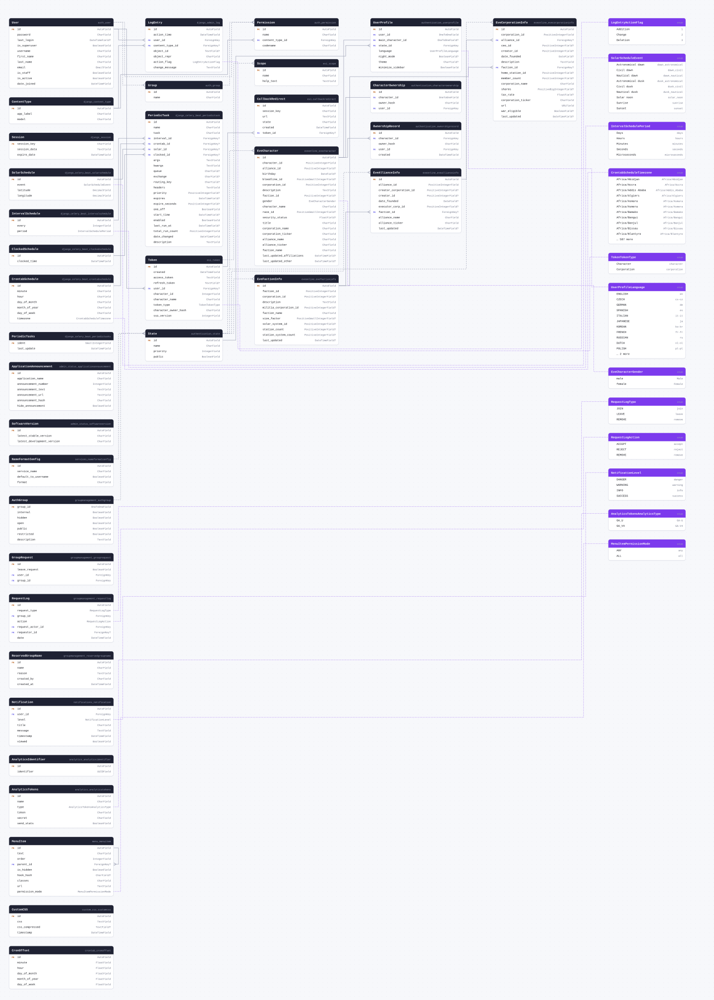

[LogEntry](#logentry) · [Permission](#permission) · [Group](#group) · [User](#user) · [ContentType](#contenttype) · [Session](#session) · [SolarSchedule](#solarschedule) · [IntervalSchedule](#intervalschedule) · [ClockedSchedule](#clockedschedule) · [CrontabSchedule](#crontabschedule) · [PeriodicTasks](#periodictasks) · [PeriodicTask](#periodictask) · [Scope](#scope) · [Token](#token) · [CallbackRedirect](#callbackredirect) · [ApplicationAnnouncement](#applicationannouncement) · [SoftwareVersion](#softwareversion) · [State](#state) · [UserProfile](#userprofile) · [CharacterOwnership](#characterownership) · [OwnershipRecord](#ownershiprecord) · [NameFormatConfig](#nameformatconfig) · [EveFactionInfo](#evefactioninfo) · [EveAllianceInfo](#eveallianceinfo) · [EveCorporationInfo](#evecorporationinfo) · [EveCharacter](#evecharacter) · [GroupRequest](#grouprequest) · [RequestLog](#requestlog) · [AuthGroup](#authgroup) · [ReservedGroupName](#reservedgroupname) · [Notification](#notification) · [AnalyticsIdentifier](#analyticsidentifier) · [AnalyticsTokens](#analyticstokens) · [MenuItem](#menuitem) · [CustomCSS](#customcss) · [CronOffset](#cronoffset)

<details>
<summary>The whole schema as SQL</summary>

```sql
CREATE TABLE "django_admin_log" ("id" integer NOT NULL PRIMARY KEY AUTOINCREMENT, "action_time" datetime NOT NULL, "user_id" integer NOT NULL REFERENCES "auth_user" ("id") DEFERRABLE INITIALLY DEFERRED, "content_type_id" integer NULL REFERENCES "django_content_type" ("id") DEFERRABLE INITIALLY DEFERRED, "object_id" text NULL, "object_repr" varchar(200) NOT NULL, "action_flag" smallint unsigned NOT NULL CHECK ("action_flag" >= 0), "change_message" text NOT NULL);

CREATE TABLE "auth_permission" ("id" integer NOT NULL PRIMARY KEY AUTOINCREMENT, "name" varchar(255) NOT NULL, "content_type_id" integer NOT NULL REFERENCES "django_content_type" ("id") DEFERRABLE INITIALLY DEFERRED, "codename" varchar(100) NOT NULL);

CREATE TABLE "auth_group" ("id" integer NOT NULL PRIMARY KEY AUTOINCREMENT, "name" varchar(150) NOT NULL UNIQUE);

CREATE TABLE "auth_group_permissions" ("id" integer NOT NULL PRIMARY KEY AUTOINCREMENT, "group_id" integer NOT NULL REFERENCES "auth_group" ("id") DEFERRABLE INITIALLY DEFERRED, "permission_id" integer NOT NULL REFERENCES "auth_permission" ("id") DEFERRABLE INITIALLY DEFERRED);

CREATE TABLE "auth_user" ("id" integer NOT NULL PRIMARY KEY AUTOINCREMENT, "password" varchar(128) NOT NULL, "last_login" datetime NULL, "is_superuser" bool NOT NULL, "username" varchar(150) NOT NULL UNIQUE, "first_name" varchar(150) NOT NULL, "last_name" varchar(150) NOT NULL, "email" varchar(254) NOT NULL, "is_staff" bool NOT NULL, "is_active" bool NOT NULL, "date_joined" datetime NOT NULL);

CREATE TABLE "auth_user_groups" ("id" integer NOT NULL PRIMARY KEY AUTOINCREMENT, "user_id" integer NOT NULL REFERENCES "auth_user" ("id") DEFERRABLE INITIALLY DEFERRED, "group_id" integer NOT NULL REFERENCES "auth_group" ("id") DEFERRABLE INITIALLY DEFERRED);

CREATE TABLE "auth_user_user_permissions" ("id" integer NOT NULL PRIMARY KEY AUTOINCREMENT, "user_id" integer NOT NULL REFERENCES "auth_user" ("id") DEFERRABLE INITIALLY DEFERRED, "permission_id" integer NOT NULL REFERENCES "auth_permission" ("id") DEFERRABLE INITIALLY DEFERRED);

CREATE TABLE "django_content_type" ("id" integer NOT NULL PRIMARY KEY AUTOINCREMENT, "app_label" varchar(100) NOT NULL, "model" varchar(100) NOT NULL);

CREATE TABLE "django_session" ("session_key" varchar(40) NOT NULL PRIMARY KEY, "session_data" text NOT NULL, "expire_date" datetime NOT NULL);

CREATE TABLE "django_celery_beat_solarschedule" ("id" integer NOT NULL PRIMARY KEY AUTOINCREMENT, "event" varchar(24) NOT NULL, "latitude" decimal NOT NULL, "longitude" decimal NOT NULL);

CREATE TABLE "django_celery_beat_intervalschedule" ("id" integer NOT NULL PRIMARY KEY AUTOINCREMENT, "every" integer NOT NULL, "period" varchar(24) NOT NULL);

CREATE TABLE "django_celery_beat_clockedschedule" ("id" integer NOT NULL PRIMARY KEY AUTOINCREMENT, "clocked_time" datetime NOT NULL);

CREATE TABLE "django_celery_beat_crontabschedule" ("id" integer NOT NULL PRIMARY KEY AUTOINCREMENT, "minute" varchar(240) NOT NULL, "hour" varchar(96) NOT NULL, "day_of_month" varchar(124) NOT NULL, "month_of_year" varchar(64) NOT NULL, "day_of_week" varchar(64) NOT NULL, "timezone" varchar(63) NOT NULL);

CREATE TABLE "django_celery_beat_periodictasks" ("ident" smallint NOT NULL PRIMARY KEY, "last_update" datetime NOT NULL);

CREATE TABLE "django_celery_beat_periodictask" ("id" integer NOT NULL PRIMARY KEY AUTOINCREMENT, "name" varchar(200) NOT NULL UNIQUE, "task" varchar(200) NOT NULL, "interval_id" integer NULL REFERENCES "django_celery_beat_intervalschedule" ("id") DEFERRABLE INITIALLY DEFERRED, "crontab_id" integer NULL REFERENCES "django_celery_beat_crontabschedule" ("id") DEFERRABLE INITIALLY DEFERRED, "solar_id" integer NULL REFERENCES "django_celery_beat_solarschedule" ("id") DEFERRABLE INITIALLY DEFERRED, "clocked_id" integer NULL REFERENCES "django_celery_beat_clockedschedule" ("id") DEFERRABLE INITIALLY DEFERRED, "args" text NOT NULL, "kwargs" text NOT NULL, "queue" varchar(200) NULL, "exchange" varchar(200) NULL, "routing_key" varchar(200) NULL, "headers" text NOT NULL, "priority" integer unsigned NULL CHECK ("priority" >= 0), "expires" datetime NULL, "expire_seconds" integer unsigned NULL CHECK ("expire_seconds" >= 0), "one_off" bool NOT NULL, "start_time" datetime NULL, "enabled" bool NOT NULL, "last_run_at" datetime NULL, "total_run_count" integer unsigned NOT NULL CHECK ("total_run_count" >= 0), "date_changed" datetime NOT NULL, "description" text NOT NULL);

CREATE TABLE "esi_scope" ("id" integer NOT NULL PRIMARY KEY AUTOINCREMENT, "name" varchar(100) NOT NULL UNIQUE, "help_text" text NOT NULL);

CREATE TABLE "esi_token" ("id" integer NOT NULL PRIMARY KEY AUTOINCREMENT, "created" datetime NOT NULL, "access_token" text NOT NULL, "refresh_token" text NULL, "user_id" integer NULL REFERENCES "auth_user" ("id") DEFERRABLE INITIALLY DEFERRED, "character_id" integer NOT NULL, "character_name" varchar(100) NOT NULL, "token_type" varchar(100) NOT NULL, "character_owner_hash" varchar(254) NOT NULL, "sso_version" integer NOT NULL);

CREATE TABLE "esi_token_scopes" ("id" integer NOT NULL PRIMARY KEY AUTOINCREMENT, "token_id" integer NOT NULL REFERENCES "esi_token" ("id") DEFERRABLE INITIALLY DEFERRED, "scope_id" integer NOT NULL REFERENCES "esi_scope" ("id") DEFERRABLE INITIALLY DEFERRED);

CREATE TABLE "esi_callbackredirect" ("id" integer NOT NULL PRIMARY KEY AUTOINCREMENT, "session_key" varchar(254) NOT NULL UNIQUE, "url" text NOT NULL, "state" varchar(128) NOT NULL, "created" datetime NOT NULL, "token_id" integer NULL REFERENCES "esi_token" ("id") DEFERRABLE INITIALLY DEFERRED);

CREATE TABLE "admin_status_applicationannouncement" ("id" integer NOT NULL PRIMARY KEY AUTOINCREMENT, "application_name" varchar(50) NOT NULL, "announcement_number" integer NOT NULL, "announcement_text" text NOT NULL, "announcement_url" text NOT NULL, "announcement_hash" varchar(64) NOT NULL UNIQUE, "hide_announcement" bool NOT NULL, CONSTRAINT "functional_pk_applicationissuenumber" UNIQUE ("application_name", "announcement_number"));

CREATE TABLE "admin_status_softwareversion" ("id" integer NOT NULL PRIMARY KEY AUTOINCREMENT, "latest_stable_version" varchar(20) NOT NULL, "latest_development_version" varchar(20) NOT NULL);

CREATE TABLE "authentication_state" ("id" integer NOT NULL PRIMARY KEY AUTOINCREMENT, "name" varchar(32) NOT NULL UNIQUE, "priority" integer NOT NULL UNIQUE, "public" bool NOT NULL);

CREATE TABLE "authentication_state_permissions" ("id" integer NOT NULL PRIMARY KEY AUTOINCREMENT, "state_id" integer NOT NULL REFERENCES "authentication_state" ("id") DEFERRABLE INITIALLY DEFERRED, "permission_id" integer NOT NULL REFERENCES "auth_permission" ("id") DEFERRABLE INITIALLY DEFERRED);

CREATE TABLE "authentication_state_member_characters" ("id" integer NOT NULL PRIMARY KEY AUTOINCREMENT, "state_id" integer NOT NULL REFERENCES "authentication_state" ("id") DEFERRABLE INITIALLY DEFERRED, "evecharacter_id" integer NOT NULL REFERENCES "eveonline_evecharacter" ("id") DEFERRABLE INITIALLY DEFERRED);

CREATE TABLE "authentication_state_member_corporations" ("id" integer NOT NULL PRIMARY KEY AUTOINCREMENT, "state_id" integer NOT NULL REFERENCES "authentication_state" ("id") DEFERRABLE INITIALLY DEFERRED, "evecorporationinfo_id" integer NOT NULL REFERENCES "eveonline_evecorporationinfo" ("id") DEFERRABLE INITIALLY DEFERRED);

CREATE TABLE "authentication_state_member_alliances" ("id" integer NOT NULL PRIMARY KEY AUTOINCREMENT, "state_id" integer NOT NULL REFERENCES "authentication_state" ("id") DEFERRABLE INITIALLY DEFERRED, "eveallianceinfo_id" integer NOT NULL REFERENCES "eveonline_eveallianceinfo" ("id") DEFERRABLE INITIALLY DEFERRED);

CREATE TABLE "authentication_state_member_factions" ("id" integer NOT NULL PRIMARY KEY AUTOINCREMENT, "state_id" integer NOT NULL REFERENCES "authentication_state" ("id") DEFERRABLE INITIALLY DEFERRED, "evefactioninfo_id" integer NOT NULL REFERENCES "eveonline_evefactioninfo" ("id") DEFERRABLE INITIALLY DEFERRED);

CREATE TABLE "authentication_userprofile" ("id" integer NOT NULL PRIMARY KEY AUTOINCREMENT, "user_id" integer NOT NULL UNIQUE REFERENCES "auth_user" ("id") DEFERRABLE INITIALLY DEFERRED, "main_character_id" integer NULL UNIQUE REFERENCES "eveonline_evecharacter" ("id") DEFERRABLE INITIALLY DEFERRED, "state_id" integer NOT NULL REFERENCES "authentication_state" ("id") DEFERRABLE INITIALLY DEFERRED, "language" varchar(10) NOT NULL, "night_mode" bool NULL, "theme" varchar(200) NULL, "minimize_sidebar" bool NOT NULL);

CREATE TABLE "authentication_characterownership" ("id" integer NOT NULL PRIMARY KEY AUTOINCREMENT, "character_id" integer NOT NULL UNIQUE REFERENCES "eveonline_evecharacter" ("id") DEFERRABLE INITIALLY DEFERRED, "owner_hash" varchar(28) NOT NULL UNIQUE, "user_id" integer NOT NULL REFERENCES "auth_user" ("id") DEFERRABLE INITIALLY DEFERRED);

CREATE TABLE "authentication_ownershiprecord" ("id" integer NOT NULL PRIMARY KEY AUTOINCREMENT, "character_id" integer NOT NULL REFERENCES "eveonline_evecharacter" ("id") DEFERRABLE INITIALLY DEFERRED, "owner_hash" varchar(28) NOT NULL, "user_id" integer NOT NULL REFERENCES "auth_user" ("id") DEFERRABLE INITIALLY DEFERRED, "created" datetime NOT NULL);

CREATE TABLE "services_nameformatconfig" ("id" integer NOT NULL PRIMARY KEY AUTOINCREMENT, "service_name" varchar(100) NOT NULL, "default_to_username" bool NOT NULL, "format" varchar(100) NOT NULL);

CREATE TABLE "services_nameformatconfig_states" ("id" integer NOT NULL PRIMARY KEY AUTOINCREMENT, "nameformatconfig_id" integer NOT NULL REFERENCES "services_nameformatconfig" ("id") DEFERRABLE INITIALLY DEFERRED, "state_id" integer NOT NULL REFERENCES "authentication_state" ("id") DEFERRABLE INITIALLY DEFERRED);

CREATE TABLE "eveonline_evefactioninfo" ("id" integer NOT NULL PRIMARY KEY AUTOINCREMENT, "faction_id" integer unsigned NOT NULL UNIQUE CHECK ("faction_id" >= 0), "corporation_id" integer unsigned NULL UNIQUE CHECK ("corporation_id" >= 0), "description" text NOT NULL, "militia_corporation_id" integer unsigned NULL UNIQUE CHECK ("militia_corporation_id" >= 0), "faction_name" varchar(254) NOT NULL UNIQUE, "size_factor" smallint unsigned NULL CHECK ("size_factor" >= 0), "solar_system_id" integer unsigned NULL CHECK ("solar_system_id" >= 0), "station_count" integer unsigned NULL CHECK ("station_count" >= 0), "station_system_count" integer unsigned NULL CHECK ("station_system_count" >= 0), "last_updated" datetime NULL);

CREATE TABLE "eveonline_eveallianceinfo" ("id" integer NOT NULL PRIMARY KEY AUTOINCREMENT, "alliance_id" integer unsigned NOT NULL UNIQUE CHECK ("alliance_id" >= 0), "creator_corporation_id" integer unsigned NULL CHECK ("creator_corporation_id" >= 0), "creator_id" integer unsigned NULL CHECK ("creator_id" >= 0), "date_founded" date NULL, "executor_corp_id" integer unsigned NULL CHECK ("executor_corp_id" >= 0), "faction_id" integer NULL REFERENCES "eveonline_evefactioninfo" ("id") DEFERRABLE INITIALLY DEFERRED, "alliance_name" varchar(254) NOT NULL, "alliance_ticker" varchar(254) NOT NULL, "last_updated" datetime NULL);

CREATE TABLE "eveonline_evecorporationinfo" ("id" integer NOT NULL PRIMARY KEY AUTOINCREMENT, "corporation_id" integer unsigned NOT NULL UNIQUE CHECK ("corporation_id" >= 0), "alliance_id" integer NULL REFERENCES "eveonline_eveallianceinfo" ("id") DEFERRABLE INITIALLY DEFERRED, "ceo_id" integer unsigned NULL CHECK ("ceo_id" >= 0), "creator_id" integer unsigned NULL CHECK ("creator_id" >= 0), "date_founded" date NULL, "description" text NOT NULL, "faction_id" integer NULL REFERENCES "eveonline_evefactioninfo" ("id") DEFERRABLE INITIALLY DEFERRED, "home_station_id" integer unsigned NULL CHECK ("home_station_id" >= 0), "member_count" integer unsigned NULL CHECK ("member_count" >= 0), "corporation_name" varchar(254) NOT NULL, "shares" bigint unsigned NULL CHECK ("shares" >= 0), "tax_rate" real NULL, "corporation_ticker" varchar(254) NOT NULL, "url" varchar(2048) NOT NULL, "war_eligible" bool NULL, "last_updated" datetime NULL);

CREATE TABLE "eveonline_evecharacter" ("id" integer NOT NULL PRIMARY KEY AUTOINCREMENT, "character_id" integer unsigned NOT NULL UNIQUE CHECK ("character_id" >= 0), "alliance_id" integer unsigned NULL CHECK ("alliance_id" >= 0), "birthday" date NULL, "bloodline_id" smallint unsigned NULL CHECK ("bloodline_id" >= 0), "corporation_id" integer unsigned NOT NULL CHECK ("corporation_id" >= 0), "description" text NOT NULL, "faction_id" integer unsigned NULL CHECK ("faction_id" >= 0), "gender" varchar(10) NOT NULL, "character_name" varchar(254) NOT NULL, "race_id" smallint unsigned NULL CHECK ("race_id" >= 0), "security_status" real NULL, "title" varchar(254) NOT NULL, "corporation_name" varchar(254) NOT NULL, "corporation_ticker" varchar(5) NOT NULL, "alliance_name" varchar(254) NOT NULL, "alliance_ticker" varchar(5) NOT NULL, "faction_name" varchar(254) NOT NULL, "last_updated_affiliations" datetime NULL, "last_updated_other" datetime NULL);

CREATE TABLE "groupmanagement_grouprequest" ("id" integer NOT NULL PRIMARY KEY AUTOINCREMENT, "leave_request" bool NOT NULL, "user_id" integer NOT NULL REFERENCES "auth_user" ("id") DEFERRABLE INITIALLY DEFERRED, "group_id" integer NOT NULL REFERENCES "auth_group" ("id") DEFERRABLE INITIALLY DEFERRED);

CREATE TABLE "groupmanagement_requestlog" ("id" integer NOT NULL PRIMARY KEY AUTOINCREMENT, "request_type" varchar(6) NOT NULL, "group_id" integer NOT NULL REFERENCES "auth_group" ("id") DEFERRABLE INITIALLY DEFERRED, "action" varchar(6) NOT NULL, "request_actor_id" integer NOT NULL REFERENCES "auth_user" ("id") DEFERRABLE INITIALLY DEFERRED, "requestor_id" integer NULL REFERENCES "auth_user" ("id") DEFERRABLE INITIALLY DEFERRED, "date" datetime NOT NULL);

CREATE TABLE "groupmanagement_authgroup" ("group_id" integer NOT NULL PRIMARY KEY REFERENCES "auth_group" ("id") DEFERRABLE INITIALLY DEFERRED, "internal" bool NOT NULL, "hidden" bool NOT NULL, "open" bool NOT NULL, "public" bool NOT NULL, "restricted" bool NOT NULL, "description" text NOT NULL);

CREATE TABLE "groupmanagement_authgroup_group_leaders" ("id" integer NOT NULL PRIMARY KEY AUTOINCREMENT, "authgroup_id" integer NOT NULL REFERENCES "groupmanagement_authgroup" ("group_id") DEFERRABLE INITIALLY DEFERRED, "user_id" integer NOT NULL REFERENCES "auth_user" ("id") DEFERRABLE INITIALLY DEFERRED);

CREATE TABLE "groupmanagement_authgroup_group_leader_groups" ("id" integer NOT NULL PRIMARY KEY AUTOINCREMENT, "authgroup_id" integer NOT NULL REFERENCES "groupmanagement_authgroup" ("group_id") DEFERRABLE INITIALLY DEFERRED, "group_id" integer NOT NULL REFERENCES "auth_group" ("id") DEFERRABLE INITIALLY DEFERRED);

CREATE TABLE "groupmanagement_authgroup_states" ("id" integer NOT NULL PRIMARY KEY AUTOINCREMENT, "authgroup_id" integer NOT NULL REFERENCES "groupmanagement_authgroup" ("group_id") DEFERRABLE INITIALLY DEFERRED, "state_id" integer NOT NULL REFERENCES "authentication_state" ("id") DEFERRABLE INITIALLY DEFERRED);

CREATE TABLE "groupmanagement_reservedgroupname" ("id" integer NOT NULL PRIMARY KEY AUTOINCREMENT, "name" varchar(150) NOT NULL UNIQUE, "reason" text NOT NULL, "created_by" varchar(255) NOT NULL, "created_at" datetime NOT NULL);

CREATE TABLE "notifications_notification" ("id" integer NOT NULL PRIMARY KEY AUTOINCREMENT, "user_id" integer NOT NULL REFERENCES "auth_user" ("id") DEFERRABLE INITIALLY DEFERRED, "level" varchar(10) NOT NULL, "title" varchar(254) NOT NULL, "message" text NOT NULL, "timestamp" datetime NOT NULL, "viewed" bool NOT NULL);

CREATE TABLE "analytics_analyticsidentifier" ("id" integer NOT NULL PRIMARY KEY AUTOINCREMENT, "identifier" char(32) NOT NULL);

CREATE TABLE "analytics_analyticstokens" ("id" integer NOT NULL PRIMARY KEY AUTOINCREMENT, "name" varchar(254) NOT NULL, "type" varchar(254) NOT NULL, "token" varchar(254) NOT NULL, "secret" varchar(254) NOT NULL, "send_stats" bool NOT NULL);

CREATE TABLE "menu_menuitem" ("id" integer NOT NULL PRIMARY KEY AUTOINCREMENT, "text" varchar(150) NOT NULL, "order" integer NOT NULL, "parent_id" integer NULL REFERENCES "menu_menuitem" ("id") DEFERRABLE INITIALLY DEFERRED, "is_hidden" bool NOT NULL, "hook_hash" varchar(64) NULL UNIQUE, "classes" varchar(150) NOT NULL, "url" text NOT NULL, "permission_mode" varchar(3) NOT NULL);

CREATE TABLE "menu_menuitem_permissions" ("id" integer NOT NULL PRIMARY KEY AUTOINCREMENT, "menuitem_id" integer NOT NULL REFERENCES "menu_menuitem" ("id") DEFERRABLE INITIALLY DEFERRED, "permission_id" integer NOT NULL REFERENCES "auth_permission" ("id") DEFERRABLE INITIALLY DEFERRED);

CREATE TABLE "custom_css_customcss" ("id" integer NOT NULL PRIMARY KEY AUTOINCREMENT, "css" text NOT NULL, "css_compressed" text NULL, "timestamp" datetime NOT NULL);

CREATE TABLE "crontab_cronoffset" ("id" integer NOT NULL PRIMARY KEY AUTOINCREMENT, "minute" real NOT NULL, "hour" real NOT NULL, "day_of_month" real NOT NULL, "month_of_year" real NOT NULL, "day_of_week" real NOT NULL);

CREATE INDEX "django_admin_log_user_id_c564eba6" ON "django_admin_log" ("user_id");

CREATE INDEX "django_admin_log_content_type_id_c4bce8eb" ON "django_admin_log" ("content_type_id");

CREATE UNIQUE INDEX "auth_permission_content_type_id_codename_01ab375a_uniq" ON "auth_permission" ("content_type_id", "codename");

CREATE INDEX "auth_permission_content_type_id_2f476e4b" ON "auth_permission" ("content_type_id");

CREATE UNIQUE INDEX "auth_group_permissions_group_id_permission_id_0cd325b0_uniq" ON "auth_group_permissions" ("group_id", "permission_id");

CREATE INDEX "auth_group_permissions_group_id_b120cbf9" ON "auth_group_permissions" ("group_id");

CREATE INDEX "auth_group_permissions_permission_id_84c5c92e" ON "auth_group_permissions" ("permission_id");

CREATE UNIQUE INDEX "auth_user_groups_user_id_group_id_94350c0c_uniq" ON "auth_user_groups" ("user_id", "group_id");

CREATE INDEX "auth_user_groups_user_id_6a12ed8b" ON "auth_user_groups" ("user_id");

CREATE INDEX "auth_user_groups_group_id_97559544" ON "auth_user_groups" ("group_id");

CREATE UNIQUE INDEX "auth_user_user_permissions_user_id_permission_id_14a6b632_uniq" ON "auth_user_user_permissions" ("user_id", "permission_id");

CREATE INDEX "auth_user_user_permissions_user_id_a95ead1b" ON "auth_user_user_permissions" ("user_id");

CREATE INDEX "auth_user_user_permissions_permission_id_1fbb5f2c" ON "auth_user_user_permissions" ("permission_id");

CREATE UNIQUE INDEX "django_content_type_app_label_model_76bd3d3b_uniq" ON "django_content_type" ("app_label", "model");

CREATE INDEX "django_session_expire_date_a5c62663" ON "django_session" ("expire_date");

CREATE UNIQUE INDEX "django_celery_beat_solarschedule_event_latitude_longitude_ba64999a_uniq" ON "django_celery_beat_solarschedule" ("event", "latitude", "longitude");

CREATE INDEX "django_celery_beat_periodictask_interval_id_a8ca27da" ON "django_celery_beat_periodictask" ("interval_id");

CREATE INDEX "django_celery_beat_periodictask_crontab_id_d3cba168" ON "django_celery_beat_periodictask" ("crontab_id");

CREATE INDEX "django_celery_beat_periodictask_solar_id_a87ce72c" ON "django_celery_beat_periodictask" ("solar_id");

CREATE INDEX "django_celery_beat_periodictask_clocked_id_47a69f82" ON "django_celery_beat_periodictask" ("clocked_id");

CREATE INDEX "esi_token_user_id_d21fe2e5" ON "esi_token" ("user_id");

CREATE INDEX "esi_token_character_id_9ab64ee5" ON "esi_token" ("character_id");

CREATE INDEX "esi_token_character_name_0a583806" ON "esi_token" ("character_name");

CREATE INDEX "esi_token_character_owner_hash_ad2c27b1" ON "esi_token" ("character_owner_hash");

CREATE UNIQUE INDEX "esi_token_scopes_token_id_scope_id_52105ac7_uniq" ON "esi_token_scopes" ("token_id", "scope_id");

CREATE INDEX "esi_token_scopes_token_id_df3856c8" ON "esi_token_scopes" ("token_id");

CREATE INDEX "esi_token_scopes_scope_id_fafdd2da" ON "esi_token_scopes" ("scope_id");

CREATE INDEX "esi_callbackredirect_token_id_f9bd7843" ON "esi_callbackredirect" ("token_id");

CREATE UNIQUE INDEX "authentication_state_permissions_state_id_permission_id_f0900ec3_uniq" ON "authentication_state_permissions" ("state_id", "permission_id");

CREATE INDEX "authentication_state_permissions_state_id_187543e7" ON "authentication_state_permissions" ("state_id");

CREATE INDEX "authentication_state_permissions_permission_id_ddafd120" ON "authentication_state_permissions" ("permission_id");

CREATE UNIQUE INDEX "authentication_state_member_characters_state_id_evecharacter_id_cfcc92d6_uniq" ON "authentication_state_member_characters" ("state_id", "evecharacter_id");

CREATE INDEX "authentication_state_member_characters_state_id_0a747331" ON "authentication_state_member_characters" ("state_id");

CREATE INDEX "authentication_state_member_characters_evecharacter_id_d26e7105" ON "authentication_state_member_characters" ("evecharacter_id");

CREATE UNIQUE INDEX "authentication_state_member_corporations_state_id_evecorporationinfo_id_d3d3d0be_uniq" ON "authentication_state_member_corporations" ("state_id", "evecorporationinfo_id");

CREATE INDEX "authentication_state_member_corporations_state_id_349ba723" ON "authentication_state_member_corporations" ("state_id");

CREATE INDEX "authentication_state_member_corporations_evecorporationinfo_id_cc714e19" ON "authentication_state_member_corporations" ("evecorporationinfo_id");

CREATE UNIQUE INDEX "authentication_state_member_alliances_state_id_eveallianceinfo_id_8842b1c0_uniq" ON "authentication_state_member_alliances" ("state_id", "eveallianceinfo_id");

CREATE INDEX "authentication_state_member_alliances_state_id_2223603e" ON "authentication_state_member_alliances" ("state_id");

CREATE INDEX "authentication_state_member_alliances_eveallianceinfo_id_0fcaa47b" ON "authentication_state_member_alliances" ("eveallianceinfo_id");

CREATE UNIQUE INDEX "authentication_state_member_factions_state_id_evefactioninfo_id_9872d3a6_uniq" ON "authentication_state_member_factions" ("state_id", "evefactioninfo_id");

CREATE INDEX "authentication_state_member_factions_state_id_c9576686" ON "authentication_state_member_factions" ("state_id");

CREATE INDEX "authentication_state_member_factions_evefactioninfo_id_1bd1e317" ON "authentication_state_member_factions" ("evefactioninfo_id");

CREATE INDEX "authentication_userprofile_state_id_58242e4a" ON "authentication_userprofile" ("state_id");

CREATE INDEX "authentication_characterownership_user_id_8c48225e" ON "authentication_characterownership" ("user_id");

CREATE INDEX "authentication_ownershiprecord_character_id_ebc8f5f4" ON "authentication_ownershiprecord" ("character_id");

CREATE INDEX "authentication_ownershiprecord_owner_hash_9db96660" ON "authentication_ownershiprecord" ("owner_hash");

CREATE INDEX "authentication_ownershiprecord_user_id_1f926981" ON "authentication_ownershiprecord" ("user_id");

CREATE UNIQUE INDEX "services_nameformatconfig_states_nameformatconfig_id_state_id_1d9b9924_uniq" ON "services_nameformatconfig_states" ("nameformatconfig_id", "state_id");

CREATE INDEX "services_nameformatconfig_states_nameformatconfig_id_5cf12aa3" ON "services_nameformatconfig_states" ("nameformatconfig_id");

CREATE INDEX "services_nameformatconfig_states_state_id_67c83699" ON "services_nameformatconfig_states" ("state_id");

CREATE INDEX "eveonline_e_corpora_213c26_idx" ON "eveonline_evefactioninfo" ("corporation_id");

CREATE INDEX "eveonline_e_militia_a5231e_idx" ON "eveonline_evefactioninfo" ("militia_corporation_id");

CREATE INDEX "eveonline_e_faction_f02be0_idx" ON "eveonline_evefactioninfo" ("faction_name");

CREATE INDEX "eveonline_eveallianceinfo_faction_id_f7b1fbad" ON "eveonline_eveallianceinfo" ("faction_id");

CREATE INDEX "eveonline_e_creator_323b45_idx" ON "eveonline_eveallianceinfo" ("creator_corporation_id");

CREATE INDEX "eveonline_e_allianc_d2b09d_idx" ON "eveonline_eveallianceinfo" ("alliance_name");

CREATE INDEX "eveonline_e_executo_7f3280_idx" ON "eveonline_eveallianceinfo" ("executor_corp_id");

CREATE INDEX "eveonline_evecorporationinfo_alliance_id_9438172d" ON "eveonline_evecorporationinfo" ("alliance_id");

CREATE INDEX "eveonline_evecorporationinfo_faction_id_c41ff1b6" ON "eveonline_evecorporationinfo" ("faction_id");

CREATE INDEX "eveonline_e_ceo_id_eea7b8_idx" ON "eveonline_evecorporationinfo" ("ceo_id");

CREATE INDEX "eveonline_e_corpora_650e9a_idx" ON "eveonline_evecorporationinfo" ("corporation_name");

CREATE INDEX "eveonline_e_charact_d47325_idx" ON "eveonline_evecharacter" ("character_name");

CREATE INDEX "eveonline_e_corpora_cb4cd9_idx" ON "eveonline_evecharacter" ("corporation_id");

CREATE INDEX "eveonline_e_allianc_39ee2a_idx" ON "eveonline_evecharacter" ("alliance_id");

CREATE INDEX "eveonline_e_corpora_893c60_idx" ON "eveonline_evecharacter" ("corporation_name");

CREATE INDEX "eveonline_e_allianc_63fd98_idx" ON "eveonline_evecharacter" ("alliance_name");

CREATE INDEX "eveonline_e_faction_d5274e_idx" ON "eveonline_evecharacter" ("faction_id");

CREATE INDEX "groupmanagement_grouprequest_user_id_0984b897" ON "groupmanagement_grouprequest" ("user_id");

CREATE INDEX "groupmanagement_grouprequest_group_id_8e36ff92" ON "groupmanagement_grouprequest" ("group_id");

CREATE INDEX "groupmanagement_requestlog_group_id_0be2a758" ON "groupmanagement_requestlog" ("group_id");

CREATE INDEX "groupmanagement_requestlog_request_actor_id_98406921" ON "groupmanagement_requestlog" ("request_actor_id");

CREATE INDEX "groupmanagement_requestlog_requestor_id_d2df2a76" ON "groupmanagement_requestlog" ("requestor_id");

CREATE UNIQUE INDEX "groupmanagement_authgroup_group_leaders_authgroup_id_user_id_51767e30_uniq" ON "groupmanagement_authgroup_group_leaders" ("authgroup_id", "user_id");

CREATE INDEX "groupmanagement_authgroup_group_leaders_authgroup_id_5d6004a0" ON "groupmanagement_authgroup_group_leaders" ("authgroup_id");

CREATE INDEX "groupmanagement_authgroup_group_leaders_user_id_7d3d4541" ON "groupmanagement_authgroup_group_leaders" ("user_id");

CREATE UNIQUE INDEX "groupmanagement_authgroup_group_leader_groups_authgroup_id_group_id_bf59f2a1_uniq" ON "groupmanagement_authgroup_group_leader_groups" ("authgroup_id", "group_id");

CREATE INDEX "groupmanagement_authgroup_group_leader_groups_authgroup_id_d769f1c4" ON "groupmanagement_authgroup_group_leader_groups" ("authgroup_id");

CREATE INDEX "groupmanagement_authgroup_group_leader_groups_group_id_6b6f0488" ON "groupmanagement_authgroup_group_leader_groups" ("group_id");

CREATE UNIQUE INDEX "groupmanagement_authgroup_states_authgroup_id_state_id_ea338653_uniq" ON "groupmanagement_authgroup_states" ("authgroup_id", "state_id");

CREATE INDEX "groupmanagement_authgroup_states_authgroup_id_7c8ca058" ON "groupmanagement_authgroup_states" ("authgroup_id");

CREATE INDEX "groupmanagement_authgroup_states_state_id_7c5bab58" ON "groupmanagement_authgroup_states" ("state_id");

CREATE INDEX "notifications_notification_user_id_b5e8c0ff" ON "notifications_notification" ("user_id");

CREATE INDEX "notifications_notification_timestamp_6a797bad" ON "notifications_notification" ("timestamp");

CREATE INDEX "notifications_notification_viewed_92b34c27" ON "notifications_notification" ("viewed");

CREATE INDEX "menu_menuitem_text_64fb7ef2" ON "menu_menuitem" ("text");

CREATE INDEX "menu_menuitem_order_f75ef4f7" ON "menu_menuitem" ("order");

CREATE INDEX "menu_menuitem_parent_id_439f55a5" ON "menu_menuitem" ("parent_id");

CREATE UNIQUE INDEX "menu_menuitem_permissions_menuitem_id_permission_id_05795161_uniq" ON "menu_menuitem_permissions" ("menuitem_id", "permission_id");

CREATE INDEX "menu_menuitem_permissions_menuitem_id_18c73bca" ON "menu_menuitem_permissions" ("menuitem_id");

CREATE INDEX "menu_menuitem_permissions_permission_id_06eb78e4" ON "menu_menuitem_permissions" ("permission_id");
```

</details>

## LogEntry

Table `django_admin_log`, app `admin`.


| Column | Field | Type | Null | Key | Default | Description |
| --- | --- | --- | --- | --- | --- | --- |
| `id` | `AutoField` | `integer` |  | PK | `autoincrement()` |  |
| `action_time` | `DateTimeField` | `datetime` |  |  | `now()` |  |
| `user_id` | `ForeignKey` | `integer` |  | FK |  |  |
| `content_type_id` | `ForeignKey` | `integer` | yes | FK |  |  |
| `object_id` | `TextField` | `text` | yes |  |  |  |
| `object_repr` | `CharField` | `varchar(200)` |  |  |  |  |
| `action_flag` | `LogEntryActionFlag` | `smallint unsigned` |  |  |  |  |
| `change_message` | `TextField` | `text` |  |  |  |  |

Indexes:

- index `django_admin_log_user_id_c564eba6` on `user_id`
- index `django_admin_log_content_type_id_c4bce8eb` on `content_type_id`

Relations:

- `user_id` → [User](#user).`id`, on delete cascade
- `content_type_id` → [ContentType](#contenttype).`id`, on delete set null

## Permission

Table `auth_permission`, app `auth`.

Proxy models, on this table: `Permission`.

The permissions system provides a way to assign permissions to specific
users and groups of users.

The permission system is used by the Django admin site, but may also be
useful in your own code. The Django admin site uses permissions as follows:

    - The "add" permission limits the user's ability to view the "add" form
      and add an object.
    - The "change" permission limits a user's ability to view the change
      list, view the "change" form and change an object.
    - The "delete" permission limits the ability to delete an object.
    - The "view" permission limits the ability to view an object.

Permissions are set globally per type of object, not per specific object
instance. It is possible to say "Mary may change news stories," but it's
not currently possible to say "Mary may change news stories, but only the
ones she created herself" or "Mary may only change news stories that have a
certain status or publication date."

The permissions listed above are automatically created for each model.


| Column | Field | Type | Null | Key | Default | Description |
| --- | --- | --- | --- | --- | --- | --- |
| `id` | `AutoField` | `integer` |  | PK | `autoincrement()` |  |
| `name` | `CharField` | `varchar(255)` |  |  |  |  |
| `content_type_id` | `ForeignKey` | `integer` |  | FK |  |  |
| `codename` | `CharField` | `varchar(100)` |  |  |  |  |

Indexes:

- index `auth_permission_content_type_id_2f476e4b` on `content_type_id`
- unique `auth_permission_content_type_id_codename_01ab375a_uniq` on `content_type_id`, `codename`

Relations:

- `content_type_id` → [ContentType](#contenttype).`id`, on delete cascade
- `group_set` — many to many with [Group](#group)
- `user_set` — many to many with [User](#user)

## Group

Table `auth_group`, app `auth`.

Proxy models, on this table: `Group`.

Groups are a generic way of categorizing users to apply permissions, or
some other label, to those users. A user can belong to any number of
groups.

A user in a group automatically has all the permissions granted to that
group. For example, if the group 'Site editors' has the permission
can_edit_home_page, any user in that group will have that permission.

Beyond permissions, groups are a convenient way to categorize users to
apply some label, or extended functionality, to them. For example, you
could create a group 'Special users', and you could write code that would
do special things to those users -- such as giving them access to a
members-only portion of your site, or sending them members-only email
messages.


| Column | Field | Type | Null | Key | Default | Description |
| --- | --- | --- | --- | --- | --- | --- |
| `id` | `AutoField` | `integer` |  | PK | `autoincrement()` |  |
| `name` | `CharField` | `varchar(150)` |  | unique |  |  |

Relations:

- `permissions` — many to many with [Permission](#permission)
- `user_set` — many to many with [User](#user)

## User

Table `auth_user`, app `auth`.

Proxy models, on this table: `User`.

Columns from `AbstractUser` (abstract): `username`, `first_name`, `last_name`, `email`, `is_staff`, `is_active`, `date_joined`.

Columns from `AbstractBaseUser` (abstract): `password`, `last_login`.

Columns from `PermissionsMixin` (abstract): `is_superuser`.

Users within the Django authentication system are represented by this
model.

Username and password are required. Other fields are optional.

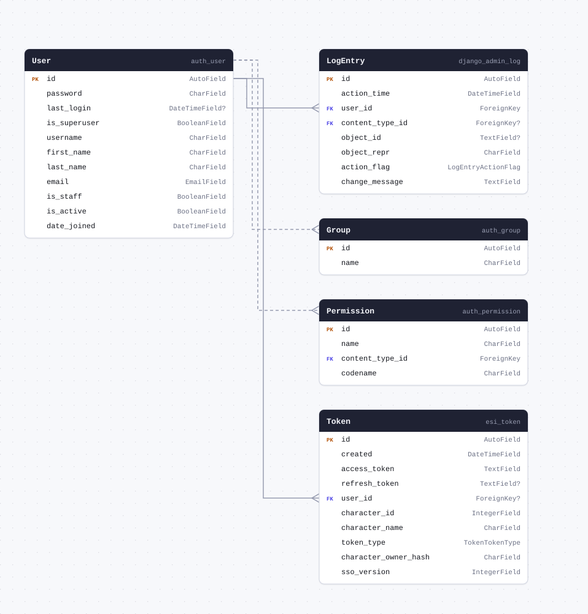

| Column | Field | Type | Null | Key | Default | Description |
| --- | --- | --- | --- | --- | --- | --- |
| `id` | `AutoField` | `integer` |  | PK | `autoincrement()` |  |
| `password` | `CharField` | `varchar(128)` |  |  |  |  |
| `last_login` | `DateTimeField` | `datetime` | yes |  |  |  |
| `is_superuser` | `BooleanField` | `bool` |  |  | `False` | Designates that this user has all permissions without explicitly assigning them. |
| `username` | `CharField` | `varchar(150)` |  | unique |  | Required. 150 characters or fewer. Letters, digits and @/./+/-/_ only. |
| `first_name` | `CharField` | `varchar(150)` |  |  |  |  |
| `last_name` | `CharField` | `varchar(150)` |  |  |  |  |
| `email` | `EmailField` | `varchar(254)` |  |  |  |  |
| `is_staff` | `BooleanField` | `bool` |  |  | `False` | Designates whether the user can log into this admin site. |
| `is_active` | `BooleanField` | `bool` |  |  | `True` | Designates whether this user should be treated as active. Unselect this instead of deleting accounts. |
| `date_joined` | `DateTimeField` | `datetime` |  |  | `now()` |  |

Relations:

- [LogEntry](#logentry).`user_id` → `id`, on delete cascade
- `groups` — many to many with [Group](#group)
- `user_permissions` — many to many with [Permission](#permission)
- [Token](#token).`user_id` → `id`, on delete cascade

## ContentType

Table `django_content_type`, app `contenttypes`.


| Column | Field | Type | Null | Key | Default | Description |
| --- | --- | --- | --- | --- | --- | --- |
| `id` | `AutoField` | `integer` |  | PK | `autoincrement()` |  |
| `app_label` | `CharField` | `varchar(100)` |  |  |  |  |
| `model` | `CharField` | `varchar(100)` |  |  |  |  |

Indexes:

- unique `django_content_type_app_label_model_76bd3d3b_uniq` on `app_label`, `model`

Relations:

- [LogEntry](#logentry).`content_type_id` → `id`, on delete set null
- [Permission](#permission).`content_type_id` → `id`, on delete cascade

## Session

Table `django_session`, app `sessions`.

Columns from `AbstractBaseSession` (abstract): `session_key`, `session_data`, `expire_date`.

Django provides full support for anonymous sessions. The session
framework lets you store and retrieve arbitrary data on a
per-site-visitor basis. It stores data on the server side and
abstracts the sending and receiving of cookies. Cookies contain a
session ID -- not the data itself.

The Django sessions framework is entirely cookie-based. It does
not fall back to putting session IDs in URLs. This is an intentional
design decision. Not only does that behavior make URLs ugly, it makes
your site vulnerable to session-ID theft via the "Referer" header.

For complete documentation on using Sessions in your code, consult
the sessions documentation that is shipped with Django (also available
on the Django web site).

| Column | Field | Type | Null | Key | Default | Description |
| --- | --- | --- | --- | --- | --- | --- |
| `session_key` | `CharField` | `varchar(40)` |  | PK |  |  |
| `session_data` | `TextField` | `text` |  |  |  |  |
| `expire_date` | `DateTimeField` | `datetime` |  |  |  |  |

Indexes:

- index `django_session_expire_date_a5c62663` on `expire_date`

## SolarSchedule

Table `django_celery_beat_solarschedule`, app `django_celery_beat`.

Schedule following astronomical patterns.

Example: to run every sunrise in New York City:

>>> event='sunrise', latitude=40.7128, longitude=74.0060

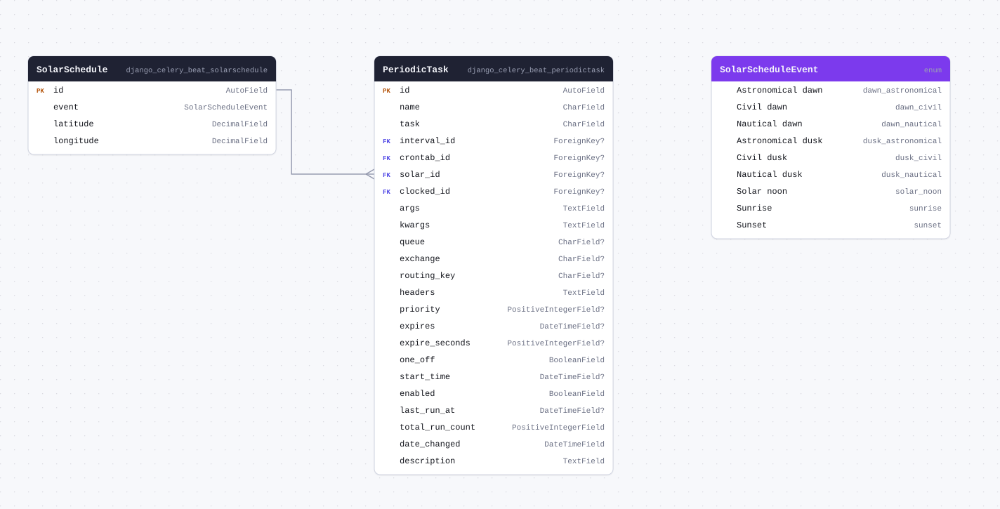

| Column | Field | Type | Null | Key | Default | Description |
| --- | --- | --- | --- | --- | --- | --- |
| `id` | `AutoField` | `integer` |  | PK | `autoincrement()` |  |
| `event` | `SolarScheduleEvent` | `varchar(24)` |  |  |  | The type of solar event when the job should run |
| `latitude` | `DecimalField(9, 6)` | `decimal` |  |  |  | Run the task when the event happens at this latitude |
| `longitude` | `DecimalField(9, 6)` | `decimal` |  |  |  | Run the task when the event happens at this longitude |

Indexes:

- unique `django_celery_beat_solarschedule_event_latitude_longitude_ba64999a_uniq` on `event`, `latitude`, `longitude`

Relations:

- [PeriodicTask](#periodictask).`solar_id` → `id`, on delete cascade

## IntervalSchedule

Table `django_celery_beat_intervalschedule`, app `django_celery_beat`.

Schedule executing on a regular interval.

Example: execute every 2 days:

>>> every=2, period=DAYS

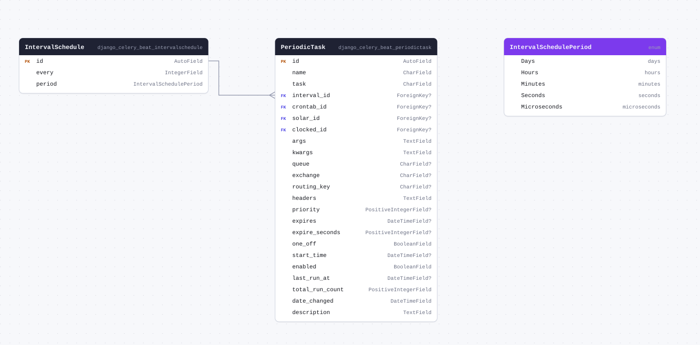

| Column | Field | Type | Null | Key | Default | Description |
| --- | --- | --- | --- | --- | --- | --- |
| `id` | `AutoField` | `integer` |  | PK | `autoincrement()` |  |
| `every` | `IntegerField` | `integer` |  |  |  | Number of interval periods to wait before running the task again |
| `period` | `IntervalSchedulePeriod` | `varchar(24)` |  |  |  | The type of period between task runs (Example: days) |

Relations:

- [PeriodicTask](#periodictask).`interval_id` → `id`, on delete cascade

## ClockedSchedule

Table `django_celery_beat_clockedschedule`, app `django_celery_beat`.

clocked schedule.

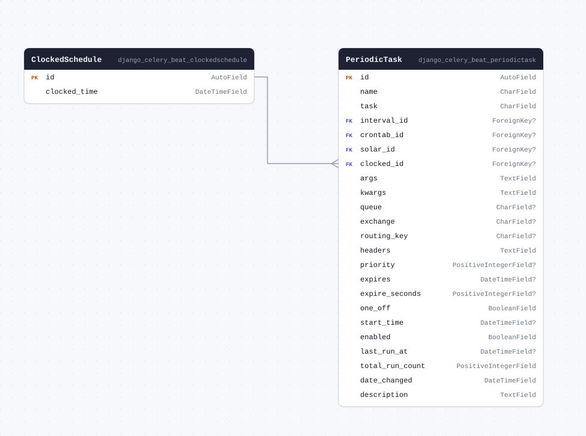

| Column | Field | Type | Null | Key | Default | Description |
| --- | --- | --- | --- | --- | --- | --- |
| `id` | `AutoField` | `integer` |  | PK | `autoincrement()` |  |
| `clocked_time` | `DateTimeField` | `datetime` |  |  |  | Run the task at clocked time |

Relations:

- [PeriodicTask](#periodictask).`clocked_id` → `id`, on delete cascade

## CrontabSchedule

Table `django_celery_beat_crontabschedule`, app `django_celery_beat`.

Timezone Aware Crontab-like schedule.

Example:  Run every hour at 0 minutes for days of month 10-15:

>>> minute="0", hour="*", day_of_week="*",
... day_of_month="10-15", month_of_year="*"

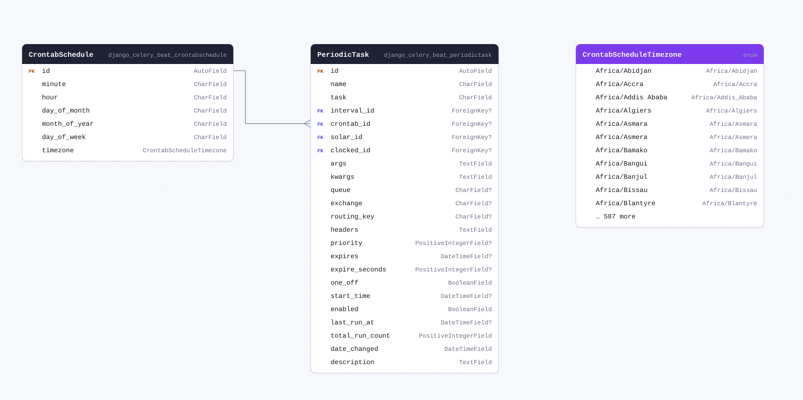

| Column | Field | Type | Null | Key | Default | Description |
| --- | --- | --- | --- | --- | --- | --- |
| `id` | `AutoField` | `integer` |  | PK | `autoincrement()` |  |
| `minute` | `CharField` | `varchar(240)` |  |  | `'*'` | Cron Minutes to Run. Use "*" for "all". (Example: "0,30") |
| `hour` | `CharField` | `varchar(96)` |  |  | `'*'` | Cron Hours to Run. Use "*" for "all". (Example: "8,20") |
| `day_of_month` | `CharField` | `varchar(124)` |  |  | `'*'` | Cron Days Of The Month to Run. Use "*" for "all". (Example: "1,15") |
| `month_of_year` | `CharField` | `varchar(64)` |  |  | `'*'` | Cron Months (1-12) Of The Year to Run. Use "*" for "all". (Example: "1,12") |
| `day_of_week` | `CharField` | `varchar(64)` |  |  | `'*'` | Cron Days Of The Week to Run. Use "*" for "all", Sunday is 0 or 7, Monday is 1. (Example: "0,5") |
| `timezone` | `CrontabScheduleTimezone` | `varchar(63)` |  |  | `crontab_schedule_celery_timezone()` | Timezone to Run the Cron Schedule on. Default is UTC. |

Relations:

- [PeriodicTask](#periodictask).`crontab_id` → `id`, on delete cascade

## PeriodicTasks

Table `django_celery_beat_periodictasks`, app `django_celery_beat`.

Helper table for tracking updates to periodic tasks.

This stores a single row with ``ident=1``. ``last_update`` is updated via
signals whenever anything changes in the :class:`~.PeriodicTask` model.
Basically this acts like a DB data audit trigger.
Doing this so we also track deletions, and not just insert/update.

| Column | Field | Type | Null | Key | Default | Description |
| --- | --- | --- | --- | --- | --- | --- |
| `ident` | `SmallIntegerField` | `smallint` |  | PK | `1` |  |
| `last_update` | `DateTimeField` | `datetime` |  |  |  |  |

## PeriodicTask

Table `django_celery_beat_periodictask`, app `django_celery_beat`.

Model representing a periodic task.

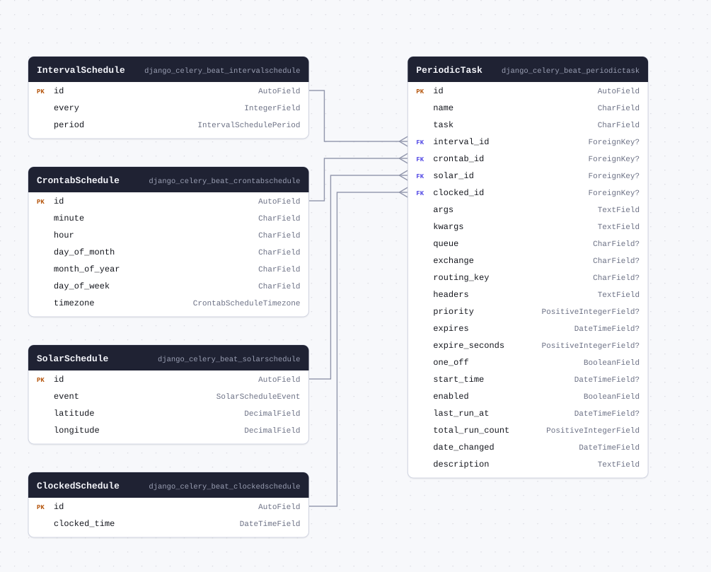

| Column | Field | Type | Null | Key | Default | Description |
| --- | --- | --- | --- | --- | --- | --- |
| `id` | `AutoField` | `integer` |  | PK | `autoincrement()` |  |
| `name` | `CharField` | `varchar(200)` |  | unique |  | Short Description For This Task |
| `task` | `CharField` | `varchar(200)` |  |  |  | The Name of the Celery Task that Should be Run.  (Example: "proj.tasks.import_contacts") |
| `interval_id` | `ForeignKey` | `integer` | yes | FK |  | Interval Schedule to run the task on.  Set only one schedule type, leave the others null. |
| `crontab_id` | `ForeignKey` | `integer` | yes | FK |  | Crontab Schedule to run the task on.  Set only one schedule type, leave the others null. |
| `solar_id` | `ForeignKey` | `integer` | yes | FK |  | Solar Schedule to run the task on.  Set only one schedule type, leave the others null. |
| `clocked_id` | `ForeignKey` | `integer` | yes | FK |  | Clocked Schedule to run the task on.  Set only one schedule type, leave the others null. |
| `args` | `TextField` | `text` |  |  | `'[]'` | JSON encoded positional arguments (Example: ["arg1", "arg2"]) |
| `kwargs` | `TextField` | `text` |  |  | `'{}'` | JSON encoded keyword arguments (Example: {"argument": "value"}) |
| `queue` | `CharField` | `varchar(200)` | yes |  | `None` | Queue defined in CELERY_TASK_QUEUES. Leave None for default queuing. |
| `exchange` | `CharField` | `varchar(200)` | yes |  | `None` | Override Exchange for low-level AMQP routing |
| `routing_key` | `CharField` | `varchar(200)` | yes |  | `None` | Override Routing Key for low-level AMQP routing |
| `headers` | `TextField` | `text` |  |  | `'{}'` | JSON encoded message headers for the AMQP message. |
| `priority` | `PositiveIntegerField` | `integer unsigned` | yes |  | `None` | Priority Number between 0 and 255. Supported by: RabbitMQ, Redis (priority reversed, 0 is highest). |
| `expires` | `DateTimeField` | `datetime` | yes |  |  | Datetime after which the schedule will no longer trigger the task to run |
| `expire_seconds` | `PositiveIntegerField` | `integer unsigned` | yes |  |  | Timedelta with seconds which the schedule will no longer trigger the task to run |
| `one_off` | `BooleanField` | `bool` |  |  | `False` | If True, the schedule will only run the task a single time |
| `start_time` | `DateTimeField` | `datetime` | yes |  |  | Datetime when the schedule should begin triggering the task to run |
| `enabled` | `BooleanField` | `bool` |  |  | `True` | Set to False to disable the schedule |
| `last_run_at` | `DateTimeField` | `datetime` | yes |  |  | Datetime that the schedule last triggered the task to run. Reset to None if enabled is set to False. |
| `total_run_count` | `PositiveIntegerField` | `integer unsigned` |  |  | `0` | Running count of how many times the schedule has triggered the task |
| `date_changed` | `DateTimeField` | `datetime` |  |  | `now()` | Datetime that this PeriodicTask was last modified |
| `description` | `TextField` | `text` |  |  |  | Detailed description about the details of this Periodic Task |

Indexes:

- index `django_celery_beat_periodictask_interval_id_a8ca27da` on `interval_id`
- index `django_celery_beat_periodictask_crontab_id_d3cba168` on `crontab_id`
- index `django_celery_beat_periodictask_solar_id_a87ce72c` on `solar_id`
- index `django_celery_beat_periodictask_clocked_id_47a69f82` on `clocked_id`

Relations:

- `interval_id` → [IntervalSchedule](#intervalschedule).`id`, on delete cascade
- `crontab_id` → [CrontabSchedule](#crontabschedule).`id`, on delete cascade
- `solar_id` → [SolarSchedule](#solarschedule).`id`, on delete cascade
- `clocked_id` → [ClockedSchedule](#clockedschedule).`id`, on delete cascade

## Scope

Table `esi_scope`, app `esi`.

Represents an access scope granted by SSO.

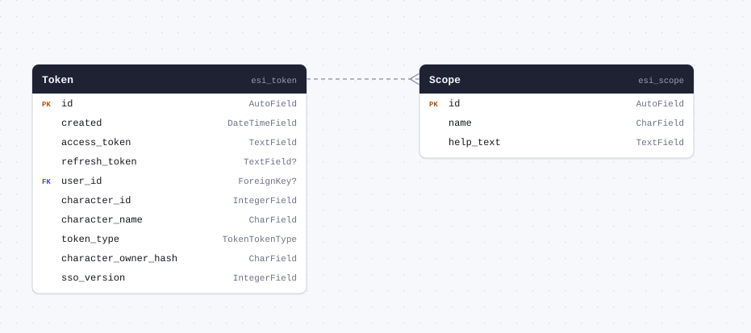

| Column | Field | Type | Null | Key | Default | Description |
| --- | --- | --- | --- | --- | --- | --- |
| `id` | `AutoField` | `integer` |  | PK | `autoincrement()` |  |
| `name` | `CharField` | `varchar(100)` |  | unique |  | The official EVE name for the scope. |
| `help_text` | `TextField` | `text` |  |  |  | The official EVE description of the scope. |

Relations:

- `token_set` — many to many with [Token](#token)

## Token

Table `esi_token`, app `esi`.

EVE Stable Interface Access Token

Contains information about the authenticating character
and scopes granted to this token.
Contains the access token required for ESI authentication as well as refreshing.

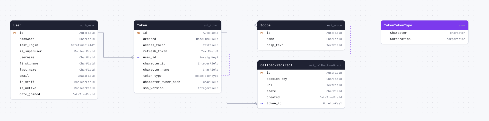

| Column | Field | Type | Null | Key | Default | Description |
| --- | --- | --- | --- | --- | --- | --- |
| `id` | `AutoField` | `integer` |  | PK | `autoincrement()` |  |
| `created` | `DateTimeField` | `datetime` |  |  | `now()` |  |
| `access_token` | `TextField` | `text` |  |  |  | The access token granted by SSO. |
| `refresh_token` | `TextField` | `text` | yes |  |  | A re-usable token to generate new access tokens upon expiry. |
| `user_id` | `ForeignKey` | `integer` | yes | FK |  | The user to whom this token belongs. |
| `character_id` | `IntegerField` | `integer` |  |  |  | The ID of the EVE character who authenticated by SSO. |
| `character_name` | `CharField` | `varchar(100)` |  |  |  | The name of the EVE character who authenticated by SSO. |
| `token_type` | `TokenTokenType` | `varchar(100)` |  |  | `'character'` | The applicable range of the token. |
| `character_owner_hash` | `CharField` | `varchar(254)` |  |  |  | The unique string identifying this character and its owning EVE account. Changes if the owning account changes. |
| `sso_version` | `IntegerField` | `integer` |  |  | `2` | EVE SSO Version. |

Indexes:

- index `esi_token_user_id_d21fe2e5` on `user_id`
- index `esi_token_character_id_9ab64ee5` on `character_id`
- index `esi_token_character_name_0a583806` on `character_name`
- index `esi_token_character_owner_hash_ad2c27b1` on `character_owner_hash`

Relations:

- `user_id` → [User](#user).`id`, on delete cascade
- `scopes` — many to many with [Scope](#scope)
- [CallbackRedirect](#callbackredirect).`token_id` → `id`, on delete cascade

## CallbackRedirect

Table `esi_callbackredirect`, app `esi`.

Records the intended destination for the SSO callback.
Used to internally redirect SSO callbacks.

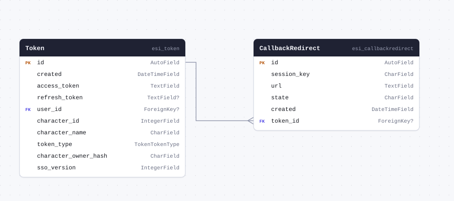

| Column | Field | Type | Null | Key | Default | Description |
| --- | --- | --- | --- | --- | --- | --- |
| `id` | `AutoField` | `integer` |  | PK | `autoincrement()` |  |
| `session_key` | `CharField` | `varchar(254)` |  | unique |  | Session key identifying the session this redirect was created for. |
| `url` | `TextField` | `text` |  |  | `'/'` | The internal URL to redirect this callback towards. |
| `state` | `CharField` | `varchar(128)` |  |  |  | OAuth2 state string representing this session. |
| `created` | `DateTimeField` | `datetime` |  |  | `now()` |  |
| `token_id` | `ForeignKey` | `integer` | yes | FK |  | Token generated by a completed code exchange from callback processing. |

Indexes:

- index `esi_callbackredirect_token_id_f9bd7843` on `token_id`

Relations:

- `token_id` → [Token](#token).`id`, on delete cascade

## ApplicationAnnouncement

Table `admin_status_applicationannouncement`, app `admin_status`.

Announcement originating from an application

| Column | Field | Type | Null | Key | Default | Description |
| --- | --- | --- | --- | --- | --- | --- |
| `id` | `AutoField` | `integer` |  | PK | `autoincrement()` |  |
| `application_name` | `CharField` | `varchar(50)` |  |  |  | Name of the application that issued the announcement |
| `announcement_number` | `IntegerField` | `integer` |  |  |  | Issue number on the notification source |
| `announcement_text` | `TextField` | `text` |  |  |  | Issue title text displayed on the dashboard |
| `announcement_url` | `TextField` | `text` |  |  |  |  |
| `announcement_hash` | `CharField` | `varchar(64)` |  | unique | `None` | hash of an announcement. |
| `hide_announcement` | `BooleanField` | `bool` |  |  | `False` | Set to true if the announcement should not be displayed on the dashboard |

Indexes:

- unique `functional_pk_applicationissuenumber` on `application_name`, `announcement_number`

## SoftwareVersion

Table `admin_status_softwareversion`, app `admin_status`.

Model to store the current version of the software.

| Column | Field | Type | Null | Key | Default | Description |
| --- | --- | --- | --- | --- | --- | --- |
| `id` | `AutoField` | `integer` |  | PK | `autoincrement()` |  |
| `latest_stable_version` | `CharField` | `varchar(20)` |  |  |  | Latest stable version of Alliance Auth |
| `latest_development_version` | `CharField` | `varchar(20)` |  |  |  | Latest development version of Alliance Auth |

## State

Table `authentication_state`, app `authentication`.

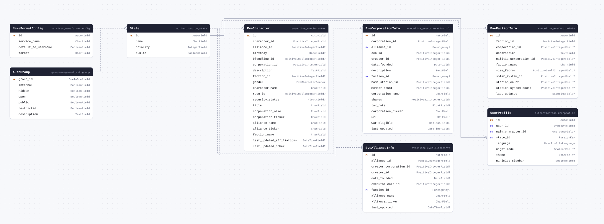

| Column | Field | Type | Null | Key | Default | Description |
| --- | --- | --- | --- | --- | --- | --- |
| `id` | `AutoField` | `integer` |  | PK | `autoincrement()` |  |
| `name` | `CharField` | `varchar(32)` |  | unique |  |  |
| `priority` | `IntegerField` | `integer` |  | unique |  | Users get assigned the state with the highest priority available to them. |
| `public` | `BooleanField` | `bool` |  |  | `False` | Make this state available to any character. |

Relations:

- `member_characters` — many to many with [EveCharacter](#evecharacter)
- `member_corporations` — many to many with [EveCorporationInfo](#evecorporationinfo)
- `member_alliances` — many to many with [EveAllianceInfo](#eveallianceinfo)
- `member_factions` — many to many with [EveFactionInfo](#evefactioninfo)
- [UserProfile](#userprofile).`state_id` → `id`, on delete set default
- `nameformatconfig_set` — many to many with [NameFormatConfig](#nameformatconfig)
- `valid_states` — many to many with [AuthGroup](#authgroup)

## UserProfile

Table `authentication_userprofile`, app `authentication`.

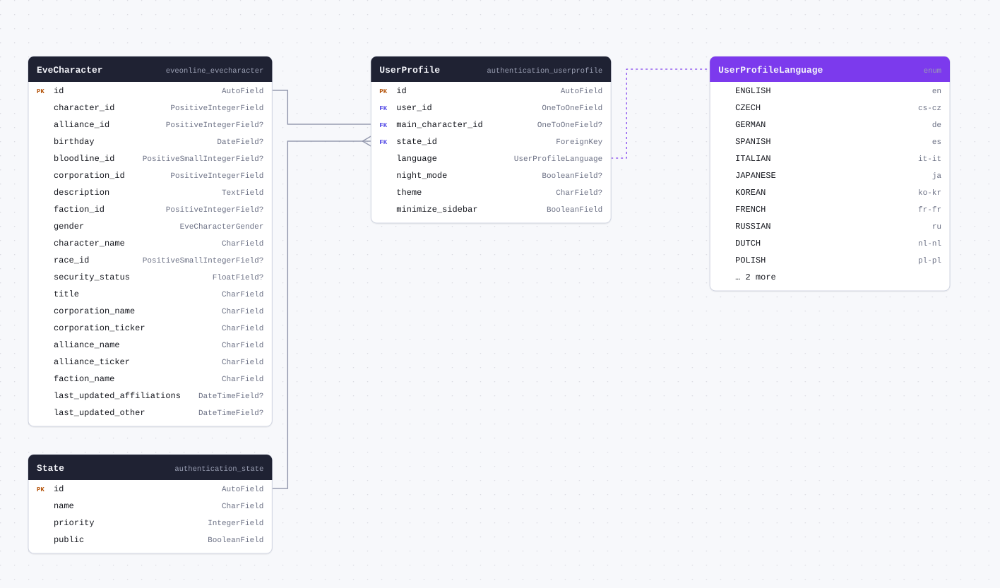

| Column | Field | Type | Null | Key | Default | Description |
| --- | --- | --- | --- | --- | --- | --- |
| `id` | `AutoField` | `integer` |  | PK | `autoincrement()` |  |
| `user_id` | `OneToOneField` | `integer` |  | FK, unique |  |  |
| `main_character_id` | `OneToOneField` | `integer` | yes | FK, unique |  |  |
| `state_id` | `ForeignKey` | `integer` |  | FK | `get_guest_state_pk()` |  |
| `language` | `UserProfileLanguage` | `varchar(10)` |  |  | `''` |  |
| `night_mode` | `BooleanField` | `bool` | yes |  |  |  |
| `theme` | `CharField` | `varchar(200)` | yes |  |  | Bootstrap 5 Themes from https://bootswatch.com/ or Community Apps |
| `minimize_sidebar` | `BooleanField` | `bool` |  |  | `False` | Keep the sidebar menu minimized |

Indexes:

- index `authentication_userprofile_state_id_58242e4a` on `state_id`

Relations:

- `main_character_id` → [EveCharacter](#evecharacter).`id`, on delete set null
- `state_id` → [State](#state).`id`, on delete set default

## CharacterOwnership

Table `authentication_characterownership`, app `authentication`.

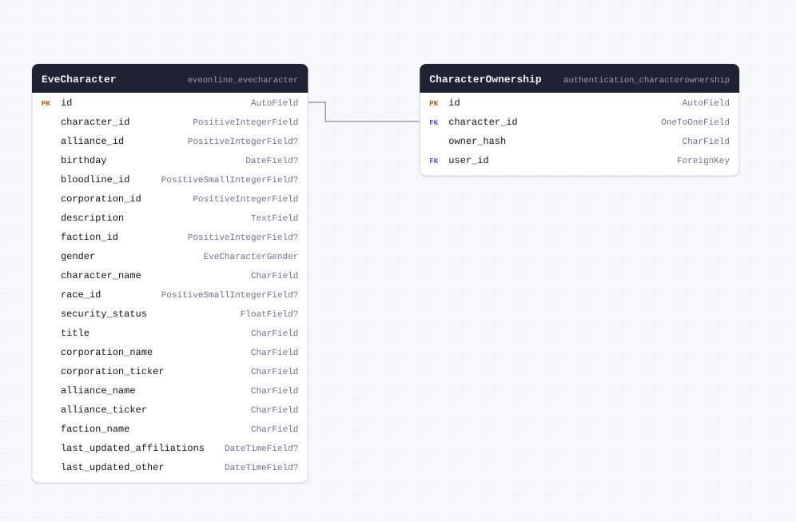

| Column | Field | Type | Null | Key | Default | Description |
| --- | --- | --- | --- | --- | --- | --- |
| `id` | `AutoField` | `integer` |  | PK | `autoincrement()` |  |
| `character_id` | `OneToOneField` | `integer` |  | FK, unique |  |  |
| `owner_hash` | `CharField` | `varchar(28)` |  | unique |  |  |
| `user_id` | `ForeignKey` | `integer` |  | FK |  |  |

Indexes:

- index `authentication_characterownership_user_id_8c48225e` on `user_id`

Relations:

- `character_id` → [EveCharacter](#evecharacter).`id`, on delete cascade

## OwnershipRecord

Table `authentication_ownershiprecord`, app `authentication`.

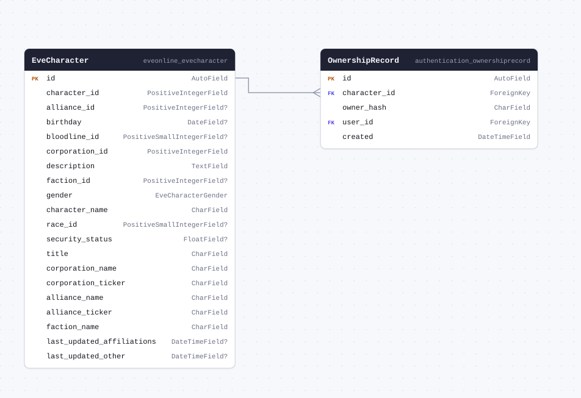

| Column | Field | Type | Null | Key | Default | Description |
| --- | --- | --- | --- | --- | --- | --- |
| `id` | `AutoField` | `integer` |  | PK | `autoincrement()` |  |
| `character_id` | `ForeignKey` | `integer` |  | FK |  |  |
| `owner_hash` | `CharField` | `varchar(28)` |  |  |  |  |
| `user_id` | `ForeignKey` | `integer` |  | FK |  |  |
| `created` | `DateTimeField` | `datetime` |  |  | `now()` |  |

Indexes:

- index `authentication_ownershiprecord_character_id_ebc8f5f4` on `character_id`
- index `authentication_ownershiprecord_owner_hash_9db96660` on `owner_hash`
- index `authentication_ownershiprecord_user_id_1f926981` on `user_id`

Relations:

- `character_id` → [EveCharacter](#evecharacter).`id`, on delete cascade

## NameFormatConfig

Table `services_nameformatconfig`, app `services`.

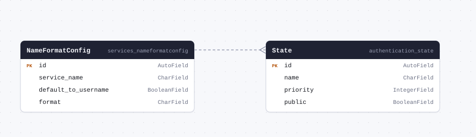

| Column | Field | Type | Null | Key | Default | Description |
| --- | --- | --- | --- | --- | --- | --- |
| `id` | `AutoField` | `integer` |  | PK | `autoincrement()` |  |
| `service_name` | `CharField` | `varchar(100)` |  |  |  |  |
| `default_to_username` | `BooleanField` | `bool` |  |  | `True` | If a user has no main_character, default to using their Auth username instead. |
| `format` | `CharField` | `varchar(100)` |  |  |  | For information on constructing name formats please see the official documentation, topic "Services Name Formats". |

Relations:

- `states` — many to many with [State](#state)

## EveFactionInfo

Table `eveonline_evefactioninfo`, app `eveonline`.

A faction in Eve Online.

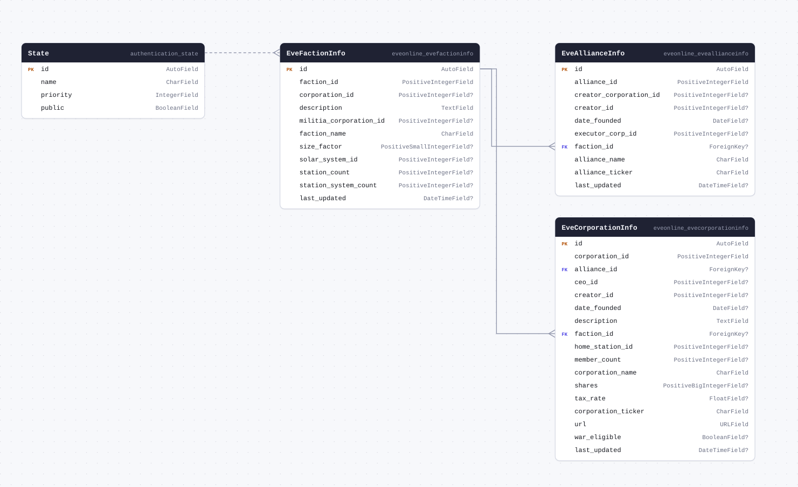

| Column | Field | Type | Null | Key | Default | Description |
| --- | --- | --- | --- | --- | --- | --- |
| `id` | `AutoField` | `integer` |  | PK | `autoincrement()` |  |
| `faction_id` | `PositiveIntegerField` | `integer unsigned` |  | unique |  |  |
| `corporation_id` | `PositiveIntegerField` | `integer unsigned` | yes | unique |  |  |
| `description` | `TextField` | `text` |  |  | `''` |  |
| `militia_corporation_id` | `PositiveIntegerField` | `integer unsigned` | yes | unique |  |  |
| `faction_name` | `CharField` | `varchar(254)` |  | unique |  |  |
| `size_factor` | `PositiveSmallIntegerField` | `smallint unsigned` | yes |  | `None` |  |
| `solar_system_id` | `PositiveIntegerField` | `integer unsigned` | yes |  | `None` |  |
| `station_count` | `PositiveIntegerField` | `integer unsigned` | yes |  | `None` |  |
| `station_system_count` | `PositiveIntegerField` | `integer unsigned` | yes |  | `None` |  |
| `last_updated` | `DateTimeField` | `datetime` | yes |  | `None` | Last time the faction's details were updated, (GetUniverseFactions), 24 hr Cache |

Indexes:

- index `eveonline_e_corpora_213c26_idx` on `corporation_id`
- index `eveonline_e_militia_a5231e_idx` on `militia_corporation_id`
- index `eveonline_e_faction_f02be0_idx` on `faction_name`

Relations:

- `state_set` — many to many with [State](#state)
- [EveAllianceInfo](#eveallianceinfo).`faction_id` → `id`, on delete set null
- [EveCorporationInfo](#evecorporationinfo).`faction_id` → `id`, on delete set null

## EveAllianceInfo

Table `eveonline_eveallianceinfo`, app `eveonline`.

An alliance in Eve Online.

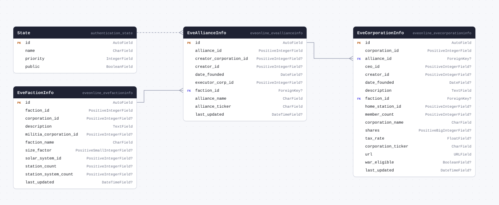

| Column | Field | Type | Null | Key | Default | Description |
| --- | --- | --- | --- | --- | --- | --- |
| `id` | `AutoField` | `integer` |  | PK | `autoincrement()` |  |
| `alliance_id` | `PositiveIntegerField` | `integer unsigned` |  | unique |  |  |
| `creator_corporation_id` | `PositiveIntegerField` | `integer unsigned` | yes |  | `None` | Alliance's creator corporation ID |
| `creator_id` | `PositiveIntegerField` | `integer unsigned` | yes |  | `None` | Alliance's creator ID |
| `date_founded` | `DateField` | `date` | yes |  | `None` | Alliance's founding date |
| `executor_corp_id` | `PositiveIntegerField` | `integer unsigned` | yes |  | `None` | Alliance's executor corporation ID |
| `faction_id` | `ForeignKey` | `integer` | yes | FK | `None` | Alliance's faction ID |
| `alliance_name` | `CharField` | `varchar(254)` |  |  |  | Alliance's name |
| `alliance_ticker` | `CharField` | `varchar(254)` |  |  |  | Alliance's ticker |
| `last_updated` | `DateTimeField` | `datetime` | yes |  | `None` | Last time the alliance's details were updated, (GetAlliancesAllianceId), 1 hr Cache |

Indexes:

- index `eveonline_eveallianceinfo_faction_id_f7b1fbad` on `faction_id`
- index `eveonline_e_creator_323b45_idx` on `creator_corporation_id`
- index `eveonline_e_allianc_d2b09d_idx` on `alliance_name`
- index `eveonline_e_executo_7f3280_idx` on `executor_corp_id`

Relations:

- `state_set` — many to many with [State](#state)
- `faction_id` → [EveFactionInfo](#evefactioninfo).`id`, on delete set null
- [EveCorporationInfo](#evecorporationinfo).`alliance_id` → `id`, on delete set null

## EveCorporationInfo

Table `eveonline_evecorporationinfo`, app `eveonline`.

A corporation in Eve Online.

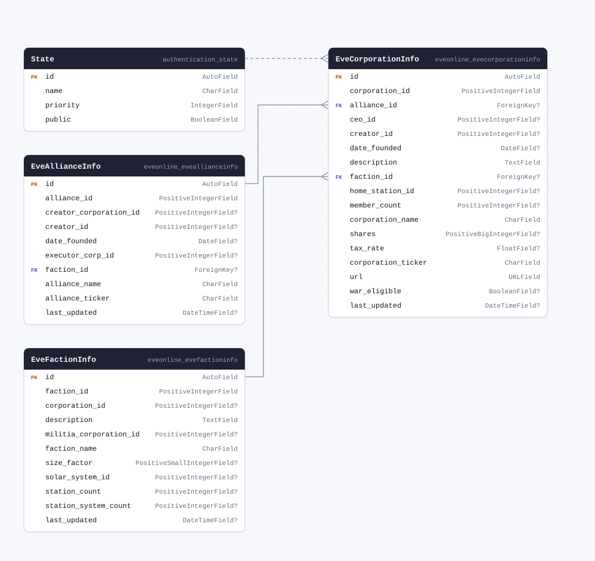

| Column | Field | Type | Null | Key | Default | Description |
| --- | --- | --- | --- | --- | --- | --- |
| `id` | `AutoField` | `integer` |  | PK | `autoincrement()` |  |
| `corporation_id` | `PositiveIntegerField` | `integer unsigned` |  | unique |  |  |
| `alliance_id` | `ForeignKey` | `integer` | yes | FK |  |  |
| `ceo_id` | `PositiveIntegerField` | `integer unsigned` | yes |  | `None` | Corporation's CEO ID |
| `creator_id` | `PositiveIntegerField` | `integer unsigned` | yes |  | `None` | Corporation's creator ID |
| `date_founded` | `DateField` | `date` | yes |  | `None` | Corporation's founding date |
| `description` | `TextField` | `text` |  |  | `''` | Corporation's description |
| `faction_id` | `ForeignKey` | `integer` | yes | FK |  |  |
| `home_station_id` | `PositiveIntegerField` | `integer unsigned` | yes |  | `None` | Corporation's home station ID |
| `member_count` | `PositiveIntegerField` | `integer unsigned` | yes |  | `None` | Corporation's member count |
| `corporation_name` | `CharField` | `varchar(254)` |  |  |  | Corporation's name |
| `shares` | `PositiveBigIntegerField` | `bigint unsigned` | yes |  | `None` | Corporation's shares |
| `tax_rate` | `FloatField` | `real` | yes |  | `None` | Corporation's tax rate |
| `corporation_ticker` | `CharField` | `varchar(254)` |  |  |  | Corporation's short name |
| `url` | `URLField` | `varchar(2048)` |  |  | `''` | Corporation's URL |
| `war_eligible` | `BooleanField` | `bool` | yes |  | `None` | Corporation's war eligibility |
| `last_updated` | `DateTimeField` | `datetime` | yes |  | `None` | Last time the corporation's details were updated, (GetCorporationsCorporationId), 1 hr Cache |

Indexes:

- index `eveonline_evecorporationinfo_alliance_id_9438172d` on `alliance_id`
- index `eveonline_evecorporationinfo_faction_id_c41ff1b6` on `faction_id`
- index `eveonline_e_ceo_id_eea7b8_idx` on `ceo_id`
- index `eveonline_e_corpora_650e9a_idx` on `corporation_name`

Relations:

- `state_set` — many to many with [State](#state)
- `alliance_id` → [EveAllianceInfo](#eveallianceinfo).`id`, on delete set null
- `faction_id` → [EveFactionInfo](#evefactioninfo).`id`, on delete set null

## EveCharacter

Table `eveonline_evecharacter`, app `eveonline`.

A character in Eve Online.

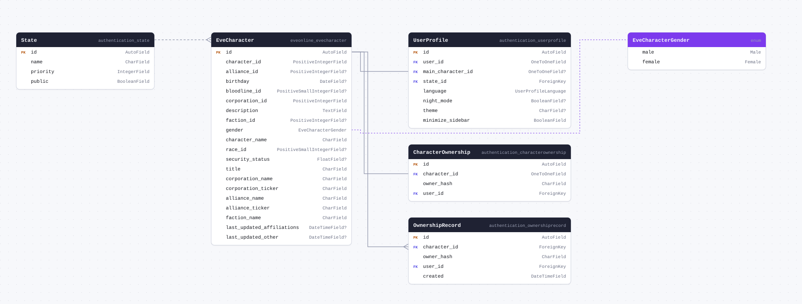

| Column | Field | Type | Null | Key | Default | Description |
| --- | --- | --- | --- | --- | --- | --- |
| `id` | `AutoField` | `integer` |  | PK | `autoincrement()` |  |
| `character_id` | `PositiveIntegerField` | `integer unsigned` |  | unique |  |  |
| `alliance_id` | `PositiveIntegerField` | `integer unsigned` | yes |  | `None` | Character's alliance ID |
| `birthday` | `DateField` | `date` | yes |  | `None` | Character's creation date |
| `bloodline_id` | `PositiveSmallIntegerField` | `smallint unsigned` | yes |  | `None` | Character's bloodline ID |
| `corporation_id` | `PositiveIntegerField` | `integer unsigned` |  |  | `1000001` | Character's corporation ID |
| `description` | `TextField` | `text` |  |  | `''` | Character's description (biography) |
| `faction_id` | `PositiveIntegerField` | `integer unsigned` | yes |  | `None` | Character's faction ID |
| `gender` | `EveCharacterGender` | `varchar(10)` |  |  | `''` | Character's gender |
| `character_name` | `CharField` | `varchar(254)` |  |  |  | Character's name |
| `race_id` | `PositiveSmallIntegerField` | `smallint unsigned` | yes |  | `None` | Character's race ID |
| `security_status` | `FloatField` | `real` | yes |  | `0.0` | Character's security status |
| `title` | `CharField` | `varchar(254)` |  |  | `''` | Character's title |
| `corporation_name` | `CharField` | `varchar(254)` |  |  | `''` |  |
| `corporation_ticker` | `CharField` | `varchar(5)` |  |  | `''` |  |
| `alliance_name` | `CharField` | `varchar(254)` |  |  | `''` |  |
| `alliance_ticker` | `CharField` | `varchar(5)` |  |  | `''` |  |
| `faction_name` | `CharField` | `varchar(254)` |  |  | `''` |  |
| `last_updated_affiliations` | `DateTimeField` | `datetime` | yes |  | `None` | Last time the character's affiliations were updated (PostCharactersAffiliation, 1 hr Cache) |
| `last_updated_other` | `DateTimeField` | `datetime` | yes |  | `None` | Last time the character's details were updated, (GetCharactersCharacterId), 24 hr Cache |

Indexes:

- index `eveonline_e_charact_d47325_idx` on `character_name`
- index `eveonline_e_corpora_cb4cd9_idx` on `corporation_id`
- index `eveonline_e_allianc_39ee2a_idx` on `alliance_id`
- index `eveonline_e_corpora_893c60_idx` on `corporation_name`
- index `eveonline_e_allianc_63fd98_idx` on `alliance_name`
- index `eveonline_e_faction_d5274e_idx` on `faction_id`

Relations:

- `state_set` — many to many with [State](#state)
- [UserProfile](#userprofile).`main_character_id` → `id`, on delete set null
- [CharacterOwnership](#characterownership).`character_id` → `id`, on delete cascade
- [OwnershipRecord](#ownershiprecord).`character_id` → `id`, on delete cascade

## GroupRequest

Table `groupmanagement_grouprequest`, app `groupmanagement`.

Request from a user for joining or leaving a group.

| Column | Field | Type | Null | Key | Default | Description |
| --- | --- | --- | --- | --- | --- | --- |
| `id` | `AutoField` | `integer` |  | PK | `autoincrement()` |  |
| `leave_request` | `BooleanField` | `bool` |  |  | `False` |  |
| `user_id` | `ForeignKey` | `integer` |  | FK |  |  |
| `group_id` | `ForeignKey` | `integer` |  | FK |  |  |

Indexes:

- index `groupmanagement_grouprequest_user_id_0984b897` on `user_id`
- index `groupmanagement_grouprequest_group_id_8e36ff92` on `group_id`

## RequestLog

Table `groupmanagement_requestlog`, app `groupmanagement`.

Log entry about who joined and left a group and who approved it.

| Column | Field | Type | Null | Key | Default | Description |
| --- | --- | --- | --- | --- | --- | --- |
| `id` | `AutoField` | `integer` |  | PK | `autoincrement()` |  |
| `request_type` | `RequestLogType` | `varchar(6)` |  |  | `'remove'` |  |
| `group_id` | `ForeignKey` | `integer` |  | FK |  |  |
| `action` | `RequestLogAction` | `varchar(6)` |  |  | `'remove'` |  |
| `request_actor_id` | `ForeignKey` | `integer` |  | FK |  |  |
| `requestor_id` | `ForeignKey` | `integer` | yes | FK |  |  |
| `date` | `DateTimeField` | `datetime` |  |  | `now()` |  |

Indexes:

- index `groupmanagement_requestlog_group_id_0be2a758` on `group_id`
- index `groupmanagement_requestlog_request_actor_id_98406921` on `request_actor_id`
- index `groupmanagement_requestlog_requestor_id_d2df2a76` on `requestor_id`

## AuthGroup

Table `groupmanagement_authgroup`, app `groupmanagement`.

Extends Django Group model with a one-to-one field
Attributes are accessible via group as if they were in the model
e.g. group.authgroup.internal

Logic:
Internal - not requestable by users, at all. Covers Corp_, Alliance_,
Members etc groups. Groups are internal by default

Public - Other options are respected, but any user will be able to become
and remain a member, even if they have no API etc entered.
Auth will not manage these groups automatically so user removal is up to
group managers/leaders.

Not Internal and:
    Hidden - users cannot view, can request if they have the direct link.
    Not Hidden - Users can view and request the group
    Open - Users are automatically accepted into the group
    Not Open - Users requests must be approved before they are added to the group

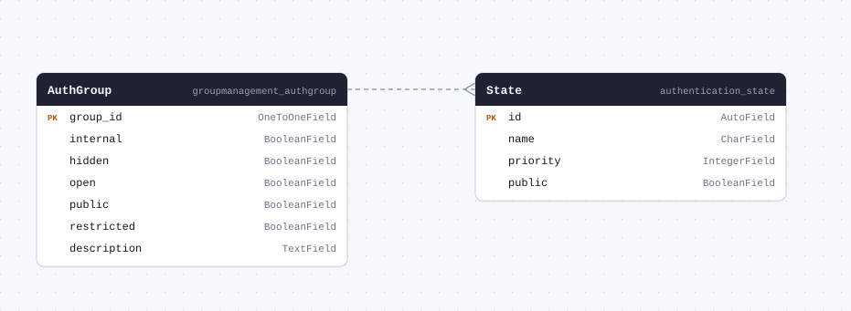

| Column | Field | Type | Null | Key | Default | Description |
| --- | --- | --- | --- | --- | --- | --- |
| `group_id` | `OneToOneField` | `integer` |  | PK, FK |  |  |
| `internal` | `BooleanField` | `bool` |  |  | `True` | Internal group, users cannot see, join or request to join this group.<br>Used for groups such as Members, Corp_*, Alliance_* etc.<br><b>Overrides Hidden and Open options when selected.</b> |
| `hidden` | `BooleanField` | `bool` |  |  | `True` | Group is hidden from users but can still join with the correct link. |
| `open` | `BooleanField` | `bool` |  |  | `False` | Group is open and users will be automatically added upon request.<br>If the group is not open users will need their request manually approved. |
| `public` | `BooleanField` | `bool` |  |  | `False` | Group is public. Any registered user is able to join this group, with visibility based on the other options set for this group.<br>Auth will not remove users from this group automatically when they are no longer authenticated. |
| `restricted` | `BooleanField` | `bool` |  |  | `False` | Group is restricted. This means that adding or removing users for this group requires a superuser admin. |
| `description` | `TextField` | `text` |  |  |  | Short description <i>(max. 512 characters)</i> of the group shown to users. |

Relations:

- `states` — many to many with [State](#state)

## ReservedGroupName

Table `groupmanagement_reservedgroupname`, app `groupmanagement`.

Name that can not be used for groups.

This enables AA to ignore groups on other services (e.g. Discord) with that name.

| Column | Field | Type | Null | Key | Default | Description |
| --- | --- | --- | --- | --- | --- | --- |
| `id` | `AutoField` | `integer` |  | PK | `autoincrement()` |  |
| `name` | `CharField` | `varchar(150)` |  | unique |  | Name that can not be used for groups. |
| `reason` | `TextField` | `text` |  |  |  | Reason why this name is reserved. |
| `created_by` | `CharField` | `varchar(255)` |  |  |  | Name of the user who created this entry. |
| `created_at` | `DateTimeField` | `datetime` |  |  | `now()` | Date when this entry was created |

## Notification

Table `notifications_notification`, app `notifications`.

Notification to a user within Auth

| Column | Field | Type | Null | Key | Default | Description |
| --- | --- | --- | --- | --- | --- | --- |
| `id` | `AutoField` | `integer` |  | PK | `autoincrement()` |  |
| `user_id` | `ForeignKey` | `integer` |  | FK |  |  |
| `level` | `NotificationLevel` | `varchar(10)` |  |  | `'info'` |  |
| `title` | `CharField` | `varchar(254)` |  |  |  |  |
| `message` | `TextField` | `text` |  |  |  |  |
| `timestamp` | `DateTimeField` | `datetime` |  |  | `now()` |  |
| `viewed` | `BooleanField` | `bool` |  |  | `False` |  |

Indexes:

- index `notifications_notification_user_id_b5e8c0ff` on `user_id`
- index `notifications_notification_timestamp_6a797bad` on `timestamp`
- index `notifications_notification_viewed_92b34c27` on `viewed`

## AnalyticsIdentifier

Table `analytics_analyticsidentifier`, app `analytics`.

| Column | Field | Type | Null | Key | Default | Description |
| --- | --- | --- | --- | --- | --- | --- |
| `id` | `AutoField` | `integer` |  | PK | `autoincrement()` |  |
| `identifier` | `UUIDField` | `char(32)` |  |  | `uuid4()` |  |

## AnalyticsTokens

Table `analytics_analyticstokens`, app `analytics`.

| Column | Field | Type | Null | Key | Default | Description |
| --- | --- | --- | --- | --- | --- | --- |
| `id` | `AutoField` | `integer` |  | PK | `autoincrement()` |  |
| `name` | `CharField` | `varchar(254)` |  |  |  |  |
| `type` | `AnalyticsTokensAnalyticsType` | `varchar(254)` |  |  |  |  |
| `token` | `CharField` | `varchar(254)` |  |  |  |  |
| `secret` | `CharField` | `varchar(254)` |  |  |  |  |
| `send_stats` | `BooleanField` | `bool` |  |  | `False` |  |

## MenuItem

Table `menu_menuitem`, app `menu`.

An item in the sidebar menu.

Some of these objects are generated from `MenuItemHook` objects.
To avoid confusion we are using the same same field names.user defined

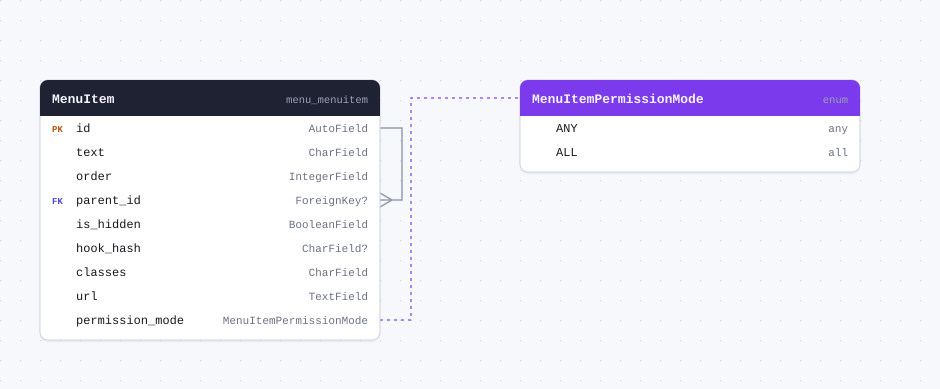

| Column | Field | Type | Null | Key | Default | Description |
| --- | --- | --- | --- | --- | --- | --- |
| `id` | `AutoField` | `integer` |  | PK | `autoincrement()` |  |
| `text` | `CharField` | `varchar(150)` |  |  |  | Text to show on menu |
| `order` | `IntegerField` | `integer` |  |  | `9999` | Order of the menu. Lowest First |
| `parent_id` | `ForeignKey` | `integer` | yes | FK | `None` | Folder this item is in (optional) |
| `is_hidden` | `BooleanField` | `bool` |  |  | `False` | Hide this menu item.If this item is a folder all items under it will be hidden too |
| `hook_hash` | `CharField` | `varchar(64)` | yes | unique | `None` | hash of a menu item hook. Must be nullable for unique comparison. |
| `classes` | `CharField` | `varchar(150)` |  |  | `''` | Font Awesome classes to show as icon on menu, e.g. <code>fa-solid fa-house</code> |
| `url` | `TextField` | `text` |  |  | `''` | External URL this menu items will link to |
| `permission_mode` | `MenuItemPermissionMode` | `varchar(3)` |  |  | `'any'` | Whether a user needs any or all of the assigned permissions to see this menu item. |

Indexes:

- index `menu_menuitem_text_64fb7ef2` on `text`
- index `menu_menuitem_order_f75ef4f7` on `order`
- index `menu_menuitem_parent_id_439f55a5` on `parent_id`

Relations:

- `parent_id` → [MenuItem](#menuitem).`id`, on delete set null

## CustomCSS

Table `custom_css_customcss`, app `custom_css`.

Model for storing custom CSS for the site

| Column | Field | Type | Null | Key | Default | Description |
| --- | --- | --- | --- | --- | --- | --- |
| `id` | `AutoField` | `integer` |  | PK | `autoincrement()` |  |
| `css` | `TextField` | `text` |  |  | `''` | This CSS will be added to the site after the default CSS. |
| `css_compressed` | `TextField` | `text` | yes |  |  | This field is automatically generated and should not be edited. |
| `timestamp` | `DateTimeField` | `datetime` |  |  | `now()` |  |

## CronOffset

Table `crontab_cronoffset`, app `crontab`.

| Column | Field | Type | Null | Key | Default | Description |
| --- | --- | --- | --- | --- | --- | --- |
| `id` | `AutoField` | `integer` |  | PK | `autoincrement()` |  |
| `minute` | `FloatField` | `real` |  |  | `random_default()` |  |
| `hour` | `FloatField` | `real` |  |  | `random_default()` |  |
| `day_of_month` | `FloatField` | `real` |  |  | `random_default()` |  |
| `month_of_year` | `FloatField` | `real` |  |  | `random_default()` |  |
| `day_of_week` | `FloatField` | `real` |  |  | `random_default()` |  |

# Enums

## LogEntryActionFlag

| Name | Stored as |
| --- | --- |
| `Addition` | `1` |
| `Change` | `2` |
| `Deletion` | `3` |

## SolarScheduleEvent

| Name | Stored as |
| --- | --- |
| `Astronomical dawn` | `dawn_astronomical` |
| `Civil dawn` | `dawn_civil` |
| `Nautical dawn` | `dawn_nautical` |
| `Astronomical dusk` | `dusk_astronomical` |
| `Civil dusk` | `dusk_civil` |
| `Nautical dusk` | `dusk_nautical` |
| `Solar noon` | `solar_noon` |
| `Sunrise` | `sunrise` |
| `Sunset` | `sunset` |

## IntervalSchedulePeriod

| Name | Stored as |
| --- | --- |
| `Days` | `days` |
| `Hours` | `hours` |
| `Minutes` | `minutes` |
| `Seconds` | `seconds` |
| `Microseconds` | `microseconds` |

## CrontabScheduleTimezone

| Name | Stored as |
| --- | --- |
| `Africa/Abidjan` | `Africa/Abidjan` |
| `Africa/Accra` | `Africa/Accra` |
| `Africa/Addis Ababa` | `Africa/Addis_Ababa` |
| `Africa/Algiers` | `Africa/Algiers` |
| `Africa/Asmara` | `Africa/Asmara` |
| `Africa/Asmera` | `Africa/Asmera` |
| `Africa/Bamako` | `Africa/Bamako` |
| `Africa/Bangui` | `Africa/Bangui` |
| `Africa/Banjul` | `Africa/Banjul` |
| `Africa/Bissau` | `Africa/Bissau` |
| `Africa/Blantyre` | `Africa/Blantyre` |
| `Africa/Brazzaville` | `Africa/Brazzaville` |
| `Africa/Bujumbura` | `Africa/Bujumbura` |
| `Africa/Cairo` | `Africa/Cairo` |
| `Africa/Casablanca` | `Africa/Casablanca` |
| `Africa/Ceuta` | `Africa/Ceuta` |
| `Africa/Conakry` | `Africa/Conakry` |
| `Africa/Dakar` | `Africa/Dakar` |
| `Africa/Dar es Salaam` | `Africa/Dar_es_Salaam` |
| `Africa/Djibouti` | `Africa/Djibouti` |
| `Africa/Douala` | `Africa/Douala` |
| `Africa/El Aaiun` | `Africa/El_Aaiun` |
| `Africa/Freetown` | `Africa/Freetown` |
| `Africa/Gaborone` | `Africa/Gaborone` |
| `Africa/Harare` | `Africa/Harare` |
| `Africa/Johannesburg` | `Africa/Johannesburg` |
| `Africa/Juba` | `Africa/Juba` |
| `Africa/Kampala` | `Africa/Kampala` |
| `Africa/Khartoum` | `Africa/Khartoum` |
| `Africa/Kigali` | `Africa/Kigali` |
| `Africa/Kinshasa` | `Africa/Kinshasa` |
| `Africa/Lagos` | `Africa/Lagos` |
| `Africa/Libreville` | `Africa/Libreville` |
| `Africa/Lome` | `Africa/Lome` |
| `Africa/Luanda` | `Africa/Luanda` |
| `Africa/Lubumbashi` | `Africa/Lubumbashi` |
| `Africa/Lusaka` | `Africa/Lusaka` |
| `Africa/Malabo` | `Africa/Malabo` |
| `Africa/Maputo` | `Africa/Maputo` |
| `Africa/Maseru` | `Africa/Maseru` |
| `Africa/Mbabane` | `Africa/Mbabane` |
| `Africa/Mogadishu` | `Africa/Mogadishu` |
| `Africa/Monrovia` | `Africa/Monrovia` |
| `Africa/Nairobi` | `Africa/Nairobi` |
| `Africa/Ndjamena` | `Africa/Ndjamena` |
| `Africa/Niamey` | `Africa/Niamey` |
| `Africa/Nouakchott` | `Africa/Nouakchott` |
| `Africa/Ouagadougou` | `Africa/Ouagadougou` |
| `Africa/Porto-Novo` | `Africa/Porto-Novo` |
| `Africa/Sao Tome` | `Africa/Sao_Tome` |
| `Africa/Timbuktu` | `Africa/Timbuktu` |
| `Africa/Tripoli` | `Africa/Tripoli` |
| `Africa/Tunis` | `Africa/Tunis` |
| `Africa/Windhoek` | `Africa/Windhoek` |
| `America/Adak` | `America/Adak` |
| `America/Anchorage` | `America/Anchorage` |
| `America/Anguilla` | `America/Anguilla` |
| `America/Antigua` | `America/Antigua` |
| `America/Araguaina` | `America/Araguaina` |
| `America/Argentina/Buenos Aires` | `America/Argentina/Buenos_Aires` |
| `America/Argentina/Catamarca` | `America/Argentina/Catamarca` |
| `America/Argentina/ComodRivadavia` | `America/Argentina/ComodRivadavia` |
| `America/Argentina/Cordoba` | `America/Argentina/Cordoba` |
| `America/Argentina/Jujuy` | `America/Argentina/Jujuy` |
| `America/Argentina/La Rioja` | `America/Argentina/La_Rioja` |
| `America/Argentina/Mendoza` | `America/Argentina/Mendoza` |
| `America/Argentina/Rio Gallegos` | `America/Argentina/Rio_Gallegos` |
| `America/Argentina/Salta` | `America/Argentina/Salta` |
| `America/Argentina/San Juan` | `America/Argentina/San_Juan` |
| `America/Argentina/San Luis` | `America/Argentina/San_Luis` |
| `America/Argentina/Tucuman` | `America/Argentina/Tucuman` |
| `America/Argentina/Ushuaia` | `America/Argentina/Ushuaia` |
| `America/Aruba` | `America/Aruba` |
| `America/Asuncion` | `America/Asuncion` |
| `America/Atikokan` | `America/Atikokan` |
| `America/Atka` | `America/Atka` |
| `America/Bahia` | `America/Bahia` |
| `America/Bahia Banderas` | `America/Bahia_Banderas` |
| `America/Barbados` | `America/Barbados` |
| `America/Belem` | `America/Belem` |
| `America/Belize` | `America/Belize` |
| `America/Blanc-Sablon` | `America/Blanc-Sablon` |
| `America/Boa Vista` | `America/Boa_Vista` |
| `America/Bogota` | `America/Bogota` |
| `America/Boise` | `America/Boise` |
| `America/Buenos Aires` | `America/Buenos_Aires` |
| `America/Cambridge Bay` | `America/Cambridge_Bay` |
| `America/Campo Grande` | `America/Campo_Grande` |
| `America/Cancun` | `America/Cancun` |
| `America/Caracas` | `America/Caracas` |
| `America/Catamarca` | `America/Catamarca` |
| `America/Cayenne` | `America/Cayenne` |
| `America/Cayman` | `America/Cayman` |
| `America/Chicago` | `America/Chicago` |
| `America/Chihuahua` | `America/Chihuahua` |
| `America/Ciudad Juarez` | `America/Ciudad_Juarez` |
| `America/Coral Harbour` | `America/Coral_Harbour` |
| `America/Cordoba` | `America/Cordoba` |
| `America/Costa Rica` | `America/Costa_Rica` |
| `America/Coyhaique` | `America/Coyhaique` |
| `America/Creston` | `America/Creston` |
| `America/Cuiaba` | `America/Cuiaba` |
| `America/Curacao` | `America/Curacao` |
| `America/Danmarkshavn` | `America/Danmarkshavn` |
| `America/Dawson` | `America/Dawson` |
| `America/Dawson Creek` | `America/Dawson_Creek` |
| `America/Denver` | `America/Denver` |
| `America/Detroit` | `America/Detroit` |
| `America/Dominica` | `America/Dominica` |
| `America/Edmonton` | `America/Edmonton` |
| `America/Eirunepe` | `America/Eirunepe` |
| `America/El Salvador` | `America/El_Salvador` |
| `America/Ensenada` | `America/Ensenada` |
| `America/Fort Nelson` | `America/Fort_Nelson` |
| `America/Fort Wayne` | `America/Fort_Wayne` |
| `America/Fortaleza` | `America/Fortaleza` |
| `America/Glace Bay` | `America/Glace_Bay` |
| `America/Godthab` | `America/Godthab` |
| `America/Goose Bay` | `America/Goose_Bay` |
| `America/Grand Turk` | `America/Grand_Turk` |
| `America/Grenada` | `America/Grenada` |
| `America/Guadeloupe` | `America/Guadeloupe` |
| `America/Guatemala` | `America/Guatemala` |
| `America/Guayaquil` | `America/Guayaquil` |
| `America/Guyana` | `America/Guyana` |
| `America/Halifax` | `America/Halifax` |
| `America/Havana` | `America/Havana` |
| `America/Hermosillo` | `America/Hermosillo` |
| `America/Indiana/Indianapolis` | `America/Indiana/Indianapolis` |
| `America/Indiana/Knox` | `America/Indiana/Knox` |
| `America/Indiana/Marengo` | `America/Indiana/Marengo` |
| `America/Indiana/Petersburg` | `America/Indiana/Petersburg` |
| `America/Indiana/Tell City` | `America/Indiana/Tell_City` |
| `America/Indiana/Vevay` | `America/Indiana/Vevay` |
| `America/Indiana/Vincennes` | `America/Indiana/Vincennes` |
| `America/Indiana/Winamac` | `America/Indiana/Winamac` |
| `America/Indianapolis` | `America/Indianapolis` |
| `America/Inuvik` | `America/Inuvik` |
| `America/Iqaluit` | `America/Iqaluit` |
| `America/Jamaica` | `America/Jamaica` |
| `America/Jujuy` | `America/Jujuy` |
| `America/Juneau` | `America/Juneau` |
| `America/Kentucky/Louisville` | `America/Kentucky/Louisville` |
| `America/Kentucky/Monticello` | `America/Kentucky/Monticello` |
| `America/Knox IN` | `America/Knox_IN` |
| `America/Kralendijk` | `America/Kralendijk` |
| `America/La Paz` | `America/La_Paz` |
| `America/Lima` | `America/Lima` |
| `America/Los Angeles` | `America/Los_Angeles` |
| `America/Louisville` | `America/Louisville` |
| `America/Lower Princes` | `America/Lower_Princes` |
| `America/Maceio` | `America/Maceio` |
| `America/Managua` | `America/Managua` |
| `America/Manaus` | `America/Manaus` |
| `America/Marigot` | `America/Marigot` |
| `America/Martinique` | `America/Martinique` |
| `America/Matamoros` | `America/Matamoros` |
| `America/Mazatlan` | `America/Mazatlan` |
| `America/Mendoza` | `America/Mendoza` |
| `America/Menominee` | `America/Menominee` |
| `America/Merida` | `America/Merida` |
| `America/Metlakatla` | `America/Metlakatla` |
| `America/Mexico City` | `America/Mexico_City` |
| `America/Miquelon` | `America/Miquelon` |
| `America/Moncton` | `America/Moncton` |
| `America/Monterrey` | `America/Monterrey` |
| `America/Montevideo` | `America/Montevideo` |
| `America/Montreal` | `America/Montreal` |
| `America/Montserrat` | `America/Montserrat` |
| `America/Nassau` | `America/Nassau` |
| `America/New York` | `America/New_York` |
| `America/Nipigon` | `America/Nipigon` |
| `America/Nome` | `America/Nome` |
| `America/Noronha` | `America/Noronha` |
| `America/North Dakota/Beulah` | `America/North_Dakota/Beulah` |
| `America/North Dakota/Center` | `America/North_Dakota/Center` |
| `America/North Dakota/New Salem` | `America/North_Dakota/New_Salem` |
| `America/Nuuk` | `America/Nuuk` |
| `America/Ojinaga` | `America/Ojinaga` |
| `America/Panama` | `America/Panama` |
| `America/Pangnirtung` | `America/Pangnirtung` |
| `America/Paramaribo` | `America/Paramaribo` |
| `America/Phoenix` | `America/Phoenix` |
| `America/Port-au-Prince` | `America/Port-au-Prince` |
| `America/Port of Spain` | `America/Port_of_Spain` |
| `America/Porto Acre` | `America/Porto_Acre` |
| `America/Porto Velho` | `America/Porto_Velho` |
| `America/Puerto Rico` | `America/Puerto_Rico` |
| `America/Punta Arenas` | `America/Punta_Arenas` |
| `America/Rainy River` | `America/Rainy_River` |
| `America/Rankin Inlet` | `America/Rankin_Inlet` |
| `America/Recife` | `America/Recife` |
| `America/Regina` | `America/Regina` |
| `America/Resolute` | `America/Resolute` |
| `America/Rio Branco` | `America/Rio_Branco` |
| `America/Rosario` | `America/Rosario` |
| `America/Santa Isabel` | `America/Santa_Isabel` |
| `America/Santarem` | `America/Santarem` |
| `America/Santiago` | `America/Santiago` |
| `America/Santo Domingo` | `America/Santo_Domingo` |
| `America/Sao Paulo` | `America/Sao_Paulo` |
| `America/Scoresbysund` | `America/Scoresbysund` |
| `America/Shiprock` | `America/Shiprock` |
| `America/Sitka` | `America/Sitka` |
| `America/St Barthelemy` | `America/St_Barthelemy` |
| `America/St Johns` | `America/St_Johns` |
| `America/St Kitts` | `America/St_Kitts` |
| `America/St Lucia` | `America/St_Lucia` |
| `America/St Thomas` | `America/St_Thomas` |
| `America/St Vincent` | `America/St_Vincent` |
| `America/Swift Current` | `America/Swift_Current` |
| `America/Tegucigalpa` | `America/Tegucigalpa` |
| `America/Thule` | `America/Thule` |
| `America/Thunder Bay` | `America/Thunder_Bay` |
| `America/Tijuana` | `America/Tijuana` |
| `America/Toronto` | `America/Toronto` |
| `America/Tortola` | `America/Tortola` |
| `America/Vancouver` | `America/Vancouver` |
| `America/Virgin` | `America/Virgin` |
| `America/Whitehorse` | `America/Whitehorse` |
| `America/Winnipeg` | `America/Winnipeg` |
| `America/Yakutat` | `America/Yakutat` |
| `America/Yellowknife` | `America/Yellowknife` |
| `Antarctica/Casey` | `Antarctica/Casey` |
| `Antarctica/Davis` | `Antarctica/Davis` |
| `Antarctica/DumontDUrville` | `Antarctica/DumontDUrville` |
| `Antarctica/Macquarie` | `Antarctica/Macquarie` |
| `Antarctica/Mawson` | `Antarctica/Mawson` |
| `Antarctica/McMurdo` | `Antarctica/McMurdo` |
| `Antarctica/Palmer` | `Antarctica/Palmer` |
| `Antarctica/Rothera` | `Antarctica/Rothera` |
| `Antarctica/South Pole` | `Antarctica/South_Pole` |
| `Antarctica/Syowa` | `Antarctica/Syowa` |
| `Antarctica/Troll` | `Antarctica/Troll` |
| `Antarctica/Vostok` | `Antarctica/Vostok` |
| `Arctic/Longyearbyen` | `Arctic/Longyearbyen` |
| `Asia/Aden` | `Asia/Aden` |
| `Asia/Almaty` | `Asia/Almaty` |
| `Asia/Amman` | `Asia/Amman` |
| `Asia/Anadyr` | `Asia/Anadyr` |
| `Asia/Aqtau` | `Asia/Aqtau` |
| `Asia/Aqtobe` | `Asia/Aqtobe` |
| `Asia/Ashgabat` | `Asia/Ashgabat` |
| `Asia/Ashkhabad` | `Asia/Ashkhabad` |
| `Asia/Atyrau` | `Asia/Atyrau` |
| `Asia/Baghdad` | `Asia/Baghdad` |
| `Asia/Bahrain` | `Asia/Bahrain` |
| `Asia/Baku` | `Asia/Baku` |
| `Asia/Bangkok` | `Asia/Bangkok` |
| `Asia/Barnaul` | `Asia/Barnaul` |
| `Asia/Beirut` | `Asia/Beirut` |
| `Asia/Bishkek` | `Asia/Bishkek` |
| `Asia/Brunei` | `Asia/Brunei` |
| `Asia/Calcutta` | `Asia/Calcutta` |
| `Asia/Chita` | `Asia/Chita` |
| `Asia/Choibalsan` | `Asia/Choibalsan` |
| `Asia/Chongqing` | `Asia/Chongqing` |
| `Asia/Chungking` | `Asia/Chungking` |
| `Asia/Colombo` | `Asia/Colombo` |
| `Asia/Dacca` | `Asia/Dacca` |
| `Asia/Damascus` | `Asia/Damascus` |
| `Asia/Dhaka` | `Asia/Dhaka` |
| `Asia/Dili` | `Asia/Dili` |
| `Asia/Dubai` | `Asia/Dubai` |
| `Asia/Dushanbe` | `Asia/Dushanbe` |
| `Asia/Famagusta` | `Asia/Famagusta` |
| `Asia/Gaza` | `Asia/Gaza` |
| `Asia/Harbin` | `Asia/Harbin` |
| `Asia/Hebron` | `Asia/Hebron` |
| `Asia/Ho Chi Minh` | `Asia/Ho_Chi_Minh` |
| `Asia/Hong Kong` | `Asia/Hong_Kong` |
| `Asia/Hovd` | `Asia/Hovd` |
| `Asia/Irkutsk` | `Asia/Irkutsk` |
| `Asia/Istanbul` | `Asia/Istanbul` |
| `Asia/Jakarta` | `Asia/Jakarta` |
| `Asia/Jayapura` | `Asia/Jayapura` |
| `Asia/Jerusalem` | `Asia/Jerusalem` |
| `Asia/Kabul` | `Asia/Kabul` |
| `Asia/Kamchatka` | `Asia/Kamchatka` |
| `Asia/Karachi` | `Asia/Karachi` |
| `Asia/Kashgar` | `Asia/Kashgar` |
| `Asia/Kathmandu` | `Asia/Kathmandu` |
| `Asia/Katmandu` | `Asia/Katmandu` |
| `Asia/Khandyga` | `Asia/Khandyga` |
| `Asia/Kolkata` | `Asia/Kolkata` |
| `Asia/Krasnoyarsk` | `Asia/Krasnoyarsk` |
| `Asia/Kuala Lumpur` | `Asia/Kuala_Lumpur` |
| `Asia/Kuching` | `Asia/Kuching` |
| `Asia/Kuwait` | `Asia/Kuwait` |
| `Asia/Macao` | `Asia/Macao` |
| `Asia/Macau` | `Asia/Macau` |
| `Asia/Magadan` | `Asia/Magadan` |
| `Asia/Makassar` | `Asia/Makassar` |
| `Asia/Manila` | `Asia/Manila` |
| `Asia/Muscat` | `Asia/Muscat` |
| `Asia/Nicosia` | `Asia/Nicosia` |
| `Asia/Novokuznetsk` | `Asia/Novokuznetsk` |
| `Asia/Novosibirsk` | `Asia/Novosibirsk` |
| `Asia/Omsk` | `Asia/Omsk` |
| `Asia/Oral` | `Asia/Oral` |
| `Asia/Phnom Penh` | `Asia/Phnom_Penh` |
| `Asia/Pontianak` | `Asia/Pontianak` |
| `Asia/Pyongyang` | `Asia/Pyongyang` |
| `Asia/Qatar` | `Asia/Qatar` |
| `Asia/Qostanay` | `Asia/Qostanay` |
| `Asia/Qyzylorda` | `Asia/Qyzylorda` |
| `Asia/Rangoon` | `Asia/Rangoon` |
| `Asia/Riyadh` | `Asia/Riyadh` |
| `Asia/Saigon` | `Asia/Saigon` |
| `Asia/Sakhalin` | `Asia/Sakhalin` |
| `Asia/Samarkand` | `Asia/Samarkand` |
| `Asia/Seoul` | `Asia/Seoul` |
| `Asia/Shanghai` | `Asia/Shanghai` |
| `Asia/Singapore` | `Asia/Singapore` |
| `Asia/Srednekolymsk` | `Asia/Srednekolymsk` |
| `Asia/Taipei` | `Asia/Taipei` |
| `Asia/Tashkent` | `Asia/Tashkent` |
| `Asia/Tbilisi` | `Asia/Tbilisi` |
| `Asia/Tehran` | `Asia/Tehran` |
| `Asia/Tel Aviv` | `Asia/Tel_Aviv` |
| `Asia/Thimbu` | `Asia/Thimbu` |
| `Asia/Thimphu` | `Asia/Thimphu` |
| `Asia/Tokyo` | `Asia/Tokyo` |
| `Asia/Tomsk` | `Asia/Tomsk` |
| `Asia/Ujung Pandang` | `Asia/Ujung_Pandang` |
| `Asia/Ulaanbaatar` | `Asia/Ulaanbaatar` |
| `Asia/Ulan Bator` | `Asia/Ulan_Bator` |
| `Asia/Urumqi` | `Asia/Urumqi` |
| `Asia/Ust-Nera` | `Asia/Ust-Nera` |
| `Asia/Vientiane` | `Asia/Vientiane` |
| `Asia/Vladivostok` | `Asia/Vladivostok` |
| `Asia/Yakutsk` | `Asia/Yakutsk` |
| `Asia/Yangon` | `Asia/Yangon` |
| `Asia/Yekaterinburg` | `Asia/Yekaterinburg` |
| `Asia/Yerevan` | `Asia/Yerevan` |
| `Atlantic/Azores` | `Atlantic/Azores` |
| `Atlantic/Bermuda` | `Atlantic/Bermuda` |
| `Atlantic/Canary` | `Atlantic/Canary` |
| `Atlantic/Cape Verde` | `Atlantic/Cape_Verde` |
| `Atlantic/Faeroe` | `Atlantic/Faeroe` |
| `Atlantic/Faroe` | `Atlantic/Faroe` |
| `Atlantic/Jan Mayen` | `Atlantic/Jan_Mayen` |
| `Atlantic/Madeira` | `Atlantic/Madeira` |
| `Atlantic/Reykjavik` | `Atlantic/Reykjavik` |
| `Atlantic/South Georgia` | `Atlantic/South_Georgia` |
| `Atlantic/St Helena` | `Atlantic/St_Helena` |
| `Atlantic/Stanley` | `Atlantic/Stanley` |
| `Australia/ACT` | `Australia/ACT` |
| `Australia/Adelaide` | `Australia/Adelaide` |
| `Australia/Brisbane` | `Australia/Brisbane` |
| `Australia/Broken Hill` | `Australia/Broken_Hill` |
| `Australia/Canberra` | `Australia/Canberra` |
| `Australia/Currie` | `Australia/Currie` |
| `Australia/Darwin` | `Australia/Darwin` |
| `Australia/Eucla` | `Australia/Eucla` |
| `Australia/Hobart` | `Australia/Hobart` |
| `Australia/LHI` | `Australia/LHI` |
| `Australia/Lindeman` | `Australia/Lindeman` |
| `Australia/Lord Howe` | `Australia/Lord_Howe` |
| `Australia/Melbourne` | `Australia/Melbourne` |
| `Australia/NSW` | `Australia/NSW` |
| `Australia/North` | `Australia/North` |
| `Australia/Perth` | `Australia/Perth` |
| `Australia/Queensland` | `Australia/Queensland` |
| `Australia/South` | `Australia/South` |
| `Australia/Sydney` | `Australia/Sydney` |
| `Australia/Tasmania` | `Australia/Tasmania` |
| `Australia/Victoria` | `Australia/Victoria` |
| `Australia/West` | `Australia/West` |
| `Australia/Yancowinna` | `Australia/Yancowinna` |
| `Brazil/Acre` | `Brazil/Acre` |
| `Brazil/DeNoronha` | `Brazil/DeNoronha` |
| `Brazil/East` | `Brazil/East` |
| `Brazil/West` | `Brazil/West` |
| `CET` | `CET` |
| `CST6CDT` | `CST6CDT` |
| `Canada/Atlantic` | `Canada/Atlantic` |
| `Canada/Central` | `Canada/Central` |
| `Canada/Eastern` | `Canada/Eastern` |
| `Canada/Mountain` | `Canada/Mountain` |
| `Canada/Newfoundland` | `Canada/Newfoundland` |
| `Canada/Pacific` | `Canada/Pacific` |
| `Canada/Saskatchewan` | `Canada/Saskatchewan` |
| `Canada/Yukon` | `Canada/Yukon` |
| `Chile/Continental` | `Chile/Continental` |
| `Chile/EasterIsland` | `Chile/EasterIsland` |
| `Cuba` | `Cuba` |
| `EET` | `EET` |
| `EST` | `EST` |
| `EST5EDT` | `EST5EDT` |
| `Egypt` | `Egypt` |
| `Eire` | `Eire` |
| `Etc/GMT` | `Etc/GMT` |
| `Etc/GMT-0` | `Etc/GMT-0` |
| `Etc/GMT-1` | `Etc/GMT-1` |
| `Etc/GMT-10` | `Etc/GMT-10` |
| `Etc/GMT-11` | `Etc/GMT-11` |
| `Etc/GMT-12` | `Etc/GMT-12` |
| `Etc/GMT-13` | `Etc/GMT-13` |
| `Etc/GMT-14` | `Etc/GMT-14` |
| `Etc/GMT-2` | `Etc/GMT-2` |
| `Etc/GMT-3` | `Etc/GMT-3` |
| `Etc/GMT-4` | `Etc/GMT-4` |
| `Etc/GMT-5` | `Etc/GMT-5` |
| `Etc/GMT-6` | `Etc/GMT-6` |
| `Etc/GMT-7` | `Etc/GMT-7` |
| `Etc/GMT-8` | `Etc/GMT-8` |
| `Etc/GMT-9` | `Etc/GMT-9` |
| `Etc/GMT+0` | `Etc/GMT+0` |
| `Etc/GMT+1` | `Etc/GMT+1` |
| `Etc/GMT+10` | `Etc/GMT+10` |
| `Etc/GMT+11` | `Etc/GMT+11` |
| `Etc/GMT+12` | `Etc/GMT+12` |
| `Etc/GMT+2` | `Etc/GMT+2` |
| `Etc/GMT+3` | `Etc/GMT+3` |
| `Etc/GMT+4` | `Etc/GMT+4` |
| `Etc/GMT+5` | `Etc/GMT+5` |
| `Etc/GMT+6` | `Etc/GMT+6` |
| `Etc/GMT+7` | `Etc/GMT+7` |
| `Etc/GMT+8` | `Etc/GMT+8` |
| `Etc/GMT+9` | `Etc/GMT+9` |
| `Etc/GMT0` | `Etc/GMT0` |
| `Etc/Greenwich` | `Etc/Greenwich` |
| `Etc/UCT` | `Etc/UCT` |
| `Etc/UTC` | `Etc/UTC` |
| `Etc/Universal` | `Etc/Universal` |
| `Etc/Zulu` | `Etc/Zulu` |
| `Europe/Amsterdam` | `Europe/Amsterdam` |
| `Europe/Andorra` | `Europe/Andorra` |
| `Europe/Astrakhan` | `Europe/Astrakhan` |
| `Europe/Athens` | `Europe/Athens` |
| `Europe/Belfast` | `Europe/Belfast` |
| `Europe/Belgrade` | `Europe/Belgrade` |
| `Europe/Berlin` | `Europe/Berlin` |
| `Europe/Bratislava` | `Europe/Bratislava` |
| `Europe/Brussels` | `Europe/Brussels` |
| `Europe/Bucharest` | `Europe/Bucharest` |
| `Europe/Budapest` | `Europe/Budapest` |
| `Europe/Busingen` | `Europe/Busingen` |
| `Europe/Chisinau` | `Europe/Chisinau` |
| `Europe/Copenhagen` | `Europe/Copenhagen` |
| `Europe/Dublin` | `Europe/Dublin` |
| `Europe/Gibraltar` | `Europe/Gibraltar` |
| `Europe/Guernsey` | `Europe/Guernsey` |
| `Europe/Helsinki` | `Europe/Helsinki` |
| `Europe/Isle of Man` | `Europe/Isle_of_Man` |
| `Europe/Istanbul` | `Europe/Istanbul` |
| `Europe/Jersey` | `Europe/Jersey` |
| `Europe/Kaliningrad` | `Europe/Kaliningrad` |
| `Europe/Kiev` | `Europe/Kiev` |
| `Europe/Kirov` | `Europe/Kirov` |
| `Europe/Kyiv` | `Europe/Kyiv` |
| `Europe/Lisbon` | `Europe/Lisbon` |
| `Europe/Ljubljana` | `Europe/Ljubljana` |
| `Europe/London` | `Europe/London` |
| `Europe/Luxembourg` | `Europe/Luxembourg` |
| `Europe/Madrid` | `Europe/Madrid` |
| `Europe/Malta` | `Europe/Malta` |
| `Europe/Mariehamn` | `Europe/Mariehamn` |
| `Europe/Minsk` | `Europe/Minsk` |
| `Europe/Monaco` | `Europe/Monaco` |
| `Europe/Moscow` | `Europe/Moscow` |
| `Europe/Nicosia` | `Europe/Nicosia` |
| `Europe/Oslo` | `Europe/Oslo` |
| `Europe/Paris` | `Europe/Paris` |
| `Europe/Podgorica` | `Europe/Podgorica` |
| `Europe/Prague` | `Europe/Prague` |
| `Europe/Riga` | `Europe/Riga` |
| `Europe/Rome` | `Europe/Rome` |
| `Europe/Samara` | `Europe/Samara` |
| `Europe/San Marino` | `Europe/San_Marino` |
| `Europe/Sarajevo` | `Europe/Sarajevo` |
| `Europe/Saratov` | `Europe/Saratov` |
| `Europe/Simferopol` | `Europe/Simferopol` |
| `Europe/Skopje` | `Europe/Skopje` |
| `Europe/Sofia` | `Europe/Sofia` |
| `Europe/Stockholm` | `Europe/Stockholm` |
| `Europe/Tallinn` | `Europe/Tallinn` |
| `Europe/Tirane` | `Europe/Tirane` |
| `Europe/Tiraspol` | `Europe/Tiraspol` |
| `Europe/Ulyanovsk` | `Europe/Ulyanovsk` |
| `Europe/Uzhgorod` | `Europe/Uzhgorod` |
| `Europe/Vaduz` | `Europe/Vaduz` |
| `Europe/Vatican` | `Europe/Vatican` |
| `Europe/Vienna` | `Europe/Vienna` |
| `Europe/Vilnius` | `Europe/Vilnius` |
| `Europe/Volgograd` | `Europe/Volgograd` |
| `Europe/Warsaw` | `Europe/Warsaw` |
| `Europe/Zagreb` | `Europe/Zagreb` |
| `Europe/Zaporozhye` | `Europe/Zaporozhye` |
| `Europe/Zurich` | `Europe/Zurich` |
| `GB` | `GB` |
| `GB-Eire` | `GB-Eire` |
| `GMT` | `GMT` |
| `GMT-0` | `GMT-0` |
| `GMT+0` | `GMT+0` |
| `GMT0` | `GMT0` |
| `Greenwich` | `Greenwich` |
| `HST` | `HST` |
| `Hongkong` | `Hongkong` |
| `Iceland` | `Iceland` |
| `Indian/Antananarivo` | `Indian/Antananarivo` |
| `Indian/Chagos` | `Indian/Chagos` |
| `Indian/Christmas` | `Indian/Christmas` |
| `Indian/Cocos` | `Indian/Cocos` |
| `Indian/Comoro` | `Indian/Comoro` |
| `Indian/Kerguelen` | `Indian/Kerguelen` |
| `Indian/Mahe` | `Indian/Mahe` |
| `Indian/Maldives` | `Indian/Maldives` |
| `Indian/Mauritius` | `Indian/Mauritius` |
| `Indian/Mayotte` | `Indian/Mayotte` |
| `Indian/Reunion` | `Indian/Reunion` |
| `Iran` | `Iran` |
| `Israel` | `Israel` |
| `Jamaica` | `Jamaica` |
| `Japan` | `Japan` |
| `Kwajalein` | `Kwajalein` |
| `Libya` | `Libya` |
| `MET` | `MET` |
| `MST` | `MST` |
| `MST7MDT` | `MST7MDT` |
| `Mexico/BajaNorte` | `Mexico/BajaNorte` |
| `Mexico/BajaSur` | `Mexico/BajaSur` |
| `Mexico/General` | `Mexico/General` |
| `NZ` | `NZ` |
| `NZ-CHAT` | `NZ-CHAT` |
| `Navajo` | `Navajo` |
| `PRC` | `PRC` |
| `PST8PDT` | `PST8PDT` |
| `Pacific/Apia` | `Pacific/Apia` |
| `Pacific/Auckland` | `Pacific/Auckland` |
| `Pacific/Bougainville` | `Pacific/Bougainville` |
| `Pacific/Chatham` | `Pacific/Chatham` |
| `Pacific/Chuuk` | `Pacific/Chuuk` |
| `Pacific/Easter` | `Pacific/Easter` |
| `Pacific/Efate` | `Pacific/Efate` |
| `Pacific/Enderbury` | `Pacific/Enderbury` |
| `Pacific/Fakaofo` | `Pacific/Fakaofo` |
| `Pacific/Fiji` | `Pacific/Fiji` |
| `Pacific/Funafuti` | `Pacific/Funafuti` |
| `Pacific/Galapagos` | `Pacific/Galapagos` |
| `Pacific/Gambier` | `Pacific/Gambier` |
| `Pacific/Guadalcanal` | `Pacific/Guadalcanal` |
| `Pacific/Guam` | `Pacific/Guam` |
| `Pacific/Honolulu` | `Pacific/Honolulu` |
| `Pacific/Johnston` | `Pacific/Johnston` |
| `Pacific/Kanton` | `Pacific/Kanton` |
| `Pacific/Kiritimati` | `Pacific/Kiritimati` |
| `Pacific/Kosrae` | `Pacific/Kosrae` |
| `Pacific/Kwajalein` | `Pacific/Kwajalein` |
| `Pacific/Majuro` | `Pacific/Majuro` |
| `Pacific/Marquesas` | `Pacific/Marquesas` |
| `Pacific/Midway` | `Pacific/Midway` |
| `Pacific/Nauru` | `Pacific/Nauru` |
| `Pacific/Niue` | `Pacific/Niue` |
| `Pacific/Norfolk` | `Pacific/Norfolk` |
| `Pacific/Noumea` | `Pacific/Noumea` |
| `Pacific/Pago Pago` | `Pacific/Pago_Pago` |
| `Pacific/Palau` | `Pacific/Palau` |
| `Pacific/Pitcairn` | `Pacific/Pitcairn` |
| `Pacific/Pohnpei` | `Pacific/Pohnpei` |
| `Pacific/Ponape` | `Pacific/Ponape` |
| `Pacific/Port Moresby` | `Pacific/Port_Moresby` |
| `Pacific/Rarotonga` | `Pacific/Rarotonga` |
| `Pacific/Saipan` | `Pacific/Saipan` |
| `Pacific/Samoa` | `Pacific/Samoa` |
| `Pacific/Tahiti` | `Pacific/Tahiti` |
| `Pacific/Tarawa` | `Pacific/Tarawa` |
| `Pacific/Tongatapu` | `Pacific/Tongatapu` |
| `Pacific/Truk` | `Pacific/Truk` |
| `Pacific/Wake` | `Pacific/Wake` |
| `Pacific/Wallis` | `Pacific/Wallis` |
| `Pacific/Yap` | `Pacific/Yap` |
| `Poland` | `Poland` |
| `Portugal` | `Portugal` |
| `ROC` | `ROC` |
| `ROK` | `ROK` |
| `Singapore` | `Singapore` |
| `Turkey` | `Turkey` |
| `UCT` | `UCT` |
| `US/Alaska` | `US/Alaska` |
| `US/Aleutian` | `US/Aleutian` |
| `US/Arizona` | `US/Arizona` |
| `US/Central` | `US/Central` |
| `US/East-Indiana` | `US/East-Indiana` |
| `US/Eastern` | `US/Eastern` |
| `US/Hawaii` | `US/Hawaii` |
| `US/Indiana-Starke` | `US/Indiana-Starke` |
| `US/Michigan` | `US/Michigan` |
| `US/Mountain` | `US/Mountain` |
| `US/Pacific` | `US/Pacific` |
| `US/Samoa` | `US/Samoa` |
| `UTC` | `UTC` |
| `Universal` | `Universal` |
| `W-SU` | `W-SU` |
| `WET` | `WET` |
| `Zulu` | `Zulu` |
| `localtime` | `localtime` |

## TokenTokenType

| Name | Stored as |
| --- | --- |
| `Character` | `character` |
| `Corporation` | `corporation` |

## UserProfileLanguage

| Name | Stored as |
| --- | --- |
| `ENGLISH` | `en` |
| `CZECH` | `cs-cz` |
| `GERMAN` | `de` |
| `SPANISH` | `es` |
| `ITALIAN` | `it-it` |
| `JAPANESE` | `ja` |
| `KOREAN` | `ko-kr` |
| `FRENCH` | `fr-fr` |
| `RUSSIAN` | `ru` |
| `DUTCH` | `nl-nl` |
| `POLISH` | `pl-pl` |
| `UKRAINIAN` | `uk` |
| `CHINESE` | `zh-hans` |

## EveCharacterGender

| Name | Stored as |
| --- | --- |
| `male` | `Male` |
| `female` | `Female` |

## RequestLogType

| Name | Stored as |
| --- | --- |
| `JOIN` | `join` |
| `LEAVE` | `leave` |
| `REMOVE` | `remove` |

## RequestLogAction

| Name | Stored as |
| --- | --- |
| `ACCEPT` | `accept` |
| `REJECT` | `reject` |
| `REMOVE` | `remove` |

## NotificationLevel

| Name | Stored as |
| --- | --- |
| `DANGER` | `danger` |
| `WARNING` | `warning` |
| `INFO` | `info` |
| `SUCCESS` | `success` |

## AnalyticsTokensAnalyticsType

| Name | Stored as |
| --- | --- |
| `GA_U` | `GA-U` |
| `GA_V4` | `GA-V4` |

## MenuItemPermissionMode

| Name | Stored as |
| --- | --- |
| `ANY` | `any` |
| `ALL` | `all` |
