# Schema docs

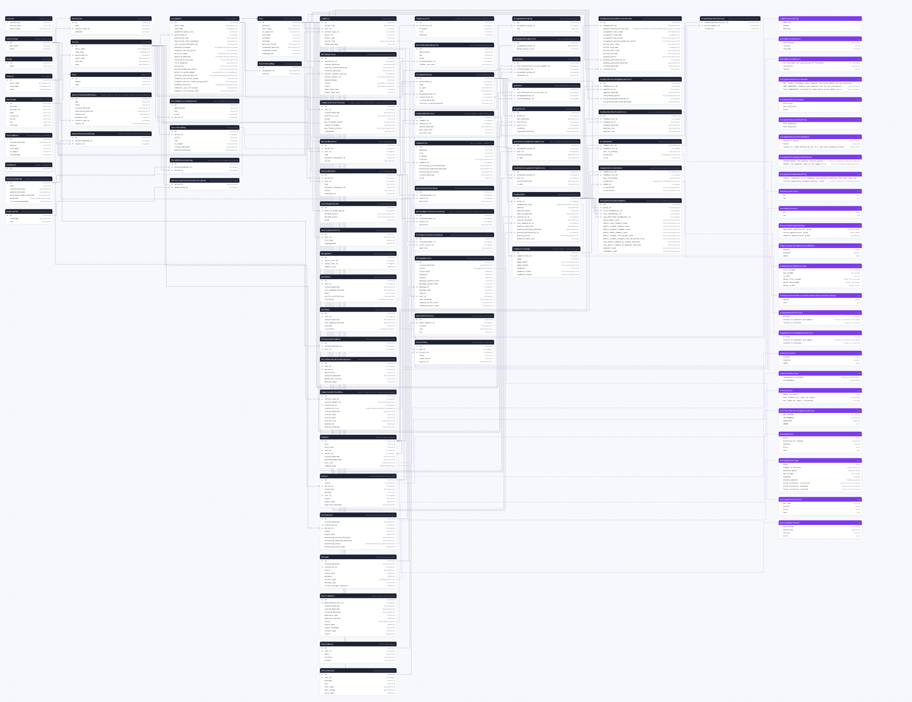

[Session](#session) · [Permission](#permission) · [Group](#group) · [ContentType](#contenttype) · [LogEntry](#logentry) · [Site](#site) · [BatchOperation](#batchoperation) · [DevelopEmail](#developemail) · [Dashboard](#dashboard) · [TemporaryFileCollection](#temporaryfilecollection) · [TemporaryFile](#temporaryfile) · [GenericTokenWithMetadata](#generictokenwithmetadata) · [Subject](#subject) · [Period](#period) · [PeriodApplicationKeyValue](#periodapplicationkeyvalue) · [RelatedExaminer](#relatedexaminer) · [RelatedStudent](#relatedstudent) · [RelatedStudentKeyValue](#relatedstudentkeyvalue) · [core.PeriodTag](#coreperiodtag) · [Assignment](#assignment) · [PointToGradeMap](#pointtogrademap) · [PointRangeToGrade](#pointrangetograde) · [AssignmentGroup](#assignmentgroup) · [AssignmentGroupTag](#assignmentgrouptag) · [AssignmentGroupHistory](#assignmentgrouphistory) · [Candidate](#candidate) · [DevilryUserProfile](#devilryuserprofile) · [Examiner](#examiner) · [GroupInvite](#groupinvite) · [ExaminerAssignmentGroupHistory](#examinerassignmentgrouphistory) · [CandidateAssignmentGroupHistory](#candidateassignmentgrouphistory) · [User](#user) · [MergedUser](#mergeduser) · [UserEmail](#useremail) · [UserName](#username) · [PermissionGroupUser](#permissiongroupuser) · [PermissionGroup](#permissiongroup) · [PeriodPermissionGroup](#periodpermissiongroup) · [SubjectPermissionGroup](#subjectpermissiongroup) · [PeriodUserGuidelineAcceptance](#perioduserguidelineacceptance) · [CompressedArchiveMeta](#compressedarchivemeta) · [FeedbackSet](#feedbackset) · [FeedbacksetPassedPreviousPeriod](#feedbacksetpassedpreviousperiod) · [FeedbackSetGradingUpdateHistory](#feedbacksetgradingupdatehistory) · [FeedbackSetDeadlineHistory](#feedbacksetdeadlinehistory) · [GroupComment](#groupcomment) · [GroupCommentEditHistory](#groupcommentedithistory) · [ImageAnnotationComment](#imageannotationcomment) · [Comment](#comment) · [CommentEditHistory](#commentedithistory) · [CommentFile](#commentfile) · [CommentFileImage](#commentfileimage) · [DeadlineTag](#deadlinetag) · [devilry_qualifiesforexam.PeriodTag](#devilry_qualifiesforexamperiodtag) · [Status](#status) · [QualifiesForFinalExam](#qualifiesforfinalexam) · [DeletedQualifiesForFinalExam](#deletedqualifiesforfinalexam) · [DraftStatus](#draftstatus) · [DraftQualifiesForFinalExam](#draftqualifiesforfinalexam) · [AssignmentGroupCachedData](#assignmentgroupcacheddata) · [Message](#message) · [MessageReceiver](#messagereceiver) · [DevilryReport](#devilryreport) · [EmailAddress](#emailaddress) · [EmailConfirmation](#emailconfirmation) · [SocialApp](#socialapp) · [SocialAccount](#socialaccount) · [SocialToken](#socialtoken)

<details>
<summary>The whole schema as SQL</summary>

```sql
CREATE TABLE "django_session" ("session_key" varchar(40) NOT NULL PRIMARY KEY, "session_data" text NOT NULL, "expire_date" timestamp with time zone NOT NULL);

CREATE TABLE "auth_permission" ("id" integer NOT NULL PRIMARY KEY GENERATED BY DEFAULT AS IDENTITY, "name" varchar(255) NOT NULL, "content_type_id" integer NOT NULL, "codename" varchar(100) NOT NULL);

CREATE TABLE "auth_group" ("id" integer NOT NULL PRIMARY KEY GENERATED BY DEFAULT AS IDENTITY, "name" varchar(150) NOT NULL UNIQUE);

CREATE TABLE "auth_group_permissions" ("id" integer NOT NULL PRIMARY KEY GENERATED BY DEFAULT AS IDENTITY, "group_id" integer NOT NULL, "permission_id" integer NOT NULL);

CREATE TABLE "django_content_type" ("id" integer NOT NULL PRIMARY KEY GENERATED BY DEFAULT AS IDENTITY, "app_label" varchar(100) NOT NULL, "model" varchar(100) NOT NULL);

CREATE TABLE "django_admin_log" ("id" integer NOT NULL PRIMARY KEY GENERATED BY DEFAULT AS IDENTITY, "action_time" timestamp with time zone NOT NULL, "user_id" integer NOT NULL, "content_type_id" integer NULL, "object_id" text NULL, "object_repr" varchar(200) NOT NULL, "action_flag" smallint NOT NULL CHECK ("action_flag" >= 0), "change_message" text NOT NULL);

CREATE TABLE "django_site" ("id" integer NOT NULL PRIMARY KEY GENERATED BY DEFAULT AS IDENTITY, "domain" varchar(100) NOT NULL UNIQUE, "name" varchar(50) NOT NULL);

CREATE TABLE "ievv_batchframework_batchoperation" ("id" integer NOT NULL PRIMARY KEY GENERATED BY DEFAULT AS IDENTITY, "started_by_id" integer NULL, "created_datetime" timestamp with time zone NOT NULL, "started_running_datetime" timestamp with time zone NULL, "finished_datetime" timestamp with time zone NULL, "context_content_type_id" integer NULL, "context_object_id" integer NULL CHECK ("context_object_id" >= 0), "operationtype" varchar(255) NOT NULL, "status" varchar(12) NOT NULL, "result" varchar(13) NOT NULL, "input_data_json" text NOT NULL, "output_data_json" text NOT NULL);

CREATE TABLE "ievv_developemail_developemail" ("id" integer NOT NULL PRIMARY KEY GENERATED BY DEFAULT AS IDENTITY, "created_datetime" timestamp with time zone NOT NULL, "subject" text NOT NULL, "from_email" text NOT NULL, "to_emails" text NOT NULL, "raw_message" text NOT NULL);

CREATE TABLE "cradmin_temporaryfileuploadstore_temporaryfilecollection" ("id" integer NOT NULL PRIMARY KEY GENERATED BY DEFAULT AS IDENTITY, "user_id" integer NOT NULL, "created_datetime" timestamp with time zone NOT NULL, "minutes_to_live" integer NOT NULL CHECK ("minutes_to_live" >= 0), "accept" text NOT NULL, "max_filename_length" integer NULL, "unique_filenames" boolean NOT NULL, "max_filesize_bytes" integer NULL CHECK ("max_filesize_bytes" >= 0), "singlemode" boolean NOT NULL);

CREATE TABLE "cradmin_temporaryfileuploadstore_temporaryfile" ("id" integer NOT NULL PRIMARY KEY GENERATED BY DEFAULT AS IDENTITY, "collection_id" integer NOT NULL, "filename" text NOT NULL, "file" varchar(100) NOT NULL, "mimetype" text NOT NULL);

CREATE TABLE "cradmin_generic_token_with_metadata_generictokenwithmetadata" ("id" integer NOT NULL PRIMARY KEY GENERATED BY DEFAULT AS IDENTITY, "app" varchar(255) NOT NULL, "token" varchar(100) NOT NULL UNIQUE, "created_datetime" timestamp with time zone NOT NULL, "expiration_datetime" timestamp with time zone NULL, "single_use" boolean NOT NULL, "metadata_json" text NOT NULL, "content_type_id" integer NOT NULL, "object_id" integer NOT NULL CHECK ("object_id" >= 0));

CREATE TABLE "core_subject" ("id" integer NOT NULL PRIMARY KEY GENERATED BY DEFAULT AS IDENTITY, "short_name" varchar(20) NOT NULL UNIQUE, "long_name" varchar(100) NOT NULL, "etag" timestamp with time zone NOT NULL);

CREATE TABLE "core_subject_admins" ("id" integer NOT NULL PRIMARY KEY GENERATED BY DEFAULT AS IDENTITY, "subject_id" integer NOT NULL, "user_id" integer NOT NULL);

CREATE TABLE "core_period" ("id" integer NOT NULL PRIMARY KEY GENERATED BY DEFAULT AS IDENTITY, "short_name" varchar(20) NOT NULL, "long_name" varchar(100) NOT NULL, "parentnode_id" integer NOT NULL, "start_time" timestamp with time zone NOT NULL, "end_time" timestamp with time zone NOT NULL, "etag" timestamp with time zone NOT NULL);

CREATE TABLE "core_period_admins" ("id" integer NOT NULL PRIMARY KEY GENERATED BY DEFAULT AS IDENTITY, "period_id" integer NOT NULL, "user_id" integer NOT NULL);

CREATE TABLE "core_periodapplicationkeyvalue" ("id" integer NOT NULL PRIMARY KEY GENERATED BY DEFAULT AS IDENTITY, "application" varchar(300) NOT NULL, "key" varchar(300) NOT NULL, "value" text NULL, "period_id" integer NOT NULL);

CREATE TABLE "core_relatedexaminer" ("id" integer NOT NULL PRIMARY KEY GENERATED BY DEFAULT AS IDENTITY, "period_id" integer NOT NULL, "user_id" integer NOT NULL, "tags" text NULL, "automatic_anonymous_id" varchar(255) NOT NULL, "active" boolean NOT NULL);

CREATE TABLE "core_relatedstudent" ("id" integer NOT NULL PRIMARY KEY GENERATED BY DEFAULT AS IDENTITY, "period_id" integer NOT NULL, "user_id" integer NOT NULL, "tags" text NULL, "automatic_anonymous_id" varchar(255) NOT NULL, "active" boolean NOT NULL, "candidate_id" varchar(30) NULL);

CREATE TABLE "core_relatedstudentkeyvalue" ("id" integer NOT NULL PRIMARY KEY GENERATED BY DEFAULT AS IDENTITY, "application" varchar(300) NOT NULL, "key" varchar(300) NOT NULL, "value" text NULL, "relatedstudent_id" integer NOT NULL, "student_can_read" boolean NOT NULL);

CREATE TABLE "core_periodtag" ("id" integer NOT NULL PRIMARY KEY GENERATED BY DEFAULT AS IDENTITY, "period_id" integer NOT NULL, "prefix" varchar(30) NOT NULL, "tag" text NOT NULL, "is_hidden" boolean NOT NULL, "created_datetime" timestamp with time zone NOT NULL, "modified_datetime" timestamp with time zone NULL);

CREATE TABLE "core_periodtag_relatedexaminers" ("id" integer NOT NULL PRIMARY KEY GENERATED BY DEFAULT AS IDENTITY, "periodtag_id" integer NOT NULL, "relatedexaminer_id" integer NOT NULL);

CREATE TABLE "core_periodtag_relatedstudents" ("id" integer NOT NULL PRIMARY KEY GENERATED BY DEFAULT AS IDENTITY, "periodtag_id" integer NOT NULL, "relatedstudent_id" integer NOT NULL);

CREATE TABLE "core_assignment" ("id" integer NOT NULL PRIMARY KEY GENERATED BY DEFAULT AS IDENTITY, "short_name" varchar(20) NOT NULL, "long_name" varchar(100) NOT NULL, "gradeform_setup_json" text NULL, "parentnode_id" integer NOT NULL, "publishing_time" timestamp with time zone NOT NULL, "deprecated_field_anonymous" boolean NOT NULL, "uses_custom_candidate_ids" boolean NOT NULL, "anonymizationmode" varchar(15) NOT NULL, "students_can_see_points" boolean NOT NULL, "delivery_types" integer NOT NULL CHECK ("delivery_types" >= 0), "deadline_handling" integer NOT NULL CHECK ("deadline_handling" >= 0), "scale_points_percent" integer NOT NULL CHECK ("scale_points_percent" >= 0), "first_deadline" timestamp with time zone NOT NULL, "max_points" integer NULL CHECK ("max_points" >= 0), "passing_grade_min_points" integer NULL CHECK ("passing_grade_min_points" >= 0), "points_to_grade_mapper" varchar(25) NULL, "grading_system_plugin_id" varchar(300) NULL, "students_can_create_groups" boolean NOT NULL, "students_can_not_create_groups_after" timestamp with time zone NULL, "feedback_workflow" varchar(50) NOT NULL, "examiners_can_self_assign" boolean NOT NULL, "examiner_self_assign_limit" integer NOT NULL CHECK ("examiner_self_assign_limit" >= 0));

CREATE TABLE "core_assignment_admins" ("id" integer NOT NULL PRIMARY KEY GENERATED BY DEFAULT AS IDENTITY, "assignment_id" integer NOT NULL, "user_id" integer NOT NULL);

CREATE TABLE "core_pointtogrademap" ("id" integer NOT NULL PRIMARY KEY GENERATED BY DEFAULT AS IDENTITY, "assignment_id" integer NOT NULL UNIQUE, "invalid" boolean NOT NULL);

CREATE TABLE "core_pointrangetograde" ("id" integer NOT NULL PRIMARY KEY GENERATED BY DEFAULT AS IDENTITY, "point_to_grade_map_id" integer NOT NULL, "minimum_points" integer NOT NULL CHECK ("minimum_points" >= 0), "maximum_points" integer NOT NULL CHECK ("maximum_points" >= 0), "grade" varchar(12) NOT NULL);

CREATE TABLE "core_assignmentgroup" ("id" integer NOT NULL PRIMARY KEY GENERATED BY DEFAULT AS IDENTITY, "parentnode_id" integer NOT NULL, "name" varchar(30) NOT NULL, "is_open" boolean NOT NULL, "etag" timestamp with time zone NOT NULL, "batchoperation_id" integer NULL, "copied_from_id" integer NULL, "created_datetime" timestamp with time zone NOT NULL, "internal_is_being_deleted" boolean NOT NULL);

CREATE TABLE "core_assignmentgrouptag" ("id" integer NOT NULL PRIMARY KEY GENERATED BY DEFAULT AS IDENTITY, "assignment_group_id" integer NOT NULL, "tag" varchar(20) NOT NULL);

CREATE TABLE "core_assignmentgrouphistory" ("id" integer NOT NULL PRIMARY KEY GENERATED BY DEFAULT AS IDENTITY, "assignment_group_id" integer NOT NULL UNIQUE, "merge_history_json" text NOT NULL);

CREATE TABLE "core_candidate" ("id" integer NOT NULL PRIMARY KEY GENERATED BY DEFAULT AS IDENTITY, "old_reference_not_in_use_student_id" integer NULL, "relatedstudent_id" integer NOT NULL, "assignment_group_id" integer NOT NULL, "candidate_id" varchar(30) NULL);

CREATE TABLE "core_devilryuserprofile" ("id" integer NOT NULL PRIMARY KEY GENERATED BY DEFAULT AS IDENTITY, "user_id" integer NOT NULL UNIQUE, "full_name" varchar(300) NULL, "languagecode" varchar(100) NULL);

CREATE TABLE "core_assignmentgroup_examiners" ("id" integer NOT NULL PRIMARY KEY GENERATED BY DEFAULT AS IDENTITY, "old_reference_not_in_use_user_id" integer NULL, "assignmentgroup_id" integer NOT NULL, "relatedexaminer_id" integer NOT NULL);

CREATE TABLE "core_groupinvite" ("id" integer NOT NULL PRIMARY KEY GENERATED BY DEFAULT AS IDENTITY, "group_id" integer NOT NULL, "sent_datetime" timestamp with time zone NOT NULL, "sent_by_id" integer NOT NULL, "sent_to_id" integer NOT NULL, "accepted" boolean NULL, "responded_datetime" timestamp with time zone NULL);

CREATE TABLE "core_examinerassignmentgrouphistory" ("id" integer NOT NULL PRIMARY KEY GENERATED BY DEFAULT AS IDENTITY, "assignment_group_id" integer NOT NULL, "user_id" integer NULL, "created_datetime" timestamp with time zone NOT NULL, "is_add" boolean NOT NULL);

CREATE TABLE "core_candidateassignmentgrouphistory" ("id" integer NOT NULL PRIMARY KEY GENERATED BY DEFAULT AS IDENTITY, "assignment_group_id" integer NOT NULL, "user_id" integer NULL, "created_datetime" timestamp with time zone NOT NULL, "is_add" boolean NOT NULL);

CREATE TABLE "devilry_account_user" ("id" integer NOT NULL PRIMARY KEY GENERATED BY DEFAULT AS IDENTITY, "password" varchar(128) NOT NULL, "last_login" timestamp with time zone NULL, "is_superuser" boolean NOT NULL, "shortname" varchar(255) NOT NULL UNIQUE, "fullname" text NOT NULL, "lastname" text NOT NULL, "datetime_joined" timestamp with time zone NOT NULL, "suspended_datetime" timestamp with time zone NULL, "suspended_reason" text NOT NULL, "languagecode" varchar(10) NOT NULL);

CREATE TABLE "devilry_account_mergeduser" ("id" integer NOT NULL PRIMARY KEY GENERATED BY DEFAULT AS IDENTITY, "source_user_id" integer NOT NULL, "target_user_id" integer NOT NULL, "summary_json" jsonb NOT NULL);

CREATE TABLE "devilry_account_useremail" ("id" integer NOT NULL PRIMARY KEY GENERATED BY DEFAULT AS IDENTITY, "user_id" integer NOT NULL, "created_datetime" timestamp with time zone NOT NULL, "last_updated_datetime" timestamp with time zone NOT NULL, "email" varchar(255) NOT NULL UNIQUE, "use_for_notifications" boolean NOT NULL, "is_primary" boolean NULL);

CREATE TABLE "devilry_account_username" ("id" integer NOT NULL PRIMARY KEY GENERATED BY DEFAULT AS IDENTITY, "user_id" integer NOT NULL, "created_datetime" timestamp with time zone NOT NULL, "last_updated_datetime" timestamp with time zone NOT NULL, "username" varchar(255) NOT NULL UNIQUE, "is_primary" boolean NULL);

CREATE TABLE "devilry_account_permissiongroupuser" ("id" integer NOT NULL PRIMARY KEY GENERATED BY DEFAULT AS IDENTITY, "permissiongroup_id" integer NOT NULL, "user_id" integer NOT NULL);

CREATE TABLE "devilry_account_permissiongroup" ("id" integer NOT NULL PRIMARY KEY GENERATED BY DEFAULT AS IDENTITY, "name" varchar(255) NOT NULL UNIQUE, "created_datetime" timestamp with time zone NOT NULL, "updated_datetime" timestamp with time zone NOT NULL, "syncsystem_update_datetime" timestamp with time zone NULL, "grouptype" varchar(30) NOT NULL, "is_custom_manageable" boolean NOT NULL);

CREATE TABLE "devilry_account_periodpermissiongroup" ("id" integer NOT NULL PRIMARY KEY GENERATED BY DEFAULT AS IDENTITY, "permissiongroup_id" integer NOT NULL, "period_id" integer NOT NULL);

CREATE TABLE "devilry_account_subjectpermissiongroup" ("id" integer NOT NULL PRIMARY KEY GENERATED BY DEFAULT AS IDENTITY, "permissiongroup_id" integer NOT NULL, "subject_id" integer NOT NULL);

CREATE TABLE "devilry_account_perioduserguidelineacceptance" ("id" integer NOT NULL PRIMARY KEY GENERATED BY DEFAULT AS IDENTITY, "user_id" integer NOT NULL, "period_id" integer NOT NULL, "devilryrole" varchar(20) NOT NULL, "accepted_datetime" timestamp with time zone NOT NULL, "guidelines_version" varchar(20) NOT NULL, "matched_regex" text NOT NULL, CONSTRAINT "unique_user_period_role_version" UNIQUE ("user_id", "period_id", "devilryrole", "guidelines_version"));

CREATE TABLE "devilry_compressionutil_compressedarchivemeta" ("id" integer NOT NULL PRIMARY KEY GENERATED BY DEFAULT AS IDENTITY, "content_type_id" integer NOT NULL, "content_object_id" integer NOT NULL CHECK ("content_object_id" >= 0), "created_by_id" integer NULL, "created_by_role" varchar(255) NOT NULL, "created_datetime" timestamp with time zone NOT NULL, "archive_name" varchar(200) NOT NULL, "archive_path" varchar(200) NOT NULL, "archive_size" bigint NOT NULL, "backend_id" varchar(100) NOT NULL, "deleted_datetime" timestamp with time zone NULL);

CREATE TABLE "devilry_group_feedbackset" ("id" integer NOT NULL PRIMARY KEY GENERATED BY DEFAULT AS IDENTITY, "group_id" integer NOT NULL, "feedbackset_type" varchar(50) NOT NULL, "ignored" boolean NOT NULL, "ignored_reason" text NOT NULL, "ignored_datetime" timestamp with time zone NULL, "created_by_id" integer NULL, "created_datetime" timestamp with time zone NOT NULL, "last_updated_by_id" integer NULL, "deadline_datetime" timestamp with time zone NOT NULL, "grading_published_datetime" timestamp with time zone NULL, "grading_published_by_id" integer NULL, "grading_points" integer NULL CHECK ("grading_points" >= 0), "gradeform_data_json" text NOT NULL);

CREATE TABLE "devilry_group_feedbacksetpassedpreviousperiod" ("id" integer NOT NULL PRIMARY KEY GENERATED BY DEFAULT AS IDENTITY, "feedbackset_id" integer NULL UNIQUE, "passed_previous_period_type" varchar(255) NOT NULL, "assignment_short_name" varchar(20) NOT NULL, "assignment_long_name" varchar(100) NOT NULL, "assignment_max_points" integer NULL CHECK ("assignment_max_points" >= 0), "assignment_passing_grade_min_points" integer NULL CHECK ("assignment_passing_grade_min_points" >= 0), "period_short_name" varchar(20) NOT NULL, "period_long_name" varchar(100) NOT NULL, "period_start_time" timestamp with time zone NULL, "period_end_time" timestamp with time zone NULL, "grading_points" integer NULL CHECK ("grading_points" >= 0), "grading_published_by_id" integer NULL, "grading_published_datetime" timestamp with time zone NULL, "created_datetime" timestamp with time zone NOT NULL, "created_by_id" integer NULL);

CREATE TABLE "devilry_group_feedbacksetgradingupdatehistory" ("id" integer NOT NULL PRIMARY KEY GENERATED BY DEFAULT AS IDENTITY, "feedback_set_id" integer NOT NULL, "updated_by_id" integer NULL, "updated_datetime" timestamp with time zone NOT NULL, "old_grading_points" integer NOT NULL CHECK ("old_grading_points" >= 0), "old_grading_published_by_id" integer NULL, "old_grading_published_datetime" timestamp with time zone NOT NULL);

CREATE TABLE "devilry_group_feedbacksetdeadlinehistory" ("id" integer NOT NULL PRIMARY KEY GENERATED BY DEFAULT AS IDENTITY, "feedback_set_id" integer NOT NULL, "changed_by_id" integer NULL, "changed_datetime" timestamp with time zone NOT NULL, "deadline_old" timestamp with time zone NOT NULL, "deadline_new" timestamp with time zone NOT NULL);

CREATE TABLE "devilry_group_groupcomment" ("comment_ptr_id" integer NOT NULL PRIMARY KEY, "feedback_set_id" integer NOT NULL, "part_of_grading" boolean NOT NULL, "visibility" varchar(50) NOT NULL, "v2_id" varchar(255) NOT NULL);

CREATE TABLE "devilry_group_groupcommentedithistory" ("commentedithistory_ptr_id" integer NOT NULL PRIMARY KEY, "group_comment_id" integer NOT NULL, "visibility" varchar(50) NOT NULL);

CREATE TABLE "devilry_group_imageannotationcomment" ("comment_ptr_id" integer NOT NULL PRIMARY KEY, "feedback_set_id" integer NOT NULL, "part_of_grading" boolean NOT NULL, "visibility" varchar(50) NOT NULL, "image_id" integer NOT NULL, "x_coordinate" integer NOT NULL CHECK ("x_coordinate" >= 0), "y_coordinate" integer NOT NULL CHECK ("y_coordinate" >= 0));

CREATE TABLE "devilry_comment_comment" ("id" integer NOT NULL PRIMARY KEY GENERATED BY DEFAULT AS IDENTITY, "text" text NOT NULL, "draft_text" text NOT NULL, "user_id" integer NULL, "parent_id" integer NULL, "created_datetime" timestamp with time zone NOT NULL, "published_datetime" timestamp with time zone NOT NULL, "user_role" varchar(42) NOT NULL, "comment_type" varchar(42) NOT NULL);

CREATE TABLE "devilry_comment_commentedithistory" ("id" integer NOT NULL PRIMARY KEY GENERATED BY DEFAULT AS IDENTITY, "comment_id" integer NOT NULL, "edited_by_id" integer NULL, "edited_datetime" timestamp with time zone NOT NULL, "post_edit_text" text NOT NULL, "pre_edit_text" text NOT NULL);

CREATE TABLE "devilry_comment_commentfile" ("id" integer NOT NULL PRIMARY KEY GENERATED BY DEFAULT AS IDENTITY, "mimetype" varchar(255) NOT NULL, "file" varchar(512) NOT NULL, "filename" varchar(255) NOT NULL, "filesize" integer NOT NULL CHECK ("filesize" >= 0), "comment_id" integer NOT NULL, "processing_started_datetime" timestamp with time zone NULL, "processing_completed_datetime" timestamp with time zone NULL, "processing_successful" boolean NOT NULL, "created_datetime" timestamp with time zone NOT NULL, "v2_id" varchar(255) NOT NULL);

CREATE TABLE "devilry_comment_commentfileimage" ("id" integer NOT NULL PRIMARY KEY GENERATED BY DEFAULT AS IDENTITY, "comment_file_id" integer NOT NULL, "image" varchar(512) NOT NULL, "image_width" integer NOT NULL CHECK ("image_width" >= 0), "image_height" integer NOT NULL CHECK ("image_height" >= 0), "thumbnail" varchar(512) NOT NULL, "thumbnail_width" integer NOT NULL CHECK ("thumbnail_width" >= 0), "thumbnail_height" integer NOT NULL CHECK ("thumbnail_height" >= 0));

CREATE TABLE "devilry_qualifiesforexam_deadlinetag" ("id" integer NOT NULL PRIMARY KEY GENERATED BY DEFAULT AS IDENTITY, "timestamp" timestamp with time zone NOT NULL, "tag" varchar(30) NULL);

CREATE TABLE "devilry_qualifiesforexam_periodtag" ("period_id" integer NOT NULL PRIMARY KEY, "deadlinetag_id" integer NOT NULL);

CREATE TABLE "devilry_qualifiesforexam_status" ("id" integer NOT NULL PRIMARY KEY GENERATED BY DEFAULT AS IDENTITY, "status" varchar(30) NOT NULL, "period_id" integer NOT NULL, "createtime" timestamp with time zone NOT NULL, "message" text NOT NULL, "user_id" integer NOT NULL, "plugin" varchar(500) NULL, "plugin_data" jsonb NULL, "exported_timestamp" timestamp with time zone NULL);

CREATE TABLE "devilry_qualifiesforexam_qualifiesforfinalexam" ("id" integer NOT NULL PRIMARY KEY GENERATED BY DEFAULT AS IDENTITY, "relatedstudent_id" integer NOT NULL, "status_id" integer NOT NULL, "qualifies" boolean NULL);

CREATE TABLE "devilry_qualifiesforexam_deletedqualifiesforfinalexam" ("id" integer NOT NULL PRIMARY KEY GENERATED BY DEFAULT AS IDENTITY, "relatedstudent_id" integer NOT NULL, "status_id" integer NOT NULL, "qualifies" boolean NULL);

CREATE TABLE "devilry_qualifiesforexam_draftstatus" ("id" integer NOT NULL PRIMARY KEY GENERATED BY DEFAULT AS IDENTITY, "created_datetime" timestamp with time zone NOT NULL, "created_by_id" integer NOT NULL, "period_id" integer NOT NULL, "plugin" varchar(500) NULL, "plugin_data" jsonb NULL, "processing_started_datetime" timestamp with time zone NULL, "processing_completed_datetime" timestamp with time zone NULL, "processing_status" varchar(32) NOT NULL, "processing_status_data" jsonb NULL);

CREATE TABLE "devilry_qualifiesforexam_draftqualifiesforfinalexam" ("id" integer NOT NULL PRIMARY KEY GENERATED BY DEFAULT AS IDENTITY, "relatedstudent_id" integer NOT NULL, "draft_status_id" integer NOT NULL, "qualifies" boolean NOT NULL);

CREATE TABLE "devilry_dbcache_assignmentgroupcacheddata" ("id" integer NOT NULL PRIMARY KEY GENERATED BY DEFAULT AS IDENTITY, "group_id" integer NOT NULL UNIQUE, "first_feedbackset_id" integer NULL, "last_feedbackset_id" integer NULL, "last_published_feedbackset_id" integer NULL, "new_attempt_count" integer NOT NULL CHECK ("new_attempt_count" >= 0), "public_total_comment_count" integer NOT NULL CHECK ("public_total_comment_count" >= 0), "public_student_comment_count" integer NOT NULL CHECK ("public_student_comment_count" >= 0), "public_examiner_comment_count" integer NOT NULL CHECK ("public_examiner_comment_count" >= 0), "public_admin_comment_count" integer NOT NULL CHECK ("public_admin_comment_count" >= 0), "public_student_file_upload_count" integer NOT NULL CHECK ("public_student_file_upload_count" >= 0), "public_student_attempts_with_delivered_files" integer NOT NULL CHECK ("public_student_attempts_with_delivered_files" >= 0), "last_public_comment_by_student_datetime" timestamp with time zone NULL, "last_public_comment_by_examiner_datetime" timestamp with time zone NULL, "examiner_count" integer NOT NULL CHECK ("examiner_count" >= 0), "candidate_count" integer NOT NULL CHECK ("candidate_count" >= 0));

CREATE TABLE "devilry_message_message" ("id" integer NOT NULL PRIMARY KEY GENERATED BY DEFAULT AS IDENTITY, "created_datetime" timestamp with time zone NULL, "created_by_id" integer NULL, "status" varchar(30) NOT NULL, "status_data" jsonb NOT NULL, "metadata" jsonb NOT NULL, "context_type" varchar(255) NOT NULL, "message_type" varchar(30)[] NOT NULL, "virtual_message_receivers" jsonb NOT NULL);

CREATE TABLE "devilry_message_messagereceiver" ("id" integer NOT NULL PRIMARY KEY GENERATED BY DEFAULT AS IDENTITY, "created_datetime" timestamp with time zone NULL, "status" varchar(10) NOT NULL, "status_data" jsonb NOT NULL, "metadata" jsonb NOT NULL, "subject" varchar(255) NOT NULL, "message_content_plain" text NOT NULL, "message_content_html" text NOT NULL, "message_id" integer NOT NULL, "message_type" varchar(30) NOT NULL, "send_to" varchar(255) NOT NULL, "user_id" integer NOT NULL, "sent_datetime" timestamp with time zone NULL, "sending_failed_count" integer NOT NULL, "sending_success_count" integer NOT NULL);

CREATE TABLE "devilry_report_devilryreport" ("id" integer NOT NULL PRIMARY KEY GENERATED BY DEFAULT AS IDENTITY, "generated_by_user_id" integer NOT NULL, "created_datetime" timestamp with time zone NOT NULL, "started_datetime" timestamp with time zone NULL, "finished_datetime" timestamp with time zone NULL, "generator_type" varchar(255) NOT NULL, "generator_options" jsonb NOT NULL, "status" varchar(255) NOT NULL, "status_data" jsonb NOT NULL, "output_filename" varchar(255) NULL, "content_type" varchar(255) NULL, "result" bytea NOT NULL);

CREATE TABLE "account_emailaddress" ("id" integer NOT NULL PRIMARY KEY GENERATED BY DEFAULT AS IDENTITY, "user_id" integer NOT NULL, "email" varchar(254) NOT NULL, "verified" boolean NOT NULL, "primary" boolean NOT NULL);

CREATE TABLE "account_emailconfirmation" ("id" integer NOT NULL PRIMARY KEY GENERATED BY DEFAULT AS IDENTITY, "email_address_id" integer NOT NULL, "created" timestamp with time zone NOT NULL, "sent" timestamp with time zone NULL, "key" varchar(64) NOT NULL UNIQUE);

CREATE TABLE "socialaccount_socialapp" ("id" integer NOT NULL PRIMARY KEY GENERATED BY DEFAULT AS IDENTITY, "provider" varchar(30) NOT NULL, "provider_id" varchar(200) NOT NULL, "name" varchar(40) NOT NULL, "client_id" varchar(191) NOT NULL, "secret" varchar(191) NOT NULL, "key" varchar(191) NOT NULL, "settings" jsonb NOT NULL);

CREATE TABLE "socialaccount_socialapp_sites" ("id" integer NOT NULL PRIMARY KEY GENERATED BY DEFAULT AS IDENTITY, "socialapp_id" integer NOT NULL, "site_id" integer NOT NULL);

CREATE TABLE "socialaccount_socialaccount" ("id" integer NOT NULL PRIMARY KEY GENERATED BY DEFAULT AS IDENTITY, "user_id" integer NOT NULL, "provider" varchar(200) NOT NULL, "uid" varchar(191) NOT NULL, "last_login" timestamp with time zone NOT NULL, "date_joined" timestamp with time zone NOT NULL, "extra_data" jsonb NOT NULL);

CREATE TABLE "socialaccount_socialtoken" ("id" integer NOT NULL PRIMARY KEY GENERATED BY DEFAULT AS IDENTITY, "app_id" integer NULL, "account_id" integer NOT NULL, "token" text NOT NULL, "token_secret" text NOT NULL, "expires_at" timestamp with time zone NULL);

CREATE INDEX "django_session_session_key_c0390e0f_like" ON "django_session" ("session_key" varchar_pattern_ops);

CREATE INDEX "django_session_expire_date_a5c62663" ON "django_session" ("expire_date");

ALTER TABLE "auth_permission" ADD CONSTRAINT "auth_permission_content_type_id_codename_01ab375a_uniq" UNIQUE ("content_type_id", "codename");

ALTER TABLE "auth_permission" ADD CONSTRAINT "auth_permission_content_type_id_2f476e4b_fk_django_co" FOREIGN KEY ("content_type_id") REFERENCES "django_content_type" ("id") DEFERRABLE INITIALLY DEFERRED;

CREATE INDEX "auth_permission_content_type_id_2f476e4b" ON "auth_permission" ("content_type_id");

CREATE INDEX "auth_group_name_a6ea08ec_like" ON "auth_group" ("name" varchar_pattern_ops);

ALTER TABLE "auth_group_permissions" ADD CONSTRAINT "auth_group_permissions_group_id_permission_id_0cd325b0_uniq" UNIQUE ("group_id", "permission_id");

ALTER TABLE "auth_group_permissions" ADD CONSTRAINT "auth_group_permissions_group_id_b120cbf9_fk_auth_group_id" FOREIGN KEY ("group_id") REFERENCES "auth_group" ("id") DEFERRABLE INITIALLY DEFERRED;

ALTER TABLE "auth_group_permissions" ADD CONSTRAINT "auth_group_permissio_permission_id_84c5c92e_fk_auth_perm" FOREIGN KEY ("permission_id") REFERENCES "auth_permission" ("id") DEFERRABLE INITIALLY DEFERRED;

CREATE INDEX "auth_group_permissions_group_id_b120cbf9" ON "auth_group_permissions" ("group_id");

CREATE INDEX "auth_group_permissions_permission_id_84c5c92e" ON "auth_group_permissions" ("permission_id");

ALTER TABLE "django_content_type" ADD CONSTRAINT "django_content_type_app_label_model_76bd3d3b_uniq" UNIQUE ("app_label", "model");

ALTER TABLE "django_admin_log" ADD CONSTRAINT "django_admin_log_user_id_c564eba6_fk_devilry_account_user_id" FOREIGN KEY ("user_id") REFERENCES "devilry_account_user" ("id") DEFERRABLE INITIALLY DEFERRED;

ALTER TABLE "django_admin_log" ADD CONSTRAINT "django_admin_log_content_type_id_c4bce8eb_fk_django_co" FOREIGN KEY ("content_type_id") REFERENCES "django_content_type" ("id") DEFERRABLE INITIALLY DEFERRED;

CREATE INDEX "django_admin_log_user_id_c564eba6" ON "django_admin_log" ("user_id");

CREATE INDEX "django_admin_log_content_type_id_c4bce8eb" ON "django_admin_log" ("content_type_id");

CREATE INDEX "django_site_domain_a2e37b91_like" ON "django_site" ("domain" varchar_pattern_ops);

ALTER TABLE "ievv_batchframework_batchoperation" ADD CONSTRAINT "ievv_batchframework__started_by_id_b800bd60_fk_devilry_a" FOREIGN KEY ("started_by_id") REFERENCES "devilry_account_user" ("id") DEFERRABLE INITIALLY DEFERRED;

ALTER TABLE "ievv_batchframework_batchoperation" ADD CONSTRAINT "ievv_batchframework__context_content_type_61d4a4a1_fk_django_co" FOREIGN KEY ("context_content_type_id") REFERENCES "django_content_type" ("id") DEFERRABLE INITIALLY DEFERRED;

CREATE INDEX "ievv_batchframework_batchoperation_started_by_id_b800bd60" ON "ievv_batchframework_batchoperation" ("started_by_id");

CREATE INDEX "ievv_batchframework_batcho_context_content_type_id_61d4a4a1" ON "ievv_batchframework_batchoperation" ("context_content_type_id");

CREATE INDEX "ievv_batchframework_batchoperation_operationtype_f0132b14" ON "ievv_batchframework_batchoperation" ("operationtype");

CREATE INDEX "ievv_batchframework_batchoperation_operationtype_f0132b14_like" ON "ievv_batchframework_batchoperation" ("operationtype" varchar_pattern_ops);

CREATE INDEX "ievv_developemail_developemail_from_email_981952b3" ON "ievv_developemail_developemail" ("from_email");

CREATE INDEX "ievv_developemail_developemail_from_email_981952b3_like" ON "ievv_developemail_developemail" ("from_email" text_pattern_ops);

ALTER TABLE "cradmin_temporaryfileuploadstore_temporaryfilecollection" ADD CONSTRAINT "cradmin_temporaryfil_user_id_b043f918_fk_devilry_a" FOREIGN KEY ("user_id") REFERENCES "devilry_account_user" ("id") DEFERRABLE INITIALLY DEFERRED;

CREATE INDEX "cradmin_temporaryfileuploa_user_id_b043f918" ON "cradmin_temporaryfileuploadstore_temporaryfilecollection" ("user_id");

ALTER TABLE "cradmin_temporaryfileuploadstore_temporaryfile" ADD CONSTRAINT "cradmin_temporaryfil_collection_id_130761f4_fk_cradmin_t" FOREIGN KEY ("collection_id") REFERENCES "cradmin_temporaryfileuploadstore_temporaryfilecollection" ("id") DEFERRABLE INITIALLY DEFERRED;

CREATE INDEX "cradmin_temporaryfileuploa_collection_id_130761f4" ON "cradmin_temporaryfileuploadstore_temporaryfile" ("collection_id");

CREATE INDEX "cradmin_temporaryfileuploa_filename_6fd10273" ON "cradmin_temporaryfileuploadstore_temporaryfile" ("filename");

CREATE INDEX "cradmin_temporaryfileupl_filename_6fd10273_like" ON "cradmin_temporaryfileuploadstore_temporaryfile" ("filename" text_pattern_ops);

ALTER TABLE "cradmin_generic_token_with_metadata_generictokenwithmetadata" ADD CONSTRAINT "cradmin_generic_toke_content_type_id_6e0a27ae_fk_django_co" FOREIGN KEY ("content_type_id") REFERENCES "django_content_type" ("id") DEFERRABLE INITIALLY DEFERRED;

CREATE INDEX "cradmin_generic_token_with_app_eb8d47f3" ON "cradmin_generic_token_with_metadata_generictokenwithmetadata" ("app");

CREATE INDEX "cradmin_generic_token_wi_app_eb8d47f3_like" ON "cradmin_generic_token_with_metadata_generictokenwithmetadata" ("app" varchar_pattern_ops);

CREATE INDEX "cradmin_generic_token_wi_token_b381124d_like" ON "cradmin_generic_token_with_metadata_generictokenwithmetadata" ("token" varchar_pattern_ops);

CREATE INDEX "cradmin_generic_token_with_content_type_id_6e0a27ae" ON "cradmin_generic_token_with_metadata_generictokenwithmetadata" ("content_type_id");

CREATE INDEX "core_subject_short_name_7172d8cd_like" ON "core_subject" ("short_name" varchar_pattern_ops);

CREATE INDEX "core_subject_long_name_d9b3b016" ON "core_subject" ("long_name");

CREATE INDEX "core_subject_long_name_d9b3b016_like" ON "core_subject" ("long_name" varchar_pattern_ops);

ALTER TABLE "core_subject_admins" ADD CONSTRAINT "core_subject_admins_subject_id_user_id_77acf758_uniq" UNIQUE ("subject_id", "user_id");

ALTER TABLE "core_subject_admins" ADD CONSTRAINT "core_subject_admins_subject_id_1eab04df_fk_core_subject_id" FOREIGN KEY ("subject_id") REFERENCES "core_subject" ("id") DEFERRABLE INITIALLY DEFERRED;

ALTER TABLE "core_subject_admins" ADD CONSTRAINT "core_subject_admins_user_id_5440373d_fk_devilry_account_user_id" FOREIGN KEY ("user_id") REFERENCES "devilry_account_user" ("id") DEFERRABLE INITIALLY DEFERRED;

CREATE INDEX "core_subject_admins_subject_id_1eab04df" ON "core_subject_admins" ("subject_id");

CREATE INDEX "core_subject_admins_user_id_5440373d" ON "core_subject_admins" ("user_id");

ALTER TABLE "core_period" ADD CONSTRAINT "core_period_short_name_parentnode_id_08ced67b_uniq" UNIQUE ("short_name", "parentnode_id");

ALTER TABLE "core_period" ADD CONSTRAINT "core_period_parentnode_id_fafbee43_fk_core_subject_id" FOREIGN KEY ("parentnode_id") REFERENCES "core_subject" ("id") DEFERRABLE INITIALLY DEFERRED;

CREATE INDEX "core_period_short_name_95d3f6a9" ON "core_period" ("short_name");

CREATE INDEX "core_period_short_name_95d3f6a9_like" ON "core_period" ("short_name" varchar_pattern_ops);

CREATE INDEX "core_period_long_name_66f8a24b" ON "core_period" ("long_name");

CREATE INDEX "core_period_long_name_66f8a24b_like" ON "core_period" ("long_name" varchar_pattern_ops);

CREATE INDEX "core_period_parentnode_id_fafbee43" ON "core_period" ("parentnode_id");

ALTER TABLE "core_period_admins" ADD CONSTRAINT "core_period_admins_period_id_user_id_352bd89e_uniq" UNIQUE ("period_id", "user_id");

ALTER TABLE "core_period_admins" ADD CONSTRAINT "core_period_admins_period_id_242db1f0_fk_core_period_id" FOREIGN KEY ("period_id") REFERENCES "core_period" ("id") DEFERRABLE INITIALLY DEFERRED;

ALTER TABLE "core_period_admins" ADD CONSTRAINT "core_period_admins_user_id_fd36ee29_fk_devilry_account_user_id" FOREIGN KEY ("user_id") REFERENCES "devilry_account_user" ("id") DEFERRABLE INITIALLY DEFERRED;

CREATE INDEX "core_period_admins_period_id_242db1f0" ON "core_period_admins" ("period_id");

CREATE INDEX "core_period_admins_user_id_fd36ee29" ON "core_period_admins" ("user_id");

ALTER TABLE "core_periodapplicationkeyvalue" ADD CONSTRAINT "core_periodapplicationke_period_id_application_ke_29a36e16_uniq" UNIQUE ("period_id", "application", "key");

ALTER TABLE "core_periodapplicationkeyvalue" ADD CONSTRAINT "core_periodapplicati_period_id_5004dd70_fk_core_peri" FOREIGN KEY ("period_id") REFERENCES "core_period" ("id") DEFERRABLE INITIALLY DEFERRED;

CREATE INDEX "core_periodapplicationkeyvalue_application_1a66ea20" ON "core_periodapplicationkeyvalue" ("application");

CREATE INDEX "core_periodapplicationkeyvalue_application_1a66ea20_like" ON "core_periodapplicationkeyvalue" ("application" varchar_pattern_ops);

CREATE INDEX "core_periodapplicationkeyvalue_key_2001d526" ON "core_periodapplicationkeyvalue" ("key");

CREATE INDEX "core_periodapplicationkeyvalue_key_2001d526_like" ON "core_periodapplicationkeyvalue" ("key" varchar_pattern_ops);

CREATE INDEX "core_periodapplicationkeyvalue_value_d280ca28" ON "core_periodapplicationkeyvalue" ("value");

CREATE INDEX "core_periodapplicationkeyvalue_value_d280ca28_like" ON "core_periodapplicationkeyvalue" ("value" text_pattern_ops);

CREATE INDEX "core_periodapplicationkeyvalue_period_id_5004dd70" ON "core_periodapplicationkeyvalue" ("period_id");

ALTER TABLE "core_relatedexaminer" ADD CONSTRAINT "core_relatedexaminer_period_id_user_id_1cfbaad4_uniq" UNIQUE ("period_id", "user_id");

ALTER TABLE "core_relatedexaminer" ADD CONSTRAINT "core_relatedexaminer_period_id_2f042ce2_fk_core_period_id" FOREIGN KEY ("period_id") REFERENCES "core_period" ("id") DEFERRABLE INITIALLY DEFERRED;

ALTER TABLE "core_relatedexaminer" ADD CONSTRAINT "core_relatedexaminer_user_id_8bedf468_fk_devilry_a" FOREIGN KEY ("user_id") REFERENCES "devilry_account_user" ("id") DEFERRABLE INITIALLY DEFERRED;

CREATE INDEX "core_relatedexaminer_period_id_2f042ce2" ON "core_relatedexaminer" ("period_id");

CREATE INDEX "core_relatedexaminer_user_id_8bedf468" ON "core_relatedexaminer" ("user_id");

ALTER TABLE "core_relatedstudent" ADD CONSTRAINT "core_relatedstudent_period_id_user_id_bb12ecab_uniq" UNIQUE ("period_id", "user_id");

ALTER TABLE "core_relatedstudent" ADD CONSTRAINT "core_relatedstudent_period_id_9af6a0a9_fk_core_period_id" FOREIGN KEY ("period_id") REFERENCES "core_period" ("id") DEFERRABLE INITIALLY DEFERRED;

ALTER TABLE "core_relatedstudent" ADD CONSTRAINT "core_relatedstudent_user_id_e952c98a_fk_devilry_account_user_id" FOREIGN KEY ("user_id") REFERENCES "devilry_account_user" ("id") DEFERRABLE INITIALLY DEFERRED;

CREATE INDEX "core_relatedstudent_period_id_9af6a0a9" ON "core_relatedstudent" ("period_id");

CREATE INDEX "core_relatedstudent_user_id_e952c98a" ON "core_relatedstudent" ("user_id");

ALTER TABLE "core_relatedstudentkeyvalue" ADD CONSTRAINT "core_relatedstudentkeyva_relatedstudent_id_applic_68da6d0f_uniq" UNIQUE ("relatedstudent_id", "application", "key");

ALTER TABLE "core_relatedstudentkeyvalue" ADD CONSTRAINT "core_relatedstudentk_relatedstudent_id_49b0ce0d_fk_core_rela" FOREIGN KEY ("relatedstudent_id") REFERENCES "core_relatedstudent" ("id") DEFERRABLE INITIALLY DEFERRED;

CREATE INDEX "core_relatedstudentkeyvalue_application_95652c6e" ON "core_relatedstudentkeyvalue" ("application");

CREATE INDEX "core_relatedstudentkeyvalue_application_95652c6e_like" ON "core_relatedstudentkeyvalue" ("application" varchar_pattern_ops);

CREATE INDEX "core_relatedstudentkeyvalue_key_03d759fd" ON "core_relatedstudentkeyvalue" ("key");

CREATE INDEX "core_relatedstudentkeyvalue_key_03d759fd_like" ON "core_relatedstudentkeyvalue" ("key" varchar_pattern_ops);

CREATE INDEX "core_relatedstudentkeyvalue_value_f2c810af" ON "core_relatedstudentkeyvalue" ("value");

CREATE INDEX "core_relatedstudentkeyvalue_value_f2c810af_like" ON "core_relatedstudentkeyvalue" ("value" text_pattern_ops);

CREATE INDEX "core_relatedstudentkeyvalue_relatedstudent_id_49b0ce0d" ON "core_relatedstudentkeyvalue" ("relatedstudent_id");

ALTER TABLE "core_periodtag" ADD CONSTRAINT "core_periodtag_period_id_prefix_tag_85a8db44_uniq" UNIQUE ("period_id", "prefix", "tag");

ALTER TABLE "core_periodtag" ADD CONSTRAINT "core_periodtag_period_id_d7a1e8c9_fk_core_period_id" FOREIGN KEY ("period_id") REFERENCES "core_period" ("id") DEFERRABLE INITIALLY DEFERRED;

CREATE INDEX "core_periodtag_period_id_d7a1e8c9" ON "core_periodtag" ("period_id");

CREATE INDEX "core_periodtag_tag_b42bbccb" ON "core_periodtag" ("tag");

CREATE INDEX "core_periodtag_tag_b42bbccb_like" ON "core_periodtag" ("tag" text_pattern_ops);

ALTER TABLE "core_periodtag_relatedexaminers" ADD CONSTRAINT "core_periodtag_relatedex_periodtag_id_relatedexam_a5a9b5ab_uniq" UNIQUE ("periodtag_id", "relatedexaminer_id");

ALTER TABLE "core_periodtag_relatedexaminers" ADD CONSTRAINT "core_periodtag_relat_periodtag_id_d532c009_fk_core_peri" FOREIGN KEY ("periodtag_id") REFERENCES "core_periodtag" ("id") DEFERRABLE INITIALLY DEFERRED;

ALTER TABLE "core_periodtag_relatedexaminers" ADD CONSTRAINT "core_periodtag_relat_relatedexaminer_id_faa47fdc_fk_core_rela" FOREIGN KEY ("relatedexaminer_id") REFERENCES "core_relatedexaminer" ("id") DEFERRABLE INITIALLY DEFERRED;

CREATE INDEX "core_periodtag_relatedexaminers_periodtag_id_d532c009" ON "core_periodtag_relatedexaminers" ("periodtag_id");

CREATE INDEX "core_periodtag_relatedexaminers_relatedexaminer_id_faa47fdc" ON "core_periodtag_relatedexaminers" ("relatedexaminer_id");

ALTER TABLE "core_periodtag_relatedstudents" ADD CONSTRAINT "core_periodtag_relatedst_periodtag_id_relatedstud_91082554_uniq" UNIQUE ("periodtag_id", "relatedstudent_id");

ALTER TABLE "core_periodtag_relatedstudents" ADD CONSTRAINT "core_periodtag_relat_periodtag_id_0aacb973_fk_core_peri" FOREIGN KEY ("periodtag_id") REFERENCES "core_periodtag" ("id") DEFERRABLE INITIALLY DEFERRED;

ALTER TABLE "core_periodtag_relatedstudents" ADD CONSTRAINT "core_periodtag_relat_relatedstudent_id_fceab87a_fk_core_rela" FOREIGN KEY ("relatedstudent_id") REFERENCES "core_relatedstudent" ("id") DEFERRABLE INITIALLY DEFERRED;

CREATE INDEX "core_periodtag_relatedstudents_periodtag_id_0aacb973" ON "core_periodtag_relatedstudents" ("periodtag_id");

CREATE INDEX "core_periodtag_relatedstudents_relatedstudent_id_fceab87a" ON "core_periodtag_relatedstudents" ("relatedstudent_id");

ALTER TABLE "core_assignment" ADD CONSTRAINT "core_assignment_short_name_parentnode_id_41a7b9eb_uniq" UNIQUE ("short_name", "parentnode_id");

ALTER TABLE "core_assignment" ADD CONSTRAINT "core_assignment_parentnode_id_4d94c25f_fk_core_period_id" FOREIGN KEY ("parentnode_id") REFERENCES "core_period" ("id") DEFERRABLE INITIALLY DEFERRED;

CREATE INDEX "core_assignment_short_name_c4ce3028" ON "core_assignment" ("short_name");

CREATE INDEX "core_assignment_short_name_c4ce3028_like" ON "core_assignment" ("short_name" varchar_pattern_ops);

CREATE INDEX "core_assignment_long_name_67693a1c" ON "core_assignment" ("long_name");

CREATE INDEX "core_assignment_long_name_67693a1c_like" ON "core_assignment" ("long_name" varchar_pattern_ops);

CREATE INDEX "core_assignment_parentnode_id_4d94c25f" ON "core_assignment" ("parentnode_id");

CREATE INDEX "core_assignment_anonymizationmode_1c86bb06" ON "core_assignment" ("anonymizationmode");

CREATE INDEX "core_assignment_anonymizationmode_1c86bb06_like" ON "core_assignment" ("anonymizationmode" varchar_pattern_ops);

ALTER TABLE "core_assignment_admins" ADD CONSTRAINT "core_assignment_admins_assignment_id_user_id_35645334_uniq" UNIQUE ("assignment_id", "user_id");

ALTER TABLE "core_assignment_admins" ADD CONSTRAINT "core_assignment_admi_assignment_id_59bacced_fk_core_assi" FOREIGN KEY ("assignment_id") REFERENCES "core_assignment" ("id") DEFERRABLE INITIALLY DEFERRED;

ALTER TABLE "core_assignment_admins" ADD CONSTRAINT "core_assignment_admi_user_id_184d9aef_fk_devilry_a" FOREIGN KEY ("user_id") REFERENCES "devilry_account_user" ("id") DEFERRABLE INITIALLY DEFERRED;

CREATE INDEX "core_assignment_admins_assignment_id_59bacced" ON "core_assignment_admins" ("assignment_id");

CREATE INDEX "core_assignment_admins_user_id_184d9aef" ON "core_assignment_admins" ("user_id");

ALTER TABLE "core_pointtogrademap" ADD CONSTRAINT "core_pointtogrademap_assignment_id_7ee0c336_fk_core_assi" FOREIGN KEY ("assignment_id") REFERENCES "core_assignment" ("id") DEFERRABLE INITIALLY DEFERRED;

ALTER TABLE "core_pointrangetograde" ADD CONSTRAINT "core_pointrangetograde_point_to_grade_map_id_gr_222e49f3_uniq" UNIQUE ("point_to_grade_map_id", "grade");

ALTER TABLE "core_pointrangetograde" ADD CONSTRAINT "core_pointrangetogra_point_to_grade_map_i_82a8e56b_fk_core_poin" FOREIGN KEY ("point_to_grade_map_id") REFERENCES "core_pointtogrademap" ("id") DEFERRABLE INITIALLY DEFERRED;

CREATE INDEX "core_pointrangetograde_point_to_grade_map_id_82a8e56b" ON "core_pointrangetograde" ("point_to_grade_map_id");

ALTER TABLE "core_assignmentgroup" ADD CONSTRAINT "core_assignmentgroup_parentnode_id_87cccd37_fk_core_assi" FOREIGN KEY ("parentnode_id") REFERENCES "core_assignment" ("id") DEFERRABLE INITIALLY DEFERRED;

ALTER TABLE "core_assignmentgroup" ADD CONSTRAINT "core_assignmentgroup_batchoperation_id_38d6850d_fk_ievv_batc" FOREIGN KEY ("batchoperation_id") REFERENCES "ievv_batchframework_batchoperation" ("id") DEFERRABLE INITIALLY DEFERRED;

ALTER TABLE "core_assignmentgroup" ADD CONSTRAINT "core_assignmentgroup_copied_from_id_e9b414dc_fk_core_assi" FOREIGN KEY ("copied_from_id") REFERENCES "core_assignmentgroup" ("id") DEFERRABLE INITIALLY DEFERRED;

CREATE INDEX "core_assignmentgroup_parentnode_id_87cccd37" ON "core_assignmentgroup" ("parentnode_id");

CREATE INDEX "core_assignmentgroup_batchoperation_id_38d6850d" ON "core_assignmentgroup" ("batchoperation_id");

CREATE INDEX "core_assignmentgroup_copied_from_id_e9b414dc" ON "core_assignmentgroup" ("copied_from_id");

ALTER TABLE "core_assignmentgrouptag" ADD CONSTRAINT "core_assignmentgrouptag_assignment_group_id_tag_550dcdd2_uniq" UNIQUE ("assignment_group_id", "tag");

ALTER TABLE "core_assignmentgrouptag" ADD CONSTRAINT "core_assignmentgroup_assignment_group_id_5d5cd401_fk_core_assi" FOREIGN KEY ("assignment_group_id") REFERENCES "core_assignmentgroup" ("id") DEFERRABLE INITIALLY DEFERRED;

CREATE INDEX "core_assignmentgrouptag_assignment_group_id_5d5cd401" ON "core_assignmentgrouptag" ("assignment_group_id");

CREATE INDEX "core_assignmentgrouptag_tag_d831fb07" ON "core_assignmentgrouptag" ("tag");

CREATE INDEX "core_assignmentgrouptag_tag_d831fb07_like" ON "core_assignmentgrouptag" ("tag" varchar_pattern_ops);

ALTER TABLE "core_assignmentgrouphistory" ADD CONSTRAINT "core_assignmentgroup_assignment_group_id_1a5bc40e_fk_core_assi" FOREIGN KEY ("assignment_group_id") REFERENCES "core_assignmentgroup" ("id") DEFERRABLE INITIALLY DEFERRED;

ALTER TABLE "core_candidate" ADD CONSTRAINT "core_candidate_old_reference_not_in_5c2092f7_fk_devilry_a" FOREIGN KEY ("old_reference_not_in_use_student_id") REFERENCES "devilry_account_user" ("id") DEFERRABLE INITIALLY DEFERRED;

ALTER TABLE "core_candidate" ADD CONSTRAINT "core_candidate_relatedstudent_id_1eff0d45_fk_core_rela" FOREIGN KEY ("relatedstudent_id") REFERENCES "core_relatedstudent" ("id") DEFERRABLE INITIALLY DEFERRED;

ALTER TABLE "core_candidate" ADD CONSTRAINT "core_candidate_assignment_group_id_341f2f7b_fk_core_assi" FOREIGN KEY ("assignment_group_id") REFERENCES "core_assignmentgroup" ("id") DEFERRABLE INITIALLY DEFERRED;

CREATE INDEX "core_candidate_old_reference_not_in_use_student_id_5c2092f7" ON "core_candidate" ("old_reference_not_in_use_student_id");

CREATE INDEX "core_candidate_relatedstudent_id_1eff0d45" ON "core_candidate" ("relatedstudent_id");

CREATE INDEX "core_candidate_assignment_group_id_341f2f7b" ON "core_candidate" ("assignment_group_id");

ALTER TABLE "core_devilryuserprofile" ADD CONSTRAINT "core_devilryuserprof_user_id_7c29c5be_fk_devilry_a" FOREIGN KEY ("user_id") REFERENCES "devilry_account_user" ("id") DEFERRABLE INITIALLY DEFERRED;

ALTER TABLE "core_assignmentgroup_examiners" ADD CONSTRAINT "core_assignmentgroup_exa_relatedexaminer_id_assig_5c41f012_uniq" UNIQUE ("relatedexaminer_id", "assignmentgroup_id");

ALTER TABLE "core_assignmentgroup_examiners" ADD CONSTRAINT "core_assignmentgroup_old_reference_not_in_931c3632_fk_devilry_a" FOREIGN KEY ("old_reference_not_in_use_user_id") REFERENCES "devilry_account_user" ("id") DEFERRABLE INITIALLY DEFERRED;

ALTER TABLE "core_assignmentgroup_examiners" ADD CONSTRAINT "core_assignmentgroup_assignmentgroup_id_ad605fe2_fk_core_assi" FOREIGN KEY ("assignmentgroup_id") REFERENCES "core_assignmentgroup" ("id") DEFERRABLE INITIALLY DEFERRED;

ALTER TABLE "core_assignmentgroup_examiners" ADD CONSTRAINT "core_assignmentgroup_relatedexaminer_id_e6767adb_fk_core_rela" FOREIGN KEY ("relatedexaminer_id") REFERENCES "core_relatedexaminer" ("id") DEFERRABLE INITIALLY DEFERRED;

CREATE INDEX "core_assignmentgroup_exami_old_reference_not_in_use_u_931c3632" ON "core_assignmentgroup_examiners" ("old_reference_not_in_use_user_id");

CREATE INDEX "core_assignmentgroup_examiners_assignmentgroup_id_ad605fe2" ON "core_assignmentgroup_examiners" ("assignmentgroup_id");

CREATE INDEX "core_assignmentgroup_examiners_relatedexaminer_id_e6767adb" ON "core_assignmentgroup_examiners" ("relatedexaminer_id");

ALTER TABLE "core_groupinvite" ADD CONSTRAINT "core_groupinvite_group_id_bbf1239d_fk_core_assignmentgroup_id" FOREIGN KEY ("group_id") REFERENCES "core_assignmentgroup" ("id") DEFERRABLE INITIALLY DEFERRED;

ALTER TABLE "core_groupinvite" ADD CONSTRAINT "core_groupinvite_sent_by_id_1a813d8a_fk_devilry_account_user_id" FOREIGN KEY ("sent_by_id") REFERENCES "devilry_account_user" ("id") DEFERRABLE INITIALLY DEFERRED;

ALTER TABLE "core_groupinvite" ADD CONSTRAINT "core_groupinvite_sent_to_id_e420918d_fk_devilry_account_user_id" FOREIGN KEY ("sent_to_id") REFERENCES "devilry_account_user" ("id") DEFERRABLE INITIALLY DEFERRED;

CREATE INDEX "core_groupinvite_group_id_bbf1239d" ON "core_groupinvite" ("group_id");

CREATE INDEX "core_groupinvite_sent_by_id_1a813d8a" ON "core_groupinvite" ("sent_by_id");

CREATE INDEX "core_groupinvite_sent_to_id_e420918d" ON "core_groupinvite" ("sent_to_id");

ALTER TABLE "core_examinerassignmentgrouphistory" ADD CONSTRAINT "core_examinerassignm_assignment_group_id_eb832a6e_fk_core_assi" FOREIGN KEY ("assignment_group_id") REFERENCES "core_assignmentgroup" ("id") DEFERRABLE INITIALLY DEFERRED;

ALTER TABLE "core_examinerassignmentgrouphistory" ADD CONSTRAINT "core_examinerassignm_user_id_1636fd1b_fk_devilry_a" FOREIGN KEY ("user_id") REFERENCES "devilry_account_user" ("id") DEFERRABLE INITIALLY DEFERRED;

CREATE INDEX "core_examinerassignmentgro_assignment_group_id_eb832a6e" ON "core_examinerassignmentgrouphistory" ("assignment_group_id");

CREATE INDEX "core_examinerassignmentgrouphistory_user_id_1636fd1b" ON "core_examinerassignmentgrouphistory" ("user_id");

ALTER TABLE "core_candidateassignmentgrouphistory" ADD CONSTRAINT "core_candidateassign_assignment_group_id_98c373a5_fk_core_assi" FOREIGN KEY ("assignment_group_id") REFERENCES "core_assignmentgroup" ("id") DEFERRABLE INITIALLY DEFERRED;

ALTER TABLE "core_candidateassignmentgrouphistory" ADD CONSTRAINT "core_candidateassign_user_id_7a3668f9_fk_devilry_a" FOREIGN KEY ("user_id") REFERENCES "devilry_account_user" ("id") DEFERRABLE INITIALLY DEFERRED;

CREATE INDEX "core_candidateassignmentgr_assignment_group_id_98c373a5" ON "core_candidateassignmentgrouphistory" ("assignment_group_id");

CREATE INDEX "core_candidateassignmentgrouphistory_user_id_7a3668f9" ON "core_candidateassignmentgrouphistory" ("user_id");

CREATE INDEX "devilry_account_user_shortname_8ef6b1f9_like" ON "devilry_account_user" ("shortname" varchar_pattern_ops);

ALTER TABLE "devilry_account_mergeduser" ADD CONSTRAINT "devilry_account_merg_source_user_id_bd610387_fk_devilry_a" FOREIGN KEY ("source_user_id") REFERENCES "devilry_account_user" ("id") DEFERRABLE INITIALLY DEFERRED;

ALTER TABLE "devilry_account_mergeduser" ADD CONSTRAINT "devilry_account_merg_target_user_id_e7ae7791_fk_devilry_a" FOREIGN KEY ("target_user_id") REFERENCES "devilry_account_user" ("id") DEFERRABLE INITIALLY DEFERRED;

CREATE INDEX "devilry_account_mergeduser_source_user_id_bd610387" ON "devilry_account_mergeduser" ("source_user_id");

CREATE INDEX "devilry_account_mergeduser_target_user_id_e7ae7791" ON "devilry_account_mergeduser" ("target_user_id");

ALTER TABLE "devilry_account_useremail" ADD CONSTRAINT "devilry_account_useremail_user_id_is_primary_20905615_uniq" UNIQUE ("user_id", "is_primary");

ALTER TABLE "devilry_account_useremail" ADD CONSTRAINT "devilry_account_user_user_id_396ac919_fk_devilry_a" FOREIGN KEY ("user_id") REFERENCES "devilry_account_user" ("id") DEFERRABLE INITIALLY DEFERRED;

CREATE INDEX "devilry_account_useremail_user_id_396ac919" ON "devilry_account_useremail" ("user_id");

CREATE INDEX "devilry_account_useremail_email_d05b200b_like" ON "devilry_account_useremail" ("email" varchar_pattern_ops);

ALTER TABLE "devilry_account_username" ADD CONSTRAINT "devilry_account_username_user_id_is_primary_1276fc95_uniq" UNIQUE ("user_id", "is_primary");

ALTER TABLE "devilry_account_username" ADD CONSTRAINT "devilry_account_user_user_id_01a03912_fk_devilry_a" FOREIGN KEY ("user_id") REFERENCES "devilry_account_user" ("id") DEFERRABLE INITIALLY DEFERRED;

CREATE INDEX "devilry_account_username_user_id_01a03912" ON "devilry_account_username" ("user_id");

CREATE INDEX "devilry_account_username_username_49a63d54_like" ON "devilry_account_username" ("username" varchar_pattern_ops);

ALTER TABLE "devilry_account_permissiongroupuser" ADD CONSTRAINT "devilry_account_permissi_permissiongroup_id_user__9a589100_uniq" UNIQUE ("permissiongroup_id", "user_id");

ALTER TABLE "devilry_account_permissiongroupuser" ADD CONSTRAINT "devilry_account_perm_permissiongroup_id_047b34da_fk_devilry_a" FOREIGN KEY ("permissiongroup_id") REFERENCES "devilry_account_permissiongroup" ("id") DEFERRABLE INITIALLY DEFERRED;

ALTER TABLE "devilry_account_permissiongroupuser" ADD CONSTRAINT "devilry_account_perm_user_id_08523943_fk_devilry_a" FOREIGN KEY ("user_id") REFERENCES "devilry_account_user" ("id") DEFERRABLE INITIALLY DEFERRED;

CREATE INDEX "devilry_account_permissiongroupuser_permissiongroup_id_047b34da" ON "devilry_account_permissiongroupuser" ("permissiongroup_id");

CREATE INDEX "devilry_account_permissiongroupuser_user_id_08523943" ON "devilry_account_permissiongroupuser" ("user_id");

CREATE INDEX "devilry_account_permissiongroup_name_1a3f7402_like" ON "devilry_account_permissiongroup" ("name" varchar_pattern_ops);

ALTER TABLE "devilry_account_periodpermissiongroup" ADD CONSTRAINT "devilry_account_periodpe_permissiongroup_id_perio_bf361e64_uniq" UNIQUE ("permissiongroup_id", "period_id");

ALTER TABLE "devilry_account_periodpermissiongroup" ADD CONSTRAINT "devilry_account_peri_permissiongroup_id_35ab812e_fk_devilry_a" FOREIGN KEY ("permissiongroup_id") REFERENCES "devilry_account_permissiongroup" ("id") DEFERRABLE INITIALLY DEFERRED;

ALTER TABLE "devilry_account_periodpermissiongroup" ADD CONSTRAINT "devilry_account_peri_period_id_f0050b74_fk_core_peri" FOREIGN KEY ("period_id") REFERENCES "core_period" ("id") DEFERRABLE INITIALLY DEFERRED;

CREATE INDEX "devilry_account_periodperm_permissiongroup_id_35ab812e" ON "devilry_account_periodpermissiongroup" ("permissiongroup_id");

CREATE INDEX "devilry_account_periodpermissiongroup_period_id_f0050b74" ON "devilry_account_periodpermissiongroup" ("period_id");

ALTER TABLE "devilry_account_subjectpermissiongroup" ADD CONSTRAINT "devilry_account_subjectp_permissiongroup_id_subje_2da491f6_uniq" UNIQUE ("permissiongroup_id", "subject_id");

ALTER TABLE "devilry_account_subjectpermissiongroup" ADD CONSTRAINT "devilry_account_subj_permissiongroup_id_8ebe0b44_fk_devilry_a" FOREIGN KEY ("permissiongroup_id") REFERENCES "devilry_account_permissiongroup" ("id") DEFERRABLE INITIALLY DEFERRED;

ALTER TABLE "devilry_account_subjectpermissiongroup" ADD CONSTRAINT "devilry_account_subj_subject_id_e4350b1d_fk_core_subj" FOREIGN KEY ("subject_id") REFERENCES "core_subject" ("id") DEFERRABLE INITIALLY DEFERRED;

CREATE INDEX "devilry_account_subjectper_permissiongroup_id_8ebe0b44" ON "devilry_account_subjectpermissiongroup" ("permissiongroup_id");

CREATE INDEX "devilry_account_subjectpermissiongroup_subject_id_e4350b1d" ON "devilry_account_subjectpermissiongroup" ("subject_id");

ALTER TABLE "devilry_account_perioduserguidelineacceptance" ADD CONSTRAINT "devilry_account_peri_user_id_0781433e_fk_devilry_a" FOREIGN KEY ("user_id") REFERENCES "devilry_account_user" ("id") DEFERRABLE INITIALLY DEFERRED;

ALTER TABLE "devilry_account_perioduserguidelineacceptance" ADD CONSTRAINT "devilry_account_peri_period_id_632d4688_fk_core_peri" FOREIGN KEY ("period_id") REFERENCES "core_period" ("id") DEFERRABLE INITIALLY DEFERRED;

CREATE INDEX "devilry_account_perioduserguidelineacceptance_user_id_0781433e" ON "devilry_account_perioduserguidelineacceptance" ("user_id");

CREATE INDEX "devilry_account_perioduser_period_id_632d4688" ON "devilry_account_perioduserguidelineacceptance" ("period_id");

CREATE INDEX "devilry_account_perioduser_devilryrole_abf92a99" ON "devilry_account_perioduserguidelineacceptance" ("devilryrole");

CREATE INDEX "devilry_account_periodus_devilryrole_abf92a99_like" ON "devilry_account_perioduserguidelineacceptance" ("devilryrole" varchar_pattern_ops);

CREATE INDEX "devilry_account_perioduser_accepted_datetime_196a1d81" ON "devilry_account_perioduserguidelineacceptance" ("accepted_datetime");

CREATE INDEX "devilry_account_perioduser_guidelines_version_79e7500c" ON "devilry_account_perioduserguidelineacceptance" ("guidelines_version");

CREATE INDEX "devilry_account_periodus_guidelines_version_79e7500c_like" ON "devilry_account_perioduserguidelineacceptance" ("guidelines_version" varchar_pattern_ops);

ALTER TABLE "devilry_compressionutil_compressedarchivemeta" ADD CONSTRAINT "devilry_compressionu_content_type_id_dc562e1b_fk_django_co" FOREIGN KEY ("content_type_id") REFERENCES "django_content_type" ("id") DEFERRABLE INITIALLY DEFERRED;

ALTER TABLE "devilry_compressionutil_compressedarchivemeta" ADD CONSTRAINT "devilry_compressionu_created_by_id_edfcbf68_fk_devilry_a" FOREIGN KEY ("created_by_id") REFERENCES "devilry_account_user" ("id") DEFERRABLE INITIALLY DEFERRED;

CREATE INDEX "devilry_compressionutil_co_content_type_id_dc562e1b" ON "devilry_compressionutil_compressedarchivemeta" ("content_type_id");

CREATE INDEX "devilry_compressionutil_co_created_by_id_edfcbf68" ON "devilry_compressionutil_compressedarchivemeta" ("created_by_id");

ALTER TABLE "devilry_group_feedbackset" ADD CONSTRAINT "devilry_group_feedba_group_id_5987135e_fk_core_assi" FOREIGN KEY ("group_id") REFERENCES "core_assignmentgroup" ("id") DEFERRABLE INITIALLY DEFERRED;

ALTER TABLE "devilry_group_feedbackset" ADD CONSTRAINT "devilry_group_feedba_created_by_id_650ceed9_fk_devilry_a" FOREIGN KEY ("created_by_id") REFERENCES "devilry_account_user" ("id") DEFERRABLE INITIALLY DEFERRED;

ALTER TABLE "devilry_group_feedbackset" ADD CONSTRAINT "devilry_group_feedba_last_updated_by_id_960089c6_fk_devilry_a" FOREIGN KEY ("last_updated_by_id") REFERENCES "devilry_account_user" ("id") DEFERRABLE INITIALLY DEFERRED;

ALTER TABLE "devilry_group_feedbackset" ADD CONSTRAINT "devilry_group_feedba_grading_published_by_75176877_fk_devilry_a" FOREIGN KEY ("grading_published_by_id") REFERENCES "devilry_account_user" ("id") DEFERRABLE INITIALLY DEFERRED;

CREATE INDEX "devilry_group_feedbackset_group_id_5987135e" ON "devilry_group_feedbackset" ("group_id");

CREATE INDEX "devilry_group_feedbackset_feedbackset_type_072ca399" ON "devilry_group_feedbackset" ("feedbackset_type");

CREATE INDEX "devilry_group_feedbackset_feedbackset_type_072ca399_like" ON "devilry_group_feedbackset" ("feedbackset_type" varchar_pattern_ops);

CREATE INDEX "devilry_group_feedbackset_created_by_id_650ceed9" ON "devilry_group_feedbackset" ("created_by_id");

CREATE INDEX "devilry_group_feedbackset_last_updated_by_id_960089c6" ON "devilry_group_feedbackset" ("last_updated_by_id");

CREATE INDEX "devilry_group_feedbackset_grading_published_by_id_75176877" ON "devilry_group_feedbackset" ("grading_published_by_id");

ALTER TABLE "devilry_group_feedbacksetpassedpreviousperiod" ADD CONSTRAINT "devilry_group_feedba_feedbackset_id_2c6e12d3_fk_devilry_g" FOREIGN KEY ("feedbackset_id") REFERENCES "devilry_group_feedbackset" ("id") DEFERRABLE INITIALLY DEFERRED;

ALTER TABLE "devilry_group_feedbacksetpassedpreviousperiod" ADD CONSTRAINT "devilry_group_feedba_grading_published_by_4090bbe2_fk_devilry_a" FOREIGN KEY ("grading_published_by_id") REFERENCES "devilry_account_user" ("id") DEFERRABLE INITIALLY DEFERRED;

ALTER TABLE "devilry_group_feedbacksetpassedpreviousperiod" ADD CONSTRAINT "devilry_group_feedba_created_by_id_b8572995_fk_devilry_a" FOREIGN KEY ("created_by_id") REFERENCES "devilry_account_user" ("id") DEFERRABLE INITIALLY DEFERRED;

CREATE INDEX "devilry_group_feedbacksetp_assignment_short_name_be9f985a" ON "devilry_group_feedbacksetpassedpreviousperiod" ("assignment_short_name");

CREATE INDEX "devilry_group_feedbackse_assignment_short_name_be9f985a_like" ON "devilry_group_feedbacksetpassedpreviousperiod" ("assignment_short_name" varchar_pattern_ops);

CREATE INDEX "devilry_group_feedbacksetp_assignment_long_name_adac6ed1" ON "devilry_group_feedbacksetpassedpreviousperiod" ("assignment_long_name");

CREATE INDEX "devilry_group_feedbackse_assignment_long_name_adac6ed1_like" ON "devilry_group_feedbacksetpassedpreviousperiod" ("assignment_long_name" varchar_pattern_ops);

CREATE INDEX "devilry_group_feedbacksetp_period_short_name_a541d96e" ON "devilry_group_feedbacksetpassedpreviousperiod" ("period_short_name");

CREATE INDEX "devilry_group_feedbackse_period_short_name_a541d96e_like" ON "devilry_group_feedbacksetpassedpreviousperiod" ("period_short_name" varchar_pattern_ops);

CREATE INDEX "devilry_group_feedbacksetp_period_long_name_c7d4b92b" ON "devilry_group_feedbacksetpassedpreviousperiod" ("period_long_name");

CREATE INDEX "devilry_group_feedbackse_period_long_name_c7d4b92b_like" ON "devilry_group_feedbacksetpassedpreviousperiod" ("period_long_name" varchar_pattern_ops);

CREATE INDEX "devilry_group_feedbacksetp_grading_published_by_id_4090bbe2" ON "devilry_group_feedbacksetpassedpreviousperiod" ("grading_published_by_id");

CREATE INDEX "devilry_group_feedbacksetp_created_by_id_b8572995" ON "devilry_group_feedbacksetpassedpreviousperiod" ("created_by_id");

ALTER TABLE "devilry_group_feedbacksetgradingupdatehistory" ADD CONSTRAINT "devilry_group_feedba_feedback_set_id_24f4c349_fk_devilry_g" FOREIGN KEY ("feedback_set_id") REFERENCES "devilry_group_feedbackset" ("id") DEFERRABLE INITIALLY DEFERRED;

ALTER TABLE "devilry_group_feedbacksetgradingupdatehistory" ADD CONSTRAINT "devilry_group_feedba_updated_by_id_5aa2ab0f_fk_devilry_a" FOREIGN KEY ("updated_by_id") REFERENCES "devilry_account_user" ("id") DEFERRABLE INITIALLY DEFERRED;

ALTER TABLE "devilry_group_feedbacksetgradingupdatehistory" ADD CONSTRAINT "devilry_group_feedba_old_grading_publishe_f855818b_fk_devilry_a" FOREIGN KEY ("old_grading_published_by_id") REFERENCES "devilry_account_user" ("id") DEFERRABLE INITIALLY DEFERRED;

CREATE INDEX "devilry_group_feedbacksetg_feedback_set_id_24f4c349" ON "devilry_group_feedbacksetgradingupdatehistory" ("feedback_set_id");

CREATE INDEX "devilry_group_feedbacksetg_updated_by_id_5aa2ab0f" ON "devilry_group_feedbacksetgradingupdatehistory" ("updated_by_id");

CREATE INDEX "devilry_group_feedbacksetg_old_grading_published_by_i_f855818b" ON "devilry_group_feedbacksetgradingupdatehistory" ("old_grading_published_by_id");

ALTER TABLE "devilry_group_feedbacksetdeadlinehistory" ADD CONSTRAINT "devilry_group_feedba_feedback_set_id_52741ef3_fk_devilry_g" FOREIGN KEY ("feedback_set_id") REFERENCES "devilry_group_feedbackset" ("id") DEFERRABLE INITIALLY DEFERRED;

ALTER TABLE "devilry_group_feedbacksetdeadlinehistory" ADD CONSTRAINT "devilry_group_feedba_changed_by_id_8dd1df9c_fk_devilry_a" FOREIGN KEY ("changed_by_id") REFERENCES "devilry_account_user" ("id") DEFERRABLE INITIALLY DEFERRED;

CREATE INDEX "devilry_group_feedbacksetd_feedback_set_id_52741ef3" ON "devilry_group_feedbacksetdeadlinehistory" ("feedback_set_id");

CREATE INDEX "devilry_group_feedbacksetdeadlinehistory_changed_by_id_8dd1df9c" ON "devilry_group_feedbacksetdeadlinehistory" ("changed_by_id");

ALTER TABLE "devilry_group_groupcomment" ADD CONSTRAINT "devilry_group_groupc_comment_ptr_id_ab6b7c65_fk_devilry_c" FOREIGN KEY ("comment_ptr_id") REFERENCES "devilry_comment_comment" ("id") DEFERRABLE INITIALLY DEFERRED;

ALTER TABLE "devilry_group_groupcomment" ADD CONSTRAINT "devilry_group_groupc_feedback_set_id_1ee37508_fk_devilry_g" FOREIGN KEY ("feedback_set_id") REFERENCES "devilry_group_feedbackset" ("id") DEFERRABLE INITIALLY DEFERRED;

CREATE INDEX "devilry_group_groupcomment_feedback_set_id_1ee37508" ON "devilry_group_groupcomment" ("feedback_set_id");

CREATE INDEX "devilry_group_groupcomment_visibility_6372acca" ON "devilry_group_groupcomment" ("visibility");

CREATE INDEX "devilry_group_groupcomment_visibility_6372acca_like" ON "devilry_group_groupcomment" ("visibility" varchar_pattern_ops);

ALTER TABLE "devilry_group_groupcommentedithistory" ADD CONSTRAINT "devilry_group_groupc_commentedithistory_p_6eca5a90_fk_devilry_c" FOREIGN KEY ("commentedithistory_ptr_id") REFERENCES "devilry_comment_commentedithistory" ("id") DEFERRABLE INITIALLY DEFERRED;

ALTER TABLE "devilry_group_groupcommentedithistory" ADD CONSTRAINT "devilry_group_groupc_group_comment_id_123b9b0d_fk_devilry_g" FOREIGN KEY ("group_comment_id") REFERENCES "devilry_group_groupcomment" ("comment_ptr_id") DEFERRABLE INITIALLY DEFERRED;

CREATE INDEX "devilry_group_groupcommentedithistory_group_comment_id_123b9b0d" ON "devilry_group_groupcommentedithistory" ("group_comment_id");

CREATE INDEX "devilry_group_groupcommentedithistory_visibility_fddebfac" ON "devilry_group_groupcommentedithistory" ("visibility");

CREATE INDEX "devilry_group_groupcommentedithistory_visibility_fddebfac_like" ON "devilry_group_groupcommentedithistory" ("visibility" varchar_pattern_ops);

ALTER TABLE "devilry_group_imageannotationcomment" ADD CONSTRAINT "devilry_group_imagea_comment_ptr_id_ff0420e5_fk_devilry_c" FOREIGN KEY ("comment_ptr_id") REFERENCES "devilry_comment_comment" ("id") DEFERRABLE INITIALLY DEFERRED;

ALTER TABLE "devilry_group_imageannotationcomment" ADD CONSTRAINT "devilry_group_imagea_feedback_set_id_c8a92a7c_fk_devilry_g" FOREIGN KEY ("feedback_set_id") REFERENCES "devilry_group_feedbackset" ("id") DEFERRABLE INITIALLY DEFERRED;

ALTER TABLE "devilry_group_imageannotationcomment" ADD CONSTRAINT "devilry_group_imagea_image_id_5760aa73_fk_devilry_c" FOREIGN KEY ("image_id") REFERENCES "devilry_comment_commentfileimage" ("id") DEFERRABLE INITIALLY DEFERRED;

CREATE INDEX "devilry_group_imageannotationcomment_feedback_set_id_c8a92a7c" ON "devilry_group_imageannotationcomment" ("feedback_set_id");

CREATE INDEX "devilry_group_imageannotationcomment_visibility_1a76f5a8" ON "devilry_group_imageannotationcomment" ("visibility");

CREATE INDEX "devilry_group_imageannotationcomment_visibility_1a76f5a8_like" ON "devilry_group_imageannotationcomment" ("visibility" varchar_pattern_ops);

CREATE INDEX "devilry_group_imageannotationcomment_image_id_5760aa73" ON "devilry_group_imageannotationcomment" ("image_id");

ALTER TABLE "devilry_comment_comment" ADD CONSTRAINT "devilry_comment_comm_user_id_ddc7b6b0_fk_devilry_a" FOREIGN KEY ("user_id") REFERENCES "devilry_account_user" ("id") DEFERRABLE INITIALLY DEFERRED;

ALTER TABLE "devilry_comment_comment" ADD CONSTRAINT "devilry_comment_comm_parent_id_716b1f97_fk_devilry_c" FOREIGN KEY ("parent_id") REFERENCES "devilry_comment_comment" ("id") DEFERRABLE INITIALLY DEFERRED;

CREATE INDEX "devilry_comment_comment_user_id_ddc7b6b0" ON "devilry_comment_comment" ("user_id");

CREATE INDEX "devilry_comment_comment_parent_id_716b1f97" ON "devilry_comment_comment" ("parent_id");

ALTER TABLE "devilry_comment_commentedithistory" ADD CONSTRAINT "devilry_comment_comm_comment_id_91baeb5a_fk_devilry_c" FOREIGN KEY ("comment_id") REFERENCES "devilry_comment_comment" ("id") DEFERRABLE INITIALLY DEFERRED;

ALTER TABLE "devilry_comment_commentedithistory" ADD CONSTRAINT "devilry_comment_comm_edited_by_id_2e51be6c_fk_devilry_a" FOREIGN KEY ("edited_by_id") REFERENCES "devilry_account_user" ("id") DEFERRABLE INITIALLY DEFERRED;

CREATE INDEX "devilry_comment_commentedithistory_comment_id_91baeb5a" ON "devilry_comment_commentedithistory" ("comment_id");

CREATE INDEX "devilry_comment_commentedithistory_edited_by_id_2e51be6c" ON "devilry_comment_commentedithistory" ("edited_by_id");

ALTER TABLE "devilry_comment_commentfile" ADD CONSTRAINT "devilry_comment_comm_comment_id_d2e33543_fk_devilry_c" FOREIGN KEY ("comment_id") REFERENCES "devilry_comment_comment" ("id") DEFERRABLE INITIALLY DEFERRED;

CREATE INDEX "devilry_comment_commentfile_file_23855966" ON "devilry_comment_commentfile" ("file");

CREATE INDEX "devilry_comment_commentfile_file_23855966_like" ON "devilry_comment_commentfile" ("file" varchar_pattern_ops);

CREATE INDEX "devilry_comment_commentfile_comment_id_d2e33543" ON "devilry_comment_commentfile" ("comment_id");

ALTER TABLE "devilry_comment_commentfileimage" ADD CONSTRAINT "devilry_comment_comm_comment_file_id_907bec97_fk_devilry_c" FOREIGN KEY ("comment_file_id") REFERENCES "devilry_comment_commentfile" ("id") DEFERRABLE INITIALLY DEFERRED;

CREATE INDEX "devilry_comment_commentfileimage_comment_file_id_907bec97" ON "devilry_comment_commentfileimage" ("comment_file_id");

CREATE INDEX "devilry_comment_commentfileimage_image_955e2205" ON "devilry_comment_commentfileimage" ("image");

CREATE INDEX "devilry_comment_commentfileimage_image_955e2205_like" ON "devilry_comment_commentfileimage" ("image" varchar_pattern_ops);

CREATE INDEX "devilry_comment_commentfileimage_thumbnail_dc2a6a88" ON "devilry_comment_commentfileimage" ("thumbnail");

CREATE INDEX "devilry_comment_commentfileimage_thumbnail_dc2a6a88_like" ON "devilry_comment_commentfileimage" ("thumbnail" varchar_pattern_ops);

ALTER TABLE "devilry_qualifiesforexam_periodtag" ADD CONSTRAINT "devilry_qualifiesfor_period_id_dc8c2797_fk_core_peri" FOREIGN KEY ("period_id") REFERENCES "core_period" ("id") DEFERRABLE INITIALLY DEFERRED;

ALTER TABLE "devilry_qualifiesforexam_periodtag" ADD CONSTRAINT "devilry_qualifiesfor_deadlinetag_id_e41288ef_fk_devilry_q" FOREIGN KEY ("deadlinetag_id") REFERENCES "devilry_qualifiesforexam_deadlinetag" ("id") DEFERRABLE INITIALLY DEFERRED;

CREATE INDEX "devilry_qualifiesforexam_periodtag_deadlinetag_id_e41288ef" ON "devilry_qualifiesforexam_periodtag" ("deadlinetag_id");

ALTER TABLE "devilry_qualifiesforexam_status" ADD CONSTRAINT "devilry_qualifiesfor_period_id_0719dddc_fk_core_peri" FOREIGN KEY ("period_id") REFERENCES "core_period" ("id") DEFERRABLE INITIALLY DEFERRED;

ALTER TABLE "devilry_qualifiesforexam_status" ADD CONSTRAINT "devilry_qualifiesfor_user_id_f3d687ed_fk_devilry_a" FOREIGN KEY ("user_id") REFERENCES "devilry_account_user" ("id") DEFERRABLE INITIALLY DEFERRED;

CREATE INDEX "devilry_qualifiesforexam_status_period_id_0719dddc" ON "devilry_qualifiesforexam_status" ("period_id");

CREATE INDEX "devilry_qualifiesforexam_status_user_id_f3d687ed" ON "devilry_qualifiesforexam_status" ("user_id");

ALTER TABLE "devilry_qualifiesforexam_qualifiesforfinalexam" ADD CONSTRAINT "devilry_qualifiesforexam_relatedstudent_id_status_8723fdfb_uniq" UNIQUE ("relatedstudent_id", "status_id");

ALTER TABLE "devilry_qualifiesforexam_qualifiesforfinalexam" ADD CONSTRAINT "devilry_qualifiesfor_relatedstudent_id_a473d52f_fk_core_rela" FOREIGN KEY ("relatedstudent_id") REFERENCES "core_relatedstudent" ("id") DEFERRABLE INITIALLY DEFERRED;

ALTER TABLE "devilry_qualifiesforexam_qualifiesforfinalexam" ADD CONSTRAINT "devilry_qualifiesfor_status_id_739aa9de_fk_devilry_q" FOREIGN KEY ("status_id") REFERENCES "devilry_qualifiesforexam_status" ("id") DEFERRABLE INITIALLY DEFERRED;

CREATE INDEX "devilry_qualifiesforexam_q_relatedstudent_id_a473d52f" ON "devilry_qualifiesforexam_qualifiesforfinalexam" ("relatedstudent_id");

CREATE INDEX "devilry_qualifiesforexam_q_status_id_739aa9de" ON "devilry_qualifiesforexam_qualifiesforfinalexam" ("status_id");

ALTER TABLE "devilry_qualifiesforexam_deletedqualifiesforfinalexam" ADD CONSTRAINT "devilry_qualifiesfor_relatedstudent_id_1e10750d_fk_core_rela" FOREIGN KEY ("relatedstudent_id") REFERENCES "core_relatedstudent" ("id") DEFERRABLE INITIALLY DEFERRED;

ALTER TABLE "devilry_qualifiesforexam_deletedqualifiesforfinalexam" ADD CONSTRAINT "devilry_qualifiesfor_status_id_46f01360_fk_devilry_q" FOREIGN KEY ("status_id") REFERENCES "devilry_qualifiesforexam_status" ("id") DEFERRABLE INITIALLY DEFERRED;

CREATE INDEX "devilry_qualifiesforexam_d_relatedstudent_id_1e10750d" ON "devilry_qualifiesforexam_deletedqualifiesforfinalexam" ("relatedstudent_id");

CREATE INDEX "devilry_qualifiesforexam_d_status_id_46f01360" ON "devilry_qualifiesforexam_deletedqualifiesforfinalexam" ("status_id");

ALTER TABLE "devilry_qualifiesforexam_draftstatus" ADD CONSTRAINT "devilry_qualifiesfor_created_by_id_d1da3e4b_fk_devilry_a" FOREIGN KEY ("created_by_id") REFERENCES "devilry_account_user" ("id") DEFERRABLE INITIALLY DEFERRED;

ALTER TABLE "devilry_qualifiesforexam_draftstatus" ADD CONSTRAINT "devilry_qualifiesfor_period_id_e46db2ea_fk_core_peri" FOREIGN KEY ("period_id") REFERENCES "core_period" ("id") DEFERRABLE INITIALLY DEFERRED;

CREATE INDEX "devilry_qualifiesforexam_draftstatus_created_by_id_d1da3e4b" ON "devilry_qualifiesforexam_draftstatus" ("created_by_id");

CREATE INDEX "devilry_qualifiesforexam_draftstatus_period_id_e46db2ea" ON "devilry_qualifiesforexam_draftstatus" ("period_id");

ALTER TABLE "devilry_qualifiesforexam_draftqualifiesforfinalexam" ADD CONSTRAINT "devilry_qualifiesfor_relatedstudent_id_3045fe4c_fk_core_rela" FOREIGN KEY ("relatedstudent_id") REFERENCES "core_relatedstudent" ("id") DEFERRABLE INITIALLY DEFERRED;

ALTER TABLE "devilry_qualifiesforexam_draftqualifiesforfinalexam" ADD CONSTRAINT "devilry_qualifiesfor_draft_status_id_88c87770_fk_devilry_q" FOREIGN KEY ("draft_status_id") REFERENCES "devilry_qualifiesforexam_draftstatus" ("id") DEFERRABLE INITIALLY DEFERRED;

CREATE INDEX "devilry_qualifiesforexam_d_relatedstudent_id_3045fe4c" ON "devilry_qualifiesforexam_draftqualifiesforfinalexam" ("relatedstudent_id");

CREATE INDEX "devilry_qualifiesforexam_d_draft_status_id_88c87770" ON "devilry_qualifiesforexam_draftqualifiesforfinalexam" ("draft_status_id");

ALTER TABLE "devilry_dbcache_assignmentgroupcacheddata" ADD CONSTRAINT "devilry_dbcache_assi_group_id_cfe8ca20_fk_core_assi" FOREIGN KEY ("group_id") REFERENCES "core_assignmentgroup" ("id") DEFERRABLE INITIALLY DEFERRED;

ALTER TABLE "devilry_dbcache_assignmentgroupcacheddata" ADD CONSTRAINT "devilry_dbcache_assi_first_feedbackset_id_89c38dc7_fk_devilry_g" FOREIGN KEY ("first_feedbackset_id") REFERENCES "devilry_group_feedbackset" ("id") DEFERRABLE INITIALLY DEFERRED;

ALTER TABLE "devilry_dbcache_assignmentgroupcacheddata" ADD CONSTRAINT "devilry_dbcache_assi_last_feedbackset_id_6961c179_fk_devilry_g" FOREIGN KEY ("last_feedbackset_id") REFERENCES "devilry_group_feedbackset" ("id") DEFERRABLE INITIALLY DEFERRED;

ALTER TABLE "devilry_dbcache_assignmentgroupcacheddata" ADD CONSTRAINT "devilry_dbcache_assi_last_published_feedb_453296b2_fk_devilry_g" FOREIGN KEY ("last_published_feedbackset_id") REFERENCES "devilry_group_feedbackset" ("id") DEFERRABLE INITIALLY DEFERRED;

CREATE INDEX "devilry_dbcache_assignment_first_feedbackset_id_89c38dc7" ON "devilry_dbcache_assignmentgroupcacheddata" ("first_feedbackset_id");

CREATE INDEX "devilry_dbcache_assignment_last_feedbackset_id_6961c179" ON "devilry_dbcache_assignmentgroupcacheddata" ("last_feedbackset_id");

CREATE INDEX "devilry_dbcache_assignment_last_published_feedbackset_453296b2" ON "devilry_dbcache_assignmentgroupcacheddata" ("last_published_feedbackset_id");

ALTER TABLE "devilry_message_message" ADD CONSTRAINT "devilry_message_mess_created_by_id_a8eedba2_fk_devilry_a" FOREIGN KEY ("created_by_id") REFERENCES "devilry_account_user" ("id") DEFERRABLE INITIALLY DEFERRED;

CREATE INDEX "devilry_message_message_created_by_id_a8eedba2" ON "devilry_message_message" ("created_by_id");

CREATE INDEX "devilry_message_message_status_a1e70f20" ON "devilry_message_message" ("status");

CREATE INDEX "devilry_message_message_status_a1e70f20_like" ON "devilry_message_message" ("status" varchar_pattern_ops);

ALTER TABLE "devilry_message_messagereceiver" ADD CONSTRAINT "devilry_message_mess_message_id_d1452084_fk_devilry_m" FOREIGN KEY ("message_id") REFERENCES "devilry_message_message" ("id") DEFERRABLE INITIALLY DEFERRED;

ALTER TABLE "devilry_message_messagereceiver" ADD CONSTRAINT "devilry_message_mess_user_id_06b01621_fk_devilry_a" FOREIGN KEY ("user_id") REFERENCES "devilry_account_user" ("id") DEFERRABLE INITIALLY DEFERRED;

CREATE INDEX "devilry_message_messagereceiver_message_id_d1452084" ON "devilry_message_messagereceiver" ("message_id");

CREATE INDEX "devilry_message_messagereceiver_message_type_c7e2d924" ON "devilry_message_messagereceiver" ("message_type");

CREATE INDEX "devilry_message_messagereceiver_message_type_c7e2d924_like" ON "devilry_message_messagereceiver" ("message_type" varchar_pattern_ops);

CREATE INDEX "devilry_message_messagereceiver_user_id_06b01621" ON "devilry_message_messagereceiver" ("user_id");

ALTER TABLE "devilry_report_devilryreport" ADD CONSTRAINT "devilry_report_devil_generated_by_user_id_4120a74b_fk_devilry_a" FOREIGN KEY ("generated_by_user_id") REFERENCES "devilry_account_user" ("id") DEFERRABLE INITIALLY DEFERRED;

CREATE INDEX "devilry_report_devilryreport_generated_by_user_id_4120a74b" ON "devilry_report_devilryreport" ("generated_by_user_id");

ALTER TABLE "account_emailaddress" ADD CONSTRAINT "account_emailaddress_user_id_email_987c8728_uniq" UNIQUE ("user_id", "email");

ALTER TABLE "account_emailaddress" ADD CONSTRAINT "account_emailaddress_user_id_2c513194_fk_devilry_a" FOREIGN KEY ("user_id") REFERENCES "devilry_account_user" ("id") DEFERRABLE INITIALLY DEFERRED;

CREATE UNIQUE INDEX "unique_primary_email" ON "account_emailaddress" ("user_id", "primary") WHERE "primary";

CREATE UNIQUE INDEX "unique_verified_email" ON "account_emailaddress" ("email") WHERE "verified";

CREATE INDEX "account_emailaddress_user_id_2c513194" ON "account_emailaddress" ("user_id");

CREATE INDEX "account_emailaddress_email_03be32b2" ON "account_emailaddress" ("email");

CREATE INDEX "account_emailaddress_email_03be32b2_like" ON "account_emailaddress" ("email" varchar_pattern_ops);

ALTER TABLE "account_emailconfirmation" ADD CONSTRAINT "account_emailconfirm_email_address_id_5b7f8c58_fk_account_e" FOREIGN KEY ("email_address_id") REFERENCES "account_emailaddress" ("id") DEFERRABLE INITIALLY DEFERRED;

CREATE INDEX "account_emailconfirmation_email_address_id_5b7f8c58" ON "account_emailconfirmation" ("email_address_id");

CREATE INDEX "account_emailconfirmation_key_f43612bd_like" ON "account_emailconfirmation" ("key" varchar_pattern_ops);

ALTER TABLE "socialaccount_socialapp_sites" ADD CONSTRAINT "socialaccount_socialapp__socialapp_id_site_id_71a9a768_uniq" UNIQUE ("socialapp_id", "site_id");

ALTER TABLE "socialaccount_socialapp_sites" ADD CONSTRAINT "socialaccount_social_socialapp_id_97fb6e7d_fk_socialacc" FOREIGN KEY ("socialapp_id") REFERENCES "socialaccount_socialapp" ("id") DEFERRABLE INITIALLY DEFERRED;

ALTER TABLE "socialaccount_socialapp_sites" ADD CONSTRAINT "socialaccount_social_site_id_2579dee5_fk_django_si" FOREIGN KEY ("site_id") REFERENCES "django_site" ("id") DEFERRABLE INITIALLY DEFERRED;

CREATE INDEX "socialaccount_socialapp_sites_socialapp_id_97fb6e7d" ON "socialaccount_socialapp_sites" ("socialapp_id");

CREATE INDEX "socialaccount_socialapp_sites_site_id_2579dee5" ON "socialaccount_socialapp_sites" ("site_id");

ALTER TABLE "socialaccount_socialaccount" ADD CONSTRAINT "socialaccount_socialaccount_provider_uid_fc810c6e_uniq" UNIQUE ("provider", "uid");

ALTER TABLE "socialaccount_socialaccount" ADD CONSTRAINT "socialaccount_social_user_id_8146e70c_fk_devilry_a" FOREIGN KEY ("user_id") REFERENCES "devilry_account_user" ("id") DEFERRABLE INITIALLY DEFERRED;

CREATE INDEX "socialaccount_socialaccount_user_id_8146e70c" ON "socialaccount_socialaccount" ("user_id");

ALTER TABLE "socialaccount_socialtoken" ADD CONSTRAINT "socialaccount_socialtoken_app_id_account_id_fca4e0ac_uniq" UNIQUE ("app_id", "account_id");

ALTER TABLE "socialaccount_socialtoken" ADD CONSTRAINT "socialaccount_social_app_id_636a42d7_fk_socialacc" FOREIGN KEY ("app_id") REFERENCES "socialaccount_socialapp" ("id") DEFERRABLE INITIALLY DEFERRED;

ALTER TABLE "socialaccount_socialtoken" ADD CONSTRAINT "socialaccount_social_account_id_951f210e_fk_socialacc" FOREIGN KEY ("account_id") REFERENCES "socialaccount_socialaccount" ("id") DEFERRABLE INITIALLY DEFERRED;

CREATE INDEX "socialaccount_socialtoken_app_id_636a42d7" ON "socialaccount_socialtoken" ("app_id");

CREATE INDEX "socialaccount_socialtoken_account_id_951f210e" ON "socialaccount_socialtoken" ("account_id");
```

</details>

## Session

Table `django_session`, app `sessions`.

Columns from `AbstractBaseSession` (abstract): `session_key`, `session_data`, `expire_date`.

Django provides full support for anonymous sessions. The session
framework lets you store and retrieve arbitrary data on a
per-site-visitor basis. It stores data on the server side and
abstracts the sending and receiving of cookies. Cookies contain a
session ID -- not the data itself.

The Django sessions framework is entirely cookie-based. It does
not fall back to putting session IDs in URLs. This is an intentional
design decision. Not only does that behavior make URLs ugly, it makes
your site vulnerable to session-ID theft via the "Referer" header.

For complete documentation on using Sessions in your code, consult
the sessions documentation that is shipped with Django (also available
on the Django web site).

| Column | Field | Type | Null | Key | Default | Description |
| --- | --- | --- | --- | --- | --- | --- |
| `session_key` | `CharField` | `varchar(40)` |  | PK |  |  |
| `session_data` | `TextField` | `text` |  |  |  |  |
| `expire_date` | `DateTimeField` | `timestamp with time zone` |  |  |  |  |

Indexes:

- index `django_session_session_key_c0390e0f_like` on `session_key` (`varchar_pattern_ops`)
- index `django_session_expire_date_a5c62663` on `expire_date`

## Permission

Table `auth_permission`, app `auth`.

The permissions system provides a way to assign permissions to specific
users and groups of users.

The permission system is used by the Django admin site, but may also be
useful in your own code. The Django admin site uses permissions as follows:

    - The "add" permission limits the user's ability to view the "add" form
      and add an object.
    - The "change" permission limits a user's ability to view the change
      list, view the "change" form and change an object.
    - The "delete" permission limits the ability to delete an object.
    - The "view" permission limits the ability to view an object.

Permissions are set globally per type of object, not per specific object
instance. It is possible to say "Mary may change news stories," but it's
not currently possible to say "Mary may change news stories, but only the
ones she created herself" or "Mary may only change news stories that have a
certain status or publication date."

The permissions listed above are automatically created for each model.

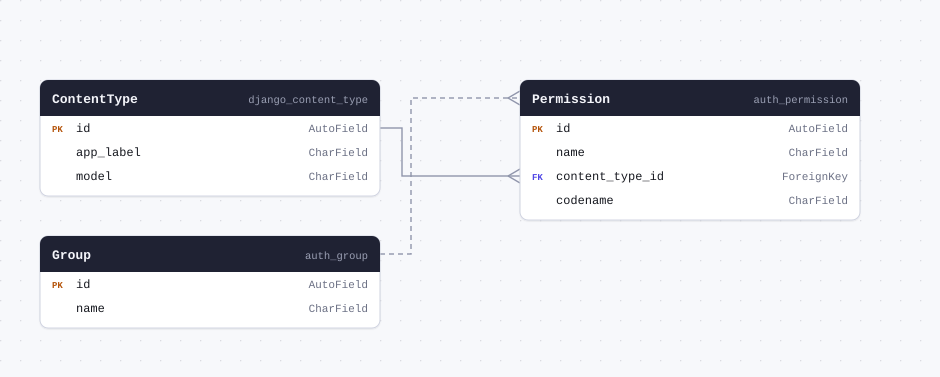

| Column | Field | Type | Null | Key | Default | Description |
| --- | --- | --- | --- | --- | --- | --- |
| `id` | `AutoField` | `integer` |  | PK | `autoincrement()` |  |
| `name` | `CharField` | `varchar(255)` |  |  |  |  |
| `content_type_id` | `ForeignKey` | `integer` |  | FK |  |  |
| `codename` | `CharField` | `varchar(100)` |  |  |  |  |

Indexes:

- index `auth_permission_content_type_id_2f476e4b` on `content_type_id`
- unique `auth_permission_content_type_id_codename_01ab375a_uniq` on `content_type_id`, `codename`

Relations:

- `content_type_id` → [ContentType](#contenttype).`id`, on delete cascade
- `group_set` — many to many with [Group](#group)

## Group

Table `auth_group`, app `auth`.

Groups are a generic way of categorizing users to apply permissions, or
some other label, to those users. A user can belong to any number of
groups.

A user in a group automatically has all the permissions granted to that
group. For example, if the group 'Site editors' has the permission
can_edit_home_page, any user in that group will have that permission.

Beyond permissions, groups are a convenient way to categorize users to
apply some label, or extended functionality, to them. For example, you
could create a group 'Special users', and you could write code that would
do special things to those users -- such as giving them access to a
members-only portion of your site, or sending them members-only email
messages.

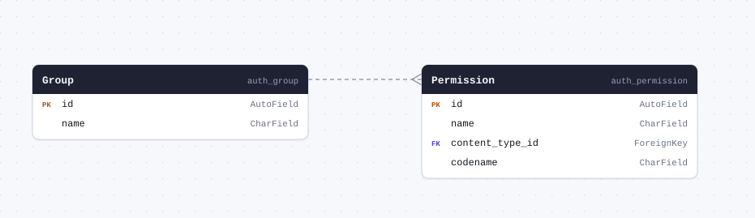

| Column | Field | Type | Null | Key | Default | Description |
| --- | --- | --- | --- | --- | --- | --- |
| `id` | `AutoField` | `integer` |  | PK | `autoincrement()` |  |
| `name` | `CharField` | `varchar(150)` |  | unique |  |  |

Indexes:

- index `auth_group_name_a6ea08ec_like` on `name` (`varchar_pattern_ops`)

Relations:

- `permissions` — many to many with [Permission](#permission)

## ContentType

Table `django_content_type`, app `contenttypes`.

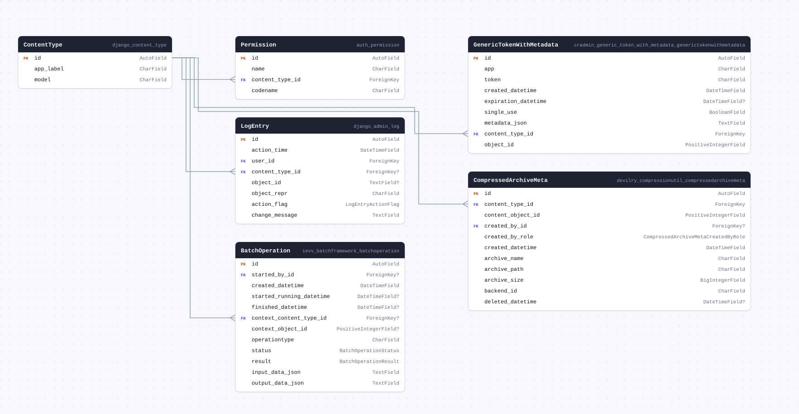

| Column | Field | Type | Null | Key | Default | Description |
| --- | --- | --- | --- | --- | --- | --- |
| `id` | `AutoField` | `integer` |  | PK | `autoincrement()` |  |
| `app_label` | `CharField` | `varchar(100)` |  |  |  |  |
| `model` | `CharField` | `varchar(100)` |  |  |  |  |

Indexes:

- unique `django_content_type_app_label_model_76bd3d3b_uniq` on `app_label`, `model`

Relations:

- [Permission](#permission).`content_type_id` → `id`, on delete cascade
- [LogEntry](#logentry).`content_type_id` → `id`, on delete set null
- [BatchOperation](#batchoperation).`context_content_type_id` → `id`, on delete cascade
- [GenericTokenWithMetadata](#generictokenwithmetadata).`content_type_id` → `id`, on delete cascade
- [CompressedArchiveMeta](#compressedarchivemeta).`content_type_id` → `id`, on delete cascade

## LogEntry

Table `django_admin_log`, app `admin`.

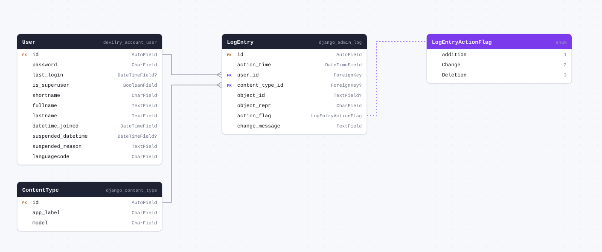

| Column | Field | Type | Null | Key | Default | Description |
| --- | --- | --- | --- | --- | --- | --- |
| `id` | `AutoField` | `integer` |  | PK | `autoincrement()` |  |
| `action_time` | `DateTimeField` | `timestamp with time zone` |  |  | `now()` |  |
| `user_id` | `ForeignKey` | `integer` |  | FK |  |  |
| `content_type_id` | `ForeignKey` | `integer` | yes | FK |  |  |
| `object_id` | `TextField` | `text` | yes |  |  |  |
| `object_repr` | `CharField` | `varchar(200)` |  |  |  |  |
| `action_flag` | `LogEntryActionFlag` | `smallint` |  |  |  |  |
| `change_message` | `TextField` | `text` |  |  |  |  |

Indexes:

- index `django_admin_log_user_id_c564eba6` on `user_id`
- index `django_admin_log_content_type_id_c4bce8eb` on `content_type_id`

Relations:

- `user_id` → [User](#user).`id`, on delete cascade
- `content_type_id` → [ContentType](#contenttype).`id`, on delete set null

## Site

Table `django_site`, app `sites`.

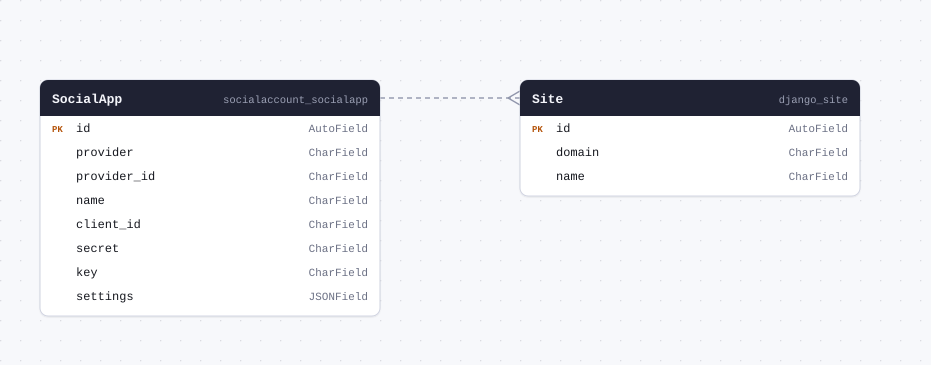

| Column | Field | Type | Null | Key | Default | Description |
| --- | --- | --- | --- | --- | --- | --- |
| `id` | `AutoField` | `integer` |  | PK | `autoincrement()` |  |
| `domain` | `CharField` | `varchar(100)` |  | unique |  |  |
| `name` | `CharField` | `varchar(50)` |  |  |  |  |

Indexes:

- index `django_site_domain_a2e37b91_like` on `domain` (`varchar_pattern_ops`)

Relations:

- `socialapp_set` — many to many with [SocialApp](#socialapp)

## BatchOperation

Table `ievv_batchframework_batchoperation`, app `ievv_batchframework`.

Defines a batch operation.

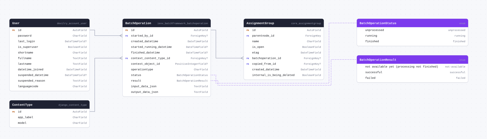

| Column | Field | Type | Null | Key | Default | Description |
| --- | --- | --- | --- | --- | --- | --- |
| `id` | `AutoField` | `integer` |  | PK | `autoincrement()` |  |
| `started_by_id` | `ForeignKey` | `integer` | yes | FK |  |  |
| `created_datetime` | `DateTimeField` | `timestamp with time zone` |  |  | `now()` |  |
| `started_running_datetime` | `DateTimeField` | `timestamp with time zone` | yes |  |  |  |
| `finished_datetime` | `DateTimeField` | `timestamp with time zone` | yes |  |  |  |
| `context_content_type_id` | `ForeignKey` | `integer` | yes | FK |  |  |
| `context_object_id` | `PositiveIntegerField` | `integer` | yes |  |  |  |
| `operationtype` | `CharField` | `varchar(255)` |  |  | `''` |  |
| `status` | `BatchOperationStatus` | `varchar(12)` |  |  | `'unprocessed'` |  |
| `result` | `BatchOperationResult` | `varchar(13)` |  |  | `'not-available'` |  |
| `input_data_json` | `TextField` | `text` |  |  | `''` |  |
| `output_data_json` | `TextField` | `text` |  |  | `''` |  |

Indexes:

- index `ievv_batchframework_batchoperation_started_by_id_b800bd60` on `started_by_id`
- index `ievv_batchframework_batcho_context_content_type_id_61d4a4a1` on `context_content_type_id`
- index `ievv_batchframework_batchoperation_operationtype_f0132b14` on `operationtype`
- index `ievv_batchframework_batchoperation_operationtype_f0132b14_like` on `operationtype` (`varchar_pattern_ops`)

Relations:

- `context_object` → any model, by `context_content_type_id` + `context_object_id` (generic foreign key)
- `started_by_id` → [User](#user).`id`, on delete cascade
- `context_content_type_id` → [ContentType](#contenttype).`id`, on delete cascade
- [AssignmentGroup](#assignmentgroup).`batchoperation_id` → `id`, on delete set null

## DevelopEmail

Table `ievv_developemail_developemail`, app `ievv_developemail`.

| Column | Field | Type | Null | Key | Default | Description |
| --- | --- | --- | --- | --- | --- | --- |
| `id` | `AutoField` | `integer` |  | PK | `autoincrement()` |  |
| `created_datetime` | `DateTimeField` | `timestamp with time zone` |  |  | `now()` |  |
| `subject` | `TextField` | `text` |  |  | `''` |  |
| `from_email` | `TextField` | `text` |  |  | `''` |  |
| `to_emails` | `TextField` | `text` |  |  | `''` |  |
| `raw_message` | `TextField` | `text` |  |  | `''` |  |

Indexes:

- index `ievv_developemail_developemail_from_email_981952b3` on `from_email`
- index `ievv_developemail_developemail_from_email_981952b3_like` on `from_email` (`text_pattern_ops`)

## Dashboard

Table `django_rq_dashboard`, app `django_rq`.

Not managed by Django (`managed = False`): it neither creates nor changes the table, whose indexes are the ones its own SQL gives it.

Admin-only model for Django-RQ dashboard integration.

| Column | Field | Type | Null | Key | Default | Description |
| --- | --- | --- | --- | --- | --- | --- |
| `id` | `AutoField` | `integer` |  | PK | `autoincrement()` |  |

## TemporaryFileCollection

Table `cradmin_temporaryfileuploadstore_temporaryfilecollection`, app `cradmin_temporaryfileuploadstore`.

A collection of temporary files uploaded by a user.

This model is used by apps to store temporary files
uploaded through the temporary file upload API. The typical
workflow is:

1. Upload some files (a collection of files) file via the API.
2. Use the IDs returned by the API to POST a form that uses
   file uploads.
3. In the code handling the form POST request, retrieve the temporary
   file(s), move them into some form of persistent storage (perhaps
   after manipulating the file in some way).
4. Delete the collection.

The ``accept``, ``max_filename_length`` and ``prevent_filename_duplicates``
attributes are set by the client. This means that you can not trust them
and have to perform error checking when you process temporary files. This
is not really a problem since:

1. You should have error checking in the views that
   use TemporaryFileCollection.
2. If you have error checking in your views, the only thing
   the user can do by manipulating the API call is to cause
   themselves a less user-friendly experience - they will typically
   get an error when they post the form containing the
   hidden field with the collection-id instead of when they upload
   a file.

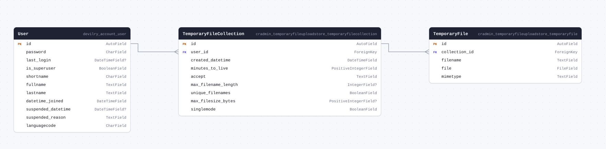

| Column | Field | Type | Null | Key | Default | Description |
| --- | --- | --- | --- | --- | --- | --- |
| `id` | `AutoField` | `integer` |  | PK | `autoincrement()` |  |
| `user_id` | `ForeignKey` | `integer` |  | FK |  | The user that owns this temporary file. Users should notbe allowed access to other users temporary files. |
| `created_datetime` | `DateTimeField` | `timestamp with time zone` |  |  | `now()` |  |
| `minutes_to_live` | `PositiveIntegerField` | `integer` |  |  | `60` | The number of minutes the app requests that this file collection should be kept before automatic removal. This is used by automatic cleanup jobs to determine what to delete. You should not rely on the file beeing automatically deleted after this number of minutes, and you should always delete files explicitly as part of the file upload process. |
| `accept` | `TextField` | `text` |  |  | `''` | An html input field accept attribute formatted string. This is validated by the API on upload. |
| `max_filename_length` | `IntegerField` | `integer` | yes |  | `None` | If specified, we shorten filenames to maximum the specified length. This is validated by the API on upload. |
| `unique_filenames` | `BooleanField` | `boolean` |  |  | `False` | If this is True, we add random data when we detect duplicate filenames. The duplicate prevention algorithm handles max_filename.This is validated by the API on upload. |
| `max_filesize_bytes` | `PositiveIntegerField` | `integer` | yes |  | `None` |  |
| `singlemode` | `BooleanField` | `boolean` |  |  | `False` | If this is True, only a single file can be added to the collection. This means that the last file added to the collection will be the only file in the collection. |

Indexes:

- index `cradmin_temporaryfileuploa_user_id_b043f918` on `user_id`

Relations:

- `user_id` → [User](#user).`id`, on delete cascade
- [TemporaryFile](#temporaryfile).`collection_id` → `id`, on delete cascade

## TemporaryFile

Table `cradmin_temporaryfileuploadstore_temporaryfile`, app `cradmin_temporaryfileuploadstore`.

A temporary file uploaded by a user.

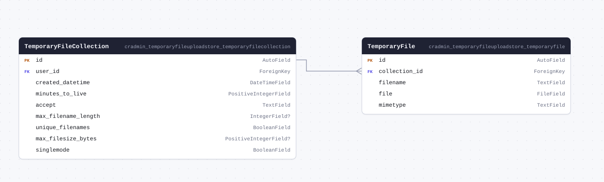

| Column | Field | Type | Null | Key | Default | Description |
| --- | --- | --- | --- | --- | --- | --- |
| `id` | `AutoField` | `integer` |  | PK | `autoincrement()` |  |
| `collection_id` | `ForeignKey` | `integer` |  | FK |  |  |
| `filename` | `TextField` | `text` |  |  |  |  |
| `file` | `FileField` | `varchar(100)` |  |  |  |  |
| `mimetype` | `TextField` | `text` |  |  | `''` |  |

Indexes:

- index `cradmin_temporaryfileuploa_collection_id_130761f4` on `collection_id`
- index `cradmin_temporaryfileuploa_filename_6fd10273` on `filename`
- index `cradmin_temporaryfileupl_filename_6fd10273_like` on `filename` (`text_pattern_ops`)

Relations:

- `collection_id` → [TemporaryFileCollection](#temporaryfilecollection).`id`, on delete cascade

## GenericTokenWithMetadata

Table `cradmin_generic_token_with_metadata_generictokenwithmetadata`, app `cradmin_generic_token_with_metadata`.

Provides a secure token with attached metadata suitable for
email and sharing workflows like password reset, public share urls, etc.

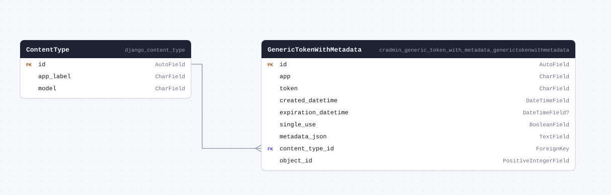

| Column | Field | Type | Null | Key | Default | Description |
| --- | --- | --- | --- | --- | --- | --- |
| `id` | `AutoField` | `integer` |  | PK | `autoincrement()` |  |
| `app` | `CharField` | `varchar(255)` |  |  |  |  |
| `token` | `CharField` | `varchar(100)` |  | unique |  |  |
| `created_datetime` | `DateTimeField` | `timestamp with time zone` |  |  |  |  |
| `expiration_datetime` | `DateTimeField` | `timestamp with time zone` | yes |  | `None` |  |
| `single_use` | `BooleanField` | `boolean` |  |  | `True` |  |
| `metadata_json` | `TextField` | `text` |  |  | `''` |  |
| `content_type_id` | `ForeignKey` | `integer` |  | FK |  |  |
| `object_id` | `PositiveIntegerField` | `integer` |  |  |  |  |

Indexes:

- index `cradmin_generic_token_with_app_eb8d47f3` on `app`
- index `cradmin_generic_token_wi_app_eb8d47f3_like` on `app` (`varchar_pattern_ops`)
- index `cradmin_generic_token_wi_token_b381124d_like` on `token` (`varchar_pattern_ops`)
- index `cradmin_generic_token_with_content_type_id_6e0a27ae` on `content_type_id`

Relations:

- `content_object` → any model, by `content_type_id` + `object_id` (generic foreign key)
- `content_type_id` → [ContentType](#contenttype).`id`, on delete cascade

## Subject

Table `core_subject`, app `core`.

.. attribute:: short_name

    A django.db.models.SlugField_ with max 20 characters. Only numbers,
    letters, '_' and '-'. Unlike all other children of
    :class:`BaseNode`, Subject.short_name is **unique**. This is mainly
    to avoid the overhead of having to recurse all the way to the top of
    the node hierarchy for every unique path.

.. attribute:: periods

    A set of :class:`periods <devilry.apps.core.models.Period>` for this subject.

.. attribute:: etag

   A DateTimeField containing the etag for this object.

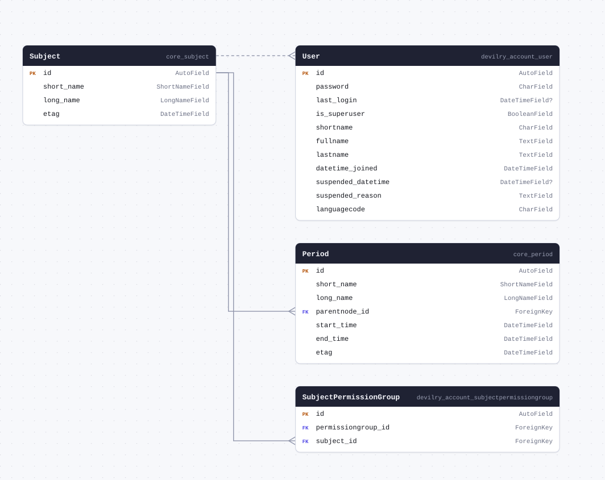

| Column | Field | Type | Null | Key | Default | Description |
| --- | --- | --- | --- | --- | --- | --- |
| `id` | `AutoField` | `integer` |  | PK | `autoincrement()` |  |
| `short_name` | `ShortNameField` | `varchar(20)` |  | unique |  | Up to 20 letters of lowercase english letters (a-z), numbers, underscore ("_") and hyphen ("-"). Used when the name takes too much space. |
| `long_name` | `LongNameField` | `varchar(100)` |  |  |  |  |
| `etag` | `DateTimeField` | `timestamp with time zone` |  |  | `now()` |  |

Indexes:

- index `core_subject_short_name_7172d8cd_like` on `short_name` (`varchar_pattern_ops`)
- index `core_subject_long_name_d9b3b016` on `long_name`
- index `core_subject_long_name_d9b3b016_like` on `long_name` (`varchar_pattern_ops`)

Relations:

- `admins` — many to many with [User](#user)
- [Period](#period).`parentnode_id` → `id`, on delete cascade
- [SubjectPermissionGroup](#subjectpermissiongroup).`subject_id` → `id`, on delete cascade

## Period

Table `core_period`, app `core`.

A Period represents a period of time, for example a half-year term
at a university.


.. attribute:: parentnode

    A django.db.models.ForeignKey_ that points to the parent node,
    which is always a `Subject`_.

.. attribute:: start_time

    A django.db.models.DateTimeField_ representing the starting time of
    the period.

.. attribute:: end_time

    A django.db.models.DateTimeField_ representing the ending time of
    the period.

.. attribute:: admins

    A django.db.models.ManyToManyField_ that holds all the admins of the
    node.

.. attribute:: assignments

    A Django RelatedManager of :class:`assignments <devilry.apps.core.models.Assignment>` for this period.

.. attribute:: relatedexaminer_set

    A Django RelatedManager of :class:`RelatedExaminers <devilry.apps.core.models.RelatedExaminer>` for this period.

.. attribute:: relatedstudent_set

    A Django RelatedManager of :class:`RelatedStudents <devilry.apps.core.models.RelatedStudent>` for this period.

.. attribute:: etag

   A DateTimeField containing the etag for this object.

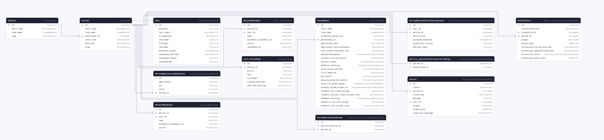

| Column | Field | Type | Null | Key | Default | Description |
| --- | --- | --- | --- | --- | --- | --- |
| `id` | `AutoField` | `integer` |  | PK | `autoincrement()` |  |
| `short_name` | `ShortNameField` | `varchar(20)` |  |  |  | Up to 20 letters of lowercase english letters (a-z), numbers, underscore ("_") and hyphen ("-"). Used when the name takes too much space. |
| `long_name` | `LongNameField` | `varchar(100)` |  |  |  |  |
| `parentnode_id` | `ForeignKey` | `integer` |  | FK |  |  |
| `start_time` | `DateTimeField` | `timestamp with time zone` |  |  |  | Start time and end time defines when the period is active. |
| `end_time` | `DateTimeField` | `timestamp with time zone` |  |  |  | Start time and end time defines when the period is active. |
| `etag` | `DateTimeField` | `timestamp with time zone` |  |  | `now()` |  |

Indexes:

- index `core_period_short_name_95d3f6a9` on `short_name`
- index `core_period_short_name_95d3f6a9_like` on `short_name` (`varchar_pattern_ops`)
- index `core_period_long_name_66f8a24b` on `long_name`
- index `core_period_long_name_66f8a24b_like` on `long_name` (`varchar_pattern_ops`)
- index `core_period_parentnode_id_fafbee43` on `parentnode_id`
- unique `core_period_short_name_parentnode_id_08ced67b_uniq` on `short_name`, `parentnode_id`

Relations:

- `parentnode_id` → [Subject](#subject).`id`, on delete cascade
- `admins` — many to many with [User](#user)
- [PeriodApplicationKeyValue](#periodapplicationkeyvalue).`period_id` → `id`, on delete cascade
- [RelatedExaminer](#relatedexaminer).`period_id` → `id`, on delete cascade
- [RelatedStudent](#relatedstudent).`period_id` → `id`, on delete cascade
- [core.PeriodTag](#coreperiodtag).`period_id` → `id`, on delete cascade
- [Assignment](#assignment).`parentnode_id` → `id`, on delete cascade
- [PeriodPermissionGroup](#periodpermissiongroup).`period_id` → `id`, on delete cascade
- [PeriodUserGuidelineAcceptance](#perioduserguidelineacceptance).`period_id` → `id`, on delete cascade
- [devilry_qualifiesforexam.PeriodTag](#devilry_qualifiesforexamperiodtag).`period_id` → `id`, on delete cascade
- [Status](#status).`period_id` → `id`, on delete cascade
- [DraftStatus](#draftstatus).`period_id` → `id`, on delete cascade

## PeriodApplicationKeyValue

Table `core_periodapplicationkeyvalue`, app `core`.

Columns from `AbstractApplicationKeyValue` (abstract): `application`, `key`, `value`.

Key/value pair tied to a specific Period.

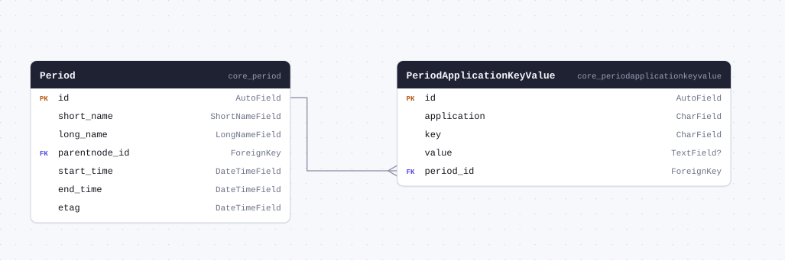

| Column | Field | Type | Null | Key | Default | Description |
| --- | --- | --- | --- | --- | --- | --- |
| `id` | `AutoField` | `integer` |  | PK | `autoincrement()` |  |
| `application` | `CharField` | `varchar(300)` |  |  |  | Application identifier. Max 300 chars. |
| `key` | `CharField` | `varchar(300)` |  |  |  | Key. Max 300 chars. |
| `value` | `TextField` | `text` | yes |  |  | Value. |
| `period_id` | `ForeignKey` | `integer` |  | FK |  | The period where this metadata belongs. |

Indexes:

- index `core_periodapplicationkeyvalue_application_1a66ea20` on `application`
- index `core_periodapplicationkeyvalue_application_1a66ea20_like` on `application` (`varchar_pattern_ops`)
- index `core_periodapplicationkeyvalue_key_2001d526` on `key`
- index `core_periodapplicationkeyvalue_key_2001d526_like` on `key` (`varchar_pattern_ops`)
- index `core_periodapplicationkeyvalue_value_d280ca28` on `value`
- index `core_periodapplicationkeyvalue_value_d280ca28_like` on `value` (`text_pattern_ops`)
- index `core_periodapplicationkeyvalue_period_id_5004dd70` on `period_id`
- unique `core_periodapplicationke_period_id_application_ke_29a36e16_uniq` on `period_id`, `application`, `key`

Relations:

- `period_id` → [Period](#period).`id`, on delete cascade

## RelatedExaminer

Table `core_relatedexaminer`, app `core`.

Columns from `RelatedUserBase` (abstract): `period_id`, `user_id`, `tags`, `automatic_anonymous_id`.

Related examiner.

Adds no fields to RelatedUserBase.

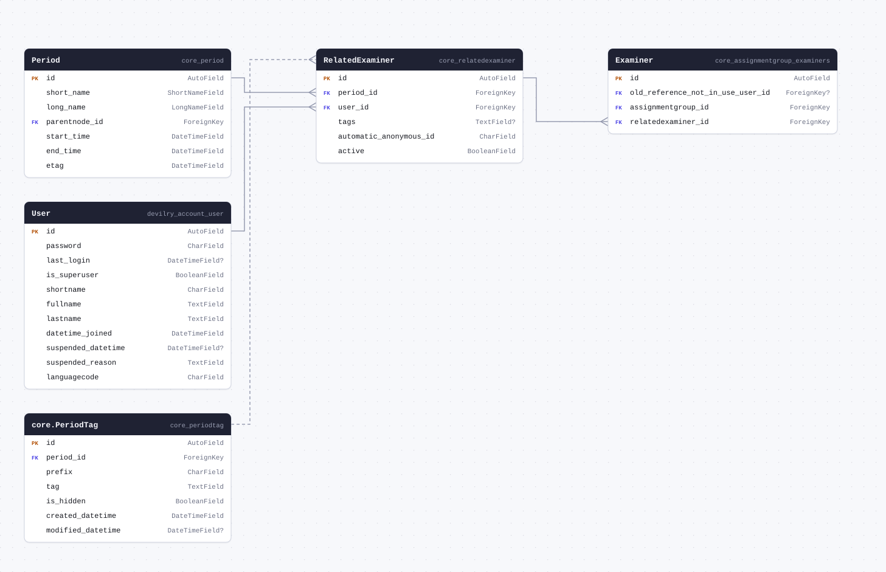

| Column | Field | Type | Null | Key | Default | Description |
| --- | --- | --- | --- | --- | --- | --- |
| `id` | `AutoField` | `integer` |  | PK | `autoincrement()` |  |
| `period_id` | `ForeignKey` | `integer` |  | FK |  | The period. |
| `user_id` | `ForeignKey` | `integer` |  | FK |  | The related user. |
| `tags` | `TextField` | `text` | yes |  |  | Comma-separated list of tags. Each tag is a word with the following letters allowed: a-z, 0-9, ``_`` and ``-``. Each word is separated by a comma, and no whitespace. |
| `automatic_anonymous_id` | `CharField` | `varchar(255)` |  |  | `''` |  |
| `active` | `BooleanField` | `boolean` |  |  | `True` |  |

Indexes:

- index `core_relatedexaminer_period_id_2f042ce2` on `period_id`
- index `core_relatedexaminer_user_id_8bedf468` on `user_id`
- unique `core_relatedexaminer_period_id_user_id_1cfbaad4_uniq` on `period_id`, `user_id`

Relations:

- `period_id` → [Period](#period).`id`, on delete cascade
- `user_id` → [User](#user).`id`, on delete cascade
- `periodtag_set` — many to many with [core.PeriodTag](#coreperiodtag)
- [Examiner](#examiner).`relatedexaminer_id` → `id`, on delete cascade

## RelatedStudent

Table `core_relatedstudent`, app `core`.

Columns from `RelatedUserBase` (abstract): `period_id`, `user_id`, `tags`, `automatic_anonymous_id`.

Related student.

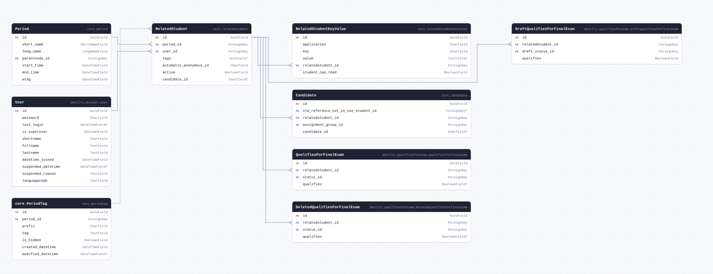

| Column | Field | Type | Null | Key | Default | Description |
| --- | --- | --- | --- | --- | --- | --- |
| `id` | `AutoField` | `integer` |  | PK | `autoincrement()` |  |
| `period_id` | `ForeignKey` | `integer` |  | FK |  | The period. |
| `user_id` | `ForeignKey` | `integer` |  | FK |  | The related user. |
| `tags` | `TextField` | `text` | yes |  |  | Comma-separated list of tags. Each tag is a word with the following letters allowed: a-z, 0-9, ``_`` and ``-``. Each word is separated by a comma, and no whitespace. |
| `automatic_anonymous_id` | `CharField` | `varchar(255)` |  |  | `''` |  |
| `active` | `BooleanField` | `boolean` |  |  | `True` |  |
| `candidate_id` | `CharField` | `varchar(30)` | yes |  |  |  |

Indexes:

- index `core_relatedstudent_period_id_9af6a0a9` on `period_id`
- index `core_relatedstudent_user_id_e952c98a` on `user_id`
- unique `core_relatedstudent_period_id_user_id_bb12ecab_uniq` on `period_id`, `user_id`

Relations:

- `period_id` → [Period](#period).`id`, on delete cascade
- `user_id` → [User](#user).`id`, on delete cascade
- [RelatedStudentKeyValue](#relatedstudentkeyvalue).`relatedstudent_id` → `id`, on delete cascade
- `periodtag_set` — many to many with [core.PeriodTag](#coreperiodtag)
- [Candidate](#candidate).`relatedstudent_id` → `id`, on delete cascade
- [QualifiesForFinalExam](#qualifiesforfinalexam).`relatedstudent_id` → `id`, on delete cascade
- [DeletedQualifiesForFinalExam](#deletedqualifiesforfinalexam).`relatedstudent_id` → `id`, on delete cascade
- [DraftQualifiesForFinalExam](#draftqualifiesforfinalexam).`relatedstudent_id` → `id`, on delete cascade

## RelatedStudentKeyValue

Table `core_relatedstudentkeyvalue`, app `core`.

Columns from `AbstractApplicationKeyValue` (abstract): `application`, `key`, `value`.

Key/value pair tied to a specific RelatedStudent.

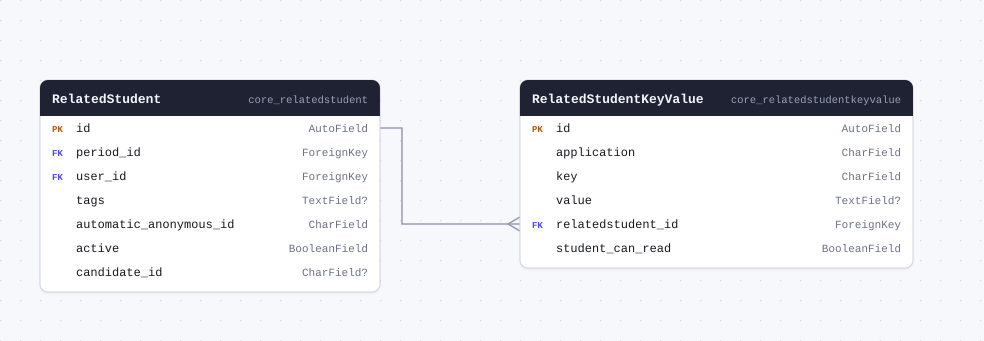

| Column | Field | Type | Null | Key | Default | Description |
| --- | --- | --- | --- | --- | --- | --- |
| `id` | `AutoField` | `integer` |  | PK | `autoincrement()` |  |
| `application` | `CharField` | `varchar(300)` |  |  |  | Application identifier. Max 300 chars. |
| `key` | `CharField` | `varchar(300)` |  |  |  | Key. Max 300 chars. |
| `value` | `TextField` | `text` | yes |  |  | Value. |
| `relatedstudent_id` | `ForeignKey` | `integer` |  | FK |  |  |
| `student_can_read` | `BooleanField` | `boolean` |  |  | `False` | Specifies if a student can read the value or not. |

Indexes:

- index `core_relatedstudentkeyvalue_application_95652c6e` on `application`
- index `core_relatedstudentkeyvalue_application_95652c6e_like` on `application` (`varchar_pattern_ops`)
- index `core_relatedstudentkeyvalue_key_03d759fd` on `key`
- index `core_relatedstudentkeyvalue_key_03d759fd_like` on `key` (`varchar_pattern_ops`)
- index `core_relatedstudentkeyvalue_value_f2c810af` on `value`
- index `core_relatedstudentkeyvalue_value_f2c810af_like` on `value` (`text_pattern_ops`)
- index `core_relatedstudentkeyvalue_relatedstudent_id_49b0ce0d` on `relatedstudent_id`
- unique `core_relatedstudentkeyva_relatedstudent_id_applic_68da6d0f_uniq` on `relatedstudent_id`, `application`, `key`

Relations:

- `relatedstudent_id` → [RelatedStudent](#relatedstudent).`id`, on delete cascade

## core.PeriodTag

Table `core_periodtag`, app `core`.

A :class:`.PeriodTag` represents a form of grouping on a period for
:class:`~.devilry.app.core.models.relateduser.RelatedStudent`s and
:class:`~.devilry.app.core.models.relateduser.RelatedExaminer`s.

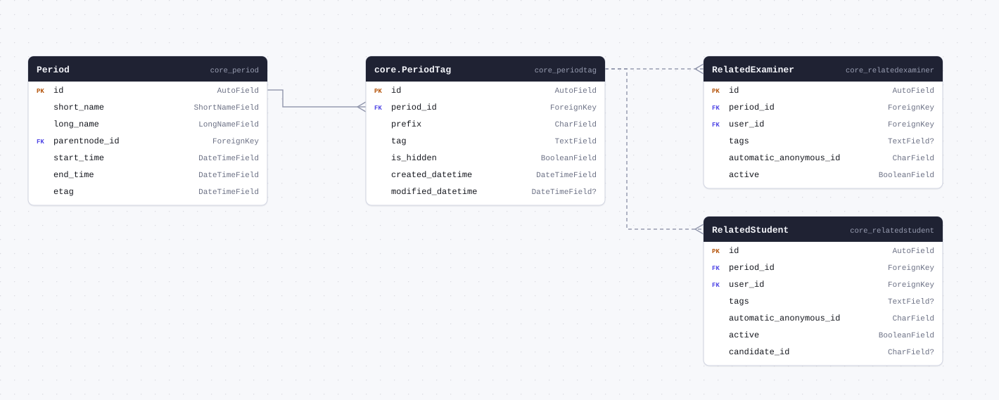

| Column | Field | Type | Null | Key | Default | Description |
| --- | --- | --- | --- | --- | --- | --- |
| `id` | `AutoField` | `integer` |  | PK | `autoincrement()` |  |
| `period_id` | `ForeignKey` | `integer` |  | FK |  |  |
| `prefix` | `CharField` | `varchar(30)` |  |  | `''` |  |
| `tag` | `TextField` | `text` |  |  |  |  |
| `is_hidden` | `BooleanField` | `boolean` |  |  | `False` |  |
| `created_datetime` | `DateTimeField` | `timestamp with time zone` |  |  | `now()` |  |
| `modified_datetime` | `DateTimeField` | `timestamp with time zone` | yes |  |  |  |

Indexes:

- index `core_periodtag_period_id_d7a1e8c9` on `period_id`
- index `core_periodtag_tag_b42bbccb` on `tag`
- index `core_periodtag_tag_b42bbccb_like` on `tag` (`text_pattern_ops`)
- unique `core_periodtag_period_id_prefix_tag_85a8db44_uniq` on `period_id`, `prefix`, `tag`

Relations:

- `period_id` → [Period](#period).`id`, on delete cascade
- `relatedexaminers` — many to many with [RelatedExaminer](#relatedexaminer)
- `relatedstudents` — many to many with [RelatedStudent](#relatedstudent)

## Assignment

Table `core_assignment`, app `core`.

Data model for an assignment.

.. attribute:: gradeform_setup_json

    A django.db.models.TextField_ for the json representing a blank
    gradeform used for this 'Assignment_'

.. attribute:: parentnode

    A django.db.models.ForeignKey_ that points to the parent node,
    which is always a `Period`_.

.. attribute:: publishing_time

    A django.db.models.DateTimeField_ representing the publishing time of
    the assignment.

.. attribute:: admins

    A django.db.models.ManyToManyField_ that holds all the admins of the
    Node.

.. attribute:: assignmentgroups

    A set of :class:`assignmentgroups <devilry.apps.core.models.AssignmentGroup>` for this assignment

.. attribute:: scale_points_percent

    Percent to scale points on this assignment by for period overviews. The default is 100,
    which means no change to the points.

.. attribute:: delivery_types

    An integer identifying the type of deliveries allowed. Possible values:

        0
            Electronic deliveries using Devilry
        1
            Non-electronic deliveries, or deliveries made through another
            electronic system.
        2
            An alias/link to a delivery made in another Period.

.. attribute:: deadline_handling

    An integer identifying how deadlines are handled.

        0
            Soft deadlines. Deliveries can be added until groups are closed.
        1
            Hard deadlines. Deliveries can not be added after the deadline
            has expired.

.. attribute:: first_deadline

    A DateTimeField containing an optional first deadline for this
    assignment. This is metadata that the UI can use where it is
    natural.

.. attribute:: max_points

    An IntegerField that contains the maximum number of points possible to achieve on
    this assignment. This field may be ``None``, and it is normally set by the
    grading system plugin.

    DO NOT UPDATE MANUALLY. You can safely set an initial value for this
    manually when you create a new assignment, but when you update this
    field, do so using :meth:`.set_max_points`.

.. attribute:: passing_grade_min_points

    An IntegerField that contains the minimum number of points required to
    achive a passing grade on this assignment. This means that any feedback
    with more this number of points or more is considered a passing grade.

    WARNING: Changing this does not have any effect on existing feedback.
    To actually change existing feedback, you would have to update all
    feedback on the assignment, effectively creating new StaticFeedbacks
    from the latest published FeedbackDrafts for each AssignmentGroup.

.. attribute:: grading_system_plugin_id

    A CharField containing the ID of the grading system plugin this
    assignment uses.


.. attribute:: students_can_create_groups

    BooleanField specifying if students can join/leave groups on
    their own.

    If this is ``True`` students should be allowed to join/leave groups.
    If :attr:`.students_can_not_create_groups_after` is specified, this
    students can not create groups after ``students_can_not_create_groups_after``
    even if this is ``True``.ar 16 2017, 17:45 : This delivery was corrected, and given:

    This does not in any way affect an admins ability to organize students
    in groups manually.

.. attribute:: students_can_not_create_groups_after

    Students can not create project groups after this time. Ignored if
    :attr:`.students_can_create_groups` is ``False``.

    DateTimeField that defaults to ``None`` (null).

.. attribute:: feedback_workflow

    The feedback workflow used on the assignment. A feedback workflow
    defines how examiners and administrators work together to make
    feedback available to students.

    Introduced in :devilryissue:`765`.

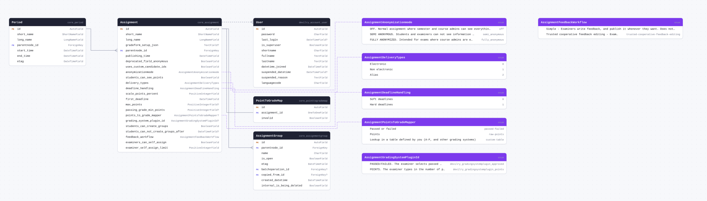

| Column | Field | Type | Null | Key | Default | Description |
| --- | --- | --- | --- | --- | --- | --- |
| `id` | `AutoField` | `integer` |  | PK | `autoincrement()` |  |
| `short_name` | `ShortNameField` | `varchar(20)` |  |  |  | Up to 20 letters of lowercase english letters (a-z), numbers, underscore ("_") and hyphen ("-"). Used when the name takes too much space. |
| `long_name` | `LongNameField` | `varchar(100)` |  |  |  |  |
| `gradeform_setup_json` | `TextField` | `text` | yes |  |  |  |
| `parentnode_id` | `ForeignKey` | `integer` |  | FK |  |  |
| `publishing_time` | `DateTimeField` | `timestamp with time zone` |  |  |  | The time when the assignment is to be published (visible to students and examiners). |
| `deprecated_field_anonymous` | `BooleanField` | `boolean` |  |  | `False` | Deprecated anonymous field. Will be removed in 3.1. |
| `uses_custom_candidate_ids` | `BooleanField` | `boolean` |  |  | `False` | If this is enabled, the assignment does not inherit candidate IDs from the semester, and instead have their own set of candidate IDs only for this assignment. |
| `anonymizationmode` | `AssignmentAnonymizationmode` | `varchar(15)` |  |  | `'off'` |  |
| `students_can_see_points` | `BooleanField` | `boolean` |  |  | `False` |  |
| `delivery_types` | `AssignmentDeliveryTypes` | `integer` |  |  | `0` | This option controls what types of deliveries this assignment accepts. See the Delivery documentation for more info. |
| `deadline_handling` | `AssignmentDeadlineHandling` | `integer` |  |  | `get_deadline_handling_default()` | With HARD deadlines, students will be unable to make deliveries when a deadline has expired. With SOFT deadlines students will be able to make deliveries after the deadline has expired. All deliveries after their deadline are clearly highligted. NOTE: Devilry is designed from the bottom up to gracefully handle SOFT deadlines. Students have to perform an extra confirm-step when adding deliveries after their active deadline, and assignments where the deadline has expired is clearly marked for both students and examiners. |
| `scale_points_percent` | `PositiveIntegerField` | `integer` |  |  | `100` | Percent to scale points on this assignment by for period overviews. The default is 100, which means no change to the points. |
| `first_deadline` | `DateTimeField` | `timestamp with time zone` |  |  |  |  |
| `max_points` | `PositiveIntegerField` | `integer` | yes |  | `1` |  |
| `passing_grade_min_points` | `PositiveIntegerField` | `integer` | yes |  | `1` |  |
| `points_to_grade_mapper` | `AssignmentPointsToGradeMapper` | `varchar(25)` | yes |  | `'passed-failed'` |  |
| `grading_system_plugin_id` | `AssignmentGradingSystemPluginId` | `varchar(300)` | yes |  | `'devilry_gradingsystemplugin_approved'` |  |
| `students_can_create_groups` | `BooleanField` | `boolean` |  |  | `False` | Select this if students should be allowed to join/leave groups. Even if this is not selected, you can still organize your students in groups manually. |
| `students_can_not_create_groups_after` | `DateTimeField` | `timestamp with time zone` | yes |  | `None` | Students can not create project groups after this time. Ignored if "Students can create project groups" is not selected. |
| `feedback_workflow` | `AssignmentFeedbackWorkflow` | `varchar(50)` |  |  | `''` |  |
| `examiners_can_self_assign` | `BooleanField` | `boolean` |  |  | `False` | Select this if you want examiners to be able to self-assign to the assignment. |
| `examiner_self_assign_limit` | `PositiveIntegerField` | `integer` |  |  | `1` | The max number of examiners that are allowed to self-assign to each project group within the assignment. |

Indexes:

- index `core_assignment_short_name_c4ce3028` on `short_name`
- index `core_assignment_short_name_c4ce3028_like` on `short_name` (`varchar_pattern_ops`)
- index `core_assignment_long_name_67693a1c` on `long_name`
- index `core_assignment_long_name_67693a1c_like` on `long_name` (`varchar_pattern_ops`)
- index `core_assignment_parentnode_id_4d94c25f` on `parentnode_id`
- index `core_assignment_anonymizationmode_1c86bb06` on `anonymizationmode`
- index `core_assignment_anonymizationmode_1c86bb06_like` on `anonymizationmode` (`varchar_pattern_ops`)
- unique `core_assignment_short_name_parentnode_id_41a7b9eb_uniq` on `short_name`, `parentnode_id`

Relations:

- `parentnode_id` → [Period](#period).`id`, on delete cascade
- `admins` — many to many with [User](#user)
- [PointToGradeMap](#pointtogrademap).`assignment_id` → `id`, on delete cascade
- [AssignmentGroup](#assignmentgroup).`parentnode_id` → `id`, on delete cascade

## PointToGradeMap

Table `core_pointtogrademap`, app `core`.

Data structure to store the mapping from a point ranges to grades
when using custom-table.

The basic idea is described in https://github.com/devilry/devilry-django/issues/511,
but we decided to add this OneToOne table to represent a mapping table
to avoid adding complexity to Assignment that is only needed when the
custom-table ``points_to_grade_mapper`` is used.

.. attribute:: assignment

    Foreign Key to the assignment.

.. attribute:: invalid

    This is set to ``True`` when the map has been invalidated because of
    changes to :attr:`devilry.apps.core.models.Assignment.max_points`,
    or when the map has been created, but it is empty.

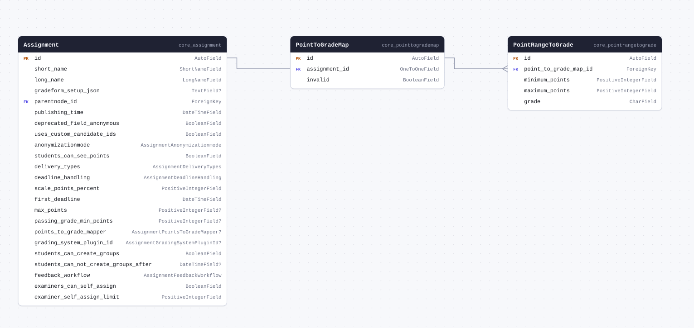

| Column | Field | Type | Null | Key | Default | Description |
| --- | --- | --- | --- | --- | --- | --- |
| `id` | `AutoField` | `integer` |  | PK | `autoincrement()` |  |
| `assignment_id` | `OneToOneField` | `integer` |  | FK, unique |  |  |
| `invalid` | `BooleanField` | `boolean` |  |  | `True` |  |

Relations:

- `assignment_id` → [Assignment](#assignment).`id`, on delete cascade
- [PointRangeToGrade](#pointrangetograde).`point_to_grade_map_id` → `id`, on delete cascade

## PointRangeToGrade

Table `core_pointrangetograde`, app `core`.

Data structure to store the mapping from a single point-range to grade
when using custom-table.

First described in https://github.com/devilry/devilry-django/issues/511.

.. attribute:: point_to_grade_map

    Foreign Key to the PointToGradeMap.

.. attribute:: minimum_points

    Minimum value for points that matches this table entry.

.. attribute:: maximum_points
    Minimum value for points that matches this table entry.

.. attribute:: grade

    The grade that this entry represents a match for.

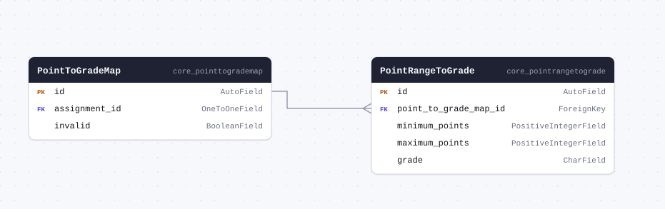

| Column | Field | Type | Null | Key | Default | Description |
| --- | --- | --- | --- | --- | --- | --- |
| `id` | `AutoField` | `integer` |  | PK | `autoincrement()` |  |
| `point_to_grade_map_id` | `ForeignKey` | `integer` |  | FK |  |  |
| `minimum_points` | `PositiveIntegerField` | `integer` |  |  |  |  |
| `maximum_points` | `PositiveIntegerField` | `integer` |  |  |  |  |
| `grade` | `CharField` | `varchar(12)` |  |  |  |  |

Indexes:

- index `core_pointrangetograde_point_to_grade_map_id_82a8e56b` on `point_to_grade_map_id`
- unique `core_pointrangetograde_point_to_grade_map_id_gr_222e49f3_uniq` on `point_to_grade_map_id`, `grade`

Relations:

- `point_to_grade_map_id` → [PointToGradeMap](#pointtogrademap).`id`, on delete cascade

## AssignmentGroup

Table `core_assignmentgroup`, app `core`.

Represents a student or a group of students.

.. attribute:: parentnode

    A django.db.models.ForeignKey_ that points to the parent node,
    which is always an Assignment.

.. attribute:: name

    An optional name for the group.

.. attribute:: candidates

    A django ``RelatedManager`` that holds the :class:`candidates <devilry.apps.core.models.Candidate>`
    on this group.

.. attribute:: examiners

    A django.db.models.ManyToManyField_ that holds the examiner(s) that are
    to correct and grade the assignment.

.. attribute:: is_open

    A django.db.models.BooleanField_ that tells you if the group can add
    deliveries or not.

.. attribute:: tags

    A django ``RelatedManager`` that holds the :class:`tags <devilry.apps.core.models.AssignmentGroupTag>`
    on this group.

.. attribute:: etag

   A DateTimeField containing the etag for this object.

.. attribute:: cached_data

    A Django RelatedManager of :class:`cached_data <devilry.devilry_dbcache.models.AssignmentGroupCachedData>` for this AssignmentGroup.

.. attribute:: feedbackset

    A Django RelatedManager :class:`devilry.apps.core.models.FeedbackSet` for this AssignmentGroup

Note:
    Postgres triggers create a :class:`devilry.apps.core.models.FeedbackSet` on INSERT

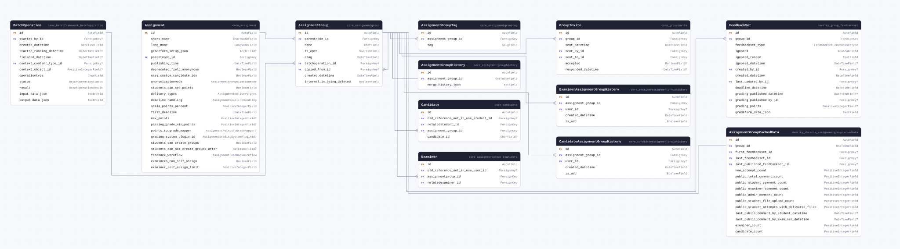

| Column | Field | Type | Null | Key | Default | Description |
| --- | --- | --- | --- | --- | --- | --- |
| `id` | `AutoField` | `integer` |  | PK | `autoincrement()` |  |
| `parentnode_id` | `ForeignKey` | `integer` |  | FK |  |  |
| `name` | `CharField` | `varchar(30)` |  |  | `''` | An optional name for the group. Typically used a project name on project assignments. |
| `is_open` | `BooleanField` | `boolean` |  |  | `True` | If this is checked, the group can add deliveries. |
| `etag` | `DateTimeField` | `timestamp with time zone` |  |  | `now()` |  |
| `batchoperation_id` | `ForeignKey` | `integer` | yes | FK |  |  |
| `copied_from_id` | `ForeignKey` | `integer` | yes | FK |  |  |
| `created_datetime` | `DateTimeField` | `timestamp with time zone` |  |  | `now()` |  |
| `internal_is_being_deleted` | `BooleanField` | `boolean` |  |  | `False` |  |

Indexes:

- index `core_assignmentgroup_parentnode_id_87cccd37` on `parentnode_id`
- index `core_assignmentgroup_batchoperation_id_38d6850d` on `batchoperation_id`
- index `core_assignmentgroup_copied_from_id_e9b414dc` on `copied_from_id`

Relations:

- `parentnode_id` → [Assignment](#assignment).`id`, on delete cascade
- `batchoperation_id` → [BatchOperation](#batchoperation).`id`, on delete set null
- `copied_from_id` → [AssignmentGroup](#assignmentgroup).`id`, on delete set null
- [AssignmentGroupTag](#assignmentgrouptag).`assignment_group_id` → `id`, on delete cascade
- [AssignmentGroupHistory](#assignmentgrouphistory).`assignment_group_id` → `id`, on delete cascade
- [Candidate](#candidate).`assignment_group_id` → `id`, on delete cascade
- [Examiner](#examiner).`assignmentgroup_id` → `id`, on delete cascade
- [GroupInvite](#groupinvite).`group_id` → `id`, on delete cascade
- [ExaminerAssignmentGroupHistory](#examinerassignmentgrouphistory).`assignment_group_id` → `id`, on delete cascade
- [CandidateAssignmentGroupHistory](#candidateassignmentgrouphistory).`assignment_group_id` → `id`, on delete cascade
- [FeedbackSet](#feedbackset).`group_id` → `id`, on delete cascade
- [AssignmentGroupCachedData](#assignmentgroupcacheddata).`group_id` → `id`, on delete cascade

## AssignmentGroupTag

Table `core_assignmentgrouptag`, app `core`.

An AssignmentGroup can be tagged with zero or more tags using this class.

.. attribute:: assignment_group

    The `AssignmentGroup`_ where this groups belongs.

.. attribute:: tag

    The tag. Max 20 characters. Can only contain a-z, A-Z, 0-9 and "_".

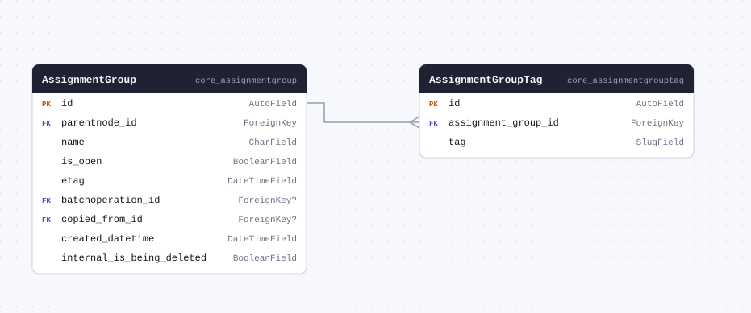

| Column | Field | Type | Null | Key | Default | Description |
| --- | --- | --- | --- | --- | --- | --- |
| `id` | `AutoField` | `integer` |  | PK | `autoincrement()` |  |
| `assignment_group_id` | `ForeignKey` | `integer` |  | FK |  |  |
| `tag` | `SlugField` | `varchar(20)` |  |  |  | A tag can contain a-z, A-Z, 0-9 and "_". |

Indexes:

- index `core_assignmentgrouptag_assignment_group_id_5d5cd401` on `assignment_group_id`
- index `core_assignmentgrouptag_tag_d831fb07` on `tag`
- index `core_assignmentgrouptag_tag_d831fb07_like` on `tag` (`varchar_pattern_ops`)
- unique `core_assignmentgrouptag_assignment_group_id_tag_550dcdd2_uniq` on `assignment_group_id`, `tag`

Relations:

- `assignment_group_id` → [AssignmentGroup](#assignmentgroup).`id`, on delete cascade

## AssignmentGroupHistory

Table `core_assignmentgrouphistory`, app `core`.

This models keeps an audit trail of merges in a Btree structure

Attributes:
    assignment_group (:class:`core.AssignmentGroup`): One to one field to AssignmentGroup
    merge_history_json (json): json string with history data

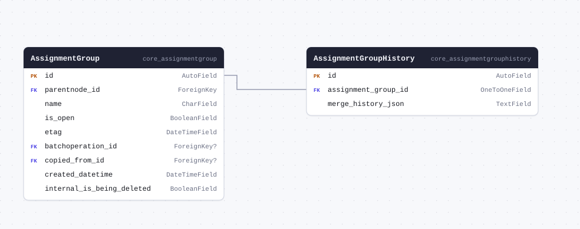

| Column | Field | Type | Null | Key | Default | Description |
| --- | --- | --- | --- | --- | --- | --- |
| `id` | `AutoField` | `integer` |  | PK | `autoincrement()` |  |
| `assignment_group_id` | `OneToOneField` | `integer` |  | FK, unique |  |  |
| `merge_history_json` | `TextField` | `text` |  |  | `'{"merge_datetime": null, "state": null, "groups": []}'` |  |

Relations:

- `assignment_group_id` → [AssignmentGroup](#assignmentgroup).`id`, on delete cascade

## Candidate

Table `core_candidate`, app `core`.

A student within an AssignmentGroup.

A candidate is a many-to-many between :class:`devilry.apps.core.models.AssignmentGroup`
and a user.

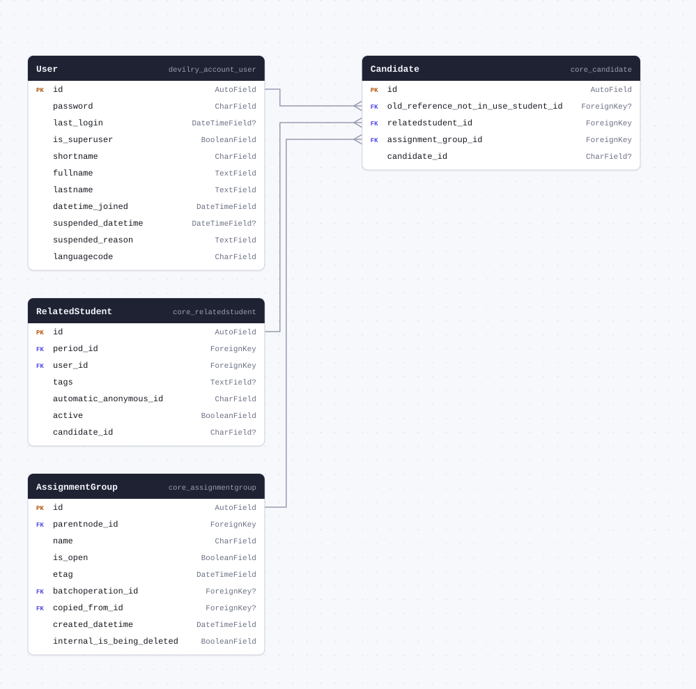

| Column | Field | Type | Null | Key | Default | Description |
| --- | --- | --- | --- | --- | --- | --- |
| `id` | `AutoField` | `integer` |  | PK | `autoincrement()` |  |
| `old_reference_not_in_use_student_id` | `ForeignKey` | `integer` | yes | FK | `None` |  |
| `relatedstudent_id` | `ForeignKey` | `integer` |  | FK |  |  |
| `assignment_group_id` | `ForeignKey` | `integer` |  | FK |  |  |
| `candidate_id` | `CharField` | `varchar(30)` | yes |  |  | An optional candidate id. This can be anything as long as it is less than 30 characters. Used to show the user on anonymous assignmens. |

Indexes:

- index `core_candidate_old_reference_not_in_use_student_id_5c2092f7` on `old_reference_not_in_use_student_id`
- index `core_candidate_relatedstudent_id_1eff0d45` on `relatedstudent_id`
- index `core_candidate_assignment_group_id_341f2f7b` on `assignment_group_id`

Relations:

- `old_reference_not_in_use_student_id` → [User](#user).`id`, on delete cascade
- `relatedstudent_id` → [RelatedStudent](#relatedstudent).`id`, on delete cascade
- `assignment_group_id` → [AssignmentGroup](#assignmentgroup).`id`, on delete cascade

## DevilryUserProfile

Table `core_devilryuserprofile`, app `core`.

User profile with a one-to-one relation to ``django.contrib.auth.models.User``.

Ment to be used as a Django *user profile* (AUTH_PROFILE_MODULE).

.. attribute:: full_name

    Django splits names into first_name and last_name. They are only 30 chars each.
    Read about why this is not a good idea here:

        http://www.kalzumeus.com/2010/06/17/falsehoods-programmers-believe-about-names/

    Since we require support for *any* name, we use our own ``full_name``
    field, and ignore the one in Django. Max length 300.

.. attribute:: languagecode

    Used to store the preferred language for a user.
    Not required (The UI defaults to the default language)

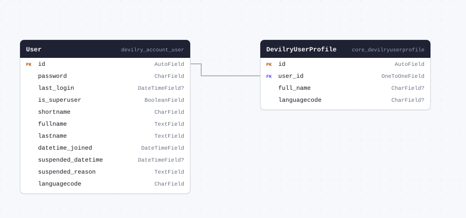

| Column | Field | Type | Null | Key | Default | Description |
| --- | --- | --- | --- | --- | --- | --- |
| `id` | `AutoField` | `integer` |  | PK | `autoincrement()` |  |
| `user_id` | `OneToOneField` | `integer` |  | FK, unique |  |  |
| `full_name` | `CharField` | `varchar(300)` | yes |  |  |  |
| `languagecode` | `CharField` | `varchar(100)` | yes |  |  |  |

Relations:

- `user_id` → [User](#user).`id`, on delete cascade

## Examiner

Table `core_assignmentgroup_examiners`, app `core`.

.. attribute:: assignmentgroup

    The `AssignmentGroup`_ where this groups belongs.

.. attribute:: user

    A foreign key to a User.

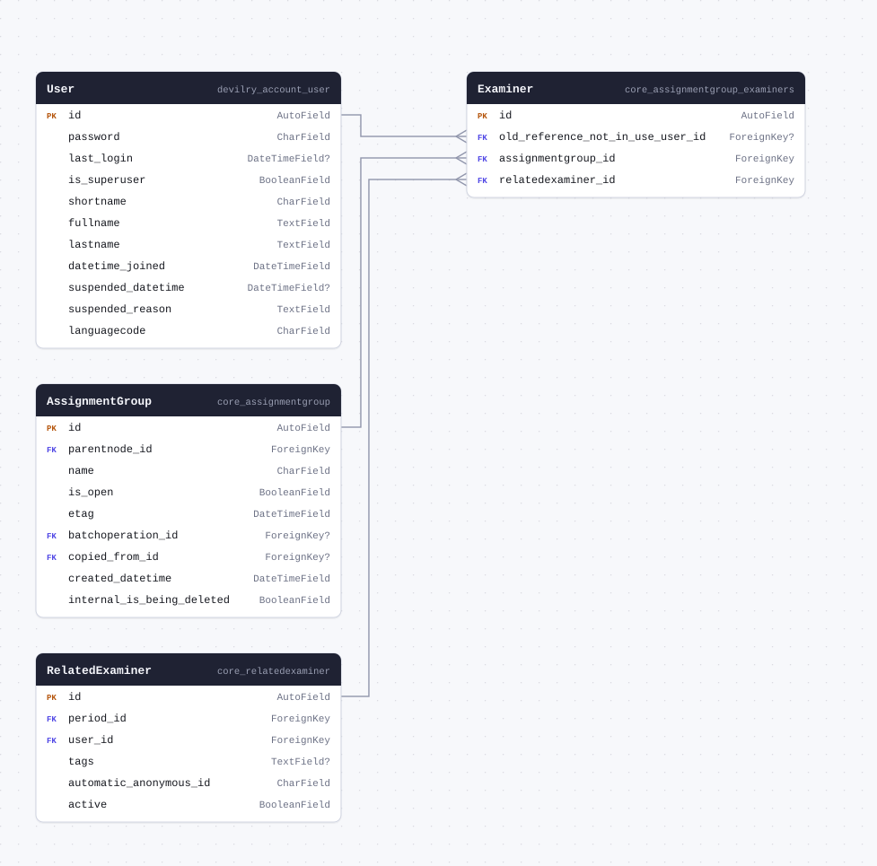

| Column | Field | Type | Null | Key | Default | Description |
| --- | --- | --- | --- | --- | --- | --- |
| `id` | `AutoField` | `integer` |  | PK | `autoincrement()` |  |
| `old_reference_not_in_use_user_id` | `ForeignKey` | `integer` | yes | FK | `None` |  |
| `assignmentgroup_id` | `ForeignKey` | `integer` |  | FK |  |  |
| `relatedexaminer_id` | `ForeignKey` | `integer` |  | FK |  |  |

Indexes:

- index `core_assignmentgroup_exami_old_reference_not_in_use_u_931c3632` on `old_reference_not_in_use_user_id`
- index `core_assignmentgroup_examiners_assignmentgroup_id_ad605fe2` on `assignmentgroup_id`
- index `core_assignmentgroup_examiners_relatedexaminer_id_e6767adb` on `relatedexaminer_id`
- unique `core_assignmentgroup_exa_relatedexaminer_id_assig_5c41f012_uniq` on `relatedexaminer_id`, `assignmentgroup_id`

Relations:

- `old_reference_not_in_use_user_id` → [User](#user).`id`, on delete cascade
- `assignmentgroup_id` → [AssignmentGroup](#assignmentgroup).`id`, on delete cascade
- `relatedexaminer_id` → [RelatedExaminer](#relatedexaminer).`id`, on delete cascade

## GroupInvite

Table `core_groupinvite`, app `core`.

Represents a group invite sent by a student to invite another
student to join their AssignmentGroup.

Example:
    invite = GroupInvite(
        group=myassignmentgroup,
        sent_by=somestudent, # Typically request.user
        sent_to=anotherstudent
    )
    invite.full_clean() # MUST be called to validate that the invite is allowed
    invite.save()
    invite.send_invite_notification()

To accept/reject an invite (sets the appropriate attributes and sends a notification)
invite.respond(accepted=True)

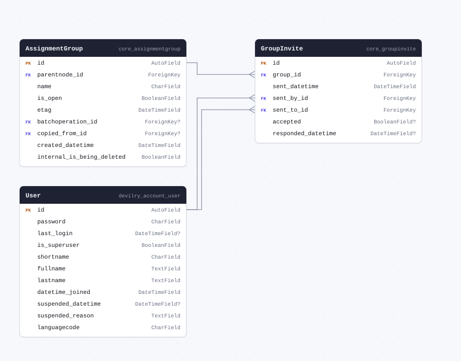

| Column | Field | Type | Null | Key | Default | Description |
| --- | --- | --- | --- | --- | --- | --- |
| `id` | `AutoField` | `integer` |  | PK | `autoincrement()` |  |
| `group_id` | `ForeignKey` | `integer` |  | FK |  |  |
| `sent_datetime` | `DateTimeField` | `timestamp with time zone` |  |  | `now()` |  |
| `sent_by_id` | `ForeignKey` | `integer` |  | FK |  |  |
| `sent_to_id` | `ForeignKey` | `integer` |  | FK |  |  |
| `accepted` | `BooleanField` | `boolean` | yes |  |  |  |
| `responded_datetime` | `DateTimeField` | `timestamp with time zone` | yes |  | `None` |  |

Indexes:

- index `core_groupinvite_group_id_bbf1239d` on `group_id`
- index `core_groupinvite_sent_by_id_1a813d8a` on `sent_by_id`
- index `core_groupinvite_sent_to_id_e420918d` on `sent_to_id`

Relations:

- `group_id` → [AssignmentGroup](#assignmentgroup).`id`, on delete cascade
- `sent_by_id` → [User](#user).`id`, on delete cascade
- `sent_to_id` → [User](#user).`id`, on delete cascade

## ExaminerAssignmentGroupHistory

Table `core_examinerassignmentgrouphistory`, app `core`.

Columns from `AbstractExaminerCandidateAssignmentGroupHistory` (abstract): `assignment_group_id`, `user_id`, `created_datetime`, `is_add`.

An entry of this is model created if a :class:`devilry.apps.core.models.examiner.Examiner`-entry is inserted or
deleted.

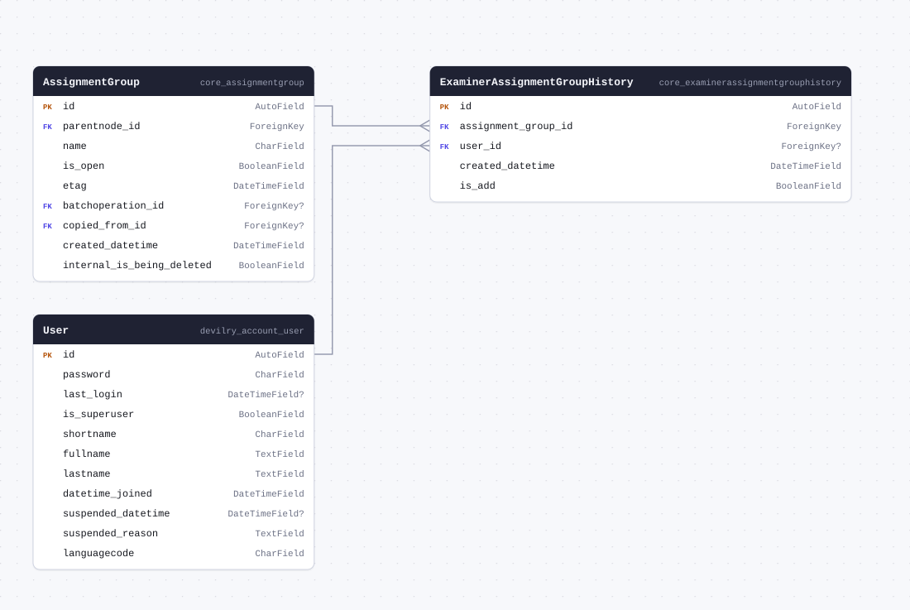

| Column | Field | Type | Null | Key | Default | Description |
| --- | --- | --- | --- | --- | --- | --- |
| `id` | `AutoField` | `integer` |  | PK | `autoincrement()` |  |
| `assignment_group_id` | `ForeignKey` | `integer` |  | FK |  |  |
| `user_id` | `ForeignKey` | `integer` | yes | FK |  |  |
| `created_datetime` | `DateTimeField` | `timestamp with time zone` |  |  | `now()` |  |
| `is_add` | `BooleanField` | `boolean` |  |  |  |  |

Indexes:

- index `core_examinerassignmentgro_assignment_group_id_eb832a6e` on `assignment_group_id`
- index `core_examinerassignmentgrouphistory_user_id_1636fd1b` on `user_id`

Relations:

- `assignment_group_id` → [AssignmentGroup](#assignmentgroup).`id`, on delete cascade
- `user_id` → [User](#user).`id`, on delete set null

## CandidateAssignmentGroupHistory

Table `core_candidateassignmentgrouphistory`, app `core`.

Columns from `AbstractExaminerCandidateAssignmentGroupHistory` (abstract): `assignment_group_id`, `user_id`, `created_datetime`, `is_add`.

An entry of this is model created if a :class:`devilry.apps.core.models.candidate.Candidate`-entry is inserted or
deleted.

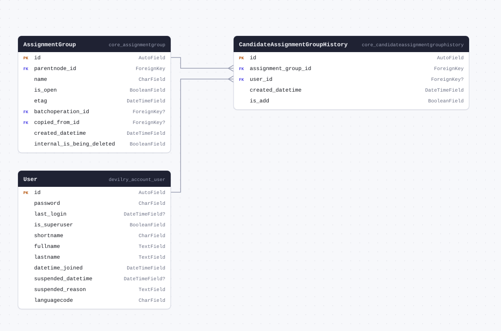

| Column | Field | Type | Null | Key | Default | Description |
| --- | --- | --- | --- | --- | --- | --- |
| `id` | `AutoField` | `integer` |  | PK | `autoincrement()` |  |
| `assignment_group_id` | `ForeignKey` | `integer` |  | FK |  |  |
| `user_id` | `ForeignKey` | `integer` | yes | FK |  |  |
| `created_datetime` | `DateTimeField` | `timestamp with time zone` |  |  | `now()` |  |
| `is_add` | `BooleanField` | `boolean` |  |  |  |  |

Indexes:

- index `core_candidateassignmentgr_assignment_group_id_98c373a5` on `assignment_group_id`
- index `core_candidateassignmentgrouphistory_user_id_7a3668f9` on `user_id`

Relations:

- `assignment_group_id` → [AssignmentGroup](#assignmentgroup).`id`, on delete cascade
- `user_id` → [User](#user).`id`, on delete set null

## User

Table `devilry_account_user`, app `devilry_account`.

Columns from `AbstractBaseUser` (abstract): `password`, `last_login`.

User model for Devilry.

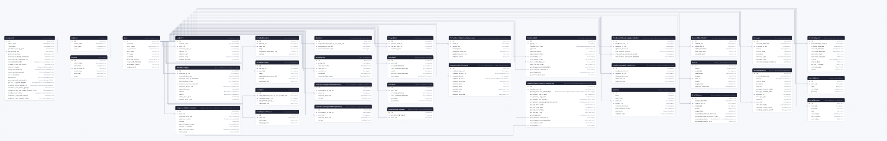

| Column | Field | Type | Null | Key | Default | Description |
| --- | --- | --- | --- | --- | --- | --- |
| `id` | `AutoField` | `integer` |  | PK | `autoincrement()` |  |
| `password` | `CharField` | `varchar(128)` |  |  |  |  |
| `last_login` | `DateTimeField` | `timestamp with time zone` | yes |  |  |  |
| `is_superuser` | `BooleanField` | `boolean` |  |  | `False` | Designates that this user has all permissions without explicitly assigning them. |
| `shortname` | `CharField` | `varchar(255)` |  | unique |  | The short name for the user. This is set automatically to the email or username depending on the method used for authentication. |
| `fullname` | `TextField` | `text` |  |  | `''` |  |
| `lastname` | `TextField` | `text` |  |  | `''` |  |
| `datetime_joined` | `DateTimeField` | `timestamp with time zone` |  |  | `now()` |  |
| `suspended_datetime` | `DateTimeField` | `timestamp with time zone` | yes |  |  | Time when the account was suspended |
| `suspended_reason` | `TextField` | `text` |  |  | `''` |  |
| `languagecode` | `CharField` | `varchar(10)` |  |  | `''` |  |

Indexes:

- index `devilry_account_user_shortname_8ef6b1f9_like` on `shortname` (`varchar_pattern_ops`)

Relations:

- `permissiongroup_set` — many to many with [PermissionGroup](#permissiongroup), through [PermissionGroupUser](#permissiongroupuser)
- [LogEntry](#logentry).`user_id` → `id`, on delete cascade
- [BatchOperation](#batchoperation).`started_by_id` → `id`, on delete cascade
- [TemporaryFileCollection](#temporaryfilecollection).`user_id` → `id`, on delete cascade
- `subject_set` — many to many with [Subject](#subject)
- `period_set` — many to many with [Period](#period)
- [RelatedExaminer](#relatedexaminer).`user_id` → `id`, on delete cascade
- [RelatedStudent](#relatedstudent).`user_id` → `id`, on delete cascade
- `assignment_set` — many to many with [Assignment](#assignment)
- [Candidate](#candidate).`old_reference_not_in_use_student_id` → `id`, on delete cascade
- [DevilryUserProfile](#devilryuserprofile).`user_id` → `id`, on delete cascade
- [Examiner](#examiner).`old_reference_not_in_use_user_id` → `id`, on delete cascade
- [GroupInvite](#groupinvite).`sent_by_id` → `id`, on delete cascade
- [GroupInvite](#groupinvite).`sent_to_id` → `id`, on delete cascade
- [ExaminerAssignmentGroupHistory](#examinerassignmentgrouphistory).`user_id` → `id`, on delete set null
- [CandidateAssignmentGroupHistory](#candidateassignmentgrouphistory).`user_id` → `id`, on delete set null
- [MergedUser](#mergeduser).`source_user_id` → `id`, on delete cascade
- [MergedUser](#mergeduser).`target_user_id` → `id`, on delete cascade
- [UserEmail](#useremail).`user_id` → `id`, on delete cascade
- [UserName](#username).`user_id` → `id`, on delete cascade
- [PermissionGroupUser](#permissiongroupuser).`user_id` → `id`, on delete cascade
- [PeriodUserGuidelineAcceptance](#perioduserguidelineacceptance).`user_id` → `id`, on delete cascade
- [CompressedArchiveMeta](#compressedarchivemeta).`created_by_id` → `id`, on delete set null
- [FeedbackSet](#feedbackset).`created_by_id` → `id`, on delete set null
- [FeedbackSet](#feedbackset).`last_updated_by_id` → `id`, on delete set null
- [FeedbackSet](#feedbackset).`grading_published_by_id` → `id`, on delete set null
- [FeedbacksetPassedPreviousPeriod](#feedbacksetpassedpreviousperiod).`grading_published_by_id` → `id`, on delete set null
- [FeedbacksetPassedPreviousPeriod](#feedbacksetpassedpreviousperiod).`created_by_id` → `id`, on delete set null
- [FeedbackSetGradingUpdateHistory](#feedbacksetgradingupdatehistory).`updated_by_id` → `id`, on delete set null
- [FeedbackSetGradingUpdateHistory](#feedbacksetgradingupdatehistory).`old_grading_published_by_id` → `id`, on delete set null
- [FeedbackSetDeadlineHistory](#feedbacksetdeadlinehistory).`changed_by_id` → `id`, on delete cascade
- [Comment](#comment).`user_id` → `id`, on delete set null
- [CommentEditHistory](#commentedithistory).`edited_by_id` → `id`, on delete set null
- [Status](#status).`user_id` → `id`, on delete cascade
- [DraftStatus](#draftstatus).`created_by_id` → `id`, on delete cascade
- [Message](#message).`created_by_id` → `id`, on delete set null
- [MessageReceiver](#messagereceiver).`user_id` → `id`, on delete cascade
- [DevilryReport](#devilryreport).`generated_by_user_id` → `id`, on delete cascade
- [EmailAddress](#emailaddress).`user_id` → `id`, on delete cascade
- [SocialAccount](#socialaccount).`user_id` → `id`, on delete cascade

## MergedUser

Table `devilry_account_mergeduser`, app `devilry_account`.

A merge user is created when two users are merged
by `devilry.devilry_account.user_merger.UserMerger`.

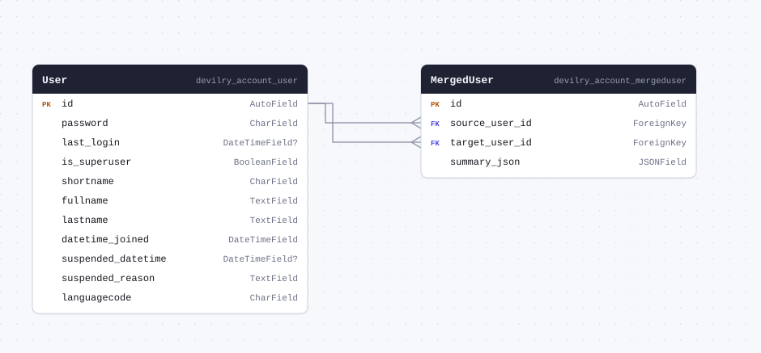

| Column | Field | Type | Null | Key | Default | Description |
| --- | --- | --- | --- | --- | --- | --- |
| `id` | `AutoField` | `integer` |  | PK | `autoincrement()` |  |
| `source_user_id` | `ForeignKey` | `integer` |  | FK |  |  |
| `target_user_id` | `ForeignKey` | `integer` |  | FK |  |  |
| `summary_json` | `JSONField` | `jsonb` |  |  | `dict()` |  |

Indexes:

- index `devilry_account_mergeduser_source_user_id_bd610387` on `source_user_id`
- index `devilry_account_mergeduser_target_user_id_e7ae7791` on `target_user_id`

Relations:

- `source_user_id` → [User](#user).`id`, on delete cascade
- `target_user_id` → [User](#user).`id`, on delete cascade

## UserEmail

Table `devilry_account_useremail`, app `devilry_account`.

Columns from `AbstractUserIdentity` (abstract): `user_id`, `created_datetime`, `last_updated_datetime`.

Stores a single email address for a :class:`.User`.

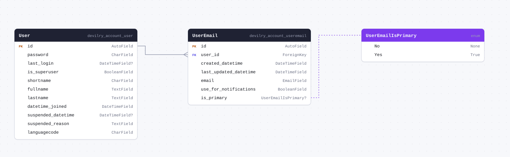

| Column | Field | Type | Null | Key | Default | Description |
| --- | --- | --- | --- | --- | --- | --- |
| `id` | `AutoField` | `integer` |  | PK | `autoincrement()` |  |
| `user_id` | `ForeignKey` | `integer` |  | FK |  |  |
| `created_datetime` | `DateTimeField` | `timestamp with time zone` |  |  | `now()` |  |
| `last_updated_datetime` | `DateTimeField` | `timestamp with time zone` |  |  | `now()` |  |
| `email` | `EmailField` | `varchar(255)` |  | unique |  |  |
| `use_for_notifications` | `BooleanField` | `boolean` |  |  | `True` |  |
| `is_primary` | `UserEmailIsPrimary` | `boolean` | yes |  |  | Your primary email is the email address used when we need to display a single email address. |

Indexes:

- index `devilry_account_useremail_user_id_396ac919` on `user_id`
- index `devilry_account_useremail_email_d05b200b_like` on `email` (`varchar_pattern_ops`)
- unique `devilry_account_useremail_user_id_is_primary_20905615_uniq` on `user_id`, `is_primary`

Relations:

- `user_id` → [User](#user).`id`, on delete cascade

## UserName

Table `devilry_account_username`, app `devilry_account`.

Columns from `AbstractUserIdentity` (abstract): `user_id`, `created_datetime`, `last_updated_datetime`.

Stores a single username for a :class:`.User`.

The username is used for login, and the primary username
is synced into :obj:`.User.shortname`.

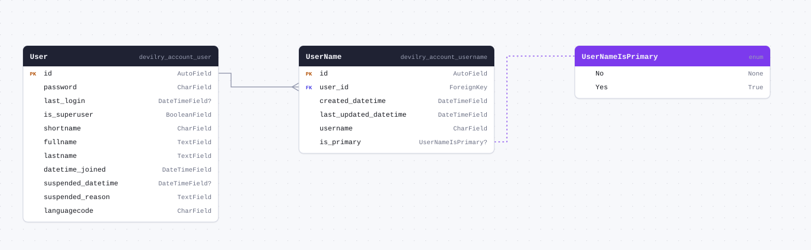

| Column | Field | Type | Null | Key | Default | Description |
| --- | --- | --- | --- | --- | --- | --- |
| `id` | `AutoField` | `integer` |  | PK | `autoincrement()` |  |
| `user_id` | `ForeignKey` | `integer` |  | FK |  |  |
| `created_datetime` | `DateTimeField` | `timestamp with time zone` |  |  | `now()` |  |
| `last_updated_datetime` | `DateTimeField` | `timestamp with time zone` |  |  | `now()` |  |
| `username` | `CharField` | `varchar(255)` |  | unique |  |  |
| `is_primary` | `UserNameIsPrimary` | `boolean` | yes |  |  | Your primary username is shown alongside your full name to identify you to teachers, examiners and other students. |

Indexes:

- index `devilry_account_username_user_id_01a03912` on `user_id`
- index `devilry_account_username_username_49a63d54_like` on `username` (`varchar_pattern_ops`)
- unique `devilry_account_username_user_id_is_primary_1276fc95_uniq` on `user_id`, `is_primary`

Relations:

- `user_id` → [User](#user).`id`, on delete cascade

## PermissionGroupUser

Table `devilry_account_permissiongroupuser`, app `devilry_account`.

Defines the many-to-many relationship between :class:`.User`
and :class:`.PermissionGroup`.

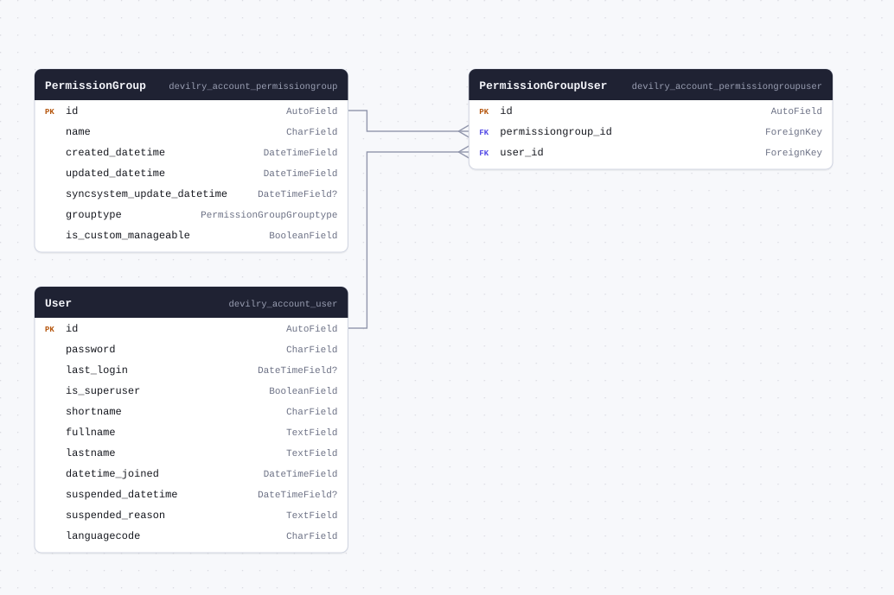

| Column | Field | Type | Null | Key | Default | Description |
| --- | --- | --- | --- | --- | --- | --- |
| `id` | `AutoField` | `integer` |  | PK | `autoincrement()` |  |
| `permissiongroup_id` | `ForeignKey` | `integer` |  | FK |  |  |
| `user_id` | `ForeignKey` | `integer` |  | FK |  |  |

Indexes:

- index `devilry_account_permissiongroupuser_permissiongroup_id_047b34da` on `permissiongroup_id`
- index `devilry_account_permissiongroupuser_user_id_08523943` on `user_id`
- unique `devilry_account_permissi_permissiongroup_id_user__9a589100_uniq` on `permissiongroup_id`, `user_id`

Relations:

- `permissiongroup_id` → [PermissionGroup](#permissiongroup).`id`, on delete cascade
- `user_id` → [User](#user).`id`, on delete cascade

## PermissionGroup

Table `devilry_account_permissiongroup`, app `devilry_account`.

Permission group data model.

Each group has a :obj:`~.PermissionGroup.grouptype` which determines
the type of objects it can be added to.

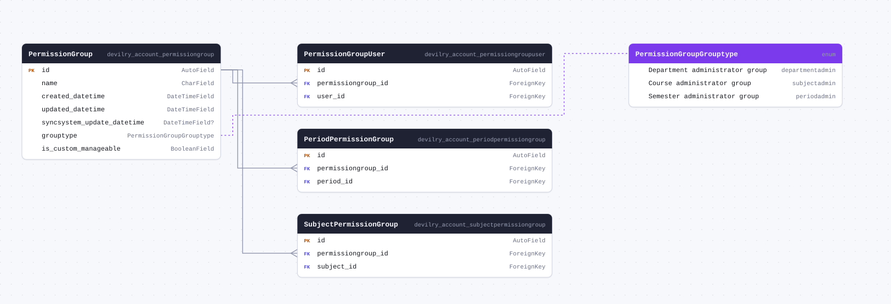

| Column | Field | Type | Null | Key | Default | Description |
| --- | --- | --- | --- | --- | --- | --- |
| `id` | `AutoField` | `integer` |  | PK | `autoincrement()` |  |
| `name` | `CharField` | `varchar(255)` |  | unique |  | A unique name for this group. |
| `created_datetime` | `DateTimeField` | `timestamp with time zone` |  |  | `now()` | The time when this group was created. |
| `updated_datetime` | `DateTimeField` | `timestamp with time zone` |  |  | `now()` | The time when this group last updated. |
| `syncsystem_update_datetime` | `DateTimeField` | `timestamp with time zone` | yes |  |  | The time when this group last updated from a third party sync system. |
| `grouptype` | `PermissionGroupGrouptype` | `varchar(30)` |  |  |  | Course and semester administrator groups can only be assigned to a single course or semester. Department administrator groups can be assigned to multiple courses. You can not change this for existing permission groups. |
| `is_custom_manageable` | `BooleanField` | `boolean` |  |  | `False` | Is this group mageable by non-superusers. Can not be enabled for department administrator groups. |

Indexes:

- index `devilry_account_permissiongroup_name_1a3f7402_like` on `name` (`varchar_pattern_ops`)

Relations:

- `users` — many to many with [User](#user), through [PermissionGroupUser](#permissiongroupuser)
- [PermissionGroupUser](#permissiongroupuser).`permissiongroup_id` → `id`, on delete cascade
- [PeriodPermissionGroup](#periodpermissiongroup).`permissiongroup_id` → `id`, on delete cascade
- [SubjectPermissionGroup](#subjectpermissiongroup).`permissiongroup_id` → `id`, on delete cascade

## PeriodPermissionGroup

Table `devilry_account_periodpermissiongroup`, app `devilry_account`.

Defines the many-to-many relationship between
:class:`devilry.apps.core.Period` and :class:`.PermissionGroup`.

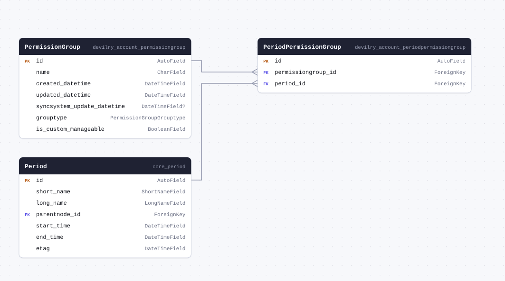

| Column | Field | Type | Null | Key | Default | Description |
| --- | --- | --- | --- | --- | --- | --- |
| `id` | `AutoField` | `integer` |  | PK | `autoincrement()` |  |
| `permissiongroup_id` | `ForeignKey` | `integer` |  | FK |  |  |
| `period_id` | `ForeignKey` | `integer` |  | FK |  |  |

Indexes:

- index `devilry_account_periodperm_permissiongroup_id_35ab812e` on `permissiongroup_id`
- index `devilry_account_periodpermissiongroup_period_id_f0050b74` on `period_id`
- unique `devilry_account_periodpe_permissiongroup_id_perio_bf361e64_uniq` on `permissiongroup_id`, `period_id`

Relations:

- `permissiongroup_id` → [PermissionGroup](#permissiongroup).`id`, on delete cascade
- `period_id` → [Period](#period).`id`, on delete cascade

## SubjectPermissionGroup

Table `devilry_account_subjectpermissiongroup`, app `devilry_account`.

Defines the many-to-many relationship between
:class:`devilry.apps.core.Subject` and :class:`.PermissionGroup`.

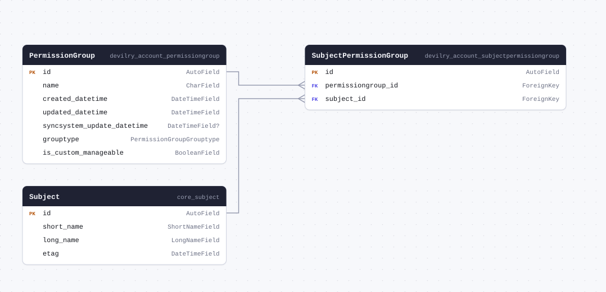

| Column | Field | Type | Null | Key | Default | Description |
| --- | --- | --- | --- | --- | --- | --- |
| `id` | `AutoField` | `integer` |  | PK | `autoincrement()` |  |
| `permissiongroup_id` | `ForeignKey` | `integer` |  | FK |  |  |
| `subject_id` | `ForeignKey` | `integer` |  | FK |  |  |

Indexes:

- index `devilry_account_subjectper_permissiongroup_id_8ebe0b44` on `permissiongroup_id`
- index `devilry_account_subjectpermissiongroup_subject_id_e4350b1d` on `subject_id`
- unique `devilry_account_subjectp_permissiongroup_id_subje_2da491f6_uniq` on `permissiongroup_id`, `subject_id`

Relations:

- `permissiongroup_id` → [PermissionGroup](#permissiongroup).`id`, on delete cascade
- `subject_id` → [Subject](#subject).`id`, on delete cascade

## PeriodUserGuidelineAcceptance

Table `devilry_account_perioduserguidelineacceptance`, app `devilry_account`.

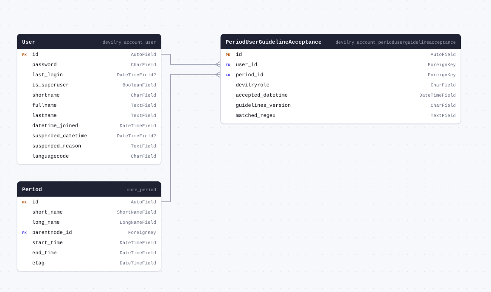

| Column | Field | Type | Null | Key | Default | Description |
| --- | --- | --- | --- | --- | --- | --- |
| `id` | `AutoField` | `integer` |  | PK | `autoincrement()` |  |
| `user_id` | `ForeignKey` | `integer` |  | FK |  |  |
| `period_id` | `ForeignKey` | `integer` |  | FK |  |  |
| `devilryrole` | `CharField` | `varchar(20)` |  |  |  |  |
| `accepted_datetime` | `DateTimeField` | `timestamp with time zone` |  |  | `now()` |  |
| `guidelines_version` | `CharField` | `varchar(20)` |  |  |  |  |
| `matched_regex` | `TextField` | `text` |  |  |  |  |

Indexes:

- index `devilry_account_perioduserguidelineacceptance_user_id_0781433e` on `user_id`
- index `devilry_account_perioduser_period_id_632d4688` on `period_id`
- index `devilry_account_perioduser_devilryrole_abf92a99` on `devilryrole`
- index `devilry_account_periodus_devilryrole_abf92a99_like` on `devilryrole` (`varchar_pattern_ops`)
- index `devilry_account_perioduser_accepted_datetime_196a1d81` on `accepted_datetime`
- index `devilry_account_perioduser_guidelines_version_79e7500c` on `guidelines_version`
- index `devilry_account_periodus_guidelines_version_79e7500c_like` on `guidelines_version` (`varchar_pattern_ops`)
- unique `unique_user_period_role_version` on `user_id`, `period_id`, `devilryrole`, `guidelines_version`

Relations:

- `user_id` → [User](#user).`id`, on delete cascade
- `period_id` → [Period](#period).`id`, on delete cascade

## CompressedArchiveMeta

Table `devilry_compressionutil_compressedarchivemeta`, app `devilry_compressionutil`.

Columns from `GenericMeta` (abstract): `content_type_id`, `content_object_id`.

Metadata about a compressed archive. Name of the archive, path to it and it's size.

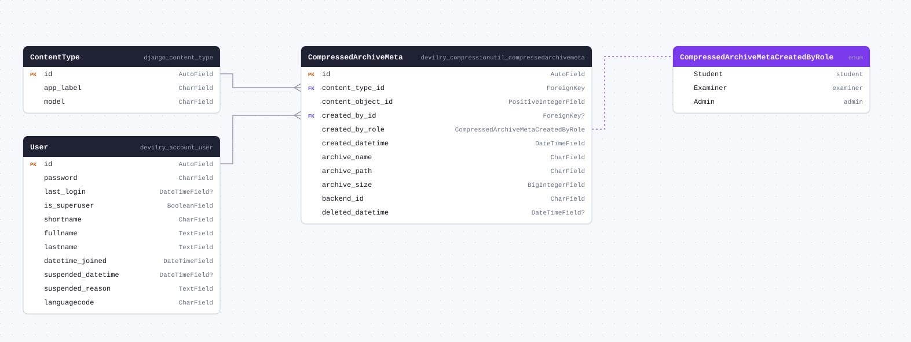

| Column | Field | Type | Null | Key | Default | Description |
| --- | --- | --- | --- | --- | --- | --- |
| `id` | `AutoField` | `integer` |  | PK | `autoincrement()` |  |
| `content_type_id` | `ForeignKey` | `integer` |  | FK |  |  |
| `content_object_id` | `PositiveIntegerField` | `integer` |  |  |  |  |
| `created_by_id` | `ForeignKey` | `integer` | yes | FK | `None` |  |
| `created_by_role` | `CompressedArchiveMetaCreatedByRole` | `varchar(255)` |  |  | `''` |  |
| `created_datetime` | `DateTimeField` | `timestamp with time zone` |  |  | `now()` |  |
| `archive_name` | `CharField` | `varchar(200)` |  |  |  |  |
| `archive_path` | `CharField` | `varchar(200)` |  |  |  |  |
| `archive_size` | `BigIntegerField` | `bigint` |  |  |  |  |
| `backend_id` | `CharField` | `varchar(100)` |  |  | `''` |  |
| `deleted_datetime` | `DateTimeField` | `timestamp with time zone` | yes |  | `None` |  |

Indexes:

- index `devilry_compressionutil_co_content_type_id_dc562e1b` on `content_type_id`
- index `devilry_compressionutil_co_created_by_id_edfcbf68` on `created_by_id`

Relations:

- `content_object` → any model, by `content_type_id` + `content_object_id` (generic foreign key)
- `content_type_id` → [ContentType](#contenttype).`id`, on delete cascade
- `created_by_id` → [User](#user).`id`, on delete set null

## FeedbackSet

Table `devilry_group_feedbackset`, app `devilry_group`.

All comments that are given for a specific deadline (delivery and feedback) are
linked to a feedback-set.

If the comment has `instant_publish=True` it will be published instantly, otherwise the comments will only be
visible once the feedbackset is published.
All student-comments will be `instant_publish=True`, and the same applies to comments made by examiners that
are not a part of feedback.

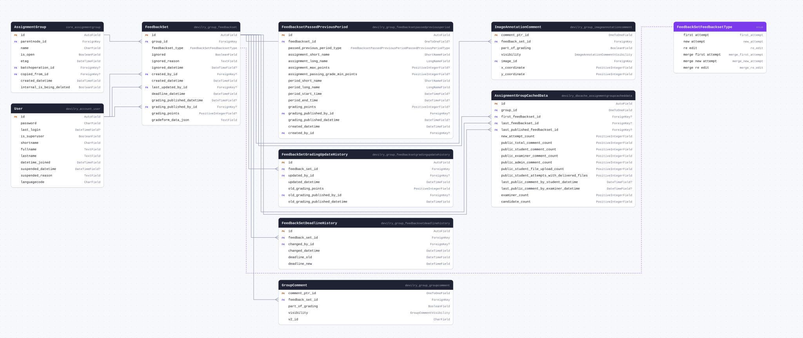

| Column | Field | Type | Null | Key | Default | Description |
| --- | --- | --- | --- | --- | --- | --- |
| `id` | `AutoField` | `integer` |  | PK | `autoincrement()` |  |
| `group_id` | `ForeignKey` | `integer` |  | FK |  |  |
| `feedbackset_type` | `FeedbackSetFeedbacksetType` | `varchar(50)` |  |  | `'new_attempt'` |  |
| `ignored` | `BooleanField` | `boolean` |  |  | `False` |  |
| `ignored_reason` | `TextField` | `text` |  |  | `''` |  |
| `ignored_datetime` | `DateTimeField` | `timestamp with time zone` | yes |  |  |  |
| `created_by_id` | `ForeignKey` | `integer` | yes | FK |  |  |
| `created_datetime` | `DateTimeField` | `timestamp with time zone` |  |  | `now()` |  |
| `last_updated_by_id` | `ForeignKey` | `integer` | yes | FK |  |  |
| `deadline_datetime` | `DateTimeField` | `timestamp with time zone` |  |  |  |  |
| `grading_published_datetime` | `DateTimeField` | `timestamp with time zone` | yes |  |  |  |
| `grading_published_by_id` | `ForeignKey` | `integer` | yes | FK |  |  |
| `grading_points` | `PositiveIntegerField` | `integer` | yes |  |  |  |
| `gradeform_data_json` | `TextField` | `text` |  |  | `''` |  |

Indexes:

- index `devilry_group_feedbackset_group_id_5987135e` on `group_id`
- index `devilry_group_feedbackset_feedbackset_type_072ca399` on `feedbackset_type`
- index `devilry_group_feedbackset_feedbackset_type_072ca399_like` on `feedbackset_type` (`varchar_pattern_ops`)
- index `devilry_group_feedbackset_created_by_id_650ceed9` on `created_by_id`
- index `devilry_group_feedbackset_last_updated_by_id_960089c6` on `last_updated_by_id`
- index `devilry_group_feedbackset_grading_published_by_id_75176877` on `grading_published_by_id`

Relations:

- `group_id` → [AssignmentGroup](#assignmentgroup).`id`, on delete cascade
- `created_by_id` → [User](#user).`id`, on delete set null
- `last_updated_by_id` → [User](#user).`id`, on delete set null
- `grading_published_by_id` → [User](#user).`id`, on delete set null
- [FeedbacksetPassedPreviousPeriod](#feedbacksetpassedpreviousperiod).`feedbackset_id` → `id`, on delete cascade
- [FeedbackSetGradingUpdateHistory](#feedbacksetgradingupdatehistory).`feedback_set_id` → `id`, on delete cascade
- [FeedbackSetDeadlineHistory](#feedbacksetdeadlinehistory).`feedback_set_id` → `id`, on delete cascade
- [GroupComment](#groupcomment).`feedback_set_id` → `id`, on delete cascade
- [ImageAnnotationComment](#imageannotationcomment).`feedback_set_id` → `id`, on delete cascade
- [AssignmentGroupCachedData](#assignmentgroupcacheddata).`first_feedbackset_id` → `id`, on delete cascade
- [AssignmentGroupCachedData](#assignmentgroupcacheddata).`last_feedbackset_id` → `id`, on delete cascade
- [AssignmentGroupCachedData](#assignmentgroupcacheddata).`last_published_feedbackset_id` → `id`, on delete cascade

## FeedbacksetPassedPreviousPeriod

Table `devilry_group_feedbacksetpassedpreviousperiod`, app `devilry_group`.

This model is used when a student have passed an assignment in previous period.
Therefore we need to save some old data about the :class:`core.Assignment`, :class:`devilry_group.FeedbackSet`
and :class:`core.Period` from previous period.

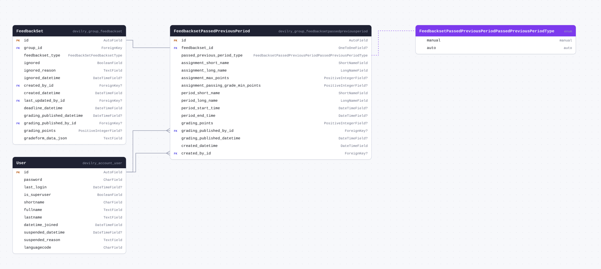

| Column | Field | Type | Null | Key | Default | Description |
| --- | --- | --- | --- | --- | --- | --- |
| `id` | `AutoField` | `integer` |  | PK | `autoincrement()` |  |
| `feedbackset_id` | `OneToOneField` | `integer` | yes | FK, unique |  |  |
| `passed_previous_period_type` | `FeedbacksetPassedPreviousPeriodPassedPreviousPeriodType` | `varchar(255)` |  |  |  |  |
| `assignment_short_name` | `ShortNameField` | `varchar(20)` |  |  | `''` | Up to 20 letters of lowercase english letters (a-z), numbers, underscore ("_") and hyphen ("-"). Used when the name takes too much space. |
| `assignment_long_name` | `LongNameField` | `varchar(100)` |  |  | `''` |  |
| `assignment_max_points` | `PositiveIntegerField` | `integer` | yes |  | `0` |  |
| `assignment_passing_grade_min_points` | `PositiveIntegerField` | `integer` | yes |  | `0` |  |
| `period_short_name` | `ShortNameField` | `varchar(20)` |  |  | `''` | Up to 20 letters of lowercase english letters (a-z), numbers, underscore ("_") and hyphen ("-"). Used when the name takes too much space. |
| `period_long_name` | `LongNameField` | `varchar(100)` |  |  | `''` |  |
| `period_start_time` | `DateTimeField` | `timestamp with time zone` | yes |  | `None` |  |
| `period_end_time` | `DateTimeField` | `timestamp with time zone` | yes |  | `None` |  |
| `grading_points` | `PositiveIntegerField` | `integer` | yes |  | `0` |  |
| `grading_published_by_id` | `ForeignKey` | `integer` | yes | FK |  |  |
| `grading_published_datetime` | `DateTimeField` | `timestamp with time zone` | yes |  | `None` |  |
| `created_datetime` | `DateTimeField` | `timestamp with time zone` |  |  | `now()` |  |
| `created_by_id` | `ForeignKey` | `integer` | yes | FK |  |  |

Indexes:

- index `devilry_group_feedbacksetp_assignment_short_name_be9f985a` on `assignment_short_name`
- index `devilry_group_feedbackse_assignment_short_name_be9f985a_like` on `assignment_short_name` (`varchar_pattern_ops`)
- index `devilry_group_feedbacksetp_assignment_long_name_adac6ed1` on `assignment_long_name`
- index `devilry_group_feedbackse_assignment_long_name_adac6ed1_like` on `assignment_long_name` (`varchar_pattern_ops`)
- index `devilry_group_feedbacksetp_period_short_name_a541d96e` on `period_short_name`
- index `devilry_group_feedbackse_period_short_name_a541d96e_like` on `period_short_name` (`varchar_pattern_ops`)
- index `devilry_group_feedbacksetp_period_long_name_c7d4b92b` on `period_long_name`
- index `devilry_group_feedbackse_period_long_name_c7d4b92b_like` on `period_long_name` (`varchar_pattern_ops`)
- index `devilry_group_feedbacksetp_grading_published_by_id_4090bbe2` on `grading_published_by_id`
- index `devilry_group_feedbacksetp_created_by_id_b8572995` on `created_by_id`

Relations:

- `feedbackset_id` → [FeedbackSet](#feedbackset).`id`, on delete cascade
- `grading_published_by_id` → [User](#user).`id`, on delete set null
- `created_by_id` → [User](#user).`id`, on delete set null

## FeedbackSetGradingUpdateHistory

Table `devilry_group_feedbacksetgradingupdatehistory`, app `devilry_group`.

Logs changes on the grading for a feedbackset.

If we have this history, there will be no problem changing the grades on an already corrected feedback set, as we
can display the history, just as with FeedbackSetDeadlineHistory.

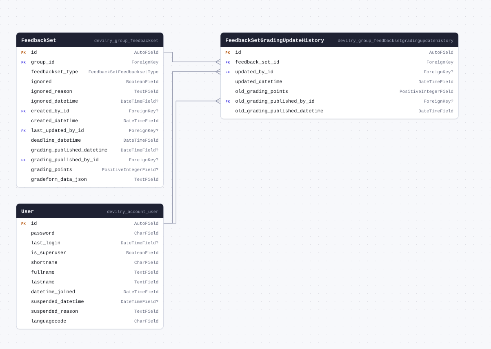

| Column | Field | Type | Null | Key | Default | Description |
| --- | --- | --- | --- | --- | --- | --- |
| `id` | `AutoField` | `integer` |  | PK | `autoincrement()` |  |
| `feedback_set_id` | `ForeignKey` | `integer` |  | FK |  |  |
| `updated_by_id` | `ForeignKey` | `integer` | yes | FK |  |  |
| `updated_datetime` | `DateTimeField` | `timestamp with time zone` |  |  | `now()` |  |
| `old_grading_points` | `PositiveIntegerField` | `integer` |  |  |  |  |
| `old_grading_published_by_id` | `ForeignKey` | `integer` | yes | FK |  |  |
| `old_grading_published_datetime` | `DateTimeField` | `timestamp with time zone` |  |  |  |  |

Indexes:

- index `devilry_group_feedbacksetg_feedback_set_id_24f4c349` on `feedback_set_id`
- index `devilry_group_feedbacksetg_updated_by_id_5aa2ab0f` on `updated_by_id`
- index `devilry_group_feedbacksetg_old_grading_published_by_i_f855818b` on `old_grading_published_by_id`

Relations:

- `feedback_set_id` → [FeedbackSet](#feedbackset).`id`, on delete cascade
- `updated_by_id` → [User](#user).`id`, on delete set null
- `old_grading_published_by_id` → [User](#user).`id`, on delete set null

## FeedbackSetDeadlineHistory

Table `devilry_group_feedbacksetdeadlinehistory`, app `devilry_group`.

Logs change in deadline for a FeedbackSet.

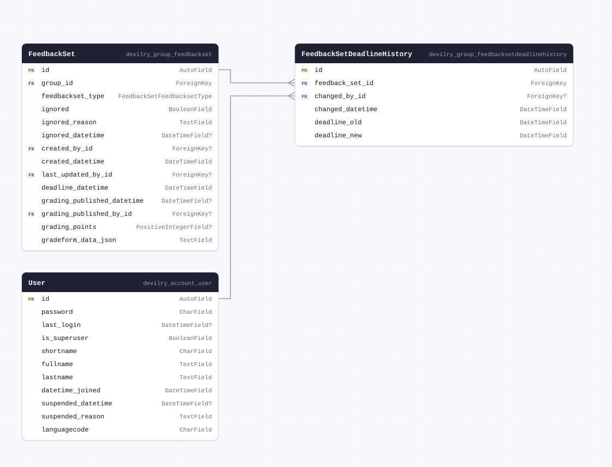

| Column | Field | Type | Null | Key | Default | Description |
| --- | --- | --- | --- | --- | --- | --- |
| `id` | `AutoField` | `integer` |  | PK | `autoincrement()` |  |
| `feedback_set_id` | `ForeignKey` | `integer` |  | FK |  |  |
| `changed_by_id` | `ForeignKey` | `integer` | yes | FK |  |  |
| `changed_datetime` | `DateTimeField` | `timestamp with time zone` |  |  | `now()` |  |
| `deadline_old` | `DateTimeField` | `timestamp with time zone` |  |  |  |  |
| `deadline_new` | `DateTimeField` | `timestamp with time zone` |  |  |  |  |

Indexes:

- index `devilry_group_feedbacksetd_feedback_set_id_52741ef3` on `feedback_set_id`
- index `devilry_group_feedbacksetdeadlinehistory_changed_by_id_8dd1df9c` on `changed_by_id`

Relations:

- `feedback_set_id` → [FeedbackSet](#feedbackset).`id`, on delete cascade
- `changed_by_id` → [User](#user).`id`, on delete cascade

## GroupComment

Table `devilry_group_groupcomment`, app `devilry_group`.

Inherits from [Comment](#comment) (multi-table): its rows are joined on `comment_ptr_id`.

Columns from `AbstractGroupComment` (abstract): `comment_ptr_id`, `feedback_set_id`, `part_of_grading`, `visibility`.

A comment made to an `AssignmentGroup`.

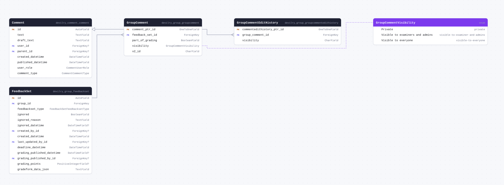

| Column | Field | Type | Null | Key | Default | Description |
| --- | --- | --- | --- | --- | --- | --- |
| `comment_ptr_id` | `OneToOneField` | `integer` |  | PK, FK |  |  |
| `feedback_set_id` | `ForeignKey` | `integer` |  | FK |  |  |
| `part_of_grading` | `BooleanField` | `boolean` |  |  | `False` |  |
| `visibility` | `GroupCommentVisibility` | `varchar(50)` |  |  | `'visible-to-everyone'` |  |
| `v2_id` | `CharField` | `varchar(255)` |  |  | `''` |  |

Indexes:

- index `devilry_group_groupcomment_feedback_set_id_1ee37508` on `feedback_set_id`
- index `devilry_group_groupcomment_visibility_6372acca` on `visibility`
- index `devilry_group_groupcomment_visibility_6372acca_like` on `visibility` (`varchar_pattern_ops`)

Relations:

- `comment_ptr_id` → [Comment](#comment).`id`, parent link, on delete cascade
- `feedback_set_id` → [FeedbackSet](#feedbackset).`id`, on delete cascade
- [GroupCommentEditHistory](#groupcommentedithistory).`group_comment_id` → `comment_ptr_id`, on delete cascade

## GroupCommentEditHistory

Table `devilry_group_groupcommentedithistory`, app `devilry_group`.

Inherits from [CommentEditHistory](#commentedithistory) (multi-table): its rows are joined on `commentedithistory_ptr_id`.

Model for logging changes in a :class:`.GroupComment`.

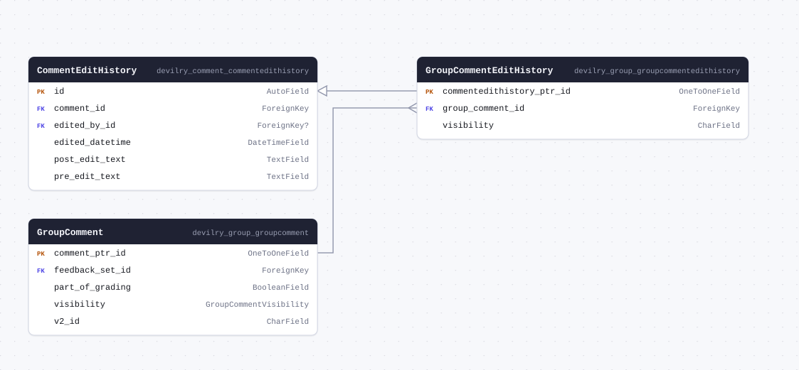

| Column | Field | Type | Null | Key | Default | Description |
| --- | --- | --- | --- | --- | --- | --- |
| `commentedithistory_ptr_id` | `OneToOneField` | `integer` |  | PK, FK |  |  |
| `group_comment_id` | `ForeignKey` | `integer` |  | FK |  |  |
| `visibility` | `CharField` | `varchar(50)` |  |  |  |  |

Indexes:

- index `devilry_group_groupcommentedithistory_group_comment_id_123b9b0d` on `group_comment_id`
- index `devilry_group_groupcommentedithistory_visibility_fddebfac` on `visibility`
- index `devilry_group_groupcommentedithistory_visibility_fddebfac_like` on `visibility` (`varchar_pattern_ops`)

Relations:

- `commentedithistory_ptr_id` → [CommentEditHistory](#commentedithistory).`id`, parent link, on delete cascade
- `group_comment_id` → [GroupComment](#groupcomment).`comment_ptr_id`, on delete cascade

## ImageAnnotationComment

Table `devilry_group_imageannotationcomment`, app `devilry_group`.

Inherits from [Comment](#comment) (multi-table): its rows are joined on `comment_ptr_id`.

Columns from `AbstractGroupComment` (abstract): `comment_ptr_id`, `feedback_set_id`, `part_of_grading`, `visibility`.

A comment made on a file, as an annotation

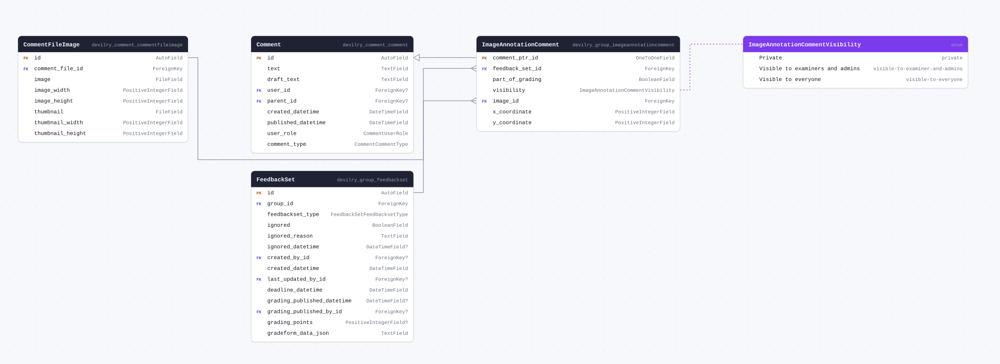

| Column | Field | Type | Null | Key | Default | Description |
| --- | --- | --- | --- | --- | --- | --- |
| `comment_ptr_id` | `OneToOneField` | `integer` |  | PK, FK |  |  |
| `feedback_set_id` | `ForeignKey` | `integer` |  | FK |  |  |
| `part_of_grading` | `BooleanField` | `boolean` |  |  | `False` |  |
| `visibility` | `ImageAnnotationCommentVisibility` | `varchar(50)` |  |  | `'visible-to-everyone'` |  |
| `image_id` | `ForeignKey` | `integer` |  | FK |  |  |
| `x_coordinate` | `PositiveIntegerField` | `integer` |  |  |  |  |
| `y_coordinate` | `PositiveIntegerField` | `integer` |  |  |  |  |

Indexes:

- index `devilry_group_imageannotationcomment_feedback_set_id_c8a92a7c` on `feedback_set_id`
- index `devilry_group_imageannotationcomment_visibility_1a76f5a8` on `visibility`
- index `devilry_group_imageannotationcomment_visibility_1a76f5a8_like` on `visibility` (`varchar_pattern_ops`)
- index `devilry_group_imageannotationcomment_image_id_5760aa73` on `image_id`

Relations:

- `comment_ptr_id` → [Comment](#comment).`id`, parent link, on delete cascade
- `feedback_set_id` → [FeedbackSet](#feedbackset).`id`, on delete cascade
- `image_id` → [CommentFileImage](#commentfileimage).`id`, on delete cascade

## Comment

Table `devilry_comment_comment`, app `devilry_comment`.

Subclasses (multi-table): [GroupComment](#groupcomment), [ImageAnnotationComment](#imageannotationcomment).

Main class for a comment.

A comment made by an user.

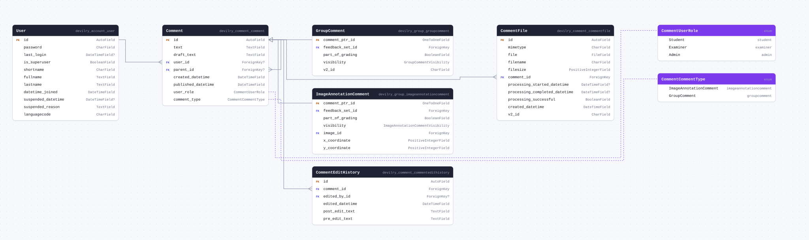

| Column | Field | Type | Null | Key | Default | Description |
| --- | --- | --- | --- | --- | --- | --- |
| `id` | `AutoField` | `integer` |  | PK | `autoincrement()` |  |
| `text` | `TextField` | `text` |  |  | `''` |  |
| `draft_text` | `TextField` | `text` |  |  | `''` |  |
| `user_id` | `ForeignKey` | `integer` | yes | FK |  |  |
| `parent_id` | `ForeignKey` | `integer` | yes | FK |  |  |
| `created_datetime` | `DateTimeField` | `timestamp with time zone` |  |  | `now()` |  |
| `published_datetime` | `DateTimeField` | `timestamp with time zone` |  |  | `now()` |  |
| `user_role` | `CommentUserRole` | `varchar(42)` |  |  |  |  |
| `comment_type` | `CommentCommentType` | `varchar(42)` |  |  |  |  |

Indexes:

- index `devilry_comment_comment_user_id_ddc7b6b0` on `user_id`
- index `devilry_comment_comment_parent_id_716b1f97` on `parent_id`

Relations:

- [GroupComment](#groupcomment).`comment_ptr_id` → `id`, parent link, on delete cascade
- [ImageAnnotationComment](#imageannotationcomment).`comment_ptr_id` → `id`, parent link, on delete cascade
- `user_id` → [User](#user).`id`, on delete set null
- `parent_id` → [Comment](#comment).`id`, on delete cascade
- [CommentEditHistory](#commentedithistory).`comment_id` → `id`, on delete cascade
- [CommentFile](#commentfile).`comment_id` → `id`, on delete cascade

## CommentEditHistory

Table `devilry_comment_commentedithistory`, app `devilry_comment`.

Subclasses (multi-table): [GroupCommentEditHistory](#groupcommentedithistory).

Model for logging changes in a :class:`.Comment`.

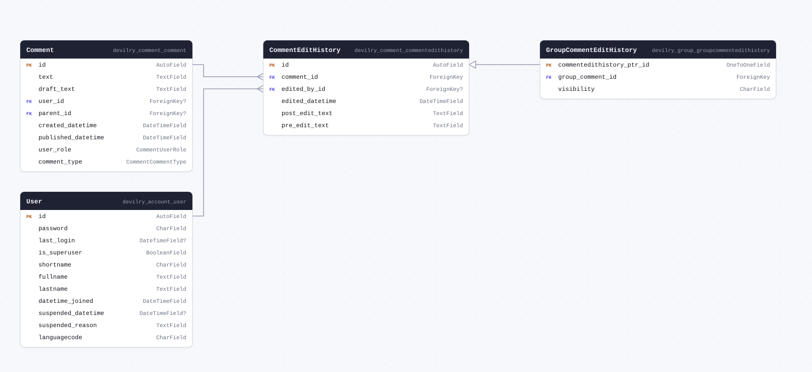

| Column | Field | Type | Null | Key | Default | Description |
| --- | --- | --- | --- | --- | --- | --- |
| `id` | `AutoField` | `integer` |  | PK | `autoincrement()` |  |
| `comment_id` | `ForeignKey` | `integer` |  | FK |  |  |
| `edited_by_id` | `ForeignKey` | `integer` | yes | FK |  |  |
| `edited_datetime` | `DateTimeField` | `timestamp with time zone` |  |  | `now()` |  |
| `post_edit_text` | `TextField` | `text` |  |  | `''` |  |
| `pre_edit_text` | `TextField` | `text` |  |  | `''` |  |

Indexes:

- index `devilry_comment_commentedithistory_comment_id_91baeb5a` on `comment_id`
- index `devilry_comment_commentedithistory_edited_by_id_2e51be6c` on `edited_by_id`

Relations:

- [GroupCommentEditHistory](#groupcommentedithistory).`commentedithistory_ptr_id` → `id`, parent link, on delete cascade
- `comment_id` → [Comment](#comment).`id`, on delete cascade
- `edited_by_id` → [User](#user).`id`, on delete set null

## CommentFile

Table `devilry_comment_commentfile`, app `devilry_comment`.

Main class for a file uploaded to a :class:`Comment`

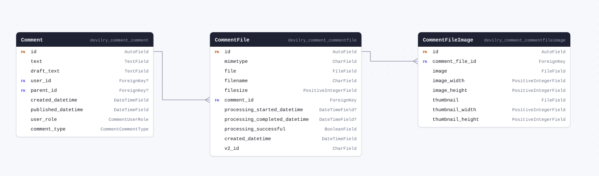

| Column | Field | Type | Null | Key | Default | Description |
| --- | --- | --- | --- | --- | --- | --- |
| `id` | `AutoField` | `integer` |  | PK | `autoincrement()` |  |
| `mimetype` | `CharField` | `varchar(255)` |  |  |  |  |
| `file` | `FileField` | `varchar(512)` |  |  | `''` |  |
| `filename` | `CharField` | `varchar(255)` |  |  |  |  |
| `filesize` | `PositiveIntegerField` | `integer` |  |  |  |  |
| `comment_id` | `ForeignKey` | `integer` |  | FK |  |  |
| `processing_started_datetime` | `DateTimeField` | `timestamp with time zone` | yes |  |  |  |
| `processing_completed_datetime` | `DateTimeField` | `timestamp with time zone` | yes |  |  |  |
| `processing_successful` | `BooleanField` | `boolean` |  |  | `False` |  |
| `created_datetime` | `DateTimeField` | `timestamp with time zone` |  |  | `now()` |  |
| `v2_id` | `CharField` | `varchar(255)` |  |  | `''` |  |

Indexes:

- index `devilry_comment_commentfile_file_23855966` on `file`
- index `devilry_comment_commentfile_file_23855966_like` on `file` (`varchar_pattern_ops`)
- index `devilry_comment_commentfile_comment_id_d2e33543` on `comment_id`

Relations:

- `comment_id` → [Comment](#comment).`id`, on delete cascade
- [CommentFileImage](#commentfileimage).`comment_file_id` → `id`, on delete cascade

## CommentFileImage

Table `devilry_comment_commentfileimage`, app `devilry_comment`.

An image representing a single page of a :class:`CommentFile`.

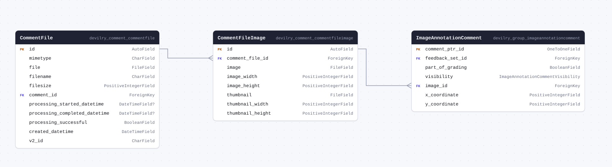

| Column | Field | Type | Null | Key | Default | Description |
| --- | --- | --- | --- | --- | --- | --- |
| `id` | `AutoField` | `integer` |  | PK | `autoincrement()` |  |
| `comment_file_id` | `ForeignKey` | `integer` |  | FK |  |  |
| `image` | `FileField` | `varchar(512)` |  |  | `''` |  |
| `image_width` | `PositiveIntegerField` | `integer` |  |  |  |  |
| `image_height` | `PositiveIntegerField` | `integer` |  |  |  |  |
| `thumbnail` | `FileField` | `varchar(512)` |  |  | `''` |  |
| `thumbnail_width` | `PositiveIntegerField` | `integer` |  |  |  |  |
| `thumbnail_height` | `PositiveIntegerField` | `integer` |  |  |  |  |

Indexes:

- index `devilry_comment_commentfileimage_comment_file_id_907bec97` on `comment_file_id`
- index `devilry_comment_commentfileimage_image_955e2205` on `image`
- index `devilry_comment_commentfileimage_image_955e2205_like` on `image` (`varchar_pattern_ops`)
- index `devilry_comment_commentfileimage_thumbnail_dc2a6a88` on `thumbnail`
- index `devilry_comment_commentfileimage_thumbnail_dc2a6a88_like` on `thumbnail` (`varchar_pattern_ops`)

Relations:

- [ImageAnnotationComment](#imageannotationcomment).`image_id` → `id`, on delete cascade
- `comment_file_id` → [CommentFile](#commentfile).`id`, on delete cascade

## DeadlineTag

Table `devilry_qualifiesforexam_deadlinetag`, app `devilry_qualifiesforexam`.


| Column | Field | Type | Null | Key | Default | Description |
| --- | --- | --- | --- | --- | --- | --- |
| `id` | `AutoField` | `integer` |  | PK | `autoincrement()` |  |
| `timestamp` | `DateTimeField` | `timestamp with time zone` |  |  |  |  |
| `tag` | `CharField` | `varchar(30)` | yes |  |  |  |

Relations:

- [devilry_qualifiesforexam.PeriodTag](#devilry_qualifiesforexamperiodtag).`deadlinetag_id` → `id`, on delete cascade

## devilry_qualifiesforexam.PeriodTag

Table `devilry_qualifiesforexam_periodtag`, app `devilry_qualifiesforexam`.


| Column | Field | Type | Null | Key | Default | Description |
| --- | --- | --- | --- | --- | --- | --- |
| `period_id` | `OneToOneField` | `integer` |  | PK, FK |  |  |
| `deadlinetag_id` | `ForeignKey` | `integer` |  | FK |  |  |

Indexes:

- index `devilry_qualifiesforexam_periodtag_deadlinetag_id_e41288ef` on `deadlinetag_id`

Relations:

- `period_id` → [Period](#period).`id`, on delete cascade
- `deadlinetag_id` → [DeadlineTag](#deadlinetag).`id`, on delete cascade

## Status

Table `devilry_qualifiesforexam_status`, app `devilry_qualifiesforexam`.


| Column | Field | Type | Null | Key | Default | Description |
| --- | --- | --- | --- | --- | --- | --- |
| `id` | `AutoField` | `integer` |  | PK | `autoincrement()` |  |
| `status` | `StatusStatus` | `varchar(30)` |  |  |  |  |
| `period_id` | `ForeignKey` | `integer` |  | FK |  |  |
| `createtime` | `DateTimeField` | `timestamp with time zone` |  |  | `now()` |  |
| `message` | `TextField` | `text` |  |  | `''` |  |
| `user_id` | `ForeignKey` | `integer` |  | FK |  |  |
| `plugin` | `CharField` | `varchar(500)` | yes |  |  |  |
| `plugin_data` | `JSONField` | `jsonb` | yes |  |  |  |
| `exported_timestamp` | `DateTimeField` | `timestamp with time zone` | yes |  |  |  |

Indexes:

- index `devilry_qualifiesforexam_status_period_id_0719dddc` on `period_id`
- index `devilry_qualifiesforexam_status_user_id_f3d687ed` on `user_id`

Relations:

- `period_id` → [Period](#period).`id`, on delete cascade
- `user_id` → [User](#user).`id`, on delete cascade
- [QualifiesForFinalExam](#qualifiesforfinalexam).`status_id` → `id`, on delete cascade
- [DeletedQualifiesForFinalExam](#deletedqualifiesforfinalexam).`status_id` → `id`, on delete cascade

## QualifiesForFinalExam

Table `devilry_qualifiesforexam_qualifiesforfinalexam`, app `devilry_qualifiesforexam`.


| Column | Field | Type | Null | Key | Default | Description |
| --- | --- | --- | --- | --- | --- | --- |
| `id` | `AutoField` | `integer` |  | PK | `autoincrement()` |  |
| `relatedstudent_id` | `ForeignKey` | `integer` |  | FK |  |  |
| `status_id` | `ForeignKey` | `integer` |  | FK |  |  |
| `qualifies` | `BooleanField` | `boolean` | yes |  |  |  |

Indexes:

- index `devilry_qualifiesforexam_q_relatedstudent_id_a473d52f` on `relatedstudent_id`
- index `devilry_qualifiesforexam_q_status_id_739aa9de` on `status_id`
- unique `devilry_qualifiesforexam_relatedstudent_id_status_8723fdfb_uniq` on `relatedstudent_id`, `status_id`

Relations:

- `relatedstudent_id` → [RelatedStudent](#relatedstudent).`id`, on delete cascade
- `status_id` → [Status](#status).`id`, on delete cascade

## DeletedQualifiesForFinalExam

Table `devilry_qualifiesforexam_deletedqualifiesforfinalexam`, app `devilry_qualifiesforexam`.


| Column | Field | Type | Null | Key | Default | Description |
| --- | --- | --- | --- | --- | --- | --- |
| `id` | `AutoField` | `integer` |  | PK | `autoincrement()` |  |
| `relatedstudent_id` | `ForeignKey` | `integer` |  | FK |  |  |
| `status_id` | `ForeignKey` | `integer` |  | FK |  |  |
| `qualifies` | `BooleanField` | `boolean` | yes |  |  |  |

Indexes:

- index `devilry_qualifiesforexam_d_relatedstudent_id_1e10750d` on `relatedstudent_id`
- index `devilry_qualifiesforexam_d_status_id_46f01360` on `status_id`

Relations:

- `relatedstudent_id` → [RelatedStudent](#relatedstudent).`id`, on delete cascade
- `status_id` → [Status](#status).`id`, on delete cascade

## DraftStatus

Table `devilry_qualifiesforexam_draftstatus`, app `devilry_qualifiesforexam`.

A model used for drafting results.

This is used for storing the results of a plugin before it's saved as a :class:`~.Status`. This allows 
us to run the plugin-processing of students in a background task to scale with large courses and/or demanding 
result collection.


| Column | Field | Type | Null | Key | Default | Description |
| --- | --- | --- | --- | --- | --- | --- |
| `id` | `AutoField` | `integer` |  | PK | `autoincrement()` |  |
| `created_datetime` | `DateTimeField` | `timestamp with time zone` |  |  | `now()` |  |
| `created_by_id` | `ForeignKey` | `integer` |  | FK |  |  |
| `period_id` | `ForeignKey` | `integer` |  | FK |  |  |
| `plugin` | `CharField` | `varchar(500)` | yes |  |  |  |
| `plugin_data` | `JSONField` | `jsonb` | yes |  | `dict()` |  |
| `processing_started_datetime` | `DateTimeField` | `timestamp with time zone` | yes |  | `None` |  |
| `processing_completed_datetime` | `DateTimeField` | `timestamp with time zone` | yes |  | `None` |  |
| `processing_status` | `DraftStatusProcessingStatusChoices` | `varchar(32)` |  |  | `'not_started'` |  |
| `processing_status_data` | `JSONField` | `jsonb` | yes |  | `dict()` |  |

Indexes:

- index `devilry_qualifiesforexam_draftstatus_created_by_id_d1da3e4b` on `created_by_id`
- index `devilry_qualifiesforexam_draftstatus_period_id_e46db2ea` on `period_id`

Relations:

- `created_by_id` → [User](#user).`id`, on delete cascade
- `period_id` → [Period](#period).`id`, on delete cascade
- [DraftQualifiesForFinalExam](#draftqualifiesforfinalexam).`draft_status_id` → `id`, on delete cascade

## DraftQualifiesForFinalExam

Table `devilry_qualifiesforexam_draftqualifiesforfinalexam`, app `devilry_qualifiesforexam`.

A model used for storing draft-data about a student.


| Column | Field | Type | Null | Key | Default | Description |
| --- | --- | --- | --- | --- | --- | --- |
| `id` | `AutoField` | `integer` |  | PK | `autoincrement()` |  |
| `relatedstudent_id` | `ForeignKey` | `integer` |  | FK |  |  |
| `draft_status_id` | `ForeignKey` | `integer` |  | FK |  |  |
| `qualifies` | `BooleanField` | `boolean` |  |  | `False` |  |

Indexes:

- index `devilry_qualifiesforexam_d_relatedstudent_id_3045fe4c` on `relatedstudent_id`
- index `devilry_qualifiesforexam_d_draft_status_id_88c87770` on `draft_status_id`

Relations:

- `relatedstudent_id` → [RelatedStudent](#relatedstudent).`id`, on delete cascade
- `draft_status_id` → [DraftStatus](#draftstatus).`id`, on delete cascade

## AssignmentGroupCachedData

Table `devilry_dbcache_assignmentgroupcacheddata`, app `devilry_dbcache`.

Automatically cached data for an
:class:`devilry.apps.core.models.assignment_group.AssignmentGroup`.

This model is automatically maintained via postgres triggers, and
it should never be edited manually.


| Column | Field | Type | Null | Key | Default | Description |
| --- | --- | --- | --- | --- | --- | --- |
| `id` | `AutoField` | `integer` |  | PK | `autoincrement()` |  |
| `group_id` | `OneToOneField` | `integer` |  | FK, unique |  |  |
| `first_feedbackset_id` | `ForeignKey` | `integer` | yes | FK |  |  |
| `last_feedbackset_id` | `ForeignKey` | `integer` | yes | FK |  |  |
| `last_published_feedbackset_id` | `ForeignKey` | `integer` | yes | FK |  |  |
| `new_attempt_count` | `PositiveIntegerField` | `integer` |  |  | `0` |  |
| `public_total_comment_count` | `PositiveIntegerField` | `integer` |  |  | `0` |  |
| `public_student_comment_count` | `PositiveIntegerField` | `integer` |  |  | `0` |  |
| `public_examiner_comment_count` | `PositiveIntegerField` | `integer` |  |  | `0` |  |
| `public_admin_comment_count` | `PositiveIntegerField` | `integer` |  |  | `0` |  |
| `public_student_file_upload_count` | `PositiveIntegerField` | `integer` |  |  | `0` |  |
| `public_student_attempts_with_delivered_files` | `PositiveIntegerField` | `integer` |  |  | `0` |  |
| `last_public_comment_by_student_datetime` | `DateTimeField` | `timestamp with time zone` | yes |  |  |  |
| `last_public_comment_by_examiner_datetime` | `DateTimeField` | `timestamp with time zone` | yes |  |  |  |
| `examiner_count` | `PositiveIntegerField` | `integer` |  |  | `0` |  |
| `candidate_count` | `PositiveIntegerField` | `integer` |  |  | `0` |  |

Indexes:

- index `devilry_dbcache_assignment_first_feedbackset_id_89c38dc7` on `first_feedbackset_id`
- index `devilry_dbcache_assignment_last_feedbackset_id_6961c179` on `last_feedbackset_id`
- index `devilry_dbcache_assignment_last_published_feedbackset_453296b2` on `last_published_feedbackset_id`

Relations:

- `group_id` → [AssignmentGroup](#assignmentgroup).`id`, on delete cascade
- `first_feedbackset_id` → [FeedbackSet](#feedbackset).`id`, on delete cascade
- `last_feedbackset_id` → [FeedbackSet](#feedbackset).`id`, on delete cascade
- `last_published_feedbackset_id` → [FeedbackSet](#feedbackset).`id`, on delete cascade

## Message

Table `devilry_message_message`, app `devilry_message`.

The `Message`-class handles preparing and sending of different messages in the Devilry-system.

This model contains metadata about a message sent to one or multiple users, what type of message it is, the overall
status of the message and creates recipients for the email to be sent.

Notes:
    The actual subject and message-content is stored on each :class:`.MessageReceiver` with a
    foreignkey to this class. The reason for this being that we want to save the subject and content
    in the preferred language of the user.


| Column | Field | Type | Null | Key | Default | Description |
| --- | --- | --- | --- | --- | --- | --- |
| `id` | `AutoField` | `integer` |  | PK | `autoincrement()` |  |
| `created_datetime` | `DateTimeField` | `timestamp with time zone` | yes |  | `now()` |  |
| `created_by_id` | `ForeignKey` | `integer` | yes | FK | `None` |  |
| `status` | `MessageStatus` | `varchar(30)` |  |  | `'draft'` |  |
| `status_data` | `JSONField` | `jsonb` |  |  | `dict()` |  |
| `metadata` | `JSONField` | `jsonb` |  |  | `dict()` |  |
| `context_type` | `MessageContextType` | `varchar(255)` |  |  | `'other'` |  |
| `message_type` | `ArrayField` | `varchar(30)[]` |  |  |  |  |
| `virtual_message_receivers` | `JSONField` | `jsonb` |  |  | `dict()` |  |

Indexes:

- index `devilry_message_message_created_by_id_a8eedba2` on `created_by_id`
- index `devilry_message_message_status_a1e70f20` on `status`
- index `devilry_message_message_status_a1e70f20_like` on `status` (`varchar_pattern_ops`)

Relations:

- `created_by_id` → [User](#user).`id`, on delete set null
- [MessageReceiver](#messagereceiver).`message_id` → `id`, on delete cascade

## MessageReceiver

Table `devilry_message_messagereceiver`, app `devilry_message`.

This class represents a single message to a single user.

Contains data about the specific message for a user:
    - ForeignKey to a user.
    - The status of the sending.
    - How many time the message has been successfully and unsuccessfully sent to the user.
    - The subject.
    - The content as both html and plaintext.
    - When the message was successfully sent.

The subject and message-content is stored in the users preferred language when the first
message was created.


| Column | Field | Type | Null | Key | Default | Description |
| --- | --- | --- | --- | --- | --- | --- |
| `id` | `AutoField` | `integer` |  | PK | `autoincrement()` |  |
| `created_datetime` | `DateTimeField` | `timestamp with time zone` | yes |  | `now()` |  |
| `status` | `MessageReceiverStatus` | `varchar(10)` |  |  | `'not_sent'` |  |
| `status_data` | `JSONField` | `jsonb` |  |  | `dict()` |  |
| `metadata` | `JSONField` | `jsonb` |  |  | `dict()` |  |
| `subject` | `CharField` | `varchar(255)` |  |  | `''` |  |
| `message_content_plain` | `TextField` | `text` |  |  | `''` |  |
| `message_content_html` | `TextField` | `text` |  |  | `''` |  |
| `message_id` | `ForeignKey` | `integer` |  | FK |  |  |
| `message_type` | `CharField` | `varchar(30)` |  |  |  |  |
| `send_to` | `CharField` | `varchar(255)` |  |  | `''` |  |
| `user_id` | `ForeignKey` | `integer` |  | FK |  |  |
| `sent_datetime` | `DateTimeField` | `timestamp with time zone` | yes |  |  |  |
| `sending_failed_count` | `IntegerField` | `integer` |  |  | `0` |  |
| `sending_success_count` | `IntegerField` | `integer` |  |  | `0` |  |

Indexes:

- index `devilry_message_messagereceiver_message_id_d1452084` on `message_id`
- index `devilry_message_messagereceiver_message_type_c7e2d924` on `message_type`
- index `devilry_message_messagereceiver_message_type_c7e2d924_like` on `message_type` (`varchar_pattern_ops`)
- index `devilry_message_messagereceiver_user_id_06b01621` on `user_id`

Relations:

- `message_id` → [Message](#message).`id`, on delete cascade
- `user_id` → [User](#user).`id`, on delete cascade

## DevilryReport

Table `devilry_report_devilryreport`, app `devilry_report`.

A model representing a report of various data, e.g complete user report.

The model is designed for being updated asynchronously with a continuously
updated status while generating a report. Of course, the a report can also be generated synchronously,
but usually the report generators will perform time-consuming tasks.

Report data is stored as binary data, and is always generated for a specific user.


| Column | Field | Type | Null | Key | Default | Description |
| --- | --- | --- | --- | --- | --- | --- |
| `id` | `AutoField` | `integer` |  | PK | `autoincrement()` |  |
| `generated_by_user_id` | `ForeignKey` | `integer` |  | FK |  |  |
| `created_datetime` | `DateTimeField` | `timestamp with time zone` |  |  | `now()` |  |
| `started_datetime` | `DateTimeField` | `timestamp with time zone` | yes |  | `None` |  |
| `finished_datetime` | `DateTimeField` | `timestamp with time zone` | yes |  | `None` |  |
| `generator_type` | `CharField` | `varchar(255)` |  |  |  |  |
| `generator_options` | `JSONField` | `jsonb` |  |  | `dict()` |  |
| `status` | `DevilryReportStatus` | `varchar(255)` |  |  | `'unprocessed'` |  |
| `status_data` | `JSONField` | `jsonb` |  |  | `dict()` |  |
| `output_filename` | `CharField` | `varchar(255)` | yes |  | `''` |  |
| `content_type` | `CharField` | `varchar(255)` | yes |  | `''` |  |
| `result` | `BinaryField` | `bytea` |  |  |  |  |

Indexes:

- index `devilry_report_devilryreport_generated_by_user_id_4120a74b` on `generated_by_user_id`

Relations:

- `generated_by_user_id` → [User](#user).`id`, on delete cascade

## EmailAddress

Table `account_emailaddress`, app `account`.


| Column | Field | Type | Null | Key | Default | Description |
| --- | --- | --- | --- | --- | --- | --- |
| `id` | `AutoField` | `integer` |  | PK | `autoincrement()` |  |
| `user_id` | `ForeignKey` | `integer` |  | FK |  |  |
| `email` | `EmailField` | `varchar(254)` |  |  |  |  |
| `verified` | `BooleanField` | `boolean` |  |  | `False` |  |
| `primary` | `BooleanField` | `boolean` |  |  | `False` |  |

Indexes:

- index `account_emailaddress_user_id_2c513194` on `user_id`
- index `account_emailaddress_email_03be32b2` on `email`
- index `account_emailaddress_email_03be32b2_like` on `email` (`varchar_pattern_ops`)
- unique `account_emailaddress_user_id_email_987c8728_uniq` on `user_id`, `email`
- unique `unique_primary_email` on `user_id`, `primary` where `"primary"`
- unique `unique_verified_email` on `email` where `"verified"`

Relations:

- `user_id` → [User](#user).`id`, on delete cascade
- [EmailConfirmation](#emailconfirmation).`email_address_id` → `id`, on delete cascade

## EmailConfirmation

Table `account_emailconfirmation`, app `account`.


| Column | Field | Type | Null | Key | Default | Description |
| --- | --- | --- | --- | --- | --- | --- |
| `id` | `AutoField` | `integer` |  | PK | `autoincrement()` |  |
| `email_address_id` | `ForeignKey` | `integer` |  | FK |  |  |
| `created` | `DateTimeField` | `timestamp with time zone` |  |  | `now()` |  |
| `sent` | `DateTimeField` | `timestamp with time zone` | yes |  |  |  |
| `key` | `CharField` | `varchar(64)` |  | unique |  |  |

Indexes:

- index `account_emailconfirmation_email_address_id_5b7f8c58` on `email_address_id`
- index `account_emailconfirmation_key_f43612bd_like` on `key` (`varchar_pattern_ops`)

Relations:

- `email_address_id` → [EmailAddress](#emailaddress).`id`, on delete cascade

## SocialApp

Table `socialaccount_socialapp`, app `socialaccount`.


| Column | Field | Type | Null | Key | Default | Description |
| --- | --- | --- | --- | --- | --- | --- |
| `id` | `AutoField` | `integer` |  | PK | `autoincrement()` |  |
| `provider` | `CharField` | `varchar(30)` |  |  |  |  |
| `provider_id` | `CharField` | `varchar(200)` |  |  |  |  |
| `name` | `CharField` | `varchar(40)` |  |  |  |  |
| `client_id` | `CharField` | `varchar(191)` |  |  |  | App ID, or consumer key |
| `secret` | `CharField` | `varchar(191)` |  |  |  | API secret, client secret, or consumer secret |
| `key` | `CharField` | `varchar(191)` |  |  |  | Key |
| `settings` | `JSONField` | `jsonb` |  |  | `dict()` |  |

Relations:

- `sites` — many to many with [Site](#site)
- [SocialToken](#socialtoken).`app_id` → `id`, on delete set null

## SocialAccount

Table `socialaccount_socialaccount`, app `socialaccount`.


| Column | Field | Type | Null | Key | Default | Description |
| --- | --- | --- | --- | --- | --- | --- |
| `id` | `AutoField` | `integer` |  | PK | `autoincrement()` |  |
| `user_id` | `ForeignKey` | `integer` |  | FK |  |  |
| `provider` | `CharField` | `varchar(200)` |  |  |  |  |
| `uid` | `CharField` | `varchar(191)` |  |  |  |  |
| `last_login` | `DateTimeField` | `timestamp with time zone` |  |  | `now()` |  |
| `date_joined` | `DateTimeField` | `timestamp with time zone` |  |  | `now()` |  |
| `extra_data` | `JSONField` | `jsonb` |  |  | `dict()` |  |

Indexes:

- index `socialaccount_socialaccount_user_id_8146e70c` on `user_id`
- unique `socialaccount_socialaccount_provider_uid_fc810c6e_uniq` on `provider`, `uid`

Relations:

- `user_id` → [User](#user).`id`, on delete cascade
- [SocialToken](#socialtoken).`account_id` → `id`, on delete cascade

## SocialToken

Table `socialaccount_socialtoken`, app `socialaccount`.


| Column | Field | Type | Null | Key | Default | Description |
| --- | --- | --- | --- | --- | --- | --- |
| `id` | `AutoField` | `integer` |  | PK | `autoincrement()` |  |
| `app_id` | `ForeignKey` | `integer` | yes | FK |  |  |
| `account_id` | `ForeignKey` | `integer` |  | FK |  |  |
| `token` | `TextField` | `text` |  |  |  | "oauth_token" (OAuth1) or access token (OAuth2) |
| `token_secret` | `TextField` | `text` |  |  |  | "oauth_token_secret" (OAuth1) or refresh token (OAuth2) |
| `expires_at` | `DateTimeField` | `timestamp with time zone` | yes |  |  |  |

Indexes:

- index `socialaccount_socialtoken_app_id_636a42d7` on `app_id`
- index `socialaccount_socialtoken_account_id_951f210e` on `account_id`
- unique `socialaccount_socialtoken_app_id_account_id_fca4e0ac_uniq` on `app_id`, `account_id`

Relations:

- `app_id` → [SocialApp](#socialapp).`id`, on delete set null
- `account_id` → [SocialAccount](#socialaccount).`id`, on delete cascade

# Enums

## LogEntryActionFlag

| Name | Stored as |
| --- | --- |
| `Addition` | `1` |
| `Change` | `2` |
| `Deletion` | `3` |

## BatchOperationStatus

| Name | Stored as |
| --- | --- |
| `unprocessed` | `unprocessed` |
| `running` | `running` |
| `finished` | `finished` |

## BatchOperationResult

| Name | Stored as |
| --- | --- |
| `not available yet (processing not finished)` | `not-available` |
| `successful` | `successful` |
| `failed` | `failed` |

## AssignmentAnonymizationmode

| Name | Stored as |
| --- | --- |
| `OFF. Normal assignment where semester and course admins can see everything, and examiners and students can see each others names and contact information.` | `off` |
| `SEMI ANONYMOUS. Students and examiners can not see information about each other. Comments added by course admins are not anonymized. Semester admins do not have access to the assignment in the admin UI. Course admins have the same permissions as for "OFF".` | `semi_anonymous` |
| `FULLY ANONYMIZED. Intended for exams where course admins are examiners. Students and examiners can not see information about each other. Hidden from semester admins. Course admins can not view grading details. Only departmentadmins and superusers can change this back to another "anoymization mode" when feedback has been added to the assignment. Course admins can not edit examiners after the first feedback is provided.` | `fully_anonymous` |

## AssignmentDeliveryTypes

| Name | Stored as |
| --- | --- |
| `Electronic` | `0` |
| `Non electronic` | `1` |
| `Alias` | `2` |

## AssignmentDeadlineHandling

| Name | Stored as |
| --- | --- |
| `Soft deadlines` | `0` |
| `Hard deadlines` | `1` |

## AssignmentPointsToGradeMapper

| Name | Stored as |
| --- | --- |
| `Passed or failed` | `passed-failed` |
| `Points` | `raw-points` |
| `Lookup in a table defined by you (A-F, and other grading systems)` | `custom-table` |

## AssignmentGradingSystemPluginId

| Name | Stored as |
| --- | --- |
| `PASSED/FAILED. The examiner selects passed or failed.` | `devilry_gradingsystemplugin_approved` |
| `POINTS. The examiner types in the number of points to award the student(s) for this assignment.` | `devilry_gradingsystemplugin_points` |

## AssignmentFeedbackWorkflow

| Name | Stored as |
| --- | --- |
| `Simple - Examiners write feedback, and publish it whenever they want. Does not handle coordination of multiple examiners at all.` |  |
| `Trusted cooperative feedback editing - Examiners can only save feedback drafts. Examiners share the same feedback drafts, which means that one examiner can start writing feedback and another can continue. When an administrator is notified by their examiners that they have finished correcting, they can publish the drafts via the administrator UI. If you want one examiner to do the bulk of the work, and just let another examiner read it over and adjust the feedback, make the first examiner the only examiner, and reassign the students to the other examiner when the first examiner is done.` | `trusted-cooperative-feedback-editing` |

## UserEmailIsPrimary

| Name | Stored as |
| --- | --- |
| `No` | `None` |
| `Yes` | `True` |

## UserNameIsPrimary

| Name | Stored as |
| --- | --- |
| `No` | `None` |
| `Yes` | `True` |

## PermissionGroupGrouptype

| Name | Stored as |
| --- | --- |
| `Department administrator group` | `departmentadmin` |
| `Course administrator group` | `subjectadmin` |
| `Semester administrator group` | `periodadmin` |

## CompressedArchiveMetaCreatedByRole

| Name | Stored as |
| --- | --- |
| `Student` | `student` |
| `Examiner` | `examiner` |
| `Admin` | `admin` |

## FeedbackSetFeedbacksetType

| Name | Stored as |
| --- | --- |
| `first attempt` | `first_attempt` |
| `new attempt` | `new_attempt` |
| `re edit` | `re_edit` |
| `merge first attempt` | `merge_first_attempt` |
| `merge new attempt` | `merge_new_attempt` |
| `merge re edit` | `merge_re_edit` |

## FeedbacksetPassedPreviousPeriodPassedPreviousPeriodType

| Name | Stored as |
| --- | --- |
| `manual` | `manual` |
| `auto` | `auto` |

## GroupCommentVisibility

| Name | Stored as |
| --- | --- |
| `Private` | `private` |
| `Visible to examiners and admins` | `visible-to-examiner-and-admins` |
| `Visible to everyone` | `visible-to-everyone` |

## ImageAnnotationCommentVisibility

| Name | Stored as |
| --- | --- |
| `Private` | `private` |
| `Visible to examiners and admins` | `visible-to-examiner-and-admins` |
| `Visible to everyone` | `visible-to-everyone` |

## CommentUserRole

| Name | Stored as |
| --- | --- |
| `Student` | `student` |
| `Examiner` | `examiner` |
| `Admin` | `admin` |

## CommentCommentType

| Name | Stored as |
| --- | --- |
| `ImageAnnotationComment` | `imageannotationcomment` |
| `GroupComment` | `groupcomment` |

## StatusStatus

| Name | Stored as |
| --- | --- |
| `Ready for export` | `ready` |
| `Most students are ready for export` | `almostready` |
| `Not ready for export (retracted)` | `notready` |

## DraftStatusProcessingStatusChoices

| Name | Stored as |
| --- | --- |
| `NOT_STARTED` | `not_started` |
| `IN_PROGRESS` | `in_progress` |
| `COMPLETED` | `completed` |
| `ERROR` | `error` |

## MessageStatus

| Name | Stored as |
| --- | --- |
| `Draft` | `draft` |
| `Preparing for sending` | `preparing` |
| `Sending` | `sending` |
| `Error` | `error` |
| `Sent` | `sent` |

## MessageContextType

| Name | Stored as |
| --- | --- |
| `Other` | `other` |
| `Comment or delivery` | `comment_delivery` |
| `Deadline moved` | `deadline_moved` |
| `New attempt` | `new_attempt` |
| `Feedback` | `feedback` |
| `Grading updated` | `feedback_updated` |
| `Group invitation: invitation` | `group_invite_invitation` |
| `Group invitation: accepted` | `group_invite_accepted` |
| `Group invitation: rejected` | `group_invite_rejected` |

## MessageReceiverStatus

| Name | Stored as |
| --- | --- |
| `Not sent` | `not_sent` |
| `Failed` | `failed` |
| `Error` | `error` |
| `Sent` | `sent` |

## DevilryReportStatus

| Name | Stored as |
| --- | --- |
| `unprocessed` | `unprocessed` |
| `generating` | `generating` |
| `success` | `success` |
| `error` | `error` |
