# Schema docs

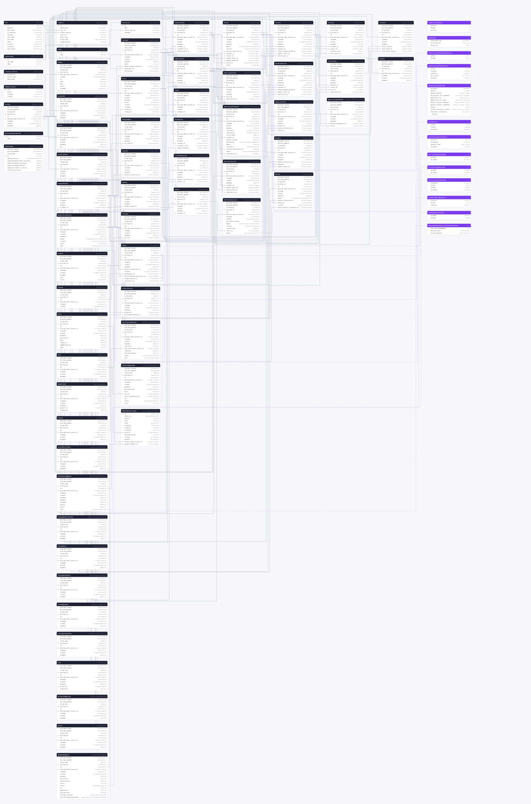

[LogEntry](#logentry) · [Permission](#permission) · [Group](#group) · [User](#user) · [ContentType](#contenttype) · [sessions.Session](#sessionssession) · [IdempotencyKey](#idempotencykey) · [APIKey](#apikey) · [Account](#account) · [AccountV2](#accountv2) · [Coupon](#coupon) · [PromotionCode](#promotioncode) · [Discount](#discount) · [Invoice](#invoice) · [UpcomingInvoice](#upcominginvoice) · [InvoiceItem](#invoiceitem) · [LineItem](#lineitem) · [Subscription](#subscription) · [SubscriptionItem](#subscriptionitem) · [SubscriptionSchedule](#subscriptionschedule) · [ShippingRate](#shippingrate) · [TaxCode](#taxcode) · [TaxId](#taxid) · [TaxRate](#taxrate) · [djstripe.Session](#djstripesession) · [ApplicationFee](#applicationfee) · [ApplicationFeeRefund](#applicationfeerefund) · [CountrySpec](#countryspec) · [Transfer](#transfer) · [TransferReversal](#transferreversal) · [BalanceTransaction](#balancetransaction) · [Charge](#charge) · [Mandate](#mandate) · [Product](#product) · [Customer](#customer) · [Dispute](#dispute) · [Event](#event) · [File](#file) · [FileLink](#filelink) · [PaymentIntent](#paymentintent) · [SetupIntent](#setupintent) · [Payout](#payout) · [Price](#price) · [Refund](#refund) · [Feature](#feature) · [ProductFeature](#productfeature) · [ActiveEntitlement](#activeentitlement) · [VerificationSession](#verificationsession) · [VerificationReport](#verificationreport) · [IssuingAuthorization](#issuingauthorization) · [IssuingCard](#issuingcard) · [IssuingCardholder](#issuingcardholder) · [IssuingDispute](#issuingdispute) · [IssuingTransaction](#issuingtransaction) · [DjstripePaymentMethod](#djstripepaymentmethod) · [BankAccount](#bankaccount) · [Card](#card) · [Source](#source) · [SourceTransaction](#sourcetransaction) · [PaymentMethod](#paymentmethod) · [EarlyFraudWarning](#earlyfraudwarning) · [Review](#review) · [ScheduledQueryRun](#scheduledqueryrun) · [WebhookEndpoint](#webhookendpoint) · [WebhookEventTrigger](#webhookeventtrigger)

<details>
<summary>The whole schema as SQL</summary>

```sql
CREATE TABLE "django_admin_log" ("id" integer NOT NULL PRIMARY KEY AUTOINCREMENT, "action_time" datetime NOT NULL, "user_id" integer NOT NULL REFERENCES "auth_user" ("id") DEFERRABLE INITIALLY DEFERRED, "content_type_id" integer NULL REFERENCES "django_content_type" ("id") DEFERRABLE INITIALLY DEFERRED, "object_id" text NULL, "object_repr" varchar(200) NOT NULL, "action_flag" smallint unsigned NOT NULL CHECK ("action_flag" >= 0), "change_message" text NOT NULL);

CREATE TABLE "auth_permission" ("id" integer NOT NULL PRIMARY KEY AUTOINCREMENT, "name" varchar(255) NOT NULL, "content_type_id" integer NOT NULL REFERENCES "django_content_type" ("id") DEFERRABLE INITIALLY DEFERRED, "codename" varchar(100) NOT NULL);

CREATE TABLE "auth_group" ("id" integer NOT NULL PRIMARY KEY AUTOINCREMENT, "name" varchar(150) NOT NULL UNIQUE);

CREATE TABLE "auth_group_permissions" ("id" integer NOT NULL PRIMARY KEY AUTOINCREMENT, "group_id" integer NOT NULL REFERENCES "auth_group" ("id") DEFERRABLE INITIALLY DEFERRED, "permission_id" integer NOT NULL REFERENCES "auth_permission" ("id") DEFERRABLE INITIALLY DEFERRED);

CREATE TABLE "auth_user" ("id" integer NOT NULL PRIMARY KEY AUTOINCREMENT, "password" varchar(128) NOT NULL, "last_login" datetime NULL, "is_superuser" bool NOT NULL, "username" varchar(150) NOT NULL UNIQUE, "first_name" varchar(150) NOT NULL, "last_name" varchar(150) NOT NULL, "email" varchar(254) NOT NULL, "is_staff" bool NOT NULL, "is_active" bool NOT NULL, "date_joined" datetime NOT NULL);

CREATE TABLE "auth_user_groups" ("id" integer NOT NULL PRIMARY KEY AUTOINCREMENT, "user_id" integer NOT NULL REFERENCES "auth_user" ("id") DEFERRABLE INITIALLY DEFERRED, "group_id" integer NOT NULL REFERENCES "auth_group" ("id") DEFERRABLE INITIALLY DEFERRED);

CREATE TABLE "auth_user_user_permissions" ("id" integer NOT NULL PRIMARY KEY AUTOINCREMENT, "user_id" integer NOT NULL REFERENCES "auth_user" ("id") DEFERRABLE INITIALLY DEFERRED, "permission_id" integer NOT NULL REFERENCES "auth_permission" ("id") DEFERRABLE INITIALLY DEFERRED);

CREATE TABLE "django_content_type" ("id" integer NOT NULL PRIMARY KEY AUTOINCREMENT, "app_label" varchar(100) NOT NULL, "model" varchar(100) NOT NULL);

CREATE TABLE "django_session" ("session_key" varchar(40) NOT NULL PRIMARY KEY, "session_data" text NOT NULL, "expire_date" datetime NOT NULL);

CREATE TABLE "djstripe_idempotencykey" ("uuid" char(32) NOT NULL PRIMARY KEY, "action" varchar(100) NOT NULL, "livemode" bool NOT NULL, "created" datetime NOT NULL);

CREATE TABLE "djstripe_apikey" ("djstripe_created" datetime NOT NULL, "djstripe_updated" datetime NOT NULL, "stripe_data" text NOT NULL CHECK ((JSON_VALID("stripe_data") OR "stripe_data" IS NULL)), "djstripe_id" integer NOT NULL PRIMARY KEY AUTOINCREMENT, "djstripe_owner_account_id" varchar(255) NULL REFERENCES "djstripe_account" ("id") DEFERRABLE INITIALLY DEFERRED, "created" datetime NULL, "id" varchar(255) NOT NULL, "type" varchar(255) NOT NULL, "name" varchar(100) NOT NULL, "secret" varchar(128) NOT NULL UNIQUE, "livemode" bool NOT NULL);

CREATE TABLE "djstripe_account" ("djstripe_created" datetime NOT NULL, "djstripe_updated" datetime NOT NULL, "stripe_data" text NOT NULL CHECK ((JSON_VALID("stripe_data") OR "stripe_data" IS NULL)), "djstripe_id" integer NOT NULL PRIMARY KEY AUTOINCREMENT, "id" varchar(255) NOT NULL UNIQUE, "djstripe_owner_account_id" varchar(255) NULL REFERENCES "djstripe_account" ("id") DEFERRABLE INITIALLY DEFERRED, "livemode" bool NULL, "created" datetime NULL, "metadata" text NULL CHECK ((JSON_VALID("metadata") OR "metadata" IS NULL)));

CREATE TABLE "djstripe_accountv2" ("djstripe_created" datetime NOT NULL, "djstripe_updated" datetime NOT NULL, "stripe_data" text NOT NULL CHECK ((JSON_VALID("stripe_data") OR "stripe_data" IS NULL)), "djstripe_id" integer NOT NULL PRIMARY KEY AUTOINCREMENT, "id" varchar(255) NOT NULL UNIQUE, "djstripe_owner_account_id" varchar(255) NULL REFERENCES "djstripe_account" ("id") DEFERRABLE INITIALLY DEFERRED, "livemode" bool NULL, "created" datetime NULL, "metadata" text NULL CHECK ((JSON_VALID("metadata") OR "metadata" IS NULL)));

CREATE TABLE "djstripe_coupon" ("djstripe_created" datetime NOT NULL, "djstripe_updated" datetime NOT NULL, "stripe_data" text NOT NULL CHECK ((JSON_VALID("stripe_data") OR "stripe_data" IS NULL)), "djstripe_id" integer NOT NULL PRIMARY KEY AUTOINCREMENT, "djstripe_owner_account_id" varchar(255) NULL REFERENCES "djstripe_account" ("id") DEFERRABLE INITIALLY DEFERRED, "livemode" bool NULL, "created" datetime NULL, "metadata" text NULL CHECK ((JSON_VALID("metadata") OR "metadata" IS NULL)), "id" varchar(500) NOT NULL);

CREATE TABLE "djstripe_promotioncode" ("djstripe_created" datetime NOT NULL, "djstripe_updated" datetime NOT NULL, "stripe_data" text NOT NULL CHECK ((JSON_VALID("stripe_data") OR "stripe_data" IS NULL)), "djstripe_id" integer NOT NULL PRIMARY KEY AUTOINCREMENT, "id" varchar(255) NOT NULL UNIQUE, "djstripe_owner_account_id" varchar(255) NULL REFERENCES "djstripe_account" ("id") DEFERRABLE INITIALLY DEFERRED, "livemode" bool NULL, "created" datetime NULL, "metadata" text NULL CHECK ((JSON_VALID("metadata") OR "metadata" IS NULL)));

CREATE TABLE "djstripe_discount" ("djstripe_created" datetime NOT NULL, "djstripe_updated" datetime NOT NULL, "stripe_data" text NOT NULL CHECK ((JSON_VALID("stripe_data") OR "stripe_data" IS NULL)), "djstripe_id" integer NOT NULL PRIMARY KEY AUTOINCREMENT, "id" varchar(255) NOT NULL UNIQUE, "djstripe_owner_account_id" varchar(255) NULL REFERENCES "djstripe_account" ("id") DEFERRABLE INITIALLY DEFERRED, "livemode" bool NULL, "created" datetime NULL, "metadata" text NULL CHECK ((JSON_VALID("metadata") OR "metadata" IS NULL)), "customer_id" varchar(255) NULL REFERENCES "djstripe_customer" ("id") DEFERRABLE INITIALLY DEFERRED, "invoice_id" varchar(255) NULL REFERENCES "djstripe_invoice" ("id") DEFERRABLE INITIALLY DEFERRED, "promotion_code" varchar(255) NOT NULL, "subscription_id" varchar(255) NULL REFERENCES "djstripe_subscription" ("id") DEFERRABLE INITIALLY DEFERRED);

CREATE TABLE "djstripe_invoice" ("djstripe_created" datetime NOT NULL, "djstripe_updated" datetime NOT NULL, "stripe_data" text NOT NULL CHECK ((JSON_VALID("stripe_data") OR "stripe_data" IS NULL)), "djstripe_id" integer NOT NULL PRIMARY KEY AUTOINCREMENT, "id" varchar(255) NOT NULL UNIQUE, "djstripe_owner_account_id" varchar(255) NULL REFERENCES "djstripe_account" ("id") DEFERRABLE INITIALLY DEFERRED, "livemode" bool NULL, "created" datetime NULL, "metadata" text NULL CHECK ((JSON_VALID("metadata") OR "metadata" IS NULL)), "charge_id" bigint NULL UNIQUE REFERENCES "djstripe_charge" ("djstripe_id") DEFERRABLE INITIALLY DEFERRED, "customer_id" varchar(255) NOT NULL REFERENCES "djstripe_customer" ("id") DEFERRABLE INITIALLY DEFERRED, "default_payment_method_id" varchar(255) NULL REFERENCES "djstripe_paymentmethod" ("id") DEFERRABLE INITIALLY DEFERRED, "payment_intent_id" bigint NULL UNIQUE REFERENCES "djstripe_paymentintent" ("djstripe_id") DEFERRABLE INITIALLY DEFERRED, "subscription_id" varchar(255) NULL REFERENCES "djstripe_subscription" ("id") DEFERRABLE INITIALLY DEFERRED);

CREATE TABLE "djstripe_djstripeinvoicedefaulttaxrate" ("id" integer NOT NULL PRIMARY KEY AUTOINCREMENT, "invoice_id" bigint NOT NULL REFERENCES "djstripe_invoice" ("djstripe_id") DEFERRABLE INITIALLY DEFERRED, "taxrate_id" bigint NOT NULL REFERENCES "djstripe_taxrate" ("djstripe_id") DEFERRABLE INITIALLY DEFERRED);

CREATE TABLE "djstripe_upcominginvoice" ("djstripe_created" datetime NOT NULL, "djstripe_updated" datetime NOT NULL, "stripe_data" text NOT NULL CHECK ((JSON_VALID("stripe_data") OR "stripe_data" IS NULL)), "djstripe_id" integer NOT NULL PRIMARY KEY AUTOINCREMENT, "djstripe_owner_account_id" varchar(255) NULL REFERENCES "djstripe_account" ("id") DEFERRABLE INITIALLY DEFERRED, "livemode" bool NULL, "created" datetime NULL, "metadata" text NULL CHECK ((JSON_VALID("metadata") OR "metadata" IS NULL)), "charge_id" bigint NULL UNIQUE REFERENCES "djstripe_charge" ("djstripe_id") DEFERRABLE INITIALLY DEFERRED, "customer_id" varchar(255) NOT NULL REFERENCES "djstripe_customer" ("id") DEFERRABLE INITIALLY DEFERRED, "default_payment_method_id" varchar(255) NULL REFERENCES "djstripe_paymentmethod" ("id") DEFERRABLE INITIALLY DEFERRED, "payment_intent_id" bigint NULL UNIQUE REFERENCES "djstripe_paymentintent" ("djstripe_id") DEFERRABLE INITIALLY DEFERRED, "subscription_id" varchar(255) NULL REFERENCES "djstripe_subscription" ("id") DEFERRABLE INITIALLY DEFERRED);

CREATE TABLE "djstripe_invoiceitem" ("djstripe_created" datetime NOT NULL, "djstripe_updated" datetime NOT NULL, "stripe_data" text NOT NULL CHECK ((JSON_VALID("stripe_data") OR "stripe_data" IS NULL)), "djstripe_id" integer NOT NULL PRIMARY KEY AUTOINCREMENT, "id" varchar(255) NOT NULL UNIQUE, "djstripe_owner_account_id" varchar(255) NULL REFERENCES "djstripe_account" ("id") DEFERRABLE INITIALLY DEFERRED, "livemode" bool NULL, "created" datetime NULL, "metadata" text NULL CHECK ((JSON_VALID("metadata") OR "metadata" IS NULL)), "customer_id" varchar(255) NOT NULL REFERENCES "djstripe_customer" ("id") DEFERRABLE INITIALLY DEFERRED, "invoice_id" varchar(255) NULL REFERENCES "djstripe_invoice" ("id") DEFERRABLE INITIALLY DEFERRED, "price_id" bigint NULL REFERENCES "djstripe_price" ("djstripe_id") DEFERRABLE INITIALLY DEFERRED, "subscription_id" varchar(255) NULL REFERENCES "djstripe_subscription" ("id") DEFERRABLE INITIALLY DEFERRED);

CREATE TABLE "djstripe_djstripeinvoiceitemtaxrate" ("id" integer NOT NULL PRIMARY KEY AUTOINCREMENT, "invoiceitem_id" bigint NOT NULL REFERENCES "djstripe_invoiceitem" ("djstripe_id") DEFERRABLE INITIALLY DEFERRED, "taxrate_id" bigint NOT NULL REFERENCES "djstripe_taxrate" ("djstripe_id") DEFERRABLE INITIALLY DEFERRED);

CREATE TABLE "djstripe_lineitem" ("djstripe_created" datetime NOT NULL, "djstripe_updated" datetime NOT NULL, "stripe_data" text NOT NULL CHECK ((JSON_VALID("stripe_data") OR "stripe_data" IS NULL)), "djstripe_id" integer NOT NULL PRIMARY KEY AUTOINCREMENT, "id" varchar(255) NOT NULL UNIQUE, "djstripe_owner_account_id" varchar(255) NULL REFERENCES "djstripe_account" ("id") DEFERRABLE INITIALLY DEFERRED, "livemode" bool NULL, "created" datetime NULL, "metadata" text NULL CHECK ((JSON_VALID("metadata") OR "metadata" IS NULL)), "invoice_item_id" varchar(255) NULL REFERENCES "djstripe_invoiceitem" ("id") DEFERRABLE INITIALLY DEFERRED, "subscription_id" varchar(255) NULL REFERENCES "djstripe_subscription" ("id") DEFERRABLE INITIALLY DEFERRED, "subscription_item_id" varchar(255) NULL REFERENCES "djstripe_subscriptionitem" ("id") DEFERRABLE INITIALLY DEFERRED);

CREATE TABLE "djstripe_subscription" ("djstripe_created" datetime NOT NULL, "djstripe_updated" datetime NOT NULL, "stripe_data" text NOT NULL CHECK ((JSON_VALID("stripe_data") OR "stripe_data" IS NULL)), "djstripe_id" integer NOT NULL PRIMARY KEY AUTOINCREMENT, "id" varchar(255) NOT NULL UNIQUE, "djstripe_owner_account_id" varchar(255) NULL REFERENCES "djstripe_account" ("id") DEFERRABLE INITIALLY DEFERRED, "livemode" bool NULL, "created" datetime NULL, "metadata" text NULL CHECK ((JSON_VALID("metadata") OR "metadata" IS NULL)), "customer_id" varchar(255) NOT NULL REFERENCES "djstripe_customer" ("id") DEFERRABLE INITIALLY DEFERRED);

CREATE TABLE "djstripe_subscriptionitem" ("djstripe_created" datetime NOT NULL, "djstripe_updated" datetime NOT NULL, "stripe_data" text NOT NULL CHECK ((JSON_VALID("stripe_data") OR "stripe_data" IS NULL)), "djstripe_id" integer NOT NULL PRIMARY KEY AUTOINCREMENT, "id" varchar(255) NOT NULL UNIQUE, "djstripe_owner_account_id" varchar(255) NULL REFERENCES "djstripe_account" ("id") DEFERRABLE INITIALLY DEFERRED, "livemode" bool NULL, "created" datetime NULL, "metadata" text NULL CHECK ((JSON_VALID("metadata") OR "metadata" IS NULL)), "price_id" bigint NULL REFERENCES "djstripe_price" ("djstripe_id") DEFERRABLE INITIALLY DEFERRED, "subscription_id" varchar(255) NOT NULL REFERENCES "djstripe_subscription" ("id") DEFERRABLE INITIALLY DEFERRED);

CREATE TABLE "djstripe_djstripesubscriptionitemtaxrate" ("id" integer NOT NULL PRIMARY KEY AUTOINCREMENT, "subscriptionitem_id" bigint NOT NULL REFERENCES "djstripe_subscriptionitem" ("djstripe_id") DEFERRABLE INITIALLY DEFERRED, "taxrate_id" bigint NOT NULL REFERENCES "djstripe_taxrate" ("djstripe_id") DEFERRABLE INITIALLY DEFERRED);

CREATE TABLE "djstripe_subscriptionschedule" ("djstripe_created" datetime NOT NULL, "djstripe_updated" datetime NOT NULL, "stripe_data" text NOT NULL CHECK ((JSON_VALID("stripe_data") OR "stripe_data" IS NULL)), "djstripe_id" integer NOT NULL PRIMARY KEY AUTOINCREMENT, "id" varchar(255) NOT NULL UNIQUE, "djstripe_owner_account_id" varchar(255) NULL REFERENCES "djstripe_account" ("id") DEFERRABLE INITIALLY DEFERRED, "livemode" bool NULL, "created" datetime NULL, "metadata" text NULL CHECK ((JSON_VALID("metadata") OR "metadata" IS NULL)), "canceled_at" datetime NULL, "completed_at" datetime NULL, "current_phase" text NULL CHECK ((JSON_VALID("current_phase") OR "current_phase" IS NULL)), "customer_id" bigint NOT NULL REFERENCES "djstripe_customer" ("djstripe_id") DEFERRABLE INITIALLY DEFERRED, "default_settings" text NULL CHECK ((JSON_VALID("default_settings") OR "default_settings" IS NULL)), "end_behavior" varchar(255) NOT NULL, "phases" text NULL CHECK ((JSON_VALID("phases") OR "phases" IS NULL)), "released_at" datetime NULL, "released_subscription_id" bigint NULL REFERENCES "djstripe_subscription" ("djstripe_id") DEFERRABLE INITIALLY DEFERRED, "status" varchar(255) NOT NULL, "subscription_id" bigint NULL REFERENCES "djstripe_subscription" ("djstripe_id") DEFERRABLE INITIALLY DEFERRED);

CREATE TABLE "djstripe_shippingrate" ("djstripe_created" datetime NOT NULL, "djstripe_updated" datetime NOT NULL, "stripe_data" text NOT NULL CHECK ((JSON_VALID("stripe_data") OR "stripe_data" IS NULL)), "djstripe_id" integer NOT NULL PRIMARY KEY AUTOINCREMENT, "id" varchar(255) NOT NULL UNIQUE, "djstripe_owner_account_id" varchar(255) NULL REFERENCES "djstripe_account" ("id") DEFERRABLE INITIALLY DEFERRED, "livemode" bool NULL, "created" datetime NULL, "metadata" text NULL CHECK ((JSON_VALID("metadata") OR "metadata" IS NULL)), "tax_code_id" varchar(255) NULL REFERENCES "djstripe_taxcode" ("id") DEFERRABLE INITIALLY DEFERRED);

CREATE TABLE "djstripe_taxcode" ("djstripe_created" datetime NOT NULL, "djstripe_updated" datetime NOT NULL, "stripe_data" text NOT NULL CHECK ((JSON_VALID("stripe_data") OR "stripe_data" IS NULL)), "djstripe_id" integer NOT NULL PRIMARY KEY AUTOINCREMENT, "id" varchar(255) NOT NULL UNIQUE, "djstripe_owner_account_id" varchar(255) NULL REFERENCES "djstripe_account" ("id") DEFERRABLE INITIALLY DEFERRED, "livemode" bool NULL, "created" datetime NULL);

CREATE TABLE "djstripe_taxid" ("djstripe_created" datetime NOT NULL, "djstripe_updated" datetime NOT NULL, "stripe_data" text NOT NULL CHECK ((JSON_VALID("stripe_data") OR "stripe_data" IS NULL)), "djstripe_id" integer NOT NULL PRIMARY KEY AUTOINCREMENT, "id" varchar(255) NOT NULL UNIQUE, "djstripe_owner_account_id" varchar(255) NULL REFERENCES "djstripe_account" ("id") DEFERRABLE INITIALLY DEFERRED, "livemode" bool NULL, "created" datetime NULL, "customer_id" varchar(255) NULL REFERENCES "djstripe_customer" ("id") DEFERRABLE INITIALLY DEFERRED);

CREATE TABLE "djstripe_taxrate" ("djstripe_created" datetime NOT NULL, "djstripe_updated" datetime NOT NULL, "stripe_data" text NOT NULL CHECK ((JSON_VALID("stripe_data") OR "stripe_data" IS NULL)), "djstripe_id" integer NOT NULL PRIMARY KEY AUTOINCREMENT, "id" varchar(255) NOT NULL UNIQUE, "djstripe_owner_account_id" varchar(255) NULL REFERENCES "djstripe_account" ("id") DEFERRABLE INITIALLY DEFERRED, "livemode" bool NULL, "created" datetime NULL, "metadata" text NULL CHECK ((JSON_VALID("metadata") OR "metadata" IS NULL)));

CREATE TABLE "djstripe_session" ("djstripe_created" datetime NOT NULL, "djstripe_updated" datetime NOT NULL, "stripe_data" text NOT NULL CHECK ((JSON_VALID("stripe_data") OR "stripe_data" IS NULL)), "djstripe_id" integer NOT NULL PRIMARY KEY AUTOINCREMENT, "id" varchar(255) NOT NULL UNIQUE, "djstripe_owner_account_id" varchar(255) NULL REFERENCES "djstripe_account" ("id") DEFERRABLE INITIALLY DEFERRED, "livemode" bool NULL, "created" datetime NULL, "metadata" text NULL CHECK ((JSON_VALID("metadata") OR "metadata" IS NULL)), "customer_id" varchar(255) NULL REFERENCES "djstripe_customer" ("id") DEFERRABLE INITIALLY DEFERRED, "payment_intent_id" varchar(255) NULL REFERENCES "djstripe_paymentintent" ("id") DEFERRABLE INITIALLY DEFERRED, "setup_intent_id" varchar(255) NULL REFERENCES "djstripe_setupintent" ("id") DEFERRABLE INITIALLY DEFERRED, "subscription_id" varchar(255) NULL REFERENCES "djstripe_subscription" ("id") DEFERRABLE INITIALLY DEFERRED);

CREATE TABLE "djstripe_applicationfee" ("djstripe_created" datetime NOT NULL, "djstripe_updated" datetime NOT NULL, "stripe_data" text NOT NULL CHECK ((JSON_VALID("stripe_data") OR "stripe_data" IS NULL)), "djstripe_id" integer NOT NULL PRIMARY KEY AUTOINCREMENT, "id" varchar(255) NOT NULL UNIQUE, "djstripe_owner_account_id" varchar(255) NULL REFERENCES "djstripe_account" ("id") DEFERRABLE INITIALLY DEFERRED, "livemode" bool NULL, "created" datetime NULL, "metadata" text NULL CHECK ((JSON_VALID("metadata") OR "metadata" IS NULL)), "account_id" varchar(255) NOT NULL REFERENCES "djstripe_account" ("id") DEFERRABLE INITIALLY DEFERRED, "balance_transaction_id" varchar(255) NOT NULL REFERENCES "djstripe_balancetransaction" ("id") DEFERRABLE INITIALLY DEFERRED, "charge_id" varchar(255) NOT NULL REFERENCES "djstripe_charge" ("id") DEFERRABLE INITIALLY DEFERRED);

CREATE TABLE "djstripe_applicationfeerefund" ("djstripe_created" datetime NOT NULL, "djstripe_updated" datetime NOT NULL, "stripe_data" text NOT NULL CHECK ((JSON_VALID("stripe_data") OR "stripe_data" IS NULL)), "djstripe_id" integer NOT NULL PRIMARY KEY AUTOINCREMENT, "id" varchar(255) NOT NULL UNIQUE, "djstripe_owner_account_id" varchar(255) NULL REFERENCES "djstripe_account" ("id") DEFERRABLE INITIALLY DEFERRED, "livemode" bool NULL, "created" datetime NULL, "metadata" text NULL CHECK ((JSON_VALID("metadata") OR "metadata" IS NULL)), "balance_transaction_id" varchar(255) NOT NULL REFERENCES "djstripe_balancetransaction" ("id") DEFERRABLE INITIALLY DEFERRED, "fee_id" varchar(255) NOT NULL REFERENCES "djstripe_applicationfee" ("id") DEFERRABLE INITIALLY DEFERRED);

CREATE TABLE "djstripe_countryspec" ("djstripe_created" datetime NOT NULL, "djstripe_updated" datetime NOT NULL, "stripe_data" text NOT NULL CHECK ((JSON_VALID("stripe_data") OR "stripe_data" IS NULL)), "id" varchar(2) NOT NULL PRIMARY KEY, "default_currency" varchar(3) NOT NULL, "supported_bank_account_currencies" text NOT NULL CHECK ((JSON_VALID("supported_bank_account_currencies") OR "supported_bank_account_currencies" IS NULL)), "supported_payment_currencies" text NOT NULL CHECK ((JSON_VALID("supported_payment_currencies") OR "supported_payment_currencies" IS NULL)), "supported_payment_methods" text NOT NULL CHECK ((JSON_VALID("supported_payment_methods") OR "supported_payment_methods" IS NULL)), "supported_transfer_countries" text NOT NULL CHECK ((JSON_VALID("supported_transfer_countries") OR "supported_transfer_countries" IS NULL)), "verification_fields" text NOT NULL CHECK ((JSON_VALID("verification_fields") OR "verification_fields" IS NULL)));

CREATE TABLE "djstripe_transfer" ("djstripe_created" datetime NOT NULL, "djstripe_updated" datetime NOT NULL, "stripe_data" text NOT NULL CHECK ((JSON_VALID("stripe_data") OR "stripe_data" IS NULL)), "djstripe_id" integer NOT NULL PRIMARY KEY AUTOINCREMENT, "id" varchar(255) NOT NULL UNIQUE, "djstripe_owner_account_id" varchar(255) NULL REFERENCES "djstripe_account" ("id") DEFERRABLE INITIALLY DEFERRED, "livemode" bool NULL, "created" datetime NULL, "metadata" text NULL CHECK ((JSON_VALID("metadata") OR "metadata" IS NULL)), "balance_transaction_id" varchar(255) NULL REFERENCES "djstripe_balancetransaction" ("id") DEFERRABLE INITIALLY DEFERRED);

CREATE TABLE "djstripe_transferreversal" ("djstripe_created" datetime NOT NULL, "djstripe_updated" datetime NOT NULL, "stripe_data" text NOT NULL CHECK ((JSON_VALID("stripe_data") OR "stripe_data" IS NULL)), "djstripe_id" integer NOT NULL PRIMARY KEY AUTOINCREMENT, "id" varchar(255) NOT NULL UNIQUE, "djstripe_owner_account_id" varchar(255) NULL REFERENCES "djstripe_account" ("id") DEFERRABLE INITIALLY DEFERRED, "livemode" bool NULL, "created" datetime NULL, "metadata" text NULL CHECK ((JSON_VALID("metadata") OR "metadata" IS NULL)), "balance_transaction_id" varchar(255) NULL REFERENCES "djstripe_balancetransaction" ("id") DEFERRABLE INITIALLY DEFERRED, "transfer_id" varchar(255) NOT NULL REFERENCES "djstripe_transfer" ("id") DEFERRABLE INITIALLY DEFERRED);

CREATE TABLE "djstripe_balancetransaction" ("djstripe_created" datetime NOT NULL, "djstripe_updated" datetime NOT NULL, "stripe_data" text NOT NULL CHECK ((JSON_VALID("stripe_data") OR "stripe_data" IS NULL)), "djstripe_id" integer NOT NULL PRIMARY KEY AUTOINCREMENT, "id" varchar(255) NOT NULL UNIQUE, "djstripe_owner_account_id" varchar(255) NULL REFERENCES "djstripe_account" ("id") DEFERRABLE INITIALLY DEFERRED, "livemode" bool NULL, "created" datetime NULL, "metadata" text NULL CHECK ((JSON_VALID("metadata") OR "metadata" IS NULL)), "amount" bigint NOT NULL, "currency" varchar(3) NOT NULL, "source" varchar(255) NOT NULL, "type" varchar(255) NOT NULL);

CREATE TABLE "djstripe_charge" ("djstripe_created" datetime NOT NULL, "djstripe_updated" datetime NOT NULL, "stripe_data" text NOT NULL CHECK ((JSON_VALID("stripe_data") OR "stripe_data" IS NULL)), "djstripe_id" integer NOT NULL PRIMARY KEY AUTOINCREMENT, "id" varchar(255) NOT NULL UNIQUE, "djstripe_owner_account_id" varchar(255) NULL REFERENCES "djstripe_account" ("id") DEFERRABLE INITIALLY DEFERRED, "livemode" bool NULL, "created" datetime NULL, "metadata" text NULL CHECK ((JSON_VALID("metadata") OR "metadata" IS NULL)), "amount" decimal NOT NULL, "currency" varchar(3) NOT NULL, "balance_transaction_id" varchar(255) NULL REFERENCES "djstripe_balancetransaction" ("id") DEFERRABLE INITIALLY DEFERRED, "customer_id" varchar(255) NULL REFERENCES "djstripe_customer" ("id") DEFERRABLE INITIALLY DEFERRED, "invoice_id" varchar(255) NULL REFERENCES "djstripe_invoice" ("id") DEFERRABLE INITIALLY DEFERRED, "payment_intent_id" varchar(255) NULL REFERENCES "djstripe_paymentintent" ("id") DEFERRABLE INITIALLY DEFERRED, "payment_method_id" varchar(255) NULL REFERENCES "djstripe_paymentmethod" ("id") DEFERRABLE INITIALLY DEFERRED, "source_id" varchar(255) NULL REFERENCES "djstripe_djstripepaymentmethod" ("id") DEFERRABLE INITIALLY DEFERRED, "status" varchar(255) NOT NULL);

CREATE TABLE "djstripe_mandate" ("djstripe_created" datetime NOT NULL, "djstripe_updated" datetime NOT NULL, "stripe_data" text NOT NULL CHECK ((JSON_VALID("stripe_data") OR "stripe_data" IS NULL)), "djstripe_id" integer NOT NULL PRIMARY KEY AUTOINCREMENT, "id" varchar(255) NOT NULL UNIQUE, "djstripe_owner_account_id" varchar(255) NULL REFERENCES "djstripe_account" ("id") DEFERRABLE INITIALLY DEFERRED, "livemode" bool NULL, "created" datetime NULL, "metadata" text NULL CHECK ((JSON_VALID("metadata") OR "metadata" IS NULL)), "payment_method_id" varchar(255) NOT NULL REFERENCES "djstripe_paymentmethod" ("id") DEFERRABLE INITIALLY DEFERRED);

CREATE TABLE "djstripe_product" ("djstripe_created" datetime NOT NULL, "djstripe_updated" datetime NOT NULL, "stripe_data" text NOT NULL CHECK ((JSON_VALID("stripe_data") OR "stripe_data" IS NULL)), "djstripe_id" integer NOT NULL PRIMARY KEY AUTOINCREMENT, "id" varchar(255) NOT NULL UNIQUE, "djstripe_owner_account_id" varchar(255) NULL REFERENCES "djstripe_account" ("id") DEFERRABLE INITIALLY DEFERRED, "livemode" bool NULL, "created" datetime NULL, "metadata" text NULL CHECK ((JSON_VALID("metadata") OR "metadata" IS NULL)), "name" text NOT NULL, "active" bool NULL);

CREATE TABLE "djstripe_customer" ("djstripe_created" datetime NOT NULL, "djstripe_updated" datetime NOT NULL, "stripe_data" text NOT NULL CHECK ((JSON_VALID("stripe_data") OR "stripe_data" IS NULL)), "djstripe_id" integer NOT NULL PRIMARY KEY AUTOINCREMENT, "id" varchar(255) NOT NULL UNIQUE, "djstripe_owner_account_id" varchar(255) NULL REFERENCES "djstripe_account" ("id") DEFERRABLE INITIALLY DEFERRED, "livemode" bool NULL, "created" datetime NULL, "metadata" text NULL CHECK ((JSON_VALID("metadata") OR "metadata" IS NULL)), "email" text NOT NULL, "default_payment_method_id" varchar(255) NULL REFERENCES "djstripe_paymentmethod" ("id") DEFERRABLE INITIALLY DEFERRED, "subscriber_id" integer NULL REFERENCES "auth_user" ("id") DEFERRABLE INITIALLY DEFERRED, "date_purged" datetime NULL);

CREATE TABLE "djstripe_dispute" ("djstripe_created" datetime NOT NULL, "djstripe_updated" datetime NOT NULL, "stripe_data" text NOT NULL CHECK ((JSON_VALID("stripe_data") OR "stripe_data" IS NULL)), "djstripe_id" integer NOT NULL PRIMARY KEY AUTOINCREMENT, "id" varchar(255) NOT NULL UNIQUE, "djstripe_owner_account_id" varchar(255) NULL REFERENCES "djstripe_account" ("id") DEFERRABLE INITIALLY DEFERRED, "livemode" bool NULL, "created" datetime NULL, "metadata" text NULL CHECK ((JSON_VALID("metadata") OR "metadata" IS NULL)), "balance_transaction_id" varchar(255) NULL REFERENCES "djstripe_balancetransaction" ("id") DEFERRABLE INITIALLY DEFERRED, "charge_id" varchar(255) NULL REFERENCES "djstripe_charge" ("id") DEFERRABLE INITIALLY DEFERRED, "payment_intent_id" varchar(255) NULL REFERENCES "djstripe_paymentintent" ("id") DEFERRABLE INITIALLY DEFERRED);

CREATE TABLE "djstripe_event" ("djstripe_created" datetime NOT NULL, "djstripe_updated" datetime NOT NULL, "stripe_data" text NOT NULL CHECK ((JSON_VALID("stripe_data") OR "stripe_data" IS NULL)), "djstripe_id" integer NOT NULL PRIMARY KEY AUTOINCREMENT, "id" varchar(255) NOT NULL UNIQUE, "djstripe_owner_account_id" varchar(255) NULL REFERENCES "djstripe_account" ("id") DEFERRABLE INITIALLY DEFERRED, "livemode" bool NULL, "created" datetime NULL, "metadata" text NULL CHECK ((JSON_VALID("metadata") OR "metadata" IS NULL)), "api_version" varchar(64) NOT NULL, "data" text NOT NULL CHECK ((JSON_VALID("data") OR "data" IS NULL)), "request_id" varchar(50) NOT NULL, "idempotency_key" text NOT NULL, "type" varchar(250) NOT NULL);

CREATE TABLE "djstripe_file" ("djstripe_created" datetime NOT NULL, "djstripe_updated" datetime NOT NULL, "stripe_data" text NOT NULL CHECK ((JSON_VALID("stripe_data") OR "stripe_data" IS NULL)), "djstripe_id" integer NOT NULL PRIMARY KEY AUTOINCREMENT, "id" varchar(255) NOT NULL UNIQUE, "djstripe_owner_account_id" varchar(255) NULL REFERENCES "djstripe_account" ("id") DEFERRABLE INITIALLY DEFERRED, "livemode" bool NULL, "created" datetime NULL, "metadata" text NULL CHECK ((JSON_VALID("metadata") OR "metadata" IS NULL)));

CREATE TABLE "djstripe_filelink" ("djstripe_created" datetime NOT NULL, "djstripe_updated" datetime NOT NULL, "stripe_data" text NOT NULL CHECK ((JSON_VALID("stripe_data") OR "stripe_data" IS NULL)), "djstripe_id" integer NOT NULL PRIMARY KEY AUTOINCREMENT, "id" varchar(255) NOT NULL UNIQUE, "djstripe_owner_account_id" varchar(255) NULL REFERENCES "djstripe_account" ("id") DEFERRABLE INITIALLY DEFERRED, "livemode" bool NULL, "created" datetime NULL, "metadata" text NULL CHECK ((JSON_VALID("metadata") OR "metadata" IS NULL)), "file_id" varchar(255) NOT NULL REFERENCES "djstripe_file" ("id") DEFERRABLE INITIALLY DEFERRED);

CREATE TABLE "djstripe_paymentintent" ("djstripe_created" datetime NOT NULL, "djstripe_updated" datetime NOT NULL, "stripe_data" text NOT NULL CHECK ((JSON_VALID("stripe_data") OR "stripe_data" IS NULL)), "djstripe_id" integer NOT NULL PRIMARY KEY AUTOINCREMENT, "id" varchar(255) NOT NULL UNIQUE, "djstripe_owner_account_id" varchar(255) NULL REFERENCES "djstripe_account" ("id") DEFERRABLE INITIALLY DEFERRED, "livemode" bool NULL, "created" datetime NULL, "metadata" text NULL CHECK ((JSON_VALID("metadata") OR "metadata" IS NULL)), "customer_id" varchar(255) NULL REFERENCES "djstripe_customer" ("id") DEFERRABLE INITIALLY DEFERRED, "on_behalf_of_id" varchar(255) NULL REFERENCES "djstripe_account" ("id") DEFERRABLE INITIALLY DEFERRED, "payment_method_id" varchar(255) NULL REFERENCES "djstripe_paymentmethod" ("id") DEFERRABLE INITIALLY DEFERRED);

CREATE TABLE "djstripe_setupintent" ("djstripe_created" datetime NOT NULL, "djstripe_updated" datetime NOT NULL, "stripe_data" text NOT NULL CHECK ((JSON_VALID("stripe_data") OR "stripe_data" IS NULL)), "djstripe_id" integer NOT NULL PRIMARY KEY AUTOINCREMENT, "id" varchar(255) NOT NULL UNIQUE, "djstripe_owner_account_id" varchar(255) NULL REFERENCES "djstripe_account" ("id") DEFERRABLE INITIALLY DEFERRED, "livemode" bool NULL, "created" datetime NULL, "metadata" text NULL CHECK ((JSON_VALID("metadata") OR "metadata" IS NULL)), "customer_id" varchar(255) NULL REFERENCES "djstripe_customer" ("id") DEFERRABLE INITIALLY DEFERRED, "on_behalf_of_id" varchar(255) NULL REFERENCES "djstripe_account" ("id") DEFERRABLE INITIALLY DEFERRED, "payment_method_id" varchar(255) NULL REFERENCES "djstripe_paymentmethod" ("id") DEFERRABLE INITIALLY DEFERRED);

CREATE TABLE "djstripe_payout" ("djstripe_created" datetime NOT NULL, "djstripe_updated" datetime NOT NULL, "stripe_data" text NOT NULL CHECK ((JSON_VALID("stripe_data") OR "stripe_data" IS NULL)), "djstripe_id" integer NOT NULL PRIMARY KEY AUTOINCREMENT, "id" varchar(255) NOT NULL UNIQUE, "djstripe_owner_account_id" varchar(255) NULL REFERENCES "djstripe_account" ("id") DEFERRABLE INITIALLY DEFERRED, "livemode" bool NULL, "created" datetime NULL, "metadata" text NULL CHECK ((JSON_VALID("metadata") OR "metadata" IS NULL)), "balance_transaction_id" varchar(255) NULL REFERENCES "djstripe_balancetransaction" ("id") DEFERRABLE INITIALLY DEFERRED, "currency" varchar(3) NOT NULL, "destination_id" varchar(255) NULL REFERENCES "djstripe_bankaccount" ("id") DEFERRABLE INITIALLY DEFERRED, "failure_balance_transaction_id" varchar(255) NULL REFERENCES "djstripe_balancetransaction" ("id") DEFERRABLE INITIALLY DEFERRED, "original_payout_id" bigint NULL UNIQUE REFERENCES "djstripe_payout" ("djstripe_id") DEFERRABLE INITIALLY DEFERRED, "reversed_by_id" bigint NULL UNIQUE REFERENCES "djstripe_payout" ("djstripe_id") DEFERRABLE INITIALLY DEFERRED);

CREATE TABLE "djstripe_price" ("djstripe_created" datetime NOT NULL, "djstripe_updated" datetime NOT NULL, "stripe_data" text NOT NULL CHECK ((JSON_VALID("stripe_data") OR "stripe_data" IS NULL)), "djstripe_id" integer NOT NULL PRIMARY KEY AUTOINCREMENT, "id" varchar(255) NOT NULL UNIQUE, "djstripe_owner_account_id" varchar(255) NULL REFERENCES "djstripe_account" ("id") DEFERRABLE INITIALLY DEFERRED, "livemode" bool NULL, "created" datetime NULL, "metadata" text NULL CHECK ((JSON_VALID("metadata") OR "metadata" IS NULL)), "active" bool NOT NULL, "currency" varchar(3) NOT NULL, "nickname" varchar(250) NOT NULL, "product_id" varchar(255) NOT NULL REFERENCES "djstripe_product" ("id") DEFERRABLE INITIALLY DEFERRED, "lookup_key" varchar(250) NULL);

CREATE TABLE "djstripe_refund" ("djstripe_created" datetime NOT NULL, "djstripe_updated" datetime NOT NULL, "stripe_data" text NOT NULL CHECK ((JSON_VALID("stripe_data") OR "stripe_data" IS NULL)), "djstripe_id" integer NOT NULL PRIMARY KEY AUTOINCREMENT, "id" varchar(255) NOT NULL UNIQUE, "djstripe_owner_account_id" varchar(255) NULL REFERENCES "djstripe_account" ("id") DEFERRABLE INITIALLY DEFERRED, "livemode" bool NULL, "created" datetime NULL, "metadata" text NULL CHECK ((JSON_VALID("metadata") OR "metadata" IS NULL)), "amount" bigint NOT NULL, "balance_transaction_id" varchar(255) NULL REFERENCES "djstripe_balancetransaction" ("id") DEFERRABLE INITIALLY DEFERRED, "charge_id" varchar(255) NOT NULL REFERENCES "djstripe_charge" ("id") DEFERRABLE INITIALLY DEFERRED, "currency" varchar(3) NOT NULL, "failure_balance_transaction_id" varchar(255) NULL REFERENCES "djstripe_balancetransaction" ("id") DEFERRABLE INITIALLY DEFERRED);

CREATE TABLE "djstripe_feature" ("djstripe_created" datetime NOT NULL, "djstripe_updated" datetime NOT NULL, "stripe_data" text NOT NULL CHECK ((JSON_VALID("stripe_data") OR "stripe_data" IS NULL)), "djstripe_id" integer NOT NULL PRIMARY KEY AUTOINCREMENT, "id" varchar(255) NOT NULL UNIQUE, "djstripe_owner_account_id" varchar(255) NULL REFERENCES "djstripe_account" ("id") DEFERRABLE INITIALLY DEFERRED, "livemode" bool NULL, "created" datetime NULL, "metadata" text NULL CHECK ((JSON_VALID("metadata") OR "metadata" IS NULL)));

CREATE TABLE "djstripe_productfeature" ("djstripe_created" datetime NOT NULL, "djstripe_updated" datetime NOT NULL, "stripe_data" text NOT NULL CHECK ((JSON_VALID("stripe_data") OR "stripe_data" IS NULL)), "djstripe_id" integer NOT NULL PRIMARY KEY AUTOINCREMENT, "id" varchar(255) NOT NULL UNIQUE, "djstripe_owner_account_id" varchar(255) NULL REFERENCES "djstripe_account" ("id") DEFERRABLE INITIALLY DEFERRED, "livemode" bool NULL, "created" datetime NULL, "metadata" text NULL CHECK ((JSON_VALID("metadata") OR "metadata" IS NULL)), "product_id" varchar(255) NOT NULL REFERENCES "djstripe_product" ("id") DEFERRABLE INITIALLY DEFERRED, "entitlement_feature_id" varchar(255) NOT NULL REFERENCES "djstripe_feature" ("id") DEFERRABLE INITIALLY DEFERRED);

CREATE TABLE "djstripe_activeentitlement" ("djstripe_created" datetime NOT NULL, "djstripe_updated" datetime NOT NULL, "stripe_data" text NOT NULL CHECK ((JSON_VALID("stripe_data") OR "stripe_data" IS NULL)), "djstripe_id" integer NOT NULL PRIMARY KEY AUTOINCREMENT, "id" varchar(255) NOT NULL UNIQUE, "djstripe_owner_account_id" varchar(255) NULL REFERENCES "djstripe_account" ("id") DEFERRABLE INITIALLY DEFERRED, "livemode" bool NULL, "created" datetime NULL, "metadata" text NULL CHECK ((JSON_VALID("metadata") OR "metadata" IS NULL)));

CREATE TABLE "djstripe_verificationsession" ("djstripe_created" datetime NOT NULL, "djstripe_updated" datetime NOT NULL, "stripe_data" text NOT NULL CHECK ((JSON_VALID("stripe_data") OR "stripe_data" IS NULL)), "djstripe_id" integer NOT NULL PRIMARY KEY AUTOINCREMENT, "id" varchar(255) NOT NULL UNIQUE, "djstripe_owner_account_id" varchar(255) NULL REFERENCES "djstripe_account" ("id") DEFERRABLE INITIALLY DEFERRED, "livemode" bool NULL, "created" datetime NULL, "metadata" text NULL CHECK ((JSON_VALID("metadata") OR "metadata" IS NULL)), "last_error" text NULL CHECK ((JSON_VALID("last_error") OR "last_error" IS NULL)), "last_verification_report_id" varchar(255) NULL REFERENCES "djstripe_verificationreport" ("id") DEFERRABLE INITIALLY DEFERRED, "redaction" text NULL CHECK ((JSON_VALID("redaction") OR "redaction" IS NULL)), "verified_outputs" text NULL CHECK ((JSON_VALID("verified_outputs") OR "verified_outputs" IS NULL)), "status" varchar(255) NOT NULL, "type" varchar(255) NOT NULL);

CREATE TABLE "djstripe_verificationreport" ("djstripe_created" datetime NOT NULL, "djstripe_updated" datetime NOT NULL, "stripe_data" text NOT NULL CHECK ((JSON_VALID("stripe_data") OR "stripe_data" IS NULL)), "djstripe_id" integer NOT NULL PRIMARY KEY AUTOINCREMENT, "id" varchar(255) NOT NULL UNIQUE, "djstripe_owner_account_id" varchar(255) NULL REFERENCES "djstripe_account" ("id") DEFERRABLE INITIALLY DEFERRED, "livemode" bool NULL, "created" datetime NULL, "metadata" text NULL CHECK ((JSON_VALID("metadata") OR "metadata" IS NULL)), "document" text NULL CHECK ((JSON_VALID("document") OR "document" IS NULL)), "id_number" text NULL CHECK ((JSON_VALID("id_number") OR "id_number" IS NULL)), "options" text NULL CHECK ((JSON_VALID("options") OR "options" IS NULL)), "selfie" text NULL CHECK ((JSON_VALID("selfie") OR "selfie" IS NULL)), "type" varchar(255) NOT NULL);

CREATE TABLE "djstripe_issuing_authorization" ("djstripe_created" datetime NOT NULL, "djstripe_updated" datetime NOT NULL, "stripe_data" text NOT NULL CHECK ((JSON_VALID("stripe_data") OR "stripe_data" IS NULL)), "djstripe_id" integer NOT NULL PRIMARY KEY AUTOINCREMENT, "id" varchar(255) NOT NULL UNIQUE, "djstripe_owner_account_id" varchar(255) NULL REFERENCES "djstripe_account" ("id") DEFERRABLE INITIALLY DEFERRED, "livemode" bool NULL, "created" datetime NULL, "metadata" text NULL CHECK ((JSON_VALID("metadata") OR "metadata" IS NULL)));

CREATE TABLE "djstripe_issuing_card" ("djstripe_created" datetime NOT NULL, "djstripe_updated" datetime NOT NULL, "stripe_data" text NOT NULL CHECK ((JSON_VALID("stripe_data") OR "stripe_data" IS NULL)), "djstripe_id" integer NOT NULL PRIMARY KEY AUTOINCREMENT, "id" varchar(255) NOT NULL UNIQUE, "djstripe_owner_account_id" varchar(255) NULL REFERENCES "djstripe_account" ("id") DEFERRABLE INITIALLY DEFERRED, "livemode" bool NULL, "created" datetime NULL, "metadata" text NULL CHECK ((JSON_VALID("metadata") OR "metadata" IS NULL)));

CREATE TABLE "djstripe_issuing_cardholder" ("djstripe_created" datetime NOT NULL, "djstripe_updated" datetime NOT NULL, "stripe_data" text NOT NULL CHECK ((JSON_VALID("stripe_data") OR "stripe_data" IS NULL)), "djstripe_id" integer NOT NULL PRIMARY KEY AUTOINCREMENT, "id" varchar(255) NOT NULL UNIQUE, "djstripe_owner_account_id" varchar(255) NULL REFERENCES "djstripe_account" ("id") DEFERRABLE INITIALLY DEFERRED, "livemode" bool NULL, "created" datetime NULL, "metadata" text NULL CHECK ((JSON_VALID("metadata") OR "metadata" IS NULL)));

CREATE TABLE "djstripe_issuing_dispute" ("djstripe_created" datetime NOT NULL, "djstripe_updated" datetime NOT NULL, "stripe_data" text NOT NULL CHECK ((JSON_VALID("stripe_data") OR "stripe_data" IS NULL)), "djstripe_id" integer NOT NULL PRIMARY KEY AUTOINCREMENT, "id" varchar(255) NOT NULL UNIQUE, "djstripe_owner_account_id" varchar(255) NULL REFERENCES "djstripe_account" ("id") DEFERRABLE INITIALLY DEFERRED, "livemode" bool NULL, "created" datetime NULL, "metadata" text NULL CHECK ((JSON_VALID("metadata") OR "metadata" IS NULL)));

CREATE TABLE "djstripe_issuing_transaction" ("djstripe_created" datetime NOT NULL, "djstripe_updated" datetime NOT NULL, "stripe_data" text NOT NULL CHECK ((JSON_VALID("stripe_data") OR "stripe_data" IS NULL)), "djstripe_id" integer NOT NULL PRIMARY KEY AUTOINCREMENT, "id" varchar(255) NOT NULL UNIQUE, "djstripe_owner_account_id" varchar(255) NULL REFERENCES "djstripe_account" ("id") DEFERRABLE INITIALLY DEFERRED, "livemode" bool NULL, "created" datetime NULL, "metadata" text NULL CHECK ((JSON_VALID("metadata") OR "metadata" IS NULL)));

CREATE TABLE "djstripe_djstripepaymentmethod" ("id" varchar(255) NOT NULL PRIMARY KEY, "type" varchar(50) NOT NULL);

CREATE TABLE "djstripe_bankaccount" ("djstripe_created" datetime NOT NULL, "djstripe_updated" datetime NOT NULL, "stripe_data" text NOT NULL CHECK ((JSON_VALID("stripe_data") OR "stripe_data" IS NULL)), "djstripe_id" integer NOT NULL PRIMARY KEY AUTOINCREMENT, "id" varchar(255) NOT NULL UNIQUE, "djstripe_owner_account_id" varchar(255) NULL REFERENCES "djstripe_account" ("id") DEFERRABLE INITIALLY DEFERRED, "livemode" bool NULL, "created" datetime NULL, "metadata" text NULL CHECK ((JSON_VALID("metadata") OR "metadata" IS NULL)), "account_id" varchar(255) NULL REFERENCES "djstripe_account" ("id") DEFERRABLE INITIALLY DEFERRED, "fingerprint" varchar(16) NOT NULL);

CREATE TABLE "djstripe_card" ("djstripe_created" datetime NOT NULL, "djstripe_updated" datetime NOT NULL, "stripe_data" text NOT NULL CHECK ((JSON_VALID("stripe_data") OR "stripe_data" IS NULL)), "djstripe_id" integer NOT NULL PRIMARY KEY AUTOINCREMENT, "id" varchar(255) NOT NULL UNIQUE, "djstripe_owner_account_id" varchar(255) NULL REFERENCES "djstripe_account" ("id") DEFERRABLE INITIALLY DEFERRED, "livemode" bool NULL, "created" datetime NULL, "metadata" text NULL CHECK ((JSON_VALID("metadata") OR "metadata" IS NULL)), "account_id" varchar(255) NULL REFERENCES "djstripe_account" ("id") DEFERRABLE INITIALLY DEFERRED, "fingerprint" varchar(16) NOT NULL);

CREATE TABLE "djstripe_source" ("djstripe_created" datetime NOT NULL, "djstripe_updated" datetime NOT NULL, "stripe_data" text NOT NULL CHECK ((JSON_VALID("stripe_data") OR "stripe_data" IS NULL)), "djstripe_id" integer NOT NULL PRIMARY KEY AUTOINCREMENT, "id" varchar(255) NOT NULL UNIQUE, "djstripe_owner_account_id" varchar(255) NULL REFERENCES "djstripe_account" ("id") DEFERRABLE INITIALLY DEFERRED, "livemode" bool NULL, "created" datetime NULL, "metadata" text NULL CHECK ((JSON_VALID("metadata") OR "metadata" IS NULL)), "customer_id" varchar(255) NULL REFERENCES "djstripe_customer" ("id") DEFERRABLE INITIALLY DEFERRED);

CREATE TABLE "djstripe_sourcetransaction" ("djstripe_created" datetime NOT NULL, "djstripe_updated" datetime NOT NULL, "stripe_data" text NOT NULL CHECK ((JSON_VALID("stripe_data") OR "stripe_data" IS NULL)), "djstripe_id" integer NOT NULL PRIMARY KEY AUTOINCREMENT, "id" varchar(255) NOT NULL UNIQUE, "djstripe_owner_account_id" varchar(255) NULL REFERENCES "djstripe_account" ("id") DEFERRABLE INITIALLY DEFERRED, "livemode" bool NULL, "created" datetime NULL, "ach_credit_transfer" text NOT NULL CHECK ((JSON_VALID("ach_credit_transfer") OR "ach_credit_transfer" IS NULL)), "amount" decimal NULL, "currency" varchar(3) NOT NULL, "customer_data" text NULL CHECK ((JSON_VALID("customer_data") OR "customer_data" IS NULL)), "source_id" varchar(255) NULL REFERENCES "djstripe_source" ("id") DEFERRABLE INITIALLY DEFERRED, "status" varchar(255) NOT NULL);

CREATE TABLE "djstripe_paymentmethod" ("djstripe_created" datetime NOT NULL, "djstripe_updated" datetime NOT NULL, "stripe_data" text NOT NULL CHECK ((JSON_VALID("stripe_data") OR "stripe_data" IS NULL)), "djstripe_id" integer NOT NULL PRIMARY KEY AUTOINCREMENT, "id" varchar(255) NOT NULL UNIQUE, "djstripe_owner_account_id" varchar(255) NULL REFERENCES "djstripe_account" ("id") DEFERRABLE INITIALLY DEFERRED, "livemode" bool NULL, "created" datetime NULL, "metadata" text NULL CHECK ((JSON_VALID("metadata") OR "metadata" IS NULL)), "customer_id" varchar(255) NULL REFERENCES "djstripe_customer" ("id") DEFERRABLE INITIALLY DEFERRED);

CREATE TABLE "djstripe_earlyfraudwarning" ("djstripe_created" datetime NOT NULL, "djstripe_updated" datetime NOT NULL, "stripe_data" text NOT NULL CHECK ((JSON_VALID("stripe_data") OR "stripe_data" IS NULL)), "djstripe_id" integer NOT NULL PRIMARY KEY AUTOINCREMENT, "id" varchar(255) NOT NULL UNIQUE, "djstripe_owner_account_id" varchar(255) NULL REFERENCES "djstripe_account" ("id") DEFERRABLE INITIALLY DEFERRED, "livemode" bool NULL, "created" datetime NULL, "metadata" text NULL CHECK ((JSON_VALID("metadata") OR "metadata" IS NULL)));

CREATE TABLE "djstripe_review" ("djstripe_created" datetime NOT NULL, "djstripe_updated" datetime NOT NULL, "stripe_data" text NOT NULL CHECK ((JSON_VALID("stripe_data") OR "stripe_data" IS NULL)), "djstripe_id" integer NOT NULL PRIMARY KEY AUTOINCREMENT, "id" varchar(255) NOT NULL UNIQUE, "djstripe_owner_account_id" varchar(255) NULL REFERENCES "djstripe_account" ("id") DEFERRABLE INITIALLY DEFERRED, "livemode" bool NULL, "created" datetime NULL, "metadata" text NULL CHECK ((JSON_VALID("metadata") OR "metadata" IS NULL)));

CREATE TABLE "djstripe_scheduledqueryrun" ("djstripe_created" datetime NOT NULL, "djstripe_updated" datetime NOT NULL, "stripe_data" text NOT NULL CHECK ((JSON_VALID("stripe_data") OR "stripe_data" IS NULL)), "djstripe_id" integer NOT NULL PRIMARY KEY AUTOINCREMENT, "id" varchar(255) NOT NULL UNIQUE, "djstripe_owner_account_id" varchar(255) NULL REFERENCES "djstripe_account" ("id") DEFERRABLE INITIALLY DEFERRED, "livemode" bool NULL, "created" datetime NULL, "metadata" text NULL CHECK ((JSON_VALID("metadata") OR "metadata" IS NULL)), "data_load_time" datetime NOT NULL, "error" text NULL CHECK ((JSON_VALID("error") OR "error" IS NULL)), "file_id" varchar(255) NULL REFERENCES "djstripe_file" ("id") DEFERRABLE INITIALLY DEFERRED, "result_available_until" datetime NOT NULL, "sql" text NOT NULL, "status" varchar(255) NOT NULL, "title" text NOT NULL);

CREATE TABLE "djstripe_webhookendpoint" ("djstripe_created" datetime NOT NULL, "djstripe_updated" datetime NOT NULL, "stripe_data" text NOT NULL CHECK ((JSON_VALID("stripe_data") OR "stripe_data" IS NULL)), "djstripe_id" integer NOT NULL PRIMARY KEY AUTOINCREMENT, "id" varchar(255) NOT NULL UNIQUE, "djstripe_owner_account_id" varchar(255) NULL REFERENCES "djstripe_account" ("id") DEFERRABLE INITIALLY DEFERRED, "livemode" bool NULL, "created" datetime NULL, "metadata" text NULL CHECK ((JSON_VALID("metadata") OR "metadata" IS NULL)), "api_version" varchar(64) NOT NULL, "enabled_events" text NOT NULL CHECK ((JSON_VALID("enabled_events") OR "enabled_events" IS NULL)), "secret" varchar(256) NOT NULL, "status" varchar(255) NOT NULL, "url" varchar(2048) NOT NULL, "application" varchar(255) NOT NULL, "djstripe_uuid" char(32) NOT NULL UNIQUE, "djstripe_tolerance" smallint unsigned NOT NULL CHECK ("djstripe_tolerance" >= 0), "djstripe_validation_method" varchar(255) NOT NULL);

CREATE TABLE "djstripe_webhookeventtrigger" ("id" integer NOT NULL PRIMARY KEY AUTOINCREMENT, "remote_ip" char(39) NOT NULL, "headers" text NOT NULL CHECK ((JSON_VALID("headers") OR "headers" IS NULL)), "body" text NOT NULL, "valid" bool NOT NULL, "processed" bool NOT NULL, "exception" varchar(128) NOT NULL, "traceback" text NOT NULL, "event_id" varchar(255) NULL REFERENCES "djstripe_event" ("id") DEFERRABLE INITIALLY DEFERRED, "djstripe_version" varchar(32) NOT NULL, "created" datetime NOT NULL, "updated" datetime NOT NULL, "stripe_trigger_account_id" varchar(255) NULL REFERENCES "djstripe_account" ("id") DEFERRABLE INITIALLY DEFERRED, "webhook_endpoint_id" varchar(255) NULL REFERENCES "djstripe_webhookendpoint" ("id") DEFERRABLE INITIALLY DEFERRED);

CREATE INDEX "django_admin_log_user_id_c564eba6" ON "django_admin_log" ("user_id");

CREATE INDEX "django_admin_log_content_type_id_c4bce8eb" ON "django_admin_log" ("content_type_id");

CREATE UNIQUE INDEX "auth_permission_content_type_id_codename_01ab375a_uniq" ON "auth_permission" ("content_type_id", "codename");

CREATE INDEX "auth_permission_content_type_id_2f476e4b" ON "auth_permission" ("content_type_id");

CREATE UNIQUE INDEX "auth_group_permissions_group_id_permission_id_0cd325b0_uniq" ON "auth_group_permissions" ("group_id", "permission_id");

CREATE INDEX "auth_group_permissions_group_id_b120cbf9" ON "auth_group_permissions" ("group_id");

CREATE INDEX "auth_group_permissions_permission_id_84c5c92e" ON "auth_group_permissions" ("permission_id");

CREATE UNIQUE INDEX "auth_user_groups_user_id_group_id_94350c0c_uniq" ON "auth_user_groups" ("user_id", "group_id");

CREATE INDEX "auth_user_groups_user_id_6a12ed8b" ON "auth_user_groups" ("user_id");

CREATE INDEX "auth_user_groups_group_id_97559544" ON "auth_user_groups" ("group_id");

CREATE UNIQUE INDEX "auth_user_user_permissions_user_id_permission_id_14a6b632_uniq" ON "auth_user_user_permissions" ("user_id", "permission_id");

CREATE INDEX "auth_user_user_permissions_user_id_a95ead1b" ON "auth_user_user_permissions" ("user_id");

CREATE INDEX "auth_user_user_permissions_permission_id_1fbb5f2c" ON "auth_user_user_permissions" ("permission_id");

CREATE UNIQUE INDEX "django_content_type_app_label_model_76bd3d3b_uniq" ON "django_content_type" ("app_label", "model");

CREATE INDEX "django_session_expire_date_a5c62663" ON "django_session" ("expire_date");

CREATE UNIQUE INDEX "djstripe_idempotencykey_action_livemode_5003eb11_uniq" ON "djstripe_idempotencykey" ("action", "livemode");

CREATE INDEX "djstripe_apikey_djstripe_owner_account_id_037f32cb" ON "djstripe_apikey" ("djstripe_owner_account_id");

CREATE INDEX "djstripe_account_djstripe_owner_account_id_64558c8f" ON "djstripe_account" ("djstripe_owner_account_id");

CREATE INDEX "djstripe_accountv2_djstripe_owner_account_id_d9b27175" ON "djstripe_accountv2" ("djstripe_owner_account_id");

CREATE UNIQUE INDEX "djstripe_coupon_id_livemode_c4511f5e_uniq" ON "djstripe_coupon" ("id", "livemode");

CREATE INDEX "djstripe_coupon_djstripe_owner_account_id_ea85f74e" ON "djstripe_coupon" ("djstripe_owner_account_id");

CREATE INDEX "djstripe_promotioncode_djstripe_owner_account_id_7997d59a" ON "djstripe_promotioncode" ("djstripe_owner_account_id");

CREATE INDEX "djstripe_discount_djstripe_owner_account_id_76f33de0" ON "djstripe_discount" ("djstripe_owner_account_id");

CREATE INDEX "djstripe_discount_customer_id_eaab7ecc" ON "djstripe_discount" ("customer_id");

CREATE INDEX "djstripe_discount_invoice_id_4acd89bf" ON "djstripe_discount" ("invoice_id");

CREATE INDEX "djstripe_discount_subscription_id_c9b8f55a" ON "djstripe_discount" ("subscription_id");

CREATE INDEX "djstripe_invoice_djstripe_owner_account_id_cc0c7f79" ON "djstripe_invoice" ("djstripe_owner_account_id");

CREATE INDEX "djstripe_invoice_customer_id_c0cd871c" ON "djstripe_invoice" ("customer_id");

CREATE INDEX "djstripe_invoice_default_payment_method_id_670990d5" ON "djstripe_invoice" ("default_payment_method_id");

CREATE INDEX "djstripe_invoice_subscription_id_2dbc2461" ON "djstripe_invoice" ("subscription_id");

CREATE UNIQUE INDEX "djstripe_djstripeinvoicedefaulttaxrate_invoice_id_taxrate_id_bfb12c22_uniq" ON "djstripe_djstripeinvoicedefaulttaxrate" ("invoice_id", "taxrate_id");

CREATE INDEX "djstripe_djstripeinvoicedefaulttaxrate_invoice_id_541494fb" ON "djstripe_djstripeinvoicedefaulttaxrate" ("invoice_id");

CREATE INDEX "djstripe_djstripeinvoicedefaulttaxrate_taxrate_id_fd618ddd" ON "djstripe_djstripeinvoicedefaulttaxrate" ("taxrate_id");

CREATE INDEX "djstripe_upcominginvoice_djstripe_owner_account_id_fac79479" ON "djstripe_upcominginvoice" ("djstripe_owner_account_id");

CREATE INDEX "djstripe_upcominginvoice_customer_id_c94e7284" ON "djstripe_upcominginvoice" ("customer_id");

CREATE INDEX "djstripe_upcominginvoice_default_payment_method_id_31da058e" ON "djstripe_upcominginvoice" ("default_payment_method_id");

CREATE INDEX "djstripe_upcominginvoice_subscription_id_72fb41e3" ON "djstripe_upcominginvoice" ("subscription_id");

CREATE INDEX "djstripe_invoiceitem_djstripe_owner_account_id_9afac289" ON "djstripe_invoiceitem" ("djstripe_owner_account_id");

CREATE INDEX "djstripe_invoiceitem_customer_id_259466b8" ON "djstripe_invoiceitem" ("customer_id");

CREATE INDEX "djstripe_invoiceitem_invoice_id_d302912e" ON "djstripe_invoiceitem" ("invoice_id");

CREATE INDEX "djstripe_invoiceitem_price_id_24d80db8" ON "djstripe_invoiceitem" ("price_id");

CREATE INDEX "djstripe_invoiceitem_subscription_id_a7760178" ON "djstripe_invoiceitem" ("subscription_id");

CREATE UNIQUE INDEX "djstripe_djstripeinvoiceitemtaxrate_invoiceitem_id_taxrate_id_f226923e_uniq" ON "djstripe_djstripeinvoiceitemtaxrate" ("invoiceitem_id", "taxrate_id");

CREATE INDEX "djstripe_djstripeinvoiceitemtaxrate_invoiceitem_id_ddc00567" ON "djstripe_djstripeinvoiceitemtaxrate" ("invoiceitem_id");

CREATE INDEX "djstripe_djstripeinvoiceitemtaxrate_taxrate_id_bd22e20a" ON "djstripe_djstripeinvoiceitemtaxrate" ("taxrate_id");

CREATE INDEX "djstripe_lineitem_djstripe_owner_account_id_94fe816a" ON "djstripe_lineitem" ("djstripe_owner_account_id");

CREATE INDEX "djstripe_lineitem_invoice_item_id_673833e2" ON "djstripe_lineitem" ("invoice_item_id");

CREATE INDEX "djstripe_lineitem_subscription_id_7d83979b" ON "djstripe_lineitem" ("subscription_id");

CREATE INDEX "djstripe_lineitem_subscription_item_id_6e53d0a7" ON "djstripe_lineitem" ("subscription_item_id");

CREATE INDEX "djstripe_subscription_djstripe_owner_account_id_9d333296" ON "djstripe_subscription" ("djstripe_owner_account_id");

CREATE INDEX "djstripe_subscription_customer_id_aff64ee5" ON "djstripe_subscription" ("customer_id");

CREATE INDEX "djstripe_subscriptionitem_djstripe_owner_account_id_aafd9387" ON "djstripe_subscriptionitem" ("djstripe_owner_account_id");

CREATE INDEX "djstripe_subscriptionitem_price_id_c7f55fc3" ON "djstripe_subscriptionitem" ("price_id");

CREATE INDEX "djstripe_subscriptionitem_subscription_id_992d9919" ON "djstripe_subscriptionitem" ("subscription_id");

CREATE UNIQUE INDEX "djstripe_djstripesubscriptionitemtaxrate_subscriptionitem_id_taxrate_id_7562ac42_uniq" ON "djstripe_djstripesubscriptionitemtaxrate" ("subscriptionitem_id", "taxrate_id");

CREATE INDEX "djstripe_djstripesubscriptionitemtaxrate_subscriptionitem_id_04bcb65f" ON "djstripe_djstripesubscriptionitemtaxrate" ("subscriptionitem_id");

CREATE INDEX "djstripe_djstripesubscriptionitemtaxrate_taxrate_id_01b3bd7f" ON "djstripe_djstripesubscriptionitemtaxrate" ("taxrate_id");

CREATE INDEX "djstripe_subscriptionschedule_djstripe_owner_account_id_c7d8d9c4" ON "djstripe_subscriptionschedule" ("djstripe_owner_account_id");

CREATE INDEX "djstripe_subscriptionschedule_customer_id_b124e27d" ON "djstripe_subscriptionschedule" ("customer_id");

CREATE INDEX "djstripe_subscriptionschedule_released_subscription_id_3de9daa1" ON "djstripe_subscriptionschedule" ("released_subscription_id");

CREATE INDEX "djstripe_subscriptionschedule_subscription_id_d12d014b" ON "djstripe_subscriptionschedule" ("subscription_id");

CREATE INDEX "djstripe_shippingrate_djstripe_owner_account_id_4f8a0f20" ON "djstripe_shippingrate" ("djstripe_owner_account_id");

CREATE INDEX "djstripe_shippingrate_tax_code_id_8affacec" ON "djstripe_shippingrate" ("tax_code_id");

CREATE INDEX "djstripe_taxcode_djstripe_owner_account_id_1f7fc204" ON "djstripe_taxcode" ("djstripe_owner_account_id");

CREATE INDEX "djstripe_taxid_djstripe_owner_account_id_acff63ae" ON "djstripe_taxid" ("djstripe_owner_account_id");

CREATE INDEX "djstripe_taxid_customer_id_e973248d" ON "djstripe_taxid" ("customer_id");

CREATE INDEX "djstripe_taxrate_djstripe_owner_account_id_d6421376" ON "djstripe_taxrate" ("djstripe_owner_account_id");

CREATE INDEX "djstripe_session_djstripe_owner_account_id_8bbc07af" ON "djstripe_session" ("djstripe_owner_account_id");

CREATE INDEX "djstripe_session_customer_id_b4510dc3" ON "djstripe_session" ("customer_id");

CREATE INDEX "djstripe_session_payment_intent_id_cae83ebf" ON "djstripe_session" ("payment_intent_id");

CREATE INDEX "djstripe_session_setup_intent_id_c884fe95" ON "djstripe_session" ("setup_intent_id");

CREATE INDEX "djstripe_session_subscription_id_29499760" ON "djstripe_session" ("subscription_id");

CREATE INDEX "djstripe_applicationfee_djstripe_owner_account_id_07bb6a78" ON "djstripe_applicationfee" ("djstripe_owner_account_id");

CREATE INDEX "djstripe_applicationfee_account_id_f50a2a15" ON "djstripe_applicationfee" ("account_id");

CREATE INDEX "djstripe_applicationfee_balance_transaction_id_ff735754" ON "djstripe_applicationfee" ("balance_transaction_id");

CREATE INDEX "djstripe_applicationfee_charge_id_8ba8ce37" ON "djstripe_applicationfee" ("charge_id");

CREATE INDEX "djstripe_applicationfeerefund_djstripe_owner_account_id_7418f0b2" ON "djstripe_applicationfeerefund" ("djstripe_owner_account_id");

CREATE INDEX "djstripe_applicationfeerefund_balance_transaction_id_bc35b031" ON "djstripe_applicationfeerefund" ("balance_transaction_id");

CREATE INDEX "djstripe_applicationfeerefund_fee_id_8fabef2d" ON "djstripe_applicationfeerefund" ("fee_id");

CREATE INDEX "djstripe_transfer_djstripe_owner_account_id_78ad63fe" ON "djstripe_transfer" ("djstripe_owner_account_id");

CREATE INDEX "djstripe_transfer_balance_transaction_id_b5b00270" ON "djstripe_transfer" ("balance_transaction_id");

CREATE INDEX "djstripe_transferreversal_djstripe_owner_account_id_2e3051e1" ON "djstripe_transferreversal" ("djstripe_owner_account_id");

CREATE INDEX "djstripe_transferreversal_balance_transaction_id_5044f084" ON "djstripe_transferreversal" ("balance_transaction_id");

CREATE INDEX "djstripe_transferreversal_transfer_id_8f250dd3" ON "djstripe_transferreversal" ("transfer_id");

CREATE INDEX "djstripe_balancetransaction_djstripe_owner_account_id_868dfd07" ON "djstripe_balancetransaction" ("djstripe_owner_account_id");

CREATE INDEX "djstripe_charge_djstripe_owner_account_id_5664eb74" ON "djstripe_charge" ("djstripe_owner_account_id");

CREATE INDEX "djstripe_charge_balance_transaction_id_2eac625e" ON "djstripe_charge" ("balance_transaction_id");

CREATE INDEX "djstripe_charge_customer_id_fb15eb2b" ON "djstripe_charge" ("customer_id");

CREATE INDEX "djstripe_charge_invoice_id_bb36cca4" ON "djstripe_charge" ("invoice_id");

CREATE INDEX "djstripe_charge_payment_intent_id_e2c03053" ON "djstripe_charge" ("payment_intent_id");

CREATE INDEX "djstripe_charge_payment_method_id_061d5812" ON "djstripe_charge" ("payment_method_id");

CREATE INDEX "djstripe_charge_source_id_2502db60" ON "djstripe_charge" ("source_id");

CREATE INDEX "djstripe_mandate_djstripe_owner_account_id_63974808" ON "djstripe_mandate" ("djstripe_owner_account_id");

CREATE INDEX "djstripe_mandate_payment_method_id_43a90a75" ON "djstripe_mandate" ("payment_method_id");

CREATE INDEX "djstripe_product_djstripe_owner_account_id_6c90c2b6" ON "djstripe_product" ("djstripe_owner_account_id");

CREATE INDEX "djstripe_customer_djstripe_owner_account_id_2c5ac18d" ON "djstripe_customer" ("djstripe_owner_account_id");

CREATE INDEX "djstripe_customer_default_payment_method_id_00268b63" ON "djstripe_customer" ("default_payment_method_id");

CREATE INDEX "djstripe_customer_subscriber_id_60f5c7bc" ON "djstripe_customer" ("subscriber_id");

CREATE INDEX "djstripe_dispute_djstripe_owner_account_id_8010e2d7" ON "djstripe_dispute" ("djstripe_owner_account_id");

CREATE INDEX "djstripe_dispute_balance_transaction_id_aa7cb920" ON "djstripe_dispute" ("balance_transaction_id");

CREATE INDEX "djstripe_dispute_charge_id_ba680941" ON "djstripe_dispute" ("charge_id");

CREATE INDEX "djstripe_dispute_payment_intent_id_dc834ee4" ON "djstripe_dispute" ("payment_intent_id");

CREATE INDEX "djstripe_event_djstripe_owner_account_id_622cdfe3" ON "djstripe_event" ("djstripe_owner_account_id");

CREATE INDEX "djstripe_file_djstripe_owner_account_id_4919c058" ON "djstripe_file" ("djstripe_owner_account_id");

CREATE INDEX "djstripe_filelink_djstripe_owner_account_id_bb039aa3" ON "djstripe_filelink" ("djstripe_owner_account_id");

CREATE INDEX "djstripe_filelink_file_id_5241d36f" ON "djstripe_filelink" ("file_id");

CREATE INDEX "djstripe_paymentintent_djstripe_owner_account_id_3433b556" ON "djstripe_paymentintent" ("djstripe_owner_account_id");

CREATE INDEX "djstripe_paymentintent_customer_id_93ee54a2" ON "djstripe_paymentintent" ("customer_id");

CREATE INDEX "djstripe_paymentintent_on_behalf_of_id_4db305db" ON "djstripe_paymentintent" ("on_behalf_of_id");

CREATE INDEX "djstripe_paymentintent_payment_method_id_814dd02d" ON "djstripe_paymentintent" ("payment_method_id");

CREATE INDEX "djstripe_setupintent_djstripe_owner_account_id_046c1671" ON "djstripe_setupintent" ("djstripe_owner_account_id");

CREATE INDEX "djstripe_setupintent_customer_id_6ff5bbcc" ON "djstripe_setupintent" ("customer_id");

CREATE INDEX "djstripe_setupintent_on_behalf_of_id_1ea4d941" ON "djstripe_setupintent" ("on_behalf_of_id");

CREATE INDEX "djstripe_setupintent_payment_method_id_0ca17b5e" ON "djstripe_setupintent" ("payment_method_id");

CREATE INDEX "djstripe_payout_djstripe_owner_account_id_8aac4e8e" ON "djstripe_payout" ("djstripe_owner_account_id");

CREATE INDEX "djstripe_payout_balance_transaction_id_a9393fb6" ON "djstripe_payout" ("balance_transaction_id");

CREATE INDEX "djstripe_payout_destination_id_a5fa55c2" ON "djstripe_payout" ("destination_id");

CREATE INDEX "djstripe_payout_failure_balance_transaction_id_77d442db" ON "djstripe_payout" ("failure_balance_transaction_id");

CREATE INDEX "djstripe_price_djstripe_owner_account_id_01c819f7" ON "djstripe_price" ("djstripe_owner_account_id");

CREATE INDEX "djstripe_price_product_id_9f3d37eb" ON "djstripe_price" ("product_id");

CREATE INDEX "djstripe_refund_djstripe_owner_account_id_ece3ea81" ON "djstripe_refund" ("djstripe_owner_account_id");

CREATE INDEX "djstripe_refund_balance_transaction_id_dec480cf" ON "djstripe_refund" ("balance_transaction_id");

CREATE INDEX "djstripe_refund_charge_id_e7efd717" ON "djstripe_refund" ("charge_id");

CREATE INDEX "djstripe_refund_failure_balance_transaction_id_817ae640" ON "djstripe_refund" ("failure_balance_transaction_id");

CREATE INDEX "djstripe_feature_djstripe_owner_account_id_c571a7da" ON "djstripe_feature" ("djstripe_owner_account_id");

CREATE INDEX "djstripe_productfeature_djstripe_owner_account_id_d507d3d1" ON "djstripe_productfeature" ("djstripe_owner_account_id");

CREATE INDEX "djstripe_productfeature_product_id_b01ed73e" ON "djstripe_productfeature" ("product_id");

CREATE INDEX "djstripe_productfeature_entitlement_feature_id_6880bac7" ON "djstripe_productfeature" ("entitlement_feature_id");

CREATE INDEX "djstripe_activeentitlement_djstripe_owner_account_id_d4f2dd53" ON "djstripe_activeentitlement" ("djstripe_owner_account_id");

CREATE INDEX "djstripe_verificationsession_djstripe_owner_account_id_11bac9bf" ON "djstripe_verificationsession" ("djstripe_owner_account_id");

CREATE INDEX "djstripe_verificationsession_last_verification_report_id_192f6b6d" ON "djstripe_verificationsession" ("last_verification_report_id");

CREATE INDEX "djstripe_verificationreport_djstripe_owner_account_id_7a5869e4" ON "djstripe_verificationreport" ("djstripe_owner_account_id");

CREATE INDEX "djstripe_issuing_authorization_djstripe_owner_account_id_a5d3464b" ON "djstripe_issuing_authorization" ("djstripe_owner_account_id");

CREATE INDEX "djstripe_issuing_card_djstripe_owner_account_id_0bdfc97c" ON "djstripe_issuing_card" ("djstripe_owner_account_id");

CREATE INDEX "djstripe_issuing_cardholder_djstripe_owner_account_id_fa7389b4" ON "djstripe_issuing_cardholder" ("djstripe_owner_account_id");

CREATE INDEX "djstripe_issuing_dispute_djstripe_owner_account_id_388b366f" ON "djstripe_issuing_dispute" ("djstripe_owner_account_id");

CREATE INDEX "djstripe_issuing_transaction_djstripe_owner_account_id_dfdd0ee5" ON "djstripe_issuing_transaction" ("djstripe_owner_account_id");

CREATE INDEX "djstripe_djstripepaymentmethod_type_a56a0cac" ON "djstripe_djstripepaymentmethod" ("type");

CREATE INDEX "djstripe_bankaccount_djstripe_owner_account_id_7c978af8" ON "djstripe_bankaccount" ("djstripe_owner_account_id");

CREATE INDEX "djstripe_bankaccount_account_id_5434506d" ON "djstripe_bankaccount" ("account_id");

CREATE INDEX "djstripe_card_djstripe_owner_account_id_1a2f42f2" ON "djstripe_card" ("djstripe_owner_account_id");

CREATE INDEX "djstripe_card_account_id_ef99457f" ON "djstripe_card" ("account_id");

CREATE INDEX "djstripe_source_djstripe_owner_account_id_f99f1fe6" ON "djstripe_source" ("djstripe_owner_account_id");

CREATE INDEX "djstripe_source_customer_id_4d678557" ON "djstripe_source" ("customer_id");

CREATE INDEX "djstripe_sourcetransaction_djstripe_owner_account_id_a8c9bdee" ON "djstripe_sourcetransaction" ("djstripe_owner_account_id");

CREATE INDEX "djstripe_sourcetransaction_source_id_3c972638" ON "djstripe_sourcetransaction" ("source_id");

CREATE INDEX "djstripe_paymentmethod_djstripe_owner_account_id_12af66c9" ON "djstripe_paymentmethod" ("djstripe_owner_account_id");

CREATE INDEX "djstripe_paymentmethod_customer_id_c482a8b6" ON "djstripe_paymentmethod" ("customer_id");

CREATE INDEX "djstripe_earlyfraudwarning_djstripe_owner_account_id_83708c78" ON "djstripe_earlyfraudwarning" ("djstripe_owner_account_id");

CREATE INDEX "djstripe_review_djstripe_owner_account_id_543dfbd7" ON "djstripe_review" ("djstripe_owner_account_id");

CREATE INDEX "djstripe_scheduledqueryrun_djstripe_owner_account_id_b5cc7091" ON "djstripe_scheduledqueryrun" ("djstripe_owner_account_id");

CREATE INDEX "djstripe_scheduledqueryrun_file_id_707bbc03" ON "djstripe_scheduledqueryrun" ("file_id");

CREATE INDEX "djstripe_webhookendpoint_djstripe_owner_account_id_f1ac5c9d" ON "djstripe_webhookendpoint" ("djstripe_owner_account_id");

CREATE INDEX "djstripe_webhookeventtrigger_event_id_b2e08de6" ON "djstripe_webhookeventtrigger" ("event_id");

CREATE INDEX "djstripe_webhookeventtrigger_stripe_trigger_account_id_06d35fda" ON "djstripe_webhookeventtrigger" ("stripe_trigger_account_id");

CREATE INDEX "djstripe_webhookeventtrigger_webhook_endpoint_id_6e762b2f" ON "djstripe_webhookeventtrigger" ("webhook_endpoint_id");
```

</details>

## LogEntry

Table `django_admin_log`, app `admin`.


| Column | Field | Type | Null | Key | Default | Description |
| --- | --- | --- | --- | --- | --- | --- |
| `id` | `AutoField` | `integer` |  | PK | `autoincrement()` |  |
| `action_time` | `DateTimeField` | `datetime` |  |  | `now()` |  |
| `user_id` | `ForeignKey` | `integer` |  | FK |  |  |
| `content_type_id` | `ForeignKey` | `integer` | yes | FK |  |  |
| `object_id` | `TextField` | `text` | yes |  |  |  |
| `object_repr` | `CharField` | `varchar(200)` |  |  |  |  |
| `action_flag` | `LogEntryActionFlag` | `smallint unsigned` |  |  |  |  |
| `change_message` | `TextField` | `text` |  |  |  |  |

Indexes:

- index `django_admin_log_user_id_c564eba6` on `user_id`
- index `django_admin_log_content_type_id_c4bce8eb` on `content_type_id`

Relations:

- `user_id` → [User](#user).`id`, on delete cascade
- `content_type_id` → [ContentType](#contenttype).`id`, on delete set null

## Permission

Table `auth_permission`, app `auth`.

The permissions system provides a way to assign permissions to specific
users and groups of users.

The permission system is used by the Django admin site, but may also be
useful in your own code. The Django admin site uses permissions as follows:

    - The "add" permission limits the user's ability to view the "add" form
      and add an object.
    - The "change" permission limits a user's ability to view the change
      list, view the "change" form and change an object.
    - The "delete" permission limits the ability to delete an object.
    - The "view" permission limits the ability to view an object.

Permissions are set globally per type of object, not per specific object
instance. It is possible to say "Mary may change news stories," but it's
not currently possible to say "Mary may change news stories, but only the
ones she created herself" or "Mary may only change news stories that have a
certain status or publication date."

The permissions listed above are automatically created for each model.


| Column | Field | Type | Null | Key | Default | Description |
| --- | --- | --- | --- | --- | --- | --- |
| `id` | `AutoField` | `integer` |  | PK | `autoincrement()` |  |
| `name` | `CharField` | `varchar(255)` |  |  |  |  |
| `content_type_id` | `ForeignKey` | `integer` |  | FK |  |  |
| `codename` | `CharField` | `varchar(100)` |  |  |  |  |

Indexes:

- index `auth_permission_content_type_id_2f476e4b` on `content_type_id`
- unique `auth_permission_content_type_id_codename_01ab375a_uniq` on `content_type_id`, `codename`

Relations:

- `content_type_id` → [ContentType](#contenttype).`id`, on delete cascade
- `group_set` — many to many with [Group](#group)
- `user_set` — many to many with [User](#user)

## Group

Table `auth_group`, app `auth`.

Groups are a generic way of categorizing users to apply permissions, or
some other label, to those users. A user can belong to any number of
groups.

A user in a group automatically has all the permissions granted to that
group. For example, if the group 'Site editors' has the permission
can_edit_home_page, any user in that group will have that permission.

Beyond permissions, groups are a convenient way to categorize users to
apply some label, or extended functionality, to them. For example, you
could create a group 'Special users', and you could write code that would
do special things to those users -- such as giving them access to a
members-only portion of your site, or sending them members-only email
messages.


| Column | Field | Type | Null | Key | Default | Description |
| --- | --- | --- | --- | --- | --- | --- |
| `id` | `AutoField` | `integer` |  | PK | `autoincrement()` |  |
| `name` | `CharField` | `varchar(150)` |  | unique |  |  |

Relations:

- `permissions` — many to many with [Permission](#permission)
- `user_set` — many to many with [User](#user)

## User

Table `auth_user`, app `auth`.

Columns from `AbstractUser` (abstract): `username`, `first_name`, `last_name`, `email`, `is_staff`, `is_active`, `date_joined`.

Columns from `AbstractBaseUser` (abstract): `password`, `last_login`.

Columns from `PermissionsMixin` (abstract): `is_superuser`.

Users within the Django authentication system are represented by this
model.

Username and password are required. Other fields are optional.

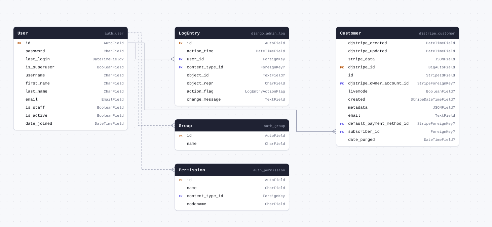

| Column | Field | Type | Null | Key | Default | Description |
| --- | --- | --- | --- | --- | --- | --- |
| `id` | `AutoField` | `integer` |  | PK | `autoincrement()` |  |
| `password` | `CharField` | `varchar(128)` |  |  |  |  |
| `last_login` | `DateTimeField` | `datetime` | yes |  |  |  |
| `is_superuser` | `BooleanField` | `bool` |  |  | `False` | Designates that this user has all permissions without explicitly assigning them. |
| `username` | `CharField` | `varchar(150)` |  | unique |  | Required. 150 characters or fewer. Letters, digits and @/./+/-/_ only. |
| `first_name` | `CharField` | `varchar(150)` |  |  |  |  |
| `last_name` | `CharField` | `varchar(150)` |  |  |  |  |
| `email` | `EmailField` | `varchar(254)` |  |  |  |  |
| `is_staff` | `BooleanField` | `bool` |  |  | `False` | Designates whether the user can log into this admin site. |
| `is_active` | `BooleanField` | `bool` |  |  | `True` | Designates whether this user should be treated as active. Unselect this instead of deleting accounts. |
| `date_joined` | `DateTimeField` | `datetime` |  |  | `now()` |  |

Relations:

- [LogEntry](#logentry).`user_id` → `id`, on delete cascade
- `groups` — many to many with [Group](#group)
- `user_permissions` — many to many with [Permission](#permission)
- [Customer](#customer).`subscriber_id` → `id`, on delete set null

## ContentType

Table `django_content_type`, app `contenttypes`.


| Column | Field | Type | Null | Key | Default | Description |
| --- | --- | --- | --- | --- | --- | --- |
| `id` | `AutoField` | `integer` |  | PK | `autoincrement()` |  |
| `app_label` | `CharField` | `varchar(100)` |  |  |  |  |
| `model` | `CharField` | `varchar(100)` |  |  |  |  |

Indexes:

- unique `django_content_type_app_label_model_76bd3d3b_uniq` on `app_label`, `model`

Relations:

- [LogEntry](#logentry).`content_type_id` → `id`, on delete set null
- [Permission](#permission).`content_type_id` → `id`, on delete cascade

## sessions.Session

Table `django_session`, app `sessions`.

Columns from `AbstractBaseSession` (abstract): `session_key`, `session_data`, `expire_date`.

Django provides full support for anonymous sessions. The session
framework lets you store and retrieve arbitrary data on a
per-site-visitor basis. It stores data on the server side and
abstracts the sending and receiving of cookies. Cookies contain a
session ID -- not the data itself.

The Django sessions framework is entirely cookie-based. It does
not fall back to putting session IDs in URLs. This is an intentional
design decision. Not only does that behavior make URLs ugly, it makes
your site vulnerable to session-ID theft via the "Referer" header.

For complete documentation on using Sessions in your code, consult
the sessions documentation that is shipped with Django (also available
on the Django web site).

| Column | Field | Type | Null | Key | Default | Description |
| --- | --- | --- | --- | --- | --- | --- |
| `session_key` | `CharField` | `varchar(40)` |  | PK |  |  |
| `session_data` | `TextField` | `text` |  |  |  |  |
| `expire_date` | `DateTimeField` | `datetime` |  |  |  |  |

Indexes:

- index `django_session_expire_date_a5c62663` on `expire_date`

## IdempotencyKey

Table `djstripe_idempotencykey`, app `djstripe`.

| Column | Field | Type | Null | Key | Default | Description |
| --- | --- | --- | --- | --- | --- | --- |
| `uuid` | `UUIDField` | `char(32)` |  | PK | `uuid4()` |  |
| `action` | `CharField` | `varchar(100)` |  |  |  |  |
| `livemode` | `BooleanField` | `bool` |  |  |  | Whether the key was used in live or test mode. |
| `created` | `DateTimeField` | `datetime` |  |  | `now()` |  |

Indexes:

- unique `djstripe_idempotencykey_action_livemode_5003eb11_uniq` on `action`, `livemode`

## APIKey

Table `djstripe_apikey`, app `djstripe`.

Columns from `StripeModel` (abstract): `djstripe_id`, `id`, `djstripe_owner_account_id`, `livemode`, `created`.

Columns from `StripeBaseModel` (abstract): `djstripe_created`, `djstripe_updated`, `stripe_data`.

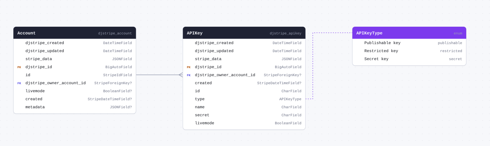

| Column | Field | Type | Null | Key | Default | Description |
| --- | --- | --- | --- | --- | --- | --- |
| `djstripe_created` | `DateTimeField` | `datetime` |  |  | `now()` |  |
| `djstripe_updated` | `DateTimeField` | `datetime` |  |  | `now()` |  |
| `stripe_data` | `JSONField` | `text` |  |  | `dict()` |  |
| `djstripe_id` | `BigAutoField` | `integer` |  | PK | `autoincrement()` |  |
| `djstripe_owner_account_id` | `StripeForeignKey` | `varchar(255)` | yes | FK |  | The Stripe Account this object belongs to. |
| `created` | `StripeDateTimeField` | `datetime` | yes |  |  | The datetime this object was created in stripe. |
| `id` | `CharField` | `varchar(255)` |  |  | `generate_api_key_id()` |  |
| `type` | `APIKeyType` | `varchar(255)` |  |  |  |  |
| `name` | `CharField` | `varchar(100)` |  |  |  | An optional name to identify the key. |
| `secret` | `CharField` | `varchar(128)` |  | unique |  | The value of the key. |
| `livemode` | `BooleanField` | `bool` |  |  |  | Whether the key is valid for live or test mode. |

Indexes:

- index `djstripe_apikey_djstripe_owner_account_id_037f32cb` on `djstripe_owner_account_id`

Relations:

- `djstripe_owner_account_id` → [Account](#account).`id`, on delete cascade

## Account

Table `djstripe_account`, app `djstripe`.

Columns from `StripeModel` (abstract): `djstripe_id`, `id`, `djstripe_owner_account_id`, `livemode`, `created`, `metadata`.

Columns from `StripeBaseModel` (abstract): `djstripe_created`, `djstripe_updated`, `stripe_data`.

This is an object representing a Stripe account.

You can retrieve it to see properties on the account like its
current e-mail address or if the account is enabled yet to make live charges.

Stripe documentation: https://stripe.com/docs/api/accounts?lang=python

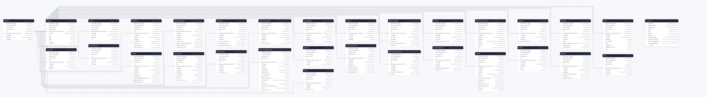

| Column | Field | Type | Null | Key | Default | Description |
| --- | --- | --- | --- | --- | --- | --- |
| `djstripe_created` | `DateTimeField` | `datetime` |  |  | `now()` |  |
| `djstripe_updated` | `DateTimeField` | `datetime` |  |  | `now()` |  |
| `stripe_data` | `JSONField` | `text` |  |  | `dict()` |  |
| `djstripe_id` | `BigAutoField` | `integer` |  | PK | `autoincrement()` |  |
| `id` | `StripeIdField` | `varchar(255)` |  | unique |  |  |
| `djstripe_owner_account_id` | `StripeForeignKey` | `varchar(255)` | yes | FK |  | The Stripe Account this object belongs to. |
| `livemode` | `BooleanField` | `bool` | yes |  | `None` | Null here indicates that the livemode status is unknown or was previously unrecorded. Otherwise, this field indicates whether this record comes from Stripe test mode or live mode operation. |
| `created` | `StripeDateTimeField` | `datetime` | yes |  |  | The datetime this object was created in stripe. |
| `metadata` | `JSONField` | `text` | yes |  |  | A set of key/value pairs that you can attach to an object. It can be useful for storing additional information about an object in a structured format. |

Indexes:

- index `djstripe_account_djstripe_owner_account_id_64558c8f` on `djstripe_owner_account_id`

Relations:

- [APIKey](#apikey).`djstripe_owner_account_id` → `id`, on delete cascade
- `djstripe_owner_account_id` → [Account](#account).`id`, on delete cascade
- [AccountV2](#accountv2).`djstripe_owner_account_id` → `id`, on delete cascade
- [Coupon](#coupon).`djstripe_owner_account_id` → `id`, on delete cascade
- [PromotionCode](#promotioncode).`djstripe_owner_account_id` → `id`, on delete cascade
- [Discount](#discount).`djstripe_owner_account_id` → `id`, on delete cascade
- [Invoice](#invoice).`djstripe_owner_account_id` → `id`, on delete cascade
- [UpcomingInvoice](#upcominginvoice).`djstripe_owner_account_id` → `id`, on delete cascade
- [InvoiceItem](#invoiceitem).`djstripe_owner_account_id` → `id`, on delete cascade
- [LineItem](#lineitem).`djstripe_owner_account_id` → `id`, on delete cascade
- [Subscription](#subscription).`djstripe_owner_account_id` → `id`, on delete cascade
- [SubscriptionItem](#subscriptionitem).`djstripe_owner_account_id` → `id`, on delete cascade
- [SubscriptionSchedule](#subscriptionschedule).`djstripe_owner_account_id` → `id`, on delete cascade
- [ShippingRate](#shippingrate).`djstripe_owner_account_id` → `id`, on delete cascade
- [TaxCode](#taxcode).`djstripe_owner_account_id` → `id`, on delete cascade
- [TaxId](#taxid).`djstripe_owner_account_id` → `id`, on delete cascade
- [TaxRate](#taxrate).`djstripe_owner_account_id` → `id`, on delete cascade
- [djstripe.Session](#djstripesession).`djstripe_owner_account_id` → `id`, on delete cascade
- [ApplicationFee](#applicationfee).`djstripe_owner_account_id` → `id`, on delete cascade
- [ApplicationFee](#applicationfee).`account_id` → `id`, on delete protect
- [ApplicationFeeRefund](#applicationfeerefund).`djstripe_owner_account_id` → `id`, on delete cascade
- [Transfer](#transfer).`djstripe_owner_account_id` → `id`, on delete cascade
- [TransferReversal](#transferreversal).`djstripe_owner_account_id` → `id`, on delete cascade
- [BalanceTransaction](#balancetransaction).`djstripe_owner_account_id` → `id`, on delete cascade
- [Charge](#charge).`djstripe_owner_account_id` → `id`, on delete cascade
- [Mandate](#mandate).`djstripe_owner_account_id` → `id`, on delete cascade
- [Product](#product).`djstripe_owner_account_id` → `id`, on delete cascade
- [Customer](#customer).`djstripe_owner_account_id` → `id`, on delete cascade
- [Dispute](#dispute).`djstripe_owner_account_id` → `id`, on delete cascade
- [Event](#event).`djstripe_owner_account_id` → `id`, on delete cascade
- [File](#file).`djstripe_owner_account_id` → `id`, on delete cascade
- [FileLink](#filelink).`djstripe_owner_account_id` → `id`, on delete cascade
- [PaymentIntent](#paymentintent).`djstripe_owner_account_id` → `id`, on delete cascade
- [PaymentIntent](#paymentintent).`on_behalf_of_id` → `id`, on delete cascade
- [SetupIntent](#setupintent).`djstripe_owner_account_id` → `id`, on delete cascade
- [SetupIntent](#setupintent).`on_behalf_of_id` → `id`, on delete set null
- [Payout](#payout).`djstripe_owner_account_id` → `id`, on delete cascade
- [Price](#price).`djstripe_owner_account_id` → `id`, on delete cascade
- [Refund](#refund).`djstripe_owner_account_id` → `id`, on delete cascade
- [Feature](#feature).`djstripe_owner_account_id` → `id`, on delete cascade
- [ProductFeature](#productfeature).`djstripe_owner_account_id` → `id`, on delete cascade
- [ActiveEntitlement](#activeentitlement).`djstripe_owner_account_id` → `id`, on delete cascade
- [VerificationSession](#verificationsession).`djstripe_owner_account_id` → `id`, on delete cascade
- [VerificationReport](#verificationreport).`djstripe_owner_account_id` → `id`, on delete cascade
- [IssuingAuthorization](#issuingauthorization).`djstripe_owner_account_id` → `id`, on delete cascade
- [IssuingCard](#issuingcard).`djstripe_owner_account_id` → `id`, on delete cascade
- [IssuingCardholder](#issuingcardholder).`djstripe_owner_account_id` → `id`, on delete cascade
- [IssuingDispute](#issuingdispute).`djstripe_owner_account_id` → `id`, on delete cascade
- [IssuingTransaction](#issuingtransaction).`djstripe_owner_account_id` → `id`, on delete cascade
- [BankAccount](#bankaccount).`djstripe_owner_account_id` → `id`, on delete cascade
- [BankAccount](#bankaccount).`account_id` → `id`, on delete protect
- [Card](#card).`djstripe_owner_account_id` → `id`, on delete cascade
- [Card](#card).`account_id` → `id`, on delete protect
- [Source](#source).`djstripe_owner_account_id` → `id`, on delete cascade
- [SourceTransaction](#sourcetransaction).`djstripe_owner_account_id` → `id`, on delete cascade
- [PaymentMethod](#paymentmethod).`djstripe_owner_account_id` → `id`, on delete cascade
- [EarlyFraudWarning](#earlyfraudwarning).`djstripe_owner_account_id` → `id`, on delete cascade
- [Review](#review).`djstripe_owner_account_id` → `id`, on delete cascade
- [ScheduledQueryRun](#scheduledqueryrun).`djstripe_owner_account_id` → `id`, on delete cascade
- [WebhookEndpoint](#webhookendpoint).`djstripe_owner_account_id` → `id`, on delete cascade
- [WebhookEventTrigger](#webhookeventtrigger).`stripe_trigger_account_id` → `id`, on delete cascade

## AccountV2

Table `djstripe_accountv2`, app `djstripe`.

Columns from `StripeModel` (abstract): `djstripe_id`, `id`, `djstripe_owner_account_id`, `livemode`, `created`, `metadata`.

Columns from `StripeBaseModel` (abstract): `djstripe_created`, `djstripe_updated`, `stripe_data`.

An Account v2 object, from the Stripe Accounts v2 / Organizations API.

Unlike the v1 :class:`Account`, this object is served by Stripe's v2 Core
API (``/v2/core/accounts``), which is service-based rather than
resource-class based. It represents a company, individual or other entity,
and can hold one or more configurations (customer, merchant, recipient).

Because the v2 API differs from v1 in several ways — it is reached through
``StripeClient(...).v2.core.accounts``, retrieval uses ``include`` rather
than ``expand``, deletion is replaced by ``close``, and ``created`` is an
RFC 3339 string rather than a unix timestamp — the relevant ``api_*``
methods are overridden below. The base sync machinery (which operates on the
JSON-coerced ``stripe_data`` dict) is otherwise reused unchanged.

Stripe documentation: https://docs.stripe.com/api/v2/core/accounts


| Column | Field | Type | Null | Key | Default | Description |
| --- | --- | --- | --- | --- | --- | --- |
| `djstripe_created` | `DateTimeField` | `datetime` |  |  | `now()` |  |
| `djstripe_updated` | `DateTimeField` | `datetime` |  |  | `now()` |  |
| `stripe_data` | `JSONField` | `text` |  |  | `dict()` |  |
| `djstripe_id` | `BigAutoField` | `integer` |  | PK | `autoincrement()` |  |
| `id` | `StripeIdField` | `varchar(255)` |  | unique |  |  |
| `djstripe_owner_account_id` | `StripeForeignKey` | `varchar(255)` | yes | FK |  | The Stripe Account this object belongs to. |
| `livemode` | `BooleanField` | `bool` | yes |  | `None` | Null here indicates that the livemode status is unknown or was previously unrecorded. Otherwise, this field indicates whether this record comes from Stripe test mode or live mode operation. |
| `created` | `StripeDateTimeField` | `datetime` | yes |  |  | The datetime this object was created in stripe. |
| `metadata` | `JSONField` | `text` | yes |  |  | A set of key/value pairs that you can attach to an object. It can be useful for storing additional information about an object in a structured format. |

Indexes:

- index `djstripe_accountv2_djstripe_owner_account_id_d9b27175` on `djstripe_owner_account_id`

Relations:

- `djstripe_owner_account_id` → [Account](#account).`id`, on delete cascade

## Coupon

Table `djstripe_coupon`, app `djstripe`.

Columns from `StripeModel` (abstract): `djstripe_id`, `id`, `djstripe_owner_account_id`, `livemode`, `created`, `metadata`.

Columns from `StripeBaseModel` (abstract): `djstripe_created`, `djstripe_updated`, `stripe_data`.

A coupon contains information about a percent-off or amount-off discount you might want to apply to a customer.
Coupons may be applied to invoices or orders.
Coupons do not work with conventional one-off charges.

Stripe documentation: https://stripe.com/docs/api/coupons?lang=python

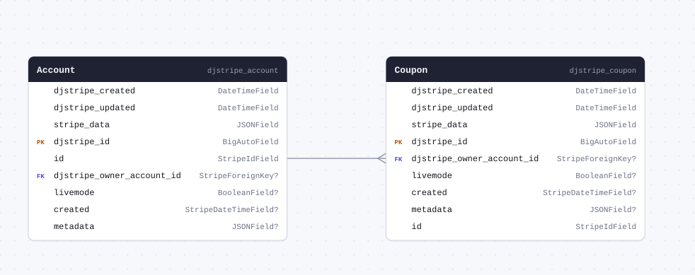

| Column | Field | Type | Null | Key | Default | Description |
| --- | --- | --- | --- | --- | --- | --- |
| `djstripe_created` | `DateTimeField` | `datetime` |  |  | `now()` |  |
| `djstripe_updated` | `DateTimeField` | `datetime` |  |  | `now()` |  |
| `stripe_data` | `JSONField` | `text` |  |  | `dict()` |  |
| `djstripe_id` | `BigAutoField` | `integer` |  | PK | `autoincrement()` |  |
| `djstripe_owner_account_id` | `StripeForeignKey` | `varchar(255)` | yes | FK |  | The Stripe Account this object belongs to. |
| `livemode` | `BooleanField` | `bool` | yes |  | `None` | Null here indicates that the livemode status is unknown or was previously unrecorded. Otherwise, this field indicates whether this record comes from Stripe test mode or live mode operation. |
| `created` | `StripeDateTimeField` | `datetime` | yes |  |  | The datetime this object was created in stripe. |
| `metadata` | `JSONField` | `text` | yes |  |  | A set of key/value pairs that you can attach to an object. It can be useful for storing additional information about an object in a structured format. |
| `id` | `StripeIdField` | `varchar(500)` |  |  |  |  |

Indexes:

- index `djstripe_coupon_djstripe_owner_account_id_ea85f74e` on `djstripe_owner_account_id`
- unique `djstripe_coupon_id_livemode_c4511f5e_uniq` on `id`, `livemode`

Relations:

- `djstripe_owner_account_id` → [Account](#account).`id`, on delete cascade

## PromotionCode

Table `djstripe_promotioncode`, app `djstripe`.

Columns from `StripeModel` (abstract): `djstripe_id`, `id`, `djstripe_owner_account_id`, `livemode`, `created`, `metadata`.

Columns from `StripeBaseModel` (abstract): `djstripe_created`, `djstripe_updated`, `stripe_data`.

This is an object representing a Promotion Code.

A Promotion Code represents a customer-redeemable code for a coupon.
It can be used to create multiple codes for a single coupon.

Stripe documentation: https://stripe.com/docs/api/promotion_codes?lang=python


| Column | Field | Type | Null | Key | Default | Description |
| --- | --- | --- | --- | --- | --- | --- |
| `djstripe_created` | `DateTimeField` | `datetime` |  |  | `now()` |  |
| `djstripe_updated` | `DateTimeField` | `datetime` |  |  | `now()` |  |
| `stripe_data` | `JSONField` | `text` |  |  | `dict()` |  |
| `djstripe_id` | `BigAutoField` | `integer` |  | PK | `autoincrement()` |  |
| `id` | `StripeIdField` | `varchar(255)` |  | unique |  |  |
| `djstripe_owner_account_id` | `StripeForeignKey` | `varchar(255)` | yes | FK |  | The Stripe Account this object belongs to. |
| `livemode` | `BooleanField` | `bool` | yes |  | `None` | Null here indicates that the livemode status is unknown or was previously unrecorded. Otherwise, this field indicates whether this record comes from Stripe test mode or live mode operation. |
| `created` | `StripeDateTimeField` | `datetime` | yes |  |  | The datetime this object was created in stripe. |
| `metadata` | `JSONField` | `text` | yes |  |  | A set of key/value pairs that you can attach to an object. It can be useful for storing additional information about an object in a structured format. |

Indexes:

- index `djstripe_promotioncode_djstripe_owner_account_id_7997d59a` on `djstripe_owner_account_id`

Relations:

- `djstripe_owner_account_id` → [Account](#account).`id`, on delete cascade

## Discount

Table `djstripe_discount`, app `djstripe`.

Columns from `StripeModel` (abstract): `djstripe_id`, `id`, `djstripe_owner_account_id`, `livemode`, `created`, `metadata`.

Columns from `StripeBaseModel` (abstract): `djstripe_created`, `djstripe_updated`, `stripe_data`.

A discount represents the actual application of a coupon or promotion code.
It contains information about when the discount began,
when it will end, and what it is applied to.

Stripe documentation: https://stripe.com/docs/api/discounts

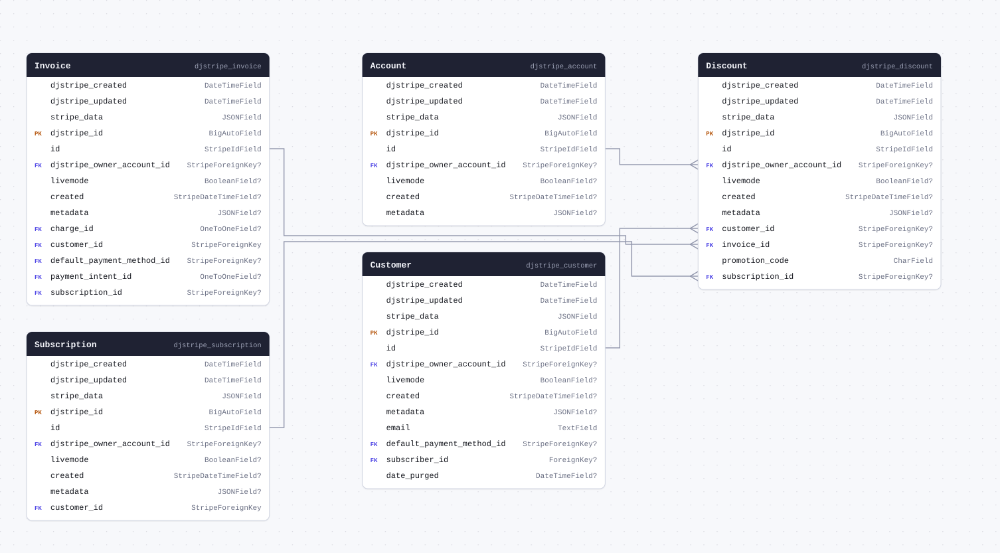

| Column | Field | Type | Null | Key | Default | Description |
| --- | --- | --- | --- | --- | --- | --- |
| `djstripe_created` | `DateTimeField` | `datetime` |  |  | `now()` |  |
| `djstripe_updated` | `DateTimeField` | `datetime` |  |  | `now()` |  |
| `stripe_data` | `JSONField` | `text` |  |  | `dict()` |  |
| `djstripe_id` | `BigAutoField` | `integer` |  | PK | `autoincrement()` |  |
| `id` | `StripeIdField` | `varchar(255)` |  | unique |  |  |
| `djstripe_owner_account_id` | `StripeForeignKey` | `varchar(255)` | yes | FK |  | The Stripe Account this object belongs to. |
| `livemode` | `BooleanField` | `bool` | yes |  | `None` | Null here indicates that the livemode status is unknown or was previously unrecorded. Otherwise, this field indicates whether this record comes from Stripe test mode or live mode operation. |
| `created` | `StripeDateTimeField` | `datetime` | yes |  |  | The datetime this object was created in stripe. |
| `metadata` | `JSONField` | `text` | yes |  |  | A set of key/value pairs that you can attach to an object. It can be useful for storing additional information about an object in a structured format. |
| `customer_id` | `StripeForeignKey` | `varchar(255)` | yes | FK |  | The ID of the customer associated with this discount. |
| `invoice_id` | `StripeForeignKey` | `varchar(255)` | yes | FK |  | The invoice that the discount’s coupon was applied to, if it was applied directly to a particular invoice. |
| `promotion_code` | `CharField` | `varchar(255)` |  |  |  | The promotion code applied to create this discount. |
| `subscription_id` | `StripeForeignKey` | `varchar(255)` | yes | FK |  | The subscription that this coupon is applied to, if it is applied to a particular subscription. |

Indexes:

- index `djstripe_discount_djstripe_owner_account_id_76f33de0` on `djstripe_owner_account_id`
- index `djstripe_discount_customer_id_eaab7ecc` on `customer_id`
- index `djstripe_discount_invoice_id_4acd89bf` on `invoice_id`
- index `djstripe_discount_subscription_id_c9b8f55a` on `subscription_id`

Relations:

- `djstripe_owner_account_id` → [Account](#account).`id`, on delete cascade
- `customer_id` → [Customer](#customer).`id`, on delete cascade
- `invoice_id` → [Invoice](#invoice).`id`, on delete cascade
- `subscription_id` → [Subscription](#subscription).`id`, on delete cascade

## Invoice

Table `djstripe_invoice`, app `djstripe`.

Columns from `BaseInvoice` (abstract): `charge_id`, `customer_id`, `default_payment_method_id`, `payment_intent_id`, `subscription_id`.

Columns from `StripeModel` (abstract): `djstripe_id`, `id`, `djstripe_owner_account_id`, `livemode`, `created`, `metadata`.

Columns from `StripeBaseModel` (abstract): `djstripe_created`, `djstripe_updated`, `stripe_data`.

Invoices are statements of what a customer owes for a particular billing
period, including subscriptions, invoice items, and any automatic proration
adjustments if necessary.

Once an invoice is created, payment is automatically attempted. Note that
the payment, while automatic, does not happen exactly at the time of invoice
creation. If you have configured webhooks, the invoice will wait until one
hour after the last webhook is successfully sent (or the last webhook times
out after failing).

Any customer credit on the account is applied before determining how much is
due for that invoice (the amount that will be actually charged).
If the amount due for the invoice is less than 50 cents (the minimum for a
charge), we add the amount to the customer's running account balance to be
added to the next invoice. If this amount is negative, it will act as a
credit to offset the next invoice. Note that the customer account balance
does not include unpaid invoices; it only includes balances that need to be
taken into account when calculating the amount due for the next invoice.

Stripe documentation: https://stripe.com/docs/api?lang=python#invoices

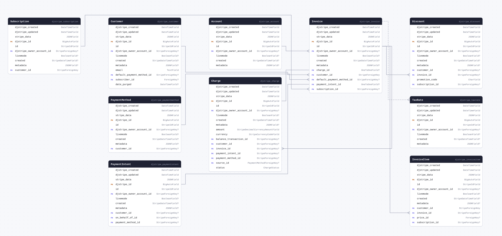

| Column | Field | Type | Null | Key | Default | Description |
| --- | --- | --- | --- | --- | --- | --- |
| `djstripe_created` | `DateTimeField` | `datetime` |  |  | `now()` |  |
| `djstripe_updated` | `DateTimeField` | `datetime` |  |  | `now()` |  |
| `stripe_data` | `JSONField` | `text` |  |  | `dict()` |  |
| `djstripe_id` | `BigAutoField` | `integer` |  | PK | `autoincrement()` |  |
| `id` | `StripeIdField` | `varchar(255)` |  | unique |  |  |
| `djstripe_owner_account_id` | `StripeForeignKey` | `varchar(255)` | yes | FK |  | The Stripe Account this object belongs to. |
| `livemode` | `BooleanField` | `bool` | yes |  | `None` | Null here indicates that the livemode status is unknown or was previously unrecorded. Otherwise, this field indicates whether this record comes from Stripe test mode or live mode operation. |
| `created` | `StripeDateTimeField` | `datetime` | yes |  |  | The datetime this object was created in stripe. |
| `metadata` | `JSONField` | `text` | yes |  |  | A set of key/value pairs that you can attach to an object. It can be useful for storing additional information about an object in a structured format. |
| `charge_id` | `OneToOneField` | `bigint` | yes | FK, unique |  | The latest charge generated for this invoice, if any. |
| `customer_id` | `StripeForeignKey` | `varchar(255)` |  | FK |  | The customer associated with this invoice. |
| `default_payment_method_id` | `StripeForeignKey` | `varchar(255)` | yes | FK |  | Default payment method for the invoice. It must belong to the customer associated with the invoice. If not set, defaults to the subscription's default payment method, if any, or to the default payment method in the customer's invoice settings. |
| `payment_intent_id` | `OneToOneField` | `bigint` | yes | FK, unique |  | The PaymentIntent associated with this invoice. The PaymentIntent is generated when the invoice is finalized, and can then be used to pay the invoice.Note that voiding an invoice will cancel the PaymentIntent |
| `subscription_id` | `StripeForeignKey` | `varchar(255)` | yes | FK |  | The subscription that this invoice was prepared for, if any. |

Indexes:

- index `djstripe_invoice_djstripe_owner_account_id_cc0c7f79` on `djstripe_owner_account_id`
- index `djstripe_invoice_customer_id_c0cd871c` on `customer_id`
- index `djstripe_invoice_default_payment_method_id_670990d5` on `default_payment_method_id`
- index `djstripe_invoice_subscription_id_2dbc2461` on `subscription_id`

Relations:

- [Discount](#discount).`invoice_id` → `id`, on delete cascade
- `djstripe_owner_account_id` → [Account](#account).`id`, on delete cascade
- `charge_id` → [Charge](#charge).`djstripe_id`, on delete cascade
- `customer_id` → [Customer](#customer).`id`, on delete cascade
- `default_payment_method_id` → [PaymentMethod](#paymentmethod).`id`, on delete set null
- `payment_intent_id` → [PaymentIntent](#paymentintent).`djstripe_id`, on delete cascade
- `subscription_id` → [Subscription](#subscription).`id`, on delete set null
- `default_tax_rates` — many to many with [TaxRate](#taxrate)
- [InvoiceItem](#invoiceitem).`invoice_id` → `id`, on delete cascade
- [Charge](#charge).`invoice_id` → `id`, on delete cascade

## UpcomingInvoice

Table `djstripe_upcominginvoice`, app `djstripe`.

Columns from `BaseInvoice` (abstract): `charge_id`, `customer_id`, `default_payment_method_id`, `payment_intent_id`, `subscription_id`.

Columns from `StripeModel` (abstract): `djstripe_id`, `djstripe_owner_account_id`, `livemode`, `created`, `metadata`.

Columns from `StripeBaseModel` (abstract): `djstripe_created`, `djstripe_updated`, `stripe_data`.

The preview of an upcoming invoice - does not exist in the Django database.

See BaseInvoice.upcoming()

Logically it should be set abstract, but that doesn't quite work since we
do actually want to instantiate the model and use relations.

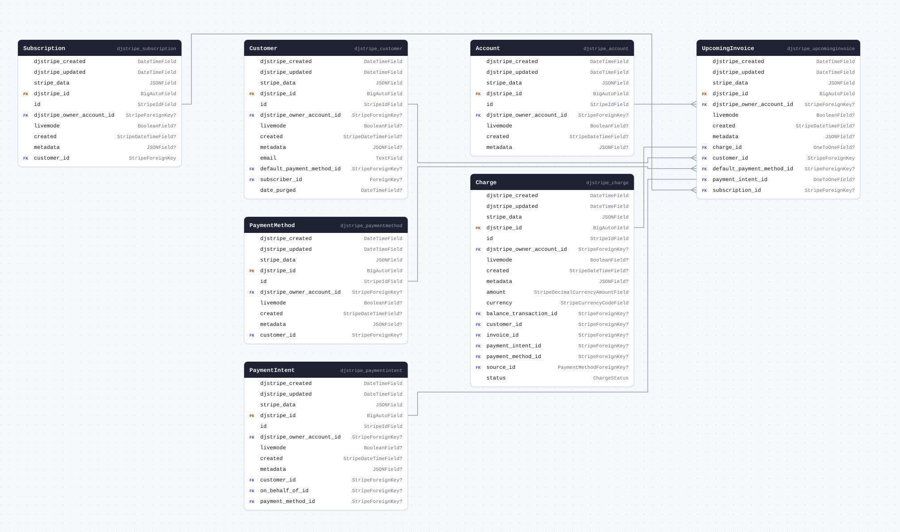

| Column | Field | Type | Null | Key | Default | Description |
| --- | --- | --- | --- | --- | --- | --- |
| `djstripe_created` | `DateTimeField` | `datetime` |  |  | `now()` |  |
| `djstripe_updated` | `DateTimeField` | `datetime` |  |  | `now()` |  |
| `stripe_data` | `JSONField` | `text` |  |  | `dict()` |  |
| `djstripe_id` | `BigAutoField` | `integer` |  | PK | `autoincrement()` |  |
| `djstripe_owner_account_id` | `StripeForeignKey` | `varchar(255)` | yes | FK |  | The Stripe Account this object belongs to. |
| `livemode` | `BooleanField` | `bool` | yes |  | `None` | Null here indicates that the livemode status is unknown or was previously unrecorded. Otherwise, this field indicates whether this record comes from Stripe test mode or live mode operation. |
| `created` | `StripeDateTimeField` | `datetime` | yes |  |  | The datetime this object was created in stripe. |
| `metadata` | `JSONField` | `text` | yes |  |  | A set of key/value pairs that you can attach to an object. It can be useful for storing additional information about an object in a structured format. |
| `charge_id` | `OneToOneField` | `bigint` | yes | FK, unique |  | The latest charge generated for this invoice, if any. |
| `customer_id` | `StripeForeignKey` | `varchar(255)` |  | FK |  | The customer associated with this invoice. |
| `default_payment_method_id` | `StripeForeignKey` | `varchar(255)` | yes | FK |  | Default payment method for the invoice. It must belong to the customer associated with the invoice. If not set, defaults to the subscription's default payment method, if any, or to the default payment method in the customer's invoice settings. |
| `payment_intent_id` | `OneToOneField` | `bigint` | yes | FK, unique |  | The PaymentIntent associated with this invoice. The PaymentIntent is generated when the invoice is finalized, and can then be used to pay the invoice.Note that voiding an invoice will cancel the PaymentIntent |
| `subscription_id` | `StripeForeignKey` | `varchar(255)` | yes | FK |  | The subscription that this invoice was prepared for, if any. |

Indexes:

- index `djstripe_upcominginvoice_djstripe_owner_account_id_fac79479` on `djstripe_owner_account_id`
- index `djstripe_upcominginvoice_customer_id_c94e7284` on `customer_id`
- index `djstripe_upcominginvoice_default_payment_method_id_31da058e` on `default_payment_method_id`
- index `djstripe_upcominginvoice_subscription_id_72fb41e3` on `subscription_id`

Relations:

- `djstripe_owner_account_id` → [Account](#account).`id`, on delete cascade
- `charge_id` → [Charge](#charge).`djstripe_id`, on delete cascade
- `customer_id` → [Customer](#customer).`id`, on delete cascade
- `default_payment_method_id` → [PaymentMethod](#paymentmethod).`id`, on delete set null
- `payment_intent_id` → [PaymentIntent](#paymentintent).`djstripe_id`, on delete cascade
- `subscription_id` → [Subscription](#subscription).`id`, on delete set null

## InvoiceItem

Table `djstripe_invoiceitem`, app `djstripe`.

Columns from `StripeModel` (abstract): `djstripe_id`, `id`, `djstripe_owner_account_id`, `livemode`, `created`, `metadata`.

Columns from `StripeBaseModel` (abstract): `djstripe_created`, `djstripe_updated`, `stripe_data`.

Sometimes you want to add a charge or credit to a customer but only actually
charge the customer's card at the end of a regular billing cycle.
This is useful for combining several charges to minimize per-transaction fees
or having Stripe tabulate your usage-based billing totals.

Stripe documentation: https://stripe.com/docs/api?lang=python#invoiceitems

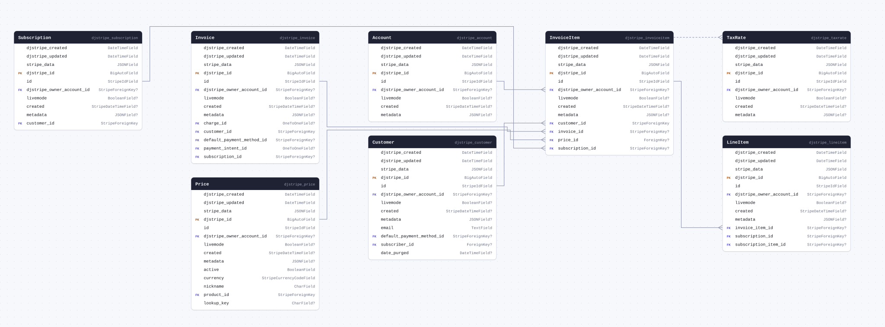

| Column | Field | Type | Null | Key | Default | Description |
| --- | --- | --- | --- | --- | --- | --- |
| `djstripe_created` | `DateTimeField` | `datetime` |  |  | `now()` |  |
| `djstripe_updated` | `DateTimeField` | `datetime` |  |  | `now()` |  |
| `stripe_data` | `JSONField` | `text` |  |  | `dict()` |  |
| `djstripe_id` | `BigAutoField` | `integer` |  | PK | `autoincrement()` |  |
| `id` | `StripeIdField` | `varchar(255)` |  | unique |  |  |
| `djstripe_owner_account_id` | `StripeForeignKey` | `varchar(255)` | yes | FK |  | The Stripe Account this object belongs to. |
| `livemode` | `BooleanField` | `bool` | yes |  | `None` | Null here indicates that the livemode status is unknown or was previously unrecorded. Otherwise, this field indicates whether this record comes from Stripe test mode or live mode operation. |
| `created` | `StripeDateTimeField` | `datetime` | yes |  |  | The datetime this object was created in stripe. |
| `metadata` | `JSONField` | `text` | yes |  |  | A set of key/value pairs that you can attach to an object. It can be useful for storing additional information about an object in a structured format. |
| `customer_id` | `StripeForeignKey` | `varchar(255)` |  | FK |  | The customer associated with this invoiceitem. |
| `invoice_id` | `StripeForeignKey` | `varchar(255)` | yes | FK |  | The invoice to which this invoiceitem is attached. |
| `price_id` | `ForeignKey` | `bigint` | yes | FK |  | If the invoice item is a proration, the price of the subscription for which the proration was computed. |
| `subscription_id` | `StripeForeignKey` | `varchar(255)` | yes | FK |  | The subscription that this invoice item has been created for, if any. |

Indexes:

- index `djstripe_invoiceitem_djstripe_owner_account_id_9afac289` on `djstripe_owner_account_id`
- index `djstripe_invoiceitem_customer_id_259466b8` on `customer_id`
- index `djstripe_invoiceitem_invoice_id_d302912e` on `invoice_id`
- index `djstripe_invoiceitem_price_id_24d80db8` on `price_id`
- index `djstripe_invoiceitem_subscription_id_a7760178` on `subscription_id`

Relations:

- `djstripe_owner_account_id` → [Account](#account).`id`, on delete cascade
- `customer_id` → [Customer](#customer).`id`, on delete cascade
- `invoice_id` → [Invoice](#invoice).`id`, on delete cascade
- `price_id` → [Price](#price).`djstripe_id`, on delete set null
- `subscription_id` → [Subscription](#subscription).`id`, on delete set null
- `tax_rates` — many to many with [TaxRate](#taxrate)
- [LineItem](#lineitem).`invoice_item_id` → `id`, on delete cascade

## LineItem

Table `djstripe_lineitem`, app `djstripe`.

Columns from `StripeModel` (abstract): `djstripe_id`, `id`, `djstripe_owner_account_id`, `livemode`, `created`, `metadata`.

Columns from `StripeBaseModel` (abstract): `djstripe_created`, `djstripe_updated`, `stripe_data`.

The individual line items that make up the invoice.

Stripe documentation: https://stripe.com/docs/api/invoices/line_item

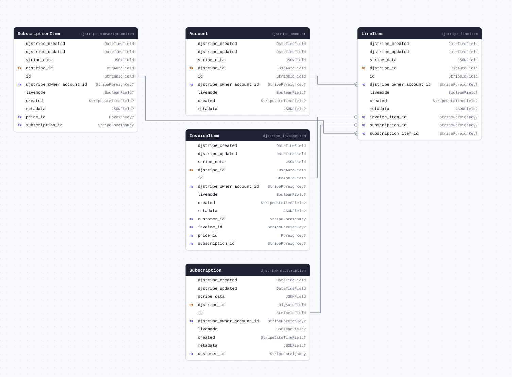

| Column | Field | Type | Null | Key | Default | Description |
| --- | --- | --- | --- | --- | --- | --- |
| `djstripe_created` | `DateTimeField` | `datetime` |  |  | `now()` |  |
| `djstripe_updated` | `DateTimeField` | `datetime` |  |  | `now()` |  |
| `stripe_data` | `JSONField` | `text` |  |  | `dict()` |  |
| `djstripe_id` | `BigAutoField` | `integer` |  | PK | `autoincrement()` |  |
| `id` | `StripeIdField` | `varchar(255)` |  | unique |  |  |
| `djstripe_owner_account_id` | `StripeForeignKey` | `varchar(255)` | yes | FK |  | The Stripe Account this object belongs to. |
| `livemode` | `BooleanField` | `bool` | yes |  | `None` | Null here indicates that the livemode status is unknown or was previously unrecorded. Otherwise, this field indicates whether this record comes from Stripe test mode or live mode operation. |
| `created` | `StripeDateTimeField` | `datetime` | yes |  |  | The datetime this object was created in stripe. |
| `metadata` | `JSONField` | `text` | yes |  |  | A set of key/value pairs that you can attach to an object. It can be useful for storing additional information about an object in a structured format. |
| `invoice_item_id` | `StripeForeignKey` | `varchar(255)` | yes | FK |  | The ID of the invoice item associated with this line item if any. |
| `subscription_id` | `StripeForeignKey` | `varchar(255)` | yes | FK |  | The subscription that the invoice item pertains to, if any. |
| `subscription_item_id` | `StripeForeignKey` | `varchar(255)` | yes | FK |  | The subscription item that generated this invoice item. Left empty if the line item is not an explicit result of a subscription. |

Indexes:

- index `djstripe_lineitem_djstripe_owner_account_id_94fe816a` on `djstripe_owner_account_id`
- index `djstripe_lineitem_invoice_item_id_673833e2` on `invoice_item_id`
- index `djstripe_lineitem_subscription_id_7d83979b` on `subscription_id`
- index `djstripe_lineitem_subscription_item_id_6e53d0a7` on `subscription_item_id`

Relations:

- `djstripe_owner_account_id` → [Account](#account).`id`, on delete cascade
- `invoice_item_id` → [InvoiceItem](#invoiceitem).`id`, on delete cascade
- `subscription_id` → [Subscription](#subscription).`id`, on delete cascade
- `subscription_item_id` → [SubscriptionItem](#subscriptionitem).`id`, on delete cascade

## Subscription

Table `djstripe_subscription`, app `djstripe`.

Columns from `StripeModel` (abstract): `djstripe_id`, `id`, `djstripe_owner_account_id`, `livemode`, `created`, `metadata`.

Columns from `StripeBaseModel` (abstract): `djstripe_created`, `djstripe_updated`, `stripe_data`.

Subscriptions allow you to charge a customer's card on a recurring basis.
A subscription ties a customer to a particular plan you've created.

A subscription still in its trial period is ``trialing`` and moves to ``active``
when the trial period is over.

When payment to renew the subscription fails, the subscription becomes ``past_due``.
After Stripe has exhausted all payment retry attempts, the subscription ends up
with a status of either ``canceled`` or ``unpaid`` depending on your retry settings.

Note that when a subscription has a status of ``unpaid``, no subsequent invoices
will be attempted (invoices will be created, but then immediately
automatically closed.

Additionally, updating customer card details will not lead to Stripe retrying the
latest invoice.).
After receiving updated card details from a customer, you may choose to reopen and
pay their closed invoices.

Stripe documentation: https://stripe.com/docs/api?lang=python#subscriptions

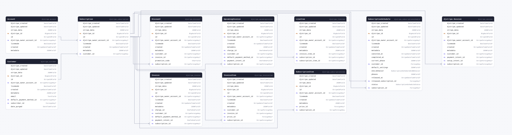

| Column | Field | Type | Null | Key | Default | Description |
| --- | --- | --- | --- | --- | --- | --- |
| `djstripe_created` | `DateTimeField` | `datetime` |  |  | `now()` |  |
| `djstripe_updated` | `DateTimeField` | `datetime` |  |  | `now()` |  |
| `stripe_data` | `JSONField` | `text` |  |  | `dict()` |  |
| `djstripe_id` | `BigAutoField` | `integer` |  | PK | `autoincrement()` |  |
| `id` | `StripeIdField` | `varchar(255)` |  | unique |  |  |
| `djstripe_owner_account_id` | `StripeForeignKey` | `varchar(255)` | yes | FK |  | The Stripe Account this object belongs to. |
| `livemode` | `BooleanField` | `bool` | yes |  | `None` | Null here indicates that the livemode status is unknown or was previously unrecorded. Otherwise, this field indicates whether this record comes from Stripe test mode or live mode operation. |
| `created` | `StripeDateTimeField` | `datetime` | yes |  |  | The datetime this object was created in stripe. |
| `metadata` | `JSONField` | `text` | yes |  |  | A set of key/value pairs that you can attach to an object. It can be useful for storing additional information about an object in a structured format. |
| `customer_id` | `StripeForeignKey` | `varchar(255)` |  | FK |  | The customer associated with this subscription. |

Indexes:

- index `djstripe_subscription_djstripe_owner_account_id_9d333296` on `djstripe_owner_account_id`
- index `djstripe_subscription_customer_id_aff64ee5` on `customer_id`

Relations:

- [Discount](#discount).`subscription_id` → `id`, on delete cascade
- [Invoice](#invoice).`subscription_id` → `id`, on delete set null
- [UpcomingInvoice](#upcominginvoice).`subscription_id` → `id`, on delete set null
- [InvoiceItem](#invoiceitem).`subscription_id` → `id`, on delete set null
- [LineItem](#lineitem).`subscription_id` → `id`, on delete cascade
- `djstripe_owner_account_id` → [Account](#account).`id`, on delete cascade
- `customer_id` → [Customer](#customer).`id`, on delete cascade
- [SubscriptionItem](#subscriptionitem).`subscription_id` → `id`, on delete cascade
- [SubscriptionSchedule](#subscriptionschedule).`released_subscription_id` → `djstripe_id`, on delete set null
- [SubscriptionSchedule](#subscriptionschedule).`subscription_id` → `djstripe_id`, on delete set null
- [djstripe.Session](#djstripesession).`subscription_id` → `id`, on delete set null

## SubscriptionItem

Table `djstripe_subscriptionitem`, app `djstripe`.

Columns from `StripeModel` (abstract): `djstripe_id`, `id`, `djstripe_owner_account_id`, `livemode`, `created`, `metadata`.

Columns from `StripeBaseModel` (abstract): `djstripe_created`, `djstripe_updated`, `stripe_data`.

Subscription items allow you to create customer subscriptions
with more than one plan, making it easy to represent complex billing relationships.

Stripe documentation: https://stripe.com/docs/api?lang=python#subscription_items

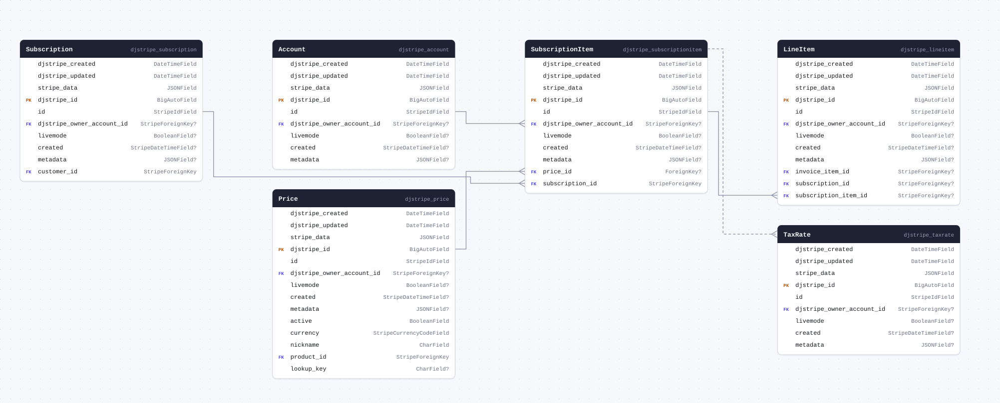

| Column | Field | Type | Null | Key | Default | Description |
| --- | --- | --- | --- | --- | --- | --- |
| `djstripe_created` | `DateTimeField` | `datetime` |  |  | `now()` |  |
| `djstripe_updated` | `DateTimeField` | `datetime` |  |  | `now()` |  |
| `stripe_data` | `JSONField` | `text` |  |  | `dict()` |  |
| `djstripe_id` | `BigAutoField` | `integer` |  | PK | `autoincrement()` |  |
| `id` | `StripeIdField` | `varchar(255)` |  | unique |  |  |
| `djstripe_owner_account_id` | `StripeForeignKey` | `varchar(255)` | yes | FK |  | The Stripe Account this object belongs to. |
| `livemode` | `BooleanField` | `bool` | yes |  | `None` | Null here indicates that the livemode status is unknown or was previously unrecorded. Otherwise, this field indicates whether this record comes from Stripe test mode or live mode operation. |
| `created` | `StripeDateTimeField` | `datetime` | yes |  |  | The datetime this object was created in stripe. |
| `metadata` | `JSONField` | `text` | yes |  |  | A set of key/value pairs that you can attach to an object. It can be useful for storing additional information about an object in a structured format. |
| `price_id` | `ForeignKey` | `bigint` | yes | FK |  | The price the customer is subscribed to. |
| `subscription_id` | `StripeForeignKey` | `varchar(255)` |  | FK |  | The subscription this subscription item belongs to. |

Indexes:

- index `djstripe_subscriptionitem_djstripe_owner_account_id_aafd9387` on `djstripe_owner_account_id`
- index `djstripe_subscriptionitem_price_id_c7f55fc3` on `price_id`
- index `djstripe_subscriptionitem_subscription_id_992d9919` on `subscription_id`

Relations:

- [LineItem](#lineitem).`subscription_item_id` → `id`, on delete cascade
- `djstripe_owner_account_id` → [Account](#account).`id`, on delete cascade
- `price_id` → [Price](#price).`djstripe_id`, on delete cascade
- `subscription_id` → [Subscription](#subscription).`id`, on delete cascade
- `tax_rates` — many to many with [TaxRate](#taxrate)

## SubscriptionSchedule

Table `djstripe_subscriptionschedule`, app `djstripe`.

Columns from `StripeModel` (abstract): `djstripe_id`, `id`, `djstripe_owner_account_id`, `livemode`, `created`, `metadata`.

Columns from `StripeBaseModel` (abstract): `djstripe_created`, `djstripe_updated`, `stripe_data`.

Subscription schedules allow you to create and manage the lifecycle
of a subscription by predefining expected changes.

Stripe documentation: https://stripe.com/docs/api/subscription_schedules?lang=python

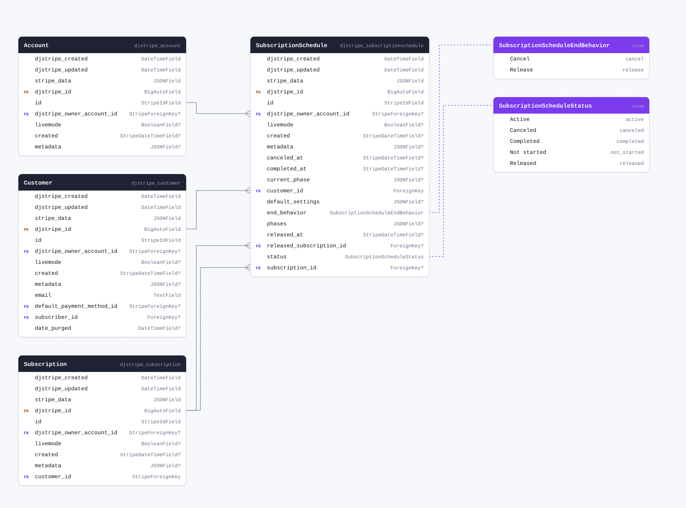

| Column | Field | Type | Null | Key | Default | Description |
| --- | --- | --- | --- | --- | --- | --- |
| `djstripe_created` | `DateTimeField` | `datetime` |  |  | `now()` |  |
| `djstripe_updated` | `DateTimeField` | `datetime` |  |  | `now()` |  |
| `stripe_data` | `JSONField` | `text` |  |  | `dict()` |  |
| `djstripe_id` | `BigAutoField` | `integer` |  | PK | `autoincrement()` |  |
| `id` | `StripeIdField` | `varchar(255)` |  | unique |  |  |
| `djstripe_owner_account_id` | `StripeForeignKey` | `varchar(255)` | yes | FK |  | The Stripe Account this object belongs to. |
| `livemode` | `BooleanField` | `bool` | yes |  | `None` | Null here indicates that the livemode status is unknown or was previously unrecorded. Otherwise, this field indicates whether this record comes from Stripe test mode or live mode operation. |
| `created` | `StripeDateTimeField` | `datetime` | yes |  |  | The datetime this object was created in stripe. |
| `metadata` | `JSONField` | `text` | yes |  |  | A set of key/value pairs that you can attach to an object. It can be useful for storing additional information about an object in a structured format. |
| `canceled_at` | `StripeDateTimeField` | `datetime` | yes |  |  | Time at which the subscription schedule was canceled. |
| `completed_at` | `StripeDateTimeField` | `datetime` | yes |  |  | Time at which the subscription schedule was completed. |
| `current_phase` | `JSONField` | `text` | yes |  |  | Object representing the start and end dates for the current phase of the subscription schedule, if it is `active`. |
| `customer_id` | `ForeignKey` | `bigint` |  | FK |  | The customer who owns the subscription schedule. |
| `default_settings` | `JSONField` | `text` | yes |  |  | Object representing the subscription schedule's default settings. |
| `end_behavior` | `SubscriptionScheduleEndBehavior` | `varchar(255)` |  |  |  | Behavior of the subscription schedule and underlying subscription when it ends. |
| `phases` | `JSONField` | `text` | yes |  |  | Configuration for the subscription schedule's phases. |
| `released_at` | `StripeDateTimeField` | `datetime` | yes |  |  | Time at which the subscription schedule was released. |
| `released_subscription_id` | `ForeignKey` | `bigint` | yes | FK |  | The subscription once managed by this subscription schedule (if it is released). |
| `status` | `SubscriptionScheduleStatus` | `varchar(255)` |  |  |  | The present status of the subscription schedule. Possible values are `not_started`, `active`, `completed`, `released`, and `canceled`. |
| `subscription_id` | `ForeignKey` | `bigint` | yes | FK |  | ID of the subscription managed by the subscription schedule. |

Indexes:

- index `djstripe_subscriptionschedule_djstripe_owner_account_id_c7d8d9c4` on `djstripe_owner_account_id`
- index `djstripe_subscriptionschedule_customer_id_b124e27d` on `customer_id`
- index `djstripe_subscriptionschedule_released_subscription_id_3de9daa1` on `released_subscription_id`
- index `djstripe_subscriptionschedule_subscription_id_d12d014b` on `subscription_id`

Relations:

- `djstripe_owner_account_id` → [Account](#account).`id`, on delete cascade
- `customer_id` → [Customer](#customer).`djstripe_id`, on delete cascade
- `released_subscription_id` → [Subscription](#subscription).`djstripe_id`, on delete set null
- `subscription_id` → [Subscription](#subscription).`djstripe_id`, on delete set null

## ShippingRate

Table `djstripe_shippingrate`, app `djstripe`.

Columns from `StripeModel` (abstract): `djstripe_id`, `id`, `djstripe_owner_account_id`, `livemode`, `created`, `metadata`.

Columns from `StripeBaseModel` (abstract): `djstripe_created`, `djstripe_updated`, `stripe_data`.

Shipping rates describe the price of shipping presented
to your customers and can be applied to Checkout Sessions
to collect shipping costs.

Stripe documentation: https://stripe.com/docs/api/shipping_rates

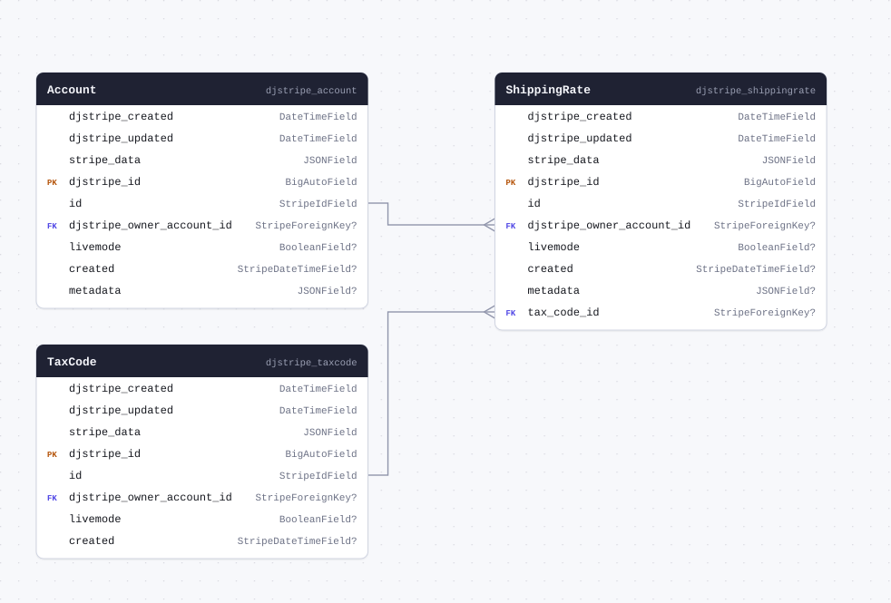

| Column | Field | Type | Null | Key | Default | Description |
| --- | --- | --- | --- | --- | --- | --- |
| `djstripe_created` | `DateTimeField` | `datetime` |  |  | `now()` |  |
| `djstripe_updated` | `DateTimeField` | `datetime` |  |  | `now()` |  |
| `stripe_data` | `JSONField` | `text` |  |  | `dict()` |  |
| `djstripe_id` | `BigAutoField` | `integer` |  | PK | `autoincrement()` |  |
| `id` | `StripeIdField` | `varchar(255)` |  | unique |  |  |
| `djstripe_owner_account_id` | `StripeForeignKey` | `varchar(255)` | yes | FK |  | The Stripe Account this object belongs to. |
| `livemode` | `BooleanField` | `bool` | yes |  | `None` | Null here indicates that the livemode status is unknown or was previously unrecorded. Otherwise, this field indicates whether this record comes from Stripe test mode or live mode operation. |
| `created` | `StripeDateTimeField` | `datetime` | yes |  |  | The datetime this object was created in stripe. |
| `metadata` | `JSONField` | `text` | yes |  |  | A set of key/value pairs that you can attach to an object. It can be useful for storing additional information about an object in a structured format. |
| `tax_code_id` | `StripeForeignKey` | `varchar(255)` | yes | FK |  | The shipping tax code |

Indexes:

- index `djstripe_shippingrate_djstripe_owner_account_id_4f8a0f20` on `djstripe_owner_account_id`
- index `djstripe_shippingrate_tax_code_id_8affacec` on `tax_code_id`

Relations:

- `djstripe_owner_account_id` → [Account](#account).`id`, on delete cascade
- `tax_code_id` → [TaxCode](#taxcode).`id`, on delete cascade

## TaxCode

Table `djstripe_taxcode`, app `djstripe`.

Columns from `StripeModel` (abstract): `djstripe_id`, `id`, `djstripe_owner_account_id`, `livemode`, `created`.

Columns from `StripeBaseModel` (abstract): `djstripe_created`, `djstripe_updated`, `stripe_data`.

Tax codes classify goods and services for tax purposes.

Stripe documentation: https://stripe.com/docs/api/tax_codes

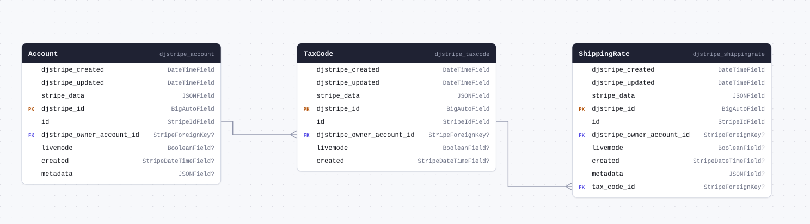

| Column | Field | Type | Null | Key | Default | Description |
| --- | --- | --- | --- | --- | --- | --- |
| `djstripe_created` | `DateTimeField` | `datetime` |  |  | `now()` |  |
| `djstripe_updated` | `DateTimeField` | `datetime` |  |  | `now()` |  |
| `stripe_data` | `JSONField` | `text` |  |  | `dict()` |  |
| `djstripe_id` | `BigAutoField` | `integer` |  | PK | `autoincrement()` |  |
| `id` | `StripeIdField` | `varchar(255)` |  | unique |  |  |
| `djstripe_owner_account_id` | `StripeForeignKey` | `varchar(255)` | yes | FK |  | The Stripe Account this object belongs to. |
| `livemode` | `BooleanField` | `bool` | yes |  | `None` | Null here indicates that the livemode status is unknown or was previously unrecorded. Otherwise, this field indicates whether this record comes from Stripe test mode or live mode operation. |
| `created` | `StripeDateTimeField` | `datetime` | yes |  |  | The datetime this object was created in stripe. |

Indexes:

- index `djstripe_taxcode_djstripe_owner_account_id_1f7fc204` on `djstripe_owner_account_id`

Relations:

- [ShippingRate](#shippingrate).`tax_code_id` → `id`, on delete cascade
- `djstripe_owner_account_id` → [Account](#account).`id`, on delete cascade

## TaxId

Table `djstripe_taxid`, app `djstripe`.

Columns from `StripeModel` (abstract): `djstripe_id`, `id`, `djstripe_owner_account_id`, `livemode`, `created`.

Columns from `StripeBaseModel` (abstract): `djstripe_created`, `djstripe_updated`, `stripe_data`.

Add one or multiple tax IDs to a customer.
A customer's tax IDs are displayed on invoices and
credit notes issued for the customer.

Stripe documentation: https://stripe.com/docs/api/customer_tax_ids?lang=python

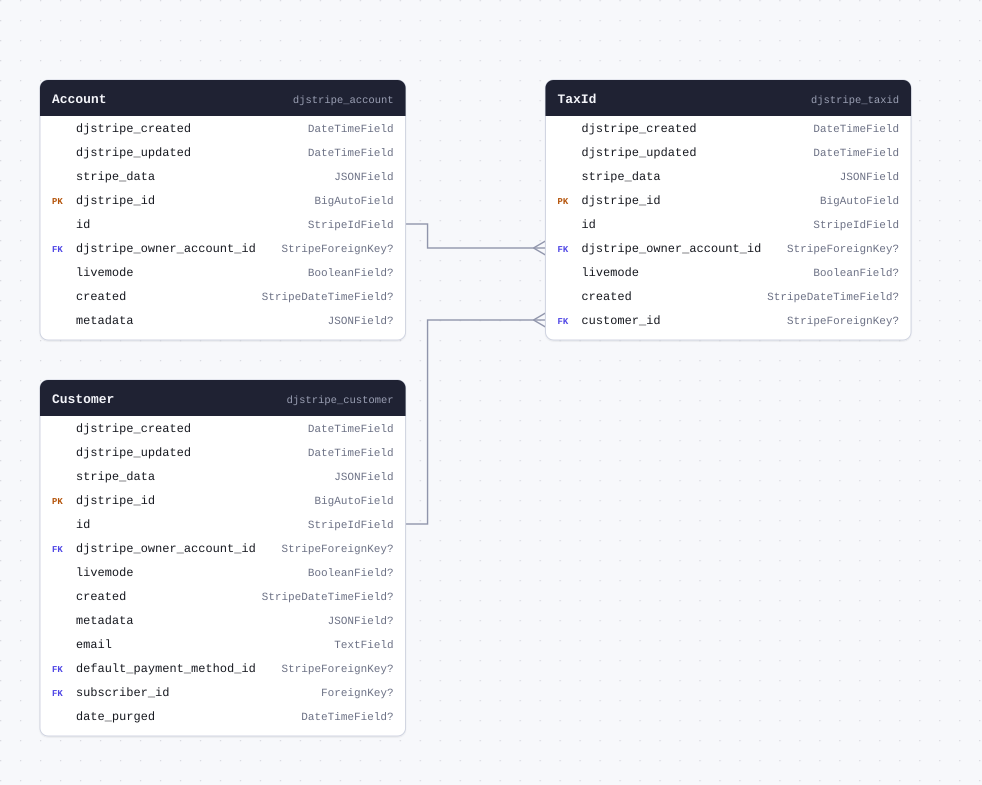

| Column | Field | Type | Null | Key | Default | Description |
| --- | --- | --- | --- | --- | --- | --- |
| `djstripe_created` | `DateTimeField` | `datetime` |  |  | `now()` |  |
| `djstripe_updated` | `DateTimeField` | `datetime` |  |  | `now()` |  |
| `stripe_data` | `JSONField` | `text` |  |  | `dict()` |  |
| `djstripe_id` | `BigAutoField` | `integer` |  | PK | `autoincrement()` |  |
| `id` | `StripeIdField` | `varchar(255)` |  | unique |  |  |
| `djstripe_owner_account_id` | `StripeForeignKey` | `varchar(255)` | yes | FK |  | The Stripe Account this object belongs to. |
| `livemode` | `BooleanField` | `bool` | yes |  | `None` | Null here indicates that the livemode status is unknown or was previously unrecorded. Otherwise, this field indicates whether this record comes from Stripe test mode or live mode operation. |
| `created` | `StripeDateTimeField` | `datetime` | yes |  |  | The datetime this object was created in stripe. |
| `customer_id` | `StripeForeignKey` | `varchar(255)` | yes | FK |  |  |

Indexes:

- index `djstripe_taxid_djstripe_owner_account_id_acff63ae` on `djstripe_owner_account_id`
- index `djstripe_taxid_customer_id_e973248d` on `customer_id`

Relations:

- `djstripe_owner_account_id` → [Account](#account).`id`, on delete cascade
- `customer_id` → [Customer](#customer).`id`, on delete cascade

## TaxRate

Table `djstripe_taxrate`, app `djstripe`.

Columns from `StripeModel` (abstract): `djstripe_id`, `id`, `djstripe_owner_account_id`, `livemode`, `created`, `metadata`.

Columns from `StripeBaseModel` (abstract): `djstripe_created`, `djstripe_updated`, `stripe_data`.

Tax rates can be applied to invoices and subscriptions to collect tax.

Stripe documentation: https://stripe.com/docs/api/tax_rates?lang=python

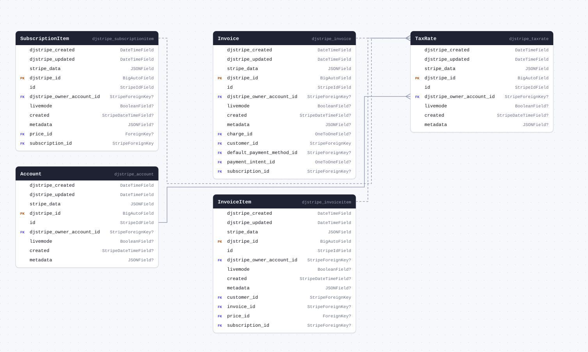

| Column | Field | Type | Null | Key | Default | Description |
| --- | --- | --- | --- | --- | --- | --- |
| `djstripe_created` | `DateTimeField` | `datetime` |  |  | `now()` |  |
| `djstripe_updated` | `DateTimeField` | `datetime` |  |  | `now()` |  |
| `stripe_data` | `JSONField` | `text` |  |  | `dict()` |  |
| `djstripe_id` | `BigAutoField` | `integer` |  | PK | `autoincrement()` |  |
| `id` | `StripeIdField` | `varchar(255)` |  | unique |  |  |
| `djstripe_owner_account_id` | `StripeForeignKey` | `varchar(255)` | yes | FK |  | The Stripe Account this object belongs to. |
| `livemode` | `BooleanField` | `bool` | yes |  | `None` | Null here indicates that the livemode status is unknown or was previously unrecorded. Otherwise, this field indicates whether this record comes from Stripe test mode or live mode operation. |
| `created` | `StripeDateTimeField` | `datetime` | yes |  |  | The datetime this object was created in stripe. |
| `metadata` | `JSONField` | `text` | yes |  |  | A set of key/value pairs that you can attach to an object. It can be useful for storing additional information about an object in a structured format. |

Indexes:

- index `djstripe_taxrate_djstripe_owner_account_id_d6421376` on `djstripe_owner_account_id`

Relations:

- `_djstripe_invoice_default_tax_rates_+` — many to many with [Invoice](#invoice)
- `_djstripe_invoiceitem_tax_rates_+` — many to many with [InvoiceItem](#invoiceitem)
- `_djstripe_subscriptionitem_tax_rates_+` — many to many with [SubscriptionItem](#subscriptionitem)
- `djstripe_owner_account_id` → [Account](#account).`id`, on delete cascade

## djstripe.Session

Table `djstripe_session`, app `djstripe`.

Columns from `StripeModel` (abstract): `djstripe_id`, `id`, `djstripe_owner_account_id`, `livemode`, `created`, `metadata`.

Columns from `StripeBaseModel` (abstract): `djstripe_created`, `djstripe_updated`, `stripe_data`.

A Checkout Session represents your customer's session as they pay
for one-time purchases or subscriptions through Checkout.

Stripe documentation: https://stripe.com/docs/api/checkout/sessions?lang=python

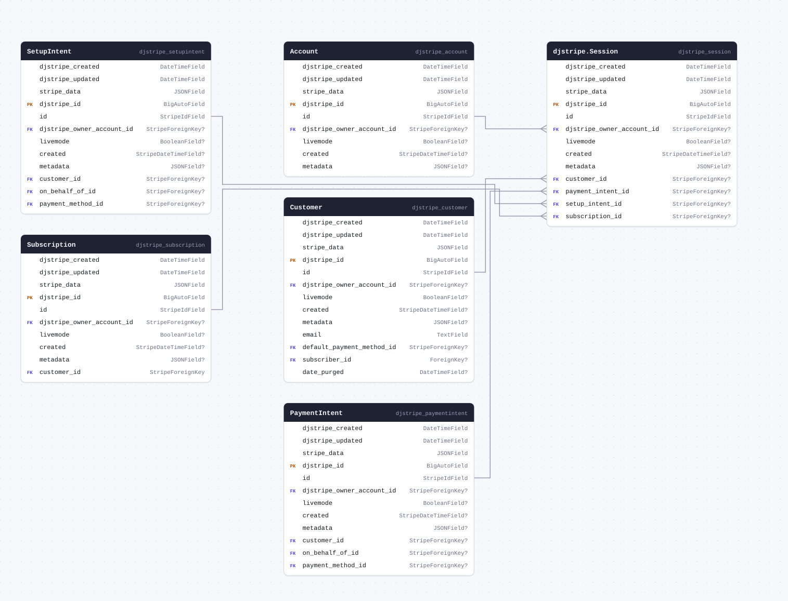

| Column | Field | Type | Null | Key | Default | Description |
| --- | --- | --- | --- | --- | --- | --- |
| `djstripe_created` | `DateTimeField` | `datetime` |  |  | `now()` |  |
| `djstripe_updated` | `DateTimeField` | `datetime` |  |  | `now()` |  |
| `stripe_data` | `JSONField` | `text` |  |  | `dict()` |  |
| `djstripe_id` | `BigAutoField` | `integer` |  | PK | `autoincrement()` |  |
| `id` | `StripeIdField` | `varchar(255)` |  | unique |  |  |
| `djstripe_owner_account_id` | `StripeForeignKey` | `varchar(255)` | yes | FK |  | The Stripe Account this object belongs to. |
| `livemode` | `BooleanField` | `bool` | yes |  | `None` | Null here indicates that the livemode status is unknown or was previously unrecorded. Otherwise, this field indicates whether this record comes from Stripe test mode or live mode operation. |
| `created` | `StripeDateTimeField` | `datetime` | yes |  |  | The datetime this object was created in stripe. |
| `metadata` | `JSONField` | `text` | yes |  |  | A set of key/value pairs that you can attach to an object. It can be useful for storing additional information about an object in a structured format. |
| `customer_id` | `StripeForeignKey` | `varchar(255)` | yes | FK |  | Customer this Checkout is for if one exists. |
| `payment_intent_id` | `StripeForeignKey` | `varchar(255)` | yes | FK |  | PaymentIntent created if SKUs or line items were provided. |
| `setup_intent_id` | `StripeForeignKey` | `varchar(255)` | yes | FK |  | The ID of the SetupIntent for Checkout Sessions in setup mode. |
| `subscription_id` | `StripeForeignKey` | `varchar(255)` | yes | FK |  | Subscription created if one or more plans were provided. |

Indexes:

- index `djstripe_session_djstripe_owner_account_id_8bbc07af` on `djstripe_owner_account_id`
- index `djstripe_session_customer_id_b4510dc3` on `customer_id`
- index `djstripe_session_payment_intent_id_cae83ebf` on `payment_intent_id`
- index `djstripe_session_setup_intent_id_c884fe95` on `setup_intent_id`
- index `djstripe_session_subscription_id_29499760` on `subscription_id`

Relations:

- `djstripe_owner_account_id` → [Account](#account).`id`, on delete cascade
- `customer_id` → [Customer](#customer).`id`, on delete set null
- `payment_intent_id` → [PaymentIntent](#paymentintent).`id`, on delete set null
- `setup_intent_id` → [SetupIntent](#setupintent).`id`, on delete set null
- `subscription_id` → [Subscription](#subscription).`id`, on delete set null

## ApplicationFee

Table `djstripe_applicationfee`, app `djstripe`.

Columns from `StripeModel` (abstract): `djstripe_id`, `id`, `djstripe_owner_account_id`, `livemode`, `created`, `metadata`.

Columns from `StripeBaseModel` (abstract): `djstripe_created`, `djstripe_updated`, `stripe_data`.

When you collect a transaction fee on top of a charge made for your
user (using Connect), an ApplicationFee is created in your account.

Please note the model field charge exists on the Stripe Connected Account
while the application_fee modelfield on Charge model exists on the Platform Account!

Stripe documentation: https://stripe.com/docs/api?lang=python#application_fees

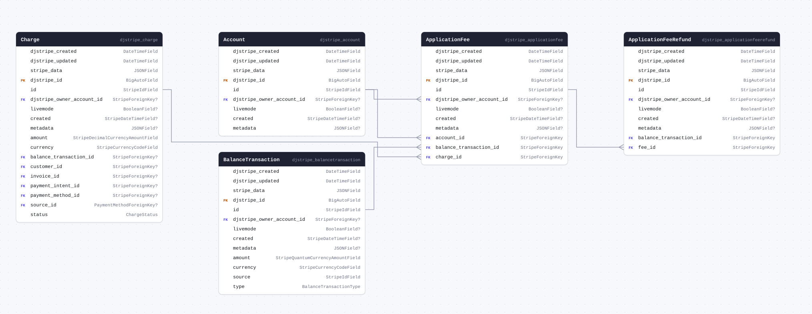

| Column | Field | Type | Null | Key | Default | Description |
| --- | --- | --- | --- | --- | --- | --- |
| `djstripe_created` | `DateTimeField` | `datetime` |  |  | `now()` |  |
| `djstripe_updated` | `DateTimeField` | `datetime` |  |  | `now()` |  |
| `stripe_data` | `JSONField` | `text` |  |  | `dict()` |  |
| `djstripe_id` | `BigAutoField` | `integer` |  | PK | `autoincrement()` |  |
| `id` | `StripeIdField` | `varchar(255)` |  | unique |  |  |
| `djstripe_owner_account_id` | `StripeForeignKey` | `varchar(255)` | yes | FK |  | The Stripe Account this object belongs to. |
| `livemode` | `BooleanField` | `bool` | yes |  | `None` | Null here indicates that the livemode status is unknown or was previously unrecorded. Otherwise, this field indicates whether this record comes from Stripe test mode or live mode operation. |
| `created` | `StripeDateTimeField` | `datetime` | yes |  |  | The datetime this object was created in stripe. |
| `metadata` | `JSONField` | `text` | yes |  |  | A set of key/value pairs that you can attach to an object. It can be useful for storing additional information about an object in a structured format. |
| `account_id` | `StripeForeignKey` | `varchar(255)` |  | FK |  | ID of the Stripe account this fee was taken from. |
| `balance_transaction_id` | `StripeForeignKey` | `varchar(255)` |  | FK |  | Balance transaction that describes the impact on your account balance. |
| `charge_id` | `StripeForeignKey` | `varchar(255)` |  | FK |  | The charge that the application fee was taken from. |

Indexes:

- index `djstripe_applicationfee_djstripe_owner_account_id_07bb6a78` on `djstripe_owner_account_id`
- index `djstripe_applicationfee_account_id_f50a2a15` on `account_id`
- index `djstripe_applicationfee_balance_transaction_id_ff735754` on `balance_transaction_id`
- index `djstripe_applicationfee_charge_id_8ba8ce37` on `charge_id`

Relations:

- `djstripe_owner_account_id` → [Account](#account).`id`, on delete cascade
- `account_id` → [Account](#account).`id`, on delete protect
- `balance_transaction_id` → [BalanceTransaction](#balancetransaction).`id`, on delete cascade
- `charge_id` → [Charge](#charge).`id`, on delete cascade
- [ApplicationFeeRefund](#applicationfeerefund).`fee_id` → `id`, on delete cascade

## ApplicationFeeRefund

Table `djstripe_applicationfeerefund`, app `djstripe`.

Columns from `StripeModel` (abstract): `djstripe_id`, `id`, `djstripe_owner_account_id`, `livemode`, `created`, `metadata`.

Columns from `StripeBaseModel` (abstract): `djstripe_created`, `djstripe_updated`, `stripe_data`.

ApplicationFeeRefund objects allow you to refund an ApplicationFee that
has previously been created but not yet refunded.
Funds will be refunded to the Stripe account from which the fee was
originally collected.

Stripe documentation: https://stripe.com/docs/api?lang=python#fee_refunds

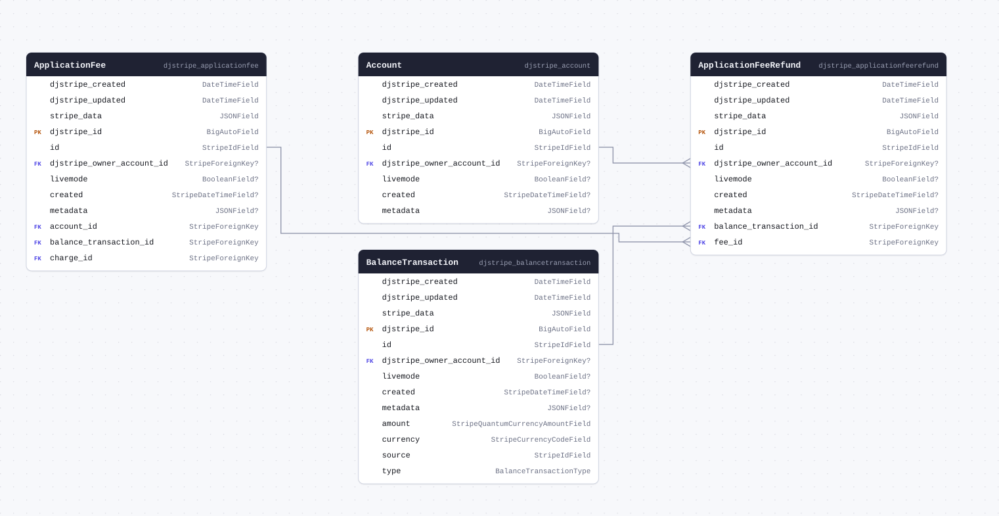

| Column | Field | Type | Null | Key | Default | Description |
| --- | --- | --- | --- | --- | --- | --- |
| `djstripe_created` | `DateTimeField` | `datetime` |  |  | `now()` |  |
| `djstripe_updated` | `DateTimeField` | `datetime` |  |  | `now()` |  |
| `stripe_data` | `JSONField` | `text` |  |  | `dict()` |  |
| `djstripe_id` | `BigAutoField` | `integer` |  | PK | `autoincrement()` |  |
| `id` | `StripeIdField` | `varchar(255)` |  | unique |  |  |
| `djstripe_owner_account_id` | `StripeForeignKey` | `varchar(255)` | yes | FK |  | The Stripe Account this object belongs to. |
| `livemode` | `BooleanField` | `bool` | yes |  | `None` | Null here indicates that the livemode status is unknown or was previously unrecorded. Otherwise, this field indicates whether this record comes from Stripe test mode or live mode operation. |
| `created` | `StripeDateTimeField` | `datetime` | yes |  |  | The datetime this object was created in stripe. |
| `metadata` | `JSONField` | `text` | yes |  |  | A set of key/value pairs that you can attach to an object. It can be useful for storing additional information about an object in a structured format. |
| `balance_transaction_id` | `StripeForeignKey` | `varchar(255)` |  | FK |  | Balance transaction that describes the impact on your account balance. |
| `fee_id` | `StripeForeignKey` | `varchar(255)` |  | FK |  | The application fee that was refunded |

Indexes:

- index `djstripe_applicationfeerefund_djstripe_owner_account_id_7418f0b2` on `djstripe_owner_account_id`
- index `djstripe_applicationfeerefund_balance_transaction_id_bc35b031` on `balance_transaction_id`
- index `djstripe_applicationfeerefund_fee_id_8fabef2d` on `fee_id`

Relations:

- `djstripe_owner_account_id` → [Account](#account).`id`, on delete cascade
- `balance_transaction_id` → [BalanceTransaction](#balancetransaction).`id`, on delete cascade
- `fee_id` → [ApplicationFee](#applicationfee).`id`, on delete cascade

## CountrySpec

Table `djstripe_countryspec`, app `djstripe`.

Columns from `StripeBaseModel` (abstract): `djstripe_created`, `djstripe_updated`, `stripe_data`.

Stripe documentation: https://stripe.com/docs/api?lang=python#country_specs

| Column | Field | Type | Null | Key | Default | Description |
| --- | --- | --- | --- | --- | --- | --- |
| `djstripe_created` | `DateTimeField` | `datetime` |  |  | `now()` |  |
| `djstripe_updated` | `DateTimeField` | `datetime` |  |  | `now()` |  |
| `stripe_data` | `JSONField` | `text` |  |  | `dict()` |  |
| `id` | `CharField` | `varchar(2)` |  | PK |  |  |
| `default_currency` | `StripeCurrencyCodeField` | `varchar(3)` |  |  |  | The default currency for this country. This applies to both payment methods and bank accounts. |
| `supported_bank_account_currencies` | `JSONField` | `text` |  |  |  | Currencies that can be accepted in the specific country (for transfers). |
| `supported_payment_currencies` | `JSONField` | `text` |  |  |  | Currencies that can be accepted in the specified country (for payments). |
| `supported_payment_methods` | `JSONField` | `text` |  |  |  | Payment methods available in the specified country. |
| `supported_transfer_countries` | `JSONField` | `text` |  |  |  | Countries that can accept transfers from the specified country. |
| `verification_fields` | `JSONField` | `text` |  |  |  | Lists the types of verification data needed to keep an account open. |

## Transfer

Table `djstripe_transfer`, app `djstripe`.

Columns from `StripeModel` (abstract): `djstripe_id`, `id`, `djstripe_owner_account_id`, `livemode`, `created`, `metadata`.

Columns from `StripeBaseModel` (abstract): `djstripe_created`, `djstripe_updated`, `stripe_data`.

When Stripe sends you money or you initiate a transfer to a bank account,
debit card, or connected Stripe account, a transfer object will be created.

Stripe documentation: https://stripe.com/docs/api?lang=python#transfers

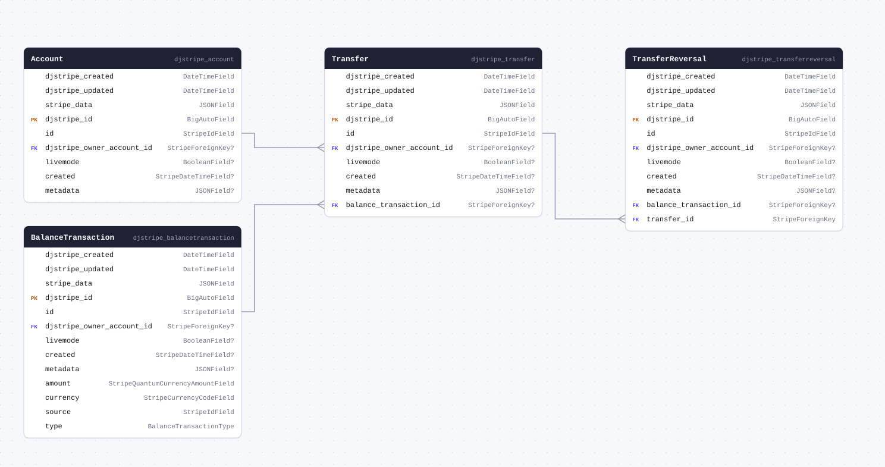

| Column | Field | Type | Null | Key | Default | Description |
| --- | --- | --- | --- | --- | --- | --- |
| `djstripe_created` | `DateTimeField` | `datetime` |  |  | `now()` |  |
| `djstripe_updated` | `DateTimeField` | `datetime` |  |  | `now()` |  |
| `stripe_data` | `JSONField` | `text` |  |  | `dict()` |  |
| `djstripe_id` | `BigAutoField` | `integer` |  | PK | `autoincrement()` |  |
| `id` | `StripeIdField` | `varchar(255)` |  | unique |  |  |
| `djstripe_owner_account_id` | `StripeForeignKey` | `varchar(255)` | yes | FK |  | The Stripe Account this object belongs to. |
| `livemode` | `BooleanField` | `bool` | yes |  | `None` | Null here indicates that the livemode status is unknown or was previously unrecorded. Otherwise, this field indicates whether this record comes from Stripe test mode or live mode operation. |
| `created` | `StripeDateTimeField` | `datetime` | yes |  |  | The datetime this object was created in stripe. |
| `metadata` | `JSONField` | `text` | yes |  |  | A set of key/value pairs that you can attach to an object. It can be useful for storing additional information about an object in a structured format. |
| `balance_transaction_id` | `StripeForeignKey` | `varchar(255)` | yes | FK |  | Balance transaction that describes the impact on your account balance. |

Indexes:

- index `djstripe_transfer_djstripe_owner_account_id_78ad63fe` on `djstripe_owner_account_id`
- index `djstripe_transfer_balance_transaction_id_b5b00270` on `balance_transaction_id`

Relations:

- `djstripe_owner_account_id` → [Account](#account).`id`, on delete cascade
- `balance_transaction_id` → [BalanceTransaction](#balancetransaction).`id`, on delete set null
- [TransferReversal](#transferreversal).`transfer_id` → `id`, on delete cascade

## TransferReversal

Table `djstripe_transferreversal`, app `djstripe`.

Columns from `StripeModel` (abstract): `djstripe_id`, `id`, `djstripe_owner_account_id`, `livemode`, `created`, `metadata`.

Columns from `StripeBaseModel` (abstract): `djstripe_created`, `djstripe_updated`, `stripe_data`.

Stripe documentation: https://stripe.com/docs/api?lang=python#transfer_reversals

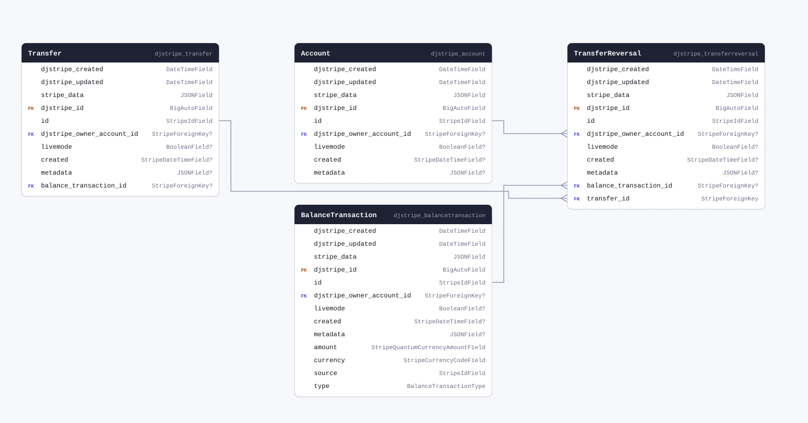

| Column | Field | Type | Null | Key | Default | Description |
| --- | --- | --- | --- | --- | --- | --- |
| `djstripe_created` | `DateTimeField` | `datetime` |  |  | `now()` |  |
| `djstripe_updated` | `DateTimeField` | `datetime` |  |  | `now()` |  |
| `stripe_data` | `JSONField` | `text` |  |  | `dict()` |  |
| `djstripe_id` | `BigAutoField` | `integer` |  | PK | `autoincrement()` |  |
| `id` | `StripeIdField` | `varchar(255)` |  | unique |  |  |
| `djstripe_owner_account_id` | `StripeForeignKey` | `varchar(255)` | yes | FK |  | The Stripe Account this object belongs to. |
| `livemode` | `BooleanField` | `bool` | yes |  | `None` | Null here indicates that the livemode status is unknown or was previously unrecorded. Otherwise, this field indicates whether this record comes from Stripe test mode or live mode operation. |
| `created` | `StripeDateTimeField` | `datetime` | yes |  |  | The datetime this object was created in stripe. |
| `metadata` | `JSONField` | `text` | yes |  |  | A set of key/value pairs that you can attach to an object. It can be useful for storing additional information about an object in a structured format. |
| `balance_transaction_id` | `StripeForeignKey` | `varchar(255)` | yes | FK |  | Balance transaction that describes the impact on your account balance. |
| `transfer_id` | `StripeForeignKey` | `varchar(255)` |  | FK |  | The transfer that was reversed. |

Indexes:

- index `djstripe_transferreversal_djstripe_owner_account_id_2e3051e1` on `djstripe_owner_account_id`
- index `djstripe_transferreversal_balance_transaction_id_5044f084` on `balance_transaction_id`
- index `djstripe_transferreversal_transfer_id_8f250dd3` on `transfer_id`

Relations:

- `djstripe_owner_account_id` → [Account](#account).`id`, on delete cascade
- `balance_transaction_id` → [BalanceTransaction](#balancetransaction).`id`, on delete set null
- `transfer_id` → [Transfer](#transfer).`id`, on delete cascade

## BalanceTransaction

Table `djstripe_balancetransaction`, app `djstripe`.

Columns from `StripeModel` (abstract): `djstripe_id`, `id`, `djstripe_owner_account_id`, `livemode`, `created`, `metadata`.

Columns from `StripeBaseModel` (abstract): `djstripe_created`, `djstripe_updated`, `stripe_data`.

A single transaction that updates the Stripe balance.

Stripe documentation: https://stripe.com/docs/api?lang=python#balance_transaction_object

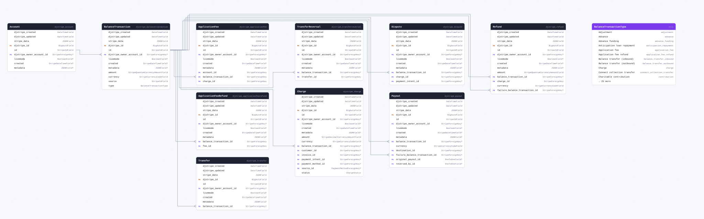

| Column | Field | Type | Null | Key | Default | Description |
| --- | --- | --- | --- | --- | --- | --- |
| `djstripe_created` | `DateTimeField` | `datetime` |  |  | `now()` |  |
| `djstripe_updated` | `DateTimeField` | `datetime` |  |  | `now()` |  |
| `stripe_data` | `JSONField` | `text` |  |  | `dict()` |  |
| `djstripe_id` | `BigAutoField` | `integer` |  | PK | `autoincrement()` |  |
| `id` | `StripeIdField` | `varchar(255)` |  | unique |  |  |
| `djstripe_owner_account_id` | `StripeForeignKey` | `varchar(255)` | yes | FK |  | The Stripe Account this object belongs to. |
| `livemode` | `BooleanField` | `bool` | yes |  | `None` | Null here indicates that the livemode status is unknown or was previously unrecorded. Otherwise, this field indicates whether this record comes from Stripe test mode or live mode operation. |
| `created` | `StripeDateTimeField` | `datetime` | yes |  |  | The datetime this object was created in stripe. |
| `metadata` | `JSONField` | `text` | yes |  |  | A set of key/value pairs that you can attach to an object. It can be useful for storing additional information about an object in a structured format. |
| `amount` | `StripeQuantumCurrencyAmountField` | `bigint` |  |  |  | Gross amount of the transaction, in cents. |
| `currency` | `StripeCurrencyCodeField` | `varchar(3)` |  |  |  | Three-letter ISO currency code |
| `source` | `StripeIdField` | `varchar(255)` |  |  |  |  |
| `type` | `BalanceTransactionType` | `varchar(255)` |  |  |  |  |

Indexes:

- index `djstripe_balancetransaction_djstripe_owner_account_id_868dfd07` on `djstripe_owner_account_id`

Relations:

- [ApplicationFee](#applicationfee).`balance_transaction_id` → `id`, on delete cascade
- [ApplicationFeeRefund](#applicationfeerefund).`balance_transaction_id` → `id`, on delete cascade
- [Transfer](#transfer).`balance_transaction_id` → `id`, on delete set null
- [TransferReversal](#transferreversal).`balance_transaction_id` → `id`, on delete set null
- `djstripe_owner_account_id` → [Account](#account).`id`, on delete cascade
- [Charge](#charge).`balance_transaction_id` → `id`, on delete set null
- [Dispute](#dispute).`balance_transaction_id` → `id`, on delete cascade
- [Payout](#payout).`balance_transaction_id` → `id`, on delete set null
- [Payout](#payout).`failure_balance_transaction_id` → `id`, on delete set null
- [Refund](#refund).`balance_transaction_id` → `id`, on delete set null
- [Refund](#refund).`failure_balance_transaction_id` → `id`, on delete set null

## Charge

Table `djstripe_charge`, app `djstripe`.

Columns from `StripeModel` (abstract): `djstripe_id`, `id`, `djstripe_owner_account_id`, `livemode`, `created`, `metadata`.

Columns from `StripeBaseModel` (abstract): `djstripe_created`, `djstripe_updated`, `stripe_data`.

To charge a credit or a debit card, you create a charge object. You can
retrieve and refund individual charges as well as list all charges. Charges
are identified by a unique random ID.

Stripe documentation: https://stripe.com/docs/api?lang=python#charges

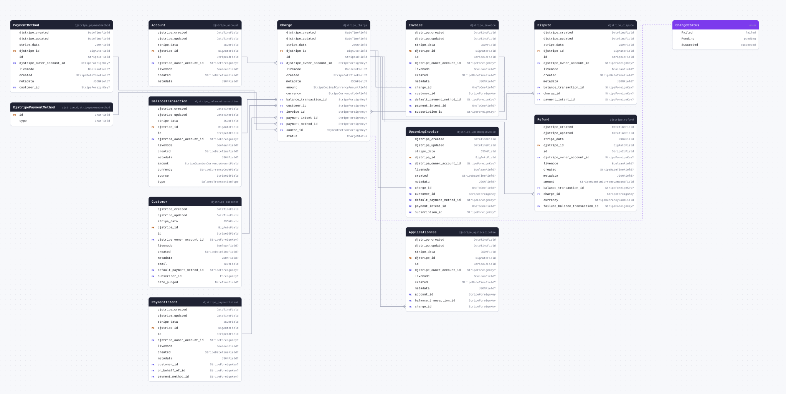

| Column | Field | Type | Null | Key | Default | Description |
| --- | --- | --- | --- | --- | --- | --- |
| `djstripe_created` | `DateTimeField` | `datetime` |  |  | `now()` |  |
| `djstripe_updated` | `DateTimeField` | `datetime` |  |  | `now()` |  |
| `stripe_data` | `JSONField` | `text` |  |  | `dict()` |  |
| `djstripe_id` | `BigAutoField` | `integer` |  | PK | `autoincrement()` |  |
| `id` | `StripeIdField` | `varchar(255)` |  | unique |  |  |
| `djstripe_owner_account_id` | `StripeForeignKey` | `varchar(255)` | yes | FK |  | The Stripe Account this object belongs to. |
| `livemode` | `BooleanField` | `bool` | yes |  | `None` | Null here indicates that the livemode status is unknown or was previously unrecorded. Otherwise, this field indicates whether this record comes from Stripe test mode or live mode operation. |
| `created` | `StripeDateTimeField` | `datetime` | yes |  |  | The datetime this object was created in stripe. |
| `metadata` | `JSONField` | `text` | yes |  |  | A set of key/value pairs that you can attach to an object. It can be useful for storing additional information about an object in a structured format. |
| `amount` | `StripeDecimalCurrencyAmountField(14, 2)` | `decimal` |  |  |  | Amount charged (as decimal). |
| `currency` | `StripeCurrencyCodeField` | `varchar(3)` |  |  |  | The currency in which the charge was made. |
| `balance_transaction_id` | `StripeForeignKey` | `varchar(255)` | yes | FK |  | The balance transaction that describes the impact of this charge on your account balance (not including refunds or disputes). |
| `customer_id` | `StripeForeignKey` | `varchar(255)` | yes | FK |  | The customer associated with this charge. |
| `invoice_id` | `StripeForeignKey` | `varchar(255)` | yes | FK |  | The invoice this charge is for if one exists. |
| `payment_intent_id` | `StripeForeignKey` | `varchar(255)` | yes | FK |  | PaymentIntent associated with this charge, if one exists. |
| `payment_method_id` | `StripeForeignKey` | `varchar(255)` | yes | FK |  | PaymentMethod used in this charge. |
| `source_id` | `PaymentMethodForeignKey` | `varchar(255)` | yes | FK |  | The source used for this charge. |
| `status` | `ChargeStatus` | `varchar(255)` |  |  |  | The status of the payment. |

Indexes:

- index `djstripe_charge_djstripe_owner_account_id_5664eb74` on `djstripe_owner_account_id`
- index `djstripe_charge_balance_transaction_id_2eac625e` on `balance_transaction_id`
- index `djstripe_charge_customer_id_fb15eb2b` on `customer_id`
- index `djstripe_charge_invoice_id_bb36cca4` on `invoice_id`
- index `djstripe_charge_payment_intent_id_e2c03053` on `payment_intent_id`
- index `djstripe_charge_payment_method_id_061d5812` on `payment_method_id`
- index `djstripe_charge_source_id_2502db60` on `source_id`

Relations:

- [Invoice](#invoice).`charge_id` → `djstripe_id`, on delete cascade
- [UpcomingInvoice](#upcominginvoice).`charge_id` → `djstripe_id`, on delete cascade
- [ApplicationFee](#applicationfee).`charge_id` → `id`, on delete cascade
- `djstripe_owner_account_id` → [Account](#account).`id`, on delete cascade
- `balance_transaction_id` → [BalanceTransaction](#balancetransaction).`id`, on delete set null
- `customer_id` → [Customer](#customer).`id`, on delete set null
- `invoice_id` → [Invoice](#invoice).`id`, on delete cascade
- `payment_intent_id` → [PaymentIntent](#paymentintent).`id`, on delete set null
- `payment_method_id` → [PaymentMethod](#paymentmethod).`id`, on delete set null
- `source_id` → [DjstripePaymentMethod](#djstripepaymentmethod).`id`, on delete set null
- [Dispute](#dispute).`charge_id` → `id`, on delete cascade
- [Refund](#refund).`charge_id` → `id`, on delete cascade

## Mandate

Table `djstripe_mandate`, app `djstripe`.

Columns from `StripeModel` (abstract): `djstripe_id`, `id`, `djstripe_owner_account_id`, `livemode`, `created`, `metadata`.

Columns from `StripeBaseModel` (abstract): `djstripe_created`, `djstripe_updated`, `stripe_data`.

A Mandate is a record of the permission a customer has given you to debit their payment method.

https://stripe.com/docs/api/mandates

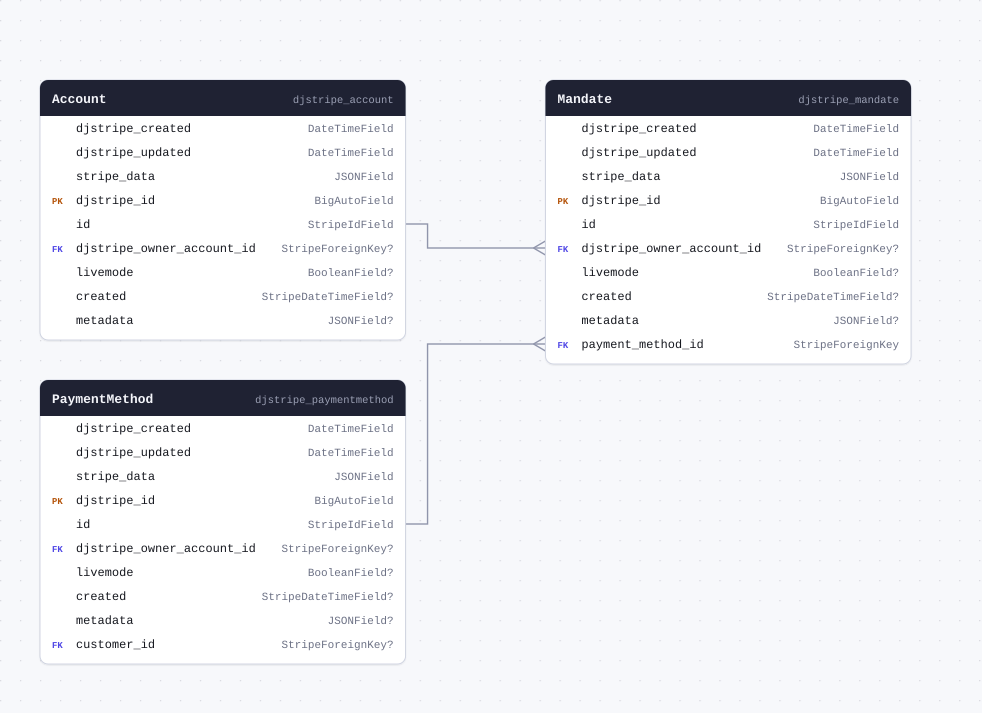

| Column | Field | Type | Null | Key | Default | Description |
| --- | --- | --- | --- | --- | --- | --- |
| `djstripe_created` | `DateTimeField` | `datetime` |  |  | `now()` |  |
| `djstripe_updated` | `DateTimeField` | `datetime` |  |  | `now()` |  |
| `stripe_data` | `JSONField` | `text` |  |  | `dict()` |  |
| `djstripe_id` | `BigAutoField` | `integer` |  | PK | `autoincrement()` |  |
| `id` | `StripeIdField` | `varchar(255)` |  | unique |  |  |
| `djstripe_owner_account_id` | `StripeForeignKey` | `varchar(255)` | yes | FK |  | The Stripe Account this object belongs to. |
| `livemode` | `BooleanField` | `bool` | yes |  | `None` | Null here indicates that the livemode status is unknown or was previously unrecorded. Otherwise, this field indicates whether this record comes from Stripe test mode or live mode operation. |
| `created` | `StripeDateTimeField` | `datetime` | yes |  |  | The datetime this object was created in stripe. |
| `metadata` | `JSONField` | `text` | yes |  |  | A set of key/value pairs that you can attach to an object. It can be useful for storing additional information about an object in a structured format. |
| `payment_method_id` | `StripeForeignKey` | `varchar(255)` |  | FK |  |  |

Indexes:

- index `djstripe_mandate_djstripe_owner_account_id_63974808` on `djstripe_owner_account_id`
- index `djstripe_mandate_payment_method_id_43a90a75` on `payment_method_id`

Relations:

- `djstripe_owner_account_id` → [Account](#account).`id`, on delete cascade
- `payment_method_id` → [PaymentMethod](#paymentmethod).`id`, on delete cascade

## Product

Table `djstripe_product`, app `djstripe`.

Columns from `StripeModel` (abstract): `djstripe_id`, `id`, `djstripe_owner_account_id`, `livemode`, `created`, `metadata`.

Columns from `StripeBaseModel` (abstract): `djstripe_created`, `djstripe_updated`, `stripe_data`.

Products describe the specific goods or services you offer to your customers.
For example, you might offer a Standard and Premium version of your goods or service;
each version would be a separate Product. They can be used in conjunction with
Prices to configure pricing in Payment Links, Checkout, and Subscriptions.

Stripe documentation: https://stripe.com/docs/api?lang=python#products

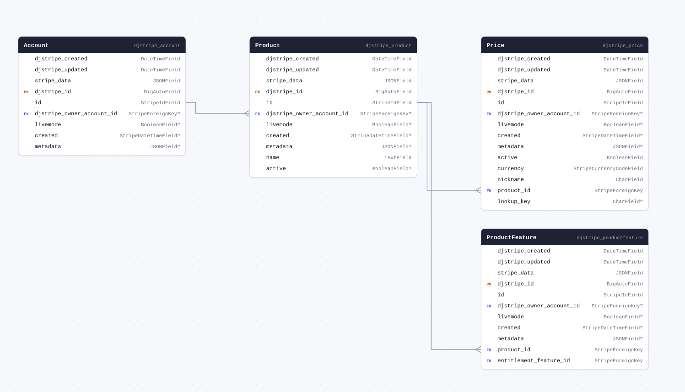

| Column | Field | Type | Null | Key | Default | Description |
| --- | --- | --- | --- | --- | --- | --- |
| `djstripe_created` | `DateTimeField` | `datetime` |  |  | `now()` |  |
| `djstripe_updated` | `DateTimeField` | `datetime` |  |  | `now()` |  |
| `stripe_data` | `JSONField` | `text` |  |  | `dict()` |  |
| `djstripe_id` | `BigAutoField` | `integer` |  | PK | `autoincrement()` |  |
| `id` | `StripeIdField` | `varchar(255)` |  | unique |  |  |
| `djstripe_owner_account_id` | `StripeForeignKey` | `varchar(255)` | yes | FK |  | The Stripe Account this object belongs to. |
| `livemode` | `BooleanField` | `bool` | yes |  | `None` | Null here indicates that the livemode status is unknown or was previously unrecorded. Otherwise, this field indicates whether this record comes from Stripe test mode or live mode operation. |
| `created` | `StripeDateTimeField` | `datetime` | yes |  |  | The datetime this object was created in stripe. |
| `metadata` | `JSONField` | `text` | yes |  |  | A set of key/value pairs that you can attach to an object. It can be useful for storing additional information about an object in a structured format. |
| `name` | `TextField` | `text` |  |  |  | The product's name, meant to be displayable to the customer. Applicable to both `service` and `good` types. |
| `active` | `BooleanField` | `bool` | yes |  |  | Whether the product is currently available for purchase. Only applicable to products of `type=good`. |

Indexes:

- index `djstripe_product_djstripe_owner_account_id_6c90c2b6` on `djstripe_owner_account_id`

Relations:

- `djstripe_owner_account_id` → [Account](#account).`id`, on delete cascade
- [Price](#price).`product_id` → `id`, on delete cascade
- [ProductFeature](#productfeature).`product_id` → `id`, on delete cascade

## Customer

Table `djstripe_customer`, app `djstripe`.

Columns from `StripeModel` (abstract): `djstripe_id`, `id`, `djstripe_owner_account_id`, `livemode`, `created`, `metadata`.

Columns from `StripeBaseModel` (abstract): `djstripe_created`, `djstripe_updated`, `stripe_data`.

Customer objects allow you to perform recurring charges and track multiple
charges that are associated with the same customer.

Stripe documentation: https://stripe.com/docs/api?lang=python#customers

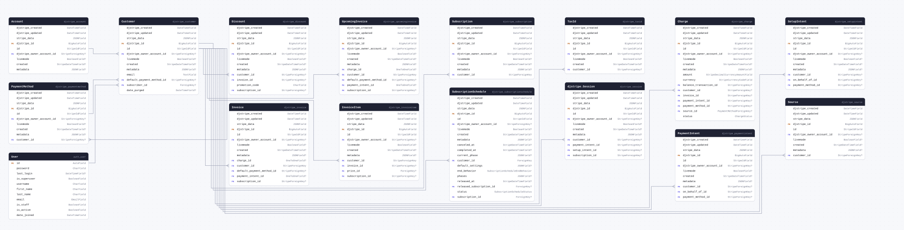

| Column | Field | Type | Null | Key | Default | Description |
| --- | --- | --- | --- | --- | --- | --- |
| `djstripe_created` | `DateTimeField` | `datetime` |  |  | `now()` |  |
| `djstripe_updated` | `DateTimeField` | `datetime` |  |  | `now()` |  |
| `stripe_data` | `JSONField` | `text` |  |  | `dict()` |  |
| `djstripe_id` | `BigAutoField` | `integer` |  | PK | `autoincrement()` |  |
| `id` | `StripeIdField` | `varchar(255)` |  | unique |  |  |
| `djstripe_owner_account_id` | `StripeForeignKey` | `varchar(255)` | yes | FK |  | The Stripe Account this object belongs to. |
| `livemode` | `BooleanField` | `bool` | yes |  | `None` | Null here indicates that the livemode status is unknown or was previously unrecorded. Otherwise, this field indicates whether this record comes from Stripe test mode or live mode operation. |
| `created` | `StripeDateTimeField` | `datetime` | yes |  |  | The datetime this object was created in stripe. |
| `metadata` | `JSONField` | `text` | yes |  |  | A set of key/value pairs that you can attach to an object. It can be useful for storing additional information about an object in a structured format. |
| `email` | `TextField` | `text` |  |  | `''` |  |
| `default_payment_method_id` | `StripeForeignKey` | `varchar(255)` | yes | FK |  | default payment method used for subscriptions and invoices for the customer. |
| `subscriber_id` | `ForeignKey` | `integer` | yes | FK |  |  |
| `date_purged` | `DateTimeField` | `datetime` | yes |  |  |  |

Indexes:

- index `djstripe_customer_djstripe_owner_account_id_2c5ac18d` on `djstripe_owner_account_id`
- index `djstripe_customer_default_payment_method_id_00268b63` on `default_payment_method_id`
- index `djstripe_customer_subscriber_id_60f5c7bc` on `subscriber_id`

Relations:

- [Discount](#discount).`customer_id` → `id`, on delete cascade
- [Invoice](#invoice).`customer_id` → `id`, on delete cascade
- [UpcomingInvoice](#upcominginvoice).`customer_id` → `id`, on delete cascade
- [InvoiceItem](#invoiceitem).`customer_id` → `id`, on delete cascade
- [Subscription](#subscription).`customer_id` → `id`, on delete cascade
- [SubscriptionSchedule](#subscriptionschedule).`customer_id` → `djstripe_id`, on delete cascade
- [TaxId](#taxid).`customer_id` → `id`, on delete cascade
- [djstripe.Session](#djstripesession).`customer_id` → `id`, on delete set null
- [Charge](#charge).`customer_id` → `id`, on delete set null
- `djstripe_owner_account_id` → [Account](#account).`id`, on delete cascade
- `default_payment_method_id` → [PaymentMethod](#paymentmethod).`id`, on delete set null
- `subscriber_id` → [User](#user).`id`, on delete set null
- [PaymentIntent](#paymentintent).`customer_id` → `id`, on delete cascade
- [SetupIntent](#setupintent).`customer_id` → `id`, on delete set null
- [Source](#source).`customer_id` → `id`, on delete set null
- [PaymentMethod](#paymentmethod).`customer_id` → `id`, on delete set null

## Dispute

Table `djstripe_dispute`, app `djstripe`.

Columns from `StripeModel` (abstract): `djstripe_id`, `id`, `djstripe_owner_account_id`, `livemode`, `created`, `metadata`.

Columns from `StripeBaseModel` (abstract): `djstripe_created`, `djstripe_updated`, `stripe_data`.

A dispute occurs when a customer questions your charge with their
card issuer. When this happens, you're given the opportunity to
respond to the dispute with evidence that shows that the charge is legitimate

Stripe documentation: https://stripe.com/docs/api?lang=python#disputes

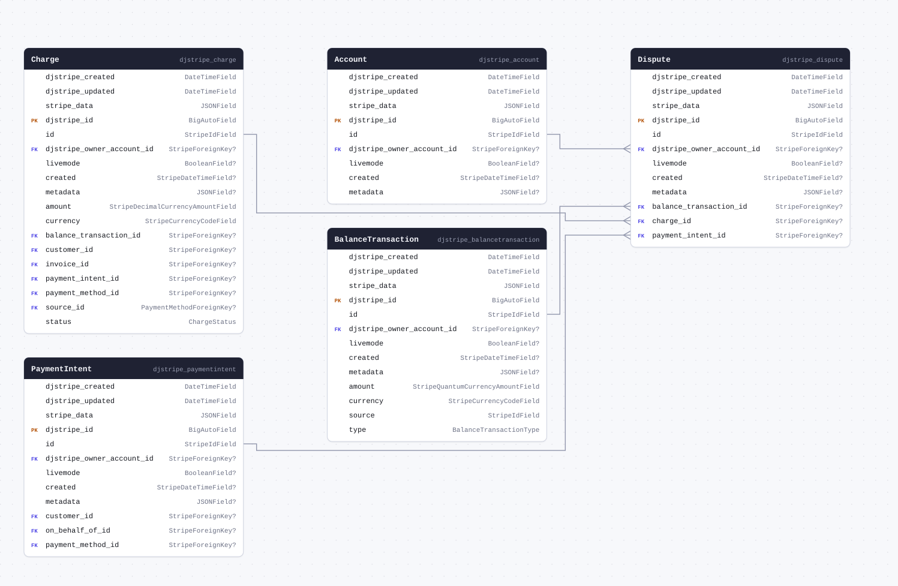

| Column | Field | Type | Null | Key | Default | Description |
| --- | --- | --- | --- | --- | --- | --- |
| `djstripe_created` | `DateTimeField` | `datetime` |  |  | `now()` |  |
| `djstripe_updated` | `DateTimeField` | `datetime` |  |  | `now()` |  |
| `stripe_data` | `JSONField` | `text` |  |  | `dict()` |  |
| `djstripe_id` | `BigAutoField` | `integer` |  | PK | `autoincrement()` |  |
| `id` | `StripeIdField` | `varchar(255)` |  | unique |  |  |
| `djstripe_owner_account_id` | `StripeForeignKey` | `varchar(255)` | yes | FK |  | The Stripe Account this object belongs to. |
| `livemode` | `BooleanField` | `bool` | yes |  | `None` | Null here indicates that the livemode status is unknown or was previously unrecorded. Otherwise, this field indicates whether this record comes from Stripe test mode or live mode operation. |
| `created` | `StripeDateTimeField` | `datetime` | yes |  |  | The datetime this object was created in stripe. |
| `metadata` | `JSONField` | `text` | yes |  |  | A set of key/value pairs that you can attach to an object. It can be useful for storing additional information about an object in a structured format. |
| `balance_transaction_id` | `StripeForeignKey` | `varchar(255)` | yes | FK |  | Balance transaction that describes the impact on your account balance. |
| `charge_id` | `StripeForeignKey` | `varchar(255)` | yes | FK |  | The charge that was disputed |
| `payment_intent_id` | `StripeForeignKey` | `varchar(255)` | yes | FK |  | The PaymentIntent that was disputed |

Indexes:

- index `djstripe_dispute_djstripe_owner_account_id_8010e2d7` on `djstripe_owner_account_id`
- index `djstripe_dispute_balance_transaction_id_aa7cb920` on `balance_transaction_id`
- index `djstripe_dispute_charge_id_ba680941` on `charge_id`
- index `djstripe_dispute_payment_intent_id_dc834ee4` on `payment_intent_id`

Relations:

- `djstripe_owner_account_id` → [Account](#account).`id`, on delete cascade
- `balance_transaction_id` → [BalanceTransaction](#balancetransaction).`id`, on delete cascade
- `charge_id` → [Charge](#charge).`id`, on delete cascade
- `payment_intent_id` → [PaymentIntent](#paymentintent).`id`, on delete cascade

## Event

Table `djstripe_event`, app `djstripe`.

Columns from `StripeModel` (abstract): `djstripe_id`, `id`, `djstripe_owner_account_id`, `livemode`, `created`, `metadata`.

Columns from `StripeBaseModel` (abstract): `djstripe_created`, `djstripe_updated`, `stripe_data`.

Events are Stripe's way of letting you know when something interesting
happens in your account.
When an interesting event occurs, a new Event object is created and POSTed
to the configured webhook URL if the Event type matches.

Stripe documentation: https://stripe.com/docs/api/events?lang=python

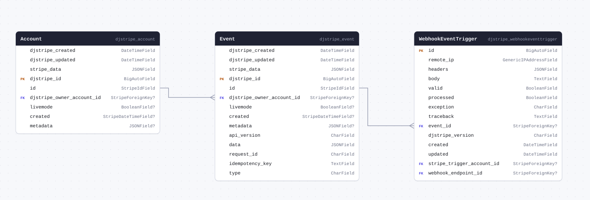

| Column | Field | Type | Null | Key | Default | Description |
| --- | --- | --- | --- | --- | --- | --- |
| `djstripe_created` | `DateTimeField` | `datetime` |  |  | `now()` |  |
| `djstripe_updated` | `DateTimeField` | `datetime` |  |  | `now()` |  |
| `stripe_data` | `JSONField` | `text` |  |  | `dict()` |  |
| `djstripe_id` | `BigAutoField` | `integer` |  | PK | `autoincrement()` |  |
| `id` | `StripeIdField` | `varchar(255)` |  | unique |  |  |
| `djstripe_owner_account_id` | `StripeForeignKey` | `varchar(255)` | yes | FK |  | The Stripe Account this object belongs to. |
| `livemode` | `BooleanField` | `bool` | yes |  | `None` | Null here indicates that the livemode status is unknown or was previously unrecorded. Otherwise, this field indicates whether this record comes from Stripe test mode or live mode operation. |
| `created` | `StripeDateTimeField` | `datetime` | yes |  |  | The datetime this object was created in stripe. |
| `metadata` | `JSONField` | `text` | yes |  |  | A set of key/value pairs that you can attach to an object. It can be useful for storing additional information about an object in a structured format. |
| `api_version` | `CharField` | `varchar(64)` |  |  |  | the API version at which the event data was rendered. Blank for old entries only, all new entries will have this value |
| `data` | `JSONField` | `text` |  |  |  | data received at webhook. data should be considered to be garbage until validity check is run and valid flag is set |
| `request_id` | `CharField` | `varchar(50)` |  |  | `''` | Information about the request that triggered this event, for traceability purposes. If empty string then this is an old entry without that data. If Null then this is not an old entry, but a Stripe 'automated' event with no associated request. |
| `idempotency_key` | `TextField` | `text` |  |  | `''` |  |
| `type` | `CharField` | `varchar(250)` |  |  |  | Stripe's event description code |

Indexes:

- index `djstripe_event_djstripe_owner_account_id_622cdfe3` on `djstripe_owner_account_id`

Relations:

- `djstripe_owner_account_id` → [Account](#account).`id`, on delete cascade
- [WebhookEventTrigger](#webhookeventtrigger).`event_id` → `id`, on delete set null

## File

Table `djstripe_file`, app `djstripe`.

Columns from `StripeModel` (abstract): `djstripe_id`, `id`, `djstripe_owner_account_id`, `livemode`, `created`, `metadata`.

Columns from `StripeBaseModel` (abstract): `djstripe_created`, `djstripe_updated`, `stripe_data`.

This is an object representing a file hosted on Stripe's servers.
The file may have been uploaded by yourself using the create file request
(for example, when uploading dispute evidence) or it may have been created by
Stripe (for example, the results of a Sigma scheduled query).

Stripe documentation: https://stripe.com/docs/api/files?lang=python

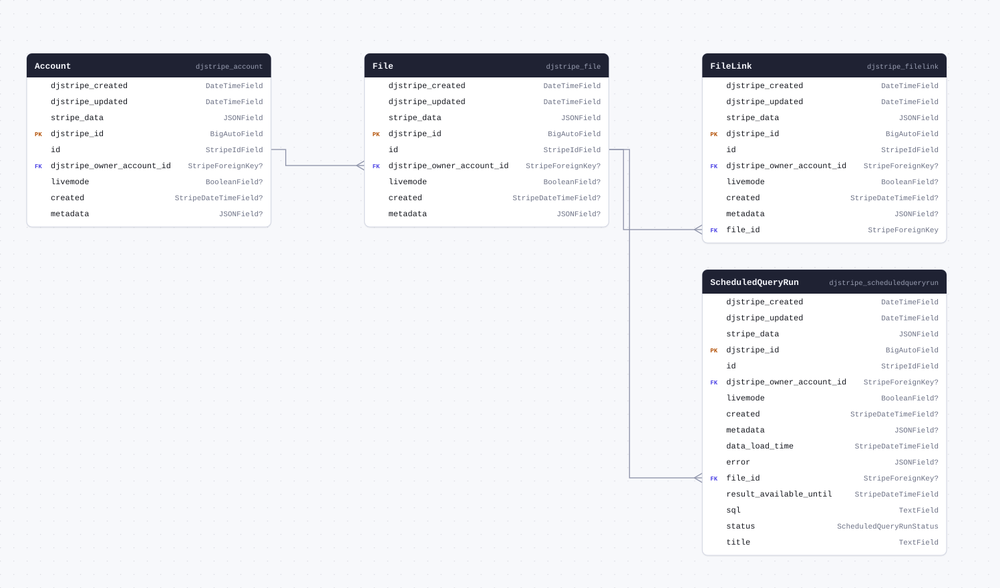

| Column | Field | Type | Null | Key | Default | Description |
| --- | --- | --- | --- | --- | --- | --- |
| `djstripe_created` | `DateTimeField` | `datetime` |  |  | `now()` |  |
| `djstripe_updated` | `DateTimeField` | `datetime` |  |  | `now()` |  |
| `stripe_data` | `JSONField` | `text` |  |  | `dict()` |  |
| `djstripe_id` | `BigAutoField` | `integer` |  | PK | `autoincrement()` |  |
| `id` | `StripeIdField` | `varchar(255)` |  | unique |  |  |
| `djstripe_owner_account_id` | `StripeForeignKey` | `varchar(255)` | yes | FK |  | The Stripe Account this object belongs to. |
| `livemode` | `BooleanField` | `bool` | yes |  | `None` | Null here indicates that the livemode status is unknown or was previously unrecorded. Otherwise, this field indicates whether this record comes from Stripe test mode or live mode operation. |
| `created` | `StripeDateTimeField` | `datetime` | yes |  |  | The datetime this object was created in stripe. |
| `metadata` | `JSONField` | `text` | yes |  |  | A set of key/value pairs that you can attach to an object. It can be useful for storing additional information about an object in a structured format. |

Indexes:

- index `djstripe_file_djstripe_owner_account_id_4919c058` on `djstripe_owner_account_id`

Relations:

- `djstripe_owner_account_id` → [Account](#account).`id`, on delete cascade
- [FileLink](#filelink).`file_id` → `id`, on delete cascade
- [ScheduledQueryRun](#scheduledqueryrun).`file_id` → `id`, on delete set null

## FileLink

Table `djstripe_filelink`, app `djstripe`.

Columns from `StripeModel` (abstract): `djstripe_id`, `id`, `djstripe_owner_account_id`, `livemode`, `created`, `metadata`.

Columns from `StripeBaseModel` (abstract): `djstripe_created`, `djstripe_updated`, `stripe_data`.

To share the contents of a File object with non-Stripe users,
you can create a FileLink. FileLinks contain a URL that can be used
to retrieve the contents of the file without authentication.

Stripe documentation: https://stripe.com/docs/api/file_links?lang=python

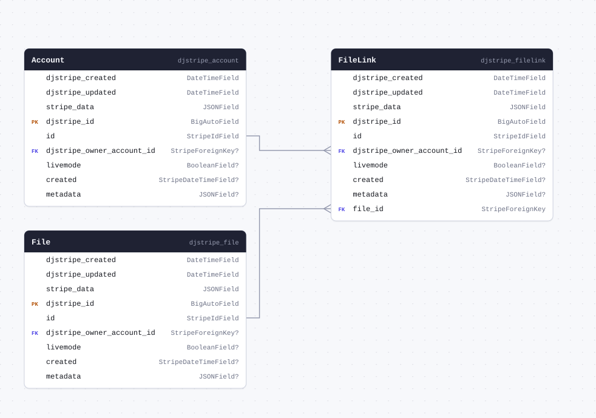

| Column | Field | Type | Null | Key | Default | Description |
| --- | --- | --- | --- | --- | --- | --- |
| `djstripe_created` | `DateTimeField` | `datetime` |  |  | `now()` |  |
| `djstripe_updated` | `DateTimeField` | `datetime` |  |  | `now()` |  |
| `stripe_data` | `JSONField` | `text` |  |  | `dict()` |  |
| `djstripe_id` | `BigAutoField` | `integer` |  | PK | `autoincrement()` |  |
| `id` | `StripeIdField` | `varchar(255)` |  | unique |  |  |
| `djstripe_owner_account_id` | `StripeForeignKey` | `varchar(255)` | yes | FK |  | The Stripe Account this object belongs to. |
| `livemode` | `BooleanField` | `bool` | yes |  | `None` | Null here indicates that the livemode status is unknown or was previously unrecorded. Otherwise, this field indicates whether this record comes from Stripe test mode or live mode operation. |
| `created` | `StripeDateTimeField` | `datetime` | yes |  |  | The datetime this object was created in stripe. |
| `metadata` | `JSONField` | `text` | yes |  |  | A set of key/value pairs that you can attach to an object. It can be useful for storing additional information about an object in a structured format. |
| `file_id` | `StripeForeignKey` | `varchar(255)` |  | FK |  |  |

Indexes:

- index `djstripe_filelink_djstripe_owner_account_id_bb039aa3` on `djstripe_owner_account_id`
- index `djstripe_filelink_file_id_5241d36f` on `file_id`

Relations:

- `djstripe_owner_account_id` → [Account](#account).`id`, on delete cascade
- `file_id` → [File](#file).`id`, on delete cascade

## PaymentIntent

Table `djstripe_paymentintent`, app `djstripe`.

Columns from `StripeModel` (abstract): `djstripe_id`, `id`, `djstripe_owner_account_id`, `livemode`, `created`, `metadata`.

Columns from `StripeBaseModel` (abstract): `djstripe_created`, `djstripe_updated`, `stripe_data`.

A PaymentIntent guides you through the process of collecting a payment
from your customer. We recommend that you create exactly one PaymentIntent for each order
or customer session in your system. You can reference the PaymentIntent later to
see the history of payment attempts for a particular session.

A PaymentIntent transitions through multiple statuses throughout its lifetime as
it interfaces with Stripe.js to perform authentication flows and ultimately
creates at most one successful charge.

Stripe documentation: https://stripe.com/docs/api?lang=python#payment_intents

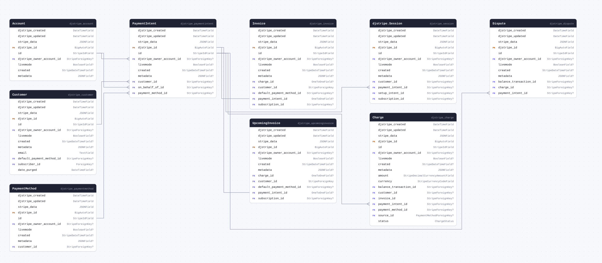

| Column | Field | Type | Null | Key | Default | Description |
| --- | --- | --- | --- | --- | --- | --- |
| `djstripe_created` | `DateTimeField` | `datetime` |  |  | `now()` |  |
| `djstripe_updated` | `DateTimeField` | `datetime` |  |  | `now()` |  |
| `stripe_data` | `JSONField` | `text` |  |  | `dict()` |  |
| `djstripe_id` | `BigAutoField` | `integer` |  | PK | `autoincrement()` |  |
| `id` | `StripeIdField` | `varchar(255)` |  | unique |  |  |
| `djstripe_owner_account_id` | `StripeForeignKey` | `varchar(255)` | yes | FK |  | The Stripe Account this object belongs to. |
| `livemode` | `BooleanField` | `bool` | yes |  | `None` | Null here indicates that the livemode status is unknown or was previously unrecorded. Otherwise, this field indicates whether this record comes from Stripe test mode or live mode operation. |
| `created` | `StripeDateTimeField` | `datetime` | yes |  |  | The datetime this object was created in stripe. |
| `metadata` | `JSONField` | `text` | yes |  |  | A set of key/value pairs that you can attach to an object. It can be useful for storing additional information about an object in a structured format. |
| `customer_id` | `StripeForeignKey` | `varchar(255)` | yes | FK |  | Customer this PaymentIntent is for if one exists. |
| `on_behalf_of_id` | `StripeForeignKey` | `varchar(255)` | yes | FK |  | The account (if any) for which the funds of the PaymentIntent are intended. |
| `payment_method_id` | `StripeForeignKey` | `varchar(255)` | yes | FK |  | Payment method used in this PaymentIntent. |

Indexes:

- index `djstripe_paymentintent_djstripe_owner_account_id_3433b556` on `djstripe_owner_account_id`
- index `djstripe_paymentintent_customer_id_93ee54a2` on `customer_id`
- index `djstripe_paymentintent_on_behalf_of_id_4db305db` on `on_behalf_of_id`
- index `djstripe_paymentintent_payment_method_id_814dd02d` on `payment_method_id`

Relations:

- [Invoice](#invoice).`payment_intent_id` → `djstripe_id`, on delete cascade
- [UpcomingInvoice](#upcominginvoice).`payment_intent_id` → `djstripe_id`, on delete cascade
- [djstripe.Session](#djstripesession).`payment_intent_id` → `id`, on delete set null
- [Charge](#charge).`payment_intent_id` → `id`, on delete set null
- [Dispute](#dispute).`payment_intent_id` → `id`, on delete cascade
- `djstripe_owner_account_id` → [Account](#account).`id`, on delete cascade
- `customer_id` → [Customer](#customer).`id`, on delete cascade
- `on_behalf_of_id` → [Account](#account).`id`, on delete cascade
- `payment_method_id` → [PaymentMethod](#paymentmethod).`id`, on delete set null

## SetupIntent

Table `djstripe_setupintent`, app `djstripe`.

Columns from `StripeModel` (abstract): `djstripe_id`, `id`, `djstripe_owner_account_id`, `livemode`, `created`, `metadata`.

Columns from `StripeBaseModel` (abstract): `djstripe_created`, `djstripe_updated`, `stripe_data`.

A SetupIntent guides you through the process of setting up a customer's
payment credentials for future payments. For example, you could use a SetupIntent
to set up your customer's card without immediately collecting a payment.
Later, you can use PaymentIntents to drive the payment flow.

NOTE: You should not maintain long-lived, unconfirmed SetupIntents.
For security purposes, SetupIntents older than 24 hours may no longer be valid.

Stripe documentation: https://stripe.com/docs/api?lang=python#setup_intents

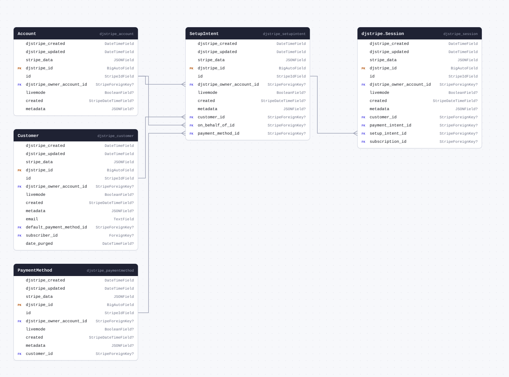

| Column | Field | Type | Null | Key | Default | Description |
| --- | --- | --- | --- | --- | --- | --- |
| `djstripe_created` | `DateTimeField` | `datetime` |  |  | `now()` |  |
| `djstripe_updated` | `DateTimeField` | `datetime` |  |  | `now()` |  |
| `stripe_data` | `JSONField` | `text` |  |  | `dict()` |  |
| `djstripe_id` | `BigAutoField` | `integer` |  | PK | `autoincrement()` |  |
| `id` | `StripeIdField` | `varchar(255)` |  | unique |  |  |
| `djstripe_owner_account_id` | `StripeForeignKey` | `varchar(255)` | yes | FK |  | The Stripe Account this object belongs to. |
| `livemode` | `BooleanField` | `bool` | yes |  | `None` | Null here indicates that the livemode status is unknown or was previously unrecorded. Otherwise, this field indicates whether this record comes from Stripe test mode or live mode operation. |
| `created` | `StripeDateTimeField` | `datetime` | yes |  |  | The datetime this object was created in stripe. |
| `metadata` | `JSONField` | `text` | yes |  |  | A set of key/value pairs that you can attach to an object. It can be useful for storing additional information about an object in a structured format. |
| `customer_id` | `StripeForeignKey` | `varchar(255)` | yes | FK |  | Customer this SetupIntent belongs to, if one exists. |
| `on_behalf_of_id` | `StripeForeignKey` | `varchar(255)` | yes | FK |  | The account (if any) for which the setup is intended. |
| `payment_method_id` | `StripeForeignKey` | `varchar(255)` | yes | FK |  | Payment method used in this PaymentIntent. |

Indexes:

- index `djstripe_setupintent_djstripe_owner_account_id_046c1671` on `djstripe_owner_account_id`
- index `djstripe_setupintent_customer_id_6ff5bbcc` on `customer_id`
- index `djstripe_setupintent_on_behalf_of_id_1ea4d941` on `on_behalf_of_id`
- index `djstripe_setupintent_payment_method_id_0ca17b5e` on `payment_method_id`

Relations:

- [djstripe.Session](#djstripesession).`setup_intent_id` → `id`, on delete set null
- `djstripe_owner_account_id` → [Account](#account).`id`, on delete cascade
- `customer_id` → [Customer](#customer).`id`, on delete set null
- `on_behalf_of_id` → [Account](#account).`id`, on delete set null
- `payment_method_id` → [PaymentMethod](#paymentmethod).`id`, on delete set null

## Payout

Table `djstripe_payout`, app `djstripe`.

Columns from `StripeModel` (abstract): `djstripe_id`, `id`, `djstripe_owner_account_id`, `livemode`, `created`, `metadata`.

Columns from `StripeBaseModel` (abstract): `djstripe_created`, `djstripe_updated`, `stripe_data`.

A Payout object is created when you receive funds from Stripe, or when you initiate
a payout to either a bank account or debit card of a connected Stripe account.

Stripe documentation: https://stripe.com/docs/api?lang=python#payouts

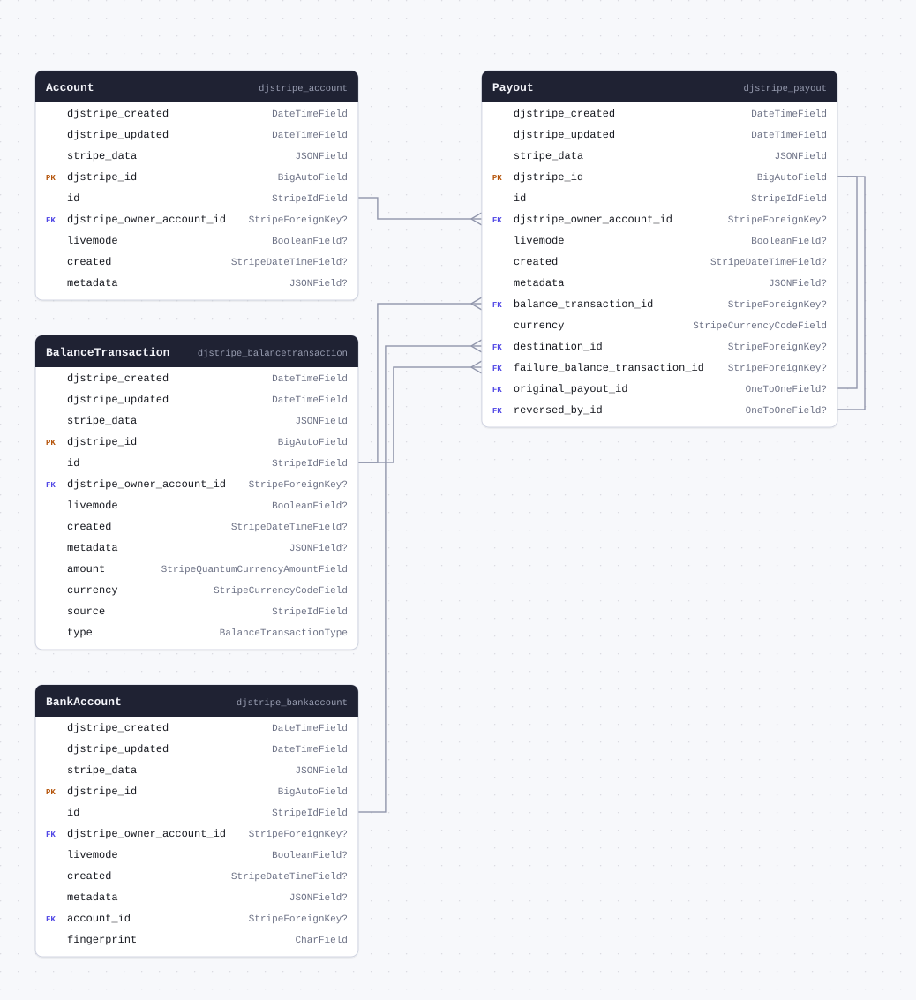

| Column | Field | Type | Null | Key | Default | Description |
| --- | --- | --- | --- | --- | --- | --- |
| `djstripe_created` | `DateTimeField` | `datetime` |  |  | `now()` |  |
| `djstripe_updated` | `DateTimeField` | `datetime` |  |  | `now()` |  |
| `stripe_data` | `JSONField` | `text` |  |  | `dict()` |  |
| `djstripe_id` | `BigAutoField` | `integer` |  | PK | `autoincrement()` |  |
| `id` | `StripeIdField` | `varchar(255)` |  | unique |  |  |
| `djstripe_owner_account_id` | `StripeForeignKey` | `varchar(255)` | yes | FK |  | The Stripe Account this object belongs to. |
| `livemode` | `BooleanField` | `bool` | yes |  | `None` | Null here indicates that the livemode status is unknown or was previously unrecorded. Otherwise, this field indicates whether this record comes from Stripe test mode or live mode operation. |
| `created` | `StripeDateTimeField` | `datetime` | yes |  |  | The datetime this object was created in stripe. |
| `metadata` | `JSONField` | `text` | yes |  |  | A set of key/value pairs that you can attach to an object. It can be useful for storing additional information about an object in a structured format. |
| `balance_transaction_id` | `StripeForeignKey` | `varchar(255)` | yes | FK |  | Balance transaction that describes the impact on your account balance. |
| `currency` | `StripeCurrencyCodeField` | `varchar(3)` |  |  |  | Three-letter ISO currency code |
| `destination_id` | `StripeForeignKey` | `varchar(255)` | yes | FK |  | Bank account or card the payout was sent to. |
| `failure_balance_transaction_id` | `StripeForeignKey` | `varchar(255)` | yes | FK |  | If the payout failed or was canceled, this will be the balance transaction that reversed the initial balance transaction, and puts the funds from the failed payout back in your balance. |
| `original_payout_id` | `OneToOneField` | `bigint` | yes | FK, unique |  | If this payout reverses another, this is the ID of the original payout. |
| `reversed_by_id` | `OneToOneField` | `bigint` | yes | FK, unique |  | If this payout was reversed, this is the ID of the payout that reverses this payout. |

Indexes:

- index `djstripe_payout_djstripe_owner_account_id_8aac4e8e` on `djstripe_owner_account_id`
- index `djstripe_payout_balance_transaction_id_a9393fb6` on `balance_transaction_id`
- index `djstripe_payout_destination_id_a5fa55c2` on `destination_id`
- index `djstripe_payout_failure_balance_transaction_id_77d442db` on `failure_balance_transaction_id`

Relations:

- `djstripe_owner_account_id` → [Account](#account).`id`, on delete cascade
- `balance_transaction_id` → [BalanceTransaction](#balancetransaction).`id`, on delete set null
- `destination_id` → [BankAccount](#bankaccount).`id`, on delete protect
- `failure_balance_transaction_id` → [BalanceTransaction](#balancetransaction).`id`, on delete set null
- `original_payout_id` → [Payout](#payout).`djstripe_id`, on delete set null
- `reversed_by_id` → [Payout](#payout).`djstripe_id`, on delete set null

## Price

Table `djstripe_price`, app `djstripe`.

Columns from `StripeModel` (abstract): `djstripe_id`, `id`, `djstripe_owner_account_id`, `livemode`, `created`, `metadata`.

Columns from `StripeBaseModel` (abstract): `djstripe_created`, `djstripe_updated`, `stripe_data`.

Prices define the unit cost, currency, and (optional) billing cycle for
both recurring and one-time purchases of products.

Prices replace the legacy Plans API, which was removed in dj-stripe 2.11.

Stripe documentation:
- https://stripe.com/docs/api/prices
- https://stripe.com/docs/billing/prices-guide

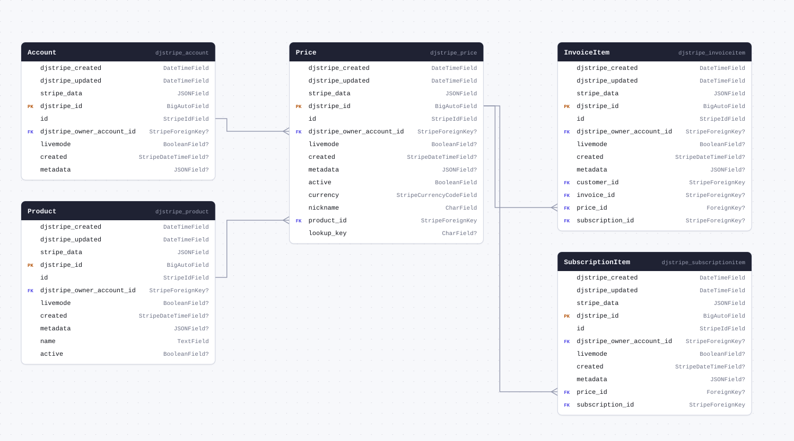

| Column | Field | Type | Null | Key | Default | Description |
| --- | --- | --- | --- | --- | --- | --- |
| `djstripe_created` | `DateTimeField` | `datetime` |  |  | `now()` |  |
| `djstripe_updated` | `DateTimeField` | `datetime` |  |  | `now()` |  |
| `stripe_data` | `JSONField` | `text` |  |  | `dict()` |  |
| `djstripe_id` | `BigAutoField` | `integer` |  | PK | `autoincrement()` |  |
| `id` | `StripeIdField` | `varchar(255)` |  | unique |  |  |
| `djstripe_owner_account_id` | `StripeForeignKey` | `varchar(255)` | yes | FK |  | The Stripe Account this object belongs to. |
| `livemode` | `BooleanField` | `bool` | yes |  | `None` | Null here indicates that the livemode status is unknown or was previously unrecorded. Otherwise, this field indicates whether this record comes from Stripe test mode or live mode operation. |
| `created` | `StripeDateTimeField` | `datetime` | yes |  |  | The datetime this object was created in stripe. |
| `metadata` | `JSONField` | `text` | yes |  |  | A set of key/value pairs that you can attach to an object. It can be useful for storing additional information about an object in a structured format. |
| `active` | `BooleanField` | `bool` |  |  |  | Whether the price can be used for new purchases. |
| `currency` | `StripeCurrencyCodeField` | `varchar(3)` |  |  |  | Three-letter ISO currency code |
| `nickname` | `CharField` | `varchar(250)` |  |  |  | A brief description of the plan, hidden from customers. |
| `product_id` | `StripeForeignKey` | `varchar(255)` |  | FK |  | The product this price is associated with. |
| `lookup_key` | `CharField` | `varchar(250)` | yes |  |  | A lookup key used to retrieve prices dynamically from a static string. |

Indexes:

- index `djstripe_price_djstripe_owner_account_id_01c819f7` on `djstripe_owner_account_id`
- index `djstripe_price_product_id_9f3d37eb` on `product_id`

Relations:

- [InvoiceItem](#invoiceitem).`price_id` → `djstripe_id`, on delete set null
- [SubscriptionItem](#subscriptionitem).`price_id` → `djstripe_id`, on delete cascade
- `djstripe_owner_account_id` → [Account](#account).`id`, on delete cascade
- `product_id` → [Product](#product).`id`, on delete cascade

## Refund

Table `djstripe_refund`, app `djstripe`.

Columns from `StripeModel` (abstract): `djstripe_id`, `id`, `djstripe_owner_account_id`, `livemode`, `created`, `metadata`.

Columns from `StripeBaseModel` (abstract): `djstripe_created`, `djstripe_updated`, `stripe_data`.

Refund objects allow you to refund a charge that has previously been created
but not yet refunded. Funds will be refunded to the credit or debit card
that was originally charged.

Stripe documentation: https://stripe.com/docs/api?lang=python#refund_object

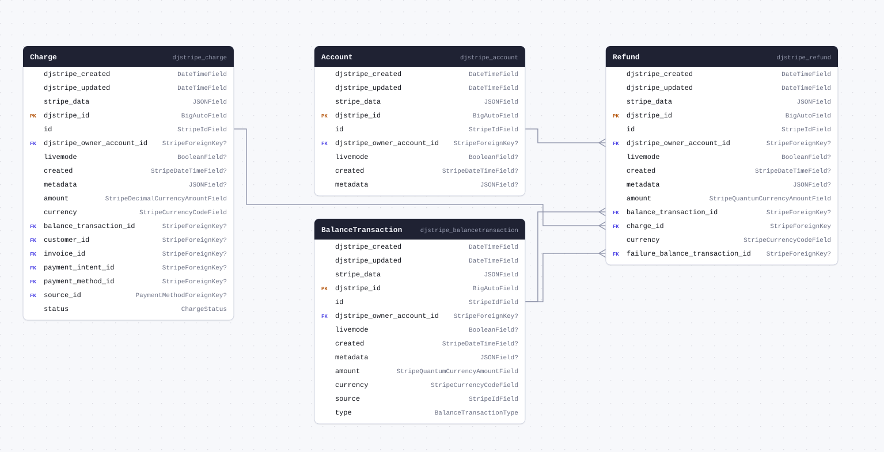

| Column | Field | Type | Null | Key | Default | Description |
| --- | --- | --- | --- | --- | --- | --- |
| `djstripe_created` | `DateTimeField` | `datetime` |  |  | `now()` |  |
| `djstripe_updated` | `DateTimeField` | `datetime` |  |  | `now()` |  |
| `stripe_data` | `JSONField` | `text` |  |  | `dict()` |  |
| `djstripe_id` | `BigAutoField` | `integer` |  | PK | `autoincrement()` |  |
| `id` | `StripeIdField` | `varchar(255)` |  | unique |  |  |
| `djstripe_owner_account_id` | `StripeForeignKey` | `varchar(255)` | yes | FK |  | The Stripe Account this object belongs to. |
| `livemode` | `BooleanField` | `bool` | yes |  | `None` | Null here indicates that the livemode status is unknown or was previously unrecorded. Otherwise, this field indicates whether this record comes from Stripe test mode or live mode operation. |
| `created` | `StripeDateTimeField` | `datetime` | yes |  |  | The datetime this object was created in stripe. |
| `metadata` | `JSONField` | `text` | yes |  |  | A set of key/value pairs that you can attach to an object. It can be useful for storing additional information about an object in a structured format. |
| `amount` | `StripeQuantumCurrencyAmountField` | `bigint` |  |  |  | Amount, in cents. |
| `balance_transaction_id` | `StripeForeignKey` | `varchar(255)` | yes | FK |  | Balance transaction that describes the impact on your account balance. |
| `charge_id` | `StripeForeignKey` | `varchar(255)` |  | FK |  | The charge that was refunded |
| `currency` | `StripeCurrencyCodeField` | `varchar(3)` |  |  |  | Three-letter ISO currency code |
| `failure_balance_transaction_id` | `StripeForeignKey` | `varchar(255)` | yes | FK |  | If the refund failed, this balance transaction describes the adjustment made on your account balance that reverses the initial balance transaction. |

Indexes:

- index `djstripe_refund_djstripe_owner_account_id_ece3ea81` on `djstripe_owner_account_id`
- index `djstripe_refund_balance_transaction_id_dec480cf` on `balance_transaction_id`
- index `djstripe_refund_charge_id_e7efd717` on `charge_id`
- index `djstripe_refund_failure_balance_transaction_id_817ae640` on `failure_balance_transaction_id`

Relations:

- `djstripe_owner_account_id` → [Account](#account).`id`, on delete cascade
- `balance_transaction_id` → [BalanceTransaction](#balancetransaction).`id`, on delete set null
- `charge_id` → [Charge](#charge).`id`, on delete cascade
- `failure_balance_transaction_id` → [BalanceTransaction](#balancetransaction).`id`, on delete set null

## Feature

Table `djstripe_feature`, app `djstripe`.

Columns from `StripeModel` (abstract): `djstripe_id`, `id`, `djstripe_owner_account_id`, `livemode`, `created`, `metadata`.

Columns from `StripeBaseModel` (abstract): `djstripe_created`, `djstripe_updated`, `stripe_data`.

A feature represents a monetizable ability or functionality in your system.
Features can be assigned to products, and when those products are purchased,
Stripe will create an entitlement to the feature for the purchasing customer.

Stirpe Documentation: https://stripe.com/docs/api/entitlements/feature

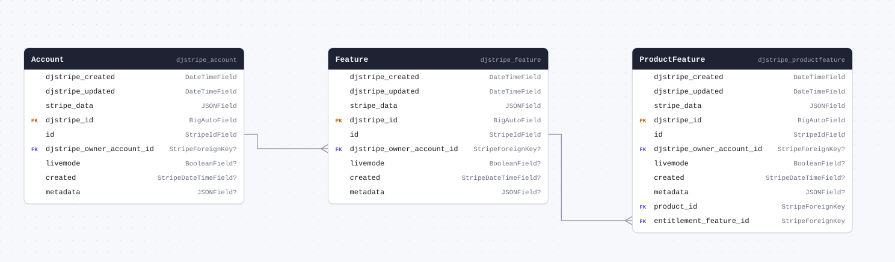

| Column | Field | Type | Null | Key | Default | Description |
| --- | --- | --- | --- | --- | --- | --- |
| `djstripe_created` | `DateTimeField` | `datetime` |  |  | `now()` |  |
| `djstripe_updated` | `DateTimeField` | `datetime` |  |  | `now()` |  |
| `stripe_data` | `JSONField` | `text` |  |  | `dict()` |  |
| `djstripe_id` | `BigAutoField` | `integer` |  | PK | `autoincrement()` |  |
| `id` | `StripeIdField` | `varchar(255)` |  | unique |  |  |
| `djstripe_owner_account_id` | `StripeForeignKey` | `varchar(255)` | yes | FK |  | The Stripe Account this object belongs to. |
| `livemode` | `BooleanField` | `bool` | yes |  | `None` | Null here indicates that the livemode status is unknown or was previously unrecorded. Otherwise, this field indicates whether this record comes from Stripe test mode or live mode operation. |
| `created` | `StripeDateTimeField` | `datetime` | yes |  |  | The datetime this object was created in stripe. |
| `metadata` | `JSONField` | `text` | yes |  |  | A set of key/value pairs that you can attach to an object. It can be useful for storing additional information about an object in a structured format. |

Indexes:

- index `djstripe_feature_djstripe_owner_account_id_c571a7da` on `djstripe_owner_account_id`

Relations:

- `djstripe_owner_account_id` → [Account](#account).`id`, on delete cascade
- [ProductFeature](#productfeature).`entitlement_feature_id` → `id`, on delete cascade

## ProductFeature

Table `djstripe_productfeature`, app `djstripe`.

Columns from `StripeModel` (abstract): `djstripe_id`, `id`, `djstripe_owner_account_id`, `livemode`, `created`, `metadata`.

Columns from `StripeBaseModel` (abstract): `djstripe_created`, `djstripe_updated`, `stripe_data`.

A product_feature represents a feature attached to a product.
When a product is purchased that has a feature, Stripe will create
an entitlement to that feature for the purchasing customer.

Stripe Documentation: https://stripe.com/docs/api/product-feature

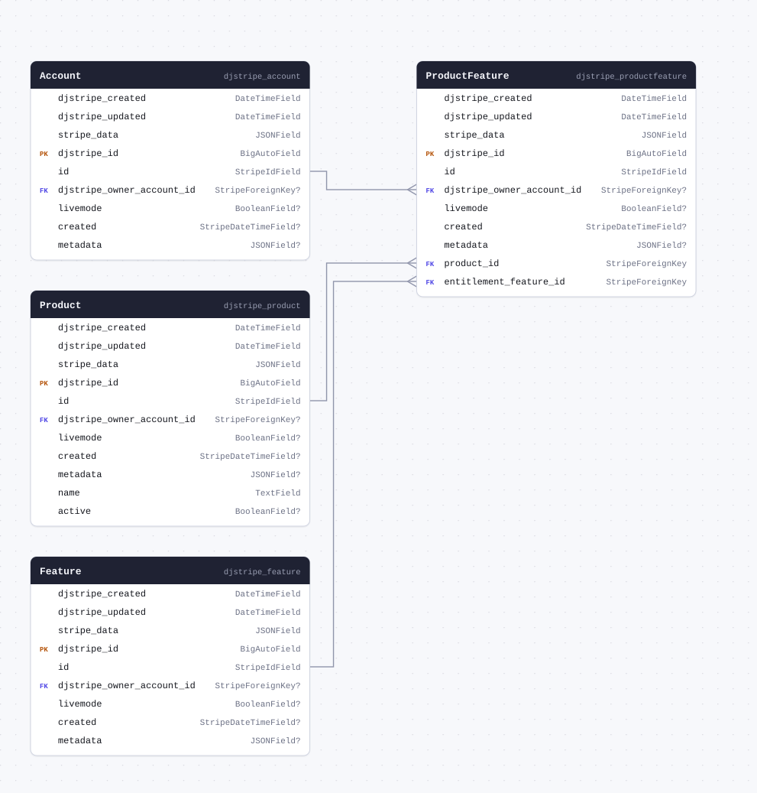

| Column | Field | Type | Null | Key | Default | Description |
| --- | --- | --- | --- | --- | --- | --- |
| `djstripe_created` | `DateTimeField` | `datetime` |  |  | `now()` |  |
| `djstripe_updated` | `DateTimeField` | `datetime` |  |  | `now()` |  |
| `stripe_data` | `JSONField` | `text` |  |  | `dict()` |  |
| `djstripe_id` | `BigAutoField` | `integer` |  | PK | `autoincrement()` |  |
| `id` | `StripeIdField` | `varchar(255)` |  | unique |  |  |
| `djstripe_owner_account_id` | `StripeForeignKey` | `varchar(255)` | yes | FK |  | The Stripe Account this object belongs to. |
| `livemode` | `BooleanField` | `bool` | yes |  | `None` | Null here indicates that the livemode status is unknown or was previously unrecorded. Otherwise, this field indicates whether this record comes from Stripe test mode or live mode operation. |
| `created` | `StripeDateTimeField` | `datetime` | yes |  |  | The datetime this object was created in stripe. |
| `metadata` | `JSONField` | `text` | yes |  |  | A set of key/value pairs that you can attach to an object. It can be useful for storing additional information about an object in a structured format. |
| `product_id` | `StripeForeignKey` | `varchar(255)` |  | FK |  | The product this feature is attached to. |
| `entitlement_feature_id` | `StripeForeignKey` | `varchar(255)` |  | FK |  | The feature that this product feature references. |

Indexes:

- index `djstripe_productfeature_djstripe_owner_account_id_d507d3d1` on `djstripe_owner_account_id`
- index `djstripe_productfeature_product_id_b01ed73e` on `product_id`
- index `djstripe_productfeature_entitlement_feature_id_6880bac7` on `entitlement_feature_id`

Relations:

- `djstripe_owner_account_id` → [Account](#account).`id`, on delete cascade
- `product_id` → [Product](#product).`id`, on delete cascade
- `entitlement_feature_id` → [Feature](#feature).`id`, on delete cascade

## ActiveEntitlement

Table `djstripe_activeentitlement`, app `djstripe`.

Columns from `StripeModel` (abstract): `djstripe_id`, `id`, `djstripe_owner_account_id`, `livemode`, `created`, `metadata`.

Columns from `StripeBaseModel` (abstract): `djstripe_created`, `djstripe_updated`, `stripe_data`.

An active entitlement describes access to a feature for a customer.

Stirpe Documentation: https://stripe.com/docs/api/entitlements/active_entitlement

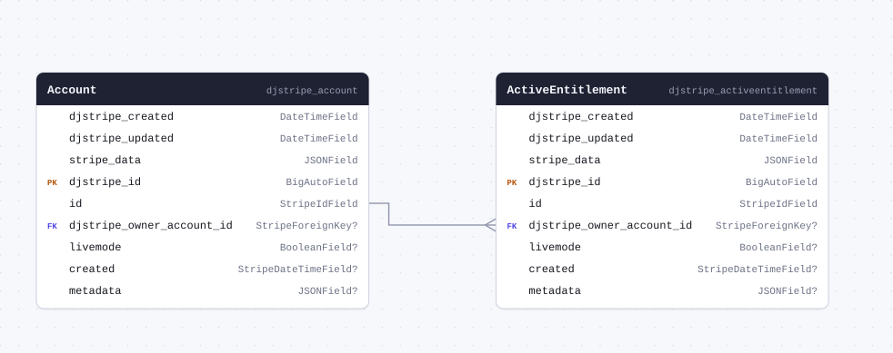

| Column | Field | Type | Null | Key | Default | Description |
| --- | --- | --- | --- | --- | --- | --- |
| `djstripe_created` | `DateTimeField` | `datetime` |  |  | `now()` |  |
| `djstripe_updated` | `DateTimeField` | `datetime` |  |  | `now()` |  |
| `stripe_data` | `JSONField` | `text` |  |  | `dict()` |  |
| `djstripe_id` | `BigAutoField` | `integer` |  | PK | `autoincrement()` |  |
| `id` | `StripeIdField` | `varchar(255)` |  | unique |  |  |
| `djstripe_owner_account_id` | `StripeForeignKey` | `varchar(255)` | yes | FK |  | The Stripe Account this object belongs to. |
| `livemode` | `BooleanField` | `bool` | yes |  | `None` | Null here indicates that the livemode status is unknown or was previously unrecorded. Otherwise, this field indicates whether this record comes from Stripe test mode or live mode operation. |
| `created` | `StripeDateTimeField` | `datetime` | yes |  |  | The datetime this object was created in stripe. |
| `metadata` | `JSONField` | `text` | yes |  |  | A set of key/value pairs that you can attach to an object. It can be useful for storing additional information about an object in a structured format. |

Indexes:

- index `djstripe_activeentitlement_djstripe_owner_account_id_d4f2dd53` on `djstripe_owner_account_id`

Relations:

- `djstripe_owner_account_id` → [Account](#account).`id`, on delete cascade

## VerificationSession

Table `djstripe_verificationsession`, app `djstripe`.

Columns from `StripeModel` (abstract): `djstripe_id`, `id`, `djstripe_owner_account_id`, `livemode`, `created`, `metadata`.

Columns from `StripeBaseModel` (abstract): `djstripe_created`, `djstripe_updated`, `stripe_data`.

Stripe documentation: https://stripe.com/docs/api/identity/verification_sessions

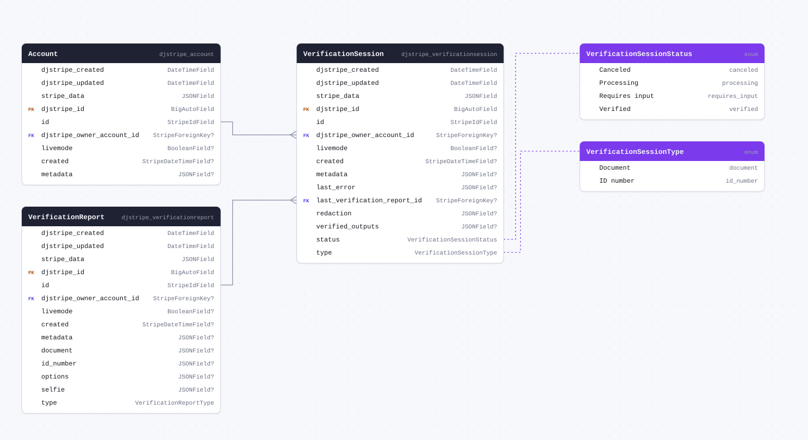

| Column | Field | Type | Null | Key | Default | Description |
| --- | --- | --- | --- | --- | --- | --- |
| `djstripe_created` | `DateTimeField` | `datetime` |  |  | `now()` |  |
| `djstripe_updated` | `DateTimeField` | `datetime` |  |  | `now()` |  |
| `stripe_data` | `JSONField` | `text` |  |  | `dict()` |  |
| `djstripe_id` | `BigAutoField` | `integer` |  | PK | `autoincrement()` |  |
| `id` | `StripeIdField` | `varchar(255)` |  | unique |  |  |
| `djstripe_owner_account_id` | `StripeForeignKey` | `varchar(255)` | yes | FK |  | The Stripe Account this object belongs to. |
| `livemode` | `BooleanField` | `bool` | yes |  | `None` | Null here indicates that the livemode status is unknown or was previously unrecorded. Otherwise, this field indicates whether this record comes from Stripe test mode or live mode operation. |
| `created` | `StripeDateTimeField` | `datetime` | yes |  |  | The datetime this object was created in stripe. |
| `metadata` | `JSONField` | `text` | yes |  |  | A set of key/value pairs that you can attach to an object. It can be useful for storing additional information about an object in a structured format. |
| `last_error` | `JSONField` | `text` | yes |  |  |  |
| `last_verification_report_id` | `StripeForeignKey` | `varchar(255)` | yes | FK |  |  |
| `redaction` | `JSONField` | `text` | yes |  |  |  |
| `verified_outputs` | `JSONField` | `text` | yes |  |  |  |
| `status` | `VerificationSessionStatus` | `varchar(255)` |  |  |  |  |
| `type` | `VerificationSessionType` | `varchar(255)` |  |  |  |  |

Indexes:

- index `djstripe_verificationsession_djstripe_owner_account_id_11bac9bf` on `djstripe_owner_account_id`
- index `djstripe_verificationsession_last_verification_report_id_192f6b6d` on `last_verification_report_id`

Relations:

- `djstripe_owner_account_id` → [Account](#account).`id`, on delete cascade
- `last_verification_report_id` → [VerificationReport](#verificationreport).`id`, on delete set null

## VerificationReport

Table `djstripe_verificationreport`, app `djstripe`.

Columns from `StripeModel` (abstract): `djstripe_id`, `id`, `djstripe_owner_account_id`, `livemode`, `created`, `metadata`.

Columns from `StripeBaseModel` (abstract): `djstripe_created`, `djstripe_updated`, `stripe_data`.

Stripe documentation: https://stripe.com/docs/api/identity/verification_reports

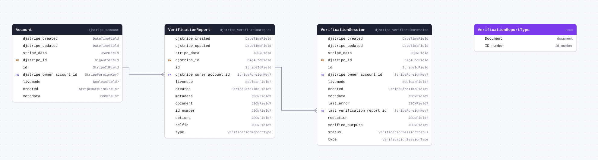

| Column | Field | Type | Null | Key | Default | Description |
| --- | --- | --- | --- | --- | --- | --- |
| `djstripe_created` | `DateTimeField` | `datetime` |  |  | `now()` |  |
| `djstripe_updated` | `DateTimeField` | `datetime` |  |  | `now()` |  |
| `stripe_data` | `JSONField` | `text` |  |  | `dict()` |  |
| `djstripe_id` | `BigAutoField` | `integer` |  | PK | `autoincrement()` |  |
| `id` | `StripeIdField` | `varchar(255)` |  | unique |  |  |
| `djstripe_owner_account_id` | `StripeForeignKey` | `varchar(255)` | yes | FK |  | The Stripe Account this object belongs to. |
| `livemode` | `BooleanField` | `bool` | yes |  | `None` | Null here indicates that the livemode status is unknown or was previously unrecorded. Otherwise, this field indicates whether this record comes from Stripe test mode or live mode operation. |
| `created` | `StripeDateTimeField` | `datetime` | yes |  |  | The datetime this object was created in stripe. |
| `metadata` | `JSONField` | `text` | yes |  |  | A set of key/value pairs that you can attach to an object. It can be useful for storing additional information about an object in a structured format. |
| `document` | `JSONField` | `text` | yes |  |  |  |
| `id_number` | `JSONField` | `text` | yes |  |  |  |
| `options` | `JSONField` | `text` | yes |  |  |  |
| `selfie` | `JSONField` | `text` | yes |  |  |  |
| `type` | `VerificationReportType` | `varchar(255)` |  |  |  |  |

Indexes:

- index `djstripe_verificationreport_djstripe_owner_account_id_7a5869e4` on `djstripe_owner_account_id`

Relations:

- [VerificationSession](#verificationsession).`last_verification_report_id` → `id`, on delete set null
- `djstripe_owner_account_id` → [Account](#account).`id`, on delete cascade

## IssuingAuthorization

Table `djstripe_issuing_authorization`, app `djstripe`.

Columns from `StripeModel` (abstract): `djstripe_id`, `id`, `djstripe_owner_account_id`, `livemode`, `created`, `metadata`.

Columns from `StripeBaseModel` (abstract): `djstripe_created`, `djstripe_updated`, `stripe_data`.

When an issued card is used to make a purchase, an Issuing Authorization object is created.
Authorizations must be approved for the purchase to be completed successfully.

Stripe documentation: https://docs.stripe.com/api/issuing/authorizations?lang=python

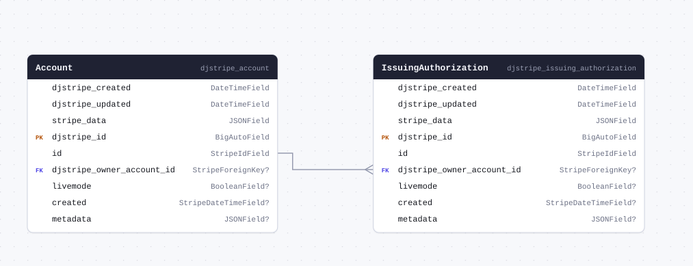

| Column | Field | Type | Null | Key | Default | Description |
| --- | --- | --- | --- | --- | --- | --- |
| `djstripe_created` | `DateTimeField` | `datetime` |  |  | `now()` |  |
| `djstripe_updated` | `DateTimeField` | `datetime` |  |  | `now()` |  |
| `stripe_data` | `JSONField` | `text` |  |  | `dict()` |  |
| `djstripe_id` | `BigAutoField` | `integer` |  | PK | `autoincrement()` |  |
| `id` | `StripeIdField` | `varchar(255)` |  | unique |  |  |
| `djstripe_owner_account_id` | `StripeForeignKey` | `varchar(255)` | yes | FK |  | The Stripe Account this object belongs to. |
| `livemode` | `BooleanField` | `bool` | yes |  | `None` | Null here indicates that the livemode status is unknown or was previously unrecorded. Otherwise, this field indicates whether this record comes from Stripe test mode or live mode operation. |
| `created` | `StripeDateTimeField` | `datetime` | yes |  |  | The datetime this object was created in stripe. |
| `metadata` | `JSONField` | `text` | yes |  |  | A set of key/value pairs that you can attach to an object. It can be useful for storing additional information about an object in a structured format. |

Indexes:

- index `djstripe_issuing_authorization_djstripe_owner_account_id_a5d3464b` on `djstripe_owner_account_id`

Relations:

- `djstripe_owner_account_id` → [Account](#account).`id`, on delete cascade

## IssuingCard

Table `djstripe_issuing_card`, app `djstripe`.

Columns from `StripeModel` (abstract): `djstripe_id`, `id`, `djstripe_owner_account_id`, `livemode`, `created`, `metadata`.

Columns from `StripeBaseModel` (abstract): `djstripe_created`, `djstripe_updated`, `stripe_data`.

You can create physical or virtual cards that are issued to cardholders.

Stripe documentation: https://stripe.com/docs/api/issuing/cards?lang=python


| Column | Field | Type | Null | Key | Default | Description |
| --- | --- | --- | --- | --- | --- | --- |
| `djstripe_created` | `DateTimeField` | `datetime` |  |  | `now()` |  |
| `djstripe_updated` | `DateTimeField` | `datetime` |  |  | `now()` |  |
| `stripe_data` | `JSONField` | `text` |  |  | `dict()` |  |
| `djstripe_id` | `BigAutoField` | `integer` |  | PK | `autoincrement()` |  |
| `id` | `StripeIdField` | `varchar(255)` |  | unique |  |  |
| `djstripe_owner_account_id` | `StripeForeignKey` | `varchar(255)` | yes | FK |  | The Stripe Account this object belongs to. |
| `livemode` | `BooleanField` | `bool` | yes |  | `None` | Null here indicates that the livemode status is unknown or was previously unrecorded. Otherwise, this field indicates whether this record comes from Stripe test mode or live mode operation. |
| `created` | `StripeDateTimeField` | `datetime` | yes |  |  | The datetime this object was created in stripe. |
| `metadata` | `JSONField` | `text` | yes |  |  | A set of key/value pairs that you can attach to an object. It can be useful for storing additional information about an object in a structured format. |

Indexes:

- index `djstripe_issuing_card_djstripe_owner_account_id_0bdfc97c` on `djstripe_owner_account_id`

Relations:

- `djstripe_owner_account_id` → [Account](#account).`id`, on delete cascade

## IssuingCardholder

Table `djstripe_issuing_cardholder`, app `djstripe`.

Columns from `StripeModel` (abstract): `djstripe_id`, `id`, `djstripe_owner_account_id`, `livemode`, `created`, `metadata`.

Columns from `StripeBaseModel` (abstract): `djstripe_created`, `djstripe_updated`, `stripe_data`.

An Issuing Cardholder object represents an individual or business entity who is issued cards.

Stripe documentation: https://stripe.com/docs/api/issuing/cardholders?lang=python

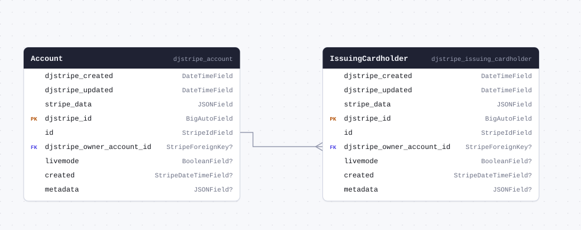

| Column | Field | Type | Null | Key | Default | Description |
| --- | --- | --- | --- | --- | --- | --- |
| `djstripe_created` | `DateTimeField` | `datetime` |  |  | `now()` |  |
| `djstripe_updated` | `DateTimeField` | `datetime` |  |  | `now()` |  |
| `stripe_data` | `JSONField` | `text` |  |  | `dict()` |  |
| `djstripe_id` | `BigAutoField` | `integer` |  | PK | `autoincrement()` |  |
| `id` | `StripeIdField` | `varchar(255)` |  | unique |  |  |
| `djstripe_owner_account_id` | `StripeForeignKey` | `varchar(255)` | yes | FK |  | The Stripe Account this object belongs to. |
| `livemode` | `BooleanField` | `bool` | yes |  | `None` | Null here indicates that the livemode status is unknown or was previously unrecorded. Otherwise, this field indicates whether this record comes from Stripe test mode or live mode operation. |
| `created` | `StripeDateTimeField` | `datetime` | yes |  |  | The datetime this object was created in stripe. |
| `metadata` | `JSONField` | `text` | yes |  |  | A set of key/value pairs that you can attach to an object. It can be useful for storing additional information about an object in a structured format. |

Indexes:

- index `djstripe_issuing_cardholder_djstripe_owner_account_id_fa7389b4` on `djstripe_owner_account_id`

Relations:

- `djstripe_owner_account_id` → [Account](#account).`id`, on delete cascade

## IssuingDispute

Table `djstripe_issuing_dispute`, app `djstripe`.

Columns from `StripeModel` (abstract): `djstripe_id`, `id`, `djstripe_owner_account_id`, `livemode`, `created`, `metadata`.

Columns from `StripeBaseModel` (abstract): `djstripe_created`, `djstripe_updated`, `stripe_data`.

As a card issuer, you can dispute transactions that the cardholder does not recognize, suspects to be fraudulent, or has other issues with.

Stripe documentation: https://stripe.com/docs/api/issuing/disputes?lang=python


| Column | Field | Type | Null | Key | Default | Description |
| --- | --- | --- | --- | --- | --- | --- |
| `djstripe_created` | `DateTimeField` | `datetime` |  |  | `now()` |  |
| `djstripe_updated` | `DateTimeField` | `datetime` |  |  | `now()` |  |
| `stripe_data` | `JSONField` | `text` |  |  | `dict()` |  |
| `djstripe_id` | `BigAutoField` | `integer` |  | PK | `autoincrement()` |  |
| `id` | `StripeIdField` | `varchar(255)` |  | unique |  |  |
| `djstripe_owner_account_id` | `StripeForeignKey` | `varchar(255)` | yes | FK |  | The Stripe Account this object belongs to. |
| `livemode` | `BooleanField` | `bool` | yes |  | `None` | Null here indicates that the livemode status is unknown or was previously unrecorded. Otherwise, this field indicates whether this record comes from Stripe test mode or live mode operation. |
| `created` | `StripeDateTimeField` | `datetime` | yes |  |  | The datetime this object was created in stripe. |
| `metadata` | `JSONField` | `text` | yes |  |  | A set of key/value pairs that you can attach to an object. It can be useful for storing additional information about an object in a structured format. |

Indexes:

- index `djstripe_issuing_dispute_djstripe_owner_account_id_388b366f` on `djstripe_owner_account_id`

Relations:

- `djstripe_owner_account_id` → [Account](#account).`id`, on delete cascade

## IssuingTransaction

Table `djstripe_issuing_transaction`, app `djstripe`.

Columns from `StripeModel` (abstract): `djstripe_id`, `id`, `djstripe_owner_account_id`, `livemode`, `created`, `metadata`.

Columns from `StripeBaseModel` (abstract): `djstripe_created`, `djstripe_updated`, `stripe_data`.

Any use of an issued card that results in funds entering or leaving your Stripe account, such as a completed purchase or refund, is represented by an Issuing Transaction object.

Stripe documentation: https://stripe.com/docs/api/issuing/transactions?lang=python

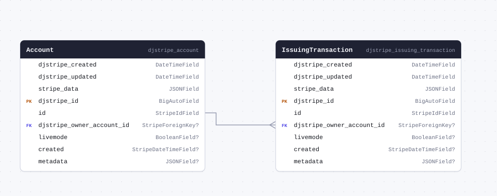

| Column | Field | Type | Null | Key | Default | Description |
| --- | --- | --- | --- | --- | --- | --- |
| `djstripe_created` | `DateTimeField` | `datetime` |  |  | `now()` |  |
| `djstripe_updated` | `DateTimeField` | `datetime` |  |  | `now()` |  |
| `stripe_data` | `JSONField` | `text` |  |  | `dict()` |  |
| `djstripe_id` | `BigAutoField` | `integer` |  | PK | `autoincrement()` |  |
| `id` | `StripeIdField` | `varchar(255)` |  | unique |  |  |
| `djstripe_owner_account_id` | `StripeForeignKey` | `varchar(255)` | yes | FK |  | The Stripe Account this object belongs to. |
| `livemode` | `BooleanField` | `bool` | yes |  | `None` | Null here indicates that the livemode status is unknown or was previously unrecorded. Otherwise, this field indicates whether this record comes from Stripe test mode or live mode operation. |
| `created` | `StripeDateTimeField` | `datetime` | yes |  |  | The datetime this object was created in stripe. |
| `metadata` | `JSONField` | `text` | yes |  |  | A set of key/value pairs that you can attach to an object. It can be useful for storing additional information about an object in a structured format. |

Indexes:

- index `djstripe_issuing_transaction_djstripe_owner_account_id_dfdd0ee5` on `djstripe_owner_account_id`

Relations:

- `djstripe_owner_account_id` → [Account](#account).`id`, on delete cascade

## DjstripePaymentMethod

Table `djstripe_djstripepaymentmethod`, app `djstripe`.

An internal model that abstracts the legacy Card and BankAccount
objects with Source objects.

Contains two fields: `id` and `type`:
- `id` is the id of the Stripe object.
- `type` can be `card`, `bank_account` `account` or `source`.

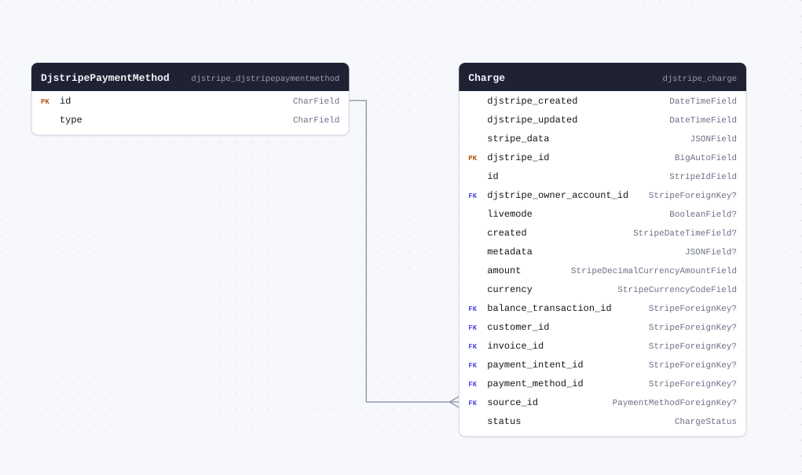

| Column | Field | Type | Null | Key | Default | Description |
| --- | --- | --- | --- | --- | --- | --- |
| `id` | `CharField` | `varchar(255)` |  | PK |  |  |
| `type` | `CharField` | `varchar(50)` |  |  |  |  |

Indexes:

- index `djstripe_djstripepaymentmethod_type_a56a0cac` on `type`

Relations:

- [Charge](#charge).`source_id` → `id`, on delete set null

## BankAccount

Table `djstripe_bankaccount`, app `djstripe`.

Columns from `StripeModel` (abstract): `djstripe_id`, `id`, `djstripe_owner_account_id`, `livemode`, `created`, `metadata`.

Columns from `StripeBaseModel` (abstract): `djstripe_created`, `djstripe_updated`, `stripe_data`.

External Accounts are transfer destinations on Account objects for Custom
accounts. They can be bank accounts or debit cards.

Stripe documentation: https://stripe.com/docs/api/external_account_bank_accounts

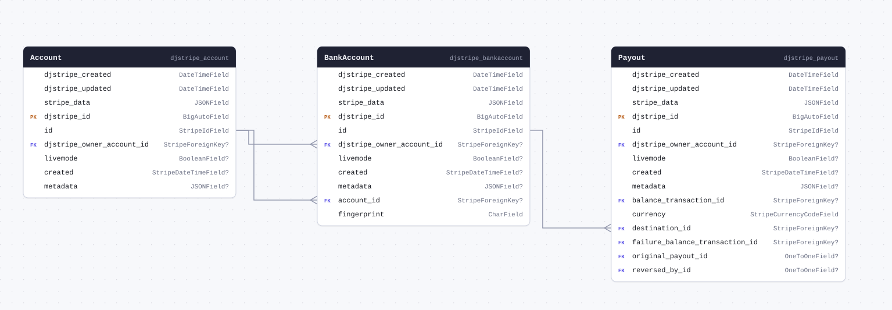

| Column | Field | Type | Null | Key | Default | Description |
| --- | --- | --- | --- | --- | --- | --- |
| `djstripe_created` | `DateTimeField` | `datetime` |  |  | `now()` |  |
| `djstripe_updated` | `DateTimeField` | `datetime` |  |  | `now()` |  |
| `stripe_data` | `JSONField` | `text` |  |  | `dict()` |  |
| `djstripe_id` | `BigAutoField` | `integer` |  | PK | `autoincrement()` |  |
| `id` | `StripeIdField` | `varchar(255)` |  | unique |  |  |
| `djstripe_owner_account_id` | `StripeForeignKey` | `varchar(255)` | yes | FK |  | The Stripe Account this object belongs to. |
| `livemode` | `BooleanField` | `bool` | yes |  | `None` | Null here indicates that the livemode status is unknown or was previously unrecorded. Otherwise, this field indicates whether this record comes from Stripe test mode or live mode operation. |
| `created` | `StripeDateTimeField` | `datetime` | yes |  |  | The datetime this object was created in stripe. |
| `metadata` | `JSONField` | `text` | yes |  |  | A set of key/value pairs that you can attach to an object. It can be useful for storing additional information about an object in a structured format. |
| `account_id` | `StripeForeignKey` | `varchar(255)` | yes | FK |  | The external account the charge was made on behalf of. Null here indicates that this value was never set. |
| `fingerprint` | `CharField` | `varchar(16)` |  |  |  | Uniquely identifies this particular bank account. You can use this attribute to check whether two bank accounts are the same. |

Indexes:

- index `djstripe_bankaccount_djstripe_owner_account_id_7c978af8` on `djstripe_owner_account_id`
- index `djstripe_bankaccount_account_id_5434506d` on `account_id`

Relations:

- [Payout](#payout).`destination_id` → `id`, on delete protect
- `djstripe_owner_account_id` → [Account](#account).`id`, on delete cascade
- `account_id` → [Account](#account).`id`, on delete protect

## Card

Table `djstripe_card`, app `djstripe`.

Columns from `StripeModel` (abstract): `djstripe_id`, `id`, `djstripe_owner_account_id`, `livemode`, `created`, `metadata`.

Columns from `StripeBaseModel` (abstract): `djstripe_created`, `djstripe_updated`, `stripe_data`.

Cards are external accounts (debit cards) on Stripe Custom Connected
Accounts, used as "Payout Sources".

Stripe documentation: https://stripe.com/docs/api/external_account_cards

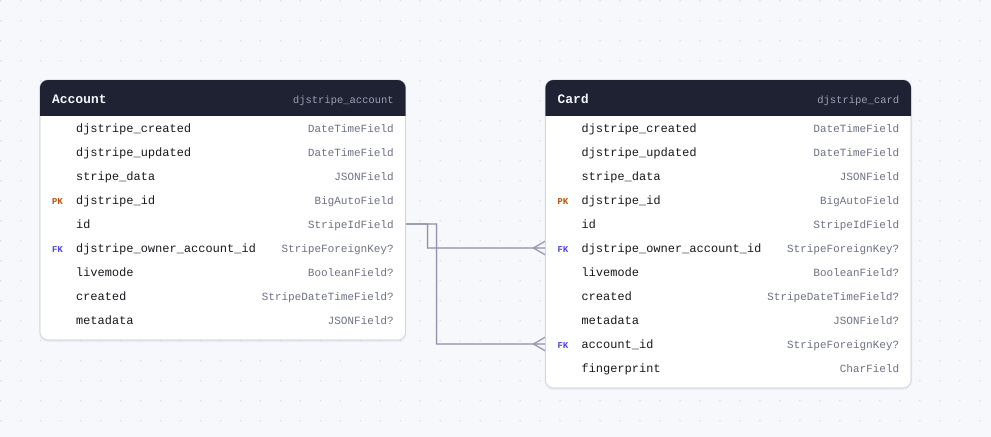

| Column | Field | Type | Null | Key | Default | Description |
| --- | --- | --- | --- | --- | --- | --- |
| `djstripe_created` | `DateTimeField` | `datetime` |  |  | `now()` |  |
| `djstripe_updated` | `DateTimeField` | `datetime` |  |  | `now()` |  |
| `stripe_data` | `JSONField` | `text` |  |  | `dict()` |  |
| `djstripe_id` | `BigAutoField` | `integer` |  | PK | `autoincrement()` |  |
| `id` | `StripeIdField` | `varchar(255)` |  | unique |  |  |
| `djstripe_owner_account_id` | `StripeForeignKey` | `varchar(255)` | yes | FK |  | The Stripe Account this object belongs to. |
| `livemode` | `BooleanField` | `bool` | yes |  | `None` | Null here indicates that the livemode status is unknown or was previously unrecorded. Otherwise, this field indicates whether this record comes from Stripe test mode or live mode operation. |
| `created` | `StripeDateTimeField` | `datetime` | yes |  |  | The datetime this object was created in stripe. |
| `metadata` | `JSONField` | `text` | yes |  |  | A set of key/value pairs that you can attach to an object. It can be useful for storing additional information about an object in a structured format. |
| `account_id` | `StripeForeignKey` | `varchar(255)` | yes | FK |  | The external account the charge was made on behalf of. Null here indicates that this value was never set. |
| `fingerprint` | `CharField` | `varchar(16)` |  |  | `''` | Uniquely identifies this particular card number. |

Indexes:

- index `djstripe_card_djstripe_owner_account_id_1a2f42f2` on `djstripe_owner_account_id`
- index `djstripe_card_account_id_ef99457f` on `account_id`

Relations:

- `djstripe_owner_account_id` → [Account](#account).`id`, on delete cascade
- `account_id` → [Account](#account).`id`, on delete protect

## Source

Table `djstripe_source`, app `djstripe`.

Columns from `StripeModel` (abstract): `djstripe_id`, `id`, `djstripe_owner_account_id`, `livemode`, `created`, `metadata`.

Columns from `StripeBaseModel` (abstract): `djstripe_created`, `djstripe_updated`, `stripe_data`.

Source objects allow you to accept a variety of payment methods.
They represent a customer's payment instrument, and can be used with
the Stripe API just like a Card object: once chargeable,
they can be charged, or can be attached to customers.

.. deprecated:: 2.11.0
    The Stripe Sources API has been deprecated in favour of the
    PaymentMethods API. Use the `PaymentMethod` model instead. The `Source`
    model will be removed in a future release.

Stripe documentation: https://stripe.com/docs/api?lang=python#sources

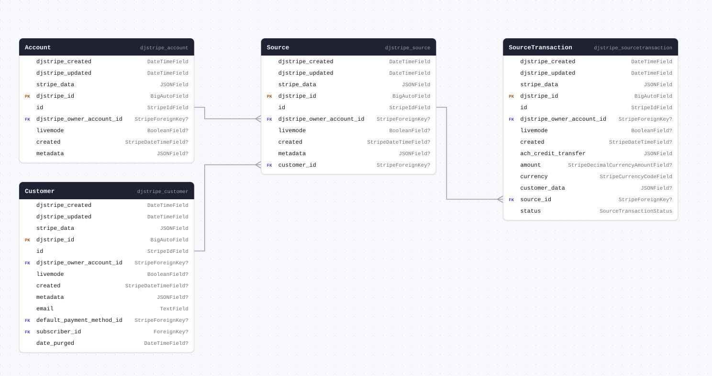

| Column | Field | Type | Null | Key | Default | Description |
| --- | --- | --- | --- | --- | --- | --- |
| `djstripe_created` | `DateTimeField` | `datetime` |  |  | `now()` |  |
| `djstripe_updated` | `DateTimeField` | `datetime` |  |  | `now()` |  |
| `stripe_data` | `JSONField` | `text` |  |  | `dict()` |  |
| `djstripe_id` | `BigAutoField` | `integer` |  | PK | `autoincrement()` |  |
| `id` | `StripeIdField` | `varchar(255)` |  | unique |  |  |
| `djstripe_owner_account_id` | `StripeForeignKey` | `varchar(255)` | yes | FK |  | The Stripe Account this object belongs to. |
| `livemode` | `BooleanField` | `bool` | yes |  | `None` | Null here indicates that the livemode status is unknown or was previously unrecorded. Otherwise, this field indicates whether this record comes from Stripe test mode or live mode operation. |
| `created` | `StripeDateTimeField` | `datetime` | yes |  |  | The datetime this object was created in stripe. |
| `metadata` | `JSONField` | `text` | yes |  |  | A set of key/value pairs that you can attach to an object. It can be useful for storing additional information about an object in a structured format. |
| `customer_id` | `StripeForeignKey` | `varchar(255)` | yes | FK |  |  |

Indexes:

- index `djstripe_source_djstripe_owner_account_id_f99f1fe6` on `djstripe_owner_account_id`
- index `djstripe_source_customer_id_4d678557` on `customer_id`

Relations:

- `djstripe_owner_account_id` → [Account](#account).`id`, on delete cascade
- `customer_id` → [Customer](#customer).`id`, on delete set null
- [SourceTransaction](#sourcetransaction).`source_id` → `id`, on delete set null

## SourceTransaction

Table `djstripe_sourcetransaction`, app `djstripe`.

Columns from `StripeModel` (abstract): `djstripe_id`, `id`, `djstripe_owner_account_id`, `livemode`, `created`.

Columns from `StripeBaseModel` (abstract): `djstripe_created`, `djstripe_updated`, `stripe_data`.

Stripe documentation: https://stripe.com/docs/sources/ach-credit-transfer#source-transactions

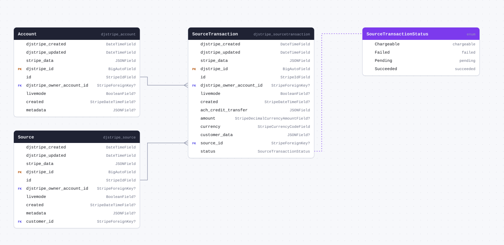

| Column | Field | Type | Null | Key | Default | Description |
| --- | --- | --- | --- | --- | --- | --- |
| `djstripe_created` | `DateTimeField` | `datetime` |  |  | `now()` |  |
| `djstripe_updated` | `DateTimeField` | `datetime` |  |  | `now()` |  |
| `stripe_data` | `JSONField` | `text` |  |  | `dict()` |  |
| `djstripe_id` | `BigAutoField` | `integer` |  | PK | `autoincrement()` |  |
| `id` | `StripeIdField` | `varchar(255)` |  | unique |  |  |
| `djstripe_owner_account_id` | `StripeForeignKey` | `varchar(255)` | yes | FK |  | The Stripe Account this object belongs to. |
| `livemode` | `BooleanField` | `bool` | yes |  | `None` | Null here indicates that the livemode status is unknown or was previously unrecorded. Otherwise, this field indicates whether this record comes from Stripe test mode or live mode operation. |
| `created` | `StripeDateTimeField` | `datetime` | yes |  |  | The datetime this object was created in stripe. |
| `ach_credit_transfer` | `JSONField` | `text` |  |  |  | The data corresponding to the ach_credit_transfer type. |
| `amount` | `StripeDecimalCurrencyAmountField(14, 2)` | `decimal` | yes |  |  | Amount (as decimal) associated with the ACH Credit Transfer. This is the amount your customer has sent for which the source will be chargeable once ready. |
| `currency` | `StripeCurrencyCodeField` | `varchar(3)` |  |  |  | Three-letter ISO currency code |
| `customer_data` | `JSONField` | `text` | yes |  |  | Customer defined string used to initiate the ACH Credit Transfer. |
| `source_id` | `StripeForeignKey` | `varchar(255)` | yes | FK |  |  |
| `status` | `SourceTransactionStatus` | `varchar(255)` |  |  |  | The status of the ACH Credit Transfer. Only `chargeable` sources can be used to create a charge. |

Indexes:

- index `djstripe_sourcetransaction_djstripe_owner_account_id_a8c9bdee` on `djstripe_owner_account_id`
- index `djstripe_sourcetransaction_source_id_3c972638` on `source_id`

Relations:

- `djstripe_owner_account_id` → [Account](#account).`id`, on delete cascade
- `source_id` → [Source](#source).`id`, on delete set null

## PaymentMethod

Table `djstripe_paymentmethod`, app `djstripe`.

Columns from `StripeModel` (abstract): `djstripe_id`, `id`, `djstripe_owner_account_id`, `livemode`, `created`, `metadata`.

Columns from `StripeBaseModel` (abstract): `djstripe_created`, `djstripe_updated`, `stripe_data`.

PaymentMethod objects represent your customer's payment instruments.
You can use them with PaymentIntents to collect payments or save them
to Customer objects to store instrument details for future payments.

Stripe documentation: https://stripe.com/docs/api?lang=python#payment_methods

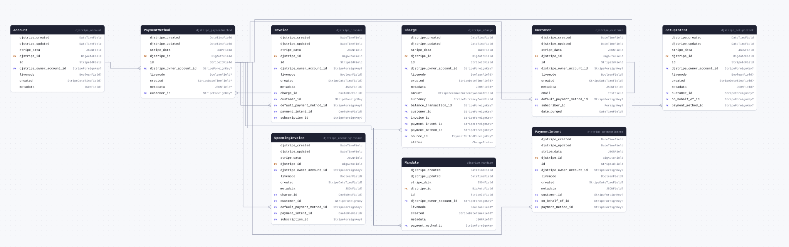

| Column | Field | Type | Null | Key | Default | Description |
| --- | --- | --- | --- | --- | --- | --- |
| `djstripe_created` | `DateTimeField` | `datetime` |  |  | `now()` |  |
| `djstripe_updated` | `DateTimeField` | `datetime` |  |  | `now()` |  |
| `stripe_data` | `JSONField` | `text` |  |  | `dict()` |  |
| `djstripe_id` | `BigAutoField` | `integer` |  | PK | `autoincrement()` |  |
| `id` | `StripeIdField` | `varchar(255)` |  | unique |  |  |
| `djstripe_owner_account_id` | `StripeForeignKey` | `varchar(255)` | yes | FK |  | The Stripe Account this object belongs to. |
| `livemode` | `BooleanField` | `bool` | yes |  | `None` | Null here indicates that the livemode status is unknown or was previously unrecorded. Otherwise, this field indicates whether this record comes from Stripe test mode or live mode operation. |
| `created` | `StripeDateTimeField` | `datetime` | yes |  |  | The datetime this object was created in stripe. |
| `metadata` | `JSONField` | `text` | yes |  |  | A set of key/value pairs that you can attach to an object. It can be useful for storing additional information about an object in a structured format. |
| `customer_id` | `StripeForeignKey` | `varchar(255)` | yes | FK |  | Customer to which this PaymentMethod is saved. This will not be set when the PaymentMethod has not been saved to a Customer. |

Indexes:

- index `djstripe_paymentmethod_djstripe_owner_account_id_12af66c9` on `djstripe_owner_account_id`
- index `djstripe_paymentmethod_customer_id_c482a8b6` on `customer_id`

Relations:

- [Invoice](#invoice).`default_payment_method_id` → `id`, on delete set null
- [UpcomingInvoice](#upcominginvoice).`default_payment_method_id` → `id`, on delete set null
- [Charge](#charge).`payment_method_id` → `id`, on delete set null
- [Mandate](#mandate).`payment_method_id` → `id`, on delete cascade
- [Customer](#customer).`default_payment_method_id` → `id`, on delete set null
- [PaymentIntent](#paymentintent).`payment_method_id` → `id`, on delete set null
- [SetupIntent](#setupintent).`payment_method_id` → `id`, on delete set null
- `djstripe_owner_account_id` → [Account](#account).`id`, on delete cascade
- `customer_id` → [Customer](#customer).`id`, on delete set null

## EarlyFraudWarning

Table `djstripe_earlyfraudwarning`, app `djstripe`.

Columns from `StripeModel` (abstract): `djstripe_id`, `id`, `djstripe_owner_account_id`, `livemode`, `created`, `metadata`.

Columns from `StripeBaseModel` (abstract): `djstripe_created`, `djstripe_updated`, `stripe_data`.

An early fraud warning indicates that the card issuer has notified us that a charge may be fraudulent.

Stripe documentation: https://docs.stripe.com/api/radar/early_fraud_warnings?lang=python


| Column | Field | Type | Null | Key | Default | Description |
| --- | --- | --- | --- | --- | --- | --- |
| `djstripe_created` | `DateTimeField` | `datetime` |  |  | `now()` |  |
| `djstripe_updated` | `DateTimeField` | `datetime` |  |  | `now()` |  |
| `stripe_data` | `JSONField` | `text` |  |  | `dict()` |  |
| `djstripe_id` | `BigAutoField` | `integer` |  | PK | `autoincrement()` |  |
| `id` | `StripeIdField` | `varchar(255)` |  | unique |  |  |
| `djstripe_owner_account_id` | `StripeForeignKey` | `varchar(255)` | yes | FK |  | The Stripe Account this object belongs to. |
| `livemode` | `BooleanField` | `bool` | yes |  | `None` | Null here indicates that the livemode status is unknown or was previously unrecorded. Otherwise, this field indicates whether this record comes from Stripe test mode or live mode operation. |
| `created` | `StripeDateTimeField` | `datetime` | yes |  |  | The datetime this object was created in stripe. |
| `metadata` | `JSONField` | `text` | yes |  |  | A set of key/value pairs that you can attach to an object. It can be useful for storing additional information about an object in a structured format. |

Indexes:

- index `djstripe_earlyfraudwarning_djstripe_owner_account_id_83708c78` on `djstripe_owner_account_id`

Relations:

- `djstripe_owner_account_id` → [Account](#account).`id`, on delete cascade

## Review

Table `djstripe_review`, app `djstripe`.

Columns from `StripeModel` (abstract): `djstripe_id`, `id`, `djstripe_owner_account_id`, `livemode`, `created`, `metadata`.

Columns from `StripeBaseModel` (abstract): `djstripe_created`, `djstripe_updated`, `stripe_data`.

Reviews can be used to supplement automated fraud detection with human expertise.
Learn more about Radar and reviewing payments here
https://docs.stripe.com/radar/reviews.

Stripe documentation: https://docs.stripe.com/api/radar/reviews?lang=python


| Column | Field | Type | Null | Key | Default | Description |
| --- | --- | --- | --- | --- | --- | --- |
| `djstripe_created` | `DateTimeField` | `datetime` |  |  | `now()` |  |
| `djstripe_updated` | `DateTimeField` | `datetime` |  |  | `now()` |  |
| `stripe_data` | `JSONField` | `text` |  |  | `dict()` |  |
| `djstripe_id` | `BigAutoField` | `integer` |  | PK | `autoincrement()` |  |
| `id` | `StripeIdField` | `varchar(255)` |  | unique |  |  |
| `djstripe_owner_account_id` | `StripeForeignKey` | `varchar(255)` | yes | FK |  | The Stripe Account this object belongs to. |
| `livemode` | `BooleanField` | `bool` | yes |  | `None` | Null here indicates that the livemode status is unknown or was previously unrecorded. Otherwise, this field indicates whether this record comes from Stripe test mode or live mode operation. |
| `created` | `StripeDateTimeField` | `datetime` | yes |  |  | The datetime this object was created in stripe. |
| `metadata` | `JSONField` | `text` | yes |  |  | A set of key/value pairs that you can attach to an object. It can be useful for storing additional information about an object in a structured format. |

Indexes:

- index `djstripe_review_djstripe_owner_account_id_543dfbd7` on `djstripe_owner_account_id`

Relations:

- `djstripe_owner_account_id` → [Account](#account).`id`, on delete cascade

## ScheduledQueryRun

Table `djstripe_scheduledqueryrun`, app `djstripe`.

Columns from `StripeModel` (abstract): `djstripe_id`, `id`, `djstripe_owner_account_id`, `livemode`, `created`, `metadata`.

Columns from `StripeBaseModel` (abstract): `djstripe_created`, `djstripe_updated`, `stripe_data`.

Stripe documentation: https://stripe.com/docs/api?lang=python#scheduled_queries


| Column | Field | Type | Null | Key | Default | Description |
| --- | --- | --- | --- | --- | --- | --- |
| `djstripe_created` | `DateTimeField` | `datetime` |  |  | `now()` |  |
| `djstripe_updated` | `DateTimeField` | `datetime` |  |  | `now()` |  |
| `stripe_data` | `JSONField` | `text` |  |  | `dict()` |  |
| `djstripe_id` | `BigAutoField` | `integer` |  | PK | `autoincrement()` |  |
| `id` | `StripeIdField` | `varchar(255)` |  | unique |  |  |
| `djstripe_owner_account_id` | `StripeForeignKey` | `varchar(255)` | yes | FK |  | The Stripe Account this object belongs to. |
| `livemode` | `BooleanField` | `bool` | yes |  | `None` | Null here indicates that the livemode status is unknown or was previously unrecorded. Otherwise, this field indicates whether this record comes from Stripe test mode or live mode operation. |
| `created` | `StripeDateTimeField` | `datetime` | yes |  |  | The datetime this object was created in stripe. |
| `metadata` | `JSONField` | `text` | yes |  |  | A set of key/value pairs that you can attach to an object. It can be useful for storing additional information about an object in a structured format. |
| `data_load_time` | `StripeDateTimeField` | `datetime` |  |  |  | When the query was run, Sigma contained a snapshot of your Stripe data at this time. |
| `error` | `JSONField` | `text` | yes |  |  | If the query run was not succeesful, contains information about the failure. |
| `file_id` | `StripeForeignKey` | `varchar(255)` | yes | FK |  | The file object representing the results of the query. |
| `result_available_until` | `StripeDateTimeField` | `datetime` |  |  |  | Time at which the result expires and is no longer available for download. |
| `sql` | `TextField` | `text` |  |  |  | SQL for the query. |
| `status` | `ScheduledQueryRunStatus` | `varchar(255)` |  |  |  | The query's execution status. |
| `title` | `TextField` | `text` |  |  |  | Title of the query. |

Indexes:

- index `djstripe_scheduledqueryrun_djstripe_owner_account_id_b5cc7091` on `djstripe_owner_account_id`
- index `djstripe_scheduledqueryrun_file_id_707bbc03` on `file_id`

Relations:

- `djstripe_owner_account_id` → [Account](#account).`id`, on delete cascade
- `file_id` → [File](#file).`id`, on delete set null

## WebhookEndpoint

Table `djstripe_webhookendpoint`, app `djstripe`.

Columns from `StripeModel` (abstract): `djstripe_id`, `id`, `djstripe_owner_account_id`, `livemode`, `created`, `metadata`.

Columns from `StripeBaseModel` (abstract): `djstripe_created`, `djstripe_updated`, `stripe_data`.


| Column | Field | Type | Null | Key | Default | Description |
| --- | --- | --- | --- | --- | --- | --- |
| `djstripe_created` | `DateTimeField` | `datetime` |  |  | `now()` |  |
| `djstripe_updated` | `DateTimeField` | `datetime` |  |  | `now()` |  |
| `stripe_data` | `JSONField` | `text` |  |  | `dict()` |  |
| `djstripe_id` | `BigAutoField` | `integer` |  | PK | `autoincrement()` |  |
| `id` | `StripeIdField` | `varchar(255)` |  | unique |  |  |
| `djstripe_owner_account_id` | `StripeForeignKey` | `varchar(255)` | yes | FK |  | The Stripe Account this object belongs to. |
| `livemode` | `BooleanField` | `bool` | yes |  | `None` | Null here indicates that the livemode status is unknown or was previously unrecorded. Otherwise, this field indicates whether this record comes from Stripe test mode or live mode operation. |
| `created` | `StripeDateTimeField` | `datetime` | yes |  |  | The datetime this object was created in stripe. |
| `metadata` | `JSONField` | `text` | yes |  |  | A set of key/value pairs that you can attach to an object. It can be useful for storing additional information about an object in a structured format. |
| `api_version` | `CharField` | `varchar(64)` |  |  |  | The API version events are rendered as for this webhook endpoint. Defaults to the configured Stripe API Version. |
| `enabled_events` | `JSONField` | `text` |  |  |  | The list of events to enable for this endpoint. ['*'] indicates that all events are enabled, except those that require explicit selection. |
| `secret` | `CharField` | `varchar(256)` |  |  |  | The endpoint's secret, used to generate webhook signatures. |
| `status` | `WebhookEndpointStatus` | `varchar(255)` |  |  |  | The status of the webhook. It can be enabled or disabled. |
| `url` | `URLField` | `varchar(2048)` |  |  |  | The URL of the webhook endpoint. |
| `application` | `CharField` | `varchar(255)` |  |  |  | The ID of the associated Connect application. |
| `djstripe_uuid` | `UUIDField` | `char(32)` |  | unique | `uuid4()` | A UUID specific to dj-stripe generated for the endpoint |
| `djstripe_tolerance` | `PositiveSmallIntegerField` | `smallint unsigned` |  |  | `300` | Controls the milliseconds tolerance which wards against replay attacks. Leave this to its default value unless you know what you're doing. |
| `djstripe_validation_method` | `WebhookEndpointDjstripeValidationMethod` | `varchar(255)` |  |  | `'verify_signature'` | Controls the webhook validation method. |

Indexes:

- index `djstripe_webhookendpoint_djstripe_owner_account_id_f1ac5c9d` on `djstripe_owner_account_id`

Relations:

- `djstripe_owner_account_id` → [Account](#account).`id`, on delete cascade
- [WebhookEventTrigger](#webhookeventtrigger).`webhook_endpoint_id` → `id`, on delete set null

## WebhookEventTrigger

Table `djstripe_webhookeventtrigger`, app `djstripe`.

An instance of a request that reached the server endpoint for Stripe webhooks.

Webhook Events are initially **UNTRUSTED**, as it is possible for any web entity to
post any data to our webhook url. Data posted may be valid Stripe information,
garbage, or even malicious.
The 'valid' flag in this model monitors this.


| Column | Field | Type | Null | Key | Default | Description |
| --- | --- | --- | --- | --- | --- | --- |
| `id` | `BigAutoField` | `integer` |  | PK | `autoincrement()` |  |
| `remote_ip` | `GenericIPAddressField` | `char(39)` |  |  |  | IP address of the request client. |
| `headers` | `JSONField` | `text` |  |  |  |  |
| `body` | `TextField` | `text` |  |  |  |  |
| `valid` | `BooleanField` | `bool` |  |  | `False` | Whether or not the webhook event has passed validation |
| `processed` | `BooleanField` | `bool` |  |  | `False` | Whether or not the webhook event has been successfully processed |
| `exception` | `CharField` | `varchar(128)` |  |  |  |  |
| `traceback` | `TextField` | `text` |  |  |  | Traceback if an exception was thrown during processing |
| `event_id` | `StripeForeignKey` | `varchar(255)` | yes | FK |  | Event object contained in the (valid) Webhook |
| `djstripe_version` | `CharField` | `varchar(32)` |  |  | `_get_version()` | The version of dj-stripe when the webhook was received |
| `created` | `DateTimeField` | `datetime` |  |  | `now()` |  |
| `updated` | `DateTimeField` | `datetime` |  |  | `now()` |  |
| `stripe_trigger_account_id` | `StripeForeignKey` | `varchar(255)` | yes | FK |  | The Stripe Account this object belongs to. |
| `webhook_endpoint_id` | `StripeForeignKey` | `varchar(255)` | yes | FK |  | The endpoint this webhook was received on |

Indexes:

- index `djstripe_webhookeventtrigger_event_id_b2e08de6` on `event_id`
- index `djstripe_webhookeventtrigger_stripe_trigger_account_id_06d35fda` on `stripe_trigger_account_id`
- index `djstripe_webhookeventtrigger_webhook_endpoint_id_6e762b2f` on `webhook_endpoint_id`

Relations:

- `event_id` → [Event](#event).`id`, on delete set null
- `stripe_trigger_account_id` → [Account](#account).`id`, on delete cascade
- `webhook_endpoint_id` → [WebhookEndpoint](#webhookendpoint).`id`, on delete set null

# Enums

## LogEntryActionFlag

| Name | Stored as |
| --- | --- |
| `Addition` | `1` |
| `Change` | `2` |
| `Deletion` | `3` |

## APIKeyType

| Name | Stored as |
| --- | --- |
| `Publishable key` | `publishable` |
| `Restricted key` | `restricted` |
| `Secret key` | `secret` |

## SubscriptionScheduleEndBehavior

| Name | Stored as |
| --- | --- |
| `Cancel` | `cancel` |
| `Release` | `release` |

## SubscriptionScheduleStatus

| Name | Stored as |
| --- | --- |
| `Active` | `active` |
| `Canceled` | `canceled` |
| `Completed` | `completed` |
| `Not started` | `not_started` |
| `Released` | `released` |

## BalanceTransactionType

| Name | Stored as |
| --- | --- |
| `Adjustment` | `adjustment` |
| `Advance` | `advance` |
| `Advance funding` | `advance_funding` |
| `Anticipation loan repayment` | `anticipation_repayment` |
| `Application fee` | `application_fee` |
| `Application fee refund` | `application_fee_refund` |
| `Balance transfer (inbound)` | `balance_transfer_inbound` |
| `Balance transfer (outbound)` | `balance_transfer_outbound` |
| `Charge` | `charge` |
| `Connect collection transfer` | `connect_collection_transfer` |
| `Charitable contribution` | `contribution` |
| `Issuing authorization hold` | `issuing_authorization_hold` |
| `Issuing authorization release` | `issuing_authorization_release` |
| `Issuing dispute` | `issuing_dispute` |
| `Issuing transaction` | `issuing_transaction` |
| `Network cost` | `network_cost` |
| `Payment` | `payment` |
| `Payment failure refund` | `payment_failure_refund` |
| `Payment refund` | `payment_refund` |
| `Payout` | `payout` |
| `Payout cancellation` | `payout_cancel` |
| `Payout failure` | `payout_failure` |
| `Refund` | `refund` |
| `Refund failure` | `refund_failure` |
| `Reserve transaction` | `reserve_transaction` |
| `Reserved funds` | `reserved_funds` |
| `Stripe fee` | `stripe_fee` |
| `Stripe currency conversion fee` | `stripe_fx_fee` |
| `Tax fee` | `tax_fee` |
| `Topup` | `topup` |
| `Topup reversal` | `topup_reversal` |
| `Transfer` | `transfer` |
| `Transfer cancel` | `transfer_cancel` |
| `Transfer failure` | `transfer_failure` |
| `Transfer refund` | `transfer_refund` |
| `Validation` | `validation` |

## ChargeStatus

| Name | Stored as |
| --- | --- |
| `Failed` | `failed` |
| `Pending` | `pending` |
| `Succeeded` | `succeeded` |

## VerificationSessionStatus

| Name | Stored as |
| --- | --- |
| `Canceled` | `canceled` |
| `Processing` | `processing` |
| `Requires input` | `requires_input` |
| `Verified` | `verified` |

## VerificationSessionType

| Name | Stored as |
| --- | --- |
| `Document` | `document` |
| `ID number` | `id_number` |

## VerificationReportType

| Name | Stored as |
| --- | --- |
| `Document` | `document` |
| `ID number` | `id_number` |

## SourceTransactionStatus

| Name | Stored as |
| --- | --- |
| `Chargeable` | `chargeable` |
| `Failed` | `failed` |
| `Pending` | `pending` |
| `Succeeded` | `succeeded` |

## ScheduledQueryRunStatus

| Name | Stored as |
| --- | --- |
| `Canceled` | `canceled` |
| `Failed` | `failed` |
| `Timed out` | `timed_out` |

## WebhookEndpointStatus

| Name | Stored as |
| --- | --- |
| `disabled` | `disabled` |
| `enabled` | `enabled` |

## WebhookEndpointDjstripeValidationMethod

| Name | Stored as |
| --- | --- |
| `None (NOT RECOMMENDED)` | `none` |
| `Retrieve Event` | `retrieve_event` |
| `Verify Signature` | `verify_signature` |
