# Schema docs

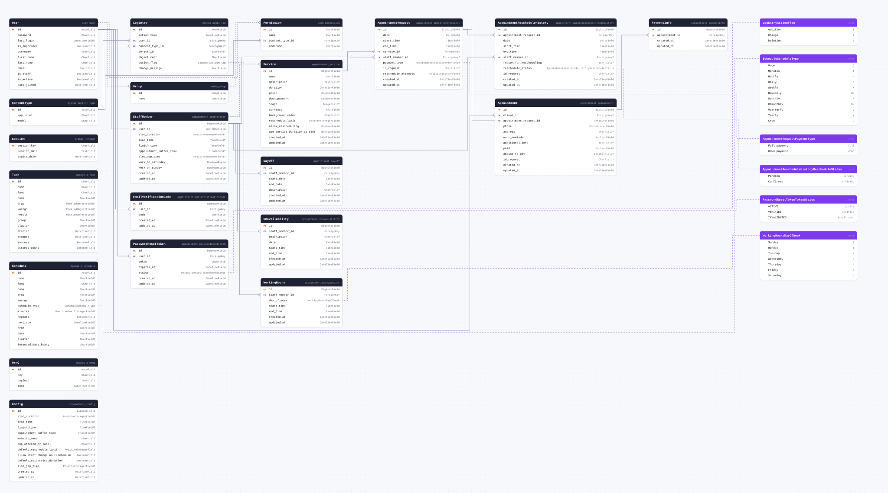

[LogEntry](#logentry) · [Permission](#permission) · [Group](#group) · [User](#user) · [ContentType](#contenttype) · [Session](#session) · [Task](#task) · [Schedule](#schedule) · [OrmQ](#ormq) · [Service](#service) · [StaffMember](#staffmember) · [AppointmentRequest](#appointmentrequest) · [AppointmentRescheduleHistory](#appointmentreschedulehistory) · [Appointment](#appointment) · [Config](#config) · [PaymentInfo](#paymentinfo) · [EmailVerificationCode](#emailverificationcode) · [PasswordResetToken](#passwordresettoken) · [DayOff](#dayoff) · [Unavailability](#unavailability) · [WorkingHours](#workinghours)

<details>
<summary>The whole schema as SQL</summary>

```sql
CREATE TABLE "django_admin_log" ("id" integer NOT NULL PRIMARY KEY AUTOINCREMENT, "action_time" datetime NOT NULL, "user_id" integer NOT NULL REFERENCES "auth_user" ("id") DEFERRABLE INITIALLY DEFERRED, "content_type_id" integer NULL REFERENCES "django_content_type" ("id") DEFERRABLE INITIALLY DEFERRED, "object_id" text NULL, "object_repr" varchar(200) NOT NULL, "action_flag" smallint unsigned NOT NULL CHECK ("action_flag" >= 0), "change_message" text NOT NULL);

CREATE TABLE "auth_permission" ("id" integer NOT NULL PRIMARY KEY AUTOINCREMENT, "name" varchar(255) NOT NULL, "content_type_id" integer NOT NULL REFERENCES "django_content_type" ("id") DEFERRABLE INITIALLY DEFERRED, "codename" varchar(100) NOT NULL);

CREATE TABLE "auth_group" ("id" integer NOT NULL PRIMARY KEY AUTOINCREMENT, "name" varchar(150) NOT NULL UNIQUE);

CREATE TABLE "auth_group_permissions" ("id" integer NOT NULL PRIMARY KEY AUTOINCREMENT, "group_id" integer NOT NULL REFERENCES "auth_group" ("id") DEFERRABLE INITIALLY DEFERRED, "permission_id" integer NOT NULL REFERENCES "auth_permission" ("id") DEFERRABLE INITIALLY DEFERRED);

CREATE TABLE "auth_user" ("id" integer NOT NULL PRIMARY KEY AUTOINCREMENT, "password" varchar(128) NOT NULL, "last_login" datetime NULL, "is_superuser" bool NOT NULL, "username" varchar(150) NOT NULL UNIQUE, "first_name" varchar(150) NOT NULL, "last_name" varchar(150) NOT NULL, "email" varchar(254) NOT NULL, "is_staff" bool NOT NULL, "is_active" bool NOT NULL, "date_joined" datetime NOT NULL);

CREATE TABLE "auth_user_groups" ("id" integer NOT NULL PRIMARY KEY AUTOINCREMENT, "user_id" integer NOT NULL REFERENCES "auth_user" ("id") DEFERRABLE INITIALLY DEFERRED, "group_id" integer NOT NULL REFERENCES "auth_group" ("id") DEFERRABLE INITIALLY DEFERRED);

CREATE TABLE "auth_user_user_permissions" ("id" integer NOT NULL PRIMARY KEY AUTOINCREMENT, "user_id" integer NOT NULL REFERENCES "auth_user" ("id") DEFERRABLE INITIALLY DEFERRED, "permission_id" integer NOT NULL REFERENCES "auth_permission" ("id") DEFERRABLE INITIALLY DEFERRED);

CREATE TABLE "django_content_type" ("id" integer NOT NULL PRIMARY KEY AUTOINCREMENT, "app_label" varchar(100) NOT NULL, "model" varchar(100) NOT NULL);

CREATE TABLE "django_session" ("session_key" varchar(40) NOT NULL PRIMARY KEY, "session_data" text NOT NULL, "expire_date" datetime NOT NULL);

CREATE TABLE "django_q_task" ("id" varchar(32) NOT NULL PRIMARY KEY, "name" varchar(100) NOT NULL, "func" varchar(256) NOT NULL, "hook" varchar(256) NULL, "args" text NULL, "kwargs" text NULL, "result" text NULL, "group" varchar(100) NULL, "cluster" varchar(100) NULL, "started" datetime NOT NULL, "stopped" datetime NOT NULL, "success" bool NOT NULL, "attempt_count" integer NOT NULL);

CREATE TABLE "django_q_schedule" ("id" integer NOT NULL PRIMARY KEY AUTOINCREMENT, "name" varchar(100) NULL, "func" varchar(256) NOT NULL, "hook" varchar(256) NULL, "args" text NULL, "kwargs" text NULL, "schedule_type" varchar(2) NOT NULL, "minutes" smallint unsigned NULL CHECK ("minutes" >= 0), "repeats" integer NOT NULL, "next_run" datetime NULL, "cron" varchar(100) NULL, "task" varchar(100) NULL, "cluster" varchar(100) NULL, "intended_date_kwarg" varchar(100) NULL);

CREATE TABLE "django_q_ormq" ("id" integer NOT NULL PRIMARY KEY AUTOINCREMENT, "key" varchar(100) NOT NULL, "payload" text NOT NULL, "lock" datetime NULL);

CREATE TABLE "appointment_service" ("id" integer NOT NULL PRIMARY KEY AUTOINCREMENT, "name" varchar(100) NOT NULL, "description" text NULL, "duration" bigint NOT NULL, "price" decimal NOT NULL, "down_payment" decimal NOT NULL, "image" varchar(100) NULL, "currency" varchar(3) NOT NULL, "background_color" varchar(50) NULL, "reschedule_limit" integer unsigned NOT NULL CHECK ("reschedule_limit" >= 0), "allow_rescheduling" bool NOT NULL, "use_service_duration_as_slot" bool NOT NULL, "created_at" datetime NOT NULL, "updated_at" datetime NOT NULL);

CREATE TABLE "appointment_staffmember" ("id" integer NOT NULL PRIMARY KEY AUTOINCREMENT, "user_id" integer NOT NULL UNIQUE REFERENCES "auth_user" ("id") DEFERRABLE INITIALLY DEFERRED, "slot_duration" integer unsigned NULL CHECK ("slot_duration" >= 0), "lead_time" time NULL, "finish_time" time NULL, "appointment_buffer_time" real NULL, "slot_gap_time" integer unsigned NULL CHECK ("slot_gap_time" >= 0), "work_on_saturday" bool NOT NULL, "work_on_sunday" bool NOT NULL, "created_at" datetime NOT NULL, "updated_at" datetime NOT NULL);

CREATE TABLE "appointment_staffmember_services_offered" ("id" integer NOT NULL PRIMARY KEY AUTOINCREMENT, "staffmember_id" bigint NOT NULL REFERENCES "appointment_staffmember" ("id") DEFERRABLE INITIALLY DEFERRED, "service_id" bigint NOT NULL REFERENCES "appointment_service" ("id") DEFERRABLE INITIALLY DEFERRED);

CREATE TABLE "appointment_appointmentrequest" ("id" integer NOT NULL PRIMARY KEY AUTOINCREMENT, "date" date NOT NULL, "start_time" time NOT NULL, "end_time" time NOT NULL, "service_id" bigint NOT NULL REFERENCES "appointment_service" ("id") DEFERRABLE INITIALLY DEFERRED, "staff_member_id" bigint NULL REFERENCES "appointment_staffmember" ("id") DEFERRABLE INITIALLY DEFERRED, "payment_type" varchar(4) NOT NULL, "id_request" varchar(100) NULL, "reschedule_attempts" integer unsigned NOT NULL CHECK ("reschedule_attempts" >= 0), "created_at" datetime NOT NULL, "updated_at" datetime NOT NULL);

CREATE TABLE "appointment_appointmentreschedulehistory" ("id" integer NOT NULL PRIMARY KEY AUTOINCREMENT, "appointment_request_id" bigint NOT NULL REFERENCES "appointment_appointmentrequest" ("id") DEFERRABLE INITIALLY DEFERRED, "date" date NOT NULL, "start_time" time NOT NULL, "end_time" time NOT NULL, "staff_member_id" bigint NULL REFERENCES "appointment_staffmember" ("id") DEFERRABLE INITIALLY DEFERRED, "reason_for_rescheduling" text NULL, "reschedule_status" varchar(10) NOT NULL, "id_request" varchar(100) NULL, "created_at" datetime NOT NULL, "updated_at" datetime NOT NULL);

CREATE TABLE "appointment_appointment" ("id" integer NOT NULL PRIMARY KEY AUTOINCREMENT, "client_id" integer NULL REFERENCES "auth_user" ("id") DEFERRABLE INITIALLY DEFERRED, "appointment_request_id" bigint NOT NULL UNIQUE REFERENCES "appointment_appointmentrequest" ("id") DEFERRABLE INITIALLY DEFERRED, "phone" varchar(128) NOT NULL, "address" varchar(255) NULL, "want_reminder" bool NOT NULL, "additional_info" text NULL, "paid" bool NOT NULL, "amount_to_pay" decimal NULL, "id_request" varchar(100) NULL, "created_at" datetime NOT NULL, "updated_at" datetime NOT NULL, CONSTRAINT "positive_amount_to_pay" CHECK ("amount_to_pay" >= '0'));

CREATE TABLE "appointment_config" ("id" integer NOT NULL PRIMARY KEY AUTOINCREMENT, "slot_duration" integer unsigned NULL CHECK ("slot_duration" >= 0), "lead_time" time NULL, "finish_time" time NULL, "appointment_buffer_time" real NULL, "website_name" varchar(255) NOT NULL, "app_offered_by_label" varchar(255) NOT NULL, "default_reschedule_limit" integer unsigned NOT NULL CHECK ("default_reschedule_limit" >= 0), "allow_staff_change_on_reschedule" bool NOT NULL, "default_to_service_duration" bool NOT NULL, "slot_gap_time" integer unsigned NULL CHECK ("slot_gap_time" >= 0), "created_at" datetime NOT NULL, "updated_at" datetime NOT NULL);

CREATE TABLE "appointment_paymentinfo" ("id" integer NOT NULL PRIMARY KEY AUTOINCREMENT, "appointment_id" bigint NOT NULL REFERENCES "appointment_appointment" ("id") DEFERRABLE INITIALLY DEFERRED, "created_at" datetime NOT NULL, "updated_at" datetime NOT NULL);

CREATE TABLE "appointment_emailverificationcode" ("id" integer NOT NULL PRIMARY KEY AUTOINCREMENT, "user_id" integer NULL REFERENCES "auth_user" ("id") DEFERRABLE INITIALLY DEFERRED, "code" varchar(6) NOT NULL, "email" varchar(254) NOT NULL, "attempts" smallint unsigned NOT NULL CHECK ("attempts" >= 0), "created_at" datetime NOT NULL, "updated_at" datetime NOT NULL);

CREATE TABLE "appointment_passwordresettoken" ("id" integer NOT NULL PRIMARY KEY AUTOINCREMENT, "user_id" integer NOT NULL REFERENCES "auth_user" ("id") DEFERRABLE INITIALLY DEFERRED, "token" char(32) NOT NULL UNIQUE, "expires_at" datetime NOT NULL, "status" varchar(11) NOT NULL, "created_at" datetime NOT NULL, "updated_at" datetime NOT NULL);

CREATE TABLE "appointment_dayoff" ("id" integer NOT NULL PRIMARY KEY AUTOINCREMENT, "staff_member_id" bigint NOT NULL REFERENCES "appointment_staffmember" ("id") DEFERRABLE INITIALLY DEFERRED, "start_date" date NOT NULL, "end_date" date NOT NULL, "description" varchar(255) NULL, "created_at" datetime NOT NULL, "updated_at" datetime NOT NULL);

CREATE TABLE "appointment_unavailability" ("id" integer NOT NULL PRIMARY KEY AUTOINCREMENT, "staff_member_id" bigint NOT NULL REFERENCES "appointment_staffmember" ("id") DEFERRABLE INITIALLY DEFERRED, "description" varchar(255) NULL, "date" date NOT NULL, "start_time" time NOT NULL, "end_time" time NOT NULL, "created_at" datetime NOT NULL, "updated_at" datetime NOT NULL, CONSTRAINT "unavailability_start_time_before_end_time" CHECK ("start_time" < ("end_time")));

CREATE TABLE "appointment_workinghours" ("id" integer NOT NULL PRIMARY KEY AUTOINCREMENT, "staff_member_id" bigint NOT NULL REFERENCES "appointment_staffmember" ("id") DEFERRABLE INITIALLY DEFERRED, "day_of_week" integer unsigned NOT NULL CHECK ("day_of_week" >= 0), "start_time" time NOT NULL, "end_time" time NOT NULL, "created_at" datetime NOT NULL, "updated_at" datetime NOT NULL, CONSTRAINT "working_hours_start_time_before_end_time" CHECK ("start_time" < ("end_time")));

CREATE INDEX "django_admin_log_user_id_c564eba6" ON "django_admin_log" ("user_id");

CREATE INDEX "django_admin_log_content_type_id_c4bce8eb" ON "django_admin_log" ("content_type_id");

CREATE UNIQUE INDEX "auth_permission_content_type_id_codename_01ab375a_uniq" ON "auth_permission" ("content_type_id", "codename");

CREATE INDEX "auth_permission_content_type_id_2f476e4b" ON "auth_permission" ("content_type_id");

CREATE UNIQUE INDEX "auth_group_permissions_group_id_permission_id_0cd325b0_uniq" ON "auth_group_permissions" ("group_id", "permission_id");

CREATE INDEX "auth_group_permissions_group_id_b120cbf9" ON "auth_group_permissions" ("group_id");

CREATE INDEX "auth_group_permissions_permission_id_84c5c92e" ON "auth_group_permissions" ("permission_id");

CREATE UNIQUE INDEX "auth_user_groups_user_id_group_id_94350c0c_uniq" ON "auth_user_groups" ("user_id", "group_id");

CREATE INDEX "auth_user_groups_user_id_6a12ed8b" ON "auth_user_groups" ("user_id");

CREATE INDEX "auth_user_groups_group_id_97559544" ON "auth_user_groups" ("group_id");

CREATE UNIQUE INDEX "auth_user_user_permissions_user_id_permission_id_14a6b632_uniq" ON "auth_user_user_permissions" ("user_id", "permission_id");

CREATE INDEX "auth_user_user_permissions_user_id_a95ead1b" ON "auth_user_user_permissions" ("user_id");

CREATE INDEX "auth_user_user_permissions_permission_id_1fbb5f2c" ON "auth_user_user_permissions" ("permission_id");

CREATE UNIQUE INDEX "django_content_type_app_label_model_76bd3d3b_uniq" ON "django_content_type" ("app_label", "model");

CREATE INDEX "django_session_expire_date_a5c62663" ON "django_session" ("expire_date");

CREATE INDEX "success_index" ON "django_q_task" ("group", "name", "func") WHERE "success" = 1;

CREATE INDEX "appointment_name_c25ec8_idx" ON "appointment_service" ("name");

CREATE INDEX "appointment_price_0f5143_idx" ON "appointment_service" ("price");

CREATE UNIQUE INDEX "appointment_staffmember_services_offered_staffmember_id_service_id_f101118c_uniq" ON "appointment_staffmember_services_offered" ("staffmember_id", "service_id");

CREATE INDEX "appointment_staffmember_services_offered_staffmember_id_a871c65b" ON "appointment_staffmember_services_offered" ("staffmember_id");

CREATE INDEX "appointment_staffmember_services_offered_service_id_ce2c8c07" ON "appointment_staffmember_services_offered" ("service_id");

CREATE INDEX "appointment_appointmentrequest_service_id_776d762d" ON "appointment_appointmentrequest" ("service_id");

CREATE INDEX "appointment_appointmentrequest_staff_member_id_c6000f09" ON "appointment_appointmentrequest" ("staff_member_id");

CREATE INDEX "appointment_date_eff862_idx" ON "appointment_appointmentrequest" ("date", "start_time");

CREATE INDEX "appointment_staff_m_13c670_idx" ON "appointment_appointmentrequest" ("staff_member_id", "date");

CREATE INDEX "appointment_appointmentreschedulehistory_appointment_request_id_1e3c5054" ON "appointment_appointmentreschedulehistory" ("appointment_request_id");

CREATE INDEX "appointment_appointmentreschedulehistory_staff_member_id_32ce3411" ON "appointment_appointmentreschedulehistory" ("staff_member_id");

CREATE INDEX "appointment_appointment_client_id_9829a0eb" ON "appointment_appointment" ("client_id");

CREATE INDEX "appointment_client__b0d651_idx" ON "appointment_appointment" ("client_id", "created_at" DESC);

CREATE INDEX "appointment_paymentinfo_appointment_id_a0eb36ed" ON "appointment_paymentinfo" ("appointment_id");

CREATE INDEX "appointment_emailverificationcode_user_id_a2b675c9" ON "appointment_emailverificationcode" ("user_id");

CREATE INDEX "appointment_passwordresettoken_user_id_38b97e5a" ON "appointment_passwordresettoken" ("user_id");

CREATE INDEX "appointment_dayoff_staff_member_id_f0c08dcf" ON "appointment_dayoff" ("staff_member_id");

CREATE INDEX "appointment_unavailability_staff_member_id_17b40658" ON "appointment_unavailability" ("staff_member_id");

CREATE UNIQUE INDEX "appointment_workinghours_staff_member_id_day_of_week_d1d65265_uniq" ON "appointment_workinghours" ("staff_member_id", "day_of_week");

CREATE INDEX "appointment_workinghours_staff_member_id_8e0c8746" ON "appointment_workinghours" ("staff_member_id");
```

</details>

## LogEntry

Table `django_admin_log`, app `admin`.


| Column | Field | Type | Null | Key | Default | Description |
| --- | --- | --- | --- | --- | --- | --- |
| `id` | `AutoField` | `integer` |  | PK | `autoincrement()` |  |
| `action_time` | `DateTimeField` | `datetime` |  |  | `now()` |  |
| `user_id` | `ForeignKey` | `integer` |  | FK |  |  |
| `content_type_id` | `ForeignKey` | `integer` | yes | FK |  |  |
| `object_id` | `TextField` | `text` | yes |  |  |  |
| `object_repr` | `CharField` | `varchar(200)` |  |  |  |  |
| `action_flag` | `LogEntryActionFlag` | `smallint unsigned` |  |  |  |  |
| `change_message` | `TextField` | `text` |  |  |  |  |

Indexes:

- index `django_admin_log_user_id_c564eba6` on `user_id`
- index `django_admin_log_content_type_id_c4bce8eb` on `content_type_id`

Relations:

- `user_id` → [User](#user).`id`, on delete cascade
- `content_type_id` → [ContentType](#contenttype).`id`, on delete set null

## Permission

Table `auth_permission`, app `auth`.

The permissions system provides a way to assign permissions to specific
users and groups of users.

The permission system is used by the Django admin site, but may also be
useful in your own code. The Django admin site uses permissions as follows:

    - The "add" permission limits the user's ability to view the "add" form
      and add an object.
    - The "change" permission limits a user's ability to view the change
      list, view the "change" form and change an object.
    - The "delete" permission limits the ability to delete an object.
    - The "view" permission limits the ability to view an object.

Permissions are set globally per type of object, not per specific object
instance. It is possible to say "Mary may change news stories," but it's
not currently possible to say "Mary may change news stories, but only the
ones she created herself" or "Mary may only change news stories that have a
certain status or publication date."

The permissions listed above are automatically created for each model.

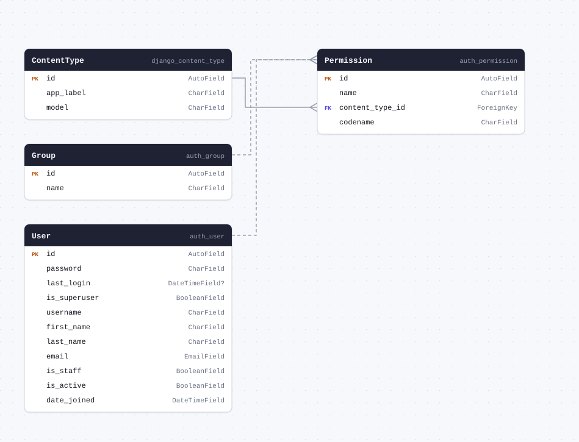

| Column | Field | Type | Null | Key | Default | Description |
| --- | --- | --- | --- | --- | --- | --- |
| `id` | `AutoField` | `integer` |  | PK | `autoincrement()` |  |
| `name` | `CharField` | `varchar(255)` |  |  |  |  |
| `content_type_id` | `ForeignKey` | `integer` |  | FK |  |  |
| `codename` | `CharField` | `varchar(100)` |  |  |  |  |

Indexes:

- index `auth_permission_content_type_id_2f476e4b` on `content_type_id`
- unique `auth_permission_content_type_id_codename_01ab375a_uniq` on `content_type_id`, `codename`

Relations:

- `content_type_id` → [ContentType](#contenttype).`id`, on delete cascade
- `group_set` — many to many with [Group](#group)
- `user_set` — many to many with [User](#user)

## Group

Table `auth_group`, app `auth`.

Groups are a generic way of categorizing users to apply permissions, or
some other label, to those users. A user can belong to any number of
groups.

A user in a group automatically has all the permissions granted to that
group. For example, if the group 'Site editors' has the permission
can_edit_home_page, any user in that group will have that permission.

Beyond permissions, groups are a convenient way to categorize users to
apply some label, or extended functionality, to them. For example, you
could create a group 'Special users', and you could write code that would
do special things to those users -- such as giving them access to a
members-only portion of your site, or sending them members-only email
messages.


| Column | Field | Type | Null | Key | Default | Description |
| --- | --- | --- | --- | --- | --- | --- |
| `id` | `AutoField` | `integer` |  | PK | `autoincrement()` |  |
| `name` | `CharField` | `varchar(150)` |  | unique |  |  |

Relations:

- `permissions` — many to many with [Permission](#permission)
- `user_set` — many to many with [User](#user)

## User

Table `auth_user`, app `auth`.

Columns from `AbstractUser` (abstract): `username`, `first_name`, `last_name`, `email`, `is_staff`, `is_active`, `date_joined`.

Columns from `AbstractBaseUser` (abstract): `password`, `last_login`.

Columns from `PermissionsMixin` (abstract): `is_superuser`.

Users within the Django authentication system are represented by this
model.

Username and password are required. Other fields are optional.

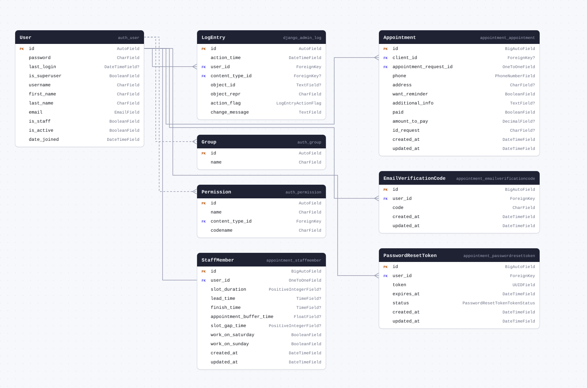

| Column | Field | Type | Null | Key | Default | Description |
| --- | --- | --- | --- | --- | --- | --- |
| `id` | `AutoField` | `integer` |  | PK | `autoincrement()` |  |
| `password` | `CharField` | `varchar(128)` |  |  |  |  |
| `last_login` | `DateTimeField` | `datetime` | yes |  |  |  |
| `is_superuser` | `BooleanField` | `bool` |  |  | `False` | Designates that this user has all permissions without explicitly assigning them. |
| `username` | `CharField` | `varchar(150)` |  | unique |  | Required. 150 characters or fewer. Letters, digits and @/./+/-/_ only. |
| `first_name` | `CharField` | `varchar(150)` |  |  |  |  |
| `last_name` | `CharField` | `varchar(150)` |  |  |  |  |
| `email` | `EmailField` | `varchar(254)` |  |  |  |  |
| `is_staff` | `BooleanField` | `bool` |  |  | `False` | Designates whether the user can log into this admin site. |
| `is_active` | `BooleanField` | `bool` |  |  | `True` | Designates whether this user should be treated as active. Unselect this instead of deleting accounts. |
| `date_joined` | `DateTimeField` | `datetime` |  |  | `now()` |  |

Relations:

- [LogEntry](#logentry).`user_id` → `id`, on delete cascade
- `groups` — many to many with [Group](#group)
- `user_permissions` — many to many with [Permission](#permission)
- [StaffMember](#staffmember).`user_id` → `id`, on delete cascade
- [Appointment](#appointment).`client_id` → `id`, on delete set null
- [EmailVerificationCode](#emailverificationcode).`user_id` → `id`, on delete cascade
- [PasswordResetToken](#passwordresettoken).`user_id` → `id`, on delete cascade

## ContentType

Table `django_content_type`, app `contenttypes`.


| Column | Field | Type | Null | Key | Default | Description |
| --- | --- | --- | --- | --- | --- | --- |
| `id` | `AutoField` | `integer` |  | PK | `autoincrement()` |  |
| `app_label` | `CharField` | `varchar(100)` |  |  |  |  |
| `model` | `CharField` | `varchar(100)` |  |  |  |  |

Indexes:

- unique `django_content_type_app_label_model_76bd3d3b_uniq` on `app_label`, `model`

Relations:

- [LogEntry](#logentry).`content_type_id` → `id`, on delete set null
- [Permission](#permission).`content_type_id` → `id`, on delete cascade

## Session

Table `django_session`, app `sessions`.

Columns from `AbstractBaseSession` (abstract): `session_key`, `session_data`, `expire_date`.

Django provides full support for anonymous sessions. The session
framework lets you store and retrieve arbitrary data on a
per-site-visitor basis. It stores data on the server side and
abstracts the sending and receiving of cookies. Cookies contain a
session ID -- not the data itself.

The Django sessions framework is entirely cookie-based. It does
not fall back to putting session IDs in URLs. This is an intentional
design decision. Not only does that behavior make URLs ugly, it makes
your site vulnerable to session-ID theft via the "Referer" header.

For complete documentation on using Sessions in your code, consult
the sessions documentation that is shipped with Django (also available
on the Django web site).

| Column | Field | Type | Null | Key | Default | Description |
| --- | --- | --- | --- | --- | --- | --- |
| `session_key` | `CharField` | `varchar(40)` |  | PK |  |  |
| `session_data` | `TextField` | `text` |  |  |  |  |
| `expire_date` | `DateTimeField` | `datetime` |  |  |  |  |

Indexes:

- index `django_session_expire_date_a5c62663` on `expire_date`

## Task

Table `django_q_task`, app `django_q`.

Proxy models, on this table: `Success`, `Failure`.

| Column | Field | Type | Null | Key | Default | Description |
| --- | --- | --- | --- | --- | --- | --- |
| `id` | `CharField` | `varchar(32)` |  | PK |  | 32-character task identifier. |
| `name` | `CharField` | `varchar(100)` |  |  |  | Optional human-readable name for lookup and display. |
| `func` | `CharField` | `varchar(256)` |  |  |  | Dotted import path to the callable, e.g. myapp.tasks.job. |
| `hook` | `CharField` | `varchar(256)` | yes |  |  | Optional dotted path to a callback that receives the task result. |
| `args` | `PickledObjectField` | `text` | yes |  |  | Pickled positional arguments (tuple). |
| `kwargs` | `PickledObjectField` | `text` | yes |  |  | Pickled keyword arguments (dict). |
| `result` | `PickledObjectField` | `text` | yes |  |  | Pickled return value or error payload. |
| `group` | `CharField` | `varchar(100)` | yes |  |  | Optional group id to aggregate related tasks. |
| `cluster` | `CharField` | `varchar(100)` | yes |  | `None` | Name of the cluster that executed this task. |
| `started` | `DateTimeField` | `datetime` |  |  |  | When the worker started executing the task. |
| `stopped` | `DateTimeField` | `datetime` |  |  |  | When the worker finished (success or failure). |
| `success` | `BooleanField` | `bool` |  |  | `True` | False if the task raised an exception or timed out. |
| `attempt_count` | `IntegerField` | `integer` |  |  | `0` | How many times execution was attempted. |

Indexes:

- index `success_index` on `group`, `name`, `func` where `"success" = 1`

## Schedule

Table `django_q_schedule`, app `django_q`.

| Column | Field | Type | Null | Key | Default | Description |
| --- | --- | --- | --- | --- | --- | --- |
| `id` | `AutoField` | `integer` |  | PK | `autoincrement()` |  |
| `name` | `CharField` | `varchar(100)` | yes |  |  | Optional label to identify this schedule in the admin. |
| `func` | `CharField` | `varchar(256)` |  |  |  | e.g. module.tasks.function |
| `hook` | `CharField` | `varchar(256)` | yes |  |  | e.g. module.tasks.result_function |
| `args` | `TextField` | `text` | yes |  |  | e.g. 1, 2, 'John' |
| `kwargs` | `TextField` | `text` | yes |  |  | e.g. x=1, y=2, name='John' |
| `schedule_type` | `ScheduleScheduleType` | `varchar(2)` |  |  | `'O'` | How often this task should be enqueued. |
| `minutes` | `PositiveSmallIntegerField` | `smallint unsigned` | yes |  |  | Number of minutes for the Minutes type |
| `repeats` | `IntegerField` | `integer` |  |  | `-1` | n = n times, -1 = forever |
| `next_run` | `DateTimeField` | `datetime` | yes |  | `now()` | When this schedule runs next (stored in UTC). |
| `cron` | `CharField` | `varchar(100)` | yes |  |  | Cron expression |
| `task` | `CharField` | `varchar(100)` | yes |  |  | Id of the last task spawned from this schedule (read-only). |
| `cluster` | `CharField` | `varchar(100)` | yes |  | `None` | Name of the target cluster |
| `intended_date_kwarg` | `CharField` | `varchar(100)` | yes |  |  | Name of kwarg to pass intended schedule date |

## OrmQ

Table `django_q_ormq`, app `django_q`.

| Column | Field | Type | Null | Key | Default | Description |
| --- | --- | --- | --- | --- | --- | --- |
| `id` | `AutoField` | `integer` |  | PK | `autoincrement()` |  |
| `key` | `CharField` | `varchar(100)` |  |  |  | Name of the target cluster |
| `payload` | `TextField` | `text` |  |  |  | Signed serialized task package (do not edit manually). |
| `lock` | `DateTimeField` | `datetime` | yes |  |  | Prevent any cluster from pulling until |

## Service

Table `appointment_service`, app `appointment`.

Represents a service provided by the appointment system.

Author: Adams Pierre David
Version: 1.1.0
Since: 1.0.0

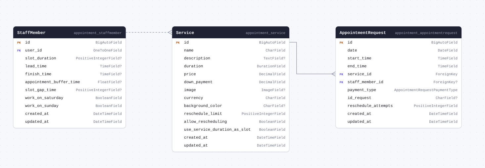

| Column | Field | Type | Null | Key | Default | Description |
| --- | --- | --- | --- | --- | --- | --- |
| `id` | `BigAutoField` | `integer` |  | PK | `autoincrement()` |  |
| `name` | `CharField` | `varchar(100)` |  |  |  |  |
| `description` | `TextField` | `text` | yes |  |  |  |
| `duration` | `DurationField` | `bigint` |  |  |  |  |
| `price` | `DecimalField(8, 2)` | `decimal` |  |  |  |  |
| `down_payment` | `DecimalField(6, 2)` | `decimal` |  |  | `0` |  |
| `image` | `ImageField` | `varchar(100)` | yes |  |  |  |
| `currency` | `CharField` | `varchar(3)` |  |  | `'USD'` |  |
| `background_color` | `CharField` | `varchar(50)` | yes |  | `generate_rgb_color()` |  |
| `reschedule_limit` | `PositiveIntegerField` | `integer unsigned` |  |  | `0` | Maximum number of times an appointment can be rescheduled. |
| `allow_rescheduling` | `BooleanField` | `bool` |  |  | `False` | Indicates whether appointments for this service can be rescheduled. |
| `use_service_duration_as_slot` | `BooleanField` | `bool` |  |  | `True` | If enabled, the service's actual duration is used when checking slot availability, preventing overlaps for services longer than the default slot duration. Only evaluated when 'Default to service duration' is disabled in Config. |
| `created_at` | `DateTimeField` | `datetime` |  |  | `now()` |  |
| `updated_at` | `DateTimeField` | `datetime` |  |  | `now()` |  |

Indexes:

- index `appointment_name_c25ec8_idx` on `name`
- index `appointment_price_0f5143_idx` on `price`

Relations:

- `staffmember_set` — many to many with [StaffMember](#staffmember)
- [AppointmentRequest](#appointmentrequest).`service_id` → `id`, on delete cascade

## StaffMember

Table `appointment_staffmember`, app `appointment`.

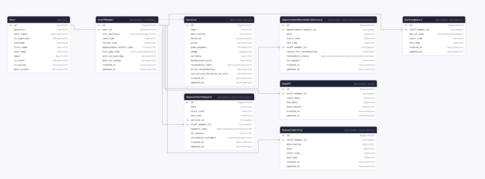

| Column | Field | Type | Null | Key | Default | Description |
| --- | --- | --- | --- | --- | --- | --- |
| `id` | `BigAutoField` | `integer` |  | PK | `autoincrement()` |  |
| `user_id` | `OneToOneField` | `integer` |  | FK, unique |  |  |
| `slot_duration` | `PositiveIntegerField` | `integer unsigned` | yes |  |  | Minimum time for an appointment in minutes, recommended 30. |
| `lead_time` | `TimeField` | `time` | yes |  |  | Time when the staff member starts working. |
| `finish_time` | `TimeField` | `time` | yes |  |  | Time when the staff member stops working. |
| `appointment_buffer_time` | `FloatField` | `real` | yes |  |  | Time between now and the first available slot for the current day (doesn't affect tomorrow). e.g: If you start working at 9:00 AM and the current time is 8:30 AM and you set it to 30 minutes, the first available slot will be at 9:00 AM. If you set the appointment buffer time to 60 minutes, the first available slot will be at 9:30 AM. |
| `slot_gap_time` | `PositiveIntegerField` | `integer unsigned` | yes |  |  | Required rest time in minutes between the end of one appointment and the start of the next. Overrides the global Config setting for this staff member. |
| `work_on_saturday` | `BooleanField` | `bool` |  |  | `False` | Indicates whether this staff member works on Saturdays. |
| `work_on_sunday` | `BooleanField` | `bool` |  |  | `False` | Indicates whether this staff member works on Sundays. |
| `created_at` | `DateTimeField` | `datetime` |  |  | `now()` |  |
| `updated_at` | `DateTimeField` | `datetime` |  |  | `now()` |  |

Relations:

- `user_id` → [User](#user).`id`, on delete cascade
- `services_offered` — many to many with [Service](#service)
- [AppointmentRequest](#appointmentrequest).`staff_member_id` → `id`, on delete set null
- [AppointmentRescheduleHistory](#appointmentreschedulehistory).`staff_member_id` → `id`, on delete set null
- [DayOff](#dayoff).`staff_member_id` → `id`, on delete cascade
- [Unavailability](#unavailability).`staff_member_id` → `id`, on delete cascade
- [WorkingHours](#workinghours).`staff_member_id` → `id`, on delete cascade

## AppointmentRequest

Table `appointment_appointmentrequest`, app `appointment`.

Represents an appointment request made by a client.

Author: Adams Pierre David
Since: 1.0.0

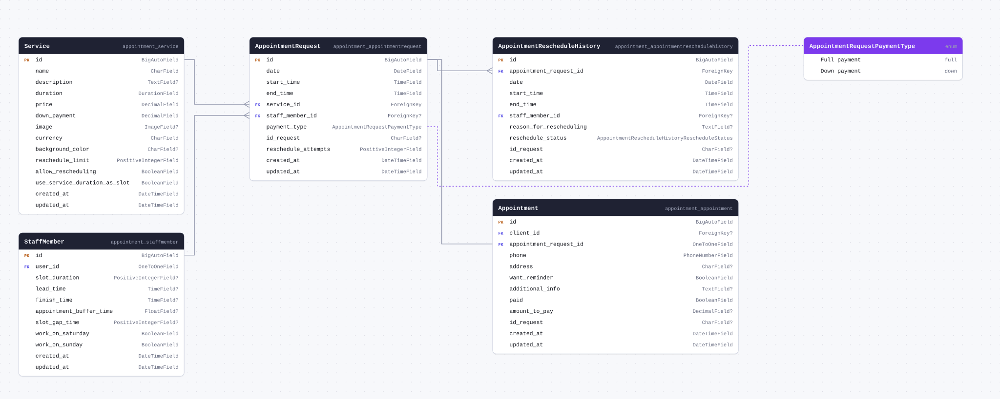

| Column | Field | Type | Null | Key | Default | Description |
| --- | --- | --- | --- | --- | --- | --- |
| `id` | `BigAutoField` | `integer` |  | PK | `autoincrement()` |  |
| `date` | `DateField` | `date` |  |  |  | The date of the appointment request. |
| `start_time` | `TimeField` | `time` |  |  |  | The start time of the appointment request. |
| `end_time` | `TimeField` | `time` |  |  |  | The end time of the appointment request. |
| `service_id` | `ForeignKey` | `bigint` |  | FK |  |  |
| `staff_member_id` | `ForeignKey` | `bigint` | yes | FK |  |  |
| `payment_type` | `AppointmentRequestPaymentType` | `varchar(4)` |  |  | `'full'` |  |
| `id_request` | `CharField` | `varchar(100)` | yes |  |  |  |
| `reschedule_attempts` | `PositiveIntegerField` | `integer unsigned` |  |  | `0` | Number of times this appointment has been rescheduled. |
| `created_at` | `DateTimeField` | `datetime` |  |  | `now()` |  |
| `updated_at` | `DateTimeField` | `datetime` |  |  | `now()` |  |

Indexes:

- index `appointment_appointmentrequest_service_id_776d762d` on `service_id`
- index `appointment_appointmentrequest_staff_member_id_c6000f09` on `staff_member_id`
- index `appointment_date_eff862_idx` on `date`, `start_time`
- index `appointment_staff_m_13c670_idx` on `staff_member_id`, `date`

Relations:

- `service_id` → [Service](#service).`id`, on delete cascade
- `staff_member_id` → [StaffMember](#staffmember).`id`, on delete set null
- [AppointmentRescheduleHistory](#appointmentreschedulehistory).`appointment_request_id` → `id`, on delete cascade
- [Appointment](#appointment).`appointment_request_id` → `id`, on delete cascade

## AppointmentRescheduleHistory

Table `appointment_appointmentreschedulehistory`, app `appointment`.

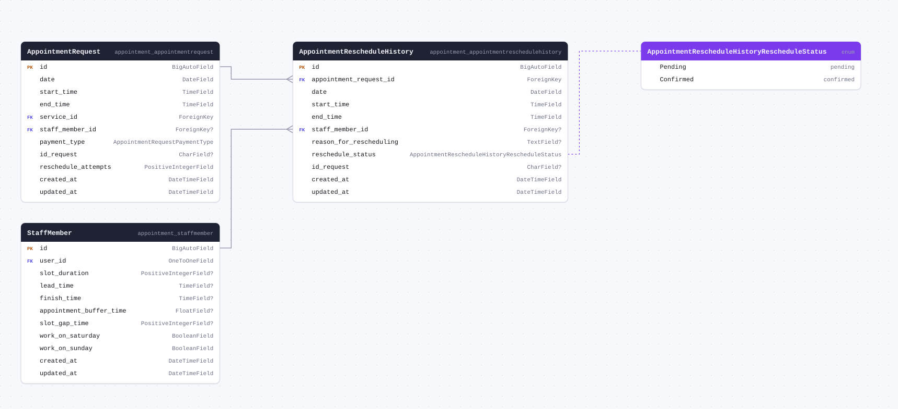

| Column | Field | Type | Null | Key | Default | Description |
| --- | --- | --- | --- | --- | --- | --- |
| `id` | `BigAutoField` | `integer` |  | PK | `autoincrement()` |  |
| `appointment_request_id` | `ForeignKey` | `bigint` |  | FK |  | The appointment request made by a client. |
| `date` | `DateField` | `date` |  |  |  | The previous date of the appointment before it was rescheduled. |
| `start_time` | `TimeField` | `time` |  |  |  | The previous start time of the appointment before it was rescheduled. |
| `end_time` | `TimeField` | `time` |  |  |  | The previous end time of the appointment before it was rescheduled. |
| `staff_member_id` | `ForeignKey` | `bigint` | yes | FK |  | The previous staff member of the appointment before it was rescheduled. |
| `reason_for_rescheduling` | `TextField` | `text` | yes |  |  | Reason for the appointment reschedule. |
| `reschedule_status` | `AppointmentRescheduleHistoryRescheduleStatus` | `varchar(10)` |  |  | `'pending'` | Indicates the status of the reschedule action. |
| `id_request` | `CharField` | `varchar(100)` | yes |  |  |  |
| `created_at` | `DateTimeField` | `datetime` |  |  | `now()` | The date and time the reschedule was recorded. |
| `updated_at` | `DateTimeField` | `datetime` |  |  | `now()` | The date and time the reschedule was confirmed. |

Indexes:

- index `appointment_appointmentreschedulehistory_appointment_request_id_1e3c5054` on `appointment_request_id`
- index `appointment_appointmentreschedulehistory_staff_member_id_32ce3411` on `staff_member_id`

Relations:

- `appointment_request_id` → [AppointmentRequest](#appointmentrequest).`id`, on delete cascade
- `staff_member_id` → [StaffMember](#staffmember).`id`, on delete set null

## Appointment

Table `appointment_appointment`, app `appointment`.

Represents an appointment made by a client. It is created when the client confirms the appointment request.

Author: Adams Pierre David
Version: 1.1.0
Since: 1.0.0

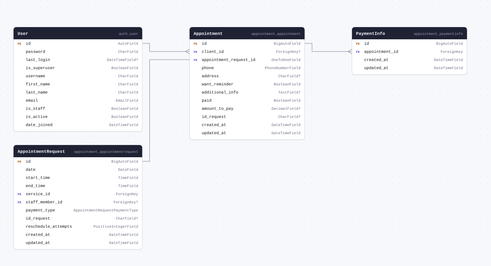

| Column | Field | Type | Null | Key | Default | Description |
| --- | --- | --- | --- | --- | --- | --- |
| `id` | `BigAutoField` | `integer` |  | PK | `autoincrement()` |  |
| `client_id` | `ForeignKey` | `integer` | yes | FK |  | The user who made the appointment request. |
| `appointment_request_id` | `OneToOneField` | `bigint` |  | FK, unique |  | The appointment request made by the client. |
| `phone` | `PhoneNumberField` | `varchar(128)` |  |  |  |  |
| `address` | `CharField` | `varchar(255)` | yes |  | `''` | Does not have to be specific, just the city and the state |
| `want_reminder` | `BooleanField` | `bool` |  |  | `False` | Indicates whether the client wants a reminder for the appointment. |
| `additional_info` | `TextField` | `text` | yes |  |  | Any additional information the client wants to provide for the appointment. |
| `paid` | `BooleanField` | `bool` |  |  | `False` | Indicates whether the appointment has been paid for. |
| `amount_to_pay` | `DecimalField(10, 2)` | `decimal` | yes |  |  | The amount to be paid for the appointment. If 0, it means the appointment is free or already paid. |
| `id_request` | `CharField` | `varchar(100)` | yes |  |  |  |
| `created_at` | `DateTimeField` | `datetime` |  |  | `now()` |  |
| `updated_at` | `DateTimeField` | `datetime` |  |  | `now()` |  |

Indexes:

- index `appointment_appointment_client_id_9829a0eb` on `client_id`
- index `appointment_client__b0d651_idx` on `client_id`, `created_at` desc

Checks:

- `positive_amount_to_pay`: `"amount_to_pay" >= '0'`

Relations:

- `client_id` → [User](#user).`id`, on delete set null
- `appointment_request_id` → [AppointmentRequest](#appointmentrequest).`id`, on delete cascade
- [PaymentInfo](#paymentinfo).`appointment_id` → `id`, on delete cascade

## Config

Table `appointment_config`, app `appointment`.

Represents configuration settings for the appointment system. There can only be one Config object in the database.
If you want to change the settings, you must edit the existing Config object.

Author: Adams Pierre David
Version: 1.1.0
Since: 1.1.0

| Column | Field | Type | Null | Key | Default | Description |
| --- | --- | --- | --- | --- | --- | --- |
| `id` | `BigAutoField` | `integer` |  | PK | `autoincrement()` |  |
| `slot_duration` | `PositiveIntegerField` | `integer unsigned` | yes |  |  | Minimum time for an appointment in minutes, recommended 30. |
| `lead_time` | `TimeField` | `time` | yes |  |  | Time when we start working. |
| `finish_time` | `TimeField` | `time` | yes |  |  | Time when we stop working. |
| `appointment_buffer_time` | `FloatField` | `real` | yes |  |  | Time between now and the first available slot for the current day (doesn't affect tomorrow). |
| `website_name` | `CharField` | `varchar(255)` |  |  | `''` | Name of your website. |
| `app_offered_by_label` | `CharField` | `varchar(255)` |  |  | `'Offered by'` | Label for `Offered by` on the appointment page |
| `default_reschedule_limit` | `PositiveIntegerField` | `integer unsigned` |  |  | `3` | Default maximum number of times an appointment can be rescheduled across all services. |
| `allow_staff_change_on_reschedule` | `BooleanField` | `bool` |  |  | `True` | Allows clients to change the staff member when rescheduling an appointment. |
| `default_to_service_duration` | `BooleanField` | `bool` |  |  | `True` | When enabled, all services automatically use their own duration when checking slot availability, preventing overlaps for longer services. When disabled, each service's individual 'Use Service Duration as Slot' setting is respected instead. |
| `slot_gap_time` | `PositiveIntegerField` | `integer unsigned` | yes |  |  | Required rest time in minutes between the end of one appointment and the start of the next. Applies to all staff members unless overridden per staff member. |
| `created_at` | `DateTimeField` | `datetime` |  |  | `now()` |  |
| `updated_at` | `DateTimeField` | `datetime` |  |  | `now()` |  |

## PaymentInfo

Table `appointment_paymentinfo`, app `appointment`.

Represents payment information for an appointment.

Author: Adams Pierre David
Version: 1.1.0
Since: 1.0.0

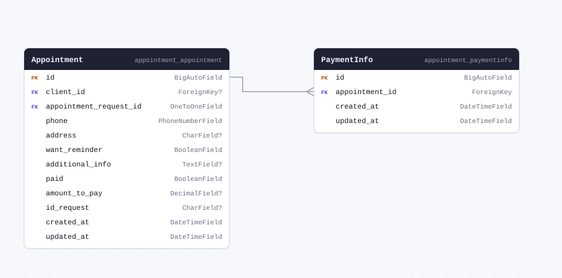

| Column | Field | Type | Null | Key | Default | Description |
| --- | --- | --- | --- | --- | --- | --- |
| `id` | `BigAutoField` | `integer` |  | PK | `autoincrement()` |  |
| `appointment_id` | `ForeignKey` | `bigint` |  | FK |  |  |
| `created_at` | `DateTimeField` | `datetime` |  |  | `now()` |  |
| `updated_at` | `DateTimeField` | `datetime` |  |  | `now()` |  |

Indexes:

- index `appointment_paymentinfo_appointment_id_a0eb36ed` on `appointment_id`

Relations:

- `appointment_id` → [Appointment](#appointment).`id`, on delete cascade

## EmailVerificationCode

Table `appointment_emailverificationcode`, app `appointment`.

Represents an email verification code for a user when the email already exists in the database.

Author: Adams Pierre David
Version: 1.1.0
Since: 1.1.0

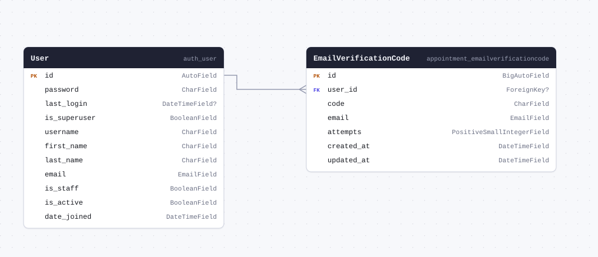

| Column | Field | Type | Null | Key | Default | Description |
| --- | --- | --- | --- | --- | --- | --- |
| `id` | `BigAutoField` | `integer` |  | PK | `autoincrement()` |  |
| `user_id` | `ForeignKey` | `integer` | yes | FK |  |  |
| `code` | `CharField` | `varchar(6)` |  |  |  | The verification code sent to the user's email. |
| `email` | `EmailField` | `varchar(254)` |  |  | `''` | The address the code was sent to. |
| `attempts` | `PositiveSmallIntegerField` | `smallint unsigned` |  |  | `0` | Number of wrong codes entered. |
| `created_at` | `DateTimeField` | `datetime` |  |  | `now()` |  |
| `updated_at` | `DateTimeField` | `datetime` |  |  | `now()` |  |

Indexes:

- index `appointment_emailverificationcode_user_id_a2b675c9` on `user_id`

Relations:

- `user_id` → [User](#user).`id`, on delete cascade

## PasswordResetToken

Table `appointment_passwordresettoken`, app `appointment`.

Represents a password reset token for users.

Author: Adams Pierre David
Version: 3.x.x
Since: 3.x.x

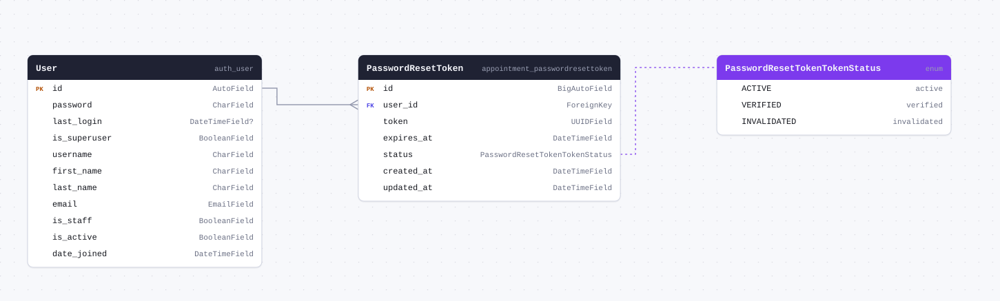

| Column | Field | Type | Null | Key | Default | Description |
| --- | --- | --- | --- | --- | --- | --- |
| `id` | `BigAutoField` | `integer` |  | PK | `autoincrement()` |  |
| `user_id` | `ForeignKey` | `integer` |  | FK |  |  |
| `token` | `UUIDField` | `char(32)` |  | unique | `uuid4()` |  |
| `expires_at` | `DateTimeField` | `datetime` |  |  |  |  |
| `status` | `PasswordResetTokenTokenStatus` | `varchar(11)` |  |  | `'active'` |  |
| `created_at` | `DateTimeField` | `datetime` |  |  | `now()` |  |
| `updated_at` | `DateTimeField` | `datetime` |  |  | `now()` |  |

Indexes:

- index `appointment_passwordresettoken_user_id_38b97e5a` on `user_id`

Relations:

- `user_id` → [User](#user).`id`, on delete cascade

## DayOff

Table `appointment_dayoff`, app `appointment`.

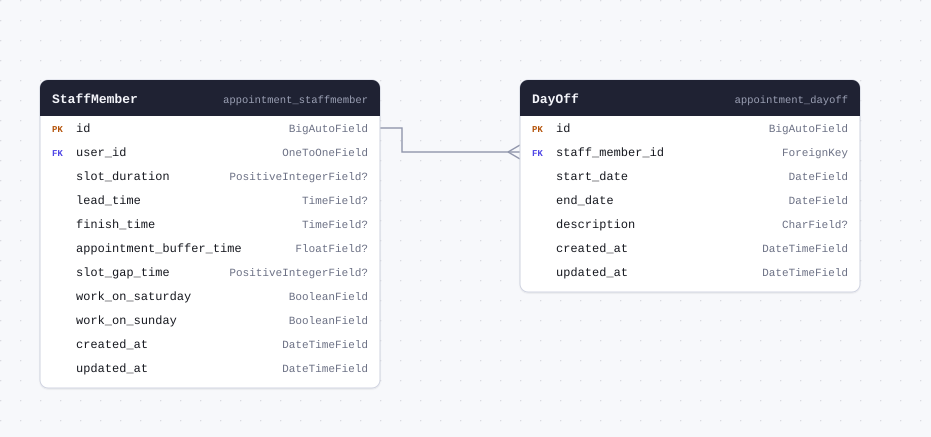

| Column | Field | Type | Null | Key | Default | Description |
| --- | --- | --- | --- | --- | --- | --- |
| `id` | `BigAutoField` | `integer` |  | PK | `autoincrement()` |  |
| `staff_member_id` | `ForeignKey` | `bigint` |  | FK |  |  |
| `start_date` | `DateField` | `date` |  |  |  |  |
| `end_date` | `DateField` | `date` |  |  |  |  |
| `description` | `CharField` | `varchar(255)` | yes |  |  |  |
| `created_at` | `DateTimeField` | `datetime` |  |  | `now()` |  |
| `updated_at` | `DateTimeField` | `datetime` |  |  | `now()` |  |

Indexes:

- index `appointment_dayoff_staff_member_id_f0c08dcf` on `staff_member_id`

Relations:

- `staff_member_id` → [StaffMember](#staffmember).`id`, on delete cascade

## Unavailability

Table `appointment_unavailability`, app `appointment`.

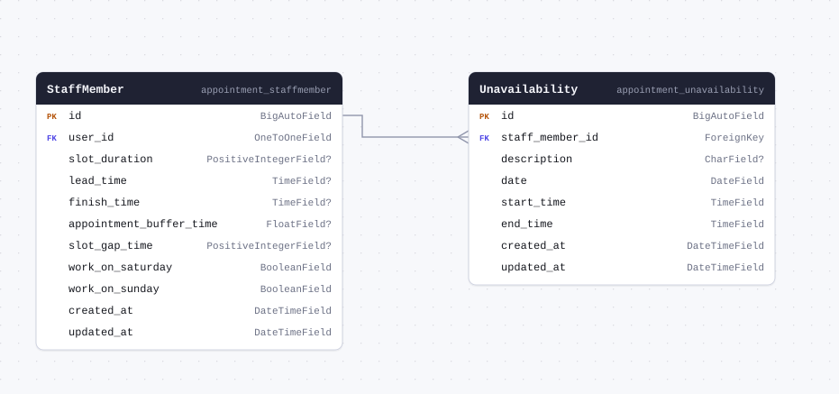

| Column | Field | Type | Null | Key | Default | Description |
| --- | --- | --- | --- | --- | --- | --- |
| `id` | `BigAutoField` | `integer` |  | PK | `autoincrement()` |  |
| `staff_member_id` | `ForeignKey` | `bigint` |  | FK |  |  |
| `description` | `CharField` | `varchar(255)` | yes |  |  |  |
| `date` | `DateField` | `date` |  |  |  |  |
| `start_time` | `TimeField` | `time` |  |  |  |  |
| `end_time` | `TimeField` | `time` |  |  |  |  |
| `created_at` | `DateTimeField` | `datetime` |  |  | `now()` |  |
| `updated_at` | `DateTimeField` | `datetime` |  |  | `now()` |  |

Indexes:

- index `appointment_unavailability_staff_member_id_17b40658` on `staff_member_id`

Checks:

- `unavailability_start_time_before_end_time`: `"start_time" < ("end_time")`

Relations:

- `staff_member_id` → [StaffMember](#staffmember).`id`, on delete cascade

## WorkingHours

Table `appointment_workinghours`, app `appointment`.

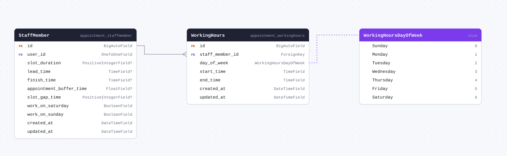

| Column | Field | Type | Null | Key | Default | Description |
| --- | --- | --- | --- | --- | --- | --- |
| `id` | `BigAutoField` | `integer` |  | PK | `autoincrement()` |  |
| `staff_member_id` | `ForeignKey` | `bigint` |  | FK |  |  |
| `day_of_week` | `WorkingHoursDayOfWeek` | `integer unsigned` |  |  |  |  |
| `start_time` | `TimeField` | `time` |  |  |  |  |
| `end_time` | `TimeField` | `time` |  |  |  |  |
| `created_at` | `DateTimeField` | `datetime` |  |  | `now()` |  |
| `updated_at` | `DateTimeField` | `datetime` |  |  | `now()` |  |

Indexes:

- index `appointment_workinghours_staff_member_id_8e0c8746` on `staff_member_id`
- unique `appointment_workinghours_staff_member_id_day_of_week_d1d65265_uniq` on `staff_member_id`, `day_of_week`

Checks:

- `working_hours_start_time_before_end_time`: `"start_time" < ("end_time")`

Relations:

- `staff_member_id` → [StaffMember](#staffmember).`id`, on delete cascade

# Enums

## LogEntryActionFlag

| Name | Stored as |
| --- | --- |
| `Addition` | `1` |
| `Change` | `2` |
| `Deletion` | `3` |

## ScheduleScheduleType

| Name | Stored as |
| --- | --- |
| `Once` | `O` |
| `Minutes` | `I` |
| `Hourly` | `H` |
| `Daily` | `D` |
| `Weekly` | `W` |
| `Biweekly` | `BW` |
| `Monthly` | `M` |
| `Bimonthly` | `BM` |
| `Quarterly` | `Q` |
| `Yearly` | `Y` |
| `Cron` | `C` |

## AppointmentRequestPaymentType

| Name | Stored as |
| --- | --- |
| `Full payment` | `full` |
| `Down payment` | `down` |

## AppointmentRescheduleHistoryRescheduleStatus

| Name | Stored as |
| --- | --- |
| `Pending` | `pending` |
| `Confirmed` | `confirmed` |

## PasswordResetTokenTokenStatus

| Name | Stored as |
| --- | --- |
| `ACTIVE` | `active` |
| `VERIFIED` | `verified` |
| `INVALIDATED` | `invalidated` |

## WorkingHoursDayOfWeek

| Name | Stored as |
| --- | --- |
| `Sunday` | `0` |
| `Monday` | `1` |
| `Tuesday` | `2` |
| `Wednesday` | `3` |
| `Thursday` | `4` |
| `Friday` | `5` |
| `Saturday` | `6` |
