# Schema docs

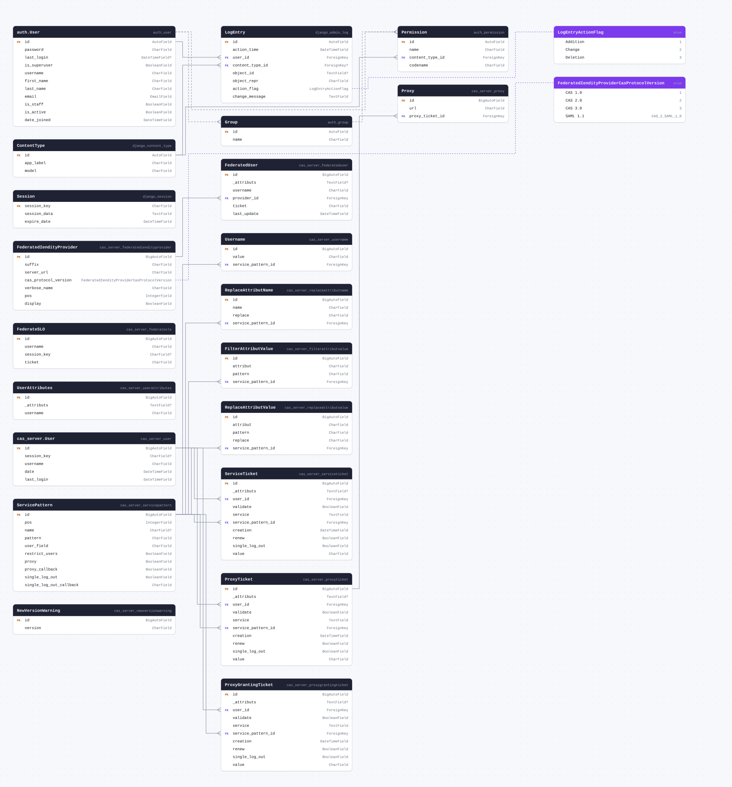

[LogEntry](#logentry) · [Permission](#permission) · [Group](#group) · [auth.User](#authuser) · [ContentType](#contenttype) · [Session](#session) · [FederatedIendityProvider](#federatediendityprovider) · [FederatedUser](#federateduser) · [FederateSLO](#federateslo) · [UserAttributes](#userattributes) · [cas_server.User](#cas_serveruser) · [ServicePattern](#servicepattern) · [Username](#username) · [ReplaceAttributName](#replaceattributname) · [FilterAttributValue](#filterattributvalue) · [ReplaceAttributValue](#replaceattributvalue) · [ServiceTicket](#serviceticket) · [ProxyTicket](#proxyticket) · [ProxyGrantingTicket](#proxygrantingticket) · [Proxy](#proxy) · [NewVersionWarning](#newversionwarning)

<details>
<summary>The whole schema as SQL</summary>

```sql
CREATE TABLE "django_admin_log" ("id" integer NOT NULL PRIMARY KEY AUTOINCREMENT, "action_time" datetime NOT NULL, "user_id" integer NOT NULL REFERENCES "auth_user" ("id") DEFERRABLE INITIALLY DEFERRED, "content_type_id" integer NULL REFERENCES "django_content_type" ("id") DEFERRABLE INITIALLY DEFERRED, "object_id" text NULL, "object_repr" varchar(200) NOT NULL, "action_flag" smallint unsigned NOT NULL CHECK ("action_flag" >= 0), "change_message" text NOT NULL);

CREATE TABLE "auth_permission" ("id" integer NOT NULL PRIMARY KEY AUTOINCREMENT, "name" varchar(255) NOT NULL, "content_type_id" integer NOT NULL REFERENCES "django_content_type" ("id") DEFERRABLE INITIALLY DEFERRED, "codename" varchar(100) NOT NULL);

CREATE TABLE "auth_group" ("id" integer NOT NULL PRIMARY KEY AUTOINCREMENT, "name" varchar(150) NOT NULL UNIQUE);

CREATE TABLE "auth_group_permissions" ("id" integer NOT NULL PRIMARY KEY AUTOINCREMENT, "group_id" integer NOT NULL REFERENCES "auth_group" ("id") DEFERRABLE INITIALLY DEFERRED, "permission_id" integer NOT NULL REFERENCES "auth_permission" ("id") DEFERRABLE INITIALLY DEFERRED);

CREATE TABLE "auth_user" ("id" integer NOT NULL PRIMARY KEY AUTOINCREMENT, "password" varchar(128) NOT NULL, "last_login" datetime NULL, "is_superuser" bool NOT NULL, "username" varchar(150) NOT NULL UNIQUE, "first_name" varchar(150) NOT NULL, "last_name" varchar(150) NOT NULL, "email" varchar(254) NOT NULL, "is_staff" bool NOT NULL, "is_active" bool NOT NULL, "date_joined" datetime NOT NULL);

CREATE TABLE "auth_user_groups" ("id" integer NOT NULL PRIMARY KEY AUTOINCREMENT, "user_id" integer NOT NULL REFERENCES "auth_user" ("id") DEFERRABLE INITIALLY DEFERRED, "group_id" integer NOT NULL REFERENCES "auth_group" ("id") DEFERRABLE INITIALLY DEFERRED);

CREATE TABLE "auth_user_user_permissions" ("id" integer NOT NULL PRIMARY KEY AUTOINCREMENT, "user_id" integer NOT NULL REFERENCES "auth_user" ("id") DEFERRABLE INITIALLY DEFERRED, "permission_id" integer NOT NULL REFERENCES "auth_permission" ("id") DEFERRABLE INITIALLY DEFERRED);

CREATE TABLE "django_content_type" ("id" integer NOT NULL PRIMARY KEY AUTOINCREMENT, "app_label" varchar(100) NOT NULL, "model" varchar(100) NOT NULL);

CREATE TABLE "django_session" ("session_key" varchar(40) NOT NULL PRIMARY KEY, "session_data" text NOT NULL, "expire_date" datetime NOT NULL);

CREATE TABLE "cas_server_federatediendityprovider" ("id" integer NOT NULL PRIMARY KEY AUTOINCREMENT, "suffix" varchar(30) NOT NULL UNIQUE, "server_url" varchar(255) NOT NULL, "cas_protocol_version" varchar(30) NOT NULL, "verbose_name" varchar(255) NOT NULL, "pos" integer NOT NULL, "display" bool NOT NULL);

CREATE TABLE "cas_server_federateduser" ("id" integer NOT NULL PRIMARY KEY AUTOINCREMENT, "_attributs" text NULL, "username" varchar(124) NOT NULL, "provider_id" bigint NOT NULL REFERENCES "cas_server_federatediendityprovider" ("id") DEFERRABLE INITIALLY DEFERRED, "ticket" varchar(255) NOT NULL, "last_update" datetime NOT NULL);

CREATE TABLE "cas_server_federateslo" ("id" integer NOT NULL PRIMARY KEY AUTOINCREMENT, "username" varchar(30) NOT NULL, "session_key" varchar(40) NULL, "ticket" varchar(255) NOT NULL);

CREATE TABLE "cas_server_userattributes" ("id" integer NOT NULL PRIMARY KEY AUTOINCREMENT, "_attributs" text NULL, "username" varchar(155) NOT NULL UNIQUE);

CREATE TABLE "cas_server_user" ("id" integer NOT NULL PRIMARY KEY AUTOINCREMENT, "session_key" varchar(40) NULL, "username" varchar(250) NOT NULL, "date" datetime NOT NULL, "last_login" datetime NOT NULL);

CREATE TABLE "cas_server_servicepattern" ("id" integer NOT NULL PRIMARY KEY AUTOINCREMENT, "pos" integer NOT NULL, "name" varchar(255) NULL UNIQUE, "pattern" varchar(255) NOT NULL UNIQUE, "user_field" varchar(255) NOT NULL, "restrict_users" bool NOT NULL, "proxy" bool NOT NULL, "proxy_callback" bool NOT NULL, "single_log_out" bool NOT NULL, "single_log_out_callback" varchar(255) NOT NULL);

CREATE TABLE "cas_server_username" ("id" integer NOT NULL PRIMARY KEY AUTOINCREMENT, "value" varchar(255) NOT NULL, "service_pattern_id" bigint NOT NULL REFERENCES "cas_server_servicepattern" ("id") DEFERRABLE INITIALLY DEFERRED);

CREATE TABLE "cas_server_replaceattributname" ("id" integer NOT NULL PRIMARY KEY AUTOINCREMENT, "name" varchar(255) NOT NULL, "replace" varchar(255) NOT NULL, "service_pattern_id" bigint NOT NULL REFERENCES "cas_server_servicepattern" ("id") DEFERRABLE INITIALLY DEFERRED);

CREATE TABLE "cas_server_filterattributvalue" ("id" integer NOT NULL PRIMARY KEY AUTOINCREMENT, "attribut" varchar(255) NOT NULL, "pattern" varchar(255) NOT NULL, "service_pattern_id" bigint NOT NULL REFERENCES "cas_server_servicepattern" ("id") DEFERRABLE INITIALLY DEFERRED);

CREATE TABLE "cas_server_replaceattributvalue" ("id" integer NOT NULL PRIMARY KEY AUTOINCREMENT, "attribut" varchar(255) NOT NULL, "pattern" varchar(255) NOT NULL, "replace" varchar(255) NOT NULL, "service_pattern_id" bigint NOT NULL REFERENCES "cas_server_servicepattern" ("id") DEFERRABLE INITIALLY DEFERRED);

CREATE TABLE "cas_server_serviceticket" ("id" integer NOT NULL PRIMARY KEY AUTOINCREMENT, "_attributs" text NULL, "user_id" bigint NOT NULL REFERENCES "cas_server_user" ("id") DEFERRABLE INITIALLY DEFERRED, "validate" bool NOT NULL, "service" text NOT NULL, "service_pattern_id" bigint NOT NULL REFERENCES "cas_server_servicepattern" ("id") DEFERRABLE INITIALLY DEFERRED, "creation" datetime NOT NULL, "renew" bool NOT NULL, "single_log_out" bool NOT NULL, "value" varchar(255) NOT NULL UNIQUE);

CREATE TABLE "cas_server_proxyticket" ("id" integer NOT NULL PRIMARY KEY AUTOINCREMENT, "_attributs" text NULL, "user_id" bigint NOT NULL REFERENCES "cas_server_user" ("id") DEFERRABLE INITIALLY DEFERRED, "validate" bool NOT NULL, "service" text NOT NULL, "service_pattern_id" bigint NOT NULL REFERENCES "cas_server_servicepattern" ("id") DEFERRABLE INITIALLY DEFERRED, "creation" datetime NOT NULL, "renew" bool NOT NULL, "single_log_out" bool NOT NULL, "value" varchar(255) NOT NULL UNIQUE);

CREATE TABLE "cas_server_proxygrantingticket" ("id" integer NOT NULL PRIMARY KEY AUTOINCREMENT, "_attributs" text NULL, "user_id" bigint NOT NULL REFERENCES "cas_server_user" ("id") DEFERRABLE INITIALLY DEFERRED, "validate" bool NOT NULL, "service" text NOT NULL, "service_pattern_id" bigint NOT NULL REFERENCES "cas_server_servicepattern" ("id") DEFERRABLE INITIALLY DEFERRED, "creation" datetime NOT NULL, "renew" bool NOT NULL, "single_log_out" bool NOT NULL, "value" varchar(255) NOT NULL UNIQUE);

CREATE TABLE "cas_server_proxy" ("id" integer NOT NULL PRIMARY KEY AUTOINCREMENT, "url" varchar(255) NOT NULL, "proxy_ticket_id" bigint NOT NULL REFERENCES "cas_server_proxyticket" ("id") DEFERRABLE INITIALLY DEFERRED);

CREATE TABLE "cas_server_newversionwarning" ("id" integer NOT NULL PRIMARY KEY AUTOINCREMENT, "version" varchar(255) NOT NULL);

CREATE INDEX "django_admin_log_user_id_c564eba6" ON "django_admin_log" ("user_id");

CREATE INDEX "django_admin_log_content_type_id_c4bce8eb" ON "django_admin_log" ("content_type_id");

CREATE UNIQUE INDEX "auth_permission_content_type_id_codename_01ab375a_uniq" ON "auth_permission" ("content_type_id", "codename");

CREATE INDEX "auth_permission_content_type_id_2f476e4b" ON "auth_permission" ("content_type_id");

CREATE UNIQUE INDEX "auth_group_permissions_group_id_permission_id_0cd325b0_uniq" ON "auth_group_permissions" ("group_id", "permission_id");

CREATE INDEX "auth_group_permissions_group_id_b120cbf9" ON "auth_group_permissions" ("group_id");

CREATE INDEX "auth_group_permissions_permission_id_84c5c92e" ON "auth_group_permissions" ("permission_id");

CREATE UNIQUE INDEX "auth_user_groups_user_id_group_id_94350c0c_uniq" ON "auth_user_groups" ("user_id", "group_id");

CREATE INDEX "auth_user_groups_user_id_6a12ed8b" ON "auth_user_groups" ("user_id");

CREATE INDEX "auth_user_groups_group_id_97559544" ON "auth_user_groups" ("group_id");

CREATE UNIQUE INDEX "auth_user_user_permissions_user_id_permission_id_14a6b632_uniq" ON "auth_user_user_permissions" ("user_id", "permission_id");

CREATE INDEX "auth_user_user_permissions_user_id_a95ead1b" ON "auth_user_user_permissions" ("user_id");

CREATE INDEX "auth_user_user_permissions_permission_id_1fbb5f2c" ON "auth_user_user_permissions" ("permission_id");

CREATE UNIQUE INDEX "django_content_type_app_label_model_76bd3d3b_uniq" ON "django_content_type" ("app_label", "model");

CREATE INDEX "django_session_expire_date_a5c62663" ON "django_session" ("expire_date");

CREATE UNIQUE INDEX "cas_server_federateduser_username_provider_id_e0605d8d_uniq" ON "cas_server_federateduser" ("username", "provider_id");

CREATE INDEX "cas_server_federateduser_provider_id_38a00ea4" ON "cas_server_federateduser" ("provider_id");

CREATE UNIQUE INDEX "cas_server_federateslo_username_session_key_ticket_5e7cc301_uniq" ON "cas_server_federateslo" ("username", "session_key", "ticket");

CREATE INDEX "cas_server_federateslo_ticket_4abd5ad5" ON "cas_server_federateslo" ("ticket");

CREATE UNIQUE INDEX "cas_server_user_username_session_key_37827f92_uniq" ON "cas_server_user" ("username", "session_key");

CREATE INDEX "cas_server_username_service_pattern_id_ca43f74e" ON "cas_server_username" ("service_pattern_id");

CREATE UNIQUE INDEX "cas_server_replaceattributname_name_replace_service_pattern_id_5e627e3c_uniq" ON "cas_server_replaceattributname" ("name", "replace", "service_pattern_id");

CREATE INDEX "cas_server_replaceattributname_service_pattern_id_951038d2" ON "cas_server_replaceattributname" ("service_pattern_id");

CREATE INDEX "cas_server_filterattributvalue_service_pattern_id_9223c12f" ON "cas_server_filterattributvalue" ("service_pattern_id");

CREATE INDEX "cas_server_replaceattributvalue_service_pattern_id_08190d2c" ON "cas_server_replaceattributvalue" ("service_pattern_id");

CREATE INDEX "cas_server_serviceticket_user_id_5a6bd990" ON "cas_server_serviceticket" ("user_id");

CREATE INDEX "cas_server_serviceticket_service_pattern_id_fc4c43a5" ON "cas_server_serviceticket" ("service_pattern_id");

CREATE INDEX "cas_server_proxyticket_user_id_bcd4494a" ON "cas_server_proxyticket" ("user_id");

CREATE INDEX "cas_server_proxyticket_service_pattern_id_f2861282" ON "cas_server_proxyticket" ("service_pattern_id");

CREATE INDEX "cas_server_proxygrantingticket_user_id_cc540046" ON "cas_server_proxygrantingticket" ("user_id");

CREATE INDEX "cas_server_proxygrantingticket_service_pattern_id_6b7981ac" ON "cas_server_proxygrantingticket" ("service_pattern_id");

CREATE INDEX "cas_server_proxy_proxy_ticket_id_5c6e1aed" ON "cas_server_proxy" ("proxy_ticket_id");
```

</details>

## LogEntry

Table `django_admin_log`, app `admin`.

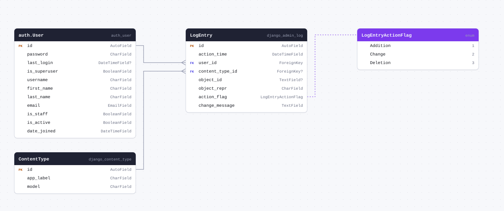

| Column | Field | Type | Null | Key | Default | Description |
| --- | --- | --- | --- | --- | --- | --- |
| `id` | `AutoField` | `integer` |  | PK | `autoincrement()` |  |
| `action_time` | `DateTimeField` | `datetime` |  |  | `now()` |  |
| `user_id` | `ForeignKey` | `integer` |  | FK |  |  |
| `content_type_id` | `ForeignKey` | `integer` | yes | FK |  |  |
| `object_id` | `TextField` | `text` | yes |  |  |  |
| `object_repr` | `CharField` | `varchar(200)` |  |  |  |  |
| `action_flag` | `LogEntryActionFlag` | `smallint unsigned` |  |  |  |  |
| `change_message` | `TextField` | `text` |  |  |  |  |

Indexes:

- index `django_admin_log_user_id_c564eba6` on `user_id`
- index `django_admin_log_content_type_id_c4bce8eb` on `content_type_id`

Relations:

- `user_id` → [auth.User](#authuser).`id`, on delete cascade
- `content_type_id` → [ContentType](#contenttype).`id`, on delete set null

## Permission

Table `auth_permission`, app `auth`.

The permissions system provides a way to assign permissions to specific
users and groups of users.

The permission system is used by the Django admin site, but may also be
useful in your own code. The Django admin site uses permissions as follows:

    - The "add" permission limits the user's ability to view the "add" form
      and add an object.
    - The "change" permission limits a user's ability to view the change
      list, view the "change" form and change an object.
    - The "delete" permission limits the ability to delete an object.
    - The "view" permission limits the ability to view an object.

Permissions are set globally per type of object, not per specific object
instance. It is possible to say "Mary may change news stories," but it's
not currently possible to say "Mary may change news stories, but only the
ones she created herself" or "Mary may only change news stories that have a
certain status or publication date."

The permissions listed above are automatically created for each model.

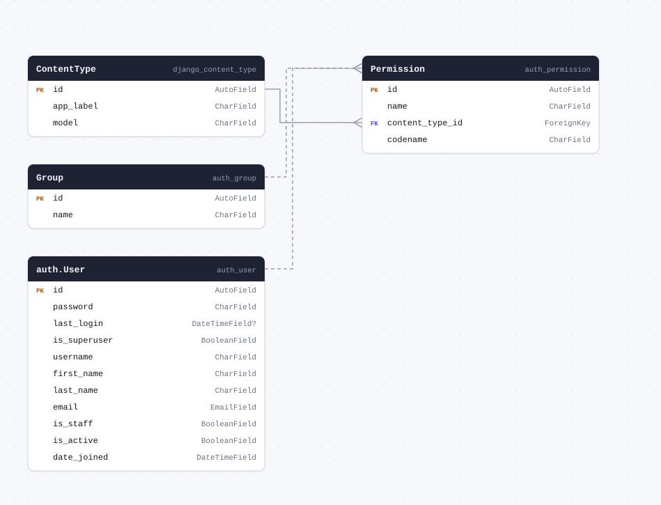

| Column | Field | Type | Null | Key | Default | Description |
| --- | --- | --- | --- | --- | --- | --- |
| `id` | `AutoField` | `integer` |  | PK | `autoincrement()` |  |
| `name` | `CharField` | `varchar(255)` |  |  |  |  |
| `content_type_id` | `ForeignKey` | `integer` |  | FK |  |  |
| `codename` | `CharField` | `varchar(100)` |  |  |  |  |

Indexes:

- index `auth_permission_content_type_id_2f476e4b` on `content_type_id`
- unique `auth_permission_content_type_id_codename_01ab375a_uniq` on `content_type_id`, `codename`

Relations:

- `content_type_id` → [ContentType](#contenttype).`id`, on delete cascade
- `group_set` — many to many with [Group](#group)
- `user_set` — many to many with [auth.User](#authuser)

## Group

Table `auth_group`, app `auth`.

Groups are a generic way of categorizing users to apply permissions, or
some other label, to those users. A user can belong to any number of
groups.

A user in a group automatically has all the permissions granted to that
group. For example, if the group 'Site editors' has the permission
can_edit_home_page, any user in that group will have that permission.

Beyond permissions, groups are a convenient way to categorize users to
apply some label, or extended functionality, to them. For example, you
could create a group 'Special users', and you could write code that would
do special things to those users -- such as giving them access to a
members-only portion of your site, or sending them members-only email
messages.

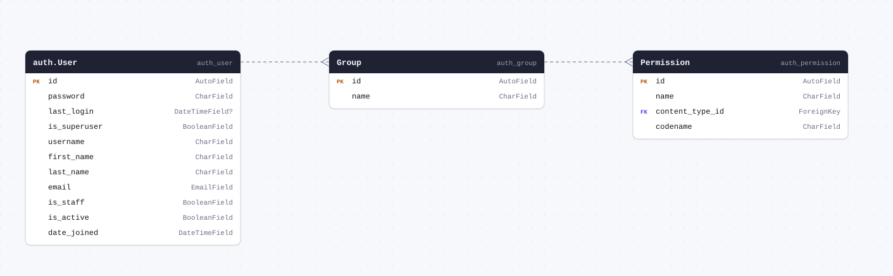

| Column | Field | Type | Null | Key | Default | Description |
| --- | --- | --- | --- | --- | --- | --- |
| `id` | `AutoField` | `integer` |  | PK | `autoincrement()` |  |
| `name` | `CharField` | `varchar(150)` |  | unique |  |  |

Relations:

- `permissions` — many to many with [Permission](#permission)
- `user_set` — many to many with [auth.User](#authuser)

## auth.User

Table `auth_user`, app `auth`.

Columns from `AbstractUser` (abstract): `username`, `first_name`, `last_name`, `email`, `is_staff`, `is_active`, `date_joined`.

Columns from `AbstractBaseUser` (abstract): `password`, `last_login`.

Columns from `PermissionsMixin` (abstract): `is_superuser`.

Users within the Django authentication system are represented by this
model.

Username and password are required. Other fields are optional.

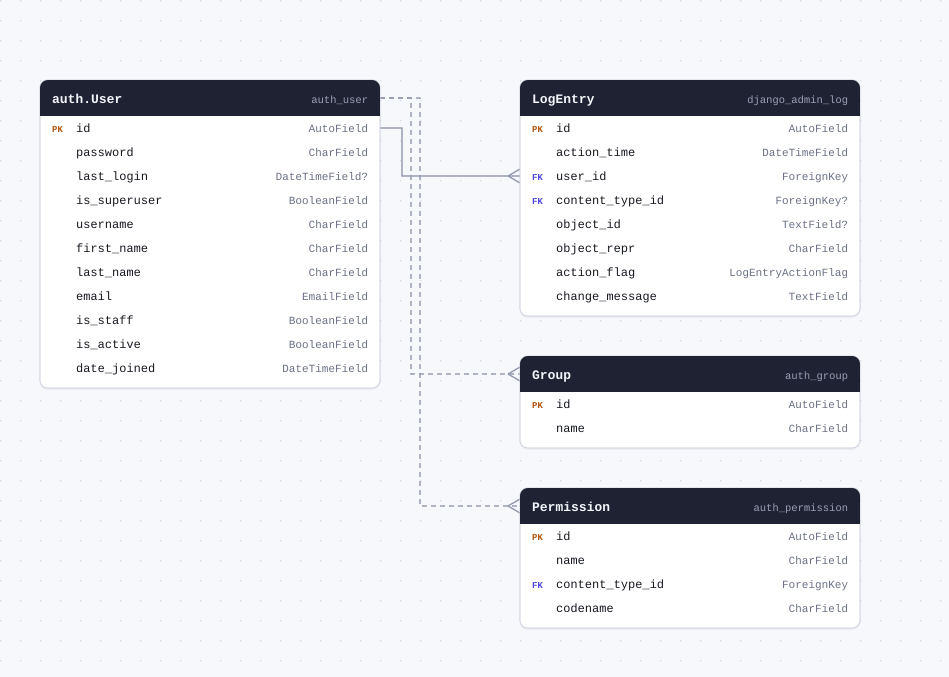

| Column | Field | Type | Null | Key | Default | Description |
| --- | --- | --- | --- | --- | --- | --- |
| `id` | `AutoField` | `integer` |  | PK | `autoincrement()` |  |
| `password` | `CharField` | `varchar(128)` |  |  |  |  |
| `last_login` | `DateTimeField` | `datetime` | yes |  |  |  |
| `is_superuser` | `BooleanField` | `bool` |  |  | `False` | Designates that this user has all permissions without explicitly assigning them. |
| `username` | `CharField` | `varchar(150)` |  | unique |  | Required. 150 characters or fewer. Letters, digits and @/./+/-/_ only. |
| `first_name` | `CharField` | `varchar(150)` |  |  |  |  |
| `last_name` | `CharField` | `varchar(150)` |  |  |  |  |
| `email` | `EmailField` | `varchar(254)` |  |  |  |  |
| `is_staff` | `BooleanField` | `bool` |  |  | `False` | Designates whether the user can log into this admin site. |
| `is_active` | `BooleanField` | `bool` |  |  | `True` | Designates whether this user should be treated as active. Unselect this instead of deleting accounts. |
| `date_joined` | `DateTimeField` | `datetime` |  |  | `now()` |  |

Relations:

- [LogEntry](#logentry).`user_id` → `id`, on delete cascade
- `groups` — many to many with [Group](#group)
- `user_permissions` — many to many with [Permission](#permission)

## ContentType

Table `django_content_type`, app `contenttypes`.


| Column | Field | Type | Null | Key | Default | Description |
| --- | --- | --- | --- | --- | --- | --- |
| `id` | `AutoField` | `integer` |  | PK | `autoincrement()` |  |
| `app_label` | `CharField` | `varchar(100)` |  |  |  |  |
| `model` | `CharField` | `varchar(100)` |  |  |  |  |

Indexes:

- unique `django_content_type_app_label_model_76bd3d3b_uniq` on `app_label`, `model`

Relations:

- [LogEntry](#logentry).`content_type_id` → `id`, on delete set null
- [Permission](#permission).`content_type_id` → `id`, on delete cascade

## Session

Table `django_session`, app `sessions`.

Columns from `AbstractBaseSession` (abstract): `session_key`, `session_data`, `expire_date`.

Django provides full support for anonymous sessions. The session
framework lets you store and retrieve arbitrary data on a
per-site-visitor basis. It stores data on the server side and
abstracts the sending and receiving of cookies. Cookies contain a
session ID -- not the data itself.

The Django sessions framework is entirely cookie-based. It does
not fall back to putting session IDs in URLs. This is an intentional
design decision. Not only does that behavior make URLs ugly, it makes
your site vulnerable to session-ID theft via the "Referer" header.

For complete documentation on using Sessions in your code, consult
the sessions documentation that is shipped with Django (also available
on the Django web site).

| Column | Field | Type | Null | Key | Default | Description |
| --- | --- | --- | --- | --- | --- | --- |
| `session_key` | `CharField` | `varchar(40)` |  | PK |  |  |
| `session_data` | `TextField` | `text` |  |  |  |  |
| `expire_date` | `DateTimeField` | `datetime` |  |  |  |  |

Indexes:

- index `django_session_expire_date_a5c62663` on `expire_date`

## FederatedIendityProvider

Table `cas_server_federatediendityprovider`, app `cas_server`.

Bases: :class:`django.db.models.Model`

An identity provider for the federated mode

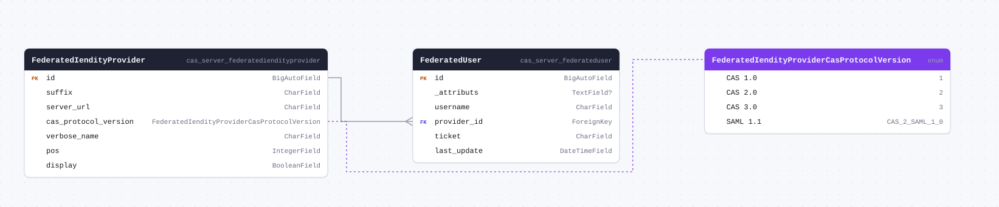

| Column | Field | Type | Null | Key | Default | Description |
| --- | --- | --- | --- | --- | --- | --- |
| `id` | `BigAutoField` | `integer` |  | PK | `autoincrement()` |  |
| `suffix` | `CharField` | `varchar(30)` |  | unique |  | Suffix append to backend CAS returned username: ``returned_username`` @ ``suffix``. |
| `server_url` | `CharField` | `varchar(255)` |  |  |  |  |
| `cas_protocol_version` | `FederatedIendityProviderCasProtocolVersion` | `varchar(30)` |  |  | `'3'` | Version of the CAS protocol to use when sending requests the the backend CAS. |
| `verbose_name` | `CharField` | `varchar(255)` |  |  |  | Name for this identity provider displayed on the login page. |
| `pos` | `IntegerField` | `integer` |  |  | `100` | Position of the identity provider on the login page. Identity provider are sorted using the (position, verbose name, suffix) attributes. |
| `display` | `BooleanField` | `bool` |  |  | `True` | Display the provider on the login page. |

Relations:

- [FederatedUser](#federateduser).`provider_id` → `id`, on delete cascade

## FederatedUser

Table `cas_server_federateduser`, app `cas_server`.

Columns from `JsonAttributes` (abstract): `_attributs`.

Bases: :class:`JsonAttributes`

A federated user as returner by a CAS provider (username and attributes)

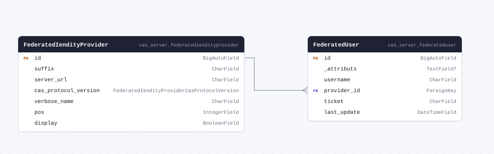

| Column | Field | Type | Null | Key | Default | Description |
| --- | --- | --- | --- | --- | --- | --- |
| `id` | `BigAutoField` | `integer` |  | PK | `autoincrement()` |  |
| `_attributs` | `TextField` | `text` | yes |  | `None` |  |
| `username` | `CharField` | `varchar(124)` |  |  |  |  |
| `provider_id` | `ForeignKey` | `bigint` |  | FK |  |  |
| `ticket` | `CharField` | `varchar(255)` |  |  |  |  |
| `last_update` | `DateTimeField` | `datetime` |  |  | `now()` |  |

Indexes:

- index `cas_server_federateduser_provider_id_38a00ea4` on `provider_id`
- unique `cas_server_federateduser_username_provider_id_e0605d8d_uniq` on `username`, `provider_id`

Relations:

- `provider_id` → [FederatedIendityProvider](#federatediendityprovider).`id`, on delete cascade

## FederateSLO

Table `cas_server_federateslo`, app `cas_server`.

Bases: :class:`django.db.models.Model`

An association between a CAS provider ticket and a (username, session) for processing SLO

| Column | Field | Type | Null | Key | Default | Description |
| --- | --- | --- | --- | --- | --- | --- |
| `id` | `BigAutoField` | `integer` |  | PK | `autoincrement()` |  |
| `username` | `CharField` | `varchar(30)` |  |  |  |  |
| `session_key` | `CharField` | `varchar(40)` | yes |  |  |  |
| `ticket` | `CharField` | `varchar(255)` |  |  |  |  |

Indexes:

- index `cas_server_federateslo_ticket_4abd5ad5` on `ticket`
- unique `cas_server_federateslo_username_session_key_ticket_5e7cc301_uniq` on `username`, `session_key`, `ticket`

## UserAttributes

Table `cas_server_userattributes`, app `cas_server`.

Columns from `JsonAttributes` (abstract): `_attributs`.

Bases: :class:`JsonAttributes`

Local cache of the user attributes, used then needed

| Column | Field | Type | Null | Key | Default | Description |
| --- | --- | --- | --- | --- | --- | --- |
| `id` | `BigAutoField` | `integer` |  | PK | `autoincrement()` |  |
| `_attributs` | `TextField` | `text` | yes |  | `None` |  |
| `username` | `CharField` | `varchar(155)` |  | unique |  |  |

## cas_server.User

Table `cas_server_user`, app `cas_server`.

Bases: :class:`django.db.models.Model`

A user logged into the CAS

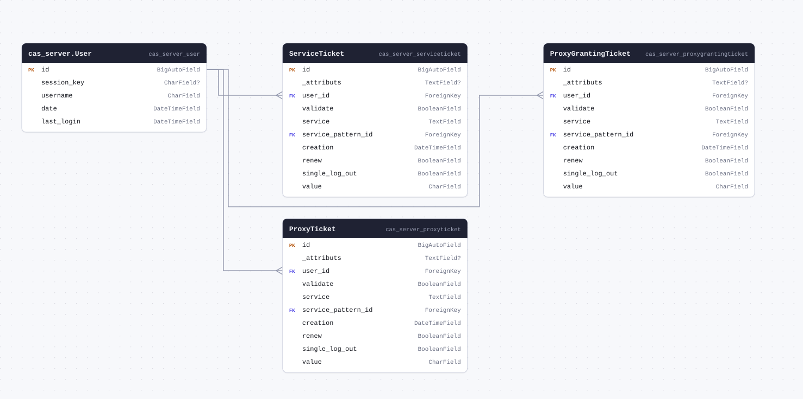

| Column | Field | Type | Null | Key | Default | Description |
| --- | --- | --- | --- | --- | --- | --- |
| `id` | `BigAutoField` | `integer` |  | PK | `autoincrement()` |  |
| `session_key` | `CharField` | `varchar(40)` | yes |  |  |  |
| `username` | `CharField` | `varchar(250)` |  |  |  |  |
| `date` | `DateTimeField` | `datetime` |  |  | `now()` |  |
| `last_login` | `DateTimeField` | `datetime` |  |  | `now()` |  |

Indexes:

- unique `cas_server_user_username_session_key_37827f92_uniq` on `username`, `session_key`

Relations:

- [ServiceTicket](#serviceticket).`user_id` → `id`, on delete cascade
- [ProxyTicket](#proxyticket).`user_id` → `id`, on delete cascade
- [ProxyGrantingTicket](#proxygrantingticket).`user_id` → `id`, on delete cascade

## ServicePattern

Table `cas_server_servicepattern`, app `cas_server`.

Bases: :class:`django.db.models.Model`

Allowed services pattern against services are tested to

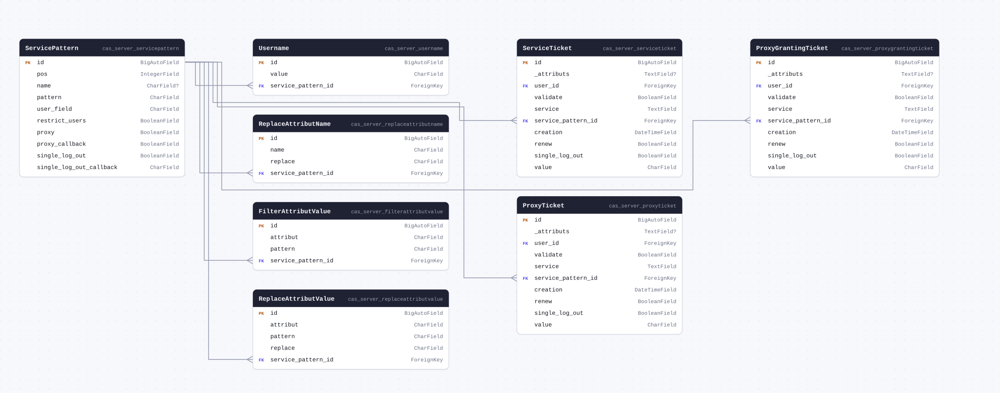

| Column | Field | Type | Null | Key | Default | Description |
| --- | --- | --- | --- | --- | --- | --- |
| `id` | `BigAutoField` | `integer` |  | PK | `autoincrement()` |  |
| `pos` | `IntegerField` | `integer` |  |  | `100` | service patterns are sorted using the position attribute |
| `name` | `CharField` | `varchar(255)` | yes | unique |  | A name for the service |
| `pattern` | `CharField` | `varchar(255)` |  | unique |  | A regular expression matching services. Will usually looks like '^https://some\.server\.com/path/.*$'.As it is a regular expression, special character must be escaped with a '\'. |
| `user_field` | `CharField` | `varchar(255)` |  |  | `''` | Name of the attribute to transmit as username, empty = login |
| `restrict_users` | `BooleanField` | `bool` |  |  | `False` | Limit username allowed to connect to the list provided bellow |
| `proxy` | `BooleanField` | `bool` |  |  | `False` | Proxy tickets can be delivered to the service |
| `proxy_callback` | `BooleanField` | `bool` |  |  | `False` | can be used as a proxy callback to deliver PGT |
| `single_log_out` | `BooleanField` | `bool` |  |  | `False` | Enable SLO for the service |
| `single_log_out_callback` | `CharField` | `varchar(255)` |  |  | `''` | URL where the SLO request will be POST. empty = service url This is usefull for non HTTP proxied services. |

Relations:

- [Username](#username).`service_pattern_id` → `id`, on delete cascade
- [ReplaceAttributName](#replaceattributname).`service_pattern_id` → `id`, on delete cascade
- [FilterAttributValue](#filterattributvalue).`service_pattern_id` → `id`, on delete cascade
- [ReplaceAttributValue](#replaceattributvalue).`service_pattern_id` → `id`, on delete cascade
- [ServiceTicket](#serviceticket).`service_pattern_id` → `id`, on delete cascade
- [ProxyTicket](#proxyticket).`service_pattern_id` → `id`, on delete cascade
- [ProxyGrantingTicket](#proxygrantingticket).`service_pattern_id` → `id`, on delete cascade

## Username

Table `cas_server_username`, app `cas_server`.

Bases: :class:`django.db.models.Model`

A list of allowed usernames on a :class:`ServicePattern`

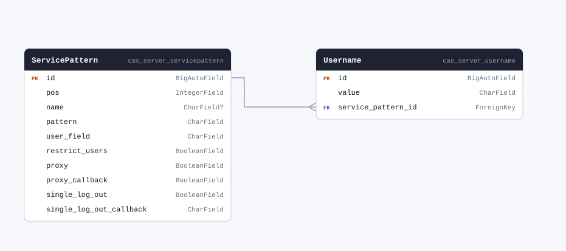

| Column | Field | Type | Null | Key | Default | Description |
| --- | --- | --- | --- | --- | --- | --- |
| `id` | `BigAutoField` | `integer` |  | PK | `autoincrement()` |  |
| `value` | `CharField` | `varchar(255)` |  |  |  | username allowed to connect to the service |
| `service_pattern_id` | `ForeignKey` | `bigint` |  | FK |  |  |

Indexes:

- index `cas_server_username_service_pattern_id_ca43f74e` on `service_pattern_id`

Relations:

- `service_pattern_id` → [ServicePattern](#servicepattern).`id`, on delete cascade

## ReplaceAttributName

Table `cas_server_replaceattributname`, app `cas_server`.

Bases: :class:`django.db.models.Model`

A replacement of an attribute name for a :class:`ServicePattern`. It also tell to transmit
an attribute of :attr:`User.attributs` to the service. An empty :attr:`replace` mean
to use the original attribute name.

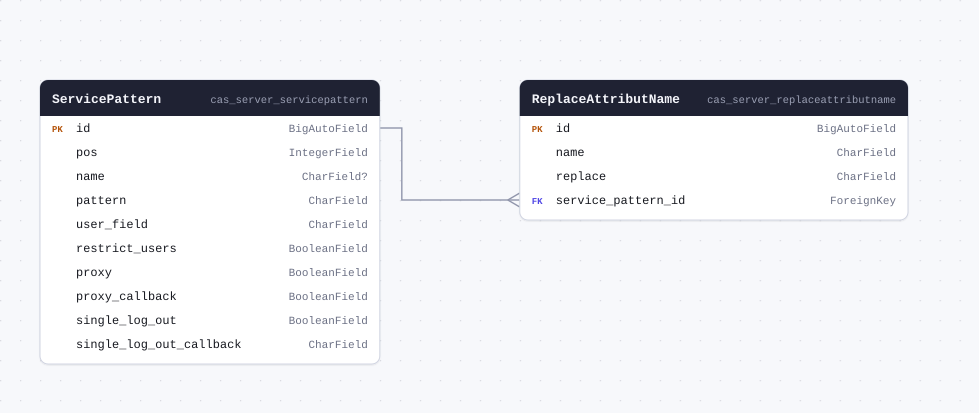

| Column | Field | Type | Null | Key | Default | Description |
| --- | --- | --- | --- | --- | --- | --- |
| `id` | `BigAutoField` | `integer` |  | PK | `autoincrement()` |  |
| `name` | `CharField` | `varchar(255)` |  |  |  | name of an attribute to send to the service, use * for all attributes |
| `replace` | `CharField` | `varchar(255)` |  |  |  | name under which the attribute will be show to the service. empty = default name of the attribut |
| `service_pattern_id` | `ForeignKey` | `bigint` |  | FK |  |  |

Indexes:

- index `cas_server_replaceattributname_service_pattern_id_951038d2` on `service_pattern_id`
- unique `cas_server_replaceattributname_name_replace_service_pattern_id_5e627e3c_uniq` on `name`, `replace`, `service_pattern_id`

Relations:

- `service_pattern_id` → [ServicePattern](#servicepattern).`id`, on delete cascade

## FilterAttributValue

Table `cas_server_filterattributvalue`, app `cas_server`.

Bases: :class:`django.db.models.Model`

A filter on :attr:`User.attributs` for a :class:`ServicePattern`. If a :class:`User` do not
have an attribute :attr:`attribut` or its value do not match :attr:`pattern`, then
:meth:`ServicePattern.check_user` will raises :class:`BadFilter` if called with that user.


| Column | Field | Type | Null | Key | Default | Description |
| --- | --- | --- | --- | --- | --- | --- |
| `id` | `BigAutoField` | `integer` |  | PK | `autoincrement()` |  |
| `attribut` | `CharField` | `varchar(255)` |  |  |  | Name of the attribute which must verify pattern |
| `pattern` | `CharField` | `varchar(255)` |  |  |  | a regular expression |
| `service_pattern_id` | `ForeignKey` | `bigint` |  | FK |  |  |

Indexes:

- index `cas_server_filterattributvalue_service_pattern_id_9223c12f` on `service_pattern_id`

Relations:

- `service_pattern_id` → [ServicePattern](#servicepattern).`id`, on delete cascade

## ReplaceAttributValue

Table `cas_server_replaceattributvalue`, app `cas_server`.

Bases: :class:`django.db.models.Model`

A replacement (using a regular expression) of an attribute value for a
:class:`ServicePattern`.

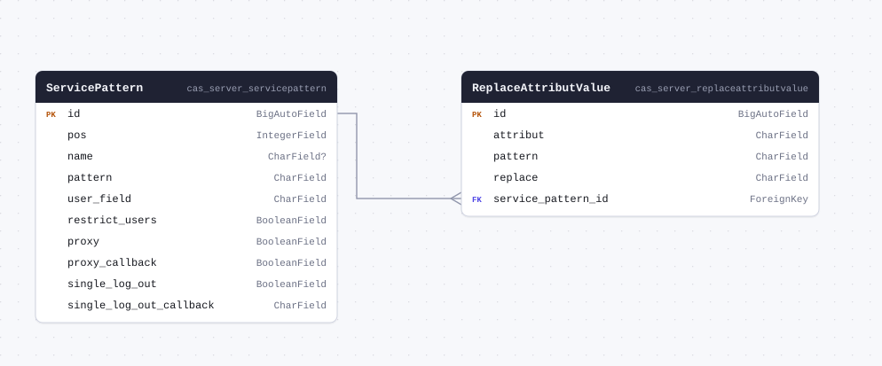

| Column | Field | Type | Null | Key | Default | Description |
| --- | --- | --- | --- | --- | --- | --- |
| `id` | `BigAutoField` | `integer` |  | PK | `autoincrement()` |  |
| `attribut` | `CharField` | `varchar(255)` |  |  |  | Name of the attribute for which the value must be replace |
| `pattern` | `CharField` | `varchar(255)` |  |  |  | An regular expression maching whats need to be replaced |
| `replace` | `CharField` | `varchar(255)` |  |  |  | replace expression, groups are capture by \1, \2 … |
| `service_pattern_id` | `ForeignKey` | `bigint` |  | FK |  |  |

Indexes:

- index `cas_server_replaceattributvalue_service_pattern_id_08190d2c` on `service_pattern_id`

Relations:

- `service_pattern_id` → [ServicePattern](#servicepattern).`id`, on delete cascade

## ServiceTicket

Table `cas_server_serviceticket`, app `cas_server`.

Columns from `Ticket` (abstract): `user_id`, `validate`, `service`, `service_pattern_id`, `creation`, `renew`, `single_log_out`.

Columns from `JsonAttributes` (abstract): `_attributs`.

Bases: :class:`Ticket`

A Service Ticket

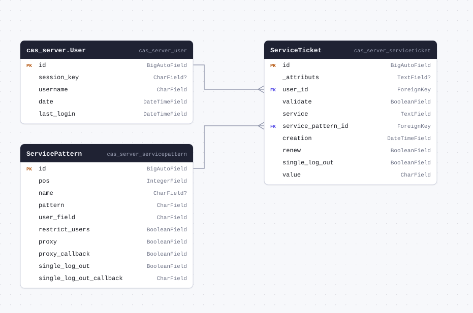

| Column | Field | Type | Null | Key | Default | Description |
| --- | --- | --- | --- | --- | --- | --- |
| `id` | `BigAutoField` | `integer` |  | PK | `autoincrement()` |  |
| `_attributs` | `TextField` | `text` | yes |  | `None` |  |
| `user_id` | `ForeignKey` | `bigint` |  | FK |  |  |
| `validate` | `BooleanField` | `bool` |  |  | `False` |  |
| `service` | `TextField` | `text` |  |  |  |  |
| `service_pattern_id` | `ForeignKey` | `bigint` |  | FK |  |  |
| `creation` | `DateTimeField` | `datetime` |  |  | `now()` |  |
| `renew` | `BooleanField` | `bool` |  |  | `False` |  |
| `single_log_out` | `BooleanField` | `bool` |  |  | `False` |  |
| `value` | `CharField` | `varchar(255)` |  | unique | `gen_st()` |  |

Indexes:

- index `cas_server_serviceticket_user_id_5a6bd990` on `user_id`
- index `cas_server_serviceticket_service_pattern_id_fc4c43a5` on `service_pattern_id`

Relations:

- `user_id` → [cas_server.User](#cas_serveruser).`id`, on delete cascade
- `service_pattern_id` → [ServicePattern](#servicepattern).`id`, on delete cascade

## ProxyTicket

Table `cas_server_proxyticket`, app `cas_server`.

Columns from `Ticket` (abstract): `user_id`, `validate`, `service`, `service_pattern_id`, `creation`, `renew`, `single_log_out`.

Columns from `JsonAttributes` (abstract): `_attributs`.

Bases: :class:`Ticket`

A Proxy Ticket

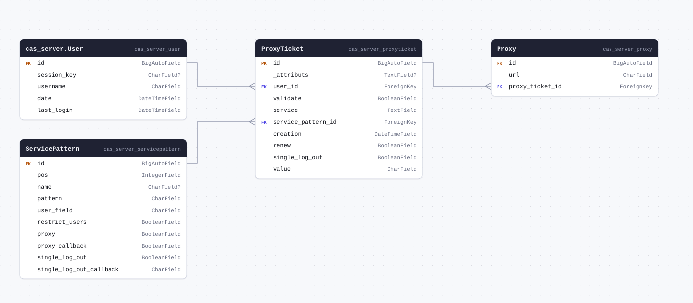

| Column | Field | Type | Null | Key | Default | Description |
| --- | --- | --- | --- | --- | --- | --- |
| `id` | `BigAutoField` | `integer` |  | PK | `autoincrement()` |  |
| `_attributs` | `TextField` | `text` | yes |  | `None` |  |
| `user_id` | `ForeignKey` | `bigint` |  | FK |  |  |
| `validate` | `BooleanField` | `bool` |  |  | `False` |  |
| `service` | `TextField` | `text` |  |  |  |  |
| `service_pattern_id` | `ForeignKey` | `bigint` |  | FK |  |  |
| `creation` | `DateTimeField` | `datetime` |  |  | `now()` |  |
| `renew` | `BooleanField` | `bool` |  |  | `False` |  |
| `single_log_out` | `BooleanField` | `bool` |  |  | `False` |  |
| `value` | `CharField` | `varchar(255)` |  | unique | `gen_pt()` |  |

Indexes:

- index `cas_server_proxyticket_user_id_bcd4494a` on `user_id`
- index `cas_server_proxyticket_service_pattern_id_f2861282` on `service_pattern_id`

Relations:

- `user_id` → [cas_server.User](#cas_serveruser).`id`, on delete cascade
- `service_pattern_id` → [ServicePattern](#servicepattern).`id`, on delete cascade
- [Proxy](#proxy).`proxy_ticket_id` → `id`, on delete cascade

## ProxyGrantingTicket

Table `cas_server_proxygrantingticket`, app `cas_server`.

Columns from `Ticket` (abstract): `user_id`, `validate`, `service`, `service_pattern_id`, `creation`, `renew`, `single_log_out`.

Columns from `JsonAttributes` (abstract): `_attributs`.

Bases: :class:`Ticket`

A Proxy Granting Ticket

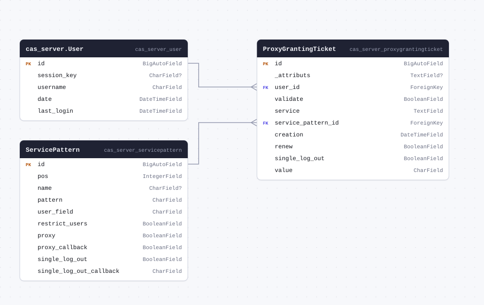

| Column | Field | Type | Null | Key | Default | Description |
| --- | --- | --- | --- | --- | --- | --- |
| `id` | `BigAutoField` | `integer` |  | PK | `autoincrement()` |  |
| `_attributs` | `TextField` | `text` | yes |  | `None` |  |
| `user_id` | `ForeignKey` | `bigint` |  | FK |  |  |
| `validate` | `BooleanField` | `bool` |  |  | `False` |  |
| `service` | `TextField` | `text` |  |  |  |  |
| `service_pattern_id` | `ForeignKey` | `bigint` |  | FK |  |  |
| `creation` | `DateTimeField` | `datetime` |  |  | `now()` |  |
| `renew` | `BooleanField` | `bool` |  |  | `False` |  |
| `single_log_out` | `BooleanField` | `bool` |  |  | `False` |  |
| `value` | `CharField` | `varchar(255)` |  | unique | `gen_pgt()` |  |

Indexes:

- index `cas_server_proxygrantingticket_user_id_cc540046` on `user_id`
- index `cas_server_proxygrantingticket_service_pattern_id_6b7981ac` on `service_pattern_id`

Relations:

- `user_id` → [cas_server.User](#cas_serveruser).`id`, on delete cascade
- `service_pattern_id` → [ServicePattern](#servicepattern).`id`, on delete cascade

## Proxy

Table `cas_server_proxy`, app `cas_server`.

Bases: :class:`django.db.models.Model`

A list of proxies on :class:`ProxyTicket`

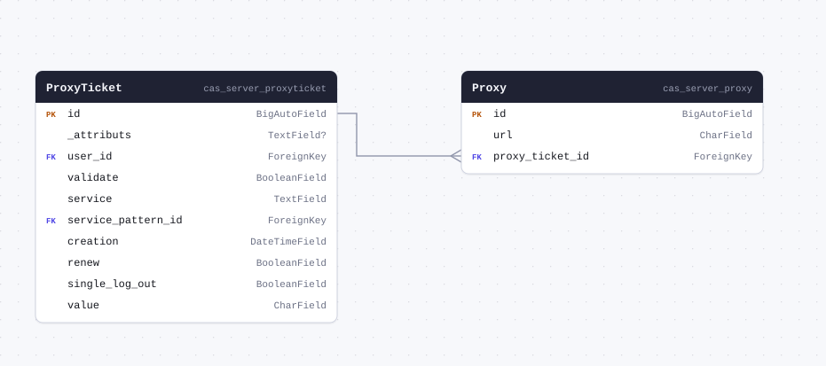

| Column | Field | Type | Null | Key | Default | Description |
| --- | --- | --- | --- | --- | --- | --- |
| `id` | `BigAutoField` | `integer` |  | PK | `autoincrement()` |  |
| `url` | `CharField` | `varchar(255)` |  |  |  |  |
| `proxy_ticket_id` | `ForeignKey` | `bigint` |  | FK |  |  |

Indexes:

- index `cas_server_proxy_proxy_ticket_id_5c6e1aed` on `proxy_ticket_id`

Relations:

- `proxy_ticket_id` → [ProxyTicket](#proxyticket).`id`, on delete cascade

## NewVersionWarning

Table `cas_server_newversionwarning`, app `cas_server`.

Bases: :class:`django.db.models.Model`

The last new version available version sent

| Column | Field | Type | Null | Key | Default | Description |
| --- | --- | --- | --- | --- | --- | --- |
| `id` | `BigAutoField` | `integer` |  | PK | `autoincrement()` |  |
| `version` | `CharField` | `varchar(255)` |  |  |  |  |

# Enums

## LogEntryActionFlag

| Name | Stored as |
| --- | --- |
| `Addition` | `1` |
| `Change` | `2` |
| `Deletion` | `3` |

## FederatedIendityProviderCasProtocolVersion

| Name | Stored as |
| --- | --- |
| `CAS 1.0` | `1` |
| `CAS 2.0` | `2` |
| `CAS 3.0` | `3` |
| `SAML 1.1` | `CAS_2_SAML_1_0` |
