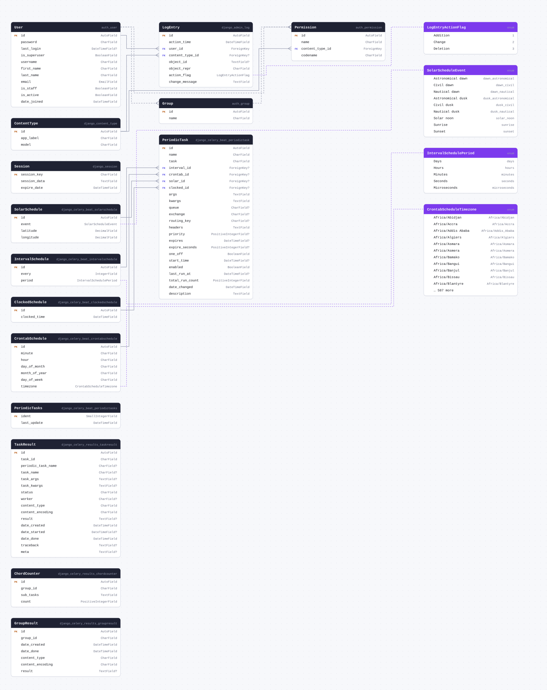
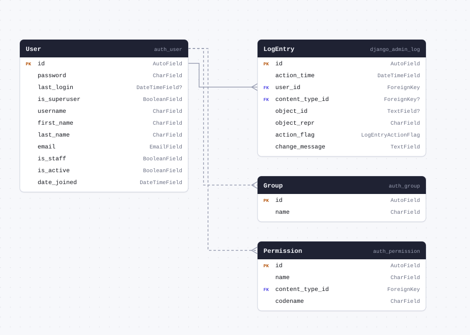
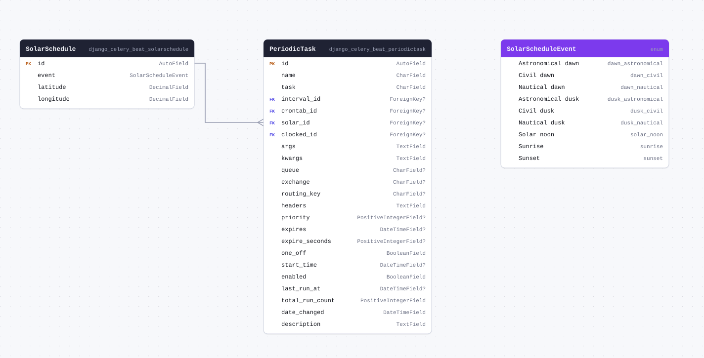
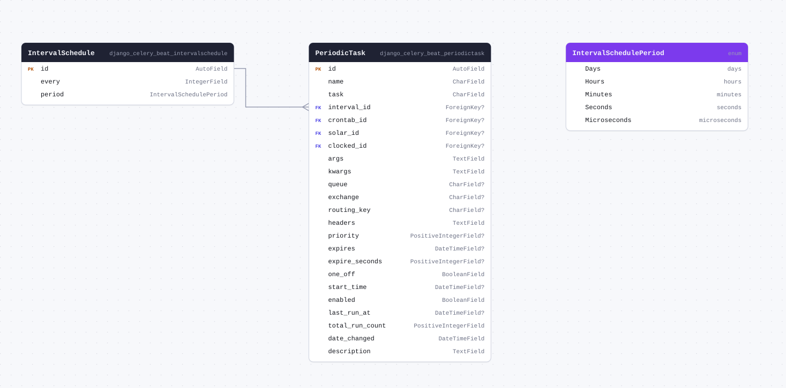
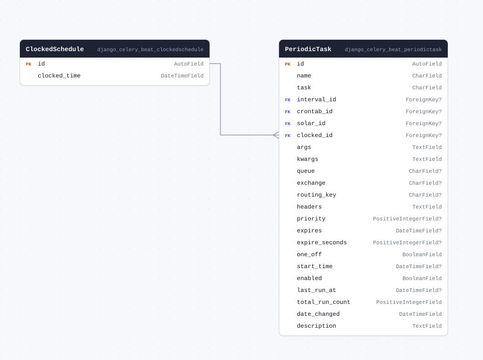
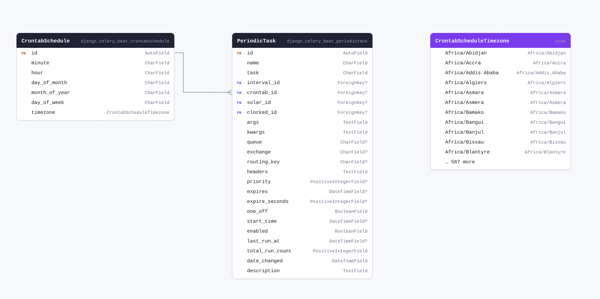
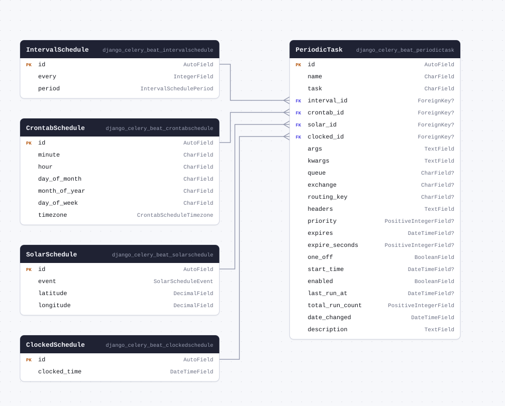

# Schema docs



[LogEntry](#logentry) · [Permission](#permission) · [Group](#group) · [User](#user) · [ContentType](#contenttype) · [Session](#session) · [SolarSchedule](#solarschedule) · [IntervalSchedule](#intervalschedule) · [ClockedSchedule](#clockedschedule) · [CrontabSchedule](#crontabschedule) · [PeriodicTasks](#periodictasks) · [PeriodicTask](#periodictask) · [TaskResult](#taskresult) · [ChordCounter](#chordcounter) · [GroupResult](#groupresult)

<details>
<summary>The whole schema as SQL</summary>

```sql
CREATE TABLE "django_admin_log" ("id" integer NOT NULL PRIMARY KEY AUTOINCREMENT, "action_time" datetime NOT NULL, "user_id" integer NOT NULL REFERENCES "auth_user" ("id") DEFERRABLE INITIALLY DEFERRED, "content_type_id" integer NULL REFERENCES "django_content_type" ("id") DEFERRABLE INITIALLY DEFERRED, "object_id" text NULL, "object_repr" varchar(200) NOT NULL, "action_flag" smallint unsigned NOT NULL CHECK ("action_flag" >= 0), "change_message" text NOT NULL);

CREATE TABLE "auth_permission" ("id" integer NOT NULL PRIMARY KEY AUTOINCREMENT, "name" varchar(255) NOT NULL, "content_type_id" integer NOT NULL REFERENCES "django_content_type" ("id") DEFERRABLE INITIALLY DEFERRED, "codename" varchar(100) NOT NULL);

CREATE TABLE "auth_group" ("id" integer NOT NULL PRIMARY KEY AUTOINCREMENT, "name" varchar(150) NOT NULL UNIQUE);

CREATE TABLE "auth_group_permissions" ("id" integer NOT NULL PRIMARY KEY AUTOINCREMENT, "group_id" integer NOT NULL REFERENCES "auth_group" ("id") DEFERRABLE INITIALLY DEFERRED, "permission_id" integer NOT NULL REFERENCES "auth_permission" ("id") DEFERRABLE INITIALLY DEFERRED);

CREATE TABLE "auth_user" ("id" integer NOT NULL PRIMARY KEY AUTOINCREMENT, "password" varchar(128) NOT NULL, "last_login" datetime NULL, "is_superuser" bool NOT NULL, "username" varchar(150) NOT NULL UNIQUE, "first_name" varchar(150) NOT NULL, "last_name" varchar(150) NOT NULL, "email" varchar(254) NOT NULL, "is_staff" bool NOT NULL, "is_active" bool NOT NULL, "date_joined" datetime NOT NULL);

CREATE TABLE "auth_user_groups" ("id" integer NOT NULL PRIMARY KEY AUTOINCREMENT, "user_id" integer NOT NULL REFERENCES "auth_user" ("id") DEFERRABLE INITIALLY DEFERRED, "group_id" integer NOT NULL REFERENCES "auth_group" ("id") DEFERRABLE INITIALLY DEFERRED);

CREATE TABLE "auth_user_user_permissions" ("id" integer NOT NULL PRIMARY KEY AUTOINCREMENT, "user_id" integer NOT NULL REFERENCES "auth_user" ("id") DEFERRABLE INITIALLY DEFERRED, "permission_id" integer NOT NULL REFERENCES "auth_permission" ("id") DEFERRABLE INITIALLY DEFERRED);

CREATE TABLE "django_content_type" ("id" integer NOT NULL PRIMARY KEY AUTOINCREMENT, "app_label" varchar(100) NOT NULL, "model" varchar(100) NOT NULL);

CREATE TABLE "django_session" ("session_key" varchar(40) NOT NULL PRIMARY KEY, "session_data" text NOT NULL, "expire_date" datetime NOT NULL);

CREATE TABLE "django_celery_beat_solarschedule" ("id" integer NOT NULL PRIMARY KEY AUTOINCREMENT, "event" varchar(24) NOT NULL, "latitude" decimal NOT NULL, "longitude" decimal NOT NULL);

CREATE TABLE "django_celery_beat_intervalschedule" ("id" integer NOT NULL PRIMARY KEY AUTOINCREMENT, "every" integer NOT NULL, "period" varchar(24) NOT NULL);

CREATE TABLE "django_celery_beat_clockedschedule" ("id" integer NOT NULL PRIMARY KEY AUTOINCREMENT, "clocked_time" datetime NOT NULL);

CREATE TABLE "django_celery_beat_crontabschedule" ("id" integer NOT NULL PRIMARY KEY AUTOINCREMENT, "minute" varchar(240) NOT NULL, "hour" varchar(96) NOT NULL, "day_of_month" varchar(124) NOT NULL, "month_of_year" varchar(64) NOT NULL, "day_of_week" varchar(64) NOT NULL, "timezone" varchar(63) NOT NULL);

CREATE TABLE "django_celery_beat_periodictasks" ("ident" smallint NOT NULL PRIMARY KEY, "last_update" datetime NOT NULL);

CREATE TABLE "django_celery_beat_periodictask" ("id" integer NOT NULL PRIMARY KEY AUTOINCREMENT, "name" varchar(200) NOT NULL UNIQUE, "task" varchar(200) NOT NULL, "interval_id" integer NULL REFERENCES "django_celery_beat_intervalschedule" ("id") DEFERRABLE INITIALLY DEFERRED, "crontab_id" integer NULL REFERENCES "django_celery_beat_crontabschedule" ("id") DEFERRABLE INITIALLY DEFERRED, "solar_id" integer NULL REFERENCES "django_celery_beat_solarschedule" ("id") DEFERRABLE INITIALLY DEFERRED, "clocked_id" integer NULL REFERENCES "django_celery_beat_clockedschedule" ("id") DEFERRABLE INITIALLY DEFERRED, "args" text NOT NULL, "kwargs" text NOT NULL, "queue" varchar(200) NULL, "exchange" varchar(200) NULL, "routing_key" varchar(200) NULL, "headers" text NOT NULL, "priority" integer unsigned NULL CHECK ("priority" >= 0), "expires" datetime NULL, "expire_seconds" integer unsigned NULL CHECK ("expire_seconds" >= 0), "one_off" bool NOT NULL, "start_time" datetime NULL, "enabled" bool NOT NULL, "last_run_at" datetime NULL, "total_run_count" integer unsigned NOT NULL CHECK ("total_run_count" >= 0), "date_changed" datetime NOT NULL, "description" text NOT NULL);

CREATE TABLE "django_celery_results_taskresult" ("id" integer NOT NULL PRIMARY KEY AUTOINCREMENT, "task_id" varchar(255) NOT NULL UNIQUE, "periodic_task_name" varchar(255) NULL, "task_name" varchar(255) NULL, "task_args" text NULL, "task_kwargs" text NULL, "status" varchar(50) NOT NULL, "worker" varchar(100) NULL, "content_type" varchar(128) NOT NULL, "content_encoding" varchar(64) NOT NULL, "result" text NULL, "date_created" datetime NOT NULL, "date_started" datetime NULL, "date_done" datetime NOT NULL, "traceback" text NULL, "meta" text NULL);

CREATE TABLE "django_celery_results_chordcounter" ("id" integer NOT NULL PRIMARY KEY AUTOINCREMENT, "group_id" varchar(255) NOT NULL UNIQUE, "sub_tasks" text NOT NULL, "count" integer unsigned NOT NULL CHECK ("count" >= 0));

CREATE TABLE "django_celery_results_groupresult" ("id" integer NOT NULL PRIMARY KEY AUTOINCREMENT, "group_id" varchar(255) NOT NULL UNIQUE, "date_created" datetime NOT NULL, "date_done" datetime NOT NULL, "content_type" varchar(128) NOT NULL, "content_encoding" varchar(64) NOT NULL, "result" text NULL);

CREATE INDEX "django_admin_log_user_id_c564eba6" ON "django_admin_log" ("user_id");

CREATE INDEX "django_admin_log_content_type_id_c4bce8eb" ON "django_admin_log" ("content_type_id");

CREATE UNIQUE INDEX "auth_permission_content_type_id_codename_01ab375a_uniq" ON "auth_permission" ("content_type_id", "codename");

CREATE INDEX "auth_permission_content_type_id_2f476e4b" ON "auth_permission" ("content_type_id");

CREATE UNIQUE INDEX "auth_group_permissions_group_id_permission_id_0cd325b0_uniq" ON "auth_group_permissions" ("group_id", "permission_id");

CREATE INDEX "auth_group_permissions_group_id_b120cbf9" ON "auth_group_permissions" ("group_id");

CREATE INDEX "auth_group_permissions_permission_id_84c5c92e" ON "auth_group_permissions" ("permission_id");

CREATE UNIQUE INDEX "auth_user_groups_user_id_group_id_94350c0c_uniq" ON "auth_user_groups" ("user_id", "group_id");

CREATE INDEX "auth_user_groups_user_id_6a12ed8b" ON "auth_user_groups" ("user_id");

CREATE INDEX "auth_user_groups_group_id_97559544" ON "auth_user_groups" ("group_id");

CREATE UNIQUE INDEX "auth_user_user_permissions_user_id_permission_id_14a6b632_uniq" ON "auth_user_user_permissions" ("user_id", "permission_id");

CREATE INDEX "auth_user_user_permissions_user_id_a95ead1b" ON "auth_user_user_permissions" ("user_id");

CREATE INDEX "auth_user_user_permissions_permission_id_1fbb5f2c" ON "auth_user_user_permissions" ("permission_id");

CREATE UNIQUE INDEX "django_content_type_app_label_model_76bd3d3b_uniq" ON "django_content_type" ("app_label", "model");

CREATE INDEX "django_session_expire_date_a5c62663" ON "django_session" ("expire_date");

CREATE UNIQUE INDEX "django_celery_beat_solarschedule_event_latitude_longitude_ba64999a_uniq" ON "django_celery_beat_solarschedule" ("event", "latitude", "longitude");

CREATE INDEX "django_celery_beat_periodictask_interval_id_a8ca27da" ON "django_celery_beat_periodictask" ("interval_id");

CREATE INDEX "django_celery_beat_periodictask_crontab_id_d3cba168" ON "django_celery_beat_periodictask" ("crontab_id");

CREATE INDEX "django_celery_beat_periodictask_solar_id_a87ce72c" ON "django_celery_beat_periodictask" ("solar_id");

CREATE INDEX "django_celery_beat_periodictask_clocked_id_47a69f82" ON "django_celery_beat_periodictask" ("clocked_id");

CREATE INDEX "django_cele_task_na_08aec9_idx" ON "django_celery_results_taskresult" ("task_name");

CREATE INDEX "django_cele_status_9b6201_idx" ON "django_celery_results_taskresult" ("status");

CREATE INDEX "django_cele_worker_d54dd8_idx" ON "django_celery_results_taskresult" ("worker");

CREATE INDEX "django_cele_date_cr_f04a50_idx" ON "django_celery_results_taskresult" ("date_created");

CREATE INDEX "django_cele_date_do_f59aad_idx" ON "django_celery_results_taskresult" ("date_done");

CREATE INDEX "django_cele_periodi_1993cf_idx" ON "django_celery_results_taskresult" ("periodic_task_name");

CREATE INDEX "django_cele_date_cr_bd6c1d_idx" ON "django_celery_results_groupresult" ("date_created");

CREATE INDEX "django_cele_date_do_caae0e_idx" ON "django_celery_results_groupresult" ("date_done");
```

</details>

## LogEntry

Table `django_admin_log`, app `admin`.


| Column | Field | Type | Null | Key | Default | Description |
| --- | --- | --- | --- | --- | --- | --- |
| `id` | `AutoField` | `integer` |  | PK | `autoincrement()` |  |
| `action_time` | `DateTimeField` | `datetime` |  |  | `now()` |  |
| `user_id` | `ForeignKey` | `integer` |  | FK |  |  |
| `content_type_id` | `ForeignKey` | `integer` | yes | FK |  |  |
| `object_id` | `TextField` | `text` | yes |  |  |  |
| `object_repr` | `CharField` | `varchar(200)` |  |  |  |  |
| `action_flag` | `LogEntryActionFlag` | `smallint unsigned` |  |  |  |  |
| `change_message` | `TextField` | `text` |  |  |  |  |

Indexes:

- index `django_admin_log_user_id_c564eba6` on `user_id`
- index `django_admin_log_content_type_id_c4bce8eb` on `content_type_id`

Relations:

- `user_id` → [User](#user).`id`, on delete cascade
- `content_type_id` → [ContentType](#contenttype).`id`, on delete set null

## Permission

Table `auth_permission`, app `auth`.

The permissions system provides a way to assign permissions to specific
users and groups of users.

The permission system is used by the Django admin site, but may also be
useful in your own code. The Django admin site uses permissions as follows:

    - The "add" permission limits the user's ability to view the "add" form
      and add an object.
    - The "change" permission limits a user's ability to view the change
      list, view the "change" form and change an object.
    - The "delete" permission limits the ability to delete an object.
    - The "view" permission limits the ability to view an object.

Permissions are set globally per type of object, not per specific object
instance. It is possible to say "Mary may change news stories," but it's
not currently possible to say "Mary may change news stories, but only the
ones she created herself" or "Mary may only change news stories that have a
certain status or publication date."

The permissions listed above are automatically created for each model.


| Column | Field | Type | Null | Key | Default | Description |
| --- | --- | --- | --- | --- | --- | --- |
| `id` | `AutoField` | `integer` |  | PK | `autoincrement()` |  |
| `name` | `CharField` | `varchar(255)` |  |  |  |  |
| `content_type_id` | `ForeignKey` | `integer` |  | FK |  |  |
| `codename` | `CharField` | `varchar(100)` |  |  |  |  |

Indexes:

- index `auth_permission_content_type_id_2f476e4b` on `content_type_id`
- unique `auth_permission_content_type_id_codename_01ab375a_uniq` on `content_type_id`, `codename`

Relations:

- `content_type_id` → [ContentType](#contenttype).`id`, on delete cascade
- `group_set` — many to many with [Group](#group)
- `user_set` — many to many with [User](#user)

## Group

Table `auth_group`, app `auth`.

Groups are a generic way of categorizing users to apply permissions, or
some other label, to those users. A user can belong to any number of
groups.

A user in a group automatically has all the permissions granted to that
group. For example, if the group 'Site editors' has the permission
can_edit_home_page, any user in that group will have that permission.

Beyond permissions, groups are a convenient way to categorize users to
apply some label, or extended functionality, to them. For example, you
could create a group 'Special users', and you could write code that would
do special things to those users -- such as giving them access to a
members-only portion of your site, or sending them members-only email
messages.


| Column | Field | Type | Null | Key | Default | Description |
| --- | --- | --- | --- | --- | --- | --- |
| `id` | `AutoField` | `integer` |  | PK | `autoincrement()` |  |
| `name` | `CharField` | `varchar(150)` |  | unique |  |  |

Relations:

- `permissions` — many to many with [Permission](#permission)
- `user_set` — many to many with [User](#user)

## User

Table `auth_user`, app `auth`.

Columns from `AbstractUser` (abstract): `username`, `first_name`, `last_name`, `email`, `is_staff`, `is_active`, `date_joined`.

Columns from `AbstractBaseUser` (abstract): `password`, `last_login`.

Columns from `PermissionsMixin` (abstract): `is_superuser`.

Users within the Django authentication system are represented by this
model.

Username and password are required. Other fields are optional.



| Column | Field | Type | Null | Key | Default | Description |
| --- | --- | --- | --- | --- | --- | --- |
| `id` | `AutoField` | `integer` |  | PK | `autoincrement()` |  |
| `password` | `CharField` | `varchar(128)` |  |  |  |  |
| `last_login` | `DateTimeField` | `datetime` | yes |  |  |  |
| `is_superuser` | `BooleanField` | `bool` |  |  | `False` | Designates that this user has all permissions without explicitly assigning them. |
| `username` | `CharField` | `varchar(150)` |  | unique |  | Required. 150 characters or fewer. Letters, digits and @/./+/-/_ only. |
| `first_name` | `CharField` | `varchar(150)` |  |  |  |  |
| `last_name` | `CharField` | `varchar(150)` |  |  |  |  |
| `email` | `EmailField` | `varchar(254)` |  |  |  |  |
| `is_staff` | `BooleanField` | `bool` |  |  | `False` | Designates whether the user can log into this admin site. |
| `is_active` | `BooleanField` | `bool` |  |  | `True` | Designates whether this user should be treated as active. Unselect this instead of deleting accounts. |
| `date_joined` | `DateTimeField` | `datetime` |  |  | `now()` |  |

Relations:

- [LogEntry](#logentry).`user_id` → `id`, on delete cascade
- `groups` — many to many with [Group](#group)
- `user_permissions` — many to many with [Permission](#permission)

## ContentType

Table `django_content_type`, app `contenttypes`.


| Column | Field | Type | Null | Key | Default | Description |
| --- | --- | --- | --- | --- | --- | --- |
| `id` | `AutoField` | `integer` |  | PK | `autoincrement()` |  |
| `app_label` | `CharField` | `varchar(100)` |  |  |  |  |
| `model` | `CharField` | `varchar(100)` |  |  |  |  |

Indexes:

- unique `django_content_type_app_label_model_76bd3d3b_uniq` on `app_label`, `model`

Relations:

- [LogEntry](#logentry).`content_type_id` → `id`, on delete set null
- [Permission](#permission).`content_type_id` → `id`, on delete cascade

## Session

Table `django_session`, app `sessions`.

Columns from `AbstractBaseSession` (abstract): `session_key`, `session_data`, `expire_date`.

Django provides full support for anonymous sessions. The session
framework lets you store and retrieve arbitrary data on a
per-site-visitor basis. It stores data on the server side and
abstracts the sending and receiving of cookies. Cookies contain a
session ID -- not the data itself.

The Django sessions framework is entirely cookie-based. It does
not fall back to putting session IDs in URLs. This is an intentional
design decision. Not only does that behavior make URLs ugly, it makes
your site vulnerable to session-ID theft via the "Referer" header.

For complete documentation on using Sessions in your code, consult
the sessions documentation that is shipped with Django (also available
on the Django web site).

| Column | Field | Type | Null | Key | Default | Description |
| --- | --- | --- | --- | --- | --- | --- |
| `session_key` | `CharField` | `varchar(40)` |  | PK |  |  |
| `session_data` | `TextField` | `text` |  |  |  |  |
| `expire_date` | `DateTimeField` | `datetime` |  |  |  |  |

Indexes:

- index `django_session_expire_date_a5c62663` on `expire_date`

## SolarSchedule

Table `django_celery_beat_solarschedule`, app `django_celery_beat`.

Schedule following astronomical patterns.

Example: to run every sunrise in New York City:

>>> event='sunrise', latitude=40.7128, longitude=74.0060



| Column | Field | Type | Null | Key | Default | Description |
| --- | --- | --- | --- | --- | --- | --- |
| `id` | `AutoField` | `integer` |  | PK | `autoincrement()` |  |
| `event` | `SolarScheduleEvent` | `varchar(24)` |  |  |  | The type of solar event when the job should run |
| `latitude` | `DecimalField(9, 6)` | `decimal` |  |  |  | Run the task when the event happens at this latitude |
| `longitude` | `DecimalField(9, 6)` | `decimal` |  |  |  | Run the task when the event happens at this longitude |

Indexes:

- unique `django_celery_beat_solarschedule_event_latitude_longitude_ba64999a_uniq` on `event`, `latitude`, `longitude`

Relations:

- [PeriodicTask](#periodictask).`solar_id` → `id`, on delete cascade

## IntervalSchedule

Table `django_celery_beat_intervalschedule`, app `django_celery_beat`.

Schedule executing on a regular interval.

Example: execute every 2 days:

>>> every=2, period=DAYS



| Column | Field | Type | Null | Key | Default | Description |
| --- | --- | --- | --- | --- | --- | --- |
| `id` | `AutoField` | `integer` |  | PK | `autoincrement()` |  |
| `every` | `IntegerField` | `integer` |  |  |  | Number of interval periods to wait before running the task again |
| `period` | `IntervalSchedulePeriod` | `varchar(24)` |  |  |  | The type of period between task runs (Example: days) |

Relations:

- [PeriodicTask](#periodictask).`interval_id` → `id`, on delete cascade

## ClockedSchedule

Table `django_celery_beat_clockedschedule`, app `django_celery_beat`.

clocked schedule.



| Column | Field | Type | Null | Key | Default | Description |
| --- | --- | --- | --- | --- | --- | --- |
| `id` | `AutoField` | `integer` |  | PK | `autoincrement()` |  |
| `clocked_time` | `DateTimeField` | `datetime` |  |  |  | Run the task at clocked time |

Relations:

- [PeriodicTask](#periodictask).`clocked_id` → `id`, on delete cascade

## CrontabSchedule

Table `django_celery_beat_crontabschedule`, app `django_celery_beat`.

Timezone Aware Crontab-like schedule.

Example:  Run every hour at 0 minutes for days of month 10-15:

>>> minute="0", hour="*", day_of_week="*",
... day_of_month="10-15", month_of_year="*"



| Column | Field | Type | Null | Key | Default | Description |
| --- | --- | --- | --- | --- | --- | --- |
| `id` | `AutoField` | `integer` |  | PK | `autoincrement()` |  |
| `minute` | `CharField` | `varchar(240)` |  |  | `'*'` | Cron Minutes to Run. Use "*" for "all". (Example: "0,30") |
| `hour` | `CharField` | `varchar(96)` |  |  | `'*'` | Cron Hours to Run. Use "*" for "all". (Example: "8,20") |
| `day_of_month` | `CharField` | `varchar(124)` |  |  | `'*'` | Cron Days Of The Month to Run. Use "*" for "all". (Example: "1,15") |
| `month_of_year` | `CharField` | `varchar(64)` |  |  | `'*'` | Cron Months (1-12) Of The Year to Run. Use "*" for "all". (Example: "1,12") |
| `day_of_week` | `CharField` | `varchar(64)` |  |  | `'*'` | Cron Days Of The Week to Run. Use "*" for "all", Sunday is 0 or 7, Monday is 1. (Example: "0,5") |
| `timezone` | `CrontabScheduleTimezone` | `varchar(63)` |  |  | `crontab_schedule_celery_timezone()` | Timezone to Run the Cron Schedule on. Default is UTC. |

Relations:

- [PeriodicTask](#periodictask).`crontab_id` → `id`, on delete cascade

## PeriodicTasks

Table `django_celery_beat_periodictasks`, app `django_celery_beat`.

Helper table for tracking updates to periodic tasks.

This stores a single row with ``ident=1``. ``last_update`` is updated via
signals whenever anything changes in the :class:`~.PeriodicTask` model.
Basically this acts like a DB data audit trigger.
Doing this so we also track deletions, and not just insert/update.

| Column | Field | Type | Null | Key | Default | Description |
| --- | --- | --- | --- | --- | --- | --- |
| `ident` | `SmallIntegerField` | `smallint` |  | PK | `1` |  |
| `last_update` | `DateTimeField` | `datetime` |  |  |  |  |

## PeriodicTask

Table `django_celery_beat_periodictask`, app `django_celery_beat`.

Model representing a periodic task.



| Column | Field | Type | Null | Key | Default | Description |
| --- | --- | --- | --- | --- | --- | --- |
| `id` | `AutoField` | `integer` |  | PK | `autoincrement()` |  |
| `name` | `CharField` | `varchar(200)` |  | unique |  | Short Description For This Task |
| `task` | `CharField` | `varchar(200)` |  |  |  | The Name of the Celery Task that Should be Run.  (Example: "proj.tasks.import_contacts") |
| `interval_id` | `ForeignKey` | `integer` | yes | FK |  | Interval Schedule to run the task on.  Set only one schedule type, leave the others null. |
| `crontab_id` | `ForeignKey` | `integer` | yes | FK |  | Crontab Schedule to run the task on.  Set only one schedule type, leave the others null. |
| `solar_id` | `ForeignKey` | `integer` | yes | FK |  | Solar Schedule to run the task on.  Set only one schedule type, leave the others null. |
| `clocked_id` | `ForeignKey` | `integer` | yes | FK |  | Clocked Schedule to run the task on.  Set only one schedule type, leave the others null. |
| `args` | `TextField` | `text` |  |  | `'[]'` | JSON encoded positional arguments (Example: ["arg1", "arg2"]) |
| `kwargs` | `TextField` | `text` |  |  | `'{}'` | JSON encoded keyword arguments (Example: {"argument": "value"}) |
| `queue` | `CharField` | `varchar(200)` | yes |  | `None` | Queue defined in CELERY_TASK_QUEUES. Leave None for default queuing. |
| `exchange` | `CharField` | `varchar(200)` | yes |  | `None` | Override Exchange for low-level AMQP routing |
| `routing_key` | `CharField` | `varchar(200)` | yes |  | `None` | Override Routing Key for low-level AMQP routing |
| `headers` | `TextField` | `text` |  |  | `'{}'` | JSON encoded message headers for the AMQP message. |
| `priority` | `PositiveIntegerField` | `integer unsigned` | yes |  | `None` | Priority Number between 0 and 255. Supported by: RabbitMQ, Redis (priority reversed, 0 is highest). |
| `expires` | `DateTimeField` | `datetime` | yes |  |  | Datetime after which the schedule will no longer trigger the task to run |
| `expire_seconds` | `PositiveIntegerField` | `integer unsigned` | yes |  |  | Timedelta with seconds which the schedule will no longer trigger the task to run |
| `one_off` | `BooleanField` | `bool` |  |  | `False` | If True, the schedule will only run the task a single time |
| `start_time` | `DateTimeField` | `datetime` | yes |  |  | Datetime when the schedule should begin triggering the task to run |
| `enabled` | `BooleanField` | `bool` |  |  | `True` | Set to False to disable the schedule |
| `last_run_at` | `DateTimeField` | `datetime` | yes |  |  | Datetime that the schedule last triggered the task to run. Reset to None if enabled is set to False. |
| `total_run_count` | `PositiveIntegerField` | `integer unsigned` |  |  | `0` | Running count of how many times the schedule has triggered the task |
| `date_changed` | `DateTimeField` | `datetime` |  |  | `now()` | Datetime that this PeriodicTask was last modified |
| `description` | `TextField` | `text` |  |  |  | Detailed description about the details of this Periodic Task |

Indexes:

- index `django_celery_beat_periodictask_interval_id_a8ca27da` on `interval_id`
- index `django_celery_beat_periodictask_crontab_id_d3cba168` on `crontab_id`
- index `django_celery_beat_periodictask_solar_id_a87ce72c` on `solar_id`
- index `django_celery_beat_periodictask_clocked_id_47a69f82` on `clocked_id`

Relations:

- `interval_id` → [IntervalSchedule](#intervalschedule).`id`, on delete cascade
- `crontab_id` → [CrontabSchedule](#crontabschedule).`id`, on delete cascade
- `solar_id` → [SolarSchedule](#solarschedule).`id`, on delete cascade
- `clocked_id` → [ClockedSchedule](#clockedschedule).`id`, on delete cascade

## TaskResult

Table `django_celery_results_taskresult`, app `django_celery_results`.

Task result/status.

| Column | Field | Type | Null | Key | Default | Description |
| --- | --- | --- | --- | --- | --- | --- |
| `id` | `AutoField` | `integer` |  | PK | `autoincrement()` |  |
| `task_id` | `CharField` | `varchar(255)` |  | unique |  | Celery ID for the Task that was run |
| `periodic_task_name` | `CharField` | `varchar(255)` | yes |  |  | Name of the Periodic Task which was run |
| `task_name` | `CharField` | `varchar(255)` | yes |  |  | Name of the Task which was run |
| `task_args` | `TextField` | `text` | yes |  |  | JSON representation of the positional arguments used with the task |
| `task_kwargs` | `TextField` | `text` | yes |  |  | JSON representation of the named arguments used with the task |
| `status` | `CharField` | `varchar(50)` |  |  | `'PENDING'` | Current state of the task being run |
| `worker` | `CharField` | `varchar(100)` | yes |  | `None` | Worker that executes the task |
| `content_type` | `CharField` | `varchar(128)` |  |  |  | Content type of the result data |
| `content_encoding` | `CharField` | `varchar(64)` |  |  |  | The encoding used to save the task result data |
| `result` | `TextField` | `text` | yes |  | `None` | The data returned by the task.  Use content_encoding and content_type fields to read. |
| `date_created` | `DateTimeField` | `datetime` |  |  | `now()` | Datetime field when the task result was created in UTC |
| `date_started` | `DateTimeField` | `datetime` | yes |  | `None` | Datetime field when the task was started in UTC |
| `date_done` | `DateTimeField` | `datetime` |  |  | `now()` | Datetime field when the task was completed in UTC |
| `traceback` | `TextField` | `text` | yes |  |  | Text of the traceback if the task generated one |
| `meta` | `TextField` | `text` | yes |  | `None` | JSON meta information about the task, such as information on child tasks |

Indexes:

- index `django_cele_task_na_08aec9_idx` on `task_name`
- index `django_cele_status_9b6201_idx` on `status`
- index `django_cele_worker_d54dd8_idx` on `worker`
- index `django_cele_date_cr_f04a50_idx` on `date_created`
- index `django_cele_date_do_f59aad_idx` on `date_done`
- index `django_cele_periodi_1993cf_idx` on `periodic_task_name`

## ChordCounter

Table `django_celery_results_chordcounter`, app `django_celery_results`.

Chord synchronisation.

| Column | Field | Type | Null | Key | Default | Description |
| --- | --- | --- | --- | --- | --- | --- |
| `id` | `AutoField` | `integer` |  | PK | `autoincrement()` |  |
| `group_id` | `CharField` | `varchar(255)` |  | unique |  | Celery ID for the Chord header group |
| `sub_tasks` | `TextField` | `text` |  |  |  | JSON serialized list of task result tuples. use .group_result() to decode |
| `count` | `PositiveIntegerField` | `integer unsigned` |  |  |  | Starts at len(chord header) and decrements after each task is finished |

## GroupResult

Table `django_celery_results_groupresult`, app `django_celery_results`.

Task Group result/status.

| Column | Field | Type | Null | Key | Default | Description |
| --- | --- | --- | --- | --- | --- | --- |
| `id` | `AutoField` | `integer` |  | PK | `autoincrement()` |  |
| `group_id` | `CharField` | `varchar(255)` |  | unique |  | Celery ID for the Group that was run |
| `date_created` | `DateTimeField` | `datetime` |  |  | `now()` | Datetime field when the group result was created in UTC |
| `date_done` | `DateTimeField` | `datetime` |  |  | `now()` | Datetime field when the group was completed in UTC |
| `content_type` | `CharField` | `varchar(128)` |  |  |  | Content type of the result data |
| `content_encoding` | `CharField` | `varchar(64)` |  |  |  | The encoding used to save the task result data |
| `result` | `TextField` | `text` | yes |  | `None` | The data returned by the task.  Use content_encoding and content_type fields to read. |

Indexes:

- index `django_cele_date_cr_bd6c1d_idx` on `date_created`
- index `django_cele_date_do_caae0e_idx` on `date_done`

# Enums

## LogEntryActionFlag

| Name | Stored as |
| --- | --- |
| `Addition` | `1` |
| `Change` | `2` |
| `Deletion` | `3` |

## SolarScheduleEvent

| Name | Stored as |
| --- | --- |
| `Astronomical dawn` | `dawn_astronomical` |
| `Civil dawn` | `dawn_civil` |
| `Nautical dawn` | `dawn_nautical` |
| `Astronomical dusk` | `dusk_astronomical` |
| `Civil dusk` | `dusk_civil` |
| `Nautical dusk` | `dusk_nautical` |
| `Solar noon` | `solar_noon` |
| `Sunrise` | `sunrise` |
| `Sunset` | `sunset` |

## IntervalSchedulePeriod

| Name | Stored as |
| --- | --- |
| `Days` | `days` |
| `Hours` | `hours` |
| `Minutes` | `minutes` |
| `Seconds` | `seconds` |
| `Microseconds` | `microseconds` |

## CrontabScheduleTimezone

| Name | Stored as |
| --- | --- |
| `Africa/Abidjan` | `Africa/Abidjan` |
| `Africa/Accra` | `Africa/Accra` |
| `Africa/Addis Ababa` | `Africa/Addis_Ababa` |
| `Africa/Algiers` | `Africa/Algiers` |
| `Africa/Asmara` | `Africa/Asmara` |
| `Africa/Asmera` | `Africa/Asmera` |
| `Africa/Bamako` | `Africa/Bamako` |
| `Africa/Bangui` | `Africa/Bangui` |
| `Africa/Banjul` | `Africa/Banjul` |
| `Africa/Bissau` | `Africa/Bissau` |
| `Africa/Blantyre` | `Africa/Blantyre` |
| `Africa/Brazzaville` | `Africa/Brazzaville` |
| `Africa/Bujumbura` | `Africa/Bujumbura` |
| `Africa/Cairo` | `Africa/Cairo` |
| `Africa/Casablanca` | `Africa/Casablanca` |
| `Africa/Ceuta` | `Africa/Ceuta` |
| `Africa/Conakry` | `Africa/Conakry` |
| `Africa/Dakar` | `Africa/Dakar` |
| `Africa/Dar es Salaam` | `Africa/Dar_es_Salaam` |
| `Africa/Djibouti` | `Africa/Djibouti` |
| `Africa/Douala` | `Africa/Douala` |
| `Africa/El Aaiun` | `Africa/El_Aaiun` |
| `Africa/Freetown` | `Africa/Freetown` |
| `Africa/Gaborone` | `Africa/Gaborone` |
| `Africa/Harare` | `Africa/Harare` |
| `Africa/Johannesburg` | `Africa/Johannesburg` |
| `Africa/Juba` | `Africa/Juba` |
| `Africa/Kampala` | `Africa/Kampala` |
| `Africa/Khartoum` | `Africa/Khartoum` |
| `Africa/Kigali` | `Africa/Kigali` |
| `Africa/Kinshasa` | `Africa/Kinshasa` |
| `Africa/Lagos` | `Africa/Lagos` |
| `Africa/Libreville` | `Africa/Libreville` |
| `Africa/Lome` | `Africa/Lome` |
| `Africa/Luanda` | `Africa/Luanda` |
| `Africa/Lubumbashi` | `Africa/Lubumbashi` |
| `Africa/Lusaka` | `Africa/Lusaka` |
| `Africa/Malabo` | `Africa/Malabo` |
| `Africa/Maputo` | `Africa/Maputo` |
| `Africa/Maseru` | `Africa/Maseru` |
| `Africa/Mbabane` | `Africa/Mbabane` |
| `Africa/Mogadishu` | `Africa/Mogadishu` |
| `Africa/Monrovia` | `Africa/Monrovia` |
| `Africa/Nairobi` | `Africa/Nairobi` |
| `Africa/Ndjamena` | `Africa/Ndjamena` |
| `Africa/Niamey` | `Africa/Niamey` |
| `Africa/Nouakchott` | `Africa/Nouakchott` |
| `Africa/Ouagadougou` | `Africa/Ouagadougou` |
| `Africa/Porto-Novo` | `Africa/Porto-Novo` |
| `Africa/Sao Tome` | `Africa/Sao_Tome` |
| `Africa/Timbuktu` | `Africa/Timbuktu` |
| `Africa/Tripoli` | `Africa/Tripoli` |
| `Africa/Tunis` | `Africa/Tunis` |
| `Africa/Windhoek` | `Africa/Windhoek` |
| `America/Adak` | `America/Adak` |
| `America/Anchorage` | `America/Anchorage` |
| `America/Anguilla` | `America/Anguilla` |
| `America/Antigua` | `America/Antigua` |
| `America/Araguaina` | `America/Araguaina` |
| `America/Argentina/Buenos Aires` | `America/Argentina/Buenos_Aires` |
| `America/Argentina/Catamarca` | `America/Argentina/Catamarca` |
| `America/Argentina/ComodRivadavia` | `America/Argentina/ComodRivadavia` |
| `America/Argentina/Cordoba` | `America/Argentina/Cordoba` |
| `America/Argentina/Jujuy` | `America/Argentina/Jujuy` |
| `America/Argentina/La Rioja` | `America/Argentina/La_Rioja` |
| `America/Argentina/Mendoza` | `America/Argentina/Mendoza` |
| `America/Argentina/Rio Gallegos` | `America/Argentina/Rio_Gallegos` |
| `America/Argentina/Salta` | `America/Argentina/Salta` |
| `America/Argentina/San Juan` | `America/Argentina/San_Juan` |
| `America/Argentina/San Luis` | `America/Argentina/San_Luis` |
| `America/Argentina/Tucuman` | `America/Argentina/Tucuman` |
| `America/Argentina/Ushuaia` | `America/Argentina/Ushuaia` |
| `America/Aruba` | `America/Aruba` |
| `America/Asuncion` | `America/Asuncion` |
| `America/Atikokan` | `America/Atikokan` |
| `America/Atka` | `America/Atka` |
| `America/Bahia` | `America/Bahia` |
| `America/Bahia Banderas` | `America/Bahia_Banderas` |
| `America/Barbados` | `America/Barbados` |
| `America/Belem` | `America/Belem` |
| `America/Belize` | `America/Belize` |
| `America/Blanc-Sablon` | `America/Blanc-Sablon` |
| `America/Boa Vista` | `America/Boa_Vista` |
| `America/Bogota` | `America/Bogota` |
| `America/Boise` | `America/Boise` |
| `America/Buenos Aires` | `America/Buenos_Aires` |
| `America/Cambridge Bay` | `America/Cambridge_Bay` |
| `America/Campo Grande` | `America/Campo_Grande` |
| `America/Cancun` | `America/Cancun` |
| `America/Caracas` | `America/Caracas` |
| `America/Catamarca` | `America/Catamarca` |
| `America/Cayenne` | `America/Cayenne` |
| `America/Cayman` | `America/Cayman` |
| `America/Chicago` | `America/Chicago` |
| `America/Chihuahua` | `America/Chihuahua` |
| `America/Ciudad Juarez` | `America/Ciudad_Juarez` |
| `America/Coral Harbour` | `America/Coral_Harbour` |
| `America/Cordoba` | `America/Cordoba` |
| `America/Costa Rica` | `America/Costa_Rica` |
| `America/Coyhaique` | `America/Coyhaique` |
| `America/Creston` | `America/Creston` |
| `America/Cuiaba` | `America/Cuiaba` |
| `America/Curacao` | `America/Curacao` |
| `America/Danmarkshavn` | `America/Danmarkshavn` |
| `America/Dawson` | `America/Dawson` |
| `America/Dawson Creek` | `America/Dawson_Creek` |
| `America/Denver` | `America/Denver` |
| `America/Detroit` | `America/Detroit` |
| `America/Dominica` | `America/Dominica` |
| `America/Edmonton` | `America/Edmonton` |
| `America/Eirunepe` | `America/Eirunepe` |
| `America/El Salvador` | `America/El_Salvador` |
| `America/Ensenada` | `America/Ensenada` |
| `America/Fort Nelson` | `America/Fort_Nelson` |
| `America/Fort Wayne` | `America/Fort_Wayne` |
| `America/Fortaleza` | `America/Fortaleza` |
| `America/Glace Bay` | `America/Glace_Bay` |
| `America/Godthab` | `America/Godthab` |
| `America/Goose Bay` | `America/Goose_Bay` |
| `America/Grand Turk` | `America/Grand_Turk` |
| `America/Grenada` | `America/Grenada` |
| `America/Guadeloupe` | `America/Guadeloupe` |
| `America/Guatemala` | `America/Guatemala` |
| `America/Guayaquil` | `America/Guayaquil` |
| `America/Guyana` | `America/Guyana` |
| `America/Halifax` | `America/Halifax` |
| `America/Havana` | `America/Havana` |
| `America/Hermosillo` | `America/Hermosillo` |
| `America/Indiana/Indianapolis` | `America/Indiana/Indianapolis` |
| `America/Indiana/Knox` | `America/Indiana/Knox` |
| `America/Indiana/Marengo` | `America/Indiana/Marengo` |
| `America/Indiana/Petersburg` | `America/Indiana/Petersburg` |
| `America/Indiana/Tell City` | `America/Indiana/Tell_City` |
| `America/Indiana/Vevay` | `America/Indiana/Vevay` |
| `America/Indiana/Vincennes` | `America/Indiana/Vincennes` |
| `America/Indiana/Winamac` | `America/Indiana/Winamac` |
| `America/Indianapolis` | `America/Indianapolis` |
| `America/Inuvik` | `America/Inuvik` |
| `America/Iqaluit` | `America/Iqaluit` |
| `America/Jamaica` | `America/Jamaica` |
| `America/Jujuy` | `America/Jujuy` |
| `America/Juneau` | `America/Juneau` |
| `America/Kentucky/Louisville` | `America/Kentucky/Louisville` |
| `America/Kentucky/Monticello` | `America/Kentucky/Monticello` |
| `America/Knox IN` | `America/Knox_IN` |
| `America/Kralendijk` | `America/Kralendijk` |
| `America/La Paz` | `America/La_Paz` |
| `America/Lima` | `America/Lima` |
| `America/Los Angeles` | `America/Los_Angeles` |
| `America/Louisville` | `America/Louisville` |
| `America/Lower Princes` | `America/Lower_Princes` |
| `America/Maceio` | `America/Maceio` |
| `America/Managua` | `America/Managua` |
| `America/Manaus` | `America/Manaus` |
| `America/Marigot` | `America/Marigot` |
| `America/Martinique` | `America/Martinique` |
| `America/Matamoros` | `America/Matamoros` |
| `America/Mazatlan` | `America/Mazatlan` |
| `America/Mendoza` | `America/Mendoza` |
| `America/Menominee` | `America/Menominee` |
| `America/Merida` | `America/Merida` |
| `America/Metlakatla` | `America/Metlakatla` |
| `America/Mexico City` | `America/Mexico_City` |
| `America/Miquelon` | `America/Miquelon` |
| `America/Moncton` | `America/Moncton` |
| `America/Monterrey` | `America/Monterrey` |
| `America/Montevideo` | `America/Montevideo` |
| `America/Montreal` | `America/Montreal` |
| `America/Montserrat` | `America/Montserrat` |
| `America/Nassau` | `America/Nassau` |
| `America/New York` | `America/New_York` |
| `America/Nipigon` | `America/Nipigon` |
| `America/Nome` | `America/Nome` |
| `America/Noronha` | `America/Noronha` |
| `America/North Dakota/Beulah` | `America/North_Dakota/Beulah` |
| `America/North Dakota/Center` | `America/North_Dakota/Center` |
| `America/North Dakota/New Salem` | `America/North_Dakota/New_Salem` |
| `America/Nuuk` | `America/Nuuk` |
| `America/Ojinaga` | `America/Ojinaga` |
| `America/Panama` | `America/Panama` |
| `America/Pangnirtung` | `America/Pangnirtung` |
| `America/Paramaribo` | `America/Paramaribo` |
| `America/Phoenix` | `America/Phoenix` |
| `America/Port-au-Prince` | `America/Port-au-Prince` |
| `America/Port of Spain` | `America/Port_of_Spain` |
| `America/Porto Acre` | `America/Porto_Acre` |
| `America/Porto Velho` | `America/Porto_Velho` |
| `America/Puerto Rico` | `America/Puerto_Rico` |
| `America/Punta Arenas` | `America/Punta_Arenas` |
| `America/Rainy River` | `America/Rainy_River` |
| `America/Rankin Inlet` | `America/Rankin_Inlet` |
| `America/Recife` | `America/Recife` |
| `America/Regina` | `America/Regina` |
| `America/Resolute` | `America/Resolute` |
| `America/Rio Branco` | `America/Rio_Branco` |
| `America/Rosario` | `America/Rosario` |
| `America/Santa Isabel` | `America/Santa_Isabel` |
| `America/Santarem` | `America/Santarem` |
| `America/Santiago` | `America/Santiago` |
| `America/Santo Domingo` | `America/Santo_Domingo` |
| `America/Sao Paulo` | `America/Sao_Paulo` |
| `America/Scoresbysund` | `America/Scoresbysund` |
| `America/Shiprock` | `America/Shiprock` |
| `America/Sitka` | `America/Sitka` |
| `America/St Barthelemy` | `America/St_Barthelemy` |
| `America/St Johns` | `America/St_Johns` |
| `America/St Kitts` | `America/St_Kitts` |
| `America/St Lucia` | `America/St_Lucia` |
| `America/St Thomas` | `America/St_Thomas` |
| `America/St Vincent` | `America/St_Vincent` |
| `America/Swift Current` | `America/Swift_Current` |
| `America/Tegucigalpa` | `America/Tegucigalpa` |
| `America/Thule` | `America/Thule` |
| `America/Thunder Bay` | `America/Thunder_Bay` |
| `America/Tijuana` | `America/Tijuana` |
| `America/Toronto` | `America/Toronto` |
| `America/Tortola` | `America/Tortola` |
| `America/Vancouver` | `America/Vancouver` |
| `America/Virgin` | `America/Virgin` |
| `America/Whitehorse` | `America/Whitehorse` |
| `America/Winnipeg` | `America/Winnipeg` |
| `America/Yakutat` | `America/Yakutat` |
| `America/Yellowknife` | `America/Yellowknife` |
| `Antarctica/Casey` | `Antarctica/Casey` |
| `Antarctica/Davis` | `Antarctica/Davis` |
| `Antarctica/DumontDUrville` | `Antarctica/DumontDUrville` |
| `Antarctica/Macquarie` | `Antarctica/Macquarie` |
| `Antarctica/Mawson` | `Antarctica/Mawson` |
| `Antarctica/McMurdo` | `Antarctica/McMurdo` |
| `Antarctica/Palmer` | `Antarctica/Palmer` |
| `Antarctica/Rothera` | `Antarctica/Rothera` |
| `Antarctica/South Pole` | `Antarctica/South_Pole` |
| `Antarctica/Syowa` | `Antarctica/Syowa` |
| `Antarctica/Troll` | `Antarctica/Troll` |
| `Antarctica/Vostok` | `Antarctica/Vostok` |
| `Arctic/Longyearbyen` | `Arctic/Longyearbyen` |
| `Asia/Aden` | `Asia/Aden` |
| `Asia/Almaty` | `Asia/Almaty` |
| `Asia/Amman` | `Asia/Amman` |
| `Asia/Anadyr` | `Asia/Anadyr` |
| `Asia/Aqtau` | `Asia/Aqtau` |
| `Asia/Aqtobe` | `Asia/Aqtobe` |
| `Asia/Ashgabat` | `Asia/Ashgabat` |
| `Asia/Ashkhabad` | `Asia/Ashkhabad` |
| `Asia/Atyrau` | `Asia/Atyrau` |
| `Asia/Baghdad` | `Asia/Baghdad` |
| `Asia/Bahrain` | `Asia/Bahrain` |
| `Asia/Baku` | `Asia/Baku` |
| `Asia/Bangkok` | `Asia/Bangkok` |
| `Asia/Barnaul` | `Asia/Barnaul` |
| `Asia/Beirut` | `Asia/Beirut` |
| `Asia/Bishkek` | `Asia/Bishkek` |
| `Asia/Brunei` | `Asia/Brunei` |
| `Asia/Calcutta` | `Asia/Calcutta` |
| `Asia/Chita` | `Asia/Chita` |
| `Asia/Choibalsan` | `Asia/Choibalsan` |
| `Asia/Chongqing` | `Asia/Chongqing` |
| `Asia/Chungking` | `Asia/Chungking` |
| `Asia/Colombo` | `Asia/Colombo` |
| `Asia/Dacca` | `Asia/Dacca` |
| `Asia/Damascus` | `Asia/Damascus` |
| `Asia/Dhaka` | `Asia/Dhaka` |
| `Asia/Dili` | `Asia/Dili` |
| `Asia/Dubai` | `Asia/Dubai` |
| `Asia/Dushanbe` | `Asia/Dushanbe` |
| `Asia/Famagusta` | `Asia/Famagusta` |
| `Asia/Gaza` | `Asia/Gaza` |
| `Asia/Harbin` | `Asia/Harbin` |
| `Asia/Hebron` | `Asia/Hebron` |
| `Asia/Ho Chi Minh` | `Asia/Ho_Chi_Minh` |
| `Asia/Hong Kong` | `Asia/Hong_Kong` |
| `Asia/Hovd` | `Asia/Hovd` |
| `Asia/Irkutsk` | `Asia/Irkutsk` |
| `Asia/Istanbul` | `Asia/Istanbul` |
| `Asia/Jakarta` | `Asia/Jakarta` |
| `Asia/Jayapura` | `Asia/Jayapura` |
| `Asia/Jerusalem` | `Asia/Jerusalem` |
| `Asia/Kabul` | `Asia/Kabul` |
| `Asia/Kamchatka` | `Asia/Kamchatka` |
| `Asia/Karachi` | `Asia/Karachi` |
| `Asia/Kashgar` | `Asia/Kashgar` |
| `Asia/Kathmandu` | `Asia/Kathmandu` |
| `Asia/Katmandu` | `Asia/Katmandu` |
| `Asia/Khandyga` | `Asia/Khandyga` |
| `Asia/Kolkata` | `Asia/Kolkata` |
| `Asia/Krasnoyarsk` | `Asia/Krasnoyarsk` |
| `Asia/Kuala Lumpur` | `Asia/Kuala_Lumpur` |
| `Asia/Kuching` | `Asia/Kuching` |
| `Asia/Kuwait` | `Asia/Kuwait` |
| `Asia/Macao` | `Asia/Macao` |
| `Asia/Macau` | `Asia/Macau` |
| `Asia/Magadan` | `Asia/Magadan` |
| `Asia/Makassar` | `Asia/Makassar` |
| `Asia/Manila` | `Asia/Manila` |
| `Asia/Muscat` | `Asia/Muscat` |
| `Asia/Nicosia` | `Asia/Nicosia` |
| `Asia/Novokuznetsk` | `Asia/Novokuznetsk` |
| `Asia/Novosibirsk` | `Asia/Novosibirsk` |
| `Asia/Omsk` | `Asia/Omsk` |
| `Asia/Oral` | `Asia/Oral` |
| `Asia/Phnom Penh` | `Asia/Phnom_Penh` |
| `Asia/Pontianak` | `Asia/Pontianak` |
| `Asia/Pyongyang` | `Asia/Pyongyang` |
| `Asia/Qatar` | `Asia/Qatar` |
| `Asia/Qostanay` | `Asia/Qostanay` |
| `Asia/Qyzylorda` | `Asia/Qyzylorda` |
| `Asia/Rangoon` | `Asia/Rangoon` |
| `Asia/Riyadh` | `Asia/Riyadh` |
| `Asia/Saigon` | `Asia/Saigon` |
| `Asia/Sakhalin` | `Asia/Sakhalin` |
| `Asia/Samarkand` | `Asia/Samarkand` |
| `Asia/Seoul` | `Asia/Seoul` |
| `Asia/Shanghai` | `Asia/Shanghai` |
| `Asia/Singapore` | `Asia/Singapore` |
| `Asia/Srednekolymsk` | `Asia/Srednekolymsk` |
| `Asia/Taipei` | `Asia/Taipei` |
| `Asia/Tashkent` | `Asia/Tashkent` |
| `Asia/Tbilisi` | `Asia/Tbilisi` |
| `Asia/Tehran` | `Asia/Tehran` |
| `Asia/Tel Aviv` | `Asia/Tel_Aviv` |
| `Asia/Thimbu` | `Asia/Thimbu` |
| `Asia/Thimphu` | `Asia/Thimphu` |
| `Asia/Tokyo` | `Asia/Tokyo` |
| `Asia/Tomsk` | `Asia/Tomsk` |
| `Asia/Ujung Pandang` | `Asia/Ujung_Pandang` |
| `Asia/Ulaanbaatar` | `Asia/Ulaanbaatar` |
| `Asia/Ulan Bator` | `Asia/Ulan_Bator` |
| `Asia/Urumqi` | `Asia/Urumqi` |
| `Asia/Ust-Nera` | `Asia/Ust-Nera` |
| `Asia/Vientiane` | `Asia/Vientiane` |
| `Asia/Vladivostok` | `Asia/Vladivostok` |
| `Asia/Yakutsk` | `Asia/Yakutsk` |
| `Asia/Yangon` | `Asia/Yangon` |
| `Asia/Yekaterinburg` | `Asia/Yekaterinburg` |
| `Asia/Yerevan` | `Asia/Yerevan` |
| `Atlantic/Azores` | `Atlantic/Azores` |
| `Atlantic/Bermuda` | `Atlantic/Bermuda` |
| `Atlantic/Canary` | `Atlantic/Canary` |
| `Atlantic/Cape Verde` | `Atlantic/Cape_Verde` |
| `Atlantic/Faeroe` | `Atlantic/Faeroe` |
| `Atlantic/Faroe` | `Atlantic/Faroe` |
| `Atlantic/Jan Mayen` | `Atlantic/Jan_Mayen` |
| `Atlantic/Madeira` | `Atlantic/Madeira` |
| `Atlantic/Reykjavik` | `Atlantic/Reykjavik` |
| `Atlantic/South Georgia` | `Atlantic/South_Georgia` |
| `Atlantic/St Helena` | `Atlantic/St_Helena` |
| `Atlantic/Stanley` | `Atlantic/Stanley` |
| `Australia/ACT` | `Australia/ACT` |
| `Australia/Adelaide` | `Australia/Adelaide` |
| `Australia/Brisbane` | `Australia/Brisbane` |
| `Australia/Broken Hill` | `Australia/Broken_Hill` |
| `Australia/Canberra` | `Australia/Canberra` |
| `Australia/Currie` | `Australia/Currie` |
| `Australia/Darwin` | `Australia/Darwin` |
| `Australia/Eucla` | `Australia/Eucla` |
| `Australia/Hobart` | `Australia/Hobart` |
| `Australia/LHI` | `Australia/LHI` |
| `Australia/Lindeman` | `Australia/Lindeman` |
| `Australia/Lord Howe` | `Australia/Lord_Howe` |
| `Australia/Melbourne` | `Australia/Melbourne` |
| `Australia/NSW` | `Australia/NSW` |
| `Australia/North` | `Australia/North` |
| `Australia/Perth` | `Australia/Perth` |
| `Australia/Queensland` | `Australia/Queensland` |
| `Australia/South` | `Australia/South` |
| `Australia/Sydney` | `Australia/Sydney` |
| `Australia/Tasmania` | `Australia/Tasmania` |
| `Australia/Victoria` | `Australia/Victoria` |
| `Australia/West` | `Australia/West` |
| `Australia/Yancowinna` | `Australia/Yancowinna` |
| `Brazil/Acre` | `Brazil/Acre` |
| `Brazil/DeNoronha` | `Brazil/DeNoronha` |
| `Brazil/East` | `Brazil/East` |
| `Brazil/West` | `Brazil/West` |
| `CET` | `CET` |
| `CST6CDT` | `CST6CDT` |
| `Canada/Atlantic` | `Canada/Atlantic` |
| `Canada/Central` | `Canada/Central` |
| `Canada/Eastern` | `Canada/Eastern` |
| `Canada/Mountain` | `Canada/Mountain` |
| `Canada/Newfoundland` | `Canada/Newfoundland` |
| `Canada/Pacific` | `Canada/Pacific` |
| `Canada/Saskatchewan` | `Canada/Saskatchewan` |
| `Canada/Yukon` | `Canada/Yukon` |
| `Chile/Continental` | `Chile/Continental` |
| `Chile/EasterIsland` | `Chile/EasterIsland` |
| `Cuba` | `Cuba` |
| `EET` | `EET` |
| `EST` | `EST` |
| `EST5EDT` | `EST5EDT` |
| `Egypt` | `Egypt` |
| `Eire` | `Eire` |
| `Etc/GMT` | `Etc/GMT` |
| `Etc/GMT-0` | `Etc/GMT-0` |
| `Etc/GMT-1` | `Etc/GMT-1` |
| `Etc/GMT-10` | `Etc/GMT-10` |
| `Etc/GMT-11` | `Etc/GMT-11` |
| `Etc/GMT-12` | `Etc/GMT-12` |
| `Etc/GMT-13` | `Etc/GMT-13` |
| `Etc/GMT-14` | `Etc/GMT-14` |
| `Etc/GMT-2` | `Etc/GMT-2` |
| `Etc/GMT-3` | `Etc/GMT-3` |
| `Etc/GMT-4` | `Etc/GMT-4` |
| `Etc/GMT-5` | `Etc/GMT-5` |
| `Etc/GMT-6` | `Etc/GMT-6` |
| `Etc/GMT-7` | `Etc/GMT-7` |
| `Etc/GMT-8` | `Etc/GMT-8` |
| `Etc/GMT-9` | `Etc/GMT-9` |
| `Etc/GMT+0` | `Etc/GMT+0` |
| `Etc/GMT+1` | `Etc/GMT+1` |
| `Etc/GMT+10` | `Etc/GMT+10` |
| `Etc/GMT+11` | `Etc/GMT+11` |
| `Etc/GMT+12` | `Etc/GMT+12` |
| `Etc/GMT+2` | `Etc/GMT+2` |
| `Etc/GMT+3` | `Etc/GMT+3` |
| `Etc/GMT+4` | `Etc/GMT+4` |
| `Etc/GMT+5` | `Etc/GMT+5` |
| `Etc/GMT+6` | `Etc/GMT+6` |
| `Etc/GMT+7` | `Etc/GMT+7` |
| `Etc/GMT+8` | `Etc/GMT+8` |
| `Etc/GMT+9` | `Etc/GMT+9` |
| `Etc/GMT0` | `Etc/GMT0` |
| `Etc/Greenwich` | `Etc/Greenwich` |
| `Etc/UCT` | `Etc/UCT` |
| `Etc/UTC` | `Etc/UTC` |
| `Etc/Universal` | `Etc/Universal` |
| `Etc/Zulu` | `Etc/Zulu` |
| `Europe/Amsterdam` | `Europe/Amsterdam` |
| `Europe/Andorra` | `Europe/Andorra` |
| `Europe/Astrakhan` | `Europe/Astrakhan` |
| `Europe/Athens` | `Europe/Athens` |
| `Europe/Belfast` | `Europe/Belfast` |
| `Europe/Belgrade` | `Europe/Belgrade` |
| `Europe/Berlin` | `Europe/Berlin` |
| `Europe/Bratislava` | `Europe/Bratislava` |
| `Europe/Brussels` | `Europe/Brussels` |
| `Europe/Bucharest` | `Europe/Bucharest` |
| `Europe/Budapest` | `Europe/Budapest` |
| `Europe/Busingen` | `Europe/Busingen` |
| `Europe/Chisinau` | `Europe/Chisinau` |
| `Europe/Copenhagen` | `Europe/Copenhagen` |
| `Europe/Dublin` | `Europe/Dublin` |
| `Europe/Gibraltar` | `Europe/Gibraltar` |
| `Europe/Guernsey` | `Europe/Guernsey` |
| `Europe/Helsinki` | `Europe/Helsinki` |
| `Europe/Isle of Man` | `Europe/Isle_of_Man` |
| `Europe/Istanbul` | `Europe/Istanbul` |
| `Europe/Jersey` | `Europe/Jersey` |
| `Europe/Kaliningrad` | `Europe/Kaliningrad` |
| `Europe/Kiev` | `Europe/Kiev` |
| `Europe/Kirov` | `Europe/Kirov` |
| `Europe/Kyiv` | `Europe/Kyiv` |
| `Europe/Lisbon` | `Europe/Lisbon` |
| `Europe/Ljubljana` | `Europe/Ljubljana` |
| `Europe/London` | `Europe/London` |
| `Europe/Luxembourg` | `Europe/Luxembourg` |
| `Europe/Madrid` | `Europe/Madrid` |
| `Europe/Malta` | `Europe/Malta` |
| `Europe/Mariehamn` | `Europe/Mariehamn` |
| `Europe/Minsk` | `Europe/Minsk` |
| `Europe/Monaco` | `Europe/Monaco` |
| `Europe/Moscow` | `Europe/Moscow` |
| `Europe/Nicosia` | `Europe/Nicosia` |
| `Europe/Oslo` | `Europe/Oslo` |
| `Europe/Paris` | `Europe/Paris` |
| `Europe/Podgorica` | `Europe/Podgorica` |
| `Europe/Prague` | `Europe/Prague` |
| `Europe/Riga` | `Europe/Riga` |
| `Europe/Rome` | `Europe/Rome` |
| `Europe/Samara` | `Europe/Samara` |
| `Europe/San Marino` | `Europe/San_Marino` |
| `Europe/Sarajevo` | `Europe/Sarajevo` |
| `Europe/Saratov` | `Europe/Saratov` |
| `Europe/Simferopol` | `Europe/Simferopol` |
| `Europe/Skopje` | `Europe/Skopje` |
| `Europe/Sofia` | `Europe/Sofia` |
| `Europe/Stockholm` | `Europe/Stockholm` |
| `Europe/Tallinn` | `Europe/Tallinn` |
| `Europe/Tirane` | `Europe/Tirane` |
| `Europe/Tiraspol` | `Europe/Tiraspol` |
| `Europe/Ulyanovsk` | `Europe/Ulyanovsk` |
| `Europe/Uzhgorod` | `Europe/Uzhgorod` |
| `Europe/Vaduz` | `Europe/Vaduz` |
| `Europe/Vatican` | `Europe/Vatican` |
| `Europe/Vienna` | `Europe/Vienna` |
| `Europe/Vilnius` | `Europe/Vilnius` |
| `Europe/Volgograd` | `Europe/Volgograd` |
| `Europe/Warsaw` | `Europe/Warsaw` |
| `Europe/Zagreb` | `Europe/Zagreb` |
| `Europe/Zaporozhye` | `Europe/Zaporozhye` |
| `Europe/Zurich` | `Europe/Zurich` |
| `GB` | `GB` |
| `GB-Eire` | `GB-Eire` |
| `GMT` | `GMT` |
| `GMT-0` | `GMT-0` |
| `GMT+0` | `GMT+0` |
| `GMT0` | `GMT0` |
| `Greenwich` | `Greenwich` |
| `HST` | `HST` |
| `Hongkong` | `Hongkong` |
| `Iceland` | `Iceland` |
| `Indian/Antananarivo` | `Indian/Antananarivo` |
| `Indian/Chagos` | `Indian/Chagos` |
| `Indian/Christmas` | `Indian/Christmas` |
| `Indian/Cocos` | `Indian/Cocos` |
| `Indian/Comoro` | `Indian/Comoro` |
| `Indian/Kerguelen` | `Indian/Kerguelen` |
| `Indian/Mahe` | `Indian/Mahe` |
| `Indian/Maldives` | `Indian/Maldives` |
| `Indian/Mauritius` | `Indian/Mauritius` |
| `Indian/Mayotte` | `Indian/Mayotte` |
| `Indian/Reunion` | `Indian/Reunion` |
| `Iran` | `Iran` |
| `Israel` | `Israel` |
| `Jamaica` | `Jamaica` |
| `Japan` | `Japan` |
| `Kwajalein` | `Kwajalein` |
| `Libya` | `Libya` |
| `MET` | `MET` |
| `MST` | `MST` |
| `MST7MDT` | `MST7MDT` |
| `Mexico/BajaNorte` | `Mexico/BajaNorte` |
| `Mexico/BajaSur` | `Mexico/BajaSur` |
| `Mexico/General` | `Mexico/General` |
| `NZ` | `NZ` |
| `NZ-CHAT` | `NZ-CHAT` |
| `Navajo` | `Navajo` |
| `PRC` | `PRC` |
| `PST8PDT` | `PST8PDT` |
| `Pacific/Apia` | `Pacific/Apia` |
| `Pacific/Auckland` | `Pacific/Auckland` |
| `Pacific/Bougainville` | `Pacific/Bougainville` |
| `Pacific/Chatham` | `Pacific/Chatham` |
| `Pacific/Chuuk` | `Pacific/Chuuk` |
| `Pacific/Easter` | `Pacific/Easter` |
| `Pacific/Efate` | `Pacific/Efate` |
| `Pacific/Enderbury` | `Pacific/Enderbury` |
| `Pacific/Fakaofo` | `Pacific/Fakaofo` |
| `Pacific/Fiji` | `Pacific/Fiji` |
| `Pacific/Funafuti` | `Pacific/Funafuti` |
| `Pacific/Galapagos` | `Pacific/Galapagos` |
| `Pacific/Gambier` | `Pacific/Gambier` |
| `Pacific/Guadalcanal` | `Pacific/Guadalcanal` |
| `Pacific/Guam` | `Pacific/Guam` |
| `Pacific/Honolulu` | `Pacific/Honolulu` |
| `Pacific/Johnston` | `Pacific/Johnston` |
| `Pacific/Kanton` | `Pacific/Kanton` |
| `Pacific/Kiritimati` | `Pacific/Kiritimati` |
| `Pacific/Kosrae` | `Pacific/Kosrae` |
| `Pacific/Kwajalein` | `Pacific/Kwajalein` |
| `Pacific/Majuro` | `Pacific/Majuro` |
| `Pacific/Marquesas` | `Pacific/Marquesas` |
| `Pacific/Midway` | `Pacific/Midway` |
| `Pacific/Nauru` | `Pacific/Nauru` |
| `Pacific/Niue` | `Pacific/Niue` |
| `Pacific/Norfolk` | `Pacific/Norfolk` |
| `Pacific/Noumea` | `Pacific/Noumea` |
| `Pacific/Pago Pago` | `Pacific/Pago_Pago` |
| `Pacific/Palau` | `Pacific/Palau` |
| `Pacific/Pitcairn` | `Pacific/Pitcairn` |
| `Pacific/Pohnpei` | `Pacific/Pohnpei` |
| `Pacific/Ponape` | `Pacific/Ponape` |
| `Pacific/Port Moresby` | `Pacific/Port_Moresby` |
| `Pacific/Rarotonga` | `Pacific/Rarotonga` |
| `Pacific/Saipan` | `Pacific/Saipan` |
| `Pacific/Samoa` | `Pacific/Samoa` |
| `Pacific/Tahiti` | `Pacific/Tahiti` |
| `Pacific/Tarawa` | `Pacific/Tarawa` |
| `Pacific/Tongatapu` | `Pacific/Tongatapu` |
| `Pacific/Truk` | `Pacific/Truk` |
| `Pacific/Wake` | `Pacific/Wake` |
| `Pacific/Wallis` | `Pacific/Wallis` |
| `Pacific/Yap` | `Pacific/Yap` |
| `Poland` | `Poland` |
| `Portugal` | `Portugal` |
| `ROC` | `ROC` |
| `ROK` | `ROK` |
| `Singapore` | `Singapore` |
| `Turkey` | `Turkey` |
| `UCT` | `UCT` |
| `US/Alaska` | `US/Alaska` |
| `US/Aleutian` | `US/Aleutian` |
| `US/Arizona` | `US/Arizona` |
| `US/Central` | `US/Central` |
| `US/East-Indiana` | `US/East-Indiana` |
| `US/Eastern` | `US/Eastern` |
| `US/Hawaii` | `US/Hawaii` |
| `US/Indiana-Starke` | `US/Indiana-Starke` |
| `US/Michigan` | `US/Michigan` |
| `US/Mountain` | `US/Mountain` |
| `US/Pacific` | `US/Pacific` |
| `US/Samoa` | `US/Samoa` |
| `UTC` | `UTC` |
| `Universal` | `Universal` |
| `W-SU` | `W-SU` |
| `WET` | `WET` |
| `Zulu` | `Zulu` |
| `localtime` | `localtime` |
