# Schema docs


[User](#user) · [MenuPluginModel](#menupluginmodel) · [NewsletterPluginModel](#newsletterpluginmodel) · [MailingList](#mailinglist) · [Subscriber](#subscriber) · [SubscribeTask](#subscribetask) · [TablePluginModel](#tablepluginmodel) · [SourceFileVideoPlayer](#sourcefilevideoplayer) · [HostingVideoPlayer](#hostingvideoplayer) · [VideoTrack](#videotrack) · [Script](#script) · [cms_qe_plugins.Link](#cms_qe_pluginslink) · [Iframe](#iframe) · [LogEntry](#logentry) · [Permission](#permission) · [Group](#group) · [ContentType](#contenttype) · [Session](#session) · [Site](#site) · [UserSettings](#usersettings) · [Page](#page) · [PageUrl](#pageurl) · [GlobalPagePermission](#globalpagepermission) · [PagePermission](#pagepermission) · [PageUser](#pageuser) · [PageUserGroup](#pageusergroup) · [Placeholder](#placeholder) · [CMSPlugin](#cmsplugin) · [PageContent](#pagecontent) · [PlaceholderReference](#placeholderreference) · [AliasPluginModel](#aliaspluginmodel) · [UrlconfRevision](#urlconfrevision) · [CacheKey](#cachekey) · [Text](#text) · [djangocms_link.Link](#djangocms_linklink) · [CategoryTranslation](#categorytranslation) · [Category](#category) · [Alias](#alias) · [AliasContent](#aliascontent) · [AliasPlugin](#aliasplugin) · [Version](#version) · [StateTracking](#statetracking) · [GoogleMap](#googlemap) · [GoogleMapMarker](#googlemapmarker) · [GoogleMapRoute](#googlemaproute) · [filer.Folder](#filerfolder) · [FolderPermission](#folderpermission) · [filer.File](#filerfile) · [Clipboard](#clipboard) · [ClipboardItem](#clipboarditem) · [Image](#image) · [ThumbnailOption](#thumbnailoption) · [Source](#source) · [Thumbnail](#thumbnail) · [ThumbnailDimensions](#thumbnaildimensions) · [djangocms_file.File](#djangocms_filefile) · [djangocms_file.Folder](#djangocms_filefolder) · [Icon](#icon) · [Picture](#picture) · [FrontendUIItem](#frontenduiitem) · [RenderContext](#rendercontext) · [Default](#default) · [Stack](#stack) · [AccessFailureLog](#accessfailurelog) · [AccessAttempt](#accessattempt) · [AccessAttemptExpiration](#accessattemptexpiration) · [AccessLog](#accesslog) · [Constance](#constance) · [Webhook](#webhook) · [FormPlugin](#formplugin) · [FieldsetPlugin](#fieldsetplugin) · [FieldPlugin](#fieldplugin) · [TextAreaFieldPlugin](#textareafieldplugin) · [EmailFieldPlugin](#emailfieldplugin) · [FileUploadFieldPlugin](#fileuploadfieldplugin) · [MultipleFilesUploadFieldPlugin](#multiplefilesuploadfieldplugin) · [ImageUploadFieldPlugin](#imageuploadfieldplugin) · [DateFieldPlugin](#datefieldplugin) · [DateTimeLocalFieldPlugin](#datetimelocalfieldplugin) · [TimeFieldPlugin](#timefieldplugin) · [URLFieldPlugin](#urlfieldplugin) · [Option](#option) · [FormButtonPlugin](#formbuttonplugin) · [FormSubmission](#formsubmission) · [SubmittedToBeSent](#submittedtobesent) · [EmailNotification](#emailnotification) · [CaptchaStore](#captchastore) · [AuthToken](#authtoken)

<details>
<summary>The whole schema as SQL</summary>

```sql
CREATE TABLE "cms_qe_auth_user" ("id" integer NOT NULL PRIMARY KEY AUTOINCREMENT, "password" varchar(128) NOT NULL, "last_login" datetime NULL, "is_superuser" bool NOT NULL, "username" varchar(150) NOT NULL UNIQUE, "first_name" varchar(150) NOT NULL, "last_name" varchar(150) NOT NULL, "email" varchar(254) NOT NULL, "is_staff" bool NOT NULL, "is_active" bool NOT NULL, "date_joined" datetime NOT NULL);

CREATE TABLE "cms_qe_auth_user_groups" ("id" integer NOT NULL PRIMARY KEY AUTOINCREMENT, "user_id" bigint NOT NULL REFERENCES "cms_qe_auth_user" ("id") DEFERRABLE INITIALLY DEFERRED, "group_id" integer NOT NULL REFERENCES "auth_group" ("id") DEFERRABLE INITIALLY DEFERRED);

CREATE TABLE "cms_qe_auth_user_user_permissions" ("id" integer NOT NULL PRIMARY KEY AUTOINCREMENT, "user_id" bigint NOT NULL REFERENCES "cms_qe_auth_user" ("id") DEFERRABLE INITIALLY DEFERRED, "permission_id" integer NOT NULL REFERENCES "auth_permission" ("id") DEFERRABLE INITIALLY DEFERRED);

CREATE TABLE "cms_qe_menu_menupluginmodel" ("cmsplugin_ptr_id" integer NOT NULL PRIMARY KEY REFERENCES "cms_cmsplugin" ("id") DEFERRABLE INITIALLY DEFERRED, "orientation" integer NOT NULL, "start_page" varchar(50) NOT NULL, "end_level" integer NOT NULL, "submenu_in_inactive_item" bool NOT NULL);

CREATE TABLE "cms_qe_newsletter_newsletterpluginmodel" ("cmsplugin_ptr_id" integer NOT NULL PRIMARY KEY REFERENCES "cms_cmsplugin" ("id") DEFERRABLE INITIALLY DEFERRED, "title" varchar(150) NOT NULL, "fullname_show" bool NOT NULL, "fullname_require" bool NOT NULL);

CREATE TABLE "cms_qe_newsletter_newsletterpluginmodel_mailing_lists" ("id" integer NOT NULL PRIMARY KEY AUTOINCREMENT, "newsletterpluginmodel_id" integer NOT NULL REFERENCES "cms_qe_newsletter_newsletterpluginmodel" ("cmsplugin_ptr_id") DEFERRABLE INITIALLY DEFERRED, "mailinglist_id" bigint NOT NULL REFERENCES "cms_qe_newsletter_mailinglist" ("id") DEFERRABLE INITIALLY DEFERRED);

CREATE TABLE "cms_qe_newsletter_mailinglist" ("id" integer NOT NULL PRIMARY KEY AUTOINCREMENT, "name" varchar(50) NOT NULL, "external_service" smallint unsigned NOT NULL CHECK ("external_service" >= 0), "external_id" varchar(10) NULL);

CREATE TABLE "cms_qe_newsletter_subscriber" ("id" integer NOT NULL PRIMARY KEY AUTOINCREMENT, "mailing_list_id" bigint NOT NULL REFERENCES "cms_qe_newsletter_mailinglist" ("id") DEFERRABLE INITIALLY DEFERRED, "email" varchar(254) NOT NULL, "first_name" varchar(50) NOT NULL, "last_name" varchar(50) NOT NULL, "external_id" varchar(50) NULL);

CREATE TABLE "cms_qe_newsletter_subscribetask" ("id" integer NOT NULL PRIMARY KEY AUTOINCREMENT, "mailing_list_id" bigint NULL REFERENCES "cms_qe_newsletter_mailinglist" ("id") DEFERRABLE INITIALLY DEFERRED, "email" varchar(254) NOT NULL, "first_name" varchar(50) NULL, "last_name" varchar(50) NULL, "external_id" varchar(10) NULL, "type" smallint unsigned NOT NULL CHECK ("type" >= 0), "created" datetime NOT NULL, "attempts" smallint unsigned NOT NULL CHECK ("attempts" >= 0), "last_error" text NOT NULL);

CREATE TABLE "cms_qe_table_tablepluginmodel" ("cmsplugin_ptr_id" integer NOT NULL PRIMARY KEY REFERENCES "cms_cmsplugin" ("id") DEFERRABLE INITIALLY DEFERRED, "table" varchar(100) NOT NULL, "columns" text NOT NULL CHECK ((JSON_VALID("columns") OR "columns" IS NULL)), "filter" text NOT NULL CHECK ((JSON_VALID("filter") OR "filter" IS NULL)), "paging_show" bool NOT NULL, "paging_per_page" integer NOT NULL);

CREATE TABLE "cms_qe_video_sourcefilevideoplayer" ("label" varchar(255) NOT NULL, "poster_id" integer NULL REFERENCES "filer_image" ("file_ptr_id") DEFERRABLE INITIALLY DEFERRED, "width" integer NULL, "height" integer NULL, "controls" bool NOT NULL, "autoplay" bool NOT NULL, "loop" bool NOT NULL, "other_attributes" text NOT NULL, "cmsplugin_ptr_id" integer NOT NULL PRIMARY KEY REFERENCES "cms_cmsplugin" ("id") DEFERRABLE INITIALLY DEFERRED, "source_file_id" integer NULL REFERENCES "filer_file" ("id") DEFERRABLE INITIALLY DEFERRED, "text_title" varchar(255) NOT NULL, "text_description" text NOT NULL, "attributes" text NOT NULL, "muted" bool NOT NULL);

CREATE TABLE "cms_qe_video_hostingvideoplayer" ("label" varchar(255) NOT NULL, "poster_id" integer NULL REFERENCES "filer_image" ("file_ptr_id") DEFERRABLE INITIALLY DEFERRED, "width" integer NULL, "height" integer NULL, "controls" bool NOT NULL, "autoplay" bool NOT NULL, "loop" bool NOT NULL, "other_attributes" text NOT NULL, "cmsplugin_ptr_id" integer NOT NULL PRIMARY KEY REFERENCES "cms_cmsplugin" ("id") DEFERRABLE INITIALLY DEFERRED, "video_hosting_service" integer NOT NULL, "video_url" varchar(255) NOT NULL);

CREATE TABLE "cms_qe_video_videotrack" ("cmsplugin_ptr_id" integer NOT NULL PRIMARY KEY REFERENCES "cms_cmsplugin" ("id") DEFERRABLE INITIALLY DEFERRED, "kind" varchar(255) NOT NULL, "src_id" integer NULL REFERENCES "filer_file" ("id") DEFERRABLE INITIALLY DEFERRED, "srclang" varchar(255) NOT NULL, "label" varchar(255) NOT NULL, "attributes" text NOT NULL);

CREATE TABLE "cms_qe_plugins_script" ("cmsplugin_ptr_id" integer NOT NULL PRIMARY KEY REFERENCES "cms_cmsplugin" ("id") DEFERRABLE INITIALLY DEFERRED, "src" varchar(255) NOT NULL, "asyncf" bool NOT NULL, "cross_origin" varchar(15) NULL, "defer" bool NOT NULL, "integrity" varchar(255) NULL, "nomodule" bool NOT NULL, "referrer_policy" varchar(50) NULL, "type" varchar(255) NULL, "attributes" text NULL CHECK ((JSON_VALID("attributes") OR "attributes" IS NULL)));

CREATE TABLE "cms_qe_plugins_link" ("cmsplugin_ptr_id" integer NOT NULL PRIMARY KEY REFERENCES "cms_cmsplugin" ("id") DEFERRABLE INITIALLY DEFERRED, "href" varchar(255) NOT NULL, "rel" varchar(30) NOT NULL, "cross_origin" varchar(15) NULL, "hreflang" varchar(30) NULL, "media" varchar(255) NULL, "referrer_policy" varchar(50) NULL, "sizes" varchar(255) NULL, "title" varchar(255) NULL, "type" varchar(255) NULL, "attributes" text NULL CHECK ((JSON_VALID("attributes") OR "attributes" IS NULL)));

CREATE TABLE "cms_qe_plugins_iframe" ("cmsplugin_ptr_id" integer NOT NULL PRIMARY KEY REFERENCES "cms_cmsplugin" ("id") DEFERRABLE INITIALLY DEFERRED, "src" varchar(255) NOT NULL, "allow" varchar(255) NULL, "allow_full_screen" bool NULL, "allow_payment_request" bool NULL, "height" integer NULL, "width" integer NULL, "loading" varchar(255) NULL, "name" varchar(255) NULL, "referrer_policy" varchar(50) NULL, "sandbox" varchar(50) NULL, "src_doc" text NULL, "attributes" text NULL CHECK ((JSON_VALID("attributes") OR "attributes" IS NULL)));

CREATE TABLE "django_admin_log" ("id" integer NOT NULL PRIMARY KEY AUTOINCREMENT, "action_time" datetime NOT NULL, "user_id" bigint NOT NULL REFERENCES "cms_qe_auth_user" ("id") DEFERRABLE INITIALLY DEFERRED, "content_type_id" integer NULL REFERENCES "django_content_type" ("id") DEFERRABLE INITIALLY DEFERRED, "object_id" text NULL, "object_repr" varchar(200) NOT NULL, "action_flag" smallint unsigned NOT NULL CHECK ("action_flag" >= 0), "change_message" text NOT NULL);

CREATE TABLE "auth_permission" ("id" integer NOT NULL PRIMARY KEY AUTOINCREMENT, "name" varchar(255) NOT NULL, "content_type_id" integer NOT NULL REFERENCES "django_content_type" ("id") DEFERRABLE INITIALLY DEFERRED, "codename" varchar(100) NOT NULL);

CREATE TABLE "auth_group" ("id" integer NOT NULL PRIMARY KEY AUTOINCREMENT, "name" varchar(150) NOT NULL UNIQUE);

CREATE TABLE "auth_group_permissions" ("id" integer NOT NULL PRIMARY KEY AUTOINCREMENT, "group_id" integer NOT NULL REFERENCES "auth_group" ("id") DEFERRABLE INITIALLY DEFERRED, "permission_id" integer NOT NULL REFERENCES "auth_permission" ("id") DEFERRABLE INITIALLY DEFERRED);

CREATE TABLE "django_content_type" ("id" integer NOT NULL PRIMARY KEY AUTOINCREMENT, "app_label" varchar(100) NOT NULL, "model" varchar(100) NOT NULL);

CREATE TABLE "django_session" ("session_key" varchar(40) NOT NULL PRIMARY KEY, "session_data" text NOT NULL, "expire_date" datetime NOT NULL);

CREATE TABLE "django_site" ("id" integer NOT NULL PRIMARY KEY AUTOINCREMENT, "domain" varchar(100) NOT NULL UNIQUE, "name" varchar(50) NOT NULL);

CREATE TABLE "cms_usersettings" ("id" integer NOT NULL PRIMARY KEY AUTOINCREMENT, "user_id" bigint NOT NULL UNIQUE REFERENCES "cms_qe_auth_user" ("id") DEFERRABLE INITIALLY DEFERRED, "language" varchar(10) NOT NULL, "clipboard_id" integer NULL REFERENCES "cms_placeholder" ("id") DEFERRABLE INITIALLY DEFERRED);

CREATE TABLE "cms_page" ("id" integer NOT NULL PRIMARY KEY AUTOINCREMENT, "path" varchar(255) NOT NULL UNIQUE, "depth" integer unsigned NOT NULL CHECK ("depth" >= 0), "numchild" integer unsigned NOT NULL CHECK ("numchild" >= 0), "parent_id" integer NULL REFERENCES "cms_page" ("id") DEFERRABLE INITIALLY DEFERRED, "site_id" integer NOT NULL REFERENCES "django_site" ("id") DEFERRABLE INITIALLY DEFERRED, "created_by" varchar(255) NOT NULL, "changed_by" varchar(255) NOT NULL, "creation_date" datetime NOT NULL, "changed_date" datetime NOT NULL, "reverse_id" varchar(40) NULL, "navigation_extenders" varchar(80) NULL, "login_required" bool NOT NULL, "is_home" bool NOT NULL, "application_urls" varchar(200) NULL, "application_namespace" varchar(200) NULL, "is_page_type" bool NOT NULL);

CREATE TABLE "cms_pageurl" ("id" integer NOT NULL PRIMARY KEY AUTOINCREMENT, "slug" varchar(255) NOT NULL, "path" varchar(255) NULL, "language" varchar(15) NOT NULL, "page_id" integer NOT NULL REFERENCES "cms_page" ("id") DEFERRABLE INITIALLY DEFERRED, "site_id" integer NOT NULL REFERENCES "django_site" ("id") DEFERRABLE INITIALLY DEFERRED, "managed" bool NOT NULL, CONSTRAINT "unique_together_page_language" UNIQUE ("page_id", "language"), CONSTRAINT "unique_site_language_path" UNIQUE ("site_id", "language", "path"));

CREATE TABLE "cms_globalpagepermission" ("id" integer NOT NULL PRIMARY KEY AUTOINCREMENT, "user_id" bigint NULL REFERENCES "cms_qe_auth_user" ("id") DEFERRABLE INITIALLY DEFERRED, "group_id" integer NULL REFERENCES "auth_group" ("id") DEFERRABLE INITIALLY DEFERRED, "can_change" bool NOT NULL, "can_add" bool NOT NULL, "can_delete" bool NOT NULL, "can_publish" bool NOT NULL, "can_change_advanced_settings" bool NOT NULL, "can_change_permissions" bool NOT NULL, "can_move_page" bool NOT NULL, "can_view" bool NOT NULL, "can_recover_page" bool NOT NULL);

CREATE TABLE "cms_globalpagepermission_sites" ("id" integer NOT NULL PRIMARY KEY AUTOINCREMENT, "globalpagepermission_id" integer NOT NULL REFERENCES "cms_globalpagepermission" ("id") DEFERRABLE INITIALLY DEFERRED, "site_id" integer NOT NULL REFERENCES "django_site" ("id") DEFERRABLE INITIALLY DEFERRED);

CREATE TABLE "cms_pagepermission" ("id" integer NOT NULL PRIMARY KEY AUTOINCREMENT, "user_id" bigint NULL REFERENCES "cms_qe_auth_user" ("id") DEFERRABLE INITIALLY DEFERRED, "group_id" integer NULL REFERENCES "auth_group" ("id") DEFERRABLE INITIALLY DEFERRED, "can_change" bool NOT NULL, "can_add" bool NOT NULL, "can_delete" bool NOT NULL, "can_publish" bool NOT NULL, "can_change_advanced_settings" bool NOT NULL, "can_change_permissions" bool NOT NULL, "can_move_page" bool NOT NULL, "can_view" bool NOT NULL, "grant_on" integer NOT NULL, "page_id" integer NULL REFERENCES "cms_page" ("id") DEFERRABLE INITIALLY DEFERRED);

CREATE TABLE "cms_pageuser" ("user_ptr_id" bigint NOT NULL PRIMARY KEY REFERENCES "cms_qe_auth_user" ("id") DEFERRABLE INITIALLY DEFERRED, "created_by_id" bigint NULL REFERENCES "cms_qe_auth_user" ("id") DEFERRABLE INITIALLY DEFERRED);

CREATE TABLE "cms_pageusergroup" ("group_ptr_id" integer NOT NULL PRIMARY KEY REFERENCES "auth_group" ("id") DEFERRABLE INITIALLY DEFERRED, "created_by_id" bigint NULL REFERENCES "cms_qe_auth_user" ("id") DEFERRABLE INITIALLY DEFERRED);

CREATE TABLE "cms_placeholder" ("id" integer NOT NULL PRIMARY KEY AUTOINCREMENT, "slot" varchar(255) NOT NULL, "default_width" smallint unsigned NULL CHECK ("default_width" >= 0), "content_type_id" integer NULL REFERENCES "django_content_type" ("id") DEFERRABLE INITIALLY DEFERRED, "object_id" integer unsigned NULL CHECK ("object_id" >= 0));

CREATE TABLE "cms_cmsplugin" ("id" integer NOT NULL PRIMARY KEY AUTOINCREMENT, "placeholder_id" integer NULL REFERENCES "cms_placeholder" ("id") DEFERRABLE INITIALLY DEFERRED, "parent_id" integer NULL REFERENCES "cms_cmsplugin" ("id") DEFERRABLE INITIALLY DEFERRED, "position" smallint NOT NULL, "language" varchar(15) NOT NULL, "plugin_type" varchar(50) NOT NULL, "creation_date" datetime NOT NULL, "changed_date" datetime NOT NULL);

CREATE TABLE "cms_pagecontent" ("id" integer NOT NULL PRIMARY KEY AUTOINCREMENT, "language" varchar(15) NOT NULL, "title" varchar(255) NOT NULL, "page_title" varchar(255) NULL, "menu_title" varchar(255) NULL, "meta_description" text NULL, "redirect" varchar(2048) NULL, "slug" varchar(255) NOT NULL, "overwrite_url" varchar(255) NULL, "page_id" integer NOT NULL REFERENCES "cms_page" ("id") DEFERRABLE INITIALLY DEFERRED, "creation_date" datetime NOT NULL, "created_by" varchar(255) NOT NULL, "changed_by" varchar(255) NOT NULL, "changed_date" datetime NOT NULL, "in_navigation" bool NOT NULL, "soft_root" bool NOT NULL, "template" varchar(100) NOT NULL, "limit_visibility_in_menu" smallint NULL, "xframe_options" integer NOT NULL);

CREATE TABLE "cms_placeholderreference" ("cmsplugin_ptr_id" integer NOT NULL PRIMARY KEY REFERENCES "cms_cmsplugin" ("id") DEFERRABLE INITIALLY DEFERRED, "name" varchar(255) NOT NULL);

CREATE TABLE "cms_aliaspluginmodel" ("cmsplugin_ptr_id" integer NOT NULL PRIMARY KEY REFERENCES "cms_cmsplugin" ("id") DEFERRABLE INITIALLY DEFERRED, "plugin_id" integer NULL REFERENCES "cms_cmsplugin" ("id") DEFERRABLE INITIALLY DEFERRED, "alias_placeholder_id" integer NULL REFERENCES "cms_placeholder" ("id") DEFERRABLE INITIALLY DEFERRED);

CREATE TABLE "cms_urlconfrevision" ("id" integer NOT NULL PRIMARY KEY AUTOINCREMENT, "revision" varchar(255) NOT NULL);

CREATE TABLE "menus_cachekey" ("id" integer NOT NULL PRIMARY KEY AUTOINCREMENT, "language" varchar(255) NOT NULL, "site" integer unsigned NOT NULL CHECK ("site" >= 0), "key" varchar(255) NOT NULL);

CREATE TABLE "djangocms_text_text" ("cmsplugin_ptr_id" integer NOT NULL PRIMARY KEY REFERENCES "cms_cmsplugin" ("id") DEFERRABLE INITIALLY DEFERRED, "body" text NOT NULL, "json" text NULL CHECK ((JSON_VALID("json") OR "json" IS NULL)), "rte" varchar(16) NOT NULL);

CREATE TABLE "djangocms_link_link" ("template" varchar(255) NOT NULL, "name" varchar(255) NOT NULL, "link" text NOT NULL CHECK ((JSON_VALID("link") OR "link" IS NULL)), "link_target" varchar(255) NOT NULL, "attributes" text NOT NULL, "cmsplugin_ptr_id" integer NOT NULL PRIMARY KEY REFERENCES "cms_cmsplugin" ("id") DEFERRABLE INITIALLY DEFERRED);

CREATE TABLE "djangocms_alias_category_translation" ("id" integer NOT NULL PRIMARY KEY AUTOINCREMENT, "language_code" varchar(15) NOT NULL, "name" varchar(120) NOT NULL, "master_id" bigint NULL REFERENCES "djangocms_alias_category" ("id") DEFERRABLE INITIALLY DEFERRED, CONSTRAINT "djangocms_alias_category_translation_uniq_lang" UNIQUE ("language_code", "master_id"));

CREATE TABLE "djangocms_alias_category" ("id" integer NOT NULL PRIMARY KEY AUTOINCREMENT);

CREATE TABLE "djangocms_alias_alias" ("id" integer NOT NULL PRIMARY KEY AUTOINCREMENT, "creation_method" varchar(20) NOT NULL, "category_id" bigint NOT NULL REFERENCES "djangocms_alias_category" ("id") DEFERRABLE INITIALLY DEFERRED, "position" integer unsigned NOT NULL CHECK ("position" >= 0), "static_code" varchar(255) NULL, "site_id" integer NULL REFERENCES "django_site" ("id") DEFERRABLE INITIALLY DEFERRED);

CREATE TABLE "djangocms_alias_aliascontent" ("id" integer NOT NULL PRIMARY KEY AUTOINCREMENT, "alias_id" bigint NOT NULL REFERENCES "djangocms_alias_alias" ("id") DEFERRABLE INITIALLY DEFERRED, "name" varchar(120) NOT NULL, "language" varchar(10) NOT NULL);

CREATE TABLE "djangocms_alias_aliasplugin" ("cmsplugin_ptr_id" integer NOT NULL PRIMARY KEY REFERENCES "cms_cmsplugin" ("id") DEFERRABLE INITIALLY DEFERRED, "alias_id" bigint NOT NULL REFERENCES "djangocms_alias_alias" ("id") DEFERRABLE INITIALLY DEFERRED, "template" varchar(255) NOT NULL);

CREATE TABLE "djangocms_versioning_version" ("id" integer NOT NULL PRIMARY KEY AUTOINCREMENT, "created" datetime NOT NULL, "modified" datetime NOT NULL, "created_by_id" bigint NOT NULL REFERENCES "cms_qe_auth_user" ("id") DEFERRABLE INITIALLY DEFERRED, "number" varchar(11) NOT NULL, "content_type_id" integer NOT NULL REFERENCES "django_content_type" ("id") DEFERRABLE INITIALLY DEFERRED, "object_id" integer unsigned NOT NULL CHECK ("object_id" >= 0), "state" varchar(50) NOT NULL, "locked_by_id" bigint NULL REFERENCES "cms_qe_auth_user" ("id") DEFERRABLE INITIALLY DEFERRED, "source_id" integer NULL REFERENCES "djangocms_versioning_version" ("id") DEFERRABLE INITIALLY DEFERRED);

CREATE TABLE "djangocms_versioning_statetracking" ("id" integer NOT NULL PRIMARY KEY AUTOINCREMENT, "version_id" integer NOT NULL REFERENCES "djangocms_versioning_version" ("id") DEFERRABLE INITIALLY DEFERRED, "date" datetime NOT NULL, "old_state" varchar(100) NOT NULL, "new_state" varchar(100) NOT NULL, "user_id" bigint NOT NULL REFERENCES "cms_qe_auth_user" ("id") DEFERRABLE INITIALLY DEFERRED);

CREATE TABLE "djangocms_googlemap_googlemap" ("template" varchar(255) NOT NULL, "title" varchar(255) NOT NULL, "width" varchar(6) NOT NULL, "height" varchar(6) NOT NULL, "style" text NOT NULL, "map_id" varchar(32) NOT NULL, "lat" real NULL, "lng" real NULL, "zoom" smallint unsigned NOT NULL CHECK ("zoom" >= 0), "map_type_control" varchar(255) NOT NULL, "zoom_control" bool NOT NULL, "street_view_control" bool NOT NULL, "rotate_control" bool NOT NULL, "scale_control" bool NOT NULL, "fullscreen_control" bool NOT NULL, "pan_control" bool NOT NULL, "double_click_zoom" bool NOT NULL, "draggable" bool NOT NULL, "keyboard_shortcuts" bool NOT NULL, "scrollwheel" bool NOT NULL, "cmsplugin_ptr_id" integer NOT NULL PRIMARY KEY REFERENCES "cms_cmsplugin" ("id") DEFERRABLE INITIALLY DEFERRED);

CREATE TABLE "djangocms_googlemap_googlemapmarker" ("cmsplugin_ptr_id" integer NOT NULL PRIMARY KEY REFERENCES "cms_cmsplugin" ("id") DEFERRABLE INITIALLY DEFERRED, "title" varchar(255) NOT NULL, "address" varchar(255) NOT NULL, "lat" real NULL, "lng" real NULL, "icon_id" integer NULL REFERENCES "filer_image" ("file_ptr_id") DEFERRABLE INITIALLY DEFERRED, "show_content" bool NOT NULL, "info_content" text NOT NULL);

CREATE TABLE "djangocms_googlemap_googlemaproute" ("cmsplugin_ptr_id" integer NOT NULL PRIMARY KEY REFERENCES "cms_cmsplugin" ("id") DEFERRABLE INITIALLY DEFERRED, "title" varchar(255) NOT NULL, "origin" varchar(255) NOT NULL, "destination" varchar(255) NOT NULL, "travel_mode" varchar(255) NOT NULL);

CREATE TABLE "filer_folder" ("id" integer NOT NULL PRIMARY KEY AUTOINCREMENT, "parent_id" integer NULL REFERENCES "filer_folder" ("id") DEFERRABLE INITIALLY DEFERRED, "name" varchar(255) NOT NULL, "owner_id" bigint NULL REFERENCES "cms_qe_auth_user" ("id") DEFERRABLE INITIALLY DEFERRED, "uploaded_at" datetime NOT NULL, "created_at" datetime NOT NULL, "modified_at" datetime NOT NULL);

CREATE TABLE "filer_folderpermission" ("id" integer NOT NULL PRIMARY KEY AUTOINCREMENT, "folder_id" integer NULL REFERENCES "filer_folder" ("id") DEFERRABLE INITIALLY DEFERRED, "type" smallint NOT NULL, "user_id" bigint NULL REFERENCES "cms_qe_auth_user" ("id") DEFERRABLE INITIALLY DEFERRED, "group_id" integer NULL REFERENCES "auth_group" ("id") DEFERRABLE INITIALLY DEFERRED, "everybody" bool NOT NULL, "can_read" smallint NULL, "can_edit" smallint NULL, "can_add_children" smallint NULL);

CREATE TABLE "filer_file" ("id" integer NOT NULL PRIMARY KEY AUTOINCREMENT, "polymorphic_ctype_id" integer NULL REFERENCES "django_content_type" ("id") DEFERRABLE INITIALLY DEFERRED, "folder_id" integer NULL REFERENCES "filer_folder" ("id") DEFERRABLE INITIALLY DEFERRED, "file" varchar(255) NULL, "_file_size" bigint NULL, "sha1" varchar(40) NOT NULL, "has_all_mandatory_data" bool NOT NULL, "original_filename" varchar(255) NULL, "name" varchar(255) NOT NULL, "description" text NULL, "owner_id" bigint NULL REFERENCES "cms_qe_auth_user" ("id") DEFERRABLE INITIALLY DEFERRED, "uploaded_at" datetime NOT NULL, "modified_at" datetime NOT NULL, "is_public" bool NOT NULL, "mime_type" varchar(255) NOT NULL);

CREATE TABLE "filer_clipboard" ("id" integer NOT NULL PRIMARY KEY AUTOINCREMENT, "user_id" bigint NOT NULL REFERENCES "cms_qe_auth_user" ("id") DEFERRABLE INITIALLY DEFERRED);

CREATE TABLE "filer_clipboarditem" ("id" integer NOT NULL PRIMARY KEY AUTOINCREMENT, "file_id" integer NOT NULL REFERENCES "filer_file" ("id") DEFERRABLE INITIALLY DEFERRED, "clipboard_id" integer NOT NULL REFERENCES "filer_clipboard" ("id") DEFERRABLE INITIALLY DEFERRED);

CREATE TABLE "filer_image" ("_height" real NULL, "_width" real NULL, "_transparent" bool NOT NULL, "default_alt_text" varchar(255) NULL, "default_caption" varchar(255) NULL, "subject_location" varchar(64) NOT NULL, "file_ptr_id" integer NOT NULL PRIMARY KEY REFERENCES "filer_file" ("id") DEFERRABLE INITIALLY DEFERRED, "date_taken" datetime NULL, "author" varchar(255) NULL, "must_always_publish_author_credit" bool NOT NULL, "must_always_publish_copyright" bool NOT NULL);

CREATE TABLE "filer_thumbnailoption" ("id" integer NOT NULL PRIMARY KEY AUTOINCREMENT, "name" varchar(100) NOT NULL, "width" integer NOT NULL, "height" integer NOT NULL, "crop" bool NOT NULL, "upscale" bool NOT NULL);

CREATE TABLE "easy_thumbnails_source" ("id" integer NOT NULL PRIMARY KEY AUTOINCREMENT, "storage_hash" varchar(40) NOT NULL, "name" varchar(255) NOT NULL, "modified" datetime NOT NULL);

CREATE TABLE "easy_thumbnails_thumbnail" ("id" integer NOT NULL PRIMARY KEY AUTOINCREMENT, "storage_hash" varchar(40) NOT NULL, "name" varchar(255) NOT NULL, "modified" datetime NOT NULL, "source_id" integer NOT NULL REFERENCES "easy_thumbnails_source" ("id") DEFERRABLE INITIALLY DEFERRED);

CREATE TABLE "easy_thumbnails_thumbnaildimensions" ("id" integer NOT NULL PRIMARY KEY AUTOINCREMENT, "thumbnail_id" integer NOT NULL UNIQUE REFERENCES "easy_thumbnails_thumbnail" ("id") DEFERRABLE INITIALLY DEFERRED, "width" integer unsigned NULL CHECK ("width" >= 0), "height" integer unsigned NULL CHECK ("height" >= 0));

CREATE TABLE "djangocms_file_file" ("template" varchar(255) NOT NULL, "file_src_id" integer NULL REFERENCES "filer_file" ("id") DEFERRABLE INITIALLY DEFERRED, "file_name" varchar(255) NOT NULL, "link_target" varchar(255) NOT NULL, "link_title" varchar(255) NOT NULL, "show_file_size" bool NOT NULL, "attributes" text NOT NULL, "cmsplugin_ptr_id" integer NOT NULL PRIMARY KEY REFERENCES "cms_cmsplugin" ("id") DEFERRABLE INITIALLY DEFERRED);

CREATE TABLE "djangocms_file_folder" ("template" varchar(255) NOT NULL, "folder_src_id" integer NULL REFERENCES "filer_folder" ("id") DEFERRABLE INITIALLY DEFERRED, "link_target" varchar(255) NOT NULL, "show_file_size" bool NOT NULL, "attributes" text NOT NULL, "cmsplugin_ptr_id" integer NOT NULL PRIMARY KEY REFERENCES "cms_cmsplugin" ("id") DEFERRABLE INITIALLY DEFERRED);

CREATE TABLE "djangocms_icon_icon" ("cmsplugin_ptr_id" integer NOT NULL PRIMARY KEY REFERENCES "cms_cmsplugin" ("id") DEFERRABLE INITIALLY DEFERRED, "icon" varchar(255) NOT NULL, "template" varchar(255) NOT NULL, "label" varchar(255) NOT NULL, "attributes" text NOT NULL);

CREATE TABLE "djangocms_picture_picture" ("template" varchar(255) NOT NULL, "picture_id" integer NULL REFERENCES "filer_image" ("file_ptr_id") DEFERRABLE INITIALLY DEFERRED, "external_picture" varchar(255) NULL, "width" integer unsigned NULL CHECK ("width" >= 0), "height" integer unsigned NULL CHECK ("height" >= 0), "alignment" varchar(255) NOT NULL, "caption_text" text NULL, "attributes" text NOT NULL, "link_url" varchar(2040) NULL, "link_page_id" integer NULL REFERENCES "cms_page" ("id") DEFERRABLE INITIALLY DEFERRED, "link_target" varchar(255) NOT NULL, "link_attributes" text NOT NULL, "use_automatic_scaling" bool NOT NULL, "use_no_cropping" bool NOT NULL, "use_crop" bool NOT NULL, "use_upscale" bool NOT NULL, "use_responsive_image" varchar(7) NOT NULL, "thumbnail_options_id" integer NULL REFERENCES "filer_thumbnailoption" ("id") DEFERRABLE INITIALLY DEFERRED, "cmsplugin_ptr_id" integer NOT NULL PRIMARY KEY REFERENCES "cms_cmsplugin" ("id") DEFERRABLE INITIALLY DEFERRED);

CREATE TABLE "djangocms_frontend_frontenduiitem" ("cmsplugin_ptr_id" integer NOT NULL PRIMARY KEY REFERENCES "cms_cmsplugin" ("id") DEFERRABLE INITIALLY DEFERRED, "ui_item" varchar(30) NOT NULL, "tag_type" varchar(255) NOT NULL, "config" text NOT NULL CHECK ((JSON_VALID("config") OR "config" IS NULL)));

CREATE TABLE "djangocms_render_context_rendercontext" ("cmsplugin_ptr_id" integer NOT NULL PRIMARY KEY REFERENCES "cms_cmsplugin" ("id") DEFERRABLE INITIALLY DEFERRED, "mimetype" varchar(255) NOT NULL, "context" text NULL, "config" text NULL CHECK ((JSON_VALID("config") OR "config" IS NULL)), "file_id" integer NULL REFERENCES "filer_file" ("id") DEFERRABLE INITIALLY DEFERRED, "source" varchar(200) NULL, "cached" smallint unsigned NOT NULL CHECK ("cached" >= 0), "template" text NULL, "template_list" varchar(255) NULL, "path" varchar(255) NULL, "processor" varchar(255) NULL, "detail_extends" varchar(255) NULL, "detail_template" text NULL, "detail_template_list" varchar(255) NULL, "detail_processor" varchar(255) NULL);

CREATE TABLE "djangocms_render_context_default" ("cmsplugin_ptr_id" integer NOT NULL PRIMARY KEY REFERENCES "cms_cmsplugin" ("id") DEFERRABLE INITIALLY DEFERRED, "code" varchar(255) NOT NULL);

CREATE TABLE "djangocms_render_context_stack" ("cmsplugin_ptr_id" integer NOT NULL PRIMARY KEY REFERENCES "cms_cmsplugin" ("id") DEFERRABLE INITIALLY DEFERRED, "selector" varchar(255) NOT NULL);

CREATE TABLE "axes_accessfailurelog" ("id" integer NOT NULL PRIMARY KEY AUTOINCREMENT, "user_agent" varchar(255) NOT NULL, "ip_address" char(39) NULL, "username" varchar(255) NULL, "http_accept" varchar(1025) NOT NULL, "path_info" varchar(255) NOT NULL, "attempt_time" datetime NOT NULL, "locked_out" bool NOT NULL);

CREATE TABLE "axes_accessattempt" ("id" integer NOT NULL PRIMARY KEY AUTOINCREMENT, "user_agent" varchar(255) NOT NULL, "ip_address" char(39) NULL, "username" varchar(255) NULL, "http_accept" varchar(1025) NOT NULL, "path_info" varchar(255) NOT NULL, "attempt_time" datetime NOT NULL, "get_data" text NOT NULL, "post_data" text NOT NULL, "failures_since_start" integer unsigned NOT NULL CHECK ("failures_since_start" >= 0));

CREATE TABLE "axes_accessattemptexpiration" ("access_attempt_id" integer NOT NULL PRIMARY KEY REFERENCES "axes_accessattempt" ("id") DEFERRABLE INITIALLY DEFERRED, "expires_at" datetime NOT NULL);

CREATE TABLE "axes_accesslog" ("id" integer NOT NULL PRIMARY KEY AUTOINCREMENT, "user_agent" varchar(255) NOT NULL, "ip_address" char(39) NULL, "username" varchar(255) NULL, "http_accept" varchar(1025) NOT NULL, "path_info" varchar(255) NOT NULL, "attempt_time" datetime NOT NULL, "logout_time" datetime NULL, "session_hash" varchar(64) NOT NULL);

CREATE TABLE "constance_constance" ("id" integer NOT NULL PRIMARY KEY AUTOINCREMENT, "key" varchar(255) NOT NULL UNIQUE, "value" text NULL);

CREATE TABLE "aldryn_forms_webhook" ("id" integer NOT NULL PRIMARY KEY AUTOINCREMENT, "name" varchar(255) NOT NULL UNIQUE, "url" varchar(200) NOT NULL UNIQUE, "method" varchar(20) NOT NULL, "transform" text NULL CHECK ((JSON_VALID("transform") OR "transform" IS NULL)));

CREATE TABLE "aldryn_forms_formplugin" ("name" varchar(255) NOT NULL, "error_message" text NULL, "success_message" text NULL, "message_on_form" bool NOT NULL, "hide_form_after_redirection" bool NOT NULL, "redirect_to" text NULL CHECK ((JSON_VALID("redirect_to") OR "redirect_to" IS NULL)), "custom_classes" varchar(255) NOT NULL, "form_template" varchar(255) NOT NULL, "action_backend" varchar(15) NOT NULL, "form_attributes" text NOT NULL, "is_enable_autofill_from_url_params" bool NOT NULL, "use_form_action" bool NOT NULL, "cmsplugin_ptr_id" integer NOT NULL PRIMARY KEY REFERENCES "cms_cmsplugin" ("id") DEFERRABLE INITIALLY DEFERRED);

CREATE TABLE "aldryn_forms_formplugin_recipients" ("id" integer NOT NULL PRIMARY KEY AUTOINCREMENT, "formplugin_id" integer NOT NULL REFERENCES "aldryn_forms_formplugin" ("cmsplugin_ptr_id") DEFERRABLE INITIALLY DEFERRED, "user_id" bigint NOT NULL REFERENCES "cms_qe_auth_user" ("id") DEFERRABLE INITIALLY DEFERRED);

CREATE TABLE "aldryn_forms_formplugin_webhooks" ("id" integer NOT NULL PRIMARY KEY AUTOINCREMENT, "formplugin_id" integer NOT NULL REFERENCES "aldryn_forms_formplugin" ("cmsplugin_ptr_id") DEFERRABLE INITIALLY DEFERRED, "webhook_id" bigint NOT NULL REFERENCES "aldryn_forms_webhook" ("id") DEFERRABLE INITIALLY DEFERRED);

CREATE TABLE "aldryn_forms_fieldsetplugin" ("legend" varchar(255) NOT NULL, "custom_classes" varchar(255) NOT NULL, "cmsplugin_ptr_id" integer NOT NULL PRIMARY KEY REFERENCES "cms_cmsplugin" ("id") DEFERRABLE INITIALLY DEFERRED);

CREATE TABLE "aldryn_forms_fieldplugin" ("name" varchar(255) NOT NULL, "label" varchar(255) NOT NULL, "required" bool NOT NULL, "required_message" text NULL, "placeholder_text" varchar(255) NOT NULL, "help_text" text NULL, "attributes" text NOT NULL, "min_value" integer unsigned NULL CHECK ("min_value" >= 0), "max_value" integer unsigned NULL CHECK ("max_value" >= 0), "initial_value" varchar(255) NOT NULL, "custom_classes" varchar(255) NOT NULL, "cmsplugin_ptr_id" integer NOT NULL PRIMARY KEY REFERENCES "cms_cmsplugin" ("id") DEFERRABLE INITIALLY DEFERRED, "pattern" varchar(255) NULL);

CREATE TABLE "aldryn_forms_textareafieldplugin" ("name" varchar(255) NOT NULL, "label" varchar(255) NOT NULL, "required" bool NOT NULL, "required_message" text NULL, "placeholder_text" varchar(255) NOT NULL, "help_text" text NULL, "attributes" text NOT NULL, "min_value" integer unsigned NULL CHECK ("min_value" >= 0), "max_value" integer unsigned NULL CHECK ("max_value" >= 0), "initial_value" varchar(255) NOT NULL, "custom_classes" varchar(255) NOT NULL, "cmsplugin_ptr_id" integer NOT NULL PRIMARY KEY REFERENCES "cms_cmsplugin" ("id") DEFERRABLE INITIALLY DEFERRED, "text_area_columns" integer unsigned NULL CHECK ("text_area_columns" >= 0), "text_area_rows" integer unsigned NULL CHECK ("text_area_rows" >= 0));

CREATE TABLE "aldryn_forms_emailfieldplugin" ("name" varchar(255) NOT NULL, "label" varchar(255) NOT NULL, "required" bool NOT NULL, "required_message" text NULL, "placeholder_text" varchar(255) NOT NULL, "help_text" text NULL, "attributes" text NOT NULL, "min_value" integer unsigned NULL CHECK ("min_value" >= 0), "max_value" integer unsigned NULL CHECK ("max_value" >= 0), "initial_value" varchar(255) NOT NULL, "custom_classes" varchar(255) NOT NULL, "cmsplugin_ptr_id" integer NOT NULL PRIMARY KEY REFERENCES "cms_cmsplugin" ("id") DEFERRABLE INITIALLY DEFERRED, "email_send_notification" bool NOT NULL, "email_subject" varchar(255) NOT NULL, "email_body" text NOT NULL, "pattern" varchar(255) NULL);

CREATE TABLE "aldryn_forms_fileuploadfieldplugin" ("name" varchar(255) NOT NULL, "label" varchar(255) NOT NULL, "required" bool NOT NULL, "required_message" text NULL, "placeholder_text" varchar(255) NOT NULL, "help_text" text NULL, "attributes" text NOT NULL, "min_value" integer unsigned NULL CHECK ("min_value" >= 0), "max_value" integer unsigned NULL CHECK ("max_value" >= 0), "initial_value" varchar(255) NOT NULL, "custom_classes" varchar(255) NOT NULL, "cmsplugin_ptr_id" integer NOT NULL PRIMARY KEY REFERENCES "cms_cmsplugin" ("id") DEFERRABLE INITIALLY DEFERRED, "upload_to_id" integer NOT NULL REFERENCES "filer_folder" ("id") DEFERRABLE INITIALLY DEFERRED, "max_size" bigint NULL, "enable_js" bool NULL, "accepted_types" varchar(255) NULL, "is_private" bool NOT NULL);

CREATE TABLE "aldryn_forms_multiplefilesuploadfieldplugin" ("name" varchar(255) NOT NULL, "label" varchar(255) NOT NULL, "required" bool NOT NULL, "required_message" text NULL, "placeholder_text" varchar(255) NOT NULL, "help_text" text NULL, "attributes" text NOT NULL, "min_value" integer unsigned NULL CHECK ("min_value" >= 0), "max_value" integer unsigned NULL CHECK ("max_value" >= 0), "initial_value" varchar(255) NOT NULL, "custom_classes" varchar(255) NOT NULL, "cmsplugin_ptr_id" integer NOT NULL PRIMARY KEY REFERENCES "cms_cmsplugin" ("id") DEFERRABLE INITIALLY DEFERRED, "upload_to_id" integer NOT NULL REFERENCES "filer_folder" ("id") DEFERRABLE INITIALLY DEFERRED, "max_size" bigint NULL, "enable_js" bool NULL, "accepted_types" varchar(255) NULL, "max_files" smallint unsigned NULL CHECK ("max_files" >= 0), "is_private" bool NOT NULL);

CREATE TABLE "aldryn_forms_imageuploadfieldplugin" ("name" varchar(255) NOT NULL, "label" varchar(255) NOT NULL, "required" bool NOT NULL, "required_message" text NULL, "placeholder_text" varchar(255) NOT NULL, "help_text" text NULL, "attributes" text NOT NULL, "min_value" integer unsigned NULL CHECK ("min_value" >= 0), "max_value" integer unsigned NULL CHECK ("max_value" >= 0), "initial_value" varchar(255) NOT NULL, "custom_classes" varchar(255) NOT NULL, "cmsplugin_ptr_id" integer NOT NULL PRIMARY KEY REFERENCES "cms_cmsplugin" ("id") DEFERRABLE INITIALLY DEFERRED, "upload_to_id" integer NOT NULL REFERENCES "filer_folder" ("id") DEFERRABLE INITIALLY DEFERRED, "max_size" bigint NULL, "enable_js" bool NULL, "max_width" integer unsigned NULL CHECK ("max_width" >= 0), "max_height" integer unsigned NULL CHECK ("max_height" >= 0), "is_private" bool NOT NULL);

CREATE TABLE "aldryn_forms_datefieldplugin" ("name" varchar(255) NOT NULL, "label" varchar(255) NOT NULL, "required" bool NOT NULL, "required_message" text NULL, "placeholder_text" varchar(255) NOT NULL, "help_text" text NULL, "attributes" text NOT NULL, "min_value" integer unsigned NULL CHECK ("min_value" >= 0), "max_value" integer unsigned NULL CHECK ("max_value" >= 0), "initial_value" varchar(255) NOT NULL, "custom_classes" varchar(255) NOT NULL, "cmsplugin_ptr_id" integer NOT NULL PRIMARY KEY REFERENCES "cms_cmsplugin" ("id") DEFERRABLE INITIALLY DEFERRED, "earliest_date" date NULL, "latest_date" date NULL, "input_step" integer unsigned NULL CHECK ("input_step" >= 0));

CREATE TABLE "aldryn_forms_datetimelocalfieldplugin" ("name" varchar(255) NOT NULL, "label" varchar(255) NOT NULL, "required" bool NOT NULL, "required_message" text NULL, "placeholder_text" varchar(255) NOT NULL, "help_text" text NULL, "attributes" text NOT NULL, "min_value" integer unsigned NULL CHECK ("min_value" >= 0), "max_value" integer unsigned NULL CHECK ("max_value" >= 0), "initial_value" varchar(255) NOT NULL, "custom_classes" varchar(255) NOT NULL, "cmsplugin_ptr_id" integer NOT NULL PRIMARY KEY REFERENCES "cms_cmsplugin" ("id") DEFERRABLE INITIALLY DEFERRED, "earliest_datetime" datetime NULL, "latest_datetime" datetime NULL, "input_step" integer unsigned NULL CHECK ("input_step" >= 0));

CREATE TABLE "aldryn_forms_timefieldplugin" ("name" varchar(255) NOT NULL, "label" varchar(255) NOT NULL, "required" bool NOT NULL, "required_message" text NULL, "placeholder_text" varchar(255) NOT NULL, "help_text" text NULL, "attributes" text NOT NULL, "min_value" integer unsigned NULL CHECK ("min_value" >= 0), "max_value" integer unsigned NULL CHECK ("max_value" >= 0), "initial_value" varchar(255) NOT NULL, "custom_classes" varchar(255) NOT NULL, "cmsplugin_ptr_id" integer NOT NULL PRIMARY KEY REFERENCES "cms_cmsplugin" ("id") DEFERRABLE INITIALLY DEFERRED, "earliest_time" time NULL, "latest_time" time NULL, "input_step" integer unsigned NULL CHECK ("input_step" >= 0), "data_list" varchar(50) NULL, "readonly" bool NOT NULL);

CREATE TABLE "aldryn_forms_urlfieldplugin" ("name" varchar(255) NOT NULL, "label" varchar(255) NOT NULL, "required" bool NOT NULL, "required_message" text NULL, "placeholder_text" varchar(255) NOT NULL, "help_text" text NULL, "attributes" text NOT NULL, "min_value" integer unsigned NULL CHECK ("min_value" >= 0), "max_value" integer unsigned NULL CHECK ("max_value" >= 0), "initial_value" varchar(255) NOT NULL, "custom_classes" varchar(255) NOT NULL, "cmsplugin_ptr_id" integer NOT NULL PRIMARY KEY REFERENCES "cms_cmsplugin" ("id") DEFERRABLE INITIALLY DEFERRED, "list" text NULL, "pattern" varchar(255) NULL, "readonly" bool NULL, "size" smallint NULL, "spellcheck" bool NULL);

CREATE TABLE "aldryn_forms_option" ("id" integer NOT NULL PRIMARY KEY AUTOINCREMENT, "field_id" integer NOT NULL REFERENCES "aldryn_forms_fieldplugin" ("cmsplugin_ptr_id") DEFERRABLE INITIALLY DEFERRED, "value" varchar(255) NOT NULL, "widget_value" varchar(255) NULL, "default_value" bool NOT NULL, "position" integer unsigned NOT NULL CHECK ("position" >= 0));

CREATE TABLE "aldryn_forms_formbuttonplugin" ("label" varchar(255) NOT NULL, "custom_classes" varchar(255) NOT NULL, "cmsplugin_ptr_id" integer NOT NULL PRIMARY KEY REFERENCES "cms_cmsplugin" ("id") DEFERRABLE INITIALLY DEFERRED);

CREATE TABLE "aldryn_forms_formsubmission" ("id" integer NOT NULL PRIMARY KEY AUTOINCREMENT, "name" varchar(255) NOT NULL, "data" text NOT NULL, "recipients" text NOT NULL, "language" varchar(10) NOT NULL, "form_url" varchar(255) NOT NULL, "sent_at" datetime NOT NULL, "post_ident" varchar(64) NULL, "honeypot_filled" bool NOT NULL);

CREATE TABLE "aldryn_forms_formsubmission_webhooks" ("id" integer NOT NULL PRIMARY KEY AUTOINCREMENT, "formsubmission_id" bigint NOT NULL REFERENCES "aldryn_forms_formsubmission" ("id") DEFERRABLE INITIALLY DEFERRED, "webhook_id" bigint NOT NULL REFERENCES "aldryn_forms_webhook" ("id") DEFERRABLE INITIALLY DEFERRED);

CREATE TABLE "aldryn_forms_submittedtobesent" ("id" integer NOT NULL PRIMARY KEY AUTOINCREMENT, "name" varchar(255) NOT NULL, "data" text NOT NULL, "recipients" text NOT NULL, "language" varchar(10) NOT NULL, "form_url" varchar(255) NOT NULL, "sent_at" datetime NOT NULL, "post_ident" varchar(64) NULL, "honeypot_filled" bool NOT NULL);

CREATE TABLE "aldryn_forms_submittedtobesent_webhooks" ("id" integer NOT NULL PRIMARY KEY AUTOINCREMENT, "submittedtobesent_id" bigint NOT NULL REFERENCES "aldryn_forms_submittedtobesent" ("id") DEFERRABLE INITIALLY DEFERRED, "webhook_id" bigint NOT NULL REFERENCES "aldryn_forms_webhook" ("id") DEFERRABLE INITIALLY DEFERRED);

CREATE TABLE "email_notifications_emailnotification" ("id" integer NOT NULL PRIMARY KEY AUTOINCREMENT, "theme" varchar(200) NOT NULL, "to_name" varchar(200) NOT NULL, "to_email" varchar(200) NOT NULL, "to_user_id" bigint NULL REFERENCES "cms_qe_auth_user" ("id") DEFERRABLE INITIALLY DEFERRED, "from_name" varchar(200) NOT NULL, "from_email" varchar(200) NOT NULL, "reply_to_email" varchar(200) NOT NULL, "subject" varchar(200) NOT NULL, "body_text" text NOT NULL, "body_html" text NOT NULL, "form_id" integer NOT NULL REFERENCES "aldryn_forms_formplugin" ("cmsplugin_ptr_id") DEFERRABLE INITIALLY DEFERRED);

CREATE TABLE "captcha_captchastore" ("id" integer NOT NULL PRIMARY KEY AUTOINCREMENT, "challenge" varchar(32) NOT NULL, "response" varchar(32) NOT NULL, "hashkey" varchar(40) NOT NULL UNIQUE, "expiration" datetime NOT NULL);

CREATE TABLE "knox_authtoken" ("digest" varchar(128) NOT NULL PRIMARY KEY, "token_key" varchar(25) NOT NULL, "user_id" bigint NOT NULL REFERENCES "cms_qe_auth_user" ("id") DEFERRABLE INITIALLY DEFERRED, "created" datetime NOT NULL, "expiry" datetime NULL);

CREATE UNIQUE INDEX "cms_qe_auth_user_groups_user_id_group_id_13ea86d5_uniq" ON "cms_qe_auth_user_groups" ("user_id", "group_id");

CREATE INDEX "cms_qe_auth_user_groups_user_id_d3891ddc" ON "cms_qe_auth_user_groups" ("user_id");

CREATE INDEX "cms_qe_auth_user_groups_group_id_d0712ce1" ON "cms_qe_auth_user_groups" ("group_id");

CREATE UNIQUE INDEX "cms_qe_auth_user_user_permissions_user_id_permission_id_f1bc89b5_uniq" ON "cms_qe_auth_user_user_permissions" ("user_id", "permission_id");

CREATE INDEX "cms_qe_auth_user_user_permissions_user_id_1effb006" ON "cms_qe_auth_user_user_permissions" ("user_id");

CREATE INDEX "cms_qe_auth_user_user_permissions_permission_id_b9772ad6" ON "cms_qe_auth_user_user_permissions" ("permission_id");

CREATE UNIQUE INDEX "cms_qe_newsletter_newsletterpluginmodel_mailing_lists_newsletterpluginmodel_id_mailinglist_id_56514e4a_uniq" ON "cms_qe_newsletter_newsletterpluginmodel_mailing_lists" ("newsletterpluginmodel_id", "mailinglist_id");

CREATE INDEX "cms_qe_newsletter_newsletterpluginmodel_mailing_lists_newsletterpluginmodel_id_bd8c8b2a" ON "cms_qe_newsletter_newsletterpluginmodel_mailing_lists" ("newsletterpluginmodel_id");

CREATE INDEX "cms_qe_newsletter_newsletterpluginmodel_mailing_lists_mailinglist_id_fd57516e" ON "cms_qe_newsletter_newsletterpluginmodel_mailing_lists" ("mailinglist_id");

CREATE INDEX "cms_qe_newsletter_subscriber_mailing_list_id_2776912a" ON "cms_qe_newsletter_subscriber" ("mailing_list_id");

CREATE INDEX "cms_qe_newsletter_subscribetask_mailing_list_id_356da1d6" ON "cms_qe_newsletter_subscribetask" ("mailing_list_id");

CREATE INDEX "cms_qe_video_sourcefilevideoplayer_poster_id_5d111ef3" ON "cms_qe_video_sourcefilevideoplayer" ("poster_id");

CREATE INDEX "cms_qe_video_sourcefilevideoplayer_source_file_id_70953750" ON "cms_qe_video_sourcefilevideoplayer" ("source_file_id");

CREATE INDEX "cms_qe_video_hostingvideoplayer_poster_id_30161606" ON "cms_qe_video_hostingvideoplayer" ("poster_id");

CREATE INDEX "cms_qe_video_videotrack_src_id_481fb094" ON "cms_qe_video_videotrack" ("src_id");

CREATE INDEX "django_admin_log_user_id_c564eba6" ON "django_admin_log" ("user_id");

CREATE INDEX "django_admin_log_content_type_id_c4bce8eb" ON "django_admin_log" ("content_type_id");

CREATE UNIQUE INDEX "auth_permission_content_type_id_codename_01ab375a_uniq" ON "auth_permission" ("content_type_id", "codename");

CREATE INDEX "auth_permission_content_type_id_2f476e4b" ON "auth_permission" ("content_type_id");

CREATE UNIQUE INDEX "auth_group_permissions_group_id_permission_id_0cd325b0_uniq" ON "auth_group_permissions" ("group_id", "permission_id");

CREATE INDEX "auth_group_permissions_group_id_b120cbf9" ON "auth_group_permissions" ("group_id");

CREATE INDEX "auth_group_permissions_permission_id_84c5c92e" ON "auth_group_permissions" ("permission_id");

CREATE UNIQUE INDEX "django_content_type_app_label_model_76bd3d3b_uniq" ON "django_content_type" ("app_label", "model");

CREATE INDEX "django_session_expire_date_a5c62663" ON "django_session" ("expire_date");

CREATE INDEX "cms_usersettings_clipboard_id_3ae17c19" ON "cms_usersettings" ("clipboard_id");

CREATE INDEX "cms_page_parent_id_f89b72e4" ON "cms_page" ("parent_id");

CREATE INDEX "cms_page_site_id_4323d3ff" ON "cms_page" ("site_id");

CREATE INDEX "cms_page_reverse_id_ffc9ede2" ON "cms_page" ("reverse_id");

CREATE INDEX "cms_page_navigation_extenders_c24af8dd" ON "cms_page" ("navigation_extenders");

CREATE INDEX "cms_page_is_home_edadca07" ON "cms_page" ("is_home");

CREATE INDEX "cms_page_application_urls_9ef47497" ON "cms_page" ("application_urls");

CREATE INDEX "cms_pageurl_slug_f8d42287" ON "cms_pageurl" ("slug");

CREATE INDEX "cms_pageurl_path_9f26e673" ON "cms_pageurl" ("path");

CREATE INDEX "cms_pageurl_language_a10302dc" ON "cms_pageurl" ("language");

CREATE INDEX "cms_pageurl_page_id_dbf4793a" ON "cms_pageurl" ("page_id");

CREATE INDEX "cms_pageurl_site_id_7d6fd976" ON "cms_pageurl" ("site_id");

CREATE INDEX "cms_globalpagepermission_user_id_a227cee1" ON "cms_globalpagepermission" ("user_id");

CREATE INDEX "cms_globalpagepermission_group_id_991b4733" ON "cms_globalpagepermission" ("group_id");

CREATE UNIQUE INDEX "cms_globalpagepermission_sites_globalpagepermission_id_site_id_db684f41_uniq" ON "cms_globalpagepermission_sites" ("globalpagepermission_id", "site_id");

CREATE INDEX "cms_globalpagepermission_sites_globalpagepermission_id_46bd2681" ON "cms_globalpagepermission_sites" ("globalpagepermission_id");

CREATE INDEX "cms_globalpagepermission_sites_site_id_00460b53" ON "cms_globalpagepermission_sites" ("site_id");

CREATE INDEX "cms_pagepermission_user_id_0c7d2b3c" ON "cms_pagepermission" ("user_id");

CREATE INDEX "cms_pagepermission_group_id_af5af193" ON "cms_pagepermission" ("group_id");

CREATE INDEX "cms_pagepermission_page_id_0ae9a163" ON "cms_pagepermission" ("page_id");

CREATE INDEX "cms_pageuser_created_by_id_8e9fbf83" ON "cms_pageuser" ("created_by_id");

CREATE INDEX "cms_pageusergroup_created_by_id_7d57fa39" ON "cms_pageusergroup" ("created_by_id");

CREATE INDEX "cms_placeholder_slot_0bc04d21" ON "cms_placeholder" ("slot");

CREATE INDEX "cms_placeholder_content_type_id_a7659d9c" ON "cms_placeholder" ("content_type_id");

CREATE UNIQUE INDEX "cms_cmsplugin_placeholder_id_language_position_bad60ebe_uniq" ON "cms_cmsplugin" ("placeholder_id", "language", "position");

CREATE INDEX "cms_cmsplugin_placeholder_id_0bfa3b26" ON "cms_cmsplugin" ("placeholder_id");

CREATE INDEX "cms_cmsplugin_parent_id_fd3bd9dd" ON "cms_cmsplugin" ("parent_id");

CREATE INDEX "cms_cmsplugin_language_bbea8a48" ON "cms_cmsplugin" ("language");

CREATE INDEX "cms_cmsplugin_plugin_type_94e96ebf" ON "cms_cmsplugin" ("plugin_type");

CREATE INDEX "cms_cmsplug_placeho_3f2b0f_idx" ON "cms_cmsplugin" ("placeholder_id", "language", "position");

CREATE INDEX "cms_pagecontent_language_0b8ccf12" ON "cms_pagecontent" ("language");

CREATE INDEX "cms_pagecontent_slug_23c7b868" ON "cms_pagecontent" ("slug");

CREATE INDEX "cms_pagecontent_page_id_b958451e" ON "cms_pagecontent" ("page_id");

CREATE INDEX "cms_pagecontent_in_navigation_c35c26ba" ON "cms_pagecontent" ("in_navigation");

CREATE INDEX "cms_pagecontent_soft_root_ea2486e9" ON "cms_pagecontent" ("soft_root");

CREATE INDEX "cms_pagecontent_limit_visibility_in_menu_e1d68dcf" ON "cms_pagecontent" ("limit_visibility_in_menu");

CREATE INDEX "cms_aliaspluginmodel_plugin_id_9867676e" ON "cms_aliaspluginmodel" ("plugin_id");

CREATE INDEX "cms_aliaspluginmodel_alias_placeholder_id_6d6e0c8a" ON "cms_aliaspluginmodel" ("alias_placeholder_id");

CREATE UNIQUE INDEX "djangocms_alias_category_translation_name_language_code_45c565e3_uniq" ON "djangocms_alias_category_translation" ("name", "language_code");

CREATE INDEX "djangocms_alias_category_translation_language_code_95644158" ON "djangocms_alias_category_translation" ("language_code");

CREATE INDEX "djangocms_alias_category_translation_master_id_65c3ac44" ON "djangocms_alias_category_translation" ("master_id");

CREATE UNIQUE INDEX "djangocms_alias_alias_static_code_site_id_e5afbc06_uniq" ON "djangocms_alias_alias" ("static_code", "site_id");

CREATE INDEX "djangocms_alias_alias_category_id_96da6da6" ON "djangocms_alias_alias" ("category_id");

CREATE INDEX "djangocms_alias_alias_site_id_d4e42897" ON "djangocms_alias_alias" ("site_id");

CREATE INDEX "djangocms_alias_aliascontent_alias_id_e36dc314" ON "djangocms_alias_aliascontent" ("alias_id");

CREATE INDEX "djangocms_alias_aliasplugin_alias_id_d425895e" ON "djangocms_alias_aliasplugin" ("alias_id");

CREATE UNIQUE INDEX "djangocms_versioning_version_content_type_id_object_id_fac3dca5_uniq" ON "djangocms_versioning_version" ("content_type_id", "object_id");

CREATE INDEX "djangocms_versioning_version_created_by_id_0a7b7c9d" ON "djangocms_versioning_version" ("created_by_id");

CREATE INDEX "djangocms_versioning_version_content_type_id_04f95e7d" ON "djangocms_versioning_version" ("content_type_id");

CREATE INDEX "djangocms_versioning_version_locked_by_id_87332f7c" ON "djangocms_versioning_version" ("locked_by_id");

CREATE INDEX "djangocms_versioning_version_source_id_d0664b18" ON "djangocms_versioning_version" ("source_id");

CREATE INDEX "djangocms_versioning_statetracking_version_id_bda1e5ca" ON "djangocms_versioning_statetracking" ("version_id");

CREATE INDEX "djangocms_versioning_statetracking_user_id_93cc4ccb" ON "djangocms_versioning_statetracking" ("user_id");

CREATE INDEX "djangocms_googlemap_googlemapmarker_icon_id_3b103213" ON "djangocms_googlemap_googlemapmarker" ("icon_id");

CREATE UNIQUE INDEX "filer_folder_parent_id_name_bc773258_uniq" ON "filer_folder" ("parent_id", "name");

CREATE INDEX "filer_folder_parent_id_308aecda" ON "filer_folder" ("parent_id");

CREATE INDEX "filer_folder_owner_id_be530fb4" ON "filer_folder" ("owner_id");

CREATE INDEX "filer_folderpermission_folder_id_5d02f1da" ON "filer_folderpermission" ("folder_id");

CREATE INDEX "filer_folderpermission_user_id_7673d4b6" ON "filer_folderpermission" ("user_id");

CREATE INDEX "filer_folderpermission_group_id_8901bafa" ON "filer_folderpermission" ("group_id");

CREATE INDEX "filer_file_polymorphic_ctype_id_f44903c1" ON "filer_file" ("polymorphic_ctype_id");

CREATE INDEX "filer_file_folder_id_af803bbb" ON "filer_file" ("folder_id");

CREATE INDEX "filer_file_owner_id_b9e32671" ON "filer_file" ("owner_id");

CREATE INDEX "filer_clipboard_user_id_b52ff0bc" ON "filer_clipboard" ("user_id");

CREATE INDEX "filer_clipboarditem_file_id_06196f80" ON "filer_clipboarditem" ("file_id");

CREATE INDEX "filer_clipboarditem_clipboard_id_7a76518b" ON "filer_clipboarditem" ("clipboard_id");

CREATE UNIQUE INDEX "easy_thumbnails_source_storage_hash_name_481ce32d_uniq" ON "easy_thumbnails_source" ("storage_hash", "name");

CREATE INDEX "easy_thumbnails_source_storage_hash_946cbcc9" ON "easy_thumbnails_source" ("storage_hash");

CREATE INDEX "easy_thumbnails_source_name_5fe0edc6" ON "easy_thumbnails_source" ("name");

CREATE UNIQUE INDEX "easy_thumbnails_thumbnail_storage_hash_name_source_id_fb375270_uniq" ON "easy_thumbnails_thumbnail" ("storage_hash", "name", "source_id");

CREATE INDEX "easy_thumbnails_thumbnail_storage_hash_f1435f49" ON "easy_thumbnails_thumbnail" ("storage_hash");

CREATE INDEX "easy_thumbnails_thumbnail_name_b5882c31" ON "easy_thumbnails_thumbnail" ("name");

CREATE INDEX "easy_thumbnails_thumbnail_source_id_5b57bc77" ON "easy_thumbnails_thumbnail" ("source_id");

CREATE INDEX "djangocms_file_file_file_src_id_74ac14a5" ON "djangocms_file_file" ("file_src_id");

CREATE INDEX "djangocms_file_folder_folder_src_id_9558406a" ON "djangocms_file_folder" ("folder_src_id");

CREATE INDEX "djangocms_picture_picture_picture_id_f7d6711b" ON "djangocms_picture_picture" ("picture_id");

CREATE INDEX "djangocms_picture_picture_link_page_id_dbec9beb" ON "djangocms_picture_picture" ("link_page_id");

CREATE INDEX "djangocms_picture_picture_thumbnail_options_id_59cf80d1" ON "djangocms_picture_picture" ("thumbnail_options_id");

CREATE INDEX "djangocms_render_context_rendercontext_file_id_1b33b25f" ON "djangocms_render_context_rendercontext" ("file_id");

CREATE INDEX "axes_accessfailurelog_user_agent_ea145dda" ON "axes_accessfailurelog" ("user_agent");

CREATE INDEX "axes_accessfailurelog_ip_address_2e9f5a7f" ON "axes_accessfailurelog" ("ip_address");

CREATE INDEX "axes_accessfailurelog_username_a8b7e8a4" ON "axes_accessfailurelog" ("username");

CREATE UNIQUE INDEX "axes_accessattempt_username_ip_address_user_agent_8ea22282_uniq" ON "axes_accessattempt" ("username", "ip_address", "user_agent");

CREATE INDEX "axes_accessattempt_user_agent_ad89678b" ON "axes_accessattempt" ("user_agent");

CREATE INDEX "axes_accessattempt_ip_address_10922d9c" ON "axes_accessattempt" ("ip_address");

CREATE INDEX "axes_accessattempt_username_3f2d4ca0" ON "axes_accessattempt" ("username");

CREATE INDEX "axes_accesslog_user_agent_0e659004" ON "axes_accesslog" ("user_agent");

CREATE INDEX "axes_accesslog_ip_address_86b417e5" ON "axes_accesslog" ("ip_address");

CREATE INDEX "axes_accesslog_username_df93064b" ON "axes_accesslog" ("username");

CREATE UNIQUE INDEX "aldryn_forms_formplugin_recipients_formplugin_id_user_id_a8a62f6e_uniq" ON "aldryn_forms_formplugin_recipients" ("formplugin_id", "user_id");

CREATE INDEX "aldryn_forms_formplugin_recipients_formplugin_id_3802a9df" ON "aldryn_forms_formplugin_recipients" ("formplugin_id");

CREATE INDEX "aldryn_forms_formplugin_recipients_user_id_571b3c8c" ON "aldryn_forms_formplugin_recipients" ("user_id");

CREATE UNIQUE INDEX "aldryn_forms_formplugin_webhooks_formplugin_id_webhook_id_efb9f8b6_uniq" ON "aldryn_forms_formplugin_webhooks" ("formplugin_id", "webhook_id");

CREATE INDEX "aldryn_forms_formplugin_webhooks_formplugin_id_b996d7ca" ON "aldryn_forms_formplugin_webhooks" ("formplugin_id");

CREATE INDEX "aldryn_forms_formplugin_webhooks_webhook_id_8e95194e" ON "aldryn_forms_formplugin_webhooks" ("webhook_id");

CREATE INDEX "aldryn_forms_fileuploadfieldplugin_upload_to_id_f9b06fd3" ON "aldryn_forms_fileuploadfieldplugin" ("upload_to_id");

CREATE INDEX "aldryn_forms_multiplefilesuploadfieldplugin_upload_to_id_2f6b8149" ON "aldryn_forms_multiplefilesuploadfieldplugin" ("upload_to_id");

CREATE INDEX "aldryn_forms_imageuploadfieldplugin_upload_to_id_1c21f9fc" ON "aldryn_forms_imageuploadfieldplugin" ("upload_to_id");

CREATE INDEX "aldryn_forms_timefieldplugin_data_list_3ed83043" ON "aldryn_forms_timefieldplugin" ("data_list");

CREATE INDEX "aldryn_forms_option_field_id_288dfe99" ON "aldryn_forms_option" ("field_id");

CREATE INDEX "aldryn_forms_formsubmission_name_35e5af34" ON "aldryn_forms_formsubmission" ("name");

CREATE UNIQUE INDEX "aldryn_forms_formsubmission_webhooks_formsubmission_id_webhook_id_a1344f28_uniq" ON "aldryn_forms_formsubmission_webhooks" ("formsubmission_id", "webhook_id");

CREATE INDEX "aldryn_forms_formsubmission_webhooks_formsubmission_id_d4e28b26" ON "aldryn_forms_formsubmission_webhooks" ("formsubmission_id");

CREATE INDEX "aldryn_forms_formsubmission_webhooks_webhook_id_9dd382f5" ON "aldryn_forms_formsubmission_webhooks" ("webhook_id");

CREATE INDEX "aldryn_forms_submittedtobesent_name_085796cf" ON "aldryn_forms_submittedtobesent" ("name");

CREATE UNIQUE INDEX "aldryn_forms_submittedtobesent_webhooks_submittedtobesent_id_webhook_id_a49f42b6_uniq" ON "aldryn_forms_submittedtobesent_webhooks" ("submittedtobesent_id", "webhook_id");

CREATE INDEX "aldryn_forms_submittedtobesent_webhooks_submittedtobesent_id_8ae90d8d" ON "aldryn_forms_submittedtobesent_webhooks" ("submittedtobesent_id");

CREATE INDEX "aldryn_forms_submittedtobesent_webhooks_webhook_id_1d776670" ON "aldryn_forms_submittedtobesent_webhooks" ("webhook_id");

CREATE INDEX "email_notifications_emailnotification_to_user_id_39c2ddbf" ON "email_notifications_emailnotification" ("to_user_id");

CREATE INDEX "email_notifications_emailnotification_form_id_0b744878" ON "email_notifications_emailnotification" ("form_id");

CREATE INDEX "knox_authtoken_token_key_8f4f7d47" ON "knox_authtoken" ("token_key");

CREATE INDEX "knox_authtoken_user_id_e5a5d899" ON "knox_authtoken" ("user_id");
```

</details>

## User

Table `cms_qe_auth_user`, app `cms_qe_auth`.

Subclasses (multi-table): [PageUser](#pageuser).

Columns from `AbstractUser` (abstract): `username`, `first_name`, `last_name`, `email`, `is_staff`, `is_active`, `date_joined`.

Columns from `AbstractBaseUser` (abstract): `password`, `last_login`.

Columns from `PermissionsMixin` (abstract): `is_superuser`.

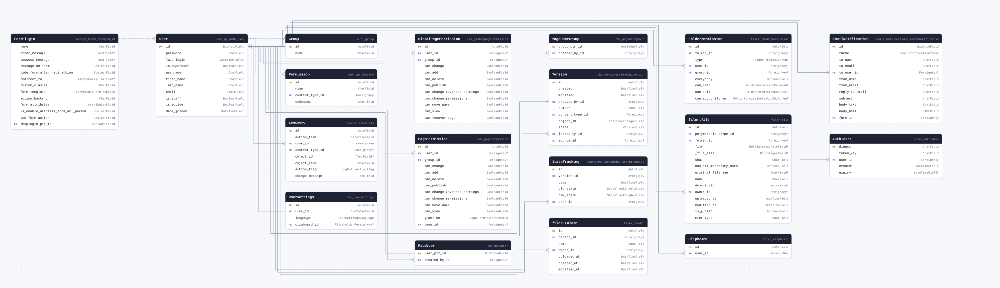

| Column | Field | Type | Null | Key | Default | Description |
| --- | --- | --- | --- | --- | --- | --- |
| `id` | `BigAutoField` | `integer` |  | PK | `autoincrement()` |  |
| `password` | `CharField` | `varchar(128)` |  |  |  |  |
| `last_login` | `DateTimeField` | `datetime` | yes |  |  |  |
| `is_superuser` | `BooleanField` | `bool` |  |  | `False` | Designates that this user has all permissions without explicitly assigning them. |
| `username` | `CharField` | `varchar(150)` |  | unique |  | Required. 150 characters or fewer. Letters, digits and @/./+/-/_ only. |
| `first_name` | `CharField` | `varchar(150)` |  |  |  |  |
| `last_name` | `CharField` | `varchar(150)` |  |  |  |  |
| `email` | `EmailField` | `varchar(254)` |  |  |  |  |
| `is_staff` | `BooleanField` | `bool` |  |  | `False` | Designates whether the user can log into this admin site. |
| `is_active` | `BooleanField` | `bool` |  |  | `True` | Designates whether this user should be treated as active. Unselect this instead of deleting accounts. |
| `date_joined` | `DateTimeField` | `datetime` |  |  | `now()` |  |

Relations:

- `groups` — many to many with [Group](#group)
- `user_permissions` — many to many with [Permission](#permission)
- [LogEntry](#logentry).`user_id` → `id`, on delete cascade
- [UserSettings](#usersettings).`user_id` → `id`, on delete cascade
- [GlobalPagePermission](#globalpagepermission).`user_id` → `id`, on delete cascade
- [PagePermission](#pagepermission).`user_id` → `id`, on delete cascade
- [PageUser](#pageuser).`user_ptr_id` → `id`, parent link, on delete cascade
- [PageUser](#pageuser).`created_by_id` → `id`, on delete set null
- [PageUserGroup](#pageusergroup).`created_by_id` → `id`, on delete set null
- [Version](#version).`created_by_id` → `id`, on delete protect
- [Version](#version).`locked_by_id` → `id`, on delete set null
- [StateTracking](#statetracking).`user_id` → `id`, on delete cascade
- [filer.Folder](#filerfolder).`owner_id` → `id`, on delete set null
- [FolderPermission](#folderpermission).`user_id` → `id`, on delete set null
- [filer.File](#filerfile).`owner_id` → `id`
- [Clipboard](#clipboard).`user_id` → `id`, on delete cascade
- `formplugin_set` — many to many with [FormPlugin](#formplugin)
- [EmailNotification](#emailnotification).`to_user_id` → `id`, on delete cascade
- [AuthToken](#authtoken).`user_id` → `id`, on delete cascade

## MenuPluginModel

Table `cms_qe_menu_menupluginmodel`, app `cms_qe_menu`.

Inherits from [CMSPlugin](#cmsplugin) (multi-table): its rows are joined on `cmsplugin_ptr_id`.

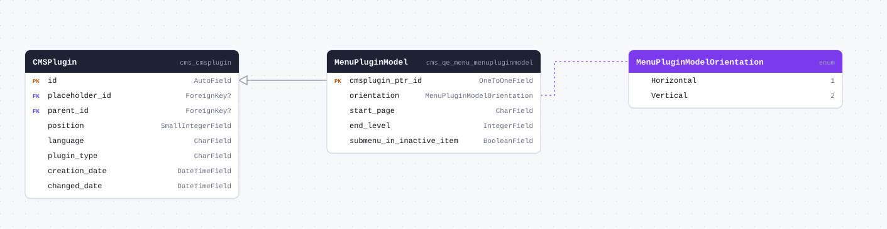

| Column | Field | Type | Null | Key | Default | Description |
| --- | --- | --- | --- | --- | --- | --- |
| `cmsplugin_ptr_id` | `OneToOneField` | `integer` |  | PK, FK |  |  |
| `orientation` | `MenuPluginModelOrientation` | `integer` |  |  | `1` |  |
| `start_page` | `CharField` | `varchar(50)` |  |  |  | ID of page in advanced settings. |
| `end_level` | `IntegerField` | `integer` |  |  | `2` | Specify at which level the navigation should stop.              Keep in mind that Bootstrap by default does not support dropdown submenu.             Any deep dropdown menu is not very well accessible from mobile devices. |
| `submenu_in_inactive_item` | `BooleanField` | `bool` |  |  | `True` |  |

Relations:

- `cmsplugin_ptr_id` → [CMSPlugin](#cmsplugin).`id`, parent link, on delete cascade

## NewsletterPluginModel

Table `cms_qe_newsletter_newsletterpluginmodel`, app `cms_qe_newsletter`.

Inherits from [CMSPlugin](#cmsplugin) (multi-table): its rows are joined on `cmsplugin_ptr_id`.

Configuration model for newsletter plugin.
Allows to set:
* Title
* Mail lists on mailchimp to which subscribers will be added
* Show or hide full name
* Require full name or not

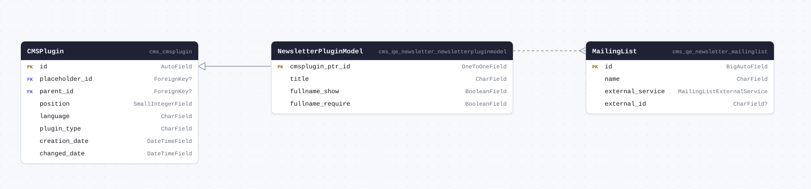

| Column | Field | Type | Null | Key | Default | Description |
| --- | --- | --- | --- | --- | --- | --- |
| `cmsplugin_ptr_id` | `OneToOneField` | `integer` |  | PK, FK |  |  |
| `title` | `CharField` | `varchar(150)` |  |  |  | The title of subscribes that will be shown to users |
| `fullname_show` | `BooleanField` | `bool` |  |  | `False` |  |
| `fullname_require` | `BooleanField` | `bool` |  |  | `False` |  |

Relations:

- `cmsplugin_ptr_id` → [CMSPlugin](#cmsplugin).`id`, parent link, on delete cascade
- `mailing_lists` — many to many with [MailingList](#mailinglist)

## MailingList

Table `cms_qe_newsletter_mailinglist`, app `cms_qe_newsletter`.

Mailing list model which also synchronize with external services like Mailchimp.
If ``external_id`` is not set then subscriber is not synchronized.

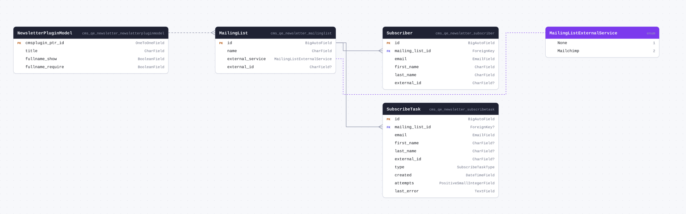

| Column | Field | Type | Null | Key | Default | Description |
| --- | --- | --- | --- | --- | --- | --- |
| `id` | `BigAutoField` | `integer` |  | PK | `autoincrement()` |  |
| `name` | `CharField` | `varchar(50)` |  |  |  |  |
| `external_service` | `MailingListExternalService` | `smallint unsigned` |  |  | `1` |  |
| `external_id` | `CharField` | `varchar(10)` | yes |  |  |  |

Relations:

- `newsletterpluginmodel_set` — many to many with [NewsletterPluginModel](#newsletterpluginmodel)
- [Subscriber](#subscriber).`mailing_list_id` → `id`, on delete cascade
- [SubscribeTask](#subscribetask).`mailing_list_id` → `id`, on delete cascade

## Subscriber

Table `cms_qe_newsletter_subscriber`, app `cms_qe_newsletter`.

Subscriber model which also synchronize with external services like Mailchimp.
If ``external_id`` is not set then subscriber is not synchronized.

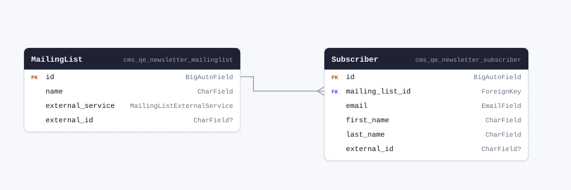

| Column | Field | Type | Null | Key | Default | Description |
| --- | --- | --- | --- | --- | --- | --- |
| `id` | `BigAutoField` | `integer` |  | PK | `autoincrement()` |  |
| `mailing_list_id` | `ForeignKey` | `bigint` |  | FK |  |  |
| `email` | `EmailField` | `varchar(254)` |  |  |  |  |
| `first_name` | `CharField` | `varchar(50)` |  |  |  |  |
| `last_name` | `CharField` | `varchar(50)` |  |  |  |  |
| `external_id` | `CharField` | `varchar(50)` | yes |  |  |  |

Indexes:

- index `cms_qe_newsletter_subscriber_mailing_list_id_2776912a` on `mailing_list_id`

Relations:

- `mailing_list_id` → [MailingList](#mailinglist).`id`, on delete cascade

## SubscribeTask

Table `cms_qe_newsletter_subscribetask`, app `cms_qe_newsletter`.

Item for task queue for subscribing and unsubscribing members on the external
service like Mailchimp. The queue can is processed by ``cms-qe-newsletter-sync`` command.

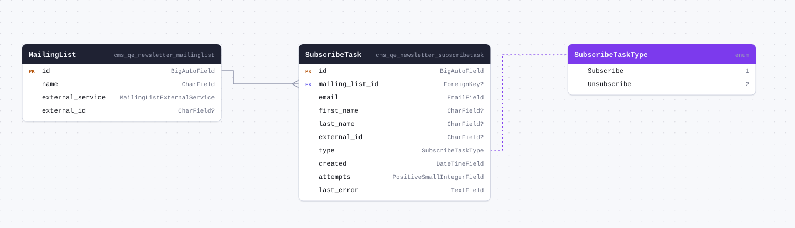

| Column | Field | Type | Null | Key | Default | Description |
| --- | --- | --- | --- | --- | --- | --- |
| `id` | `BigAutoField` | `integer` |  | PK | `autoincrement()` |  |
| `mailing_list_id` | `ForeignKey` | `bigint` | yes | FK |  |  |
| `email` | `EmailField` | `varchar(254)` |  |  |  |  |
| `first_name` | `CharField` | `varchar(50)` | yes |  |  |  |
| `last_name` | `CharField` | `varchar(50)` | yes |  |  |  |
| `external_id` | `CharField` | `varchar(10)` | yes |  |  |  |
| `type` | `SubscribeTaskType` | `smallint unsigned` |  |  |  |  |
| `created` | `DateTimeField` | `datetime` |  |  | `now()` |  |
| `attempts` | `PositiveSmallIntegerField` | `smallint unsigned` |  |  | `0` |  |
| `last_error` | `TextField` | `text` |  |  |  |  |

Indexes:

- index `cms_qe_newsletter_subscribetask_mailing_list_id_356da1d6` on `mailing_list_id`

Relations:

- `mailing_list_id` → [MailingList](#mailinglist).`id`, on delete cascade

## TablePluginModel

Table `cms_qe_table_tablepluginmodel`, app `cms_qe_table`.

Inherits from [CMSPlugin](#cmsplugin) (multi-table): its rows are joined on `cmsplugin_ptr_id`.

Configuration model for plugin Table for Django CMS QE. Possibility to specify
table, columns, order, filtering etc. etc.

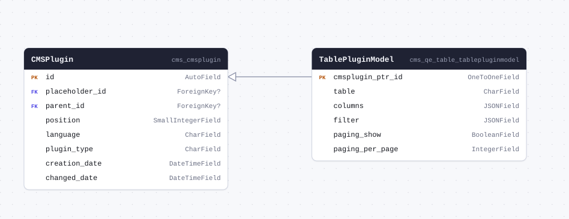

| Column | Field | Type | Null | Key | Default | Description |
| --- | --- | --- | --- | --- | --- | --- |
| `cmsplugin_ptr_id` | `OneToOneField` | `integer` |  | PK, FK |  |  |
| `table` | `CharField` | `varchar(100)` |  |  |  |  |
| `columns` | `JSONField` | `text` |  |  | `dict()` |  |
| `filter` | `JSONField` | `text` |  |  | `dict()` |  |
| `paging_show` | `BooleanField` | `bool` |  |  | `True` |  |
| `paging_per_page` | `IntegerField` | `integer` |  |  | `20` |  |

Relations:

- `cmsplugin_ptr_id` → [CMSPlugin](#cmsplugin).`id`, parent link, on delete cascade

## SourceFileVideoPlayer

Table `cms_qe_video_sourcefilevideoplayer`, app `cms_qe_video`.

Inherits from [CMSPlugin](#cmsplugin) (multi-table): its rows are joined on `cmsplugin_ptr_id`.

Columns from `AbstractVideoPlayer` (abstract): `label`, `poster_id`, `width`, `height`, `controls`, `autoplay`, `loop`, `other_attributes`, `cmsplugin_ptr_id`.

Configuration model for video player to play video from file on local disk.

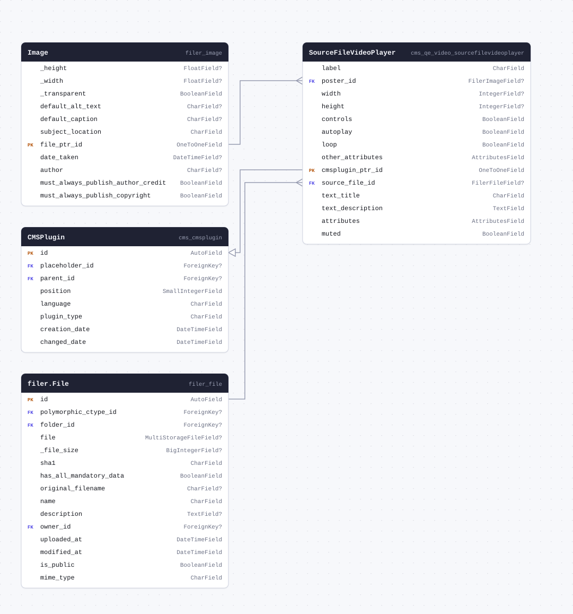

| Column | Field | Type | Null | Key | Default | Description |
| --- | --- | --- | --- | --- | --- | --- |
| `label` | `CharField` | `varchar(255)` |  |  |  |  |
| `poster_id` | `FilerImageField` | `integer` | yes | FK |  |  |
| `width` | `IntegerField` | `integer` | yes |  |  | Leave it blank to make a video player of the default width of video source |
| `height` | `IntegerField` | `integer` | yes |  |  | Leave it blank to make a video player of the default width of video source |
| `controls` | `BooleanField` | `bool` |  |  | `True` |  |
| `autoplay` | `BooleanField` | `bool` |  |  | `False` |  |
| `loop` | `BooleanField` | `bool` |  |  | `False` |  |
| `other_attributes` | `AttributesField` | `text` |  |  | `dict()` |  |
| `cmsplugin_ptr_id` | `OneToOneField` | `integer` |  | PK, FK |  |  |
| `source_file_id` | `FilerFileField` | `integer` | yes | FK |  |  |
| `text_title` | `CharField` | `varchar(255)` |  |  |  |  |
| `text_description` | `TextField` | `text` |  |  |  |  |
| `attributes` | `AttributesField` | `text` |  |  | `dict()` |  |
| `muted` | `BooleanField` | `bool` |  |  | `False` |  |

Indexes:

- index `cms_qe_video_sourcefilevideoplayer_poster_id_5d111ef3` on `poster_id`
- index `cms_qe_video_sourcefilevideoplayer_source_file_id_70953750` on `source_file_id`

Relations:

- `poster_id` → [Image](#image).`file_ptr_id`, on delete set null
- `cmsplugin_ptr_id` → [CMSPlugin](#cmsplugin).`id`, parent link, on delete cascade
- `source_file_id` → [filer.File](#filerfile).`id`, on delete set null

## HostingVideoPlayer

Table `cms_qe_video_hostingvideoplayer`, app `cms_qe_video`.

Inherits from [CMSPlugin](#cmsplugin) (multi-table): its rows are joined on `cmsplugin_ptr_id`.

Columns from `AbstractVideoPlayer` (abstract): `label`, `poster_id`, `width`, `height`, `controls`, `autoplay`, `loop`, `other_attributes`, `cmsplugin_ptr_id`.

Configuration model for video player to play video from video hosting services.

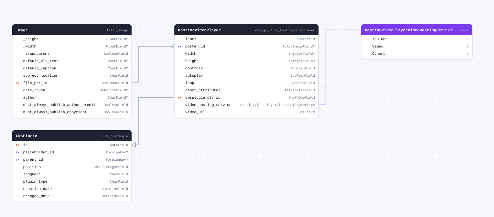

| Column | Field | Type | Null | Key | Default | Description |
| --- | --- | --- | --- | --- | --- | --- |
| `label` | `CharField` | `varchar(255)` |  |  |  |  |
| `poster_id` | `FilerImageField` | `integer` | yes | FK |  |  |
| `width` | `IntegerField` | `integer` | yes |  |  | Leave it blank to make a video player of the default width of video source |
| `height` | `IntegerField` | `integer` | yes |  |  | Leave it blank to make a video player of the default width of video source |
| `controls` | `BooleanField` | `bool` |  |  | `True` |  |
| `autoplay` | `BooleanField` | `bool` |  |  | `False` |  |
| `loop` | `BooleanField` | `bool` |  |  | `False` |  |
| `other_attributes` | `AttributesField` | `text` |  |  | `dict()` |  |
| `cmsplugin_ptr_id` | `OneToOneField` | `integer` |  | PK, FK |  |  |
| `video_hosting_service` | `HostingVideoPlayerVideoHostingService` | `integer` |  |  | `3` |  |
| `video_url` | `URLField` | `varchar(255)` |  |  |  | Use this field to embed videos from external services such as YouTube, Vimeo or others. |

Indexes:

- index `cms_qe_video_hostingvideoplayer_poster_id_30161606` on `poster_id`

Relations:

- `poster_id` → [Image](#image).`file_ptr_id`, on delete set null
- `cmsplugin_ptr_id` → [CMSPlugin](#cmsplugin).`id`, parent link, on delete cascade

## VideoTrack

Table `cms_qe_video_videotrack`, app `cms_qe_video`.

Inherits from [CMSPlugin](#cmsplugin) (multi-table): its rows are joined on `cmsplugin_ptr_id`.

Renders the HTML <track> element inside <video>.

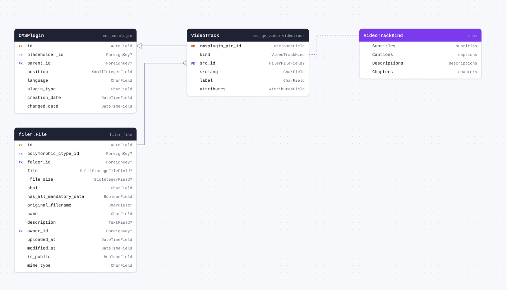

| Column | Field | Type | Null | Key | Default | Description |
| --- | --- | --- | --- | --- | --- | --- |
| `cmsplugin_ptr_id` | `OneToOneField` | `integer` |  | PK, FK |  |  |
| `kind` | `VideoTrackKind` | `varchar(255)` |  |  |  |  |
| `src_id` | `FilerFileField` | `integer` | yes | FK |  |  |
| `srclang` | `CharField` | `varchar(255)` |  |  |  | Examples: "en" or "de" etc. |
| `label` | `CharField` | `varchar(255)` |  |  |  |  |
| `attributes` | `AttributesField` | `text` |  |  | `dict()` |  |

Indexes:

- index `cms_qe_video_videotrack_src_id_481fb094` on `src_id`

Relations:

- `cmsplugin_ptr_id` → [CMSPlugin](#cmsplugin).`id`, parent link, on delete cascade
- `src_id` → [filer.File](#filerfile).`id`, on delete set null

## Script

Table `cms_qe_plugins_script`, app `cms_qe_plugins`.

Inherits from [CMSPlugin](#cmsplugin) (multi-table): its rows are joined on `cmsplugin_ptr_id`.

HTML Script tag.

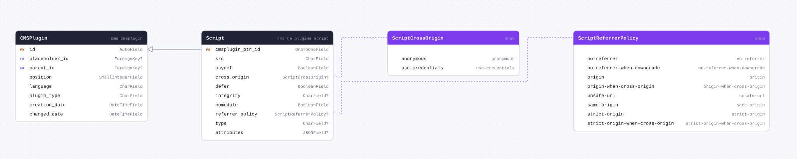

| Column | Field | Type | Null | Key | Default | Description |
| --- | --- | --- | --- | --- | --- | --- |
| `cmsplugin_ptr_id` | `OneToOneField` | `integer` |  | PK, FK |  |  |
| `src` | `CharField` | `varchar(255)` |  |  |  | Specifies the location of the linked script. |
| `asyncf` | `BooleanField` | `bool` |  |  | `False` | Specifies that the script is downloaded in parallel to parsing the page, and executed as soon as it is available (before parsing completes) (only for external scripts) |
| `cross_origin` | `ScriptCrossOrigin` | `varchar(15)` | yes |  | `None` | Sets the mode of the request to an HTTP CORS Request. |
| `defer` | `BooleanField` | `bool` |  |  | `False` | Specifies that the script is downloaded in parallel to parsing the page, and executed after the page has finished parsing (only for external scripts) |
| `integrity` | `CharField` | `varchar(255)` | yes |  |  | Allows a browser to check the fetched script to ensure that the code is never loaded if the source has been manipulated |
| `nomodule` | `BooleanField` | `bool` |  |  | `False` | Specifies that the script should not be executed in browsers supporting ES2015 modules. |
| `referrer_policy` | `ScriptReferrerPolicy` | `varchar(50)` | yes |  | `None` | Specifies which referrer to use when fetching the resource. |
| `type` | `CharField` | `varchar(255)` | yes |  |  | Specifies the media type of the script. |
| `attributes` | `JSONField` | `text` | yes |  |  | More attributes as JSON data. E.g. {"data-name": "value", "id": 42} |

Relations:

- `cmsplugin_ptr_id` → [CMSPlugin](#cmsplugin).`id`, parent link, on delete cascade

## cms_qe_plugins.Link

Table `cms_qe_plugins_link`, app `cms_qe_plugins`.

Inherits from [CMSPlugin](#cmsplugin) (multi-table): its rows are joined on `cmsplugin_ptr_id`.

HTML Link tag.

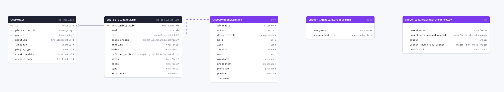

| Column | Field | Type | Null | Key | Default | Description |
| --- | --- | --- | --- | --- | --- | --- |
| `cmsplugin_ptr_id` | `OneToOneField` | `integer` |  | PK, FK |  |  |
| `href` | `CharField` | `varchar(255)` |  |  |  | Specifies the location of the linked document. |
| `rel` | `CmsQePluginsLinkRel` | `varchar(30)` |  |  | `'stylesheet'` | Required. Specifies the relationship between the current document and the linked document. |
| `cross_origin` | `CmsQePluginsLinkCrossOrigin` | `varchar(15)` | yes |  | `None` | Specifies how the element handles cross-origin requests. |
| `hreflang` | `CharField` | `varchar(30)` | yes |  |  | Specifies the language of the text in the linked document. |
| `media` | `CharField` | `varchar(255)` | yes |  |  | Specifies on what device the linked document will be displayed. |
| `referrer_policy` | `CmsQePluginsLinkReferrerPolicy` | `varchar(50)` | yes |  | `None` | Specifies which referrer to use when fetching the resource. |
| `sizes` | `CharField` | `varchar(255)` | yes |  |  | Specifies the size of the linked resource. Only for rel="icon". |
| `title` | `CharField` | `varchar(255)` | yes |  |  | Defines a preferred or an alternate stylesheet. |
| `type` | `CharField` | `varchar(255)` | yes |  |  | Specifies the media type of the linked document. E.g. 'text/css'. |
| `attributes` | `JSONField` | `text` | yes |  |  | More attributes as JSON data. E.g. {"data-name": "value", "id": 42} |

Relations:

- `cmsplugin_ptr_id` → [CMSPlugin](#cmsplugin).`id`, parent link, on delete cascade

## Iframe

Table `cms_qe_plugins_iframe`, app `cms_qe_plugins`.

Inherits from [CMSPlugin](#cmsplugin) (multi-table): its rows are joined on `cmsplugin_ptr_id`.

HTML Iframe tag.

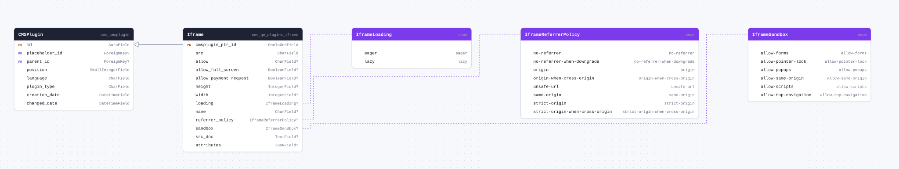

| Column | Field | Type | Null | Key | Default | Description |
| --- | --- | --- | --- | --- | --- | --- |
| `cmsplugin_ptr_id` | `OneToOneField` | `integer` |  | PK, FK |  |  |
| `src` | `CharField` | `varchar(255)` |  |  |  | Specifies the address of the document to embed in the &lt;iframe&gt;. |
| `allow` | `CharField` | `varchar(255)` | yes |  |  | Specifies a feature policy for the &lt;iframe&gt;. Form more see <a href='https://developer.mozilla.org/en-US/docs/Web/HTML/Element/iframe#allow' target='_blank'>IFrame attributes.</a>. |
| `allow_full_screen` | `BooleanField` | `bool` | yes |  |  | Set to true if the &lt;iframe&gt; can activate fullscreen mode by calling the requestFullscreen() method. |
| `allow_payment_request` | `BooleanField` | `bool` | yes |  |  | Set to true if a cross-origin &lt;iframe&gt; should be allowed to invoke the Payment Request API. |
| `height` | `IntegerField` | `integer` | yes |  |  | Specifies the height of an &lt;iframe&gt;. Default height is 150 pixels. |
| `width` | `IntegerField` | `integer` | yes |  |  | Specifies the width of an &lt;iframe&gt;. Default width is 300 pixels. |
| `loading` | `IframeLoading` | `varchar(255)` | yes |  | `None` | Specifies whether a browser should load an iframe immediately or to defer loading of iframes until some conditions are met. |
| `name` | `CharField` | `varchar(255)` | yes |  |  | Specifies the name of an &lt;iframe&gt;. |
| `referrer_policy` | `IframeReferrerPolicy` | `varchar(50)` | yes |  | `None` | Specifies which referrer information to send when fetching the iframe. |
| `sandbox` | `IframeSandbox` | `varchar(50)` | yes |  | `None` | Enables an extra set of restrictions for the content in an &lt;iframe&gt;. |
| `src_doc` | `TextField` | `text` | yes |  |  | Specifies the HTML content of the page to show in the &lt;iframe&gt;. |
| `attributes` | `JSONField` | `text` | yes |  |  | More attributes as JSON data. E.g. {"data-name": "value", "id": 42} |

Relations:

- `cmsplugin_ptr_id` → [CMSPlugin](#cmsplugin).`id`, parent link, on delete cascade

## LogEntry

Table `django_admin_log`, app `admin`.

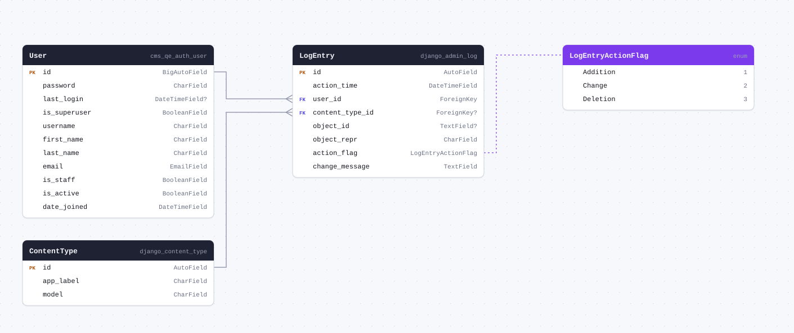

| Column | Field | Type | Null | Key | Default | Description |
| --- | --- | --- | --- | --- | --- | --- |
| `id` | `AutoField` | `integer` |  | PK | `autoincrement()` |  |
| `action_time` | `DateTimeField` | `datetime` |  |  | `now()` |  |
| `user_id` | `ForeignKey` | `bigint` |  | FK |  |  |
| `content_type_id` | `ForeignKey` | `integer` | yes | FK |  |  |
| `object_id` | `TextField` | `text` | yes |  |  |  |
| `object_repr` | `CharField` | `varchar(200)` |  |  |  |  |
| `action_flag` | `LogEntryActionFlag` | `smallint unsigned` |  |  |  |  |
| `change_message` | `TextField` | `text` |  |  |  |  |

Indexes:

- index `django_admin_log_user_id_c564eba6` on `user_id`
- index `django_admin_log_content_type_id_c4bce8eb` on `content_type_id`

Relations:

- `user_id` → [User](#user).`id`, on delete cascade
- `content_type_id` → [ContentType](#contenttype).`id`, on delete set null

## Permission

Table `auth_permission`, app `auth`.

The permissions system provides a way to assign permissions to specific
users and groups of users.

The permission system is used by the Django admin site, but may also be
useful in your own code. The Django admin site uses permissions as follows:

    - The "add" permission limits the user's ability to view the "add" form
      and add an object.
    - The "change" permission limits a user's ability to view the change
      list, view the "change" form and change an object.
    - The "delete" permission limits the ability to delete an object.
    - The "view" permission limits the ability to view an object.

Permissions are set globally per type of object, not per specific object
instance. It is possible to say "Mary may change news stories," but it's
not currently possible to say "Mary may change news stories, but only the
ones she created herself" or "Mary may only change news stories that have a
certain status or publication date."

The permissions listed above are automatically created for each model.

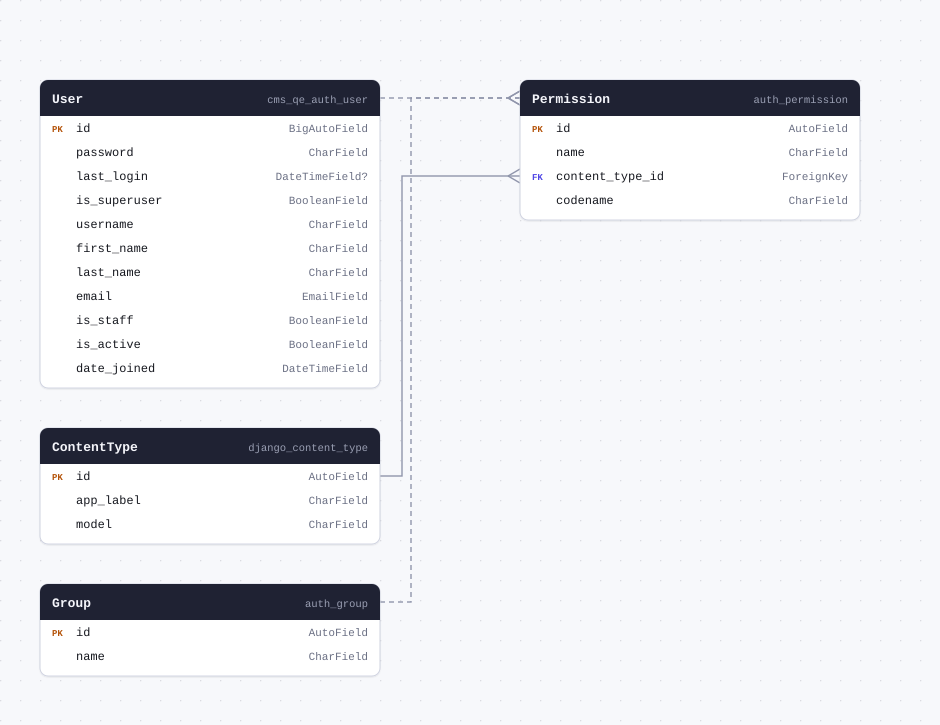

| Column | Field | Type | Null | Key | Default | Description |
| --- | --- | --- | --- | --- | --- | --- |
| `id` | `AutoField` | `integer` |  | PK | `autoincrement()` |  |
| `name` | `CharField` | `varchar(255)` |  |  |  |  |
| `content_type_id` | `ForeignKey` | `integer` |  | FK |  |  |
| `codename` | `CharField` | `varchar(100)` |  |  |  |  |

Indexes:

- index `auth_permission_content_type_id_2f476e4b` on `content_type_id`
- unique `auth_permission_content_type_id_codename_01ab375a_uniq` on `content_type_id`, `codename`

Relations:

- `user_set` — many to many with [User](#user)
- `content_type_id` → [ContentType](#contenttype).`id`, on delete cascade
- `group_set` — many to many with [Group](#group)

## Group

Table `auth_group`, app `auth`.

Subclasses (multi-table): [PageUserGroup](#pageusergroup).

Groups are a generic way of categorizing users to apply permissions, or
some other label, to those users. A user can belong to any number of
groups.

A user in a group automatically has all the permissions granted to that
group. For example, if the group 'Site editors' has the permission
can_edit_home_page, any user in that group will have that permission.

Beyond permissions, groups are a convenient way to categorize users to
apply some label, or extended functionality, to them. For example, you
could create a group 'Special users', and you could write code that would
do special things to those users -- such as giving them access to a
members-only portion of your site, or sending them members-only email
messages.

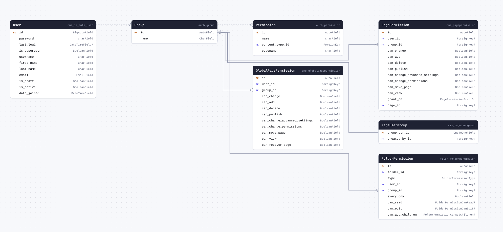

| Column | Field | Type | Null | Key | Default | Description |
| --- | --- | --- | --- | --- | --- | --- |
| `id` | `AutoField` | `integer` |  | PK | `autoincrement()` |  |
| `name` | `CharField` | `varchar(150)` |  | unique |  |  |

Relations:

- `user_set` — many to many with [User](#user)
- `permissions` — many to many with [Permission](#permission)
- [GlobalPagePermission](#globalpagepermission).`group_id` → `id`, on delete cascade
- [PagePermission](#pagepermission).`group_id` → `id`, on delete cascade
- [PageUserGroup](#pageusergroup).`group_ptr_id` → `id`, parent link, on delete cascade
- [FolderPermission](#folderpermission).`group_id` → `id`, on delete cascade

## ContentType

Table `django_content_type`, app `contenttypes`.

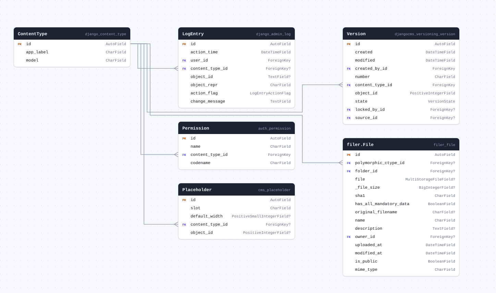

| Column | Field | Type | Null | Key | Default | Description |
| --- | --- | --- | --- | --- | --- | --- |
| `id` | `AutoField` | `integer` |  | PK | `autoincrement()` |  |
| `app_label` | `CharField` | `varchar(100)` |  |  |  |  |
| `model` | `CharField` | `varchar(100)` |  |  |  |  |

Indexes:

- unique `django_content_type_app_label_model_76bd3d3b_uniq` on `app_label`, `model`

Relations:

- [LogEntry](#logentry).`content_type_id` → `id`, on delete set null
- [Permission](#permission).`content_type_id` → `id`, on delete cascade
- [Placeholder](#placeholder).`content_type_id` → `id`, on delete set null
- [Version](#version).`content_type_id` → `id`, on delete protect
- [filer.File](#filerfile).`polymorphic_ctype_id` → `id`

## Session

Table `django_session`, app `sessions`.

Columns from `AbstractBaseSession` (abstract): `session_key`, `session_data`, `expire_date`.

Django provides full support for anonymous sessions. The session
framework lets you store and retrieve arbitrary data on a
per-site-visitor basis. It stores data on the server side and
abstracts the sending and receiving of cookies. Cookies contain a
session ID -- not the data itself.

The Django sessions framework is entirely cookie-based. It does
not fall back to putting session IDs in URLs. This is an intentional
design decision. Not only does that behavior make URLs ugly, it makes
your site vulnerable to session-ID theft via the "Referer" header.

For complete documentation on using Sessions in your code, consult
the sessions documentation that is shipped with Django (also available
on the Django web site).

| Column | Field | Type | Null | Key | Default | Description |
| --- | --- | --- | --- | --- | --- | --- |
| `session_key` | `CharField` | `varchar(40)` |  | PK |  |  |
| `session_data` | `TextField` | `text` |  |  |  |  |
| `expire_date` | `DateTimeField` | `datetime` |  |  |  |  |

Indexes:

- index `django_session_expire_date_a5c62663` on `expire_date`

## Site

Table `django_site`, app `sites`.

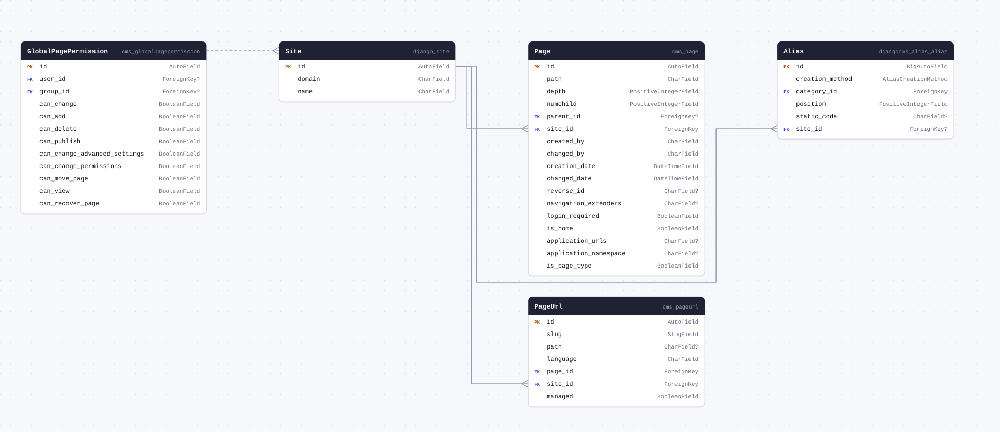

| Column | Field | Type | Null | Key | Default | Description |
| --- | --- | --- | --- | --- | --- | --- |
| `id` | `AutoField` | `integer` |  | PK | `autoincrement()` |  |
| `domain` | `CharField` | `varchar(100)` |  | unique |  |  |
| `name` | `CharField` | `varchar(50)` |  |  |  |  |

Relations:

- [Page](#page).`site_id` → `id`, on delete cascade
- [PageUrl](#pageurl).`site_id` → `id`, on delete cascade
- `globalpagepermission_set` — many to many with [GlobalPagePermission](#globalpagepermission)
- [Alias](#alias).`site_id` → `id`, on delete cascade

## UserSettings

Table `cms_usersettings`, app `cms`.

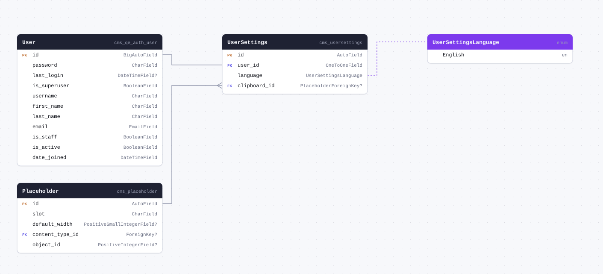

| Column | Field | Type | Null | Key | Default | Description |
| --- | --- | --- | --- | --- | --- | --- |
| `id` | `AutoField` | `integer` |  | PK | `autoincrement()` |  |
| `user_id` | `OneToOneField` | `bigint` |  | FK, unique |  |  |
| `language` | `UserSettingsLanguage` | `varchar(10)` |  |  |  | The language for the admin interface and toolbar |
| `clipboard_id` | `PlaceholderForeignKey` | `integer` | yes | FK |  |  |

Indexes:

- index `cms_usersettings_clipboard_id_3ae17c19` on `clipboard_id`

Relations:

- `user_id` → [User](#user).`id`, on delete cascade
- `clipboard_id` → [Placeholder](#placeholder).`id`, on delete cascade

## Page

Table `cms_page`, app `cms`.

Proxy models, on this table: `PageType`.

Columns from `MP_Node` (abstract): `path`, `depth`, `numchild`.

A ``Page`` is the basic unit of site structure in django CMS. The CMS uses a hierarchical page model: each page
stands in relation to other pages as parent, child or sibling. This hierarchy is managed by the `django-treebeard
<http://django-treebeard.readthedocs.io/en/latest/>`_ library.

A ``Page`` is an abstract entity. It does not have any content associated with it, nor does is provide any slugs to
build a URL. This is part of the model :class:`~cms.models.contentmodels.PageContent` and
:class:`~cms.models.pagemodel.PageUrl` respectively.

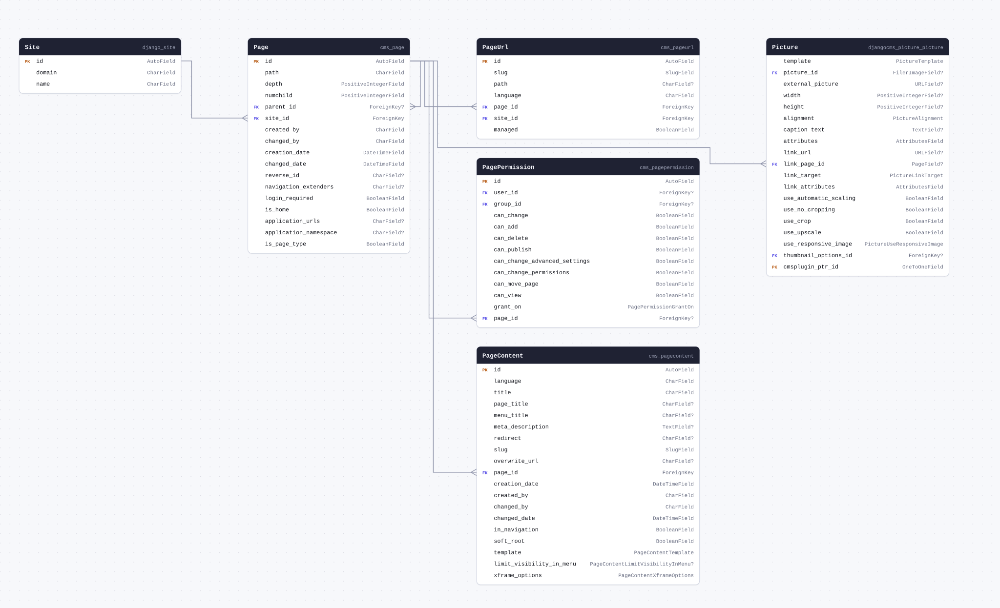

| Column | Field | Type | Null | Key | Default | Description |
| --- | --- | --- | --- | --- | --- | --- |
| `id` | `AutoField` | `integer` |  | PK | `autoincrement()` |  |
| `path` | `CharField` | `varchar(255)` |  | unique |  |  |
| `depth` | `PositiveIntegerField` | `integer unsigned` |  |  |  |  |
| `numchild` | `PositiveIntegerField` | `integer unsigned` |  |  | `0` |  |
| `parent_id` | `ForeignKey` | `integer` | yes | FK |  |  |
| `site_id` | `ForeignKey` | `integer` |  | FK |  |  |
| `created_by` | `CharField` | `varchar(255)` |  |  |  |  |
| `changed_by` | `CharField` | `varchar(255)` |  |  |  |  |
| `creation_date` | `DateTimeField` | `datetime` |  |  | `now()` |  |
| `changed_date` | `DateTimeField` | `datetime` |  |  | `now()` |  |
| `reverse_id` | `CharField` | `varchar(40)` | yes |  |  | A unique identifier that is used with the page_url templatetag for linking to this page |
| `navigation_extenders` | `CharField` | `varchar(80)` | yes |  |  |  |
| `login_required` | `BooleanField` | `bool` |  |  | `False` |  |
| `is_home` | `BooleanField` | `bool` |  |  | `False` |  |
| `application_urls` | `CharField` | `varchar(200)` | yes |  |  |  |
| `application_namespace` | `CharField` | `varchar(200)` | yes |  |  |  |
| `is_page_type` | `BooleanField` | `bool` |  |  | `False` | Mark this page as a page type |

Indexes:

- index `cms_page_parent_id_f89b72e4` on `parent_id`
- index `cms_page_site_id_4323d3ff` on `site_id`
- index `cms_page_reverse_id_ffc9ede2` on `reverse_id`
- index `cms_page_navigation_extenders_c24af8dd` on `navigation_extenders`
- index `cms_page_is_home_edadca07` on `is_home`
- index `cms_page_application_urls_9ef47497` on `application_urls`

Relations:

- `parent_id` → [Page](#page).`id`, on delete cascade
- `site_id` → [Site](#site).`id`, on delete cascade
- [PageUrl](#pageurl).`page_id` → `id`, on delete cascade
- [PagePermission](#pagepermission).`page_id` → `id`, on delete cascade
- [PageContent](#pagecontent).`page_id` → `id`, on delete cascade
- [Picture](#picture).`link_page_id` → `id`, on delete cascade

## PageUrl

Table `cms_pageurl`, app `cms`.

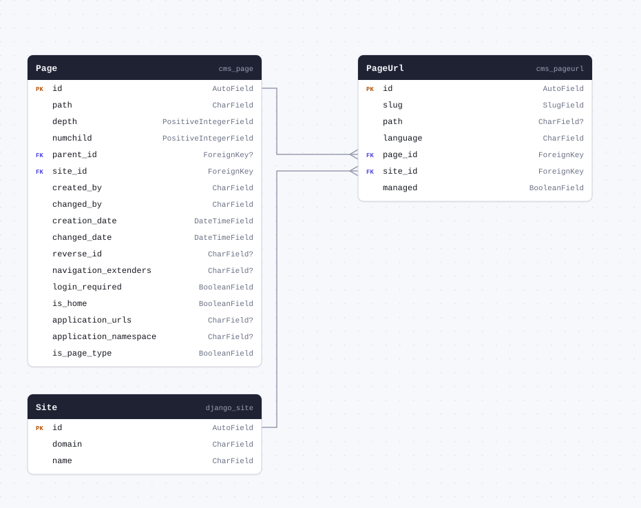

| Column | Field | Type | Null | Key | Default | Description |
| --- | --- | --- | --- | --- | --- | --- |
| `id` | `AutoField` | `integer` |  | PK | `autoincrement()` |  |
| `slug` | `SlugField` | `varchar(255)` |  |  |  |  |
| `path` | `CharField` | `varchar(255)` | yes |  |  |  |
| `language` | `CharField` | `varchar(15)` |  |  |  |  |
| `page_id` | `ForeignKey` | `integer` |  | FK |  |  |
| `site_id` | `ForeignKey` | `integer` |  | FK |  |  |
| `managed` | `BooleanField` | `bool` |  |  | `False` |  |

Indexes:

- index `cms_pageurl_slug_f8d42287` on `slug`
- index `cms_pageurl_path_9f26e673` on `path`
- index `cms_pageurl_language_a10302dc` on `language`
- index `cms_pageurl_page_id_dbf4793a` on `page_id`
- index `cms_pageurl_site_id_7d6fd976` on `site_id`
- unique `unique_together_page_language` on `page_id`, `language`
- unique `unique_site_language_path` on `site_id`, `language`, `path`

Relations:

- `page_id` → [Page](#page).`id`, on delete cascade
- `site_id` → [Site](#site).`id`, on delete cascade

## GlobalPagePermission

Table `cms_globalpagepermission`, app `cms`.

Columns from `AbstractPagePermission` (abstract): `user_id`, `group_id`, `can_change`, `can_add`, `can_delete`, `can_publish`, `can_change_advanced_settings`, `can_change_permissions`, `can_move_page`, `can_view`.

Permissions for all pages (global).

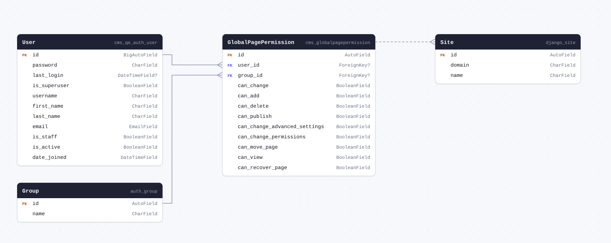

| Column | Field | Type | Null | Key | Default | Description |
| --- | --- | --- | --- | --- | --- | --- |
| `id` | `AutoField` | `integer` |  | PK | `autoincrement()` |  |
| `user_id` | `ForeignKey` | `bigint` | yes | FK |  |  |
| `group_id` | `ForeignKey` | `integer` | yes | FK |  |  |
| `can_change` | `BooleanField` | `bool` |  |  | `True` |  |
| `can_add` | `BooleanField` | `bool` |  |  | `True` |  |
| `can_delete` | `BooleanField` | `bool` |  |  | `True` |  |
| `can_publish` | `BooleanField` | `bool` |  |  | `True` |  |
| `can_change_advanced_settings` | `BooleanField` | `bool` |  |  | `False` |  |
| `can_change_permissions` | `BooleanField` | `bool` |  |  | `False` | Allows this user to grant and revoke page permissions for other users. |
| `can_move_page` | `BooleanField` | `bool` |  |  | `True` |  |
| `can_view` | `BooleanField` | `bool` |  |  | `False` | Grants frontend view access. Note: as soon as any user or group is given view access to a page, that page becomes restricted — only users/groups with view access can then see it on the frontend. |
| `can_recover_page` | `BooleanField` | `bool` |  |  | `True` | can recover any deleted page |

Indexes:

- index `cms_globalpagepermission_user_id_a227cee1` on `user_id`
- index `cms_globalpagepermission_group_id_991b4733` on `group_id`

Relations:

- `user_id` → [User](#user).`id`, on delete cascade
- `group_id` → [Group](#group).`id`, on delete cascade
- `sites` — many to many with [Site](#site)

## PagePermission

Table `cms_pagepermission`, app `cms`.

Columns from `AbstractPagePermission` (abstract): `user_id`, `group_id`, `can_change`, `can_add`, `can_delete`, `can_publish`, `can_change_advanced_settings`, `can_change_permissions`, `can_move_page`, `can_view`.

Page permissions for a single page

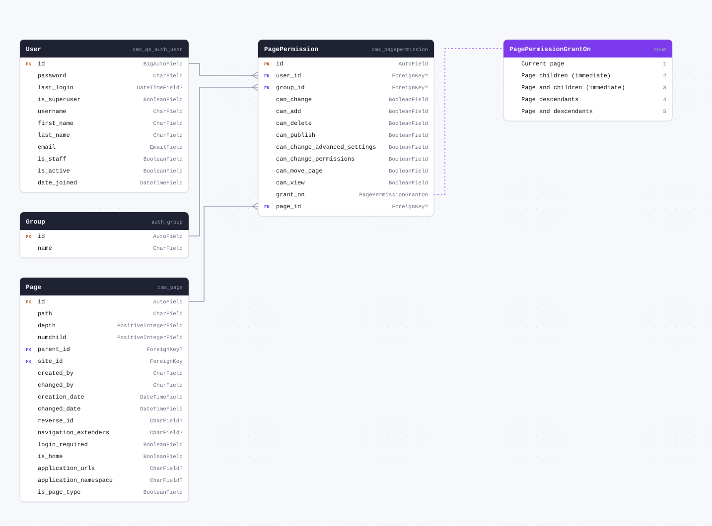

| Column | Field | Type | Null | Key | Default | Description |
| --- | --- | --- | --- | --- | --- | --- |
| `id` | `AutoField` | `integer` |  | PK | `autoincrement()` |  |
| `user_id` | `ForeignKey` | `bigint` | yes | FK |  |  |
| `group_id` | `ForeignKey` | `integer` | yes | FK |  |  |
| `can_change` | `BooleanField` | `bool` |  |  | `True` |  |
| `can_add` | `BooleanField` | `bool` |  |  | `True` |  |
| `can_delete` | `BooleanField` | `bool` |  |  | `True` |  |
| `can_publish` | `BooleanField` | `bool` |  |  | `True` |  |
| `can_change_advanced_settings` | `BooleanField` | `bool` |  |  | `False` |  |
| `can_change_permissions` | `BooleanField` | `bool` |  |  | `False` | Allows this user to grant and revoke page permissions for other users. |
| `can_move_page` | `BooleanField` | `bool` |  |  | `True` |  |
| `can_view` | `BooleanField` | `bool` |  |  | `False` | Grants frontend view access. Note: as soon as any user or group is given view access to a page, that page becomes restricted — only users/groups with view access can then see it on the frontend. |
| `grant_on` | `PagePermissionGrantOn` | `integer` |  |  | `5` |  |
| `page_id` | `ForeignKey` | `integer` | yes | FK |  |  |

Indexes:

- index `cms_pagepermission_user_id_0c7d2b3c` on `user_id`
- index `cms_pagepermission_group_id_af5af193` on `group_id`
- index `cms_pagepermission_page_id_0ae9a163` on `page_id`

Relations:

- `user_id` → [User](#user).`id`, on delete cascade
- `group_id` → [Group](#group).`id`, on delete cascade
- `page_id` → [Page](#page).`id`, on delete cascade

## PageUser

Table `cms_pageuser`, app `cms`.

Inherits from [User](#user) (multi-table): its rows are joined on `user_ptr_id`.

Cms specific user data, required for permission system

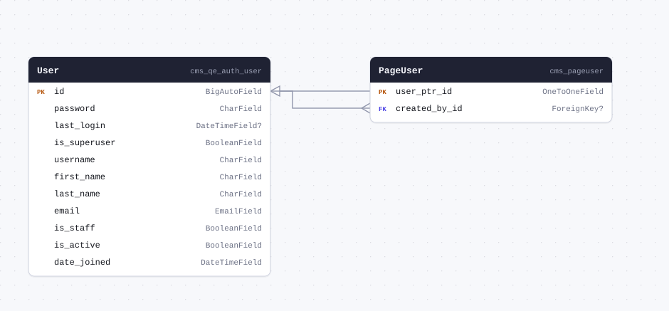

| Column | Field | Type | Null | Key | Default | Description |
| --- | --- | --- | --- | --- | --- | --- |
| `user_ptr_id` | `OneToOneField` | `bigint` |  | PK, FK |  |  |
| `created_by_id` | `ForeignKey` | `bigint` | yes | FK |  |  |

Indexes:

- index `cms_pageuser_created_by_id_8e9fbf83` on `created_by_id`

Relations:

- `user_ptr_id` → [User](#user).`id`, parent link, on delete cascade
- `created_by_id` → [User](#user).`id`, on delete set null

## PageUserGroup

Table `cms_pageusergroup`, app `cms`.

Inherits from [Group](#group) (multi-table): its rows are joined on `group_ptr_id`.

Cms specific group data, required for permission system

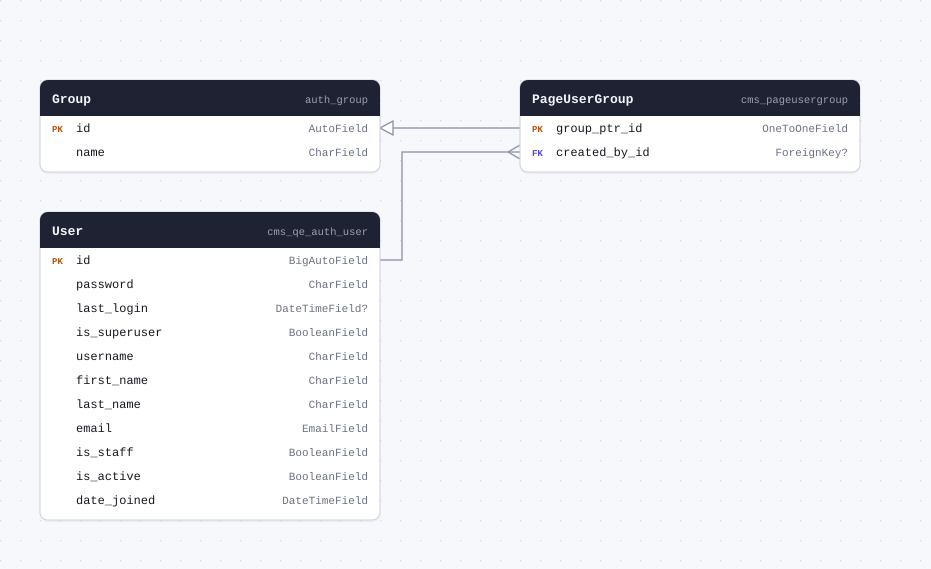

| Column | Field | Type | Null | Key | Default | Description |
| --- | --- | --- | --- | --- | --- | --- |
| `group_ptr_id` | `OneToOneField` | `integer` |  | PK, FK |  |  |
| `created_by_id` | `ForeignKey` | `bigint` | yes | FK |  |  |

Indexes:

- index `cms_pageusergroup_created_by_id_7d57fa39` on `created_by_id`

Relations:

- `group_ptr_id` → [Group](#group).`id`, parent link, on delete cascade
- `created_by_id` → [User](#user).`id`, on delete set null

## Placeholder

Table `cms_placeholder`, app `cms`.

``Placeholders`` can be filled with plugins, which store or generate content.

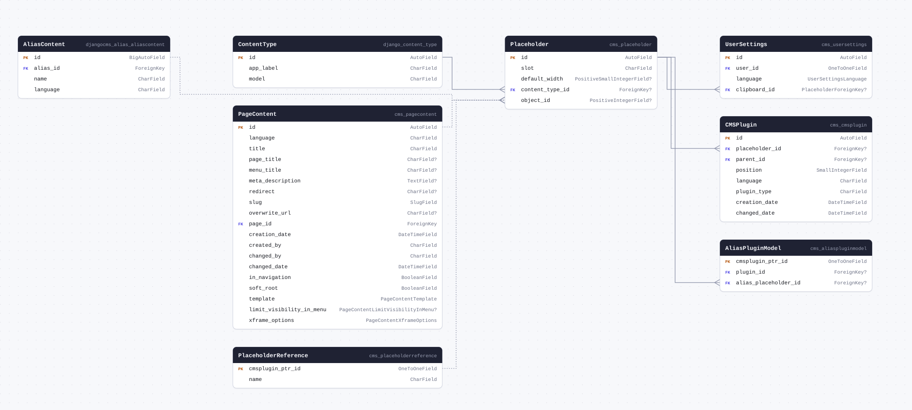

| Column | Field | Type | Null | Key | Default | Description |
| --- | --- | --- | --- | --- | --- | --- |
| `id` | `AutoField` | `integer` |  | PK | `autoincrement()` |  |
| `slot` | `CharField` | `varchar(255)` |  |  |  |  |
| `default_width` | `PositiveSmallIntegerField` | `smallint unsigned` | yes |  |  |  |
| `content_type_id` | `ForeignKey` | `integer` | yes | FK |  |  |
| `object_id` | `PositiveIntegerField` | `integer unsigned` | yes |  |  |  |

Indexes:

- index `cms_placeholder_slot_0bc04d21` on `slot`
- index `cms_placeholder_content_type_id_a7659d9c` on `content_type_id`

Relations:

- `source` → any model, by `content_type_id` + `object_id` (generic foreign key)
- [UserSettings](#usersettings).`clipboard_id` → `id`, on delete cascade
- `content_type_id` → [ContentType](#contenttype).`id`, on delete set null
- [CMSPlugin](#cmsplugin).`placeholder_id` → `id`, on delete cascade
- `object_id` → [PageContent](#pagecontent).`id` where `content_type_id` is PageContent (generic, `PageContent.placeholders`)
- `object_id` → [PlaceholderReference](#placeholderreference).`cmsplugin_ptr_id` where `content_type_id` is PlaceholderReference (generic, `PlaceholderReference.placeholders`)
- [AliasPluginModel](#aliaspluginmodel).`alias_placeholder_id` → `id`, on delete cascade
- `object_id` → [AliasContent](#aliascontent).`id` where `content_type_id` is AliasContent (generic, `AliasContent.placeholders`)

## CMSPlugin

Table `cms_cmsplugin`, app `cms`.

Subclasses (multi-table): [MenuPluginModel](#menupluginmodel), [NewsletterPluginModel](#newsletterpluginmodel), [TablePluginModel](#tablepluginmodel), [SourceFileVideoPlayer](#sourcefilevideoplayer), [HostingVideoPlayer](#hostingvideoplayer), [VideoTrack](#videotrack), [Script](#script), [cms_qe_plugins.Link](#cms_qe_pluginslink), [Iframe](#iframe), [PlaceholderReference](#placeholderreference), [AliasPluginModel](#aliaspluginmodel), [Text](#text), [djangocms_link.Link](#djangocms_linklink), [AliasPlugin](#aliasplugin), [GoogleMap](#googlemap), [GoogleMapMarker](#googlemapmarker), [GoogleMapRoute](#googlemaproute), [djangocms_file.File](#djangocms_filefile), [djangocms_file.Folder](#djangocms_filefolder), [Icon](#icon), [Picture](#picture), [FrontendUIItem](#frontenduiitem), [RenderContext](#rendercontext), [Default](#default), [Stack](#stack), [FormPlugin](#formplugin), [FieldsetPlugin](#fieldsetplugin), [FieldPlugin](#fieldplugin), [TextAreaFieldPlugin](#textareafieldplugin), [EmailFieldPlugin](#emailfieldplugin), [FileUploadFieldPlugin](#fileuploadfieldplugin), [MultipleFilesUploadFieldPlugin](#multiplefilesuploadfieldplugin), [ImageUploadFieldPlugin](#imageuploadfieldplugin), [DateFieldPlugin](#datefieldplugin), [DateTimeLocalFieldPlugin](#datetimelocalfieldplugin), [TimeFieldPlugin](#timefieldplugin), [URLFieldPlugin](#urlfieldplugin), [FormButtonPlugin](#formbuttonplugin).

Proxy models, on this table: `SlotModel`.

The base class for a CMS plugin model. When defining a new custom plugin, you should
store plugin-instance specific information on a subclass of this class. (An example for this
would be to store the number of pictures to display in a gallery.)

Two restrictions apply when subclassing this to use in your own models:

1. Subclasses of CMSPlugin **cannot be further subclassed**
2. Subclasses of CMSPlugin cannot define a "text" field.

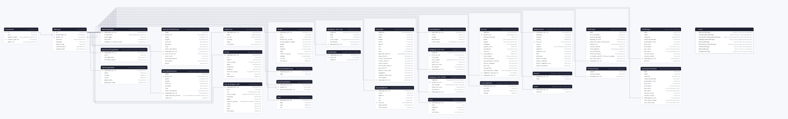

| Column | Field | Type | Null | Key | Default | Description |
| --- | --- | --- | --- | --- | --- | --- |
| `id` | `AutoField` | `integer` |  | PK | `autoincrement()` |  |
| `placeholder_id` | `ForeignKey` | `integer` | yes | FK |  |  |
| `parent_id` | `ForeignKey` | `integer` | yes | FK |  |  |
| `position` | `SmallIntegerField` | `smallint` |  |  | `1` |  |
| `language` | `CharField` | `varchar(15)` |  |  |  |  |
| `plugin_type` | `CharField` | `varchar(50)` |  |  |  |  |
| `creation_date` | `DateTimeField` | `datetime` |  |  | `now()` |  |
| `changed_date` | `DateTimeField` | `datetime` |  |  | `now()` |  |

Indexes:

- index `cms_cmsplugin_placeholder_id_0bfa3b26` on `placeholder_id`
- index `cms_cmsplugin_parent_id_fd3bd9dd` on `parent_id`
- index `cms_cmsplugin_language_bbea8a48` on `language`
- index `cms_cmsplugin_plugin_type_94e96ebf` on `plugin_type`
- unique `cms_cmsplugin_placeholder_id_language_position_bad60ebe_uniq` on `placeholder_id`, `language`, `position`
- index `cms_cmsplug_placeho_3f2b0f_idx` on `placeholder_id`, `language`, `position`

Relations:

- [MenuPluginModel](#menupluginmodel).`cmsplugin_ptr_id` → `id`, parent link, on delete cascade
- [NewsletterPluginModel](#newsletterpluginmodel).`cmsplugin_ptr_id` → `id`, parent link, on delete cascade
- [TablePluginModel](#tablepluginmodel).`cmsplugin_ptr_id` → `id`, parent link, on delete cascade
- [SourceFileVideoPlayer](#sourcefilevideoplayer).`cmsplugin_ptr_id` → `id`, parent link, on delete cascade
- [HostingVideoPlayer](#hostingvideoplayer).`cmsplugin_ptr_id` → `id`, parent link, on delete cascade
- [VideoTrack](#videotrack).`cmsplugin_ptr_id` → `id`, parent link, on delete cascade
- [Script](#script).`cmsplugin_ptr_id` → `id`, parent link, on delete cascade
- [cms_qe_plugins.Link](#cms_qe_pluginslink).`cmsplugin_ptr_id` → `id`, parent link, on delete cascade
- [Iframe](#iframe).`cmsplugin_ptr_id` → `id`, parent link, on delete cascade
- `placeholder_id` → [Placeholder](#placeholder).`id`, on delete cascade
- `parent_id` → [CMSPlugin](#cmsplugin).`id`, on delete cascade
- [PlaceholderReference](#placeholderreference).`cmsplugin_ptr_id` → `id`, parent link, on delete cascade
- [AliasPluginModel](#aliaspluginmodel).`cmsplugin_ptr_id` → `id`, parent link, on delete cascade
- [AliasPluginModel](#aliaspluginmodel).`plugin_id` → `id`, on delete cascade
- [Text](#text).`cmsplugin_ptr_id` → `id`, parent link, on delete cascade
- [djangocms_link.Link](#djangocms_linklink).`cmsplugin_ptr_id` → `id`, parent link, on delete cascade
- [AliasPlugin](#aliasplugin).`cmsplugin_ptr_id` → `id`, parent link, on delete cascade
- [GoogleMap](#googlemap).`cmsplugin_ptr_id` → `id`, parent link, on delete cascade
- [GoogleMapMarker](#googlemapmarker).`cmsplugin_ptr_id` → `id`, parent link, on delete cascade
- [GoogleMapRoute](#googlemaproute).`cmsplugin_ptr_id` → `id`, parent link, on delete cascade
- [djangocms_file.File](#djangocms_filefile).`cmsplugin_ptr_id` → `id`, parent link, on delete cascade
- [djangocms_file.Folder](#djangocms_filefolder).`cmsplugin_ptr_id` → `id`, parent link, on delete cascade
- [Icon](#icon).`cmsplugin_ptr_id` → `id`, parent link, on delete cascade
- [Picture](#picture).`cmsplugin_ptr_id` → `id`, parent link, on delete cascade
- [FrontendUIItem](#frontenduiitem).`cmsplugin_ptr_id` → `id`, parent link, on delete cascade
- [RenderContext](#rendercontext).`cmsplugin_ptr_id` → `id`, parent link, on delete cascade
- [Default](#default).`cmsplugin_ptr_id` → `id`, parent link, on delete cascade
- [Stack](#stack).`cmsplugin_ptr_id` → `id`, parent link, on delete cascade
- [FormPlugin](#formplugin).`cmsplugin_ptr_id` → `id`, parent link, on delete cascade
- [FieldsetPlugin](#fieldsetplugin).`cmsplugin_ptr_id` → `id`, parent link, on delete cascade
- [FieldPlugin](#fieldplugin).`cmsplugin_ptr_id` → `id`, parent link, on delete cascade
- [TextAreaFieldPlugin](#textareafieldplugin).`cmsplugin_ptr_id` → `id`, parent link, on delete cascade
- [EmailFieldPlugin](#emailfieldplugin).`cmsplugin_ptr_id` → `id`, parent link, on delete cascade
- [FileUploadFieldPlugin](#fileuploadfieldplugin).`cmsplugin_ptr_id` → `id`, parent link, on delete cascade
- [MultipleFilesUploadFieldPlugin](#multiplefilesuploadfieldplugin).`cmsplugin_ptr_id` → `id`, parent link, on delete cascade
- [ImageUploadFieldPlugin](#imageuploadfieldplugin).`cmsplugin_ptr_id` → `id`, parent link, on delete cascade
- [DateFieldPlugin](#datefieldplugin).`cmsplugin_ptr_id` → `id`, parent link, on delete cascade
- [DateTimeLocalFieldPlugin](#datetimelocalfieldplugin).`cmsplugin_ptr_id` → `id`, parent link, on delete cascade
- [TimeFieldPlugin](#timefieldplugin).`cmsplugin_ptr_id` → `id`, parent link, on delete cascade
- [URLFieldPlugin](#urlfieldplugin).`cmsplugin_ptr_id` → `id`, parent link, on delete cascade
- [FormButtonPlugin](#formbuttonplugin).`cmsplugin_ptr_id` → `id`, parent link, on delete cascade

## PageContent

Table `cms_pagecontent`, app `cms`.

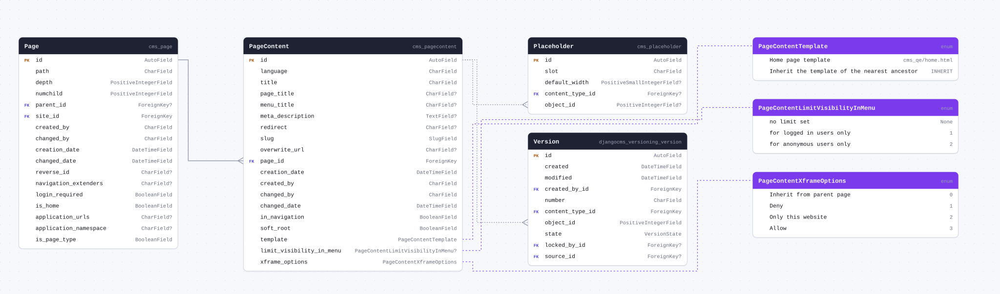

| Column | Field | Type | Null | Key | Default | Description |
| --- | --- | --- | --- | --- | --- | --- |
| `id` | `AutoField` | `integer` |  | PK | `autoincrement()` |  |
| `language` | `CharField` | `varchar(15)` |  |  |  |  |
| `title` | `CharField` | `varchar(255)` |  |  |  | The default title |
| `page_title` | `CharField` | `varchar(255)` | yes |  |  | Overwrites what is displayed at the top of your browser or in bookmarks |
| `menu_title` | `CharField` | `varchar(255)` | yes |  |  | Overwrite what is displayed in the menu |
| `meta_description` | `TextField` | `text` | yes |  |  | A description of the page used by search engines. |
| `redirect` | `CharField` | `varchar(2048)` | yes |  |  | Redirects to this URL. |
| `slug` | `SlugField` | `varchar(255)` |  |  |  | The part of the title that is used in the URL |
| `overwrite_url` | `CharField` | `varchar(255)` | yes |  |  | Keep this field empty if standard path should be used. |
| `page_id` | `ForeignKey` | `integer` |  | FK |  |  |
| `creation_date` | `DateTimeField` | `datetime` |  |  | `now()` |  |
| `created_by` | `CharField` | `varchar(255)` |  |  |  |  |
| `changed_by` | `CharField` | `varchar(255)` |  |  |  |  |
| `changed_date` | `DateTimeField` | `datetime` |  |  | `now()` |  |
| `in_navigation` | `BooleanField` | `bool` |  |  | `True` |  |
| `soft_root` | `BooleanField` | `bool` |  |  | `False` | All ancestors will not be displayed in the navigation |
| `template` | `PageContentTemplate` | `varchar(100)` |  |  | `'INHERIT'` | The template used to render the content. |
| `limit_visibility_in_menu` | `PageContentLimitVisibilityInMenu` | `smallint` | yes |  | `None` | limit when this page is visible in the menu |
| `xframe_options` | `PageContentXframeOptions` | `integer` |  |  | `2` |  |

Indexes:

- index `cms_pagecontent_language_0b8ccf12` on `language`
- index `cms_pagecontent_slug_23c7b868` on `slug`
- index `cms_pagecontent_page_id_b958451e` on `page_id`
- index `cms_pagecontent_in_navigation_c35c26ba` on `in_navigation`
- index `cms_pagecontent_soft_root_ea2486e9` on `soft_root`
- index `cms_pagecontent_limit_visibility_in_menu_e1d68dcf` on `limit_visibility_in_menu`

Relations:

- `page_id` → [Page](#page).`id`, on delete cascade
- `placeholders` ← [Placeholder](#placeholder), by `content_type_id` + `object_id` (generic relation)
- `versions` ← [Version](#version), by `content_type_id` + `object_id` (generic relation)

## PlaceholderReference

Table `cms_placeholderreference`, app `cms`.

Inherits from [CMSPlugin](#cmsplugin) (multi-table): its rows are joined on `cmsplugin_ptr_id`.

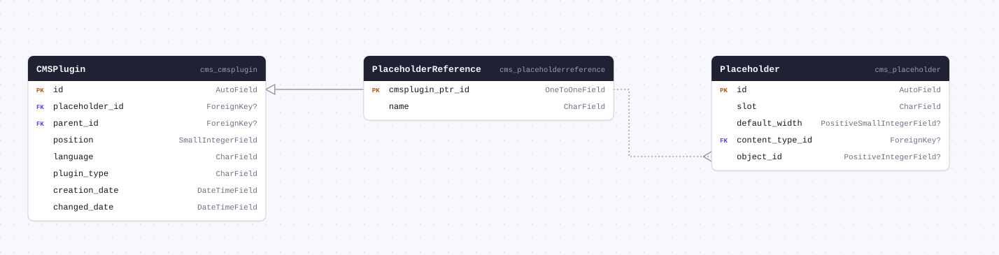

| Column | Field | Type | Null | Key | Default | Description |
| --- | --- | --- | --- | --- | --- | --- |
| `cmsplugin_ptr_id` | `OneToOneField` | `integer` |  | PK, FK |  |  |
| `name` | `CharField` | `varchar(255)` |  |  |  |  |

Relations:

- `cmsplugin_ptr_id` → [CMSPlugin](#cmsplugin).`id`, parent link, on delete cascade
- `placeholders` ← [Placeholder](#placeholder), by `content_type_id` + `object_id` (generic relation)

## AliasPluginModel

Table `cms_aliaspluginmodel`, app `cms`.

Inherits from [CMSPlugin](#cmsplugin) (multi-table): its rows are joined on `cmsplugin_ptr_id`.

AliasPlugin is deprecated,
and it will be removed;
please use the package djangocms-alias instead

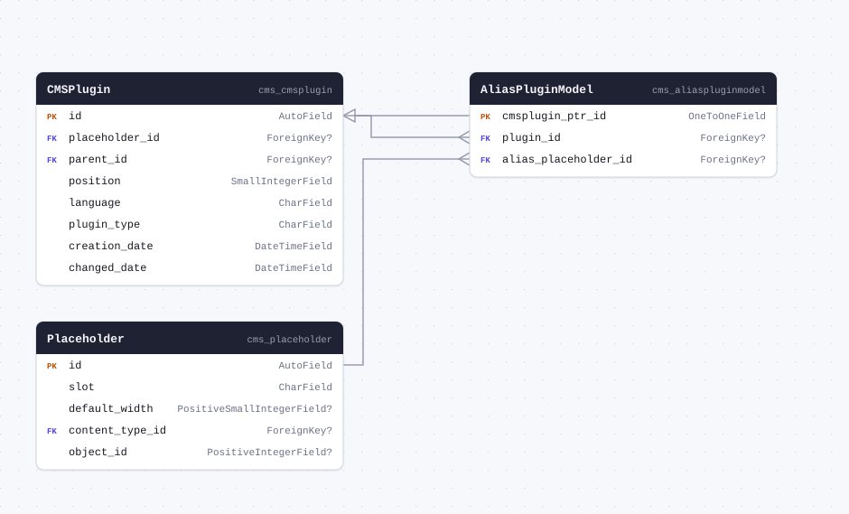

| Column | Field | Type | Null | Key | Default | Description |
| --- | --- | --- | --- | --- | --- | --- |
| `cmsplugin_ptr_id` | `OneToOneField` | `integer` |  | PK, FK |  |  |
| `plugin_id` | `ForeignKey` | `integer` | yes | FK |  |  |
| `alias_placeholder_id` | `ForeignKey` | `integer` | yes | FK |  |  |

Indexes:

- index `cms_aliaspluginmodel_plugin_id_9867676e` on `plugin_id`
- index `cms_aliaspluginmodel_alias_placeholder_id_6d6e0c8a` on `alias_placeholder_id`

Relations:

- `cmsplugin_ptr_id` → [CMSPlugin](#cmsplugin).`id`, parent link, on delete cascade
- `plugin_id` → [CMSPlugin](#cmsplugin).`id`, on delete cascade
- `alias_placeholder_id` → [Placeholder](#placeholder).`id`, on delete cascade

## UrlconfRevision

Table `cms_urlconfrevision`, app `cms`.

| Column | Field | Type | Null | Key | Default | Description |
| --- | --- | --- | --- | --- | --- | --- |
| `id` | `AutoField` | `integer` |  | PK | `autoincrement()` |  |
| `revision` | `CharField` | `varchar(255)` |  |  |  |  |

## CacheKey

Table `menus_cachekey`, app `menus`.

This model stores a set of cache keys accessible by multiple processes/machines.
Multiple Django instances will then share the keys, allowing selective invalidation
of menu trees (per site, per language) in the cache.

| Column | Field | Type | Null | Key | Default | Description |
| --- | --- | --- | --- | --- | --- | --- |
| `id` | `AutoField` | `integer` |  | PK | `autoincrement()` |  |
| `language` | `CharField` | `varchar(255)` |  |  |  |  |
| `site` | `PositiveIntegerField` | `integer unsigned` |  |  |  |  |
| `key` | `CharField` | `varchar(255)` |  |  |  |  |

## Text

Table `djangocms_text_text`, app `djangocms_text`.

Inherits from [CMSPlugin](#cmsplugin) (multi-table): its rows are joined on `cmsplugin_ptr_id`.

Columns from `AbstractText` (abstract): `cmsplugin_ptr_id`, `body`, `json`, `rte`.

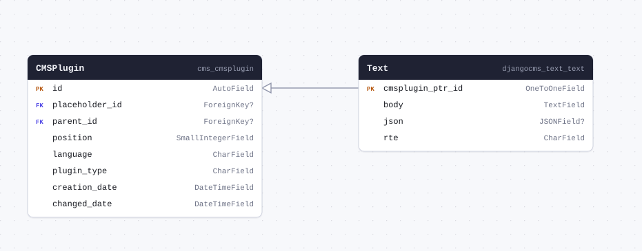

| Column | Field | Type | Null | Key | Default | Description |
| --- | --- | --- | --- | --- | --- | --- |
| `cmsplugin_ptr_id` | `OneToOneField` | `integer` |  | PK, FK |  |  |
| `body` | `TextField` | `text` |  |  |  |  |
| `json` | `JSONField` | `text` | yes |  |  |  |
| `rte` | `CharField` | `varchar(16)` |  |  | `''` | The rich text editor used to create this text. JSON formats vary between editors. |

Relations:

- `cmsplugin_ptr_id` → [CMSPlugin](#cmsplugin).`id`, parent link, on delete cascade

## djangocms_link.Link

Table `djangocms_link_link`, app `djangocms_link`.

Inherits from [CMSPlugin](#cmsplugin) (multi-table): its rows are joined on `cmsplugin_ptr_id`.

Columns from `AbstractLink` (abstract): `template`, `name`, `link`, `link_target`, `attributes`, `cmsplugin_ptr_id`.

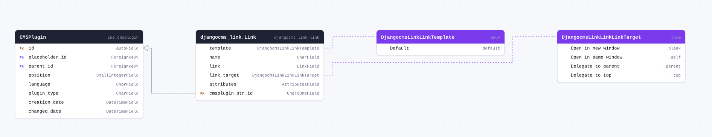

| Column | Field | Type | Null | Key | Default | Description |
| --- | --- | --- | --- | --- | --- | --- |
| `template` | `DjangocmsLinkLinkTemplate` | `varchar(255)` |  |  | `'default'` |  |
| `name` | `CharField` | `varchar(255)` |  |  |  |  |
| `link` | `LinkField` | `text` |  |  | `dict()` | - |
| `link_target` | `DjangocmsLinkLinkLinkTarget` | `varchar(255)` |  |  |  |  |
| `attributes` | `AttributesField` | `text` |  |  | `dict()` |  |
| `cmsplugin_ptr_id` | `OneToOneField` | `integer` |  | PK, FK |  |  |

Relations:

- `cmsplugin_ptr_id` → [CMSPlugin](#cmsplugin).`id`, parent link, on delete cascade

## CategoryTranslation

Table `djangocms_alias_category_translation`, app `djangocms_alias`.

Columns from `TranslatedFieldsModel` (abstract): `language_code`.

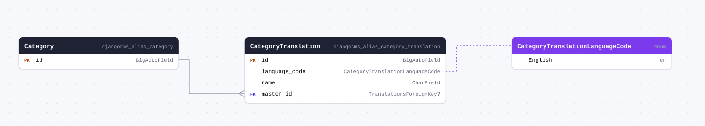

| Column | Field | Type | Null | Key | Default | Description |
| --- | --- | --- | --- | --- | --- | --- |
| `id` | `BigAutoField` | `integer` |  | PK | `autoincrement()` |  |
| `language_code` | `CategoryTranslationLanguageCode` | `varchar(15)` |  |  |  |  |
| `name` | `CharField` | `varchar(120)` |  |  |  |  |
| `master_id` | `TranslationsForeignKey` | `bigint` | yes | FK |  |  |

Indexes:

- index `djangocms_alias_category_translation_language_code_95644158` on `language_code`
- index `djangocms_alias_category_translation_master_id_65c3ac44` on `master_id`
- unique `djangocms_alias_category_translation_name_language_code_45c565e3_uniq` on `name`, `language_code`
- unique `djangocms_alias_category_translation_uniq_lang` on `language_code`, `master_id`

Relations:

- `master_id` → [Category](#category).`id`, on delete cascade

## Category

Table `djangocms_alias_category`, app `djangocms_alias`.

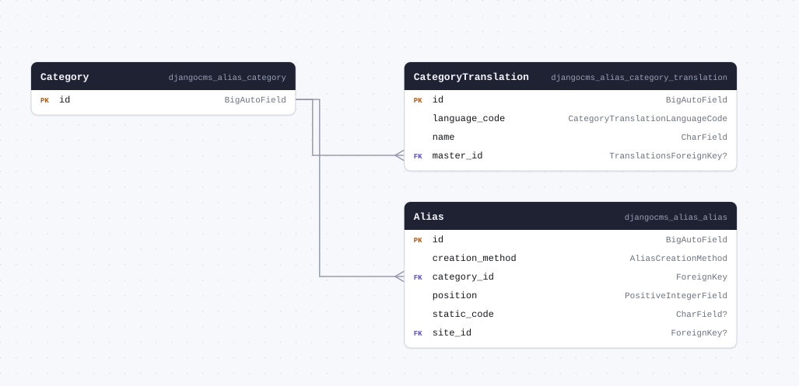

| Column | Field | Type | Null | Key | Default | Description |
| --- | --- | --- | --- | --- | --- | --- |
| `id` | `BigAutoField` | `integer` |  | PK | `autoincrement()` |  |

Relations:

- [CategoryTranslation](#categorytranslation).`master_id` → `id`, on delete cascade
- [Alias](#alias).`category_id` → `id`, on delete protect

## Alias

Table `djangocms_alias_alias`, app `djangocms_alias`.

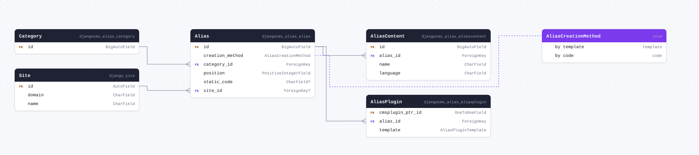

| Column | Field | Type | Null | Key | Default | Description |
| --- | --- | --- | --- | --- | --- | --- |
| `id` | `BigAutoField` | `integer` |  | PK | `autoincrement()` |  |
| `creation_method` | `AliasCreationMethod` | `varchar(20)` |  |  | `'code'` |  |
| `category_id` | `ForeignKey` | `bigint` |  | FK |  |  |
| `position` | `PositiveIntegerField` | `integer unsigned` |  |  | `0` |  |
| `static_code` | `CharField` | `varchar(255)` | yes |  |  | To render the alias in templates. |
| `site_id` | `ForeignKey` | `integer` | yes | FK |  |  |

Indexes:

- index `djangocms_alias_alias_category_id_96da6da6` on `category_id`
- index `djangocms_alias_alias_site_id_d4e42897` on `site_id`
- unique `djangocms_alias_alias_static_code_site_id_e5afbc06_uniq` on `static_code`, `site_id`

Relations:

- `category_id` → [Category](#category).`id`, on delete protect
- `site_id` → [Site](#site).`id`, on delete cascade
- [AliasContent](#aliascontent).`alias_id` → `id`, on delete cascade
- [AliasPlugin](#aliasplugin).`alias_id` → `id`, on delete protect

## AliasContent

Table `djangocms_alias_aliascontent`, app `djangocms_alias`.

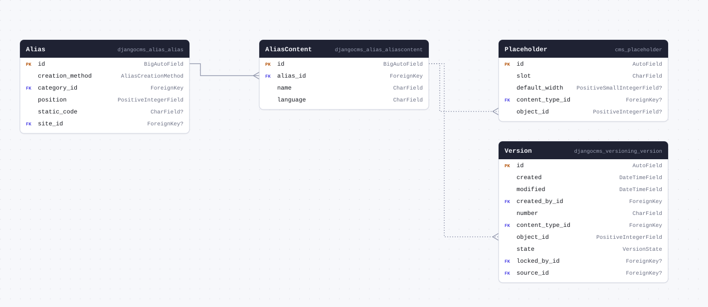

| Column | Field | Type | Null | Key | Default | Description |
| --- | --- | --- | --- | --- | --- | --- |
| `id` | `BigAutoField` | `integer` |  | PK | `autoincrement()` |  |
| `alias_id` | `ForeignKey` | `bigint` |  | FK |  |  |
| `name` | `CharField` | `varchar(120)` |  |  |  |  |
| `language` | `CharField` | `varchar(10)` |  |  | `get_language()` |  |

Indexes:

- index `djangocms_alias_aliascontent_alias_id_e36dc314` on `alias_id`

Relations:

- `alias_id` → [Alias](#alias).`id`, on delete cascade
- `placeholders` ← [Placeholder](#placeholder), by `content_type_id` + `object_id` (generic relation)
- `versions` ← [Version](#version), by `content_type_id` + `object_id` (generic relation)

## AliasPlugin

Table `djangocms_alias_aliasplugin`, app `djangocms_alias`.

Inherits from [CMSPlugin](#cmsplugin) (multi-table): its rows are joined on `cmsplugin_ptr_id`.

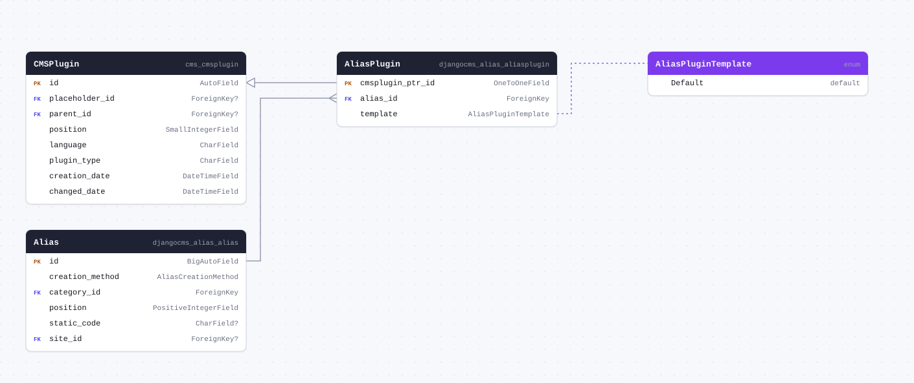

| Column | Field | Type | Null | Key | Default | Description |
| --- | --- | --- | --- | --- | --- | --- |
| `cmsplugin_ptr_id` | `OneToOneField` | `integer` |  | PK, FK |  |  |
| `alias_id` | `ForeignKey` | `bigint` |  | FK |  |  |
| `template` | `AliasPluginTemplate` | `varchar(255)` |  |  | `'default'` |  |

Indexes:

- index `djangocms_alias_aliasplugin_alias_id_d425895e` on `alias_id`

Relations:

- `cmsplugin_ptr_id` → [CMSPlugin](#cmsplugin).`id`, parent link, on delete cascade
- `alias_id` → [Alias](#alias).`id`, on delete protect

## Version

Table `djangocms_versioning_version`, app `djangocms_versioning`.

Proxy models, on this table: `AliasContentVersion`, `PageContentVersion`.

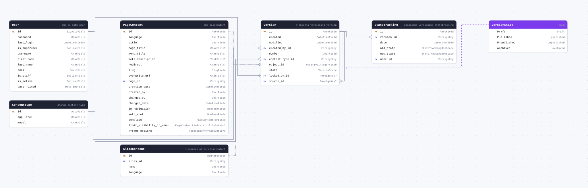

| Column | Field | Type | Null | Key | Default | Description |
| --- | --- | --- | --- | --- | --- | --- |
| `id` | `AutoField` | `integer` |  | PK | `autoincrement()` |  |
| `created` | `DateTimeField` | `datetime` |  |  | `now()` |  |
| `modified` | `DateTimeField` | `datetime` |  |  | `now()` |  |
| `created_by_id` | `ForeignKey` | `bigint` |  | FK |  |  |
| `number` | `CharField` | `varchar(11)` |  |  |  |  |
| `content_type_id` | `ForeignKey` | `integer` |  | FK |  |  |
| `object_id` | `PositiveIntegerField` | `integer unsigned` |  |  |  |  |
| `state` | `VersionState` | `varchar(50)` |  |  | `'draft'` |  |
| `locked_by_id` | `ForeignKey` | `bigint` | yes | FK | `None` |  |
| `source_id` | `ForeignKey` | `integer` | yes | FK |  |  |

Indexes:

- index `djangocms_versioning_version_created_by_id_0a7b7c9d` on `created_by_id`
- index `djangocms_versioning_version_content_type_id_04f95e7d` on `content_type_id`
- index `djangocms_versioning_version_locked_by_id_87332f7c` on `locked_by_id`
- index `djangocms_versioning_version_source_id_d0664b18` on `source_id`
- unique `djangocms_versioning_version_content_type_id_object_id_fac3dca5_uniq` on `content_type_id`, `object_id`

Relations:

- `content` → any model, by `content_type_id` + `object_id` (generic foreign key)
- `object_id` → [PageContent](#pagecontent).`id` where `content_type_id` is PageContent (generic, `PageContent.versions`)
- `object_id` → [AliasContent](#aliascontent).`id` where `content_type_id` is AliasContent (generic, `AliasContent.versions`)
- `created_by_id` → [User](#user).`id`, on delete protect
- `content_type_id` → [ContentType](#contenttype).`id`, on delete protect
- `locked_by_id` → [User](#user).`id`, on delete set null
- `source_id` → [Version](#version).`id`, on delete allow deleting versions
- [StateTracking](#statetracking).`version_id` → `id`, on delete cascade

## StateTracking

Table `djangocms_versioning_statetracking`, app `djangocms_versioning`.

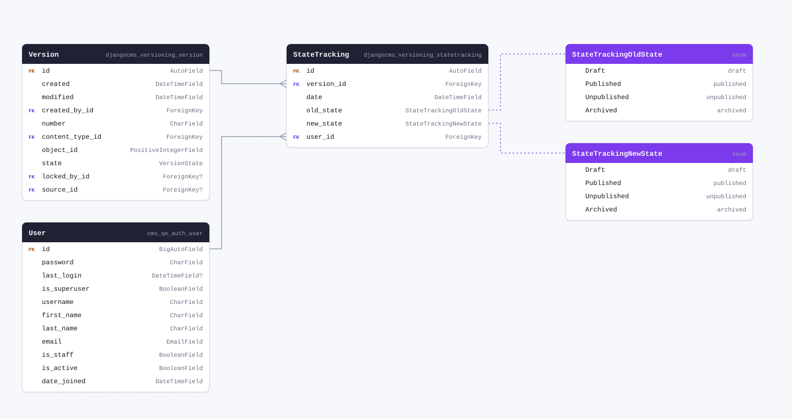

| Column | Field | Type | Null | Key | Default | Description |
| --- | --- | --- | --- | --- | --- | --- |
| `id` | `AutoField` | `integer` |  | PK | `autoincrement()` |  |
| `version_id` | `ForeignKey` | `integer` |  | FK |  |  |
| `date` | `DateTimeField` | `datetime` |  |  | `now()` |  |
| `old_state` | `StateTrackingOldState` | `varchar(100)` |  |  |  |  |
| `new_state` | `StateTrackingNewState` | `varchar(100)` |  |  |  |  |
| `user_id` | `ForeignKey` | `bigint` |  | FK |  |  |

Indexes:

- index `djangocms_versioning_statetracking_version_id_bda1e5ca` on `version_id`
- index `djangocms_versioning_statetracking_user_id_93cc4ccb` on `user_id`

Relations:

- `version_id` → [Version](#version).`id`, on delete cascade
- `user_id` → [User](#user).`id`, on delete cascade

## GoogleMap

Table `djangocms_googlemap_googlemap`, app `djangocms_googlemap`.

Inherits from [CMSPlugin](#cmsplugin) (multi-table): its rows are joined on `cmsplugin_ptr_id`.

Renders the Google Maps wrapper

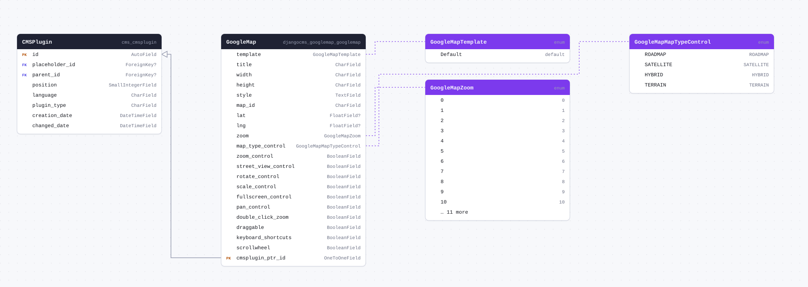

| Column | Field | Type | Null | Key | Default | Description |
| --- | --- | --- | --- | --- | --- | --- |
| `template` | `GoogleMapTemplate` | `varchar(255)` |  |  | `'default'` |  |
| `title` | `CharField` | `varchar(255)` |  |  |  |  |
| `width` | `CharField` | `varchar(6)` |  |  | `'100%'` | Width of the map, including the CSS length units (e.g. "100%", "400px" or "400rem"). |
| `height` | `CharField` | `varchar(6)` |  |  | `'400px'` | Height of the map, including the CSS length units (e.g. "400px" or "400rem"). |
| `style` | `TextField` | `text` |  |  |  | Provide a valid (escaped) JSON configuration. See http://developers.google.com/maps/documentation/javascript/styling |
| `map_id` | `CharField` | `varchar(32)` |  |  |  | Map ID of Cloud-based maps styling. See https://developers.google.com/maps/documentation/cloud-customization/overview |
| `lat` | `FloatField` | `real` | yes |  |  | Default Geographical latitude in degrees (e.g. "46.947973"). |
| `lng` | `FloatField` | `real` | yes |  |  | Default Geographical longitude in degrees (e.g. "7.447446"). |
| `zoom` | `GoogleMapZoom` | `smallint unsigned` |  |  | `13` |  |
| `map_type_control` | `GoogleMapMapTypeControl` | `varchar(255)` |  |  | `'ROADMAP'` |  |
| `zoom_control` | `BooleanField` | `bool` |  |  | `True` | Enabling zooming allows the user to view the map at different scales. |
| `street_view_control` | `BooleanField` | `bool` |  |  | `True` | Street View allows the user to see street-level imagery. |
| `rotate_control` | `BooleanField` | `bool` |  |  | `True` | Allows the user to change the orientation of the map. |
| `scale_control` | `BooleanField` | `bool` |  |  | `True` | Displays a linear distance scale on the map. |
| `fullscreen_control` | `BooleanField` | `bool` |  |  | `True` | Allows the user to select a fullscreen view of the map. |
| `pan_control` | `BooleanField` | `bool` |  |  | `True` | Allows the user to move the map using the cursor keys to see new areas. |
| `double_click_zoom` | `BooleanField` | `bool` |  |  | `True` | Allows the user to zoom and centre the map with a double-click or double-tap. |
| `draggable` | `BooleanField` | `bool` |  |  | `True` | Allows the user to drag the map to see new areas. |
| `keyboard_shortcuts` | `BooleanField` | `bool` |  |  | `True` | Allows the user to control the map using the keyboard. |
| `scrollwheel` | `BooleanField` | `bool` |  |  | `True` | Allows the user to control the zoom level with a scroll-wheel. |
| `cmsplugin_ptr_id` | `OneToOneField` | `integer` |  | PK, FK |  |  |

Relations:

- `cmsplugin_ptr_id` → [CMSPlugin](#cmsplugin).`id`, parent link, on delete cascade

## GoogleMapMarker

Table `djangocms_googlemap_googlemapmarker`, app `djangocms_googlemap`.

Inherits from [CMSPlugin](#cmsplugin) (multi-table): its rows are joined on `cmsplugin_ptr_id`.

Renders a marker inside the Google Maps wrapper

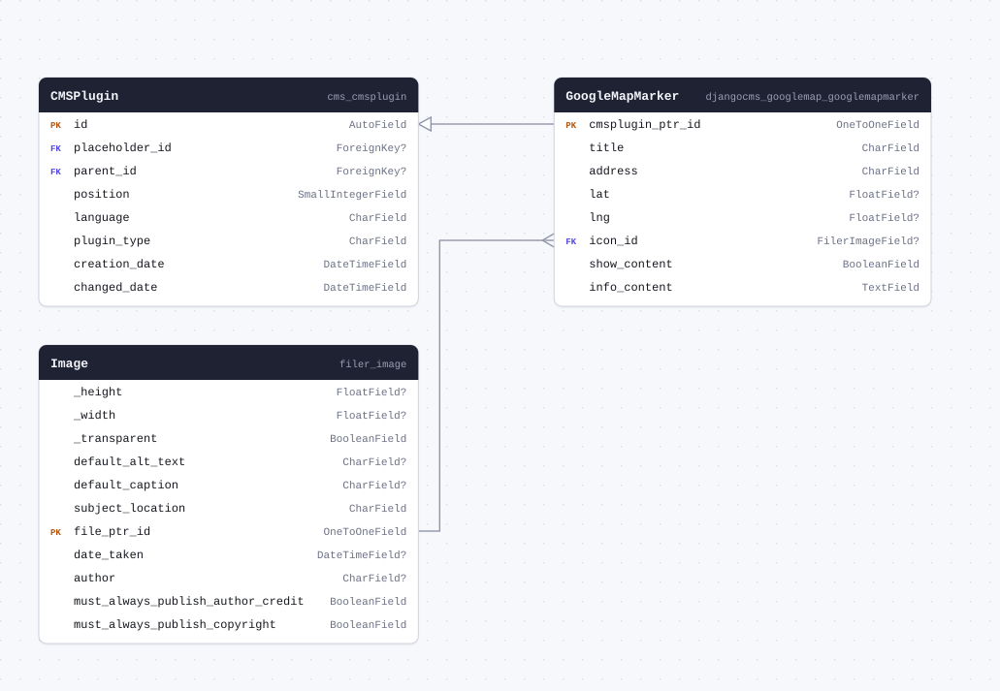

| Column | Field | Type | Null | Key | Default | Description |
| --- | --- | --- | --- | --- | --- | --- |
| `cmsplugin_ptr_id` | `OneToOneField` | `integer` |  | PK, FK |  |  |
| `title` | `CharField` | `varchar(255)` |  |  |  |  |
| `address` | `CharField` | `varchar(255)` |  |  |  | Note: Latitude and longitude can be used to fine-tune the location. |
| `lat` | `FloatField` | `real` | yes |  |  | Geographical latitude in degrees (e.g. "46.947973"). |
| `lng` | `FloatField` | `real` | yes |  |  | Geographical longitude in degrees (e.g. "7.447446"). |
| `icon_id` | `FilerImageField` | `integer` | yes | FK |  | A marker icon identifies a location on a map. By default, it uses a standard image from Google. |
| `show_content` | `BooleanField` | `bool` |  |  | `True` | Display the info window when the map loads. |
| `info_content` | `TextField` | `text` |  |  |  | Will be displayed in the info window attached to the marker. |

Indexes:

- index `djangocms_googlemap_googlemapmarker_icon_id_3b103213` on `icon_id`

Relations:

- `cmsplugin_ptr_id` → [CMSPlugin](#cmsplugin).`id`, parent link, on delete cascade
- `icon_id` → [Image](#image).`file_ptr_id`, on delete set null

## GoogleMapRoute

Table `djangocms_googlemap_googlemaproute`, app `djangocms_googlemap`.

Inherits from [CMSPlugin](#cmsplugin) (multi-table): its rows are joined on `cmsplugin_ptr_id`.

Renders a route option inside the map

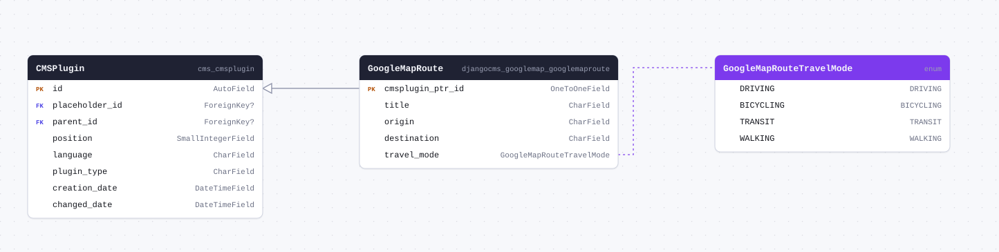

| Column | Field | Type | Null | Key | Default | Description |
| --- | --- | --- | --- | --- | --- | --- |
| `cmsplugin_ptr_id` | `OneToOneField` | `integer` |  | PK, FK |  |  |
| `title` | `CharField` | `varchar(255)` |  |  |  |  |
| `origin` | `CharField` | `varchar(255)` |  |  |  | Will be determined by user's location (if possible) if left blank. |
| `destination` | `CharField` | `varchar(255)` |  |  |  |  |
| `travel_mode` | `GoogleMapRouteTravelMode` | `varchar(255)` |  |  | `'DRIVING'` |  |

Relations:

- `cmsplugin_ptr_id` → [CMSPlugin](#cmsplugin).`id`, parent link, on delete cascade

## filer.Folder

Table `filer_folder`, app `filer`.

Represents a Folder that things (files) can be put into. Folders are *NOT*
mirrored in the Filesystem and can have any unicode chars as their name.
Other models may attach to a folder with a ForeignKey. If the related name
ends with "_files" they will automatically be listed in the
folder.files list along with all the other models that link to the folder
in this way. Make sure the linked models obey the AbstractFile interface
(Duck Type).

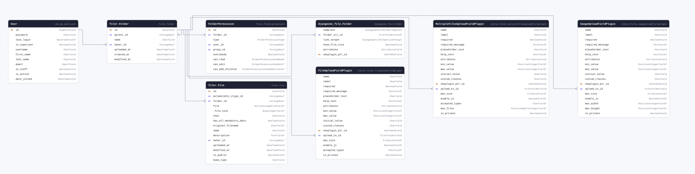

| Column | Field | Type | Null | Key | Default | Description |
| --- | --- | --- | --- | --- | --- | --- |
| `id` | `AutoField` | `integer` |  | PK | `autoincrement()` |  |
| `parent_id` | `ForeignKey` | `integer` | yes | FK |  |  |
| `name` | `CharField` | `varchar(255)` |  |  |  |  |
| `owner_id` | `ForeignKey` | `bigint` | yes | FK |  |  |
| `uploaded_at` | `DateTimeField` | `datetime` |  |  | `now()` |  |
| `created_at` | `DateTimeField` | `datetime` |  |  | `now()` |  |
| `modified_at` | `DateTimeField` | `datetime` |  |  | `now()` |  |

Indexes:

- index `filer_folder_parent_id_308aecda` on `parent_id`
- index `filer_folder_owner_id_be530fb4` on `owner_id`
- unique `filer_folder_parent_id_name_bc773258_uniq` on `parent_id`, `name`

Relations:

- `parent_id` → [filer.Folder](#filerfolder).`id`, on delete cascade
- `owner_id` → [User](#user).`id`, on delete set null
- [FolderPermission](#folderpermission).`folder_id` → `id`, on delete cascade
- [filer.File](#filerfile).`folder_id` → `id`
- [djangocms_file.Folder](#djangocms_filefolder).`folder_src_id` → `id`, on delete set null
- [FileUploadFieldPlugin](#fileuploadfieldplugin).`upload_to_id` → `id`, on delete cascade
- [MultipleFilesUploadFieldPlugin](#multiplefilesuploadfieldplugin).`upload_to_id` → `id`, on delete cascade
- [ImageUploadFieldPlugin](#imageuploadfieldplugin).`upload_to_id` → `id`, on delete cascade

## FolderPermission

Table `filer_folderpermission`, app `filer`.

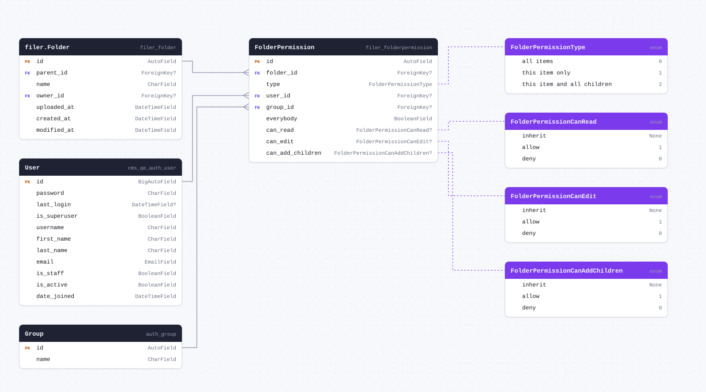

| Column | Field | Type | Null | Key | Default | Description |
| --- | --- | --- | --- | --- | --- | --- |
| `id` | `AutoField` | `integer` |  | PK | `autoincrement()` |  |
| `folder_id` | `ForeignKey` | `integer` | yes | FK |  |  |
| `type` | `FolderPermissionType` | `smallint` |  |  | `0` |  |
| `user_id` | `ForeignKey` | `bigint` | yes | FK |  |  |
| `group_id` | `ForeignKey` | `integer` | yes | FK |  |  |
| `everybody` | `BooleanField` | `bool` |  |  | `False` |  |
| `can_read` | `FolderPermissionCanRead` | `smallint` | yes |  | `None` |  |
| `can_edit` | `FolderPermissionCanEdit` | `smallint` | yes |  | `None` |  |
| `can_add_children` | `FolderPermissionCanAddChildren` | `smallint` | yes |  | `None` |  |

Indexes:

- index `filer_folderpermission_folder_id_5d02f1da` on `folder_id`
- index `filer_folderpermission_user_id_7673d4b6` on `user_id`
- index `filer_folderpermission_group_id_8901bafa` on `group_id`

Relations:

- `folder_id` → [filer.Folder](#filerfolder).`id`, on delete cascade
- `user_id` → [User](#user).`id`, on delete set null
- `group_id` → [Group](#group).`id`, on delete cascade

## filer.File

Table `filer_file`, app `filer`.

Subclasses (multi-table): [Image](#image).

Columns from `PolymorphicModel` (abstract): `polymorphic_ctype_id`.

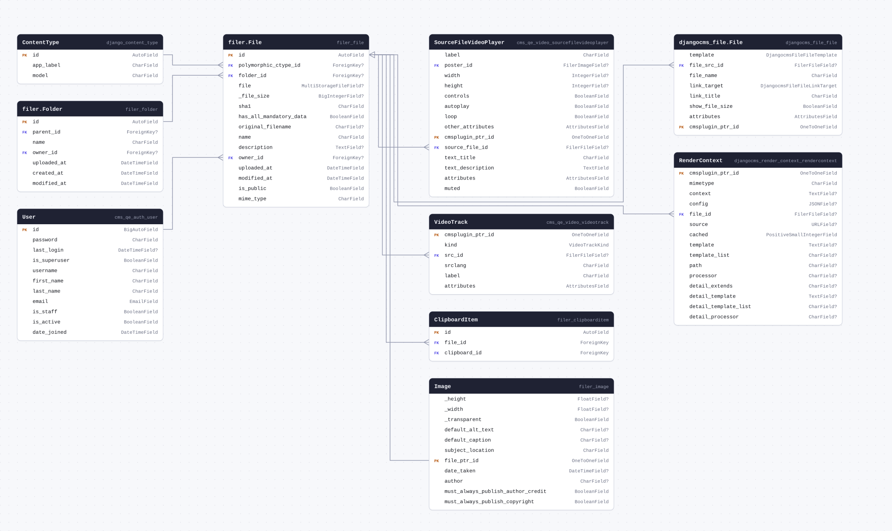

| Column | Field | Type | Null | Key | Default | Description |
| --- | --- | --- | --- | --- | --- | --- |
| `id` | `AutoField` | `integer` |  | PK | `autoincrement()` |  |
| `polymorphic_ctype_id` | `ForeignKey` | `integer` | yes | FK |  |  |
| `folder_id` | `ForeignKey` | `integer` | yes | FK |  |  |
| `file` | `MultiStorageFileField` | `varchar(255)` | yes |  |  |  |
| `_file_size` | `BigIntegerField` | `bigint` | yes |  |  |  |
| `sha1` | `CharField` | `varchar(40)` |  |  | `''` |  |
| `has_all_mandatory_data` | `BooleanField` | `bool` |  |  | `False` |  |
| `original_filename` | `CharField` | `varchar(255)` | yes |  |  |  |
| `name` | `CharField` | `varchar(255)` |  |  | `''` |  |
| `description` | `TextField` | `text` | yes |  |  |  |
| `owner_id` | `ForeignKey` | `bigint` | yes | FK |  |  |
| `uploaded_at` | `DateTimeField` | `datetime` |  |  | `now()` |  |
| `modified_at` | `DateTimeField` | `datetime` |  |  | `now()` |  |
| `is_public` | `BooleanField` | `bool` |  |  | `is_public_default()` | Disable any permission checking for this file. File will be publicly accessible to anyone. |
| `mime_type` | `CharField` | `varchar(255)` |  |  | `'application/octet-stream'` | MIME type of uploaded content |

Indexes:

- index `filer_file_polymorphic_ctype_id_f44903c1` on `polymorphic_ctype_id`
- index `filer_file_folder_id_af803bbb` on `folder_id`
- index `filer_file_owner_id_b9e32671` on `owner_id`

Relations:

- `in_clipboards` — many to many with [Clipboard](#clipboard), through [ClipboardItem](#clipboarditem)
- [SourceFileVideoPlayer](#sourcefilevideoplayer).`source_file_id` → `id`, on delete set null
- [VideoTrack](#videotrack).`src_id` → `id`, on delete set null
- `polymorphic_ctype_id` → [ContentType](#contenttype).`id`
- `folder_id` → [filer.Folder](#filerfolder).`id`
- `owner_id` → [User](#user).`id`
- [ClipboardItem](#clipboarditem).`file_id` → `id`, on delete cascade
- [Image](#image).`file_ptr_id` → `id`, parent link
- [djangocms_file.File](#djangocms_filefile).`file_src_id` → `id`, on delete set null
- [RenderContext](#rendercontext).`file_id` → `id`, on delete set null

## Clipboard

Table `filer_clipboard`, app `filer`.

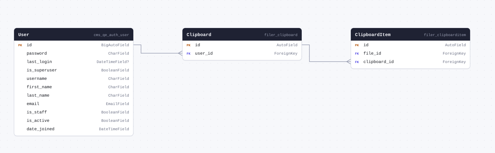

| Column | Field | Type | Null | Key | Default | Description |
| --- | --- | --- | --- | --- | --- | --- |
| `id` | `AutoField` | `integer` |  | PK | `autoincrement()` |  |
| `user_id` | `ForeignKey` | `bigint` |  | FK |  |  |

Indexes:

- index `filer_clipboard_user_id_b52ff0bc` on `user_id`

Relations:

- `files` — many to many with [filer.File](#filerfile), through [ClipboardItem](#clipboarditem)
- `user_id` → [User](#user).`id`, on delete cascade
- [ClipboardItem](#clipboarditem).`clipboard_id` → `id`, on delete cascade

## ClipboardItem

Table `filer_clipboarditem`, app `filer`.

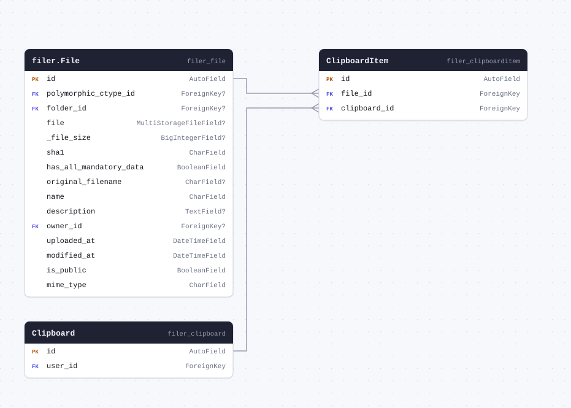

| Column | Field | Type | Null | Key | Default | Description |
| --- | --- | --- | --- | --- | --- | --- |
| `id` | `AutoField` | `integer` |  | PK | `autoincrement()` |  |
| `file_id` | `ForeignKey` | `integer` |  | FK |  |  |
| `clipboard_id` | `ForeignKey` | `integer` |  | FK |  |  |

Indexes:

- index `filer_clipboarditem_file_id_06196f80` on `file_id`
- index `filer_clipboarditem_clipboard_id_7a76518b` on `clipboard_id`

Relations:

- `file_id` → [filer.File](#filerfile).`id`, on delete cascade
- `clipboard_id` → [Clipboard](#clipboard).`id`, on delete cascade

## Image

Table `filer_image`, app `filer`.

Inherits from [filer.File](#filerfile) (multi-table): its rows are joined on `file_ptr_id`.

Columns from `BaseImage` (abstract): `_height`, `_width`, `_transparent`, `default_alt_text`, `default_caption`, `subject_location`, `file_ptr_id`.

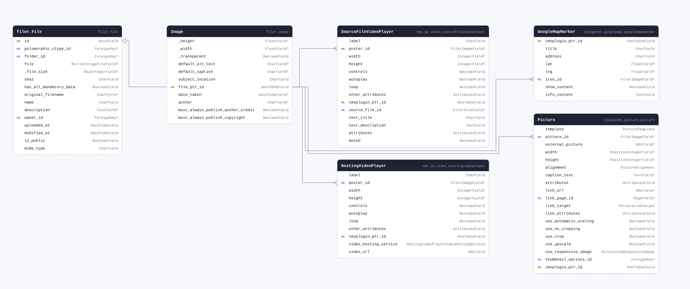

| Column | Field | Type | Null | Key | Default | Description |
| --- | --- | --- | --- | --- | --- | --- |
| `_height` | `FloatField` | `real` | yes |  |  |  |
| `_width` | `FloatField` | `real` | yes |  |  |  |
| `_transparent` | `BooleanField` | `bool` |  |  | `False` |  |
| `default_alt_text` | `CharField` | `varchar(255)` | yes |  |  |  |
| `default_caption` | `CharField` | `varchar(255)` | yes |  |  |  |
| `subject_location` | `CharField` | `varchar(64)` |  |  | `''` |  |
| `file_ptr_id` | `OneToOneField` | `integer` |  | PK, FK |  |  |
| `date_taken` | `DateTimeField` | `datetime` | yes |  |  |  |
| `author` | `CharField` | `varchar(255)` | yes |  |  |  |
| `must_always_publish_author_credit` | `BooleanField` | `bool` |  |  | `False` |  |
| `must_always_publish_copyright` | `BooleanField` | `bool` |  |  | `False` |  |

Relations:

- [SourceFileVideoPlayer](#sourcefilevideoplayer).`poster_id` → `file_ptr_id`, on delete set null
- [HostingVideoPlayer](#hostingvideoplayer).`poster_id` → `file_ptr_id`, on delete set null
- [GoogleMapMarker](#googlemapmarker).`icon_id` → `file_ptr_id`, on delete set null
- `file_ptr_id` → [filer.File](#filerfile).`id`, parent link
- [Picture](#picture).`picture_id` → `file_ptr_id`, on delete set null

## ThumbnailOption

Table `filer_thumbnailoption`, app `filer`.

This class defines the option use to create the thumbnail.

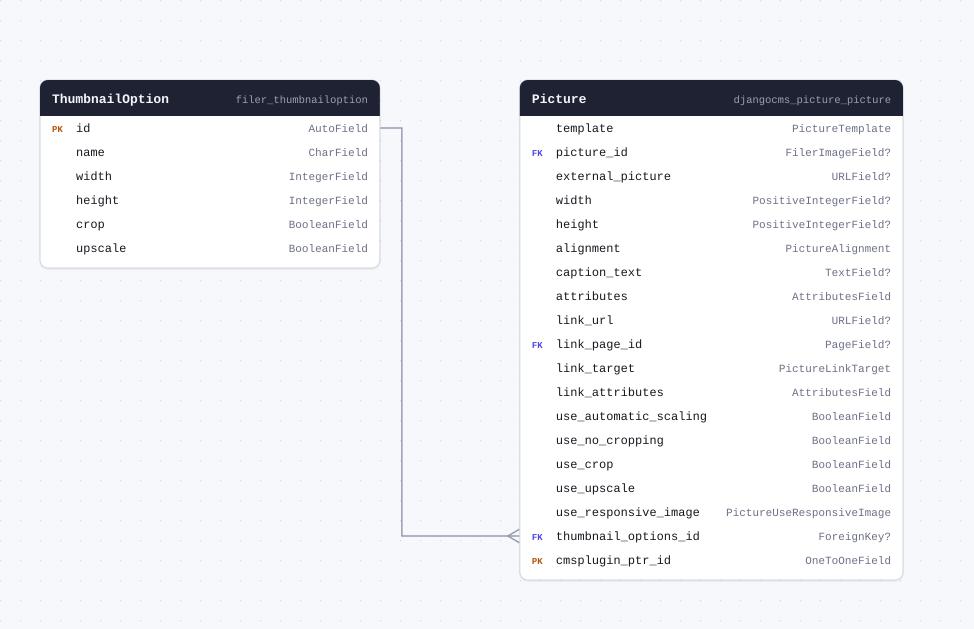

| Column | Field | Type | Null | Key | Default | Description |
| --- | --- | --- | --- | --- | --- | --- |
| `id` | `AutoField` | `integer` |  | PK | `autoincrement()` |  |
| `name` | `CharField` | `varchar(100)` |  |  |  |  |
| `width` | `IntegerField` | `integer` |  |  |  | width in pixel. |
| `height` | `IntegerField` | `integer` |  |  |  | height in pixel. |
| `crop` | `BooleanField` | `bool` |  |  | `True` |  |
| `upscale` | `BooleanField` | `bool` |  |  | `True` |  |

Relations:

- [Picture](#picture).`thumbnail_options_id` → `id`, on delete cascade

## Source

Table `easy_thumbnails_source`, app `easy_thumbnails`.

Columns from `File` (abstract): `storage_hash`, `name`, `modified`.

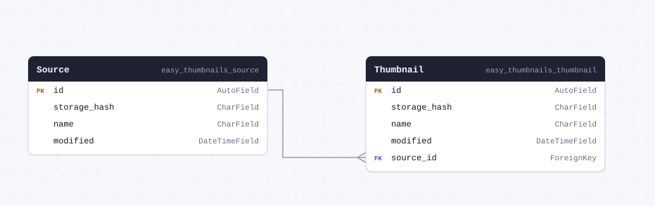

| Column | Field | Type | Null | Key | Default | Description |
| --- | --- | --- | --- | --- | --- | --- |
| `id` | `AutoField` | `integer` |  | PK | `autoincrement()` |  |
| `storage_hash` | `CharField` | `varchar(40)` |  |  |  |  |
| `name` | `CharField` | `varchar(255)` |  |  |  |  |
| `modified` | `DateTimeField` | `datetime` |  |  | `now()` |  |

Indexes:

- index `easy_thumbnails_source_storage_hash_946cbcc9` on `storage_hash`
- index `easy_thumbnails_source_name_5fe0edc6` on `name`
- unique `easy_thumbnails_source_storage_hash_name_481ce32d_uniq` on `storage_hash`, `name`

Relations:

- [Thumbnail](#thumbnail).`source_id` → `id`, on delete cascade

## Thumbnail

Table `easy_thumbnails_thumbnail`, app `easy_thumbnails`.

Columns from `File` (abstract): `storage_hash`, `name`, `modified`.


| Column | Field | Type | Null | Key | Default | Description |
| --- | --- | --- | --- | --- | --- | --- |
| `id` | `AutoField` | `integer` |  | PK | `autoincrement()` |  |
| `storage_hash` | `CharField` | `varchar(40)` |  |  |  |  |
| `name` | `CharField` | `varchar(255)` |  |  |  |  |
| `modified` | `DateTimeField` | `datetime` |  |  | `now()` |  |
| `source_id` | `ForeignKey` | `integer` |  | FK |  |  |

Indexes:

- index `easy_thumbnails_thumbnail_storage_hash_f1435f49` on `storage_hash`
- index `easy_thumbnails_thumbnail_name_b5882c31` on `name`
- index `easy_thumbnails_thumbnail_source_id_5b57bc77` on `source_id`
- unique `easy_thumbnails_thumbnail_storage_hash_name_source_id_fb375270_uniq` on `storage_hash`, `name`, `source_id`

Relations:

- `source_id` → [Source](#source).`id`, on delete cascade
- [ThumbnailDimensions](#thumbnaildimensions).`thumbnail_id` → `id`, on delete cascade

## ThumbnailDimensions

Table `easy_thumbnails_thumbnaildimensions`, app `easy_thumbnails`.


| Column | Field | Type | Null | Key | Default | Description |
| --- | --- | --- | --- | --- | --- | --- |
| `id` | `AutoField` | `integer` |  | PK | `autoincrement()` |  |
| `thumbnail_id` | `OneToOneField` | `integer` |  | FK, unique |  |  |
| `width` | `PositiveIntegerField` | `integer unsigned` | yes |  |  |  |
| `height` | `PositiveIntegerField` | `integer unsigned` | yes |  |  |  |

Relations:

- `thumbnail_id` → [Thumbnail](#thumbnail).`id`, on delete cascade

## djangocms_file.File

Table `djangocms_file_file`, app `djangocms_file`.

Inherits from [CMSPlugin](#cmsplugin) (multi-table): its rows are joined on `cmsplugin_ptr_id`.

Columns from `AbstractFile` (abstract): `template`, `file_src_id`, `file_name`, `link_target`, `link_title`, `show_file_size`, `attributes`, `cmsplugin_ptr_id`.


| Column | Field | Type | Null | Key | Default | Description |
| --- | --- | --- | --- | --- | --- | --- |
| `template` | `DjangocmsFileFileTemplate` | `varchar(255)` |  |  | `'default'` |  |
| `file_src_id` | `FilerFileField` | `integer` | yes | FK |  |  |
| `file_name` | `CharField` | `varchar(255)` |  |  |  | Overrides the default file name with the given value. |
| `link_target` | `DjangocmsFileFileLinkTarget` | `varchar(255)` |  |  | `''` |  |
| `link_title` | `CharField` | `varchar(255)` |  |  |  |  |
| `show_file_size` | `BooleanField` | `bool` |  |  | `False` | Appends the file size at the end of the name. |
| `attributes` | `AttributesField` | `text` |  |  | `dict()` |  |
| `cmsplugin_ptr_id` | `OneToOneField` | `integer` |  | PK, FK |  |  |

Indexes:

- index `djangocms_file_file_file_src_id_74ac14a5` on `file_src_id`

Relations:

- `file_src_id` → [filer.File](#filerfile).`id`, on delete set null
- `cmsplugin_ptr_id` → [CMSPlugin](#cmsplugin).`id`, parent link, on delete cascade

## djangocms_file.Folder

Table `djangocms_file_folder`, app `djangocms_file`.

Inherits from [CMSPlugin](#cmsplugin) (multi-table): its rows are joined on `cmsplugin_ptr_id`.

Columns from `AbstractFolder` (abstract): `template`, `folder_src_id`, `link_target`, `show_file_size`, `attributes`, `cmsplugin_ptr_id`.


| Column | Field | Type | Null | Key | Default | Description |
| --- | --- | --- | --- | --- | --- | --- |
| `template` | `DjangocmsFileFolderTemplate` | `varchar(255)` |  |  | `'default'` |  |
| `folder_src_id` | `FilerFolderField` | `integer` | yes | FK |  |  |
| `link_target` | `DjangocmsFileFolderLinkTarget` | `varchar(255)` |  |  | `''` |  |
| `show_file_size` | `BooleanField` | `bool` |  |  | `False` | Appends the file size at the end of the name. |
| `attributes` | `AttributesField` | `text` |  |  | `dict()` |  |
| `cmsplugin_ptr_id` | `OneToOneField` | `integer` |  | PK, FK |  |  |

Indexes:

- index `djangocms_file_folder_folder_src_id_9558406a` on `folder_src_id`

Relations:

- `folder_src_id` → [filer.Folder](#filerfolder).`id`, on delete set null
- `cmsplugin_ptr_id` → [CMSPlugin](#cmsplugin).`id`, parent link, on delete cascade

## Icon

Table `djangocms_icon_icon`, app `djangocms_icon`.

Inherits from [CMSPlugin](#cmsplugin) (multi-table): its rows are joined on `cmsplugin_ptr_id`.

Columns from `AbstractIcon` (abstract): `cmsplugin_ptr_id`, `icon`, `template`, `label`, `attributes`.


| Column | Field | Type | Null | Key | Default | Description |
| --- | --- | --- | --- | --- | --- | --- |
| `cmsplugin_ptr_id` | `OneToOneField` | `integer` |  | PK, FK |  |  |
| `icon` | `Icon` | `varchar(255)` |  |  | `''` |  |
| `template` | `IconTemplate` | `varchar(255)` |  |  | `'default'` |  |
| `label` | `CharField` | `varchar(255)` |  |  |  |  |
| `attributes` | `AttributesField` | `text` |  |  | `dict()` |  |

Relations:

- `cmsplugin_ptr_id` → [CMSPlugin](#cmsplugin).`id`, parent link, on delete cascade

## Picture

Table `djangocms_picture_picture`, app `djangocms_picture`.

Inherits from [CMSPlugin](#cmsplugin) (multi-table): its rows are joined on `cmsplugin_ptr_id`.

Columns from `AbstractPicture` (abstract): `template`, `picture_id`, `external_picture`, `width`, `height`, `alignment`, `caption_text`, `attributes`, `link_url`, `link_page_id`, `link_target`, `link_attributes`, `use_automatic_scaling`, `use_no_cropping`, `use_crop`, `use_upscale`, `use_responsive_image`, `thumbnail_options_id`, `cmsplugin_ptr_id`.


| Column | Field | Type | Null | Key | Default | Description |
| --- | --- | --- | --- | --- | --- | --- |
| `template` | `PictureTemplate` | `varchar(255)` |  |  | `'default'` |  |
| `picture_id` | `FilerImageField` | `integer` | yes | FK |  |  |
| `external_picture` | `URLField` | `varchar(255)` | yes |  |  | If provided, overrides the embedded image. Certain options such as cropping are not applicable to external images. |
| `width` | `PositiveIntegerField` | `integer unsigned` | yes |  |  | The image width as number in pixels. Example: "720" and not "720px". |
| `height` | `PositiveIntegerField` | `integer unsigned` | yes |  |  | The image height as number in pixels. Example: "720" and not "720px". |
| `alignment` | `PictureAlignment` | `varchar(255)` |  |  |  | Aligns the image according to the selected option. |
| `caption_text` | `TextField` | `text` | yes |  |  | Provide a description, attribution, copyright or other information. |
| `attributes` | `AttributesField` | `text` |  |  | `dict()` |  |
| `link_url` | `URLField` | `varchar(2040)` | yes |  |  | Wraps the image in a link to an external URL. |
| `link_page_id` | `PageField` | `integer` | yes | FK |  | Wraps the image in a link to an internal (page) URL. |
| `link_target` | `PictureLinkTarget` | `varchar(255)` |  |  |  |  |
| `link_attributes` | `AttributesField` | `text` |  |  | `dict()` |  |
| `use_automatic_scaling` | `BooleanField` | `bool` |  |  | `True` | Uses the placeholder dimensions to automatically calculate the size. |
| `use_no_cropping` | `BooleanField` | `bool` |  |  | `False` | Outputs the raw image without cropping. |
| `use_crop` | `BooleanField` | `bool` |  |  | `False` | Crops the image according to the thumbnail settings provided in the template. |
| `use_upscale` | `BooleanField` | `bool` |  |  | `False` | Upscales the image to the size of the thumbnail settings in the template. |
| `use_responsive_image` | `PictureUseResponsiveImage` | `varchar(7)` |  |  | `'inherit'` | Uses responsive image technique to choose better image to display based upon screen viewport. This configuration only applies to uploaded images (external pictures will not be affected). |
| `thumbnail_options_id` | `ForeignKey` | `integer` | yes | FK |  | Overrides width, height, and crop; scales up to the provided preset dimensions. |
| `cmsplugin_ptr_id` | `OneToOneField` | `integer` |  | PK, FK |  |  |

Indexes:

- index `djangocms_picture_picture_picture_id_f7d6711b` on `picture_id`
- index `djangocms_picture_picture_link_page_id_dbec9beb` on `link_page_id`
- index `djangocms_picture_picture_thumbnail_options_id_59cf80d1` on `thumbnail_options_id`

Relations:

- `picture_id` → [Image](#image).`file_ptr_id`, on delete set null
- `link_page_id` → [Page](#page).`id`, on delete cascade
- `thumbnail_options_id` → [ThumbnailOption](#thumbnailoption).`id`, on delete cascade
- `cmsplugin_ptr_id` → [CMSPlugin](#cmsplugin).`id`, parent link, on delete cascade

## FrontendUIItem

Table `djangocms_frontend_frontenduiitem`, app `djangocms_frontend`.

Inherits from [CMSPlugin](#cmsplugin) (multi-table): its rows are joined on `cmsplugin_ptr_id`.

Proxy models, on this table: `Accordion`, `AccordionItem`, `Alert`, `Badge`, `CardLayout`, `Card`, `CardInner`, `Carousel`, `CarouselSlide`, `Collapse`, `CollapseTrigger`, `CollapseContainer`, `CodeBlock`, `Blockquote`, `Figure`, `GridContainer`, `GridRow`, `GridColumn`, `Icon`, `Image`, `Jumbotron`, `Link`, `ListGroup`, `ListGroupItem`, `Media`, `MediaBody`, `Navigation`, `NavContainer`, `NavLink`, `PageTree`, `NavBrand`, `Tab`, `TabItem`, `Spacing`, `Heading`, `TableOfContents`.

Columns from `AbstractFrontendUIItem` (abstract): `cmsplugin_ptr_id`, `ui_item`, `tag_type`, `config`.

Class: FrontendUIItem

Inherits From: AbstractFrontendUIItem

Description:
This class represents a UI item in the frontend. It is used to define the behavior and attributes
of a UI item in the user interface.

Use this class as a base class for custom plugins that do not add their own database fields but
use the entangled form fields instead.

Attributes:
- verbose_name (str): The verbose name of the UI item.

Methods:
None


| Column | Field | Type | Null | Key | Default | Description |
| --- | --- | --- | --- | --- | --- | --- |
| `cmsplugin_ptr_id` | `OneToOneField` | `integer` |  | PK, FK |  |  |
| `ui_item` | `CharField` | `varchar(30)` |  |  |  |  |
| `tag_type` | `TagTypeField` | `varchar(255)` |  |  | `'div'` | Select the HTML tag to be used. |
| `config` | `JSONField` | `text` |  |  | `dict()` |  |

Relations:

- `cmsplugin_ptr_id` → [CMSPlugin](#cmsplugin).`id`, parent link, on delete cascade

## RenderContext

Table `djangocms_render_context_rendercontext`, app `djangocms_render_context`.

Inherits from [CMSPlugin](#cmsplugin) (multi-table): its rows are joined on `cmsplugin_ptr_id`.


| Column | Field | Type | Null | Key | Default | Description |
| --- | --- | --- | --- | --- | --- | --- |
| `cmsplugin_ptr_id` | `OneToOneField` | `integer` |  | PK, FK |  |  |
| `mimetype` | `CharField` | `varchar(255)` |  |  | `'application/json'` | The format must be consistent with the data in the context. |
| `context` | `TextField` | `text` | yes |  |  | Context data in selected format. They take precedence over the source file and source URL. |
| `config` | `JSONField` | `text` | yes |  |  | Additional configuration for spreadsheet with source data. The configuration is automatically added or updated when the spreadsheet is saved. To edit the configuration "manually", you must have the Data for the context set to Source. |
| `file_id` | `FilerFileField` | `integer` | yes | FK |  | Context data file. If Data is specified for the context, the source file is not used even though it is specified. |
| `source` | `URLField` | `varchar(200)` | yes |  |  | The URL of the source from which the data will be downloaded. If Data for Context or Source File is specified, the source URL is not used even though it is specified. |
| `cached` | `PositiveSmallIntegerField` | `smallint unsigned` |  |  | `5` | The time in minutes during which data will not be retrieved from the Source URL, but will remain in the cache. If set to zero, data from the source URL is not cached, but is loaded every time. |
| `template` | `TextField` | `text` | yes |  |  | Django template for the context. It takes precedence over the template selected from the list. The context is available through the "data" value. |
| `template_list` | `CharField` | `varchar(255)` | yes |  |  | List of templates. If Template is specified, the template set in the list will not be used. |
| `path` | `CharField` | `varchar(255)` | yes |  |  | The path to the data in the form "name.name.name". The "data" context in the template starts from this key. |
| `processor` | `CharField` | `varchar(255)` | yes |  |  | List of functions that process the context. |
| `detail_extends` | `CharField` | `varchar(255)` | yes |  |  | The detail uses a template. If not specified, the default template is used. |
| `detail_template` | `TextField` | `text` | yes |  |  | Django template for the context. It takes precedence over the template selected from the list. The context is available through the "detail" value. The entire context is still available via the "data" key. |
| `detail_template_list` | `CharField` | `varchar(255)` | yes |  |  | List of templates. If Template is specified, the template set in the list will not be used. |
| `detail_processor` | `CharField` | `varchar(255)` | yes |  |  | List of functions that process the context. |

Indexes:

- index `djangocms_render_context_rendercontext_file_id_1b33b25f` on `file_id`

Relations:

- `cmsplugin_ptr_id` → [CMSPlugin](#cmsplugin).`id`, parent link, on delete cascade
- `file_id` → [filer.File](#filerfile).`id`, on delete set null

## Default

Table `djangocms_render_context_default`, app `djangocms_render_context`.

Inherits from [CMSPlugin](#cmsplugin) (multi-table): its rows are joined on `cmsplugin_ptr_id`.


| Column | Field | Type | Null | Key | Default | Description |
| --- | --- | --- | --- | --- | --- | --- |
| `cmsplugin_ptr_id` | `OneToOneField` | `integer` |  | PK, FK |  |  |
| `code` | `CharField` | `varchar(255)` |  |  | `'D'` | The value name for the default type. |

Relations:

- `cmsplugin_ptr_id` → [CMSPlugin](#cmsplugin).`id`, parent link, on delete cascade

## Stack

Table `djangocms_render_context_stack`, app `djangocms_render_context`.

Inherits from [CMSPlugin](#cmsplugin) (multi-table): its rows are joined on `cmsplugin_ptr_id`.


| Column | Field | Type | Null | Key | Default | Description |
| --- | --- | --- | --- | --- | --- | --- |
| `cmsplugin_ptr_id` | `OneToOneField` | `integer` |  | PK, FK |  |  |
| `selector` | `CharField` | `varchar(255)` |  |  |  | Keys or indexes separated by a dot. |

Relations:

- `cmsplugin_ptr_id` → [CMSPlugin](#cmsplugin).`id`, parent link, on delete cascade

## AccessFailureLog

Table `axes_accessfailurelog`, app `axes`.

Columns from `AccessBase` (abstract): `user_agent`, `ip_address`, `username`, `http_accept`, `path_info`, `attempt_time`.

| Column | Field | Type | Null | Key | Default | Description |
| --- | --- | --- | --- | --- | --- | --- |
| `id` | `AutoField` | `integer` |  | PK | `autoincrement()` |  |
| `user_agent` | `CharField` | `varchar(255)` |  |  |  |  |
| `ip_address` | `GenericIPAddressField` | `char(39)` | yes |  |  |  |
| `username` | `CharField` | `varchar(255)` | yes |  |  |  |
| `http_accept` | `CharField` | `varchar(1025)` |  |  |  |  |
| `path_info` | `CharField` | `varchar(255)` |  |  |  |  |
| `attempt_time` | `DateTimeField` | `datetime` |  |  | `now()` |  |
| `locked_out` | `BooleanField` | `bool` |  |  | `False` |  |

Indexes:

- index `axes_accessfailurelog_user_agent_ea145dda` on `user_agent`
- index `axes_accessfailurelog_ip_address_2e9f5a7f` on `ip_address`
- index `axes_accessfailurelog_username_a8b7e8a4` on `username`

## AccessAttempt

Table `axes_accessattempt`, app `axes`.

Columns from `AccessBase` (abstract): `user_agent`, `ip_address`, `username`, `http_accept`, `path_info`, `attempt_time`.


| Column | Field | Type | Null | Key | Default | Description |
| --- | --- | --- | --- | --- | --- | --- |
| `id` | `AutoField` | `integer` |  | PK | `autoincrement()` |  |
| `user_agent` | `CharField` | `varchar(255)` |  |  |  |  |
| `ip_address` | `GenericIPAddressField` | `char(39)` | yes |  |  |  |
| `username` | `CharField` | `varchar(255)` | yes |  |  |  |
| `http_accept` | `CharField` | `varchar(1025)` |  |  |  |  |
| `path_info` | `CharField` | `varchar(255)` |  |  |  |  |
| `attempt_time` | `DateTimeField` | `datetime` |  |  | `now()` |  |
| `get_data` | `TextField` | `text` |  |  |  |  |
| `post_data` | `TextField` | `text` |  |  |  |  |
| `failures_since_start` | `PositiveIntegerField` | `integer unsigned` |  |  |  |  |

Indexes:

- index `axes_accessattempt_user_agent_ad89678b` on `user_agent`
- index `axes_accessattempt_ip_address_10922d9c` on `ip_address`
- index `axes_accessattempt_username_3f2d4ca0` on `username`
- unique `axes_accessattempt_username_ip_address_user_agent_8ea22282_uniq` on `username`, `ip_address`, `user_agent`

Relations:

- [AccessAttemptExpiration](#accessattemptexpiration).`access_attempt_id` → `id`, on delete cascade

## AccessAttemptExpiration

Table `axes_accessattemptexpiration`, app `axes`.


| Column | Field | Type | Null | Key | Default | Description |
| --- | --- | --- | --- | --- | --- | --- |
| `access_attempt_id` | `OneToOneField` | `integer` |  | PK, FK |  |  |
| `expires_at` | `DateTimeField` | `datetime` |  |  |  | The time when access attempt expires and is no longer valid. |

Relations:

- `access_attempt_id` → [AccessAttempt](#accessattempt).`id`, on delete cascade

## AccessLog

Table `axes_accesslog`, app `axes`.

Columns from `AccessBase` (abstract): `user_agent`, `ip_address`, `username`, `http_accept`, `path_info`, `attempt_time`.

| Column | Field | Type | Null | Key | Default | Description |
| --- | --- | --- | --- | --- | --- | --- |
| `id` | `AutoField` | `integer` |  | PK | `autoincrement()` |  |
| `user_agent` | `CharField` | `varchar(255)` |  |  |  |  |
| `ip_address` | `GenericIPAddressField` | `char(39)` | yes |  |  |  |
| `username` | `CharField` | `varchar(255)` | yes |  |  |  |
| `http_accept` | `CharField` | `varchar(1025)` |  |  |  |  |
| `path_info` | `CharField` | `varchar(255)` |  |  |  |  |
| `attempt_time` | `DateTimeField` | `datetime` |  |  | `now()` |  |
| `logout_time` | `DateTimeField` | `datetime` | yes |  |  |  |
| `session_hash` | `CharField` | `varchar(64)` |  |  | `''` |  |

Indexes:

- index `axes_accesslog_user_agent_0e659004` on `user_agent`
- index `axes_accesslog_ip_address_86b417e5` on `ip_address`
- index `axes_accesslog_username_df93064b` on `username`

## Constance

Table `constance_constance`, app `constance`.

| Column | Field | Type | Null | Key | Default | Description |
| --- | --- | --- | --- | --- | --- | --- |
| `id` | `AutoField` | `integer` |  | PK | `autoincrement()` |  |
| `key` | `CharField` | `varchar(255)` |  | unique |  |  |
| `value` | `TextField` | `text` | yes |  |  |  |

## Webhook

Table `aldryn_forms_webhook`, app `aldryn_forms`.


| Column | Field | Type | Null | Key | Default | Description |
| --- | --- | --- | --- | --- | --- | --- |
| `id` | `BigAutoField` | `integer` |  | PK | `autoincrement()` |  |
| `name` | `CharField` | `varchar(255)` |  | unique |  |  |
| `url` | `URLField` | `varchar(200)` |  | unique |  |  |
| `method` | `WebhookMethod` | `varchar(20)` |  |  | `('post', 'POST')` |  |
| `transform` | `JSONField` | `text` | yes |  |  |  |

Relations:

- `formplugin_set` — many to many with [FormPlugin](#formplugin)
- `formsubmission_set` — many to many with [FormSubmission](#formsubmission)
- `submittedtobesent_set` — many to many with [SubmittedToBeSent](#submittedtobesent)

## FormPlugin

Table `aldryn_forms_formplugin`, app `aldryn_forms`.

Inherits from [CMSPlugin](#cmsplugin) (multi-table): its rows are joined on `cmsplugin_ptr_id`.

Proxy models, on this table: `EmailNotificationFormPlugin`.

Columns from `BaseFormPlugin` (abstract): `name`, `error_message`, `success_message`, `message_on_form`, `hide_form_after_redirection`, `redirect_to`, `custom_classes`, `form_template`, `action_backend`, `form_attributes`, `is_enable_autofill_from_url_params`, `use_form_action`, `cmsplugin_ptr_id`.


| Column | Field | Type | Null | Key | Default | Description |
| --- | --- | --- | --- | --- | --- | --- |
| `name` | `CharField` | `varchar(255)` |  |  |  | Used to filter out form submissions. |
| `error_message` | `TextField` | `text` | yes |  |  | An error message that will be displayed if the form doesn't validate. |
| `success_message` | `TextField` | `text` | yes |  |  | An success message that will be displayed. |
| `message_on_form` | `BooleanField` | `bool` |  |  | `False` |  |
| `hide_form_after_redirection` | `BooleanField` | `bool` |  |  | `False` |  |
| `redirect_to` | `AldrynFormsLinkField` | `text` | yes |  | `dict()` | - |
| `custom_classes` | `CharField` | `varchar(255)` |  |  |  |  |
| `form_template` | `FormPluginFormTemplate` | `varchar(255)` |  |  | `'aldryn_forms/form.html'` |  |
| `action_backend` | `CharField` | `varchar(15)` |  |  | `'default'` |  |
| `form_attributes` | `AttributesField` | `text` |  |  | `dict()` |  |
| `is_enable_autofill_from_url_params` | `BooleanField` | `bool` |  |  | `False` | Eg if you open the form with a url that contains parameters as 'https://example.com/sub-page/?email=hello@example.com&name=Alex', then the fields 'email' and 'name' are going to to be filled in automatically. |
| `use_form_action` | `BooleanField` | `bool` |  |  | `False` | Use the URL or CMS Page in the form attribute "action". |
| `cmsplugin_ptr_id` | `OneToOneField` | `integer` |  | PK, FK |  |  |

Relations:

- `cmsplugin_ptr_id` → [CMSPlugin](#cmsplugin).`id`, parent link, on delete cascade
- `recipients` — many to many with [User](#user)
- `webhooks` — many to many with [Webhook](#webhook)

## FieldsetPlugin

Table `aldryn_forms_fieldsetplugin`, app `aldryn_forms`.

Inherits from [CMSPlugin](#cmsplugin) (multi-table): its rows are joined on `cmsplugin_ptr_id`.


| Column | Field | Type | Null | Key | Default | Description |
| --- | --- | --- | --- | --- | --- | --- |
| `legend` | `CharField` | `varchar(255)` |  |  |  |  |
| `custom_classes` | `CharField` | `varchar(255)` |  |  |  |  |
| `cmsplugin_ptr_id` | `OneToOneField` | `integer` |  | PK, FK |  |  |

Relations:

- `cmsplugin_ptr_id` → [CMSPlugin](#cmsplugin).`id`, parent link, on delete cascade

## FieldPlugin

Table `aldryn_forms_fieldplugin`, app `aldryn_forms`.

Inherits from [CMSPlugin](#cmsplugin) (multi-table): its rows are joined on `cmsplugin_ptr_id`.

Columns from `FieldPluginBase` (abstract): `name`, `label`, `required`, `required_message`, `placeholder_text`, `help_text`, `attributes`, `min_value`, `max_value`, `initial_value`, `custom_classes`, `cmsplugin_ptr_id`.


| Column | Field | Type | Null | Key | Default | Description |
| --- | --- | --- | --- | --- | --- | --- |
| `name` | `CharField` | `varchar(255)` |  |  |  | Used to set the field name |
| `label` | `CharField` | `varchar(255)` |  |  |  |  |
| `required` | `BooleanField` | `bool` |  |  | `False` |  |
| `required_message` | `TextField` | `text` | yes |  |  | Error message displayed if the required field is left empty. Default: "This field is required". |
| `placeholder_text` | `CharField` | `varchar(255)` |  |  |  | Default text in a form. Disappears when user starts typing. Example: "email@example.com" |
| `help_text` | `TextField` | `text` | yes |  |  | Explanatory text displayed next to input field. Just like this one. |
| `attributes` | `AttributesField` | `text` |  |  | `dict()` |  |
| `min_value` | `PositiveIntegerField` | `integer unsigned` | yes |  |  |  |
| `max_value` | `PositiveIntegerField` | `integer unsigned` | yes |  |  |  |
| `initial_value` | `CharField` | `varchar(255)` |  |  |  | Default value of field. |
| `custom_classes` | `CharField` | `varchar(255)` |  |  |  |  |
| `cmsplugin_ptr_id` | `OneToOneField` | `integer` |  | PK, FK |  |  |
| `pattern` | `CharField` | `varchar(255)` | yes |  |  | A regular expression to match for the value. It must be a valid JavaScript regular expression. |

Relations:

- `cmsplugin_ptr_id` → [CMSPlugin](#cmsplugin).`id`, parent link, on delete cascade
- [Option](#option).`field_id` → `cmsplugin_ptr_id`, on delete cascade

## TextAreaFieldPlugin

Table `aldryn_forms_textareafieldplugin`, app `aldryn_forms`.

Inherits from [CMSPlugin](#cmsplugin) (multi-table): its rows are joined on `cmsplugin_ptr_id`.

Columns from `FieldPluginBase` (abstract): `name`, `label`, `required`, `required_message`, `placeholder_text`, `help_text`, `attributes`, `min_value`, `max_value`, `initial_value`, `custom_classes`, `cmsplugin_ptr_id`.


| Column | Field | Type | Null | Key | Default | Description |
| --- | --- | --- | --- | --- | --- | --- |
| `name` | `CharField` | `varchar(255)` |  |  |  | Used to set the field name |
| `label` | `CharField` | `varchar(255)` |  |  |  |  |
| `required` | `BooleanField` | `bool` |  |  | `False` |  |
| `required_message` | `TextField` | `text` | yes |  |  | Error message displayed if the required field is left empty. Default: "This field is required". |
| `placeholder_text` | `CharField` | `varchar(255)` |  |  |  | Default text in a form. Disappears when user starts typing. Example: "email@example.com" |
| `help_text` | `TextField` | `text` | yes |  |  | Explanatory text displayed next to input field. Just like this one. |
| `attributes` | `AttributesField` | `text` |  |  | `dict()` |  |
| `min_value` | `PositiveIntegerField` | `integer unsigned` | yes |  |  |  |
| `max_value` | `PositiveIntegerField` | `integer unsigned` | yes |  |  |  |
| `initial_value` | `CharField` | `varchar(255)` |  |  |  | Default value of field. |
| `custom_classes` | `CharField` | `varchar(255)` |  |  |  |  |
| `cmsplugin_ptr_id` | `OneToOneField` | `integer` |  | PK, FK |  |  |
| `text_area_columns` | `PositiveIntegerField` | `integer unsigned` | yes |  |  |  |
| `text_area_rows` | `PositiveIntegerField` | `integer unsigned` | yes |  |  |  |

Relations:

- `cmsplugin_ptr_id` → [CMSPlugin](#cmsplugin).`id`, parent link, on delete cascade

## EmailFieldPlugin

Table `aldryn_forms_emailfieldplugin`, app `aldryn_forms`.

Inherits from [CMSPlugin](#cmsplugin) (multi-table): its rows are joined on `cmsplugin_ptr_id`.

Columns from `FieldPluginBase` (abstract): `name`, `label`, `required`, `required_message`, `placeholder_text`, `help_text`, `attributes`, `min_value`, `max_value`, `initial_value`, `custom_classes`, `cmsplugin_ptr_id`.


| Column | Field | Type | Null | Key | Default | Description |
| --- | --- | --- | --- | --- | --- | --- |
| `name` | `CharField` | `varchar(255)` |  |  |  | Used to set the field name |
| `label` | `CharField` | `varchar(255)` |  |  |  |  |
| `required` | `BooleanField` | `bool` |  |  | `False` |  |
| `required_message` | `TextField` | `text` | yes |  |  | Error message displayed if the required field is left empty. Default: "This field is required". |
| `placeholder_text` | `CharField` | `varchar(255)` |  |  |  | Default text in a form. Disappears when user starts typing. Example: "email@example.com" |
| `help_text` | `TextField` | `text` | yes |  |  | Explanatory text displayed next to input field. Just like this one. |
| `attributes` | `AttributesField` | `text` |  |  | `dict()` |  |
| `min_value` | `PositiveIntegerField` | `integer unsigned` | yes |  |  |  |
| `max_value` | `PositiveIntegerField` | `integer unsigned` | yes |  |  |  |
| `initial_value` | `CharField` | `varchar(255)` |  |  |  | Default value of field. |
| `custom_classes` | `CharField` | `varchar(255)` |  |  |  |  |
| `cmsplugin_ptr_id` | `OneToOneField` | `integer` |  | PK, FK |  |  |
| `email_send_notification` | `BooleanField` | `bool` |  |  | `False` | When checked, the value of this field will be used to send an email notification. |
| `email_subject` | `CharField` | `varchar(255)` |  |  | `''` | Used as the email subject when email_send_notification is checked. |
| `email_body` | `TextField` | `text` |  |  | `''` | Additional body text used when email notifications are active. |
| `pattern` | `CharField` | `varchar(255)` | yes |  |  | A regular expression to match for the value. It must be a valid JavaScript regular expression. |

Relations:

- `cmsplugin_ptr_id` → [CMSPlugin](#cmsplugin).`id`, parent link, on delete cascade

## FileUploadFieldPlugin

Table `aldryn_forms_fileuploadfieldplugin`, app `aldryn_forms`.

Inherits from [CMSPlugin](#cmsplugin) (multi-table): its rows are joined on `cmsplugin_ptr_id`.

Columns from `FileFieldPluginBase` (abstract): `upload_to_id`, `max_size`, `enable_js`.

Columns from `FieldPluginBase` (abstract): `name`, `label`, `required`, `required_message`, `placeholder_text`, `help_text`, `attributes`, `min_value`, `max_value`, `initial_value`, `custom_classes`, `cmsplugin_ptr_id`.


| Column | Field | Type | Null | Key | Default | Description |
| --- | --- | --- | --- | --- | --- | --- |
| `name` | `CharField` | `varchar(255)` |  |  |  | Used to set the field name |
| `label` | `CharField` | `varchar(255)` |  |  |  |  |
| `required` | `BooleanField` | `bool` |  |  | `False` |  |
| `required_message` | `TextField` | `text` | yes |  |  | Error message displayed if the required field is left empty. Default: "This field is required". |
| `placeholder_text` | `CharField` | `varchar(255)` |  |  |  | Default text in a form. Disappears when user starts typing. Example: "email@example.com" |
| `help_text` | `TextField` | `text` | yes |  |  | Explanatory text displayed next to input field. Just like this one. |
| `attributes` | `AttributesField` | `text` |  |  | `dict()` |  |
| `min_value` | `PositiveIntegerField` | `integer unsigned` | yes |  |  |  |
| `max_value` | `PositiveIntegerField` | `integer unsigned` | yes |  |  |  |
| `initial_value` | `CharField` | `varchar(255)` |  |  |  | Default value of field. |
| `custom_classes` | `CharField` | `varchar(255)` |  |  |  |  |
| `cmsplugin_ptr_id` | `OneToOneField` | `integer` |  | PK, FK |  |  |
| `upload_to_id` | `FilerFolderField` | `integer` |  | FK |  | Select a folder to which all files submitted through this field will be uploaded to. |
| `max_size` | `FileSizeField` | `bigint` | yes |  |  | The maximum size of all files to upload, in bytes. You can use common size suffixes (kB, MB, GB, ...). |
| `enable_js` | `BooleanField` | `bool` | yes |  |  | Enable javascript to view files for upload. |
| `accepted_types` | `CharField` | `varchar(255)` | yes |  |  | The list of accepted types. E.g. ".pdf .jpg .png text/plain application/msword image/*". |
| `is_private` | `BooleanField` | `bool` |  |  | `False` | The file is private. |

Indexes:

- index `aldryn_forms_fileuploadfieldplugin_upload_to_id_f9b06fd3` on `upload_to_id`

Relations:

- `cmsplugin_ptr_id` → [CMSPlugin](#cmsplugin).`id`, parent link, on delete cascade
- `upload_to_id` → [filer.Folder](#filerfolder).`id`, on delete cascade

## MultipleFilesUploadFieldPlugin

Table `aldryn_forms_multiplefilesuploadfieldplugin`, app `aldryn_forms`.

Inherits from [CMSPlugin](#cmsplugin) (multi-table): its rows are joined on `cmsplugin_ptr_id`.

Columns from `FileFieldPluginBase` (abstract): `upload_to_id`, `max_size`, `enable_js`.

Columns from `FieldPluginBase` (abstract): `name`, `label`, `required`, `required_message`, `placeholder_text`, `help_text`, `attributes`, `min_value`, `max_value`, `initial_value`, `custom_classes`, `cmsplugin_ptr_id`.


| Column | Field | Type | Null | Key | Default | Description |
| --- | --- | --- | --- | --- | --- | --- |
| `name` | `CharField` | `varchar(255)` |  |  |  | Used to set the field name |
| `label` | `CharField` | `varchar(255)` |  |  |  |  |
| `required` | `BooleanField` | `bool` |  |  | `False` |  |
| `required_message` | `TextField` | `text` | yes |  |  | Error message displayed if the required field is left empty. Default: "This field is required". |
| `placeholder_text` | `CharField` | `varchar(255)` |  |  |  | Default text in a form. Disappears when user starts typing. Example: "email@example.com" |
| `help_text` | `TextField` | `text` | yes |  |  | Explanatory text displayed next to input field. Just like this one. |
| `attributes` | `AttributesField` | `text` |  |  | `dict()` |  |
| `min_value` | `PositiveIntegerField` | `integer unsigned` | yes |  |  |  |
| `max_value` | `PositiveIntegerField` | `integer unsigned` | yes |  |  |  |
| `initial_value` | `CharField` | `varchar(255)` |  |  |  | Default value of field. |
| `custom_classes` | `CharField` | `varchar(255)` |  |  |  |  |
| `cmsplugin_ptr_id` | `OneToOneField` | `integer` |  | PK, FK |  |  |
| `upload_to_id` | `FilerFolderField` | `integer` |  | FK |  | Select a folder to which all files submitted through this field will be uploaded to. |
| `max_size` | `FileSizeField` | `bigint` | yes |  |  | The maximum size of all files to upload, in bytes. You can use common size suffixes (kB, MB, GB, ...). |
| `enable_js` | `BooleanField` | `bool` | yes |  |  | Enable javascript to view files for upload. |
| `accepted_types` | `CharField` | `varchar(255)` | yes |  |  | The list of accepted types. E.g. ".pdf .jpg .png text/plain application/msword image/*". |
| `max_files` | `PositiveSmallIntegerField` | `smallint unsigned` | yes |  |  | Maximum number of uploaded files. |
| `is_private` | `BooleanField` | `bool` |  |  | `False` | The files are private. |

Indexes:

- index `aldryn_forms_multiplefilesuploadfieldplugin_upload_to_id_2f6b8149` on `upload_to_id`

Relations:

- `cmsplugin_ptr_id` → [CMSPlugin](#cmsplugin).`id`, parent link, on delete cascade
- `upload_to_id` → [filer.Folder](#filerfolder).`id`, on delete cascade

## ImageUploadFieldPlugin

Table `aldryn_forms_imageuploadfieldplugin`, app `aldryn_forms`.

Inherits from [CMSPlugin](#cmsplugin) (multi-table): its rows are joined on `cmsplugin_ptr_id`.

Columns from `FileFieldPluginBase` (abstract): `upload_to_id`, `max_size`, `enable_js`.

Columns from `FieldPluginBase` (abstract): `name`, `label`, `required`, `required_message`, `placeholder_text`, `help_text`, `attributes`, `min_value`, `max_value`, `initial_value`, `custom_classes`, `cmsplugin_ptr_id`.


| Column | Field | Type | Null | Key | Default | Description |
| --- | --- | --- | --- | --- | --- | --- |
| `name` | `CharField` | `varchar(255)` |  |  |  | Used to set the field name |
| `label` | `CharField` | `varchar(255)` |  |  |  |  |
| `required` | `BooleanField` | `bool` |  |  | `False` |  |
| `required_message` | `TextField` | `text` | yes |  |  | Error message displayed if the required field is left empty. Default: "This field is required". |
| `placeholder_text` | `CharField` | `varchar(255)` |  |  |  | Default text in a form. Disappears when user starts typing. Example: "email@example.com" |
| `help_text` | `TextField` | `text` | yes |  |  | Explanatory text displayed next to input field. Just like this one. |
| `attributes` | `AttributesField` | `text` |  |  | `dict()` |  |
| `min_value` | `PositiveIntegerField` | `integer unsigned` | yes |  |  |  |
| `max_value` | `PositiveIntegerField` | `integer unsigned` | yes |  |  |  |
| `initial_value` | `CharField` | `varchar(255)` |  |  |  | Default value of field. |
| `custom_classes` | `CharField` | `varchar(255)` |  |  |  |  |
| `cmsplugin_ptr_id` | `OneToOneField` | `integer` |  | PK, FK |  |  |
| `upload_to_id` | `FilerFolderField` | `integer` |  | FK |  | Select a folder to which all files submitted through this field will be uploaded to. |
| `max_size` | `FileSizeField` | `bigint` | yes |  |  | The maximum size of all files to upload, in bytes. You can use common size suffixes (kB, MB, GB, ...). |
| `enable_js` | `BooleanField` | `bool` | yes |  |  | Enable javascript to view files for upload. |
| `max_width` | `PositiveIntegerField` | `integer unsigned` | yes |  |  | The maximum width of the uploaded image, in pixels. |
| `max_height` | `PositiveIntegerField` | `integer unsigned` | yes |  |  | The maximum height of the uploaded image, in pixels. |
| `is_private` | `BooleanField` | `bool` |  |  | `False` | The file is private. |

Indexes:

- index `aldryn_forms_imageuploadfieldplugin_upload_to_id_1c21f9fc` on `upload_to_id`

Relations:

- `cmsplugin_ptr_id` → [CMSPlugin](#cmsplugin).`id`, parent link, on delete cascade
- `upload_to_id` → [filer.Folder](#filerfolder).`id`, on delete cascade

## DateFieldPlugin

Table `aldryn_forms_datefieldplugin`, app `aldryn_forms`.

Inherits from [CMSPlugin](#cmsplugin) (multi-table): its rows are joined on `cmsplugin_ptr_id`.

Columns from `FieldPluginBase` (abstract): `name`, `label`, `required`, `required_message`, `placeholder_text`, `help_text`, `attributes`, `min_value`, `max_value`, `initial_value`, `custom_classes`, `cmsplugin_ptr_id`.

Date field plugin.


| Column | Field | Type | Null | Key | Default | Description |
| --- | --- | --- | --- | --- | --- | --- |
| `name` | `CharField` | `varchar(255)` |  |  |  | Used to set the field name |
| `label` | `CharField` | `varchar(255)` |  |  |  |  |
| `required` | `BooleanField` | `bool` |  |  | `False` |  |
| `required_message` | `TextField` | `text` | yes |  |  | Error message displayed if the required field is left empty. Default: "This field is required". |
| `placeholder_text` | `CharField` | `varchar(255)` |  |  |  | Default text in a form. Disappears when user starts typing. Example: "email@example.com" |
| `help_text` | `TextField` | `text` | yes |  |  | Explanatory text displayed next to input field. Just like this one. |
| `attributes` | `AttributesField` | `text` |  |  | `dict()` |  |
| `min_value` | `PositiveIntegerField` | `integer unsigned` | yes |  |  |  |
| `max_value` | `PositiveIntegerField` | `integer unsigned` | yes |  |  |  |
| `initial_value` | `CharField` | `varchar(255)` |  |  |  | Default value of field. |
| `custom_classes` | `CharField` | `varchar(255)` |  |  |  |  |
| `cmsplugin_ptr_id` | `OneToOneField` | `integer` |  | PK, FK |  |  |
| `earliest_date` | `DateField` | `date` | yes |  |  | The earliest date to accept. |
| `latest_date` | `DateField` | `date` | yes |  |  | The latest date to accept. |
| `input_step` | `PositiveIntegerField` | `integer unsigned` | yes |  |  | The granularity numnber. |

Relations:

- `cmsplugin_ptr_id` → [CMSPlugin](#cmsplugin).`id`, parent link, on delete cascade

## DateTimeLocalFieldPlugin

Table `aldryn_forms_datetimelocalfieldplugin`, app `aldryn_forms`.

Inherits from [CMSPlugin](#cmsplugin) (multi-table): its rows are joined on `cmsplugin_ptr_id`.

Columns from `FieldPluginBase` (abstract): `name`, `label`, `required`, `required_message`, `placeholder_text`, `help_text`, `attributes`, `min_value`, `max_value`, `initial_value`, `custom_classes`, `cmsplugin_ptr_id`.

Date time local field plugin.


| Column | Field | Type | Null | Key | Default | Description |
| --- | --- | --- | --- | --- | --- | --- |
| `name` | `CharField` | `varchar(255)` |  |  |  | Used to set the field name |
| `label` | `CharField` | `varchar(255)` |  |  |  |  |
| `required` | `BooleanField` | `bool` |  |  | `False` |  |
| `required_message` | `TextField` | `text` | yes |  |  | Error message displayed if the required field is left empty. Default: "This field is required". |
| `placeholder_text` | `CharField` | `varchar(255)` |  |  |  | Default text in a form. Disappears when user starts typing. Example: "email@example.com" |
| `help_text` | `TextField` | `text` | yes |  |  | Explanatory text displayed next to input field. Just like this one. |
| `attributes` | `AttributesField` | `text` |  |  | `dict()` |  |
| `min_value` | `PositiveIntegerField` | `integer unsigned` | yes |  |  |  |
| `max_value` | `PositiveIntegerField` | `integer unsigned` | yes |  |  |  |
| `initial_value` | `CharField` | `varchar(255)` |  |  |  | Default value of field. |
| `custom_classes` | `CharField` | `varchar(255)` |  |  |  |  |
| `cmsplugin_ptr_id` | `OneToOneField` | `integer` |  | PK, FK |  |  |
| `earliest_datetime` | `DateTimeField` | `datetime` | yes |  |  | The earliest datetime to accept. |
| `latest_datetime` | `DateTimeField` | `datetime` | yes |  |  | The latest datetime to accept. |
| `input_step` | `PositiveIntegerField` | `integer unsigned` | yes |  |  | The granularity numnber. |

Relations:

- `cmsplugin_ptr_id` → [CMSPlugin](#cmsplugin).`id`, parent link, on delete cascade

## TimeFieldPlugin

Table `aldryn_forms_timefieldplugin`, app `aldryn_forms`.

Inherits from [CMSPlugin](#cmsplugin) (multi-table): its rows are joined on `cmsplugin_ptr_id`.

Columns from `FieldPluginBase` (abstract): `name`, `label`, `required`, `required_message`, `placeholder_text`, `help_text`, `attributes`, `min_value`, `max_value`, `initial_value`, `custom_classes`, `cmsplugin_ptr_id`.

Time field plugin.


| Column | Field | Type | Null | Key | Default | Description |
| --- | --- | --- | --- | --- | --- | --- |
| `name` | `CharField` | `varchar(255)` |  |  |  | Used to set the field name |
| `label` | `CharField` | `varchar(255)` |  |  |  |  |
| `required` | `BooleanField` | `bool` |  |  | `False` |  |
| `required_message` | `TextField` | `text` | yes |  |  | Error message displayed if the required field is left empty. Default: "This field is required". |
| `placeholder_text` | `CharField` | `varchar(255)` |  |  |  | Default text in a form. Disappears when user starts typing. Example: "email@example.com" |
| `help_text` | `TextField` | `text` | yes |  |  | Explanatory text displayed next to input field. Just like this one. |
| `attributes` | `AttributesField` | `text` |  |  | `dict()` |  |
| `min_value` | `PositiveIntegerField` | `integer unsigned` | yes |  |  |  |
| `max_value` | `PositiveIntegerField` | `integer unsigned` | yes |  |  |  |
| `initial_value` | `CharField` | `varchar(255)` |  |  |  | Default value of field. |
| `custom_classes` | `CharField` | `varchar(255)` |  |  |  |  |
| `cmsplugin_ptr_id` | `OneToOneField` | `integer` |  | PK, FK |  |  |
| `earliest_time` | `TimeField` | `time` | yes |  |  | The earliest time to accept. |
| `latest_time` | `TimeField` | `time` | yes |  |  | The latest time to accept. |
| `input_step` | `PositiveIntegerField` | `integer unsigned` | yes |  |  | The granularity numnber. |
| `data_list` | `SlugField` | `varchar(50)` | yes |  |  | Datalist id of html element datalist with options. |
| `readonly` | `BooleanField` | `bool` |  |  | `False` | The field cannot be edited by the user. |

Indexes:

- index `aldryn_forms_timefieldplugin_data_list_3ed83043` on `data_list`

Relations:

- `cmsplugin_ptr_id` → [CMSPlugin](#cmsplugin).`id`, parent link, on delete cascade

## URLFieldPlugin

Table `aldryn_forms_urlfieldplugin`, app `aldryn_forms`.

Inherits from [CMSPlugin](#cmsplugin) (multi-table): its rows are joined on `cmsplugin_ptr_id`.

Columns from `FieldPluginBase` (abstract): `name`, `label`, `required`, `required_message`, `placeholder_text`, `help_text`, `attributes`, `min_value`, `max_value`, `initial_value`, `custom_classes`, `cmsplugin_ptr_id`.

URL field plugin.


| Column | Field | Type | Null | Key | Default | Description |
| --- | --- | --- | --- | --- | --- | --- |
| `name` | `CharField` | `varchar(255)` |  |  |  | Used to set the field name |
| `label` | `CharField` | `varchar(255)` |  |  |  |  |
| `required` | `BooleanField` | `bool` |  |  | `False` |  |
| `required_message` | `TextField` | `text` | yes |  |  | Error message displayed if the required field is left empty. Default: "This field is required". |
| `placeholder_text` | `CharField` | `varchar(255)` |  |  |  | Default text in a form. Disappears when user starts typing. Example: "email@example.com" |
| `help_text` | `TextField` | `text` | yes |  |  | Explanatory text displayed next to input field. Just like this one. |
| `attributes` | `AttributesField` | `text` |  |  | `dict()` |  |
| `min_value` | `PositiveIntegerField` | `integer unsigned` | yes |  |  |  |
| `max_value` | `PositiveIntegerField` | `integer unsigned` | yes |  |  |  |
| `initial_value` | `CharField` | `varchar(255)` |  |  |  | Default value of field. |
| `custom_classes` | `CharField` | `varchar(255)` |  |  |  |  |
| `cmsplugin_ptr_id` | `OneToOneField` | `integer` |  | PK, FK |  |  |
| `list` | `TextField` | `text` | yes |  |  | A list of predefined url values. Each url is on a separate line. The first word is the url. The next (optional) words are a description for the url. |
| `pattern` | `CharField` | `varchar(255)` | yes |  |  | A regular expression to match for the value. It must be a valid JavaScript regular expression. |
| `readonly` | `BooleanField` | `bool` | yes |  |  | The field cannot be edited by the user. |
| `size` | `SmallIntegerField` | `smallint` | yes |  |  | How many characters wide the input field should be. The default value is 20. |
| `spellcheck` | `BooleanField` | `bool` | yes |  |  | To enable spell-checking for an element. |

Relations:

- `cmsplugin_ptr_id` → [CMSPlugin](#cmsplugin).`id`, parent link, on delete cascade

## Option

Table `aldryn_forms_option`, app `aldryn_forms`.


| Column | Field | Type | Null | Key | Default | Description |
| --- | --- | --- | --- | --- | --- | --- |
| `id` | `BigAutoField` | `integer` |  | PK | `autoincrement()` |  |
| `field_id` | `ForeignKey` | `integer` |  | FK |  |  |
| `value` | `CharField` | `varchar(255)` |  |  |  |  |
| `widget_value` | `CharField` | `varchar(255)` | yes |  |  |  |
| `default_value` | `BooleanField` | `bool` |  |  | `False` |  |
| `position` | `PositiveIntegerField` | `integer unsigned` |  |  |  |  |

Indexes:

- index `aldryn_forms_option_field_id_288dfe99` on `field_id`

Relations:

- `field_id` → [FieldPlugin](#fieldplugin).`cmsplugin_ptr_id`, on delete cascade

## FormButtonPlugin

Table `aldryn_forms_formbuttonplugin`, app `aldryn_forms`.

Inherits from [CMSPlugin](#cmsplugin) (multi-table): its rows are joined on `cmsplugin_ptr_id`.


| Column | Field | Type | Null | Key | Default | Description |
| --- | --- | --- | --- | --- | --- | --- |
| `label` | `CharField` | `varchar(255)` |  |  |  |  |
| `custom_classes` | `CharField` | `varchar(255)` |  |  |  |  |
| `cmsplugin_ptr_id` | `OneToOneField` | `integer` |  | PK, FK |  |  |

Relations:

- `cmsplugin_ptr_id` → [CMSPlugin](#cmsplugin).`id`, parent link, on delete cascade

## FormSubmission

Table `aldryn_forms_formsubmission`, app `aldryn_forms`.

Columns from `FormSubmissionBase` (abstract): `name`, `data`, `recipients`, `language`, `form_url`, `sent_at`, `post_ident`, `honeypot_filled`.


| Column | Field | Type | Null | Key | Default | Description |
| --- | --- | --- | --- | --- | --- | --- |
| `id` | `BigAutoField` | `integer` |  | PK | `autoincrement()` |  |
| `name` | `CharField` | `varchar(255)` |  |  |  |  |
| `data` | `TextField` | `text` |  |  |  |  |
| `recipients` | `TextField` | `text` |  |  |  | People who got a notification when form was submitted. |
| `language` | `CharField` | `varchar(10)` |  |  |  |  |
| `form_url` | `CharField` | `varchar(255)` |  |  |  |  |
| `sent_at` | `DateTimeField` | `datetime` |  |  | `now()` |  |
| `post_ident` | `CharField` | `varchar(64)` | yes |  |  |  |
| `honeypot_filled` | `BooleanField` | `bool` |  |  | `False` |  |

Indexes:

- index `aldryn_forms_formsubmission_name_35e5af34` on `name`

Relations:

- `webhooks` — many to many with [Webhook](#webhook)

## SubmittedToBeSent

Table `aldryn_forms_submittedtobesent`, app `aldryn_forms`.

Columns from `FormSubmissionBase` (abstract): `name`, `data`, `recipients`, `language`, `form_url`, `sent_at`, `post_ident`, `honeypot_filled`.

Submitted form to be sent by email.


| Column | Field | Type | Null | Key | Default | Description |
| --- | --- | --- | --- | --- | --- | --- |
| `id` | `BigAutoField` | `integer` |  | PK | `autoincrement()` |  |
| `name` | `CharField` | `varchar(255)` |  |  |  |  |
| `data` | `TextField` | `text` |  |  |  |  |
| `recipients` | `TextField` | `text` |  |  |  | People who got a notification when form was submitted. |
| `language` | `CharField` | `varchar(10)` |  |  |  |  |
| `form_url` | `CharField` | `varchar(255)` |  |  |  |  |
| `sent_at` | `DateTimeField` | `datetime` |  |  | `now()` |  |
| `post_ident` | `CharField` | `varchar(64)` | yes |  |  |  |
| `honeypot_filled` | `BooleanField` | `bool` |  |  | `False` |  |

Indexes:

- index `aldryn_forms_submittedtobesent_name_085796cf` on `name`

Relations:

- `webhooks` — many to many with [Webhook](#webhook)

## EmailNotification

Table `email_notifications_emailnotification`, app `email_notifications`.


| Column | Field | Type | Null | Key | Default | Description |
| --- | --- | --- | --- | --- | --- | --- |
| `id` | `BigAutoField` | `integer` |  | PK | `autoincrement()` |  |
| `theme` | `EmailNotificationTheme` | `varchar(200)` |  |  |  | Provides the base theme for the email. |
| `to_name` | `CharField` | `varchar(200)` |  |  |  |  |
| `to_email` | `CharField` | `varchar(200)` |  |  |  |  |
| `to_user_id` | `ForeignKey` | `bigint` | yes | FK |  |  |
| `from_name` | `CharField` | `varchar(200)` |  |  |  |  |
| `from_email` | `CharField` | `varchar(200)` |  |  |  |  |
| `reply_to_email` | `CharField` | `varchar(200)` |  |  |  |  |
| `subject` | `CharField` | `varchar(200)` |  |  |  |  |
| `body_text` | `TextField` | `text` |  |  |  | used when rendering the email in text only mode. |
| `body_html` | `HTMLField` | `text` |  |  |  | used when rendering the email in html. |
| `form_id` | `ForeignKey` | `integer` |  | FK |  |  |

Indexes:

- index `email_notifications_emailnotification_to_user_id_39c2ddbf` on `to_user_id`
- index `email_notifications_emailnotification_form_id_0b744878` on `form_id`

Relations:

- `to_user_id` → [User](#user).`id`, on delete cascade

## CaptchaStore

Table `captcha_captchastore`, app `captcha`.

| Column | Field | Type | Null | Key | Default | Description |
| --- | --- | --- | --- | --- | --- | --- |
| `id` | `AutoField` | `integer` |  | PK | `autoincrement()` |  |
| `challenge` | `CharField` | `varchar(32)` |  |  |  |  |
| `response` | `CharField` | `varchar(32)` |  |  |  |  |
| `hashkey` | `CharField` | `varchar(40)` |  | unique |  |  |
| `expiration` | `DateTimeField` | `datetime` |  |  |  |  |

## AuthToken

Table `knox_authtoken`, app `knox`.

Columns from `AbstractAuthToken` (abstract): `digest`, `token_key`, `user_id`, `created`, `expiry`.


| Column | Field | Type | Null | Key | Default | Description |
| --- | --- | --- | --- | --- | --- | --- |
| `digest` | `CharField` | `varchar(128)` |  | PK |  |  |
| `token_key` | `CharField` | `varchar(25)` |  |  |  |  |
| `user_id` | `ForeignKey` | `bigint` |  | FK |  |  |
| `created` | `DateTimeField` | `datetime` |  |  | `now()` |  |
| `expiry` | `DateTimeField` | `datetime` | yes |  |  |  |

Indexes:

- index `knox_authtoken_token_key_8f4f7d47` on `token_key`
- index `knox_authtoken_user_id_e5a5d899` on `user_id`

Relations:

- `user_id` → [User](#user).`id`, on delete cascade

# Enums

## MenuPluginModelOrientation

| Name | Stored as |
| --- | --- |
| `Horizontal` | `1` |
| `Vertical` | `2` |

## MailingListExternalService

| Name | Stored as |
| --- | --- |
| `None` | `1` |
| `Mailchimp` | `2` |

## SubscribeTaskType

| Name | Stored as |
| --- | --- |
| `Subscribe` | `1` |
| `Unsubscribe` | `2` |

## HostingVideoPlayerVideoHostingService

| Name | Stored as |
| --- | --- |
| `YouTube` | `1` |
| `Vimeo` | `2` |
| `Others` | `3` |

## VideoTrackKind

| Name | Stored as |
| --- | --- |
| `Subtitles` | `subtitles` |
| `Captions` | `captions` |
| `Descriptions` | `descriptions` |
| `Chapters` | `chapters` |

## ScriptCrossOrigin

| Name | Stored as |
| --- | --- |
| `` |  |
| `anonymous` | `anonymous` |
| `use-credentials` | `use-credentials` |

## ScriptReferrerPolicy

| Name | Stored as |
| --- | --- |
| `` |  |
| `no-referrer` | `no-referrer` |
| `no-referrer-when-downgrade` | `no-referrer-when-downgrade` |
| `origin` | `origin` |
| `origin-when-cross-origin` | `origin-when-cross-origin` |
| `unsafe-url` | `unsafe-url` |
| `same-origin` | `same-origin` |
| `strict-origin` | `strict-origin` |
| `strict-origin-when-cross-origin` | `strict-origin-when-cross-origin` |

## CmsQePluginsLinkRel

| Name | Stored as |
| --- | --- |
| `alternate` | `alternate` |
| `author` | `author` |
| `dns-prefetch` | `dns-prefetch` |
| `help` | `help` |
| `icon` | `icon` |
| `license` | `license` |
| `next` | `next` |
| `pingback` | `pingback` |
| `preconnect` | `preconnect` |
| `prefetch` | `prefetch` |
| `preload` | `preload` |
| `prerender` | `prerender` |
| `prev` | `prev` |
| `search` | `search` |
| `stylesheet` | `stylesheet` |

## CmsQePluginsLinkCrossOrigin

| Name | Stored as |
| --- | --- |
| `` |  |
| `anonymous` | `anonymous` |
| `use-credentials` | `use-credentials` |

## CmsQePluginsLinkReferrerPolicy

| Name | Stored as |
| --- | --- |
| `` |  |
| `no-referrer` | `no-referrer` |
| `no-referrer-when-downgrade` | `no-referrer-when-downgrade` |
| `origin` | `origin` |
| `origin-when-cross-origin` | `origin-when-cross-origin` |
| `unsafe-url` | `unsafe-url` |

## IframeLoading

| Name | Stored as |
| --- | --- |
| `` |  |
| `eager` | `eager` |
| `lazy` | `lazy` |

## IframeReferrerPolicy

| Name | Stored as |
| --- | --- |
| `` |  |
| `no-referrer` | `no-referrer` |
| `no-referrer-when-downgrade` | `no-referrer-when-downgrade` |
| `origin` | `origin` |
| `origin-when-cross-origin` | `origin-when-cross-origin` |
| `unsafe-url` | `unsafe-url` |
| `same-origin` | `same-origin` |
| `strict-origin` | `strict-origin` |
| `strict-origin-when-cross-origin` | `strict-origin-when-cross-origin` |

## IframeSandbox

| Name | Stored as |
| --- | --- |
| `` |  |
| `allow-forms` | `allow-forms` |
| `allow-pointer-lock` | `allow-pointer-lock` |
| `allow-popups` | `allow-popups` |
| `allow-same-origin` | `allow-same-origin` |
| `allow-scripts` | `allow-scripts` |
| `allow-top-navigation` | `allow-top-navigation` |

## LogEntryActionFlag

| Name | Stored as |
| --- | --- |
| `Addition` | `1` |
| `Change` | `2` |
| `Deletion` | `3` |

## UserSettingsLanguage

| Name | Stored as |
| --- | --- |
| `English` | `en` |

## PagePermissionGrantOn

| Name | Stored as |
| --- | --- |
| `Current page` | `1` |
| `Page children (immediate)` | `2` |
| `Page and children (immediate)` | `3` |
| `Page descendants` | `4` |
| `Page and descendants` | `5` |

## PageContentTemplate

| Name | Stored as |
| --- | --- |
| `Home page template` | `cms_qe/home.html` |
| `Inherit the template of the nearest ancestor` | `INHERIT` |

## PageContentLimitVisibilityInMenu

| Name | Stored as |
| --- | --- |
| `no limit set` | `None` |
| `for logged in users only` | `1` |
| `for anonymous users only` | `2` |

## PageContentXframeOptions

| Name | Stored as |
| --- | --- |
| `Inherit from parent page` | `0` |
| `Deny` | `1` |
| `Only this website` | `2` |
| `Allow` | `3` |

## DjangocmsLinkLinkTemplate

| Name | Stored as |
| --- | --- |
| `Default` | `default` |

## DjangocmsLinkLinkLinkTarget

| Name | Stored as |
| --- | --- |
| `Open in new window` | `_blank` |
| `Open in same window` | `_self` |
| `Delegate to parent` | `_parent` |
| `Delegate to top` | `_top` |

## CategoryTranslationLanguageCode

| Name | Stored as |
| --- | --- |
| `English` | `en` |

## AliasCreationMethod

| Name | Stored as |
| --- | --- |
| `by template` | `template` |
| `by code` | `code` |

## AliasPluginTemplate

| Name | Stored as |
| --- | --- |
| `Default` | `default` |

## VersionState

| Name | Stored as |
| --- | --- |
| `Draft` | `draft` |
| `Published` | `published` |
| `Unpublished` | `unpublished` |
| `Archived` | `archived` |

## StateTrackingOldState

| Name | Stored as |
| --- | --- |
| `Draft` | `draft` |
| `Published` | `published` |
| `Unpublished` | `unpublished` |
| `Archived` | `archived` |

## StateTrackingNewState

| Name | Stored as |
| --- | --- |
| `Draft` | `draft` |
| `Published` | `published` |
| `Unpublished` | `unpublished` |
| `Archived` | `archived` |

## GoogleMapTemplate

| Name | Stored as |
| --- | --- |
| `Default` | `default` |

## GoogleMapZoom

| Name | Stored as |
| --- | --- |
| `0` | `0` |
| `1` | `1` |
| `2` | `2` |
| `3` | `3` |
| `4` | `4` |
| `5` | `5` |
| `6` | `6` |
| `7` | `7` |
| `8` | `8` |
| `9` | `9` |
| `10` | `10` |
| `11` | `11` |
| `12` | `12` |
| `13` | `13` |
| `14` | `14` |
| `15` | `15` |
| `16` | `16` |
| `17` | `17` |
| `18` | `18` |
| `19` | `19` |
| `20` | `20` |
| `21` | `21` |

## GoogleMapMapTypeControl

| Name | Stored as |
| --- | --- |
| `ROADMAP` | `ROADMAP` |
| `SATELLITE` | `SATELLITE` |
| `HYBRID` | `HYBRID` |
| `TERRAIN` | `TERRAIN` |

## GoogleMapRouteTravelMode

| Name | Stored as |
| --- | --- |
| `DRIVING` | `DRIVING` |
| `BICYCLING` | `BICYCLING` |
| `TRANSIT` | `TRANSIT` |
| `WALKING` | `WALKING` |

## FolderPermissionType

| Name | Stored as |
| --- | --- |
| `all items` | `0` |
| `this item only` | `1` |
| `this item and all children` | `2` |

## FolderPermissionCanRead

| Name | Stored as |
| --- | --- |
| `inherit` | `None` |
| `allow` | `1` |
| `deny` | `0` |

## FolderPermissionCanEdit

| Name | Stored as |
| --- | --- |
| `inherit` | `None` |
| `allow` | `1` |
| `deny` | `0` |

## FolderPermissionCanAddChildren

| Name | Stored as |
| --- | --- |
| `inherit` | `None` |
| `allow` | `1` |
| `deny` | `0` |

## DjangocmsFileFileTemplate

| Name | Stored as |
| --- | --- |
| `Default` | `default` |

## DjangocmsFileFileLinkTarget

| Name | Stored as |
| --- | --- |
| `Open in same window` | `_self` |
| `Open in new window` | `_blank` |
| `Delegate to parent` | `_parent` |
| `Delegate to top` | `_top` |

## DjangocmsFileFolderTemplate

| Name | Stored as |
| --- | --- |
| `Default` | `default` |

## DjangocmsFileFolderLinkTarget

| Name | Stored as |
| --- | --- |
| `Open in same window` | `_self` |
| `Open in new window` | `_blank` |
| `Delegate to parent` | `_parent` |
| `Delegate to top` | `_top` |

## IconTemplate

| Name | Stored as |
| --- | --- |
| `Default` | `default` |

## PictureTemplate

| Name | Stored as |
| --- | --- |
| `Default` | `default` |

## PictureAlignment

| Name | Stored as |
| --- | --- |
| `Align left` | `left` |
| `Align right` | `right` |
| `Align center` | `center` |

## PictureLinkTarget

| Name | Stored as |
| --- | --- |
| `Open in new window` | `_blank` |
| `Open in same window` | `_self` |
| `Delegate to parent` | `_parent` |
| `Delegate to top` | `_top` |

## PictureUseResponsiveImage

| Name | Stored as |
| --- | --- |
| `Let settings.DJANGOCMS_PICTURE_RESPONSIVE_IMAGES decide` | `inherit` |
| `Yes` | `yes` |
| `No` | `no` |

## WebhookMethod

| Name | Stored as |
| --- | --- |
| `POST` | `post` |
| `JSON` | `json` |

## FormPluginFormTemplate

| Name | Stored as |
| --- | --- |
| `Default` | `aldryn_forms/form.html` |

## EmailNotificationTheme

| Name | Stored as |
| --- | --- |
| `default` | `default` |
