# Schema docs


[Permission](#permission) · [Group](#group) · [LogEntry](#logentry) · [ContentType](#contenttype) · [Session](#session) · [OutstandingToken](#outstandingtoken) · [BlacklistedToken](#blacklistedtoken) · [SESStat](#sesstat) · [BlacklistedEmail](#blacklistedemail) · [User](#user) · [Address](#address) · [Org](#org) · [Tags](#tags) · [Profile](#profile) · [Comment](#comment) · [CommentFiles](#commentfiles) · [Attachments](#attachments) · [Document](#document) · [APISettings](#apisettings) · [MagicLinkToken](#magiclinktoken) · [PortalLoginToken](#portallogintoken) · [Activity](#activity) · [Notification](#notification) · [DeviceToken](#devicetoken) · [Teams](#teams) · [ContactFormSubmission](#contactformsubmission) · [CustomFieldDefinition](#customfielddefinition) · [PersonalAccessToken](#personalaccesstoken) · [CalendarFeedToken](#calendarfeedtoken) · [PortalAccessToken](#portalaccesstoken) · [SecurityAuditLog](#securityauditlog) · [PackApplication](#packapplication) · [InstalledApp](#installedapp) · [SavedView](#savedview) · [Account](#account) · [AccountEmail](#accountemail) · [AccountEmailLog](#accountemaillog) · [Case](#case) · [CaseWatcher](#casewatcher) · [CsatSurvey](#csatsurvey) · [Solution](#solution) · [CasePipeline](#casepipeline) · [CaseStage](#casestage) · [ReopenPolicy](#reopenpolicy) · [EscalationPolicy](#escalationpolicy) · [InboundMailbox](#inboundmailbox) · [EmailMessage](#emailmessage) · [RoutingRule](#routingrule) · [RoutingRuleState](#routingrulestate) · [TimeEntry](#timeentry) · [ApprovalRule](#approvalrule) · [Approval](#approval) · [Contact](#contact) · [Lead](#lead) · [LeadPipeline](#leadpipeline) · [LeadStage](#leadstage) · [LeadSource](#leadsource) · [LeadIntake](#leadintake) · [LeadIntakeEvent](#leadintakeevent) · [DealPipeline](#dealpipeline) · [DealStage](#dealstage) · [Opportunity](#opportunity) · [OpportunityLineItem](#opportunitylineitem) · [SalesGoal](#salesgoal) · [Board](#board) · [BoardMember](#boardmember) · [BoardColumn](#boardcolumn) · [BoardTask](#boardtask) · [TaskPipeline](#taskpipeline) · [TaskStage](#taskstage) · [Task](#task) · [InvoiceTemplate](#invoicetemplate) · [Product](#product) · [Invoice](#invoice) · [InvoiceLineItem](#invoicelineitem) · [Payment](#payment) · [Estimate](#estimate) · [EstimateLineItem](#estimatelineitem) · [RecurringInvoice](#recurringinvoice) · [RecurringInvoiceLineItem](#recurringinvoicelineitem) · [InvoiceHistory](#invoicehistory) · [Order](#order) · [OrderLineItem](#orderlineitem) · [BusinessCalendar](#businesscalendar) · [BusinessHoliday](#businessholiday) · [Macro](#macro) · [WebForm](#webform) · [WebFormField](#webformfield) · [WebFormSubmission](#webformsubmission) · [WebFormDailyStat](#webformdailystat) · [WebhookEndpoint](#webhookendpoint) · [WebhookDelivery](#webhookdelivery) · [AutomationRule](#automationrule) · [AutomationRun](#automationrun) · [AutomationRotation](#automationrotation) · [Interaction](#interaction) · [Project](#project) · [ProjectRate](#projectrate)

<details>
<summary>The whole schema as SQL</summary>

```sql
CREATE TABLE "auth_permission" ("id" integer NOT NULL PRIMARY KEY AUTOINCREMENT, "name" varchar(255) NOT NULL, "content_type_id" integer NOT NULL REFERENCES "django_content_type" ("id") DEFERRABLE INITIALLY DEFERRED, "codename" varchar(100) NOT NULL);

CREATE TABLE "auth_group" ("id" integer NOT NULL PRIMARY KEY AUTOINCREMENT, "name" varchar(150) NOT NULL UNIQUE);

CREATE TABLE "auth_group_permissions" ("id" integer NOT NULL PRIMARY KEY AUTOINCREMENT, "group_id" integer NOT NULL REFERENCES "auth_group" ("id") DEFERRABLE INITIALLY DEFERRED, "permission_id" integer NOT NULL REFERENCES "auth_permission" ("id") DEFERRABLE INITIALLY DEFERRED);

CREATE TABLE "django_admin_log" ("id" integer NOT NULL PRIMARY KEY AUTOINCREMENT, "action_time" datetime NOT NULL, "user_id" char(32) NOT NULL REFERENCES "users" ("id") DEFERRABLE INITIALLY DEFERRED, "content_type_id" integer NULL REFERENCES "django_content_type" ("id") DEFERRABLE INITIALLY DEFERRED, "object_id" text NULL, "object_repr" varchar(200) NOT NULL, "action_flag" smallint unsigned NOT NULL CHECK ("action_flag" >= 0), "change_message" text NOT NULL);

CREATE TABLE "django_content_type" ("id" integer NOT NULL PRIMARY KEY AUTOINCREMENT, "app_label" varchar(100) NOT NULL, "model" varchar(100) NOT NULL);

CREATE TABLE "django_session" ("session_key" varchar(40) NOT NULL PRIMARY KEY, "session_data" text NOT NULL, "expire_date" datetime NOT NULL);

CREATE TABLE "token_blacklist_outstandingtoken" ("id" integer NOT NULL PRIMARY KEY AUTOINCREMENT, "user_id" char(32) NULL REFERENCES "users" ("id") DEFERRABLE INITIALLY DEFERRED, "jti" varchar(255) NOT NULL UNIQUE, "token" text NOT NULL, "created_at" datetime NULL, "expires_at" datetime NOT NULL);

CREATE TABLE "token_blacklist_blacklistedtoken" ("id" integer NOT NULL PRIMARY KEY AUTOINCREMENT, "token_id" bigint NOT NULL UNIQUE REFERENCES "token_blacklist_outstandingtoken" ("id") DEFERRABLE INITIALLY DEFERRED, "blacklisted_at" datetime NOT NULL);

CREATE TABLE "django_ses_sesstat" ("id" integer NOT NULL PRIMARY KEY AUTOINCREMENT, "date" date NOT NULL UNIQUE, "delivery_attempts" integer unsigned NOT NULL CHECK ("delivery_attempts" >= 0), "bounces" integer unsigned NOT NULL CHECK ("bounces" >= 0), "complaints" integer unsigned NOT NULL CHECK ("complaints" >= 0), "rejects" integer unsigned NOT NULL CHECK ("rejects" >= 0));

CREATE TABLE "django_ses_blacklistedemail" ("id" integer NOT NULL PRIMARY KEY AUTOINCREMENT, "email" varchar(255) NOT NULL UNIQUE);

CREATE TABLE "users" ("password" varchar(128) NOT NULL, "last_login" datetime NULL, "is_superuser" bool NOT NULL, "id" char(32) NOT NULL PRIMARY KEY, "email" varchar(254) NOT NULL UNIQUE, "name" varchar(255) NOT NULL, "profile_pic" varchar(1000) NULL, "activation_key" varchar(150) NULL, "key_expires" datetime NULL, "is_active" bool NOT NULL, "is_staff" bool NOT NULL);

CREATE TABLE "users_groups" ("id" integer NOT NULL PRIMARY KEY AUTOINCREMENT, "user_id" char(32) NOT NULL REFERENCES "users" ("id") DEFERRABLE INITIALLY DEFERRED, "group_id" integer NOT NULL REFERENCES "auth_group" ("id") DEFERRABLE INITIALLY DEFERRED);

CREATE TABLE "users_user_permissions" ("id" integer NOT NULL PRIMARY KEY AUTOINCREMENT, "user_id" char(32) NOT NULL REFERENCES "users" ("id") DEFERRABLE INITIALLY DEFERRED, "permission_id" integer NOT NULL REFERENCES "auth_permission" ("id") DEFERRABLE INITIALLY DEFERRED);

CREATE TABLE "address" ("created_at" datetime NOT NULL, "updated_at" datetime NOT NULL, "created_by_id" char(32) NULL REFERENCES "users" ("id") DEFERRABLE INITIALLY DEFERRED, "updated_by_id" char(32) NULL REFERENCES "users" ("id") DEFERRABLE INITIALLY DEFERRED, "id" char(32) NOT NULL PRIMARY KEY, "address_line" varchar(255) NOT NULL, "street" varchar(55) NOT NULL, "city" varchar(255) NOT NULL, "state" varchar(255) NOT NULL, "postcode" varchar(64) NOT NULL, "country" varchar(3) NOT NULL, "org_id" char(32) NOT NULL REFERENCES "organization" ("id") DEFERRABLE INITIALLY DEFERRED);

CREATE TABLE "organization" ("created_at" datetime NOT NULL, "updated_at" datetime NOT NULL, "created_by_id" char(32) NULL REFERENCES "users" ("id") DEFERRABLE INITIALLY DEFERRED, "updated_by_id" char(32) NULL REFERENCES "users" ("id") DEFERRABLE INITIALLY DEFERRED, "id" char(32) NOT NULL PRIMARY KEY, "name" varchar(100) NULL, "api_key" text NOT NULL UNIQUE, "is_active" bool NOT NULL, "company_name" varchar(255) NOT NULL, "logo" varchar(100) NULL, "address_line" varchar(255) NOT NULL, "city" varchar(100) NOT NULL, "state" varchar(100) NOT NULL, "postcode" varchar(20) NOT NULL, "country" varchar(3) NOT NULL, "phone" varchar(25) NOT NULL, "email" varchar(254) NOT NULL, "website" varchar(200) NOT NULL, "tax_id" varchar(50) NOT NULL, "default_currency" varchar(3) NOT NULL, "default_country" varchar(2) NULL, "timezone" varchar(64) NOT NULL, "csat_enabled" bool NOT NULL, "auto_close_children_on_parent_close" bool NOT NULL, "signup_source" text NOT NULL CHECK ((JSON_VALID("signup_source") OR "signup_source" IS NULL)), "vertical" varchar(64) NOT NULL, "terminology" text NOT NULL CHECK ((JSON_VALID("terminology") OR "terminology" IS NULL)), "modules_off" text NOT NULL CHECK ((JSON_VALID("modules_off") OR "modules_off" IS NULL)), "module_order" text NOT NULL CHECK ((JSON_VALID("module_order") OR "module_order" IS NULL)), "modules_on_at" text NOT NULL CHECK ((JSON_VALID("modules_on_at") OR "modules_on_at" IS NULL)), "lead_response_since" datetime NOT NULL, "lead_outcomes_since" datetime NOT NULL, "lead_reminder_minutes" smallint unsigned NULL CHECK ("lead_reminder_minutes" >= 0), "lead_reminder_since" datetime DEFAULT (STRFTIME('%Y-%m-%d %H:%M:%f', 'NOW')) NOT NULL, "help_center_enabled" bool NOT NULL, "help_center_slug" varchar(50) NULL, "invoice_number_prefix" varchar(20) NOT NULL, "estimate_number_prefix" varchar(20) NOT NULL, "number_date_part" varchar(5) NOT NULL, "number_padding" smallint unsigned NOT NULL CHECK ("number_padding" >= 0), "invoice_number_start" integer unsigned NOT NULL CHECK ("invoice_number_start" >= 0), CONSTRAINT "org_help_center_enabled_needs_slug" CHECK (("help_center_enabled" = 0 OR "help_center_slug" IS NOT NULL)), CONSTRAINT "org_invoice_number_start_needs_undated" CHECK (("number_date_part" = 'NONE' OR "invoice_number_start" = 1)));

CREATE TABLE "tags" ("created_at" datetime NOT NULL, "updated_at" datetime NOT NULL, "created_by_id" char(32) NULL REFERENCES "users" ("id") DEFERRABLE INITIALLY DEFERRED, "updated_by_id" char(32) NULL REFERENCES "users" ("id") DEFERRABLE INITIALLY DEFERRED, "id" char(32) NOT NULL PRIMARY KEY, "name" varchar(50) NOT NULL, "slug" varchar(50) NOT NULL, "color" varchar(20) NOT NULL, "description" text NOT NULL, "is_active" bool NOT NULL, "org_id" char(32) NOT NULL REFERENCES "organization" ("id") DEFERRABLE INITIALLY DEFERRED);

CREATE TABLE "profile" ("created_at" datetime NOT NULL, "updated_at" datetime NOT NULL, "created_by_id" char(32) NULL REFERENCES "users" ("id") DEFERRABLE INITIALLY DEFERRED, "updated_by_id" char(32) NULL REFERENCES "users" ("id") DEFERRABLE INITIALLY DEFERRED, "id" char(32) NOT NULL PRIMARY KEY, "user_id" char(32) NOT NULL REFERENCES "users" ("id") DEFERRABLE INITIALLY DEFERRED, "org_id" char(32) NOT NULL REFERENCES "organization" ("id") DEFERRABLE INITIALLY DEFERRED, "phone" varchar(20) NULL, "alternate_phone" varchar(20) NULL, "address_id" char(32) NULL REFERENCES "address" ("id") DEFERRABLE INITIALLY DEFERRED, "role" varchar(50) NOT NULL, "has_sales_access" bool NOT NULL, "has_marketing_access" bool NOT NULL, "is_active" bool NOT NULL, "is_organization_admin" bool NOT NULL, "date_of_joining" date NULL, "lead_alerts_email" bool DEFAULT 1 NOT NULL, "lead_alerts_push" bool DEFAULT 1 NOT NULL, "is_app" bool DEFAULT 0 NOT NULL);

CREATE TABLE "comment" ("created_at" datetime NOT NULL, "updated_at" datetime NOT NULL, "created_by_id" char(32) NULL REFERENCES "users" ("id") DEFERRABLE INITIALLY DEFERRED, "updated_by_id" char(32) NULL REFERENCES "users" ("id") DEFERRABLE INITIALLY DEFERRED, "id" char(32) NOT NULL PRIMARY KEY, "content_type_id" integer NOT NULL REFERENCES "django_content_type" ("id") DEFERRABLE INITIALLY DEFERRED, "object_id" char(32) NOT NULL, "comment" text NOT NULL, "commented_on" datetime NOT NULL, "commented_by_id" char(32) NULL REFERENCES "profile" ("id") DEFERRABLE INITIALLY DEFERRED, "commented_by_contact_id" char(32) NULL REFERENCES "contacts" ("id") DEFERRABLE INITIALLY DEFERRED, "is_internal" bool NOT NULL, "org_id" char(32) NOT NULL REFERENCES "organization" ("id") DEFERRABLE INITIALLY DEFERRED, CONSTRAINT "comment_single_author" CHECK (("commented_by_id" IS NULL OR "commented_by_contact_id" IS NULL)));

CREATE TABLE "commentFiles" ("created_at" datetime NOT NULL, "updated_at" datetime NOT NULL, "created_by_id" char(32) NULL REFERENCES "users" ("id") DEFERRABLE INITIALLY DEFERRED, "updated_by_id" char(32) NULL REFERENCES "users" ("id") DEFERRABLE INITIALLY DEFERRED, "id" char(32) NOT NULL PRIMARY KEY, "comment_id" char(32) NOT NULL REFERENCES "comment" ("id") DEFERRABLE INITIALLY DEFERRED, "comment_file" varchar(100) NULL, "org_id" char(32) NULL REFERENCES "organization" ("id") DEFERRABLE INITIALLY DEFERRED);

CREATE TABLE "attachments" ("created_at" datetime NOT NULL, "updated_at" datetime NOT NULL, "created_by_id" char(32) NULL REFERENCES "users" ("id") DEFERRABLE INITIALLY DEFERRED, "updated_by_id" char(32) NULL REFERENCES "users" ("id") DEFERRABLE INITIALLY DEFERRED, "id" char(32) NOT NULL PRIMARY KEY, "content_type_id" integer NOT NULL REFERENCES "django_content_type" ("id") DEFERRABLE INITIALLY DEFERRED, "object_id" char(32) NOT NULL, "file_name" varchar(60) NOT NULL, "attachment" varchar(1001) NOT NULL, "org_id" char(32) NOT NULL REFERENCES "organization" ("id") DEFERRABLE INITIALLY DEFERRED);

CREATE TABLE "document" ("created_at" datetime NOT NULL, "updated_at" datetime NOT NULL, "created_by_id" char(32) NULL REFERENCES "users" ("id") DEFERRABLE INITIALLY DEFERRED, "updated_by_id" char(32) NULL REFERENCES "users" ("id") DEFERRABLE INITIALLY DEFERRED, "id" char(32) NOT NULL PRIMARY KEY, "title" text NULL, "document_file" varchar(5000) NOT NULL, "status" varchar(64) NOT NULL, "org_id" char(32) NOT NULL REFERENCES "organization" ("id") DEFERRABLE INITIALLY DEFERRED);

CREATE TABLE "document_shared_to" ("id" integer NOT NULL PRIMARY KEY AUTOINCREMENT, "document_id" char(32) NOT NULL REFERENCES "document" ("id") DEFERRABLE INITIALLY DEFERRED, "profile_id" char(32) NOT NULL REFERENCES "profile" ("id") DEFERRABLE INITIALLY DEFERRED);

CREATE TABLE "document_teams" ("id" integer NOT NULL PRIMARY KEY AUTOINCREMENT, "document_id" char(32) NOT NULL REFERENCES "document" ("id") DEFERRABLE INITIALLY DEFERRED, "teams_id" char(32) NOT NULL REFERENCES "teams" ("id") DEFERRABLE INITIALLY DEFERRED);

CREATE TABLE "apiSettings" ("created_at" datetime NOT NULL, "updated_at" datetime NOT NULL, "created_by_id" char(32) NULL REFERENCES "users" ("id") DEFERRABLE INITIALLY DEFERRED, "updated_by_id" char(32) NULL REFERENCES "users" ("id") DEFERRABLE INITIALLY DEFERRED, "id" char(32) NOT NULL PRIMARY KEY, "title" text NOT NULL, "apikey" varchar(64) NOT NULL, "website" varchar(255) NULL, "org_id" char(32) NOT NULL REFERENCES "organization" ("id") DEFERRABLE INITIALLY DEFERRED);

CREATE TABLE "apiSettings_lead_assigned_to" ("id" integer NOT NULL PRIMARY KEY AUTOINCREMENT, "apisettings_id" char(32) NOT NULL REFERENCES "apiSettings" ("id") DEFERRABLE INITIALLY DEFERRED, "profile_id" char(32) NOT NULL REFERENCES "profile" ("id") DEFERRABLE INITIALLY DEFERRED);

CREATE TABLE "apiSettings_tags" ("id" integer NOT NULL PRIMARY KEY AUTOINCREMENT, "apisettings_id" char(32) NOT NULL REFERENCES "apiSettings" ("id") DEFERRABLE INITIALLY DEFERRED, "tags_id" char(32) NOT NULL REFERENCES "tags" ("id") DEFERRABLE INITIALLY DEFERRED);

CREATE TABLE "magic_link_token" ("id" char(32) NOT NULL PRIMARY KEY, "email" varchar(254) NOT NULL, "token" varchar(64) NOT NULL UNIQUE, "delivery" varchar(8) NOT NULL, "code_hash" varchar(256) NOT NULL, "attempts" smallint unsigned NOT NULL CHECK ("attempts" >= 0), "created_at" datetime NOT NULL, "expires_at" datetime NOT NULL, "is_used" bool NOT NULL, "used_at" datetime NULL, "ip_address" char(39) NULL);

CREATE TABLE "portal_login_token" ("id" char(32) NOT NULL PRIMARY KEY, "org_id" char(32) NOT NULL REFERENCES "organization" ("id") DEFERRABLE INITIALLY DEFERRED, "contact_id" char(32) NOT NULL REFERENCES "contacts" ("id") DEFERRABLE INITIALLY DEFERRED, "code_hash" varchar(256) NOT NULL, "attempts" smallint unsigned NOT NULL CHECK ("attempts" >= 0), "created_at" datetime NOT NULL, "expires_at" datetime NOT NULL, "is_used" bool NOT NULL, "used_at" datetime NULL, "ip_address" char(39) NULL);

CREATE TABLE "activity" ("created_at" datetime NOT NULL, "updated_at" datetime NOT NULL, "created_by_id" char(32) NULL REFERENCES "users" ("id") DEFERRABLE INITIALLY DEFERRED, "updated_by_id" char(32) NULL REFERENCES "users" ("id") DEFERRABLE INITIALLY DEFERRED, "id" char(32) NOT NULL PRIMARY KEY, "user_id" char(32) NULL REFERENCES "profile" ("id") DEFERRABLE INITIALLY DEFERRED, "action" varchar(32) NOT NULL, "entity_type" varchar(50) NOT NULL, "entity_id" char(32) NOT NULL, "entity_name" varchar(255) NOT NULL, "description" text NOT NULL, "metadata" text NOT NULL CHECK ((JSON_VALID("metadata") OR "metadata" IS NULL)), "org_id" char(32) NOT NULL REFERENCES "organization" ("id") DEFERRABLE INITIALLY DEFERRED);

CREATE TABLE "notification" ("created_at" datetime NOT NULL, "updated_at" datetime NOT NULL, "created_by_id" char(32) NULL REFERENCES "users" ("id") DEFERRABLE INITIALLY DEFERRED, "updated_by_id" char(32) NULL REFERENCES "users" ("id") DEFERRABLE INITIALLY DEFERRED, "id" char(32) NOT NULL PRIMARY KEY, "recipient_id" char(32) NOT NULL REFERENCES "profile" ("id") DEFERRABLE INITIALLY DEFERRED, "verb" varchar(64) NOT NULL, "actor_id" char(32) NULL REFERENCES "profile" ("id") DEFERRABLE INITIALLY DEFERRED, "entity_type" varchar(50) NOT NULL, "entity_id" char(32) NULL, "entity_name" varchar(255) NOT NULL, "data" text NOT NULL CHECK ((JSON_VALID("data") OR "data" IS NULL)), "link" varchar(500) NOT NULL, "read_at" datetime NULL, "org_id" char(32) NOT NULL REFERENCES "organization" ("id") DEFERRABLE INITIALLY DEFERRED);

CREATE TABLE "device_token" ("created_at" datetime NOT NULL, "updated_at" datetime NOT NULL, "created_by_id" char(32) NULL REFERENCES "users" ("id") DEFERRABLE INITIALLY DEFERRED, "updated_by_id" char(32) NULL REFERENCES "users" ("id") DEFERRABLE INITIALLY DEFERRED, "id" char(32) NOT NULL PRIMARY KEY, "org_id" char(32) NOT NULL REFERENCES "organization" ("id") DEFERRABLE INITIALLY DEFERRED, "user_id" char(32) NOT NULL REFERENCES "users" ("id") DEFERRABLE INITIALLY DEFERRED, "token" varchar(4096) NOT NULL, "platform" varchar(10) NOT NULL, "app_version" varchar(32) NOT NULL, "last_seen_at" datetime NOT NULL, CONSTRAINT "unique_device_token_per_org" UNIQUE ("org_id", "token"));

CREATE TABLE "teams" ("created_at" datetime NOT NULL, "updated_at" datetime NOT NULL, "created_by_id" char(32) NULL REFERENCES "users" ("id") DEFERRABLE INITIALLY DEFERRED, "updated_by_id" char(32) NULL REFERENCES "users" ("id") DEFERRABLE INITIALLY DEFERRED, "id" char(32) NOT NULL PRIMARY KEY, "name" varchar(100) NOT NULL, "description" text NOT NULL, "org_id" char(32) NOT NULL REFERENCES "organization" ("id") DEFERRABLE INITIALLY DEFERRED);

CREATE TABLE "teams_users" ("id" integer NOT NULL PRIMARY KEY AUTOINCREMENT, "teams_id" char(32) NOT NULL REFERENCES "teams" ("id") DEFERRABLE INITIALLY DEFERRED, "profile_id" char(32) NOT NULL REFERENCES "profile" ("id") DEFERRABLE INITIALLY DEFERRED);

CREATE TABLE "contact_form_submission" ("created_at" datetime NOT NULL, "updated_at" datetime NOT NULL, "created_by_id" char(32) NULL REFERENCES "users" ("id") DEFERRABLE INITIALLY DEFERRED, "updated_by_id" char(32) NULL REFERENCES "users" ("id") DEFERRABLE INITIALLY DEFERRED, "id" char(32) NOT NULL PRIMARY KEY, "name" varchar(255) NOT NULL, "email" varchar(254) NOT NULL, "message" text NOT NULL, "reason" varchar(100) NOT NULL, "ip_address" char(39) NULL, "user_agent" text NULL, "referrer" varchar(500) NULL, "status" varchar(20) NOT NULL, "replied_by_id" char(32) NULL REFERENCES "users" ("id") DEFERRABLE INITIALLY DEFERRED, "replied_at" datetime NULL);

CREATE TABLE "custom_field_definition" ("created_at" datetime NOT NULL, "updated_at" datetime NOT NULL, "created_by_id" char(32) NULL REFERENCES "users" ("id") DEFERRABLE INITIALLY DEFERRED, "updated_by_id" char(32) NULL REFERENCES "users" ("id") DEFERRABLE INITIALLY DEFERRED, "id" char(32) NOT NULL PRIMARY KEY, "org_id" char(32) NOT NULL REFERENCES "organization" ("id") DEFERRABLE INITIALLY DEFERRED, "target_model" varchar(32) NOT NULL, "key" varchar(64) NOT NULL, "label" varchar(128) NOT NULL, "field_type" varchar(16) NOT NULL, "options" text NULL CHECK ((JSON_VALID("options") OR "options" IS NULL)), "is_required" bool NOT NULL, "is_filterable" bool NOT NULL, "display_order" integer unsigned NOT NULL CHECK ("display_order" >= 0), "is_active" bool NOT NULL, CONSTRAINT "uniq_custom_field_per_org_target" UNIQUE ("org_id", "target_model", "key"));

CREATE TABLE "personal_access_token" ("created_at" datetime NOT NULL, "updated_at" datetime NOT NULL, "created_by_id" char(32) NULL REFERENCES "users" ("id") DEFERRABLE INITIALLY DEFERRED, "updated_by_id" char(32) NULL REFERENCES "users" ("id") DEFERRABLE INITIALLY DEFERRED, "id" char(32) NOT NULL PRIMARY KEY, "org_id" char(32) NOT NULL REFERENCES "organization" ("id") DEFERRABLE INITIALLY DEFERRED, "profile_id" char(32) NOT NULL REFERENCES "profile" ("id") DEFERRABLE INITIALLY DEFERRED, "name" varchar(255) NOT NULL, "token_hash" varchar(64) NOT NULL UNIQUE, "token_prefix" varchar(20) NOT NULL, "scopes" text NOT NULL CHECK ((JSON_VALID("scopes") OR "scopes" IS NULL)), "expires_at" datetime NULL, "last_used_at" datetime NULL, "revoked_at" datetime NULL);

CREATE TABLE "calendar_feed_token" ("created_at" datetime NOT NULL, "updated_at" datetime NOT NULL, "created_by_id" char(32) NULL REFERENCES "users" ("id") DEFERRABLE INITIALLY DEFERRED, "updated_by_id" char(32) NULL REFERENCES "users" ("id") DEFERRABLE INITIALLY DEFERRED, "id" char(32) NOT NULL PRIMARY KEY, "org_id" char(32) NOT NULL REFERENCES "organization" ("id") DEFERRABLE INITIALLY DEFERRED, "profile_id" char(32) NOT NULL UNIQUE REFERENCES "profile" ("id") DEFERRABLE INITIALLY DEFERRED, "token_hash" varchar(64) NOT NULL UNIQUE, "last_used_at" datetime NULL);

CREATE TABLE "portal_access_token" ("id" char(32) NOT NULL PRIMARY KEY, "token_hash" varchar(64) NOT NULL UNIQUE, "org_id" char(32) NOT NULL REFERENCES "organization" ("id") DEFERRABLE INITIALLY DEFERRED, "resource_type" varchar(16) NOT NULL, "resource_id" char(32) NOT NULL, "created_at" datetime NOT NULL);

CREATE TABLE "security_audit_log" ("created_at" datetime NOT NULL, "updated_at" datetime NOT NULL, "created_by_id" char(32) NULL REFERENCES "users" ("id") DEFERRABLE INITIALLY DEFERRED, "updated_by_id" char(32) NULL REFERENCES "users" ("id") DEFERRABLE INITIALLY DEFERRED, "id" char(32) NOT NULL PRIMARY KEY, "event_type" varchar(50) NOT NULL, "user_id" char(32) NULL REFERENCES "users" ("id") DEFERRABLE INITIALLY DEFERRED, "org_id" char(32) NULL REFERENCES "organization" ("id") DEFERRABLE INITIALLY DEFERRED, "description" text NOT NULL, "metadata" text NOT NULL CHECK ((JSON_VALID("metadata") OR "metadata" IS NULL)), "ip_address" char(39) NULL, "user_agent" text NOT NULL, "request_path" varchar(500) NOT NULL, "request_method" varchar(10) NOT NULL, "success" bool NOT NULL);

CREATE TABLE "pack_application" ("created_at" datetime NOT NULL, "updated_at" datetime NOT NULL, "created_by_id" char(32) NULL REFERENCES "users" ("id") DEFERRABLE INITIALLY DEFERRED, "updated_by_id" char(32) NULL REFERENCES "users" ("id") DEFERRABLE INITIALLY DEFERRED, "id" char(32) NOT NULL PRIMARY KEY, "org_id" char(32) NOT NULL REFERENCES "organization" ("id") DEFERRABLE INITIALLY DEFERRED, "pack_id" varchar(64) NOT NULL, "pack_version" integer unsigned NOT NULL CHECK ("pack_version" >= 0), "applied_by_id" char(32) NULL REFERENCES "profile" ("id") DEFERRABLE INITIALLY DEFERRED, "result" text NOT NULL CHECK ((JSON_VALID("result") OR "result" IS NULL)));

CREATE TABLE "installed_app" ("created_at" datetime NOT NULL, "updated_at" datetime NOT NULL, "created_by_id" char(32) NULL REFERENCES "users" ("id") DEFERRABLE INITIALLY DEFERRED, "updated_by_id" char(32) NULL REFERENCES "users" ("id") DEFERRABLE INITIALLY DEFERRED, "id" char(32) NOT NULL PRIMARY KEY, "org_id" char(32) NOT NULL REFERENCES "organization" ("id") DEFERRABLE INITIALLY DEFERRED, "app_id" varchar(64) NOT NULL, "installed_version" integer unsigned NOT NULL CHECK ("installed_version" >= 0), "status" varchar(16) NOT NULL, "installed_by_id" char(32) NULL REFERENCES "profile" ("id") DEFERRABLE INITIALLY DEFERRED, "installed_at" datetime NOT NULL, "removed_at" datetime NULL, "owned" text NOT NULL CHECK ((JSON_VALID("owned") OR "owned" IS NULL)), "offered" text NOT NULL CHECK ((JSON_VALID("offered") OR "offered" IS NULL)), CONSTRAINT "unique_installed_app_per_org" UNIQUE ("org_id", "app_id"));

CREATE TABLE "saved_view" ("created_at" datetime NOT NULL, "updated_at" datetime NOT NULL, "created_by_id" char(32) NULL REFERENCES "users" ("id") DEFERRABLE INITIALLY DEFERRED, "updated_by_id" char(32) NULL REFERENCES "users" ("id") DEFERRABLE INITIALLY DEFERRED, "id" char(32) NOT NULL PRIMARY KEY, "org_id" char(32) NOT NULL REFERENCES "organization" ("id") DEFERRABLE INITIALLY DEFERRED, "profile_id" char(32) NOT NULL REFERENCES "profile" ("id") DEFERRABLE INITIALLY DEFERRED, "module" varchar(40) NOT NULL, "name" varchar(100) NOT NULL, "filters" text NOT NULL CHECK ((JSON_VALID("filters") OR "filters" IS NULL)));

CREATE TABLE "accounts" ("created_at" datetime NOT NULL, "updated_at" datetime NOT NULL, "created_by_id" char(32) NULL REFERENCES "users" ("id") DEFERRABLE INITIALLY DEFERRED, "updated_by_id" char(32) NULL REFERENCES "users" ("id") DEFERRABLE INITIALLY DEFERRED, "id" char(32) NOT NULL PRIMARY KEY, "name" varchar(255) NOT NULL, "email" varchar(254) NULL, "phone" varchar(25) NULL, "website" varchar(200) NULL, "industry" varchar(255) NULL, "number_of_employees" integer unsigned NULL CHECK ("number_of_employees" >= 0), "annual_revenue" decimal NULL, "currency" varchar(3) NULL, "address_line" varchar(255) NULL, "city" varchar(255) NULL, "state" varchar(255) NULL, "postcode" varchar(64) NULL, "country" varchar(3) NULL, "description" text NULL, "custom_fields" text NOT NULL CHECK ((JSON_VALID("custom_fields") OR "custom_fields" IS NULL)), "is_active" bool NOT NULL, "is_sample" bool NOT NULL, "org_id" char(32) NOT NULL REFERENCES "organization" ("id") DEFERRABLE INITIALLY DEFERRED, CONSTRAINT "account_revenue_non_negative" CHECK (("annual_revenue" >= '0' OR "annual_revenue" IS NULL)));

CREATE TABLE "accounts_assigned_to" ("id" integer NOT NULL PRIMARY KEY AUTOINCREMENT, "account_id" char(32) NOT NULL REFERENCES "accounts" ("id") DEFERRABLE INITIALLY DEFERRED, "profile_id" char(32) NOT NULL REFERENCES "profile" ("id") DEFERRABLE INITIALLY DEFERRED);

CREATE TABLE "accounts_teams" ("id" integer NOT NULL PRIMARY KEY AUTOINCREMENT, "account_id" char(32) NOT NULL REFERENCES "accounts" ("id") DEFERRABLE INITIALLY DEFERRED, "teams_id" char(32) NOT NULL REFERENCES "teams" ("id") DEFERRABLE INITIALLY DEFERRED);

CREATE TABLE "accounts_contacts" ("id" integer NOT NULL PRIMARY KEY AUTOINCREMENT, "account_id" char(32) NOT NULL REFERENCES "accounts" ("id") DEFERRABLE INITIALLY DEFERRED, "contact_id" char(32) NOT NULL REFERENCES "contacts" ("id") DEFERRABLE INITIALLY DEFERRED);

CREATE TABLE "accounts_tags" ("id" integer NOT NULL PRIMARY KEY AUTOINCREMENT, "account_id" char(32) NOT NULL REFERENCES "accounts" ("id") DEFERRABLE INITIALLY DEFERRED, "tags_id" char(32) NOT NULL REFERENCES "tags" ("id") DEFERRABLE INITIALLY DEFERRED);

CREATE TABLE "account_email" ("created_at" datetime NOT NULL, "updated_at" datetime NOT NULL, "created_by_id" char(32) NULL REFERENCES "users" ("id") DEFERRABLE INITIALLY DEFERRED, "updated_by_id" char(32) NULL REFERENCES "users" ("id") DEFERRABLE INITIALLY DEFERRED, "id" char(32) NOT NULL PRIMARY KEY, "from_account_id" char(32) NULL REFERENCES "accounts" ("id") DEFERRABLE INITIALLY DEFERRED, "message_subject" text NULL, "message_body" text NULL, "timezone" varchar(100) NOT NULL, "scheduled_date_time" datetime NULL, "scheduled_later" bool NOT NULL, "from_email" varchar(254) NOT NULL, "rendered_message_body" text NULL, "org_id" char(32) NOT NULL REFERENCES "organization" ("id") DEFERRABLE INITIALLY DEFERRED);

CREATE TABLE "account_email_recipients" ("id" integer NOT NULL PRIMARY KEY AUTOINCREMENT, "accountemail_id" char(32) NOT NULL REFERENCES "account_email" ("id") DEFERRABLE INITIALLY DEFERRED, "contact_id" char(32) NOT NULL REFERENCES "contacts" ("id") DEFERRABLE INITIALLY DEFERRED);

CREATE TABLE "emailLogs" ("created_at" datetime NOT NULL, "updated_at" datetime NOT NULL, "created_by_id" char(32) NULL REFERENCES "users" ("id") DEFERRABLE INITIALLY DEFERRED, "updated_by_id" char(32) NULL REFERENCES "users" ("id") DEFERRABLE INITIALLY DEFERRED, "id" char(32) NOT NULL PRIMARY KEY, "email_id" char(32) NULL REFERENCES "account_email" ("id") DEFERRABLE INITIALLY DEFERRED, "contact_id" char(32) NULL REFERENCES "contacts" ("id") DEFERRABLE INITIALLY DEFERRED, "is_sent" bool NOT NULL, "org_id" char(32) NOT NULL REFERENCES "organization" ("id") DEFERRABLE INITIALLY DEFERRED);

CREATE TABLE "case" ("created_at" datetime NOT NULL, "updated_at" datetime NOT NULL, "created_by_id" char(32) NULL REFERENCES "users" ("id") DEFERRABLE INITIALLY DEFERRED, "updated_by_id" char(32) NULL REFERENCES "users" ("id") DEFERRABLE INITIALLY DEFERRED, "id" char(32) NOT NULL PRIMARY KEY, "name" varchar(64) NOT NULL, "status" varchar(64) NOT NULL, "priority" varchar(64) NOT NULL, "case_type" varchar(255) NULL, "account_id" char(32) NULL REFERENCES "accounts" ("id") DEFERRABLE INITIALLY DEFERRED, "closed_on" date NULL, "description" text NULL, "is_active" bool NOT NULL, "is_sample" bool NOT NULL, "org_id" char(32) NOT NULL REFERENCES "organization" ("id") DEFERRABLE INITIALLY DEFERRED, "first_response_at" datetime NULL, "resolved_at" datetime NULL, "sla_first_response_hours" integer unsigned NULL CHECK ("sla_first_response_hours" >= 0), "sla_resolution_hours" integer unsigned NULL CHECK ("sla_resolution_hours" >= 0), "stage_id" char(32) NULL REFERENCES "case_stage" ("id") DEFERRABLE INITIALLY DEFERRED, "kanban_order" decimal NOT NULL, "custom_fields" text NOT NULL CHECK ((JSON_VALID("custom_fields") OR "custom_fields" IS NULL)), "sla_paused_at" datetime NULL, "sla_paused_seconds" integer unsigned NOT NULL CHECK ("sla_paused_seconds" >= 0), "last_escalation_fired_at" datetime NULL, "escalation_count" smallint unsigned NOT NULL CHECK ("escalation_count" >= 0), "external_thread_id" varchar(255) NULL, "merged_into_id" char(32) NULL REFERENCES "case" ("id") DEFERRABLE INITIALLY DEFERRED, "merged_at" datetime NULL, "merged_by_id" char(32) NULL REFERENCES "profile" ("id") DEFERRABLE INITIALLY DEFERRED, "alt_thread_ids" text NOT NULL CHECK ((JSON_VALID("alt_thread_ids") OR "alt_thread_ids" IS NULL)), "merge_record" text NULL CHECK ((JSON_VALID("merge_record") OR "merge_record" IS NULL)), "parent_id" char(32) NULL REFERENCES "case" ("id") DEFERRABLE INITIALLY DEFERRED, "is_problem" bool NOT NULL);

CREATE TABLE "case_contacts" ("id" integer NOT NULL PRIMARY KEY AUTOINCREMENT, "case_id" char(32) NOT NULL REFERENCES "case" ("id") DEFERRABLE INITIALLY DEFERRED, "contact_id" char(32) NOT NULL REFERENCES "contacts" ("id") DEFERRABLE INITIALLY DEFERRED);

CREATE TABLE "case_assigned_to" ("id" integer NOT NULL PRIMARY KEY AUTOINCREMENT, "case_id" char(32) NOT NULL REFERENCES "case" ("id") DEFERRABLE INITIALLY DEFERRED, "profile_id" char(32) NOT NULL REFERENCES "profile" ("id") DEFERRABLE INITIALLY DEFERRED);

CREATE TABLE "case_teams" ("id" integer NOT NULL PRIMARY KEY AUTOINCREMENT, "case_id" char(32) NOT NULL REFERENCES "case" ("id") DEFERRABLE INITIALLY DEFERRED, "teams_id" char(32) NOT NULL REFERENCES "teams" ("id") DEFERRABLE INITIALLY DEFERRED);

CREATE TABLE "case_tags" ("id" integer NOT NULL PRIMARY KEY AUTOINCREMENT, "case_id" char(32) NOT NULL REFERENCES "case" ("id") DEFERRABLE INITIALLY DEFERRED, "tags_id" char(32) NOT NULL REFERENCES "tags" ("id") DEFERRABLE INITIALLY DEFERRED);

CREATE TABLE "case_watcher" ("created_at" datetime NOT NULL, "updated_at" datetime NOT NULL, "created_by_id" char(32) NULL REFERENCES "users" ("id") DEFERRABLE INITIALLY DEFERRED, "updated_by_id" char(32) NULL REFERENCES "users" ("id") DEFERRABLE INITIALLY DEFERRED, "id" char(32) NOT NULL PRIMARY KEY, "case_id" char(32) NOT NULL REFERENCES "case" ("id") DEFERRABLE INITIALLY DEFERRED, "profile_id" char(32) NOT NULL REFERENCES "profile" ("id") DEFERRABLE INITIALLY DEFERRED, "subscribed_via" varchar(16) NOT NULL, "org_id" char(32) NOT NULL REFERENCES "organization" ("id") DEFERRABLE INITIALLY DEFERRED, CONSTRAINT "uniq_case_watcher_per_profile" UNIQUE ("case_id", "profile_id"));

CREATE TABLE "csat_survey" ("created_at" datetime NOT NULL, "updated_at" datetime NOT NULL, "created_by_id" char(32) NULL REFERENCES "users" ("id") DEFERRABLE INITIALLY DEFERRED, "updated_by_id" char(32) NULL REFERENCES "users" ("id") DEFERRABLE INITIALLY DEFERRED, "id" char(32) NOT NULL PRIMARY KEY, "case_id" char(32) NOT NULL UNIQUE REFERENCES "case" ("id") DEFERRABLE INITIALLY DEFERRED, "contact_id" char(32) NULL REFERENCES "contacts" ("id") DEFERRABLE INITIALLY DEFERRED, "token_hash" varchar(64) NOT NULL UNIQUE, "sent_at" datetime NOT NULL, "rating" smallint unsigned NULL CHECK ("rating" >= 0), "comment" text NOT NULL, "responded_at" datetime NULL, "expires_at" datetime NOT NULL, "org_id" char(32) NOT NULL REFERENCES "organization" ("id") DEFERRABLE INITIALLY DEFERRED);

CREATE TABLE "solution" ("created_at" datetime NOT NULL, "updated_at" datetime NOT NULL, "created_by_id" char(32) NULL REFERENCES "users" ("id") DEFERRABLE INITIALLY DEFERRED, "updated_by_id" char(32) NULL REFERENCES "users" ("id") DEFERRABLE INITIALLY DEFERRED, "id" char(32) NOT NULL PRIMARY KEY, "title" varchar(255) NOT NULL, "description" text NOT NULL, "status" varchar(20) NOT NULL, "is_published" bool NOT NULL, "org_id" char(32) NOT NULL REFERENCES "organization" ("id") DEFERRABLE INITIALLY DEFERRED);

CREATE TABLE "solution_cases" ("id" integer NOT NULL PRIMARY KEY AUTOINCREMENT, "solution_id" char(32) NOT NULL REFERENCES "solution" ("id") DEFERRABLE INITIALLY DEFERRED, "case_id" char(32) NOT NULL REFERENCES "case" ("id") DEFERRABLE INITIALLY DEFERRED);

CREATE TABLE "solution_tags" ("id" integer NOT NULL PRIMARY KEY AUTOINCREMENT, "solution_id" char(32) NOT NULL REFERENCES "solution" ("id") DEFERRABLE INITIALLY DEFERRED, "tags_id" char(32) NOT NULL REFERENCES "tags" ("id") DEFERRABLE INITIALLY DEFERRED);

CREATE TABLE "case_pipeline" ("created_at" datetime NOT NULL, "updated_at" datetime NOT NULL, "created_by_id" char(32) NULL REFERENCES "users" ("id") DEFERRABLE INITIALLY DEFERRED, "updated_by_id" char(32) NULL REFERENCES "users" ("id") DEFERRABLE INITIALLY DEFERRED, "id" char(32) NOT NULL PRIMARY KEY, "name" varchar(255) NOT NULL, "description" text NULL, "org_id" char(32) NOT NULL REFERENCES "organization" ("id") DEFERRABLE INITIALLY DEFERRED, "is_default" bool NOT NULL, "is_active" bool NOT NULL);

CREATE TABLE "case_stage" ("created_at" datetime NOT NULL, "updated_at" datetime NOT NULL, "created_by_id" char(32) NULL REFERENCES "users" ("id") DEFERRABLE INITIALLY DEFERRED, "updated_by_id" char(32) NULL REFERENCES "users" ("id") DEFERRABLE INITIALLY DEFERRED, "id" char(32) NOT NULL PRIMARY KEY, "pipeline_id" char(32) NOT NULL REFERENCES "case_pipeline" ("id") DEFERRABLE INITIALLY DEFERRED, "name" varchar(100) NOT NULL, "order" integer unsigned NOT NULL CHECK ("order" >= 0), "color" varchar(7) NOT NULL, "stage_type" varchar(20) NOT NULL, "maps_to_status" varchar(64) NULL, "wip_limit" integer unsigned NULL CHECK ("wip_limit" >= 0), "org_id" char(32) NOT NULL REFERENCES "organization" ("id") DEFERRABLE INITIALLY DEFERRED);

CREATE TABLE "reopen_policy" ("created_at" datetime NOT NULL, "updated_at" datetime NOT NULL, "created_by_id" char(32) NULL REFERENCES "users" ("id") DEFERRABLE INITIALLY DEFERRED, "updated_by_id" char(32) NULL REFERENCES "users" ("id") DEFERRABLE INITIALLY DEFERRED, "id" char(32) NOT NULL PRIMARY KEY, "org_id" char(32) NOT NULL UNIQUE REFERENCES "organization" ("id") DEFERRABLE INITIALLY DEFERRED, "is_enabled" bool NOT NULL, "reopen_window_days" smallint unsigned NOT NULL CHECK ("reopen_window_days" >= 0), "reopen_to_status" varchar(64) NOT NULL, "notify_assigned" bool NOT NULL);

CREATE TABLE "escalation_policy" ("created_at" datetime NOT NULL, "updated_at" datetime NOT NULL, "created_by_id" char(32) NULL REFERENCES "users" ("id") DEFERRABLE INITIALLY DEFERRED, "updated_by_id" char(32) NULL REFERENCES "users" ("id") DEFERRABLE INITIALLY DEFERRED, "id" char(32) NOT NULL PRIMARY KEY, "org_id" char(32) NOT NULL REFERENCES "organization" ("id") DEFERRABLE INITIALLY DEFERRED, "priority" varchar(64) NOT NULL, "first_response_hours" integer unsigned NULL CHECK ("first_response_hours" >= 0), "resolution_hours" integer unsigned NULL CHECK ("resolution_hours" >= 0), "next_response_hours" integer unsigned NULL CHECK ("next_response_hours" >= 0), "first_response_action" varchar(32) NOT NULL, "resolution_action" varchar(32) NOT NULL, "first_response_target_id" char(32) NULL REFERENCES "profile" ("id") DEFERRABLE INITIALLY DEFERRED, "resolution_target_id" char(32) NULL REFERENCES "profile" ("id") DEFERRABLE INITIALLY DEFERRED, "notify_team_id" char(32) NULL REFERENCES "teams" ("id") DEFERRABLE INITIALLY DEFERRED, "is_active" bool NOT NULL, CONSTRAINT "uniq_escalation_policy_per_org_priority" UNIQUE ("org_id", "priority"));

CREATE TABLE "inbound_mailbox" ("created_at" datetime NOT NULL, "updated_at" datetime NOT NULL, "created_by_id" char(32) NULL REFERENCES "users" ("id") DEFERRABLE INITIALLY DEFERRED, "updated_by_id" char(32) NULL REFERENCES "users" ("id") DEFERRABLE INITIALLY DEFERRED, "id" char(32) NOT NULL PRIMARY KEY, "org_id" char(32) NOT NULL REFERENCES "organization" ("id") DEFERRABLE INITIALLY DEFERRED, "address" varchar(254) NOT NULL, "provider" varchar(16) NOT NULL, "webhook_secret" varchar(128) NOT NULL, "topic_arn" varchar(256) NOT NULL, "imap_host" varchar(255) NOT NULL, "imap_port" integer unsigned NULL CHECK ("imap_port" >= 0), "imap_username" varchar(255) NOT NULL, "imap_password_enc" varchar(512) NOT NULL, "default_priority" varchar(64) NOT NULL, "default_case_type" varchar(255) NULL, "default_assignee_id" char(32) NULL REFERENCES "profile" ("id") DEFERRABLE INITIALLY DEFERRED, "is_active" bool NOT NULL, "creates" varchar(16) NOT NULL, "lead_source" varchar(64) NOT NULL, "lead_source_detail" varchar(100) NOT NULL, "is_generated" bool NOT NULL, CONSTRAINT "uniq_inbound_mailbox_per_org_address" UNIQUE ("org_id", "address"));

CREATE TABLE "email_message" ("created_at" datetime NOT NULL, "updated_at" datetime NOT NULL, "created_by_id" char(32) NULL REFERENCES "users" ("id") DEFERRABLE INITIALLY DEFERRED, "updated_by_id" char(32) NULL REFERENCES "users" ("id") DEFERRABLE INITIALLY DEFERRED, "id" char(32) NOT NULL PRIMARY KEY, "org_id" char(32) NOT NULL REFERENCES "organization" ("id") DEFERRABLE INITIALLY DEFERRED, "case_id" char(32) NULL REFERENCES "case" ("id") DEFERRABLE INITIALLY DEFERRED, "mailbox_id" char(32) NULL REFERENCES "inbound_mailbox" ("id") DEFERRABLE INITIALLY DEFERRED, "direction" varchar(16) NOT NULL, "message_id" varchar(512) NOT NULL, "in_reply_to" varchar(512) NOT NULL, "references" text NOT NULL, "from_address" varchar(254) NOT NULL, "to_addresses" text NOT NULL, "cc_addresses" text NOT NULL, "subject" varchar(512) NOT NULL, "body_text" text NOT NULL, "body_html" text NOT NULL, "received_at" datetime NOT NULL, "drop_reason" varchar(64) NOT NULL, CONSTRAINT "uniq_email_message_per_org_id" UNIQUE ("org_id", "message_id"));

CREATE TABLE "routing_rule" ("created_at" datetime NOT NULL, "updated_at" datetime NOT NULL, "created_by_id" char(32) NULL REFERENCES "users" ("id") DEFERRABLE INITIALLY DEFERRED, "updated_by_id" char(32) NULL REFERENCES "users" ("id") DEFERRABLE INITIALLY DEFERRED, "id" char(32) NOT NULL PRIMARY KEY, "org_id" char(32) NOT NULL REFERENCES "organization" ("id") DEFERRABLE INITIALLY DEFERRED, "name" varchar(255) NOT NULL, "priority_order" integer unsigned NOT NULL CHECK ("priority_order" >= 0), "is_active" bool NOT NULL, "conditions" text NOT NULL CHECK ((JSON_VALID("conditions") OR "conditions" IS NULL)), "strategy" varchar(16) NOT NULL, "target_team_id" char(32) NULL REFERENCES "teams" ("id") DEFERRABLE INITIALLY DEFERRED, "stop_processing" bool NOT NULL);

CREATE TABLE "routing_rule_target_assignees" ("id" integer NOT NULL PRIMARY KEY AUTOINCREMENT, "routingrule_id" char(32) NOT NULL REFERENCES "routing_rule" ("id") DEFERRABLE INITIALLY DEFERRED, "profile_id" char(32) NOT NULL REFERENCES "profile" ("id") DEFERRABLE INITIALLY DEFERRED);

CREATE TABLE "routing_rule_state" ("created_at" datetime NOT NULL, "updated_at" datetime NOT NULL, "created_by_id" char(32) NULL REFERENCES "users" ("id") DEFERRABLE INITIALLY DEFERRED, "updated_by_id" char(32) NULL REFERENCES "users" ("id") DEFERRABLE INITIALLY DEFERRED, "id" char(32) NOT NULL PRIMARY KEY, "org_id" char(32) NOT NULL REFERENCES "organization" ("id") DEFERRABLE INITIALLY DEFERRED, "rule_id" char(32) NOT NULL UNIQUE REFERENCES "routing_rule" ("id") DEFERRABLE INITIALLY DEFERRED, "last_assigned_index" integer unsigned NOT NULL CHECK ("last_assigned_index" >= 0));

CREATE TABLE "time_entry" ("created_at" datetime NOT NULL, "updated_at" datetime NOT NULL, "created_by_id" char(32) NULL REFERENCES "users" ("id") DEFERRABLE INITIALLY DEFERRED, "updated_by_id" char(32) NULL REFERENCES "users" ("id") DEFERRABLE INITIALLY DEFERRED, "id" char(32) NOT NULL PRIMARY KEY, "org_id" char(32) NOT NULL REFERENCES "organization" ("id") DEFERRABLE INITIALLY DEFERRED, "case_id" char(32) NULL REFERENCES "case" ("id") DEFERRABLE INITIALLY DEFERRED, "project_id" char(32) NULL REFERENCES "project" ("id") DEFERRABLE INITIALLY DEFERRED, "task_id" char(32) NULL REFERENCES "task" ("id") DEFERRABLE INITIALLY DEFERRED, "profile_id" char(32) NOT NULL REFERENCES "profile" ("id") DEFERRABLE INITIALLY DEFERRED, "started_at" datetime NOT NULL, "ended_at" datetime NULL, "duration_minutes" integer unsigned NOT NULL CHECK ("duration_minutes" >= 0), "description" text NOT NULL, "billable" bool NOT NULL, "hourly_rate" decimal NULL, "currency" varchar(3) NOT NULL, "invoice_id" char(32) NULL REFERENCES "invoice" ("id") DEFERRABLE INITIALLY DEFERRED, "auto_stopped" bool NOT NULL, "is_sample" bool NOT NULL, CONSTRAINT "time_entry_one_parent" CHECK (("case_id" IS NULL OR "project_id" IS NULL)), CONSTRAINT "time_entry_end_after_start" CHECK (("ended_at" IS NULL OR "ended_at" >= ("started_at"))));

CREATE TABLE "approval_rule" ("created_at" datetime NOT NULL, "updated_at" datetime NOT NULL, "created_by_id" char(32) NULL REFERENCES "users" ("id") DEFERRABLE INITIALLY DEFERRED, "updated_by_id" char(32) NULL REFERENCES "users" ("id") DEFERRABLE INITIALLY DEFERRED, "id" char(32) NOT NULL PRIMARY KEY, "name" varchar(128) NOT NULL, "org_id" char(32) NOT NULL REFERENCES "organization" ("id") DEFERRABLE INITIALLY DEFERRED, "trigger_event" varchar(16) NOT NULL, "match_priority" varchar(32) NULL, "match_case_type" varchar(32) NULL, "match_team_id" char(32) NULL REFERENCES "teams" ("id") DEFERRABLE INITIALLY DEFERRED, "approver_role" varchar(16) NOT NULL, "is_active" bool NOT NULL);

CREATE TABLE "approval_rule_approvers" ("id" integer NOT NULL PRIMARY KEY AUTOINCREMENT, "approvalrule_id" char(32) NOT NULL REFERENCES "approval_rule" ("id") DEFERRABLE INITIALLY DEFERRED, "profile_id" char(32) NOT NULL REFERENCES "profile" ("id") DEFERRABLE INITIALLY DEFERRED);

CREATE TABLE "approval" ("created_at" datetime NOT NULL, "updated_at" datetime NOT NULL, "created_by_id" char(32) NULL REFERENCES "users" ("id") DEFERRABLE INITIALLY DEFERRED, "updated_by_id" char(32) NULL REFERENCES "users" ("id") DEFERRABLE INITIALLY DEFERRED, "id" char(32) NOT NULL PRIMARY KEY, "org_id" char(32) NOT NULL REFERENCES "organization" ("id") DEFERRABLE INITIALLY DEFERRED, "case_id" char(32) NOT NULL REFERENCES "case" ("id") DEFERRABLE INITIALLY DEFERRED, "rule_id" char(32) NOT NULL REFERENCES "approval_rule" ("id") DEFERRABLE INITIALLY DEFERRED, "requested_by_id" char(32) NOT NULL REFERENCES "profile" ("id") DEFERRABLE INITIALLY DEFERRED, "approver_id" char(32) NULL REFERENCES "profile" ("id") DEFERRABLE INITIALLY DEFERRED, "state" varchar(16) NOT NULL, "note" text NOT NULL, "reason" text NOT NULL, "decided_at" datetime NULL);

CREATE TABLE "contacts" ("created_at" datetime NOT NULL, "updated_at" datetime NOT NULL, "created_by_id" char(32) NULL REFERENCES "users" ("id") DEFERRABLE INITIALLY DEFERRED, "updated_by_id" char(32) NULL REFERENCES "users" ("id") DEFERRABLE INITIALLY DEFERRED, "id" char(32) NOT NULL PRIMARY KEY, "first_name" varchar(255) NOT NULL, "last_name" varchar(255) NOT NULL, "email" varchar(254) NULL, "phone" varchar(25) NULL, "phone_e164" varchar(32) NOT NULL, "organization" varchar(255) NULL, "title" varchar(255) NULL, "department" varchar(255) NULL, "do_not_call" bool NOT NULL, "linkedin_url" varchar(200) NULL, "address_line" varchar(255) NULL, "city" varchar(255) NULL, "state" varchar(255) NULL, "postcode" varchar(64) NULL, "country" varchar(3) NULL, "description" text NULL, "source" varchar(255) NOT NULL, "source_detail" varchar(100) NOT NULL, "source_ref" varchar(255) NOT NULL, "is_active" bool NOT NULL, "is_sample" bool NOT NULL, "auto_created" bool NOT NULL, "org_id" char(32) NOT NULL REFERENCES "organization" ("id") DEFERRABLE INITIALLY DEFERRED, "account_id" char(32) NULL REFERENCES "accounts" ("id") DEFERRABLE INITIALLY DEFERRED, "custom_fields" text NOT NULL CHECK ((JSON_VALID("custom_fields") OR "custom_fields" IS NULL)));

CREATE TABLE "contacts_assigned_to" ("id" integer NOT NULL PRIMARY KEY AUTOINCREMENT, "contact_id" char(32) NOT NULL REFERENCES "contacts" ("id") DEFERRABLE INITIALLY DEFERRED, "profile_id" char(32) NOT NULL REFERENCES "profile" ("id") DEFERRABLE INITIALLY DEFERRED);

CREATE TABLE "contacts_teams" ("id" integer NOT NULL PRIMARY KEY AUTOINCREMENT, "contact_id" char(32) NOT NULL REFERENCES "contacts" ("id") DEFERRABLE INITIALLY DEFERRED, "teams_id" char(32) NOT NULL REFERENCES "teams" ("id") DEFERRABLE INITIALLY DEFERRED);

CREATE TABLE "contacts_tags" ("id" integer NOT NULL PRIMARY KEY AUTOINCREMENT, "contact_id" char(32) NOT NULL REFERENCES "contacts" ("id") DEFERRABLE INITIALLY DEFERRED, "tags_id" char(32) NOT NULL REFERENCES "tags" ("id") DEFERRABLE INITIALLY DEFERRED);

CREATE TABLE "lead" ("created_at" datetime NOT NULL, "updated_at" datetime NOT NULL, "created_by_id" char(32) NULL REFERENCES "users" ("id") DEFERRABLE INITIALLY DEFERRED, "updated_by_id" char(32) NULL REFERENCES "users" ("id") DEFERRABLE INITIALLY DEFERRED, "id" char(32) NOT NULL PRIMARY KEY, "title" varchar(255) NULL, "salutation" varchar(64) NULL, "first_name" varchar(255) NULL, "last_name" varchar(255) NULL, "email" varchar(254) NULL, "phone" varchar(25) NULL, "phone_e164" varchar(32) NOT NULL, "job_title" varchar(255) NULL, "website" varchar(255) NULL, "linkedin_url" varchar(500) NULL, "status" varchar(255) NULL, "source" varchar(255) NULL, "source_detail" varchar(100) NOT NULL, "source_ref" varchar(255) NOT NULL, "industry" varchar(255) NULL, "rating" varchar(10) NULL, "opportunity_amount" decimal NULL, "currency" varchar(3) NULL, "probability" integer NULL, "close_date" date NULL, "address_line" varchar(255) NULL, "city" varchar(255) NULL, "state" varchar(255) NULL, "postcode" varchar(64) NULL, "country" varchar(3) NULL, "last_contacted" date NULL, "next_follow_up" date NULL, "description" text NULL, "is_active" bool NOT NULL, "is_sample" bool NOT NULL, "org_id" char(32) NOT NULL REFERENCES "organization" ("id") DEFERRABLE INITIALLY DEFERRED, "company_name" varchar(255) NULL, "stage_id" char(32) NULL REFERENCES "lead_stage" ("id") DEFERRABLE INITIALLY DEFERRED, "kanban_order" decimal NOT NULL, "custom_fields" text NOT NULL CHECK ((JSON_VALID("custom_fields") OR "custom_fields" IS NULL)), "external_source" varchar(100) NOT NULL, "external_id" varchar(255) NOT NULL, "last_enquiry_at" datetime NULL, "first_response_at" datetime NULL, "first_response_by_id" char(32) NULL REFERENCES "profile" ("id") DEFERRABLE INITIALLY DEFERRED, "last_outbound_at" datetime NULL, "waiting_reminded_at" datetime NULL, "won_at" datetime NULL, "lost_at" datetime NULL, CONSTRAINT "lead_probability_range" CHECK (("probability" >= 0 AND "probability" <= 100)), CONSTRAINT "lead_amount_non_negative" CHECK (("opportunity_amount" >= '0' OR "opportunity_amount" IS NULL)));

CREATE TABLE "lead_assigned_to" ("id" integer NOT NULL PRIMARY KEY AUTOINCREMENT, "lead_id" char(32) NOT NULL REFERENCES "lead" ("id") DEFERRABLE INITIALLY DEFERRED, "profile_id" char(32) NOT NULL REFERENCES "profile" ("id") DEFERRABLE INITIALLY DEFERRED);

CREATE TABLE "lead_teams" ("id" integer NOT NULL PRIMARY KEY AUTOINCREMENT, "lead_id" char(32) NOT NULL REFERENCES "lead" ("id") DEFERRABLE INITIALLY DEFERRED, "teams_id" char(32) NOT NULL REFERENCES "teams" ("id") DEFERRABLE INITIALLY DEFERRED);

CREATE TABLE "lead_tags" ("id" integer NOT NULL PRIMARY KEY AUTOINCREMENT, "lead_id" char(32) NOT NULL REFERENCES "lead" ("id") DEFERRABLE INITIALLY DEFERRED, "tags_id" char(32) NOT NULL REFERENCES "tags" ("id") DEFERRABLE INITIALLY DEFERRED);

CREATE TABLE "lead_contacts" ("id" integer NOT NULL PRIMARY KEY AUTOINCREMENT, "lead_id" char(32) NOT NULL REFERENCES "lead" ("id") DEFERRABLE INITIALLY DEFERRED, "contact_id" char(32) NOT NULL REFERENCES "contacts" ("id") DEFERRABLE INITIALLY DEFERRED);

CREATE TABLE "lead_pipeline" ("created_at" datetime NOT NULL, "updated_at" datetime NOT NULL, "created_by_id" char(32) NULL REFERENCES "users" ("id") DEFERRABLE INITIALLY DEFERRED, "updated_by_id" char(32) NULL REFERENCES "users" ("id") DEFERRABLE INITIALLY DEFERRED, "id" char(32) NOT NULL PRIMARY KEY, "name" varchar(255) NOT NULL, "description" text NULL, "org_id" char(32) NOT NULL REFERENCES "organization" ("id") DEFERRABLE INITIALLY DEFERRED, "is_default" bool NOT NULL, "is_active" bool NOT NULL);

CREATE TABLE "lead_stage" ("created_at" datetime NOT NULL, "updated_at" datetime NOT NULL, "created_by_id" char(32) NULL REFERENCES "users" ("id") DEFERRABLE INITIALLY DEFERRED, "updated_by_id" char(32) NULL REFERENCES "users" ("id") DEFERRABLE INITIALLY DEFERRED, "id" char(32) NOT NULL PRIMARY KEY, "pipeline_id" char(32) NOT NULL REFERENCES "lead_pipeline" ("id") DEFERRABLE INITIALLY DEFERRED, "name" varchar(100) NOT NULL, "order" integer unsigned NOT NULL CHECK ("order" >= 0), "color" varchar(7) NOT NULL, "stage_type" varchar(10) NOT NULL, "maps_to_status" varchar(255) NULL, "win_probability" integer NOT NULL, "wip_limit" integer unsigned NULL CHECK ("wip_limit" >= 0), "org_id" char(32) NOT NULL REFERENCES "organization" ("id") DEFERRABLE INITIALLY DEFERRED, CONSTRAINT "lead_stage_win_probability_range" CHECK (("win_probability" >= 0 AND "win_probability" <= 100)));

CREATE TABLE "lead_source" ("created_at" datetime NOT NULL, "updated_at" datetime NOT NULL, "created_by_id" char(32) NULL REFERENCES "users" ("id") DEFERRABLE INITIALLY DEFERRED, "updated_by_id" char(32) NULL REFERENCES "users" ("id") DEFERRABLE INITIALLY DEFERRED, "id" char(32) NOT NULL PRIMARY KEY, "org_id" char(32) NOT NULL REFERENCES "organization" ("id") DEFERRABLE INITIALLY DEFERRED, "key" varchar(64) NOT NULL, "label" varchar(100) NOT NULL, "is_active" bool NOT NULL, "order" integer NOT NULL, CONSTRAINT "unique_lead_source_key_per_org" UNIQUE ("org_id", "key"));

CREATE TABLE "lead_intake" ("created_at" datetime NOT NULL, "updated_at" datetime NOT NULL, "created_by_id" char(32) NULL REFERENCES "users" ("id") DEFERRABLE INITIALLY DEFERRED, "updated_by_id" char(32) NULL REFERENCES "users" ("id") DEFERRABLE INITIALLY DEFERRED, "id" char(32) NOT NULL PRIMARY KEY, "org_id" char(32) NOT NULL REFERENCES "organization" ("id") DEFERRABLE INITIALLY DEFERRED, "name" varchar(100) NOT NULL, "preset" varchar(32) NOT NULL, "key" varchar(64) NOT NULL, "previous_key" varchar(64) NOT NULL, "previous_key_expires_at" datetime NULL, "mapping" text NOT NULL CHECK ((JSON_VALID("mapping") OR "mapping" IS NULL)), "default_source" varchar(64) NOT NULL, "source_detail" varchar(100) NOT NULL, "assignee_id" char(32) NULL REFERENCES "profile" ("id") DEFERRABLE INITIALLY DEFERRED, "is_active" bool NOT NULL, "last_received_at" datetime NULL, "last_error" text NOT NULL);

CREATE TABLE "lead_intake_tags" ("id" integer NOT NULL PRIMARY KEY AUTOINCREMENT, "leadintake_id" char(32) NOT NULL REFERENCES "lead_intake" ("id") DEFERRABLE INITIALLY DEFERRED, "tags_id" char(32) NOT NULL REFERENCES "tags" ("id") DEFERRABLE INITIALLY DEFERRED);

CREATE TABLE "lead_intake_event" ("created_at" datetime NOT NULL, "updated_at" datetime NOT NULL, "created_by_id" char(32) NULL REFERENCES "users" ("id") DEFERRABLE INITIALLY DEFERRED, "updated_by_id" char(32) NULL REFERENCES "users" ("id") DEFERRABLE INITIALLY DEFERRED, "id" char(32) NOT NULL PRIMARY KEY, "org_id" char(32) NOT NULL REFERENCES "organization" ("id") DEFERRABLE INITIALLY DEFERRED, "intake_id" char(32) NOT NULL REFERENCES "lead_intake" ("id") DEFERRABLE INITIALLY DEFERRED, "received_at" datetime NOT NULL, "result" varchar(16) NOT NULL, "lead_id" char(32) NULL REFERENCES "lead" ("id") DEFERRABLE INITIALLY DEFERRED, "external_id" varchar(255) NOT NULL, "error" text NOT NULL, "payload" text NULL CHECK ((JSON_VALID("payload") OR "payload" IS NULL)));

CREATE TABLE "opportunity_pipeline" ("created_at" datetime NOT NULL, "updated_at" datetime NOT NULL, "created_by_id" char(32) NULL REFERENCES "users" ("id") DEFERRABLE INITIALLY DEFERRED, "updated_by_id" char(32) NULL REFERENCES "users" ("id") DEFERRABLE INITIALLY DEFERRED, "id" char(32) NOT NULL PRIMARY KEY, "org_id" char(32) NOT NULL REFERENCES "organization" ("id") DEFERRABLE INITIALLY DEFERRED, "name" varchar(100) NOT NULL, "is_default" bool NOT NULL, CONSTRAINT "unique_deal_pipeline_name_per_org" UNIQUE ("org_id", "name"));

CREATE TABLE "opportunity_pipeline_stage" ("created_at" datetime NOT NULL, "updated_at" datetime NOT NULL, "created_by_id" char(32) NULL REFERENCES "users" ("id") DEFERRABLE INITIALLY DEFERRED, "updated_by_id" char(32) NULL REFERENCES "users" ("id") DEFERRABLE INITIALLY DEFERRED, "id" char(32) NOT NULL PRIMARY KEY, "org_id" char(32) NOT NULL REFERENCES "organization" ("id") DEFERRABLE INITIALLY DEFERRED, "pipeline_id" char(32) NOT NULL REFERENCES "opportunity_pipeline" ("id") DEFERRABLE INITIALLY DEFERRED, "code" varchar(64) NOT NULL, "label" varchar(100) NOT NULL, "order" integer unsigned NOT NULL CHECK ("order" >= 0), "kind" varchar(10) NOT NULL, "expected_days" integer unsigned NULL CHECK ("expected_days" >= 0), "warning_days" integer unsigned NULL CHECK ("warning_days" >= 0), CONSTRAINT "unique_deal_stage_code_per_pipeline" UNIQUE ("pipeline_id", "code"));

CREATE TABLE "opportunity" ("created_at" datetime NOT NULL, "updated_at" datetime NOT NULL, "created_by_id" char(32) NULL REFERENCES "users" ("id") DEFERRABLE INITIALLY DEFERRED, "updated_by_id" char(32) NULL REFERENCES "users" ("id") DEFERRABLE INITIALLY DEFERRED, "id" char(32) NOT NULL PRIMARY KEY, "name" varchar(255) NOT NULL, "account_id" char(32) NULL REFERENCES "accounts" ("id") DEFERRABLE INITIALLY DEFERRED, "stage" varchar(64) NOT NULL, "pipeline_id" char(32) NOT NULL REFERENCES "opportunity_pipeline" ("id") DEFERRABLE INITIALLY DEFERRED, "opportunity_type" varchar(64) NULL, "currency" varchar(3) NULL, "amount" decimal NULL, "amount_source" varchar(20) NOT NULL, "probability" integer NULL, "closed_on" date NULL, "lead_source" varchar(255) NULL, "source_detail" varchar(100) NOT NULL, "source_ref" varchar(255) NOT NULL, "closed_by_id" char(32) NULL REFERENCES "profile" ("id") DEFERRABLE INITIALLY DEFERRED, "description" text NULL, "custom_fields" text NOT NULL CHECK ((JSON_VALID("custom_fields") OR "custom_fields" IS NULL)), "stage_changed_at" datetime NULL, "kanban_order" decimal NOT NULL, "is_active" bool NOT NULL, "is_sample" bool NOT NULL, "org_id" char(32) NOT NULL REFERENCES "organization" ("id") DEFERRABLE INITIALLY DEFERRED, CONSTRAINT "opportunity_probability_range" CHECK (("probability" >= 0 AND "probability" <= 100)), CONSTRAINT "opportunity_amount_non_negative" CHECK (("amount" >= '0' OR "amount" IS NULL)));

CREATE TABLE "opportunity_contacts" ("id" integer NOT NULL PRIMARY KEY AUTOINCREMENT, "opportunity_id" char(32) NOT NULL REFERENCES "opportunity" ("id") DEFERRABLE INITIALLY DEFERRED, "contact_id" char(32) NOT NULL REFERENCES "contacts" ("id") DEFERRABLE INITIALLY DEFERRED);

CREATE TABLE "opportunity_assigned_to" ("id" integer NOT NULL PRIMARY KEY AUTOINCREMENT, "opportunity_id" char(32) NOT NULL REFERENCES "opportunity" ("id") DEFERRABLE INITIALLY DEFERRED, "profile_id" char(32) NOT NULL REFERENCES "profile" ("id") DEFERRABLE INITIALLY DEFERRED);

CREATE TABLE "opportunity_teams" ("id" integer NOT NULL PRIMARY KEY AUTOINCREMENT, "opportunity_id" char(32) NOT NULL REFERENCES "opportunity" ("id") DEFERRABLE INITIALLY DEFERRED, "teams_id" char(32) NOT NULL REFERENCES "teams" ("id") DEFERRABLE INITIALLY DEFERRED);

CREATE TABLE "opportunity_tags" ("id" integer NOT NULL PRIMARY KEY AUTOINCREMENT, "opportunity_id" char(32) NOT NULL REFERENCES "opportunity" ("id") DEFERRABLE INITIALLY DEFERRED, "tags_id" char(32) NOT NULL REFERENCES "tags" ("id") DEFERRABLE INITIALLY DEFERRED);

CREATE TABLE "opportunity_line_item" ("created_at" datetime NOT NULL, "updated_at" datetime NOT NULL, "created_by_id" char(32) NULL REFERENCES "users" ("id") DEFERRABLE INITIALLY DEFERRED, "updated_by_id" char(32) NULL REFERENCES "users" ("id") DEFERRABLE INITIALLY DEFERRED, "id" char(32) NOT NULL PRIMARY KEY, "opportunity_id" char(32) NOT NULL REFERENCES "opportunity" ("id") DEFERRABLE INITIALLY DEFERRED, "product_id" char(32) NULL REFERENCES "product" ("id") DEFERRABLE INITIALLY DEFERRED, "name" varchar(255) NOT NULL, "description" varchar(500) NOT NULL, "quantity" decimal NOT NULL, "unit_price" decimal NOT NULL, "discount_type" varchar(20) NOT NULL, "discount_value" decimal NOT NULL, "discount_amount" decimal NOT NULL, "subtotal" decimal NOT NULL, "total" decimal NOT NULL, "order" integer unsigned NOT NULL CHECK ("order" >= 0), "org_id" char(32) NOT NULL REFERENCES "organization" ("id") DEFERRABLE INITIALLY DEFERRED);

CREATE TABLE "sales_goal" ("created_at" datetime NOT NULL, "updated_at" datetime NOT NULL, "created_by_id" char(32) NULL REFERENCES "users" ("id") DEFERRABLE INITIALLY DEFERRED, "updated_by_id" char(32) NULL REFERENCES "users" ("id") DEFERRABLE INITIALLY DEFERRED, "id" char(32) NOT NULL PRIMARY KEY, "name" varchar(255) NOT NULL, "goal_type" varchar(20) NOT NULL, "target_value" decimal NOT NULL, "currency" varchar(3) NULL, "period_type" varchar(20) NOT NULL, "period_start" date NOT NULL, "period_end" date NOT NULL, "assigned_to_id" char(32) NULL REFERENCES "profile" ("id") DEFERRABLE INITIALLY DEFERRED, "team_id" char(32) NULL REFERENCES "teams" ("id") DEFERRABLE INITIALLY DEFERRED, "type_weights" text NOT NULL CHECK ((JSON_VALID("type_weights") OR "type_weights" IS NULL)), "is_active" bool NOT NULL, "milestone_50_notified" bool NOT NULL, "milestone_90_notified" bool NOT NULL, "milestone_100_notified" bool NOT NULL, "org_id" char(32) NOT NULL REFERENCES "organization" ("id") DEFERRABLE INITIALLY DEFERRED);

CREATE TABLE "board" ("created_at" datetime NOT NULL, "updated_at" datetime NOT NULL, "created_by_id" char(32) NULL REFERENCES "users" ("id") DEFERRABLE INITIALLY DEFERRED, "updated_by_id" char(32) NULL REFERENCES "users" ("id") DEFERRABLE INITIALLY DEFERRED, "id" char(32) NOT NULL PRIMARY KEY, "name" varchar(255) NOT NULL, "description" text NULL, "owner_id" char(32) NOT NULL REFERENCES "profile" ("id") DEFERRABLE INITIALLY DEFERRED, "org_id" char(32) NOT NULL REFERENCES "organization" ("id") DEFERRABLE INITIALLY DEFERRED, "is_archived" bool NOT NULL);

CREATE TABLE "board_member" ("created_at" datetime NOT NULL, "updated_at" datetime NOT NULL, "created_by_id" char(32) NULL REFERENCES "users" ("id") DEFERRABLE INITIALLY DEFERRED, "updated_by_id" char(32) NULL REFERENCES "users" ("id") DEFERRABLE INITIALLY DEFERRED, "id" char(32) NOT NULL PRIMARY KEY, "board_id" char(32) NOT NULL REFERENCES "board" ("id") DEFERRABLE INITIALLY DEFERRED, "profile_id" char(32) NOT NULL REFERENCES "profile" ("id") DEFERRABLE INITIALLY DEFERRED, "role" varchar(20) NOT NULL, "org_id" char(32) NOT NULL REFERENCES "organization" ("id") DEFERRABLE INITIALLY DEFERRED);

CREATE TABLE "board_column" ("created_at" datetime NOT NULL, "updated_at" datetime NOT NULL, "created_by_id" char(32) NULL REFERENCES "users" ("id") DEFERRABLE INITIALLY DEFERRED, "updated_by_id" char(32) NULL REFERENCES "users" ("id") DEFERRABLE INITIALLY DEFERRED, "id" char(32) NOT NULL PRIMARY KEY, "board_id" char(32) NOT NULL REFERENCES "board" ("id") DEFERRABLE INITIALLY DEFERRED, "name" varchar(100) NOT NULL, "order" integer unsigned NOT NULL CHECK ("order" >= 0), "color" varchar(7) NOT NULL, "limit" integer unsigned NULL CHECK ("limit" >= 0), "org_id" char(32) NOT NULL REFERENCES "organization" ("id") DEFERRABLE INITIALLY DEFERRED);

CREATE TABLE "board_task" ("created_at" datetime NOT NULL, "updated_at" datetime NOT NULL, "created_by_id" char(32) NULL REFERENCES "users" ("id") DEFERRABLE INITIALLY DEFERRED, "updated_by_id" char(32) NULL REFERENCES "users" ("id") DEFERRABLE INITIALLY DEFERRED, "id" char(32) NOT NULL PRIMARY KEY, "column_id" char(32) NOT NULL REFERENCES "board_column" ("id") DEFERRABLE INITIALLY DEFERRED, "title" varchar(255) NOT NULL, "description" text NULL, "order" integer unsigned NOT NULL CHECK ("order" >= 0), "priority" varchar(10) NOT NULL, "due_date" datetime NULL, "completed_at" datetime NULL, "account_id" char(32) NULL REFERENCES "accounts" ("id") DEFERRABLE INITIALLY DEFERRED, "contact_id" char(32) NULL REFERENCES "contacts" ("id") DEFERRABLE INITIALLY DEFERRED, "opportunity_id" char(32) NULL REFERENCES "opportunity" ("id") DEFERRABLE INITIALLY DEFERRED, "org_id" char(32) NOT NULL REFERENCES "organization" ("id") DEFERRABLE INITIALLY DEFERRED);

CREATE TABLE "board_task_assigned_to" ("id" integer NOT NULL PRIMARY KEY AUTOINCREMENT, "boardtask_id" char(32) NOT NULL REFERENCES "board_task" ("id") DEFERRABLE INITIALLY DEFERRED, "profile_id" char(32) NOT NULL REFERENCES "profile" ("id") DEFERRABLE INITIALLY DEFERRED);

CREATE TABLE "task_pipeline" ("created_at" datetime NOT NULL, "updated_at" datetime NOT NULL, "created_by_id" char(32) NULL REFERENCES "users" ("id") DEFERRABLE INITIALLY DEFERRED, "updated_by_id" char(32) NULL REFERENCES "users" ("id") DEFERRABLE INITIALLY DEFERRED, "id" char(32) NOT NULL PRIMARY KEY, "name" varchar(255) NOT NULL, "description" text NULL, "org_id" char(32) NOT NULL REFERENCES "organization" ("id") DEFERRABLE INITIALLY DEFERRED, "is_default" bool NOT NULL, "is_active" bool NOT NULL);

CREATE TABLE "task_stage" ("created_at" datetime NOT NULL, "updated_at" datetime NOT NULL, "created_by_id" char(32) NULL REFERENCES "users" ("id") DEFERRABLE INITIALLY DEFERRED, "updated_by_id" char(32) NULL REFERENCES "users" ("id") DEFERRABLE INITIALLY DEFERRED, "id" char(32) NOT NULL PRIMARY KEY, "pipeline_id" char(32) NOT NULL REFERENCES "task_pipeline" ("id") DEFERRABLE INITIALLY DEFERRED, "name" varchar(100) NOT NULL, "order" integer unsigned NOT NULL CHECK ("order" >= 0), "color" varchar(7) NOT NULL, "stage_type" varchar(20) NOT NULL, "maps_to_status" varchar(50) NULL, "wip_limit" integer unsigned NULL CHECK ("wip_limit" >= 0), "org_id" char(32) NOT NULL REFERENCES "organization" ("id") DEFERRABLE INITIALLY DEFERRED);

CREATE TABLE "task" ("created_at" datetime NOT NULL, "updated_at" datetime NOT NULL, "created_by_id" char(32) NULL REFERENCES "users" ("id") DEFERRABLE INITIALLY DEFERRED, "updated_by_id" char(32) NULL REFERENCES "users" ("id") DEFERRABLE INITIALLY DEFERRED, "id" char(32) NOT NULL PRIMARY KEY, "title" varchar(200) NOT NULL, "status" varchar(50) NOT NULL, "priority" varchar(50) NOT NULL, "due_date" date NULL, "description" text NULL, "custom_fields" text NOT NULL CHECK ((JSON_VALID("custom_fields") OR "custom_fields" IS NULL)), "account_id" char(32) NULL REFERENCES "accounts" ("id") DEFERRABLE INITIALLY DEFERRED, "opportunity_id" char(32) NULL REFERENCES "opportunity" ("id") DEFERRABLE INITIALLY DEFERRED, "case_id" char(32) NULL REFERENCES "case" ("id") DEFERRABLE INITIALLY DEFERRED, "lead_id" char(32) NULL REFERENCES "lead" ("id") DEFERRABLE INITIALLY DEFERRED, "project_id" char(32) NULL REFERENCES "project" ("id") DEFERRABLE INITIALLY DEFERRED, "org_id" char(32) NOT NULL REFERENCES "organization" ("id") DEFERRABLE INITIALLY DEFERRED, "is_sample" bool NOT NULL, "kanban_order" decimal NOT NULL, "stage_id" char(32) NULL REFERENCES "task_stage" ("id") DEFERRABLE INITIALLY DEFERRED);

CREATE TABLE "task_contacts" ("id" integer NOT NULL PRIMARY KEY AUTOINCREMENT, "task_id" char(32) NOT NULL REFERENCES "task" ("id") DEFERRABLE INITIALLY DEFERRED, "contact_id" char(32) NOT NULL REFERENCES "contacts" ("id") DEFERRABLE INITIALLY DEFERRED);

CREATE TABLE "task_assigned_to" ("id" integer NOT NULL PRIMARY KEY AUTOINCREMENT, "task_id" char(32) NOT NULL REFERENCES "task" ("id") DEFERRABLE INITIALLY DEFERRED, "profile_id" char(32) NOT NULL REFERENCES "profile" ("id") DEFERRABLE INITIALLY DEFERRED);

CREATE TABLE "task_teams" ("id" integer NOT NULL PRIMARY KEY AUTOINCREMENT, "task_id" char(32) NOT NULL REFERENCES "task" ("id") DEFERRABLE INITIALLY DEFERRED, "teams_id" char(32) NOT NULL REFERENCES "teams" ("id") DEFERRABLE INITIALLY DEFERRED);

CREATE TABLE "task_tags" ("id" integer NOT NULL PRIMARY KEY AUTOINCREMENT, "task_id" char(32) NOT NULL REFERENCES "task" ("id") DEFERRABLE INITIALLY DEFERRED, "tags_id" char(32) NOT NULL REFERENCES "tags" ("id") DEFERRABLE INITIALLY DEFERRED);

CREATE TABLE "invoice_template" ("created_at" datetime NOT NULL, "updated_at" datetime NOT NULL, "created_by_id" char(32) NULL REFERENCES "users" ("id") DEFERRABLE INITIALLY DEFERRED, "updated_by_id" char(32) NULL REFERENCES "users" ("id") DEFERRABLE INITIALLY DEFERRED, "id" char(32) NOT NULL PRIMARY KEY, "name" varchar(100) NOT NULL, "logo" varchar(100) NULL, "primary_color" varchar(7) NOT NULL, "secondary_color" varchar(7) NOT NULL, "template_html" text NOT NULL, "template_css" text NOT NULL, "default_notes" text NOT NULL, "default_terms" text NOT NULL, "footer_text" text NOT NULL, "is_default" bool NOT NULL, "org_id" char(32) NOT NULL REFERENCES "organization" ("id") DEFERRABLE INITIALLY DEFERRED);

CREATE TABLE "product" ("created_at" datetime NOT NULL, "updated_at" datetime NOT NULL, "created_by_id" char(32) NULL REFERENCES "users" ("id") DEFERRABLE INITIALLY DEFERRED, "updated_by_id" char(32) NULL REFERENCES "users" ("id") DEFERRABLE INITIALLY DEFERRED, "id" char(32) NOT NULL PRIMARY KEY, "name" varchar(255) NOT NULL, "description" text NULL, "sku" varchar(100) NULL, "price" decimal NOT NULL, "currency" varchar(3) NULL, "category" varchar(100) NULL, "is_active" bool NOT NULL, "org_id" char(32) NOT NULL REFERENCES "organization" ("id") DEFERRABLE INITIALLY DEFERRED);

CREATE TABLE "invoice" ("created_at" datetime NOT NULL, "updated_at" datetime NOT NULL, "created_by_id" char(32) NULL REFERENCES "users" ("id") DEFERRABLE INITIALLY DEFERRED, "updated_by_id" char(32) NULL REFERENCES "users" ("id") DEFERRABLE INITIALLY DEFERRED, "id" char(32) NOT NULL PRIMARY KEY, "invoice_title" varchar(100) NOT NULL, "invoice_number" varchar(50) NOT NULL, "status" varchar(20) NOT NULL, "account_id" char(32) NULL REFERENCES "accounts" ("id") DEFERRABLE INITIALLY DEFERRED, "contact_id" char(32) NULL REFERENCES "contacts" ("id") DEFERRABLE INITIALLY DEFERRED, "opportunity_id" char(32) NULL REFERENCES "opportunity" ("id") DEFERRABLE INITIALLY DEFERRED, "project_id" char(32) NULL REFERENCES "project" ("id") DEFERRABLE INITIALLY DEFERRED, "client_name" varchar(255) NOT NULL, "client_email" varchar(254) NOT NULL, "client_phone" varchar(25) NOT NULL, "billing_address_line" varchar(255) NOT NULL, "billing_city" varchar(100) NOT NULL, "billing_state" varchar(100) NOT NULL, "billing_postcode" varchar(20) NOT NULL, "billing_country" varchar(3) NOT NULL, "client_address_line" varchar(255) NOT NULL, "client_city" varchar(100) NOT NULL, "client_state" varchar(100) NOT NULL, "client_postcode" varchar(20) NOT NULL, "client_country" varchar(3) NOT NULL, "subtotal" decimal NOT NULL, "discount_type" varchar(20) NOT NULL, "discount_value" decimal NOT NULL, "discount_amount" decimal NOT NULL, "tax_rate" decimal NOT NULL, "tax_amount" decimal NOT NULL, "shipping_amount" decimal NOT NULL, "total_amount" decimal NOT NULL, "currency" varchar(3) NOT NULL, "amount_paid" decimal NOT NULL, "amount_due" decimal NOT NULL, "issue_date" date NOT NULL, "due_date" date NULL, "payment_terms" varchar(20) NOT NULL, "sent_at" datetime NULL, "viewed_at" datetime NULL, "paid_at" datetime NULL, "cancelled_at" datetime NULL, "reminder_enabled" bool NOT NULL, "reminder_days_before" integer unsigned NOT NULL CHECK ("reminder_days_before" >= 0), "reminder_days_after" integer unsigned NOT NULL CHECK ("reminder_days_after" >= 0), "reminder_frequency" varchar(20) NOT NULL, "last_reminder_sent" datetime NULL, "reminder_count" integer unsigned NOT NULL CHECK ("reminder_count" >= 0), "public_token" varchar(64) NOT NULL UNIQUE, "public_link_enabled" bool NOT NULL, "template_id" char(32) NULL REFERENCES "invoice_template" ("id") DEFERRABLE INITIALLY DEFERRED, "notes" text NOT NULL, "terms" text NOT NULL, "details" text NULL, "billing_period" varchar(100) NULL, "po_number" varchar(100) NULL, "custom_fields" text NOT NULL CHECK ((JSON_VALID("custom_fields") OR "custom_fields" IS NULL)), "is_email_sent" bool NOT NULL, "org_id" char(32) NOT NULL REFERENCES "organization" ("id") DEFERRABLE INITIALLY DEFERRED, CONSTRAINT "unique_invoice_number_per_org" UNIQUE ("org_id", "invoice_number"));

CREATE TABLE "invoice_assigned_to" ("id" integer NOT NULL PRIMARY KEY AUTOINCREMENT, "invoice_id" char(32) NOT NULL REFERENCES "invoice" ("id") DEFERRABLE INITIALLY DEFERRED, "profile_id" char(32) NOT NULL REFERENCES "profile" ("id") DEFERRABLE INITIALLY DEFERRED);

CREATE TABLE "invoice_teams" ("id" integer NOT NULL PRIMARY KEY AUTOINCREMENT, "invoice_id" char(32) NOT NULL REFERENCES "invoice" ("id") DEFERRABLE INITIALLY DEFERRED, "teams_id" char(32) NOT NULL REFERENCES "teams" ("id") DEFERRABLE INITIALLY DEFERRED);

CREATE TABLE "invoice_line_item" ("created_at" datetime NOT NULL, "updated_at" datetime NOT NULL, "created_by_id" char(32) NULL REFERENCES "users" ("id") DEFERRABLE INITIALLY DEFERRED, "updated_by_id" char(32) NULL REFERENCES "users" ("id") DEFERRABLE INITIALLY DEFERRED, "id" char(32) NOT NULL PRIMARY KEY, "invoice_id" char(32) NOT NULL REFERENCES "invoice" ("id") DEFERRABLE INITIALLY DEFERRED, "product_id" char(32) NULL REFERENCES "product" ("id") DEFERRABLE INITIALLY DEFERRED, "name" varchar(255) NULL, "description" varchar(500) NOT NULL, "quantity" decimal NOT NULL, "unit_price" decimal NOT NULL, "discount_type" varchar(20) NOT NULL, "discount_value" decimal NOT NULL, "discount_amount" decimal NOT NULL, "tax_rate" decimal NOT NULL, "tax_amount" decimal NOT NULL, "subtotal" decimal NOT NULL, "total" decimal NOT NULL, "order" integer unsigned NOT NULL CHECK ("order" >= 0), "org_id" char(32) NOT NULL REFERENCES "organization" ("id") DEFERRABLE INITIALLY DEFERRED);

CREATE TABLE "payment" ("created_at" datetime NOT NULL, "updated_at" datetime NOT NULL, "created_by_id" char(32) NULL REFERENCES "users" ("id") DEFERRABLE INITIALLY DEFERRED, "updated_by_id" char(32) NULL REFERENCES "users" ("id") DEFERRABLE INITIALLY DEFERRED, "id" char(32) NOT NULL PRIMARY KEY, "invoice_id" char(32) NOT NULL REFERENCES "invoice" ("id") DEFERRABLE INITIALLY DEFERRED, "amount" decimal NOT NULL, "payment_date" date NOT NULL, "payment_method" varchar(20) NOT NULL, "reference_number" varchar(100) NOT NULL, "notes" text NOT NULL, "org_id" char(32) NOT NULL REFERENCES "organization" ("id") DEFERRABLE INITIALLY DEFERRED);

CREATE TABLE "estimate" ("created_at" datetime NOT NULL, "updated_at" datetime NOT NULL, "created_by_id" char(32) NULL REFERENCES "users" ("id") DEFERRABLE INITIALLY DEFERRED, "updated_by_id" char(32) NULL REFERENCES "users" ("id") DEFERRABLE INITIALLY DEFERRED, "id" char(32) NOT NULL PRIMARY KEY, "estimate_number" varchar(50) NOT NULL, "title" varchar(100) NOT NULL, "status" varchar(20) NOT NULL, "account_id" char(32) NULL REFERENCES "accounts" ("id") DEFERRABLE INITIALLY DEFERRED, "contact_id" char(32) NULL REFERENCES "contacts" ("id") DEFERRABLE INITIALLY DEFERRED, "opportunity_id" char(32) NULL REFERENCES "opportunity" ("id") DEFERRABLE INITIALLY DEFERRED, "client_name" varchar(255) NOT NULL, "client_email" varchar(254) NOT NULL, "client_phone" varchar(25) NOT NULL, "client_address_line" varchar(255) NOT NULL, "client_city" varchar(100) NOT NULL, "client_state" varchar(100) NOT NULL, "client_postcode" varchar(20) NOT NULL, "client_country" varchar(3) NOT NULL, "subtotal" decimal NOT NULL, "discount_type" varchar(20) NOT NULL, "discount_value" decimal NOT NULL, "discount_amount" decimal NOT NULL, "tax_rate" decimal NOT NULL, "tax_amount" decimal NOT NULL, "total_amount" decimal NOT NULL, "currency" varchar(3) NOT NULL, "issue_date" date NOT NULL, "expiry_date" date NULL, "sent_at" datetime NULL, "viewed_at" datetime NULL, "accepted_at" datetime NULL, "declined_at" datetime NULL, "accepted_by_name" varchar(255) NOT NULL, "accepted_by_email" varchar(254) NOT NULL, "accepted_ip" char(39) NULL, "accepted_user_agent" text NOT NULL, "converted_to_invoice_id" char(32) NULL REFERENCES "invoice" ("id") DEFERRABLE INITIALLY DEFERRED, "introduction" text NOT NULL, "deposit_percent" decimal NULL, "start_project" bool NOT NULL, "project_billing_type" varchar(20) NOT NULL, "project_id" char(32) NULL REFERENCES "project" ("id") DEFERRABLE INITIALLY DEFERRED, "deposit_invoice_id" char(32) NULL REFERENCES "invoice" ("id") DEFERRABLE INITIALLY DEFERRED, "public_token" varchar(64) NOT NULL UNIQUE, "public_link_enabled" bool NOT NULL, "notes" text NOT NULL, "terms" text NOT NULL, "custom_fields" text NOT NULL CHECK ((JSON_VALID("custom_fields") OR "custom_fields" IS NULL)), "org_id" char(32) NOT NULL REFERENCES "organization" ("id") DEFERRABLE INITIALLY DEFERRED, CONSTRAINT "unique_estimate_number_per_org" UNIQUE ("org_id", "estimate_number"));

CREATE TABLE "estimate_assigned_to" ("id" integer NOT NULL PRIMARY KEY AUTOINCREMENT, "estimate_id" char(32) NOT NULL REFERENCES "estimate" ("id") DEFERRABLE INITIALLY DEFERRED, "profile_id" char(32) NOT NULL REFERENCES "profile" ("id") DEFERRABLE INITIALLY DEFERRED);

CREATE TABLE "estimate_teams" ("id" integer NOT NULL PRIMARY KEY AUTOINCREMENT, "estimate_id" char(32) NOT NULL REFERENCES "estimate" ("id") DEFERRABLE INITIALLY DEFERRED, "teams_id" char(32) NOT NULL REFERENCES "teams" ("id") DEFERRABLE INITIALLY DEFERRED);

CREATE TABLE "estimate_line_item" ("created_at" datetime NOT NULL, "updated_at" datetime NOT NULL, "created_by_id" char(32) NULL REFERENCES "users" ("id") DEFERRABLE INITIALLY DEFERRED, "updated_by_id" char(32) NULL REFERENCES "users" ("id") DEFERRABLE INITIALLY DEFERRED, "id" char(32) NOT NULL PRIMARY KEY, "estimate_id" char(32) NOT NULL REFERENCES "estimate" ("id") DEFERRABLE INITIALLY DEFERRED, "product_id" char(32) NULL REFERENCES "product" ("id") DEFERRABLE INITIALLY DEFERRED, "name" varchar(255) NULL, "description" varchar(500) NOT NULL, "quantity" decimal NOT NULL, "unit_price" decimal NOT NULL, "discount_type" varchar(20) NOT NULL, "discount_value" decimal NOT NULL, "discount_amount" decimal NOT NULL, "tax_rate" decimal NOT NULL, "tax_amount" decimal NOT NULL, "subtotal" decimal NOT NULL, "total" decimal NOT NULL, "order" integer unsigned NOT NULL CHECK ("order" >= 0), "org_id" char(32) NOT NULL REFERENCES "organization" ("id") DEFERRABLE INITIALLY DEFERRED);

CREATE TABLE "recurring_invoice" ("created_at" datetime NOT NULL, "updated_at" datetime NOT NULL, "created_by_id" char(32) NULL REFERENCES "users" ("id") DEFERRABLE INITIALLY DEFERRED, "updated_by_id" char(32) NULL REFERENCES "users" ("id") DEFERRABLE INITIALLY DEFERRED, "id" char(32) NOT NULL PRIMARY KEY, "title" varchar(100) NOT NULL, "is_active" bool NOT NULL, "account_id" char(32) NULL REFERENCES "accounts" ("id") DEFERRABLE INITIALLY DEFERRED, "contact_id" char(32) NULL REFERENCES "contacts" ("id") DEFERRABLE INITIALLY DEFERRED, "opportunity_id" char(32) NULL REFERENCES "opportunity" ("id") DEFERRABLE INITIALLY DEFERRED, "client_name" varchar(255) NOT NULL, "client_email" varchar(254) NOT NULL, "frequency" varchar(20) NOT NULL, "custom_days" integer unsigned NULL CHECK ("custom_days" >= 0), "start_date" date NOT NULL, "end_date" date NULL, "next_generation_date" date NOT NULL, "payment_terms" varchar(20) NOT NULL, "auto_send" bool NOT NULL, "currency" varchar(3) NOT NULL, "subtotal" decimal NOT NULL, "discount_type" varchar(20) NOT NULL, "discount_value" decimal NOT NULL, "tax_rate" decimal NOT NULL, "total_amount" decimal NOT NULL, "notes" text NOT NULL, "terms" text NOT NULL, "custom_fields" text NOT NULL CHECK ((JSON_VALID("custom_fields") OR "custom_fields" IS NULL)), "invoices_generated" integer unsigned NOT NULL CHECK ("invoices_generated" >= 0), "org_id" char(32) NOT NULL REFERENCES "organization" ("id") DEFERRABLE INITIALLY DEFERRED);

CREATE TABLE "recurring_invoice_assigned_to" ("id" integer NOT NULL PRIMARY KEY AUTOINCREMENT, "recurringinvoice_id" char(32) NOT NULL REFERENCES "recurring_invoice" ("id") DEFERRABLE INITIALLY DEFERRED, "profile_id" char(32) NOT NULL REFERENCES "profile" ("id") DEFERRABLE INITIALLY DEFERRED);

CREATE TABLE "recurring_invoice_teams" ("id" integer NOT NULL PRIMARY KEY AUTOINCREMENT, "recurringinvoice_id" char(32) NOT NULL REFERENCES "recurring_invoice" ("id") DEFERRABLE INITIALLY DEFERRED, "teams_id" char(32) NOT NULL REFERENCES "teams" ("id") DEFERRABLE INITIALLY DEFERRED);

CREATE TABLE "recurring_invoice_line_item" ("created_at" datetime NOT NULL, "updated_at" datetime NOT NULL, "created_by_id" char(32) NULL REFERENCES "users" ("id") DEFERRABLE INITIALLY DEFERRED, "updated_by_id" char(32) NULL REFERENCES "users" ("id") DEFERRABLE INITIALLY DEFERRED, "id" char(32) NOT NULL PRIMARY KEY, "recurring_invoice_id" char(32) NOT NULL REFERENCES "recurring_invoice" ("id") DEFERRABLE INITIALLY DEFERRED, "product_id" char(32) NULL REFERENCES "product" ("id") DEFERRABLE INITIALLY DEFERRED, "name" varchar(255) NULL, "description" varchar(500) NOT NULL, "quantity" decimal NOT NULL, "unit_price" decimal NOT NULL, "discount_type" varchar(20) NOT NULL, "discount_value" decimal NOT NULL, "tax_rate" decimal NOT NULL, "order" integer unsigned NOT NULL CHECK ("order" >= 0), "org_id" char(32) NOT NULL REFERENCES "organization" ("id") DEFERRABLE INITIALLY DEFERRED);

CREATE TABLE "invoice_history" ("created_at" datetime NOT NULL, "updated_at" datetime NOT NULL, "created_by_id" char(32) NULL REFERENCES "users" ("id") DEFERRABLE INITIALLY DEFERRED, "id" char(32) NOT NULL PRIMARY KEY, "invoice_id" char(32) NOT NULL REFERENCES "invoice" ("id") DEFERRABLE INITIALLY DEFERRED, "invoice_title" varchar(100) NOT NULL, "invoice_number" varchar(50) NOT NULL, "status" varchar(20) NOT NULL, "client_name" varchar(255) NOT NULL, "client_email" varchar(254) NOT NULL, "total_amount" decimal NOT NULL, "amount_due" decimal NOT NULL, "currency" varchar(3) NULL, "due_date" date NULL, "updated_by_id" char(32) NULL REFERENCES "profile" ("id") DEFERRABLE INITIALLY DEFERRED, "details" text NULL, "org_id" char(32) NOT NULL REFERENCES "organization" ("id") DEFERRABLE INITIALLY DEFERRED);

CREATE TABLE "orders" ("created_at" datetime NOT NULL, "updated_at" datetime NOT NULL, "created_by_id" char(32) NULL REFERENCES "users" ("id") DEFERRABLE INITIALLY DEFERRED, "updated_by_id" char(32) NULL REFERENCES "users" ("id") DEFERRABLE INITIALLY DEFERRED, "id" char(32) NOT NULL PRIMARY KEY, "org_id" char(32) NOT NULL REFERENCES "organization" ("id") DEFERRABLE INITIALLY DEFERRED, "name" varchar(255) NOT NULL, "order_number" varchar(100) NOT NULL, "status" varchar(20) NOT NULL, "account_id" char(32) NOT NULL REFERENCES "accounts" ("id") DEFERRABLE INITIALLY DEFERRED, "contact_id" char(32) NULL REFERENCES "contacts" ("id") DEFERRABLE INITIALLY DEFERRED, "opportunity_id" char(32) NULL REFERENCES "opportunity" ("id") DEFERRABLE INITIALLY DEFERRED, "currency" varchar(3) NOT NULL, "subtotal" decimal NOT NULL, "discount_amount" decimal NOT NULL, "tax_amount" decimal NOT NULL, "total_amount" decimal NOT NULL, "order_date" date NULL, "activated_date" date NULL, "shipped_date" date NULL, "billing_address_line" varchar(255) NOT NULL, "billing_city" varchar(100) NOT NULL, "billing_state" varchar(100) NOT NULL, "billing_postcode" varchar(20) NOT NULL, "billing_country" varchar(3) NOT NULL, "shipping_address_line" varchar(255) NOT NULL, "shipping_city" varchar(100) NOT NULL, "shipping_state" varchar(100) NOT NULL, "shipping_postcode" varchar(20) NOT NULL, "shipping_country" varchar(3) NOT NULL, "description" text NOT NULL);

CREATE TABLE "order_line_item" ("created_at" datetime NOT NULL, "updated_at" datetime NOT NULL, "created_by_id" char(32) NULL REFERENCES "users" ("id") DEFERRABLE INITIALLY DEFERRED, "updated_by_id" char(32) NULL REFERENCES "users" ("id") DEFERRABLE INITIALLY DEFERRED, "id" char(32) NOT NULL PRIMARY KEY, "org_id" char(32) NOT NULL REFERENCES "organization" ("id") DEFERRABLE INITIALLY DEFERRED, "order_id" char(32) NOT NULL REFERENCES "orders" ("id") DEFERRABLE INITIALLY DEFERRED, "product_id" char(32) NULL REFERENCES "product" ("id") DEFERRABLE INITIALLY DEFERRED, "name" varchar(255) NOT NULL, "description" text NOT NULL, "quantity" decimal NOT NULL, "unit_price" decimal NOT NULL, "discount_amount" decimal NOT NULL, "total" decimal NOT NULL, "sort_order" integer NOT NULL);

CREATE TABLE "business_calendar" ("created_at" datetime NOT NULL, "updated_at" datetime NOT NULL, "created_by_id" char(32) NULL REFERENCES "users" ("id") DEFERRABLE INITIALLY DEFERRED, "updated_by_id" char(32) NULL REFERENCES "users" ("id") DEFERRABLE INITIALLY DEFERRED, "id" char(32) NOT NULL PRIMARY KEY, "name" varchar(100) NOT NULL, "timezone" varchar(64) NOT NULL, "is_default" bool NOT NULL, "monday_open" time NULL, "monday_close" time NULL, "tuesday_open" time NULL, "tuesday_close" time NULL, "wednesday_open" time NULL, "wednesday_close" time NULL, "thursday_open" time NULL, "thursday_close" time NULL, "friday_open" time NULL, "friday_close" time NULL, "saturday_open" time NULL, "saturday_close" time NULL, "sunday_open" time NULL, "sunday_close" time NULL, "org_id" char(32) NOT NULL REFERENCES "organization" ("id") DEFERRABLE INITIALLY DEFERRED);

CREATE TABLE "business_holiday" ("created_at" datetime NOT NULL, "updated_at" datetime NOT NULL, "created_by_id" char(32) NULL REFERENCES "users" ("id") DEFERRABLE INITIALLY DEFERRED, "updated_by_id" char(32) NULL REFERENCES "users" ("id") DEFERRABLE INITIALLY DEFERRED, "id" char(32) NOT NULL PRIMARY KEY, "calendar_id" char(32) NOT NULL REFERENCES "business_calendar" ("id") DEFERRABLE INITIALLY DEFERRED, "date" date NOT NULL, "name" varchar(100) NOT NULL, "org_id" char(32) NOT NULL REFERENCES "organization" ("id") DEFERRABLE INITIALLY DEFERRED, CONSTRAINT "uniq_business_holiday_per_calendar_date" UNIQUE ("calendar_id", "date"));

CREATE TABLE "macro" ("created_at" datetime NOT NULL, "updated_at" datetime NOT NULL, "created_by_id" char(32) NULL REFERENCES "users" ("id") DEFERRABLE INITIALLY DEFERRED, "updated_by_id" char(32) NULL REFERENCES "users" ("id") DEFERRABLE INITIALLY DEFERRED, "id" char(32) NOT NULL PRIMARY KEY, "title" varchar(255) NOT NULL, "body" text NOT NULL, "scope" varchar(10) NOT NULL, "owner_id" char(32) NULL REFERENCES "profile" ("id") DEFERRABLE INITIALLY DEFERRED, "is_active" bool NOT NULL, "usage_count" integer unsigned NOT NULL CHECK ("usage_count" >= 0), "set_status" varchar(64) NOT NULL, "set_priority" varchar(64) NOT NULL, "org_id" char(32) NOT NULL REFERENCES "organization" ("id") DEFERRABLE INITIALLY DEFERRED, CONSTRAINT "macro_scope_owner_consistent" CHECK ((("owner_id" IS NULL AND "scope" = 'org') OR ("owner_id" IS NOT NULL AND "scope" = 'personal'))));

CREATE TABLE "macro_set_assignees" ("id" integer NOT NULL PRIMARY KEY AUTOINCREMENT, "macro_id" char(32) NOT NULL REFERENCES "macro" ("id") DEFERRABLE INITIALLY DEFERRED, "profile_id" char(32) NOT NULL REFERENCES "profile" ("id") DEFERRABLE INITIALLY DEFERRED);

CREATE TABLE "macro_tags" ("id" integer NOT NULL PRIMARY KEY AUTOINCREMENT, "macro_id" char(32) NOT NULL REFERENCES "macro" ("id") DEFERRABLE INITIALLY DEFERRED, "tags_id" char(32) NOT NULL REFERENCES "tags" ("id") DEFERRABLE INITIALLY DEFERRED);

CREATE TABLE "web_form" ("created_at" datetime NOT NULL, "updated_at" datetime NOT NULL, "created_by_id" char(32) NULL REFERENCES "users" ("id") DEFERRABLE INITIALLY DEFERRED, "updated_by_id" char(32) NULL REFERENCES "users" ("id") DEFERRABLE INITIALLY DEFERRED, "id" char(32) NOT NULL PRIMARY KEY, "org_id" char(32) NOT NULL REFERENCES "organization" ("id") DEFERRABLE INITIALLY DEFERRED, "name" varchar(255) NOT NULL, "target" varchar(16) NOT NULL, "is_published" bool NOT NULL, "allowed_origins" text NOT NULL CHECK ((JSON_VALID("allowed_origins") OR "allowed_origins" IS NULL)), "submit_button_label" varchar(64) NOT NULL, "success_mode" varchar(16) NOT NULL, "success_message" text NOT NULL, "redirect_url" varchar(500) NOT NULL, "assignment_mode" varchar(16) NOT NULL, "assign_to_id" char(32) NULL REFERENCES "profile" ("id") DEFERRABLE INITIALLY DEFERRED, "rotation_cap" integer unsigned NULL CHECK ("rotation_cap" >= 0), "rotation_last_assigned_id" char(32) NULL REFERENCES "profile" ("id") DEFERRABLE INITIALLY DEFERRED, "lead_source" varchar(64) NOT NULL, "ticket_priority" varchar(64) NOT NULL, "ticket_type" varchar(255) NOT NULL, "captcha_provider" varchar(16) NOT NULL, "captcha_site_key" varchar(255) NOT NULL, "captcha_secret" varchar(255) NOT NULL, "reject_disposable_email" bool NOT NULL, "legacy_api_setting_id" char(32) NULL UNIQUE REFERENCES "apiSettings" ("id") DEFERRABLE INITIALLY DEFERRED);

CREATE TABLE "web_form_rotation_members" ("id" integer NOT NULL PRIMARY KEY AUTOINCREMENT, "webform_id" char(32) NOT NULL REFERENCES "web_form" ("id") DEFERRABLE INITIALLY DEFERRED, "profile_id" char(32) NOT NULL REFERENCES "profile" ("id") DEFERRABLE INITIALLY DEFERRED);

CREATE TABLE "web_form_notify_profiles" ("id" integer NOT NULL PRIMARY KEY AUTOINCREMENT, "webform_id" char(32) NOT NULL REFERENCES "web_form" ("id") DEFERRABLE INITIALLY DEFERRED, "profile_id" char(32) NOT NULL REFERENCES "profile" ("id") DEFERRABLE INITIALLY DEFERRED);

CREATE TABLE "web_form_tags" ("id" integer NOT NULL PRIMARY KEY AUTOINCREMENT, "webform_id" char(32) NOT NULL REFERENCES "web_form" ("id") DEFERRABLE INITIALLY DEFERRED, "tags_id" char(32) NOT NULL REFERENCES "tags" ("id") DEFERRABLE INITIALLY DEFERRED);

CREATE TABLE "web_form_field" ("created_at" datetime NOT NULL, "updated_at" datetime NOT NULL, "created_by_id" char(32) NULL REFERENCES "users" ("id") DEFERRABLE INITIALLY DEFERRED, "updated_by_id" char(32) NULL REFERENCES "users" ("id") DEFERRABLE INITIALLY DEFERRED, "id" char(32) NOT NULL PRIMARY KEY, "org_id" char(32) NOT NULL REFERENCES "organization" ("id") DEFERRABLE INITIALLY DEFERRED, "form_id" char(32) NOT NULL REFERENCES "web_form" ("id") DEFERRABLE INITIALLY DEFERRED, "order" integer unsigned NOT NULL CHECK ("order" >= 0), "source" varchar(16) NOT NULL, "lead_field" varchar(32) NOT NULL, "ticket_field" varchar(32) NOT NULL, "custom_field_id" char(32) NULL REFERENCES "custom_field_definition" ("id") DEFERRABLE INITIALLY DEFERRED, "label" varchar(128) NOT NULL, "placeholder" varchar(128) NOT NULL, "is_required" bool NOT NULL, CONSTRAINT "web_form_field_exactly_one_target" CHECK ((("custom_field_id" IS NOT NULL AND "lead_field" = '' AND "ticket_field" = '') OR (NOT ("lead_field" = '') AND "custom_field_id" IS NULL AND "ticket_field" = '') OR (NOT ("ticket_field" = '') AND "custom_field_id" IS NULL AND "lead_field" = ''))));

CREATE TABLE "web_form_submission" ("created_at" datetime NOT NULL, "updated_at" datetime NOT NULL, "created_by_id" char(32) NULL REFERENCES "users" ("id") DEFERRABLE INITIALLY DEFERRED, "updated_by_id" char(32) NULL REFERENCES "users" ("id") DEFERRABLE INITIALLY DEFERRED, "id" char(32) NOT NULL PRIMARY KEY, "org_id" char(32) NOT NULL REFERENCES "organization" ("id") DEFERRABLE INITIALLY DEFERRED, "form_id" char(32) NOT NULL REFERENCES "web_form" ("id") DEFERRABLE INITIALLY DEFERRED, "lead_id" char(32) NULL REFERENCES "lead" ("id") DEFERRABLE INITIALLY DEFERRED, "case_id" char(32) NULL REFERENCES "case" ("id") DEFERRABLE INITIALLY DEFERRED, "payload" text NOT NULL CHECK ((JSON_VALID("payload") OR "payload" IS NULL)), "status" varchar(32) NOT NULL, "reject_reason" varchar(255) NOT NULL, "submitted_ip" char(39) NULL, "referer" varchar(512) NOT NULL, CONSTRAINT "web_form_submission_lead_or_case" CHECK (("lead_id" IS NULL OR "case_id" IS NULL)));

CREATE TABLE "web_form_daily_stat" ("created_at" datetime NOT NULL, "updated_at" datetime NOT NULL, "created_by_id" char(32) NULL REFERENCES "users" ("id") DEFERRABLE INITIALLY DEFERRED, "updated_by_id" char(32) NULL REFERENCES "users" ("id") DEFERRABLE INITIALLY DEFERRED, "id" char(32) NOT NULL PRIMARY KEY, "org_id" char(32) NOT NULL REFERENCES "organization" ("id") DEFERRABLE INITIALLY DEFERRED, "form_id" char(32) NOT NULL REFERENCES "web_form" ("id") DEFERRABLE INITIALLY DEFERRED, "date" date NOT NULL, "views" integer unsigned NOT NULL CHECK ("views" >= 0), CONSTRAINT "web_form_daily_stat_unique_day" UNIQUE ("form_id", "date"));

CREATE TABLE "webhook_endpoint" ("created_at" datetime NOT NULL, "updated_at" datetime NOT NULL, "created_by_id" char(32) NULL REFERENCES "users" ("id") DEFERRABLE INITIALLY DEFERRED, "updated_by_id" char(32) NULL REFERENCES "users" ("id") DEFERRABLE INITIALLY DEFERRED, "id" char(32) NOT NULL PRIMARY KEY, "org_id" char(32) NOT NULL REFERENCES "organization" ("id") DEFERRABLE INITIALLY DEFERRED, "url" varchar(500) NOT NULL, "description" varchar(255) NOT NULL, "events" text NOT NULL CHECK ((JSON_VALID("events") OR "events" IS NULL)), "format" varchar(10) NOT NULL, "is_active" bool NOT NULL, "disabled_reason" varchar(255) NOT NULL, "secret" varchar(100) NOT NULL, "app_id" char(32) NULL REFERENCES "profile" ("id") DEFERRABLE INITIALLY DEFERRED);

CREATE TABLE "webhook_delivery" ("created_at" datetime NOT NULL, "updated_at" datetime NOT NULL, "created_by_id" char(32) NULL REFERENCES "users" ("id") DEFERRABLE INITIALLY DEFERRED, "updated_by_id" char(32) NULL REFERENCES "users" ("id") DEFERRABLE INITIALLY DEFERRED, "id" char(32) NOT NULL PRIMARY KEY, "org_id" char(32) NOT NULL REFERENCES "organization" ("id") DEFERRABLE INITIALLY DEFERRED, "endpoint_id" char(32) NOT NULL REFERENCES "webhook_endpoint" ("id") DEFERRABLE INITIALLY DEFERRED, "event" varchar(64) NOT NULL, "event_id" char(32) NOT NULL, "payload" text NOT NULL CHECK ((JSON_VALID("payload") OR "payload" IS NULL)), "status" varchar(10) NOT NULL, "attempts" smallint unsigned NOT NULL CHECK ("attempts" >= 0), "response_status" smallint unsigned NULL CHECK ("response_status" >= 0), "error" varchar(255) NOT NULL, "next_attempt_at" datetime NULL, "last_attempt_at" datetime NULL);

CREATE TABLE "automation_rule" ("created_at" datetime NOT NULL, "updated_at" datetime NOT NULL, "created_by_id" char(32) NULL REFERENCES "users" ("id") DEFERRABLE INITIALLY DEFERRED, "updated_by_id" char(32) NULL REFERENCES "users" ("id") DEFERRABLE INITIALLY DEFERRED, "id" char(32) NOT NULL PRIMARY KEY, "org_id" char(32) NOT NULL REFERENCES "organization" ("id") DEFERRABLE INITIALLY DEFERRED, "name" varchar(120) NOT NULL, "object_key" varchar(64) NOT NULL, "trigger" text NOT NULL CHECK ((JSON_VALID("trigger") OR "trigger" IS NULL)), "match" varchar(3) NOT NULL, "conditions" text NOT NULL CHECK ((JSON_VALID("conditions") OR "conditions" IS NULL)), "actions" text NOT NULL CHECK ((JSON_VALID("actions") OR "actions" IS NULL)), "is_active" bool NOT NULL, "position" integer unsigned NOT NULL CHECK ("position" >= 0), "owner_id" char(32) NULL REFERENCES "profile" ("id") DEFERRABLE INITIALLY DEFERRED, "switched_on_at" datetime NULL, "paused_reason" varchar(32) NOT NULL, "last_failure_notice_at" datetime NULL);

CREATE TABLE "automation_run" ("created_at" datetime NOT NULL, "updated_at" datetime NOT NULL, "created_by_id" char(32) NULL REFERENCES "users" ("id") DEFERRABLE INITIALLY DEFERRED, "updated_by_id" char(32) NULL REFERENCES "users" ("id") DEFERRABLE INITIALLY DEFERRED, "id" char(32) NOT NULL PRIMARY KEY, "org_id" char(32) NOT NULL REFERENCES "organization" ("id") DEFERRABLE INITIALLY DEFERRED, "rule_id" char(32) NOT NULL REFERENCES "automation_rule" ("id") DEFERRABLE INITIALLY DEFERRED, "object_key" varchar(64) NOT NULL, "record_id" char(32) NOT NULL, "record_name" varchar(255) NOT NULL, "status" varchar(8) NOT NULL, "reason" varchar(255) NOT NULL, "chain_id" char(32) NOT NULL, "depth" smallint unsigned NOT NULL CHECK ("depth" >= 0), "triggered_by_id" char(32) NULL REFERENCES "automation_run" ("id") DEFERRABLE INITIALLY DEFERRED, "steps" text NOT NULL CHECK ((JSON_VALID("steps") OR "steps" IS NULL)), "skipped_count" integer unsigned NOT NULL CHECK ("skipped_count" >= 0), "window_start" datetime NULL);

CREATE TABLE "automation_rotation" ("created_at" datetime NOT NULL, "updated_at" datetime NOT NULL, "created_by_id" char(32) NULL REFERENCES "users" ("id") DEFERRABLE INITIALLY DEFERRED, "updated_by_id" char(32) NULL REFERENCES "users" ("id") DEFERRABLE INITIALLY DEFERRED, "id" char(32) NOT NULL PRIMARY KEY, "org_id" char(32) NOT NULL REFERENCES "organization" ("id") DEFERRABLE INITIALLY DEFERRED, "rule_id" char(32) NOT NULL REFERENCES "automation_rule" ("id") DEFERRABLE INITIALLY DEFERRED, "action_index" smallint unsigned NOT NULL CHECK ("action_index" >= 0), "next_index" integer unsigned NOT NULL CHECK ("next_index" >= 0), CONSTRAINT "uniq_automation_rotation" UNIQUE ("rule_id", "action_index"));

CREATE TABLE "interaction" ("created_at" datetime NOT NULL, "updated_at" datetime NOT NULL, "created_by_id" char(32) NULL REFERENCES "users" ("id") DEFERRABLE INITIALLY DEFERRED, "updated_by_id" char(32) NULL REFERENCES "users" ("id") DEFERRABLE INITIALLY DEFERRED, "id" char(32) NOT NULL PRIMARY KEY, "org_id" char(32) NOT NULL REFERENCES "organization" ("id") DEFERRABLE INITIALLY DEFERRED, "kind" varchar(16) NOT NULL, "direction" varchar(8) NOT NULL, "occurred_at" datetime NOT NULL, "duration_seconds" integer unsigned NULL CHECK ("duration_seconds" >= 0), "duration_estimated" bool NOT NULL, "outcome" varchar(16) NOT NULL, "subject" varchar(200) NOT NULL, "body" text NOT NULL, "logged_by_id" char(32) NULL REFERENCES "profile" ("id") DEFERRABLE INITIALLY DEFERRED, "participants" text NOT NULL CHECK ((JSON_VALID("participants") OR "participants" IS NULL)), "lead_id" char(32) NULL REFERENCES "lead" ("id") DEFERRABLE INITIALLY DEFERRED, "contact_id" char(32) NULL REFERENCES "contacts" ("id") DEFERRABLE INITIALLY DEFERRED, "account_id" char(32) NULL REFERENCES "accounts" ("id") DEFERRABLE INITIALLY DEFERRED, "opportunity_id" char(32) NULL REFERENCES "opportunity" ("id") DEFERRABLE INITIALLY DEFERRED, "case_id" char(32) NULL REFERENCES "case" ("id") DEFERRABLE INITIALLY DEFERRED, "home" varchar(16) NOT NULL, "origin" varchar(32) NOT NULL, "external_id" varchar(255) NOT NULL, CONSTRAINT "interaction_home_is_linked" CHECK ((("home" = 'lead' AND "lead_id" IS NOT NULL) OR ("contact_id" IS NOT NULL AND "home" = 'contact') OR ("account_id" IS NOT NULL AND "home" = 'account') OR ("home" = 'opportunity' AND "opportunity_id" IS NOT NULL) OR ("case_id" IS NOT NULL AND "home" = 'case'))));

CREATE TABLE "project" ("created_at" datetime NOT NULL, "updated_at" datetime NOT NULL, "created_by_id" char(32) NULL REFERENCES "users" ("id") DEFERRABLE INITIALLY DEFERRED, "updated_by_id" char(32) NULL REFERENCES "users" ("id") DEFERRABLE INITIALLY DEFERRED, "id" char(32) NOT NULL PRIMARY KEY, "org_id" char(32) NOT NULL REFERENCES "organization" ("id") DEFERRABLE INITIALLY DEFERRED, "name" varchar(255) NOT NULL, "account_id" char(32) NOT NULL REFERENCES "accounts" ("id") DEFERRABLE INITIALLY DEFERRED, "deal_id" char(32) NULL REFERENCES "opportunity" ("id") DEFERRABLE INITIALLY DEFERRED, "status" varchar(20) NOT NULL, "billing_type" varchar(20) NOT NULL, "currency" varchar(3) NOT NULL, "budget_hours" decimal NULL, "budget_amount" decimal NULL, "hourly_rate" decimal NULL, "start_date" date NULL, "due_date" date NULL, "description" text NOT NULL, "custom_fields" text NOT NULL CHECK ((JSON_VALID("custom_fields") OR "custom_fields" IS NULL)), "retainer_fee" decimal NULL, "retainer_hours" decimal NULL, "retainer_rollover" bool NOT NULL, "retainer_overage_rate" decimal NULL, "retainer_carried_hours" decimal NOT NULL, "retainer_next_month" date NULL, "retainer_last_month" date NULL, "hours_alert" smallint unsigned NOT NULL CHECK ("hours_alert" >= 0), "amount_alert" smallint unsigned NOT NULL CHECK ("amount_alert" >= 0), "is_sample" bool NOT NULL, CONSTRAINT "project_budget_hours_non_negative" CHECK (("budget_hours" >= '0' OR "budget_hours" IS NULL)), CONSTRAINT "project_budget_amount_non_negative" CHECK (("budget_amount" >= '0' OR "budget_amount" IS NULL)), CONSTRAINT "project_hourly_rate_non_negative" CHECK (("hourly_rate" >= '0' OR "hourly_rate" IS NULL)), CONSTRAINT "project_retainer_fee_non_negative" CHECK (("retainer_fee" >= '0' OR "retainer_fee" IS NULL)), CONSTRAINT "project_retainer_hours_non_negative" CHECK (("retainer_hours" >= '0' OR "retainer_hours" IS NULL)), CONSTRAINT "project_retainer_overage_rate_non_negative" CHECK (("retainer_overage_rate" >= '0' OR "retainer_overage_rate" IS NULL)), CONSTRAINT "project_retainer_carried_hours_non_negative" CHECK ("retainer_carried_hours" >= '0'), CONSTRAINT "project_due_not_before_start" CHECK (("due_date" IS NULL OR "start_date" IS NULL OR "due_date" >= ("start_date"))));

CREATE TABLE "project_assigned_to" ("id" integer NOT NULL PRIMARY KEY AUTOINCREMENT, "project_id" char(32) NOT NULL REFERENCES "project" ("id") DEFERRABLE INITIALLY DEFERRED, "profile_id" char(32) NOT NULL REFERENCES "profile" ("id") DEFERRABLE INITIALLY DEFERRED);

CREATE TABLE "project_tags" ("id" integer NOT NULL PRIMARY KEY AUTOINCREMENT, "project_id" char(32) NOT NULL REFERENCES "project" ("id") DEFERRABLE INITIALLY DEFERRED, "tags_id" char(32) NOT NULL REFERENCES "tags" ("id") DEFERRABLE INITIALLY DEFERRED);

CREATE TABLE "project_rate" ("created_at" datetime NOT NULL, "updated_at" datetime NOT NULL, "created_by_id" char(32) NULL REFERENCES "users" ("id") DEFERRABLE INITIALLY DEFERRED, "updated_by_id" char(32) NULL REFERENCES "users" ("id") DEFERRABLE INITIALLY DEFERRED, "id" char(32) NOT NULL PRIMARY KEY, "org_id" char(32) NOT NULL REFERENCES "organization" ("id") DEFERRABLE INITIALLY DEFERRED, "project_id" char(32) NOT NULL REFERENCES "project" ("id") DEFERRABLE INITIALLY DEFERRED, "profile_id" char(32) NOT NULL REFERENCES "profile" ("id") DEFERRABLE INITIALLY DEFERRED, "hourly_rate" decimal NOT NULL, CONSTRAINT "unique_project_rate_per_profile" UNIQUE ("project_id", "profile_id"), CONSTRAINT "project_rate_non_negative" CHECK ("hourly_rate" >= '0'));

CREATE UNIQUE INDEX "auth_permission_content_type_id_codename_01ab375a_uniq" ON "auth_permission" ("content_type_id", "codename");

CREATE INDEX "auth_permission_content_type_id_2f476e4b" ON "auth_permission" ("content_type_id");

CREATE UNIQUE INDEX "auth_group_permissions_group_id_permission_id_0cd325b0_uniq" ON "auth_group_permissions" ("group_id", "permission_id");

CREATE INDEX "auth_group_permissions_group_id_b120cbf9" ON "auth_group_permissions" ("group_id");

CREATE INDEX "auth_group_permissions_permission_id_84c5c92e" ON "auth_group_permissions" ("permission_id");

CREATE INDEX "django_admin_log_user_id_c564eba6" ON "django_admin_log" ("user_id");

CREATE INDEX "django_admin_log_content_type_id_c4bce8eb" ON "django_admin_log" ("content_type_id");

CREATE UNIQUE INDEX "django_content_type_app_label_model_76bd3d3b_uniq" ON "django_content_type" ("app_label", "model");

CREATE INDEX "django_session_expire_date_a5c62663" ON "django_session" ("expire_date");

CREATE INDEX "token_blacklist_outstandingtoken_user_id_83bc629a" ON "token_blacklist_outstandingtoken" ("user_id");

CREATE UNIQUE INDEX "users_groups_user_id_group_id_fc7788e8_uniq" ON "users_groups" ("user_id", "group_id");

CREATE INDEX "users_groups_user_id_f500bee5" ON "users_groups" ("user_id");

CREATE INDEX "users_groups_group_id_2f3517aa" ON "users_groups" ("group_id");

CREATE UNIQUE INDEX "users_user_permissions_user_id_permission_id_3b86cbdf_uniq" ON "users_user_permissions" ("user_id", "permission_id");

CREATE INDEX "users_user_permissions_user_id_92473840" ON "users_user_permissions" ("user_id");

CREATE INDEX "users_user_permissions_permission_id_6d08dcd2" ON "users_user_permissions" ("permission_id");

CREATE INDEX "address_created_by_id_e1d54fec" ON "address" ("created_by_id");

CREATE INDEX "address_updated_by_id_13647669" ON "address" ("updated_by_id");

CREATE INDEX "address_org_id_cabde51c" ON "address" ("org_id");

CREATE UNIQUE INDEX "org_help_center_slug_ci_unique" ON "organization" ((LOWER("help_center_slug")));

CREATE INDEX "organization_created_by_id_35551e36" ON "organization" ("created_by_id");

CREATE INDEX "organization_updated_by_id_c42b9ae6" ON "organization" ("updated_by_id");

CREATE UNIQUE INDEX "tags_slug_org_id_50d862b2_uniq" ON "tags" ("slug", "org_id");

CREATE INDEX "tags_created_by_id_bc2c5343" ON "tags" ("created_by_id");

CREATE INDEX "tags_updated_by_id_62b9e85d" ON "tags" ("updated_by_id");

CREATE INDEX "tags_org_id_f28247ea" ON "tags" ("org_id");

CREATE UNIQUE INDEX "profile_user_id_org_id_a3aaa581_uniq" ON "profile" ("user_id", "org_id");

CREATE UNIQUE INDEX "profile_phone_org_id_10025caa_uniq" ON "profile" ("phone", "org_id");

CREATE INDEX "profile_created_by_id_4d154033" ON "profile" ("created_by_id");

CREATE INDEX "profile_updated_by_id_ca9c7673" ON "profile" ("updated_by_id");

CREATE INDEX "profile_user_id_2aeb6f6b" ON "profile" ("user_id");

CREATE INDEX "profile_org_id_039cdbab" ON "profile" ("org_id");

CREATE INDEX "profile_address_id_60b7f4f2" ON "profile" ("address_id");

CREATE INDEX "comment_created_by_id_07b197aa" ON "comment" ("created_by_id");

CREATE INDEX "comment_updated_by_id_2b05beed" ON "comment" ("updated_by_id");

CREATE INDEX "comment_content_type_id_142ac1c1" ON "comment" ("content_type_id");

CREATE INDEX "comment_commented_by_id_c0269489" ON "comment" ("commented_by_id");

CREATE INDEX "comment_commented_by_contact_id_72ae1499" ON "comment" ("commented_by_contact_id");

CREATE INDEX "comment_is_internal_b82194b4" ON "comment" ("is_internal");

CREATE INDEX "comment_org_id_231a23a0" ON "comment" ("org_id");

CREATE INDEX "comment_content_3076b0_idx" ON "comment" ("content_type_id", "object_id");

CREATE INDEX "comment_org_id_ae4e49_idx" ON "comment" ("org_id", "created_at" DESC);

CREATE INDEX "comment_content_7e7d4c_idx" ON "comment" ("content_type_id", "object_id", "is_internal");

CREATE INDEX "commentFiles_created_by_id_f13173cc" ON "commentFiles" ("created_by_id");

CREATE INDEX "commentFiles_updated_by_id_91e1b984" ON "commentFiles" ("updated_by_id");

CREATE INDEX "commentFiles_comment_id_91a0c85b" ON "commentFiles" ("comment_id");

CREATE INDEX "commentFiles_org_id_cb55240f" ON "commentFiles" ("org_id");

CREATE INDEX "attachments_created_by_id_3222e0ad" ON "attachments" ("created_by_id");

CREATE INDEX "attachments_updated_by_id_45c66f7b" ON "attachments" ("updated_by_id");

CREATE INDEX "attachments_content_type_id_2516efdb" ON "attachments" ("content_type_id");

CREATE INDEX "attachments_org_id_15240b60" ON "attachments" ("org_id");

CREATE INDEX "attachments_content_7c0e26_idx" ON "attachments" ("content_type_id", "object_id");

CREATE INDEX "attachments_org_id_432f7a_idx" ON "attachments" ("org_id", "created_at" DESC);

CREATE INDEX "document_created_by_id_9ca09a36" ON "document" ("created_by_id");

CREATE INDEX "document_updated_by_id_e225f4ce" ON "document" ("updated_by_id");

CREATE INDEX "document_org_id_da015c00" ON "document" ("org_id");

CREATE UNIQUE INDEX "document_shared_to_document_id_profile_id_7c5dafe7_uniq" ON "document_shared_to" ("document_id", "profile_id");

CREATE INDEX "document_shared_to_document_id_fde59049" ON "document_shared_to" ("document_id");

CREATE INDEX "document_shared_to_profile_id_767380f4" ON "document_shared_to" ("profile_id");

CREATE UNIQUE INDEX "document_teams_document_id_teams_id_32db7899_uniq" ON "document_teams" ("document_id", "teams_id");

CREATE INDEX "document_teams_document_id_114536c9" ON "document_teams" ("document_id");

CREATE INDEX "document_teams_teams_id_848f9d95" ON "document_teams" ("teams_id");

CREATE INDEX "apiSettings_created_by_id_7d3df93c" ON "apiSettings" ("created_by_id");

CREATE INDEX "apiSettings_updated_by_id_4cda8791" ON "apiSettings" ("updated_by_id");

CREATE INDEX "apiSettings_org_id_bbc2c865" ON "apiSettings" ("org_id");

CREATE UNIQUE INDEX "apiSettings_lead_assigned_to_apisettings_id_profile_id_0fcfa5a8_uniq" ON "apiSettings_lead_assigned_to" ("apisettings_id", "profile_id");

CREATE INDEX "apiSettings_lead_assigned_to_apisettings_id_552eff00" ON "apiSettings_lead_assigned_to" ("apisettings_id");

CREATE INDEX "apiSettings_lead_assigned_to_profile_id_0d6a8774" ON "apiSettings_lead_assigned_to" ("profile_id");

CREATE UNIQUE INDEX "apiSettings_tags_apisettings_id_tags_id_ecd655ad_uniq" ON "apiSettings_tags" ("apisettings_id", "tags_id");

CREATE INDEX "apiSettings_tags_apisettings_id_7d48379d" ON "apiSettings_tags" ("apisettings_id");

CREATE INDEX "apiSettings_tags_tags_id_acf40b8c" ON "apiSettings_tags" ("tags_id");

CREATE INDEX "magic_link_token_email_9e01006a" ON "magic_link_token" ("email");

CREATE INDEX "magic_link__email_13ce49_idx" ON "magic_link_token" ("email", "created_at");

CREATE INDEX "portal_login_token_org_id_3a36a092" ON "portal_login_token" ("org_id");

CREATE INDEX "portal_login_token_contact_id_10230abc" ON "portal_login_token" ("contact_id");

CREATE INDEX "portal_logi_contact_403e11_idx" ON "portal_login_token" ("contact_id", "created_at");

CREATE INDEX "activity_created_by_id_4b937503" ON "activity" ("created_by_id");

CREATE INDEX "activity_updated_by_id_0955c8ad" ON "activity" ("updated_by_id");

CREATE INDEX "activity_user_id_02da5096" ON "activity" ("user_id");

CREATE INDEX "activity_org_id_689e1a6e" ON "activity" ("org_id");

CREATE INDEX "activity_org_id_832f39_idx" ON "activity" ("org_id", "created_at" DESC);

CREATE INDEX "activity_entity__e33c9a_idx" ON "activity" ("entity_type", "entity_id");

CREATE INDEX "activity_analytics_idx" ON "activity" ("org_id", "entity_type", "action", "created_at");

CREATE INDEX "notification_created_by_id_942e754a" ON "notification" ("created_by_id");

CREATE INDEX "notification_updated_by_id_ee1e0721" ON "notification" ("updated_by_id");

CREATE INDEX "notification_recipient_id_305d14d6" ON "notification" ("recipient_id");

CREATE INDEX "notification_actor_id_8f11e06d" ON "notification" ("actor_id");

CREATE INDEX "notification_org_id_9a2e3ae6" ON "notification" ("org_id");

CREATE INDEX "notificatio_org_id_d4a5d9_idx" ON "notification" ("org_id", "recipient_id", "created_at" DESC);

CREATE INDEX "notificatio_recipie_2d4243_idx" ON "notification" ("recipient_id", "read_at");

CREATE INDEX "device_token_created_by_id_83691765" ON "device_token" ("created_by_id");

CREATE INDEX "device_token_updated_by_id_b0163e8a" ON "device_token" ("updated_by_id");

CREATE INDEX "device_token_org_id_f9ecb81b" ON "device_token" ("org_id");

CREATE INDEX "device_token_user_id_2a135d70" ON "device_token" ("user_id");

CREATE INDEX "device_toke_org_id_aebe6f_idx" ON "device_token" ("org_id", "created_at" DESC);

CREATE INDEX "device_toke_org_id_7e1430_idx" ON "device_token" ("org_id", "user_id");

CREATE INDEX "teams_created_by_id_8ddefb7a" ON "teams" ("created_by_id");

CREATE INDEX "teams_updated_by_id_3f3a5118" ON "teams" ("updated_by_id");

CREATE INDEX "teams_org_id_9f444e65" ON "teams" ("org_id");

CREATE UNIQUE INDEX "teams_users_teams_id_profile_id_f1c84a19_uniq" ON "teams_users" ("teams_id", "profile_id");

CREATE INDEX "teams_users_teams_id_8afe59b8" ON "teams_users" ("teams_id");

CREATE INDEX "teams_users_profile_id_b0ac33ca" ON "teams_users" ("profile_id");

CREATE INDEX "contact_form_submission_created_by_id_4723628a" ON "contact_form_submission" ("created_by_id");

CREATE INDEX "contact_form_submission_updated_by_id_6cbc56df" ON "contact_form_submission" ("updated_by_id");

CREATE INDEX "contact_form_submission_replied_by_id_d53ccbcf" ON "contact_form_submission" ("replied_by_id");

CREATE INDEX "contact_for_email_534ce8_idx" ON "contact_form_submission" ("email");

CREATE INDEX "contact_for_status_b48047_idx" ON "contact_form_submission" ("status");

CREATE INDEX "contact_for_created_f54fb1_idx" ON "contact_form_submission" ("created_at");

CREATE INDEX "custom_field_definition_created_by_id_8a721ca4" ON "custom_field_definition" ("created_by_id");

CREATE INDEX "custom_field_definition_updated_by_id_2efb0fc3" ON "custom_field_definition" ("updated_by_id");

CREATE INDEX "custom_field_definition_org_id_b3a75faf" ON "custom_field_definition" ("org_id");

CREATE INDEX "custom_field_definition_key_474636f6" ON "custom_field_definition" ("key");

CREATE INDEX "custom_fiel_org_id_4b73e5_idx" ON "custom_field_definition" ("org_id", "target_model", "is_active");

CREATE INDEX "personal_access_token_created_by_id_a7fefb97" ON "personal_access_token" ("created_by_id");

CREATE INDEX "personal_access_token_updated_by_id_a0e03720" ON "personal_access_token" ("updated_by_id");

CREATE INDEX "personal_access_token_org_id_7f93f595" ON "personal_access_token" ("org_id");

CREATE INDEX "personal_access_token_profile_id_419e57ef" ON "personal_access_token" ("profile_id");

CREATE INDEX "personal_ac_org_id_cc57f9_idx" ON "personal_access_token" ("org_id", "created_at" DESC);

CREATE INDEX "calendar_feed_token_created_by_id_07ee296f" ON "calendar_feed_token" ("created_by_id");

CREATE INDEX "calendar_feed_token_updated_by_id_307f07df" ON "calendar_feed_token" ("updated_by_id");

CREATE INDEX "calendar_feed_token_org_id_4cb3feb6" ON "calendar_feed_token" ("org_id");

CREATE INDEX "calendar_fe_org_id_627edf_idx" ON "calendar_feed_token" ("org_id", "created_at" DESC);

CREATE INDEX "portal_access_token_org_id_68126bef" ON "portal_access_token" ("org_id");

CREATE INDEX "portal_acce_resourc_e9c0d2_idx" ON "portal_access_token" ("resource_type", "resource_id");

CREATE INDEX "security_audit_log_created_by_id_c956f639" ON "security_audit_log" ("created_by_id");

CREATE INDEX "security_audit_log_updated_by_id_61ffe312" ON "security_audit_log" ("updated_by_id");

CREATE INDEX "security_audit_log_event_type_1ed95076" ON "security_audit_log" ("event_type");

CREATE INDEX "security_audit_log_user_id_6b873120" ON "security_audit_log" ("user_id");

CREATE INDEX "security_audit_log_org_id_18c1d326" ON "security_audit_log" ("org_id");

CREATE INDEX "security_au_event_t_5c4296_idx" ON "security_audit_log" ("event_type", "created_at" DESC);

CREATE INDEX "security_au_user_id_ab6fd5_idx" ON "security_audit_log" ("user_id", "created_at" DESC);

CREATE INDEX "security_au_org_id_d5d1da_idx" ON "security_audit_log" ("org_id", "created_at" DESC);

CREATE INDEX "security_au_ip_addr_a572f5_idx" ON "security_audit_log" ("ip_address");

CREATE INDEX "security_au_success_c444de_idx" ON "security_audit_log" ("success", "created_at" DESC);

CREATE INDEX "pack_application_created_by_id_0e659634" ON "pack_application" ("created_by_id");

CREATE INDEX "pack_application_updated_by_id_31b80592" ON "pack_application" ("updated_by_id");

CREATE INDEX "pack_application_org_id_d5992f06" ON "pack_application" ("org_id");

CREATE INDEX "pack_application_applied_by_id_b3613674" ON "pack_application" ("applied_by_id");

CREATE INDEX "pack_applic_org_id_78eec5_idx" ON "pack_application" ("org_id", "created_at" DESC);

CREATE INDEX "installed_app_created_by_id_876c9424" ON "installed_app" ("created_by_id");

CREATE INDEX "installed_app_updated_by_id_b6059aa4" ON "installed_app" ("updated_by_id");

CREATE INDEX "installed_app_org_id_a1cc67fc" ON "installed_app" ("org_id");

CREATE INDEX "installed_app_installed_by_id_ea408f29" ON "installed_app" ("installed_by_id");

CREATE INDEX "installed_a_org_id_cba163_idx" ON "installed_app" ("org_id", "created_at" DESC);

CREATE UNIQUE INDEX "saved_view_name_ci_unique" ON "saved_view" ("profile_id", "module", (LOWER("name")));

CREATE INDEX "saved_view_created_by_id_f65320a8" ON "saved_view" ("created_by_id");

CREATE INDEX "saved_view_updated_by_id_002da485" ON "saved_view" ("updated_by_id");

CREATE INDEX "saved_view_org_id_d0a47136" ON "saved_view" ("org_id");

CREATE INDEX "saved_view_profile_id_9508d806" ON "saved_view" ("profile_id");

CREATE INDEX "saved_view_org_id_77a76d_idx" ON "saved_view" ("org_id", "created_at" DESC);

CREATE UNIQUE INDEX "unique_account_name_per_org" ON "accounts" ((LOWER("name")), "org_id");

CREATE INDEX "accounts_created_by_id_4e4c6c04" ON "accounts" ("created_by_id");

CREATE INDEX "accounts_updated_by_id_eb195ab4" ON "accounts" ("updated_by_id");

CREATE INDEX "accounts_org_id_df4cee85" ON "accounts" ("org_id");

CREATE INDEX "accounts_name_94ecef_idx" ON "accounts" ("name");

CREATE INDEX "accounts_industr_6498ca_idx" ON "accounts" ("industry");

CREATE INDEX "accounts_org_id_6f0889_idx" ON "accounts" ("org_id", "created_at" DESC);

CREATE INDEX "accounts_org_upd_idx" ON "accounts" ("org_id", "updated_at", "id");

CREATE UNIQUE INDEX "accounts_assigned_to_account_id_profile_id_7e23fbfa_uniq" ON "accounts_assigned_to" ("account_id", "profile_id");

CREATE INDEX "accounts_assigned_to_account_id_24069e16" ON "accounts_assigned_to" ("account_id");

CREATE INDEX "accounts_assigned_to_profile_id_889af222" ON "accounts_assigned_to" ("profile_id");

CREATE UNIQUE INDEX "accounts_teams_account_id_teams_id_e375e404_uniq" ON "accounts_teams" ("account_id", "teams_id");

CREATE INDEX "accounts_teams_account_id_56ef29f8" ON "accounts_teams" ("account_id");

CREATE INDEX "accounts_teams_teams_id_7cadc3bd" ON "accounts_teams" ("teams_id");

CREATE UNIQUE INDEX "accounts_contacts_account_id_contact_id_af970004_uniq" ON "accounts_contacts" ("account_id", "contact_id");

CREATE INDEX "accounts_contacts_account_id_383ab68d" ON "accounts_contacts" ("account_id");

CREATE INDEX "accounts_contacts_contact_id_67804853" ON "accounts_contacts" ("contact_id");

CREATE UNIQUE INDEX "accounts_tags_account_id_tags_id_5e7c00f0_uniq" ON "accounts_tags" ("account_id", "tags_id");

CREATE INDEX "accounts_tags_account_id_39ed4162" ON "accounts_tags" ("account_id");

CREATE INDEX "accounts_tags_tags_id_1a5cd1aa" ON "accounts_tags" ("tags_id");

CREATE INDEX "account_email_created_by_id_49578130" ON "account_email" ("created_by_id");

CREATE INDEX "account_email_updated_by_id_4e6199b8" ON "account_email" ("updated_by_id");

CREATE INDEX "account_email_from_account_id_47686543" ON "account_email" ("from_account_id");

CREATE INDEX "account_email_org_id_b8b96bf6" ON "account_email" ("org_id");

CREATE INDEX "account_ema_org_id_3bbcd2_idx" ON "account_email" ("org_id", "created_at" DESC);

CREATE UNIQUE INDEX "account_email_recipients_accountemail_id_contact_id_debe45e7_uniq" ON "account_email_recipients" ("accountemail_id", "contact_id");

CREATE INDEX "account_email_recipients_accountemail_id_4ca14dfa" ON "account_email_recipients" ("accountemail_id");

CREATE INDEX "account_email_recipients_contact_id_a888ebe0" ON "account_email_recipients" ("contact_id");

CREATE INDEX "emailLogs_created_by_id_c5b0f11b" ON "emailLogs" ("created_by_id");

CREATE INDEX "emailLogs_updated_by_id_0dfdfded" ON "emailLogs" ("updated_by_id");

CREATE INDEX "emailLogs_email_id_222d85be" ON "emailLogs" ("email_id");

CREATE INDEX "emailLogs_contact_id_304ec39a" ON "emailLogs" ("contact_id");

CREATE INDEX "emailLogs_org_id_8a50b096" ON "emailLogs" ("org_id");

CREATE INDEX "emailLogs_org_id_84814f_idx" ON "emailLogs" ("org_id", "created_at" DESC);

CREATE INDEX "case_created_by_id_c688f72a" ON "case" ("created_by_id");

CREATE INDEX "case_updated_by_id_7d1f7644" ON "case" ("updated_by_id");

CREATE INDEX "case_account_id_77dd24c3" ON "case" ("account_id");

CREATE INDEX "case_org_id_c33341da" ON "case" ("org_id");

CREATE INDEX "case_stage_id_0dbc0279" ON "case" ("stage_id");

CREATE INDEX "case_last_escalation_fired_at_259bddcc" ON "case" ("last_escalation_fired_at");

CREATE INDEX "case_external_thread_id_eccd48be" ON "case" ("external_thread_id");

CREATE INDEX "case_merged_into_id_3569a32c" ON "case" ("merged_into_id");

CREATE INDEX "case_merged_at_50daa979" ON "case" ("merged_at");

CREATE INDEX "case_merged_by_id_cedc001b" ON "case" ("merged_by_id");

CREATE INDEX "case_parent_id_d99ad8ba" ON "case" ("parent_id");

CREATE INDEX "case_status_deb121_idx" ON "case" ("status");

CREATE INDEX "case_priorit_bccbdf_idx" ON "case" ("priority");

CREATE INDEX "case_org_id_9c4eb6_idx" ON "case" ("org_id", "created_at" DESC);

CREATE INDEX "case_org_upd_idx" ON "case" ("org_id", "updated_at", "id");

CREATE INDEX "case_stage_i_f04bec_idx" ON "case" ("stage_id", "kanban_order");

CREATE INDEX "case_status_a33019_idx" ON "case" ("status", "kanban_order");

CREATE INDEX "case_org_resolved_idx" ON "case" ("org_id", "resolved_at");

CREATE INDEX "case_parent_idx" ON "case" ("parent_id");

CREATE UNIQUE INDEX "case_contacts_case_id_contact_id_43ba10ba_uniq" ON "case_contacts" ("case_id", "contact_id");

CREATE INDEX "case_contacts_case_id_e2465a31" ON "case_contacts" ("case_id");

CREATE INDEX "case_contacts_contact_id_488cafd3" ON "case_contacts" ("contact_id");

CREATE UNIQUE INDEX "case_assigned_to_case_id_profile_id_b90ca4ea_uniq" ON "case_assigned_to" ("case_id", "profile_id");

CREATE INDEX "case_assigned_to_case_id_fbc5ffb2" ON "case_assigned_to" ("case_id");

CREATE INDEX "case_assigned_to_profile_id_2901e8f6" ON "case_assigned_to" ("profile_id");

CREATE UNIQUE INDEX "case_teams_case_id_teams_id_830878ec_uniq" ON "case_teams" ("case_id", "teams_id");

CREATE INDEX "case_teams_case_id_a7a4fc11" ON "case_teams" ("case_id");

CREATE INDEX "case_teams_teams_id_4354c21b" ON "case_teams" ("teams_id");

CREATE UNIQUE INDEX "case_tags_case_id_tags_id_3a1125ee_uniq" ON "case_tags" ("case_id", "tags_id");

CREATE INDEX "case_tags_case_id_abbc9010" ON "case_tags" ("case_id");

CREATE INDEX "case_tags_tags_id_89c4fa04" ON "case_tags" ("tags_id");

CREATE INDEX "case_watcher_created_by_id_9a802bfa" ON "case_watcher" ("created_by_id");

CREATE INDEX "case_watcher_updated_by_id_89fc109e" ON "case_watcher" ("updated_by_id");

CREATE INDEX "case_watcher_case_id_d154b213" ON "case_watcher" ("case_id");

CREATE INDEX "case_watcher_profile_id_203b21be" ON "case_watcher" ("profile_id");

CREATE INDEX "case_watcher_org_id_1f96be52" ON "case_watcher" ("org_id");

CREATE INDEX "case_watche_profile_88025c_idx" ON "case_watcher" ("profile_id", "created_at" DESC);

CREATE INDEX "case_watche_case_id_09be35_idx" ON "case_watcher" ("case_id");

CREATE INDEX "csat_survey_created_by_id_0268f721" ON "csat_survey" ("created_by_id");

CREATE INDEX "csat_survey_updated_by_id_74ff3ed1" ON "csat_survey" ("updated_by_id");

CREATE INDEX "csat_survey_contact_id_653009a6" ON "csat_survey" ("contact_id");

CREATE INDEX "csat_survey_org_id_db51c210" ON "csat_survey" ("org_id");

CREATE INDEX "csat_survey_org_id_a284b2_idx" ON "csat_survey" ("org_id", "responded_at" DESC);

CREATE INDEX "csat_survey_case_id_516193_idx" ON "csat_survey" ("case_id");

CREATE INDEX "csat_survey_token_h_2f45f7_idx" ON "csat_survey" ("token_hash");

CREATE INDEX "solution_created_by_id_9b66ceb4" ON "solution" ("created_by_id");

CREATE INDEX "solution_updated_by_id_d968ad0c" ON "solution" ("updated_by_id");

CREATE INDEX "solution_org_id_b9db7132" ON "solution" ("org_id");

CREATE INDEX "solution_status_c9b160_idx" ON "solution" ("status");

CREATE INDEX "solution_is_publ_2f7331_idx" ON "solution" ("is_published");

CREATE INDEX "solution_org_id_577c5c_idx" ON "solution" ("org_id");

CREATE UNIQUE INDEX "solution_cases_solution_id_case_id_025d3076_uniq" ON "solution_cases" ("solution_id", "case_id");

CREATE INDEX "solution_cases_solution_id_857114ec" ON "solution_cases" ("solution_id");

CREATE INDEX "solution_cases_case_id_b140bcdb" ON "solution_cases" ("case_id");

CREATE UNIQUE INDEX "solution_tags_solution_id_tags_id_92410fbe_uniq" ON "solution_tags" ("solution_id", "tags_id");

CREATE INDEX "solution_tags_solution_id_6888bb33" ON "solution_tags" ("solution_id");

CREATE INDEX "solution_tags_tags_id_ba6a1534" ON "solution_tags" ("tags_id");

CREATE UNIQUE INDEX "unique_default_case_pipeline_per_org" ON "case_pipeline" ("org_id") WHERE "is_default" = 1;

CREATE INDEX "case_pipeline_created_by_id_68401176" ON "case_pipeline" ("created_by_id");

CREATE INDEX "case_pipeline_updated_by_id_5f023e06" ON "case_pipeline" ("updated_by_id");

CREATE INDEX "case_pipeline_org_id_86e36d4e" ON "case_pipeline" ("org_id");

CREATE INDEX "case_pipeli_org_id_f4590e_idx" ON "case_pipeline" ("org_id", "created_at" DESC);

CREATE UNIQUE INDEX "case_stage_pipeline_id_name_eaca9e9c_uniq" ON "case_stage" ("pipeline_id", "name");

CREATE INDEX "case_stage_created_by_id_7e0e4eb2" ON "case_stage" ("created_by_id");

CREATE INDEX "case_stage_updated_by_id_a45b95f1" ON "case_stage" ("updated_by_id");

CREATE INDEX "case_stage_pipeline_id_e220892d" ON "case_stage" ("pipeline_id");

CREATE INDEX "case_stage_org_id_c443262b" ON "case_stage" ("org_id");

CREATE INDEX "case_stage_org_id_b9d581_idx" ON "case_stage" ("org_id", "order");

CREATE INDEX "case_stage_pipelin_3fbf31_idx" ON "case_stage" ("pipeline_id", "order");

CREATE INDEX "reopen_policy_created_by_id_37cbdf64" ON "reopen_policy" ("created_by_id");

CREATE INDEX "reopen_policy_updated_by_id_38020b8e" ON "reopen_policy" ("updated_by_id");

CREATE INDEX "escalation_policy_created_by_id_0d5e1661" ON "escalation_policy" ("created_by_id");

CREATE INDEX "escalation_policy_updated_by_id_f41b4fec" ON "escalation_policy" ("updated_by_id");

CREATE INDEX "escalation_policy_org_id_e4d67199" ON "escalation_policy" ("org_id");

CREATE INDEX "escalation_policy_first_response_target_id_6d1ca55b" ON "escalation_policy" ("first_response_target_id");

CREATE INDEX "escalation_policy_resolution_target_id_36efe118" ON "escalation_policy" ("resolution_target_id");

CREATE INDEX "escalation_policy_notify_team_id_6f3421dc" ON "escalation_policy" ("notify_team_id");

CREATE INDEX "escalation__org_id_4bf36d_idx" ON "escalation_policy" ("org_id", "is_active");

CREATE UNIQUE INDEX "uniq_generated_inbound_address" ON "inbound_mailbox" ("address") WHERE "is_generated" = 1;

CREATE INDEX "inbound_mailbox_created_by_id_13fb35ed" ON "inbound_mailbox" ("created_by_id");

CREATE INDEX "inbound_mailbox_updated_by_id_1e037329" ON "inbound_mailbox" ("updated_by_id");

CREATE INDEX "inbound_mailbox_org_id_346da248" ON "inbound_mailbox" ("org_id");

CREATE INDEX "inbound_mailbox_default_assignee_id_4cc8c629" ON "inbound_mailbox" ("default_assignee_id");

CREATE INDEX "inbound_mai_org_id_0a00ff_idx" ON "inbound_mailbox" ("org_id", "is_active");

CREATE INDEX "email_message_created_by_id_974f3cb1" ON "email_message" ("created_by_id");

CREATE INDEX "email_message_updated_by_id_04313a48" ON "email_message" ("updated_by_id");

CREATE INDEX "email_message_org_id_00016b75" ON "email_message" ("org_id");

CREATE INDEX "email_message_case_id_9e5e592c" ON "email_message" ("case_id");

CREATE INDEX "email_message_mailbox_id_9d5eaa86" ON "email_message" ("mailbox_id");

CREATE INDEX "email_message_message_id_a919d27a" ON "email_message" ("message_id");

CREATE INDEX "email_message_in_reply_to_347b0504" ON "email_message" ("in_reply_to");

CREATE INDEX "email_messa_org_id_631bc3_idx" ON "email_message" ("org_id", "received_at" DESC);

CREATE INDEX "email_messa_case_id_bc66f7_idx" ON "email_message" ("case_id", "received_at" DESC);

CREATE INDEX "email_messa_in_repl_216d84_idx" ON "email_message" ("in_reply_to");

CREATE INDEX "email_messa_mailbox_ea8dfa_idx" ON "email_message" ("mailbox_id", "created_at");

CREATE INDEX "routing_rule_created_by_id_f11940f7" ON "routing_rule" ("created_by_id");

CREATE INDEX "routing_rule_updated_by_id_883c4fd8" ON "routing_rule" ("updated_by_id");

CREATE INDEX "routing_rule_org_id_c8f98174" ON "routing_rule" ("org_id");

CREATE INDEX "routing_rule_priority_order_a2797a1d" ON "routing_rule" ("priority_order");

CREATE INDEX "routing_rule_target_team_id_65f1c772" ON "routing_rule" ("target_team_id");

CREATE INDEX "rr_eval_idx" ON "routing_rule" ("org_id", "is_active", "priority_order");

CREATE UNIQUE INDEX "routing_rule_target_assignees_routingrule_id_profile_id_364462f0_uniq" ON "routing_rule_target_assignees" ("routingrule_id", "profile_id");

CREATE INDEX "routing_rule_target_assignees_routingrule_id_eae95405" ON "routing_rule_target_assignees" ("routingrule_id");

CREATE INDEX "routing_rule_target_assignees_profile_id_37bcd033" ON "routing_rule_target_assignees" ("profile_id");

CREATE INDEX "routing_rule_state_created_by_id_5a0df63b" ON "routing_rule_state" ("created_by_id");

CREATE INDEX "routing_rule_state_updated_by_id_a0121978" ON "routing_rule_state" ("updated_by_id");

CREATE INDEX "routing_rule_state_org_id_b71748b7" ON "routing_rule_state" ("org_id");

CREATE UNIQUE INDEX "one_active_timer_per_profile" ON "time_entry" ("profile_id") WHERE "ended_at" IS NULL;

CREATE INDEX "time_entry_created_by_id_4dbe7c82" ON "time_entry" ("created_by_id");

CREATE INDEX "time_entry_updated_by_id_aa034132" ON "time_entry" ("updated_by_id");

CREATE INDEX "time_entry_org_id_ed339d66" ON "time_entry" ("org_id");

CREATE INDEX "time_entry_case_id_b60cf3ee" ON "time_entry" ("case_id");

CREATE INDEX "time_entry_project_id_6ff68888" ON "time_entry" ("project_id");

CREATE INDEX "time_entry_task_id_a9fac639" ON "time_entry" ("task_id");

CREATE INDEX "time_entry_profile_id_26ecd493" ON "time_entry" ("profile_id");

CREATE INDEX "time_entry_invoice_id_e63c8dc2" ON "time_entry" ("invoice_id");

CREATE INDEX "time_entry_org_id_93126d_idx" ON "time_entry" ("org_id", "profile_id", "started_at");

CREATE INDEX "time_entry_case_id_b266ff_idx" ON "time_entry" ("case_id", "started_at");

CREATE INDEX "time_entry_project_2c3494_idx" ON "time_entry" ("project_id", "started_at");

CREATE INDEX "time_entry_billabl_2174a0_idx" ON "time_entry" ("billable", "invoice_id");

CREATE INDEX "approval_rule_created_by_id_543131c5" ON "approval_rule" ("created_by_id");

CREATE INDEX "approval_rule_updated_by_id_3405795d" ON "approval_rule" ("updated_by_id");

CREATE INDEX "approval_rule_org_id_a99afcef" ON "approval_rule" ("org_id");

CREATE INDEX "approval_rule_match_team_id_93697d33" ON "approval_rule" ("match_team_id");

CREATE INDEX "approval_rule_match_idx" ON "approval_rule" ("org_id", "trigger_event", "is_active");

CREATE UNIQUE INDEX "approval_rule_approvers_approvalrule_id_profile_id_67979976_uniq" ON "approval_rule_approvers" ("approvalrule_id", "profile_id");

CREATE INDEX "approval_rule_approvers_approvalrule_id_963bfd94" ON "approval_rule_approvers" ("approvalrule_id");

CREATE INDEX "approval_rule_approvers_profile_id_058bd1cd" ON "approval_rule_approvers" ("profile_id");

CREATE INDEX "approval_created_by_id_b334b2fb" ON "approval" ("created_by_id");

CREATE INDEX "approval_updated_by_id_27049e7e" ON "approval" ("updated_by_id");

CREATE INDEX "approval_org_id_34fecbbd" ON "approval" ("org_id");

CREATE INDEX "approval_case_id_71bcea26" ON "approval" ("case_id");

CREATE INDEX "approval_rule_id_4172619d" ON "approval" ("rule_id");

CREATE INDEX "approval_requested_by_id_3077742a" ON "approval" ("requested_by_id");

CREATE INDEX "approval_approver_id_a2615950" ON "approval" ("approver_id");

CREATE INDEX "approval_org_state_idx" ON "approval" ("org_id", "state");

CREATE INDEX "approval_case_state_idx" ON "approval" ("case_id", "state");

CREATE INDEX "approval_approver_idx" ON "approval" ("approver_id", "state");

CREATE UNIQUE INDEX "unique_contact_email_per_org" ON "contacts" ((LOWER("email")), "org_id") WHERE ("email" IS NOT NULL AND NOT ("email" = '' AND "email" IS NOT NULL));

CREATE INDEX "contacts_created_by_id_b280b158" ON "contacts" ("created_by_id");

CREATE INDEX "contacts_updated_by_id_cb4a73cc" ON "contacts" ("updated_by_id");

CREATE INDEX "contacts_phone_e164_4171c5f0" ON "contacts" ("phone_e164");

CREATE INDEX "contacts_org_id_0a5f4415" ON "contacts" ("org_id");

CREATE INDEX "contacts_account_id_a017d9c9" ON "contacts" ("account_id");

CREATE INDEX "contacts_org_id_f280a0_idx" ON "contacts" ("org_id", "created_at" DESC);

CREATE INDEX "contacts_org_upd_idx" ON "contacts" ("org_id", "updated_at", "id");

CREATE UNIQUE INDEX "contacts_assigned_to_contact_id_profile_id_2389ac3a_uniq" ON "contacts_assigned_to" ("contact_id", "profile_id");

CREATE INDEX "contacts_assigned_to_contact_id_02673e51" ON "contacts_assigned_to" ("contact_id");

CREATE INDEX "contacts_assigned_to_profile_id_db325f1a" ON "contacts_assigned_to" ("profile_id");

CREATE UNIQUE INDEX "contacts_teams_contact_id_teams_id_78e0b27e_uniq" ON "contacts_teams" ("contact_id", "teams_id");

CREATE INDEX "contacts_teams_contact_id_ea23e723" ON "contacts_teams" ("contact_id");

CREATE INDEX "contacts_teams_teams_id_e0b15418" ON "contacts_teams" ("teams_id");

CREATE UNIQUE INDEX "contacts_tags_contact_id_tags_id_a0beed9d_uniq" ON "contacts_tags" ("contact_id", "tags_id");

CREATE INDEX "contacts_tags_contact_id_5a177829" ON "contacts_tags" ("contact_id");

CREATE INDEX "contacts_tags_tags_id_3f88d3ad" ON "contacts_tags" ("tags_id");

CREATE UNIQUE INDEX "unique_lead_email_per_org" ON "lead" ((LOWER("email")), "org_id") WHERE ("email" IS NOT NULL AND NOT ("email" = '' AND "email" IS NOT NULL));

CREATE UNIQUE INDEX "unique_lead_external_id_per_org" ON "lead" ("org_id", "external_source", "external_id") WHERE NOT ("external_id" = '');

CREATE INDEX "lead_created_by_id_759caa24" ON "lead" ("created_by_id");

CREATE INDEX "lead_updated_by_id_14e50d19" ON "lead" ("updated_by_id");

CREATE INDEX "lead_phone_e164_d98a042b" ON "lead" ("phone_e164");

CREATE INDEX "lead_org_id_14f83db8" ON "lead" ("org_id");

CREATE INDEX "lead_stage_id_63dbc1f4" ON "lead" ("stage_id");

CREATE INDEX "lead_first_response_by_id_ee7d2ef7" ON "lead" ("first_response_by_id");

CREATE INDEX "lead_status_e8cfda_idx" ON "lead" ("status");

CREATE INDEX "lead_source_b6a91c_idx" ON "lead" ("source");

CREATE INDEX "lead_org_id_efd8ea_idx" ON "lead" ("org_id", "created_at" DESC);

CREATE INDEX "lead_org_upd_idx" ON "lead" ("org_id", "updated_at", "id");

CREATE INDEX "lead_stage_i_66ca36_idx" ON "lead" ("stage_id", "kanban_order");

CREATE INDEX "lead_status_5aa7c0_idx" ON "lead" ("status", "kanban_order");

CREATE INDEX "lead_org_id_ac5329_idx" ON "lead" ("org_id", "status", "last_outbound_at");

CREATE INDEX "lead_org_id_aed697_idx" ON "lead" ("org_id", "won_at");

CREATE INDEX "lead_org_id_9abc5c_idx" ON "lead" ("org_id", "lost_at");

CREATE UNIQUE INDEX "lead_assigned_to_lead_id_profile_id_fd872944_uniq" ON "lead_assigned_to" ("lead_id", "profile_id");

CREATE INDEX "lead_assigned_to_lead_id_01efba82" ON "lead_assigned_to" ("lead_id");

CREATE INDEX "lead_assigned_to_profile_id_2ba56760" ON "lead_assigned_to" ("profile_id");

CREATE UNIQUE INDEX "lead_teams_lead_id_teams_id_d774a9ec_uniq" ON "lead_teams" ("lead_id", "teams_id");

CREATE INDEX "lead_teams_lead_id_bbb53ea4" ON "lead_teams" ("lead_id");

CREATE INDEX "lead_teams_teams_id_cf80b590" ON "lead_teams" ("teams_id");

CREATE UNIQUE INDEX "lead_tags_lead_id_tags_id_f0a87a28_uniq" ON "lead_tags" ("lead_id", "tags_id");

CREATE INDEX "lead_tags_lead_id_cd86fc83" ON "lead_tags" ("lead_id");

CREATE INDEX "lead_tags_tags_id_d39a7ee5" ON "lead_tags" ("tags_id");

CREATE UNIQUE INDEX "lead_contacts_lead_id_contact_id_2b4cbff9_uniq" ON "lead_contacts" ("lead_id", "contact_id");

CREATE INDEX "lead_contacts_lead_id_3be7079e" ON "lead_contacts" ("lead_id");

CREATE INDEX "lead_contacts_contact_id_316f1d0b" ON "lead_contacts" ("contact_id");

CREATE UNIQUE INDEX "unique_default_pipeline_per_org" ON "lead_pipeline" ("org_id") WHERE "is_default" = 1;

CREATE INDEX "lead_pipeline_created_by_id_898b2e2d" ON "lead_pipeline" ("created_by_id");

CREATE INDEX "lead_pipeline_updated_by_id_f10f2230" ON "lead_pipeline" ("updated_by_id");

CREATE INDEX "lead_pipeline_org_id_5125d491" ON "lead_pipeline" ("org_id");

CREATE INDEX "lead_pipeli_org_id_23ba65_idx" ON "lead_pipeline" ("org_id", "created_at" DESC);

CREATE UNIQUE INDEX "lead_stage_pipeline_id_name_b95da581_uniq" ON "lead_stage" ("pipeline_id", "name");

CREATE INDEX "lead_stage_created_by_id_c45357f3" ON "lead_stage" ("created_by_id");

CREATE INDEX "lead_stage_updated_by_id_e84ea9d1" ON "lead_stage" ("updated_by_id");

CREATE INDEX "lead_stage_pipeline_id_b1012e47" ON "lead_stage" ("pipeline_id");

CREATE INDEX "lead_stage_org_id_853b4e8c" ON "lead_stage" ("org_id");

CREATE INDEX "lead_stage_org_id_c0f691_idx" ON "lead_stage" ("org_id", "order");

CREATE INDEX "lead_stage_pipelin_63b7e0_idx" ON "lead_stage" ("pipeline_id", "order");

CREATE INDEX "lead_source_created_by_id_8503d44e" ON "lead_source" ("created_by_id");

CREATE INDEX "lead_source_updated_by_id_07a97c26" ON "lead_source" ("updated_by_id");

CREATE INDEX "lead_source_org_id_acd41406" ON "lead_source" ("org_id");

CREATE INDEX "lead_source_org_id_1cef78_idx" ON "lead_source" ("org_id", "created_at" DESC);

CREATE INDEX "lead_intake_created_by_id_bd04af59" ON "lead_intake" ("created_by_id");

CREATE INDEX "lead_intake_updated_by_id_b607bfd5" ON "lead_intake" ("updated_by_id");

CREATE INDEX "lead_intake_org_id_26b2144e" ON "lead_intake" ("org_id");

CREATE INDEX "lead_intake_assignee_id_c02da9b2" ON "lead_intake" ("assignee_id");

CREATE INDEX "lead_intake_org_id_da9f6c_idx" ON "lead_intake" ("org_id", "created_at" DESC);

CREATE UNIQUE INDEX "lead_intake_tags_leadintake_id_tags_id_ba5540a6_uniq" ON "lead_intake_tags" ("leadintake_id", "tags_id");

CREATE INDEX "lead_intake_tags_leadintake_id_b3c988e9" ON "lead_intake_tags" ("leadintake_id");

CREATE INDEX "lead_intake_tags_tags_id_c2a8eb78" ON "lead_intake_tags" ("tags_id");

CREATE INDEX "lead_intake_event_created_by_id_60ea8ef1" ON "lead_intake_event" ("created_by_id");

CREATE INDEX "lead_intake_event_updated_by_id_e8c5cf7f" ON "lead_intake_event" ("updated_by_id");

CREATE INDEX "lead_intake_event_org_id_3eae97c2" ON "lead_intake_event" ("org_id");

CREATE INDEX "lead_intake_event_intake_id_1e551cbb" ON "lead_intake_event" ("intake_id");

CREATE INDEX "lead_intake_event_lead_id_59114541" ON "lead_intake_event" ("lead_id");

CREATE INDEX "lead_intake_org_id_110f2a_idx" ON "lead_intake_event" ("org_id", "created_at" DESC);

CREATE INDEX "lead_intake_intake__0a1873_idx" ON "lead_intake_event" ("intake_id", "received_at");

CREATE UNIQUE INDEX "unique_default_deal_pipeline_per_org" ON "opportunity_pipeline" ("org_id") WHERE "is_default" = 1;

CREATE INDEX "opportunity_pipeline_created_by_id_5d592d8d" ON "opportunity_pipeline" ("created_by_id");

CREATE INDEX "opportunity_pipeline_updated_by_id_50556f7e" ON "opportunity_pipeline" ("updated_by_id");

CREATE INDEX "opportunity_pipeline_org_id_99582050" ON "opportunity_pipeline" ("org_id");

CREATE INDEX "opportunity_org_id_598ce5_idx" ON "opportunity_pipeline" ("org_id", "created_at" DESC);

CREATE INDEX "opportunity_pipeline_stage_created_by_id_1b76c1b4" ON "opportunity_pipeline_stage" ("created_by_id");

CREATE INDEX "opportunity_pipeline_stage_updated_by_id_36f5561d" ON "opportunity_pipeline_stage" ("updated_by_id");

CREATE INDEX "opportunity_pipeline_stage_org_id_1b98d635" ON "opportunity_pipeline_stage" ("org_id");

CREATE INDEX "opportunity_pipeline_stage_pipeline_id_5ac80e55" ON "opportunity_pipeline_stage" ("pipeline_id");

CREATE INDEX "opportunity_org_id_93e696_idx" ON "opportunity_pipeline_stage" ("org_id", "created_at" DESC);

CREATE INDEX "opportunity_created_by_id_fa43f7d0" ON "opportunity" ("created_by_id");

CREATE INDEX "opportunity_updated_by_id_ac8c9a2f" ON "opportunity" ("updated_by_id");

CREATE INDEX "opportunity_account_id_a3891e05" ON "opportunity" ("account_id");

CREATE INDEX "opportunity_pipeline_id_36cbbba0" ON "opportunity" ("pipeline_id");

CREATE INDEX "opportunity_closed_by_id_1bdfa060" ON "opportunity" ("closed_by_id");

CREATE INDEX "opportunity_org_id_6e505db9" ON "opportunity" ("org_id");

CREATE INDEX "opportunity_stage_39fb59_idx" ON "opportunity" ("stage");

CREATE INDEX "opportunity_org_id_945a7b_idx" ON "opportunity" ("org_id", "created_at" DESC);

CREATE INDEX "opportunity_org_upd_idx" ON "opportunity" ("org_id", "updated_at", "id");

CREATE INDEX "opp_stage_kanban_idx" ON "opportunity" ("stage", "kanban_order");

CREATE UNIQUE INDEX "opportunity_contacts_opportunity_id_contact_id_357b0876_uniq" ON "opportunity_contacts" ("opportunity_id", "contact_id");

CREATE INDEX "opportunity_contacts_opportunity_id_68b26435" ON "opportunity_contacts" ("opportunity_id");

CREATE INDEX "opportunity_contacts_contact_id_614dc96d" ON "opportunity_contacts" ("contact_id");

CREATE UNIQUE INDEX "opportunity_assigned_to_opportunity_id_profile_id_d64b3ede_uniq" ON "opportunity_assigned_to" ("opportunity_id", "profile_id");

CREATE INDEX "opportunity_assigned_to_opportunity_id_0443e9ec" ON "opportunity_assigned_to" ("opportunity_id");

CREATE INDEX "opportunity_assigned_to_profile_id_40abcfd6" ON "opportunity_assigned_to" ("profile_id");

CREATE UNIQUE INDEX "opportunity_teams_opportunity_id_teams_id_80e9cd84_uniq" ON "opportunity_teams" ("opportunity_id", "teams_id");

CREATE INDEX "opportunity_teams_opportunity_id_9d07452d" ON "opportunity_teams" ("opportunity_id");

CREATE INDEX "opportunity_teams_teams_id_3fc35773" ON "opportunity_teams" ("teams_id");

CREATE UNIQUE INDEX "opportunity_tags_opportunity_id_tags_id_aca1d93b_uniq" ON "opportunity_tags" ("opportunity_id", "tags_id");

CREATE INDEX "opportunity_tags_opportunity_id_4fd66287" ON "opportunity_tags" ("opportunity_id");

CREATE INDEX "opportunity_tags_tags_id_d533b901" ON "opportunity_tags" ("tags_id");

CREATE INDEX "opportunity_line_item_created_by_id_6cb9441d" ON "opportunity_line_item" ("created_by_id");

CREATE INDEX "opportunity_line_item_updated_by_id_a845396c" ON "opportunity_line_item" ("updated_by_id");

CREATE INDEX "opportunity_line_item_opportunity_id_fa0a0dce" ON "opportunity_line_item" ("opportunity_id");

CREATE INDEX "opportunity_line_item_product_id_97b5233c" ON "opportunity_line_item" ("product_id");

CREATE INDEX "opportunity_line_item_org_id_a84eca74" ON "opportunity_line_item" ("org_id");

CREATE INDEX "opportunity_opportu_456e8f_idx" ON "opportunity_line_item" ("opportunity_id");

CREATE INDEX "opportunity_org_id_c76c2c_idx" ON "opportunity_line_item" ("org_id");

CREATE INDEX "sales_goal_created_by_id_a63af45f" ON "sales_goal" ("created_by_id");

CREATE INDEX "sales_goal_updated_by_id_d30957aa" ON "sales_goal" ("updated_by_id");

CREATE INDEX "sales_goal_assigned_to_id_2c7211d8" ON "sales_goal" ("assigned_to_id");

CREATE INDEX "sales_goal_team_id_52675f55" ON "sales_goal" ("team_id");

CREATE INDEX "sales_goal_org_id_7998fa3e" ON "sales_goal" ("org_id");

CREATE INDEX "sales_goal_org_id_363225_idx" ON "sales_goal" ("org_id", "created_at" DESC);

CREATE INDEX "sales_goal_org_id_f5e0bd_idx" ON "sales_goal" ("org_id", "period_start", "period_end");

CREATE INDEX "board_created_by_id_49241d37" ON "board" ("created_by_id");

CREATE INDEX "board_updated_by_id_1653442f" ON "board" ("updated_by_id");

CREATE INDEX "board_owner_id_96d32bac" ON "board" ("owner_id");

CREATE INDEX "board_org_id_e2e0e85c" ON "board" ("org_id");

CREATE INDEX "board_org_id_07a8d8_idx" ON "board" ("org_id", "created_at" DESC);

CREATE UNIQUE INDEX "board_member_board_id_profile_id_c541f034_uniq" ON "board_member" ("board_id", "profile_id");

CREATE INDEX "board_member_created_by_id_51132a41" ON "board_member" ("created_by_id");

CREATE INDEX "board_member_updated_by_id_3f61676a" ON "board_member" ("updated_by_id");

CREATE INDEX "board_member_board_id_db1a0e06" ON "board_member" ("board_id");

CREATE INDEX "board_member_profile_id_7867936a" ON "board_member" ("profile_id");

CREATE INDEX "board_member_org_id_0a4d2ba3" ON "board_member" ("org_id");

CREATE INDEX "board_membe_org_id_16f9e3_idx" ON "board_member" ("org_id", "created_at" DESC);

CREATE UNIQUE INDEX "board_column_board_id_name_573033c1_uniq" ON "board_column" ("board_id", "name");

CREATE INDEX "board_column_created_by_id_b03c7a6a" ON "board_column" ("created_by_id");

CREATE INDEX "board_column_updated_by_id_40fa2f6c" ON "board_column" ("updated_by_id");

CREATE INDEX "board_column_board_id_567562b6" ON "board_column" ("board_id");

CREATE INDEX "board_column_org_id_14c4a4c6" ON "board_column" ("org_id");

CREATE INDEX "board_colum_org_id_c9ff44_idx" ON "board_column" ("org_id", "order");

CREATE INDEX "board_task_created_by_id_15e68b25" ON "board_task" ("created_by_id");

CREATE INDEX "board_task_updated_by_id_9cc47b80" ON "board_task" ("updated_by_id");

CREATE INDEX "board_task_column_id_b158964e" ON "board_task" ("column_id");

CREATE INDEX "board_task_account_id_71159cd1" ON "board_task" ("account_id");

CREATE INDEX "board_task_contact_id_70d301d9" ON "board_task" ("contact_id");

CREATE INDEX "board_task_opportunity_id_fcbde20a" ON "board_task" ("opportunity_id");

CREATE INDEX "board_task_org_id_59174ff9" ON "board_task" ("org_id");

CREATE INDEX "board_task_org_id_6055e2_idx" ON "board_task" ("org_id", "order");

CREATE UNIQUE INDEX "board_task_assigned_to_boardtask_id_profile_id_4bf5e8d0_uniq" ON "board_task_assigned_to" ("boardtask_id", "profile_id");

CREATE INDEX "board_task_assigned_to_boardtask_id_1489056d" ON "board_task_assigned_to" ("boardtask_id");

CREATE INDEX "board_task_assigned_to_profile_id_6974e515" ON "board_task_assigned_to" ("profile_id");

CREATE UNIQUE INDEX "unique_default_task_pipeline_per_org" ON "task_pipeline" ("org_id") WHERE "is_default" = 1;

CREATE INDEX "task_pipeline_created_by_id_69a18ab3" ON "task_pipeline" ("created_by_id");

CREATE INDEX "task_pipeline_updated_by_id_32841fd2" ON "task_pipeline" ("updated_by_id");

CREATE INDEX "task_pipeline_org_id_40b79418" ON "task_pipeline" ("org_id");

CREATE INDEX "task_pipeli_org_id_5f31c6_idx" ON "task_pipeline" ("org_id", "created_at" DESC);

CREATE UNIQUE INDEX "task_stage_pipeline_id_name_d110b9f3_uniq" ON "task_stage" ("pipeline_id", "name");

CREATE INDEX "task_stage_created_by_id_a6a28cdb" ON "task_stage" ("created_by_id");

CREATE INDEX "task_stage_updated_by_id_af1a6b1a" ON "task_stage" ("updated_by_id");

CREATE INDEX "task_stage_pipeline_id_22a45cb7" ON "task_stage" ("pipeline_id");

CREATE INDEX "task_stage_org_id_d6090b8a" ON "task_stage" ("org_id");

CREATE INDEX "task_stage_org_id_cfad78_idx" ON "task_stage" ("org_id", "order");

CREATE INDEX "task_stage_pipelin_f4ed15_idx" ON "task_stage" ("pipeline_id", "order");

CREATE INDEX "task_created_by_id_02e24056" ON "task" ("created_by_id");

CREATE INDEX "task_updated_by_id_c9d9ddfb" ON "task" ("updated_by_id");

CREATE INDEX "task_account_id_30c3ac18" ON "task" ("account_id");

CREATE INDEX "task_opportunity_id_b67c4e49" ON "task" ("opportunity_id");

CREATE INDEX "task_case_id_c691f6ba" ON "task" ("case_id");

CREATE INDEX "task_lead_id_f532c66c" ON "task" ("lead_id");

CREATE INDEX "task_project_id_963d6354" ON "task" ("project_id");

CREATE INDEX "task_org_id_f74c3353" ON "task" ("org_id");

CREATE INDEX "task_stage_id_059ed990" ON "task" ("stage_id");

CREATE INDEX "task_status_e9a322_idx" ON "task" ("status");

CREATE INDEX "task_due_dat_6ddd76_idx" ON "task" ("due_date");

CREATE INDEX "task_org_id_74b184_idx" ON "task" ("org_id", "created_at" DESC);

CREATE INDEX "task_org_upd_idx" ON "task" ("org_id", "updated_at", "id");

CREATE INDEX "task_status_e6f973_idx" ON "task" ("status", "kanban_order");

CREATE INDEX "task_stage_i_a7a1b0_idx" ON "task" ("stage_id", "kanban_order");

CREATE UNIQUE INDEX "task_contacts_task_id_contact_id_0526b5b7_uniq" ON "task_contacts" ("task_id", "contact_id");

CREATE INDEX "task_contacts_task_id_f95e63aa" ON "task_contacts" ("task_id");

CREATE INDEX "task_contacts_contact_id_409bc953" ON "task_contacts" ("contact_id");

CREATE UNIQUE INDEX "task_assigned_to_task_id_profile_id_d64b1fa0_uniq" ON "task_assigned_to" ("task_id", "profile_id");

CREATE INDEX "task_assigned_to_task_id_441a5711" ON "task_assigned_to" ("task_id");

CREATE INDEX "task_assigned_to_profile_id_6a88fb3d" ON "task_assigned_to" ("profile_id");

CREATE UNIQUE INDEX "task_teams_task_id_teams_id_17c805d2_uniq" ON "task_teams" ("task_id", "teams_id");

CREATE INDEX "task_teams_task_id_aeae8655" ON "task_teams" ("task_id");

CREATE INDEX "task_teams_teams_id_e72fae3c" ON "task_teams" ("teams_id");

CREATE UNIQUE INDEX "task_tags_task_id_tags_id_d4bd16a6_uniq" ON "task_tags" ("task_id", "tags_id");

CREATE INDEX "task_tags_task_id_1229e430" ON "task_tags" ("task_id");

CREATE INDEX "task_tags_tags_id_7511e244" ON "task_tags" ("tags_id");

CREATE INDEX "invoice_template_created_by_id_fd7814c3" ON "invoice_template" ("created_by_id");

CREATE INDEX "invoice_template_updated_by_id_a78dff6e" ON "invoice_template" ("updated_by_id");

CREATE INDEX "invoice_template_org_id_112d0f6a" ON "invoice_template" ("org_id");

CREATE INDEX "invoice_tem_org_id_e092e5_idx" ON "invoice_template" ("org_id", "created_at" DESC);

CREATE UNIQUE INDEX "product_sku_org_id_d2993a67_uniq" ON "product" ("sku", "org_id");

CREATE INDEX "product_created_by_id_0baf418a" ON "product" ("created_by_id");

CREATE INDEX "product_updated_by_id_f384b7dc" ON "product" ("updated_by_id");

CREATE INDEX "product_org_id_b9c4bf46" ON "product" ("org_id");

CREATE INDEX "product_org_id_cfbb38_idx" ON "product" ("org_id", "is_active");

CREATE INDEX "invoice_created_by_id_b7b0ba5c" ON "invoice" ("created_by_id");

CREATE INDEX "invoice_updated_by_id_fe37f0ce" ON "invoice" ("updated_by_id");

CREATE INDEX "invoice_account_id_a27d1751" ON "invoice" ("account_id");

CREATE INDEX "invoice_contact_id_b66bd779" ON "invoice" ("contact_id");

CREATE INDEX "invoice_opportunity_id_b3497f1d" ON "invoice" ("opportunity_id");

CREATE INDEX "invoice_project_id_daf0ae84" ON "invoice" ("project_id");

CREATE INDEX "invoice_template_id_f055763e" ON "invoice" ("template_id");

CREATE INDEX "invoice_org_id_a8cd2881" ON "invoice" ("org_id");

CREATE INDEX "invoice_org_id_7ae4e1_idx" ON "invoice" ("org_id", "created_at" DESC);

CREATE INDEX "invoice_org_upd_idx" ON "invoice" ("org_id", "updated_at", "id");

CREATE INDEX "invoice_org_id_a1a9f8_idx" ON "invoice" ("org_id", "status");

CREATE INDEX "invoice_account_a00f76_idx" ON "invoice" ("account_id");

CREATE INDEX "invoice_due_dat_ee8b9c_idx" ON "invoice" ("due_date");

CREATE INDEX "invoice_public__322f82_idx" ON "invoice" ("public_token");

CREATE UNIQUE INDEX "invoice_assigned_to_invoice_id_profile_id_51a29bfa_uniq" ON "invoice_assigned_to" ("invoice_id", "profile_id");

CREATE INDEX "invoice_assigned_to_invoice_id_ea9a068c" ON "invoice_assigned_to" ("invoice_id");

CREATE INDEX "invoice_assigned_to_profile_id_69b3bef3" ON "invoice_assigned_to" ("profile_id");

CREATE UNIQUE INDEX "invoice_teams_invoice_id_teams_id_13c73458_uniq" ON "invoice_teams" ("invoice_id", "teams_id");

CREATE INDEX "invoice_teams_invoice_id_fcdea9b1" ON "invoice_teams" ("invoice_id");

CREATE INDEX "invoice_teams_teams_id_69dd8288" ON "invoice_teams" ("teams_id");

CREATE INDEX "invoice_line_item_created_by_id_e099bf0f" ON "invoice_line_item" ("created_by_id");

CREATE INDEX "invoice_line_item_updated_by_id_b2c01f6b" ON "invoice_line_item" ("updated_by_id");

CREATE INDEX "invoice_line_item_invoice_id_84bc9099" ON "invoice_line_item" ("invoice_id");

CREATE INDEX "invoice_line_item_product_id_5c6904a1" ON "invoice_line_item" ("product_id");

CREATE INDEX "invoice_line_item_org_id_f0a1d12d" ON "invoice_line_item" ("org_id");

CREATE INDEX "invoice_lin_org_id_474821_idx" ON "invoice_line_item" ("org_id", "order");

CREATE INDEX "payment_created_by_id_0a1fb28a" ON "payment" ("created_by_id");

CREATE INDEX "payment_updated_by_id_5c13b476" ON "payment" ("updated_by_id");

CREATE INDEX "payment_invoice_id_833bdd0c" ON "payment" ("invoice_id");

CREATE INDEX "payment_org_id_489cdac7" ON "payment" ("org_id");

CREATE INDEX "payment_org_id_9d3110_idx" ON "payment" ("org_id", "payment_date" DESC);

CREATE INDEX "payment_invoice_6a55b6_idx" ON "payment" ("invoice_id");

CREATE INDEX "estimate_created_by_id_fbd4280c" ON "estimate" ("created_by_id");

CREATE INDEX "estimate_updated_by_id_bb6a0654" ON "estimate" ("updated_by_id");

CREATE INDEX "estimate_account_id_2ca2e5e6" ON "estimate" ("account_id");

CREATE INDEX "estimate_contact_id_906a55c1" ON "estimate" ("contact_id");

CREATE INDEX "estimate_opportunity_id_fcf1a0aa" ON "estimate" ("opportunity_id");

CREATE INDEX "estimate_converted_to_invoice_id_5375e2b9" ON "estimate" ("converted_to_invoice_id");

CREATE INDEX "estimate_project_id_249be004" ON "estimate" ("project_id");

CREATE INDEX "estimate_deposit_invoice_id_59df5586" ON "estimate" ("deposit_invoice_id");

CREATE INDEX "estimate_org_id_1d705266" ON "estimate" ("org_id");

CREATE INDEX "estimate_org_id_d4d0fd_idx" ON "estimate" ("org_id", "created_at" DESC);

CREATE INDEX "estimate_org_id_11a35e_idx" ON "estimate" ("org_id", "status");

CREATE INDEX "estimate_account_25a4f9_idx" ON "estimate" ("account_id");

CREATE INDEX "estimate_expiry__9e6baa_idx" ON "estimate" ("expiry_date");

CREATE INDEX "estimate_public__9ac914_idx" ON "estimate" ("public_token");

CREATE UNIQUE INDEX "estimate_assigned_to_estimate_id_profile_id_d3753de9_uniq" ON "estimate_assigned_to" ("estimate_id", "profile_id");

CREATE INDEX "estimate_assigned_to_estimate_id_4ead1518" ON "estimate_assigned_to" ("estimate_id");

CREATE INDEX "estimate_assigned_to_profile_id_52062409" ON "estimate_assigned_to" ("profile_id");

CREATE UNIQUE INDEX "estimate_teams_estimate_id_teams_id_9367f947_uniq" ON "estimate_teams" ("estimate_id", "teams_id");

CREATE INDEX "estimate_teams_estimate_id_fe2f230e" ON "estimate_teams" ("estimate_id");

CREATE INDEX "estimate_teams_teams_id_3ff1ffbe" ON "estimate_teams" ("teams_id");

CREATE INDEX "estimate_line_item_created_by_id_f6e14cd3" ON "estimate_line_item" ("created_by_id");

CREATE INDEX "estimate_line_item_updated_by_id_6050ac28" ON "estimate_line_item" ("updated_by_id");

CREATE INDEX "estimate_line_item_estimate_id_6aa00fb1" ON "estimate_line_item" ("estimate_id");

CREATE INDEX "estimate_line_item_product_id_c856d889" ON "estimate_line_item" ("product_id");

CREATE INDEX "estimate_line_item_org_id_04214254" ON "estimate_line_item" ("org_id");

CREATE INDEX "estimate_li_org_id_08f3d8_idx" ON "estimate_line_item" ("org_id", "order");

CREATE INDEX "recurring_invoice_created_by_id_3d021dc5" ON "recurring_invoice" ("created_by_id");

CREATE INDEX "recurring_invoice_updated_by_id_7225f8b8" ON "recurring_invoice" ("updated_by_id");

CREATE INDEX "recurring_invoice_account_id_f1aac576" ON "recurring_invoice" ("account_id");

CREATE INDEX "recurring_invoice_contact_id_7c062495" ON "recurring_invoice" ("contact_id");

CREATE INDEX "recurring_invoice_opportunity_id_7e911eae" ON "recurring_invoice" ("opportunity_id");

CREATE INDEX "recurring_invoice_org_id_590b176b" ON "recurring_invoice" ("org_id");

CREATE INDEX "recurring_i_org_id_0389ae_idx" ON "recurring_invoice" ("org_id", "created_at" DESC);

CREATE INDEX "recurring_i_org_id_264608_idx" ON "recurring_invoice" ("org_id", "is_active");

CREATE INDEX "recurring_i_next_ge_bcc0ef_idx" ON "recurring_invoice" ("next_generation_date");

CREATE UNIQUE INDEX "recurring_invoice_assigned_to_recurringinvoice_id_profile_id_27d0c20e_uniq" ON "recurring_invoice_assigned_to" ("recurringinvoice_id", "profile_id");

CREATE INDEX "recurring_invoice_assigned_to_recurringinvoice_id_3e0c8ef0" ON "recurring_invoice_assigned_to" ("recurringinvoice_id");

CREATE INDEX "recurring_invoice_assigned_to_profile_id_7506a205" ON "recurring_invoice_assigned_to" ("profile_id");

CREATE UNIQUE INDEX "recurring_invoice_teams_recurringinvoice_id_teams_id_b98a9d2a_uniq" ON "recurring_invoice_teams" ("recurringinvoice_id", "teams_id");

CREATE INDEX "recurring_invoice_teams_recurringinvoice_id_adca87d5" ON "recurring_invoice_teams" ("recurringinvoice_id");

CREATE INDEX "recurring_invoice_teams_teams_id_3e4167bd" ON "recurring_invoice_teams" ("teams_id");

CREATE INDEX "recurring_invoice_line_item_created_by_id_ada860f8" ON "recurring_invoice_line_item" ("created_by_id");

CREATE INDEX "recurring_invoice_line_item_updated_by_id_9b55710a" ON "recurring_invoice_line_item" ("updated_by_id");

CREATE INDEX "recurring_invoice_line_item_recurring_invoice_id_bc11d1a3" ON "recurring_invoice_line_item" ("recurring_invoice_id");

CREATE INDEX "recurring_invoice_line_item_product_id_2f13ff16" ON "recurring_invoice_line_item" ("product_id");

CREATE INDEX "recurring_invoice_line_item_org_id_37e39d01" ON "recurring_invoice_line_item" ("org_id");

CREATE INDEX "invoice_history_created_by_id_028099e6" ON "invoice_history" ("created_by_id");

CREATE INDEX "invoice_history_invoice_id_00c59ec9" ON "invoice_history" ("invoice_id");

CREATE INDEX "invoice_history_updated_by_id_f9350e6a" ON "invoice_history" ("updated_by_id");

CREATE INDEX "invoice_history_org_id_e5bef1bd" ON "invoice_history" ("org_id");

CREATE INDEX "invoice_his_org_id_45400e_idx" ON "invoice_history" ("org_id", "created_at" DESC);

CREATE INDEX "invoice_his_invoice_f9dc9c_idx" ON "invoice_history" ("invoice_id");

CREATE INDEX "orders_created_by_id_b9de303d" ON "orders" ("created_by_id");

CREATE INDEX "orders_updated_by_id_04a74b30" ON "orders" ("updated_by_id");

CREATE INDEX "orders_org_id_2de76c46" ON "orders" ("org_id");

CREATE INDEX "orders_account_id_92f83327" ON "orders" ("account_id");

CREATE INDEX "orders_contact_id_213e2381" ON "orders" ("contact_id");

CREATE INDEX "orders_opportunity_id_6c24b631" ON "orders" ("opportunity_id");

CREATE INDEX "orders_org_id_9026a7_idx" ON "orders" ("org_id", "created_at" DESC);

CREATE INDEX "order_line_item_created_by_id_c8adc243" ON "order_line_item" ("created_by_id");

CREATE INDEX "order_line_item_updated_by_id_4afe6adf" ON "order_line_item" ("updated_by_id");

CREATE INDEX "order_line_item_org_id_506b6516" ON "order_line_item" ("org_id");

CREATE INDEX "order_line_item_order_id_5a41d292" ON "order_line_item" ("order_id");

CREATE INDEX "order_line_item_product_id_2568c94e" ON "order_line_item" ("product_id");

CREATE INDEX "order_line__org_id_444fcc_idx" ON "order_line_item" ("org_id", "created_at" DESC);

CREATE UNIQUE INDEX "uniq_default_business_calendar_per_org" ON "business_calendar" ("org_id") WHERE "is_default" = 1;

CREATE INDEX "business_calendar_created_by_id_5ab93ecf" ON "business_calendar" ("created_by_id");

CREATE INDEX "business_calendar_updated_by_id_eaf080a3" ON "business_calendar" ("updated_by_id");

CREATE INDEX "business_calendar_org_id_e02d0f29" ON "business_calendar" ("org_id");

CREATE INDEX "business_ca_org_id_e518f3_idx" ON "business_calendar" ("org_id", "is_default");

CREATE INDEX "business_holiday_created_by_id_b0c22384" ON "business_holiday" ("created_by_id");

CREATE INDEX "business_holiday_updated_by_id_358b7daf" ON "business_holiday" ("updated_by_id");

CREATE INDEX "business_holiday_calendar_id_01cc7193" ON "business_holiday" ("calendar_id");

CREATE INDEX "business_holiday_org_id_05729f5f" ON "business_holiday" ("org_id");

CREATE INDEX "business_ho_calenda_8e023f_idx" ON "business_holiday" ("calendar_id", "date");

CREATE INDEX "macro_created_by_id_eb307fde" ON "macro" ("created_by_id");

CREATE INDEX "macro_updated_by_id_8314b7aa" ON "macro" ("updated_by_id");

CREATE INDEX "macro_owner_id_0a541851" ON "macro" ("owner_id");

CREATE INDEX "macro_org_id_c0481b06" ON "macro" ("org_id");

CREATE INDEX "macro_org_id_baa53d_idx" ON "macro" ("org_id", "scope", "is_active");

CREATE INDEX "macro_owner_i_4b5777_idx" ON "macro" ("owner_id", "created_at" DESC);

CREATE UNIQUE INDEX "macro_set_assignees_macro_id_profile_id_f459f01c_uniq" ON "macro_set_assignees" ("macro_id", "profile_id");

CREATE INDEX "macro_set_assignees_macro_id_e0cd37c8" ON "macro_set_assignees" ("macro_id");

CREATE INDEX "macro_set_assignees_profile_id_3d497177" ON "macro_set_assignees" ("profile_id");

CREATE UNIQUE INDEX "macro_tags_macro_id_tags_id_c822f52b_uniq" ON "macro_tags" ("macro_id", "tags_id");

CREATE INDEX "macro_tags_macro_id_516b2a59" ON "macro_tags" ("macro_id");

CREATE INDEX "macro_tags_tags_id_deb59566" ON "macro_tags" ("tags_id");

CREATE INDEX "web_form_created_by_id_e794a497" ON "web_form" ("created_by_id");

CREATE INDEX "web_form_updated_by_id_7d818402" ON "web_form" ("updated_by_id");

CREATE INDEX "web_form_org_id_c492d015" ON "web_form" ("org_id");

CREATE INDEX "web_form_assign_to_id_c834448d" ON "web_form" ("assign_to_id");

CREATE INDEX "web_form_rotation_last_assigned_id_e6b7061f" ON "web_form" ("rotation_last_assigned_id");

CREATE INDEX "web_form_org_id_2a78cf_idx" ON "web_form" ("org_id", "created_at" DESC);

CREATE UNIQUE INDEX "web_form_rotation_members_webform_id_profile_id_ff39fe93_uniq" ON "web_form_rotation_members" ("webform_id", "profile_id");

CREATE INDEX "web_form_rotation_members_webform_id_a135568e" ON "web_form_rotation_members" ("webform_id");

CREATE INDEX "web_form_rotation_members_profile_id_6f044eb2" ON "web_form_rotation_members" ("profile_id");

CREATE UNIQUE INDEX "web_form_notify_profiles_webform_id_profile_id_f78c9b90_uniq" ON "web_form_notify_profiles" ("webform_id", "profile_id");

CREATE INDEX "web_form_notify_profiles_webform_id_38edd665" ON "web_form_notify_profiles" ("webform_id");

CREATE INDEX "web_form_notify_profiles_profile_id_f7bb1c05" ON "web_form_notify_profiles" ("profile_id");

CREATE UNIQUE INDEX "web_form_tags_webform_id_tags_id_fccc0475_uniq" ON "web_form_tags" ("webform_id", "tags_id");

CREATE INDEX "web_form_tags_webform_id_5d377cb8" ON "web_form_tags" ("webform_id");

CREATE INDEX "web_form_tags_tags_id_866170a4" ON "web_form_tags" ("tags_id");

CREATE UNIQUE INDEX "web_form_field_unique_lead_field" ON "web_form_field" ("form_id", "lead_field") WHERE NOT ("lead_field" = '');

CREATE UNIQUE INDEX "web_form_field_unique_ticket_field" ON "web_form_field" ("form_id", "ticket_field") WHERE NOT ("ticket_field" = '');

CREATE UNIQUE INDEX "web_form_field_unique_custom_field" ON "web_form_field" ("form_id", "custom_field_id") WHERE "custom_field_id" IS NOT NULL;

CREATE INDEX "web_form_field_created_by_id_e99055d9" ON "web_form_field" ("created_by_id");

CREATE INDEX "web_form_field_updated_by_id_202ef5e8" ON "web_form_field" ("updated_by_id");

CREATE INDEX "web_form_field_org_id_a1181164" ON "web_form_field" ("org_id");

CREATE INDEX "web_form_field_form_id_680b05ae" ON "web_form_field" ("form_id");

CREATE INDEX "web_form_field_custom_field_id_dd09be5c" ON "web_form_field" ("custom_field_id");

CREATE INDEX "web_form_fi_org_id_8d0b72_idx" ON "web_form_field" ("org_id", "created_at" DESC);

CREATE INDEX "web_form_fi_form_id_532236_idx" ON "web_form_field" ("form_id", "order");

CREATE INDEX "web_form_submission_created_by_id_52e13fb8" ON "web_form_submission" ("created_by_id");

CREATE INDEX "web_form_submission_updated_by_id_e0bc1581" ON "web_form_submission" ("updated_by_id");

CREATE INDEX "web_form_submission_org_id_7d2dccb5" ON "web_form_submission" ("org_id");

CREATE INDEX "web_form_submission_form_id_a78bd4f1" ON "web_form_submission" ("form_id");

CREATE INDEX "web_form_submission_lead_id_17db4bc2" ON "web_form_submission" ("lead_id");

CREATE INDEX "web_form_submission_case_id_857c590d" ON "web_form_submission" ("case_id");

CREATE INDEX "web_form_su_org_id_2c1d24_idx" ON "web_form_submission" ("org_id", "created_at" DESC);

CREATE INDEX "web_form_su_form_id_d12f93_idx" ON "web_form_submission" ("form_id", "created_at" DESC);

CREATE INDEX "web_form_su_form_id_890953_idx" ON "web_form_submission" ("form_id", "status");

CREATE INDEX "web_form_daily_stat_created_by_id_c7d40856" ON "web_form_daily_stat" ("created_by_id");

CREATE INDEX "web_form_daily_stat_updated_by_id_cf755fe6" ON "web_form_daily_stat" ("updated_by_id");

CREATE INDEX "web_form_daily_stat_org_id_eb31ca11" ON "web_form_daily_stat" ("org_id");

CREATE INDEX "web_form_daily_stat_form_id_536f4fb0" ON "web_form_daily_stat" ("form_id");

CREATE INDEX "web_form_da_org_id_a37749_idx" ON "web_form_daily_stat" ("org_id", "created_at" DESC);

CREATE INDEX "web_form_da_form_id_06ce7d_idx" ON "web_form_daily_stat" ("form_id", "date" DESC);

CREATE INDEX "webhook_endpoint_created_by_id_90e189ce" ON "webhook_endpoint" ("created_by_id");

CREATE INDEX "webhook_endpoint_updated_by_id_30fed66b" ON "webhook_endpoint" ("updated_by_id");

CREATE INDEX "webhook_endpoint_org_id_4e9a4f1a" ON "webhook_endpoint" ("org_id");

CREATE INDEX "webhook_endpoint_app_id_1e2f9509" ON "webhook_endpoint" ("app_id");

CREATE INDEX "webhook_end_org_id_6f4e49_idx" ON "webhook_endpoint" ("org_id", "created_at" DESC);

CREATE INDEX "webhook_delivery_created_by_id_f7f01f9a" ON "webhook_delivery" ("created_by_id");

CREATE INDEX "webhook_delivery_updated_by_id_196cc79e" ON "webhook_delivery" ("updated_by_id");

CREATE INDEX "webhook_delivery_org_id_bcc7c99f" ON "webhook_delivery" ("org_id");

CREATE INDEX "webhook_delivery_endpoint_id_b30f68a9" ON "webhook_delivery" ("endpoint_id");

CREATE INDEX "webhook_del_org_id_9dcdff_idx" ON "webhook_delivery" ("org_id", "created_at" DESC);

CREATE INDEX "webhook_del_endpoin_de9b03_idx" ON "webhook_delivery" ("endpoint_id", "created_at" DESC);

CREATE INDEX "webhook_del_status_f9cf36_idx" ON "webhook_delivery" ("status", "next_attempt_at");

CREATE INDEX "automation_rule_created_by_id_6e971b32" ON "automation_rule" ("created_by_id");

CREATE INDEX "automation_rule_updated_by_id_7a91b88f" ON "automation_rule" ("updated_by_id");

CREATE INDEX "automation_rule_org_id_d9938c64" ON "automation_rule" ("org_id");

CREATE INDEX "automation_rule_owner_id_2eaaa3fd" ON "automation_rule" ("owner_id");

CREATE INDEX "automation__org_id_d0acd9_idx" ON "automation_rule" ("org_id", "created_at" DESC);

CREATE INDEX "automation__org_id_4eb9f4_idx" ON "automation_rule" ("org_id", "is_active", "object_key", "position");

CREATE UNIQUE INDEX "uniq_automation_skip_window" ON "automation_run" ("rule_id", "window_start") WHERE "status" = 'skipped';

CREATE INDEX "automation_run_created_by_id_5d0d43a8" ON "automation_run" ("created_by_id");

CREATE INDEX "automation_run_updated_by_id_a899238b" ON "automation_run" ("updated_by_id");

CREATE INDEX "automation_run_org_id_528984b4" ON "automation_run" ("org_id");

CREATE INDEX "automation_run_rule_id_32fa26f9" ON "automation_run" ("rule_id");

CREATE INDEX "automation_run_triggered_by_id_4cc87b10" ON "automation_run" ("triggered_by_id");

CREATE INDEX "automation__org_id_3ac042_idx" ON "automation_run" ("org_id", "created_at" DESC);

CREATE INDEX "automation__rule_id_429de4_idx" ON "automation_run" ("rule_id", "created_at" DESC);

CREATE INDEX "automation_rotation_created_by_id_f313ca44" ON "automation_rotation" ("created_by_id");

CREATE INDEX "automation_rotation_updated_by_id_0d745f7b" ON "automation_rotation" ("updated_by_id");

CREATE INDEX "automation_rotation_org_id_445692c9" ON "automation_rotation" ("org_id");

CREATE INDEX "automation_rotation_rule_id_d597ce8d" ON "automation_rotation" ("rule_id");

CREATE INDEX "automation__org_id_5a1f58_idx" ON "automation_rotation" ("org_id", "created_at" DESC);

CREATE UNIQUE INDEX "unique_interaction_external_id_per_org" ON "interaction" ("org_id", "origin", "external_id") WHERE NOT ("external_id" = '');

CREATE INDEX "interaction_created_by_id_950190ee" ON "interaction" ("created_by_id");

CREATE INDEX "interaction_updated_by_id_3dc78956" ON "interaction" ("updated_by_id");

CREATE INDEX "interaction_org_id_9c021b5a" ON "interaction" ("org_id");

CREATE INDEX "interaction_logged_by_id_ce986ecc" ON "interaction" ("logged_by_id");

CREATE INDEX "interaction_lead_id_30da6dd6" ON "interaction" ("lead_id");

CREATE INDEX "interaction_contact_id_af8d9fae" ON "interaction" ("contact_id");

CREATE INDEX "interaction_account_id_adbe5462" ON "interaction" ("account_id");

CREATE INDEX "interaction_opportunity_id_ccdd170d" ON "interaction" ("opportunity_id");

CREATE INDEX "interaction_case_id_3cec1893" ON "interaction" ("case_id");

CREATE INDEX "interaction_org_id_787d3e_idx" ON "interaction" ("org_id", "created_at" DESC);

CREATE INDEX "interaction_org_upd_idx" ON "interaction" ("org_id", "updated_at", "id");

CREATE INDEX "interaction_org_id_9d041f_idx" ON "interaction" ("org_id", "lead_id", "occurred_at");

CREATE INDEX "interaction_org_id_c21099_idx" ON "interaction" ("org_id", "contact_id", "occurred_at");

CREATE INDEX "interaction_org_id_415630_idx" ON "interaction" ("org_id", "opportunity_id", "occurred_at");

CREATE INDEX "project_created_by_id_6cc13408" ON "project" ("created_by_id");

CREATE INDEX "project_updated_by_id_fe290525" ON "project" ("updated_by_id");

CREATE INDEX "project_org_id_8ee1f4cf" ON "project" ("org_id");

CREATE INDEX "project_account_id_c7d093d1" ON "project" ("account_id");

CREATE INDEX "project_deal_id_75eeffbc" ON "project" ("deal_id");

CREATE INDEX "project_org_id_304753_idx" ON "project" ("org_id", "created_at" DESC);

CREATE INDEX "project_org_id_e2b711_idx" ON "project" ("org_id", "status");

CREATE UNIQUE INDEX "project_assigned_to_project_id_profile_id_a4aaf486_uniq" ON "project_assigned_to" ("project_id", "profile_id");

CREATE INDEX "project_assigned_to_project_id_ab095d34" ON "project_assigned_to" ("project_id");

CREATE INDEX "project_assigned_to_profile_id_b2ea5c3c" ON "project_assigned_to" ("profile_id");

CREATE UNIQUE INDEX "project_tags_project_id_tags_id_b57c72a0_uniq" ON "project_tags" ("project_id", "tags_id");

CREATE INDEX "project_tags_project_id_f39127c5" ON "project_tags" ("project_id");

CREATE INDEX "project_tags_tags_id_f75f1eaf" ON "project_tags" ("tags_id");

CREATE INDEX "project_rate_created_by_id_aea82b3c" ON "project_rate" ("created_by_id");

CREATE INDEX "project_rate_updated_by_id_7e49bc03" ON "project_rate" ("updated_by_id");

CREATE INDEX "project_rate_org_id_71b97692" ON "project_rate" ("org_id");

CREATE INDEX "project_rate_project_id_153ad13b" ON "project_rate" ("project_id");

CREATE INDEX "project_rate_profile_id_72aa43f7" ON "project_rate" ("profile_id");

CREATE INDEX "project_rat_org_id_fbbefe_idx" ON "project_rate" ("org_id", "created_at" DESC);
```

</details>

## Permission

Table `auth_permission`, app `auth`.

The permissions system provides a way to assign permissions to specific
users and groups of users.

The permission system is used by the Django admin site, but may also be
useful in your own code. The Django admin site uses permissions as follows:

    - The "add" permission limits the user's ability to view the "add" form
      and add an object.
    - The "change" permission limits a user's ability to view the change
      list, view the "change" form and change an object.
    - The "delete" permission limits the ability to delete an object.
    - The "view" permission limits the ability to view an object.

Permissions are set globally per type of object, not per specific object
instance. It is possible to say "Mary may change news stories," but it's
not currently possible to say "Mary may change news stories, but only the
ones she created herself" or "Mary may only change news stories that have a
certain status or publication date."

The permissions listed above are automatically created for each model.

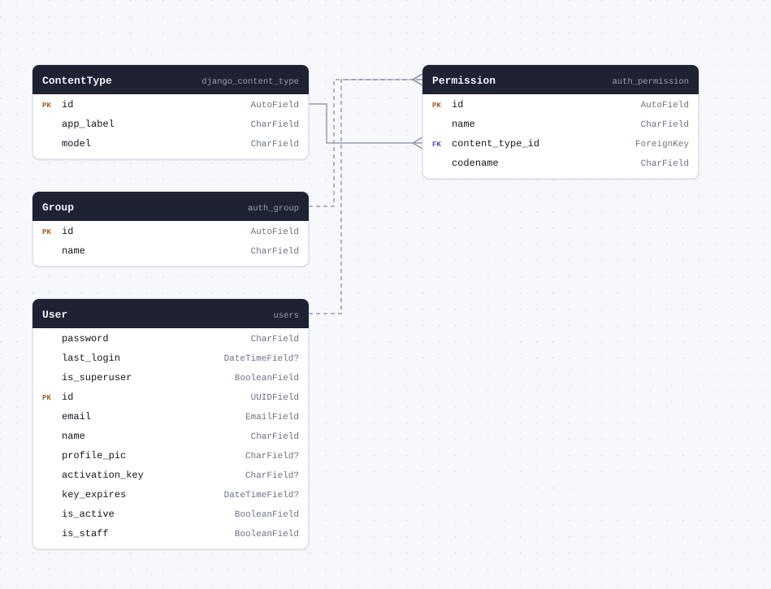

| Column | Field | Type | Null | Key | Default | Description |
| --- | --- | --- | --- | --- | --- | --- |
| `id` | `AutoField` | `integer` |  | PK | `autoincrement()` |  |
| `name` | `CharField` | `varchar(255)` |  |  |  |  |
| `content_type_id` | `ForeignKey` | `integer` |  | FK |  |  |
| `codename` | `CharField` | `varchar(100)` |  |  |  |  |

Indexes:

- index `auth_permission_content_type_id_2f476e4b` on `content_type_id`
- unique `auth_permission_content_type_id_codename_01ab375a_uniq` on `content_type_id`, `codename`

Relations:

- `content_type_id` → [ContentType](#contenttype).`id`, on delete cascade
- `group_set` — many to many with [Group](#group)
- `user_set` — many to many with [User](#user)

## Group

Table `auth_group`, app `auth`.

Groups are a generic way of categorizing users to apply permissions, or
some other label, to those users. A user can belong to any number of
groups.

A user in a group automatically has all the permissions granted to that
group. For example, if the group 'Site editors' has the permission
can_edit_home_page, any user in that group will have that permission.

Beyond permissions, groups are a convenient way to categorize users to
apply some label, or extended functionality, to them. For example, you
could create a group 'Special users', and you could write code that would
do special things to those users -- such as giving them access to a
members-only portion of your site, or sending them members-only email
messages.

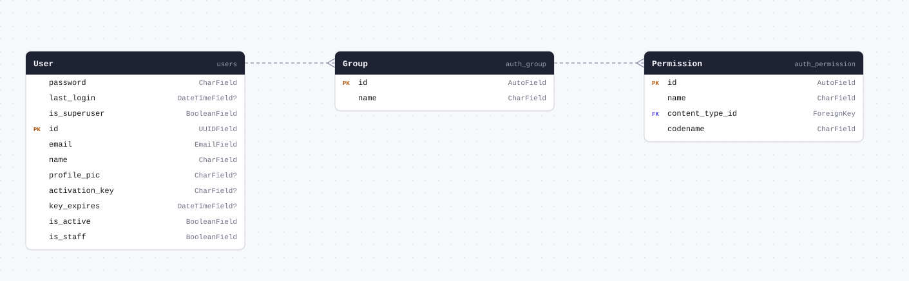

| Column | Field | Type | Null | Key | Default | Description |
| --- | --- | --- | --- | --- | --- | --- |
| `id` | `AutoField` | `integer` |  | PK | `autoincrement()` |  |
| `name` | `CharField` | `varchar(150)` |  | unique |  |  |

Relations:

- `permissions` — many to many with [Permission](#permission)
- `user_set` — many to many with [User](#user)

## LogEntry

Table `django_admin_log`, app `admin`.

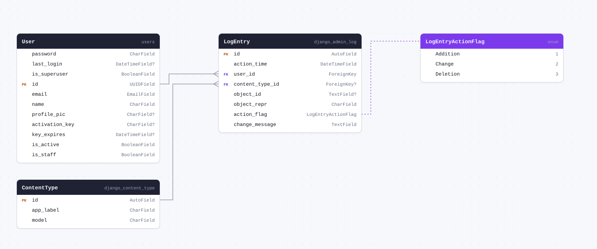

| Column | Field | Type | Null | Key | Default | Description |
| --- | --- | --- | --- | --- | --- | --- |
| `id` | `AutoField` | `integer` |  | PK | `autoincrement()` |  |
| `action_time` | `DateTimeField` | `datetime` |  |  | `now()` |  |
| `user_id` | `ForeignKey` | `char(32)` |  | FK |  |  |
| `content_type_id` | `ForeignKey` | `integer` | yes | FK |  |  |
| `object_id` | `TextField` | `text` | yes |  |  |  |
| `object_repr` | `CharField` | `varchar(200)` |  |  |  |  |
| `action_flag` | `LogEntryActionFlag` | `smallint unsigned` |  |  |  |  |
| `change_message` | `TextField` | `text` |  |  |  |  |

Indexes:

- index `django_admin_log_user_id_c564eba6` on `user_id`
- index `django_admin_log_content_type_id_c4bce8eb` on `content_type_id`

Relations:

- `user_id` → [User](#user).`id`, on delete cascade
- `content_type_id` → [ContentType](#contenttype).`id`, on delete set null

## ContentType

Table `django_content_type`, app `contenttypes`.

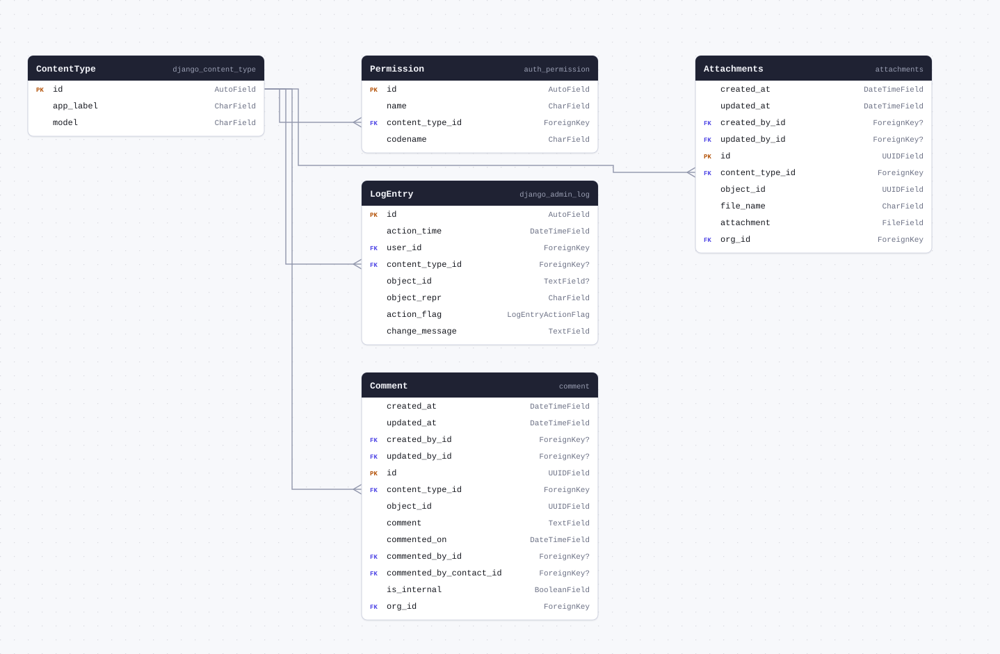

| Column | Field | Type | Null | Key | Default | Description |
| --- | --- | --- | --- | --- | --- | --- |
| `id` | `AutoField` | `integer` |  | PK | `autoincrement()` |  |
| `app_label` | `CharField` | `varchar(100)` |  |  |  |  |
| `model` | `CharField` | `varchar(100)` |  |  |  |  |

Indexes:

- unique `django_content_type_app_label_model_76bd3d3b_uniq` on `app_label`, `model`

Relations:

- [Permission](#permission).`content_type_id` → `id`, on delete cascade
- [LogEntry](#logentry).`content_type_id` → `id`, on delete set null
- [Comment](#comment).`content_type_id` → `id`, on delete cascade
- [Attachments](#attachments).`content_type_id` → `id`, on delete cascade

## Session

Table `django_session`, app `sessions`.

Columns from `AbstractBaseSession` (abstract): `session_key`, `session_data`, `expire_date`.

Django provides full support for anonymous sessions. The session
framework lets you store and retrieve arbitrary data on a
per-site-visitor basis. It stores data on the server side and
abstracts the sending and receiving of cookies. Cookies contain a
session ID -- not the data itself.

The Django sessions framework is entirely cookie-based. It does
not fall back to putting session IDs in URLs. This is an intentional
design decision. Not only does that behavior make URLs ugly, it makes
your site vulnerable to session-ID theft via the "Referer" header.

For complete documentation on using Sessions in your code, consult
the sessions documentation that is shipped with Django (also available
on the Django web site).

| Column | Field | Type | Null | Key | Default | Description |
| --- | --- | --- | --- | --- | --- | --- |
| `session_key` | `CharField` | `varchar(40)` |  | PK |  |  |
| `session_data` | `TextField` | `text` |  |  |  |  |
| `expire_date` | `DateTimeField` | `datetime` |  |  |  |  |

Indexes:

- index `django_session_expire_date_a5c62663` on `expire_date`

## OutstandingToken

Table `token_blacklist_outstandingtoken`, app `token_blacklist`.

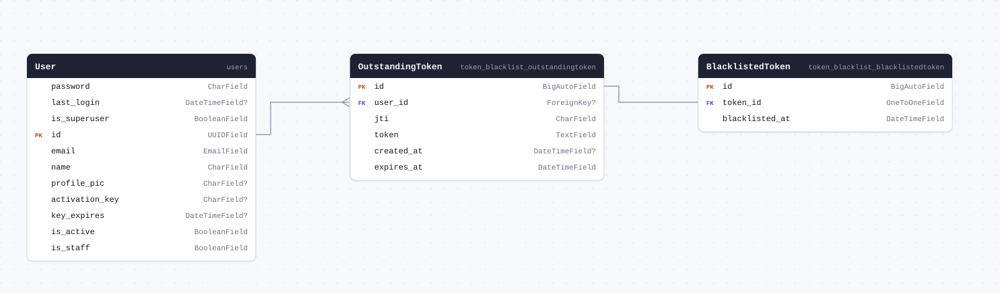

| Column | Field | Type | Null | Key | Default | Description |
| --- | --- | --- | --- | --- | --- | --- |
| `id` | `BigAutoField` | `integer` |  | PK | `autoincrement()` |  |
| `user_id` | `ForeignKey` | `char(32)` | yes | FK |  |  |
| `jti` | `CharField` | `varchar(255)` |  | unique |  |  |
| `token` | `TextField` | `text` |  |  |  |  |
| `created_at` | `DateTimeField` | `datetime` | yes |  |  |  |
| `expires_at` | `DateTimeField` | `datetime` |  |  |  |  |

Indexes:

- index `token_blacklist_outstandingtoken_user_id_83bc629a` on `user_id`

Relations:

- `user_id` → [User](#user).`id`, on delete set null
- [BlacklistedToken](#blacklistedtoken).`token_id` → `id`, on delete cascade

## BlacklistedToken

Table `token_blacklist_blacklistedtoken`, app `token_blacklist`.

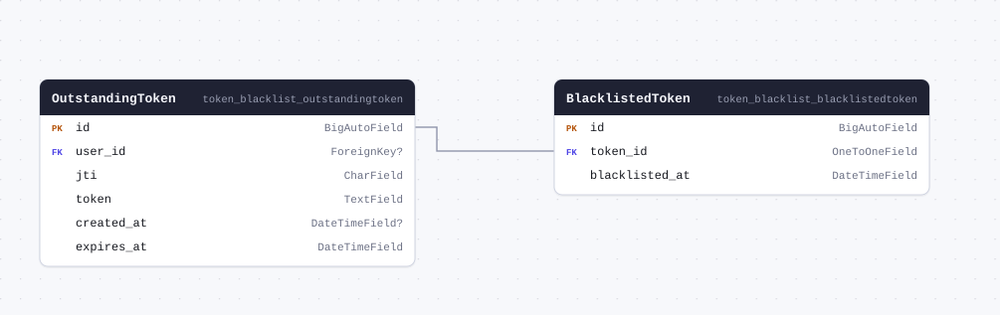

| Column | Field | Type | Null | Key | Default | Description |
| --- | --- | --- | --- | --- | --- | --- |
| `id` | `BigAutoField` | `integer` |  | PK | `autoincrement()` |  |
| `token_id` | `OneToOneField` | `bigint` |  | FK, unique |  |  |
| `blacklisted_at` | `DateTimeField` | `datetime` |  |  | `now()` |  |

Relations:

- `token_id` → [OutstandingToken](#outstandingtoken).`id`, on delete cascade

## SESStat

Table `django_ses_sesstat`, app `django_ses`.

| Column | Field | Type | Null | Key | Default | Description |
| --- | --- | --- | --- | --- | --- | --- |
| `id` | `AutoField` | `integer` |  | PK | `autoincrement()` |  |
| `date` | `DateField` | `date` |  | unique |  |  |
| `delivery_attempts` | `PositiveIntegerField` | `integer unsigned` |  |  |  |  |
| `bounces` | `PositiveIntegerField` | `integer unsigned` |  |  |  |  |
| `complaints` | `PositiveIntegerField` | `integer unsigned` |  |  |  |  |
| `rejects` | `PositiveIntegerField` | `integer unsigned` |  |  |  |  |

## BlacklistedEmail

Table `django_ses_blacklistedemail`, app `django_ses`.

| Column | Field | Type | Null | Key | Default | Description |
| --- | --- | --- | --- | --- | --- | --- |
| `id` | `AutoField` | `integer` |  | PK | `autoincrement()` |  |
| `email` | `EmailField` | `varchar(255)` |  | unique |  |  |

## User

Table `users`, app `common`.

Columns from `AbstractBaseUser` (abstract): `password`, `last_login`.

Columns from `PermissionsMixin` (abstract): `is_superuser`.

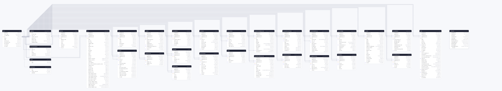

| Column | Field | Type | Null | Key | Default | Description |
| --- | --- | --- | --- | --- | --- | --- |
| `password` | `CharField` | `varchar(128)` |  |  |  |  |
| `last_login` | `DateTimeField` | `datetime` | yes |  |  |  |
| `is_superuser` | `BooleanField` | `bool` |  |  | `False` | Designates that this user has all permissions without explicitly assigning them. |
| `id` | `UUIDField` | `char(32)` |  | PK | `uuid4()` |  |
| `email` | `EmailField` | `varchar(254)` |  | unique |  |  |
| `name` | `CharField` | `varchar(255)` |  |  | `''` |  |
| `profile_pic` | `CharField` | `varchar(1000)` | yes |  |  |  |
| `activation_key` | `CharField` | `varchar(150)` | yes |  |  |  |
| `key_expires` | `DateTimeField` | `datetime` | yes |  |  |  |
| `is_active` | `BooleanField` | `bool` |  |  | `True` |  |
| `is_staff` | `BooleanField` | `bool` |  |  | `False` |  |

Relations:

- [LogEntry](#logentry).`user_id` → `id`, on delete cascade
- [OutstandingToken](#outstandingtoken).`user_id` → `id`, on delete set null
- `groups` — many to many with [Group](#group)
- `user_permissions` — many to many with [Permission](#permission)
- [Address](#address).`created_by_id` → `id`, on delete set null
- [Address](#address).`updated_by_id` → `id`, on delete set null
- [Org](#org).`created_by_id` → `id`, on delete set null
- [Org](#org).`updated_by_id` → `id`, on delete set null
- [Tags](#tags).`created_by_id` → `id`, on delete set null
- [Tags](#tags).`updated_by_id` → `id`, on delete set null
- [Profile](#profile).`created_by_id` → `id`, on delete set null
- [Profile](#profile).`updated_by_id` → `id`, on delete set null
- [Profile](#profile).`user_id` → `id`, on delete cascade
- [Comment](#comment).`created_by_id` → `id`, on delete set null
- [Comment](#comment).`updated_by_id` → `id`, on delete set null
- [CommentFiles](#commentfiles).`created_by_id` → `id`, on delete set null
- [CommentFiles](#commentfiles).`updated_by_id` → `id`, on delete set null
- [Attachments](#attachments).`created_by_id` → `id`, on delete set null
- [Attachments](#attachments).`updated_by_id` → `id`, on delete set null
- [Document](#document).`created_by_id` → `id`, on delete set null
- [Document](#document).`updated_by_id` → `id`, on delete set null
- [APISettings](#apisettings).`created_by_id` → `id`, on delete set null
- [APISettings](#apisettings).`updated_by_id` → `id`, on delete set null
- [Activity](#activity).`created_by_id` → `id`, on delete set null
- [Activity](#activity).`updated_by_id` → `id`, on delete set null
- [Notification](#notification).`created_by_id` → `id`, on delete set null
- [Notification](#notification).`updated_by_id` → `id`, on delete set null
- [DeviceToken](#devicetoken).`created_by_id` → `id`, on delete set null
- [DeviceToken](#devicetoken).`updated_by_id` → `id`, on delete set null
- [DeviceToken](#devicetoken).`user_id` → `id`, on delete cascade
- [Teams](#teams).`created_by_id` → `id`, on delete set null
- [Teams](#teams).`updated_by_id` → `id`, on delete set null
- [ContactFormSubmission](#contactformsubmission).`created_by_id` → `id`, on delete set null
- [ContactFormSubmission](#contactformsubmission).`updated_by_id` → `id`, on delete set null
- [ContactFormSubmission](#contactformsubmission).`replied_by_id` → `id`, on delete set null
- [CustomFieldDefinition](#customfielddefinition).`created_by_id` → `id`, on delete set null
- [CustomFieldDefinition](#customfielddefinition).`updated_by_id` → `id`, on delete set null
- [PersonalAccessToken](#personalaccesstoken).`created_by_id` → `id`, on delete set null
- [PersonalAccessToken](#personalaccesstoken).`updated_by_id` → `id`, on delete set null
- [CalendarFeedToken](#calendarfeedtoken).`created_by_id` → `id`, on delete set null
- [CalendarFeedToken](#calendarfeedtoken).`updated_by_id` → `id`, on delete set null
- [SecurityAuditLog](#securityauditlog).`created_by_id` → `id`, on delete set null
- [SecurityAuditLog](#securityauditlog).`updated_by_id` → `id`, on delete set null
- [SecurityAuditLog](#securityauditlog).`user_id` → `id`, on delete set null
- [PackApplication](#packapplication).`created_by_id` → `id`, on delete set null
- [PackApplication](#packapplication).`updated_by_id` → `id`, on delete set null
- [InstalledApp](#installedapp).`created_by_id` → `id`, on delete set null
- [InstalledApp](#installedapp).`updated_by_id` → `id`, on delete set null
- [SavedView](#savedview).`created_by_id` → `id`, on delete set null
- [SavedView](#savedview).`updated_by_id` → `id`, on delete set null
- [Account](#account).`created_by_id` → `id`, on delete set null
- [Account](#account).`updated_by_id` → `id`, on delete set null
- [AccountEmail](#accountemail).`created_by_id` → `id`, on delete set null
- [AccountEmail](#accountemail).`updated_by_id` → `id`, on delete set null
- [AccountEmailLog](#accountemaillog).`created_by_id` → `id`, on delete set null
- [AccountEmailLog](#accountemaillog).`updated_by_id` → `id`, on delete set null
- [Case](#case).`created_by_id` → `id`, on delete set null
- [Case](#case).`updated_by_id` → `id`, on delete set null
- [CaseWatcher](#casewatcher).`created_by_id` → `id`, on delete set null
- [CaseWatcher](#casewatcher).`updated_by_id` → `id`, on delete set null
- [CsatSurvey](#csatsurvey).`created_by_id` → `id`, on delete set null
- [CsatSurvey](#csatsurvey).`updated_by_id` → `id`, on delete set null
- [Solution](#solution).`created_by_id` → `id`, on delete set null
- [Solution](#solution).`updated_by_id` → `id`, on delete set null
- [CasePipeline](#casepipeline).`created_by_id` → `id`, on delete set null
- [CasePipeline](#casepipeline).`updated_by_id` → `id`, on delete set null
- [CaseStage](#casestage).`created_by_id` → `id`, on delete set null
- [CaseStage](#casestage).`updated_by_id` → `id`, on delete set null
- [ReopenPolicy](#reopenpolicy).`created_by_id` → `id`, on delete set null
- [ReopenPolicy](#reopenpolicy).`updated_by_id` → `id`, on delete set null
- [EscalationPolicy](#escalationpolicy).`created_by_id` → `id`, on delete set null
- [EscalationPolicy](#escalationpolicy).`updated_by_id` → `id`, on delete set null
- [InboundMailbox](#inboundmailbox).`created_by_id` → `id`, on delete set null
- [InboundMailbox](#inboundmailbox).`updated_by_id` → `id`, on delete set null
- [EmailMessage](#emailmessage).`created_by_id` → `id`, on delete set null
- [EmailMessage](#emailmessage).`updated_by_id` → `id`, on delete set null
- [RoutingRule](#routingrule).`created_by_id` → `id`, on delete set null
- [RoutingRule](#routingrule).`updated_by_id` → `id`, on delete set null
- [RoutingRuleState](#routingrulestate).`created_by_id` → `id`, on delete set null
- [RoutingRuleState](#routingrulestate).`updated_by_id` → `id`, on delete set null
- [TimeEntry](#timeentry).`created_by_id` → `id`, on delete set null
- [TimeEntry](#timeentry).`updated_by_id` → `id`, on delete set null
- [ApprovalRule](#approvalrule).`created_by_id` → `id`, on delete set null
- [ApprovalRule](#approvalrule).`updated_by_id` → `id`, on delete set null
- [Approval](#approval).`created_by_id` → `id`, on delete set null
- [Approval](#approval).`updated_by_id` → `id`, on delete set null
- [Contact](#contact).`created_by_id` → `id`, on delete set null
- [Contact](#contact).`updated_by_id` → `id`, on delete set null
- [Lead](#lead).`created_by_id` → `id`, on delete set null
- [Lead](#lead).`updated_by_id` → `id`, on delete set null
- [LeadPipeline](#leadpipeline).`created_by_id` → `id`, on delete set null
- [LeadPipeline](#leadpipeline).`updated_by_id` → `id`, on delete set null
- [LeadStage](#leadstage).`created_by_id` → `id`, on delete set null
- [LeadStage](#leadstage).`updated_by_id` → `id`, on delete set null
- [LeadSource](#leadsource).`created_by_id` → `id`, on delete set null
- [LeadSource](#leadsource).`updated_by_id` → `id`, on delete set null
- [LeadIntake](#leadintake).`created_by_id` → `id`, on delete set null
- [LeadIntake](#leadintake).`updated_by_id` → `id`, on delete set null
- [LeadIntakeEvent](#leadintakeevent).`created_by_id` → `id`, on delete set null
- [LeadIntakeEvent](#leadintakeevent).`updated_by_id` → `id`, on delete set null
- [DealPipeline](#dealpipeline).`created_by_id` → `id`, on delete set null
- [DealPipeline](#dealpipeline).`updated_by_id` → `id`, on delete set null
- [DealStage](#dealstage).`created_by_id` → `id`, on delete set null
- [DealStage](#dealstage).`updated_by_id` → `id`, on delete set null
- [Opportunity](#opportunity).`created_by_id` → `id`, on delete set null
- [Opportunity](#opportunity).`updated_by_id` → `id`, on delete set null
- [OpportunityLineItem](#opportunitylineitem).`created_by_id` → `id`, on delete set null
- [OpportunityLineItem](#opportunitylineitem).`updated_by_id` → `id`, on delete set null
- [SalesGoal](#salesgoal).`created_by_id` → `id`, on delete set null
- [SalesGoal](#salesgoal).`updated_by_id` → `id`, on delete set null
- [Board](#board).`created_by_id` → `id`, on delete set null
- [Board](#board).`updated_by_id` → `id`, on delete set null
- [BoardMember](#boardmember).`created_by_id` → `id`, on delete set null
- [BoardMember](#boardmember).`updated_by_id` → `id`, on delete set null
- [BoardColumn](#boardcolumn).`created_by_id` → `id`, on delete set null
- [BoardColumn](#boardcolumn).`updated_by_id` → `id`, on delete set null
- [BoardTask](#boardtask).`created_by_id` → `id`, on delete set null
- [BoardTask](#boardtask).`updated_by_id` → `id`, on delete set null
- [TaskPipeline](#taskpipeline).`created_by_id` → `id`, on delete set null
- [TaskPipeline](#taskpipeline).`updated_by_id` → `id`, on delete set null
- [TaskStage](#taskstage).`created_by_id` → `id`, on delete set null
- [TaskStage](#taskstage).`updated_by_id` → `id`, on delete set null
- [Task](#task).`created_by_id` → `id`, on delete set null
- [Task](#task).`updated_by_id` → `id`, on delete set null
- [InvoiceTemplate](#invoicetemplate).`created_by_id` → `id`, on delete set null
- [InvoiceTemplate](#invoicetemplate).`updated_by_id` → `id`, on delete set null
- [Product](#product).`created_by_id` → `id`, on delete set null
- [Product](#product).`updated_by_id` → `id`, on delete set null
- [Invoice](#invoice).`created_by_id` → `id`, on delete set null
- [Invoice](#invoice).`updated_by_id` → `id`, on delete set null
- [InvoiceLineItem](#invoicelineitem).`created_by_id` → `id`, on delete set null
- [InvoiceLineItem](#invoicelineitem).`updated_by_id` → `id`, on delete set null
- [Payment](#payment).`created_by_id` → `id`, on delete set null
- [Payment](#payment).`updated_by_id` → `id`, on delete set null
- [Estimate](#estimate).`created_by_id` → `id`, on delete set null
- [Estimate](#estimate).`updated_by_id` → `id`, on delete set null
- [EstimateLineItem](#estimatelineitem).`created_by_id` → `id`, on delete set null
- [EstimateLineItem](#estimatelineitem).`updated_by_id` → `id`, on delete set null
- [RecurringInvoice](#recurringinvoice).`created_by_id` → `id`, on delete set null
- [RecurringInvoice](#recurringinvoice).`updated_by_id` → `id`, on delete set null
- [RecurringInvoiceLineItem](#recurringinvoicelineitem).`created_by_id` → `id`, on delete set null
- [RecurringInvoiceLineItem](#recurringinvoicelineitem).`updated_by_id` → `id`, on delete set null
- [InvoiceHistory](#invoicehistory).`created_by_id` → `id`, on delete set null
- [Order](#order).`created_by_id` → `id`, on delete set null
- [Order](#order).`updated_by_id` → `id`, on delete set null
- [OrderLineItem](#orderlineitem).`created_by_id` → `id`, on delete set null
- [OrderLineItem](#orderlineitem).`updated_by_id` → `id`, on delete set null
- [BusinessCalendar](#businesscalendar).`created_by_id` → `id`, on delete set null
- [BusinessCalendar](#businesscalendar).`updated_by_id` → `id`, on delete set null
- [BusinessHoliday](#businessholiday).`created_by_id` → `id`, on delete set null
- [BusinessHoliday](#businessholiday).`updated_by_id` → `id`, on delete set null
- [Macro](#macro).`created_by_id` → `id`, on delete set null
- [Macro](#macro).`updated_by_id` → `id`, on delete set null
- [WebForm](#webform).`created_by_id` → `id`, on delete set null
- [WebForm](#webform).`updated_by_id` → `id`, on delete set null
- [WebFormField](#webformfield).`created_by_id` → `id`, on delete set null
- [WebFormField](#webformfield).`updated_by_id` → `id`, on delete set null
- [WebFormSubmission](#webformsubmission).`created_by_id` → `id`, on delete set null
- [WebFormSubmission](#webformsubmission).`updated_by_id` → `id`, on delete set null
- [WebFormDailyStat](#webformdailystat).`created_by_id` → `id`, on delete set null
- [WebFormDailyStat](#webformdailystat).`updated_by_id` → `id`, on delete set null
- [WebhookEndpoint](#webhookendpoint).`created_by_id` → `id`, on delete set null
- [WebhookEndpoint](#webhookendpoint).`updated_by_id` → `id`, on delete set null
- [WebhookDelivery](#webhookdelivery).`created_by_id` → `id`, on delete set null
- [WebhookDelivery](#webhookdelivery).`updated_by_id` → `id`, on delete set null
- [AutomationRule](#automationrule).`created_by_id` → `id`, on delete set null
- [AutomationRule](#automationrule).`updated_by_id` → `id`, on delete set null
- [AutomationRun](#automationrun).`created_by_id` → `id`, on delete set null
- [AutomationRun](#automationrun).`updated_by_id` → `id`, on delete set null
- [AutomationRotation](#automationrotation).`created_by_id` → `id`, on delete set null
- [AutomationRotation](#automationrotation).`updated_by_id` → `id`, on delete set null
- [Interaction](#interaction).`created_by_id` → `id`, on delete set null
- [Interaction](#interaction).`updated_by_id` → `id`, on delete set null
- [Project](#project).`created_by_id` → `id`, on delete set null
- [Project](#project).`updated_by_id` → `id`, on delete set null
- [ProjectRate](#projectrate).`created_by_id` → `id`, on delete set null
- [ProjectRate](#projectrate).`updated_by_id` → `id`, on delete set null

## Address

Table `address`, app `common`.

Columns from `BaseModel` (abstract): `id`.

Columns from `TimeAuditModel` (abstract): `created_at`, `updated_at`.

Columns from `UserAuditModel` (abstract): `created_by_id`, `updated_by_id`.

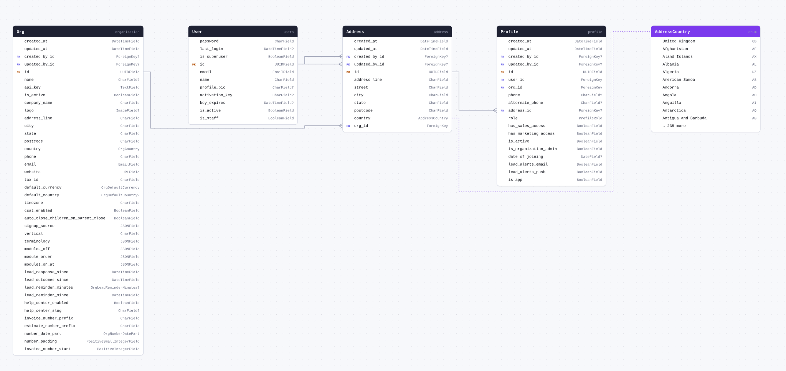

| Column | Field | Type | Null | Key | Default | Description |
| --- | --- | --- | --- | --- | --- | --- |
| `created_at` | `DateTimeField` | `datetime` |  |  | `now()` |  |
| `updated_at` | `DateTimeField` | `datetime` |  |  | `now()` |  |
| `created_by_id` | `ForeignKey` | `char(32)` | yes | FK |  |  |
| `updated_by_id` | `ForeignKey` | `char(32)` | yes | FK |  |  |
| `id` | `UUIDField` | `char(32)` |  | PK | `uuid4()` |  |
| `address_line` | `CharField` | `varchar(255)` |  |  | `''` |  |
| `street` | `CharField` | `varchar(55)` |  |  | `''` |  |
| `city` | `CharField` | `varchar(255)` |  |  | `''` |  |
| `state` | `CharField` | `varchar(255)` |  |  | `''` |  |
| `postcode` | `CharField` | `varchar(64)` |  |  | `''` |  |
| `country` | `AddressCountry` | `varchar(3)` |  |  | `''` |  |
| `org_id` | `ForeignKey` | `char(32)` |  | FK |  |  |

Indexes:

- index `address_created_by_id_e1d54fec` on `created_by_id`
- index `address_updated_by_id_13647669` on `updated_by_id`
- index `address_org_id_cabde51c` on `org_id`

Relations:

- `created_by_id` → [User](#user).`id`, on delete set null
- `updated_by_id` → [User](#user).`id`, on delete set null
- `org_id` → [Org](#org).`id`, on delete cascade
- [Profile](#profile).`address_id` → `id`, on delete cascade

## Org

Table `organization`, app `common`.

Columns from `BaseModel` (abstract): `id`.

Columns from `TimeAuditModel` (abstract): `created_at`, `updated_at`.

Columns from `UserAuditModel` (abstract): `created_by_id`, `updated_by_id`.

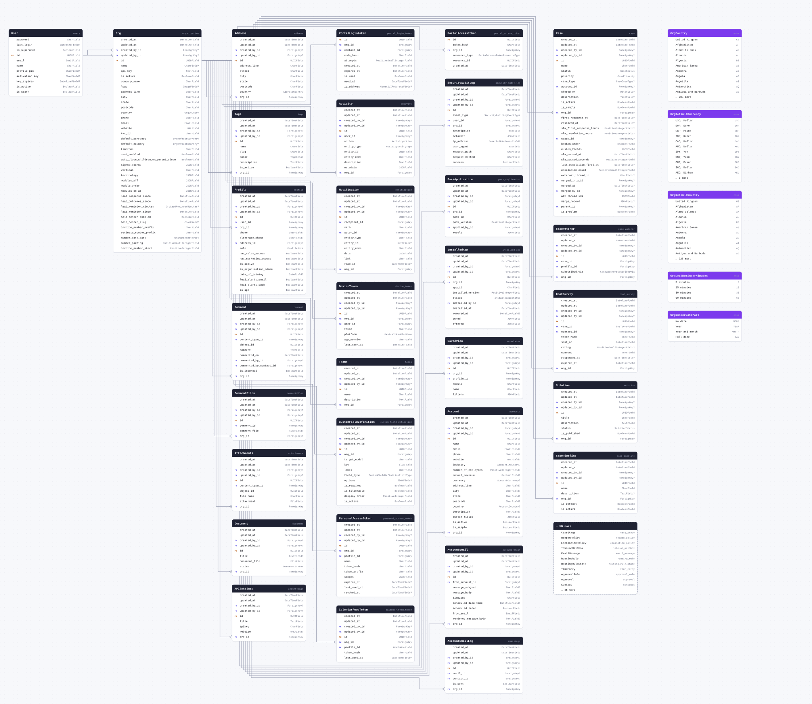

| Column | Field | Type | Null | Key | Default | Description |
| --- | --- | --- | --- | --- | --- | --- |
| `created_at` | `DateTimeField` | `datetime` |  |  | `now()` |  |
| `updated_at` | `DateTimeField` | `datetime` |  |  | `now()` |  |
| `created_by_id` | `ForeignKey` | `char(32)` | yes | FK |  |  |
| `updated_by_id` | `ForeignKey` | `char(32)` | yes | FK |  |  |
| `id` | `UUIDField` | `char(32)` |  | PK | `uuid4()` |  |
| `name` | `CharField` | `varchar(100)` | yes |  |  |  |
| `api_key` | `TextField` | `text` |  | unique | `generate_unique_key()` |  |
| `is_active` | `BooleanField` | `bool` |  |  | `True` |  |
| `company_name` | `CharField` | `varchar(255)` |  |  |  | Legal company name for invoices |
| `logo` | `ImageField` | `varchar(100)` | yes |  |  | Company logo |
| `address_line` | `CharField` | `varchar(255)` |  |  |  |  |
| `city` | `CharField` | `varchar(100)` |  |  |  |  |
| `state` | `CharField` | `varchar(100)` |  |  |  |  |
| `postcode` | `CharField` | `varchar(20)` |  |  |  |  |
| `country` | `OrgCountry` | `varchar(3)` |  |  |  |  |
| `phone` | `CharField` | `varchar(25)` |  |  |  |  |
| `email` | `EmailField` | `varchar(254)` |  |  |  |  |
| `website` | `URLField` | `varchar(200)` |  |  |  |  |
| `tax_id` | `CharField` | `varchar(50)` |  |  |  | Tax ID / VAT / Registration number |
| `default_currency` | `OrgDefaultCurrency` | `varchar(3)` |  |  | `'USD'` |  |
| `default_country` | `OrgDefaultCountry` | `varchar(2)` | yes |  |  |  |
| `timezone` | `CharField` | `varchar(64)` |  |  | `'UTC'` | IANA timezone (e.g. America/New_York). Sets the org's day. |
| `csat_enabled` | `BooleanField` | `bool` |  |  | `True` |  |
| `auto_close_children_on_parent_close` | `BooleanField` | `bool` |  |  | `False` |  |
| `signup_source` | `JSONField` | `text` |  |  | `dict()` |  |
| `vertical` | `CharField` | `varchar(64)` |  |  | `''` | Pack id applied to this org, e.g. 'real-estate'. Descriptive only. |
| `terminology` | `JSONField` | `text` |  |  | `dict()` | Label overrides, e.g. {'lead.plural': 'Enquiries'}. |
| `modules_off` | `JSONField` | `text` |  |  | `list()` |  |
| `module_order` | `JSONField` | `text` |  |  | `list()` |  |
| `modules_on_at` | `JSONField` | `text` |  |  | `dict()` |  |
| `lead_response_since` | `DateTimeField` | `datetime` |  |  | `now()` |  |
| `lead_outcomes_since` | `DateTimeField` | `datetime` |  |  | `now()` |  |
| `lead_reminder_minutes` | `OrgLeadReminderMinutes` | `smallint unsigned` | yes |  |  |  |
| `lead_reminder_since` | `DateTimeField` | `datetime` |  |  | `(STRFTIME('%Y-%m-%d %H:%M:%f', 'NOW'))` (database) |  |
| `help_center_enabled` | `BooleanField` | `bool` |  |  | `False` |  |
| `help_center_slug` | `CharField` | `varchar(50)` | yes |  |  |  |
| `invoice_number_prefix` | `CharField` | `varchar(20)` |  |  | `'INV-'` |  |
| `estimate_number_prefix` | `CharField` | `varchar(20)` |  |  | `'EST-'` |  |
| `number_date_part` | `OrgNumberDatePart` | `varchar(5)` |  |  | `'DAY'` |  |
| `number_padding` | `PositiveSmallIntegerField` | `smallint unsigned` |  |  | `4` |  |
| `invoice_number_start` | `PositiveIntegerField` | `integer unsigned` |  |  | `1` |  |

Indexes:

- index `organization_created_by_id_35551e36` on `created_by_id`
- index `organization_updated_by_id_c42b9ae6` on `updated_by_id`
- unique `org_help_center_slug_ci_unique` on `LOWER("help_center_slug")`

Checks:

- `org_help_center_enabled_needs_slug`: `("help_center_enabled" = 0 OR "help_center_slug" IS NOT NULL)`
- `org_invoice_number_start_needs_undated`: `("number_date_part" = 'NONE' OR "invoice_number_start" = 1)`

Relations:

- [Address](#address).`org_id` → `id`, on delete cascade
- `created_by_id` → [User](#user).`id`, on delete set null
- `updated_by_id` → [User](#user).`id`, on delete set null
- [Tags](#tags).`org_id` → `id`, on delete cascade
- [Profile](#profile).`org_id` → `id`, on delete cascade
- [Comment](#comment).`org_id` → `id`, on delete cascade
- [CommentFiles](#commentfiles).`org_id` → `id`, on delete cascade
- [Attachments](#attachments).`org_id` → `id`, on delete cascade
- [Document](#document).`org_id` → `id`, on delete cascade
- [APISettings](#apisettings).`org_id` → `id`, on delete cascade
- [PortalLoginToken](#portallogintoken).`org_id` → `id`, on delete cascade
- [Activity](#activity).`org_id` → `id`, on delete cascade
- [Notification](#notification).`org_id` → `id`, on delete cascade
- [DeviceToken](#devicetoken).`org_id` → `id`, on delete cascade
- [Teams](#teams).`org_id` → `id`, on delete cascade
- [CustomFieldDefinition](#customfielddefinition).`org_id` → `id`, on delete cascade
- [PersonalAccessToken](#personalaccesstoken).`org_id` → `id`, on delete cascade
- [CalendarFeedToken](#calendarfeedtoken).`org_id` → `id`, on delete cascade
- [PortalAccessToken](#portalaccesstoken).`org_id` → `id`, on delete cascade
- [SecurityAuditLog](#securityauditlog).`org_id` → `id`, on delete set null
- [PackApplication](#packapplication).`org_id` → `id`, on delete cascade
- [InstalledApp](#installedapp).`org_id` → `id`, on delete cascade
- [SavedView](#savedview).`org_id` → `id`, on delete cascade
- [Account](#account).`org_id` → `id`, on delete cascade
- [AccountEmail](#accountemail).`org_id` → `id`, on delete cascade
- [AccountEmailLog](#accountemaillog).`org_id` → `id`, on delete cascade
- [Case](#case).`org_id` → `id`, on delete cascade
- [CaseWatcher](#casewatcher).`org_id` → `id`, on delete cascade
- [CsatSurvey](#csatsurvey).`org_id` → `id`, on delete cascade
- [Solution](#solution).`org_id` → `id`, on delete cascade
- [CasePipeline](#casepipeline).`org_id` → `id`, on delete cascade
- [CaseStage](#casestage).`org_id` → `id`, on delete cascade
- [ReopenPolicy](#reopenpolicy).`org_id` → `id`, on delete cascade
- [EscalationPolicy](#escalationpolicy).`org_id` → `id`, on delete cascade
- [InboundMailbox](#inboundmailbox).`org_id` → `id`, on delete cascade
- [EmailMessage](#emailmessage).`org_id` → `id`, on delete cascade
- [RoutingRule](#routingrule).`org_id` → `id`, on delete cascade
- [RoutingRuleState](#routingrulestate).`org_id` → `id`, on delete cascade
- [TimeEntry](#timeentry).`org_id` → `id`, on delete cascade
- [ApprovalRule](#approvalrule).`org_id` → `id`, on delete cascade
- [Approval](#approval).`org_id` → `id`, on delete cascade
- [Contact](#contact).`org_id` → `id`, on delete cascade
- [Lead](#lead).`org_id` → `id`, on delete cascade
- [LeadPipeline](#leadpipeline).`org_id` → `id`, on delete cascade
- [LeadStage](#leadstage).`org_id` → `id`, on delete cascade
- [LeadSource](#leadsource).`org_id` → `id`, on delete cascade
- [LeadIntake](#leadintake).`org_id` → `id`, on delete cascade
- [LeadIntakeEvent](#leadintakeevent).`org_id` → `id`, on delete cascade
- [DealPipeline](#dealpipeline).`org_id` → `id`, on delete cascade
- [DealStage](#dealstage).`org_id` → `id`, on delete cascade
- [Opportunity](#opportunity).`org_id` → `id`, on delete cascade
- [OpportunityLineItem](#opportunitylineitem).`org_id` → `id`, on delete cascade
- [SalesGoal](#salesgoal).`org_id` → `id`, on delete cascade
- [Board](#board).`org_id` → `id`, on delete cascade
- [BoardMember](#boardmember).`org_id` → `id`, on delete cascade
- [BoardColumn](#boardcolumn).`org_id` → `id`, on delete cascade
- [BoardTask](#boardtask).`org_id` → `id`, on delete cascade
- [TaskPipeline](#taskpipeline).`org_id` → `id`, on delete cascade
- [TaskStage](#taskstage).`org_id` → `id`, on delete cascade
- [Task](#task).`org_id` → `id`, on delete cascade
- [InvoiceTemplate](#invoicetemplate).`org_id` → `id`, on delete cascade
- [Product](#product).`org_id` → `id`, on delete cascade
- [Invoice](#invoice).`org_id` → `id`, on delete cascade
- [InvoiceLineItem](#invoicelineitem).`org_id` → `id`, on delete cascade
- [Payment](#payment).`org_id` → `id`, on delete cascade
- [Estimate](#estimate).`org_id` → `id`, on delete cascade
- [EstimateLineItem](#estimatelineitem).`org_id` → `id`, on delete cascade
- [RecurringInvoice](#recurringinvoice).`org_id` → `id`, on delete cascade
- [RecurringInvoiceLineItem](#recurringinvoicelineitem).`org_id` → `id`, on delete cascade
- [InvoiceHistory](#invoicehistory).`org_id` → `id`, on delete cascade
- [Order](#order).`org_id` → `id`, on delete cascade
- [OrderLineItem](#orderlineitem).`org_id` → `id`, on delete cascade
- [BusinessCalendar](#businesscalendar).`org_id` → `id`, on delete cascade
- [BusinessHoliday](#businessholiday).`org_id` → `id`, on delete cascade
- [Macro](#macro).`org_id` → `id`, on delete cascade
- [WebForm](#webform).`org_id` → `id`, on delete cascade
- [WebFormField](#webformfield).`org_id` → `id`, on delete cascade
- [WebFormSubmission](#webformsubmission).`org_id` → `id`, on delete cascade
- [WebFormDailyStat](#webformdailystat).`org_id` → `id`, on delete cascade
- [WebhookEndpoint](#webhookendpoint).`org_id` → `id`, on delete cascade
- [WebhookDelivery](#webhookdelivery).`org_id` → `id`, on delete cascade
- [AutomationRule](#automationrule).`org_id` → `id`, on delete cascade
- [AutomationRun](#automationrun).`org_id` → `id`, on delete cascade
- [AutomationRotation](#automationrotation).`org_id` → `id`, on delete cascade
- [Interaction](#interaction).`org_id` → `id`, on delete cascade
- [Project](#project).`org_id` → `id`, on delete cascade
- [ProjectRate](#projectrate).`org_id` → `id`, on delete cascade

## Tags

Table `tags`, app `common`.

Columns from `BaseModel` (abstract): `id`.

Columns from `TimeAuditModel` (abstract): `created_at`, `updated_at`.

Columns from `UserAuditModel` (abstract): `created_by_id`, `updated_by_id`.

Tags for categorizing CRM entities (Accounts, Leads, Opportunities, etc.)

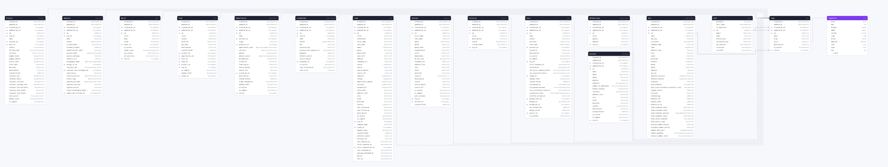

| Column | Field | Type | Null | Key | Default | Description |
| --- | --- | --- | --- | --- | --- | --- |
| `created_at` | `DateTimeField` | `datetime` |  |  | `now()` |  |
| `updated_at` | `DateTimeField` | `datetime` |  |  | `now()` |  |
| `created_by_id` | `ForeignKey` | `char(32)` | yes | FK |  |  |
| `updated_by_id` | `ForeignKey` | `char(32)` | yes | FK |  |  |
| `id` | `UUIDField` | `char(32)` |  | PK | `uuid4()` |  |
| `name` | `CharField` | `varchar(50)` |  |  |  |  |
| `slug` | `CharField` | `varchar(50)` |  |  |  |  |
| `color` | `TagsColor` | `varchar(20)` |  |  | `'blue'` |  |
| `description` | `TextField` | `text` |  |  | `''` |  |
| `is_active` | `BooleanField` | `bool` |  |  | `True` |  |
| `org_id` | `ForeignKey` | `char(32)` |  | FK |  |  |

Indexes:

- index `tags_created_by_id_bc2c5343` on `created_by_id`
- index `tags_updated_by_id_62b9e85d` on `updated_by_id`
- index `tags_org_id_f28247ea` on `org_id`
- unique `tags_slug_org_id_50d862b2_uniq` on `slug`, `org_id`

Relations:

- `created_by_id` → [User](#user).`id`, on delete set null
- `updated_by_id` → [User](#user).`id`, on delete set null
- `org_id` → [Org](#org).`id`, on delete cascade
- `apisettings_set` — many to many with [APISettings](#apisettings)
- `account_tags` — many to many with [Account](#account)
- `case_tags` — many to many with [Case](#case)
- `solution_tags` — many to many with [Solution](#solution)
- `contact_tags` — many to many with [Contact](#contact)
- `lead_tags` — many to many with [Lead](#lead)
- `lead_intakes` — many to many with [LeadIntake](#leadintake)
- `opportunity_tags` — many to many with [Opportunity](#opportunity)
- `task_tags` — many to many with [Task](#task)
- `macros_tagging` — many to many with [Macro](#macro)
- `webforms` — many to many with [WebForm](#webform)
- `projects` — many to many with [Project](#project)

## Profile

Table `profile`, app `common`.

Columns from `BaseModel` (abstract): `id`.

Columns from `TimeAuditModel` (abstract): `created_at`, `updated_at`.

Columns from `UserAuditModel` (abstract): `created_by_id`, `updated_by_id`.

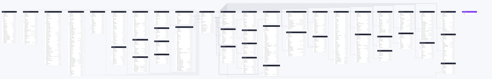

| Column | Field | Type | Null | Key | Default | Description |
| --- | --- | --- | --- | --- | --- | --- |
| `created_at` | `DateTimeField` | `datetime` |  |  | `now()` |  |
| `updated_at` | `DateTimeField` | `datetime` |  |  | `now()` |  |
| `created_by_id` | `ForeignKey` | `char(32)` | yes | FK |  |  |
| `updated_by_id` | `ForeignKey` | `char(32)` | yes | FK |  |  |
| `id` | `UUIDField` | `char(32)` |  | PK | `uuid4()` |  |
| `user_id` | `ForeignKey` | `char(32)` |  | FK |  |  |
| `org_id` | `ForeignKey` | `char(32)` |  | FK |  |  |
| `phone` | `CharField` | `varchar(20)` | yes |  |  |  |
| `alternate_phone` | `CharField` | `varchar(20)` | yes |  |  |  |
| `address_id` | `ForeignKey` | `char(32)` | yes | FK |  |  |
| `role` | `ProfileRole` | `varchar(50)` |  |  | `'USER'` |  |
| `has_sales_access` | `BooleanField` | `bool` |  |  | `False` |  |
| `has_marketing_access` | `BooleanField` | `bool` |  |  | `False` |  |
| `is_active` | `BooleanField` | `bool` |  |  | `True` |  |
| `is_organization_admin` | `BooleanField` | `bool` |  |  | `False` |  |
| `date_of_joining` | `DateField` | `date` | yes |  |  |  |
| `lead_alerts_email` | `BooleanField` | `bool` |  |  | `1` (database) |  |
| `lead_alerts_push` | `BooleanField` | `bool` |  |  | `1` (database) |  |
| `is_app` | `BooleanField` | `bool` |  |  | `0` (database) |  |

Indexes:

- index `profile_created_by_id_4d154033` on `created_by_id`
- index `profile_updated_by_id_ca9c7673` on `updated_by_id`
- index `profile_user_id_2aeb6f6b` on `user_id`
- index `profile_org_id_039cdbab` on `org_id`
- index `profile_address_id_60b7f4f2` on `address_id`
- unique `profile_user_id_org_id_a3aaa581_uniq` on `user_id`, `org_id`
- unique `profile_phone_org_id_10025caa_uniq` on `phone`, `org_id`

Relations:

- `case_watching` — many to many with [Case](#case), through [CaseWatcher](#casewatcher)
- `boards` — many to many with [Board](#board), through [BoardMember](#boardmember)
- `created_by_id` → [User](#user).`id`, on delete set null
- `updated_by_id` → [User](#user).`id`, on delete set null
- `user_id` → [User](#user).`id`, on delete cascade
- `org_id` → [Org](#org).`id`, on delete cascade
- `address_id` → [Address](#address).`id`, on delete cascade
- [Comment](#comment).`commented_by_id` → `id`, on delete cascade
- `document_shared_to` — many to many with [Document](#document)
- `lead_assignee_users` — many to many with [APISettings](#apisettings)
- [Activity](#activity).`user_id` → `id`, on delete set null
- [Notification](#notification).`recipient_id` → `id`, on delete cascade
- [Notification](#notification).`actor_id` → `id`, on delete set null
- `user_teams` — many to many with [Teams](#teams)
- [PersonalAccessToken](#personalaccesstoken).`profile_id` → `id`, on delete cascade
- [CalendarFeedToken](#calendarfeedtoken).`profile_id` → `id`, on delete cascade
- [PackApplication](#packapplication).`applied_by_id` → `id`, on delete set null
- [InstalledApp](#installedapp).`installed_by_id` → `id`, on delete set null
- [SavedView](#savedview).`profile_id` → `id`, on delete cascade
- `account_assigned_users` — many to many with [Account](#account)
- [Case](#case).`merged_by_id` → `id`, on delete set null
- `case_assigned_users` — many to many with [Case](#case)
- [CaseWatcher](#casewatcher).`profile_id` → `id`, on delete cascade
- [EscalationPolicy](#escalationpolicy).`first_response_target_id` → `id`, on delete set null
- [EscalationPolicy](#escalationpolicy).`resolution_target_id` → `id`, on delete set null
- [InboundMailbox](#inboundmailbox).`default_assignee_id` → `id`, on delete set null
- `routing_rules` — many to many with [RoutingRule](#routingrule)
- [TimeEntry](#timeentry).`profile_id` → `id`, on delete protect
- `approval_rules` — many to many with [ApprovalRule](#approvalrule)
- [Approval](#approval).`requested_by_id` → `id`, on delete protect
- [Approval](#approval).`approver_id` → `id`, on delete protect
- `contact_assigned_users` — many to many with [Contact](#contact)
- [Lead](#lead).`first_response_by_id` → `id`, on delete set null
- `lead_assigned_users` — many to many with [Lead](#lead)
- [LeadIntake](#leadintake).`assignee_id` → `id`, on delete set null
- [Opportunity](#opportunity).`closed_by_id` → `id`, on delete set null
- `opportunity_assigned_users` — many to many with [Opportunity](#opportunity)
- [SalesGoal](#salesgoal).`assigned_to_id` → `id`, on delete set null
- [Board](#board).`owner_id` → `id`, on delete cascade
- [BoardMember](#boardmember).`profile_id` → `id`, on delete cascade
- `assigned_board_tasks` — many to many with [BoardTask](#boardtask)
- `task_assigned_users` — many to many with [Task](#task)
- `invoice_assigned_to` — many to many with [Invoice](#invoice)
- `estimate_assigned_to` — many to many with [Estimate](#estimate)
- `recurring_invoice_assigned_to` — many to many with [RecurringInvoice](#recurringinvoice)
- [InvoiceHistory](#invoicehistory).`updated_by_id` → `id`, on delete set null
- [Macro](#macro).`owner_id` → `id`, on delete cascade
- `macros_assigning` — many to many with [Macro](#macro)
- [WebForm](#webform).`assign_to_id` → `id`, on delete set null
- [WebForm](#webform).`rotation_last_assigned_id` → `id`, on delete set null
- `webforms_rotated` — many to many with [WebForm](#webform)
- `webforms_notified` — many to many with [WebForm](#webform)
- [WebhookEndpoint](#webhookendpoint).`app_id` → `id`, on delete cascade
- [AutomationRule](#automationrule).`owner_id` → `id`, on delete set null
- [Interaction](#interaction).`logged_by_id` → `id`, on delete set null
- `assigned_projects` — many to many with [Project](#project)
- [ProjectRate](#projectrate).`profile_id` → `id`, on delete cascade

## Comment

Table `comment`, app `common`.

Columns from `BaseModel` (abstract): `id`.

Columns from `TimeAuditModel` (abstract): `created_at`, `updated_at`.

Columns from `UserAuditModel` (abstract): `created_by_id`, `updated_by_id`.

Generic comment model using ContentType framework.
Can be attached to any model (Account, Lead, Contact, Opportunity, Case, Task, Invoice, Profile).

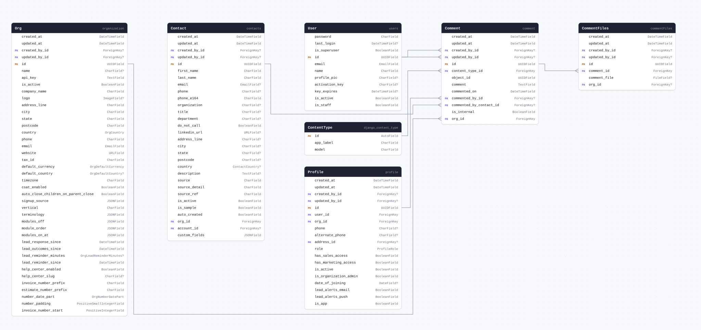

| Column | Field | Type | Null | Key | Default | Description |
| --- | --- | --- | --- | --- | --- | --- |
| `created_at` | `DateTimeField` | `datetime` |  |  | `now()` |  |
| `updated_at` | `DateTimeField` | `datetime` |  |  | `now()` |  |
| `created_by_id` | `ForeignKey` | `char(32)` | yes | FK |  |  |
| `updated_by_id` | `ForeignKey` | `char(32)` | yes | FK |  |  |
| `id` | `UUIDField` | `char(32)` |  | PK | `uuid4()` |  |
| `content_type_id` | `ForeignKey` | `integer` |  | FK |  |  |
| `object_id` | `UUIDField` | `char(32)` |  |  |  |  |
| `comment` | `TextField` | `text` |  |  |  |  |
| `commented_on` | `DateTimeField` | `datetime` |  |  | `now()` |  |
| `commented_by_id` | `ForeignKey` | `char(32)` | yes | FK |  |  |
| `commented_by_contact_id` | `ForeignKey` | `char(32)` | yes | FK |  |  |
| `is_internal` | `BooleanField` | `bool` |  |  | `False` |  |
| `org_id` | `ForeignKey` | `char(32)` |  | FK |  |  |

Indexes:

- index `comment_created_by_id_07b197aa` on `created_by_id`
- index `comment_updated_by_id_2b05beed` on `updated_by_id`
- index `comment_content_type_id_142ac1c1` on `content_type_id`
- index `comment_commented_by_id_c0269489` on `commented_by_id`
- index `comment_commented_by_contact_id_72ae1499` on `commented_by_contact_id`
- index `comment_is_internal_b82194b4` on `is_internal`
- index `comment_org_id_231a23a0` on `org_id`
- index `comment_content_3076b0_idx` on `content_type_id`, `object_id`
- index `comment_org_id_ae4e49_idx` on `org_id`, `created_at` desc
- index `comment_content_7e7d4c_idx` on `content_type_id`, `object_id`, `is_internal`

Checks:

- `comment_single_author`: `("commented_by_id" IS NULL OR "commented_by_contact_id" IS NULL)`

Relations:

- `content_object` → any model, by `content_type_id` + `object_id` (generic foreign key)
- `created_by_id` → [User](#user).`id`, on delete set null
- `updated_by_id` → [User](#user).`id`, on delete set null
- `content_type_id` → [ContentType](#contenttype).`id`, on delete cascade
- `commented_by_id` → [Profile](#profile).`id`, on delete cascade
- `commented_by_contact_id` → [Contact](#contact).`id`, on delete set null
- `org_id` → [Org](#org).`id`, on delete cascade
- [CommentFiles](#commentfiles).`comment_id` → `id`, on delete cascade

## CommentFiles

Table `commentFiles`, app `common`.

Columns from `BaseModel` (abstract): `id`.

Columns from `TimeAuditModel` (abstract): `created_at`, `updated_at`.

Columns from `UserAuditModel` (abstract): `created_by_id`, `updated_by_id`.

File attachments for comments.
Security: org field added for RLS protection and org-level isolation.

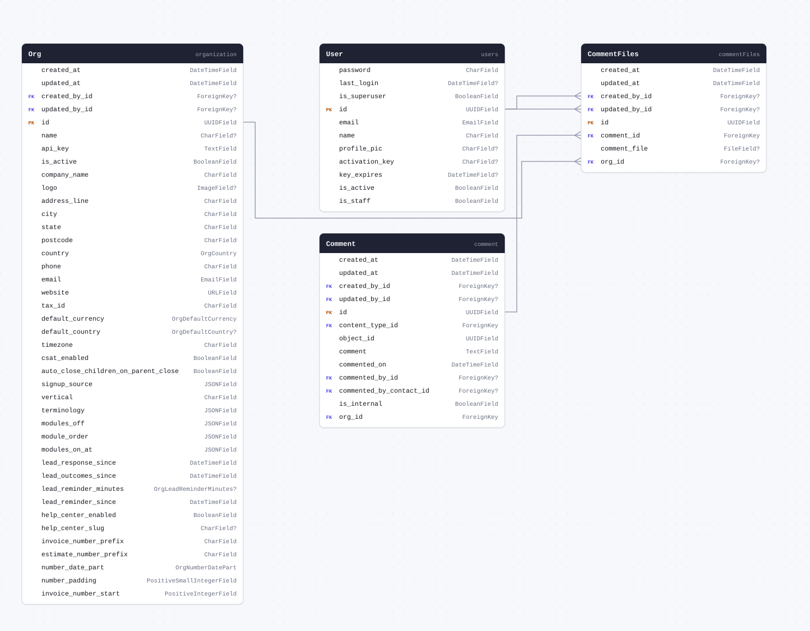

| Column | Field | Type | Null | Key | Default | Description |
| --- | --- | --- | --- | --- | --- | --- |
| `created_at` | `DateTimeField` | `datetime` |  |  | `now()` |  |
| `updated_at` | `DateTimeField` | `datetime` |  |  | `now()` |  |
| `created_by_id` | `ForeignKey` | `char(32)` | yes | FK |  |  |
| `updated_by_id` | `ForeignKey` | `char(32)` | yes | FK |  |  |
| `id` | `UUIDField` | `char(32)` |  | PK | `uuid4()` |  |
| `comment_id` | `ForeignKey` | `char(32)` |  | FK |  |  |
| `comment_file` | `FileField` | `varchar(100)` | yes |  |  |  |
| `org_id` | `ForeignKey` | `char(32)` | yes | FK |  |  |

Indexes:

- index `commentFiles_created_by_id_f13173cc` on `created_by_id`
- index `commentFiles_updated_by_id_91e1b984` on `updated_by_id`
- index `commentFiles_comment_id_91a0c85b` on `comment_id`
- index `commentFiles_org_id_cb55240f` on `org_id`

Relations:

- `created_by_id` → [User](#user).`id`, on delete set null
- `updated_by_id` → [User](#user).`id`, on delete set null
- `comment_id` → [Comment](#comment).`id`, on delete cascade
- `org_id` → [Org](#org).`id`, on delete cascade

## Attachments

Table `attachments`, app `common`.

Columns from `BaseModel` (abstract): `id`.

Columns from `TimeAuditModel` (abstract): `created_at`, `updated_at`.

Columns from `UserAuditModel` (abstract): `created_by_id`, `updated_by_id`.

Generic attachment model using ContentType framework.
Can be attached to any model (Account, Lead, Contact, Opportunity, Case, Task, Invoice).

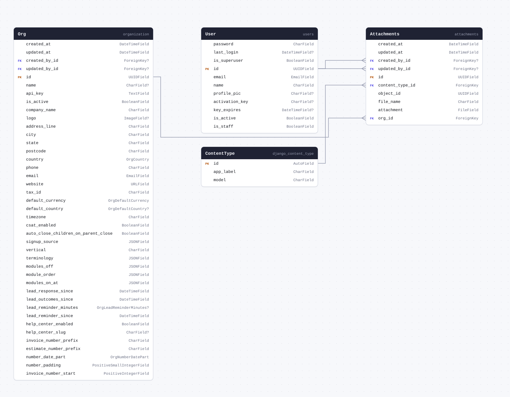

| Column | Field | Type | Null | Key | Default | Description |
| --- | --- | --- | --- | --- | --- | --- |
| `created_at` | `DateTimeField` | `datetime` |  |  | `now()` |  |
| `updated_at` | `DateTimeField` | `datetime` |  |  | `now()` |  |
| `created_by_id` | `ForeignKey` | `char(32)` | yes | FK |  |  |
| `updated_by_id` | `ForeignKey` | `char(32)` | yes | FK |  |  |
| `id` | `UUIDField` | `char(32)` |  | PK | `uuid4()` |  |
| `content_type_id` | `ForeignKey` | `integer` |  | FK |  |  |
| `object_id` | `UUIDField` | `char(32)` |  |  |  |  |
| `file_name` | `CharField` | `varchar(60)` |  |  |  |  |
| `attachment` | `FileField` | `varchar(1001)` |  |  |  |  |
| `org_id` | `ForeignKey` | `char(32)` |  | FK |  |  |

Indexes:

- index `attachments_created_by_id_3222e0ad` on `created_by_id`
- index `attachments_updated_by_id_45c66f7b` on `updated_by_id`
- index `attachments_content_type_id_2516efdb` on `content_type_id`
- index `attachments_org_id_15240b60` on `org_id`
- index `attachments_content_7c0e26_idx` on `content_type_id`, `object_id`
- index `attachments_org_id_432f7a_idx` on `org_id`, `created_at` desc

Relations:

- `content_object` → any model, by `content_type_id` + `object_id` (generic foreign key)
- `created_by_id` → [User](#user).`id`, on delete set null
- `updated_by_id` → [User](#user).`id`, on delete set null
- `content_type_id` → [ContentType](#contenttype).`id`, on delete cascade
- `org_id` → [Org](#org).`id`, on delete cascade

## Document

Table `document`, app `common`.

Columns from `BaseModel` (abstract): `id`.

Columns from `TimeAuditModel` (abstract): `created_at`, `updated_at`.

Columns from `UserAuditModel` (abstract): `created_by_id`, `updated_by_id`.

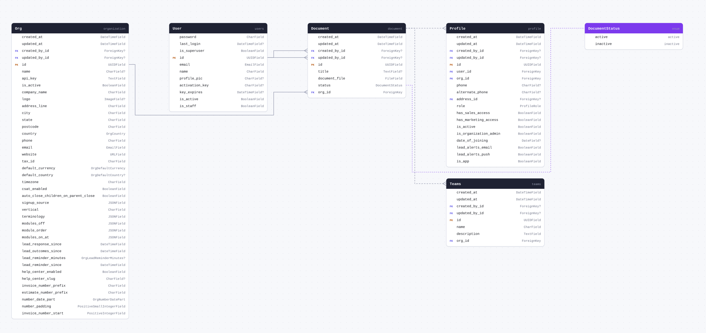

| Column | Field | Type | Null | Key | Default | Description |
| --- | --- | --- | --- | --- | --- | --- |
| `created_at` | `DateTimeField` | `datetime` |  |  | `now()` |  |
| `updated_at` | `DateTimeField` | `datetime` |  |  | `now()` |  |
| `created_by_id` | `ForeignKey` | `char(32)` | yes | FK |  |  |
| `updated_by_id` | `ForeignKey` | `char(32)` | yes | FK |  |  |
| `id` | `UUIDField` | `char(32)` |  | PK | `uuid4()` |  |
| `title` | `TextField` | `text` | yes |  |  |  |
| `document_file` | `FileField` | `varchar(5000)` |  |  |  |  |
| `status` | `DocumentStatus` | `varchar(64)` |  |  | `'active'` |  |
| `org_id` | `ForeignKey` | `char(32)` |  | FK |  |  |

Indexes:

- index `document_created_by_id_9ca09a36` on `created_by_id`
- index `document_updated_by_id_e225f4ce` on `updated_by_id`
- index `document_org_id_da015c00` on `org_id`

Relations:

- `created_by_id` → [User](#user).`id`, on delete set null
- `updated_by_id` → [User](#user).`id`, on delete set null
- `org_id` → [Org](#org).`id`, on delete cascade
- `shared_to` — many to many with [Profile](#profile)
- `teams` — many to many with [Teams](#teams)

## APISettings

Table `apiSettings`, app `common`.

Columns from `BaseModel` (abstract): `id`.

Columns from `TimeAuditModel` (abstract): `created_at`, `updated_at`.

Columns from `UserAuditModel` (abstract): `created_by_id`, `updated_by_id`.

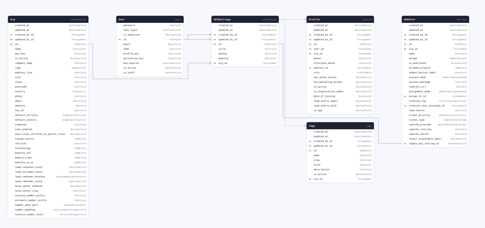

| Column | Field | Type | Null | Key | Default | Description |
| --- | --- | --- | --- | --- | --- | --- |
| `created_at` | `DateTimeField` | `datetime` |  |  | `now()` |  |
| `updated_at` | `DateTimeField` | `datetime` |  |  | `now()` |  |
| `created_by_id` | `ForeignKey` | `char(32)` | yes | FK |  |  |
| `updated_by_id` | `ForeignKey` | `char(32)` | yes | FK |  |  |
| `id` | `UUIDField` | `char(32)` |  | PK | `uuid4()` |  |
| `title` | `TextField` | `text` |  |  |  |  |
| `apikey` | `CharField` | `varchar(64)` |  |  |  |  |
| `website` | `URLField` | `varchar(255)` | yes |  |  |  |
| `org_id` | `ForeignKey` | `char(32)` |  | FK |  |  |

Indexes:

- index `apiSettings_created_by_id_7d3df93c` on `created_by_id`
- index `apiSettings_updated_by_id_4cda8791` on `updated_by_id`
- index `apiSettings_org_id_bbc2c865` on `org_id`

Relations:

- `created_by_id` → [User](#user).`id`, on delete set null
- `updated_by_id` → [User](#user).`id`, on delete set null
- `org_id` → [Org](#org).`id`, on delete cascade
- `lead_assigned_to` — many to many with [Profile](#profile)
- `tags` — many to many with [Tags](#tags)
- [WebForm](#webform).`legacy_api_setting_id` → `id`, on delete set null

## MagicLinkToken

Table `magic_link_token`, app `common`.

One-time magic link tokens for passwordless authentication.

Supports two delivery modes (`delivery`):
  - "link": classic email-link flow, the user clicks a URL containing `token`.
  - "code": short 6-digit OTP flow for mobile clients. `code_hash` stores the
    hashed code; `attempts` tracks failed verify attempts so we can lock the
    row after too many guesses (codes are short, brute-force matters).

| Column | Field | Type | Null | Key | Default | Description |
| --- | --- | --- | --- | --- | --- | --- |
| `id` | `UUIDField` | `char(32)` |  | PK | `uuid4()` |  |
| `email` | `EmailField` | `varchar(254)` |  |  |  |  |
| `token` | `CharField` | `varchar(64)` |  | unique |  |  |
| `delivery` | `MagicLinkTokenDelivery` | `varchar(8)` |  |  | `'link'` |  |
| `code_hash` | `CharField` | `varchar(256)` |  |  | `''` |  |
| `attempts` | `PositiveSmallIntegerField` | `smallint unsigned` |  |  | `0` |  |
| `created_at` | `DateTimeField` | `datetime` |  |  | `now()` |  |
| `expires_at` | `DateTimeField` | `datetime` |  |  |  |  |
| `is_used` | `BooleanField` | `bool` |  |  | `False` |  |
| `used_at` | `DateTimeField` | `datetime` | yes |  |  |  |
| `ip_address` | `GenericIPAddressField` | `char(39)` | yes |  |  |  |

Indexes:

- index `magic_link_token_email_9e01006a` on `email`
- index `magic_link__email_13ce49_idx` on `email`, `created_at`

## PortalLoginToken

Table `portal_login_token`, app `common`.

One-time sign-in codes for the customer portal.

Mirrors `MagicLinkToken`, deliberately as a separate table rather than a
nullable `org` column on that one. Sharing the table would mean one verify
endpoint accepting the other realm's token, and that is a customer logging
into the internal application. Roughly forty duplicated lines buys a realm
boundary that a single mistake cannot cross.

Six emailed digits, stored hashed, and never a clickable link. The portal
briefly carried both deliveries; nothing ever asked for the link one, so it
is gone. What remains is the flow the sign-in page actually drives, where
the customer stays in the tab they started in. The code is the entire
credential for ten minutes, which is why `attempts` exists: see
`PortalLoginVerifyView._redeem_code`.

Bound to one contact in one org when it is minted, so it cannot be replayed
against another tenant.

Deliberately absent from `ORG_SCOPED_TABLES`: the lookup runs before any org
context exists, so an RLS policy here would hide the row from the only
request that needs to read it. Same reasoning as `MagicLinkToken` and
`PortalAccessToken`.

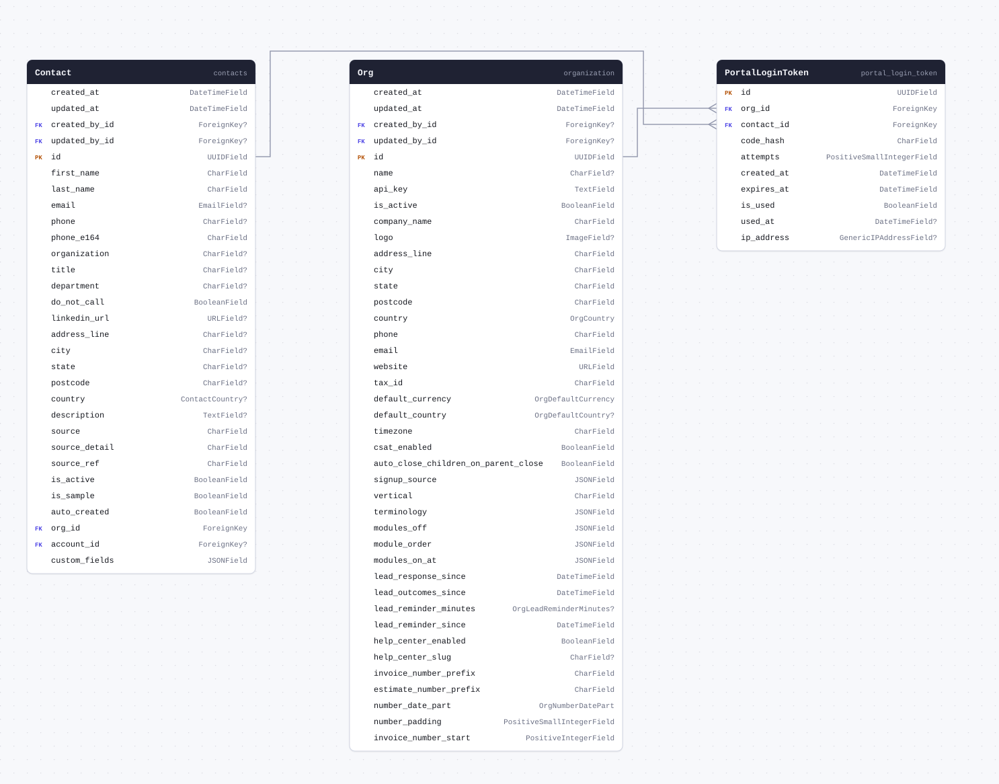

| Column | Field | Type | Null | Key | Default | Description |
| --- | --- | --- | --- | --- | --- | --- |
| `id` | `UUIDField` | `char(32)` |  | PK | `uuid4()` |  |
| `org_id` | `ForeignKey` | `char(32)` |  | FK |  |  |
| `contact_id` | `ForeignKey` | `char(32)` |  | FK |  |  |
| `code_hash` | `CharField` | `varchar(256)` |  |  |  |  |
| `attempts` | `PositiveSmallIntegerField` | `smallint unsigned` |  |  | `0` |  |
| `created_at` | `DateTimeField` | `datetime` |  |  | `now()` |  |
| `expires_at` | `DateTimeField` | `datetime` |  |  |  |  |
| `is_used` | `BooleanField` | `bool` |  |  | `False` |  |
| `used_at` | `DateTimeField` | `datetime` | yes |  |  |  |
| `ip_address` | `GenericIPAddressField` | `char(39)` | yes |  |  |  |

Indexes:

- index `portal_login_token_org_id_3a36a092` on `org_id`
- index `portal_login_token_contact_id_10230abc` on `contact_id`
- index `portal_logi_contact_403e11_idx` on `contact_id`, `created_at`

Relations:

- `org_id` → [Org](#org).`id`, on delete cascade
- `contact_id` → [Contact](#contact).`id`, on delete cascade

## Activity

Table `activity`, app `common`.

Columns from `BaseModel` (abstract): `id`.

Columns from `TimeAuditModel` (abstract): `created_at`, `updated_at`.

Columns from `UserAuditModel` (abstract): `created_by_id`, `updated_by_id`.

Track user activities across all CRM entities

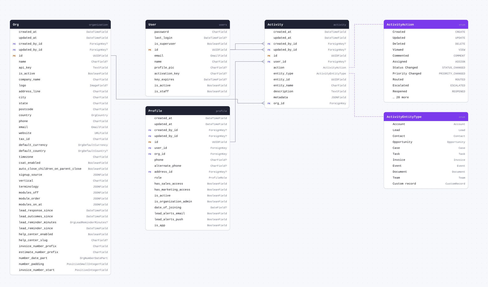

| Column | Field | Type | Null | Key | Default | Description |
| --- | --- | --- | --- | --- | --- | --- |
| `created_at` | `DateTimeField` | `datetime` |  |  | `now()` |  |
| `updated_at` | `DateTimeField` | `datetime` |  |  | `now()` |  |
| `created_by_id` | `ForeignKey` | `char(32)` | yes | FK |  |  |
| `updated_by_id` | `ForeignKey` | `char(32)` | yes | FK |  |  |
| `id` | `UUIDField` | `char(32)` |  | PK | `uuid4()` |  |
| `user_id` | `ForeignKey` | `char(32)` | yes | FK |  |  |
| `action` | `ActivityAction` | `varchar(32)` |  |  |  |  |
| `entity_type` | `ActivityEntityType` | `varchar(50)` |  |  |  |  |
| `entity_id` | `UUIDField` | `char(32)` |  |  |  |  |
| `entity_name` | `CharField` | `varchar(255)` |  |  | `''` |  |
| `description` | `TextField` | `text` |  |  | `''` |  |
| `metadata` | `JSONField` | `text` |  |  | `dict()` |  |
| `org_id` | `ForeignKey` | `char(32)` |  | FK |  |  |

Indexes:

- index `activity_created_by_id_4b937503` on `created_by_id`
- index `activity_updated_by_id_0955c8ad` on `updated_by_id`
- index `activity_user_id_02da5096` on `user_id`
- index `activity_org_id_689e1a6e` on `org_id`
- index `activity_org_id_832f39_idx` on `org_id`, `created_at` desc
- index `activity_entity__e33c9a_idx` on `entity_type`, `entity_id`
- index `activity_analytics_idx` on `org_id`, `entity_type`, `action`, `created_at`

Relations:

- `created_by_id` → [User](#user).`id`, on delete set null
- `updated_by_id` → [User](#user).`id`, on delete set null
- `user_id` → [Profile](#profile).`id`, on delete set null
- `org_id` → [Org](#org).`id`, on delete cascade

## Notification

Table `notification`, app `common`.

Columns from `BaseModel` (abstract): `id`.

Columns from `TimeAuditModel` (abstract): `created_at`, `updated_at`.

Columns from `UserAuditModel` (abstract): `created_by_id`, `updated_by_id`.

In-app notification delivered to a single recipient.

Per `docs/cases/COORDINATION_DECISIONS.md` D2 we inherit BaseModel and
declare our own `org` FK rather than using BaseOrgModel. RLS still
applies via the migration in 0018.

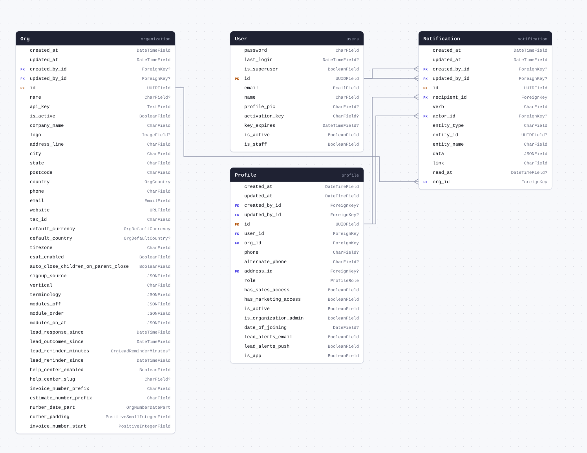

| Column | Field | Type | Null | Key | Default | Description |
| --- | --- | --- | --- | --- | --- | --- |
| `created_at` | `DateTimeField` | `datetime` |  |  | `now()` |  |
| `updated_at` | `DateTimeField` | `datetime` |  |  | `now()` |  |
| `created_by_id` | `ForeignKey` | `char(32)` | yes | FK |  |  |
| `updated_by_id` | `ForeignKey` | `char(32)` | yes | FK |  |  |
| `id` | `UUIDField` | `char(32)` |  | PK | `uuid4()` |  |
| `recipient_id` | `ForeignKey` | `char(32)` |  | FK |  |  |
| `verb` | `CharField` | `varchar(64)` |  |  |  |  |
| `actor_id` | `ForeignKey` | `char(32)` | yes | FK |  |  |
| `entity_type` | `CharField` | `varchar(50)` |  |  | `''` |  |
| `entity_id` | `UUIDField` | `char(32)` | yes |  |  |  |
| `entity_name` | `CharField` | `varchar(255)` |  |  | `''` |  |
| `data` | `JSONField` | `text` |  |  | `dict()` |  |
| `link` | `CharField` | `varchar(500)` |  |  | `''` |  |
| `read_at` | `DateTimeField` | `datetime` | yes |  |  |  |
| `org_id` | `ForeignKey` | `char(32)` |  | FK |  |  |

Indexes:

- index `notification_created_by_id_942e754a` on `created_by_id`
- index `notification_updated_by_id_ee1e0721` on `updated_by_id`
- index `notification_recipient_id_305d14d6` on `recipient_id`
- index `notification_actor_id_8f11e06d` on `actor_id`
- index `notification_org_id_9a2e3ae6` on `org_id`
- index `notificatio_org_id_d4a5d9_idx` on `org_id`, `recipient_id`, `created_at` desc
- index `notificatio_recipie_2d4243_idx` on `recipient_id`, `read_at`

Relations:

- `created_by_id` → [User](#user).`id`, on delete set null
- `updated_by_id` → [User](#user).`id`, on delete set null
- `recipient_id` → [Profile](#profile).`id`, on delete cascade
- `actor_id` → [Profile](#profile).`id`, on delete set null
- `org_id` → [Org](#org).`id`, on delete cascade

## DeviceToken

Table `device_token`, app `common`.

Columns from `BaseOrgModel` (abstract): `org_id`.

Columns from `BaseModel` (abstract): `id`.

Columns from `TimeAuditModel` (abstract): `created_at`, `updated_at`.

Columns from `UserAuditModel` (abstract): `created_by_id`, `updated_by_id`.

A phone's push token, registered by the phone app for whoever is signed
in on it (`POST /api/devices/`) and used by `common.push`.

The token is a secret of that phone: it is never logged or returned.

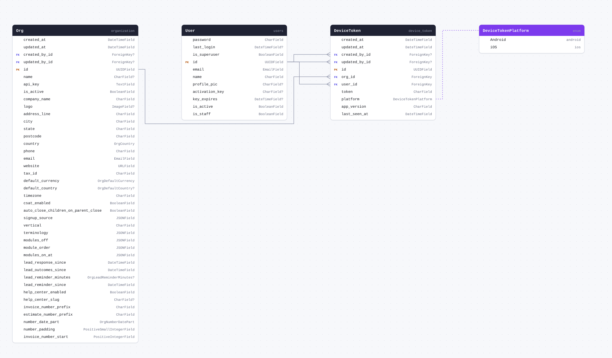

| Column | Field | Type | Null | Key | Default | Description |
| --- | --- | --- | --- | --- | --- | --- |
| `created_at` | `DateTimeField` | `datetime` |  |  | `now()` |  |
| `updated_at` | `DateTimeField` | `datetime` |  |  | `now()` |  |
| `created_by_id` | `ForeignKey` | `char(32)` | yes | FK |  |  |
| `updated_by_id` | `ForeignKey` | `char(32)` | yes | FK |  |  |
| `id` | `UUIDField` | `char(32)` |  | PK | `uuid4()` |  |
| `org_id` | `ForeignKey` | `char(32)` |  | FK |  | Organization this record belongs to |
| `user_id` | `ForeignKey` | `char(32)` |  | FK |  |  |
| `token` | `CharField` | `varchar(4096)` |  |  |  |  |
| `platform` | `DeviceTokenPlatform` | `varchar(10)` |  |  |  |  |
| `app_version` | `CharField` | `varchar(32)` |  |  | `''` |  |
| `last_seen_at` | `DateTimeField` | `datetime` |  |  | `now()` |  |

Indexes:

- index `device_token_created_by_id_83691765` on `created_by_id`
- index `device_token_updated_by_id_b0163e8a` on `updated_by_id`
- index `device_token_org_id_f9ecb81b` on `org_id`
- index `device_token_user_id_2a135d70` on `user_id`
- unique `unique_device_token_per_org` on `org_id`, `token`
- index `device_toke_org_id_aebe6f_idx` on `org_id`, `created_at` desc
- index `device_toke_org_id_7e1430_idx` on `org_id`, `user_id`

Relations:

- `created_by_id` → [User](#user).`id`, on delete set null
- `updated_by_id` → [User](#user).`id`, on delete set null
- `org_id` → [Org](#org).`id`, on delete cascade
- `user_id` → [User](#user).`id`, on delete cascade

## Teams

Table `teams`, app `common`.

Columns from `BaseModel` (abstract): `id`.

Columns from `TimeAuditModel` (abstract): `created_at`, `updated_at`.

Columns from `UserAuditModel` (abstract): `created_by_id`, `updated_by_id`.

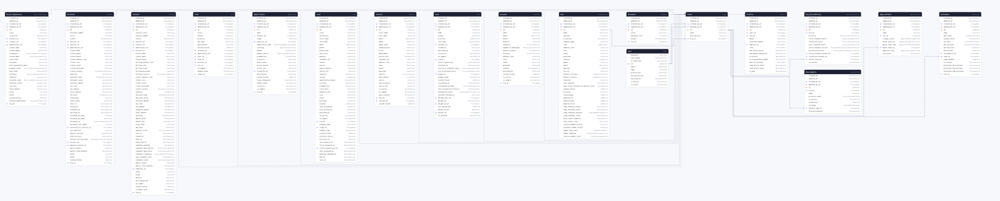

| Column | Field | Type | Null | Key | Default | Description |
| --- | --- | --- | --- | --- | --- | --- |
| `created_at` | `DateTimeField` | `datetime` |  |  | `now()` |  |
| `updated_at` | `DateTimeField` | `datetime` |  |  | `now()` |  |
| `created_by_id` | `ForeignKey` | `char(32)` | yes | FK |  |  |
| `updated_by_id` | `ForeignKey` | `char(32)` | yes | FK |  |  |
| `id` | `UUIDField` | `char(32)` |  | PK | `uuid4()` |  |
| `name` | `CharField` | `varchar(100)` |  |  |  |  |
| `description` | `TextField` | `text` |  |  |  |  |
| `org_id` | `ForeignKey` | `char(32)` |  | FK |  |  |

Indexes:

- index `teams_created_by_id_8ddefb7a` on `created_by_id`
- index `teams_updated_by_id_3f3a5118` on `updated_by_id`
- index `teams_org_id_9f444e65` on `org_id`

Relations:

- `document_teams` — many to many with [Document](#document)
- `created_by_id` → [User](#user).`id`, on delete set null
- `updated_by_id` → [User](#user).`id`, on delete set null
- `org_id` → [Org](#org).`id`, on delete cascade
- `users` — many to many with [Profile](#profile)
- `account_teams` — many to many with [Account](#account)
- `cases_teams` — many to many with [Case](#case)
- [EscalationPolicy](#escalationpolicy).`notify_team_id` → `id`, on delete set null
- [RoutingRule](#routingrule).`target_team_id` → `id`, on delete set null
- [ApprovalRule](#approvalrule).`match_team_id` → `id`, on delete set null
- `contact_teams` — many to many with [Contact](#contact)
- `lead_teams` — many to many with [Lead](#lead)
- `opportunity_teams` — many to many with [Opportunity](#opportunity)
- [SalesGoal](#salesgoal).`team_id` → `id`, on delete set null
- `tasks_teams` — many to many with [Task](#task)
- `invoices_teams` — many to many with [Invoice](#invoice)
- `estimate_teams` — many to many with [Estimate](#estimate)
- `recurring_invoice_teams` — many to many with [RecurringInvoice](#recurringinvoice)

## ContactFormSubmission

Table `contact_form_submission`, app `common`.

Columns from `BaseModel` (abstract): `id`.

Columns from `TimeAuditModel` (abstract): `created_at`, `updated_at`.

Columns from `UserAuditModel` (abstract): `created_by_id`, `updated_by_id`.

Contact form submission from public website.
Stores inquiries from potential customers via contact forms.
Not org-scoped as these are platform-level submissions.

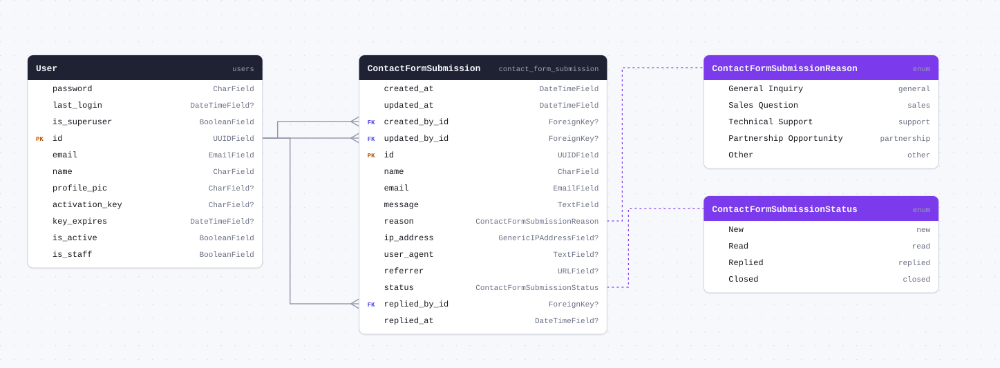

| Column | Field | Type | Null | Key | Default | Description |
| --- | --- | --- | --- | --- | --- | --- |
| `created_at` | `DateTimeField` | `datetime` |  |  | `now()` |  |
| `updated_at` | `DateTimeField` | `datetime` |  |  | `now()` |  |
| `created_by_id` | `ForeignKey` | `char(32)` | yes | FK |  |  |
| `updated_by_id` | `ForeignKey` | `char(32)` | yes | FK |  |  |
| `id` | `UUIDField` | `char(32)` |  | PK | `uuid4()` |  |
| `name` | `CharField` | `varchar(255)` |  |  |  |  |
| `email` | `EmailField` | `varchar(254)` |  |  |  |  |
| `message` | `TextField` | `text` |  |  |  |  |
| `reason` | `ContactFormSubmissionReason` | `varchar(100)` |  |  | `'general'` |  |
| `ip_address` | `GenericIPAddressField` | `char(39)` | yes |  |  |  |
| `user_agent` | `TextField` | `text` | yes |  |  |  |
| `referrer` | `URLField` | `varchar(500)` | yes |  |  |  |
| `status` | `ContactFormSubmissionStatus` | `varchar(20)` |  |  | `'new'` |  |
| `replied_by_id` | `ForeignKey` | `char(32)` | yes | FK |  |  |
| `replied_at` | `DateTimeField` | `datetime` | yes |  |  |  |

Indexes:

- index `contact_form_submission_created_by_id_4723628a` on `created_by_id`
- index `contact_form_submission_updated_by_id_6cbc56df` on `updated_by_id`
- index `contact_form_submission_replied_by_id_d53ccbcf` on `replied_by_id`
- index `contact_for_email_534ce8_idx` on `email`
- index `contact_for_status_b48047_idx` on `status`
- index `contact_for_created_f54fb1_idx` on `created_at`

Relations:

- `created_by_id` → [User](#user).`id`, on delete set null
- `updated_by_id` → [User](#user).`id`, on delete set null
- `replied_by_id` → [User](#user).`id`, on delete set null

## CustomFieldDefinition

Table `custom_field_definition`, app `common`.

Columns from `BaseModel` (abstract): `id`.

Columns from `TimeAuditModel` (abstract): `created_at`, `updated_at`.

Columns from `UserAuditModel` (abstract): `created_by_id`, `updated_by_id`.

Per-org schema extension for any supported entity (Case, Lead, ...).

Each row defines a single field on a single target model. Values are stored
on the entity itself in a `custom_fields` JSONField; this row is the
metadata that the validator uses to coerce types, enforce required fields,
and validate dropdown membership.

See docs/cases/tier1/custom-fields.md.

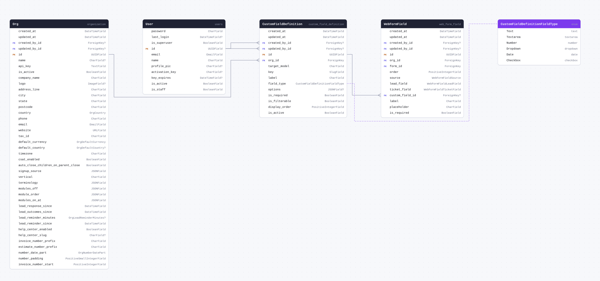

| Column | Field | Type | Null | Key | Default | Description |
| --- | --- | --- | --- | --- | --- | --- |
| `created_at` | `DateTimeField` | `datetime` |  |  | `now()` |  |
| `updated_at` | `DateTimeField` | `datetime` |  |  | `now()` |  |
| `created_by_id` | `ForeignKey` | `char(32)` | yes | FK |  |  |
| `updated_by_id` | `ForeignKey` | `char(32)` | yes | FK |  |  |
| `id` | `UUIDField` | `char(32)` |  | PK | `uuid4()` |  |
| `org_id` | `ForeignKey` | `char(32)` |  | FK |  |  |
| `target_model` | `CharField` | `varchar(32)` |  |  |  |  |
| `key` | `SlugField` | `varchar(64)` |  |  |  |  |
| `label` | `CharField` | `varchar(128)` |  |  |  |  |
| `field_type` | `CustomFieldDefinitionFieldType` | `varchar(16)` |  |  |  |  |
| `options` | `JSONField` | `text` | yes |  |  | List of {value, label} pairs for dropdown fields. |
| `is_required` | `BooleanField` | `bool` |  |  | `False` |  |
| `is_filterable` | `BooleanField` | `bool` |  |  | `False` |  |
| `display_order` | `PositiveIntegerField` | `integer unsigned` |  |  | `0` |  |
| `is_active` | `BooleanField` | `bool` |  |  | `True` |  |

Indexes:

- index `custom_field_definition_created_by_id_8a721ca4` on `created_by_id`
- index `custom_field_definition_updated_by_id_2efb0fc3` on `updated_by_id`
- index `custom_field_definition_org_id_b3a75faf` on `org_id`
- index `custom_field_definition_key_474636f6` on `key`
- unique `uniq_custom_field_per_org_target` on `org_id`, `target_model`, `key`
- index `custom_fiel_org_id_4b73e5_idx` on `org_id`, `target_model`, `is_active`

Relations:

- `created_by_id` → [User](#user).`id`, on delete set null
- `updated_by_id` → [User](#user).`id`, on delete set null
- `org_id` → [Org](#org).`id`, on delete cascade
- [WebFormField](#webformfield).`custom_field_id` → `id`, on delete cascade

## PersonalAccessToken

Table `personal_access_token`, app `common`.

Columns from `BaseOrgModel` (abstract): `org_id`.

Columns from `BaseModel` (abstract): `id`.

Columns from `TimeAuditModel` (abstract): `created_at`, `updated_at`.

Columns from `UserAuditModel` (abstract): `created_by_id`, `updated_by_id`.

Per-user token for programmatic REST API access (scripts, agents).

The agent authenticates AS `profile` and inherits that user's role,
org and RLS scope. The raw token is shown ONCE at creation and only
its SHA-256 hash is stored.

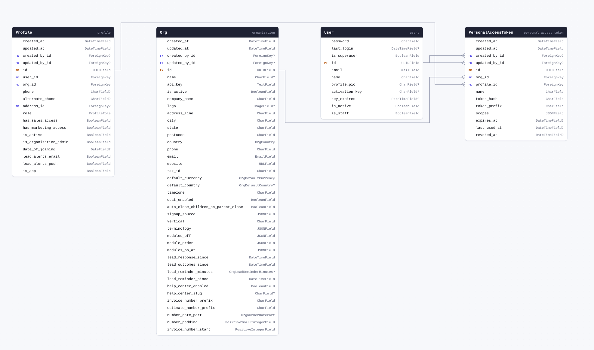

| Column | Field | Type | Null | Key | Default | Description |
| --- | --- | --- | --- | --- | --- | --- |
| `created_at` | `DateTimeField` | `datetime` |  |  | `now()` |  |
| `updated_at` | `DateTimeField` | `datetime` |  |  | `now()` |  |
| `created_by_id` | `ForeignKey` | `char(32)` | yes | FK |  |  |
| `updated_by_id` | `ForeignKey` | `char(32)` | yes | FK |  |  |
| `id` | `UUIDField` | `char(32)` |  | PK | `uuid4()` |  |
| `org_id` | `ForeignKey` | `char(32)` |  | FK |  | Organization this record belongs to |
| `profile_id` | `ForeignKey` | `char(32)` |  | FK |  |  |
| `name` | `CharField` | `varchar(255)` |  |  |  |  |
| `token_hash` | `CharField` | `varchar(64)` |  | unique |  |  |
| `token_prefix` | `CharField` | `varchar(20)` |  |  |  |  |
| `scopes` | `JSONField` | `text` |  |  | `list()` |  |
| `expires_at` | `DateTimeField` | `datetime` | yes |  |  |  |
| `last_used_at` | `DateTimeField` | `datetime` | yes |  |  |  |
| `revoked_at` | `DateTimeField` | `datetime` | yes |  |  |  |

Indexes:

- index `personal_access_token_created_by_id_a7fefb97` on `created_by_id`
- index `personal_access_token_updated_by_id_a0e03720` on `updated_by_id`
- index `personal_access_token_org_id_7f93f595` on `org_id`
- index `personal_access_token_profile_id_419e57ef` on `profile_id`
- index `personal_ac_org_id_cc57f9_idx` on `org_id`, `created_at` desc

Relations:

- `created_by_id` → [User](#user).`id`, on delete set null
- `updated_by_id` → [User](#user).`id`, on delete set null
- `org_id` → [Org](#org).`id`, on delete cascade
- `profile_id` → [Profile](#profile).`id`, on delete cascade

## CalendarFeedToken

Table `calendar_feed_token`, app `common`.

Columns from `BaseOrgModel` (abstract): `org_id`.

Columns from `BaseModel` (abstract): `id`.

Columns from `TimeAuditModel` (abstract): `created_at`, `updated_at`.

Columns from `UserAuditModel` (abstract): `created_by_id`, `updated_by_id`.

The secret in one member's calendar subscription URL (G14).

A calendar app (Google Calendar, Outlook, Apple Calendar) polls
``/api/public/calendar/<token>.ics`` with no credential of its own, so the
URL is the credential. One per profile, which is one per org membership.
Only the SHA-256 of the raw token is stored; the raw value is returned once,
when it is issued, and cannot be read back.

Like ``personal_access_token``, this table is deliberately NOT under RLS: the
feed looks it up by ``token_hash`` before any tenant context exists, which is
how it learns the org to set. Management is filtered on
``profile=request.profile`` in ``common/views/calendar_feed_views.py``.

The token grants nothing by itself. Every fetch re-checks that the profile,
its user and its org are still active and reads tasks through
``tasks.access.visible_tasks_qs``, so a demotion or a removal takes effect
on the next poll.


| Column | Field | Type | Null | Key | Default | Description |
| --- | --- | --- | --- | --- | --- | --- |
| `created_at` | `DateTimeField` | `datetime` |  |  | `now()` |  |
| `updated_at` | `DateTimeField` | `datetime` |  |  | `now()` |  |
| `created_by_id` | `ForeignKey` | `char(32)` | yes | FK |  |  |
| `updated_by_id` | `ForeignKey` | `char(32)` | yes | FK |  |  |
| `id` | `UUIDField` | `char(32)` |  | PK | `uuid4()` |  |
| `org_id` | `ForeignKey` | `char(32)` |  | FK |  | Organization this record belongs to |
| `profile_id` | `OneToOneField` | `char(32)` |  | FK, unique |  |  |
| `token_hash` | `CharField` | `varchar(64)` |  | unique |  |  |
| `last_used_at` | `DateTimeField` | `datetime` | yes |  |  |  |

Indexes:

- index `calendar_feed_token_created_by_id_07ee296f` on `created_by_id`
- index `calendar_feed_token_updated_by_id_307f07df` on `updated_by_id`
- index `calendar_feed_token_org_id_4cb3feb6` on `org_id`
- index `calendar_fe_org_id_627edf_idx` on `org_id`, `created_at` desc

Relations:

- `created_by_id` → [User](#user).`id`, on delete set null
- `updated_by_id` → [User](#user).`id`, on delete set null
- `org_id` → [Org](#org).`id`, on delete cascade
- `profile_id` → [Profile](#profile).`id`, on delete cascade

## PortalAccessToken

Table `portal_access_token`, app `common`.

Unscoped ``token_hash → org`` lookup for anonymous portal requests.

The public portal endpoints: the invoice and estimate links emailed to
customers, and the CSAT survey link, arrive with no auth and no org
context. RLS is keyed on ``app.current_org``, so with an empty context the
isolation policy hides the very row (invoice / estimate / csat_survey) that
would tell us which org the token belongs to. That is a chicken-and-egg:
you cannot set the context until you know the org, and you cannot read the
org until the context is set.

This table breaks it. It is deliberately **not** org-scoped. It is absent
from ``common.rls.ORG_SCOPED_TABLES`` and carries no RLS policy, so it is
readable with an empty context. A public view hashes the URL token, looks
up the org here, calls ``set_rls_context(org_id)``, and only then reads the
resource under full RLS. That is the same sanctioned pattern Celery tasks
and the CSAT view already use; it adds a surface rather than weakening one.

The key is ``sha256(url_token)``. For invoices and estimates the URL token
is the raw ``public_token``; for CSAT it is the signed token whose SHA-256
is already the stored ``csat_survey.token_hash``, so a single hash resolves
all three. The inbound email webhook uses it the same way: SNS delivers to
``/api/cases/inbound/<mailbox_id>/`` anonymously, and the key there is the
SHA-256 of the mailbox id in its canonical UUID form. The row leaks only
the *existence* of a token to somebody who already holds it; the resource
contents stay behind RLS, and a disabled or deleted resource still 404s
because the view's own scoped query re-checks ``public_link_enabled`` /
``is_active`` / existence after the context is set.

See ``docs/PORTAL_RLS.md``.

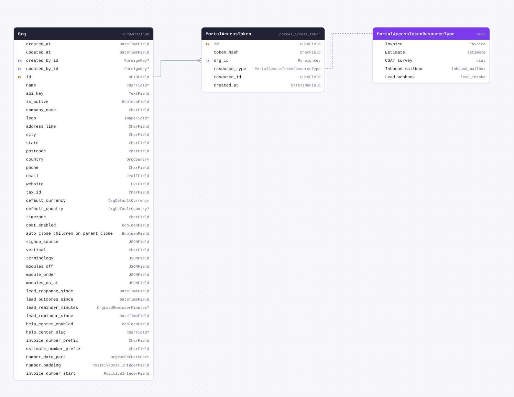

| Column | Field | Type | Null | Key | Default | Description |
| --- | --- | --- | --- | --- | --- | --- |
| `id` | `UUIDField` | `char(32)` |  | PK | `uuid4()` |  |
| `token_hash` | `CharField` | `varchar(64)` |  | unique |  |  |
| `org_id` | `ForeignKey` | `char(32)` |  | FK |  |  |
| `resource_type` | `PortalAccessTokenResourceType` | `varchar(16)` |  |  |  |  |
| `resource_id` | `UUIDField` | `char(32)` |  |  |  |  |
| `created_at` | `DateTimeField` | `datetime` |  |  | `now()` |  |

Indexes:

- index `portal_access_token_org_id_68126bef` on `org_id`
- index `portal_acce_resourc_e9c0d2_idx` on `resource_type`, `resource_id`

Relations:

- `org_id` → [Org](#org).`id`, on delete cascade

## SecurityAuditLog

Table `security_audit_log`, app `common`.

Columns from `BaseModel` (abstract): `id`.

Columns from `TimeAuditModel` (abstract): `created_at`, `updated_at`.

Columns from `UserAuditModel` (abstract): `created_by_id`, `updated_by_id`.

Model to store security audit events.

This is separate from Activity model which tracks business operations.
SecurityAuditLog tracks authentication and authorization events.

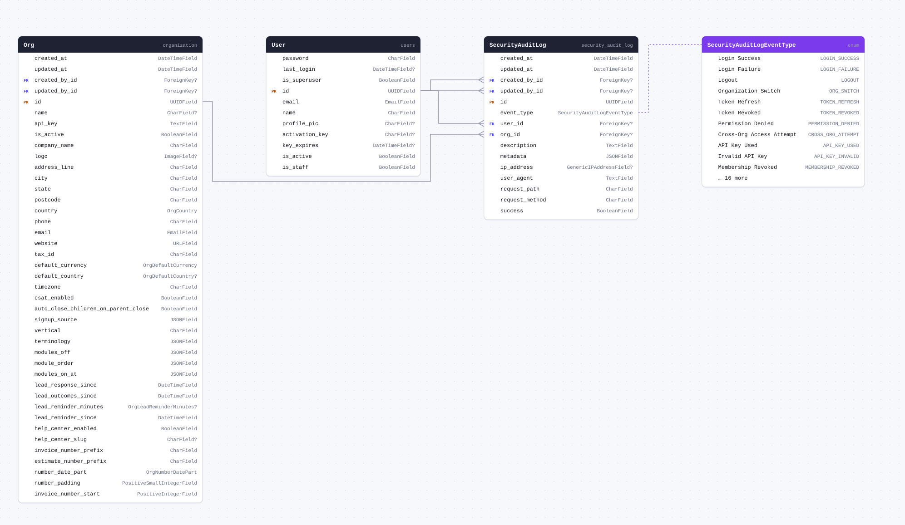

| Column | Field | Type | Null | Key | Default | Description |
| --- | --- | --- | --- | --- | --- | --- |
| `created_at` | `DateTimeField` | `datetime` |  |  | `now()` |  |
| `updated_at` | `DateTimeField` | `datetime` |  |  | `now()` |  |
| `created_by_id` | `ForeignKey` | `char(32)` | yes | FK |  |  |
| `updated_by_id` | `ForeignKey` | `char(32)` | yes | FK |  |  |
| `id` | `UUIDField` | `char(32)` |  | PK | `uuid4()` |  |
| `event_type` | `SecurityAuditLogEventType` | `varchar(50)` |  |  |  |  |
| `user_id` | `ForeignKey` | `char(32)` | yes | FK |  |  |
| `org_id` | `ForeignKey` | `char(32)` | yes | FK |  |  |
| `description` | `TextField` | `text` |  |  | `''` |  |
| `metadata` | `JSONField` | `text` |  |  | `dict()` |  |
| `ip_address` | `GenericIPAddressField` | `char(39)` | yes |  |  |  |
| `user_agent` | `TextField` | `text` |  |  | `''` |  |
| `request_path` | `CharField` | `varchar(500)` |  |  | `''` |  |
| `request_method` | `CharField` | `varchar(10)` |  |  | `''` |  |
| `success` | `BooleanField` | `bool` |  |  | `True` |  |

Indexes:

- index `security_audit_log_created_by_id_c956f639` on `created_by_id`
- index `security_audit_log_updated_by_id_61ffe312` on `updated_by_id`
- index `security_audit_log_event_type_1ed95076` on `event_type`
- index `security_audit_log_user_id_6b873120` on `user_id`
- index `security_audit_log_org_id_18c1d326` on `org_id`
- index `security_au_event_t_5c4296_idx` on `event_type`, `created_at` desc
- index `security_au_user_id_ab6fd5_idx` on `user_id`, `created_at` desc
- index `security_au_org_id_d5d1da_idx` on `org_id`, `created_at` desc
- index `security_au_ip_addr_a572f5_idx` on `ip_address`
- index `security_au_success_c444de_idx` on `success`, `created_at` desc

Relations:

- `created_by_id` → [User](#user).`id`, on delete set null
- `updated_by_id` → [User](#user).`id`, on delete set null
- `user_id` → [User](#user).`id`, on delete set null
- `org_id` → [Org](#org).`id`, on delete set null

## PackApplication

Table `pack_application`, app `common`.

Columns from `BaseOrgModel` (abstract): `org_id`.

Columns from `BaseModel` (abstract): `id`.

Columns from `TimeAuditModel` (abstract): `created_at`, `updated_at`.

Columns from `UserAuditModel` (abstract): `created_by_id`, `updated_by_id`.

Audit record of one vertical-pack application to one org.


| Column | Field | Type | Null | Key | Default | Description |
| --- | --- | --- | --- | --- | --- | --- |
| `created_at` | `DateTimeField` | `datetime` |  |  | `now()` |  |
| `updated_at` | `DateTimeField` | `datetime` |  |  | `now()` |  |
| `created_by_id` | `ForeignKey` | `char(32)` | yes | FK |  |  |
| `updated_by_id` | `ForeignKey` | `char(32)` | yes | FK |  |  |
| `id` | `UUIDField` | `char(32)` |  | PK | `uuid4()` |  |
| `org_id` | `ForeignKey` | `char(32)` |  | FK |  | Organization this record belongs to |
| `pack_id` | `CharField` | `varchar(64)` |  |  |  |  |
| `pack_version` | `PositiveIntegerField` | `integer unsigned` |  |  |  |  |
| `applied_by_id` | `ForeignKey` | `char(32)` | yes | FK |  |  |
| `result` | `JSONField` | `text` |  |  | `dict()` | {'created': [...], 'skipped': [...], 'failed': [...]} |

Indexes:

- index `pack_application_created_by_id_0e659634` on `created_by_id`
- index `pack_application_updated_by_id_31b80592` on `updated_by_id`
- index `pack_application_org_id_d5992f06` on `org_id`
- index `pack_application_applied_by_id_b3613674` on `applied_by_id`
- index `pack_applic_org_id_78eec5_idx` on `org_id`, `created_at` desc

Relations:

- `created_by_id` → [User](#user).`id`, on delete set null
- `updated_by_id` → [User](#user).`id`, on delete set null
- `org_id` → [Org](#org).`id`, on delete cascade
- `applied_by_id` → [Profile](#profile).`id`, on delete set null

## InstalledApp

Table `installed_app`, app `common`.

Columns from `BaseOrgModel` (abstract): `org_id`.

Columns from `BaseModel` (abstract): `id`.

Columns from `TimeAuditModel` (abstract): `created_at`, `updated_at`.

Columns from `UserAuditModel` (abstract): `created_by_id`, `updated_by_id`.

One industry app on one org: its version, and what it has done there.

``owned`` lists the parts the app created, ``{type, target, key, id}``, with
``off`` on the ones removal switched off. ``offered`` lists every part it
has ever offered the org, ``{type, target, key, skipped_module}``. Written
only by ``common.apps_catalogue``; see docs/features/industry-apps.md.

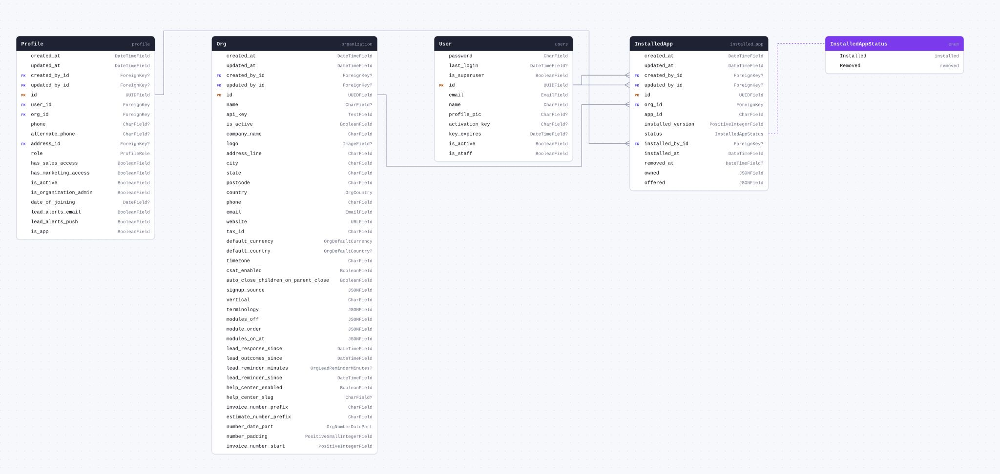

| Column | Field | Type | Null | Key | Default | Description |
| --- | --- | --- | --- | --- | --- | --- |
| `created_at` | `DateTimeField` | `datetime` |  |  | `now()` |  |
| `updated_at` | `DateTimeField` | `datetime` |  |  | `now()` |  |
| `created_by_id` | `ForeignKey` | `char(32)` | yes | FK |  |  |
| `updated_by_id` | `ForeignKey` | `char(32)` | yes | FK |  |  |
| `id` | `UUIDField` | `char(32)` |  | PK | `uuid4()` |  |
| `org_id` | `ForeignKey` | `char(32)` |  | FK |  | Organization this record belongs to |
| `app_id` | `CharField` | `varchar(64)` |  |  |  |  |
| `installed_version` | `PositiveIntegerField` | `integer unsigned` |  |  |  |  |
| `status` | `InstalledAppStatus` | `varchar(16)` |  |  | `'installed'` |  |
| `installed_by_id` | `ForeignKey` | `char(32)` | yes | FK |  |  |
| `installed_at` | `DateTimeField` | `datetime` |  |  |  |  |
| `removed_at` | `DateTimeField` | `datetime` | yes |  |  |  |
| `owned` | `JSONField` | `text` |  |  | `list()` |  |
| `offered` | `JSONField` | `text` |  |  | `list()` |  |

Indexes:

- index `installed_app_created_by_id_876c9424` on `created_by_id`
- index `installed_app_updated_by_id_b6059aa4` on `updated_by_id`
- index `installed_app_org_id_a1cc67fc` on `org_id`
- index `installed_app_installed_by_id_ea408f29` on `installed_by_id`
- unique `unique_installed_app_per_org` on `org_id`, `app_id`
- index `installed_a_org_id_cba163_idx` on `org_id`, `created_at` desc

Relations:

- `created_by_id` → [User](#user).`id`, on delete set null
- `updated_by_id` → [User](#user).`id`, on delete set null
- `org_id` → [Org](#org).`id`, on delete cascade
- `installed_by_id` → [Profile](#profile).`id`, on delete set null

## SavedView

Table `saved_view`, app `common`.

Columns from `BaseOrgModel` (abstract): `org_id`.

Columns from `BaseModel` (abstract): `id`.

Columns from `TimeAuditModel` (abstract): `created_at`, `updated_at`.

Columns from `UserAuditModel` (abstract): `created_by_id`, `updated_by_id`.

A profile's named filters for one list, to put back with one tap (G29).

Private to ``profile``: every read and write is filtered on it as well as on
the org, and another profile's id answers 404. ``filters`` holds the list's
own query parameters as ``{param: [value, ...]}``; which parameters a list
takes, and how they are checked, lives in ``common/saved_views.py``.

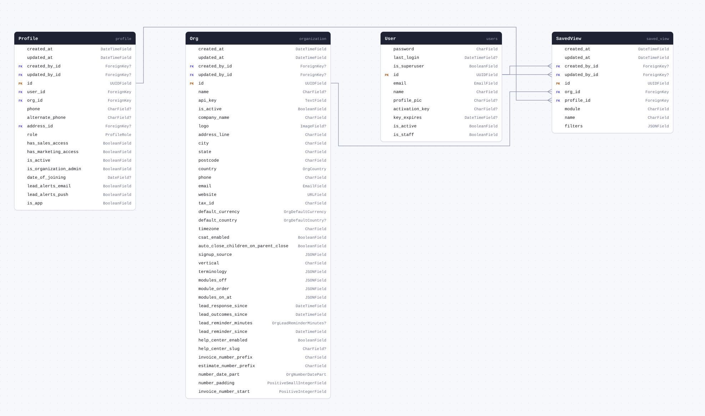

| Column | Field | Type | Null | Key | Default | Description |
| --- | --- | --- | --- | --- | --- | --- |
| `created_at` | `DateTimeField` | `datetime` |  |  | `now()` |  |
| `updated_at` | `DateTimeField` | `datetime` |  |  | `now()` |  |
| `created_by_id` | `ForeignKey` | `char(32)` | yes | FK |  |  |
| `updated_by_id` | `ForeignKey` | `char(32)` | yes | FK |  |  |
| `id` | `UUIDField` | `char(32)` |  | PK | `uuid4()` |  |
| `org_id` | `ForeignKey` | `char(32)` |  | FK |  | Organization this record belongs to |
| `profile_id` | `ForeignKey` | `char(32)` |  | FK |  |  |
| `module` | `CharField` | `varchar(40)` |  |  |  |  |
| `name` | `CharField` | `varchar(100)` |  |  |  |  |
| `filters` | `JSONField` | `text` |  |  | `dict()` |  |

Indexes:

- index `saved_view_created_by_id_f65320a8` on `created_by_id`
- index `saved_view_updated_by_id_002da485` on `updated_by_id`
- index `saved_view_org_id_d0a47136` on `org_id`
- index `saved_view_profile_id_9508d806` on `profile_id`
- unique `saved_view_name_ci_unique` on `profile_id`, `module`, `LOWER("name")`
- index `saved_view_org_id_77a76d_idx` on `org_id`, `created_at` desc

Relations:

- `created_by_id` → [User](#user).`id`, on delete set null
- `updated_by_id` → [User](#user).`id`, on delete set null
- `org_id` → [Org](#org).`id`, on delete cascade
- `profile_id` → [Profile](#profile).`id`, on delete cascade

## Account

Table `accounts`, app `accounts`.

Columns from `BaseModel` (abstract): `id`.

Columns from `TimeAuditModel` (abstract): `created_at`, `updated_at`.

Columns from `UserAuditModel` (abstract): `created_by_id`, `updated_by_id`.

Account model for CRM - Streamlined for modern sales workflow
Based on Twenty CRM and Salesforce patterns

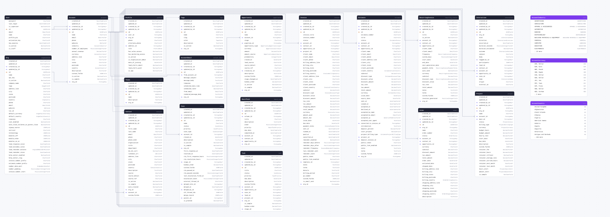

| Column | Field | Type | Null | Key | Default | Description |
| --- | --- | --- | --- | --- | --- | --- |
| `created_at` | `DateTimeField` | `datetime` |  |  | `now()` |  |
| `updated_at` | `DateTimeField` | `datetime` |  |  | `now()` |  |
| `created_by_id` | `ForeignKey` | `char(32)` | yes | FK |  |  |
| `updated_by_id` | `ForeignKey` | `char(32)` | yes | FK |  |  |
| `id` | `UUIDField` | `char(32)` |  | PK | `uuid4()` |  |
| `name` | `CharField` | `varchar(255)` |  |  |  |  |
| `email` | `EmailField` | `varchar(254)` | yes |  |  |  |
| `phone` | `CharField` | `varchar(25)` | yes |  |  |  |
| `website` | `URLField` | `varchar(200)` | yes |  |  |  |
| `industry` | `AccountIndustry` | `varchar(255)` | yes |  |  |  |
| `number_of_employees` | `PositiveIntegerField` | `integer unsigned` | yes |  |  |  |
| `annual_revenue` | `DecimalField(15, 2)` | `decimal` | yes |  |  |  |
| `currency` | `AccountCurrency` | `varchar(3)` | yes |  |  |  |
| `address_line` | `CharField` | `varchar(255)` | yes |  |  |  |
| `city` | `CharField` | `varchar(255)` | yes |  |  |  |
| `state` | `CharField` | `varchar(255)` | yes |  |  |  |
| `postcode` | `CharField` | `varchar(64)` | yes |  |  |  |
| `country` | `AccountCountry` | `varchar(3)` | yes |  |  |  |
| `description` | `TextField` | `text` | yes |  |  |  |
| `custom_fields` | `JSONField` | `text` |  |  | `dict()` | Per-org schema extension; values are validated against common.CustomFieldDefinition. |
| `is_active` | `BooleanField` | `bool` |  |  | `True` |  |
| `is_sample` | `BooleanField` | `bool` |  |  | `False` | True only for demo rows created by common.packs.applier._apply_sample_data. Server-set exclusively, never expose this as a writable field on any serializer. It is the sole key common.packs.applier.clear_sample_data uses to decide what to delete, so a client-writable path here would let a user mark an arbitrary real record as sample and have it deleted. |
| `org_id` | `ForeignKey` | `char(32)` |  | FK |  |  |

Indexes:

- index `accounts_created_by_id_4e4c6c04` on `created_by_id`
- index `accounts_updated_by_id_eb195ab4` on `updated_by_id`
- index `accounts_org_id_df4cee85` on `org_id`
- unique `unique_account_name_per_org` on `org_id`, `LOWER("name")`
- index `accounts_name_94ecef_idx` on `name`
- index `accounts_industr_6498ca_idx` on `industry`
- index `accounts_org_id_6f0889_idx` on `org_id`, `created_at` desc
- index `accounts_org_upd_idx` on `org_id`, `updated_at`, `id`

Checks:

- `account_revenue_non_negative`: `("annual_revenue" >= '0' OR "annual_revenue" IS NULL)`

Relations:

- `created_by_id` → [User](#user).`id`, on delete set null
- `updated_by_id` → [User](#user).`id`, on delete set null
- `org_id` → [Org](#org).`id`, on delete cascade
- `assigned_to` — many to many with [Profile](#profile)
- `teams` — many to many with [Teams](#teams)
- `contacts` — many to many with [Contact](#contact)
- `tags` — many to many with [Tags](#tags)
- [AccountEmail](#accountemail).`from_account_id` → `id`, on delete set null
- [Case](#case).`account_id` → `id`, on delete cascade
- [Contact](#contact).`account_id` → `id`, on delete set null
- [Opportunity](#opportunity).`account_id` → `id`, on delete cascade
- [BoardTask](#boardtask).`account_id` → `id`, on delete set null
- [Task](#task).`account_id` → `id`, on delete set null
- [Invoice](#invoice).`account_id` → `id`, on delete protect
- [Estimate](#estimate).`account_id` → `id`, on delete protect
- [RecurringInvoice](#recurringinvoice).`account_id` → `id`, on delete protect
- [Order](#order).`account_id` → `id`, on delete cascade
- [Interaction](#interaction).`account_id` → `id`, on delete delete or unlink
- [Project](#project).`account_id` → `id`, on delete protect

## AccountEmail

Table `account_email`, app `accounts`.

Columns from `BaseModel` (abstract): `id`.

Columns from `TimeAuditModel` (abstract): `created_at`, `updated_at`.

Columns from `UserAuditModel` (abstract): `created_by_id`, `updated_by_id`.

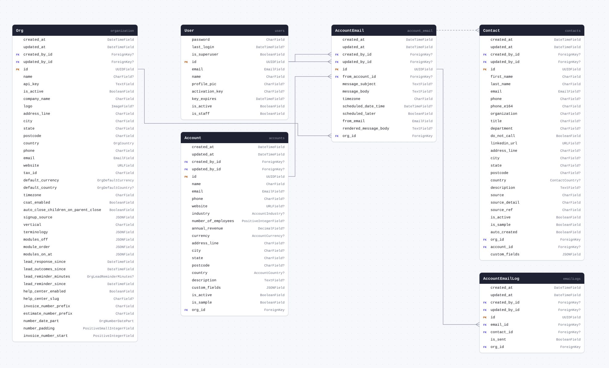

| Column | Field | Type | Null | Key | Default | Description |
| --- | --- | --- | --- | --- | --- | --- |
| `created_at` | `DateTimeField` | `datetime` |  |  | `now()` |  |
| `updated_at` | `DateTimeField` | `datetime` |  |  | `now()` |  |
| `created_by_id` | `ForeignKey` | `char(32)` | yes | FK |  |  |
| `updated_by_id` | `ForeignKey` | `char(32)` | yes | FK |  |  |
| `id` | `UUIDField` | `char(32)` |  | PK | `uuid4()` |  |
| `from_account_id` | `ForeignKey` | `char(32)` | yes | FK |  |  |
| `message_subject` | `TextField` | `text` | yes |  |  |  |
| `message_body` | `TextField` | `text` | yes |  |  |  |
| `timezone` | `CharField` | `varchar(100)` |  |  | `'UTC'` |  |
| `scheduled_date_time` | `DateTimeField` | `datetime` | yes |  |  |  |
| `scheduled_later` | `BooleanField` | `bool` |  |  | `False` |  |
| `from_email` | `EmailField` | `varchar(254)` |  |  |  |  |
| `rendered_message_body` | `TextField` | `text` | yes |  |  |  |
| `org_id` | `ForeignKey` | `char(32)` |  | FK |  |  |

Indexes:

- index `account_email_created_by_id_49578130` on `created_by_id`
- index `account_email_updated_by_id_4e6199b8` on `updated_by_id`
- index `account_email_from_account_id_47686543` on `from_account_id`
- index `account_email_org_id_b8b96bf6` on `org_id`
- index `account_ema_org_id_3bbcd2_idx` on `org_id`, `created_at` desc

Relations:

- `created_by_id` → [User](#user).`id`, on delete set null
- `updated_by_id` → [User](#user).`id`, on delete set null
- `from_account_id` → [Account](#account).`id`, on delete set null
- `org_id` → [Org](#org).`id`, on delete cascade
- `recipients` — many to many with [Contact](#contact)
- [AccountEmailLog](#accountemaillog).`email_id` → `id`, on delete set null

## AccountEmailLog

Table `emailLogs`, app `accounts`.

Columns from `BaseModel` (abstract): `id`.

Columns from `TimeAuditModel` (abstract): `created_at`, `updated_at`.

Columns from `UserAuditModel` (abstract): `created_by_id`, `updated_by_id`.

this model is used to track if the email is sent or not

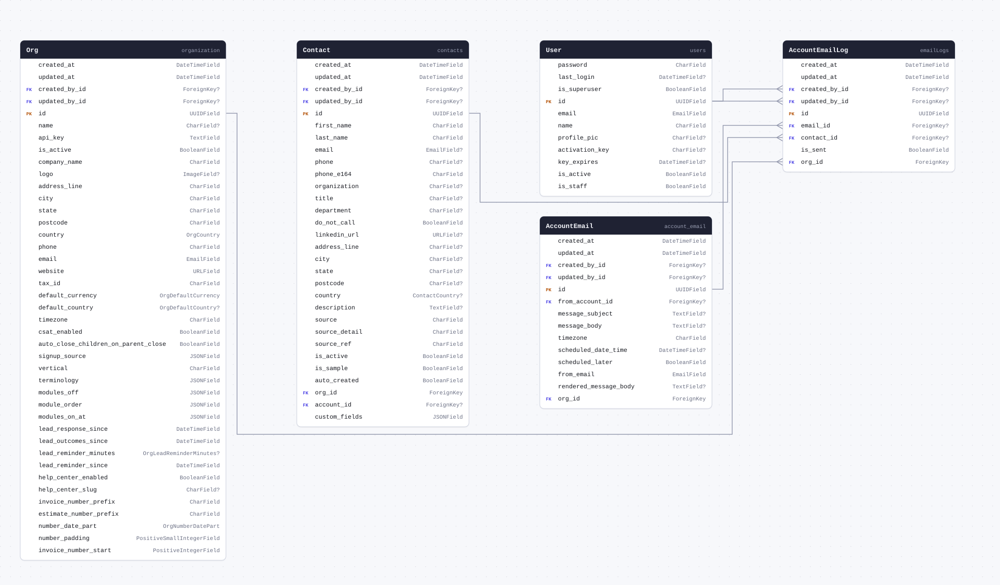

| Column | Field | Type | Null | Key | Default | Description |
| --- | --- | --- | --- | --- | --- | --- |
| `created_at` | `DateTimeField` | `datetime` |  |  | `now()` |  |
| `updated_at` | `DateTimeField` | `datetime` |  |  | `now()` |  |
| `created_by_id` | `ForeignKey` | `char(32)` | yes | FK |  |  |
| `updated_by_id` | `ForeignKey` | `char(32)` | yes | FK |  |  |
| `id` | `UUIDField` | `char(32)` |  | PK | `uuid4()` |  |
| `email_id` | `ForeignKey` | `char(32)` | yes | FK |  |  |
| `contact_id` | `ForeignKey` | `char(32)` | yes | FK |  |  |
| `is_sent` | `BooleanField` | `bool` |  |  | `False` |  |
| `org_id` | `ForeignKey` | `char(32)` |  | FK |  |  |

Indexes:

- index `emailLogs_created_by_id_c5b0f11b` on `created_by_id`
- index `emailLogs_updated_by_id_0dfdfded` on `updated_by_id`
- index `emailLogs_email_id_222d85be` on `email_id`
- index `emailLogs_contact_id_304ec39a` on `contact_id`
- index `emailLogs_org_id_8a50b096` on `org_id`
- index `emailLogs_org_id_84814f_idx` on `org_id`, `created_at` desc

Relations:

- `created_by_id` → [User](#user).`id`, on delete set null
- `updated_by_id` → [User](#user).`id`, on delete set null
- `email_id` → [AccountEmail](#accountemail).`id`, on delete set null
- `contact_id` → [Contact](#contact).`id`, on delete set null
- `org_id` → [Org](#org).`id`, on delete cascade

## Case

Table `case`, app `cases`.

Columns from `BaseModel` (abstract): `id`.

Columns from `TimeAuditModel` (abstract): `created_at`, `updated_at`.

Columns from `UserAuditModel` (abstract): `created_by_id`, `updated_by_id`.

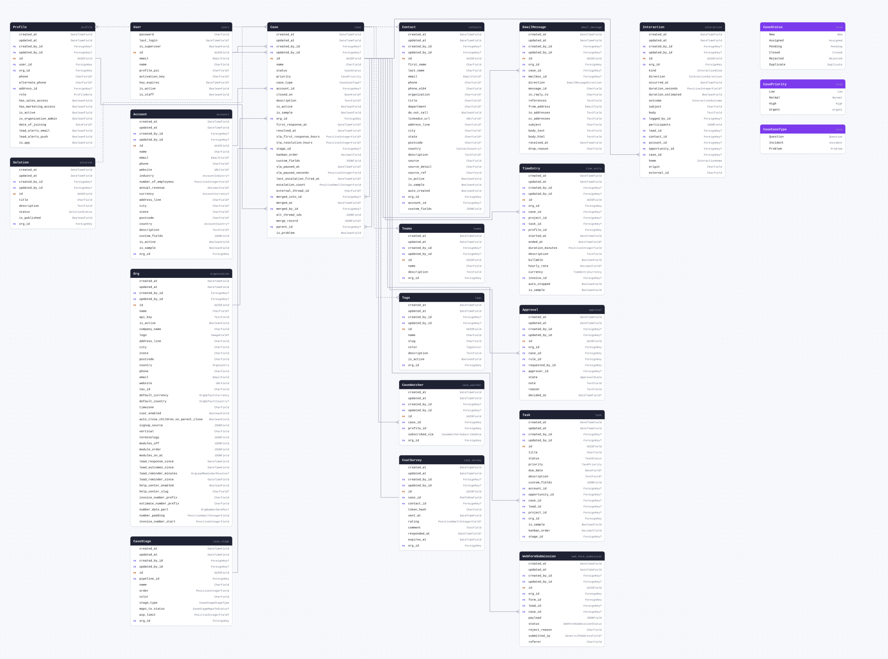

| Column | Field | Type | Null | Key | Default | Description |
| --- | --- | --- | --- | --- | --- | --- |
| `created_at` | `DateTimeField` | `datetime` |  |  | `now()` |  |
| `updated_at` | `DateTimeField` | `datetime` |  |  | `now()` |  |
| `created_by_id` | `ForeignKey` | `char(32)` | yes | FK |  |  |
| `updated_by_id` | `ForeignKey` | `char(32)` | yes | FK |  |  |
| `id` | `UUIDField` | `char(32)` |  | PK | `uuid4()` |  |
| `name` | `CharField` | `varchar(64)` |  |  |  |  |
| `status` | `CaseStatus` | `varchar(64)` |  |  |  |  |
| `priority` | `CasePriority` | `varchar(64)` |  |  |  |  |
| `case_type` | `CaseCaseType` | `varchar(255)` | yes |  | `None` |  |
| `account_id` | `ForeignKey` | `char(32)` | yes | FK |  |  |
| `closed_on` | `DateField` | `date` | yes |  |  |  |
| `description` | `TextField` | `text` | yes |  |  |  |
| `is_active` | `BooleanField` | `bool` |  |  | `True` |  |
| `is_sample` | `BooleanField` | `bool` |  |  | `False` | True only for demo rows created by common.packs.applier._apply_sample_data. Server-set exclusively, never expose this as a writable field on any serializer. It is the sole key common.packs.applier.clear_sample_data uses to decide what to delete, so a client-writable path here would let a user mark an arbitrary real record as sample and have it deleted. |
| `org_id` | `ForeignKey` | `char(32)` |  | FK |  |  |
| `first_response_at` | `DateTimeField` | `datetime` | yes |  |  |  |
| `resolved_at` | `DateTimeField` | `datetime` | yes |  |  |  |
| `sla_first_response_hours` | `PositiveIntegerField` | `integer unsigned` | yes |  | `None` | Target hours for first response |
| `sla_resolution_hours` | `PositiveIntegerField` | `integer unsigned` | yes |  | `None` | Target hours for resolution |
| `stage_id` | `ForeignKey` | `char(32)` | yes | FK |  | Current pipeline stage (null = use status-based kanban) |
| `kanban_order` | `DecimalField(15, 6)` | `decimal` |  |  | `0` | Order within the kanban column for drag-drop positioning |
| `custom_fields` | `JSONField` | `text` |  |  | `dict()` | Per-org schema extension; values are validated against common.CustomFieldDefinition. |
| `sla_paused_at` | `DateTimeField` | `datetime` | yes |  |  |  |
| `sla_paused_seconds` | `PositiveIntegerField` | `integer unsigned` |  |  | `0` |  |
| `last_escalation_fired_at` | `DateTimeField` | `datetime` | yes |  |  |  |
| `escalation_count` | `PositiveSmallIntegerField` | `smallint unsigned` |  |  | `0` |  |
| `external_thread_id` | `CharField` | `varchar(255)` | yes |  |  |  |
| `merged_into_id` | `ForeignKey` | `char(32)` | yes | FK |  |  |
| `merged_at` | `DateTimeField` | `datetime` | yes |  |  |  |
| `merged_by_id` | `ForeignKey` | `char(32)` | yes | FK |  |  |
| `alt_thread_ids` | `JSONField` | `text` |  |  | `list()` |  |
| `merge_record` | `JSONField` | `text` | yes |  |  |  |
| `parent_id` | `ForeignKey` | `char(32)` | yes | FK |  |  |
| `is_problem` | `BooleanField` | `bool` |  |  | `False` | Marks this case as an ITIL 'problem' (umbrella ticket). |

Indexes:

- index `case_created_by_id_c688f72a` on `created_by_id`
- index `case_updated_by_id_7d1f7644` on `updated_by_id`
- index `case_account_id_77dd24c3` on `account_id`
- index `case_org_id_c33341da` on `org_id`
- index `case_stage_id_0dbc0279` on `stage_id`
- index `case_last_escalation_fired_at_259bddcc` on `last_escalation_fired_at`
- index `case_external_thread_id_eccd48be` on `external_thread_id`
- index `case_merged_into_id_3569a32c` on `merged_into_id`
- index `case_merged_at_50daa979` on `merged_at`
- index `case_merged_by_id_cedc001b` on `merged_by_id`
- index `case_parent_id_d99ad8ba` on `parent_id`
- index `case_status_deb121_idx` on `status`
- index `case_priorit_bccbdf_idx` on `priority`
- index `case_org_id_9c4eb6_idx` on `org_id`, `created_at` desc
- index `case_org_upd_idx` on `org_id`, `updated_at`, `id`
- index `case_stage_i_f04bec_idx` on `stage_id`, `kanban_order`
- index `case_status_a33019_idx` on `status`, `kanban_order`
- index `case_org_resolved_idx` on `org_id`, `resolved_at`
- index `case_parent_idx` on `parent_id`

Relations:

- `watchers` — many to many with [Profile](#profile), through [CaseWatcher](#casewatcher)
- `created_by_id` → [User](#user).`id`, on delete set null
- `updated_by_id` → [User](#user).`id`, on delete set null
- `account_id` → [Account](#account).`id`, on delete cascade
- `org_id` → [Org](#org).`id`, on delete cascade
- `stage_id` → [CaseStage](#casestage).`id`, on delete set null
- `merged_into_id` → [Case](#case).`id`, on delete set null
- `merged_by_id` → [Profile](#profile).`id`, on delete set null
- `parent_id` → [Case](#case).`id`, on delete set null
- `contacts` — many to many with [Contact](#contact)
- `assigned_to` — many to many with [Profile](#profile)
- `teams` — many to many with [Teams](#teams)
- `tags` — many to many with [Tags](#tags)
- [CaseWatcher](#casewatcher).`case_id` → `id`, on delete cascade
- [CsatSurvey](#csatsurvey).`case_id` → `id`, on delete cascade
- `solutions` — many to many with [Solution](#solution)
- [EmailMessage](#emailmessage).`case_id` → `id`, on delete cascade
- [TimeEntry](#timeentry).`case_id` → `id`, on delete cascade
- [Approval](#approval).`case_id` → `id`, on delete cascade
- [Task](#task).`case_id` → `id`, on delete set null
- [WebFormSubmission](#webformsubmission).`case_id` → `id`, on delete set null
- [Interaction](#interaction).`case_id` → `id`, on delete delete or unlink

## CaseWatcher

Table `case_watcher`, app `cases`.

Columns from `BaseModel` (abstract): `id`.

Columns from `TimeAuditModel` (abstract): `created_at`, `updated_at`.

Columns from `UserAuditModel` (abstract): `created_by_id`, `updated_by_id`.

A profile subscribed to updates on a case.

Per `docs/cases/COORDINATION_DECISIONS.md` D2 we inherit BaseModel and
declare our own org FK rather than using BaseOrgModel. RLS still
applies via the migration that adds the `case_watcher` table.

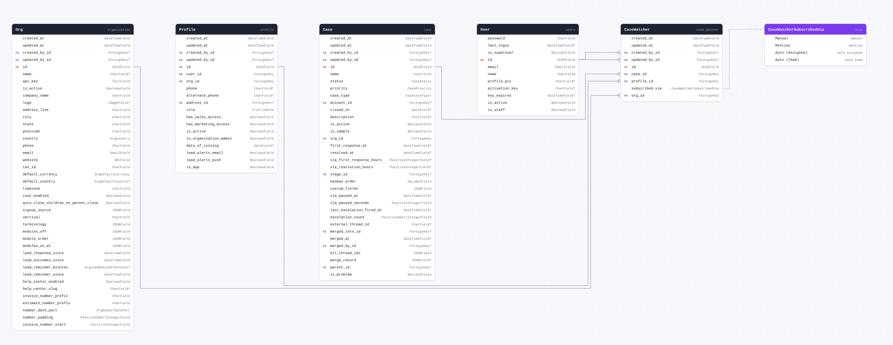

| Column | Field | Type | Null | Key | Default | Description |
| --- | --- | --- | --- | --- | --- | --- |
| `created_at` | `DateTimeField` | `datetime` |  |  | `now()` |  |
| `updated_at` | `DateTimeField` | `datetime` |  |  | `now()` |  |
| `created_by_id` | `ForeignKey` | `char(32)` | yes | FK |  |  |
| `updated_by_id` | `ForeignKey` | `char(32)` | yes | FK |  |  |
| `id` | `UUIDField` | `char(32)` |  | PK | `uuid4()` |  |
| `case_id` | `ForeignKey` | `char(32)` |  | FK |  |  |
| `profile_id` | `ForeignKey` | `char(32)` |  | FK |  |  |
| `subscribed_via` | `CaseWatcherSubscribedVia` | `varchar(16)` |  |  | `'manual'` |  |
| `org_id` | `ForeignKey` | `char(32)` |  | FK |  |  |

Indexes:

- index `case_watcher_created_by_id_9a802bfa` on `created_by_id`
- index `case_watcher_updated_by_id_89fc109e` on `updated_by_id`
- index `case_watcher_case_id_d154b213` on `case_id`
- index `case_watcher_profile_id_203b21be` on `profile_id`
- index `case_watcher_org_id_1f96be52` on `org_id`
- unique `uniq_case_watcher_per_profile` on `case_id`, `profile_id`
- index `case_watche_profile_88025c_idx` on `profile_id`, `created_at` desc
- index `case_watche_case_id_09be35_idx` on `case_id`

Relations:

- `created_by_id` → [User](#user).`id`, on delete set null
- `updated_by_id` → [User](#user).`id`, on delete set null
- `case_id` → [Case](#case).`id`, on delete cascade
- `profile_id` → [Profile](#profile).`id`, on delete cascade
- `org_id` → [Org](#org).`id`, on delete cascade

## CsatSurvey

Table `csat_survey`, app `cases`.

Columns from `BaseModel` (abstract): `id`.

Columns from `TimeAuditModel` (abstract): `created_at`, `updated_at`.

Columns from `UserAuditModel` (abstract): `created_by_id`, `updated_by_id`.

Customer satisfaction survey row (Tier 2 csat).

One survey per Case (OneToOne). Created when the case closes and the
Celery task `cases.tasks.send_csat_survey` fires; populated when the
customer clicks the rating link in their email. The `token_hash` is
SHA-256 of the signed token so a database leak never exposes raw
tokens.

Per `docs/cases/COORDINATION_DECISIONS.md` D2 we inherit BaseModel and
declare our own org FK rather than `BaseOrgModel`; RLS is enforced via
the policy in the migration.

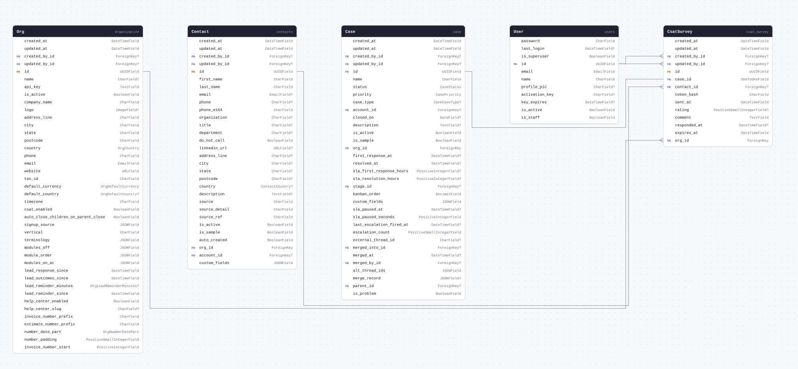

| Column | Field | Type | Null | Key | Default | Description |
| --- | --- | --- | --- | --- | --- | --- |
| `created_at` | `DateTimeField` | `datetime` |  |  | `now()` |  |
| `updated_at` | `DateTimeField` | `datetime` |  |  | `now()` |  |
| `created_by_id` | `ForeignKey` | `char(32)` | yes | FK |  |  |
| `updated_by_id` | `ForeignKey` | `char(32)` | yes | FK |  |  |
| `id` | `UUIDField` | `char(32)` |  | PK | `uuid4()` |  |
| `case_id` | `OneToOneField` | `char(32)` |  | FK, unique |  |  |
| `contact_id` | `ForeignKey` | `char(32)` | yes | FK |  |  |
| `token_hash` | `CharField` | `varchar(64)` |  | unique |  |  |
| `sent_at` | `DateTimeField` | `datetime` |  |  |  |  |
| `rating` | `PositiveSmallIntegerField` | `smallint unsigned` | yes |  |  |  |
| `comment` | `TextField` | `text` |  |  | `''` |  |
| `responded_at` | `DateTimeField` | `datetime` | yes |  |  |  |
| `expires_at` | `DateTimeField` | `datetime` |  |  |  |  |
| `org_id` | `ForeignKey` | `char(32)` |  | FK |  |  |

Indexes:

- index `csat_survey_created_by_id_0268f721` on `created_by_id`
- index `csat_survey_updated_by_id_74ff3ed1` on `updated_by_id`
- index `csat_survey_contact_id_653009a6` on `contact_id`
- index `csat_survey_org_id_db51c210` on `org_id`
- index `csat_survey_org_id_a284b2_idx` on `org_id`, `responded_at` desc
- index `csat_survey_case_id_516193_idx` on `case_id`
- index `csat_survey_token_h_2f45f7_idx` on `token_hash`

Relations:

- `created_by_id` → [User](#user).`id`, on delete set null
- `updated_by_id` → [User](#user).`id`, on delete set null
- `case_id` → [Case](#case).`id`, on delete cascade
- `contact_id` → [Contact](#contact).`id`, on delete set null
- `org_id` → [Org](#org).`id`, on delete cascade

## Solution

Table `solution`, app `cases`.

Columns from `BaseModel` (abstract): `id`.

Columns from `TimeAuditModel` (abstract): `created_at`, `updated_at`.

Columns from `UserAuditModel` (abstract): `created_by_id`, `updated_by_id`.

Knowledge Base Solution

Solutions are reusable answers/guides that can be linked to cases.
They form a knowledge base for common issues and their resolutions.

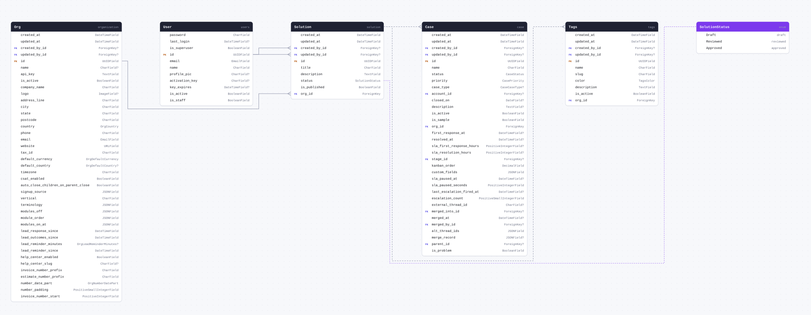

| Column | Field | Type | Null | Key | Default | Description |
| --- | --- | --- | --- | --- | --- | --- |
| `created_at` | `DateTimeField` | `datetime` |  |  | `now()` |  |
| `updated_at` | `DateTimeField` | `datetime` |  |  | `now()` |  |
| `created_by_id` | `ForeignKey` | `char(32)` | yes | FK |  |  |
| `updated_by_id` | `ForeignKey` | `char(32)` | yes | FK |  |  |
| `id` | `UUIDField` | `char(32)` |  | PK | `uuid4()` |  |
| `title` | `CharField` | `varchar(255)` |  |  |  |  |
| `description` | `TextField` | `text` |  |  |  |  |
| `status` | `SolutionStatus` | `varchar(20)` |  |  | `'draft'` |  |
| `is_published` | `BooleanField` | `bool` |  |  | `False` |  |
| `org_id` | `ForeignKey` | `char(32)` |  | FK |  |  |

Indexes:

- index `solution_created_by_id_9b66ceb4` on `created_by_id`
- index `solution_updated_by_id_d968ad0c` on `updated_by_id`
- index `solution_org_id_b9db7132` on `org_id`
- index `solution_status_c9b160_idx` on `status`
- index `solution_is_publ_2f7331_idx` on `is_published`
- index `solution_org_id_577c5c_idx` on `org_id`

Relations:

- `created_by_id` → [User](#user).`id`, on delete set null
- `updated_by_id` → [User](#user).`id`, on delete set null
- `org_id` → [Org](#org).`id`, on delete cascade
- `cases` — many to many with [Case](#case)
- `tags` — many to many with [Tags](#tags)

## CasePipeline

Table `case_pipeline`, app `cases`.

Columns from `BaseModel` (abstract): `id`.

Columns from `TimeAuditModel` (abstract): `created_at`, `updated_at`.

Columns from `UserAuditModel` (abstract): `created_by_id`, `updated_by_id`.

Custom pipeline for organizing cases into stages (Kanban columns).
Each organization can have multiple pipelines (e.g., Support, Engineering, Billing).

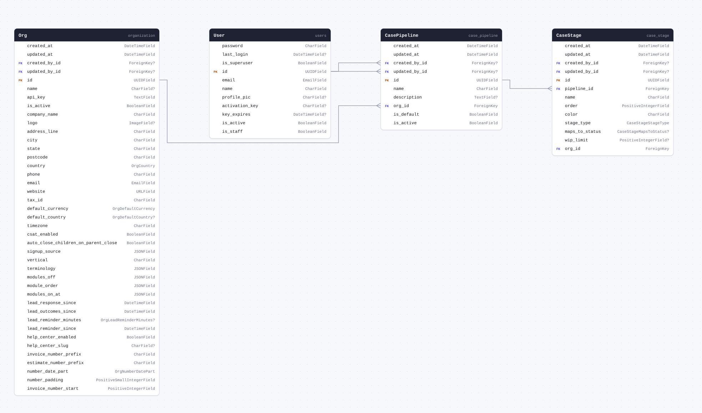

| Column | Field | Type | Null | Key | Default | Description |
| --- | --- | --- | --- | --- | --- | --- |
| `created_at` | `DateTimeField` | `datetime` |  |  | `now()` |  |
| `updated_at` | `DateTimeField` | `datetime` |  |  | `now()` |  |
| `created_by_id` | `ForeignKey` | `char(32)` | yes | FK |  |  |
| `updated_by_id` | `ForeignKey` | `char(32)` | yes | FK |  |  |
| `id` | `UUIDField` | `char(32)` |  | PK | `uuid4()` |  |
| `name` | `CharField` | `varchar(255)` |  |  |  |  |
| `description` | `TextField` | `text` | yes |  |  |  |
| `org_id` | `ForeignKey` | `char(32)` |  | FK |  |  |
| `is_default` | `BooleanField` | `bool` |  |  | `False` | Sorts this pipeline first in listings (see Meta.ordering) and is limited to one per org. It does NOT route new records: a case created without a stage keeps stage=NULL, which is the supported status-based kanban mode. |
| `is_active` | `BooleanField` | `bool` |  |  | `True` |  |

Indexes:

- index `case_pipeline_created_by_id_68401176` on `created_by_id`
- index `case_pipeline_updated_by_id_5f023e06` on `updated_by_id`
- index `case_pipeline_org_id_86e36d4e` on `org_id`
- unique `unique_default_case_pipeline_per_org` on `org_id` where `"is_default" = 1`
- index `case_pipeli_org_id_f4590e_idx` on `org_id`, `created_at` desc

Relations:

- `created_by_id` → [User](#user).`id`, on delete set null
- `updated_by_id` → [User](#user).`id`, on delete set null
- `org_id` → [Org](#org).`id`, on delete cascade
- [CaseStage](#casestage).`pipeline_id` → `id`, on delete cascade

## CaseStage

Table `case_stage`, app `cases`.

Columns from `BaseModel` (abstract): `id`.

Columns from `TimeAuditModel` (abstract): `created_at`, `updated_at`.

Columns from `UserAuditModel` (abstract): `created_by_id`, `updated_by_id`.

Stage within a Case Pipeline (Kanban column).

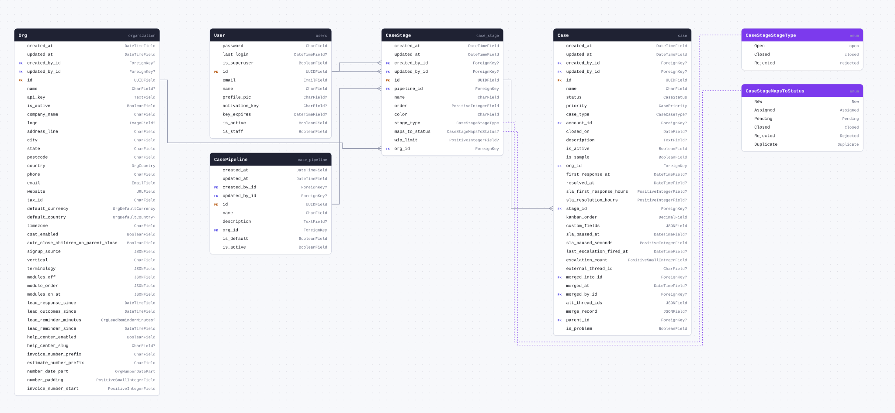

| Column | Field | Type | Null | Key | Default | Description |
| --- | --- | --- | --- | --- | --- | --- |
| `created_at` | `DateTimeField` | `datetime` |  |  | `now()` |  |
| `updated_at` | `DateTimeField` | `datetime` |  |  | `now()` |  |
| `created_by_id` | `ForeignKey` | `char(32)` | yes | FK |  |  |
| `updated_by_id` | `ForeignKey` | `char(32)` | yes | FK |  |  |
| `id` | `UUIDField` | `char(32)` |  | PK | `uuid4()` |  |
| `pipeline_id` | `ForeignKey` | `char(32)` |  | FK |  |  |
| `name` | `CharField` | `varchar(100)` |  |  |  |  |
| `order` | `PositiveIntegerField` | `integer unsigned` |  |  | `0` |  |
| `color` | `CharField` | `varchar(7)` |  |  | `'#6B7280'` |  |
| `stage_type` | `CaseStageStageType` | `varchar(20)` |  |  | `'open'` |  |
| `maps_to_status` | `CaseStageMapsToStatus` | `varchar(64)` | yes |  |  | When case enters this stage, also update Case.status |
| `wip_limit` | `PositiveIntegerField` | `integer unsigned` | yes |  |  | Maximum cases allowed in this stage (null = unlimited) |
| `org_id` | `ForeignKey` | `char(32)` |  | FK |  |  |

Indexes:

- index `case_stage_created_by_id_7e0e4eb2` on `created_by_id`
- index `case_stage_updated_by_id_a45b95f1` on `updated_by_id`
- index `case_stage_pipeline_id_e220892d` on `pipeline_id`
- index `case_stage_org_id_c443262b` on `org_id`
- unique `case_stage_pipeline_id_name_eaca9e9c_uniq` on `pipeline_id`, `name`
- index `case_stage_org_id_b9d581_idx` on `org_id`, `order`
- index `case_stage_pipelin_3fbf31_idx` on `pipeline_id`, `order`

Relations:

- [Case](#case).`stage_id` → `id`, on delete set null
- `created_by_id` → [User](#user).`id`, on delete set null
- `updated_by_id` → [User](#user).`id`, on delete set null
- `pipeline_id` → [CasePipeline](#casepipeline).`id`, on delete cascade
- `org_id` → [Org](#org).`id`, on delete cascade

## ReopenPolicy

Table `reopen_policy`, app `cases`.

Columns from `BaseModel` (abstract): `id`.

Columns from `TimeAuditModel` (abstract): `created_at`, `updated_at`.

Columns from `UserAuditModel` (abstract): `created_by_id`, `updated_by_id`.

Per-org policy controlling auto-reopen of closed cases on customer reply.

Singleton: one row per org. See docs/cases/tier1/reopen.md.

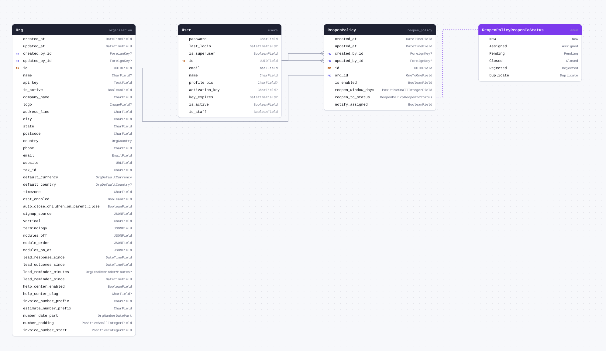

| Column | Field | Type | Null | Key | Default | Description |
| --- | --- | --- | --- | --- | --- | --- |
| `created_at` | `DateTimeField` | `datetime` |  |  | `now()` |  |
| `updated_at` | `DateTimeField` | `datetime` |  |  | `now()` |  |
| `created_by_id` | `ForeignKey` | `char(32)` | yes | FK |  |  |
| `updated_by_id` | `ForeignKey` | `char(32)` | yes | FK |  |  |
| `id` | `UUIDField` | `char(32)` |  | PK | `uuid4()` |  |
| `org_id` | `OneToOneField` | `char(32)` |  | FK, unique |  |  |
| `is_enabled` | `BooleanField` | `bool` |  |  | `True` |  |
| `reopen_window_days` | `PositiveSmallIntegerField` | `smallint unsigned` |  |  | `7` | Replies within this many days of closed_on reopen the case. |
| `reopen_to_status` | `ReopenPolicyReopenToStatus` | `varchar(64)` |  |  | `'Pending'` | Status the case flips to on reopen (must be non-terminal). |
| `notify_assigned` | `BooleanField` | `bool` |  |  | `True` |  |

Indexes:

- index `reopen_policy_created_by_id_37cbdf64` on `created_by_id`
- index `reopen_policy_updated_by_id_38020b8e` on `updated_by_id`

Relations:

- `created_by_id` → [User](#user).`id`, on delete set null
- `updated_by_id` → [User](#user).`id`, on delete set null
- `org_id` → [Org](#org).`id`, on delete cascade

## EscalationPolicy

Table `escalation_policy`, app `cases`.

Columns from `BaseModel` (abstract): `id`.

Columns from `TimeAuditModel` (abstract): `created_at`, `updated_at`.

Columns from `UserAuditModel` (abstract): `created_by_id`, `updated_by_id`.

Per-org, per-priority escalation rules consumed by `scan_for_breached_cases`.

See docs/cases/tier1/escalation.md.

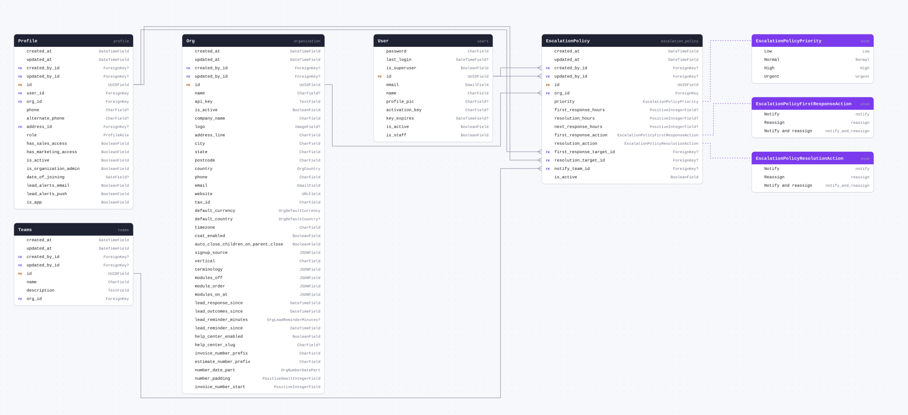

| Column | Field | Type | Null | Key | Default | Description |
| --- | --- | --- | --- | --- | --- | --- |
| `created_at` | `DateTimeField` | `datetime` |  |  | `now()` |  |
| `updated_at` | `DateTimeField` | `datetime` |  |  | `now()` |  |
| `created_by_id` | `ForeignKey` | `char(32)` | yes | FK |  |  |
| `updated_by_id` | `ForeignKey` | `char(32)` | yes | FK |  |  |
| `id` | `UUIDField` | `char(32)` |  | PK | `uuid4()` |  |
| `org_id` | `ForeignKey` | `char(32)` |  | FK |  |  |
| `priority` | `EscalationPolicyPriority` | `varchar(64)` |  |  |  |  |
| `first_response_hours` | `PositiveIntegerField` | `integer unsigned` | yes |  |  | Target hours for first response. Blank uses the built-in default. |
| `resolution_hours` | `PositiveIntegerField` | `integer unsigned` | yes |  |  | Target hours for resolution. Blank uses the built-in default. |
| `next_response_hours` | `PositiveIntegerField` | `integer unsigned` | yes |  |  | Target hours for each reply after the first. Blank uses the built-in default. |
| `first_response_action` | `EscalationPolicyFirstResponseAction` | `varchar(32)` |  |  | `'notify'` |  |
| `resolution_action` | `EscalationPolicyResolutionAction` | `varchar(32)` |  |  | `'notify'` |  |
| `first_response_target_id` | `ForeignKey` | `char(32)` | yes | FK |  | Profile reassigned to and/or notified on first-response breach. |
| `resolution_target_id` | `ForeignKey` | `char(32)` | yes | FK |  | Profile reassigned to and/or notified on resolution breach. |
| `notify_team_id` | `ForeignKey` | `char(32)` | yes | FK |  | Optional team CC'd on either breach action. |
| `is_active` | `BooleanField` | `bool` |  |  | `True` |  |

Indexes:

- index `escalation_policy_created_by_id_0d5e1661` on `created_by_id`
- index `escalation_policy_updated_by_id_f41b4fec` on `updated_by_id`
- index `escalation_policy_org_id_e4d67199` on `org_id`
- index `escalation_policy_first_response_target_id_6d1ca55b` on `first_response_target_id`
- index `escalation_policy_resolution_target_id_36efe118` on `resolution_target_id`
- index `escalation_policy_notify_team_id_6f3421dc` on `notify_team_id`
- unique `uniq_escalation_policy_per_org_priority` on `org_id`, `priority`
- index `escalation__org_id_4bf36d_idx` on `org_id`, `is_active`

Relations:

- `created_by_id` → [User](#user).`id`, on delete set null
- `updated_by_id` → [User](#user).`id`, on delete set null
- `org_id` → [Org](#org).`id`, on delete cascade
- `first_response_target_id` → [Profile](#profile).`id`, on delete set null
- `resolution_target_id` → [Profile](#profile).`id`, on delete set null
- `notify_team_id` → [Teams](#teams).`id`, on delete set null

## InboundMailbox

Table `inbound_mailbox`, app `cases`.

Columns from `BaseModel` (abstract): `id`.

Columns from `TimeAuditModel` (abstract): `created_at`, `updated_at`.

Columns from `UserAuditModel` (abstract): `created_by_id`, `updated_by_id`.

Per-org inbound email address configuration. See
docs/integrations/inbound-email.md.

SES, Postmark and Mailgun deliver to the mailbox's webhook. The IMAP fields
are nullable so IMAP can be wired in later without a schema migration.

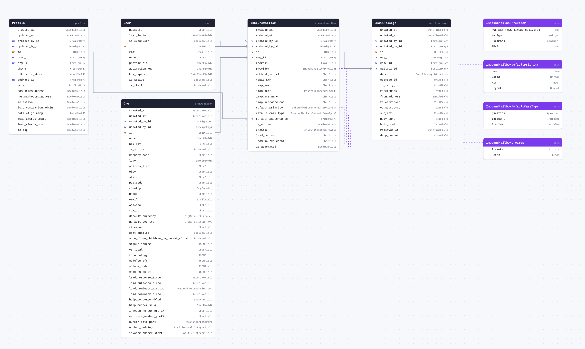

| Column | Field | Type | Null | Key | Default | Description |
| --- | --- | --- | --- | --- | --- | --- |
| `created_at` | `DateTimeField` | `datetime` |  |  | `now()` |  |
| `updated_at` | `DateTimeField` | `datetime` |  |  | `now()` |  |
| `created_by_id` | `ForeignKey` | `char(32)` | yes | FK |  |  |
| `updated_by_id` | `ForeignKey` | `char(32)` | yes | FK |  |  |
| `id` | `UUIDField` | `char(32)` |  | PK | `uuid4()` |  |
| `org_id` | `ForeignKey` | `char(32)` |  | FK |  |  |
| `address` | `EmailField` | `varchar(254)` |  |  |  |  |
| `provider` | `InboundMailboxProvider` | `varchar(16)` |  |  | `'ses'` |  |
| `webhook_secret` | `CharField` | `varchar(128)` |  |  | `''` | Postmark's basic-auth password or Mailgun's HTTP webhook signing key, which the webhook checks on every delivery; a Postmark or Mailgun mailbox without one accepts nothing. Unused for SES, which is proven by the SNS signature and the topic_arn pin below. Write-only: the API never returns it. |
| `topic_arn` | `CharField` | `varchar(256)` |  |  | `''` | SNS Topic ARN this mailbox accepts mail from. A valid SNS signature only proves a message came from some topic in some AWS account, so the webhook also requires this exact match. An admin can enter it. Left blank, it is pinned from the first verified SubscriptionConfirmation whose topic belongs to an AWS account listed in the INBOUND_SNS_ACCOUNT_IDS setting, and a topic in any other account pins nothing. Until it is set, every message is rejected. |
| `imap_host` | `CharField` | `varchar(255)` |  |  | `''` |  |
| `imap_port` | `PositiveIntegerField` | `integer unsigned` | yes |  |  |  |
| `imap_username` | `CharField` | `varchar(255)` |  |  | `''` |  |
| `imap_password_enc` | `CharField` | `varchar(512)` |  |  | `''` |  |
| `default_priority` | `InboundMailboxDefaultPriority` | `varchar(64)` |  |  | `'Normal'` |  |
| `default_case_type` | `InboundMailboxDefaultCaseType` | `varchar(255)` | yes |  |  |  |
| `default_assignee_id` | `ForeignKey` | `char(32)` | yes | FK |  |  |
| `is_active` | `BooleanField` | `bool` |  |  | `True` |  |
| `creates` | `InboundMailboxCreates` | `varchar(16)` |  |  | `'tickets'` |  |
| `lead_source` | `CharField` | `varchar(64)` |  |  | `'email'` |  |
| `lead_source_detail` | `CharField` | `varchar(100)` |  |  | `''` |  |
| `is_generated` | `BooleanField` | `bool` |  |  | `False` |  |

Indexes:

- index `inbound_mailbox_created_by_id_13fb35ed` on `created_by_id`
- index `inbound_mailbox_updated_by_id_1e037329` on `updated_by_id`
- index `inbound_mailbox_org_id_346da248` on `org_id`
- index `inbound_mailbox_default_assignee_id_4cc8c629` on `default_assignee_id`
- unique `uniq_inbound_mailbox_per_org_address` on `org_id`, `address`
- unique `uniq_generated_inbound_address` on `address` where `"is_generated" = 1`
- index `inbound_mai_org_id_0a00ff_idx` on `org_id`, `is_active`

Relations:

- `created_by_id` → [User](#user).`id`, on delete set null
- `updated_by_id` → [User](#user).`id`, on delete set null
- `org_id` → [Org](#org).`id`, on delete cascade
- `default_assignee_id` → [Profile](#profile).`id`, on delete set null
- [EmailMessage](#emailmessage).`mailbox_id` → `id`, on delete set null

## EmailMessage

Table `email_message`, app `cases`.

Columns from `BaseModel` (abstract): `id`.

Columns from `TimeAuditModel` (abstract): `created_at`, `updated_at`.

Columns from `UserAuditModel` (abstract): `created_by_id`, `updated_by_id`.

One row per inbound or outbound email handled by the system.

`message_id` is the RFC-5322 Message-ID and is the primary threading key.
`in_reply_to` and `references` are the secondary keys used when the first
inbound message of a thread has already been turned into a Case.

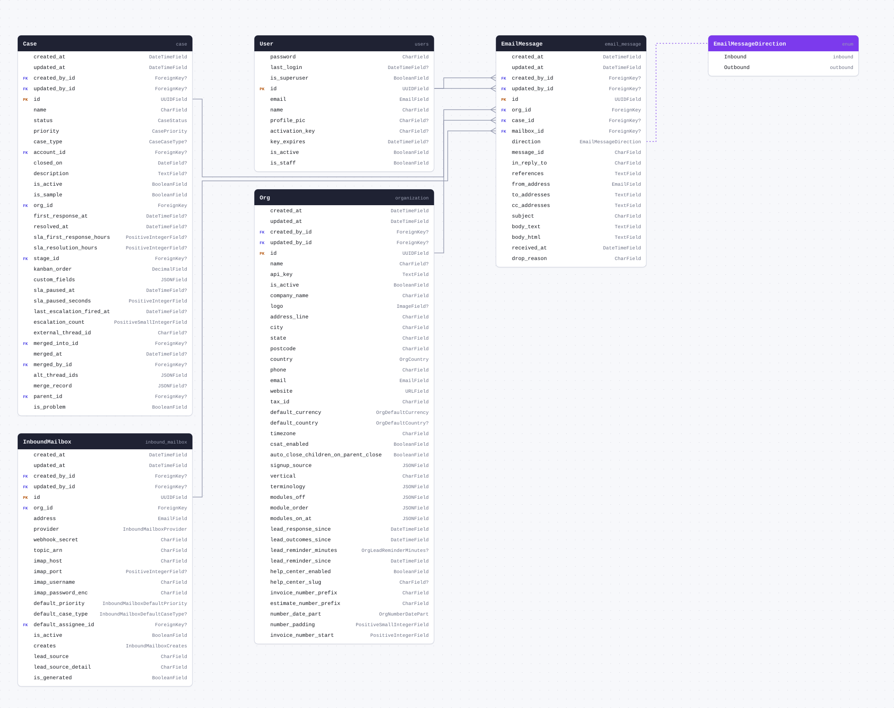

| Column | Field | Type | Null | Key | Default | Description |
| --- | --- | --- | --- | --- | --- | --- |
| `created_at` | `DateTimeField` | `datetime` |  |  | `now()` |  |
| `updated_at` | `DateTimeField` | `datetime` |  |  | `now()` |  |
| `created_by_id` | `ForeignKey` | `char(32)` | yes | FK |  |  |
| `updated_by_id` | `ForeignKey` | `char(32)` | yes | FK |  |  |
| `id` | `UUIDField` | `char(32)` |  | PK | `uuid4()` |  |
| `org_id` | `ForeignKey` | `char(32)` |  | FK |  |  |
| `case_id` | `ForeignKey` | `char(32)` | yes | FK |  | Null when the message was dropped (spam/bounce/auto-reply) but we still want an audit trail. |
| `mailbox_id` | `ForeignKey` | `char(32)` | yes | FK |  | The inbound address this message arrived through. Set at ingest; SET_NULL keeps the audit row if the mailbox is later deleted. Null on historical rows the backfill could not attribute. |
| `direction` | `EmailMessageDirection` | `varchar(16)` |  |  | `'inbound'` |  |
| `message_id` | `CharField` | `varchar(512)` |  |  |  |  |
| `in_reply_to` | `CharField` | `varchar(512)` |  |  | `''` |  |
| `references` | `TextField` | `text` |  |  | `''` | Whitespace-separated list of RFC-5322 Message-IDs from the References header. |
| `from_address` | `EmailField` | `varchar(254)` |  |  |  |  |
| `to_addresses` | `TextField` | `text` |  |  | `''` |  |
| `cc_addresses` | `TextField` | `text` |  |  | `''` |  |
| `subject` | `CharField` | `varchar(512)` |  |  | `''` |  |
| `body_text` | `TextField` | `text` |  |  | `''` |  |
| `body_html` | `TextField` | `text` |  |  | `''` |  |
| `received_at` | `DateTimeField` | `datetime` |  |  |  |  |
| `drop_reason` | `CharField` | `varchar(64)` |  |  | `''` | If non-empty, the message was rejected (spam/bounce/etc.) before any Case was touched. `case` will be null in this case. |

Indexes:

- index `email_message_created_by_id_974f3cb1` on `created_by_id`
- index `email_message_updated_by_id_04313a48` on `updated_by_id`
- index `email_message_org_id_00016b75` on `org_id`
- index `email_message_case_id_9e5e592c` on `case_id`
- index `email_message_mailbox_id_9d5eaa86` on `mailbox_id`
- index `email_message_message_id_a919d27a` on `message_id`
- index `email_message_in_reply_to_347b0504` on `in_reply_to`
- unique `uniq_email_message_per_org_id` on `org_id`, `message_id`
- index `email_messa_org_id_631bc3_idx` on `org_id`, `received_at` desc
- index `email_messa_case_id_bc66f7_idx` on `case_id`, `received_at` desc
- index `email_messa_in_repl_216d84_idx` on `in_reply_to`
- index `email_messa_mailbox_ea8dfa_idx` on `mailbox_id`, `created_at`

Relations:

- `created_by_id` → [User](#user).`id`, on delete set null
- `updated_by_id` → [User](#user).`id`, on delete set null
- `org_id` → [Org](#org).`id`, on delete cascade
- `case_id` → [Case](#case).`id`, on delete cascade
- `mailbox_id` → [InboundMailbox](#inboundmailbox).`id`, on delete set null

## RoutingRule

Table `routing_rule`, app `cases`.

Columns from `BaseModel` (abstract): `id`.

Columns from `TimeAuditModel` (abstract): `created_at`, `updated_at`.

Columns from `UserAuditModel` (abstract): `created_by_id`, `updated_by_id`.

Per-org auto-assignment rule for newly created Cases.

See docs/cases/tier1/auto-routing.md. The engine in `cases.routing.evaluate`
walks active rules ordered by `priority_order`, runs the first match's
`strategy`, and (when `stop_processing=True`) skips lower-priority rules.

`conditions` is a list of `{field, op, value}` dicts. Supported `field`s:
`priority`, `case_type`, `account`, `tags`, `custom_fields.<key>`,
`from_email_domain`, `mailbox_id`. Supported `op`s: `eq`, `in`, `contains`,
`regex`. AND across conditions; OR is modeled by writing multiple rules.

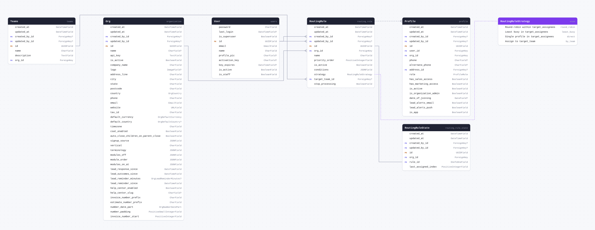

| Column | Field | Type | Null | Key | Default | Description |
| --- | --- | --- | --- | --- | --- | --- |
| `created_at` | `DateTimeField` | `datetime` |  |  | `now()` |  |
| `updated_at` | `DateTimeField` | `datetime` |  |  | `now()` |  |
| `created_by_id` | `ForeignKey` | `char(32)` | yes | FK |  |  |
| `updated_by_id` | `ForeignKey` | `char(32)` | yes | FK |  |  |
| `id` | `UUIDField` | `char(32)` |  | PK | `uuid4()` |  |
| `org_id` | `ForeignKey` | `char(32)` |  | FK |  |  |
| `name` | `CharField` | `varchar(255)` |  |  |  |  |
| `priority_order` | `PositiveIntegerField` | `integer unsigned` |  |  | `100` | Lower runs first; ties broken by created_at. |
| `is_active` | `BooleanField` | `bool` |  |  | `True` |  |
| `conditions` | `JSONField` | `text` |  |  | `list()` | List of {field, op, value} triples; AND across entries. |
| `strategy` | `RoutingRuleStrategy` | `varchar(16)` |  |  | `'direct'` |  |
| `target_team_id` | `ForeignKey` | `char(32)` | yes | FK |  |  |
| `stop_processing` | `BooleanField` | `bool` |  |  | `True` | If a rule matches and this is True, skip lower-priority rules. |

Indexes:

- index `routing_rule_created_by_id_f11940f7` on `created_by_id`
- index `routing_rule_updated_by_id_883c4fd8` on `updated_by_id`
- index `routing_rule_org_id_c8f98174` on `org_id`
- index `routing_rule_priority_order_a2797a1d` on `priority_order`
- index `routing_rule_target_team_id_65f1c772` on `target_team_id`
- index `rr_eval_idx` on `org_id`, `is_active`, `priority_order`

Relations:

- `created_by_id` → [User](#user).`id`, on delete set null
- `updated_by_id` → [User](#user).`id`, on delete set null
- `org_id` → [Org](#org).`id`, on delete cascade
- `target_team_id` → [Teams](#teams).`id`, on delete set null
- `target_assignees` — many to many with [Profile](#profile)
- [RoutingRuleState](#routingrulestate).`rule_id` → `id`, on delete cascade

## RoutingRuleState

Table `routing_rule_state`, app `cases`.

Columns from `BaseModel` (abstract): `id`.

Columns from `TimeAuditModel` (abstract): `created_at`, `updated_at`.

Columns from `UserAuditModel` (abstract): `created_by_id`, `updated_by_id`.

Mutable per-rule cursor for round_robin strategies.

One row per RoutingRule with `strategy="round_robin"`. The engine takes a
`SELECT ... FOR UPDATE` on this row inside the assignment transaction so
concurrent Case creations cannot both pick agent index 0.


| Column | Field | Type | Null | Key | Default | Description |
| --- | --- | --- | --- | --- | --- | --- |
| `created_at` | `DateTimeField` | `datetime` |  |  | `now()` |  |
| `updated_at` | `DateTimeField` | `datetime` |  |  | `now()` |  |
| `created_by_id` | `ForeignKey` | `char(32)` | yes | FK |  |  |
| `updated_by_id` | `ForeignKey` | `char(32)` | yes | FK |  |  |
| `id` | `UUIDField` | `char(32)` |  | PK | `uuid4()` |  |
| `org_id` | `ForeignKey` | `char(32)` |  | FK |  |  |
| `rule_id` | `OneToOneField` | `char(32)` |  | FK, unique |  |  |
| `last_assigned_index` | `PositiveIntegerField` | `integer unsigned` |  |  | `0` |  |

Indexes:

- index `routing_rule_state_created_by_id_5a0df63b` on `created_by_id`
- index `routing_rule_state_updated_by_id_a0121978` on `updated_by_id`
- index `routing_rule_state_org_id_b71748b7` on `org_id`

Relations:

- `created_by_id` → [User](#user).`id`, on delete set null
- `updated_by_id` → [User](#user).`id`, on delete set null
- `org_id` → [Org](#org).`id`, on delete cascade
- `rule_id` → [RoutingRule](#routingrule).`id`, on delete cascade

## TimeEntry

Table `time_entry`, app `cases`.

Columns from `BaseModel` (abstract): `id`.

Columns from `TimeAuditModel` (abstract): `created_at`, `updated_at`.

Columns from `UserAuditModel` (abstract): `created_by_id`, `updated_by_id`.

One agent's logged time on a ticket or a project (Tier 3 time-tracking).

Every write sets exactly one of ``case`` and ``project``; the database
refuses both. Deleting a project keeps its entries with ``project``
cleared, so an entry may end up with neither (see docs/features/projects.md).

Per `docs/cases/COORDINATION_DECISIONS.md` D2 we inherit BaseModel and
declare our own org FK; RLS is enforced via the migration policy. The
`one_active_timer_per_profile` partial unique index guarantees a profile
cannot have two running timers concurrently. The start endpoint relies
on this constraint as a race-defense in addition to its own existence
check.

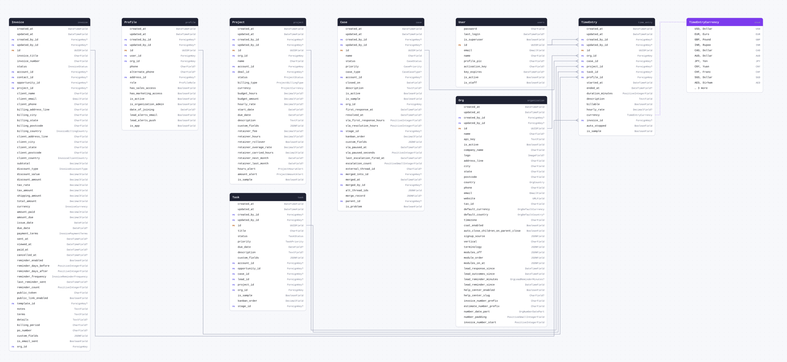

| Column | Field | Type | Null | Key | Default | Description |
| --- | --- | --- | --- | --- | --- | --- |
| `created_at` | `DateTimeField` | `datetime` |  |  | `now()` |  |
| `updated_at` | `DateTimeField` | `datetime` |  |  | `now()` |  |
| `created_by_id` | `ForeignKey` | `char(32)` | yes | FK |  |  |
| `updated_by_id` | `ForeignKey` | `char(32)` | yes | FK |  |  |
| `id` | `UUIDField` | `char(32)` |  | PK | `uuid4()` |  |
| `org_id` | `ForeignKey` | `char(32)` |  | FK |  |  |
| `case_id` | `ForeignKey` | `char(32)` | yes | FK |  |  |
| `project_id` | `ForeignKey` | `char(32)` | yes | FK |  |  |
| `task_id` | `ForeignKey` | `char(32)` | yes | FK |  |  |
| `profile_id` | `ForeignKey` | `char(32)` |  | FK |  |  |
| `started_at` | `DateTimeField` | `datetime` |  |  |  |  |
| `ended_at` | `DateTimeField` | `datetime` | yes |  |  | Null while the timer is running. |
| `duration_minutes` | `PositiveIntegerField` | `integer unsigned` |  |  | `0` | Recomputed on save when both timestamps are present. |
| `description` | `TextField` | `text` |  |  | `''` |  |
| `billable` | `BooleanField` | `bool` |  |  | `False` |  |
| `hourly_rate` | `DecimalField(10, 2)` | `decimal` | yes |  |  | Snapshot at log time so future rate changes do not alter history. |
| `currency` | `TimeEntryCurrency` | `varchar(3)` |  |  | `'USD'` |  |
| `invoice_id` | `ForeignKey` | `char(32)` | yes | FK |  | Set when this entry has been pushed to a draft invoice. |
| `auto_stopped` | `BooleanField` | `bool` |  |  | `False` | Set by the auto-stop Celery task when a forgotten timer is killed. |
| `is_sample` | `BooleanField` | `bool` |  |  | `False` | True only for demo rows created by common.packs.applier._apply_sample_data. Server-set exclusively, never expose this as a writable field on any serializer. It is the sole key common.packs.applier.clear_sample_data uses to decide what to delete, so a client-writable path here would let a user mark an arbitrary real record as sample and have it deleted. |

Indexes:

- index `time_entry_created_by_id_4dbe7c82` on `created_by_id`
- index `time_entry_updated_by_id_aa034132` on `updated_by_id`
- index `time_entry_org_id_ed339d66` on `org_id`
- index `time_entry_case_id_b60cf3ee` on `case_id`
- index `time_entry_project_id_6ff68888` on `project_id`
- index `time_entry_task_id_a9fac639` on `task_id`
- index `time_entry_profile_id_26ecd493` on `profile_id`
- index `time_entry_invoice_id_e63c8dc2` on `invoice_id`
- unique `one_active_timer_per_profile` on `profile_id` where `"ended_at" IS NULL`
- index `time_entry_org_id_93126d_idx` on `org_id`, `profile_id`, `started_at`
- index `time_entry_case_id_b266ff_idx` on `case_id`, `started_at`
- index `time_entry_project_2c3494_idx` on `project_id`, `started_at`
- index `time_entry_billabl_2174a0_idx` on `billable`, `invoice_id`

Checks:

- `time_entry_one_parent`: `("case_id" IS NULL OR "project_id" IS NULL)`
- `time_entry_end_after_start`: `("ended_at" IS NULL OR "ended_at" >= ("started_at"))`

Relations:

- `created_by_id` → [User](#user).`id`, on delete set null
- `updated_by_id` → [User](#user).`id`, on delete set null
- `org_id` → [Org](#org).`id`, on delete cascade
- `case_id` → [Case](#case).`id`, on delete cascade
- `project_id` → [Project](#project).`id`, on delete set null
- `task_id` → [Task](#task).`id`, on delete set null
- `profile_id` → [Profile](#profile).`id`, on delete protect
- `invoice_id` → [Invoice](#invoice).`id`, on delete set null

## ApprovalRule

Table `approval_rule`, app `cases`.

Columns from `BaseModel` (abstract): `id`.

Columns from `TimeAuditModel` (abstract): `created_at`, `updated_at`.

Columns from `UserAuditModel` (abstract): `created_by_id`, `updated_by_id`.

Admin-configured rule that gates a case transition.

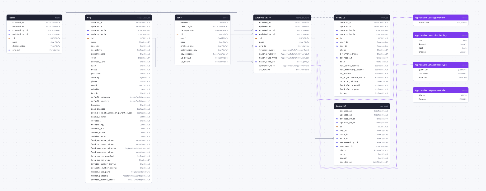

| Column | Field | Type | Null | Key | Default | Description |
| --- | --- | --- | --- | --- | --- | --- |
| `created_at` | `DateTimeField` | `datetime` |  |  | `now()` |  |
| `updated_at` | `DateTimeField` | `datetime` |  |  | `now()` |  |
| `created_by_id` | `ForeignKey` | `char(32)` | yes | FK |  |  |
| `updated_by_id` | `ForeignKey` | `char(32)` | yes | FK |  |  |
| `id` | `UUIDField` | `char(32)` |  | PK | `uuid4()` |  |
| `name` | `CharField` | `varchar(128)` |  |  |  |  |
| `org_id` | `ForeignKey` | `char(32)` |  | FK |  |  |
| `trigger_event` | `ApprovalRuleTriggerEvent` | `varchar(16)` |  |  | `'pre_close'` |  |
| `match_priority` | `ApprovalRuleMatchPriority` | `varchar(32)` | yes |  |  |  |
| `match_case_type` | `ApprovalRuleMatchCaseType` | `varchar(32)` | yes |  |  |  |
| `match_team_id` | `ForeignKey` | `char(32)` | yes | FK |  |  |
| `approver_role` | `ApprovalRuleApproverRole` | `varchar(16)` |  |  | `'ADMIN'` |  |
| `is_active` | `BooleanField` | `bool` |  |  | `True` |  |

Indexes:

- index `approval_rule_created_by_id_543131c5` on `created_by_id`
- index `approval_rule_updated_by_id_3405795d` on `updated_by_id`
- index `approval_rule_org_id_a99afcef` on `org_id`
- index `approval_rule_match_team_id_93697d33` on `match_team_id`
- index `approval_rule_match_idx` on `org_id`, `trigger_event`, `is_active`

Relations:

- `created_by_id` → [User](#user).`id`, on delete set null
- `updated_by_id` → [User](#user).`id`, on delete set null
- `org_id` → [Org](#org).`id`, on delete cascade
- `match_team_id` → [Teams](#teams).`id`, on delete set null
- `approvers` — many to many with [Profile](#profile)
- [Approval](#approval).`rule_id` → `id`, on delete protect

## Approval

Table `approval`, app `cases`.

Columns from `BaseModel` (abstract): `id`.

Columns from `TimeAuditModel` (abstract): `created_at`, `updated_at`.

Columns from `UserAuditModel` (abstract): `created_by_id`, `updated_by_id`.

A single approval request bound to one Case + ApprovalRule.

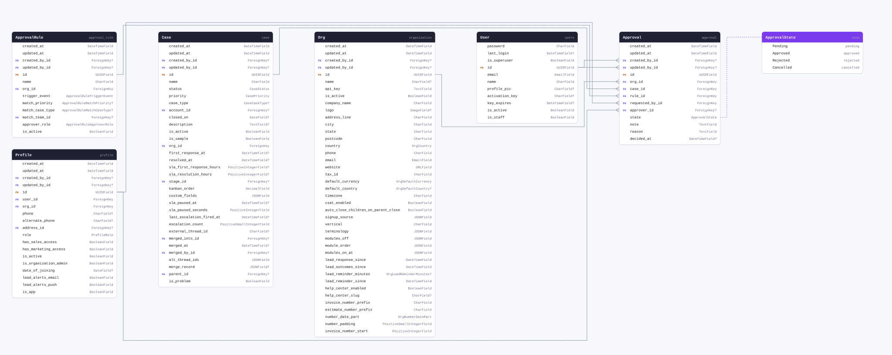

| Column | Field | Type | Null | Key | Default | Description |
| --- | --- | --- | --- | --- | --- | --- |
| `created_at` | `DateTimeField` | `datetime` |  |  | `now()` |  |
| `updated_at` | `DateTimeField` | `datetime` |  |  | `now()` |  |
| `created_by_id` | `ForeignKey` | `char(32)` | yes | FK |  |  |
| `updated_by_id` | `ForeignKey` | `char(32)` | yes | FK |  |  |
| `id` | `UUIDField` | `char(32)` |  | PK | `uuid4()` |  |
| `org_id` | `ForeignKey` | `char(32)` |  | FK |  |  |
| `case_id` | `ForeignKey` | `char(32)` |  | FK |  |  |
| `rule_id` | `ForeignKey` | `char(32)` |  | FK |  |  |
| `requested_by_id` | `ForeignKey` | `char(32)` |  | FK |  |  |
| `approver_id` | `ForeignKey` | `char(32)` | yes | FK |  |  |
| `state` | `ApprovalState` | `varchar(16)` |  |  | `'pending'` |  |
| `note` | `TextField` | `text` |  |  | `''` |  |
| `reason` | `TextField` | `text` |  |  | `''` |  |
| `decided_at` | `DateTimeField` | `datetime` | yes |  |  |  |

Indexes:

- index `approval_created_by_id_b334b2fb` on `created_by_id`
- index `approval_updated_by_id_27049e7e` on `updated_by_id`
- index `approval_org_id_34fecbbd` on `org_id`
- index `approval_case_id_71bcea26` on `case_id`
- index `approval_rule_id_4172619d` on `rule_id`
- index `approval_requested_by_id_3077742a` on `requested_by_id`
- index `approval_approver_id_a2615950` on `approver_id`
- index `approval_org_state_idx` on `org_id`, `state`
- index `approval_case_state_idx` on `case_id`, `state`
- index `approval_approver_idx` on `approver_id`, `state`

Relations:

- `created_by_id` → [User](#user).`id`, on delete set null
- `updated_by_id` → [User](#user).`id`, on delete set null
- `org_id` → [Org](#org).`id`, on delete cascade
- `case_id` → [Case](#case).`id`, on delete cascade
- `rule_id` → [ApprovalRule](#approvalrule).`id`, on delete protect
- `requested_by_id` → [Profile](#profile).`id`, on delete protect
- `approver_id` → [Profile](#profile).`id`, on delete protect

## Contact

Table `contacts`, app `contacts`.

Columns from `BaseModel` (abstract): `id`.

Columns from `TimeAuditModel` (abstract): `created_at`, `updated_at`.

Columns from `UserAuditModel` (abstract): `created_by_id`, `updated_by_id`.

Contact model for CRM - Streamlined for modern sales workflow
Based on Twenty CRM and Salesforce patterns

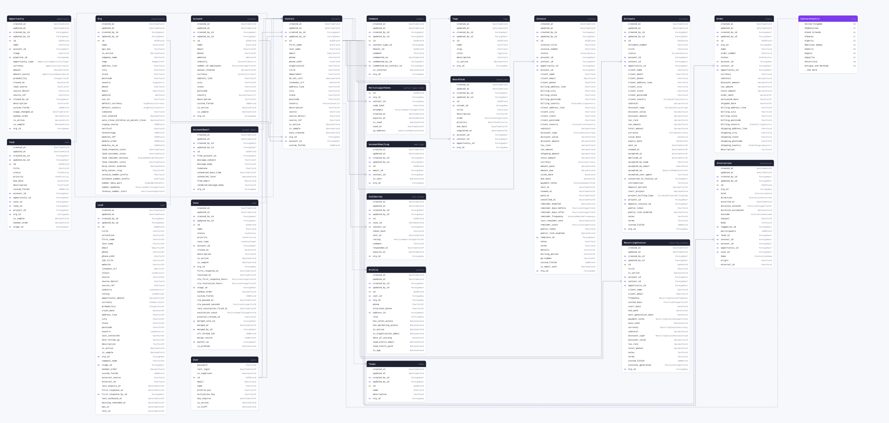

| Column | Field | Type | Null | Key | Default | Description |
| --- | --- | --- | --- | --- | --- | --- |
| `created_at` | `DateTimeField` | `datetime` |  |  | `now()` |  |
| `updated_at` | `DateTimeField` | `datetime` |  |  | `now()` |  |
| `created_by_id` | `ForeignKey` | `char(32)` | yes | FK |  |  |
| `updated_by_id` | `ForeignKey` | `char(32)` | yes | FK |  |  |
| `id` | `UUIDField` | `char(32)` |  | PK | `uuid4()` |  |
| `first_name` | `CharField` | `varchar(255)` |  |  |  |  |
| `last_name` | `CharField` | `varchar(255)` |  |  |  |  |
| `email` | `EmailField` | `varchar(254)` | yes |  |  |  |
| `phone` | `CharField` | `varchar(25)` | yes |  |  |  |
| `phone_e164` | `CharField` | `varchar(32)` |  |  | `''` |  |
| `organization` | `CharField` | `varchar(255)` | yes |  |  |  |
| `title` | `CharField` | `varchar(255)` | yes |  |  |  |
| `department` | `CharField` | `varchar(255)` | yes |  |  |  |
| `do_not_call` | `BooleanField` | `bool` |  |  | `False` |  |
| `linkedin_url` | `URLField` | `varchar(200)` | yes |  |  |  |
| `address_line` | `CharField` | `varchar(255)` | yes |  |  |  |
| `city` | `CharField` | `varchar(255)` | yes |  |  |  |
| `state` | `CharField` | `varchar(255)` | yes |  |  |  |
| `postcode` | `CharField` | `varchar(64)` | yes |  |  |  |
| `country` | `ContactCountry` | `varchar(3)` | yes |  |  |  |
| `description` | `TextField` | `text` | yes |  |  |  |
| `source` | `CharField` | `varchar(255)` |  |  | `''` |  |
| `source_detail` | `CharField` | `varchar(100)` |  |  | `''` |  |
| `source_ref` | `CharField` | `varchar(255)` |  |  | `''` |  |
| `is_active` | `BooleanField` | `bool` |  |  | `True` |  |
| `is_sample` | `BooleanField` | `bool` |  |  | `False` | True only for demo rows created by common.packs.applier._apply_sample_data. Server-set exclusively, never expose this as a writable field on any serializer. It is the sole key common.packs.applier.clear_sample_data uses to decide what to delete, so a client-writable path here would let a user mark an arbitrary real record as sample and have it deleted. |
| `auto_created` | `BooleanField` | `bool` |  |  | `False` | True when the contact was created by an inbound channel (e.g. email-to-ticket) rather than a human; flagged for admin review. |
| `org_id` | `ForeignKey` | `char(32)` |  | FK |  |  |
| `account_id` | `ForeignKey` | `char(32)` | yes | FK |  | Primary account this contact belongs to |
| `custom_fields` | `JSONField` | `text` |  |  | `dict()` | Per-org schema extension; values are validated against common.CustomFieldDefinition. |

Indexes:

- index `contacts_created_by_id_b280b158` on `created_by_id`
- index `contacts_updated_by_id_cb4a73cc` on `updated_by_id`
- index `contacts_phone_e164_4171c5f0` on `phone_e164`
- index `contacts_org_id_0a5f4415` on `org_id`
- index `contacts_account_id_a017d9c9` on `account_id`
- unique `unique_contact_email_per_org` on `org_id`, `LOWER("email")` where `("email" IS NOT NULL AND NOT ("email" = '' AND "email" IS NOT NULL))`
- index `contacts_org_id_f280a0_idx` on `org_id`, `created_at` desc
- index `contacts_org_upd_idx` on `org_id`, `updated_at`, `id`

Relations:

- [Comment](#comment).`commented_by_contact_id` → `id`, on delete set null
- [PortalLoginToken](#portallogintoken).`contact_id` → `id`, on delete cascade
- `account_contacts` — many to many with [Account](#account)
- `recieved_email` — many to many with [AccountEmail](#accountemail)
- [AccountEmailLog](#accountemaillog).`contact_id` → `id`, on delete set null
- `case_contacts` — many to many with [Case](#case)
- [CsatSurvey](#csatsurvey).`contact_id` → `id`, on delete set null
- `created_by_id` → [User](#user).`id`, on delete set null
- `updated_by_id` → [User](#user).`id`, on delete set null
- `org_id` → [Org](#org).`id`, on delete cascade
- `account_id` → [Account](#account).`id`, on delete set null
- `assigned_to` — many to many with [Profile](#profile)
- `teams` — many to many with [Teams](#teams)
- `tags` — many to many with [Tags](#tags)
- `lead_contacts` — many to many with [Lead](#lead)
- `opportunity_contacts` — many to many with [Opportunity](#opportunity)
- [BoardTask](#boardtask).`contact_id` → `id`, on delete set null
- `task_contacts` — many to many with [Task](#task)
- [Invoice](#invoice).`contact_id` → `id`, on delete set null
- [Estimate](#estimate).`contact_id` → `id`, on delete set null
- [RecurringInvoice](#recurringinvoice).`contact_id` → `id`, on delete set null
- [Order](#order).`contact_id` → `id`, on delete set null
- [Interaction](#interaction).`contact_id` → `id`, on delete delete or unlink

## Lead

Table `lead`, app `leads`.

Columns from `BaseModel` (abstract): `id`.

Columns from `TimeAuditModel` (abstract): `created_at`, `updated_at`.

Columns from `UserAuditModel` (abstract): `created_by_id`, `updated_by_id`.

Lead model for CRM - Streamlined for modern sales workflow
Based on Twenty CRM and Salesforce patterns

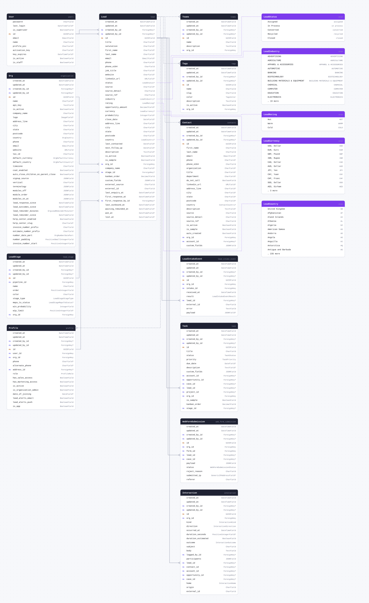

| Column | Field | Type | Null | Key | Default | Description |
| --- | --- | --- | --- | --- | --- | --- |
| `created_at` | `DateTimeField` | `datetime` |  |  | `now()` |  |
| `updated_at` | `DateTimeField` | `datetime` |  |  | `now()` |  |
| `created_by_id` | `ForeignKey` | `char(32)` | yes | FK |  |  |
| `updated_by_id` | `ForeignKey` | `char(32)` | yes | FK |  |  |
| `id` | `UUIDField` | `char(32)` |  | PK | `uuid4()` |  |
| `title` | `CharField` | `varchar(255)` | yes |  |  | Lead name/subject (e.g., 'Enterprise Deal', 'Website Inquiry') |
| `salutation` | `CharField` | `varchar(64)` | yes |  |  | e.g., Mr, Mrs, Ms, Dr |
| `first_name` | `CharField` | `varchar(255)` | yes |  |  |  |
| `last_name` | `CharField` | `varchar(255)` | yes |  |  |  |
| `email` | `EmailField` | `varchar(254)` | yes |  |  |  |
| `phone` | `CharField` | `varchar(25)` | yes |  |  |  |
| `phone_e164` | `CharField` | `varchar(32)` |  |  | `''` |  |
| `job_title` | `CharField` | `varchar(255)` | yes |  |  | Person's job title (e.g., 'VP of Sales', 'CTO') |
| `website` | `CharField` | `varchar(255)` | yes |  |  |  |
| `linkedin_url` | `URLField` | `varchar(500)` | yes |  |  |  |
| `status` | `LeadStatus` | `varchar(255)` | yes |  |  |  |
| `source` | `CharField` | `varchar(255)` | yes |  |  |  |
| `source_detail` | `CharField` | `varchar(100)` |  |  | `''` |  |
| `source_ref` | `CharField` | `varchar(255)` |  |  | `''` |  |
| `industry` | `LeadIndustry` | `varchar(255)` | yes |  |  |  |
| `rating` | `LeadRating` | `varchar(10)` | yes |  |  |  |
| `opportunity_amount` | `DecimalField(12, 2)` | `decimal` | yes |  |  |  |
| `currency` | `LeadCurrency` | `varchar(3)` | yes |  |  |  |
| `probability` | `IntegerField` | `integer` | yes |  | `0` |  |
| `close_date` | `DateField` | `date` | yes |  | `None` |  |
| `address_line` | `CharField` | `varchar(255)` | yes |  |  |  |
| `city` | `CharField` | `varchar(255)` | yes |  |  |  |
| `state` | `CharField` | `varchar(255)` | yes |  |  |  |
| `postcode` | `CharField` | `varchar(64)` | yes |  |  |  |
| `country` | `LeadCountry` | `varchar(3)` | yes |  |  |  |
| `last_contacted` | `DateField` | `date` | yes |  |  |  |
| `next_follow_up` | `DateField` | `date` | yes |  |  |  |
| `description` | `TextField` | `text` | yes |  |  |  |
| `is_active` | `BooleanField` | `bool` |  |  | `True` |  |
| `is_sample` | `BooleanField` | `bool` |  |  | `False` | True only for demo rows created by common.packs.applier._apply_sample_data. Server-set exclusively, never expose this as a writable field on any serializer. It is the sole key common.packs.applier.clear_sample_data uses to decide what to delete, so a client-writable path here would let a user mark an arbitrary real record as sample and have it deleted. |
| `org_id` | `ForeignKey` | `char(32)` |  | FK |  |  |
| `company_name` | `CharField` | `varchar(255)` | yes |  |  |  |
| `stage_id` | `ForeignKey` | `char(32)` | yes | FK |  | Current pipeline stage (null = use status-based kanban) |
| `kanban_order` | `DecimalField(15, 6)` | `decimal` |  |  | `0` | Order within the kanban column for drag-drop |
| `custom_fields` | `JSONField` | `text` |  |  | `dict()` | Per-org schema extension; values are validated against common.CustomFieldDefinition. |
| `external_source` | `CharField` | `varchar(100)` |  |  | `''` |  |
| `external_id` | `CharField` | `varchar(255)` |  |  | `''` |  |
| `last_enquiry_at` | `DateTimeField` | `datetime` | yes |  |  |  |
| `first_response_at` | `DateTimeField` | `datetime` | yes |  |  |  |
| `first_response_by_id` | `ForeignKey` | `char(32)` | yes | FK |  |  |
| `last_outbound_at` | `DateTimeField` | `datetime` | yes |  |  |  |
| `waiting_reminded_at` | `DateTimeField` | `datetime` | yes |  |  |  |
| `won_at` | `DateTimeField` | `datetime` | yes |  |  |  |
| `lost_at` | `DateTimeField` | `datetime` | yes |  |  |  |

Indexes:

- index `lead_created_by_id_759caa24` on `created_by_id`
- index `lead_updated_by_id_14e50d19` on `updated_by_id`
- index `lead_phone_e164_d98a042b` on `phone_e164`
- index `lead_org_id_14f83db8` on `org_id`
- index `lead_stage_id_63dbc1f4` on `stage_id`
- index `lead_first_response_by_id_ee7d2ef7` on `first_response_by_id`
- unique `unique_lead_email_per_org` on `org_id`, `LOWER("email")` where `("email" IS NOT NULL AND NOT ("email" = '' AND "email" IS NOT NULL))`
- unique `unique_lead_external_id_per_org` on `org_id`, `external_source`, `external_id` where `NOT ("external_id" = '')`
- index `lead_status_e8cfda_idx` on `status`
- index `lead_source_b6a91c_idx` on `source`
- index `lead_org_id_efd8ea_idx` on `org_id`, `created_at` desc
- index `lead_org_upd_idx` on `org_id`, `updated_at`, `id`
- index `lead_stage_i_66ca36_idx` on `stage_id`, `kanban_order`
- index `lead_status_5aa7c0_idx` on `status`, `kanban_order`
- index `lead_org_id_ac5329_idx` on `org_id`, `status`, `last_outbound_at`
- index `lead_org_id_aed697_idx` on `org_id`, `won_at`
- index `lead_org_id_9abc5c_idx` on `org_id`, `lost_at`

Checks:

- `lead_probability_range`: `("probability" >= 0 AND "probability" <= 100)`
- `lead_amount_non_negative`: `("opportunity_amount" >= '0' OR "opportunity_amount" IS NULL)`

Relations:

- `created_by_id` → [User](#user).`id`, on delete set null
- `updated_by_id` → [User](#user).`id`, on delete set null
- `org_id` → [Org](#org).`id`, on delete cascade
- `stage_id` → [LeadStage](#leadstage).`id`, on delete set null
- `first_response_by_id` → [Profile](#profile).`id`, on delete set null
- `assigned_to` — many to many with [Profile](#profile)
- `teams` — many to many with [Teams](#teams)
- `tags` — many to many with [Tags](#tags)
- `contacts` — many to many with [Contact](#contact)
- [LeadIntakeEvent](#leadintakeevent).`lead_id` → `id`, on delete set null
- [Task](#task).`lead_id` → `id`, on delete set null
- [WebFormSubmission](#webformsubmission).`lead_id` → `id`, on delete set null
- [Interaction](#interaction).`lead_id` → `id`, on delete delete or unlink

## LeadPipeline

Table `lead_pipeline`, app `leads`.

Columns from `BaseModel` (abstract): `id`.

Columns from `TimeAuditModel` (abstract): `created_at`, `updated_at`.

Columns from `UserAuditModel` (abstract): `created_by_id`, `updated_by_id`.

Custom pipeline for organizing leads into stages (Kanban columns).
Each organization can have multiple pipelines (e.g., Inbound, Outbound, Enterprise).


| Column | Field | Type | Null | Key | Default | Description |
| --- | --- | --- | --- | --- | --- | --- |
| `created_at` | `DateTimeField` | `datetime` |  |  | `now()` |  |
| `updated_at` | `DateTimeField` | `datetime` |  |  | `now()` |  |
| `created_by_id` | `ForeignKey` | `char(32)` | yes | FK |  |  |
| `updated_by_id` | `ForeignKey` | `char(32)` | yes | FK |  |  |
| `id` | `UUIDField` | `char(32)` |  | PK | `uuid4()` |  |
| `name` | `CharField` | `varchar(255)` |  |  |  |  |
| `description` | `TextField` | `text` | yes |  |  |  |
| `org_id` | `ForeignKey` | `char(32)` |  | FK |  |  |
| `is_default` | `BooleanField` | `bool` |  |  | `False` | Sorts this pipeline first in listings (see Meta.ordering) and is limited to one per org. It does NOT route new records: a lead created without a stage keeps stage=NULL, which is the supported status-based kanban mode. |
| `is_active` | `BooleanField` | `bool` |  |  | `True` |  |

Indexes:

- index `lead_pipeline_created_by_id_898b2e2d` on `created_by_id`
- index `lead_pipeline_updated_by_id_f10f2230` on `updated_by_id`
- index `lead_pipeline_org_id_5125d491` on `org_id`
- unique `unique_default_pipeline_per_org` on `org_id` where `"is_default" = 1`
- index `lead_pipeli_org_id_23ba65_idx` on `org_id`, `created_at` desc

Relations:

- `created_by_id` → [User](#user).`id`, on delete set null
- `updated_by_id` → [User](#user).`id`, on delete set null
- `org_id` → [Org](#org).`id`, on delete cascade
- [LeadStage](#leadstage).`pipeline_id` → `id`, on delete cascade

## LeadStage

Table `lead_stage`, app `leads`.

Columns from `BaseModel` (abstract): `id`.

Columns from `TimeAuditModel` (abstract): `created_at`, `updated_at`.

Columns from `UserAuditModel` (abstract): `created_by_id`, `updated_by_id`.

Stage within a Lead Pipeline (Kanban column).

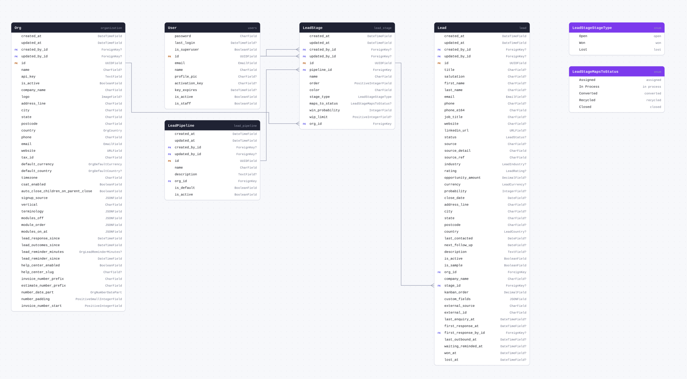

| Column | Field | Type | Null | Key | Default | Description |
| --- | --- | --- | --- | --- | --- | --- |
| `created_at` | `DateTimeField` | `datetime` |  |  | `now()` |  |
| `updated_at` | `DateTimeField` | `datetime` |  |  | `now()` |  |
| `created_by_id` | `ForeignKey` | `char(32)` | yes | FK |  |  |
| `updated_by_id` | `ForeignKey` | `char(32)` | yes | FK |  |  |
| `id` | `UUIDField` | `char(32)` |  | PK | `uuid4()` |  |
| `pipeline_id` | `ForeignKey` | `char(32)` |  | FK |  |  |
| `name` | `CharField` | `varchar(100)` |  |  |  |  |
| `order` | `PositiveIntegerField` | `integer unsigned` |  |  | `0` |  |
| `color` | `CharField` | `varchar(7)` |  |  | `'#6B7280'` |  |
| `stage_type` | `LeadStageStageType` | `varchar(10)` |  |  | `'open'` |  |
| `maps_to_status` | `LeadStageMapsToStatus` | `varchar(255)` | yes |  |  | When lead enters this stage, also update Lead.status |
| `win_probability` | `IntegerField` | `integer` |  |  | `0` | Default probability when lead enters this stage |
| `wip_limit` | `PositiveIntegerField` | `integer unsigned` | yes |  |  | Maximum leads allowed in this stage (null = unlimited) |
| `org_id` | `ForeignKey` | `char(32)` |  | FK |  |  |

Indexes:

- index `lead_stage_created_by_id_c45357f3` on `created_by_id`
- index `lead_stage_updated_by_id_e84ea9d1` on `updated_by_id`
- index `lead_stage_pipeline_id_b1012e47` on `pipeline_id`
- index `lead_stage_org_id_853b4e8c` on `org_id`
- unique `lead_stage_pipeline_id_name_b95da581_uniq` on `pipeline_id`, `name`
- index `lead_stage_org_id_c0f691_idx` on `org_id`, `order`
- index `lead_stage_pipelin_63b7e0_idx` on `pipeline_id`, `order`

Checks:

- `lead_stage_win_probability_range`: `("win_probability" >= 0 AND "win_probability" <= 100)`

Relations:

- [Lead](#lead).`stage_id` → `id`, on delete set null
- `created_by_id` → [User](#user).`id`, on delete set null
- `updated_by_id` → [User](#user).`id`, on delete set null
- `pipeline_id` → [LeadPipeline](#leadpipeline).`id`, on delete cascade
- `org_id` → [Org](#org).`id`, on delete cascade

## LeadSource

Table `lead_source`, app `leads`.

Columns from `BaseOrgModel` (abstract): `org_id`.

Columns from `BaseModel` (abstract): `id`.

Columns from `TimeAuditModel` (abstract): `created_at`, `updated_at`.

Columns from `UserAuditModel` (abstract): `created_by_id`, `updated_by_id`.

One entry in an org's list of lead sources. `Lead.source`, `Contact.source`
and `Opportunity.lead_source` hold its `key`. A retired source (`is_active`
False) stays on the records that have it and cannot be picked for new ones.
The defaults are created on first use: `leads.sources.org_sources`.

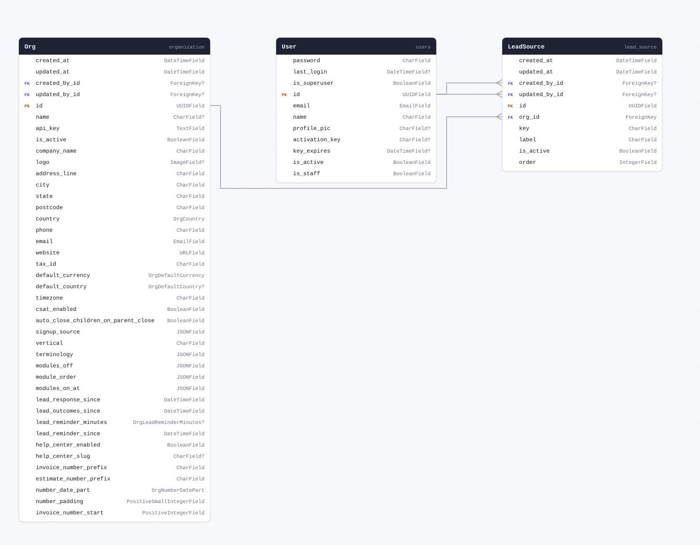

| Column | Field | Type | Null | Key | Default | Description |
| --- | --- | --- | --- | --- | --- | --- |
| `created_at` | `DateTimeField` | `datetime` |  |  | `now()` |  |
| `updated_at` | `DateTimeField` | `datetime` |  |  | `now()` |  |
| `created_by_id` | `ForeignKey` | `char(32)` | yes | FK |  |  |
| `updated_by_id` | `ForeignKey` | `char(32)` | yes | FK |  |  |
| `id` | `UUIDField` | `char(32)` |  | PK | `uuid4()` |  |
| `org_id` | `ForeignKey` | `char(32)` |  | FK |  | Organization this record belongs to |
| `key` | `CharField` | `varchar(64)` |  |  |  |  |
| `label` | `CharField` | `varchar(100)` |  |  |  |  |
| `is_active` | `BooleanField` | `bool` |  |  | `True` |  |
| `order` | `IntegerField` | `integer` |  |  | `0` |  |

Indexes:

- index `lead_source_created_by_id_8503d44e` on `created_by_id`
- index `lead_source_updated_by_id_07a97c26` on `updated_by_id`
- index `lead_source_org_id_acd41406` on `org_id`
- unique `unique_lead_source_key_per_org` on `org_id`, `key`
- index `lead_source_org_id_1cef78_idx` on `org_id`, `created_at` desc

Relations:

- `created_by_id` → [User](#user).`id`, on delete set null
- `updated_by_id` → [User](#user).`id`, on delete set null
- `org_id` → [Org](#org).`id`, on delete cascade

## LeadIntake

Table `lead_intake`, app `leads`.

Columns from `BaseOrgModel` (abstract): `org_id`.

Columns from `BaseModel` (abstract): `id`.

Columns from `TimeAuditModel` (abstract): `created_at`, `updated_at`.

Columns from `UserAuditModel` (abstract): `created_by_id`, `updated_by_id`.

A lead webhook. Its id is the public URL's and never changes. Its key can
be replaced, the old one kept in `previous_key` until
`previous_key_expires_at`. Keys are stored as written, like outbound webhook
secrets, because a signing preset can only be checked with the key itself.

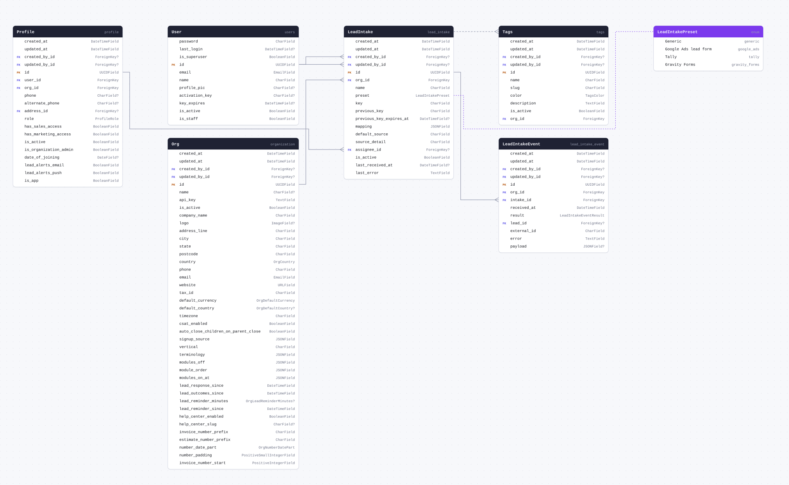

| Column | Field | Type | Null | Key | Default | Description |
| --- | --- | --- | --- | --- | --- | --- |
| `created_at` | `DateTimeField` | `datetime` |  |  | `now()` |  |
| `updated_at` | `DateTimeField` | `datetime` |  |  | `now()` |  |
| `created_by_id` | `ForeignKey` | `char(32)` | yes | FK |  |  |
| `updated_by_id` | `ForeignKey` | `char(32)` | yes | FK |  |  |
| `id` | `UUIDField` | `char(32)` |  | PK | `uuid4()` |  |
| `org_id` | `ForeignKey` | `char(32)` |  | FK |  | Organization this record belongs to |
| `name` | `CharField` | `varchar(100)` |  |  |  |  |
| `preset` | `LeadIntakePreset` | `varchar(32)` |  |  | `'generic'` |  |
| `key` | `CharField` | `varchar(64)` |  |  |  |  |
| `previous_key` | `CharField` | `varchar(64)` |  |  | `''` |  |
| `previous_key_expires_at` | `DateTimeField` | `datetime` | yes |  |  |  |
| `mapping` | `JSONField` | `text` |  |  | `list()` |  |
| `default_source` | `CharField` | `varchar(64)` |  |  | `''` |  |
| `source_detail` | `CharField` | `varchar(100)` |  |  | `''` |  |
| `assignee_id` | `ForeignKey` | `char(32)` | yes | FK |  |  |
| `is_active` | `BooleanField` | `bool` |  |  | `True` |  |
| `last_received_at` | `DateTimeField` | `datetime` | yes |  |  |  |
| `last_error` | `TextField` | `text` |  |  | `''` |  |

Indexes:

- index `lead_intake_created_by_id_bd04af59` on `created_by_id`
- index `lead_intake_updated_by_id_b607bfd5` on `updated_by_id`
- index `lead_intake_org_id_26b2144e` on `org_id`
- index `lead_intake_assignee_id_c02da9b2` on `assignee_id`
- index `lead_intake_org_id_da9f6c_idx` on `org_id`, `created_at` desc

Relations:

- `created_by_id` → [User](#user).`id`, on delete set null
- `updated_by_id` → [User](#user).`id`, on delete set null
- `org_id` → [Org](#org).`id`, on delete cascade
- `assignee_id` → [Profile](#profile).`id`, on delete set null
- `tags` — many to many with [Tags](#tags)
- [LeadIntakeEvent](#leadintakeevent).`intake_id` → `id`, on delete cascade

## LeadIntakeEvent

Table `lead_intake_event`, app `leads`.

Columns from `BaseOrgModel` (abstract): `org_id`.

Columns from `BaseModel` (abstract): `id`.

Columns from `TimeAuditModel` (abstract): `created_at`, `updated_at`.

Columns from `UserAuditModel` (abstract): `created_by_id`, `updated_by_id`.

One delivery to a `LeadIntake`, whatever its outcome.


| Column | Field | Type | Null | Key | Default | Description |
| --- | --- | --- | --- | --- | --- | --- |
| `created_at` | `DateTimeField` | `datetime` |  |  | `now()` |  |
| `updated_at` | `DateTimeField` | `datetime` |  |  | `now()` |  |
| `created_by_id` | `ForeignKey` | `char(32)` | yes | FK |  |  |
| `updated_by_id` | `ForeignKey` | `char(32)` | yes | FK |  |  |
| `id` | `UUIDField` | `char(32)` |  | PK | `uuid4()` |  |
| `org_id` | `ForeignKey` | `char(32)` |  | FK |  | Organization this record belongs to |
| `intake_id` | `ForeignKey` | `char(32)` |  | FK |  |  |
| `received_at` | `DateTimeField` | `datetime` |  |  | `now()` |  |
| `result` | `LeadIntakeEventResult` | `varchar(16)` |  |  |  |  |
| `lead_id` | `ForeignKey` | `char(32)` | yes | FK |  |  |
| `external_id` | `CharField` | `varchar(255)` |  |  | `''` |  |
| `error` | `TextField` | `text` |  |  | `''` |  |
| `payload` | `JSONField` | `text` | yes |  |  |  |

Indexes:

- index `lead_intake_event_created_by_id_60ea8ef1` on `created_by_id`
- index `lead_intake_event_updated_by_id_e8c5cf7f` on `updated_by_id`
- index `lead_intake_event_org_id_3eae97c2` on `org_id`
- index `lead_intake_event_intake_id_1e551cbb` on `intake_id`
- index `lead_intake_event_lead_id_59114541` on `lead_id`
- index `lead_intake_org_id_110f2a_idx` on `org_id`, `created_at` desc
- index `lead_intake_intake__0a1873_idx` on `intake_id`, `received_at`

Relations:

- `created_by_id` → [User](#user).`id`, on delete set null
- `updated_by_id` → [User](#user).`id`, on delete set null
- `org_id` → [Org](#org).`id`, on delete cascade
- `intake_id` → [LeadIntake](#leadintake).`id`, on delete cascade
- `lead_id` → [Lead](#lead).`id`, on delete set null

## DealPipeline

Table `opportunity_pipeline`, app `opportunity`.

Columns from `BaseOrgModel` (abstract): `org_id`.

Columns from `BaseModel` (abstract): `id`.

Columns from `TimeAuditModel` (abstract): `created_at`, `updated_at`.

Columns from `UserAuditModel` (abstract): `created_by_id`, `updated_by_id`.

A named sequence of deal stages. Every org has exactly one default.

The default pipeline is where a deal lands when nothing names a pipeline,
which is how clients that predate pipelines keep working. It is created by
`opportunity/0020` for every org that existed then, and lazily by
`default_for` for any org created since.


| Column | Field | Type | Null | Key | Default | Description |
| --- | --- | --- | --- | --- | --- | --- |
| `created_at` | `DateTimeField` | `datetime` |  |  | `now()` |  |
| `updated_at` | `DateTimeField` | `datetime` |  |  | `now()` |  |
| `created_by_id` | `ForeignKey` | `char(32)` | yes | FK |  |  |
| `updated_by_id` | `ForeignKey` | `char(32)` | yes | FK |  |  |
| `id` | `UUIDField` | `char(32)` |  | PK | `uuid4()` |  |
| `org_id` | `ForeignKey` | `char(32)` |  | FK |  | Organization this record belongs to |
| `name` | `CharField` | `varchar(100)` |  |  |  |  |
| `is_default` | `BooleanField` | `bool` |  |  | `False` |  |

Indexes:

- index `opportunity_pipeline_created_by_id_5d592d8d` on `created_by_id`
- index `opportunity_pipeline_updated_by_id_50556f7e` on `updated_by_id`
- index `opportunity_pipeline_org_id_99582050` on `org_id`
- unique `unique_default_deal_pipeline_per_org` on `org_id` where `"is_default" = 1`
- unique `unique_deal_pipeline_name_per_org` on `org_id`, `name`
- index `opportunity_org_id_598ce5_idx` on `org_id`, `created_at` desc

Relations:

- `created_by_id` → [User](#user).`id`, on delete set null
- `updated_by_id` → [User](#user).`id`, on delete set null
- `org_id` → [Org](#org).`id`, on delete cascade
- [DealStage](#dealstage).`pipeline_id` → `id`, on delete cascade
- [Opportunity](#opportunity).`pipeline_id` → `id`, on delete restrict

## DealStage

Table `opportunity_pipeline_stage`, app `opportunity`.

Columns from `BaseOrgModel` (abstract): `org_id`.

Columns from `BaseModel` (abstract): `id`.

Columns from `TimeAuditModel` (abstract): `created_at`, `updated_at`.

Columns from `UserAuditModel` (abstract): `created_by_id`, `updated_by_id`.

One column of a deal pipeline.

`code` is what `Opportunity.stage` stores. It is fixed at creation, so a
rename changes the label on every deal and board without touching a row.
`kind` is what the stage means: reports, goals and the invoice gate read
it, never the code or the label. `expected_days` / `warning_days` are the
rotting thresholds (see `workflow.aging_thresholds`); empty means deals in
this stage never age.


| Column | Field | Type | Null | Key | Default | Description |
| --- | --- | --- | --- | --- | --- | --- |
| `created_at` | `DateTimeField` | `datetime` |  |  | `now()` |  |
| `updated_at` | `DateTimeField` | `datetime` |  |  | `now()` |  |
| `created_by_id` | `ForeignKey` | `char(32)` | yes | FK |  |  |
| `updated_by_id` | `ForeignKey` | `char(32)` | yes | FK |  |  |
| `id` | `UUIDField` | `char(32)` |  | PK | `uuid4()` |  |
| `org_id` | `ForeignKey` | `char(32)` |  | FK |  | Organization this record belongs to |
| `pipeline_id` | `ForeignKey` | `char(32)` |  | FK |  |  |
| `code` | `CharField` | `varchar(64)` |  |  |  |  |
| `label` | `CharField` | `varchar(100)` |  |  |  |  |
| `order` | `PositiveIntegerField` | `integer unsigned` |  |  | `0` |  |
| `kind` | `DealStageKind` | `varchar(10)` |  |  | `'open'` |  |
| `expected_days` | `PositiveIntegerField` | `integer unsigned` | yes |  |  |  |
| `warning_days` | `PositiveIntegerField` | `integer unsigned` | yes |  |  |  |

Indexes:

- index `opportunity_pipeline_stage_created_by_id_1b76c1b4` on `created_by_id`
- index `opportunity_pipeline_stage_updated_by_id_36f5561d` on `updated_by_id`
- index `opportunity_pipeline_stage_org_id_1b98d635` on `org_id`
- index `opportunity_pipeline_stage_pipeline_id_5ac80e55` on `pipeline_id`
- unique `unique_deal_stage_code_per_pipeline` on `pipeline_id`, `code`
- index `opportunity_org_id_93e696_idx` on `org_id`, `created_at` desc

Relations:

- `created_by_id` → [User](#user).`id`, on delete set null
- `updated_by_id` → [User](#user).`id`, on delete set null
- `org_id` → [Org](#org).`id`, on delete cascade
- `pipeline_id` → [DealPipeline](#dealpipeline).`id`, on delete cascade

## Opportunity

Table `opportunity`, app `opportunity`.

Columns from `BaseModel` (abstract): `id`.

Columns from `TimeAuditModel` (abstract): `created_at`, `updated_at`.

Columns from `UserAuditModel` (abstract): `created_by_id`, `updated_by_id`.

Opportunity model for CRM - Sales pipeline management
Based on Twenty CRM and Salesforce patterns


| Column | Field | Type | Null | Key | Default | Description |
| --- | --- | --- | --- | --- | --- | --- |
| `created_at` | `DateTimeField` | `datetime` |  |  | `now()` |  |
| `updated_at` | `DateTimeField` | `datetime` |  |  | `now()` |  |
| `created_by_id` | `ForeignKey` | `char(32)` | yes | FK |  |  |
| `updated_by_id` | `ForeignKey` | `char(32)` | yes | FK |  |  |
| `id` | `UUIDField` | `char(32)` |  | PK | `uuid4()` |  |
| `name` | `CharField` | `varchar(255)` |  |  |  |  |
| `account_id` | `ForeignKey` | `char(32)` | yes | FK |  |  |
| `stage` | `CharField` | `varchar(64)` |  |  |  |  |
| `pipeline_id` | `ForeignKey` | `char(32)` |  | FK |  |  |
| `opportunity_type` | `OpportunityOpportunityType` | `varchar(64)` | yes |  |  |  |
| `currency` | `OpportunityCurrency` | `varchar(3)` | yes |  |  |  |
| `amount` | `DecimalField(12, 2)` | `decimal` | yes |  |  |  |
| `amount_source` | `OpportunityAmountSource` | `varchar(20)` |  |  | `'MANUAL'` |  |
| `probability` | `IntegerField` | `integer` | yes |  | `0` |  |
| `closed_on` | `DateField` | `date` | yes |  |  |  |
| `lead_source` | `CharField` | `varchar(255)` | yes |  |  |  |
| `source_detail` | `CharField` | `varchar(100)` |  |  | `''` |  |
| `source_ref` | `CharField` | `varchar(255)` |  |  | `''` |  |
| `closed_by_id` | `ForeignKey` | `char(32)` | yes | FK |  |  |
| `description` | `TextField` | `text` | yes |  |  |  |
| `custom_fields` | `JSONField` | `text` |  |  | `dict()` | Per-org schema extension; values are validated against common.CustomFieldDefinition. |
| `stage_changed_at` | `DateTimeField` | `datetime` | yes |  |  |  |
| `kanban_order` | `DecimalField(15, 6)` | `decimal` |  |  | `0` | Order within the kanban column for drag-drop positioning |
| `is_active` | `BooleanField` | `bool` |  |  | `True` |  |
| `is_sample` | `BooleanField` | `bool` |  |  | `False` | True only for demo rows created by common.packs.applier._apply_sample_data. Server-set exclusively, never expose this as a writable field on any serializer. It is the sole key common.packs.applier.clear_sample_data uses to decide what to delete, so a client-writable path here would let a user mark an arbitrary real record as sample and have it deleted. |
| `org_id` | `ForeignKey` | `char(32)` |  | FK |  |  |

Indexes:

- index `opportunity_created_by_id_fa43f7d0` on `created_by_id`
- index `opportunity_updated_by_id_ac8c9a2f` on `updated_by_id`
- index `opportunity_account_id_a3891e05` on `account_id`
- index `opportunity_pipeline_id_36cbbba0` on `pipeline_id`
- index `opportunity_closed_by_id_1bdfa060` on `closed_by_id`
- index `opportunity_org_id_6e505db9` on `org_id`
- index `opportunity_stage_39fb59_idx` on `stage`
- index `opportunity_org_id_945a7b_idx` on `org_id`, `created_at` desc
- index `opportunity_org_upd_idx` on `org_id`, `updated_at`, `id`
- index `opp_stage_kanban_idx` on `stage`, `kanban_order`

Checks:

- `opportunity_probability_range`: `("probability" >= 0 AND "probability" <= 100)`
- `opportunity_amount_non_negative`: `("amount" >= '0' OR "amount" IS NULL)`

Relations:

- `created_by_id` → [User](#user).`id`, on delete set null
- `updated_by_id` → [User](#user).`id`, on delete set null
- `account_id` → [Account](#account).`id`, on delete cascade
- `pipeline_id` → [DealPipeline](#dealpipeline).`id`, on delete restrict
- `closed_by_id` → [Profile](#profile).`id`, on delete set null
- `org_id` → [Org](#org).`id`, on delete cascade
- `contacts` — many to many with [Contact](#contact)
- `assigned_to` — many to many with [Profile](#profile)
- `teams` — many to many with [Teams](#teams)
- `tags` — many to many with [Tags](#tags)
- [OpportunityLineItem](#opportunitylineitem).`opportunity_id` → `id`, on delete cascade
- [BoardTask](#boardtask).`opportunity_id` → `id`, on delete set null
- [Task](#task).`opportunity_id` → `id`, on delete set null
- [Invoice](#invoice).`opportunity_id` → `id`, on delete set null
- [Estimate](#estimate).`opportunity_id` → `id`, on delete set null
- [RecurringInvoice](#recurringinvoice).`opportunity_id` → `id`, on delete set null
- [Order](#order).`opportunity_id` → `id`, on delete set null
- [Interaction](#interaction).`opportunity_id` → `id`, on delete delete or unlink
- [Project](#project).`deal_id` → `id`, on delete set null

## OpportunityLineItem

Table `opportunity_line_item`, app `opportunity`.

Columns from `BaseModel` (abstract): `id`.

Columns from `TimeAuditModel` (abstract): `created_at`, `updated_at`.

Columns from `UserAuditModel` (abstract): `created_by_id`, `updated_by_id`.

Line item for an opportunity - represents a product or service being quoted.
Similar to InvoiceLineItem but for the pre-sale stage.


| Column | Field | Type | Null | Key | Default | Description |
| --- | --- | --- | --- | --- | --- | --- |
| `created_at` | `DateTimeField` | `datetime` |  |  | `now()` |  |
| `updated_at` | `DateTimeField` | `datetime` |  |  | `now()` |  |
| `created_by_id` | `ForeignKey` | `char(32)` | yes | FK |  |  |
| `updated_by_id` | `ForeignKey` | `char(32)` | yes | FK |  |  |
| `id` | `UUIDField` | `char(32)` |  | PK | `uuid4()` |  |
| `opportunity_id` | `ForeignKey` | `char(32)` |  | FK |  |  |
| `product_id` | `ForeignKey` | `char(32)` | yes | FK |  |  |
| `name` | `CharField` | `varchar(255)` |  |  |  |  |
| `description` | `CharField` | `varchar(500)` |  |  |  |  |
| `quantity` | `DecimalField(10, 2)` | `decimal` |  |  | `1` |  |
| `unit_price` | `DecimalField(12, 2)` | `decimal` |  |  | `0` |  |
| `discount_type` | `OpportunityLineItemDiscountType` | `varchar(20)` |  |  |  |  |
| `discount_value` | `DecimalField(12, 2)` | `decimal` |  |  | `0` |  |
| `discount_amount` | `DecimalField(12, 2)` | `decimal` |  |  | `0` |  |
| `subtotal` | `DecimalField(12, 2)` | `decimal` |  |  | `0` |  |
| `total` | `DecimalField(12, 2)` | `decimal` |  |  | `0` |  |
| `order` | `PositiveIntegerField` | `integer unsigned` |  |  | `0` |  |
| `org_id` | `ForeignKey` | `char(32)` |  | FK |  |  |

Indexes:

- index `opportunity_line_item_created_by_id_6cb9441d` on `created_by_id`
- index `opportunity_line_item_updated_by_id_a845396c` on `updated_by_id`
- index `opportunity_line_item_opportunity_id_fa0a0dce` on `opportunity_id`
- index `opportunity_line_item_product_id_97b5233c` on `product_id`
- index `opportunity_line_item_org_id_a84eca74` on `org_id`
- index `opportunity_opportu_456e8f_idx` on `opportunity_id`
- index `opportunity_org_id_c76c2c_idx` on `org_id`

Relations:

- `created_by_id` → [User](#user).`id`, on delete set null
- `updated_by_id` → [User](#user).`id`, on delete set null
- `opportunity_id` → [Opportunity](#opportunity).`id`, on delete cascade
- `product_id` → [Product](#product).`id`, on delete set null
- `org_id` → [Org](#org).`id`, on delete cascade

## SalesGoal

Table `sales_goal`, app `opportunity`.

Columns from `BaseModel` (abstract): `id`.

Columns from `TimeAuditModel` (abstract): `created_at`, `updated_at`.

Columns from `UserAuditModel` (abstract): `created_by_id`, `updated_by_id`.

Sales goal / quota for tracking revenue or deals closed targets.


| Column | Field | Type | Null | Key | Default | Description |
| --- | --- | --- | --- | --- | --- | --- |
| `created_at` | `DateTimeField` | `datetime` |  |  | `now()` |  |
| `updated_at` | `DateTimeField` | `datetime` |  |  | `now()` |  |
| `created_by_id` | `ForeignKey` | `char(32)` | yes | FK |  |  |
| `updated_by_id` | `ForeignKey` | `char(32)` | yes | FK |  |  |
| `id` | `UUIDField` | `char(32)` |  | PK | `uuid4()` |  |
| `name` | `CharField` | `varchar(255)` |  |  |  |  |
| `goal_type` | `SalesGoalGoalType` | `varchar(20)` |  |  |  |  |
| `target_value` | `DecimalField(12, 2)` | `decimal` |  |  |  |  |
| `currency` | `SalesGoalCurrency` | `varchar(3)` | yes |  |  |  |
| `period_type` | `SalesGoalPeriodType` | `varchar(20)` |  |  |  |  |
| `period_start` | `DateField` | `date` |  |  |  |  |
| `period_end` | `DateField` | `date` |  |  |  |  |
| `assigned_to_id` | `ForeignKey` | `char(32)` | yes | FK |  |  |
| `team_id` | `ForeignKey` | `char(32)` | yes | FK |  |  |
| `type_weights` | `JSONField` | `text` |  |  | `dict()` | Optional multiplier per opportunity type, e.g. {"RENEWAL": 0.5, "NEW_BUSINESS": 1.5}. A type left out of the map, and a deal with no type at all, counts at its full value. An empty map is an unweighted goal. Not accepted on an ACTIVITIES goal, which has no deal type to weigh. |
| `is_active` | `BooleanField` | `bool` |  |  | `True` |  |
| `milestone_50_notified` | `BooleanField` | `bool` |  |  | `False` |  |
| `milestone_90_notified` | `BooleanField` | `bool` |  |  | `False` |  |
| `milestone_100_notified` | `BooleanField` | `bool` |  |  | `False` |  |
| `org_id` | `ForeignKey` | `char(32)` |  | FK |  |  |

Indexes:

- index `sales_goal_created_by_id_a63af45f` on `created_by_id`
- index `sales_goal_updated_by_id_d30957aa` on `updated_by_id`
- index `sales_goal_assigned_to_id_2c7211d8` on `assigned_to_id`
- index `sales_goal_team_id_52675f55` on `team_id`
- index `sales_goal_org_id_7998fa3e` on `org_id`
- index `sales_goal_org_id_363225_idx` on `org_id`, `created_at` desc
- index `sales_goal_org_id_f5e0bd_idx` on `org_id`, `period_start`, `period_end`

Relations:

- `created_by_id` → [User](#user).`id`, on delete set null
- `updated_by_id` → [User](#user).`id`, on delete set null
- `assigned_to_id` → [Profile](#profile).`id`, on delete set null
- `team_id` → [Teams](#teams).`id`, on delete set null
- `org_id` → [Org](#org).`id`, on delete cascade

## Board

Table `board`, app `tasks`.

Columns from `BaseModel` (abstract): `id`.

Columns from `TimeAuditModel` (abstract): `created_at`, `updated_at`.

Columns from `UserAuditModel` (abstract): `created_by_id`, `updated_by_id`.

Kanban Board


| Column | Field | Type | Null | Key | Default | Description |
| --- | --- | --- | --- | --- | --- | --- |
| `created_at` | `DateTimeField` | `datetime` |  |  | `now()` |  |
| `updated_at` | `DateTimeField` | `datetime` |  |  | `now()` |  |
| `created_by_id` | `ForeignKey` | `char(32)` | yes | FK |  |  |
| `updated_by_id` | `ForeignKey` | `char(32)` | yes | FK |  |  |
| `id` | `UUIDField` | `char(32)` |  | PK | `uuid4()` |  |
| `name` | `CharField` | `varchar(255)` |  |  |  |  |
| `description` | `TextField` | `text` | yes |  |  |  |
| `owner_id` | `ForeignKey` | `char(32)` |  | FK |  |  |
| `org_id` | `ForeignKey` | `char(32)` |  | FK |  |  |
| `is_archived` | `BooleanField` | `bool` |  |  | `False` |  |

Indexes:

- index `board_created_by_id_49241d37` on `created_by_id`
- index `board_updated_by_id_1653442f` on `updated_by_id`
- index `board_owner_id_96d32bac` on `owner_id`
- index `board_org_id_e2e0e85c` on `org_id`
- index `board_org_id_07a8d8_idx` on `org_id`, `created_at` desc

Relations:

- `members` — many to many with [Profile](#profile), through [BoardMember](#boardmember)
- `created_by_id` → [User](#user).`id`, on delete set null
- `updated_by_id` → [User](#user).`id`, on delete set null
- `owner_id` → [Profile](#profile).`id`, on delete cascade
- `org_id` → [Org](#org).`id`, on delete cascade
- [BoardMember](#boardmember).`board_id` → `id`, on delete cascade
- [BoardColumn](#boardcolumn).`board_id` → `id`, on delete cascade

## BoardMember

Table `board_member`, app `tasks`.

Columns from `BaseModel` (abstract): `id`.

Columns from `TimeAuditModel` (abstract): `created_at`, `updated_at`.

Columns from `UserAuditModel` (abstract): `created_by_id`, `updated_by_id`.

Board membership with roles


| Column | Field | Type | Null | Key | Default | Description |
| --- | --- | --- | --- | --- | --- | --- |
| `created_at` | `DateTimeField` | `datetime` |  |  | `now()` |  |
| `updated_at` | `DateTimeField` | `datetime` |  |  | `now()` |  |
| `created_by_id` | `ForeignKey` | `char(32)` | yes | FK |  |  |
| `updated_by_id` | `ForeignKey` | `char(32)` | yes | FK |  |  |
| `id` | `UUIDField` | `char(32)` |  | PK | `uuid4()` |  |
| `board_id` | `ForeignKey` | `char(32)` |  | FK |  |  |
| `profile_id` | `ForeignKey` | `char(32)` |  | FK |  |  |
| `role` | `BoardMemberRole` | `varchar(20)` |  |  | `'member'` |  |
| `org_id` | `ForeignKey` | `char(32)` |  | FK |  |  |

Indexes:

- index `board_member_created_by_id_51132a41` on `created_by_id`
- index `board_member_updated_by_id_3f61676a` on `updated_by_id`
- index `board_member_board_id_db1a0e06` on `board_id`
- index `board_member_profile_id_7867936a` on `profile_id`
- index `board_member_org_id_0a4d2ba3` on `org_id`
- unique `board_member_board_id_profile_id_c541f034_uniq` on `board_id`, `profile_id`
- index `board_membe_org_id_16f9e3_idx` on `org_id`, `created_at` desc

Relations:

- `created_by_id` → [User](#user).`id`, on delete set null
- `updated_by_id` → [User](#user).`id`, on delete set null
- `board_id` → [Board](#board).`id`, on delete cascade
- `profile_id` → [Profile](#profile).`id`, on delete cascade
- `org_id` → [Org](#org).`id`, on delete cascade

## BoardColumn

Table `board_column`, app `tasks`.

Columns from `BaseModel` (abstract): `id`.

Columns from `TimeAuditModel` (abstract): `created_at`, `updated_at`.

Columns from `UserAuditModel` (abstract): `created_by_id`, `updated_by_id`.

Column in a board (e.g., To Do, In Progress, Done)


| Column | Field | Type | Null | Key | Default | Description |
| --- | --- | --- | --- | --- | --- | --- |
| `created_at` | `DateTimeField` | `datetime` |  |  | `now()` |  |
| `updated_at` | `DateTimeField` | `datetime` |  |  | `now()` |  |
| `created_by_id` | `ForeignKey` | `char(32)` | yes | FK |  |  |
| `updated_by_id` | `ForeignKey` | `char(32)` | yes | FK |  |  |
| `id` | `UUIDField` | `char(32)` |  | PK | `uuid4()` |  |
| `board_id` | `ForeignKey` | `char(32)` |  | FK |  |  |
| `name` | `CharField` | `varchar(100)` |  |  |  |  |
| `order` | `PositiveIntegerField` | `integer unsigned` |  |  | `0` |  |
| `color` | `CharField` | `varchar(7)` |  |  | `'#6B7280'` |  |
| `limit` | `PositiveIntegerField` | `integer unsigned` | yes |  |  |  |
| `org_id` | `ForeignKey` | `char(32)` |  | FK |  |  |

Indexes:

- index `board_column_created_by_id_b03c7a6a` on `created_by_id`
- index `board_column_updated_by_id_40fa2f6c` on `updated_by_id`
- index `board_column_board_id_567562b6` on `board_id`
- index `board_column_org_id_14c4a4c6` on `org_id`
- unique `board_column_board_id_name_573033c1_uniq` on `board_id`, `name`
- index `board_colum_org_id_c9ff44_idx` on `org_id`, `order`

Relations:

- `created_by_id` → [User](#user).`id`, on delete set null
- `updated_by_id` → [User](#user).`id`, on delete set null
- `board_id` → [Board](#board).`id`, on delete cascade
- `org_id` → [Org](#org).`id`, on delete cascade
- [BoardTask](#boardtask).`column_id` → `id`, on delete cascade

## BoardTask

Table `board_task`, app `tasks`.

Columns from `BaseModel` (abstract): `id`.

Columns from `TimeAuditModel` (abstract): `created_at`, `updated_at`.

Columns from `UserAuditModel` (abstract): `created_by_id`, `updated_by_id`.

Task/Card in a board column


| Column | Field | Type | Null | Key | Default | Description |
| --- | --- | --- | --- | --- | --- | --- |
| `created_at` | `DateTimeField` | `datetime` |  |  | `now()` |  |
| `updated_at` | `DateTimeField` | `datetime` |  |  | `now()` |  |
| `created_by_id` | `ForeignKey` | `char(32)` | yes | FK |  |  |
| `updated_by_id` | `ForeignKey` | `char(32)` | yes | FK |  |  |
| `id` | `UUIDField` | `char(32)` |  | PK | `uuid4()` |  |
| `column_id` | `ForeignKey` | `char(32)` |  | FK |  |  |
| `title` | `CharField` | `varchar(255)` |  |  |  |  |
| `description` | `TextField` | `text` | yes |  |  |  |
| `order` | `PositiveIntegerField` | `integer unsigned` |  |  | `0` |  |
| `priority` | `BoardTaskPriority` | `varchar(10)` |  |  | `'medium'` |  |
| `due_date` | `DateTimeField` | `datetime` | yes |  |  |  |
| `completed_at` | `DateTimeField` | `datetime` | yes |  |  |  |
| `account_id` | `ForeignKey` | `char(32)` | yes | FK |  |  |
| `contact_id` | `ForeignKey` | `char(32)` | yes | FK |  |  |
| `opportunity_id` | `ForeignKey` | `char(32)` | yes | FK |  |  |
| `org_id` | `ForeignKey` | `char(32)` |  | FK |  |  |

Indexes:

- index `board_task_created_by_id_15e68b25` on `created_by_id`
- index `board_task_updated_by_id_9cc47b80` on `updated_by_id`
- index `board_task_column_id_b158964e` on `column_id`
- index `board_task_account_id_71159cd1` on `account_id`
- index `board_task_contact_id_70d301d9` on `contact_id`
- index `board_task_opportunity_id_fcbde20a` on `opportunity_id`
- index `board_task_org_id_59174ff9` on `org_id`
- index `board_task_org_id_6055e2_idx` on `org_id`, `order`

Relations:

- `created_by_id` → [User](#user).`id`, on delete set null
- `updated_by_id` → [User](#user).`id`, on delete set null
- `column_id` → [BoardColumn](#boardcolumn).`id`, on delete cascade
- `account_id` → [Account](#account).`id`, on delete set null
- `contact_id` → [Contact](#contact).`id`, on delete set null
- `opportunity_id` → [Opportunity](#opportunity).`id`, on delete set null
- `org_id` → [Org](#org).`id`, on delete cascade
- `assigned_to` — many to many with [Profile](#profile)

## TaskPipeline

Table `task_pipeline`, app `tasks`.

Columns from `BaseModel` (abstract): `id`.

Columns from `TimeAuditModel` (abstract): `created_at`, `updated_at`.

Columns from `UserAuditModel` (abstract): `created_by_id`, `updated_by_id`.

Custom pipeline for organizing tasks into stages (Kanban columns).
Each organization can have multiple pipelines (e.g., Development, Support, Marketing).


| Column | Field | Type | Null | Key | Default | Description |
| --- | --- | --- | --- | --- | --- | --- |
| `created_at` | `DateTimeField` | `datetime` |  |  | `now()` |  |
| `updated_at` | `DateTimeField` | `datetime` |  |  | `now()` |  |
| `created_by_id` | `ForeignKey` | `char(32)` | yes | FK |  |  |
| `updated_by_id` | `ForeignKey` | `char(32)` | yes | FK |  |  |
| `id` | `UUIDField` | `char(32)` |  | PK | `uuid4()` |  |
| `name` | `CharField` | `varchar(255)` |  |  |  |  |
| `description` | `TextField` | `text` | yes |  |  |  |
| `org_id` | `ForeignKey` | `char(32)` |  | FK |  |  |
| `is_default` | `BooleanField` | `bool` |  |  | `False` | Sorts this pipeline first in listings (see Meta.ordering) and is limited to one per org. It does NOT route new records: a task created without a stage keeps stage=NULL, which is the supported status-based kanban mode. |
| `is_active` | `BooleanField` | `bool` |  |  | `True` |  |

Indexes:

- index `task_pipeline_created_by_id_69a18ab3` on `created_by_id`
- index `task_pipeline_updated_by_id_32841fd2` on `updated_by_id`
- index `task_pipeline_org_id_40b79418` on `org_id`
- unique `unique_default_task_pipeline_per_org` on `org_id` where `"is_default" = 1`
- index `task_pipeli_org_id_5f31c6_idx` on `org_id`, `created_at` desc

Relations:

- `created_by_id` → [User](#user).`id`, on delete set null
- `updated_by_id` → [User](#user).`id`, on delete set null
- `org_id` → [Org](#org).`id`, on delete cascade
- [TaskStage](#taskstage).`pipeline_id` → `id`, on delete cascade

## TaskStage

Table `task_stage`, app `tasks`.

Columns from `BaseModel` (abstract): `id`.

Columns from `TimeAuditModel` (abstract): `created_at`, `updated_at`.

Columns from `UserAuditModel` (abstract): `created_by_id`, `updated_by_id`.

Stage within a Task Pipeline (Kanban column).


| Column | Field | Type | Null | Key | Default | Description |
| --- | --- | --- | --- | --- | --- | --- |
| `created_at` | `DateTimeField` | `datetime` |  |  | `now()` |  |
| `updated_at` | `DateTimeField` | `datetime` |  |  | `now()` |  |
| `created_by_id` | `ForeignKey` | `char(32)` | yes | FK |  |  |
| `updated_by_id` | `ForeignKey` | `char(32)` | yes | FK |  |  |
| `id` | `UUIDField` | `char(32)` |  | PK | `uuid4()` |  |
| `pipeline_id` | `ForeignKey` | `char(32)` |  | FK |  |  |
| `name` | `CharField` | `varchar(100)` |  |  |  |  |
| `order` | `PositiveIntegerField` | `integer unsigned` |  |  | `0` |  |
| `color` | `CharField` | `varchar(7)` |  |  | `'#6B7280'` |  |
| `stage_type` | `TaskStageStageType` | `varchar(20)` |  |  | `'open'` |  |
| `maps_to_status` | `CharField` | `varchar(50)` | yes |  |  | When task enters this stage, also update Task.status |
| `wip_limit` | `PositiveIntegerField` | `integer unsigned` | yes |  |  | Maximum tasks allowed in this stage (null = unlimited) |
| `org_id` | `ForeignKey` | `char(32)` |  | FK |  |  |

Indexes:

- index `task_stage_created_by_id_a6a28cdb` on `created_by_id`
- index `task_stage_updated_by_id_af1a6b1a` on `updated_by_id`
- index `task_stage_pipeline_id_22a45cb7` on `pipeline_id`
- index `task_stage_org_id_d6090b8a` on `org_id`
- unique `task_stage_pipeline_id_name_d110b9f3_uniq` on `pipeline_id`, `name`
- index `task_stage_org_id_cfad78_idx` on `org_id`, `order`
- index `task_stage_pipelin_f4ed15_idx` on `pipeline_id`, `order`

Relations:

- `created_by_id` → [User](#user).`id`, on delete set null
- `updated_by_id` → [User](#user).`id`, on delete set null
- `pipeline_id` → [TaskPipeline](#taskpipeline).`id`, on delete cascade
- `org_id` → [Org](#org).`id`, on delete cascade
- [Task](#task).`stage_id` → `id`, on delete set null

## Task

Table `task`, app `tasks`.

Columns from `BaseModel` (abstract): `id`.

Columns from `TimeAuditModel` (abstract): `created_at`, `updated_at`.

Columns from `UserAuditModel` (abstract): `created_by_id`, `updated_by_id`.


| Column | Field | Type | Null | Key | Default | Description |
| --- | --- | --- | --- | --- | --- | --- |
| `created_at` | `DateTimeField` | `datetime` |  |  | `now()` |  |
| `updated_at` | `DateTimeField` | `datetime` |  |  | `now()` |  |
| `created_by_id` | `ForeignKey` | `char(32)` | yes | FK |  |  |
| `updated_by_id` | `ForeignKey` | `char(32)` | yes | FK |  |  |
| `id` | `UUIDField` | `char(32)` |  | PK | `uuid4()` |  |
| `title` | `CharField` | `varchar(200)` |  |  |  |  |
| `status` | `TaskStatus` | `varchar(50)` |  |  |  |  |
| `priority` | `TaskPriority` | `varchar(50)` |  |  |  |  |
| `due_date` | `DateField` | `date` | yes |  |  |  |
| `description` | `TextField` | `text` | yes |  |  |  |
| `custom_fields` | `JSONField` | `text` |  |  | `dict()` | Per-org schema extension; values are validated against common.CustomFieldDefinition. |
| `account_id` | `ForeignKey` | `char(32)` | yes | FK |  |  |
| `opportunity_id` | `ForeignKey` | `char(32)` | yes | FK |  |  |
| `case_id` | `ForeignKey` | `char(32)` | yes | FK |  |  |
| `lead_id` | `ForeignKey` | `char(32)` | yes | FK |  |  |
| `project_id` | `ForeignKey` | `char(32)` | yes | FK |  |  |
| `org_id` | `ForeignKey` | `char(32)` |  | FK |  |  |
| `is_sample` | `BooleanField` | `bool` |  |  | `False` | True only for demo rows created by common.packs.applier._apply_sample_data. Server-set exclusively, never expose this as a writable field on any serializer. It is the sole key common.packs.applier.clear_sample_data uses to decide what to delete, so a client-writable path here would let a user mark an arbitrary real record as sample and have it deleted. |
| `kanban_order` | `DecimalField(15, 6)` | `decimal` |  |  | `0` | Order within the kanban column for drag-drop positioning |
| `stage_id` | `ForeignKey` | `char(32)` | yes | FK |  | Custom pipeline stage (if using pipeline mode) |

Indexes:

- index `task_created_by_id_02e24056` on `created_by_id`
- index `task_updated_by_id_c9d9ddfb` on `updated_by_id`
- index `task_account_id_30c3ac18` on `account_id`
- index `task_opportunity_id_b67c4e49` on `opportunity_id`
- index `task_case_id_c691f6ba` on `case_id`
- index `task_lead_id_f532c66c` on `lead_id`
- index `task_project_id_963d6354` on `project_id`
- index `task_org_id_f74c3353` on `org_id`
- index `task_stage_id_059ed990` on `stage_id`
- index `task_status_e9a322_idx` on `status`
- index `task_due_dat_6ddd76_idx` on `due_date`
- index `task_org_id_74b184_idx` on `org_id`, `created_at` desc
- index `task_org_upd_idx` on `org_id`, `updated_at`, `id`
- index `task_status_e6f973_idx` on `status`, `kanban_order`
- index `task_stage_i_a7a1b0_idx` on `stage_id`, `kanban_order`

Relations:

- [TimeEntry](#timeentry).`task_id` → `id`, on delete set null
- `created_by_id` → [User](#user).`id`, on delete set null
- `updated_by_id` → [User](#user).`id`, on delete set null
- `account_id` → [Account](#account).`id`, on delete set null
- `opportunity_id` → [Opportunity](#opportunity).`id`, on delete set null
- `case_id` → [Case](#case).`id`, on delete set null
- `lead_id` → [Lead](#lead).`id`, on delete set null
- `project_id` → [Project](#project).`id`, on delete set null
- `org_id` → [Org](#org).`id`, on delete cascade
- `stage_id` → [TaskStage](#taskstage).`id`, on delete set null
- `contacts` — many to many with [Contact](#contact)
- `assigned_to` — many to many with [Profile](#profile)
- `teams` — many to many with [Teams](#teams)
- `tags` — many to many with [Tags](#tags)

## InvoiceTemplate

Table `invoice_template`, app `invoices`.

Columns from `BaseModel` (abstract): `id`.

Columns from `TimeAuditModel` (abstract): `created_at`, `updated_at`.

Columns from `UserAuditModel` (abstract): `created_by_id`, `updated_by_id`.

Custom invoice templates for PDF generation


| Column | Field | Type | Null | Key | Default | Description |
| --- | --- | --- | --- | --- | --- | --- |
| `created_at` | `DateTimeField` | `datetime` |  |  | `now()` |  |
| `updated_at` | `DateTimeField` | `datetime` |  |  | `now()` |  |
| `created_by_id` | `ForeignKey` | `char(32)` | yes | FK |  |  |
| `updated_by_id` | `ForeignKey` | `char(32)` | yes | FK |  |  |
| `id` | `UUIDField` | `char(32)` |  | PK | `uuid4()` |  |
| `name` | `CharField` | `varchar(100)` |  |  |  |  |
| `logo` | `ImageField` | `varchar(100)` | yes |  |  |  |
| `primary_color` | `CharField` | `varchar(7)` |  |  | `'#3B82F6'` |  |
| `secondary_color` | `CharField` | `varchar(7)` |  |  | `'#1E40AF'` |  |
| `template_html` | `TextField` | `text` |  |  |  |  |
| `template_css` | `TextField` | `text` |  |  |  |  |
| `default_notes` | `TextField` | `text` |  |  |  |  |
| `default_terms` | `TextField` | `text` |  |  |  |  |
| `footer_text` | `TextField` | `text` |  |  |  |  |
| `is_default` | `BooleanField` | `bool` |  |  | `False` |  |
| `org_id` | `ForeignKey` | `char(32)` |  | FK |  |  |

Indexes:

- index `invoice_template_created_by_id_fd7814c3` on `created_by_id`
- index `invoice_template_updated_by_id_a78dff6e` on `updated_by_id`
- index `invoice_template_org_id_112d0f6a` on `org_id`
- index `invoice_tem_org_id_e092e5_idx` on `org_id`, `created_at` desc

Relations:

- `created_by_id` → [User](#user).`id`, on delete set null
- `updated_by_id` → [User](#user).`id`, on delete set null
- `org_id` → [Org](#org).`id`, on delete cascade
- [Invoice](#invoice).`template_id` → `id`, on delete set null

## Product

Table `product`, app `invoices`.

Columns from `BaseModel` (abstract): `id`.

Columns from `TimeAuditModel` (abstract): `created_at`, `updated_at`.

Columns from `UserAuditModel` (abstract): `created_by_id`, `updated_by_id`.

Product Catalog for Line Items


| Column | Field | Type | Null | Key | Default | Description |
| --- | --- | --- | --- | --- | --- | --- |
| `created_at` | `DateTimeField` | `datetime` |  |  | `now()` |  |
| `updated_at` | `DateTimeField` | `datetime` |  |  | `now()` |  |
| `created_by_id` | `ForeignKey` | `char(32)` | yes | FK |  |  |
| `updated_by_id` | `ForeignKey` | `char(32)` | yes | FK |  |  |
| `id` | `UUIDField` | `char(32)` |  | PK | `uuid4()` |  |
| `name` | `CharField` | `varchar(255)` |  |  |  |  |
| `description` | `TextField` | `text` | yes |  |  |  |
| `sku` | `CharField` | `varchar(100)` | yes |  |  |  |
| `price` | `DecimalField(12, 2)` | `decimal` |  |  | `0` |  |
| `currency` | `ProductCurrency` | `varchar(3)` | yes |  |  |  |
| `category` | `CharField` | `varchar(100)` | yes |  |  |  |
| `is_active` | `BooleanField` | `bool` |  |  | `True` |  |
| `org_id` | `ForeignKey` | `char(32)` |  | FK |  |  |

Indexes:

- index `product_created_by_id_0baf418a` on `created_by_id`
- index `product_updated_by_id_f384b7dc` on `updated_by_id`
- index `product_org_id_b9c4bf46` on `org_id`
- unique `product_sku_org_id_d2993a67_uniq` on `sku`, `org_id`
- index `product_org_id_cfbb38_idx` on `org_id`, `is_active`

Relations:

- [OpportunityLineItem](#opportunitylineitem).`product_id` → `id`, on delete set null
- `created_by_id` → [User](#user).`id`, on delete set null
- `updated_by_id` → [User](#user).`id`, on delete set null
- `org_id` → [Org](#org).`id`, on delete cascade
- [InvoiceLineItem](#invoicelineitem).`product_id` → `id`, on delete set null
- [EstimateLineItem](#estimatelineitem).`product_id` → `id`, on delete set null
- [RecurringInvoiceLineItem](#recurringinvoicelineitem).`product_id` → `id`, on delete set null
- [OrderLineItem](#orderlineitem).`product_id` → `id`, on delete set null

## Invoice

Table `invoice`, app `invoices`.

Columns from `BaseModel` (abstract): `id`.

Columns from `TimeAuditModel` (abstract): `created_at`, `updated_at`.

Columns from `UserAuditModel` (abstract): `created_by_id`, `updated_by_id`.

Invoice model with full CRM integration.

CRM Integration Rules:
- account: MANDATORY - The legal entity responsible for payment
- contact: MANDATORY (via serializer) - The "Bill To" contact
- opportunity: Optional but recommended for ROI/commission tracking


| Column | Field | Type | Null | Key | Default | Description |
| --- | --- | --- | --- | --- | --- | --- |
| `created_at` | `DateTimeField` | `datetime` |  |  | `now()` |  |
| `updated_at` | `DateTimeField` | `datetime` |  |  | `now()` |  |
| `created_by_id` | `ForeignKey` | `char(32)` | yes | FK |  |  |
| `updated_by_id` | `ForeignKey` | `char(32)` | yes | FK |  |  |
| `id` | `UUIDField` | `char(32)` |  | PK | `uuid4()` |  |
| `invoice_title` | `CharField` | `varchar(100)` |  |  |  |  |
| `invoice_number` | `CharField` | `varchar(50)` |  |  |  |  |
| `status` | `InvoiceStatus` | `varchar(20)` |  |  | `'Draft'` |  |
| `account_id` | `ForeignKey` | `char(32)` | yes | FK |  | The legal entity responsible for payment (REQUIRED via validation) |
| `contact_id` | `ForeignKey` | `char(32)` | yes | FK |  | The 'Bill To' contact (REQUIRED via validation) |
| `opportunity_id` | `ForeignKey` | `char(32)` | yes | FK |  | The sales opportunity this invoice relates to (optional) |
| `project_id` | `ForeignKey` | `char(32)` | yes | FK |  |  |
| `client_name` | `CharField` | `varchar(255)` |  |  | `''` |  |
| `client_email` | `EmailField` | `varchar(254)` |  |  | `''` |  |
| `client_phone` | `CharField` | `varchar(25)` |  |  |  |  |
| `billing_address_line` | `CharField` | `varchar(255)` |  |  |  |  |
| `billing_city` | `CharField` | `varchar(100)` |  |  |  |  |
| `billing_state` | `CharField` | `varchar(100)` |  |  |  |  |
| `billing_postcode` | `CharField` | `varchar(20)` |  |  |  |  |
| `billing_country` | `InvoiceBillingCountry` | `varchar(3)` |  |  |  |  |
| `client_address_line` | `CharField` | `varchar(255)` |  |  |  |  |
| `client_city` | `CharField` | `varchar(100)` |  |  |  |  |
| `client_state` | `CharField` | `varchar(100)` |  |  |  |  |
| `client_postcode` | `CharField` | `varchar(20)` |  |  |  |  |
| `client_country` | `InvoiceClientCountry` | `varchar(3)` |  |  |  |  |
| `subtotal` | `DecimalField(12, 2)` | `decimal` |  |  | `0` |  |
| `discount_type` | `InvoiceDiscountType` | `varchar(20)` |  |  |  |  |
| `discount_value` | `DecimalField(12, 2)` | `decimal` |  |  | `0` |  |
| `discount_amount` | `DecimalField(12, 2)` | `decimal` |  |  | `0` |  |
| `tax_rate` | `DecimalField(5, 2)` | `decimal` |  |  | `0` |  |
| `tax_amount` | `DecimalField(12, 2)` | `decimal` |  |  | `0` |  |
| `shipping_amount` | `DecimalField(12, 2)` | `decimal` |  |  | `0` |  |
| `total_amount` | `DecimalField(12, 2)` | `decimal` |  |  | `0` |  |
| `currency` | `InvoiceCurrency` | `varchar(3)` |  |  | `'USD'` |  |
| `amount_paid` | `DecimalField(12, 2)` | `decimal` |  |  | `0` |  |
| `amount_due` | `DecimalField(12, 2)` | `decimal` |  |  | `0` |  |
| `issue_date` | `DateField` | `date` |  |  | `localdate()` |  |
| `due_date` | `DateField` | `date` | yes |  |  |  |
| `payment_terms` | `InvoicePaymentTerms` | `varchar(20)` |  |  | `'NET_30'` |  |
| `sent_at` | `DateTimeField` | `datetime` | yes |  |  |  |
| `viewed_at` | `DateTimeField` | `datetime` | yes |  |  |  |
| `paid_at` | `DateTimeField` | `datetime` | yes |  |  |  |
| `cancelled_at` | `DateTimeField` | `datetime` | yes |  |  |  |
| `reminder_enabled` | `BooleanField` | `bool` |  |  | `True` |  |
| `reminder_days_before` | `PositiveIntegerField` | `integer unsigned` |  |  | `3` |  |
| `reminder_days_after` | `PositiveIntegerField` | `integer unsigned` |  |  | `7` |  |
| `reminder_frequency` | `InvoiceReminderFrequency` | `varchar(20)` |  |  | `'ONCE'` |  |
| `last_reminder_sent` | `DateTimeField` | `datetime` | yes |  |  |  |
| `reminder_count` | `PositiveIntegerField` | `integer unsigned` |  |  | `0` |  |
| `public_token` | `CharField` | `varchar(64)` |  | unique |  |  |
| `public_link_enabled` | `BooleanField` | `bool` |  |  | `True` |  |
| `template_id` | `ForeignKey` | `char(32)` | yes | FK |  |  |
| `notes` | `TextField` | `text` |  |  |  |  |
| `terms` | `TextField` | `text` |  |  |  |  |
| `details` | `TextField` | `text` | yes |  |  |  |
| `billing_period` | `CharField` | `varchar(100)` | yes |  |  |  |
| `po_number` | `CharField` | `varchar(100)` | yes |  |  |  |
| `custom_fields` | `JSONField` | `text` |  |  | `dict()` | Per-org schema extension; values are validated against common.CustomFieldDefinition. |
| `is_email_sent` | `BooleanField` | `bool` |  |  | `False` |  |
| `org_id` | `ForeignKey` | `char(32)` |  | FK |  |  |

Indexes:

- index `invoice_created_by_id_b7b0ba5c` on `created_by_id`
- index `invoice_updated_by_id_fe37f0ce` on `updated_by_id`
- index `invoice_account_id_a27d1751` on `account_id`
- index `invoice_contact_id_b66bd779` on `contact_id`
- index `invoice_opportunity_id_b3497f1d` on `opportunity_id`
- index `invoice_project_id_daf0ae84` on `project_id`
- index `invoice_template_id_f055763e` on `template_id`
- index `invoice_org_id_a8cd2881` on `org_id`
- unique `unique_invoice_number_per_org` on `org_id`, `invoice_number`
- index `invoice_org_id_7ae4e1_idx` on `org_id`, `created_at` desc
- index `invoice_org_upd_idx` on `org_id`, `updated_at`, `id`
- index `invoice_org_id_a1a9f8_idx` on `org_id`, `status`
- index `invoice_account_a00f76_idx` on `account_id`
- index `invoice_due_dat_ee8b9c_idx` on `due_date`
- index `invoice_public__322f82_idx` on `public_token`

Relations:

- [TimeEntry](#timeentry).`invoice_id` → `id`, on delete set null
- `created_by_id` → [User](#user).`id`, on delete set null
- `updated_by_id` → [User](#user).`id`, on delete set null
- `account_id` → [Account](#account).`id`, on delete protect
- `contact_id` → [Contact](#contact).`id`, on delete set null
- `opportunity_id` → [Opportunity](#opportunity).`id`, on delete set null
- `project_id` → [Project](#project).`id`, on delete set null
- `template_id` → [InvoiceTemplate](#invoicetemplate).`id`, on delete set null
- `org_id` → [Org](#org).`id`, on delete cascade
- `assigned_to` — many to many with [Profile](#profile)
- `teams` — many to many with [Teams](#teams)
- [InvoiceLineItem](#invoicelineitem).`invoice_id` → `id`, on delete cascade
- [Payment](#payment).`invoice_id` → `id`, on delete cascade
- [Estimate](#estimate).`converted_to_invoice_id` → `id`, on delete set null
- [Estimate](#estimate).`deposit_invoice_id` → `id`, on delete set null
- [InvoiceHistory](#invoicehistory).`invoice_id` → `id`, on delete cascade

## InvoiceLineItem

Table `invoice_line_item`, app `invoices`.

Columns from `BaseModel` (abstract): `id`.

Columns from `TimeAuditModel` (abstract): `created_at`, `updated_at`.

Columns from `UserAuditModel` (abstract): `created_by_id`, `updated_by_id`.

Line Item for Invoices with per-item discount and tax support


| Column | Field | Type | Null | Key | Default | Description |
| --- | --- | --- | --- | --- | --- | --- |
| `created_at` | `DateTimeField` | `datetime` |  |  | `now()` |  |
| `updated_at` | `DateTimeField` | `datetime` |  |  | `now()` |  |
| `created_by_id` | `ForeignKey` | `char(32)` | yes | FK |  |  |
| `updated_by_id` | `ForeignKey` | `char(32)` | yes | FK |  |  |
| `id` | `UUIDField` | `char(32)` |  | PK | `uuid4()` |  |
| `invoice_id` | `ForeignKey` | `char(32)` |  | FK |  |  |
| `product_id` | `ForeignKey` | `char(32)` | yes | FK |  |  |
| `name` | `CharField` | `varchar(255)` | yes |  |  |  |
| `description` | `CharField` | `varchar(500)` |  |  |  |  |
| `quantity` | `DecimalField(10, 2)` | `decimal` |  |  | `1` |  |
| `unit_price` | `DecimalField(12, 2)` | `decimal` |  |  | `0` |  |
| `discount_type` | `InvoiceLineItemDiscountType` | `varchar(20)` |  |  |  |  |
| `discount_value` | `DecimalField(12, 2)` | `decimal` |  |  | `0` |  |
| `discount_amount` | `DecimalField(12, 2)` | `decimal` |  |  | `0` |  |
| `tax_rate` | `DecimalField(5, 2)` | `decimal` |  |  | `0` |  |
| `tax_amount` | `DecimalField(12, 2)` | `decimal` |  |  | `0` |  |
| `subtotal` | `DecimalField(12, 2)` | `decimal` |  |  | `0` |  |
| `total` | `DecimalField(12, 2)` | `decimal` |  |  | `0` |  |
| `order` | `PositiveIntegerField` | `integer unsigned` |  |  | `0` |  |
| `org_id` | `ForeignKey` | `char(32)` |  | FK |  |  |

Indexes:

- index `invoice_line_item_created_by_id_e099bf0f` on `created_by_id`
- index `invoice_line_item_updated_by_id_b2c01f6b` on `updated_by_id`
- index `invoice_line_item_invoice_id_84bc9099` on `invoice_id`
- index `invoice_line_item_product_id_5c6904a1` on `product_id`
- index `invoice_line_item_org_id_f0a1d12d` on `org_id`
- index `invoice_lin_org_id_474821_idx` on `org_id`, `order`

Relations:

- `created_by_id` → [User](#user).`id`, on delete set null
- `updated_by_id` → [User](#user).`id`, on delete set null
- `invoice_id` → [Invoice](#invoice).`id`, on delete cascade
- `product_id` → [Product](#product).`id`, on delete set null
- `org_id` → [Org](#org).`id`, on delete cascade

## Payment

Table `payment`, app `invoices`.

Columns from `BaseModel` (abstract): `id`.

Columns from `TimeAuditModel` (abstract): `created_at`, `updated_at`.

Columns from `UserAuditModel` (abstract): `created_by_id`, `updated_by_id`.

Track payments against invoices


| Column | Field | Type | Null | Key | Default | Description |
| --- | --- | --- | --- | --- | --- | --- |
| `created_at` | `DateTimeField` | `datetime` |  |  | `now()` |  |
| `updated_at` | `DateTimeField` | `datetime` |  |  | `now()` |  |
| `created_by_id` | `ForeignKey` | `char(32)` | yes | FK |  |  |
| `updated_by_id` | `ForeignKey` | `char(32)` | yes | FK |  |  |
| `id` | `UUIDField` | `char(32)` |  | PK | `uuid4()` |  |
| `invoice_id` | `ForeignKey` | `char(32)` |  | FK |  |  |
| `amount` | `DecimalField(12, 2)` | `decimal` |  |  |  |  |
| `payment_date` | `DateField` | `date` |  |  |  |  |
| `payment_method` | `PaymentPaymentMethod` | `varchar(20)` |  |  |  |  |
| `reference_number` | `CharField` | `varchar(100)` |  |  |  |  |
| `notes` | `TextField` | `text` |  |  |  |  |
| `org_id` | `ForeignKey` | `char(32)` |  | FK |  |  |

Indexes:

- index `payment_created_by_id_0a1fb28a` on `created_by_id`
- index `payment_updated_by_id_5c13b476` on `updated_by_id`
- index `payment_invoice_id_833bdd0c` on `invoice_id`
- index `payment_org_id_489cdac7` on `org_id`
- index `payment_org_id_9d3110_idx` on `org_id`, `payment_date` desc
- index `payment_invoice_6a55b6_idx` on `invoice_id`

Relations:

- `created_by_id` → [User](#user).`id`, on delete set null
- `updated_by_id` → [User](#user).`id`, on delete set null
- `invoice_id` → [Invoice](#invoice).`id`, on delete cascade
- `org_id` → [Org](#org).`id`, on delete cascade

## Estimate

Table `estimate`, app `invoices`.

Columns from `BaseModel` (abstract): `id`.

Columns from `TimeAuditModel` (abstract): `created_at`, `updated_at`.

Columns from `UserAuditModel` (abstract): `created_by_id`, `updated_by_id`.

Estimates/Quotes - can be converted to Invoice


| Column | Field | Type | Null | Key | Default | Description |
| --- | --- | --- | --- | --- | --- | --- |
| `created_at` | `DateTimeField` | `datetime` |  |  | `now()` |  |
| `updated_at` | `DateTimeField` | `datetime` |  |  | `now()` |  |
| `created_by_id` | `ForeignKey` | `char(32)` | yes | FK |  |  |
| `updated_by_id` | `ForeignKey` | `char(32)` | yes | FK |  |  |
| `id` | `UUIDField` | `char(32)` |  | PK | `uuid4()` |  |
| `estimate_number` | `CharField` | `varchar(50)` |  |  |  |  |
| `title` | `CharField` | `varchar(100)` |  |  |  |  |
| `status` | `EstimateStatus` | `varchar(20)` |  |  | `'Draft'` |  |
| `account_id` | `ForeignKey` | `char(32)` | yes | FK |  | The legal entity (REQUIRED via validation) |
| `contact_id` | `ForeignKey` | `char(32)` | yes | FK |  | The contact person (REQUIRED via validation) |
| `opportunity_id` | `ForeignKey` | `char(32)` | yes | FK |  |  |
| `client_name` | `CharField` | `varchar(255)` |  |  | `''` |  |
| `client_email` | `EmailField` | `varchar(254)` |  |  | `''` |  |
| `client_phone` | `CharField` | `varchar(25)` |  |  |  |  |
| `client_address_line` | `CharField` | `varchar(255)` |  |  |  |  |
| `client_city` | `CharField` | `varchar(100)` |  |  |  |  |
| `client_state` | `CharField` | `varchar(100)` |  |  |  |  |
| `client_postcode` | `CharField` | `varchar(20)` |  |  |  |  |
| `client_country` | `EstimateClientCountry` | `varchar(3)` |  |  |  |  |
| `subtotal` | `DecimalField(12, 2)` | `decimal` |  |  | `0` |  |
| `discount_type` | `EstimateDiscountType` | `varchar(20)` |  |  |  |  |
| `discount_value` | `DecimalField(12, 2)` | `decimal` |  |  | `0` |  |
| `discount_amount` | `DecimalField(12, 2)` | `decimal` |  |  | `0` |  |
| `tax_rate` | `DecimalField(5, 2)` | `decimal` |  |  | `0` |  |
| `tax_amount` | `DecimalField(12, 2)` | `decimal` |  |  | `0` |  |
| `total_amount` | `DecimalField(12, 2)` | `decimal` |  |  | `0` |  |
| `currency` | `EstimateCurrency` | `varchar(3)` |  |  | `'USD'` |  |
| `issue_date` | `DateField` | `date` |  |  | `localdate()` |  |
| `expiry_date` | `DateField` | `date` | yes |  |  |  |
| `sent_at` | `DateTimeField` | `datetime` | yes |  |  |  |
| `viewed_at` | `DateTimeField` | `datetime` | yes |  |  |  |
| `accepted_at` | `DateTimeField` | `datetime` | yes |  |  |  |
| `declined_at` | `DateTimeField` | `datetime` | yes |  |  |  |
| `accepted_by_name` | `CharField` | `varchar(255)` |  |  | `''` |  |
| `accepted_by_email` | `EmailField` | `varchar(254)` |  |  | `''` |  |
| `accepted_ip` | `GenericIPAddressField` | `char(39)` | yes |  |  |  |
| `accepted_user_agent` | `TextField` | `text` |  |  | `''` |  |
| `converted_to_invoice_id` | `ForeignKey` | `char(32)` | yes | FK |  |  |
| `introduction` | `TextField` | `text` |  |  | `''` |  |
| `deposit_percent` | `DecimalField(5, 2)` | `decimal` | yes |  |  |  |
| `start_project` | `BooleanField` | `bool` |  |  | `False` |  |
| `project_billing_type` | `EstimateProjectBillingType` | `varchar(20)` |  |  | `'fixed_fee'` |  |
| `project_id` | `ForeignKey` | `char(32)` | yes | FK |  |  |
| `deposit_invoice_id` | `ForeignKey` | `char(32)` | yes | FK |  |  |
| `public_token` | `CharField` | `varchar(64)` |  | unique |  |  |
| `public_link_enabled` | `BooleanField` | `bool` |  |  | `True` |  |
| `notes` | `TextField` | `text` |  |  |  |  |
| `terms` | `TextField` | `text` |  |  |  |  |
| `custom_fields` | `JSONField` | `text` |  |  | `dict()` | Per-org schema extension; values are validated against common.CustomFieldDefinition. |
| `org_id` | `ForeignKey` | `char(32)` |  | FK |  |  |

Indexes:

- index `estimate_created_by_id_fbd4280c` on `created_by_id`
- index `estimate_updated_by_id_bb6a0654` on `updated_by_id`
- index `estimate_account_id_2ca2e5e6` on `account_id`
- index `estimate_contact_id_906a55c1` on `contact_id`
- index `estimate_opportunity_id_fcf1a0aa` on `opportunity_id`
- index `estimate_converted_to_invoice_id_5375e2b9` on `converted_to_invoice_id`
- index `estimate_project_id_249be004` on `project_id`
- index `estimate_deposit_invoice_id_59df5586` on `deposit_invoice_id`
- index `estimate_org_id_1d705266` on `org_id`
- unique `unique_estimate_number_per_org` on `org_id`, `estimate_number`
- index `estimate_org_id_d4d0fd_idx` on `org_id`, `created_at` desc
- index `estimate_org_id_11a35e_idx` on `org_id`, `status`
- index `estimate_account_25a4f9_idx` on `account_id`
- index `estimate_expiry__9e6baa_idx` on `expiry_date`
- index `estimate_public__9ac914_idx` on `public_token`

Relations:

- `created_by_id` → [User](#user).`id`, on delete set null
- `updated_by_id` → [User](#user).`id`, on delete set null
- `account_id` → [Account](#account).`id`, on delete protect
- `contact_id` → [Contact](#contact).`id`, on delete set null
- `opportunity_id` → [Opportunity](#opportunity).`id`, on delete set null
- `converted_to_invoice_id` → [Invoice](#invoice).`id`, on delete set null
- `project_id` → [Project](#project).`id`, on delete set null
- `deposit_invoice_id` → [Invoice](#invoice).`id`, on delete set null
- `org_id` → [Org](#org).`id`, on delete cascade
- `assigned_to` — many to many with [Profile](#profile)
- `teams` — many to many with [Teams](#teams)
- [EstimateLineItem](#estimatelineitem).`estimate_id` → `id`, on delete cascade

## EstimateLineItem

Table `estimate_line_item`, app `invoices`.

Columns from `BaseModel` (abstract): `id`.

Columns from `TimeAuditModel` (abstract): `created_at`, `updated_at`.

Columns from `UserAuditModel` (abstract): `created_by_id`, `updated_by_id`.

Line item for Estimates - mirrors InvoiceLineItem structure


| Column | Field | Type | Null | Key | Default | Description |
| --- | --- | --- | --- | --- | --- | --- |
| `created_at` | `DateTimeField` | `datetime` |  |  | `now()` |  |
| `updated_at` | `DateTimeField` | `datetime` |  |  | `now()` |  |
| `created_by_id` | `ForeignKey` | `char(32)` | yes | FK |  |  |
| `updated_by_id` | `ForeignKey` | `char(32)` | yes | FK |  |  |
| `id` | `UUIDField` | `char(32)` |  | PK | `uuid4()` |  |
| `estimate_id` | `ForeignKey` | `char(32)` |  | FK |  |  |
| `product_id` | `ForeignKey` | `char(32)` | yes | FK |  |  |
| `name` | `CharField` | `varchar(255)` | yes |  |  |  |
| `description` | `CharField` | `varchar(500)` |  |  |  |  |
| `quantity` | `DecimalField(10, 2)` | `decimal` |  |  | `1` |  |
| `unit_price` | `DecimalField(12, 2)` | `decimal` |  |  | `0` |  |
| `discount_type` | `EstimateLineItemDiscountType` | `varchar(20)` |  |  |  |  |
| `discount_value` | `DecimalField(12, 2)` | `decimal` |  |  | `0` |  |
| `discount_amount` | `DecimalField(12, 2)` | `decimal` |  |  | `0` |  |
| `tax_rate` | `DecimalField(5, 2)` | `decimal` |  |  | `0` |  |
| `tax_amount` | `DecimalField(12, 2)` | `decimal` |  |  | `0` |  |
| `subtotal` | `DecimalField(12, 2)` | `decimal` |  |  | `0` |  |
| `total` | `DecimalField(12, 2)` | `decimal` |  |  | `0` |  |
| `order` | `PositiveIntegerField` | `integer unsigned` |  |  | `0` |  |
| `org_id` | `ForeignKey` | `char(32)` |  | FK |  |  |

Indexes:

- index `estimate_line_item_created_by_id_f6e14cd3` on `created_by_id`
- index `estimate_line_item_updated_by_id_6050ac28` on `updated_by_id`
- index `estimate_line_item_estimate_id_6aa00fb1` on `estimate_id`
- index `estimate_line_item_product_id_c856d889` on `product_id`
- index `estimate_line_item_org_id_04214254` on `org_id`
- index `estimate_li_org_id_08f3d8_idx` on `org_id`, `order`

Relations:

- `created_by_id` → [User](#user).`id`, on delete set null
- `updated_by_id` → [User](#user).`id`, on delete set null
- `estimate_id` → [Estimate](#estimate).`id`, on delete cascade
- `product_id` → [Product](#product).`id`, on delete set null
- `org_id` → [Org](#org).`id`, on delete cascade

## RecurringInvoice

Table `recurring_invoice`, app `invoices`.

Columns from `BaseModel` (abstract): `id`.

Columns from `TimeAuditModel` (abstract): `created_at`, `updated_at`.

Columns from `UserAuditModel` (abstract): `created_by_id`, `updated_by_id`.

Template for auto-generating invoices on a schedule


| Column | Field | Type | Null | Key | Default | Description |
| --- | --- | --- | --- | --- | --- | --- |
| `created_at` | `DateTimeField` | `datetime` |  |  | `now()` |  |
| `updated_at` | `DateTimeField` | `datetime` |  |  | `now()` |  |
| `created_by_id` | `ForeignKey` | `char(32)` | yes | FK |  |  |
| `updated_by_id` | `ForeignKey` | `char(32)` | yes | FK |  |  |
| `id` | `UUIDField` | `char(32)` |  | PK | `uuid4()` |  |
| `title` | `CharField` | `varchar(100)` |  |  |  |  |
| `is_active` | `BooleanField` | `bool` |  |  | `True` |  |
| `account_id` | `ForeignKey` | `char(32)` | yes | FK |  |  |
| `contact_id` | `ForeignKey` | `char(32)` | yes | FK |  |  |
| `opportunity_id` | `ForeignKey` | `char(32)` | yes | FK |  |  |
| `client_name` | `CharField` | `varchar(255)` |  |  | `''` |  |
| `client_email` | `EmailField` | `varchar(254)` |  |  | `''` |  |
| `frequency` | `RecurringInvoiceFrequency` | `varchar(20)` |  |  | `'MONTHLY'` |  |
| `custom_days` | `PositiveIntegerField` | `integer unsigned` | yes |  |  |  |
| `start_date` | `DateField` | `date` |  |  | `localdate()` |  |
| `end_date` | `DateField` | `date` | yes |  |  |  |
| `next_generation_date` | `DateField` | `date` |  |  | `localdate()` |  |
| `payment_terms` | `RecurringInvoicePaymentTerms` | `varchar(20)` |  |  | `'NET_30'` |  |
| `auto_send` | `BooleanField` | `bool` |  |  | `False` |  |
| `currency` | `RecurringInvoiceCurrency` | `varchar(3)` |  |  | `'USD'` |  |
| `subtotal` | `DecimalField(12, 2)` | `decimal` |  |  | `0` |  |
| `discount_type` | `RecurringInvoiceDiscountType` | `varchar(20)` |  |  |  |  |
| `discount_value` | `DecimalField(12, 2)` | `decimal` |  |  | `0` |  |
| `tax_rate` | `DecimalField(5, 2)` | `decimal` |  |  | `0` |  |
| `total_amount` | `DecimalField(12, 2)` | `decimal` |  |  | `0` |  |
| `notes` | `TextField` | `text` |  |  |  |  |
| `terms` | `TextField` | `text` |  |  |  |  |
| `custom_fields` | `JSONField` | `text` |  |  | `dict()` | Per-org schema extension; values are validated against common.CustomFieldDefinition. |
| `invoices_generated` | `PositiveIntegerField` | `integer unsigned` |  |  | `0` |  |
| `org_id` | `ForeignKey` | `char(32)` |  | FK |  |  |

Indexes:

- index `recurring_invoice_created_by_id_3d021dc5` on `created_by_id`
- index `recurring_invoice_updated_by_id_7225f8b8` on `updated_by_id`
- index `recurring_invoice_account_id_f1aac576` on `account_id`
- index `recurring_invoice_contact_id_7c062495` on `contact_id`
- index `recurring_invoice_opportunity_id_7e911eae` on `opportunity_id`
- index `recurring_invoice_org_id_590b176b` on `org_id`
- index `recurring_i_org_id_0389ae_idx` on `org_id`, `created_at` desc
- index `recurring_i_org_id_264608_idx` on `org_id`, `is_active`
- index `recurring_i_next_ge_bcc0ef_idx` on `next_generation_date`

Relations:

- `created_by_id` → [User](#user).`id`, on delete set null
- `updated_by_id` → [User](#user).`id`, on delete set null
- `account_id` → [Account](#account).`id`, on delete protect
- `contact_id` → [Contact](#contact).`id`, on delete set null
- `opportunity_id` → [Opportunity](#opportunity).`id`, on delete set null
- `org_id` → [Org](#org).`id`, on delete cascade
- `assigned_to` — many to many with [Profile](#profile)
- `teams` — many to many with [Teams](#teams)
- [RecurringInvoiceLineItem](#recurringinvoicelineitem).`recurring_invoice_id` → `id`, on delete cascade

## RecurringInvoiceLineItem

Table `recurring_invoice_line_item`, app `invoices`.

Columns from `BaseModel` (abstract): `id`.

Columns from `TimeAuditModel` (abstract): `created_at`, `updated_at`.

Columns from `UserAuditModel` (abstract): `created_by_id`, `updated_by_id`.

Line item template for recurring invoices


| Column | Field | Type | Null | Key | Default | Description |
| --- | --- | --- | --- | --- | --- | --- |
| `created_at` | `DateTimeField` | `datetime` |  |  | `now()` |  |
| `updated_at` | `DateTimeField` | `datetime` |  |  | `now()` |  |
| `created_by_id` | `ForeignKey` | `char(32)` | yes | FK |  |  |
| `updated_by_id` | `ForeignKey` | `char(32)` | yes | FK |  |  |
| `id` | `UUIDField` | `char(32)` |  | PK | `uuid4()` |  |
| `recurring_invoice_id` | `ForeignKey` | `char(32)` |  | FK |  |  |
| `product_id` | `ForeignKey` | `char(32)` | yes | FK |  |  |
| `name` | `CharField` | `varchar(255)` | yes |  |  |  |
| `description` | `CharField` | `varchar(500)` |  |  |  |  |
| `quantity` | `DecimalField(10, 2)` | `decimal` |  |  | `1` |  |
| `unit_price` | `DecimalField(12, 2)` | `decimal` |  |  | `0` |  |
| `discount_type` | `RecurringInvoiceLineItemDiscountType` | `varchar(20)` |  |  |  |  |
| `discount_value` | `DecimalField(12, 2)` | `decimal` |  |  | `0` |  |
| `tax_rate` | `DecimalField(5, 2)` | `decimal` |  |  | `0` |  |
| `order` | `PositiveIntegerField` | `integer unsigned` |  |  | `0` |  |
| `org_id` | `ForeignKey` | `char(32)` |  | FK |  |  |

Indexes:

- index `recurring_invoice_line_item_created_by_id_ada860f8` on `created_by_id`
- index `recurring_invoice_line_item_updated_by_id_9b55710a` on `updated_by_id`
- index `recurring_invoice_line_item_recurring_invoice_id_bc11d1a3` on `recurring_invoice_id`
- index `recurring_invoice_line_item_product_id_2f13ff16` on `product_id`
- index `recurring_invoice_line_item_org_id_37e39d01` on `org_id`

Relations:

- `created_by_id` → [User](#user).`id`, on delete set null
- `updated_by_id` → [User](#user).`id`, on delete set null
- `recurring_invoice_id` → [RecurringInvoice](#recurringinvoice).`id`, on delete cascade
- `product_id` → [Product](#product).`id`, on delete set null
- `org_id` → [Org](#org).`id`, on delete cascade

## InvoiceHistory

Table `invoice_history`, app `invoices`.

Columns from `BaseModel` (abstract): `id`.

Columns from `TimeAuditModel` (abstract): `created_at`, `updated_at`.

Columns from `UserAuditModel` (abstract): `created_by_id`, `updated_by_id`.

Audit trail for Invoice changes.
Tracks updates made to the original invoice object.


| Column | Field | Type | Null | Key | Default | Description |
| --- | --- | --- | --- | --- | --- | --- |
| `created_at` | `DateTimeField` | `datetime` |  |  | `now()` |  |
| `updated_at` | `DateTimeField` | `datetime` |  |  | `now()` |  |
| `created_by_id` | `ForeignKey` | `char(32)` | yes | FK |  |  |
| `id` | `UUIDField` | `char(32)` |  | PK | `uuid4()` |  |
| `invoice_id` | `ForeignKey` | `char(32)` |  | FK |  |  |
| `invoice_title` | `CharField` | `varchar(100)` |  |  |  |  |
| `invoice_number` | `CharField` | `varchar(50)` |  |  |  |  |
| `status` | `InvoiceHistoryStatus` | `varchar(20)` |  |  | `'Draft'` |  |
| `client_name` | `CharField` | `varchar(255)` |  |  |  |  |
| `client_email` | `EmailField` | `varchar(254)` |  |  |  |  |
| `total_amount` | `DecimalField(12, 2)` | `decimal` |  |  | `0` |  |
| `amount_due` | `DecimalField(12, 2)` | `decimal` |  |  | `0` |  |
| `currency` | `InvoiceHistoryCurrency` | `varchar(3)` | yes |  |  |  |
| `due_date` | `DateField` | `date` | yes |  |  |  |
| `updated_by_id` | `ForeignKey` | `char(32)` | yes | FK |  |  |
| `details` | `TextField` | `text` | yes |  |  |  |
| `org_id` | `ForeignKey` | `char(32)` |  | FK |  |  |

Indexes:

- index `invoice_history_created_by_id_028099e6` on `created_by_id`
- index `invoice_history_invoice_id_00c59ec9` on `invoice_id`
- index `invoice_history_updated_by_id_f9350e6a` on `updated_by_id`
- index `invoice_history_org_id_e5bef1bd` on `org_id`
- index `invoice_his_org_id_45400e_idx` on `org_id`, `created_at` desc
- index `invoice_his_invoice_f9dc9c_idx` on `invoice_id`

Relations:

- `created_by_id` → [User](#user).`id`, on delete set null
- `invoice_id` → [Invoice](#invoice).`id`, on delete cascade
- `updated_by_id` → [Profile](#profile).`id`, on delete set null
- `org_id` → [Org](#org).`id`, on delete cascade

## Order

Table `orders`, app `orders`.

Columns from `BaseOrgModel` (abstract): `org_id`.

Columns from `BaseModel` (abstract): `id`.

Columns from `TimeAuditModel` (abstract): `created_at`, `updated_at`.

Columns from `UserAuditModel` (abstract): `created_by_id`, `updated_by_id`.

Order model for CRM - tracks sales orders linked to accounts,
contacts, and opportunities.


| Column | Field | Type | Null | Key | Default | Description |
| --- | --- | --- | --- | --- | --- | --- |
| `created_at` | `DateTimeField` | `datetime` |  |  | `now()` |  |
| `updated_at` | `DateTimeField` | `datetime` |  |  | `now()` |  |
| `created_by_id` | `ForeignKey` | `char(32)` | yes | FK |  |  |
| `updated_by_id` | `ForeignKey` | `char(32)` | yes | FK |  |  |
| `id` | `UUIDField` | `char(32)` |  | PK | `uuid4()` |  |
| `org_id` | `ForeignKey` | `char(32)` |  | FK |  | Organization this record belongs to |
| `name` | `CharField` | `varchar(255)` |  |  |  |  |
| `order_number` | `CharField` | `varchar(100)` |  |  | `''` |  |
| `status` | `OrderStatus` | `varchar(20)` |  |  | `'DRAFT'` |  |
| `account_id` | `ForeignKey` | `char(32)` |  | FK |  | The account this order belongs to |
| `contact_id` | `ForeignKey` | `char(32)` | yes | FK |  | The contact associated with this order |
| `opportunity_id` | `ForeignKey` | `char(32)` | yes | FK |  | The opportunity this order originated from |
| `currency` | `CharField` | `varchar(3)` |  |  | `''` |  |
| `subtotal` | `DecimalField(15, 2)` | `decimal` |  |  | `0` |  |
| `discount_amount` | `DecimalField(15, 2)` | `decimal` |  |  | `0` |  |
| `tax_amount` | `DecimalField(15, 2)` | `decimal` |  |  | `0` |  |
| `total_amount` | `DecimalField(15, 2)` | `decimal` |  |  | `0` |  |
| `order_date` | `DateField` | `date` | yes |  |  |  |
| `activated_date` | `DateField` | `date` | yes |  |  |  |
| `shipped_date` | `DateField` | `date` | yes |  |  |  |
| `billing_address_line` | `CharField` | `varchar(255)` |  |  | `''` |  |
| `billing_city` | `CharField` | `varchar(100)` |  |  | `''` |  |
| `billing_state` | `CharField` | `varchar(100)` |  |  | `''` |  |
| `billing_postcode` | `CharField` | `varchar(20)` |  |  | `''` |  |
| `billing_country` | `OrderBillingCountry` | `varchar(3)` |  |  | `''` |  |
| `shipping_address_line` | `CharField` | `varchar(255)` |  |  | `''` |  |
| `shipping_city` | `CharField` | `varchar(100)` |  |  | `''` |  |
| `shipping_state` | `CharField` | `varchar(100)` |  |  | `''` |  |
| `shipping_postcode` | `CharField` | `varchar(20)` |  |  | `''` |  |
| `shipping_country` | `OrderShippingCountry` | `varchar(3)` |  |  | `''` |  |
| `description` | `TextField` | `text` |  |  | `''` |  |

Indexes:

- index `orders_created_by_id_b9de303d` on `created_by_id`
- index `orders_updated_by_id_04a74b30` on `updated_by_id`
- index `orders_org_id_2de76c46` on `org_id`
- index `orders_account_id_92f83327` on `account_id`
- index `orders_contact_id_213e2381` on `contact_id`
- index `orders_opportunity_id_6c24b631` on `opportunity_id`
- index `orders_org_id_9026a7_idx` on `org_id`, `created_at` desc

Relations:

- `created_by_id` → [User](#user).`id`, on delete set null
- `updated_by_id` → [User](#user).`id`, on delete set null
- `org_id` → [Org](#org).`id`, on delete cascade
- `account_id` → [Account](#account).`id`, on delete cascade
- `contact_id` → [Contact](#contact).`id`, on delete set null
- `opportunity_id` → [Opportunity](#opportunity).`id`, on delete set null
- [OrderLineItem](#orderlineitem).`order_id` → `id`, on delete cascade

## OrderLineItem

Table `order_line_item`, app `orders`.

Columns from `BaseOrgModel` (abstract): `org_id`.

Columns from `BaseModel` (abstract): `id`.

Columns from `TimeAuditModel` (abstract): `created_at`, `updated_at`.

Columns from `UserAuditModel` (abstract): `created_by_id`, `updated_by_id`.

Line item for Orders - individual products/services within an order.


| Column | Field | Type | Null | Key | Default | Description |
| --- | --- | --- | --- | --- | --- | --- |
| `created_at` | `DateTimeField` | `datetime` |  |  | `now()` |  |
| `updated_at` | `DateTimeField` | `datetime` |  |  | `now()` |  |
| `created_by_id` | `ForeignKey` | `char(32)` | yes | FK |  |  |
| `updated_by_id` | `ForeignKey` | `char(32)` | yes | FK |  |  |
| `id` | `UUIDField` | `char(32)` |  | PK | `uuid4()` |  |
| `org_id` | `ForeignKey` | `char(32)` |  | FK |  | Organization this record belongs to |
| `order_id` | `ForeignKey` | `char(32)` |  | FK |  |  |
| `product_id` | `ForeignKey` | `char(32)` | yes | FK |  |  |
| `name` | `CharField` | `varchar(255)` |  |  |  |  |
| `description` | `TextField` | `text` |  |  | `''` |  |
| `quantity` | `DecimalField(10, 2)` | `decimal` |  |  | `1` |  |
| `unit_price` | `DecimalField(15, 2)` | `decimal` |  |  | `0` |  |
| `discount_amount` | `DecimalField(15, 2)` | `decimal` |  |  | `0` |  |
| `total` | `DecimalField(15, 2)` | `decimal` |  |  | `0` |  |
| `sort_order` | `IntegerField` | `integer` |  |  | `0` |  |

Indexes:

- index `order_line_item_created_by_id_c8adc243` on `created_by_id`
- index `order_line_item_updated_by_id_4afe6adf` on `updated_by_id`
- index `order_line_item_org_id_506b6516` on `org_id`
- index `order_line_item_order_id_5a41d292` on `order_id`
- index `order_line_item_product_id_2568c94e` on `product_id`
- index `order_line__org_id_444fcc_idx` on `org_id`, `created_at` desc

Relations:

- `created_by_id` → [User](#user).`id`, on delete set null
- `updated_by_id` → [User](#user).`id`, on delete set null
- `org_id` → [Org](#org).`id`, on delete cascade
- `order_id` → [Order](#order).`id`, on delete cascade
- `product_id` → [Product](#product).`id`, on delete set null

## BusinessCalendar

Table `business_calendar`, app `business_hours`.

Columns from `BaseModel` (abstract): `id`.

Columns from `TimeAuditModel` (abstract): `created_at`, `updated_at`.

Columns from `UserAuditModel` (abstract): `created_by_id`, `updated_by_id`.

A working-hours definition that SLA timers honor.

Per `docs/cases/COORDINATION_DECISIONS.md` D2 we inherit BaseModel and
declare our own org FK rather than using BaseOrgModel. v1 ships one
default calendar per org; multi-calendar/per-team is out of scope.


| Column | Field | Type | Null | Key | Default | Description |
| --- | --- | --- | --- | --- | --- | --- |
| `created_at` | `DateTimeField` | `datetime` |  |  | `now()` |  |
| `updated_at` | `DateTimeField` | `datetime` |  |  | `now()` |  |
| `created_by_id` | `ForeignKey` | `char(32)` | yes | FK |  |  |
| `updated_by_id` | `ForeignKey` | `char(32)` | yes | FK |  |  |
| `id` | `UUIDField` | `char(32)` |  | PK | `uuid4()` |  |
| `name` | `CharField` | `varchar(100)` |  |  | `'Default'` |  |
| `timezone` | `CharField` | `varchar(64)` |  |  | `'UTC'` | IANA timezone (e.g. America/New_York). |
| `is_default` | `BooleanField` | `bool` |  |  | `True` |  |
| `monday_open` | `TimeField` | `time` | yes |  |  |  |
| `monday_close` | `TimeField` | `time` | yes |  |  |  |
| `tuesday_open` | `TimeField` | `time` | yes |  |  |  |
| `tuesday_close` | `TimeField` | `time` | yes |  |  |  |
| `wednesday_open` | `TimeField` | `time` | yes |  |  |  |
| `wednesday_close` | `TimeField` | `time` | yes |  |  |  |
| `thursday_open` | `TimeField` | `time` | yes |  |  |  |
| `thursday_close` | `TimeField` | `time` | yes |  |  |  |
| `friday_open` | `TimeField` | `time` | yes |  |  |  |
| `friday_close` | `TimeField` | `time` | yes |  |  |  |
| `saturday_open` | `TimeField` | `time` | yes |  |  |  |
| `saturday_close` | `TimeField` | `time` | yes |  |  |  |
| `sunday_open` | `TimeField` | `time` | yes |  |  |  |
| `sunday_close` | `TimeField` | `time` | yes |  |  |  |
| `org_id` | `ForeignKey` | `char(32)` |  | FK |  |  |

Indexes:

- index `business_calendar_created_by_id_5ab93ecf` on `created_by_id`
- index `business_calendar_updated_by_id_eaf080a3` on `updated_by_id`
- index `business_calendar_org_id_e02d0f29` on `org_id`
- unique `uniq_default_business_calendar_per_org` on `org_id` where `"is_default" = 1`
- index `business_ca_org_id_e518f3_idx` on `org_id`, `is_default`

Relations:

- `created_by_id` → [User](#user).`id`, on delete set null
- `updated_by_id` → [User](#user).`id`, on delete set null
- `org_id` → [Org](#org).`id`, on delete cascade
- [BusinessHoliday](#businessholiday).`calendar_id` → `id`, on delete cascade

## BusinessHoliday

Table `business_holiday`, app `business_hours`.

Columns from `BaseModel` (abstract): `id`.

Columns from `TimeAuditModel` (abstract): `created_at`, `updated_at`.

Columns from `UserAuditModel` (abstract): `created_by_id`, `updated_by_id`.

A single full-day off on a calendar (national holiday, company day off).

Holidays are date-based and apply for the entire day in the calendar's
timezone. Partial-day holidays are out of scope for v1.


| Column | Field | Type | Null | Key | Default | Description |
| --- | --- | --- | --- | --- | --- | --- |
| `created_at` | `DateTimeField` | `datetime` |  |  | `now()` |  |
| `updated_at` | `DateTimeField` | `datetime` |  |  | `now()` |  |
| `created_by_id` | `ForeignKey` | `char(32)` | yes | FK |  |  |
| `updated_by_id` | `ForeignKey` | `char(32)` | yes | FK |  |  |
| `id` | `UUIDField` | `char(32)` |  | PK | `uuid4()` |  |
| `calendar_id` | `ForeignKey` | `char(32)` |  | FK |  |  |
| `date` | `DateField` | `date` |  |  |  |  |
| `name` | `CharField` | `varchar(100)` |  |  |  |  |
| `org_id` | `ForeignKey` | `char(32)` |  | FK |  |  |

Indexes:

- index `business_holiday_created_by_id_b0c22384` on `created_by_id`
- index `business_holiday_updated_by_id_358b7daf` on `updated_by_id`
- index `business_holiday_calendar_id_01cc7193` on `calendar_id`
- index `business_holiday_org_id_05729f5f` on `org_id`
- unique `uniq_business_holiday_per_calendar_date` on `calendar_id`, `date`
- index `business_ho_calenda_8e023f_idx` on `calendar_id`, `date`

Relations:

- `created_by_id` → [User](#user).`id`, on delete set null
- `updated_by_id` → [User](#user).`id`, on delete set null
- `calendar_id` → [BusinessCalendar](#businesscalendar).`id`, on delete cascade
- `org_id` → [Org](#org).`id`, on delete cascade

## Macro

Table `macro`, app `macros`.

Columns from `BaseModel` (abstract): `id`.

Columns from `TimeAuditModel` (abstract): `created_at`, `updated_at`.

Columns from `UserAuditModel` (abstract): `created_by_id`, `updated_by_id`.

Reusable canned response template applied to a case comment composer.

Per `docs/cases/COORDINATION_DECISIONS.md` D2 we inherit BaseModel and
declare our own org FK rather than using BaseOrgModel. Macros are either
`org`-scoped (visible to everyone in the org, admin-managed) or
`personal` (visible only to the owning Profile).

Optional actions ride along with the text: a status, a priority, a set of
assignees (replacing the ticket's) and tags (added to the ticket's). They
are applied through `cases.updates.update_case`, the ticket PATCH's own
path, by `POST /macros/<id>/apply/`. Blank or empty means "no change".
A macro may be actions only, with an empty body.


| Column | Field | Type | Null | Key | Default | Description |
| --- | --- | --- | --- | --- | --- | --- |
| `created_at` | `DateTimeField` | `datetime` |  |  | `now()` |  |
| `updated_at` | `DateTimeField` | `datetime` |  |  | `now()` |  |
| `created_by_id` | `ForeignKey` | `char(32)` | yes | FK |  |  |
| `updated_by_id` | `ForeignKey` | `char(32)` | yes | FK |  |  |
| `id` | `UUIDField` | `char(32)` |  | PK | `uuid4()` |  |
| `title` | `CharField` | `varchar(255)` |  |  |  |  |
| `body` | `TextField` | `text` |  |  | `''` |  |
| `scope` | `MacroScope` | `varchar(10)` |  |  | `'org'` |  |
| `owner_id` | `ForeignKey` | `char(32)` | yes | FK |  |  |
| `is_active` | `BooleanField` | `bool` |  |  | `True` |  |
| `usage_count` | `PositiveIntegerField` | `integer unsigned` |  |  | `0` |  |
| `set_status` | `MacroSetStatus` | `varchar(64)` |  |  | `''` |  |
| `set_priority` | `MacroSetPriority` | `varchar(64)` |  |  | `''` |  |
| `org_id` | `ForeignKey` | `char(32)` |  | FK |  |  |

Indexes:

- index `macro_created_by_id_eb307fde` on `created_by_id`
- index `macro_updated_by_id_8314b7aa` on `updated_by_id`
- index `macro_owner_id_0a541851` on `owner_id`
- index `macro_org_id_c0481b06` on `org_id`
- index `macro_org_id_baa53d_idx` on `org_id`, `scope`, `is_active`
- index `macro_owner_i_4b5777_idx` on `owner_id`, `created_at` desc

Checks:

- `macro_scope_owner_consistent`: `(("owner_id" IS NULL AND "scope" = 'org') OR ("owner_id" IS NOT NULL AND "scope" = 'personal'))`

Relations:

- `created_by_id` → [User](#user).`id`, on delete set null
- `updated_by_id` → [User](#user).`id`, on delete set null
- `owner_id` → [Profile](#profile).`id`, on delete cascade
- `org_id` → [Org](#org).`id`, on delete cascade
- `set_assignees` — many to many with [Profile](#profile)
- `tags` — many to many with [Tags](#tags)

## WebForm

Table `web_form`, app `webforms`.

Columns from `BaseOrgModel` (abstract): `org_id`.

Columns from `BaseModel` (abstract): `id`.

Columns from `TimeAuditModel` (abstract): `created_at`, `updated_at`.

Columns from `UserAuditModel` (abstract): `created_by_id`, `updated_by_id`.

One embeddable form.

The UUID primary key is the public identifier, and that is deliberate: the
embed hands it to every visitor by design, so obscurity is not a control
here. `allowed_origins`, the honeypot, the throttles and the optional
captcha are the controls.


| Column | Field | Type | Null | Key | Default | Description |
| --- | --- | --- | --- | --- | --- | --- |
| `created_at` | `DateTimeField` | `datetime` |  |  | `now()` |  |
| `updated_at` | `DateTimeField` | `datetime` |  |  | `now()` |  |
| `created_by_id` | `ForeignKey` | `char(32)` | yes | FK |  |  |
| `updated_by_id` | `ForeignKey` | `char(32)` | yes | FK |  |  |
| `id` | `UUIDField` | `char(32)` |  | PK | `uuid4()` |  |
| `org_id` | `ForeignKey` | `char(32)` |  | FK |  | Organization this record belongs to |
| `name` | `CharField` | `varchar(255)` |  |  |  |  |
| `target` | `WebFormTarget` | `varchar(16)` |  |  | `'lead'` | What an accepted submission creates. Fixed once the form has submissions, so its history never mixes leads and tickets. |
| `is_published` | `BooleanField` | `bool` |  |  | `False` | Only published forms accept submissions. Flipped through the publish and unpublish endpoints, never through a plain update. |
| `allowed_origins` | `JSONField` | `text` |  |  | `list()` | Origins permitted to frame this form or POST to it. An empty list means unrestricted. |
| `submit_button_label` | `CharField` | `varchar(64)` |  |  | `'Submit'` |  |
| `success_mode` | `WebFormSuccessMode` | `varchar(16)` |  |  | `'message'` |  |
| `success_message` | `TextField` | `text` |  |  | `'Thanks. We will be in touch shortly.'` |  |
| `redirect_url` | `URLField` | `varchar(500)` |  |  | `''` |  |
| `assignment_mode` | `WebFormAssignmentMode` | `varchar(16)` |  |  | `'person'` |  |
| `assign_to_id` | `ForeignKey` | `char(32)` | yes | FK |  |  |
| `rotation_cap` | `PositiveIntegerField` | `integer unsigned` | yes |  |  |  |
| `rotation_last_assigned_id` | `ForeignKey` | `char(32)` | yes | FK |  |  |
| `lead_source` | `CharField` | `varchar(64)` |  |  | `'web form'` |  |
| `ticket_priority` | `WebFormTicketPriority` | `varchar(64)` |  |  | `'Normal'` |  |
| `ticket_type` | `WebFormTicketType` | `varchar(255)` |  |  | `''` |  |
| `captcha_provider` | `WebFormCaptchaProvider` | `varchar(16)` |  |  | `''` |  |
| `captcha_site_key` | `CharField` | `varchar(255)` |  |  | `''` |  |
| `captcha_secret` | `CharField` | `varchar(255)` |  |  | `''` |  |
| `reject_disposable_email` | `BooleanField` | `bool` |  |  | `True` |  |
| `legacy_api_setting_id` | `OneToOneField` | `char(32)` | yes | FK, unique |  | Set by the backfill migration. Links a legacy web-to-lead API key to the form that now backs it. |

Indexes:

- index `web_form_created_by_id_e794a497` on `created_by_id`
- index `web_form_updated_by_id_7d818402` on `updated_by_id`
- index `web_form_org_id_c492d015` on `org_id`
- index `web_form_assign_to_id_c834448d` on `assign_to_id`
- index `web_form_rotation_last_assigned_id_e6b7061f` on `rotation_last_assigned_id`
- index `web_form_org_id_2a78cf_idx` on `org_id`, `created_at` desc

Relations:

- `created_by_id` → [User](#user).`id`, on delete set null
- `updated_by_id` → [User](#user).`id`, on delete set null
- `org_id` → [Org](#org).`id`, on delete cascade
- `assign_to_id` → [Profile](#profile).`id`, on delete set null
- `rotation_last_assigned_id` → [Profile](#profile).`id`, on delete set null
- `legacy_api_setting_id` → [APISettings](#apisettings).`id`, on delete set null
- `rotation_members` — many to many with [Profile](#profile)
- `notify_profiles` — many to many with [Profile](#profile)
- `tags` — many to many with [Tags](#tags)
- [WebFormField](#webformfield).`form_id` → `id`, on delete cascade
- [WebFormSubmission](#webformsubmission).`form_id` → `id`, on delete cascade
- [WebFormDailyStat](#webformdailystat).`form_id` → `id`, on delete cascade

## WebFormField

Table `web_form_field`, app `webforms`.

Columns from `BaseOrgModel` (abstract): `org_id`.

Columns from `BaseModel` (abstract): `id`.

Columns from `TimeAuditModel` (abstract): `created_at`, `updated_at`.

Columns from `UserAuditModel` (abstract): `created_by_id`, `updated_by_id`.

One ordered question on a form.

The row IS the field mapping: `lead_field` names the Lead column a value
lands in, `ticket_field` names a ticket form's field (see
`TICKET_FIELD_CHOICES`), or `custom_field` names a CustomFieldDefinition
whose value lands in the created record's `custom_fields`. Exactly one of
the three is set, and `source` says which.


| Column | Field | Type | Null | Key | Default | Description |
| --- | --- | --- | --- | --- | --- | --- |
| `created_at` | `DateTimeField` | `datetime` |  |  | `now()` |  |
| `updated_at` | `DateTimeField` | `datetime` |  |  | `now()` |  |
| `created_by_id` | `ForeignKey` | `char(32)` | yes | FK |  |  |
| `updated_by_id` | `ForeignKey` | `char(32)` | yes | FK |  |  |
| `id` | `UUIDField` | `char(32)` |  | PK | `uuid4()` |  |
| `org_id` | `ForeignKey` | `char(32)` |  | FK |  | Organization this record belongs to |
| `form_id` | `ForeignKey` | `char(32)` |  | FK |  |  |
| `order` | `PositiveIntegerField` | `integer unsigned` |  |  | `0` |  |
| `source` | `WebFormFieldSource` | `varchar(16)` |  |  |  |  |
| `lead_field` | `WebFormFieldLeadField` | `varchar(32)` |  |  | `''` |  |
| `ticket_field` | `WebFormFieldTicketField` | `varchar(32)` |  |  | `''` |  |
| `custom_field_id` | `ForeignKey` | `char(32)` | yes | FK |  |  |
| `label` | `CharField` | `varchar(128)` |  |  |  |  |
| `placeholder` | `CharField` | `varchar(128)` |  |  | `''` |  |
| `is_required` | `BooleanField` | `bool` |  |  | `False` |  |

Indexes:

- index `web_form_field_created_by_id_e99055d9` on `created_by_id`
- index `web_form_field_updated_by_id_202ef5e8` on `updated_by_id`
- index `web_form_field_org_id_a1181164` on `org_id`
- index `web_form_field_form_id_680b05ae` on `form_id`
- index `web_form_field_custom_field_id_dd09be5c` on `custom_field_id`
- unique `web_form_field_unique_lead_field` on `form_id`, `lead_field` where `NOT ("lead_field" = '')`
- unique `web_form_field_unique_ticket_field` on `form_id`, `ticket_field` where `NOT ("ticket_field" = '')`
- unique `web_form_field_unique_custom_field` on `form_id`, `custom_field_id` where `"custom_field_id" IS NOT NULL`
- index `web_form_fi_org_id_8d0b72_idx` on `org_id`, `created_at` desc
- index `web_form_fi_form_id_532236_idx` on `form_id`, `order`

Checks:

- `web_form_field_exactly_one_target`: `(("custom_field_id" IS NOT NULL AND "lead_field" = '' AND "ticket_field" = '') OR (NOT ("lead_field" = '') AND "custom_field_id" IS NULL AND "ticket_field" = '') OR (NOT ("ticket_field" = '') AND "custom_field_id" IS NULL AND "lead_field" = ''))`

Relations:

- `created_by_id` → [User](#user).`id`, on delete set null
- `updated_by_id` → [User](#user).`id`, on delete set null
- `org_id` → [Org](#org).`id`, on delete cascade
- `form_id` → [WebForm](#webform).`id`, on delete cascade
- `custom_field_id` → [CustomFieldDefinition](#customfielddefinition).`id`, on delete cascade

## WebFormSubmission

Table `web_form_submission`, app `webforms`.

Columns from `BaseOrgModel` (abstract): `org_id`.

Columns from `BaseModel` (abstract): `id`.

Columns from `TimeAuditModel` (abstract): `created_at`, `updated_at`.

Columns from `UserAuditModel` (abstract): `created_by_id`, `updated_by_id`.

One POST from a visitor, accepted or not.

Rejected rows are kept. Without them there is no spam review, and the
conversion rate silently counts only the submissions that worked.

An accepted submission links the record it created: `lead` on a lead
form, `case` on a ticket form. Never both, which a check constraint
enforces. Neither is set on a rejected row, and either can become null
later because deleting the record keeps the submission.


| Column | Field | Type | Null | Key | Default | Description |
| --- | --- | --- | --- | --- | --- | --- |
| `created_at` | `DateTimeField` | `datetime` |  |  | `now()` |  |
| `updated_at` | `DateTimeField` | `datetime` |  |  | `now()` |  |
| `created_by_id` | `ForeignKey` | `char(32)` | yes | FK |  |  |
| `updated_by_id` | `ForeignKey` | `char(32)` | yes | FK |  |  |
| `id` | `UUIDField` | `char(32)` |  | PK | `uuid4()` |  |
| `org_id` | `ForeignKey` | `char(32)` |  | FK |  | Organization this record belongs to |
| `form_id` | `ForeignKey` | `char(32)` |  | FK |  |  |
| `lead_id` | `ForeignKey` | `char(32)` | yes | FK |  |  |
| `case_id` | `ForeignKey` | `char(32)` | yes | FK |  |  |
| `payload` | `JSONField` | `text` |  |  | `dict()` |  |
| `status` | `WebFormSubmissionStatus` | `varchar(32)` |  |  |  |  |
| `reject_reason` | `CharField` | `varchar(255)` |  |  | `''` |  |
| `submitted_ip` | `GenericIPAddressField` | `char(39)` | yes |  |  |  |
| `referer` | `CharField` | `varchar(512)` |  |  | `''` |  |

Indexes:

- index `web_form_submission_created_by_id_52e13fb8` on `created_by_id`
- index `web_form_submission_updated_by_id_e0bc1581` on `updated_by_id`
- index `web_form_submission_org_id_7d2dccb5` on `org_id`
- index `web_form_submission_form_id_a78bd4f1` on `form_id`
- index `web_form_submission_lead_id_17db4bc2` on `lead_id`
- index `web_form_submission_case_id_857c590d` on `case_id`
- index `web_form_su_org_id_2c1d24_idx` on `org_id`, `created_at` desc
- index `web_form_su_form_id_d12f93_idx` on `form_id`, `created_at` desc
- index `web_form_su_form_id_890953_idx` on `form_id`, `status`

Checks:

- `web_form_submission_lead_or_case`: `("lead_id" IS NULL OR "case_id" IS NULL)`

Relations:

- `created_by_id` → [User](#user).`id`, on delete set null
- `updated_by_id` → [User](#user).`id`, on delete set null
- `org_id` → [Org](#org).`id`, on delete cascade
- `form_id` → [WebForm](#webform).`id`, on delete cascade
- `lead_id` → [Lead](#lead).`id`, on delete set null
- `case_id` → [Case](#case).`id`, on delete set null

## WebFormDailyStat

Table `web_form_daily_stat`, app `webforms`.

Columns from `BaseOrgModel` (abstract): `org_id`.

Columns from `BaseModel` (abstract): `id`.

Columns from `TimeAuditModel` (abstract): `created_at`, `updated_at`.

Columns from `UserAuditModel` (abstract): `created_by_id`, `updated_by_id`.

Embed renders per form per day.

Views need their own row because nothing else counts them, and a row per
pageview is too many rows for a marketing form. Submissions are NOT
denormalised here: the analytics endpoint counts them from
WebFormSubmission, so each number has exactly one source of truth.


| Column | Field | Type | Null | Key | Default | Description |
| --- | --- | --- | --- | --- | --- | --- |
| `created_at` | `DateTimeField` | `datetime` |  |  | `now()` |  |
| `updated_at` | `DateTimeField` | `datetime` |  |  | `now()` |  |
| `created_by_id` | `ForeignKey` | `char(32)` | yes | FK |  |  |
| `updated_by_id` | `ForeignKey` | `char(32)` | yes | FK |  |  |
| `id` | `UUIDField` | `char(32)` |  | PK | `uuid4()` |  |
| `org_id` | `ForeignKey` | `char(32)` |  | FK |  | Organization this record belongs to |
| `form_id` | `ForeignKey` | `char(32)` |  | FK |  |  |
| `date` | `DateField` | `date` |  |  |  |  |
| `views` | `PositiveIntegerField` | `integer unsigned` |  |  | `0` |  |

Indexes:

- index `web_form_daily_stat_created_by_id_c7d40856` on `created_by_id`
- index `web_form_daily_stat_updated_by_id_cf755fe6` on `updated_by_id`
- index `web_form_daily_stat_org_id_eb31ca11` on `org_id`
- index `web_form_daily_stat_form_id_536f4fb0` on `form_id`
- unique `web_form_daily_stat_unique_day` on `form_id`, `date`
- index `web_form_da_org_id_a37749_idx` on `org_id`, `created_at` desc
- index `web_form_da_form_id_06ce7d_idx` on `form_id`, `date` desc

Relations:

- `created_by_id` → [User](#user).`id`, on delete set null
- `updated_by_id` → [User](#user).`id`, on delete set null
- `org_id` → [Org](#org).`id`, on delete cascade
- `form_id` → [WebForm](#webform).`id`, on delete cascade

## WebhookEndpoint

Table `webhook_endpoint`, app `webhooks`.

Columns from `BaseOrgModel` (abstract): `org_id`.

Columns from `BaseModel` (abstract): `id`.

Columns from `TimeAuditModel` (abstract): `created_at`, `updated_at`.

Columns from `UserAuditModel` (abstract): `created_by_id`, `updated_by_id`.

A URL the org's events are POSTed to.

`secret` is stored as written because every delivery has to sign with it.
It leaves the server in exactly two responses: the create, and a rotate.


| Column | Field | Type | Null | Key | Default | Description |
| --- | --- | --- | --- | --- | --- | --- |
| `created_at` | `DateTimeField` | `datetime` |  |  | `now()` |  |
| `updated_at` | `DateTimeField` | `datetime` |  |  | `now()` |  |
| `created_by_id` | `ForeignKey` | `char(32)` | yes | FK |  |  |
| `updated_by_id` | `ForeignKey` | `char(32)` | yes | FK |  |  |
| `id` | `UUIDField` | `char(32)` |  | PK | `uuid4()` |  |
| `org_id` | `ForeignKey` | `char(32)` |  | FK |  | Organization this record belongs to |
| `url` | `URLField` | `varchar(500)` |  |  |  |  |
| `description` | `CharField` | `varchar(255)` |  |  | `''` |  |
| `events` | `JSONField` | `text` |  |  | `list()` |  |
| `format` | `WebhookEndpointFormat` | `varchar(10)` |  |  | `'json'` |  |
| `is_active` | `BooleanField` | `bool` |  |  | `True` |  |
| `disabled_reason` | `CharField` | `varchar(255)` |  |  | `''` |  |
| `secret` | `CharField` | `varchar(100)` |  |  | `generate_secret()` |  |
| `app_id` | `ForeignKey` | `char(32)` | yes | FK |  |  |

Indexes:

- index `webhook_endpoint_created_by_id_90e189ce` on `created_by_id`
- index `webhook_endpoint_updated_by_id_30fed66b` on `updated_by_id`
- index `webhook_endpoint_org_id_4e9a4f1a` on `org_id`
- index `webhook_endpoint_app_id_1e2f9509` on `app_id`
- index `webhook_end_org_id_6f4e49_idx` on `org_id`, `created_at` desc

Relations:

- `created_by_id` → [User](#user).`id`, on delete set null
- `updated_by_id` → [User](#user).`id`, on delete set null
- `org_id` → [Org](#org).`id`, on delete cascade
- `app_id` → [Profile](#profile).`id`, on delete cascade
- [WebhookDelivery](#webhookdelivery).`endpoint_id` → `id`, on delete cascade

## WebhookDelivery

Table `webhook_delivery`, app `webhooks`.

Columns from `BaseOrgModel` (abstract): `org_id`.

Columns from `BaseModel` (abstract): `id`.

Columns from `TimeAuditModel` (abstract): `created_at`, `updated_at`.

Columns from `UserAuditModel` (abstract): `created_by_id`, `updated_by_id`.

One event sent to one endpoint, across all of its attempts.

A redelivery is a new row carrying the same `event_id` and payload, so the
log keeps what happened the first time.


| Column | Field | Type | Null | Key | Default | Description |
| --- | --- | --- | --- | --- | --- | --- |
| `created_at` | `DateTimeField` | `datetime` |  |  | `now()` |  |
| `updated_at` | `DateTimeField` | `datetime` |  |  | `now()` |  |
| `created_by_id` | `ForeignKey` | `char(32)` | yes | FK |  |  |
| `updated_by_id` | `ForeignKey` | `char(32)` | yes | FK |  |  |
| `id` | `UUIDField` | `char(32)` |  | PK | `uuid4()` |  |
| `org_id` | `ForeignKey` | `char(32)` |  | FK |  | Organization this record belongs to |
| `endpoint_id` | `ForeignKey` | `char(32)` |  | FK |  |  |
| `event` | `CharField` | `varchar(64)` |  |  |  |  |
| `event_id` | `UUIDField` | `char(32)` |  |  |  |  |
| `payload` | `JSONField` | `text` |  |  |  |  |
| `status` | `WebhookDeliveryStatus` | `varchar(10)` |  |  | `'pending'` |  |
| `attempts` | `PositiveSmallIntegerField` | `smallint unsigned` |  |  | `0` |  |
| `response_status` | `PositiveSmallIntegerField` | `smallint unsigned` | yes |  |  |  |
| `error` | `CharField` | `varchar(255)` |  |  | `''` |  |
| `next_attempt_at` | `DateTimeField` | `datetime` | yes |  |  |  |
| `last_attempt_at` | `DateTimeField` | `datetime` | yes |  |  |  |

Indexes:

- index `webhook_delivery_created_by_id_f7f01f9a` on `created_by_id`
- index `webhook_delivery_updated_by_id_196cc79e` on `updated_by_id`
- index `webhook_delivery_org_id_bcc7c99f` on `org_id`
- index `webhook_delivery_endpoint_id_b30f68a9` on `endpoint_id`
- index `webhook_del_org_id_9dcdff_idx` on `org_id`, `created_at` desc
- index `webhook_del_endpoin_de9b03_idx` on `endpoint_id`, `created_at` desc
- index `webhook_del_status_f9cf36_idx` on `status`, `next_attempt_at`

Relations:

- `created_by_id` → [User](#user).`id`, on delete set null
- `updated_by_id` → [User](#user).`id`, on delete set null
- `org_id` → [Org](#org).`id`, on delete cascade
- `endpoint_id` → [WebhookEndpoint](#webhookendpoint).`id`, on delete cascade

## AutomationRule

Table `automation_rule`, app `automation`.

Columns from `BaseOrgModel` (abstract): `org_id`.

Columns from `BaseModel` (abstract): `id`.

Columns from `TimeAuditModel` (abstract): `created_at`, `updated_at`.

Columns from `UserAuditModel` (abstract): `created_by_id`, `updated_by_id`.


| Column | Field | Type | Null | Key | Default | Description |
| --- | --- | --- | --- | --- | --- | --- |
| `created_at` | `DateTimeField` | `datetime` |  |  | `now()` |  |
| `updated_at` | `DateTimeField` | `datetime` |  |  | `now()` |  |
| `created_by_id` | `ForeignKey` | `char(32)` | yes | FK |  |  |
| `updated_by_id` | `ForeignKey` | `char(32)` | yes | FK |  |  |
| `id` | `UUIDField` | `char(32)` |  | PK | `uuid4()` |  |
| `org_id` | `ForeignKey` | `char(32)` |  | FK |  | Organization this record belongs to |
| `name` | `CharField` | `varchar(120)` |  |  |  |  |
| `object_key` | `CharField` | `varchar(64)` |  |  |  |  |
| `trigger` | `JSONField` | `text` |  |  | `dict()` |  |
| `match` | `AutomationRuleMatch` | `varchar(3)` |  |  | `'all'` |  |
| `conditions` | `JSONField` | `text` |  |  | `list()` |  |
| `actions` | `JSONField` | `text` |  |  | `list()` |  |
| `is_active` | `BooleanField` | `bool` |  |  | `False` |  |
| `position` | `PositiveIntegerField` | `integer unsigned` |  |  | `0` |  |
| `owner_id` | `ForeignKey` | `char(32)` | yes | FK |  |  |
| `switched_on_at` | `DateTimeField` | `datetime` | yes |  |  |  |
| `paused_reason` | `CharField` | `varchar(32)` |  |  | `''` |  |
| `last_failure_notice_at` | `DateTimeField` | `datetime` | yes |  |  |  |

Indexes:

- index `automation_rule_created_by_id_6e971b32` on `created_by_id`
- index `automation_rule_updated_by_id_7a91b88f` on `updated_by_id`
- index `automation_rule_org_id_d9938c64` on `org_id`
- index `automation_rule_owner_id_2eaaa3fd` on `owner_id`
- index `automation__org_id_d0acd9_idx` on `org_id`, `created_at` desc
- index `automation__org_id_4eb9f4_idx` on `org_id`, `is_active`, `object_key`, `position`

Relations:

- `created_by_id` → [User](#user).`id`, on delete set null
- `updated_by_id` → [User](#user).`id`, on delete set null
- `org_id` → [Org](#org).`id`, on delete cascade
- `owner_id` → [Profile](#profile).`id`, on delete set null
- [AutomationRun](#automationrun).`rule_id` → `id`, on delete cascade
- [AutomationRotation](#automationrotation).`rule_id` → `id`, on delete cascade

## AutomationRun

Table `automation_run`, app `automation`.

Columns from `BaseOrgModel` (abstract): `org_id`.

Columns from `BaseModel` (abstract): `id`.

Columns from `TimeAuditModel` (abstract): `created_at`, `updated_at`.

Columns from `UserAuditModel` (abstract): `created_by_id`, `updated_by_id`.


| Column | Field | Type | Null | Key | Default | Description |
| --- | --- | --- | --- | --- | --- | --- |
| `created_at` | `DateTimeField` | `datetime` |  |  | `now()` |  |
| `updated_at` | `DateTimeField` | `datetime` |  |  | `now()` |  |
| `created_by_id` | `ForeignKey` | `char(32)` | yes | FK |  |  |
| `updated_by_id` | `ForeignKey` | `char(32)` | yes | FK |  |  |
| `id` | `UUIDField` | `char(32)` |  | PK | `uuid4()` |  |
| `org_id` | `ForeignKey` | `char(32)` |  | FK |  | Organization this record belongs to |
| `rule_id` | `ForeignKey` | `char(32)` |  | FK |  |  |
| `object_key` | `CharField` | `varchar(64)` |  |  |  |  |
| `record_id` | `UUIDField` | `char(32)` |  |  |  |  |
| `record_name` | `CharField` | `varchar(255)` |  |  |  |  |
| `status` | `AutomationRunStatus` | `varchar(8)` |  |  |  |  |
| `reason` | `CharField` | `varchar(255)` |  |  | `''` |  |
| `chain_id` | `UUIDField` | `char(32)` |  |  |  |  |
| `depth` | `PositiveSmallIntegerField` | `smallint unsigned` |  |  | `1` |  |
| `triggered_by_id` | `ForeignKey` | `char(32)` | yes | FK |  |  |
| `steps` | `JSONField` | `text` |  |  | `list()` |  |
| `skipped_count` | `PositiveIntegerField` | `integer unsigned` |  |  | `0` |  |
| `window_start` | `DateTimeField` | `datetime` | yes |  |  |  |

Indexes:

- index `automation_run_created_by_id_5d0d43a8` on `created_by_id`
- index `automation_run_updated_by_id_a899238b` on `updated_by_id`
- index `automation_run_org_id_528984b4` on `org_id`
- index `automation_run_rule_id_32fa26f9` on `rule_id`
- index `automation_run_triggered_by_id_4cc87b10` on `triggered_by_id`
- unique `uniq_automation_skip_window` on `rule_id`, `window_start` where `"status" = 'skipped'`
- index `automation__org_id_3ac042_idx` on `org_id`, `created_at` desc
- index `automation__rule_id_429de4_idx` on `rule_id`, `created_at` desc

Relations:

- `created_by_id` → [User](#user).`id`, on delete set null
- `updated_by_id` → [User](#user).`id`, on delete set null
- `org_id` → [Org](#org).`id`, on delete cascade
- `rule_id` → [AutomationRule](#automationrule).`id`, on delete cascade
- `triggered_by_id` → [AutomationRun](#automationrun).`id`, on delete set null

## AutomationRotation

Table `automation_rotation`, app `automation`.

Columns from `BaseOrgModel` (abstract): `org_id`.

Columns from `BaseModel` (abstract): `id`.

Columns from `TimeAuditModel` (abstract): `created_at`, `updated_at`.

Columns from `UserAuditModel` (abstract): `created_by_id`, `updated_by_id`.


| Column | Field | Type | Null | Key | Default | Description |
| --- | --- | --- | --- | --- | --- | --- |
| `created_at` | `DateTimeField` | `datetime` |  |  | `now()` |  |
| `updated_at` | `DateTimeField` | `datetime` |  |  | `now()` |  |
| `created_by_id` | `ForeignKey` | `char(32)` | yes | FK |  |  |
| `updated_by_id` | `ForeignKey` | `char(32)` | yes | FK |  |  |
| `id` | `UUIDField` | `char(32)` |  | PK | `uuid4()` |  |
| `org_id` | `ForeignKey` | `char(32)` |  | FK |  | Organization this record belongs to |
| `rule_id` | `ForeignKey` | `char(32)` |  | FK |  |  |
| `action_index` | `PositiveSmallIntegerField` | `smallint unsigned` |  |  |  |  |
| `next_index` | `PositiveIntegerField` | `integer unsigned` |  |  | `0` |  |

Indexes:

- index `automation_rotation_created_by_id_f313ca44` on `created_by_id`
- index `automation_rotation_updated_by_id_0d745f7b` on `updated_by_id`
- index `automation_rotation_org_id_445692c9` on `org_id`
- index `automation_rotation_rule_id_d597ce8d` on `rule_id`
- unique `uniq_automation_rotation` on `rule_id`, `action_index`
- index `automation__org_id_5a1f58_idx` on `org_id`, `created_at` desc

Relations:

- `created_by_id` → [User](#user).`id`, on delete set null
- `updated_by_id` → [User](#user).`id`, on delete set null
- `org_id` → [Org](#org).`id`, on delete cascade
- `rule_id` → [AutomationRule](#automationrule).`id`, on delete cascade

## Interaction

Table `interaction`, app `interactions`.

Columns from `BaseOrgModel` (abstract): `org_id`.

Columns from `BaseModel` (abstract): `id`.

Columns from `TimeAuditModel` (abstract): `created_at`, `updated_at`.

Columns from `UserAuditModel` (abstract): `created_by_id`, `updated_by_id`.

A call, meeting, email, WhatsApp message or SMS logged on a record, or an
enquiry a lead made.

`home` names the record it was logged on (for an enquiry, the lead or the
contact it became). Who may see it follows that record alone; the other
links only add it to those records' timelines.


| Column | Field | Type | Null | Key | Default | Description |
| --- | --- | --- | --- | --- | --- | --- |
| `created_at` | `DateTimeField` | `datetime` |  |  | `now()` |  |
| `updated_at` | `DateTimeField` | `datetime` |  |  | `now()` |  |
| `created_by_id` | `ForeignKey` | `char(32)` | yes | FK |  |  |
| `updated_by_id` | `ForeignKey` | `char(32)` | yes | FK |  |  |
| `id` | `UUIDField` | `char(32)` |  | PK | `uuid4()` |  |
| `org_id` | `ForeignKey` | `char(32)` |  | FK |  | Organization this record belongs to |
| `kind` | `InteractionKind` | `varchar(16)` |  |  |  |  |
| `direction` | `InteractionDirection` | `varchar(8)` |  |  | `'outbound'` |  |
| `occurred_at` | `DateTimeField` | `datetime` |  |  | `now()` |  |
| `duration_seconds` | `PositiveIntegerField` | `integer unsigned` | yes |  |  |  |
| `duration_estimated` | `BooleanField` | `bool` |  |  | `False` |  |
| `outcome` | `InteractionOutcome` | `varchar(16)` |  |  | `''` |  |
| `subject` | `CharField` | `varchar(200)` |  |  | `''` |  |
| `body` | `TextField` | `text` |  |  | `''` |  |
| `logged_by_id` | `ForeignKey` | `char(32)` | yes | FK |  |  |
| `participants` | `JSONField` | `text` |  |  | `list()` |  |
| `lead_id` | `ForeignKey` | `char(32)` | yes | FK |  |  |
| `contact_id` | `ForeignKey` | `char(32)` | yes | FK |  |  |
| `account_id` | `ForeignKey` | `char(32)` | yes | FK |  |  |
| `opportunity_id` | `ForeignKey` | `char(32)` | yes | FK |  |  |
| `case_id` | `ForeignKey` | `char(32)` | yes | FK |  |  |
| `home` | `InteractionHome` | `varchar(16)` |  |  |  |  |
| `origin` | `CharField` | `varchar(32)` |  |  | `'manual'` |  |
| `external_id` | `CharField` | `varchar(255)` |  |  | `''` |  |

Indexes:

- index `interaction_created_by_id_950190ee` on `created_by_id`
- index `interaction_updated_by_id_3dc78956` on `updated_by_id`
- index `interaction_org_id_9c021b5a` on `org_id`
- index `interaction_logged_by_id_ce986ecc` on `logged_by_id`
- index `interaction_lead_id_30da6dd6` on `lead_id`
- index `interaction_contact_id_af8d9fae` on `contact_id`
- index `interaction_account_id_adbe5462` on `account_id`
- index `interaction_opportunity_id_ccdd170d` on `opportunity_id`
- index `interaction_case_id_3cec1893` on `case_id`
- unique `unique_interaction_external_id_per_org` on `org_id`, `origin`, `external_id` where `NOT ("external_id" = '')`
- index `interaction_org_id_787d3e_idx` on `org_id`, `created_at` desc
- index `interaction_org_upd_idx` on `org_id`, `updated_at`, `id`
- index `interaction_org_id_9d041f_idx` on `org_id`, `lead_id`, `occurred_at`
- index `interaction_org_id_c21099_idx` on `org_id`, `contact_id`, `occurred_at`
- index `interaction_org_id_415630_idx` on `org_id`, `opportunity_id`, `occurred_at`

Checks:

- `interaction_home_is_linked`: `(("home" = 'lead' AND "lead_id" IS NOT NULL) OR ("contact_id" IS NOT NULL AND "home" = 'contact') OR ("account_id" IS NOT NULL AND "home" = 'account') OR ("home" = 'opportunity' AND "opportunity_id" IS NOT NULL) OR ("case_id" IS NOT NULL AND "home" = 'case'))`

Relations:

- `created_by_id` → [User](#user).`id`, on delete set null
- `updated_by_id` → [User](#user).`id`, on delete set null
- `org_id` → [Org](#org).`id`, on delete cascade
- `logged_by_id` → [Profile](#profile).`id`, on delete set null
- `lead_id` → [Lead](#lead).`id`, on delete delete or unlink
- `contact_id` → [Contact](#contact).`id`, on delete delete or unlink
- `account_id` → [Account](#account).`id`, on delete delete or unlink
- `opportunity_id` → [Opportunity](#opportunity).`id`, on delete delete or unlink
- `case_id` → [Case](#case).`id`, on delete delete or unlink

## Project

Table `project`, app `projects`.

Columns from `BaseOrgModel` (abstract): `org_id`.

Columns from `BaseModel` (abstract): `id`.

Columns from `TimeAuditModel` (abstract): `created_at`, `updated_at`.

Columns from `UserAuditModel` (abstract): `created_by_id`, `updated_by_id`.

Delivery work for a client, between the won deal and the invoice.

Tasks, time entries and invoices point here with ``SET_NULL``, so deleting
a project keeps them, unlinked.


| Column | Field | Type | Null | Key | Default | Description |
| --- | --- | --- | --- | --- | --- | --- |
| `created_at` | `DateTimeField` | `datetime` |  |  | `now()` |  |
| `updated_at` | `DateTimeField` | `datetime` |  |  | `now()` |  |
| `created_by_id` | `ForeignKey` | `char(32)` | yes | FK |  |  |
| `updated_by_id` | `ForeignKey` | `char(32)` | yes | FK |  |  |
| `id` | `UUIDField` | `char(32)` |  | PK | `uuid4()` |  |
| `org_id` | `ForeignKey` | `char(32)` |  | FK |  | Organization this record belongs to |
| `name` | `CharField` | `varchar(255)` |  |  |  |  |
| `account_id` | `ForeignKey` | `char(32)` |  | FK |  |  |
| `deal_id` | `ForeignKey` | `char(32)` | yes | FK |  |  |
| `status` | `ProjectStatus` | `varchar(20)` |  |  | `'active'` |  |
| `billing_type` | `ProjectBillingType` | `varchar(20)` |  |  | `'time_and_materials'` |  |
| `currency` | `ProjectCurrency` | `varchar(3)` |  |  | `'USD'` |  |
| `budget_hours` | `DecimalField(10, 2)` | `decimal` | yes |  |  |  |
| `budget_amount` | `DecimalField(12, 2)` | `decimal` | yes |  |  |  |
| `hourly_rate` | `DecimalField(10, 2)` | `decimal` | yes |  |  |  |
| `start_date` | `DateField` | `date` | yes |  |  |  |
| `due_date` | `DateField` | `date` | yes |  |  |  |
| `description` | `TextField` | `text` |  |  | `''` |  |
| `custom_fields` | `JSONField` | `text` |  |  | `dict()` | Per-org schema extension; values are validated against common.CustomFieldDefinition. |
| `retainer_fee` | `DecimalField(12, 2)` | `decimal` | yes |  |  |  |
| `retainer_hours` | `DecimalField(10, 2)` | `decimal` | yes |  |  | Hours each month's fee includes; none means the fee alone. |
| `retainer_rollover` | `BooleanField` | `bool` |  |  | `False` |  |
| `retainer_overage_rate` | `DecimalField(10, 2)` | `decimal` | yes |  |  |  |
| `retainer_carried_hours` | `DecimalField(10, 2)` | `decimal` |  |  | `0` |  |
| `retainer_next_month` | `DateField` | `date` | yes |  |  | First day of the month the next retainer invoice bills. |
| `retainer_last_month` | `DateField` | `date` | yes |  |  | First day of the last month to bill; empty while the retainer is open. |
| `hours_alert` | `ProjectHoursAlert` | `smallint unsigned` |  |  | `0` |  |
| `amount_alert` | `ProjectAmountAlert` | `smallint unsigned` |  |  | `0` |  |
| `is_sample` | `BooleanField` | `bool` |  |  | `False` | True only for demo rows created by common.packs.applier._apply_sample_data. Server-set exclusively, never expose this as a writable field on any serializer. It is the sole key common.packs.applier.clear_sample_data uses to decide what to delete, so a client-writable path here would let a user mark an arbitrary real record as sample and have it deleted. |

Indexes:

- index `project_created_by_id_6cc13408` on `created_by_id`
- index `project_updated_by_id_fe290525` on `updated_by_id`
- index `project_org_id_8ee1f4cf` on `org_id`
- index `project_account_id_c7d093d1` on `account_id`
- index `project_deal_id_75eeffbc` on `deal_id`
- index `project_org_id_304753_idx` on `org_id`, `created_at` desc
- index `project_org_id_e2b711_idx` on `org_id`, `status`

Checks:

- `project_budget_hours_non_negative`: `("budget_hours" >= '0' OR "budget_hours" IS NULL)`
- `project_budget_amount_non_negative`: `("budget_amount" >= '0' OR "budget_amount" IS NULL)`
- `project_hourly_rate_non_negative`: `("hourly_rate" >= '0' OR "hourly_rate" IS NULL)`
- `project_retainer_fee_non_negative`: `("retainer_fee" >= '0' OR "retainer_fee" IS NULL)`
- `project_retainer_hours_non_negative`: `("retainer_hours" >= '0' OR "retainer_hours" IS NULL)`
- `project_retainer_overage_rate_non_negative`: `("retainer_overage_rate" >= '0' OR "retainer_overage_rate" IS NULL)`
- `project_retainer_carried_hours_non_negative`: `"retainer_carried_hours" >= '0'`
- `project_due_not_before_start`: `("due_date" IS NULL OR "start_date" IS NULL OR "due_date" >= ("start_date"))`

Relations:

- [TimeEntry](#timeentry).`project_id` → `id`, on delete set null
- [Task](#task).`project_id` → `id`, on delete set null
- [Invoice](#invoice).`project_id` → `id`, on delete set null
- [Estimate](#estimate).`project_id` → `id`, on delete set null
- `created_by_id` → [User](#user).`id`, on delete set null
- `updated_by_id` → [User](#user).`id`, on delete set null
- `org_id` → [Org](#org).`id`, on delete cascade
- `account_id` → [Account](#account).`id`, on delete protect
- `deal_id` → [Opportunity](#opportunity).`id`, on delete set null
- `assigned_to` — many to many with [Profile](#profile)
- `tags` — many to many with [Tags](#tags)
- [ProjectRate](#projectrate).`project_id` → `id`, on delete cascade

## ProjectRate

Table `project_rate`, app `projects`.

Columns from `BaseOrgModel` (abstract): `org_id`.

Columns from `BaseModel` (abstract): `id`.

Columns from `TimeAuditModel` (abstract): `created_at`, `updated_at`.

Columns from `UserAuditModel` (abstract): `created_by_id`, `updated_by_id`.

One person's hourly rate on one project, ahead of the project's own.


| Column | Field | Type | Null | Key | Default | Description |
| --- | --- | --- | --- | --- | --- | --- |
| `created_at` | `DateTimeField` | `datetime` |  |  | `now()` |  |
| `updated_at` | `DateTimeField` | `datetime` |  |  | `now()` |  |
| `created_by_id` | `ForeignKey` | `char(32)` | yes | FK |  |  |
| `updated_by_id` | `ForeignKey` | `char(32)` | yes | FK |  |  |
| `id` | `UUIDField` | `char(32)` |  | PK | `uuid4()` |  |
| `org_id` | `ForeignKey` | `char(32)` |  | FK |  | Organization this record belongs to |
| `project_id` | `ForeignKey` | `char(32)` |  | FK |  |  |
| `profile_id` | `ForeignKey` | `char(32)` |  | FK |  |  |
| `hourly_rate` | `DecimalField(10, 2)` | `decimal` |  |  |  |  |

Indexes:

- index `project_rate_created_by_id_aea82b3c` on `created_by_id`
- index `project_rate_updated_by_id_7e49bc03` on `updated_by_id`
- index `project_rate_org_id_71b97692` on `org_id`
- index `project_rate_project_id_153ad13b` on `project_id`
- index `project_rate_profile_id_72aa43f7` on `profile_id`
- unique `unique_project_rate_per_profile` on `project_id`, `profile_id`
- index `project_rat_org_id_fbbefe_idx` on `org_id`, `created_at` desc

Checks:

- `project_rate_non_negative`: `"hourly_rate" >= '0'`

Relations:

- `created_by_id` → [User](#user).`id`, on delete set null
- `updated_by_id` → [User](#user).`id`, on delete set null
- `org_id` → [Org](#org).`id`, on delete cascade
- `project_id` → [Project](#project).`id`, on delete cascade
- `profile_id` → [Profile](#profile).`id`, on delete cascade

# Enums

## LogEntryActionFlag

| Name | Stored as |
| --- | --- |
| `Addition` | `1` |
| `Change` | `2` |
| `Deletion` | `3` |

## AddressCountry

| Name | Stored as |
| --- | --- |
| `United Kingdom` | `GB` |
| `Afghanistan` | `AF` |
| `Aland Islands` | `AX` |
| `Albania` | `AL` |
| `Algeria` | `DZ` |
| `American Samoa` | `AS` |
| `Andorra` | `AD` |
| `Angola` | `AO` |
| `Anguilla` | `AI` |
| `Antarctica` | `AQ` |
| `Antigua and Barbuda` | `AG` |
| `Argentina` | `AR` |
| `Armenia` | `AM` |
| `Aruba` | `AW` |
| `Australia` | `AU` |
| `Austria` | `AT` |
| `Azerbaijan` | `AZ` |
| `Bahamas` | `BS` |
| `Bahrain` | `BH` |
| `Bangladesh` | `BD` |
| `Barbados` | `BB` |
| `Belarus` | `BY` |
| `Belgium` | `BE` |
| `Belize` | `BZ` |
| `Benin` | `BJ` |
| `Bermuda` | `BM` |
| `Bhutan` | `BT` |
| `Bolivia` | `BO` |
| `Bosnia and Herzegovina` | `BA` |
| `Botswana` | `BW` |
| `Bouvet Island` | `BV` |
| `Brazil` | `BR` |
| `British Indian Ocean Territory` | `IO` |
| `Brunei Darussalam` | `BN` |
| `Bulgaria` | `BG` |
| `Burkina Faso` | `BF` |
| `Burundi` | `BI` |
| `Cambodia` | `KH` |
| `Cameroon` | `CM` |
| `Canada` | `CA` |
| `Cape Verde` | `CV` |
| `Cayman Islands` | `KY` |
| `Central African Republic` | `CF` |
| `Chad` | `TD` |
| `Chile` | `CL` |
| `China` | `CN` |
| `Christmas Island` | `CX` |
| `Cocos (Keeling) Islands` | `CC` |
| `Colombia` | `CO` |
| `Comoros` | `KM` |
| `Congo` | `CG` |
| `Congo, The Democratic Republic of the` | `CD` |
| `Cook Islands` | `CK` |
| `Costa Rica` | `CR` |
| `Cote d'Ivoire` | `CI` |
| `Croatia` | `HR` |
| `Cuba` | `CU` |
| `Cyprus` | `CY` |
| `Czech Republic` | `CZ` |
| `Denmark` | `DK` |
| `Djibouti` | `DJ` |
| `Dominica` | `DM` |
| `Dominican Republic` | `DO` |
| `Ecuador` | `EC` |
| `Egypt` | `EG` |
| `El Salvador` | `SV` |
| `Equatorial Guinea` | `GQ` |
| `Eritrea` | `ER` |
| `Estonia` | `EE` |
| `Ethiopia` | `ET` |
| `Falkland Islands (Malvinas)` | `FK` |
| `Faroe Islands` | `FO` |
| `Fiji` | `FJ` |
| `Finland` | `FI` |
| `France` | `FR` |
| `French Guiana` | `GF` |
| `French Polynesia` | `PF` |
| `French Southern Territories` | `TF` |
| `Gabon` | `GA` |
| `Gambia` | `GM` |
| `Georgia` | `GE` |
| `Germany` | `DE` |
| `Ghana` | `GH` |
| `Gibraltar` | `GI` |
| `Greece` | `GR` |
| `Greenland` | `GL` |
| `Grenada` | `GD` |
| `Guadeloupe` | `GP` |
| `Guam` | `GU` |
| `Guatemala` | `GT` |
| `Guernsey` | `GG` |
| `Guinea` | `GN` |
| `Guinea-Bissau` | `GW` |
| `Guyana` | `GY` |
| `Haiti` | `HT` |
| `Heard Island and McDonald Islands` | `HM` |
| `Holy See (Vatican City State)` | `VA` |
| `Honduras` | `HN` |
| `Hong Kong` | `HK` |
| `Hungary` | `HU` |
| `Iceland` | `IS` |
| `India` | `IN` |
| `Indonesia` | `ID` |
| `Iran, Islamic Republic of` | `IR` |
| `Iraq` | `IQ` |
| `Ireland` | `IE` |
| `Isle of Man` | `IM` |
| `Israel` | `IL` |
| `Italy` | `IT` |
| `Jamaica` | `JM` |
| `Japan` | `JP` |
| `Jersey` | `JE` |
| `Jordan` | `JO` |
| `Kazakhstan` | `KZ` |
| `Kenya` | `KE` |
| `Kiribati` | `KI` |
| `Korea, Democratic People's Republic of` | `KP` |
| `Korea, Republic of` | `KR` |
| `Kuwait` | `KW` |
| `Kyrgyzstan` | `KG` |
| `Lao People's Democratic Republic` | `LA` |
| `Latvia` | `LV` |
| `Lebanon` | `LB` |
| `Lesotho` | `LS` |
| `Liberia` | `LR` |
| `Libyan Arab Jamahiriya` | `LY` |
| `Liechtenstein` | `LI` |
| `Lithuania` | `LT` |
| `Luxembourg` | `LU` |
| `Macao` | `MO` |
| `Macedonia, The Former Yugoslav Republic of` | `MK` |
| `Madagascar` | `MG` |
| `Malawi` | `MW` |
| `Malaysia` | `MY` |
| `Maldives` | `MV` |
| `Mali` | `ML` |
| `Malta` | `MT` |
| `Marshall Islands` | `MH` |
| `Martinique` | `MQ` |
| `Mauritania` | `MR` |
| `Mauritius` | `MU` |
| `Mayotte` | `YT` |
| `Mexico` | `MX` |
| `Micronesia, Federated States of` | `FM` |
| `Moldova` | `MD` |
| `Monaco` | `MC` |
| `Mongolia` | `MN` |
| `Montenegro` | `ME` |
| `Montserrat` | `MS` |
| `Morocco` | `MA` |
| `Mozambique` | `MZ` |
| `Myanmar` | `MM` |
| `Namibia` | `NA` |
| `Nauru` | `NR` |
| `Nepal` | `NP` |
| `Netherlands` | `NL` |
| `Netherlands Antilles` | `AN` |
| `New Caledonia` | `NC` |
| `New Zealand` | `NZ` |
| `Nicaragua` | `NI` |
| `Niger` | `NE` |
| `Nigeria` | `NG` |
| `Niue` | `NU` |
| `Norfolk Island` | `NF` |
| `Northern Mariana Islands` | `MP` |
| `Norway` | `NO` |
| `Oman` | `OM` |
| `Pakistan` | `PK` |
| `Palau` | `PW` |
| `Palestinian Territory, Occupied` | `PS` |
| `Panama` | `PA` |
| `Papua New Guinea` | `PG` |
| `Paraguay` | `PY` |
| `Peru` | `PE` |
| `Philippines` | `PH` |
| `Pitcairn` | `PN` |
| `Poland` | `PL` |
| `Portugal` | `PT` |
| `Puerto Rico` | `PR` |
| `Qatar` | `QA` |
| `Reunion` | `RE` |
| `Romania` | `RO` |
| `Russian Federation` | `RU` |
| `Rwanda` | `RW` |
| `Saint Barthelemy` | `BL` |
| `Saint Helena` | `SH` |
| `Saint Kitts and Nevis` | `KN` |
| `Saint Lucia` | `LC` |
| `Saint Martin` | `MF` |
| `Saint Pierre and Miquelon` | `PM` |
| `Saint Vincent and the Grenadines` | `VC` |
| `Samoa` | `WS` |
| `San Marino` | `SM` |
| `Sao Tome and Principe` | `ST` |
| `Saudi Arabia` | `SA` |
| `Senegal` | `SN` |
| `Serbia` | `RS` |
| `Seychelles` | `SC` |
| `Sierra Leone` | `SL` |
| `Singapore` | `SG` |
| `Slovakia` | `SK` |
| `Slovenia` | `SI` |
| `Solomon Islands` | `SB` |
| `Somalia` | `SO` |
| `South Africa` | `ZA` |
| `South Georgia and the South Sandwich Islands` | `GS` |
| `Spain` | `ES` |
| `Sri Lanka` | `LK` |
| `Sudan` | `SD` |
| `Suriname` | `SR` |
| `Svalbard and Jan Mayen` | `SJ` |
| `Swaziland` | `SZ` |
| `Sweden` | `SE` |
| `Switzerland` | `CH` |
| `Syrian Arab Republic` | `SY` |
| `Taiwan, Province of China` | `TW` |
| `Tajikistan` | `TJ` |
| `Tanzania, United Republic of` | `TZ` |
| `Thailand` | `TH` |
| `Timor-Leste` | `TL` |
| `Togo` | `TG` |
| `Tokelau` | `TK` |
| `Tonga` | `TO` |
| `Trinidad and Tobago` | `TT` |
| `Tunisia` | `TN` |
| `Turkey` | `TR` |
| `Turkmenistan` | `TM` |
| `Turks and Caicos Islands` | `TC` |
| `Tuvalu` | `TV` |
| `Uganda` | `UG` |
| `Ukraine` | `UA` |
| `United Arab Emirates` | `AE` |
| `United States` | `US` |
| `United States Minor Outlying Islands` | `UM` |
| `Uruguay` | `UY` |
| `Uzbekistan` | `UZ` |
| `Vanuatu` | `VU` |
| `Venezuela` | `VE` |
| `Viet Nam` | `VN` |
| `Virgin Islands, British` | `VG` |
| `Virgin Islands, U.S.` | `VI` |
| `Wallis and Futuna` | `WF` |
| `Western Sahara` | `EH` |
| `Yemen` | `YE` |
| `Zambia` | `ZM` |
| `Zimbabwe` | `ZW` |

## OrgCountry

| Name | Stored as |
| --- | --- |
| `United Kingdom` | `GB` |
| `Afghanistan` | `AF` |
| `Aland Islands` | `AX` |
| `Albania` | `AL` |
| `Algeria` | `DZ` |
| `American Samoa` | `AS` |
| `Andorra` | `AD` |
| `Angola` | `AO` |
| `Anguilla` | `AI` |
| `Antarctica` | `AQ` |
| `Antigua and Barbuda` | `AG` |
| `Argentina` | `AR` |
| `Armenia` | `AM` |
| `Aruba` | `AW` |
| `Australia` | `AU` |
| `Austria` | `AT` |
| `Azerbaijan` | `AZ` |
| `Bahamas` | `BS` |
| `Bahrain` | `BH` |
| `Bangladesh` | `BD` |
| `Barbados` | `BB` |
| `Belarus` | `BY` |
| `Belgium` | `BE` |
| `Belize` | `BZ` |
| `Benin` | `BJ` |
| `Bermuda` | `BM` |
| `Bhutan` | `BT` |
| `Bolivia` | `BO` |
| `Bosnia and Herzegovina` | `BA` |
| `Botswana` | `BW` |
| `Bouvet Island` | `BV` |
| `Brazil` | `BR` |
| `British Indian Ocean Territory` | `IO` |
| `Brunei Darussalam` | `BN` |
| `Bulgaria` | `BG` |
| `Burkina Faso` | `BF` |
| `Burundi` | `BI` |
| `Cambodia` | `KH` |
| `Cameroon` | `CM` |
| `Canada` | `CA` |
| `Cape Verde` | `CV` |
| `Cayman Islands` | `KY` |
| `Central African Republic` | `CF` |
| `Chad` | `TD` |
| `Chile` | `CL` |
| `China` | `CN` |
| `Christmas Island` | `CX` |
| `Cocos (Keeling) Islands` | `CC` |
| `Colombia` | `CO` |
| `Comoros` | `KM` |
| `Congo` | `CG` |
| `Congo, The Democratic Republic of the` | `CD` |
| `Cook Islands` | `CK` |
| `Costa Rica` | `CR` |
| `Cote d'Ivoire` | `CI` |
| `Croatia` | `HR` |
| `Cuba` | `CU` |
| `Cyprus` | `CY` |
| `Czech Republic` | `CZ` |
| `Denmark` | `DK` |
| `Djibouti` | `DJ` |
| `Dominica` | `DM` |
| `Dominican Republic` | `DO` |
| `Ecuador` | `EC` |
| `Egypt` | `EG` |
| `El Salvador` | `SV` |
| `Equatorial Guinea` | `GQ` |
| `Eritrea` | `ER` |
| `Estonia` | `EE` |
| `Ethiopia` | `ET` |
| `Falkland Islands (Malvinas)` | `FK` |
| `Faroe Islands` | `FO` |
| `Fiji` | `FJ` |
| `Finland` | `FI` |
| `France` | `FR` |
| `French Guiana` | `GF` |
| `French Polynesia` | `PF` |
| `French Southern Territories` | `TF` |
| `Gabon` | `GA` |
| `Gambia` | `GM` |
| `Georgia` | `GE` |
| `Germany` | `DE` |
| `Ghana` | `GH` |
| `Gibraltar` | `GI` |
| `Greece` | `GR` |
| `Greenland` | `GL` |
| `Grenada` | `GD` |
| `Guadeloupe` | `GP` |
| `Guam` | `GU` |
| `Guatemala` | `GT` |
| `Guernsey` | `GG` |
| `Guinea` | `GN` |
| `Guinea-Bissau` | `GW` |
| `Guyana` | `GY` |
| `Haiti` | `HT` |
| `Heard Island and McDonald Islands` | `HM` |
| `Holy See (Vatican City State)` | `VA` |
| `Honduras` | `HN` |
| `Hong Kong` | `HK` |
| `Hungary` | `HU` |
| `Iceland` | `IS` |
| `India` | `IN` |
| `Indonesia` | `ID` |
| `Iran, Islamic Republic of` | `IR` |
| `Iraq` | `IQ` |
| `Ireland` | `IE` |
| `Isle of Man` | `IM` |
| `Israel` | `IL` |
| `Italy` | `IT` |
| `Jamaica` | `JM` |
| `Japan` | `JP` |
| `Jersey` | `JE` |
| `Jordan` | `JO` |
| `Kazakhstan` | `KZ` |
| `Kenya` | `KE` |
| `Kiribati` | `KI` |
| `Korea, Democratic People's Republic of` | `KP` |
| `Korea, Republic of` | `KR` |
| `Kuwait` | `KW` |
| `Kyrgyzstan` | `KG` |
| `Lao People's Democratic Republic` | `LA` |
| `Latvia` | `LV` |
| `Lebanon` | `LB` |
| `Lesotho` | `LS` |
| `Liberia` | `LR` |
| `Libyan Arab Jamahiriya` | `LY` |
| `Liechtenstein` | `LI` |
| `Lithuania` | `LT` |
| `Luxembourg` | `LU` |
| `Macao` | `MO` |
| `Macedonia, The Former Yugoslav Republic of` | `MK` |
| `Madagascar` | `MG` |
| `Malawi` | `MW` |
| `Malaysia` | `MY` |
| `Maldives` | `MV` |
| `Mali` | `ML` |
| `Malta` | `MT` |
| `Marshall Islands` | `MH` |
| `Martinique` | `MQ` |
| `Mauritania` | `MR` |
| `Mauritius` | `MU` |
| `Mayotte` | `YT` |
| `Mexico` | `MX` |
| `Micronesia, Federated States of` | `FM` |
| `Moldova` | `MD` |
| `Monaco` | `MC` |
| `Mongolia` | `MN` |
| `Montenegro` | `ME` |
| `Montserrat` | `MS` |
| `Morocco` | `MA` |
| `Mozambique` | `MZ` |
| `Myanmar` | `MM` |
| `Namibia` | `NA` |
| `Nauru` | `NR` |
| `Nepal` | `NP` |
| `Netherlands` | `NL` |
| `Netherlands Antilles` | `AN` |
| `New Caledonia` | `NC` |
| `New Zealand` | `NZ` |
| `Nicaragua` | `NI` |
| `Niger` | `NE` |
| `Nigeria` | `NG` |
| `Niue` | `NU` |
| `Norfolk Island` | `NF` |
| `Northern Mariana Islands` | `MP` |
| `Norway` | `NO` |
| `Oman` | `OM` |
| `Pakistan` | `PK` |
| `Palau` | `PW` |
| `Palestinian Territory, Occupied` | `PS` |
| `Panama` | `PA` |
| `Papua New Guinea` | `PG` |
| `Paraguay` | `PY` |
| `Peru` | `PE` |
| `Philippines` | `PH` |
| `Pitcairn` | `PN` |
| `Poland` | `PL` |
| `Portugal` | `PT` |
| `Puerto Rico` | `PR` |
| `Qatar` | `QA` |
| `Reunion` | `RE` |
| `Romania` | `RO` |
| `Russian Federation` | `RU` |
| `Rwanda` | `RW` |
| `Saint Barthelemy` | `BL` |
| `Saint Helena` | `SH` |
| `Saint Kitts and Nevis` | `KN` |
| `Saint Lucia` | `LC` |
| `Saint Martin` | `MF` |
| `Saint Pierre and Miquelon` | `PM` |
| `Saint Vincent and the Grenadines` | `VC` |
| `Samoa` | `WS` |
| `San Marino` | `SM` |
| `Sao Tome and Principe` | `ST` |
| `Saudi Arabia` | `SA` |
| `Senegal` | `SN` |
| `Serbia` | `RS` |
| `Seychelles` | `SC` |
| `Sierra Leone` | `SL` |
| `Singapore` | `SG` |
| `Slovakia` | `SK` |
| `Slovenia` | `SI` |
| `Solomon Islands` | `SB` |
| `Somalia` | `SO` |
| `South Africa` | `ZA` |
| `South Georgia and the South Sandwich Islands` | `GS` |
| `Spain` | `ES` |
| `Sri Lanka` | `LK` |
| `Sudan` | `SD` |
| `Suriname` | `SR` |
| `Svalbard and Jan Mayen` | `SJ` |
| `Swaziland` | `SZ` |
| `Sweden` | `SE` |
| `Switzerland` | `CH` |
| `Syrian Arab Republic` | `SY` |
| `Taiwan, Province of China` | `TW` |
| `Tajikistan` | `TJ` |
| `Tanzania, United Republic of` | `TZ` |
| `Thailand` | `TH` |
| `Timor-Leste` | `TL` |
| `Togo` | `TG` |
| `Tokelau` | `TK` |
| `Tonga` | `TO` |
| `Trinidad and Tobago` | `TT` |
| `Tunisia` | `TN` |
| `Turkey` | `TR` |
| `Turkmenistan` | `TM` |
| `Turks and Caicos Islands` | `TC` |
| `Tuvalu` | `TV` |
| `Uganda` | `UG` |
| `Ukraine` | `UA` |
| `United Arab Emirates` | `AE` |
| `United States` | `US` |
| `United States Minor Outlying Islands` | `UM` |
| `Uruguay` | `UY` |
| `Uzbekistan` | `UZ` |
| `Vanuatu` | `VU` |
| `Venezuela` | `VE` |
| `Viet Nam` | `VN` |
| `Virgin Islands, British` | `VG` |
| `Virgin Islands, U.S.` | `VI` |
| `Wallis and Futuna` | `WF` |
| `Western Sahara` | `EH` |
| `Yemen` | `YE` |
| `Zambia` | `ZM` |
| `Zimbabwe` | `ZW` |

## OrgDefaultCurrency

| Name | Stored as |
| --- | --- |
| `USD, Dollar` | `USD` |
| `EUR, Euro` | `EUR` |
| `GBP, Pound` | `GBP` |
| `INR, Rupee` | `INR` |
| `CAD, Dollar` | `CAD` |
| `AUD, Dollar` | `AUD` |
| `JPY, Yen` | `JPY` |
| `CNY, Yuan` | `CNY` |
| `CHF, Franc` | `CHF` |
| `SGD, Dollar` | `SGD` |
| `AED, Dirham` | `AED` |
| `BRL, Real` | `BRL` |
| `MXN, Peso` | `MXN` |
| `ZAR, Rand` | `ZAR` |

## OrgDefaultCountry

| Name | Stored as |
| --- | --- |
| `United Kingdom` | `GB` |
| `Afghanistan` | `AF` |
| `Aland Islands` | `AX` |
| `Albania` | `AL` |
| `Algeria` | `DZ` |
| `American Samoa` | `AS` |
| `Andorra` | `AD` |
| `Angola` | `AO` |
| `Anguilla` | `AI` |
| `Antarctica` | `AQ` |
| `Antigua and Barbuda` | `AG` |
| `Argentina` | `AR` |
| `Armenia` | `AM` |
| `Aruba` | `AW` |
| `Australia` | `AU` |
| `Austria` | `AT` |
| `Azerbaijan` | `AZ` |
| `Bahamas` | `BS` |
| `Bahrain` | `BH` |
| `Bangladesh` | `BD` |
| `Barbados` | `BB` |
| `Belarus` | `BY` |
| `Belgium` | `BE` |
| `Belize` | `BZ` |
| `Benin` | `BJ` |
| `Bermuda` | `BM` |
| `Bhutan` | `BT` |
| `Bolivia` | `BO` |
| `Bosnia and Herzegovina` | `BA` |
| `Botswana` | `BW` |
| `Bouvet Island` | `BV` |
| `Brazil` | `BR` |
| `British Indian Ocean Territory` | `IO` |
| `Brunei Darussalam` | `BN` |
| `Bulgaria` | `BG` |
| `Burkina Faso` | `BF` |
| `Burundi` | `BI` |
| `Cambodia` | `KH` |
| `Cameroon` | `CM` |
| `Canada` | `CA` |
| `Cape Verde` | `CV` |
| `Cayman Islands` | `KY` |
| `Central African Republic` | `CF` |
| `Chad` | `TD` |
| `Chile` | `CL` |
| `China` | `CN` |
| `Christmas Island` | `CX` |
| `Cocos (Keeling) Islands` | `CC` |
| `Colombia` | `CO` |
| `Comoros` | `KM` |
| `Congo` | `CG` |
| `Congo, The Democratic Republic of the` | `CD` |
| `Cook Islands` | `CK` |
| `Costa Rica` | `CR` |
| `Cote d'Ivoire` | `CI` |
| `Croatia` | `HR` |
| `Cuba` | `CU` |
| `Cyprus` | `CY` |
| `Czech Republic` | `CZ` |
| `Denmark` | `DK` |
| `Djibouti` | `DJ` |
| `Dominica` | `DM` |
| `Dominican Republic` | `DO` |
| `Ecuador` | `EC` |
| `Egypt` | `EG` |
| `El Salvador` | `SV` |
| `Equatorial Guinea` | `GQ` |
| `Eritrea` | `ER` |
| `Estonia` | `EE` |
| `Ethiopia` | `ET` |
| `Falkland Islands (Malvinas)` | `FK` |
| `Faroe Islands` | `FO` |
| `Fiji` | `FJ` |
| `Finland` | `FI` |
| `France` | `FR` |
| `French Guiana` | `GF` |
| `French Polynesia` | `PF` |
| `French Southern Territories` | `TF` |
| `Gabon` | `GA` |
| `Gambia` | `GM` |
| `Georgia` | `GE` |
| `Germany` | `DE` |
| `Ghana` | `GH` |
| `Gibraltar` | `GI` |
| `Greece` | `GR` |
| `Greenland` | `GL` |
| `Grenada` | `GD` |
| `Guadeloupe` | `GP` |
| `Guam` | `GU` |
| `Guatemala` | `GT` |
| `Guernsey` | `GG` |
| `Guinea` | `GN` |
| `Guinea-Bissau` | `GW` |
| `Guyana` | `GY` |
| `Haiti` | `HT` |
| `Heard Island and McDonald Islands` | `HM` |
| `Holy See (Vatican City State)` | `VA` |
| `Honduras` | `HN` |
| `Hong Kong` | `HK` |
| `Hungary` | `HU` |
| `Iceland` | `IS` |
| `India` | `IN` |
| `Indonesia` | `ID` |
| `Iran, Islamic Republic of` | `IR` |
| `Iraq` | `IQ` |
| `Ireland` | `IE` |
| `Isle of Man` | `IM` |
| `Israel` | `IL` |
| `Italy` | `IT` |
| `Jamaica` | `JM` |
| `Japan` | `JP` |
| `Jersey` | `JE` |
| `Jordan` | `JO` |
| `Kazakhstan` | `KZ` |
| `Kenya` | `KE` |
| `Kiribati` | `KI` |
| `Korea, Democratic People's Republic of` | `KP` |
| `Korea, Republic of` | `KR` |
| `Kuwait` | `KW` |
| `Kyrgyzstan` | `KG` |
| `Lao People's Democratic Republic` | `LA` |
| `Latvia` | `LV` |
| `Lebanon` | `LB` |
| `Lesotho` | `LS` |
| `Liberia` | `LR` |
| `Libyan Arab Jamahiriya` | `LY` |
| `Liechtenstein` | `LI` |
| `Lithuania` | `LT` |
| `Luxembourg` | `LU` |
| `Macao` | `MO` |
| `Macedonia, The Former Yugoslav Republic of` | `MK` |
| `Madagascar` | `MG` |
| `Malawi` | `MW` |
| `Malaysia` | `MY` |
| `Maldives` | `MV` |
| `Mali` | `ML` |
| `Malta` | `MT` |
| `Marshall Islands` | `MH` |
| `Martinique` | `MQ` |
| `Mauritania` | `MR` |
| `Mauritius` | `MU` |
| `Mayotte` | `YT` |
| `Mexico` | `MX` |
| `Micronesia, Federated States of` | `FM` |
| `Moldova` | `MD` |
| `Monaco` | `MC` |
| `Mongolia` | `MN` |
| `Montenegro` | `ME` |
| `Montserrat` | `MS` |
| `Morocco` | `MA` |
| `Mozambique` | `MZ` |
| `Myanmar` | `MM` |
| `Namibia` | `NA` |
| `Nauru` | `NR` |
| `Nepal` | `NP` |
| `Netherlands` | `NL` |
| `Netherlands Antilles` | `AN` |
| `New Caledonia` | `NC` |
| `New Zealand` | `NZ` |
| `Nicaragua` | `NI` |
| `Niger` | `NE` |
| `Nigeria` | `NG` |
| `Niue` | `NU` |
| `Norfolk Island` | `NF` |
| `Northern Mariana Islands` | `MP` |
| `Norway` | `NO` |
| `Oman` | `OM` |
| `Pakistan` | `PK` |
| `Palau` | `PW` |
| `Palestinian Territory, Occupied` | `PS` |
| `Panama` | `PA` |
| `Papua New Guinea` | `PG` |
| `Paraguay` | `PY` |
| `Peru` | `PE` |
| `Philippines` | `PH` |
| `Pitcairn` | `PN` |
| `Poland` | `PL` |
| `Portugal` | `PT` |
| `Puerto Rico` | `PR` |
| `Qatar` | `QA` |
| `Reunion` | `RE` |
| `Romania` | `RO` |
| `Russian Federation` | `RU` |
| `Rwanda` | `RW` |
| `Saint Barthelemy` | `BL` |
| `Saint Helena` | `SH` |
| `Saint Kitts and Nevis` | `KN` |
| `Saint Lucia` | `LC` |
| `Saint Martin` | `MF` |
| `Saint Pierre and Miquelon` | `PM` |
| `Saint Vincent and the Grenadines` | `VC` |
| `Samoa` | `WS` |
| `San Marino` | `SM` |
| `Sao Tome and Principe` | `ST` |
| `Saudi Arabia` | `SA` |
| `Senegal` | `SN` |
| `Serbia` | `RS` |
| `Seychelles` | `SC` |
| `Sierra Leone` | `SL` |
| `Singapore` | `SG` |
| `Slovakia` | `SK` |
| `Slovenia` | `SI` |
| `Solomon Islands` | `SB` |
| `Somalia` | `SO` |
| `South Africa` | `ZA` |
| `South Georgia and the South Sandwich Islands` | `GS` |
| `Spain` | `ES` |
| `Sri Lanka` | `LK` |
| `Sudan` | `SD` |
| `Suriname` | `SR` |
| `Svalbard and Jan Mayen` | `SJ` |
| `Swaziland` | `SZ` |
| `Sweden` | `SE` |
| `Switzerland` | `CH` |
| `Syrian Arab Republic` | `SY` |
| `Taiwan, Province of China` | `TW` |
| `Tajikistan` | `TJ` |
| `Tanzania, United Republic of` | `TZ` |
| `Thailand` | `TH` |
| `Timor-Leste` | `TL` |
| `Togo` | `TG` |
| `Tokelau` | `TK` |
| `Tonga` | `TO` |
| `Trinidad and Tobago` | `TT` |
| `Tunisia` | `TN` |
| `Turkey` | `TR` |
| `Turkmenistan` | `TM` |
| `Turks and Caicos Islands` | `TC` |
| `Tuvalu` | `TV` |
| `Uganda` | `UG` |
| `Ukraine` | `UA` |
| `United Arab Emirates` | `AE` |
| `United States` | `US` |
| `United States Minor Outlying Islands` | `UM` |
| `Uruguay` | `UY` |
| `Uzbekistan` | `UZ` |
| `Vanuatu` | `VU` |
| `Venezuela` | `VE` |
| `Viet Nam` | `VN` |
| `Virgin Islands, British` | `VG` |
| `Virgin Islands, U.S.` | `VI` |
| `Wallis and Futuna` | `WF` |
| `Western Sahara` | `EH` |
| `Yemen` | `YE` |
| `Zambia` | `ZM` |
| `Zimbabwe` | `ZW` |

## OrgLeadReminderMinutes

| Name | Stored as |
| --- | --- |
| `5 minutes` | `5` |
| `15 minutes` | `15` |
| `30 minutes` | `30` |
| `60 minutes` | `60` |

## OrgNumberDatePart

| Name | Stored as |
| --- | --- |
| `No date` | `NONE` |
| `Year` | `YEAR` |
| `Year and month` | `MONTH` |
| `Full date` | `DAY` |

## TagsColor

| Name | Stored as |
| --- | --- |
| `Gray` | `gray` |
| `Red` | `red` |
| `Orange` | `orange` |
| `Amber` | `amber` |
| `Yellow` | `yellow` |
| `Lime` | `lime` |
| `Green` | `green` |
| `Emerald` | `emerald` |
| `Teal` | `teal` |
| `Cyan` | `cyan` |
| `Sky` | `sky` |
| `Blue` | `blue` |
| `Indigo` | `indigo` |
| `Violet` | `violet` |
| `Purple` | `purple` |
| `Fuchsia` | `fuchsia` |
| `Pink` | `pink` |
| `Rose` | `rose` |

## ProfileRole

| Name | Stored as |
| --- | --- |
| `ADMIN` | `ADMIN` |
| `USER` | `USER` |

## DocumentStatus

| Name | Stored as |
| --- | --- |
| `active` | `active` |
| `inactive` | `inactive` |

## MagicLinkTokenDelivery

| Name | Stored as |
| --- | --- |
| `Link` | `link` |
| `Code` | `code` |

## ActivityAction

| Name | Stored as |
| --- | --- |
| `Created` | `CREATE` |
| `Updated` | `UPDATE` |
| `Deleted` | `DELETE` |
| `Viewed` | `VIEW` |
| `Commented` | `COMMENT` |
| `Assigned` | `ASSIGN` |
| `Status Changed` | `STATUS_CHANGED` |
| `Priority Changed` | `PRIORITY_CHANGED` |
| `Routed` | `ROUTED` |
| `Escalated` | `ESCALATED` |
| `Reopened` | `REOPENED` |
| `Merged` | `MERGED` |
| `Merge Target` | `MERGE_TARGET` |
| `Unmerged` | `UNMERGED` |
| `Unmerge Target` | `UNMERGE_TARGET` |
| `Linked Solution` | `LINKED_SOLUTION` |
| `Unlinked Solution` | `UNLINKED_SOLUTION` |
| `Watched` | `WATCHED` |
| `Unwatched` | `UNWATCHED` |
| `Mentioned` | `MENTIONED` |
| `Approval Requested` | `APPROVAL_REQUESTED` |
| `Approved` | `APPROVED` |
| `Rejected` | `REJECTED` |
| `Approval Cancelled` | `APPROVAL_CANCELLED` |
| `Linked Asset` | `LINKED_ASSET` |
| `Unlinked Asset` | `UNLINKED_ASSET` |
| `Linked Jira` | `LINKED_JIRA` |
| `Linked Parent` | `LINKED_PARENT` |
| `Unlinked Parent` | `UNLINKED_PARENT` |
| `Parent Closed Cascade` | `PARENT_CLOSED_CASCADE` |
| `Time Logged` | `TIME_LOGGED` |

## ActivityEntityType

| Name | Stored as |
| --- | --- |
| `Account` | `Account` |
| `Lead` | `Lead` |
| `Contact` | `Contact` |
| `Opportunity` | `Opportunity` |
| `Case` | `Case` |
| `Task` | `Task` |
| `Invoice` | `Invoice` |
| `Event` | `Event` |
| `Document` | `Document` |
| `Team` | `Team` |
| `Custom record` | `CustomRecord` |

## DeviceTokenPlatform

| Name | Stored as |
| --- | --- |
| `Android` | `android` |
| `iOS` | `ios` |

## ContactFormSubmissionReason

| Name | Stored as |
| --- | --- |
| `General Inquiry` | `general` |
| `Sales Question` | `sales` |
| `Technical Support` | `support` |
| `Partnership Opportunity` | `partnership` |
| `Other` | `other` |

## ContactFormSubmissionStatus

| Name | Stored as |
| --- | --- |
| `New` | `new` |
| `Read` | `read` |
| `Replied` | `replied` |
| `Closed` | `closed` |

## CustomFieldDefinitionFieldType

| Name | Stored as |
| --- | --- |
| `Text` | `text` |
| `Textarea` | `textarea` |
| `Number` | `number` |
| `Dropdown` | `dropdown` |
| `Date` | `date` |
| `Checkbox` | `checkbox` |

## PortalAccessTokenResourceType

| Name | Stored as |
| --- | --- |
| `Invoice` | `invoice` |
| `Estimate` | `estimate` |
| `CSAT survey` | `csat` |
| `Inbound mailbox` | `inbound_mailbox` |
| `Lead webhook` | `lead_intake` |

## SecurityAuditLogEventType

| Name | Stored as |
| --- | --- |
| `Login Success` | `LOGIN_SUCCESS` |
| `Login Failure` | `LOGIN_FAILURE` |
| `Logout` | `LOGOUT` |
| `Organization Switch` | `ORG_SWITCH` |
| `Token Refresh` | `TOKEN_REFRESH` |
| `Token Revoked` | `TOKEN_REVOKED` |
| `Permission Denied` | `PERMISSION_DENIED` |
| `Cross-Org Access Attempt` | `CROSS_ORG_ATTEMPT` |
| `API Key Used` | `API_KEY_USED` |
| `Invalid API Key` | `API_KEY_INVALID` |
| `Membership Revoked` | `MEMBERSHIP_REVOKED` |
| `Suspicious Activity` | `SUSPICIOUS_ACTIVITY` |
| `Vertical Pack Sample Data Cleared` | `SAMPLE_DATA_CLEARED` |
| `Webhook Paused` | `WEBHOOK_PAUSED` |
| `Webhook Re-enabled` | `WEBHOOK_REENABLED` |
| `Webhook Destination Changed` | `WEBHOOK_CHANGED` |
| `Record Merged` | `RECORD_MERGED` |
| `Calendar Feed Enabled` | `CALENDAR_FEED_ENABLED` |
| `Calendar Feed Regenerated` | `CALENDAR_FEED_REGENERATED` |
| `Calendar Feed Disabled` | `CALENDAR_FEED_DISABLED` |
| `API Token Created` | `API_TOKEN_CREATED` |
| `API Token Revoked` | `API_TOKEN_REVOKED` |
| `Feature Grant Changed` | `FEATURE_GRANT_CHANGED` |
| `Modules Changed` | `MODULES_CHANGED` |
| `App Installed` | `APP_INSTALLED` |
| `App Updated` | `APP_UPGRADED` |
| `App Removed` | `APP_REMOVED` |

## InstalledAppStatus

| Name | Stored as |
| --- | --- |
| `Installed` | `installed` |
| `Removed` | `removed` |

## AccountIndustry

| Name | Stored as |
| --- | --- |
| `ADVERTISING` | `ADVERTISING` |
| `AGRICULTURE` | `AGRICULTURE` |
| `APPAREL & ACCESSORIES` | `APPAREL & ACCESSORIES` |
| `AUTOMOTIVE` | `AUTOMOTIVE` |
| `BANKING` | `BANKING` |
| `BIOTECHNOLOGY` | `BIOTECHNOLOGY` |
| `BUILDING MATERIALS & EQUIPMENT` | `BUILDING MATERIALS & EQUIPMENT` |
| `CHEMICAL` | `CHEMICAL` |
| `COMPUTER` | `COMPUTER` |
| `EDUCATION` | `EDUCATION` |
| `ELECTRONICS` | `ELECTRONICS` |
| `ENERGY` | `ENERGY` |
| `ENTERTAINMENT & LEISURE` | `ENTERTAINMENT & LEISURE` |
| `FINANCE` | `FINANCE` |
| `FOOD & BEVERAGE` | `FOOD & BEVERAGE` |
| `GROCERY` | `GROCERY` |
| `HEALTHCARE` | `HEALTHCARE` |
| `INSURANCE` | `INSURANCE` |
| `LEGAL` | `LEGAL` |
| `MANUFACTURING` | `MANUFACTURING` |
| `PUBLISHING` | `PUBLISHING` |
| `REAL ESTATE` | `REAL ESTATE` |
| `SERVICE` | `SERVICE` |
| `SOFTWARE` | `SOFTWARE` |
| `SPORTS` | `SPORTS` |
| `TECHNOLOGY` | `TECHNOLOGY` |
| `TELECOMMUNICATIONS` | `TELECOMMUNICATIONS` |
| `TELEVISION` | `TELEVISION` |
| `TRANSPORTATION` | `TRANSPORTATION` |
| `VENTURE CAPITAL` | `VENTURE CAPITAL` |

## AccountCurrency

| Name | Stored as |
| --- | --- |
| `USD, Dollar` | `USD` |
| `EUR, Euro` | `EUR` |
| `GBP, Pound` | `GBP` |
| `INR, Rupee` | `INR` |
| `CAD, Dollar` | `CAD` |
| `AUD, Dollar` | `AUD` |
| `JPY, Yen` | `JPY` |
| `CNY, Yuan` | `CNY` |
| `CHF, Franc` | `CHF` |
| `SGD, Dollar` | `SGD` |
| `AED, Dirham` | `AED` |
| `BRL, Real` | `BRL` |
| `MXN, Peso` | `MXN` |
| `ZAR, Rand` | `ZAR` |

## AccountCountry

| Name | Stored as |
| --- | --- |
| `United Kingdom` | `GB` |
| `Afghanistan` | `AF` |
| `Aland Islands` | `AX` |
| `Albania` | `AL` |
| `Algeria` | `DZ` |
| `American Samoa` | `AS` |
| `Andorra` | `AD` |
| `Angola` | `AO` |
| `Anguilla` | `AI` |
| `Antarctica` | `AQ` |
| `Antigua and Barbuda` | `AG` |
| `Argentina` | `AR` |
| `Armenia` | `AM` |
| `Aruba` | `AW` |
| `Australia` | `AU` |
| `Austria` | `AT` |
| `Azerbaijan` | `AZ` |
| `Bahamas` | `BS` |
| `Bahrain` | `BH` |
| `Bangladesh` | `BD` |
| `Barbados` | `BB` |
| `Belarus` | `BY` |
| `Belgium` | `BE` |
| `Belize` | `BZ` |
| `Benin` | `BJ` |
| `Bermuda` | `BM` |
| `Bhutan` | `BT` |
| `Bolivia` | `BO` |
| `Bosnia and Herzegovina` | `BA` |
| `Botswana` | `BW` |
| `Bouvet Island` | `BV` |
| `Brazil` | `BR` |
| `British Indian Ocean Territory` | `IO` |
| `Brunei Darussalam` | `BN` |
| `Bulgaria` | `BG` |
| `Burkina Faso` | `BF` |
| `Burundi` | `BI` |
| `Cambodia` | `KH` |
| `Cameroon` | `CM` |
| `Canada` | `CA` |
| `Cape Verde` | `CV` |
| `Cayman Islands` | `KY` |
| `Central African Republic` | `CF` |
| `Chad` | `TD` |
| `Chile` | `CL` |
| `China` | `CN` |
| `Christmas Island` | `CX` |
| `Cocos (Keeling) Islands` | `CC` |
| `Colombia` | `CO` |
| `Comoros` | `KM` |
| `Congo` | `CG` |
| `Congo, The Democratic Republic of the` | `CD` |
| `Cook Islands` | `CK` |
| `Costa Rica` | `CR` |
| `Cote d'Ivoire` | `CI` |
| `Croatia` | `HR` |
| `Cuba` | `CU` |
| `Cyprus` | `CY` |
| `Czech Republic` | `CZ` |
| `Denmark` | `DK` |
| `Djibouti` | `DJ` |
| `Dominica` | `DM` |
| `Dominican Republic` | `DO` |
| `Ecuador` | `EC` |
| `Egypt` | `EG` |
| `El Salvador` | `SV` |
| `Equatorial Guinea` | `GQ` |
| `Eritrea` | `ER` |
| `Estonia` | `EE` |
| `Ethiopia` | `ET` |
| `Falkland Islands (Malvinas)` | `FK` |
| `Faroe Islands` | `FO` |
| `Fiji` | `FJ` |
| `Finland` | `FI` |
| `France` | `FR` |
| `French Guiana` | `GF` |
| `French Polynesia` | `PF` |
| `French Southern Territories` | `TF` |
| `Gabon` | `GA` |
| `Gambia` | `GM` |
| `Georgia` | `GE` |
| `Germany` | `DE` |
| `Ghana` | `GH` |
| `Gibraltar` | `GI` |
| `Greece` | `GR` |
| `Greenland` | `GL` |
| `Grenada` | `GD` |
| `Guadeloupe` | `GP` |
| `Guam` | `GU` |
| `Guatemala` | `GT` |
| `Guernsey` | `GG` |
| `Guinea` | `GN` |
| `Guinea-Bissau` | `GW` |
| `Guyana` | `GY` |
| `Haiti` | `HT` |
| `Heard Island and McDonald Islands` | `HM` |
| `Holy See (Vatican City State)` | `VA` |
| `Honduras` | `HN` |
| `Hong Kong` | `HK` |
| `Hungary` | `HU` |
| `Iceland` | `IS` |
| `India` | `IN` |
| `Indonesia` | `ID` |
| `Iran, Islamic Republic of` | `IR` |
| `Iraq` | `IQ` |
| `Ireland` | `IE` |
| `Isle of Man` | `IM` |
| `Israel` | `IL` |
| `Italy` | `IT` |
| `Jamaica` | `JM` |
| `Japan` | `JP` |
| `Jersey` | `JE` |
| `Jordan` | `JO` |
| `Kazakhstan` | `KZ` |
| `Kenya` | `KE` |
| `Kiribati` | `KI` |
| `Korea, Democratic People's Republic of` | `KP` |
| `Korea, Republic of` | `KR` |
| `Kuwait` | `KW` |
| `Kyrgyzstan` | `KG` |
| `Lao People's Democratic Republic` | `LA` |
| `Latvia` | `LV` |
| `Lebanon` | `LB` |
| `Lesotho` | `LS` |
| `Liberia` | `LR` |
| `Libyan Arab Jamahiriya` | `LY` |
| `Liechtenstein` | `LI` |
| `Lithuania` | `LT` |
| `Luxembourg` | `LU` |
| `Macao` | `MO` |
| `Macedonia, The Former Yugoslav Republic of` | `MK` |
| `Madagascar` | `MG` |
| `Malawi` | `MW` |
| `Malaysia` | `MY` |
| `Maldives` | `MV` |
| `Mali` | `ML` |
| `Malta` | `MT` |
| `Marshall Islands` | `MH` |
| `Martinique` | `MQ` |
| `Mauritania` | `MR` |
| `Mauritius` | `MU` |
| `Mayotte` | `YT` |
| `Mexico` | `MX` |
| `Micronesia, Federated States of` | `FM` |
| `Moldova` | `MD` |
| `Monaco` | `MC` |
| `Mongolia` | `MN` |
| `Montenegro` | `ME` |
| `Montserrat` | `MS` |
| `Morocco` | `MA` |
| `Mozambique` | `MZ` |
| `Myanmar` | `MM` |
| `Namibia` | `NA` |
| `Nauru` | `NR` |
| `Nepal` | `NP` |
| `Netherlands` | `NL` |
| `Netherlands Antilles` | `AN` |
| `New Caledonia` | `NC` |
| `New Zealand` | `NZ` |
| `Nicaragua` | `NI` |
| `Niger` | `NE` |
| `Nigeria` | `NG` |
| `Niue` | `NU` |
| `Norfolk Island` | `NF` |
| `Northern Mariana Islands` | `MP` |
| `Norway` | `NO` |
| `Oman` | `OM` |
| `Pakistan` | `PK` |
| `Palau` | `PW` |
| `Palestinian Territory, Occupied` | `PS` |
| `Panama` | `PA` |
| `Papua New Guinea` | `PG` |
| `Paraguay` | `PY` |
| `Peru` | `PE` |
| `Philippines` | `PH` |
| `Pitcairn` | `PN` |
| `Poland` | `PL` |
| `Portugal` | `PT` |
| `Puerto Rico` | `PR` |
| `Qatar` | `QA` |
| `Reunion` | `RE` |
| `Romania` | `RO` |
| `Russian Federation` | `RU` |
| `Rwanda` | `RW` |
| `Saint Barthelemy` | `BL` |
| `Saint Helena` | `SH` |
| `Saint Kitts and Nevis` | `KN` |
| `Saint Lucia` | `LC` |
| `Saint Martin` | `MF` |
| `Saint Pierre and Miquelon` | `PM` |
| `Saint Vincent and the Grenadines` | `VC` |
| `Samoa` | `WS` |
| `San Marino` | `SM` |
| `Sao Tome and Principe` | `ST` |
| `Saudi Arabia` | `SA` |
| `Senegal` | `SN` |
| `Serbia` | `RS` |
| `Seychelles` | `SC` |
| `Sierra Leone` | `SL` |
| `Singapore` | `SG` |
| `Slovakia` | `SK` |
| `Slovenia` | `SI` |
| `Solomon Islands` | `SB` |
| `Somalia` | `SO` |
| `South Africa` | `ZA` |
| `South Georgia and the South Sandwich Islands` | `GS` |
| `Spain` | `ES` |
| `Sri Lanka` | `LK` |
| `Sudan` | `SD` |
| `Suriname` | `SR` |
| `Svalbard and Jan Mayen` | `SJ` |
| `Swaziland` | `SZ` |
| `Sweden` | `SE` |
| `Switzerland` | `CH` |
| `Syrian Arab Republic` | `SY` |
| `Taiwan, Province of China` | `TW` |
| `Tajikistan` | `TJ` |
| `Tanzania, United Republic of` | `TZ` |
| `Thailand` | `TH` |
| `Timor-Leste` | `TL` |
| `Togo` | `TG` |
| `Tokelau` | `TK` |
| `Tonga` | `TO` |
| `Trinidad and Tobago` | `TT` |
| `Tunisia` | `TN` |
| `Turkey` | `TR` |
| `Turkmenistan` | `TM` |
| `Turks and Caicos Islands` | `TC` |
| `Tuvalu` | `TV` |
| `Uganda` | `UG` |
| `Ukraine` | `UA` |
| `United Arab Emirates` | `AE` |
| `United States` | `US` |
| `United States Minor Outlying Islands` | `UM` |
| `Uruguay` | `UY` |
| `Uzbekistan` | `UZ` |
| `Vanuatu` | `VU` |
| `Venezuela` | `VE` |
| `Viet Nam` | `VN` |
| `Virgin Islands, British` | `VG` |
| `Virgin Islands, U.S.` | `VI` |
| `Wallis and Futuna` | `WF` |
| `Western Sahara` | `EH` |
| `Yemen` | `YE` |
| `Zambia` | `ZM` |
| `Zimbabwe` | `ZW` |

## CaseStatus

| Name | Stored as |
| --- | --- |
| `New` | `New` |
| `Assigned` | `Assigned` |
| `Pending` | `Pending` |
| `Closed` | `Closed` |
| `Rejected` | `Rejected` |
| `Duplicate` | `Duplicate` |

## CasePriority

| Name | Stored as |
| --- | --- |
| `Low` | `Low` |
| `Normal` | `Normal` |
| `High` | `High` |
| `Urgent` | `Urgent` |

## CaseCaseType

| Name | Stored as |
| --- | --- |
| `Question` | `Question` |
| `Incident` | `Incident` |
| `Problem` | `Problem` |

## CaseWatcherSubscribedVia

| Name | Stored as |
| --- | --- |
| `Manual` | `manual` |
| `Mention` | `mention` |
| `Auto (Assignee)` | `auto_assignee` |
| `Auto (Team)` | `auto_team` |

## SolutionStatus

| Name | Stored as |
| --- | --- |
| `Draft` | `draft` |
| `Reviewed` | `reviewed` |
| `Approved` | `approved` |

## CaseStageStageType

| Name | Stored as |
| --- | --- |
| `Open` | `open` |
| `Closed` | `closed` |
| `Rejected` | `rejected` |

## CaseStageMapsToStatus

| Name | Stored as |
| --- | --- |
| `New` | `New` |
| `Assigned` | `Assigned` |
| `Pending` | `Pending` |
| `Closed` | `Closed` |
| `Rejected` | `Rejected` |
| `Duplicate` | `Duplicate` |

## ReopenPolicyReopenToStatus

| Name | Stored as |
| --- | --- |
| `New` | `New` |
| `Assigned` | `Assigned` |
| `Pending` | `Pending` |
| `Closed` | `Closed` |
| `Rejected` | `Rejected` |
| `Duplicate` | `Duplicate` |

## EscalationPolicyPriority

| Name | Stored as |
| --- | --- |
| `Low` | `Low` |
| `Normal` | `Normal` |
| `High` | `High` |
| `Urgent` | `Urgent` |

## EscalationPolicyFirstResponseAction

| Name | Stored as |
| --- | --- |
| `Notify` | `notify` |
| `Reassign` | `reassign` |
| `Notify and reassign` | `notify_and_reassign` |

## EscalationPolicyResolutionAction

| Name | Stored as |
| --- | --- |
| `Notify` | `notify` |
| `Reassign` | `reassign` |
| `Notify and reassign` | `notify_and_reassign` |

## InboundMailboxProvider

| Name | Stored as |
| --- | --- |
| `AWS SES (SNS direct delivery)` | `ses` |
| `Mailgun` | `mailgun` |
| `Postmark` | `postmark` |
| `IMAP` | `imap` |

## InboundMailboxDefaultPriority

| Name | Stored as |
| --- | --- |
| `Low` | `Low` |
| `Normal` | `Normal` |
| `High` | `High` |
| `Urgent` | `Urgent` |

## InboundMailboxDefaultCaseType

| Name | Stored as |
| --- | --- |
| `Question` | `Question` |
| `Incident` | `Incident` |
| `Problem` | `Problem` |

## InboundMailboxCreates

| Name | Stored as |
| --- | --- |
| `Tickets` | `tickets` |
| `Leads` | `leads` |

## EmailMessageDirection

| Name | Stored as |
| --- | --- |
| `Inbound` | `inbound` |
| `Outbound` | `outbound` |

## RoutingRuleStrategy

| Name | Stored as |
| --- | --- |
| `Round-robin within target_assignees` | `round_robin` |
| `Least busy in target_assignees` | `least_busy` |
| `Single profile in target_assignees` | `direct` |
| `Assign to target_team` | `by_team` |

## TimeEntryCurrency

| Name | Stored as |
| --- | --- |
| `USD, Dollar` | `USD` |
| `EUR, Euro` | `EUR` |
| `GBP, Pound` | `GBP` |
| `INR, Rupee` | `INR` |
| `CAD, Dollar` | `CAD` |
| `AUD, Dollar` | `AUD` |
| `JPY, Yen` | `JPY` |
| `CNY, Yuan` | `CNY` |
| `CHF, Franc` | `CHF` |
| `SGD, Dollar` | `SGD` |
| `AED, Dirham` | `AED` |
| `BRL, Real` | `BRL` |
| `MXN, Peso` | `MXN` |
| `ZAR, Rand` | `ZAR` |

## ApprovalRuleTriggerEvent

| Name | Stored as |
| --- | --- |
| `Pre-Close` | `pre_close` |

## ApprovalRuleMatchPriority

| Name | Stored as |
| --- | --- |
| `Low` | `Low` |
| `Normal` | `Normal` |
| `High` | `High` |
| `Urgent` | `Urgent` |

## ApprovalRuleMatchCaseType

| Name | Stored as |
| --- | --- |
| `Question` | `Question` |
| `Incident` | `Incident` |
| `Problem` | `Problem` |

## ApprovalRuleApproverRole

| Name | Stored as |
| --- | --- |
| `Admin` | `ADMIN` |
| `Manager` | `MANAGER` |

## ApprovalState

| Name | Stored as |
| --- | --- |
| `Pending` | `pending` |
| `Approved` | `approved` |
| `Rejected` | `rejected` |
| `Cancelled` | `cancelled` |

## ContactCountry

| Name | Stored as |
| --- | --- |
| `United Kingdom` | `GB` |
| `Afghanistan` | `AF` |
| `Aland Islands` | `AX` |
| `Albania` | `AL` |
| `Algeria` | `DZ` |
| `American Samoa` | `AS` |
| `Andorra` | `AD` |
| `Angola` | `AO` |
| `Anguilla` | `AI` |
| `Antarctica` | `AQ` |
| `Antigua and Barbuda` | `AG` |
| `Argentina` | `AR` |
| `Armenia` | `AM` |
| `Aruba` | `AW` |
| `Australia` | `AU` |
| `Austria` | `AT` |
| `Azerbaijan` | `AZ` |
| `Bahamas` | `BS` |
| `Bahrain` | `BH` |
| `Bangladesh` | `BD` |
| `Barbados` | `BB` |
| `Belarus` | `BY` |
| `Belgium` | `BE` |
| `Belize` | `BZ` |
| `Benin` | `BJ` |
| `Bermuda` | `BM` |
| `Bhutan` | `BT` |
| `Bolivia` | `BO` |
| `Bosnia and Herzegovina` | `BA` |
| `Botswana` | `BW` |
| `Bouvet Island` | `BV` |
| `Brazil` | `BR` |
| `British Indian Ocean Territory` | `IO` |
| `Brunei Darussalam` | `BN` |
| `Bulgaria` | `BG` |
| `Burkina Faso` | `BF` |
| `Burundi` | `BI` |
| `Cambodia` | `KH` |
| `Cameroon` | `CM` |
| `Canada` | `CA` |
| `Cape Verde` | `CV` |
| `Cayman Islands` | `KY` |
| `Central African Republic` | `CF` |
| `Chad` | `TD` |
| `Chile` | `CL` |
| `China` | `CN` |
| `Christmas Island` | `CX` |
| `Cocos (Keeling) Islands` | `CC` |
| `Colombia` | `CO` |
| `Comoros` | `KM` |
| `Congo` | `CG` |
| `Congo, The Democratic Republic of the` | `CD` |
| `Cook Islands` | `CK` |
| `Costa Rica` | `CR` |
| `Cote d'Ivoire` | `CI` |
| `Croatia` | `HR` |
| `Cuba` | `CU` |
| `Cyprus` | `CY` |
| `Czech Republic` | `CZ` |
| `Denmark` | `DK` |
| `Djibouti` | `DJ` |
| `Dominica` | `DM` |
| `Dominican Republic` | `DO` |
| `Ecuador` | `EC` |
| `Egypt` | `EG` |
| `El Salvador` | `SV` |
| `Equatorial Guinea` | `GQ` |
| `Eritrea` | `ER` |
| `Estonia` | `EE` |
| `Ethiopia` | `ET` |
| `Falkland Islands (Malvinas)` | `FK` |
| `Faroe Islands` | `FO` |
| `Fiji` | `FJ` |
| `Finland` | `FI` |
| `France` | `FR` |
| `French Guiana` | `GF` |
| `French Polynesia` | `PF` |
| `French Southern Territories` | `TF` |
| `Gabon` | `GA` |
| `Gambia` | `GM` |
| `Georgia` | `GE` |
| `Germany` | `DE` |
| `Ghana` | `GH` |
| `Gibraltar` | `GI` |
| `Greece` | `GR` |
| `Greenland` | `GL` |
| `Grenada` | `GD` |
| `Guadeloupe` | `GP` |
| `Guam` | `GU` |
| `Guatemala` | `GT` |
| `Guernsey` | `GG` |
| `Guinea` | `GN` |
| `Guinea-Bissau` | `GW` |
| `Guyana` | `GY` |
| `Haiti` | `HT` |
| `Heard Island and McDonald Islands` | `HM` |
| `Holy See (Vatican City State)` | `VA` |
| `Honduras` | `HN` |
| `Hong Kong` | `HK` |
| `Hungary` | `HU` |
| `Iceland` | `IS` |
| `India` | `IN` |
| `Indonesia` | `ID` |
| `Iran, Islamic Republic of` | `IR` |
| `Iraq` | `IQ` |
| `Ireland` | `IE` |
| `Isle of Man` | `IM` |
| `Israel` | `IL` |
| `Italy` | `IT` |
| `Jamaica` | `JM` |
| `Japan` | `JP` |
| `Jersey` | `JE` |
| `Jordan` | `JO` |
| `Kazakhstan` | `KZ` |
| `Kenya` | `KE` |
| `Kiribati` | `KI` |
| `Korea, Democratic People's Republic of` | `KP` |
| `Korea, Republic of` | `KR` |
| `Kuwait` | `KW` |
| `Kyrgyzstan` | `KG` |
| `Lao People's Democratic Republic` | `LA` |
| `Latvia` | `LV` |
| `Lebanon` | `LB` |
| `Lesotho` | `LS` |
| `Liberia` | `LR` |
| `Libyan Arab Jamahiriya` | `LY` |
| `Liechtenstein` | `LI` |
| `Lithuania` | `LT` |
| `Luxembourg` | `LU` |
| `Macao` | `MO` |
| `Macedonia, The Former Yugoslav Republic of` | `MK` |
| `Madagascar` | `MG` |
| `Malawi` | `MW` |
| `Malaysia` | `MY` |
| `Maldives` | `MV` |
| `Mali` | `ML` |
| `Malta` | `MT` |
| `Marshall Islands` | `MH` |
| `Martinique` | `MQ` |
| `Mauritania` | `MR` |
| `Mauritius` | `MU` |
| `Mayotte` | `YT` |
| `Mexico` | `MX` |
| `Micronesia, Federated States of` | `FM` |
| `Moldova` | `MD` |
| `Monaco` | `MC` |
| `Mongolia` | `MN` |
| `Montenegro` | `ME` |
| `Montserrat` | `MS` |
| `Morocco` | `MA` |
| `Mozambique` | `MZ` |
| `Myanmar` | `MM` |
| `Namibia` | `NA` |
| `Nauru` | `NR` |
| `Nepal` | `NP` |
| `Netherlands` | `NL` |
| `Netherlands Antilles` | `AN` |
| `New Caledonia` | `NC` |
| `New Zealand` | `NZ` |
| `Nicaragua` | `NI` |
| `Niger` | `NE` |
| `Nigeria` | `NG` |
| `Niue` | `NU` |
| `Norfolk Island` | `NF` |
| `Northern Mariana Islands` | `MP` |
| `Norway` | `NO` |
| `Oman` | `OM` |
| `Pakistan` | `PK` |
| `Palau` | `PW` |
| `Palestinian Territory, Occupied` | `PS` |
| `Panama` | `PA` |
| `Papua New Guinea` | `PG` |
| `Paraguay` | `PY` |
| `Peru` | `PE` |
| `Philippines` | `PH` |
| `Pitcairn` | `PN` |
| `Poland` | `PL` |
| `Portugal` | `PT` |
| `Puerto Rico` | `PR` |
| `Qatar` | `QA` |
| `Reunion` | `RE` |
| `Romania` | `RO` |
| `Russian Federation` | `RU` |
| `Rwanda` | `RW` |
| `Saint Barthelemy` | `BL` |
| `Saint Helena` | `SH` |
| `Saint Kitts and Nevis` | `KN` |
| `Saint Lucia` | `LC` |
| `Saint Martin` | `MF` |
| `Saint Pierre and Miquelon` | `PM` |
| `Saint Vincent and the Grenadines` | `VC` |
| `Samoa` | `WS` |
| `San Marino` | `SM` |
| `Sao Tome and Principe` | `ST` |
| `Saudi Arabia` | `SA` |
| `Senegal` | `SN` |
| `Serbia` | `RS` |
| `Seychelles` | `SC` |
| `Sierra Leone` | `SL` |
| `Singapore` | `SG` |
| `Slovakia` | `SK` |
| `Slovenia` | `SI` |
| `Solomon Islands` | `SB` |
| `Somalia` | `SO` |
| `South Africa` | `ZA` |
| `South Georgia and the South Sandwich Islands` | `GS` |
| `Spain` | `ES` |
| `Sri Lanka` | `LK` |
| `Sudan` | `SD` |
| `Suriname` | `SR` |
| `Svalbard and Jan Mayen` | `SJ` |
| `Swaziland` | `SZ` |
| `Sweden` | `SE` |
| `Switzerland` | `CH` |
| `Syrian Arab Republic` | `SY` |
| `Taiwan, Province of China` | `TW` |
| `Tajikistan` | `TJ` |
| `Tanzania, United Republic of` | `TZ` |
| `Thailand` | `TH` |
| `Timor-Leste` | `TL` |
| `Togo` | `TG` |
| `Tokelau` | `TK` |
| `Tonga` | `TO` |
| `Trinidad and Tobago` | `TT` |
| `Tunisia` | `TN` |
| `Turkey` | `TR` |
| `Turkmenistan` | `TM` |
| `Turks and Caicos Islands` | `TC` |
| `Tuvalu` | `TV` |
| `Uganda` | `UG` |
| `Ukraine` | `UA` |
| `United Arab Emirates` | `AE` |
| `United States` | `US` |
| `United States Minor Outlying Islands` | `UM` |
| `Uruguay` | `UY` |
| `Uzbekistan` | `UZ` |
| `Vanuatu` | `VU` |
| `Venezuela` | `VE` |
| `Viet Nam` | `VN` |
| `Virgin Islands, British` | `VG` |
| `Virgin Islands, U.S.` | `VI` |
| `Wallis and Futuna` | `WF` |
| `Western Sahara` | `EH` |
| `Yemen` | `YE` |
| `Zambia` | `ZM` |
| `Zimbabwe` | `ZW` |

## LeadStatus

| Name | Stored as |
| --- | --- |
| `Assigned` | `assigned` |
| `In Process` | `in process` |
| `Converted` | `converted` |
| `Recycled` | `recycled` |
| `Closed` | `closed` |

## LeadIndustry

| Name | Stored as |
| --- | --- |
| `ADVERTISING` | `ADVERTISING` |
| `AGRICULTURE` | `AGRICULTURE` |
| `APPAREL & ACCESSORIES` | `APPAREL & ACCESSORIES` |
| `AUTOMOTIVE` | `AUTOMOTIVE` |
| `BANKING` | `BANKING` |
| `BIOTECHNOLOGY` | `BIOTECHNOLOGY` |
| `BUILDING MATERIALS & EQUIPMENT` | `BUILDING MATERIALS & EQUIPMENT` |
| `CHEMICAL` | `CHEMICAL` |
| `COMPUTER` | `COMPUTER` |
| `EDUCATION` | `EDUCATION` |
| `ELECTRONICS` | `ELECTRONICS` |
| `ENERGY` | `ENERGY` |
| `ENTERTAINMENT & LEISURE` | `ENTERTAINMENT & LEISURE` |
| `FINANCE` | `FINANCE` |
| `FOOD & BEVERAGE` | `FOOD & BEVERAGE` |
| `GROCERY` | `GROCERY` |
| `HEALTHCARE` | `HEALTHCARE` |
| `INSURANCE` | `INSURANCE` |
| `LEGAL` | `LEGAL` |
| `MANUFACTURING` | `MANUFACTURING` |
| `PUBLISHING` | `PUBLISHING` |
| `REAL ESTATE` | `REAL ESTATE` |
| `SERVICE` | `SERVICE` |
| `SOFTWARE` | `SOFTWARE` |
| `SPORTS` | `SPORTS` |
| `TECHNOLOGY` | `TECHNOLOGY` |
| `TELECOMMUNICATIONS` | `TELECOMMUNICATIONS` |
| `TELEVISION` | `TELEVISION` |
| `TRANSPORTATION` | `TRANSPORTATION` |
| `VENTURE CAPITAL` | `VENTURE CAPITAL` |

## LeadRating

| Name | Stored as |
| --- | --- |
| `Hot` | `HOT` |
| `Warm` | `WARM` |
| `Cold` | `COLD` |

## LeadCurrency

| Name | Stored as |
| --- | --- |
| `USD, Dollar` | `USD` |
| `EUR, Euro` | `EUR` |
| `GBP, Pound` | `GBP` |
| `INR, Rupee` | `INR` |
| `CAD, Dollar` | `CAD` |
| `AUD, Dollar` | `AUD` |
| `JPY, Yen` | `JPY` |
| `CNY, Yuan` | `CNY` |
| `CHF, Franc` | `CHF` |
| `SGD, Dollar` | `SGD` |
| `AED, Dirham` | `AED` |
| `BRL, Real` | `BRL` |
| `MXN, Peso` | `MXN` |
| `ZAR, Rand` | `ZAR` |

## LeadCountry

| Name | Stored as |
| --- | --- |
| `United Kingdom` | `GB` |
| `Afghanistan` | `AF` |
| `Aland Islands` | `AX` |
| `Albania` | `AL` |
| `Algeria` | `DZ` |
| `American Samoa` | `AS` |
| `Andorra` | `AD` |
| `Angola` | `AO` |
| `Anguilla` | `AI` |
| `Antarctica` | `AQ` |
| `Antigua and Barbuda` | `AG` |
| `Argentina` | `AR` |
| `Armenia` | `AM` |
| `Aruba` | `AW` |
| `Australia` | `AU` |
| `Austria` | `AT` |
| `Azerbaijan` | `AZ` |
| `Bahamas` | `BS` |
| `Bahrain` | `BH` |
| `Bangladesh` | `BD` |
| `Barbados` | `BB` |
| `Belarus` | `BY` |
| `Belgium` | `BE` |
| `Belize` | `BZ` |
| `Benin` | `BJ` |
| `Bermuda` | `BM` |
| `Bhutan` | `BT` |
| `Bolivia` | `BO` |
| `Bosnia and Herzegovina` | `BA` |
| `Botswana` | `BW` |
| `Bouvet Island` | `BV` |
| `Brazil` | `BR` |
| `British Indian Ocean Territory` | `IO` |
| `Brunei Darussalam` | `BN` |
| `Bulgaria` | `BG` |
| `Burkina Faso` | `BF` |
| `Burundi` | `BI` |
| `Cambodia` | `KH` |
| `Cameroon` | `CM` |
| `Canada` | `CA` |
| `Cape Verde` | `CV` |
| `Cayman Islands` | `KY` |
| `Central African Republic` | `CF` |
| `Chad` | `TD` |
| `Chile` | `CL` |
| `China` | `CN` |
| `Christmas Island` | `CX` |
| `Cocos (Keeling) Islands` | `CC` |
| `Colombia` | `CO` |
| `Comoros` | `KM` |
| `Congo` | `CG` |
| `Congo, The Democratic Republic of the` | `CD` |
| `Cook Islands` | `CK` |
| `Costa Rica` | `CR` |
| `Cote d'Ivoire` | `CI` |
| `Croatia` | `HR` |
| `Cuba` | `CU` |
| `Cyprus` | `CY` |
| `Czech Republic` | `CZ` |
| `Denmark` | `DK` |
| `Djibouti` | `DJ` |
| `Dominica` | `DM` |
| `Dominican Republic` | `DO` |
| `Ecuador` | `EC` |
| `Egypt` | `EG` |
| `El Salvador` | `SV` |
| `Equatorial Guinea` | `GQ` |
| `Eritrea` | `ER` |
| `Estonia` | `EE` |
| `Ethiopia` | `ET` |
| `Falkland Islands (Malvinas)` | `FK` |
| `Faroe Islands` | `FO` |
| `Fiji` | `FJ` |
| `Finland` | `FI` |
| `France` | `FR` |
| `French Guiana` | `GF` |
| `French Polynesia` | `PF` |
| `French Southern Territories` | `TF` |
| `Gabon` | `GA` |
| `Gambia` | `GM` |
| `Georgia` | `GE` |
| `Germany` | `DE` |
| `Ghana` | `GH` |
| `Gibraltar` | `GI` |
| `Greece` | `GR` |
| `Greenland` | `GL` |
| `Grenada` | `GD` |
| `Guadeloupe` | `GP` |
| `Guam` | `GU` |
| `Guatemala` | `GT` |
| `Guernsey` | `GG` |
| `Guinea` | `GN` |
| `Guinea-Bissau` | `GW` |
| `Guyana` | `GY` |
| `Haiti` | `HT` |
| `Heard Island and McDonald Islands` | `HM` |
| `Holy See (Vatican City State)` | `VA` |
| `Honduras` | `HN` |
| `Hong Kong` | `HK` |
| `Hungary` | `HU` |
| `Iceland` | `IS` |
| `India` | `IN` |
| `Indonesia` | `ID` |
| `Iran, Islamic Republic of` | `IR` |
| `Iraq` | `IQ` |
| `Ireland` | `IE` |
| `Isle of Man` | `IM` |
| `Israel` | `IL` |
| `Italy` | `IT` |
| `Jamaica` | `JM` |
| `Japan` | `JP` |
| `Jersey` | `JE` |
| `Jordan` | `JO` |
| `Kazakhstan` | `KZ` |
| `Kenya` | `KE` |
| `Kiribati` | `KI` |
| `Korea, Democratic People's Republic of` | `KP` |
| `Korea, Republic of` | `KR` |
| `Kuwait` | `KW` |
| `Kyrgyzstan` | `KG` |
| `Lao People's Democratic Republic` | `LA` |
| `Latvia` | `LV` |
| `Lebanon` | `LB` |
| `Lesotho` | `LS` |
| `Liberia` | `LR` |
| `Libyan Arab Jamahiriya` | `LY` |
| `Liechtenstein` | `LI` |
| `Lithuania` | `LT` |
| `Luxembourg` | `LU` |
| `Macao` | `MO` |
| `Macedonia, The Former Yugoslav Republic of` | `MK` |
| `Madagascar` | `MG` |
| `Malawi` | `MW` |
| `Malaysia` | `MY` |
| `Maldives` | `MV` |
| `Mali` | `ML` |
| `Malta` | `MT` |
| `Marshall Islands` | `MH` |
| `Martinique` | `MQ` |
| `Mauritania` | `MR` |
| `Mauritius` | `MU` |
| `Mayotte` | `YT` |
| `Mexico` | `MX` |
| `Micronesia, Federated States of` | `FM` |
| `Moldova` | `MD` |
| `Monaco` | `MC` |
| `Mongolia` | `MN` |
| `Montenegro` | `ME` |
| `Montserrat` | `MS` |
| `Morocco` | `MA` |
| `Mozambique` | `MZ` |
| `Myanmar` | `MM` |
| `Namibia` | `NA` |
| `Nauru` | `NR` |
| `Nepal` | `NP` |
| `Netherlands` | `NL` |
| `Netherlands Antilles` | `AN` |
| `New Caledonia` | `NC` |
| `New Zealand` | `NZ` |
| `Nicaragua` | `NI` |
| `Niger` | `NE` |
| `Nigeria` | `NG` |
| `Niue` | `NU` |
| `Norfolk Island` | `NF` |
| `Northern Mariana Islands` | `MP` |
| `Norway` | `NO` |
| `Oman` | `OM` |
| `Pakistan` | `PK` |
| `Palau` | `PW` |
| `Palestinian Territory, Occupied` | `PS` |
| `Panama` | `PA` |
| `Papua New Guinea` | `PG` |
| `Paraguay` | `PY` |
| `Peru` | `PE` |
| `Philippines` | `PH` |
| `Pitcairn` | `PN` |
| `Poland` | `PL` |
| `Portugal` | `PT` |
| `Puerto Rico` | `PR` |
| `Qatar` | `QA` |
| `Reunion` | `RE` |
| `Romania` | `RO` |
| `Russian Federation` | `RU` |
| `Rwanda` | `RW` |
| `Saint Barthelemy` | `BL` |
| `Saint Helena` | `SH` |
| `Saint Kitts and Nevis` | `KN` |
| `Saint Lucia` | `LC` |
| `Saint Martin` | `MF` |
| `Saint Pierre and Miquelon` | `PM` |
| `Saint Vincent and the Grenadines` | `VC` |
| `Samoa` | `WS` |
| `San Marino` | `SM` |
| `Sao Tome and Principe` | `ST` |
| `Saudi Arabia` | `SA` |
| `Senegal` | `SN` |
| `Serbia` | `RS` |
| `Seychelles` | `SC` |
| `Sierra Leone` | `SL` |
| `Singapore` | `SG` |
| `Slovakia` | `SK` |
| `Slovenia` | `SI` |
| `Solomon Islands` | `SB` |
| `Somalia` | `SO` |
| `South Africa` | `ZA` |
| `South Georgia and the South Sandwich Islands` | `GS` |
| `Spain` | `ES` |
| `Sri Lanka` | `LK` |
| `Sudan` | `SD` |
| `Suriname` | `SR` |
| `Svalbard and Jan Mayen` | `SJ` |
| `Swaziland` | `SZ` |
| `Sweden` | `SE` |
| `Switzerland` | `CH` |
| `Syrian Arab Republic` | `SY` |
| `Taiwan, Province of China` | `TW` |
| `Tajikistan` | `TJ` |
| `Tanzania, United Republic of` | `TZ` |
| `Thailand` | `TH` |
| `Timor-Leste` | `TL` |
| `Togo` | `TG` |
| `Tokelau` | `TK` |
| `Tonga` | `TO` |
| `Trinidad and Tobago` | `TT` |
| `Tunisia` | `TN` |
| `Turkey` | `TR` |
| `Turkmenistan` | `TM` |
| `Turks and Caicos Islands` | `TC` |
| `Tuvalu` | `TV` |
| `Uganda` | `UG` |
| `Ukraine` | `UA` |
| `United Arab Emirates` | `AE` |
| `United States` | `US` |
| `United States Minor Outlying Islands` | `UM` |
| `Uruguay` | `UY` |
| `Uzbekistan` | `UZ` |
| `Vanuatu` | `VU` |
| `Venezuela` | `VE` |
| `Viet Nam` | `VN` |
| `Virgin Islands, British` | `VG` |
| `Virgin Islands, U.S.` | `VI` |
| `Wallis and Futuna` | `WF` |
| `Western Sahara` | `EH` |
| `Yemen` | `YE` |
| `Zambia` | `ZM` |
| `Zimbabwe` | `ZW` |

## LeadStageStageType

| Name | Stored as |
| --- | --- |
| `Open` | `open` |
| `Won` | `won` |
| `Lost` | `lost` |

## LeadStageMapsToStatus

| Name | Stored as |
| --- | --- |
| `Assigned` | `assigned` |
| `In Process` | `in process` |
| `Converted` | `converted` |
| `Recycled` | `recycled` |
| `Closed` | `closed` |

## LeadIntakePreset

| Name | Stored as |
| --- | --- |
| `Generic` | `generic` |
| `Google Ads lead form` | `google_ads` |
| `Tally` | `tally` |
| `Gravity Forms` | `gravity_forms` |

## LeadIntakeEventResult

| Name | Stored as |
| --- | --- |
| `Created` | `created` |
| `Merged` | `merged` |
| `Duplicate` | `duplicate` |
| `Test` | `test` |
| `Rejected` | `rejected` |

## DealStageKind

| Name | Stored as |
| --- | --- |
| `Open` | `open` |
| `Won` | `won` |
| `Lost` | `lost` |

## OpportunityOpportunityType

| Name | Stored as |
| --- | --- |
| `New Business` | `NEW_BUSINESS` |
| `Existing Business` | `EXISTING_BUSINESS` |
| `Renewal` | `RENEWAL` |
| `Upsell` | `UPSELL` |
| `Cross-sell` | `CROSS_SELL` |

## OpportunityCurrency

| Name | Stored as |
| --- | --- |
| `USD, Dollar` | `USD` |
| `EUR, Euro` | `EUR` |
| `GBP, Pound` | `GBP` |
| `INR, Rupee` | `INR` |
| `CAD, Dollar` | `CAD` |
| `AUD, Dollar` | `AUD` |
| `JPY, Yen` | `JPY` |
| `CNY, Yuan` | `CNY` |
| `CHF, Franc` | `CHF` |
| `SGD, Dollar` | `SGD` |
| `AED, Dirham` | `AED` |
| `BRL, Real` | `BRL` |
| `MXN, Peso` | `MXN` |
| `ZAR, Rand` | `ZAR` |

## OpportunityAmountSource

| Name | Stored as |
| --- | --- |
| `Manual` | `MANUAL` |
| `Calculated from Products` | `CALCULATED` |

## OpportunityLineItemDiscountType

| Name | Stored as |
| --- | --- |
| `Percentage (%)` | `PERCENTAGE` |
| `Fixed Amount` | `FIXED` |

## SalesGoalGoalType

| Name | Stored as |
| --- | --- |
| `Revenue` | `REVENUE` |
| `Deals Closed` | `DEALS_CLOSED` |
| `Activities` | `ACTIVITIES` |

## SalesGoalCurrency

| Name | Stored as |
| --- | --- |
| `USD, Dollar` | `USD` |
| `EUR, Euro` | `EUR` |
| `GBP, Pound` | `GBP` |
| `INR, Rupee` | `INR` |
| `CAD, Dollar` | `CAD` |
| `AUD, Dollar` | `AUD` |
| `JPY, Yen` | `JPY` |
| `CNY, Yuan` | `CNY` |
| `CHF, Franc` | `CHF` |
| `SGD, Dollar` | `SGD` |
| `AED, Dirham` | `AED` |
| `BRL, Real` | `BRL` |
| `MXN, Peso` | `MXN` |
| `ZAR, Rand` | `ZAR` |

## SalesGoalPeriodType

| Name | Stored as |
| --- | --- |
| `Monthly` | `MONTHLY` |
| `Quarterly` | `QUARTERLY` |
| `Yearly` | `YEARLY` |
| `Custom` | `CUSTOM` |

## BoardMemberRole

| Name | Stored as |
| --- | --- |
| `Owner` | `owner` |
| `Admin` | `admin` |
| `Member` | `member` |

## BoardTaskPriority

| Name | Stored as |
| --- | --- |
| `Low` | `low` |
| `Medium` | `medium` |
| `High` | `high` |
| `Urgent` | `urgent` |

## TaskStageStageType

| Name | Stored as |
| --- | --- |
| `Open` | `open` |
| `In Progress` | `in_progress` |
| `Completed` | `completed` |

## TaskStatus

| Name | Stored as |
| --- | --- |
| `New` | `New` |
| `In Progress` | `In Progress` |
| `Completed` | `Completed` |

## TaskPriority

| Name | Stored as |
| --- | --- |
| `Low` | `Low` |
| `Medium` | `Medium` |
| `High` | `High` |

## ProductCurrency

| Name | Stored as |
| --- | --- |
| `USD, Dollar` | `USD` |
| `EUR, Euro` | `EUR` |
| `GBP, Pound` | `GBP` |
| `INR, Rupee` | `INR` |
| `CAD, Dollar` | `CAD` |
| `AUD, Dollar` | `AUD` |
| `JPY, Yen` | `JPY` |
| `CNY, Yuan` | `CNY` |
| `CHF, Franc` | `CHF` |
| `SGD, Dollar` | `SGD` |
| `AED, Dirham` | `AED` |
| `BRL, Real` | `BRL` |
| `MXN, Peso` | `MXN` |
| `ZAR, Rand` | `ZAR` |

## InvoiceStatus

| Name | Stored as |
| --- | --- |
| `Draft` | `Draft` |
| `Sent` | `Sent` |
| `Viewed` | `Viewed` |
| `Paid` | `Paid` |
| `Partially Paid` | `Partially_Paid` |
| `Overdue` | `Overdue` |
| `Pending` | `Pending` |
| `Cancelled` | `Cancelled` |

## InvoiceBillingCountry

| Name | Stored as |
| --- | --- |
| `United Kingdom` | `GB` |
| `Afghanistan` | `AF` |
| `Aland Islands` | `AX` |
| `Albania` | `AL` |
| `Algeria` | `DZ` |
| `American Samoa` | `AS` |
| `Andorra` | `AD` |
| `Angola` | `AO` |
| `Anguilla` | `AI` |
| `Antarctica` | `AQ` |
| `Antigua and Barbuda` | `AG` |
| `Argentina` | `AR` |
| `Armenia` | `AM` |
| `Aruba` | `AW` |
| `Australia` | `AU` |
| `Austria` | `AT` |
| `Azerbaijan` | `AZ` |
| `Bahamas` | `BS` |
| `Bahrain` | `BH` |
| `Bangladesh` | `BD` |
| `Barbados` | `BB` |
| `Belarus` | `BY` |
| `Belgium` | `BE` |
| `Belize` | `BZ` |
| `Benin` | `BJ` |
| `Bermuda` | `BM` |
| `Bhutan` | `BT` |
| `Bolivia` | `BO` |
| `Bosnia and Herzegovina` | `BA` |
| `Botswana` | `BW` |
| `Bouvet Island` | `BV` |
| `Brazil` | `BR` |
| `British Indian Ocean Territory` | `IO` |
| `Brunei Darussalam` | `BN` |
| `Bulgaria` | `BG` |
| `Burkina Faso` | `BF` |
| `Burundi` | `BI` |
| `Cambodia` | `KH` |
| `Cameroon` | `CM` |
| `Canada` | `CA` |
| `Cape Verde` | `CV` |
| `Cayman Islands` | `KY` |
| `Central African Republic` | `CF` |
| `Chad` | `TD` |
| `Chile` | `CL` |
| `China` | `CN` |
| `Christmas Island` | `CX` |
| `Cocos (Keeling) Islands` | `CC` |
| `Colombia` | `CO` |
| `Comoros` | `KM` |
| `Congo` | `CG` |
| `Congo, The Democratic Republic of the` | `CD` |
| `Cook Islands` | `CK` |
| `Costa Rica` | `CR` |
| `Cote d'Ivoire` | `CI` |
| `Croatia` | `HR` |
| `Cuba` | `CU` |
| `Cyprus` | `CY` |
| `Czech Republic` | `CZ` |
| `Denmark` | `DK` |
| `Djibouti` | `DJ` |
| `Dominica` | `DM` |
| `Dominican Republic` | `DO` |
| `Ecuador` | `EC` |
| `Egypt` | `EG` |
| `El Salvador` | `SV` |
| `Equatorial Guinea` | `GQ` |
| `Eritrea` | `ER` |
| `Estonia` | `EE` |
| `Ethiopia` | `ET` |
| `Falkland Islands (Malvinas)` | `FK` |
| `Faroe Islands` | `FO` |
| `Fiji` | `FJ` |
| `Finland` | `FI` |
| `France` | `FR` |
| `French Guiana` | `GF` |
| `French Polynesia` | `PF` |
| `French Southern Territories` | `TF` |
| `Gabon` | `GA` |
| `Gambia` | `GM` |
| `Georgia` | `GE` |
| `Germany` | `DE` |
| `Ghana` | `GH` |
| `Gibraltar` | `GI` |
| `Greece` | `GR` |
| `Greenland` | `GL` |
| `Grenada` | `GD` |
| `Guadeloupe` | `GP` |
| `Guam` | `GU` |
| `Guatemala` | `GT` |
| `Guernsey` | `GG` |
| `Guinea` | `GN` |
| `Guinea-Bissau` | `GW` |
| `Guyana` | `GY` |
| `Haiti` | `HT` |
| `Heard Island and McDonald Islands` | `HM` |
| `Holy See (Vatican City State)` | `VA` |
| `Honduras` | `HN` |
| `Hong Kong` | `HK` |
| `Hungary` | `HU` |
| `Iceland` | `IS` |
| `India` | `IN` |
| `Indonesia` | `ID` |
| `Iran, Islamic Republic of` | `IR` |
| `Iraq` | `IQ` |
| `Ireland` | `IE` |
| `Isle of Man` | `IM` |
| `Israel` | `IL` |
| `Italy` | `IT` |
| `Jamaica` | `JM` |
| `Japan` | `JP` |
| `Jersey` | `JE` |
| `Jordan` | `JO` |
| `Kazakhstan` | `KZ` |
| `Kenya` | `KE` |
| `Kiribati` | `KI` |
| `Korea, Democratic People's Republic of` | `KP` |
| `Korea, Republic of` | `KR` |
| `Kuwait` | `KW` |
| `Kyrgyzstan` | `KG` |
| `Lao People's Democratic Republic` | `LA` |
| `Latvia` | `LV` |
| `Lebanon` | `LB` |
| `Lesotho` | `LS` |
| `Liberia` | `LR` |
| `Libyan Arab Jamahiriya` | `LY` |
| `Liechtenstein` | `LI` |
| `Lithuania` | `LT` |
| `Luxembourg` | `LU` |
| `Macao` | `MO` |
| `Macedonia, The Former Yugoslav Republic of` | `MK` |
| `Madagascar` | `MG` |
| `Malawi` | `MW` |
| `Malaysia` | `MY` |
| `Maldives` | `MV` |
| `Mali` | `ML` |
| `Malta` | `MT` |
| `Marshall Islands` | `MH` |
| `Martinique` | `MQ` |
| `Mauritania` | `MR` |
| `Mauritius` | `MU` |
| `Mayotte` | `YT` |
| `Mexico` | `MX` |
| `Micronesia, Federated States of` | `FM` |
| `Moldova` | `MD` |
| `Monaco` | `MC` |
| `Mongolia` | `MN` |
| `Montenegro` | `ME` |
| `Montserrat` | `MS` |
| `Morocco` | `MA` |
| `Mozambique` | `MZ` |
| `Myanmar` | `MM` |
| `Namibia` | `NA` |
| `Nauru` | `NR` |
| `Nepal` | `NP` |
| `Netherlands` | `NL` |
| `Netherlands Antilles` | `AN` |
| `New Caledonia` | `NC` |
| `New Zealand` | `NZ` |
| `Nicaragua` | `NI` |
| `Niger` | `NE` |
| `Nigeria` | `NG` |
| `Niue` | `NU` |
| `Norfolk Island` | `NF` |
| `Northern Mariana Islands` | `MP` |
| `Norway` | `NO` |
| `Oman` | `OM` |
| `Pakistan` | `PK` |
| `Palau` | `PW` |
| `Palestinian Territory, Occupied` | `PS` |
| `Panama` | `PA` |
| `Papua New Guinea` | `PG` |
| `Paraguay` | `PY` |
| `Peru` | `PE` |
| `Philippines` | `PH` |
| `Pitcairn` | `PN` |
| `Poland` | `PL` |
| `Portugal` | `PT` |
| `Puerto Rico` | `PR` |
| `Qatar` | `QA` |
| `Reunion` | `RE` |
| `Romania` | `RO` |
| `Russian Federation` | `RU` |
| `Rwanda` | `RW` |
| `Saint Barthelemy` | `BL` |
| `Saint Helena` | `SH` |
| `Saint Kitts and Nevis` | `KN` |
| `Saint Lucia` | `LC` |
| `Saint Martin` | `MF` |
| `Saint Pierre and Miquelon` | `PM` |
| `Saint Vincent and the Grenadines` | `VC` |
| `Samoa` | `WS` |
| `San Marino` | `SM` |
| `Sao Tome and Principe` | `ST` |
| `Saudi Arabia` | `SA` |
| `Senegal` | `SN` |
| `Serbia` | `RS` |
| `Seychelles` | `SC` |
| `Sierra Leone` | `SL` |
| `Singapore` | `SG` |
| `Slovakia` | `SK` |
| `Slovenia` | `SI` |
| `Solomon Islands` | `SB` |
| `Somalia` | `SO` |
| `South Africa` | `ZA` |
| `South Georgia and the South Sandwich Islands` | `GS` |
| `Spain` | `ES` |
| `Sri Lanka` | `LK` |
| `Sudan` | `SD` |
| `Suriname` | `SR` |
| `Svalbard and Jan Mayen` | `SJ` |
| `Swaziland` | `SZ` |
| `Sweden` | `SE` |
| `Switzerland` | `CH` |
| `Syrian Arab Republic` | `SY` |
| `Taiwan, Province of China` | `TW` |
| `Tajikistan` | `TJ` |
| `Tanzania, United Republic of` | `TZ` |
| `Thailand` | `TH` |
| `Timor-Leste` | `TL` |
| `Togo` | `TG` |
| `Tokelau` | `TK` |
| `Tonga` | `TO` |
| `Trinidad and Tobago` | `TT` |
| `Tunisia` | `TN` |
| `Turkey` | `TR` |
| `Turkmenistan` | `TM` |
| `Turks and Caicos Islands` | `TC` |
| `Tuvalu` | `TV` |
| `Uganda` | `UG` |
| `Ukraine` | `UA` |
| `United Arab Emirates` | `AE` |
| `United States` | `US` |
| `United States Minor Outlying Islands` | `UM` |
| `Uruguay` | `UY` |
| `Uzbekistan` | `UZ` |
| `Vanuatu` | `VU` |
| `Venezuela` | `VE` |
| `Viet Nam` | `VN` |
| `Virgin Islands, British` | `VG` |
| `Virgin Islands, U.S.` | `VI` |
| `Wallis and Futuna` | `WF` |
| `Western Sahara` | `EH` |
| `Yemen` | `YE` |
| `Zambia` | `ZM` |
| `Zimbabwe` | `ZW` |

## InvoiceClientCountry

| Name | Stored as |
| --- | --- |
| `United Kingdom` | `GB` |
| `Afghanistan` | `AF` |
| `Aland Islands` | `AX` |
| `Albania` | `AL` |
| `Algeria` | `DZ` |
| `American Samoa` | `AS` |
| `Andorra` | `AD` |
| `Angola` | `AO` |
| `Anguilla` | `AI` |
| `Antarctica` | `AQ` |
| `Antigua and Barbuda` | `AG` |
| `Argentina` | `AR` |
| `Armenia` | `AM` |
| `Aruba` | `AW` |
| `Australia` | `AU` |
| `Austria` | `AT` |
| `Azerbaijan` | `AZ` |
| `Bahamas` | `BS` |
| `Bahrain` | `BH` |
| `Bangladesh` | `BD` |
| `Barbados` | `BB` |
| `Belarus` | `BY` |
| `Belgium` | `BE` |
| `Belize` | `BZ` |
| `Benin` | `BJ` |
| `Bermuda` | `BM` |
| `Bhutan` | `BT` |
| `Bolivia` | `BO` |
| `Bosnia and Herzegovina` | `BA` |
| `Botswana` | `BW` |
| `Bouvet Island` | `BV` |
| `Brazil` | `BR` |
| `British Indian Ocean Territory` | `IO` |
| `Brunei Darussalam` | `BN` |
| `Bulgaria` | `BG` |
| `Burkina Faso` | `BF` |
| `Burundi` | `BI` |
| `Cambodia` | `KH` |
| `Cameroon` | `CM` |
| `Canada` | `CA` |
| `Cape Verde` | `CV` |
| `Cayman Islands` | `KY` |
| `Central African Republic` | `CF` |
| `Chad` | `TD` |
| `Chile` | `CL` |
| `China` | `CN` |
| `Christmas Island` | `CX` |
| `Cocos (Keeling) Islands` | `CC` |
| `Colombia` | `CO` |
| `Comoros` | `KM` |
| `Congo` | `CG` |
| `Congo, The Democratic Republic of the` | `CD` |
| `Cook Islands` | `CK` |
| `Costa Rica` | `CR` |
| `Cote d'Ivoire` | `CI` |
| `Croatia` | `HR` |
| `Cuba` | `CU` |
| `Cyprus` | `CY` |
| `Czech Republic` | `CZ` |
| `Denmark` | `DK` |
| `Djibouti` | `DJ` |
| `Dominica` | `DM` |
| `Dominican Republic` | `DO` |
| `Ecuador` | `EC` |
| `Egypt` | `EG` |
| `El Salvador` | `SV` |
| `Equatorial Guinea` | `GQ` |
| `Eritrea` | `ER` |
| `Estonia` | `EE` |
| `Ethiopia` | `ET` |
| `Falkland Islands (Malvinas)` | `FK` |
| `Faroe Islands` | `FO` |
| `Fiji` | `FJ` |
| `Finland` | `FI` |
| `France` | `FR` |
| `French Guiana` | `GF` |
| `French Polynesia` | `PF` |
| `French Southern Territories` | `TF` |
| `Gabon` | `GA` |
| `Gambia` | `GM` |
| `Georgia` | `GE` |
| `Germany` | `DE` |
| `Ghana` | `GH` |
| `Gibraltar` | `GI` |
| `Greece` | `GR` |
| `Greenland` | `GL` |
| `Grenada` | `GD` |
| `Guadeloupe` | `GP` |
| `Guam` | `GU` |
| `Guatemala` | `GT` |
| `Guernsey` | `GG` |
| `Guinea` | `GN` |
| `Guinea-Bissau` | `GW` |
| `Guyana` | `GY` |
| `Haiti` | `HT` |
| `Heard Island and McDonald Islands` | `HM` |
| `Holy See (Vatican City State)` | `VA` |
| `Honduras` | `HN` |
| `Hong Kong` | `HK` |
| `Hungary` | `HU` |
| `Iceland` | `IS` |
| `India` | `IN` |
| `Indonesia` | `ID` |
| `Iran, Islamic Republic of` | `IR` |
| `Iraq` | `IQ` |
| `Ireland` | `IE` |
| `Isle of Man` | `IM` |
| `Israel` | `IL` |
| `Italy` | `IT` |
| `Jamaica` | `JM` |
| `Japan` | `JP` |
| `Jersey` | `JE` |
| `Jordan` | `JO` |
| `Kazakhstan` | `KZ` |
| `Kenya` | `KE` |
| `Kiribati` | `KI` |
| `Korea, Democratic People's Republic of` | `KP` |
| `Korea, Republic of` | `KR` |
| `Kuwait` | `KW` |
| `Kyrgyzstan` | `KG` |
| `Lao People's Democratic Republic` | `LA` |
| `Latvia` | `LV` |
| `Lebanon` | `LB` |
| `Lesotho` | `LS` |
| `Liberia` | `LR` |
| `Libyan Arab Jamahiriya` | `LY` |
| `Liechtenstein` | `LI` |
| `Lithuania` | `LT` |
| `Luxembourg` | `LU` |
| `Macao` | `MO` |
| `Macedonia, The Former Yugoslav Republic of` | `MK` |
| `Madagascar` | `MG` |
| `Malawi` | `MW` |
| `Malaysia` | `MY` |
| `Maldives` | `MV` |
| `Mali` | `ML` |
| `Malta` | `MT` |
| `Marshall Islands` | `MH` |
| `Martinique` | `MQ` |
| `Mauritania` | `MR` |
| `Mauritius` | `MU` |
| `Mayotte` | `YT` |
| `Mexico` | `MX` |
| `Micronesia, Federated States of` | `FM` |
| `Moldova` | `MD` |
| `Monaco` | `MC` |
| `Mongolia` | `MN` |
| `Montenegro` | `ME` |
| `Montserrat` | `MS` |
| `Morocco` | `MA` |
| `Mozambique` | `MZ` |
| `Myanmar` | `MM` |
| `Namibia` | `NA` |
| `Nauru` | `NR` |
| `Nepal` | `NP` |
| `Netherlands` | `NL` |
| `Netherlands Antilles` | `AN` |
| `New Caledonia` | `NC` |
| `New Zealand` | `NZ` |
| `Nicaragua` | `NI` |
| `Niger` | `NE` |
| `Nigeria` | `NG` |
| `Niue` | `NU` |
| `Norfolk Island` | `NF` |
| `Northern Mariana Islands` | `MP` |
| `Norway` | `NO` |
| `Oman` | `OM` |
| `Pakistan` | `PK` |
| `Palau` | `PW` |
| `Palestinian Territory, Occupied` | `PS` |
| `Panama` | `PA` |
| `Papua New Guinea` | `PG` |
| `Paraguay` | `PY` |
| `Peru` | `PE` |
| `Philippines` | `PH` |
| `Pitcairn` | `PN` |
| `Poland` | `PL` |
| `Portugal` | `PT` |
| `Puerto Rico` | `PR` |
| `Qatar` | `QA` |
| `Reunion` | `RE` |
| `Romania` | `RO` |
| `Russian Federation` | `RU` |
| `Rwanda` | `RW` |
| `Saint Barthelemy` | `BL` |
| `Saint Helena` | `SH` |
| `Saint Kitts and Nevis` | `KN` |
| `Saint Lucia` | `LC` |
| `Saint Martin` | `MF` |
| `Saint Pierre and Miquelon` | `PM` |
| `Saint Vincent and the Grenadines` | `VC` |
| `Samoa` | `WS` |
| `San Marino` | `SM` |
| `Sao Tome and Principe` | `ST` |
| `Saudi Arabia` | `SA` |
| `Senegal` | `SN` |
| `Serbia` | `RS` |
| `Seychelles` | `SC` |
| `Sierra Leone` | `SL` |
| `Singapore` | `SG` |
| `Slovakia` | `SK` |
| `Slovenia` | `SI` |
| `Solomon Islands` | `SB` |
| `Somalia` | `SO` |
| `South Africa` | `ZA` |
| `South Georgia and the South Sandwich Islands` | `GS` |
| `Spain` | `ES` |
| `Sri Lanka` | `LK` |
| `Sudan` | `SD` |
| `Suriname` | `SR` |
| `Svalbard and Jan Mayen` | `SJ` |
| `Swaziland` | `SZ` |
| `Sweden` | `SE` |
| `Switzerland` | `CH` |
| `Syrian Arab Republic` | `SY` |
| `Taiwan, Province of China` | `TW` |
| `Tajikistan` | `TJ` |
| `Tanzania, United Republic of` | `TZ` |
| `Thailand` | `TH` |
| `Timor-Leste` | `TL` |
| `Togo` | `TG` |
| `Tokelau` | `TK` |
| `Tonga` | `TO` |
| `Trinidad and Tobago` | `TT` |
| `Tunisia` | `TN` |
| `Turkey` | `TR` |
| `Turkmenistan` | `TM` |
| `Turks and Caicos Islands` | `TC` |
| `Tuvalu` | `TV` |
| `Uganda` | `UG` |
| `Ukraine` | `UA` |
| `United Arab Emirates` | `AE` |
| `United States` | `US` |
| `United States Minor Outlying Islands` | `UM` |
| `Uruguay` | `UY` |
| `Uzbekistan` | `UZ` |
| `Vanuatu` | `VU` |
| `Venezuela` | `VE` |
| `Viet Nam` | `VN` |
| `Virgin Islands, British` | `VG` |
| `Virgin Islands, U.S.` | `VI` |
| `Wallis and Futuna` | `WF` |
| `Western Sahara` | `EH` |
| `Yemen` | `YE` |
| `Zambia` | `ZM` |
| `Zimbabwe` | `ZW` |

## InvoiceDiscountType

| Name | Stored as |
| --- | --- |
| `Percentage (%)` | `PERCENTAGE` |
| `Fixed Amount` | `FIXED` |

## InvoiceCurrency

| Name | Stored as |
| --- | --- |
| `USD, Dollar` | `USD` |
| `EUR, Euro` | `EUR` |
| `GBP, Pound` | `GBP` |
| `INR, Rupee` | `INR` |
| `CAD, Dollar` | `CAD` |
| `AUD, Dollar` | `AUD` |
| `JPY, Yen` | `JPY` |
| `CNY, Yuan` | `CNY` |
| `CHF, Franc` | `CHF` |
| `SGD, Dollar` | `SGD` |
| `AED, Dirham` | `AED` |
| `BRL, Real` | `BRL` |
| `MXN, Peso` | `MXN` |
| `ZAR, Rand` | `ZAR` |

## InvoicePaymentTerms

| Name | Stored as |
| --- | --- |
| `Due on Receipt` | `DUE_ON_RECEIPT` |
| `Net 15` | `NET_15` |
| `Net 30` | `NET_30` |
| `Net 45` | `NET_45` |
| `Net 60` | `NET_60` |
| `Custom` | `CUSTOM` |

## InvoiceReminderFrequency

| Name | Stored as |
| --- | --- |
| `Once` | `ONCE` |
| `Weekly until paid` | `WEEKLY` |
| `Custom schedule` | `CUSTOM` |

## InvoiceLineItemDiscountType

| Name | Stored as |
| --- | --- |
| `Percentage (%)` | `PERCENTAGE` |
| `Fixed Amount` | `FIXED` |

## PaymentPaymentMethod

| Name | Stored as |
| --- | --- |
| `Cash` | `CASH` |
| `Check` | `CHECK` |
| `Credit Card` | `CREDIT_CARD` |
| `Bank Transfer` | `BANK_TRANSFER` |
| `PayPal` | `PAYPAL` |
| `Stripe` | `STRIPE` |
| `Other` | `OTHER` |

## EstimateStatus

| Name | Stored as |
| --- | --- |
| `Draft` | `Draft` |
| `Sent` | `Sent` |
| `Viewed` | `Viewed` |
| `Accepted` | `Accepted` |
| `Declined` | `Declined` |
| `Expired` | `Expired` |

## EstimateClientCountry

| Name | Stored as |
| --- | --- |
| `United Kingdom` | `GB` |
| `Afghanistan` | `AF` |
| `Aland Islands` | `AX` |
| `Albania` | `AL` |
| `Algeria` | `DZ` |
| `American Samoa` | `AS` |
| `Andorra` | `AD` |
| `Angola` | `AO` |
| `Anguilla` | `AI` |
| `Antarctica` | `AQ` |
| `Antigua and Barbuda` | `AG` |
| `Argentina` | `AR` |
| `Armenia` | `AM` |
| `Aruba` | `AW` |
| `Australia` | `AU` |
| `Austria` | `AT` |
| `Azerbaijan` | `AZ` |
| `Bahamas` | `BS` |
| `Bahrain` | `BH` |
| `Bangladesh` | `BD` |
| `Barbados` | `BB` |
| `Belarus` | `BY` |
| `Belgium` | `BE` |
| `Belize` | `BZ` |
| `Benin` | `BJ` |
| `Bermuda` | `BM` |
| `Bhutan` | `BT` |
| `Bolivia` | `BO` |
| `Bosnia and Herzegovina` | `BA` |
| `Botswana` | `BW` |
| `Bouvet Island` | `BV` |
| `Brazil` | `BR` |
| `British Indian Ocean Territory` | `IO` |
| `Brunei Darussalam` | `BN` |
| `Bulgaria` | `BG` |
| `Burkina Faso` | `BF` |
| `Burundi` | `BI` |
| `Cambodia` | `KH` |
| `Cameroon` | `CM` |
| `Canada` | `CA` |
| `Cape Verde` | `CV` |
| `Cayman Islands` | `KY` |
| `Central African Republic` | `CF` |
| `Chad` | `TD` |
| `Chile` | `CL` |
| `China` | `CN` |
| `Christmas Island` | `CX` |
| `Cocos (Keeling) Islands` | `CC` |
| `Colombia` | `CO` |
| `Comoros` | `KM` |
| `Congo` | `CG` |
| `Congo, The Democratic Republic of the` | `CD` |
| `Cook Islands` | `CK` |
| `Costa Rica` | `CR` |
| `Cote d'Ivoire` | `CI` |
| `Croatia` | `HR` |
| `Cuba` | `CU` |
| `Cyprus` | `CY` |
| `Czech Republic` | `CZ` |
| `Denmark` | `DK` |
| `Djibouti` | `DJ` |
| `Dominica` | `DM` |
| `Dominican Republic` | `DO` |
| `Ecuador` | `EC` |
| `Egypt` | `EG` |
| `El Salvador` | `SV` |
| `Equatorial Guinea` | `GQ` |
| `Eritrea` | `ER` |
| `Estonia` | `EE` |
| `Ethiopia` | `ET` |
| `Falkland Islands (Malvinas)` | `FK` |
| `Faroe Islands` | `FO` |
| `Fiji` | `FJ` |
| `Finland` | `FI` |
| `France` | `FR` |
| `French Guiana` | `GF` |
| `French Polynesia` | `PF` |
| `French Southern Territories` | `TF` |
| `Gabon` | `GA` |
| `Gambia` | `GM` |
| `Georgia` | `GE` |
| `Germany` | `DE` |
| `Ghana` | `GH` |
| `Gibraltar` | `GI` |
| `Greece` | `GR` |
| `Greenland` | `GL` |
| `Grenada` | `GD` |
| `Guadeloupe` | `GP` |
| `Guam` | `GU` |
| `Guatemala` | `GT` |
| `Guernsey` | `GG` |
| `Guinea` | `GN` |
| `Guinea-Bissau` | `GW` |
| `Guyana` | `GY` |
| `Haiti` | `HT` |
| `Heard Island and McDonald Islands` | `HM` |
| `Holy See (Vatican City State)` | `VA` |
| `Honduras` | `HN` |
| `Hong Kong` | `HK` |
| `Hungary` | `HU` |
| `Iceland` | `IS` |
| `India` | `IN` |
| `Indonesia` | `ID` |
| `Iran, Islamic Republic of` | `IR` |
| `Iraq` | `IQ` |
| `Ireland` | `IE` |
| `Isle of Man` | `IM` |
| `Israel` | `IL` |
| `Italy` | `IT` |
| `Jamaica` | `JM` |
| `Japan` | `JP` |
| `Jersey` | `JE` |
| `Jordan` | `JO` |
| `Kazakhstan` | `KZ` |
| `Kenya` | `KE` |
| `Kiribati` | `KI` |
| `Korea, Democratic People's Republic of` | `KP` |
| `Korea, Republic of` | `KR` |
| `Kuwait` | `KW` |
| `Kyrgyzstan` | `KG` |
| `Lao People's Democratic Republic` | `LA` |
| `Latvia` | `LV` |
| `Lebanon` | `LB` |
| `Lesotho` | `LS` |
| `Liberia` | `LR` |
| `Libyan Arab Jamahiriya` | `LY` |
| `Liechtenstein` | `LI` |
| `Lithuania` | `LT` |
| `Luxembourg` | `LU` |
| `Macao` | `MO` |
| `Macedonia, The Former Yugoslav Republic of` | `MK` |
| `Madagascar` | `MG` |
| `Malawi` | `MW` |
| `Malaysia` | `MY` |
| `Maldives` | `MV` |
| `Mali` | `ML` |
| `Malta` | `MT` |
| `Marshall Islands` | `MH` |
| `Martinique` | `MQ` |
| `Mauritania` | `MR` |
| `Mauritius` | `MU` |
| `Mayotte` | `YT` |
| `Mexico` | `MX` |
| `Micronesia, Federated States of` | `FM` |
| `Moldova` | `MD` |
| `Monaco` | `MC` |
| `Mongolia` | `MN` |
| `Montenegro` | `ME` |
| `Montserrat` | `MS` |
| `Morocco` | `MA` |
| `Mozambique` | `MZ` |
| `Myanmar` | `MM` |
| `Namibia` | `NA` |
| `Nauru` | `NR` |
| `Nepal` | `NP` |
| `Netherlands` | `NL` |
| `Netherlands Antilles` | `AN` |
| `New Caledonia` | `NC` |
| `New Zealand` | `NZ` |
| `Nicaragua` | `NI` |
| `Niger` | `NE` |
| `Nigeria` | `NG` |
| `Niue` | `NU` |
| `Norfolk Island` | `NF` |
| `Northern Mariana Islands` | `MP` |
| `Norway` | `NO` |
| `Oman` | `OM` |
| `Pakistan` | `PK` |
| `Palau` | `PW` |
| `Palestinian Territory, Occupied` | `PS` |
| `Panama` | `PA` |
| `Papua New Guinea` | `PG` |
| `Paraguay` | `PY` |
| `Peru` | `PE` |
| `Philippines` | `PH` |
| `Pitcairn` | `PN` |
| `Poland` | `PL` |
| `Portugal` | `PT` |
| `Puerto Rico` | `PR` |
| `Qatar` | `QA` |
| `Reunion` | `RE` |
| `Romania` | `RO` |
| `Russian Federation` | `RU` |
| `Rwanda` | `RW` |
| `Saint Barthelemy` | `BL` |
| `Saint Helena` | `SH` |
| `Saint Kitts and Nevis` | `KN` |
| `Saint Lucia` | `LC` |
| `Saint Martin` | `MF` |
| `Saint Pierre and Miquelon` | `PM` |
| `Saint Vincent and the Grenadines` | `VC` |
| `Samoa` | `WS` |
| `San Marino` | `SM` |
| `Sao Tome and Principe` | `ST` |
| `Saudi Arabia` | `SA` |
| `Senegal` | `SN` |
| `Serbia` | `RS` |
| `Seychelles` | `SC` |
| `Sierra Leone` | `SL` |
| `Singapore` | `SG` |
| `Slovakia` | `SK` |
| `Slovenia` | `SI` |
| `Solomon Islands` | `SB` |
| `Somalia` | `SO` |
| `South Africa` | `ZA` |
| `South Georgia and the South Sandwich Islands` | `GS` |
| `Spain` | `ES` |
| `Sri Lanka` | `LK` |
| `Sudan` | `SD` |
| `Suriname` | `SR` |
| `Svalbard and Jan Mayen` | `SJ` |
| `Swaziland` | `SZ` |
| `Sweden` | `SE` |
| `Switzerland` | `CH` |
| `Syrian Arab Republic` | `SY` |
| `Taiwan, Province of China` | `TW` |
| `Tajikistan` | `TJ` |
| `Tanzania, United Republic of` | `TZ` |
| `Thailand` | `TH` |
| `Timor-Leste` | `TL` |
| `Togo` | `TG` |
| `Tokelau` | `TK` |
| `Tonga` | `TO` |
| `Trinidad and Tobago` | `TT` |
| `Tunisia` | `TN` |
| `Turkey` | `TR` |
| `Turkmenistan` | `TM` |
| `Turks and Caicos Islands` | `TC` |
| `Tuvalu` | `TV` |
| `Uganda` | `UG` |
| `Ukraine` | `UA` |
| `United Arab Emirates` | `AE` |
| `United States` | `US` |
| `United States Minor Outlying Islands` | `UM` |
| `Uruguay` | `UY` |
| `Uzbekistan` | `UZ` |
| `Vanuatu` | `VU` |
| `Venezuela` | `VE` |
| `Viet Nam` | `VN` |
| `Virgin Islands, British` | `VG` |
| `Virgin Islands, U.S.` | `VI` |
| `Wallis and Futuna` | `WF` |
| `Western Sahara` | `EH` |
| `Yemen` | `YE` |
| `Zambia` | `ZM` |
| `Zimbabwe` | `ZW` |

## EstimateDiscountType

| Name | Stored as |
| --- | --- |
| `Percentage (%)` | `PERCENTAGE` |
| `Fixed Amount` | `FIXED` |

## EstimateCurrency

| Name | Stored as |
| --- | --- |
| `USD, Dollar` | `USD` |
| `EUR, Euro` | `EUR` |
| `GBP, Pound` | `GBP` |
| `INR, Rupee` | `INR` |
| `CAD, Dollar` | `CAD` |
| `AUD, Dollar` | `AUD` |
| `JPY, Yen` | `JPY` |
| `CNY, Yuan` | `CNY` |
| `CHF, Franc` | `CHF` |
| `SGD, Dollar` | `SGD` |
| `AED, Dirham` | `AED` |
| `BRL, Real` | `BRL` |
| `MXN, Peso` | `MXN` |
| `ZAR, Rand` | `ZAR` |

## EstimateProjectBillingType

| Name | Stored as |
| --- | --- |
| `Time and materials` | `time_and_materials` |
| `Fixed fee` | `fixed_fee` |
| `Non-billable` | `non_billable` |

## EstimateLineItemDiscountType

| Name | Stored as |
| --- | --- |
| `Percentage (%)` | `PERCENTAGE` |
| `Fixed Amount` | `FIXED` |

## RecurringInvoiceFrequency

| Name | Stored as |
| --- | --- |
| `Weekly` | `WEEKLY` |
| `Bi-weekly` | `BIWEEKLY` |
| `Monthly` | `MONTHLY` |
| `Quarterly` | `QUARTERLY` |
| `Semi-annually` | `SEMI_ANNUALLY` |
| `Yearly` | `YEARLY` |
| `Custom` | `CUSTOM` |

## RecurringInvoicePaymentTerms

| Name | Stored as |
| --- | --- |
| `Due on Receipt` | `DUE_ON_RECEIPT` |
| `Net 15` | `NET_15` |
| `Net 30` | `NET_30` |
| `Net 45` | `NET_45` |
| `Net 60` | `NET_60` |
| `Custom` | `CUSTOM` |

## RecurringInvoiceCurrency

| Name | Stored as |
| --- | --- |
| `USD, Dollar` | `USD` |
| `EUR, Euro` | `EUR` |
| `GBP, Pound` | `GBP` |
| `INR, Rupee` | `INR` |
| `CAD, Dollar` | `CAD` |
| `AUD, Dollar` | `AUD` |
| `JPY, Yen` | `JPY` |
| `CNY, Yuan` | `CNY` |
| `CHF, Franc` | `CHF` |
| `SGD, Dollar` | `SGD` |
| `AED, Dirham` | `AED` |
| `BRL, Real` | `BRL` |
| `MXN, Peso` | `MXN` |
| `ZAR, Rand` | `ZAR` |

## RecurringInvoiceDiscountType

| Name | Stored as |
| --- | --- |
| `Percentage (%)` | `PERCENTAGE` |
| `Fixed Amount` | `FIXED` |

## RecurringInvoiceLineItemDiscountType

| Name | Stored as |
| --- | --- |
| `Percentage (%)` | `PERCENTAGE` |
| `Fixed Amount` | `FIXED` |

## InvoiceHistoryStatus

| Name | Stored as |
| --- | --- |
| `Draft` | `Draft` |
| `Sent` | `Sent` |
| `Viewed` | `Viewed` |
| `Paid` | `Paid` |
| `Partially Paid` | `Partially_Paid` |
| `Overdue` | `Overdue` |
| `Pending` | `Pending` |
| `Cancelled` | `Cancelled` |

## InvoiceHistoryCurrency

| Name | Stored as |
| --- | --- |
| `USD, Dollar` | `USD` |
| `EUR, Euro` | `EUR` |
| `GBP, Pound` | `GBP` |
| `INR, Rupee` | `INR` |
| `CAD, Dollar` | `CAD` |
| `AUD, Dollar` | `AUD` |
| `JPY, Yen` | `JPY` |
| `CNY, Yuan` | `CNY` |
| `CHF, Franc` | `CHF` |
| `SGD, Dollar` | `SGD` |
| `AED, Dirham` | `AED` |
| `BRL, Real` | `BRL` |
| `MXN, Peso` | `MXN` |
| `ZAR, Rand` | `ZAR` |

## OrderStatus

| Name | Stored as |
| --- | --- |
| `Draft` | `DRAFT` |
| `Activated` | `ACTIVATED` |
| `Completed` | `COMPLETED` |
| `Cancelled` | `CANCELLED` |

## OrderBillingCountry

| Name | Stored as |
| --- | --- |
| `United Kingdom` | `GB` |
| `Afghanistan` | `AF` |
| `Aland Islands` | `AX` |
| `Albania` | `AL` |
| `Algeria` | `DZ` |
| `American Samoa` | `AS` |
| `Andorra` | `AD` |
| `Angola` | `AO` |
| `Anguilla` | `AI` |
| `Antarctica` | `AQ` |
| `Antigua and Barbuda` | `AG` |
| `Argentina` | `AR` |
| `Armenia` | `AM` |
| `Aruba` | `AW` |
| `Australia` | `AU` |
| `Austria` | `AT` |
| `Azerbaijan` | `AZ` |
| `Bahamas` | `BS` |
| `Bahrain` | `BH` |
| `Bangladesh` | `BD` |
| `Barbados` | `BB` |
| `Belarus` | `BY` |
| `Belgium` | `BE` |
| `Belize` | `BZ` |
| `Benin` | `BJ` |
| `Bermuda` | `BM` |
| `Bhutan` | `BT` |
| `Bolivia` | `BO` |
| `Bosnia and Herzegovina` | `BA` |
| `Botswana` | `BW` |
| `Bouvet Island` | `BV` |
| `Brazil` | `BR` |
| `British Indian Ocean Territory` | `IO` |
| `Brunei Darussalam` | `BN` |
| `Bulgaria` | `BG` |
| `Burkina Faso` | `BF` |
| `Burundi` | `BI` |
| `Cambodia` | `KH` |
| `Cameroon` | `CM` |
| `Canada` | `CA` |
| `Cape Verde` | `CV` |
| `Cayman Islands` | `KY` |
| `Central African Republic` | `CF` |
| `Chad` | `TD` |
| `Chile` | `CL` |
| `China` | `CN` |
| `Christmas Island` | `CX` |
| `Cocos (Keeling) Islands` | `CC` |
| `Colombia` | `CO` |
| `Comoros` | `KM` |
| `Congo` | `CG` |
| `Congo, The Democratic Republic of the` | `CD` |
| `Cook Islands` | `CK` |
| `Costa Rica` | `CR` |
| `Cote d'Ivoire` | `CI` |
| `Croatia` | `HR` |
| `Cuba` | `CU` |
| `Cyprus` | `CY` |
| `Czech Republic` | `CZ` |
| `Denmark` | `DK` |
| `Djibouti` | `DJ` |
| `Dominica` | `DM` |
| `Dominican Republic` | `DO` |
| `Ecuador` | `EC` |
| `Egypt` | `EG` |
| `El Salvador` | `SV` |
| `Equatorial Guinea` | `GQ` |
| `Eritrea` | `ER` |
| `Estonia` | `EE` |
| `Ethiopia` | `ET` |
| `Falkland Islands (Malvinas)` | `FK` |
| `Faroe Islands` | `FO` |
| `Fiji` | `FJ` |
| `Finland` | `FI` |
| `France` | `FR` |
| `French Guiana` | `GF` |
| `French Polynesia` | `PF` |
| `French Southern Territories` | `TF` |
| `Gabon` | `GA` |
| `Gambia` | `GM` |
| `Georgia` | `GE` |
| `Germany` | `DE` |
| `Ghana` | `GH` |
| `Gibraltar` | `GI` |
| `Greece` | `GR` |
| `Greenland` | `GL` |
| `Grenada` | `GD` |
| `Guadeloupe` | `GP` |
| `Guam` | `GU` |
| `Guatemala` | `GT` |
| `Guernsey` | `GG` |
| `Guinea` | `GN` |
| `Guinea-Bissau` | `GW` |
| `Guyana` | `GY` |
| `Haiti` | `HT` |
| `Heard Island and McDonald Islands` | `HM` |
| `Holy See (Vatican City State)` | `VA` |
| `Honduras` | `HN` |
| `Hong Kong` | `HK` |
| `Hungary` | `HU` |
| `Iceland` | `IS` |
| `India` | `IN` |
| `Indonesia` | `ID` |
| `Iran, Islamic Republic of` | `IR` |
| `Iraq` | `IQ` |
| `Ireland` | `IE` |
| `Isle of Man` | `IM` |
| `Israel` | `IL` |
| `Italy` | `IT` |
| `Jamaica` | `JM` |
| `Japan` | `JP` |
| `Jersey` | `JE` |
| `Jordan` | `JO` |
| `Kazakhstan` | `KZ` |
| `Kenya` | `KE` |
| `Kiribati` | `KI` |
| `Korea, Democratic People's Republic of` | `KP` |
| `Korea, Republic of` | `KR` |
| `Kuwait` | `KW` |
| `Kyrgyzstan` | `KG` |
| `Lao People's Democratic Republic` | `LA` |
| `Latvia` | `LV` |
| `Lebanon` | `LB` |
| `Lesotho` | `LS` |
| `Liberia` | `LR` |
| `Libyan Arab Jamahiriya` | `LY` |
| `Liechtenstein` | `LI` |
| `Lithuania` | `LT` |
| `Luxembourg` | `LU` |
| `Macao` | `MO` |
| `Macedonia, The Former Yugoslav Republic of` | `MK` |
| `Madagascar` | `MG` |
| `Malawi` | `MW` |
| `Malaysia` | `MY` |
| `Maldives` | `MV` |
| `Mali` | `ML` |
| `Malta` | `MT` |
| `Marshall Islands` | `MH` |
| `Martinique` | `MQ` |
| `Mauritania` | `MR` |
| `Mauritius` | `MU` |
| `Mayotte` | `YT` |
| `Mexico` | `MX` |
| `Micronesia, Federated States of` | `FM` |
| `Moldova` | `MD` |
| `Monaco` | `MC` |
| `Mongolia` | `MN` |
| `Montenegro` | `ME` |
| `Montserrat` | `MS` |
| `Morocco` | `MA` |
| `Mozambique` | `MZ` |
| `Myanmar` | `MM` |
| `Namibia` | `NA` |
| `Nauru` | `NR` |
| `Nepal` | `NP` |
| `Netherlands` | `NL` |
| `Netherlands Antilles` | `AN` |
| `New Caledonia` | `NC` |
| `New Zealand` | `NZ` |
| `Nicaragua` | `NI` |
| `Niger` | `NE` |
| `Nigeria` | `NG` |
| `Niue` | `NU` |
| `Norfolk Island` | `NF` |
| `Northern Mariana Islands` | `MP` |
| `Norway` | `NO` |
| `Oman` | `OM` |
| `Pakistan` | `PK` |
| `Palau` | `PW` |
| `Palestinian Territory, Occupied` | `PS` |
| `Panama` | `PA` |
| `Papua New Guinea` | `PG` |
| `Paraguay` | `PY` |
| `Peru` | `PE` |
| `Philippines` | `PH` |
| `Pitcairn` | `PN` |
| `Poland` | `PL` |
| `Portugal` | `PT` |
| `Puerto Rico` | `PR` |
| `Qatar` | `QA` |
| `Reunion` | `RE` |
| `Romania` | `RO` |
| `Russian Federation` | `RU` |
| `Rwanda` | `RW` |
| `Saint Barthelemy` | `BL` |
| `Saint Helena` | `SH` |
| `Saint Kitts and Nevis` | `KN` |
| `Saint Lucia` | `LC` |
| `Saint Martin` | `MF` |
| `Saint Pierre and Miquelon` | `PM` |
| `Saint Vincent and the Grenadines` | `VC` |
| `Samoa` | `WS` |
| `San Marino` | `SM` |
| `Sao Tome and Principe` | `ST` |
| `Saudi Arabia` | `SA` |
| `Senegal` | `SN` |
| `Serbia` | `RS` |
| `Seychelles` | `SC` |
| `Sierra Leone` | `SL` |
| `Singapore` | `SG` |
| `Slovakia` | `SK` |
| `Slovenia` | `SI` |
| `Solomon Islands` | `SB` |
| `Somalia` | `SO` |
| `South Africa` | `ZA` |
| `South Georgia and the South Sandwich Islands` | `GS` |
| `Spain` | `ES` |
| `Sri Lanka` | `LK` |
| `Sudan` | `SD` |
| `Suriname` | `SR` |
| `Svalbard and Jan Mayen` | `SJ` |
| `Swaziland` | `SZ` |
| `Sweden` | `SE` |
| `Switzerland` | `CH` |
| `Syrian Arab Republic` | `SY` |
| `Taiwan, Province of China` | `TW` |
| `Tajikistan` | `TJ` |
| `Tanzania, United Republic of` | `TZ` |
| `Thailand` | `TH` |
| `Timor-Leste` | `TL` |
| `Togo` | `TG` |
| `Tokelau` | `TK` |
| `Tonga` | `TO` |
| `Trinidad and Tobago` | `TT` |
| `Tunisia` | `TN` |
| `Turkey` | `TR` |
| `Turkmenistan` | `TM` |
| `Turks and Caicos Islands` | `TC` |
| `Tuvalu` | `TV` |
| `Uganda` | `UG` |
| `Ukraine` | `UA` |
| `United Arab Emirates` | `AE` |
| `United States` | `US` |
| `United States Minor Outlying Islands` | `UM` |
| `Uruguay` | `UY` |
| `Uzbekistan` | `UZ` |
| `Vanuatu` | `VU` |
| `Venezuela` | `VE` |
| `Viet Nam` | `VN` |
| `Virgin Islands, British` | `VG` |
| `Virgin Islands, U.S.` | `VI` |
| `Wallis and Futuna` | `WF` |
| `Western Sahara` | `EH` |
| `Yemen` | `YE` |
| `Zambia` | `ZM` |
| `Zimbabwe` | `ZW` |

## OrderShippingCountry

| Name | Stored as |
| --- | --- |
| `United Kingdom` | `GB` |
| `Afghanistan` | `AF` |
| `Aland Islands` | `AX` |
| `Albania` | `AL` |
| `Algeria` | `DZ` |
| `American Samoa` | `AS` |
| `Andorra` | `AD` |
| `Angola` | `AO` |
| `Anguilla` | `AI` |
| `Antarctica` | `AQ` |
| `Antigua and Barbuda` | `AG` |
| `Argentina` | `AR` |
| `Armenia` | `AM` |
| `Aruba` | `AW` |
| `Australia` | `AU` |
| `Austria` | `AT` |
| `Azerbaijan` | `AZ` |
| `Bahamas` | `BS` |
| `Bahrain` | `BH` |
| `Bangladesh` | `BD` |
| `Barbados` | `BB` |
| `Belarus` | `BY` |
| `Belgium` | `BE` |
| `Belize` | `BZ` |
| `Benin` | `BJ` |
| `Bermuda` | `BM` |
| `Bhutan` | `BT` |
| `Bolivia` | `BO` |
| `Bosnia and Herzegovina` | `BA` |
| `Botswana` | `BW` |
| `Bouvet Island` | `BV` |
| `Brazil` | `BR` |
| `British Indian Ocean Territory` | `IO` |
| `Brunei Darussalam` | `BN` |
| `Bulgaria` | `BG` |
| `Burkina Faso` | `BF` |
| `Burundi` | `BI` |
| `Cambodia` | `KH` |
| `Cameroon` | `CM` |
| `Canada` | `CA` |
| `Cape Verde` | `CV` |
| `Cayman Islands` | `KY` |
| `Central African Republic` | `CF` |
| `Chad` | `TD` |
| `Chile` | `CL` |
| `China` | `CN` |
| `Christmas Island` | `CX` |
| `Cocos (Keeling) Islands` | `CC` |
| `Colombia` | `CO` |
| `Comoros` | `KM` |
| `Congo` | `CG` |
| `Congo, The Democratic Republic of the` | `CD` |
| `Cook Islands` | `CK` |
| `Costa Rica` | `CR` |
| `Cote d'Ivoire` | `CI` |
| `Croatia` | `HR` |
| `Cuba` | `CU` |
| `Cyprus` | `CY` |
| `Czech Republic` | `CZ` |
| `Denmark` | `DK` |
| `Djibouti` | `DJ` |
| `Dominica` | `DM` |
| `Dominican Republic` | `DO` |
| `Ecuador` | `EC` |
| `Egypt` | `EG` |
| `El Salvador` | `SV` |
| `Equatorial Guinea` | `GQ` |
| `Eritrea` | `ER` |
| `Estonia` | `EE` |
| `Ethiopia` | `ET` |
| `Falkland Islands (Malvinas)` | `FK` |
| `Faroe Islands` | `FO` |
| `Fiji` | `FJ` |
| `Finland` | `FI` |
| `France` | `FR` |
| `French Guiana` | `GF` |
| `French Polynesia` | `PF` |
| `French Southern Territories` | `TF` |
| `Gabon` | `GA` |
| `Gambia` | `GM` |
| `Georgia` | `GE` |
| `Germany` | `DE` |
| `Ghana` | `GH` |
| `Gibraltar` | `GI` |
| `Greece` | `GR` |
| `Greenland` | `GL` |
| `Grenada` | `GD` |
| `Guadeloupe` | `GP` |
| `Guam` | `GU` |
| `Guatemala` | `GT` |
| `Guernsey` | `GG` |
| `Guinea` | `GN` |
| `Guinea-Bissau` | `GW` |
| `Guyana` | `GY` |
| `Haiti` | `HT` |
| `Heard Island and McDonald Islands` | `HM` |
| `Holy See (Vatican City State)` | `VA` |
| `Honduras` | `HN` |
| `Hong Kong` | `HK` |
| `Hungary` | `HU` |
| `Iceland` | `IS` |
| `India` | `IN` |
| `Indonesia` | `ID` |
| `Iran, Islamic Republic of` | `IR` |
| `Iraq` | `IQ` |
| `Ireland` | `IE` |
| `Isle of Man` | `IM` |
| `Israel` | `IL` |
| `Italy` | `IT` |
| `Jamaica` | `JM` |
| `Japan` | `JP` |
| `Jersey` | `JE` |
| `Jordan` | `JO` |
| `Kazakhstan` | `KZ` |
| `Kenya` | `KE` |
| `Kiribati` | `KI` |
| `Korea, Democratic People's Republic of` | `KP` |
| `Korea, Republic of` | `KR` |
| `Kuwait` | `KW` |
| `Kyrgyzstan` | `KG` |
| `Lao People's Democratic Republic` | `LA` |
| `Latvia` | `LV` |
| `Lebanon` | `LB` |
| `Lesotho` | `LS` |
| `Liberia` | `LR` |
| `Libyan Arab Jamahiriya` | `LY` |
| `Liechtenstein` | `LI` |
| `Lithuania` | `LT` |
| `Luxembourg` | `LU` |
| `Macao` | `MO` |
| `Macedonia, The Former Yugoslav Republic of` | `MK` |
| `Madagascar` | `MG` |
| `Malawi` | `MW` |
| `Malaysia` | `MY` |
| `Maldives` | `MV` |
| `Mali` | `ML` |
| `Malta` | `MT` |
| `Marshall Islands` | `MH` |
| `Martinique` | `MQ` |
| `Mauritania` | `MR` |
| `Mauritius` | `MU` |
| `Mayotte` | `YT` |
| `Mexico` | `MX` |
| `Micronesia, Federated States of` | `FM` |
| `Moldova` | `MD` |
| `Monaco` | `MC` |
| `Mongolia` | `MN` |
| `Montenegro` | `ME` |
| `Montserrat` | `MS` |
| `Morocco` | `MA` |
| `Mozambique` | `MZ` |
| `Myanmar` | `MM` |
| `Namibia` | `NA` |
| `Nauru` | `NR` |
| `Nepal` | `NP` |
| `Netherlands` | `NL` |
| `Netherlands Antilles` | `AN` |
| `New Caledonia` | `NC` |
| `New Zealand` | `NZ` |
| `Nicaragua` | `NI` |
| `Niger` | `NE` |
| `Nigeria` | `NG` |
| `Niue` | `NU` |
| `Norfolk Island` | `NF` |
| `Northern Mariana Islands` | `MP` |
| `Norway` | `NO` |
| `Oman` | `OM` |
| `Pakistan` | `PK` |
| `Palau` | `PW` |
| `Palestinian Territory, Occupied` | `PS` |
| `Panama` | `PA` |
| `Papua New Guinea` | `PG` |
| `Paraguay` | `PY` |
| `Peru` | `PE` |
| `Philippines` | `PH` |
| `Pitcairn` | `PN` |
| `Poland` | `PL` |
| `Portugal` | `PT` |
| `Puerto Rico` | `PR` |
| `Qatar` | `QA` |
| `Reunion` | `RE` |
| `Romania` | `RO` |
| `Russian Federation` | `RU` |
| `Rwanda` | `RW` |
| `Saint Barthelemy` | `BL` |
| `Saint Helena` | `SH` |
| `Saint Kitts and Nevis` | `KN` |
| `Saint Lucia` | `LC` |
| `Saint Martin` | `MF` |
| `Saint Pierre and Miquelon` | `PM` |
| `Saint Vincent and the Grenadines` | `VC` |
| `Samoa` | `WS` |
| `San Marino` | `SM` |
| `Sao Tome and Principe` | `ST` |
| `Saudi Arabia` | `SA` |
| `Senegal` | `SN` |
| `Serbia` | `RS` |
| `Seychelles` | `SC` |
| `Sierra Leone` | `SL` |
| `Singapore` | `SG` |
| `Slovakia` | `SK` |
| `Slovenia` | `SI` |
| `Solomon Islands` | `SB` |
| `Somalia` | `SO` |
| `South Africa` | `ZA` |
| `South Georgia and the South Sandwich Islands` | `GS` |
| `Spain` | `ES` |
| `Sri Lanka` | `LK` |
| `Sudan` | `SD` |
| `Suriname` | `SR` |
| `Svalbard and Jan Mayen` | `SJ` |
| `Swaziland` | `SZ` |
| `Sweden` | `SE` |
| `Switzerland` | `CH` |
| `Syrian Arab Republic` | `SY` |
| `Taiwan, Province of China` | `TW` |
| `Tajikistan` | `TJ` |
| `Tanzania, United Republic of` | `TZ` |
| `Thailand` | `TH` |
| `Timor-Leste` | `TL` |
| `Togo` | `TG` |
| `Tokelau` | `TK` |
| `Tonga` | `TO` |
| `Trinidad and Tobago` | `TT` |
| `Tunisia` | `TN` |
| `Turkey` | `TR` |
| `Turkmenistan` | `TM` |
| `Turks and Caicos Islands` | `TC` |
| `Tuvalu` | `TV` |
| `Uganda` | `UG` |
| `Ukraine` | `UA` |
| `United Arab Emirates` | `AE` |
| `United States` | `US` |
| `United States Minor Outlying Islands` | `UM` |
| `Uruguay` | `UY` |
| `Uzbekistan` | `UZ` |
| `Vanuatu` | `VU` |
| `Venezuela` | `VE` |
| `Viet Nam` | `VN` |
| `Virgin Islands, British` | `VG` |
| `Virgin Islands, U.S.` | `VI` |
| `Wallis and Futuna` | `WF` |
| `Western Sahara` | `EH` |
| `Yemen` | `YE` |
| `Zambia` | `ZM` |
| `Zimbabwe` | `ZW` |

## MacroScope

| Name | Stored as |
| --- | --- |
| `Org` | `org` |
| `Personal` | `personal` |

## MacroSetStatus

| Name | Stored as |
| --- | --- |
| `New` | `New` |
| `Assigned` | `Assigned` |
| `Pending` | `Pending` |
| `Closed` | `Closed` |
| `Rejected` | `Rejected` |

## MacroSetPriority

| Name | Stored as |
| --- | --- |
| `Low` | `Low` |
| `Normal` | `Normal` |
| `High` | `High` |
| `Urgent` | `Urgent` |

## WebFormTarget

| Name | Stored as |
| --- | --- |
| `Lead` | `lead` |
| `Ticket` | `ticket` |

## WebFormSuccessMode

| Name | Stored as |
| --- | --- |
| `Show a message` | `message` |
| `Redirect to a URL` | `redirect` |

## WebFormAssignmentMode

| Name | Stored as |
| --- | --- |
| `One person` | `person` |
| `Rotate between members` | `rotation` |

## WebFormTicketPriority

| Name | Stored as |
| --- | --- |
| `Low` | `Low` |
| `Normal` | `Normal` |
| `High` | `High` |
| `Urgent` | `Urgent` |

## WebFormTicketType

| Name | Stored as |
| --- | --- |
| `Question` | `Question` |
| `Incident` | `Incident` |
| `Problem` | `Problem` |

## WebFormCaptchaProvider

| Name | Stored as |
| --- | --- |
| `None` |  |
| `Cloudflare Turnstile` | `turnstile` |

## WebFormFieldSource

| Name | Stored as |
| --- | --- |
| `Lead field` | `lead` |
| `Ticket field` | `ticket` |
| `Custom field` | `custom` |

## WebFormFieldLeadField

| Name | Stored as |
| --- | --- |
| `Salutation` | `salutation` |
| `First name` | `first_name` |
| `Last name` | `last_name` |
| `Email` | `email` |
| `Phone` | `phone` |
| `Company name` | `company_name` |
| `Job title` | `job_title` |
| `Website` | `website` |
| `Subject` | `title` |
| `Message` | `description` |
| `City` | `city` |
| `State` | `state` |
| `Country` | `country` |
| `Postal code` | `postcode` |
| `Industry` | `industry` |

## WebFormFieldTicketField

| Name | Stored as |
| --- | --- |
| `Email` | `email` |
| `First name` | `first_name` |
| `Last name` | `last_name` |
| `Phone` | `phone` |
| `Company name` | `company_name` |
| `Subject` | `name` |
| `Message` | `description` |

## WebFormSubmissionStatus

| Name | Stored as |
| --- | --- |
| `Accepted` | `accepted` |
| `Accepted, merged into an existing lead` | `accepted_duplicate` |
| `Rejected as spam` | `rejected_spam` |
| `Rejected as invalid` | `rejected_invalid` |

## WebhookEndpointFormat

| Name | Stored as |
| --- | --- |
| `Signed JSON` | `json` |
| `Slack incoming webhook` | `slack` |
| `Teams message` | `teams` |

## WebhookDeliveryStatus

| Name | Stored as |
| --- | --- |
| `Pending` | `pending` |
| `Succeeded` | `succeeded` |
| `Failed` | `failed` |

## AutomationRuleMatch

| Name | Stored as |
| --- | --- |
| `All` | `all` |
| `Any` | `any` |

## AutomationRunStatus

| Name | Stored as |
| --- | --- |
| `Done` | `done` |
| `Failed` | `failed` |
| `Skipped` | `skipped` |

## InteractionKind

| Name | Stored as |
| --- | --- |
| `Call` | `call` |
| `Meeting` | `meeting` |
| `Email` | `email` |
| `WhatsApp` | `whatsapp` |
| `SMS` | `sms` |
| `Enquiry` | `enquiry` |

## InteractionDirection

| Name | Stored as |
| --- | --- |
| `Inbound` | `inbound` |
| `Outbound` | `outbound` |

## InteractionOutcome

| Name | Stored as |
| --- | --- |
| `Connected` | `connected` |
| `No answer` | `no_answer` |
| `Voicemail` | `voicemail` |
| `Busy` | `busy` |
| `Wrong number` | `wrong_number` |

## InteractionHome

| Name | Stored as |
| --- | --- |
| `Lead` | `lead` |
| `Contact` | `contact` |
| `Account` | `account` |
| `Deal` | `opportunity` |
| `Ticket` | `case` |

## ProjectStatus

| Name | Stored as |
| --- | --- |
| `Active` | `active` |
| `On hold` | `on_hold` |
| `Completed` | `completed` |
| `Cancelled` | `cancelled` |

## ProjectBillingType

| Name | Stored as |
| --- | --- |
| `Time and materials` | `time_and_materials` |
| `Fixed fee` | `fixed_fee` |
| `Non-billable` | `non_billable` |
| `Retainer` | `retainer` |

## ProjectCurrency

| Name | Stored as |
| --- | --- |
| `USD, Dollar` | `USD` |
| `EUR, Euro` | `EUR` |
| `GBP, Pound` | `GBP` |
| `INR, Rupee` | `INR` |
| `CAD, Dollar` | `CAD` |
| `AUD, Dollar` | `AUD` |
| `JPY, Yen` | `JPY` |
| `CNY, Yuan` | `CNY` |
| `CHF, Franc` | `CHF` |
| `SGD, Dollar` | `SGD` |
| `AED, Dirham` | `AED` |
| `BRL, Real` | `BRL` |
| `MXN, Peso` | `MXN` |
| `ZAR, Rand` | `ZAR` |

## ProjectHoursAlert

| Name | Stored as |
| --- | --- |
| `None` | `0` |
| `80%` | `80` |
| `100%` | `100` |

## ProjectAmountAlert

| Name | Stored as |
| --- | --- |
| `None` | `0` |
| `80%` | `80` |
| `100%` | `100` |
