# Schema docs

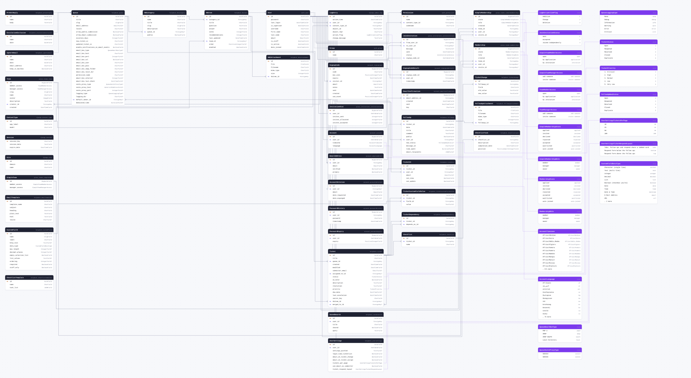

[LogEntry](#logentry) · [Permission](#permission) · [Group](#group) · [User](#user) · [ContentType](#contenttype) · [Session](#session) · [Site](#site) · [JoinInvitation](#joininvitation) · [InvitationStat](#invitationstat) · [SimpleTeam](#simpleteam) · [Team](#team) · [SimpleMembership](#simplemembership) · [Membership](#membership) · [Account](#account) · [SignupCode](#signupcode) · [SignupCodeResult](#signupcoderesult) · [EmailAddress](#emailaddress) · [EmailConfirmation](#emailconfirmation) · [AccountDeletion](#accountdeletion) · [PasswordHistory](#passwordhistory) · [PasswordExpiry](#passwordexpiry) · [Queue](#queue) · [Ticket](#ticket) · [FollowUp](#followup) · [TicketChange](#ticketchange) · [FollowUpAttachment](#followupattachment) · [KBIAttachment](#kbiattachment) · [PreSetReply](#presetreply) · [EscalationExclusion](#escalationexclusion) · [EmailTemplate](#emailtemplate) · [KBCategory](#kbcategory) · [KBItem](#kbitem) · [SavedSearch](#savedsearch) · [UserSettings](#usersettings) · [IgnoreEmail](#ignoreemail) · [TicketCC](#ticketcc) · [CustomField](#customfield) · [TicketCustomFieldValue](#ticketcustomfieldvalue) · [TicketDependency](#ticketdependency) · [ChecklistTemplate](#checklisttemplate) · [Checklist](#checklist) · [ChecklistTask](#checklisttask)

<details>
<summary>The whole schema as SQL</summary>

```sql
CREATE TABLE "django_admin_log" ("id" integer NOT NULL PRIMARY KEY AUTOINCREMENT, "action_time" datetime NOT NULL, "user_id" integer NOT NULL REFERENCES "auth_user" ("id") DEFERRABLE INITIALLY DEFERRED, "content_type_id" integer NULL REFERENCES "django_content_type" ("id") DEFERRABLE INITIALLY DEFERRED, "object_id" text NULL, "object_repr" varchar(200) NOT NULL, "action_flag" smallint unsigned NOT NULL CHECK ("action_flag" >= 0), "change_message" text NOT NULL);

CREATE TABLE "auth_permission" ("id" integer NOT NULL PRIMARY KEY AUTOINCREMENT, "name" varchar(255) NOT NULL, "content_type_id" integer NOT NULL REFERENCES "django_content_type" ("id") DEFERRABLE INITIALLY DEFERRED, "codename" varchar(100) NOT NULL);

CREATE TABLE "auth_group" ("id" integer NOT NULL PRIMARY KEY AUTOINCREMENT, "name" varchar(150) NOT NULL UNIQUE);

CREATE TABLE "auth_group_permissions" ("id" integer NOT NULL PRIMARY KEY AUTOINCREMENT, "group_id" integer NOT NULL REFERENCES "auth_group" ("id") DEFERRABLE INITIALLY DEFERRED, "permission_id" integer NOT NULL REFERENCES "auth_permission" ("id") DEFERRABLE INITIALLY DEFERRED);

CREATE TABLE "auth_user" ("id" integer NOT NULL PRIMARY KEY AUTOINCREMENT, "password" varchar(128) NOT NULL, "last_login" datetime NULL, "is_superuser" bool NOT NULL, "username" varchar(150) NOT NULL UNIQUE, "first_name" varchar(150) NOT NULL, "last_name" varchar(150) NOT NULL, "email" varchar(254) NOT NULL, "is_staff" bool NOT NULL, "is_active" bool NOT NULL, "date_joined" datetime NOT NULL);

CREATE TABLE "auth_user_groups" ("id" integer NOT NULL PRIMARY KEY AUTOINCREMENT, "user_id" integer NOT NULL REFERENCES "auth_user" ("id") DEFERRABLE INITIALLY DEFERRED, "group_id" integer NOT NULL REFERENCES "auth_group" ("id") DEFERRABLE INITIALLY DEFERRED);

CREATE TABLE "auth_user_user_permissions" ("id" integer NOT NULL PRIMARY KEY AUTOINCREMENT, "user_id" integer NOT NULL REFERENCES "auth_user" ("id") DEFERRABLE INITIALLY DEFERRED, "permission_id" integer NOT NULL REFERENCES "auth_permission" ("id") DEFERRABLE INITIALLY DEFERRED);

CREATE TABLE "django_content_type" ("id" integer NOT NULL PRIMARY KEY AUTOINCREMENT, "app_label" varchar(100) NOT NULL, "model" varchar(100) NOT NULL);

CREATE TABLE "django_session" ("session_key" varchar(40) NOT NULL PRIMARY KEY, "session_data" text NOT NULL, "expire_date" datetime NOT NULL);

CREATE TABLE "django_site" ("id" integer NOT NULL PRIMARY KEY AUTOINCREMENT, "domain" varchar(100) NOT NULL UNIQUE, "name" varchar(50) NOT NULL);

CREATE TABLE "pinax_invitations_joininvitation" ("id" integer NOT NULL PRIMARY KEY AUTOINCREMENT, "from_user_id" integer NOT NULL REFERENCES "auth_user" ("id") DEFERRABLE INITIALLY DEFERRED, "to_user_id" integer NULL REFERENCES "auth_user" ("id") DEFERRABLE INITIALLY DEFERRED, "message" text NULL, "sent" datetime NOT NULL, "status" integer NOT NULL, "signup_code_id" bigint NOT NULL UNIQUE REFERENCES "account_signupcode" ("id") DEFERRABLE INITIALLY DEFERRED);

CREATE TABLE "pinax_invitations_invitationstat" ("id" integer NOT NULL PRIMARY KEY AUTOINCREMENT, "user_id" integer NOT NULL UNIQUE REFERENCES "auth_user" ("id") DEFERRABLE INITIALLY DEFERRED, "invites_sent" integer NOT NULL, "invites_allocated" integer NOT NULL, "invites_accepted" integer NOT NULL);

CREATE TABLE "pinax_teams_simpleteam" ("id" integer NOT NULL PRIMARY KEY AUTOINCREMENT, "member_access" varchar(20) NOT NULL, "manager_access" varchar(20) NOT NULL);

CREATE TABLE "pinax_teams_team" ("id" integer NOT NULL PRIMARY KEY AUTOINCREMENT, "member_access" varchar(20) NOT NULL, "manager_access" varchar(20) NOT NULL, "slug" varchar(50) NOT NULL UNIQUE, "name" varchar(100) NOT NULL, "avatar" varchar(100) NOT NULL, "description" text NOT NULL, "creator_id" integer NOT NULL REFERENCES "auth_user" ("id") DEFERRABLE INITIALLY DEFERRED, "created" datetime NOT NULL);

CREATE TABLE "pinax_teams_simplemembership" ("id" integer NOT NULL PRIMARY KEY AUTOINCREMENT, "state" varchar(20) NOT NULL, "role" varchar(20) NOT NULL, "created" datetime NOT NULL, "team_id" bigint NOT NULL REFERENCES "pinax_teams_simpleteam" ("id") DEFERRABLE INITIALLY DEFERRED, "user_id" integer NULL REFERENCES "auth_user" ("id") DEFERRABLE INITIALLY DEFERRED, "invite_id" bigint NULL REFERENCES "pinax_invitations_joininvitation" ("id") DEFERRABLE INITIALLY DEFERRED);

CREATE TABLE "pinax_teams_membership" ("id" integer NOT NULL PRIMARY KEY AUTOINCREMENT, "state" varchar(20) NOT NULL, "role" varchar(20) NOT NULL, "created" datetime NOT NULL, "team_id" bigint NOT NULL REFERENCES "pinax_teams_team" ("id") DEFERRABLE INITIALLY DEFERRED, "user_id" integer NULL REFERENCES "auth_user" ("id") DEFERRABLE INITIALLY DEFERRED, "invite_id" bigint NULL REFERENCES "pinax_invitations_joininvitation" ("id") DEFERRABLE INITIALLY DEFERRED);

CREATE TABLE "account_account" ("id" integer NOT NULL PRIMARY KEY AUTOINCREMENT, "user_id" integer NOT NULL UNIQUE REFERENCES "auth_user" ("id") DEFERRABLE INITIALLY DEFERRED, "timezone" varchar(100) NOT NULL, "language" varchar(10) NOT NULL);

CREATE TABLE "account_signupcode" ("id" integer NOT NULL PRIMARY KEY AUTOINCREMENT, "code" varchar(64) NOT NULL UNIQUE, "max_uses" integer unsigned NOT NULL CHECK ("max_uses" >= 0), "expiry" datetime NULL, "inviter_id" integer NULL REFERENCES "auth_user" ("id") DEFERRABLE INITIALLY DEFERRED, "email" varchar(254) NOT NULL, "notes" text NOT NULL, "sent" datetime NULL, "created" datetime NOT NULL, "use_count" integer unsigned NOT NULL CHECK ("use_count" >= 0));

CREATE TABLE "account_signupcoderesult" ("id" integer NOT NULL PRIMARY KEY AUTOINCREMENT, "signup_code_id" bigint NOT NULL REFERENCES "account_signupcode" ("id") DEFERRABLE INITIALLY DEFERRED, "user_id" integer NOT NULL REFERENCES "auth_user" ("id") DEFERRABLE INITIALLY DEFERRED, "timestamp" datetime NOT NULL);

CREATE TABLE "account_emailaddress" ("id" integer NOT NULL PRIMARY KEY AUTOINCREMENT, "user_id" integer NOT NULL REFERENCES "auth_user" ("id") DEFERRABLE INITIALLY DEFERRED, "email" varchar(254) NOT NULL UNIQUE, "verified" bool NOT NULL, "primary" bool NOT NULL);

CREATE TABLE "account_emailconfirmation" ("id" integer NOT NULL PRIMARY KEY AUTOINCREMENT, "email_address_id" bigint NOT NULL REFERENCES "account_emailaddress" ("id") DEFERRABLE INITIALLY DEFERRED, "created" datetime NOT NULL, "sent" datetime NULL, "key" varchar(64) NOT NULL UNIQUE);

CREATE TABLE "account_accountdeletion" ("id" integer NOT NULL PRIMARY KEY AUTOINCREMENT, "user_id" integer NULL REFERENCES "auth_user" ("id") DEFERRABLE INITIALLY DEFERRED, "email" varchar(254) NOT NULL, "date_requested" datetime NOT NULL, "date_expunged" datetime NULL);

CREATE TABLE "account_passwordhistory" ("id" integer NOT NULL PRIMARY KEY AUTOINCREMENT, "user_id" integer NOT NULL REFERENCES "auth_user" ("id") DEFERRABLE INITIALLY DEFERRED, "password" varchar(255) NOT NULL, "timestamp" datetime NOT NULL);

CREATE TABLE "account_passwordexpiry" ("id" integer NOT NULL PRIMARY KEY AUTOINCREMENT, "user_id" integer NOT NULL UNIQUE REFERENCES "auth_user" ("id") DEFERRABLE INITIALLY DEFERRED, "expiry" integer unsigned NOT NULL CHECK ("expiry" >= 0));

CREATE TABLE "helpdesk_queue" ("id" integer NOT NULL PRIMARY KEY AUTOINCREMENT, "title" varchar(100) NOT NULL, "slug" varchar(50) NOT NULL UNIQUE, "email_address" varchar(254) NULL, "locale" varchar(10) NULL, "allow_public_submission" bool NOT NULL, "allow_email_submission" bool NOT NULL, "escalate_days" integer NULL, "new_ticket_cc" varchar(200) NULL, "updated_ticket_cc" varchar(200) NULL, "enable_notifications_on_email_events" bool NOT NULL, "email_box_type" varchar(5) NULL, "email_box_host" varchar(200) NULL, "email_box_port" integer NULL, "email_box_ssl" bool NOT NULL, "email_box_user" varchar(200) NULL, "email_box_pass" varchar(200) NULL, "email_box_imap_folder" varchar(100) NULL, "email_box_local_dir" varchar(200) NULL, "permission_name" varchar(72) NULL, "email_box_interval" integer NULL, "email_box_last_check" datetime NULL, "socks_proxy_type" varchar(8) NULL, "socks_proxy_host" char(39) NULL, "socks_proxy_port" integer NULL, "logging_type" varchar(5) NULL, "logging_dir" varchar(200) NULL, "default_owner_id" integer NULL REFERENCES "auth_user" ("id") DEFERRABLE INITIALLY DEFERRED, "dedicated_time" bigint NULL);

CREATE TABLE "helpdesk_ticket" ("id" integer NOT NULL PRIMARY KEY AUTOINCREMENT, "title" varchar(200) NOT NULL, "queue_id" integer NOT NULL REFERENCES "helpdesk_queue" ("id") DEFERRABLE INITIALLY DEFERRED, "created" datetime NOT NULL, "modified" datetime NOT NULL, "submitter_email" varchar(254) NULL, "assigned_to_id" integer NULL REFERENCES "auth_user" ("id") DEFERRABLE INITIALLY DEFERRED, "status" integer NOT NULL, "on_hold" bool NOT NULL, "description" text NULL, "resolution" text NULL, "priority" integer NOT NULL, "due_date" datetime NULL, "last_escalation" datetime NULL, "secret_key" varchar(36) NOT NULL, "kbitem_id" integer NULL REFERENCES "helpdesk_kbitem" ("id") DEFERRABLE INITIALLY DEFERRED, "merged_to_id" integer NULL REFERENCES "helpdesk_ticket" ("id") DEFERRABLE INITIALLY DEFERRED);

CREATE TABLE "helpdesk_followup" ("id" integer NOT NULL PRIMARY KEY AUTOINCREMENT, "ticket_id" integer NOT NULL REFERENCES "helpdesk_ticket" ("id") DEFERRABLE INITIALLY DEFERRED, "date" datetime NOT NULL, "title" varchar(200) NULL, "comment" text NULL, "public" bool NOT NULL, "user_id" integer NULL REFERENCES "auth_user" ("id") DEFERRABLE INITIALLY DEFERRED, "new_status" integer NULL, "message_id" varchar(256) NULL, "time_spent" bigint NULL, "email_recipients" text NULL CHECK ((JSON_VALID("email_recipients") OR "email_recipients" IS NULL)));

CREATE TABLE "helpdesk_ticketchange" ("id" integer NOT NULL PRIMARY KEY AUTOINCREMENT, "followup_id" integer NOT NULL REFERENCES "helpdesk_followup" ("id") DEFERRABLE INITIALLY DEFERRED, "field" varchar(200) NOT NULL, "old_value" text NULL, "new_value" text NULL);

CREATE TABLE "helpdesk_followupattachment" ("id" integer NOT NULL PRIMARY KEY AUTOINCREMENT, "file" varchar(1000) NOT NULL, "filename" varchar(1000) NOT NULL, "mime_type" varchar(255) NOT NULL, "size" integer NOT NULL, "followup_id" integer NOT NULL REFERENCES "helpdesk_followup" ("id") DEFERRABLE INITIALLY DEFERRED);

CREATE TABLE "helpdesk_kbiattachment" ("id" integer NOT NULL PRIMARY KEY AUTOINCREMENT, "file" varchar(1000) NOT NULL, "filename" varchar(1000) NOT NULL, "mime_type" varchar(255) NOT NULL, "size" integer NOT NULL, "kbitem_id" integer NOT NULL REFERENCES "helpdesk_kbitem" ("id") DEFERRABLE INITIALLY DEFERRED);

CREATE TABLE "helpdesk_presetreply" ("id" integer NOT NULL PRIMARY KEY AUTOINCREMENT, "name" varchar(100) NOT NULL, "body" text NOT NULL);

CREATE TABLE "helpdesk_presetreply_queues" ("id" integer NOT NULL PRIMARY KEY AUTOINCREMENT, "presetreply_id" integer NOT NULL REFERENCES "helpdesk_presetreply" ("id") DEFERRABLE INITIALLY DEFERRED, "queue_id" integer NOT NULL REFERENCES "helpdesk_queue" ("id") DEFERRABLE INITIALLY DEFERRED);

CREATE TABLE "helpdesk_escalationexclusion" ("id" integer NOT NULL PRIMARY KEY AUTOINCREMENT, "name" varchar(100) NOT NULL, "date" date NOT NULL);

CREATE TABLE "helpdesk_escalationexclusion_queues" ("id" integer NOT NULL PRIMARY KEY AUTOINCREMENT, "escalationexclusion_id" integer NOT NULL REFERENCES "helpdesk_escalationexclusion" ("id") DEFERRABLE INITIALLY DEFERRED, "queue_id" integer NOT NULL REFERENCES "helpdesk_queue" ("id") DEFERRABLE INITIALLY DEFERRED);

CREATE TABLE "helpdesk_emailtemplate" ("id" integer NOT NULL PRIMARY KEY AUTOINCREMENT, "template_name" varchar(100) NOT NULL, "subject" varchar(100) NOT NULL, "heading" varchar(100) NOT NULL, "plain_text" text NOT NULL, "html" text NOT NULL, "locale" varchar(10) NULL);

CREATE TABLE "helpdesk_kbcategory" ("id" integer NOT NULL PRIMARY KEY AUTOINCREMENT, "name" varchar(100) NOT NULL, "title" varchar(100) NOT NULL, "slug" varchar(50) NOT NULL, "description" text NOT NULL, "queue_id" integer NULL REFERENCES "helpdesk_queue" ("id") DEFERRABLE INITIALLY DEFERRED, "public" bool NOT NULL);

CREATE TABLE "helpdesk_kbitem" ("id" integer NOT NULL PRIMARY KEY AUTOINCREMENT, "category_id" integer NOT NULL REFERENCES "helpdesk_kbcategory" ("id") DEFERRABLE INITIALLY DEFERRED, "title" varchar(100) NOT NULL, "question" text NOT NULL, "answer" text NOT NULL, "votes" integer NOT NULL, "recommendations" integer NOT NULL, "last_updated" datetime NOT NULL, "team_id" bigint NULL REFERENCES "pinax_teams_team" ("id") DEFERRABLE INITIALLY DEFERRED, "order" integer unsigned NULL CHECK ("order" >= 0), "enabled" bool NOT NULL);

CREATE TABLE "helpdesk_kbitem_voted_by" ("id" integer NOT NULL PRIMARY KEY AUTOINCREMENT, "kbitem_id" integer NOT NULL REFERENCES "helpdesk_kbitem" ("id") DEFERRABLE INITIALLY DEFERRED, "user_id" integer NOT NULL REFERENCES "auth_user" ("id") DEFERRABLE INITIALLY DEFERRED);

CREATE TABLE "helpdesk_kbitem_downvoted_by" ("id" integer NOT NULL PRIMARY KEY AUTOINCREMENT, "kbitem_id" integer NOT NULL REFERENCES "helpdesk_kbitem" ("id") DEFERRABLE INITIALLY DEFERRED, "user_id" integer NOT NULL REFERENCES "auth_user" ("id") DEFERRABLE INITIALLY DEFERRED);

CREATE TABLE "helpdesk_savedsearch" ("id" integer NOT NULL PRIMARY KEY AUTOINCREMENT, "user_id" integer NOT NULL REFERENCES "auth_user" ("id") DEFERRABLE INITIALLY DEFERRED, "title" varchar(100) NOT NULL, "shared" bool NOT NULL, "query" text NOT NULL);

CREATE TABLE "helpdesk_usersettings" ("id" integer NOT NULL PRIMARY KEY AUTOINCREMENT, "user_id" integer NOT NULL UNIQUE REFERENCES "auth_user" ("id") DEFERRABLE INITIALLY DEFERRED, "settings_pickled" text NULL, "login_view_ticketlist" bool NOT NULL, "email_on_ticket_change" bool NOT NULL, "email_on_ticket_assign" bool NOT NULL, "tickets_per_page" integer NOT NULL, "use_email_as_submitter" bool NOT NULL, "ticket_respond_layout" varchar(16) NOT NULL);

CREATE TABLE "helpdesk_ignoreemail" ("id" integer NOT NULL PRIMARY KEY AUTOINCREMENT, "name" varchar(100) NOT NULL, "date" date NOT NULL, "email_address" varchar(150) NOT NULL, "keep_in_mailbox" bool NOT NULL);

CREATE TABLE "helpdesk_ignoreemail_queues" ("id" integer NOT NULL PRIMARY KEY AUTOINCREMENT, "ignoreemail_id" integer NOT NULL REFERENCES "helpdesk_ignoreemail" ("id") DEFERRABLE INITIALLY DEFERRED, "queue_id" integer NOT NULL REFERENCES "helpdesk_queue" ("id") DEFERRABLE INITIALLY DEFERRED);

CREATE TABLE "helpdesk_ticketcc" ("id" integer NOT NULL PRIMARY KEY AUTOINCREMENT, "ticket_id" integer NOT NULL REFERENCES "helpdesk_ticket" ("id") DEFERRABLE INITIALLY DEFERRED, "user_id" integer NULL REFERENCES "auth_user" ("id") DEFERRABLE INITIALLY DEFERRED, "email" varchar(254) NULL, "can_view" bool NOT NULL, "can_update" bool NOT NULL);

CREATE TABLE "helpdesk_customfield" ("id" integer NOT NULL PRIMARY KEY AUTOINCREMENT, "name" varchar(50) NOT NULL UNIQUE, "label" varchar(30) NOT NULL, "help_text" text NULL, "data_type" varchar(100) NOT NULL, "max_length" integer NULL, "decimal_places" integer NULL, "empty_selection_list" bool NOT NULL, "list_values" text NULL, "ordering" integer NULL, "required" bool NOT NULL, "staff_only" bool NOT NULL);

CREATE TABLE "helpdesk_ticketcustomfieldvalue" ("id" integer NOT NULL PRIMARY KEY AUTOINCREMENT, "ticket_id" integer NOT NULL REFERENCES "helpdesk_ticket" ("id") DEFERRABLE INITIALLY DEFERRED, "field_id" integer NOT NULL REFERENCES "helpdesk_customfield" ("id") DEFERRABLE INITIALLY DEFERRED, "value" text NULL);

CREATE TABLE "helpdesk_ticketdependency" ("id" integer NOT NULL PRIMARY KEY AUTOINCREMENT, "ticket_id" integer NOT NULL REFERENCES "helpdesk_ticket" ("id") DEFERRABLE INITIALLY DEFERRED, "depends_on_id" integer NOT NULL REFERENCES "helpdesk_ticket" ("id") DEFERRABLE INITIALLY DEFERRED);

CREATE TABLE "helpdesk_checklisttemplate" ("id" integer NOT NULL PRIMARY KEY AUTOINCREMENT, "name" varchar(100) NOT NULL, "task_list" text NOT NULL CHECK ((JSON_VALID("task_list") OR "task_list" IS NULL)));

CREATE TABLE "helpdesk_checklist" ("id" integer NOT NULL PRIMARY KEY AUTOINCREMENT, "ticket_id" integer NOT NULL REFERENCES "helpdesk_ticket" ("id") DEFERRABLE INITIALLY DEFERRED, "name" varchar(100) NOT NULL);

CREATE TABLE "helpdesk_checklisttask" ("id" integer NOT NULL PRIMARY KEY AUTOINCREMENT, "checklist_id" integer NOT NULL REFERENCES "helpdesk_checklist" ("id") DEFERRABLE INITIALLY DEFERRED, "description" varchar(250) NOT NULL, "completion_date" datetime NULL, "position" smallint unsigned NOT NULL CHECK ("position" >= 0));

CREATE INDEX "django_admin_log_user_id_c564eba6" ON "django_admin_log" ("user_id");

CREATE INDEX "django_admin_log_content_type_id_c4bce8eb" ON "django_admin_log" ("content_type_id");

CREATE UNIQUE INDEX "auth_permission_content_type_id_codename_01ab375a_uniq" ON "auth_permission" ("content_type_id", "codename");

CREATE INDEX "auth_permission_content_type_id_2f476e4b" ON "auth_permission" ("content_type_id");

CREATE UNIQUE INDEX "auth_group_permissions_group_id_permission_id_0cd325b0_uniq" ON "auth_group_permissions" ("group_id", "permission_id");

CREATE INDEX "auth_group_permissions_group_id_b120cbf9" ON "auth_group_permissions" ("group_id");

CREATE INDEX "auth_group_permissions_permission_id_84c5c92e" ON "auth_group_permissions" ("permission_id");

CREATE UNIQUE INDEX "auth_user_groups_user_id_group_id_94350c0c_uniq" ON "auth_user_groups" ("user_id", "group_id");

CREATE INDEX "auth_user_groups_user_id_6a12ed8b" ON "auth_user_groups" ("user_id");

CREATE INDEX "auth_user_groups_group_id_97559544" ON "auth_user_groups" ("group_id");

CREATE UNIQUE INDEX "auth_user_user_permissions_user_id_permission_id_14a6b632_uniq" ON "auth_user_user_permissions" ("user_id", "permission_id");

CREATE INDEX "auth_user_user_permissions_user_id_a95ead1b" ON "auth_user_user_permissions" ("user_id");

CREATE INDEX "auth_user_user_permissions_permission_id_1fbb5f2c" ON "auth_user_user_permissions" ("permission_id");

CREATE UNIQUE INDEX "django_content_type_app_label_model_76bd3d3b_uniq" ON "django_content_type" ("app_label", "model");

CREATE INDEX "django_session_expire_date_a5c62663" ON "django_session" ("expire_date");

CREATE INDEX "pinax_invitations_joininvitation_from_user_id_6298d80c" ON "pinax_invitations_joininvitation" ("from_user_id");

CREATE INDEX "pinax_invitations_joininvitation_to_user_id_d0fa4add" ON "pinax_invitations_joininvitation" ("to_user_id");

CREATE INDEX "pinax_teams_team_creator_id_464a2b68" ON "pinax_teams_team" ("creator_id");

CREATE UNIQUE INDEX "pinax_teams_simplemembership_team_id_user_id_invite_id_668da23b_uniq" ON "pinax_teams_simplemembership" ("team_id", "user_id", "invite_id");

CREATE INDEX "pinax_teams_simplemembership_team_id_37407f9d" ON "pinax_teams_simplemembership" ("team_id");

CREATE INDEX "pinax_teams_simplemembership_user_id_1152f95c" ON "pinax_teams_simplemembership" ("user_id");

CREATE INDEX "pinax_teams_simplemembership_invite_id_eedba0e4" ON "pinax_teams_simplemembership" ("invite_id");

CREATE UNIQUE INDEX "pinax_teams_membership_team_id_user_id_invite_id_8ead1786_uniq" ON "pinax_teams_membership" ("team_id", "user_id", "invite_id");

CREATE INDEX "pinax_teams_membership_team_id_72556e8a" ON "pinax_teams_membership" ("team_id");

CREATE INDEX "pinax_teams_membership_user_id_5237927b" ON "pinax_teams_membership" ("user_id");

CREATE INDEX "pinax_teams_membership_invite_id_8ab7ad37" ON "pinax_teams_membership" ("invite_id");

CREATE INDEX "account_signupcode_inviter_id_9706983e" ON "account_signupcode" ("inviter_id");

CREATE INDEX "account_signupcoderesult_signup_code_id_1adc486e" ON "account_signupcoderesult" ("signup_code_id");

CREATE INDEX "account_signupcoderesult_user_id_c10dc604" ON "account_signupcoderesult" ("user_id");

CREATE INDEX "account_emailaddress_user_id_2c513194" ON "account_emailaddress" ("user_id");

CREATE INDEX "account_emailconfirmation_email_address_id_5b7f8c58" ON "account_emailconfirmation" ("email_address_id");

CREATE INDEX "account_accountdeletion_user_id_c205475f" ON "account_accountdeletion" ("user_id");

CREATE INDEX "account_passwordhistory_user_id_dc325181" ON "account_passwordhistory" ("user_id");

CREATE INDEX "helpdesk_queue_default_owner_id_b0930a66" ON "helpdesk_queue" ("default_owner_id");

CREATE INDEX "helpdesk_ticket_queue_id_9b210169" ON "helpdesk_ticket" ("queue_id");

CREATE INDEX "helpdesk_ticket_assigned_to_id_0716992e" ON "helpdesk_ticket" ("assigned_to_id");

CREATE INDEX "helpdesk_ticket_kbitem_id_ee0464fc" ON "helpdesk_ticket" ("kbitem_id");

CREATE INDEX "helpdesk_ticket_merged_to_id_7e3893ff" ON "helpdesk_ticket" ("merged_to_id");

CREATE INDEX "helpdesk_followup_ticket_id_3db2d079" ON "helpdesk_followup" ("ticket_id");

CREATE INDEX "helpdesk_followup_user_id_5b9c07e3" ON "helpdesk_followup" ("user_id");

CREATE INDEX "helpdesk_ticketchange_followup_id_2e4e87bc" ON "helpdesk_ticketchange" ("followup_id");

CREATE INDEX "helpdesk_followupattachment_followup_id_0e058984" ON "helpdesk_followupattachment" ("followup_id");

CREATE INDEX "helpdesk_kbiattachment_kbitem_id_591a4abd" ON "helpdesk_kbiattachment" ("kbitem_id");

CREATE UNIQUE INDEX "helpdesk_presetreply_queues_presetreply_id_queue_id_805647a1_uniq" ON "helpdesk_presetreply_queues" ("presetreply_id", "queue_id");

CREATE INDEX "helpdesk_presetreply_queues_presetreply_id_9e5e7b10" ON "helpdesk_presetreply_queues" ("presetreply_id");

CREATE INDEX "helpdesk_presetreply_queues_queue_id_b90d97e8" ON "helpdesk_presetreply_queues" ("queue_id");

CREATE UNIQUE INDEX "helpdesk_escalationexclusion_queues_escalationexclusion_id_queue_id_f8f19aff_uniq" ON "helpdesk_escalationexclusion_queues" ("escalationexclusion_id", "queue_id");

CREATE INDEX "helpdesk_escalationexclusion_queues_escalationexclusion_id_62556c07" ON "helpdesk_escalationexclusion_queues" ("escalationexclusion_id");

CREATE INDEX "helpdesk_escalationexclusion_queues_queue_id_ed8d4906" ON "helpdesk_escalationexclusion_queues" ("queue_id");

CREATE INDEX "helpdesk_kbcategory_slug_5922579d" ON "helpdesk_kbcategory" ("slug");

CREATE INDEX "helpdesk_kbcategory_queue_id_975d03cb" ON "helpdesk_kbcategory" ("queue_id");

CREATE INDEX "helpdesk_kbitem_category_id_14a1b130" ON "helpdesk_kbitem" ("category_id");

CREATE INDEX "helpdesk_kbitem_team_id_81825755" ON "helpdesk_kbitem" ("team_id");

CREATE UNIQUE INDEX "helpdesk_kbitem_voted_by_kbitem_id_user_id_88c9133c_uniq" ON "helpdesk_kbitem_voted_by" ("kbitem_id", "user_id");

CREATE INDEX "helpdesk_kbitem_voted_by_kbitem_id_61b06632" ON "helpdesk_kbitem_voted_by" ("kbitem_id");

CREATE INDEX "helpdesk_kbitem_voted_by_user_id_625691ca" ON "helpdesk_kbitem_voted_by" ("user_id");

CREATE UNIQUE INDEX "helpdesk_kbitem_downvoted_by_kbitem_id_user_id_18b17abc_uniq" ON "helpdesk_kbitem_downvoted_by" ("kbitem_id", "user_id");

CREATE INDEX "helpdesk_kbitem_downvoted_by_kbitem_id_3a75f7eb" ON "helpdesk_kbitem_downvoted_by" ("kbitem_id");

CREATE INDEX "helpdesk_kbitem_downvoted_by_user_id_39f933f2" ON "helpdesk_kbitem_downvoted_by" ("user_id");

CREATE INDEX "helpdesk_savedsearch_user_id_24cf33b5" ON "helpdesk_savedsearch" ("user_id");

CREATE UNIQUE INDEX "helpdesk_ignoreemail_queues_ignoreemail_id_queue_id_b3c79ff5_uniq" ON "helpdesk_ignoreemail_queues" ("ignoreemail_id", "queue_id");

CREATE INDEX "helpdesk_ignoreemail_queues_ignoreemail_id_f6fcd398" ON "helpdesk_ignoreemail_queues" ("ignoreemail_id");

CREATE INDEX "helpdesk_ignoreemail_queues_queue_id_73141496" ON "helpdesk_ignoreemail_queues" ("queue_id");

CREATE INDEX "helpdesk_ticketcc_ticket_id_4e774289" ON "helpdesk_ticketcc" ("ticket_id");

CREATE INDEX "helpdesk_ticketcc_user_id_d811c3c2" ON "helpdesk_ticketcc" ("user_id");

CREATE UNIQUE INDEX "helpdesk_ticketcustomfieldvalue_ticket_id_field_id_4fc28390_uniq" ON "helpdesk_ticketcustomfieldvalue" ("ticket_id", "field_id");

CREATE INDEX "helpdesk_ticketcustomfieldvalue_ticket_id_4e2fe33a" ON "helpdesk_ticketcustomfieldvalue" ("ticket_id");

CREATE INDEX "helpdesk_ticketcustomfieldvalue_field_id_fd61fcda" ON "helpdesk_ticketcustomfieldvalue" ("field_id");

CREATE UNIQUE INDEX "helpdesk_ticketdependency_ticket_id_depends_on_id_43caa9be_uniq" ON "helpdesk_ticketdependency" ("ticket_id", "depends_on_id");

CREATE INDEX "helpdesk_ticketdependency_ticket_id_618bbe6b" ON "helpdesk_ticketdependency" ("ticket_id");

CREATE INDEX "helpdesk_ticketdependency_depends_on_id_e310efa4" ON "helpdesk_ticketdependency" ("depends_on_id");

CREATE INDEX "helpdesk_checklist_ticket_id_78a0d426" ON "helpdesk_checklist" ("ticket_id");

CREATE INDEX "helpdesk_checklisttask_checklist_id_4171e5cf" ON "helpdesk_checklisttask" ("checklist_id");

CREATE INDEX "helpdesk_checklisttask_position_1604f85c" ON "helpdesk_checklisttask" ("position");
```

</details>

## LogEntry

Table `django_admin_log`, app `admin`.


| Column | Field | Type | Null | Key | Default | Description |
| --- | --- | --- | --- | --- | --- | --- |
| `id` | `AutoField` | `integer` |  | PK | `autoincrement()` |  |
| `action_time` | `DateTimeField` | `datetime` |  |  | `now()` |  |
| `user_id` | `ForeignKey` | `integer` |  | FK |  |  |
| `content_type_id` | `ForeignKey` | `integer` | yes | FK |  |  |
| `object_id` | `TextField` | `text` | yes |  |  |  |
| `object_repr` | `CharField` | `varchar(200)` |  |  |  |  |
| `action_flag` | `LogEntryActionFlag` | `smallint unsigned` |  |  |  |  |
| `change_message` | `TextField` | `text` |  |  |  |  |

Indexes:

- index `django_admin_log_user_id_c564eba6` on `user_id`
- index `django_admin_log_content_type_id_c4bce8eb` on `content_type_id`

Relations:

- `user_id` → [User](#user).`id`, on delete cascade
- `content_type_id` → [ContentType](#contenttype).`id`, on delete set null

## Permission

Table `auth_permission`, app `auth`.

The permissions system provides a way to assign permissions to specific
users and groups of users.

The permission system is used by the Django admin site, but may also be
useful in your own code. The Django admin site uses permissions as follows:

    - The "add" permission limits the user's ability to view the "add" form
      and add an object.
    - The "change" permission limits a user's ability to view the change
      list, view the "change" form and change an object.
    - The "delete" permission limits the ability to delete an object.
    - The "view" permission limits the ability to view an object.

Permissions are set globally per type of object, not per specific object
instance. It is possible to say "Mary may change news stories," but it's
not currently possible to say "Mary may change news stories, but only the
ones she created herself" or "Mary may only change news stories that have a
certain status or publication date."

The permissions listed above are automatically created for each model.


| Column | Field | Type | Null | Key | Default | Description |
| --- | --- | --- | --- | --- | --- | --- |
| `id` | `AutoField` | `integer` |  | PK | `autoincrement()` |  |
| `name` | `CharField` | `varchar(255)` |  |  |  |  |
| `content_type_id` | `ForeignKey` | `integer` |  | FK |  |  |
| `codename` | `CharField` | `varchar(100)` |  |  |  |  |

Indexes:

- index `auth_permission_content_type_id_2f476e4b` on `content_type_id`
- unique `auth_permission_content_type_id_codename_01ab375a_uniq` on `content_type_id`, `codename`

Relations:

- `content_type_id` → [ContentType](#contenttype).`id`, on delete cascade
- `group_set` — many to many with [Group](#group)
- `user_set` — many to many with [User](#user)

## Group

Table `auth_group`, app `auth`.

Groups are a generic way of categorizing users to apply permissions, or
some other label, to those users. A user can belong to any number of
groups.

A user in a group automatically has all the permissions granted to that
group. For example, if the group 'Site editors' has the permission
can_edit_home_page, any user in that group will have that permission.

Beyond permissions, groups are a convenient way to categorize users to
apply some label, or extended functionality, to them. For example, you
could create a group 'Special users', and you could write code that would
do special things to those users -- such as giving them access to a
members-only portion of your site, or sending them members-only email
messages.


| Column | Field | Type | Null | Key | Default | Description |
| --- | --- | --- | --- | --- | --- | --- |
| `id` | `AutoField` | `integer` |  | PK | `autoincrement()` |  |
| `name` | `CharField` | `varchar(150)` |  | unique |  |  |

Relations:

- `permissions` — many to many with [Permission](#permission)
- `user_set` — many to many with [User](#user)

## User

Table `auth_user`, app `auth`.

Columns from `AbstractUser` (abstract): `username`, `first_name`, `last_name`, `email`, `is_staff`, `is_active`, `date_joined`.

Columns from `AbstractBaseUser` (abstract): `password`, `last_login`.

Columns from `PermissionsMixin` (abstract): `is_superuser`.

Users within the Django authentication system are represented by this
model.

Username and password are required. Other fields are optional.

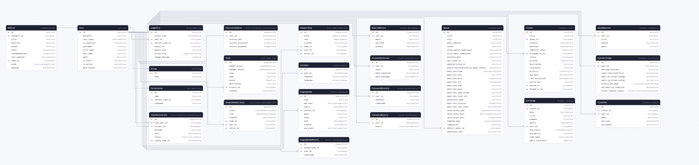

| Column | Field | Type | Null | Key | Default | Description |
| --- | --- | --- | --- | --- | --- | --- |
| `id` | `AutoField` | `integer` |  | PK | `autoincrement()` |  |
| `password` | `CharField` | `varchar(128)` |  |  |  |  |
| `last_login` | `DateTimeField` | `datetime` | yes |  |  |  |
| `is_superuser` | `BooleanField` | `bool` |  |  | `False` | Designates that this user has all permissions without explicitly assigning them. |
| `username` | `CharField` | `varchar(150)` |  | unique |  | Required. 150 characters or fewer. Letters, digits and @/./+/-/_ only. |
| `first_name` | `CharField` | `varchar(150)` |  |  |  |  |
| `last_name` | `CharField` | `varchar(150)` |  |  |  |  |
| `email` | `EmailField` | `varchar(254)` |  |  |  |  |
| `is_staff` | `BooleanField` | `bool` |  |  | `False` | Designates whether the user can log into this admin site. |
| `is_active` | `BooleanField` | `bool` |  |  | `True` | Designates whether this user should be treated as active. Unselect this instead of deleting accounts. |
| `date_joined` | `DateTimeField` | `datetime` |  |  | `now()` |  |

Relations:

- [LogEntry](#logentry).`user_id` → `id`, on delete cascade
- `groups` — many to many with [Group](#group)
- `user_permissions` — many to many with [Permission](#permission)
- [JoinInvitation](#joininvitation).`from_user_id` → `id`, on delete cascade
- [JoinInvitation](#joininvitation).`to_user_id` → `id`, on delete cascade
- [InvitationStat](#invitationstat).`user_id` → `id`, on delete cascade
- [Team](#team).`creator_id` → `id`, on delete cascade
- [SimpleMembership](#simplemembership).`user_id` → `id`, on delete set null
- [Membership](#membership).`user_id` → `id`, on delete set null
- [Account](#account).`user_id` → `id`, on delete cascade
- [SignupCode](#signupcode).`inviter_id` → `id`, on delete cascade
- [SignupCodeResult](#signupcoderesult).`user_id` → `id`, on delete cascade
- [EmailAddress](#emailaddress).`user_id` → `id`, on delete cascade
- [AccountDeletion](#accountdeletion).`user_id` → `id`, on delete set null
- [PasswordHistory](#passwordhistory).`user_id` → `id`, on delete cascade
- [PasswordExpiry](#passwordexpiry).`user_id` → `id`, on delete cascade
- [Queue](#queue).`default_owner_id` → `id`, on delete set null
- [Ticket](#ticket).`assigned_to_id` → `id`, on delete protect
- [FollowUp](#followup).`user_id` → `id`, on delete protect
- `votes` — many to many with [KBItem](#kbitem)
- `downvotes` — many to many with [KBItem](#kbitem)
- [SavedSearch](#savedsearch).`user_id` → `id`, on delete cascade
- [UserSettings](#usersettings).`user_id` → `id`, on delete cascade
- [TicketCC](#ticketcc).`user_id` → `id`, on delete cascade

## ContentType

Table `django_content_type`, app `contenttypes`.


| Column | Field | Type | Null | Key | Default | Description |
| --- | --- | --- | --- | --- | --- | --- |
| `id` | `AutoField` | `integer` |  | PK | `autoincrement()` |  |
| `app_label` | `CharField` | `varchar(100)` |  |  |  |  |
| `model` | `CharField` | `varchar(100)` |  |  |  |  |

Indexes:

- unique `django_content_type_app_label_model_76bd3d3b_uniq` on `app_label`, `model`

Relations:

- [LogEntry](#logentry).`content_type_id` → `id`, on delete set null
- [Permission](#permission).`content_type_id` → `id`, on delete cascade

## Session

Table `django_session`, app `sessions`.

Columns from `AbstractBaseSession` (abstract): `session_key`, `session_data`, `expire_date`.

Django provides full support for anonymous sessions. The session
framework lets you store and retrieve arbitrary data on a
per-site-visitor basis. It stores data on the server side and
abstracts the sending and receiving of cookies. Cookies contain a
session ID -- not the data itself.

The Django sessions framework is entirely cookie-based. It does
not fall back to putting session IDs in URLs. This is an intentional
design decision. Not only does that behavior make URLs ugly, it makes
your site vulnerable to session-ID theft via the "Referer" header.

For complete documentation on using Sessions in your code, consult
the sessions documentation that is shipped with Django (also available
on the Django web site).

| Column | Field | Type | Null | Key | Default | Description |
| --- | --- | --- | --- | --- | --- | --- |
| `session_key` | `CharField` | `varchar(40)` |  | PK |  |  |
| `session_data` | `TextField` | `text` |  |  |  |  |
| `expire_date` | `DateTimeField` | `datetime` |  |  |  |  |

Indexes:

- index `django_session_expire_date_a5c62663` on `expire_date`

## Site

Table `django_site`, app `sites`.

| Column | Field | Type | Null | Key | Default | Description |
| --- | --- | --- | --- | --- | --- | --- |
| `id` | `AutoField` | `integer` |  | PK | `autoincrement()` |  |
| `domain` | `CharField` | `varchar(100)` |  | unique |  |  |
| `name` | `CharField` | `varchar(50)` |  |  |  |  |

## JoinInvitation

Table `pinax_invitations_joininvitation`, app `pinax_invitations`.

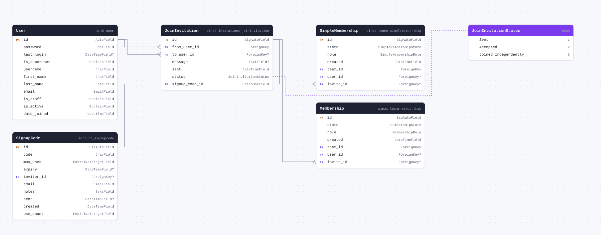

| Column | Field | Type | Null | Key | Default | Description |
| --- | --- | --- | --- | --- | --- | --- |
| `id` | `BigAutoField` | `integer` |  | PK | `autoincrement()` |  |
| `from_user_id` | `ForeignKey` | `integer` |  | FK |  |  |
| `to_user_id` | `ForeignKey` | `integer` | yes | FK |  |  |
| `message` | `TextField` | `text` | yes |  |  |  |
| `sent` | `DateTimeField` | `datetime` |  |  | `now()` |  |
| `status` | `JoinInvitationStatus` | `integer` |  |  |  |  |
| `signup_code_id` | `OneToOneField` | `bigint` |  | FK, unique |  |  |

Indexes:

- index `pinax_invitations_joininvitation_from_user_id_6298d80c` on `from_user_id`
- index `pinax_invitations_joininvitation_to_user_id_d0fa4add` on `to_user_id`

Relations:

- `from_user_id` → [User](#user).`id`, on delete cascade
- `to_user_id` → [User](#user).`id`, on delete cascade
- `signup_code_id` → [SignupCode](#signupcode).`id`, on delete cascade
- [SimpleMembership](#simplemembership).`invite_id` → `id`, on delete set null
- [Membership](#membership).`invite_id` → `id`, on delete set null

## InvitationStat

Table `pinax_invitations_invitationstat`, app `pinax_invitations`.

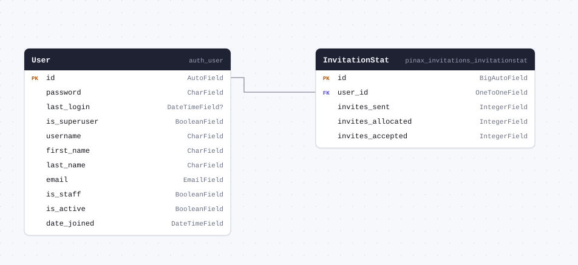

| Column | Field | Type | Null | Key | Default | Description |
| --- | --- | --- | --- | --- | --- | --- |
| `id` | `BigAutoField` | `integer` |  | PK | `autoincrement()` |  |
| `user_id` | `OneToOneField` | `integer` |  | FK, unique |  |  |
| `invites_sent` | `IntegerField` | `integer` |  |  | `0` |  |
| `invites_allocated` | `IntegerField` | `integer` |  |  | `0` |  |
| `invites_accepted` | `IntegerField` | `integer` |  |  | `0` |  |

Relations:

- `user_id` → [User](#user).`id`, on delete cascade

## SimpleTeam

Table `pinax_teams_simpleteam`, app `pinax_teams`.

Columns from `BaseTeam` (abstract): `member_access`, `manager_access`.

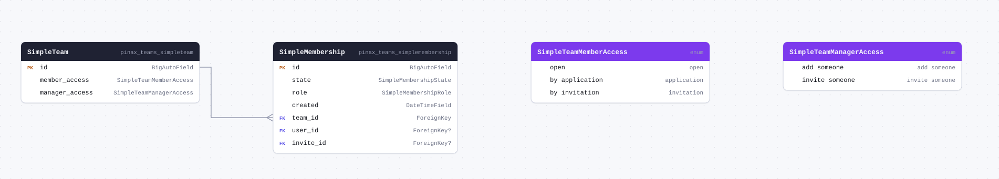

| Column | Field | Type | Null | Key | Default | Description |
| --- | --- | --- | --- | --- | --- | --- |
| `id` | `BigAutoField` | `integer` |  | PK | `autoincrement()` |  |
| `member_access` | `SimpleTeamMemberAccess` | `varchar(20)` |  |  |  |  |
| `manager_access` | `SimpleTeamManagerAccess` | `varchar(20)` |  |  |  |  |

Relations:

- [SimpleMembership](#simplemembership).`team_id` → `id`, on delete cascade

## Team

Table `pinax_teams_team`, app `pinax_teams`.

Columns from `BaseTeam` (abstract): `member_access`, `manager_access`.

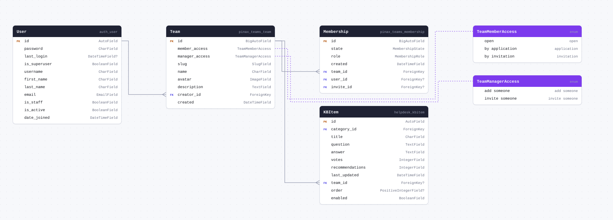

| Column | Field | Type | Null | Key | Default | Description |
| --- | --- | --- | --- | --- | --- | --- |
| `id` | `BigAutoField` | `integer` |  | PK | `autoincrement()` |  |
| `member_access` | `TeamMemberAccess` | `varchar(20)` |  |  |  |  |
| `manager_access` | `TeamManagerAccess` | `varchar(20)` |  |  |  |  |
| `slug` | `SlugField` | `varchar(50)` |  | unique |  |  |
| `name` | `CharField` | `varchar(100)` |  |  |  |  |
| `avatar` | `ImageField` | `varchar(100)` |  |  |  |  |
| `description` | `TextField` | `text` |  |  |  |  |
| `creator_id` | `ForeignKey` | `integer` |  | FK |  |  |
| `created` | `DateTimeField` | `datetime` |  |  | `now()` |  |

Indexes:

- index `pinax_teams_team_creator_id_464a2b68` on `creator_id`

Relations:

- `creator_id` → [User](#user).`id`, on delete cascade
- [Membership](#membership).`team_id` → `id`, on delete cascade
- [KBItem](#kbitem).`team_id` → `id`, on delete set null

## SimpleMembership

Table `pinax_teams_simplemembership`, app `pinax_teams`.

Columns from `BaseMembership` (abstract): `state`, `role`, `created`.

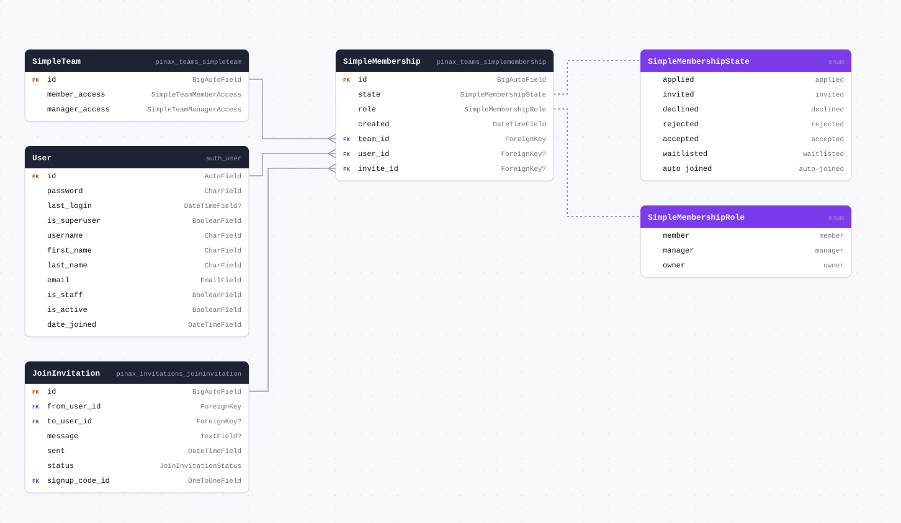

| Column | Field | Type | Null | Key | Default | Description |
| --- | --- | --- | --- | --- | --- | --- |
| `id` | `BigAutoField` | `integer` |  | PK | `autoincrement()` |  |
| `state` | `SimpleMembershipState` | `varchar(20)` |  |  |  |  |
| `role` | `SimpleMembershipRole` | `varchar(20)` |  |  | `'member'` |  |
| `created` | `DateTimeField` | `datetime` |  |  | `now()` |  |
| `team_id` | `ForeignKey` | `bigint` |  | FK |  |  |
| `user_id` | `ForeignKey` | `integer` | yes | FK |  |  |
| `invite_id` | `ForeignKey` | `bigint` | yes | FK |  |  |

Indexes:

- index `pinax_teams_simplemembership_team_id_37407f9d` on `team_id`
- index `pinax_teams_simplemembership_user_id_1152f95c` on `user_id`
- index `pinax_teams_simplemembership_invite_id_eedba0e4` on `invite_id`
- unique `pinax_teams_simplemembership_team_id_user_id_invite_id_668da23b_uniq` on `team_id`, `user_id`, `invite_id`

Relations:

- `team_id` → [SimpleTeam](#simpleteam).`id`, on delete cascade
- `user_id` → [User](#user).`id`, on delete set null
- `invite_id` → [JoinInvitation](#joininvitation).`id`, on delete set null

## Membership

Table `pinax_teams_membership`, app `pinax_teams`.

Columns from `BaseMembership` (abstract): `state`, `role`, `created`.

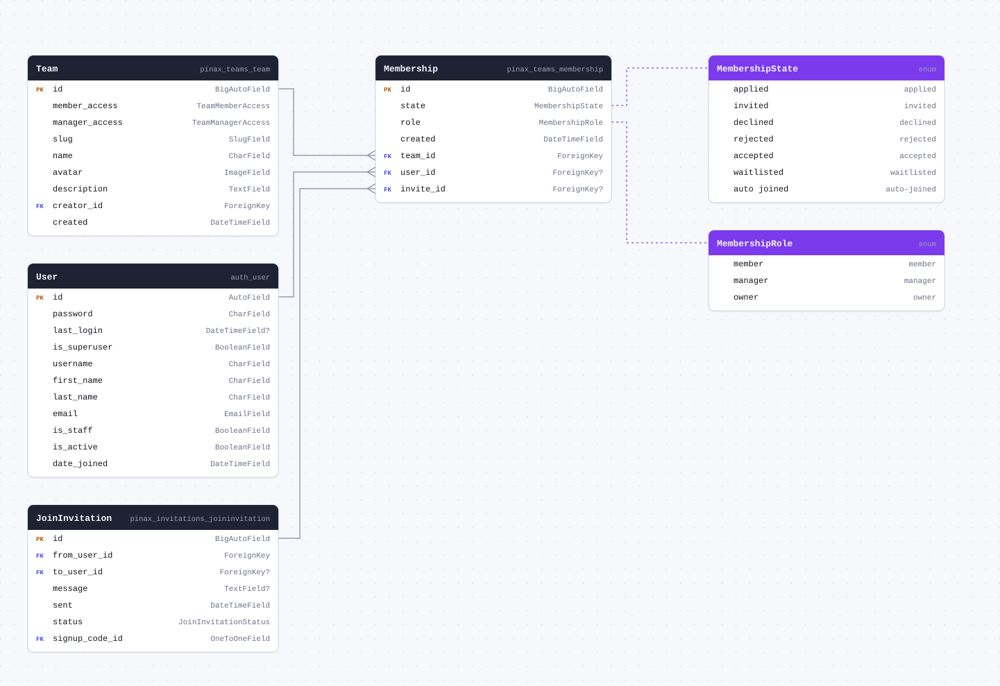

| Column | Field | Type | Null | Key | Default | Description |
| --- | --- | --- | --- | --- | --- | --- |
| `id` | `BigAutoField` | `integer` |  | PK | `autoincrement()` |  |
| `state` | `MembershipState` | `varchar(20)` |  |  |  |  |
| `role` | `MembershipRole` | `varchar(20)` |  |  | `'member'` |  |
| `created` | `DateTimeField` | `datetime` |  |  | `now()` |  |
| `team_id` | `ForeignKey` | `bigint` |  | FK |  |  |
| `user_id` | `ForeignKey` | `integer` | yes | FK |  |  |
| `invite_id` | `ForeignKey` | `bigint` | yes | FK |  |  |

Indexes:

- index `pinax_teams_membership_team_id_72556e8a` on `team_id`
- index `pinax_teams_membership_user_id_5237927b` on `user_id`
- index `pinax_teams_membership_invite_id_8ab7ad37` on `invite_id`
- unique `pinax_teams_membership_team_id_user_id_invite_id_8ead1786_uniq` on `team_id`, `user_id`, `invite_id`

Relations:

- `team_id` → [Team](#team).`id`, on delete cascade
- `user_id` → [User](#user).`id`, on delete set null
- `invite_id` → [JoinInvitation](#joininvitation).`id`, on delete set null

## Account

Table `account_account`, app `account`.

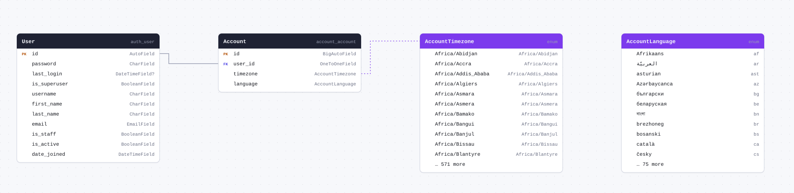

| Column | Field | Type | Null | Key | Default | Description |
| --- | --- | --- | --- | --- | --- | --- |
| `id` | `BigAutoField` | `integer` |  | PK | `autoincrement()` |  |
| `user_id` | `OneToOneField` | `integer` |  | FK, unique |  |  |
| `timezone` | `AccountTimezone` | `varchar(100)` |  |  | `''` |  |
| `language` | `AccountLanguage` | `varchar(10)` |  |  | `'en'` |  |

Relations:

- `user_id` → [User](#user).`id`, on delete cascade

## SignupCode

Table `account_signupcode`, app `account`.

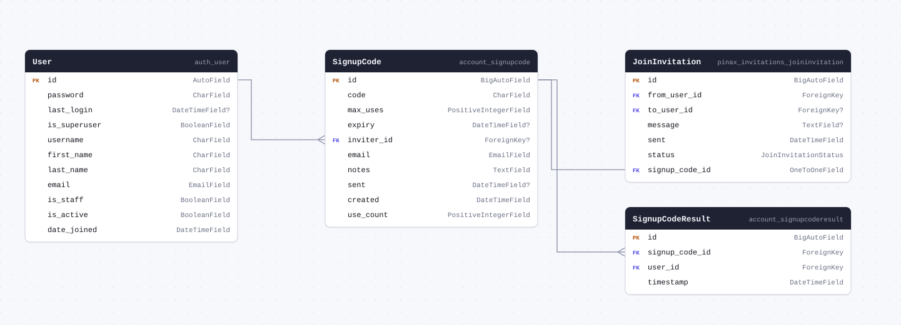

| Column | Field | Type | Null | Key | Default | Description |
| --- | --- | --- | --- | --- | --- | --- |
| `id` | `BigAutoField` | `integer` |  | PK | `autoincrement()` |  |
| `code` | `CharField` | `varchar(64)` |  | unique |  |  |
| `max_uses` | `PositiveIntegerField` | `integer unsigned` |  |  | `1` |  |
| `expiry` | `DateTimeField` | `datetime` | yes |  |  |  |
| `inviter_id` | `ForeignKey` | `integer` | yes | FK |  |  |
| `email` | `EmailField` | `varchar(254)` |  |  |  |  |
| `notes` | `TextField` | `text` |  |  |  |  |
| `sent` | `DateTimeField` | `datetime` | yes |  |  |  |
| `created` | `DateTimeField` | `datetime` |  |  | `now()` |  |
| `use_count` | `PositiveIntegerField` | `integer unsigned` |  |  | `0` |  |

Indexes:

- index `account_signupcode_inviter_id_9706983e` on `inviter_id`

Relations:

- [JoinInvitation](#joininvitation).`signup_code_id` → `id`, on delete cascade
- `inviter_id` → [User](#user).`id`, on delete cascade
- [SignupCodeResult](#signupcoderesult).`signup_code_id` → `id`, on delete cascade

## SignupCodeResult

Table `account_signupcoderesult`, app `account`.

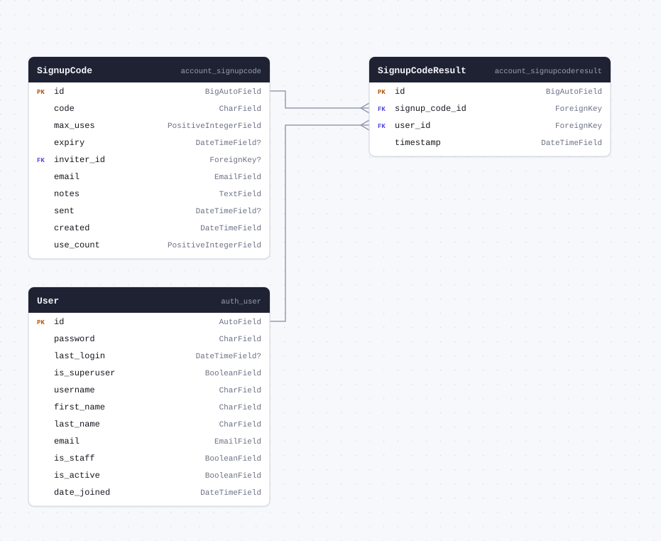

| Column | Field | Type | Null | Key | Default | Description |
| --- | --- | --- | --- | --- | --- | --- |
| `id` | `BigAutoField` | `integer` |  | PK | `autoincrement()` |  |
| `signup_code_id` | `ForeignKey` | `bigint` |  | FK |  |  |
| `user_id` | `ForeignKey` | `integer` |  | FK |  |  |
| `timestamp` | `DateTimeField` | `datetime` |  |  | `now()` |  |

Indexes:

- index `account_signupcoderesult_signup_code_id_1adc486e` on `signup_code_id`
- index `account_signupcoderesult_user_id_c10dc604` on `user_id`

Relations:

- `signup_code_id` → [SignupCode](#signupcode).`id`, on delete cascade
- `user_id` → [User](#user).`id`, on delete cascade

## EmailAddress

Table `account_emailaddress`, app `account`.

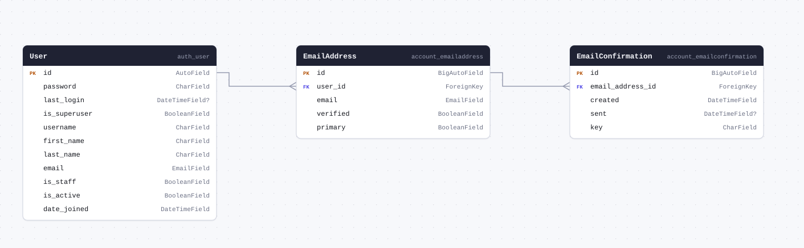

| Column | Field | Type | Null | Key | Default | Description |
| --- | --- | --- | --- | --- | --- | --- |
| `id` | `BigAutoField` | `integer` |  | PK | `autoincrement()` |  |
| `user_id` | `ForeignKey` | `integer` |  | FK |  |  |
| `email` | `EmailField` | `varchar(254)` |  | unique |  |  |
| `verified` | `BooleanField` | `bool` |  |  | `False` |  |
| `primary` | `BooleanField` | `bool` |  |  | `False` |  |

Indexes:

- index `account_emailaddress_user_id_2c513194` on `user_id`

Relations:

- `user_id` → [User](#user).`id`, on delete cascade
- [EmailConfirmation](#emailconfirmation).`email_address_id` → `id`, on delete cascade

## EmailConfirmation

Table `account_emailconfirmation`, app `account`.

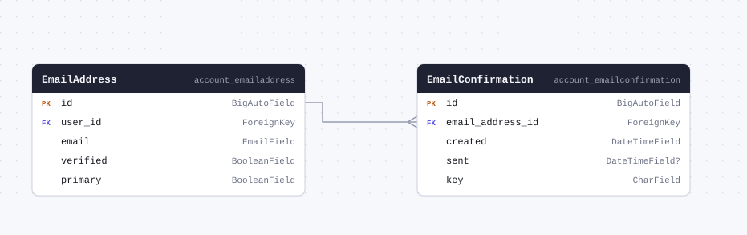

| Column | Field | Type | Null | Key | Default | Description |
| --- | --- | --- | --- | --- | --- | --- |
| `id` | `BigAutoField` | `integer` |  | PK | `autoincrement()` |  |
| `email_address_id` | `ForeignKey` | `bigint` |  | FK |  |  |
| `created` | `DateTimeField` | `datetime` |  |  | `now()` |  |
| `sent` | `DateTimeField` | `datetime` | yes |  |  |  |
| `key` | `CharField` | `varchar(64)` |  | unique |  |  |

Indexes:

- index `account_emailconfirmation_email_address_id_5b7f8c58` on `email_address_id`

Relations:

- `email_address_id` → [EmailAddress](#emailaddress).`id`, on delete cascade

## AccountDeletion

Table `account_accountdeletion`, app `account`.

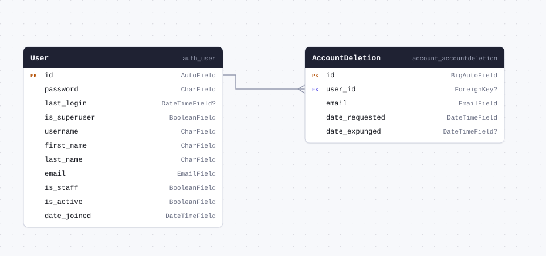

| Column | Field | Type | Null | Key | Default | Description |
| --- | --- | --- | --- | --- | --- | --- |
| `id` | `BigAutoField` | `integer` |  | PK | `autoincrement()` |  |
| `user_id` | `ForeignKey` | `integer` | yes | FK |  |  |
| `email` | `EmailField` | `varchar(254)` |  |  |  |  |
| `date_requested` | `DateTimeField` | `datetime` |  |  | `now()` |  |
| `date_expunged` | `DateTimeField` | `datetime` | yes |  |  |  |

Indexes:

- index `account_accountdeletion_user_id_c205475f` on `user_id`

Relations:

- `user_id` → [User](#user).`id`, on delete set null

## PasswordHistory

Table `account_passwordhistory`, app `account`.

Contains single password history for user.

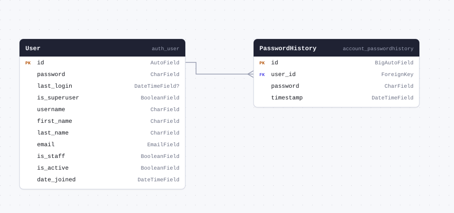

| Column | Field | Type | Null | Key | Default | Description |
| --- | --- | --- | --- | --- | --- | --- |
| `id` | `BigAutoField` | `integer` |  | PK | `autoincrement()` |  |
| `user_id` | `ForeignKey` | `integer` |  | FK |  |  |
| `password` | `CharField` | `varchar(255)` |  |  |  |  |
| `timestamp` | `DateTimeField` | `datetime` |  |  | `now()` |  |

Indexes:

- index `account_passwordhistory_user_id_dc325181` on `user_id`

Relations:

- `user_id` → [User](#user).`id`, on delete cascade

## PasswordExpiry

Table `account_passwordexpiry`, app `account`.

Holds the password expiration period for a single user.

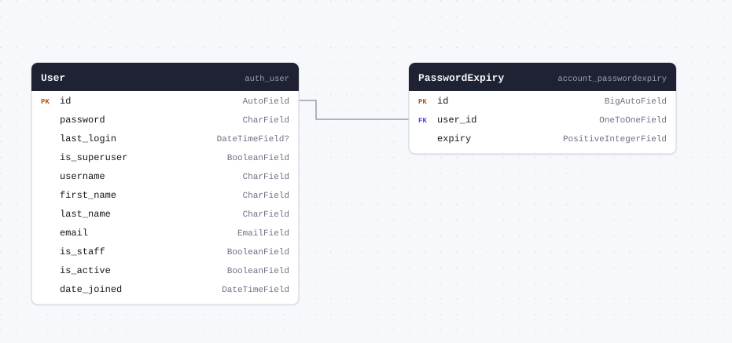

| Column | Field | Type | Null | Key | Default | Description |
| --- | --- | --- | --- | --- | --- | --- |
| `id` | `BigAutoField` | `integer` |  | PK | `autoincrement()` |  |
| `user_id` | `OneToOneField` | `integer` |  | FK, unique |  |  |
| `expiry` | `PositiveIntegerField` | `integer unsigned` |  |  | `0` |  |

Relations:

- `user_id` → [User](#user).`id`, on delete cascade

## Queue

Table `helpdesk_queue`, app `helpdesk`.

A queue is a collection of tickets into what would generally be business
areas or departments.

For example, a company may have a queue for each Product they provide, or
a queue for each of Accounts, Pre-Sales, and Support.

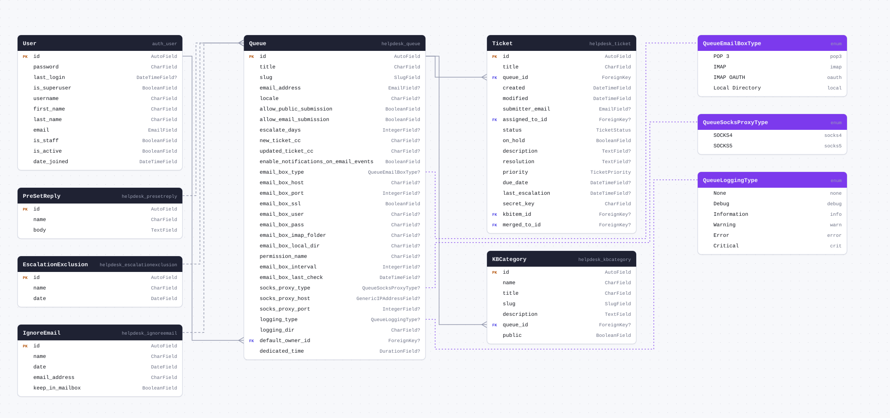

| Column | Field | Type | Null | Key | Default | Description |
| --- | --- | --- | --- | --- | --- | --- |
| `id` | `AutoField` | `integer` |  | PK | `autoincrement()` |  |
| `title` | `CharField` | `varchar(100)` |  |  |  |  |
| `slug` | `SlugField` | `varchar(50)` |  | unique |  | This slug is used when building ticket ID's. Once set, try not to change it or e-mailing may get messy. |
| `email_address` | `EmailField` | `varchar(254)` | yes |  |  | All outgoing e-mails for this queue will use this e-mail address. If you use IMAP or POP3, this should be the e-mail address for that mailbox. |
| `locale` | `CharField` | `varchar(10)` | yes |  |  | Locale of this queue. All correspondence in this queue will be in this language. |
| `allow_public_submission` | `BooleanField` | `bool` |  |  | `False` | Should this queue be listed on the public submission form? |
| `allow_email_submission` | `BooleanField` | `bool` |  |  | `False` | Do you want to poll the e-mail box below for new tickets? |
| `escalate_days` | `IntegerField` | `integer` | yes |  |  | For tickets which are not held, how often do you wish to increase their priority? Set to 0 for no escalation. |
| `new_ticket_cc` | `CharField` | `varchar(200)` | yes |  |  | If an e-mail address is entered here, then it will receive notification of all new tickets created for this queue. Enter a comma between multiple e-mail addresses. |
| `updated_ticket_cc` | `CharField` | `varchar(200)` | yes |  |  | If an e-mail address is entered here, then it will receive notification of all activity (new tickets, closed tickets, updates, reassignments, etc) for this queue. Separate multiple addresses with a comma. |
| `enable_notifications_on_email_events` | `BooleanField` | `bool` |  |  | `False` | When an email arrives to either create a ticket or to interact with an existing discussion. Should email notifications be sent ? Note: the new_ticket_cc and updated_ticket_cc work independently of this feature |
| `email_box_type` | `QueueEmailBoxType` | `varchar(5)` | yes |  |  | E-Mail server type for creating tickets automatically from a mailbox - both POP3 and IMAP are supported, as well as reading from a local directory. |
| `email_box_host` | `CharField` | `varchar(200)` | yes |  |  | Your e-mail server address - either the domain name or IP address. May be "localhost". |
| `email_box_port` | `IntegerField` | `integer` | yes |  |  | Port number to use for accessing e-mail. Default for POP3 is "110", and for IMAP is "143". This may differ on some servers. Leave it blank to use the defaults. |
| `email_box_ssl` | `BooleanField` | `bool` |  |  | `False` | Whether to use SSL for IMAP or POP3 - the default ports when using SSL are 993 for IMAP and 995 for POP3. |
| `email_box_user` | `CharField` | `varchar(200)` | yes |  |  | Username for accessing this mailbox. |
| `email_box_pass` | `CharField` | `varchar(200)` | yes |  |  | Password for the above username |
| `email_box_imap_folder` | `CharField` | `varchar(100)` | yes |  |  | If using IMAP, what folder do you wish to fetch messages from? This allows you to use one IMAP account for multiple queues, by filtering messages on your IMAP server into separate folders. Default: INBOX. |
| `email_box_local_dir` | `CharField` | `varchar(200)` | yes |  |  | If using a local directory, what directory path do you wish to poll for new email? Example: /var/lib/mail/helpdesk/ |
| `permission_name` | `CharField` | `varchar(72)` | yes |  |  | Name used in the django.contrib.auth permission system |
| `email_box_interval` | `IntegerField` | `integer` | yes |  | `'5'` | How often do you wish to check this mailbox? (in Minutes) |
| `email_box_last_check` | `DateTimeField` | `datetime` | yes |  |  |  |
| `socks_proxy_type` | `QueueSocksProxyType` | `varchar(8)` | yes |  |  | SOCKS4 or SOCKS5 allows you to proxy your connections through a SOCKS server. |
| `socks_proxy_host` | `GenericIPAddressField` | `char(39)` | yes |  |  | Socks proxy IP address. Default: 127.0.0.1 |
| `socks_proxy_port` | `IntegerField` | `integer` | yes |  |  | Socks proxy port number. Default: 9150 (default TOR port) |
| `logging_type` | `QueueLoggingType` | `varchar(5)` | yes |  |  | Set the default logging level. All messages at that level or above will be logged to the directory set below. If no level is set, logging will be disabled. |
| `logging_dir` | `CharField` | `varchar(200)` | yes |  |  | If logging is enabled, what directory should we use to store log files for this queue? The standard logging mechanisms are used if no directory is set |
| `default_owner_id` | `ForeignKey` | `integer` | yes | FK |  |  |
| `dedicated_time` | `DurationField` | `bigint` | yes |  |  | Time to be spent on this Queue in total |

Indexes:

- index `helpdesk_queue_default_owner_id_b0930a66` on `default_owner_id`

Relations:

- `default_owner_id` → [User](#user).`id`, on delete set null
- [Ticket](#ticket).`queue_id` → `id`, on delete cascade
- `presetreply_set` — many to many with [PreSetReply](#presetreply)
- `escalationexclusion_set` — many to many with [EscalationExclusion](#escalationexclusion)
- [KBCategory](#kbcategory).`queue_id` → `id`, on delete cascade
- `ignoreemail_set` — many to many with [IgnoreEmail](#ignoreemail)

## Ticket

Table `helpdesk_ticket`, app `helpdesk`.

To allow a ticket to be entered as quickly as possible, only the
bare minimum fields are required. These basically allow us to
sort and manage the ticket. The user can always go back and
enter more information later.

A good example of this is when a customer is on the phone, and
you want to give them a ticket ID as quickly as possible. You can
enter some basic info, save the ticket, give the customer the ID
and get off the phone, then add in further detail at a later time
(once the customer is not on the line).

Note that assigned_to is optional - unassigned tickets are displayed on
the dashboard to prompt users to take ownership of them.

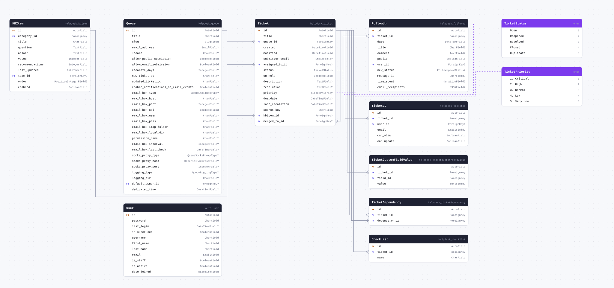

| Column | Field | Type | Null | Key | Default | Description |
| --- | --- | --- | --- | --- | --- | --- |
| `id` | `AutoField` | `integer` |  | PK | `autoincrement()` |  |
| `title` | `CharField` | `varchar(200)` |  |  |  |  |
| `queue_id` | `ForeignKey` | `integer` |  | FK |  |  |
| `created` | `DateTimeField` | `datetime` |  |  | `now()` | Date this ticket was first created |
| `modified` | `DateTimeField` | `datetime` |  |  | `now()` | Date this ticket was most recently changed. |
| `submitter_email` | `EmailField` | `varchar(254)` | yes |  |  | The submitter will receive an email for all public follow-ups left for this task. |
| `assigned_to_id` | `ForeignKey` | `integer` | yes | FK |  |  |
| `status` | `TicketStatus` | `integer` |  |  | `1` |  |
| `on_hold` | `BooleanField` | `bool` |  |  | `False` | If a ticket is on hold, it will not automatically be escalated. |
| `description` | `TextField` | `text` | yes |  |  | The content of the customers query. |
| `resolution` | `TextField` | `text` | yes |  |  | The resolution provided to the customer by our staff. |
| `priority` | `TicketPriority` | `integer` |  |  | `3` | 1 = Highest Priority, 5 = Low Priority |
| `due_date` | `DateTimeField` | `datetime` | yes |  |  |  |
| `last_escalation` | `DateTimeField` | `datetime` | yes |  |  | The date this ticket was last escalated - updated automatically by management/commands/escalate_tickets.py. |
| `secret_key` | `CharField` | `varchar(36)` |  |  | `mk_secret()` |  |
| `kbitem_id` | `ForeignKey` | `integer` | yes | FK |  |  |
| `merged_to_id` | `ForeignKey` | `integer` | yes | FK |  |  |

Indexes:

- index `helpdesk_ticket_queue_id_9b210169` on `queue_id`
- index `helpdesk_ticket_assigned_to_id_0716992e` on `assigned_to_id`
- index `helpdesk_ticket_kbitem_id_ee0464fc` on `kbitem_id`
- index `helpdesk_ticket_merged_to_id_7e3893ff` on `merged_to_id`

Relations:

- `queue_id` → [Queue](#queue).`id`, on delete cascade
- `assigned_to_id` → [User](#user).`id`, on delete protect
- `kbitem_id` → [KBItem](#kbitem).`id`, on delete cascade
- `merged_to_id` → [Ticket](#ticket).`id`, on delete set null
- [FollowUp](#followup).`ticket_id` → `id`, on delete cascade
- [TicketCC](#ticketcc).`ticket_id` → `id`, on delete cascade
- [TicketCustomFieldValue](#ticketcustomfieldvalue).`ticket_id` → `id`, on delete cascade
- [TicketDependency](#ticketdependency).`ticket_id` → `id`, on delete cascade
- [TicketDependency](#ticketdependency).`depends_on_id` → `id`, on delete cascade
- [Checklist](#checklist).`ticket_id` → `id`, on delete cascade

## FollowUp

Table `helpdesk_followup`, app `helpdesk`.

A FollowUp is a comment and/or change to a ticket. We keep a simple
title, the comment entered by the user, and the new status of a ticket
to enable easy flagging of details on the view-ticket page.

The title is automatically generated at save-time, based on what action
the user took.

Tickets that aren't public are never shown to or e-mailed to the submitter,
although all staff can see them.

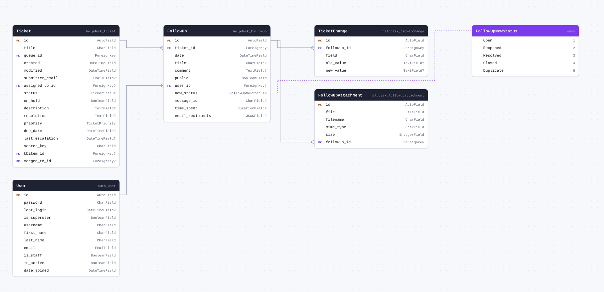

| Column | Field | Type | Null | Key | Default | Description |
| --- | --- | --- | --- | --- | --- | --- |
| `id` | `AutoField` | `integer` |  | PK | `autoincrement()` |  |
| `ticket_id` | `ForeignKey` | `integer` |  | FK |  |  |
| `date` | `DateTimeField` | `datetime` |  |  | `now()` |  |
| `title` | `CharField` | `varchar(200)` | yes |  |  |  |
| `comment` | `TextField` | `text` | yes |  |  |  |
| `public` | `BooleanField` | `bool` |  |  | `False` | Public tickets are viewable by the submitter and all staff, but non-public tickets can only be seen by staff. |
| `user_id` | `ForeignKey` | `integer` | yes | FK |  |  |
| `new_status` | `FollowUpNewStatus` | `integer` | yes |  |  | If the status was changed, what was it changed to? |
| `message_id` | `CharField` | `varchar(256)` | yes |  |  | The Message ID of the submitter's email. |
| `time_spent` | `DurationField` | `bigint` | yes |  |  | Time spent on this follow up |
| `email_recipients` | `JSONField` | `text` | yes |  | `None` | Addresses successfully notified by e-mail about this follow-up. Null means recipients were not recorded. |

Indexes:

- index `helpdesk_followup_ticket_id_3db2d079` on `ticket_id`
- index `helpdesk_followup_user_id_5b9c07e3` on `user_id`

Relations:

- `ticket_id` → [Ticket](#ticket).`id`, on delete cascade
- `user_id` → [User](#user).`id`, on delete protect
- [TicketChange](#ticketchange).`followup_id` → `id`, on delete cascade
- [FollowUpAttachment](#followupattachment).`followup_id` → `id`, on delete cascade

## TicketChange

Table `helpdesk_ticketchange`, app `helpdesk`.

For each FollowUp, any changes to the parent ticket (eg Title, Priority,
etc) are tracked here for display purposes.

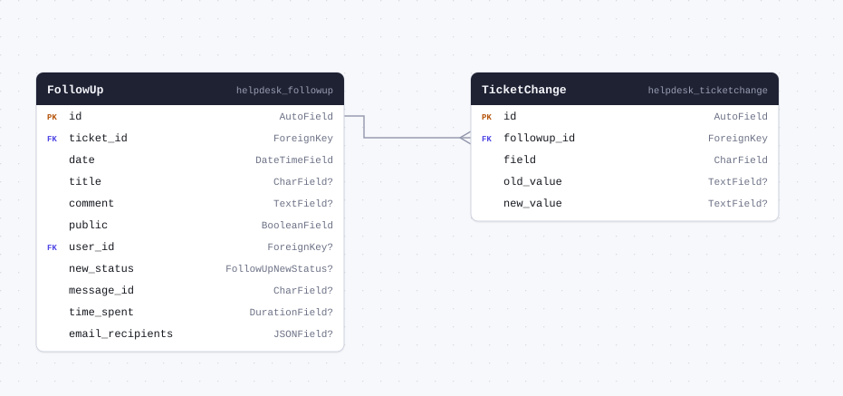

| Column | Field | Type | Null | Key | Default | Description |
| --- | --- | --- | --- | --- | --- | --- |
| `id` | `AutoField` | `integer` |  | PK | `autoincrement()` |  |
| `followup_id` | `ForeignKey` | `integer` |  | FK |  |  |
| `field` | `CharField` | `varchar(200)` |  |  |  |  |
| `old_value` | `TextField` | `text` | yes |  |  |  |
| `new_value` | `TextField` | `text` | yes |  |  |  |

Indexes:

- index `helpdesk_ticketchange_followup_id_2e4e87bc` on `followup_id`

Relations:

- `followup_id` → [FollowUp](#followup).`id`, on delete cascade

## FollowUpAttachment

Table `helpdesk_followupattachment`, app `helpdesk`.

Columns from `Attachment` (abstract): `file`, `filename`, `mime_type`, `size`.

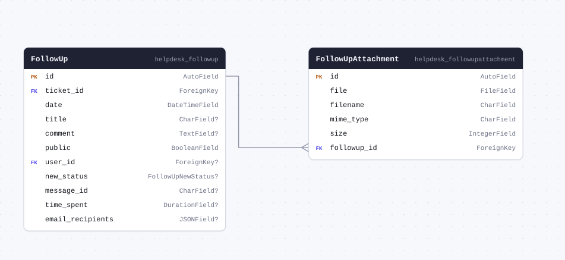

| Column | Field | Type | Null | Key | Default | Description |
| --- | --- | --- | --- | --- | --- | --- |
| `id` | `AutoField` | `integer` |  | PK | `autoincrement()` |  |
| `file` | `FileField` | `varchar(1000)` |  |  |  |  |
| `filename` | `CharField` | `varchar(1000)` |  |  |  |  |
| `mime_type` | `CharField` | `varchar(255)` |  |  |  |  |
| `size` | `IntegerField` | `integer` |  |  |  | Size of this file in bytes |
| `followup_id` | `ForeignKey` | `integer` |  | FK |  |  |

Indexes:

- index `helpdesk_followupattachment_followup_id_0e058984` on `followup_id`

Relations:

- `followup_id` → [FollowUp](#followup).`id`, on delete cascade

## KBIAttachment

Table `helpdesk_kbiattachment`, app `helpdesk`.

Columns from `Attachment` (abstract): `file`, `filename`, `mime_type`, `size`.

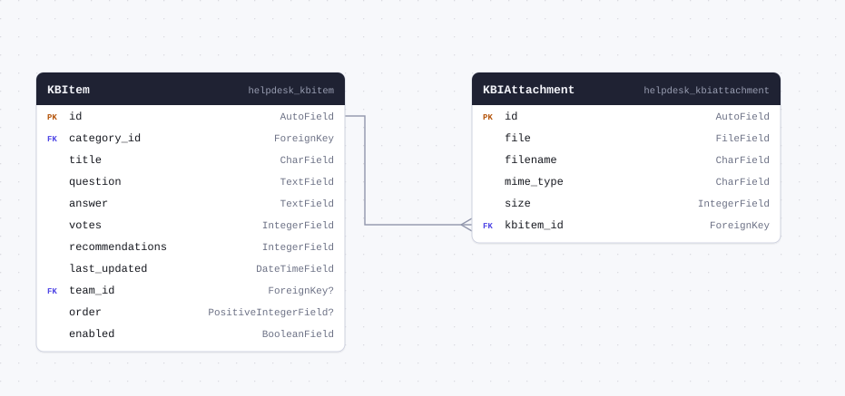

| Column | Field | Type | Null | Key | Default | Description |
| --- | --- | --- | --- | --- | --- | --- |
| `id` | `AutoField` | `integer` |  | PK | `autoincrement()` |  |
| `file` | `FileField` | `varchar(1000)` |  |  |  |  |
| `filename` | `CharField` | `varchar(1000)` |  |  |  |  |
| `mime_type` | `CharField` | `varchar(255)` |  |  |  |  |
| `size` | `IntegerField` | `integer` |  |  |  | Size of this file in bytes |
| `kbitem_id` | `ForeignKey` | `integer` |  | FK |  |  |

Indexes:

- index `helpdesk_kbiattachment_kbitem_id_591a4abd` on `kbitem_id`

Relations:

- `kbitem_id` → [KBItem](#kbitem).`id`, on delete cascade

## PreSetReply

Table `helpdesk_presetreply`, app `helpdesk`.

We can allow the admin to define a number of pre-set replies, used to
simplify the sending of updates and resolutions. These are basically Django
templates with a limited context - however if you wanted to get crafy it would
be easy to write a reply that displays ALL updates in hierarchical order etc
with use of for loops over {{ ticket.followup_set.all }} and friends.

When replying to a ticket, the user can select any reply set for the current
queue, and the body text is fetched via AJAX.

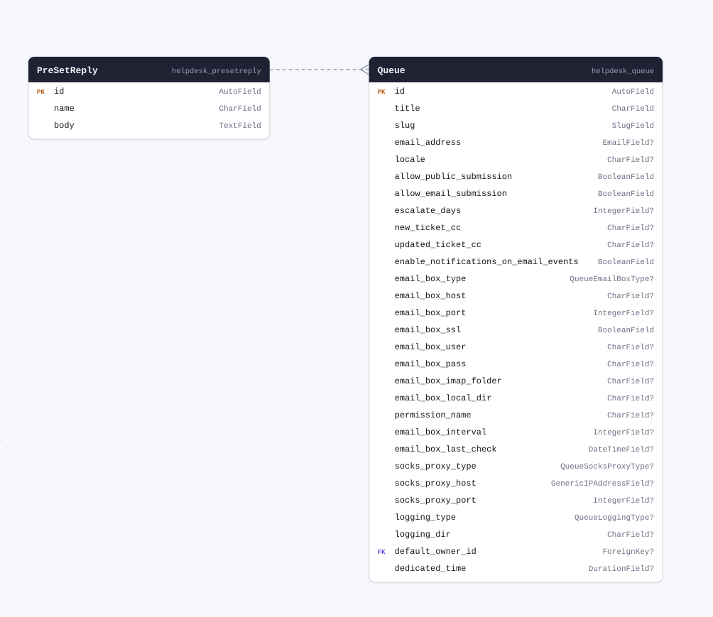

| Column | Field | Type | Null | Key | Default | Description |
| --- | --- | --- | --- | --- | --- | --- |
| `id` | `AutoField` | `integer` |  | PK | `autoincrement()` |  |
| `name` | `CharField` | `varchar(100)` |  |  |  | Only used to assist users with selecting a reply - not shown to the user. |
| `body` | `TextField` | `text` |  |  |  | Context available: {{ ticket }} - ticket object (eg {{ ticket.title }}); {{ queue }} - The queue; and {{ user }} - the current user. |

Relations:

- `queues` — many to many with [Queue](#queue)

## EscalationExclusion

Table `helpdesk_escalationexclusion`, app `helpdesk`.

An 'EscalationExclusion' lets us define a date on which escalation should
not happen, for example a weekend or public holiday.

You may also have a queue that is only used on one day per week.

To create these on a regular basis, check out the README file for an
example cronjob that runs 'create_escalation_exclusions.py'.

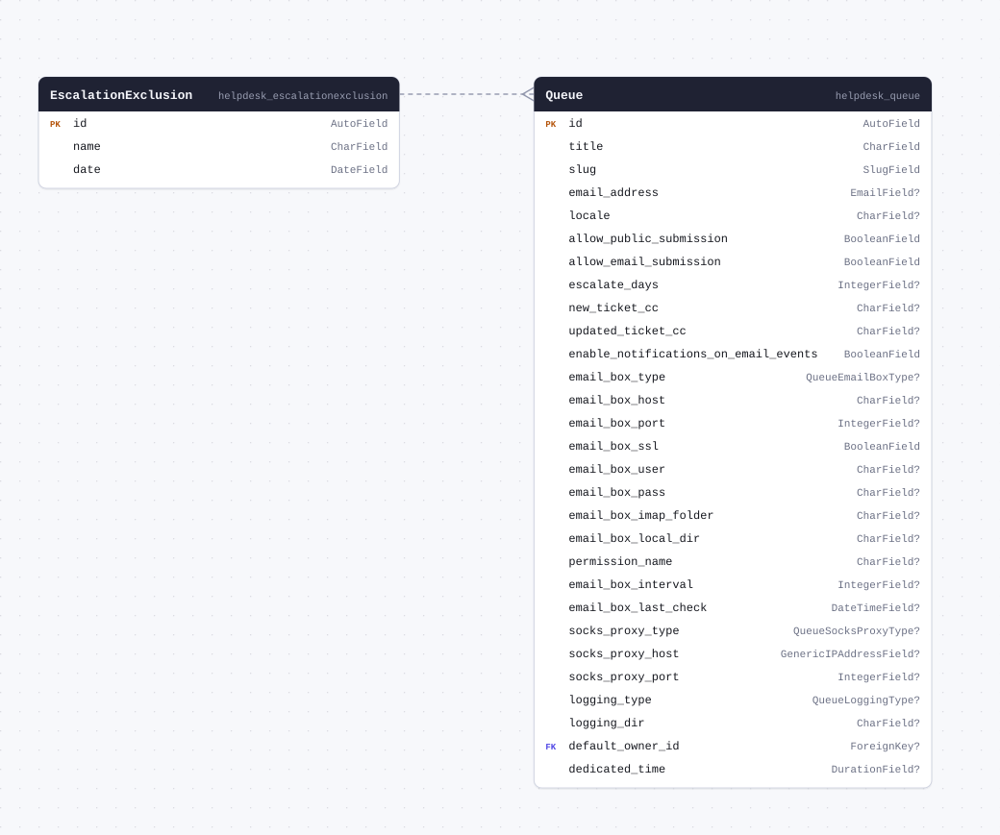

| Column | Field | Type | Null | Key | Default | Description |
| --- | --- | --- | --- | --- | --- | --- |
| `id` | `AutoField` | `integer` |  | PK | `autoincrement()` |  |
| `name` | `CharField` | `varchar(100)` |  |  |  |  |
| `date` | `DateField` | `date` |  |  |  | Date on which escalation should not happen |

Relations:

- `queues` — many to many with [Queue](#queue)

## EmailTemplate

Table `helpdesk_emailtemplate`, app `helpdesk`.

Since these are more likely to be changed than other templates, we store
them in the database.

This means that an admin can change email templates without having to have
access to the filesystem.

| Column | Field | Type | Null | Key | Default | Description |
| --- | --- | --- | --- | --- | --- | --- |
| `id` | `AutoField` | `integer` |  | PK | `autoincrement()` |  |
| `template_name` | `CharField` | `varchar(100)` |  |  |  |  |
| `subject` | `CharField` | `varchar(100)` |  |  |  | This will be prefixed with "[ticket.ticket] ticket.title". We recommend something simple such as "(Updated") or "(Closed)" - the same context is available as in plain_text, below. |
| `heading` | `CharField` | `varchar(100)` |  |  |  | In HTML e-mails, this will be the heading at the top of the email - the same context is available as in plain_text, below. |
| `plain_text` | `TextField` | `text` |  |  |  | The context available to you includes {{ ticket }}, {{ queue }}, and depending on the time of the call: {{ resolution }} or {{ comment }}. |
| `html` | `TextField` | `text` |  |  |  | The same context is available here as in plain_text, above. |
| `locale` | `CharField` | `varchar(10)` | yes |  |  | Locale of this template. |

## KBCategory

Table `helpdesk_kbcategory`, app `helpdesk`.

Represents a category for a group of questions and answers in the
knowledge base.

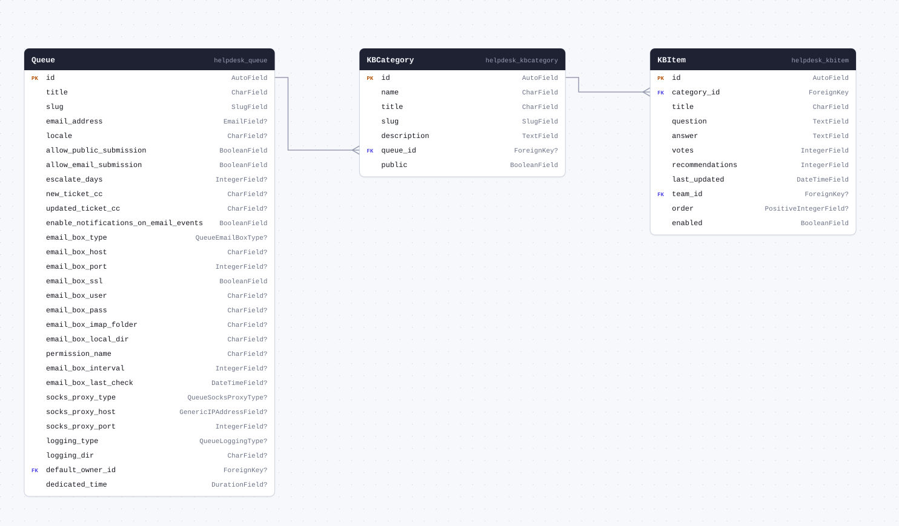

| Column | Field | Type | Null | Key | Default | Description |
| --- | --- | --- | --- | --- | --- | --- |
| `id` | `AutoField` | `integer` |  | PK | `autoincrement()` |  |
| `name` | `CharField` | `varchar(100)` |  |  |  |  |
| `title` | `CharField` | `varchar(100)` |  |  |  |  |
| `slug` | `SlugField` | `varchar(50)` |  |  |  |  |
| `description` | `TextField` | `text` |  |  |  |  |
| `queue_id` | `ForeignKey` | `integer` | yes | FK |  |  |
| `public` | `BooleanField` | `bool` |  |  | `True` |  |

Indexes:

- index `helpdesk_kbcategory_slug_5922579d` on `slug`
- index `helpdesk_kbcategory_queue_id_975d03cb` on `queue_id`

Relations:

- `queue_id` → [Queue](#queue).`id`, on delete cascade
- [KBItem](#kbitem).`category_id` → `id`, on delete cascade

## KBItem

Table `helpdesk_kbitem`, app `helpdesk`.

An item within the knowledgebase. Very straightforward question/answer
style system.

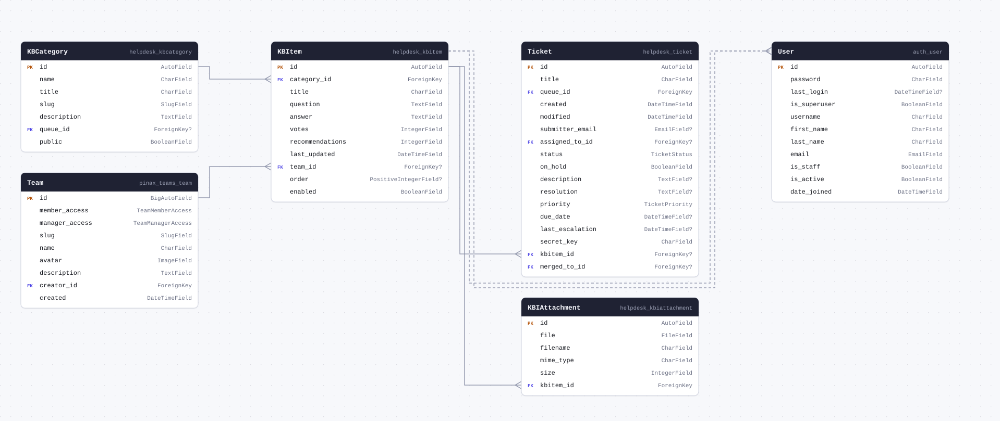

| Column | Field | Type | Null | Key | Default | Description |
| --- | --- | --- | --- | --- | --- | --- |
| `id` | `AutoField` | `integer` |  | PK | `autoincrement()` |  |
| `category_id` | `ForeignKey` | `integer` |  | FK |  |  |
| `title` | `CharField` | `varchar(100)` |  |  |  |  |
| `question` | `TextField` | `text` |  |  |  |  |
| `answer` | `TextField` | `text` |  |  |  |  |
| `votes` | `IntegerField` | `integer` |  |  | `0` | Total number of votes cast for this item |
| `recommendations` | `IntegerField` | `integer` |  |  | `0` | Number of votes for this item which were POSITIVE. |
| `last_updated` | `DateTimeField` | `datetime` |  |  |  | The date on which this question was most recently changed. |
| `team_id` | `ForeignKey` | `bigint` | yes | FK |  |  |
| `order` | `PositiveIntegerField` | `integer unsigned` | yes |  |  |  |
| `enabled` | `BooleanField` | `bool` |  |  | `True` |  |

Indexes:

- index `helpdesk_kbitem_category_id_14a1b130` on `category_id`
- index `helpdesk_kbitem_team_id_81825755` on `team_id`

Relations:

- [Ticket](#ticket).`kbitem_id` → `id`, on delete cascade
- [KBIAttachment](#kbiattachment).`kbitem_id` → `id`, on delete cascade
- `category_id` → [KBCategory](#kbcategory).`id`, on delete cascade
- `team_id` → [Team](#team).`id`, on delete set null
- `voted_by` — many to many with [User](#user)
- `downvoted_by` — many to many with [User](#user)

## SavedSearch

Table `helpdesk_savedsearch`, app `helpdesk`.

Allow a user to save a ticket search, eg their filtering and sorting
options, and optionally share it with other users. This lets people
easily create a set of commonly-used filters, such as:
    * My tickets waiting on me
    * My tickets waiting on submitter
    * My tickets in 'Priority Support' queue with priority of 1
    * All tickets containing the word 'billing'.
     etc...

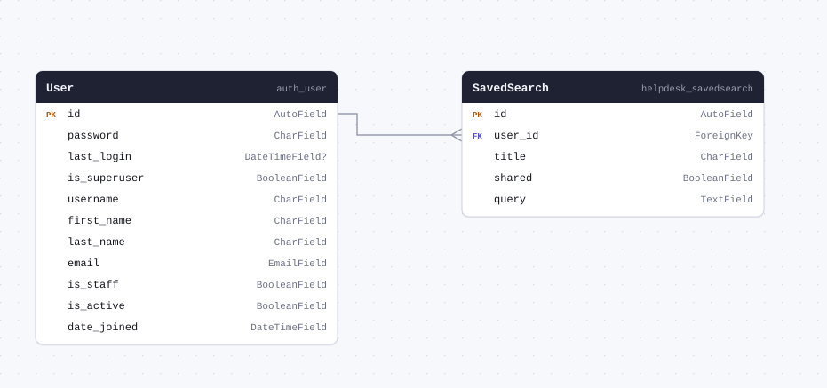

| Column | Field | Type | Null | Key | Default | Description |
| --- | --- | --- | --- | --- | --- | --- |
| `id` | `AutoField` | `integer` |  | PK | `autoincrement()` |  |
| `user_id` | `ForeignKey` | `integer` |  | FK |  |  |
| `title` | `CharField` | `varchar(100)` |  |  |  | User-provided name for this query |
| `shared` | `BooleanField` | `bool` |  |  | `False` | Should other users see this query? |
| `query` | `TextField` | `text` |  |  |  | Pickled query object. Be wary changing this. |

Indexes:

- index `helpdesk_savedsearch_user_id_24cf33b5` on `user_id`

Relations:

- `user_id` → [User](#user).`id`, on delete cascade

## UserSettings

Table `helpdesk_usersettings`, app `helpdesk`.

A bunch of user-specific settings that we want to be able to define, such
as notification preferences and other things that should probably be
configurable.

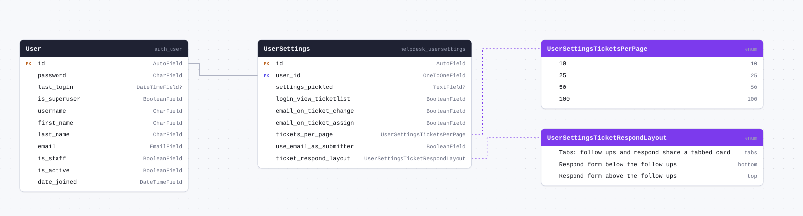

| Column | Field | Type | Null | Key | Default | Description |
| --- | --- | --- | --- | --- | --- | --- |
| `id` | `AutoField` | `integer` |  | PK | `autoincrement()` |  |
| `user_id` | `OneToOneField` | `integer` |  | FK, unique |  |  |
| `settings_pickled` | `TextField` | `text` | yes |  |  | DEPRECATED! This is a base64-encoded representation of a pickled Python dictionary. Do not change this field via the admin. |
| `login_view_ticketlist` | `BooleanField` | `bool` |  |  | `login_view_ticketlist_default()` | Display the ticket list upon login? Otherwise, the dashboard is shown. |
| `email_on_ticket_change` | `BooleanField` | `bool` |  |  | `email_on_ticket_change_default()` | If you're the ticket owner and the ticket is changed via the web by somebody else,do you want to receive an e-mail? |
| `email_on_ticket_assign` | `BooleanField` | `bool` |  |  | `email_on_ticket_assign_default()` | If you are assigned a ticket via the web, do you want to receive an e-mail? |
| `tickets_per_page` | `UserSettingsTicketsPerPage` | `integer` |  |  | `tickets_per_page_default()` | How many tickets do you want to see on the Ticket List page? |
| `use_email_as_submitter` | `BooleanField` | `bool` |  |  | `use_email_as_submitter_default()` | When you submit a ticket, do you want to automatically use your e-mail address as the submitter address? You can type a different e-mail address when entering the ticket if needed, this option only changes the default. |
| `ticket_respond_layout` | `UserSettingsTicketRespondLayout` | `varchar(16)` |  |  | `ticket_respond_layout_default()` | Where should the respond form appear when viewing a ticket? |

Relations:

- `user_id` → [User](#user).`id`, on delete cascade

## IgnoreEmail

Table `helpdesk_ignoreemail`, app `helpdesk`.

This model lets us easily ignore e-mails from certain senders when
processing IMAP and POP3 mailboxes, eg mails from postmaster or from
known trouble-makers.

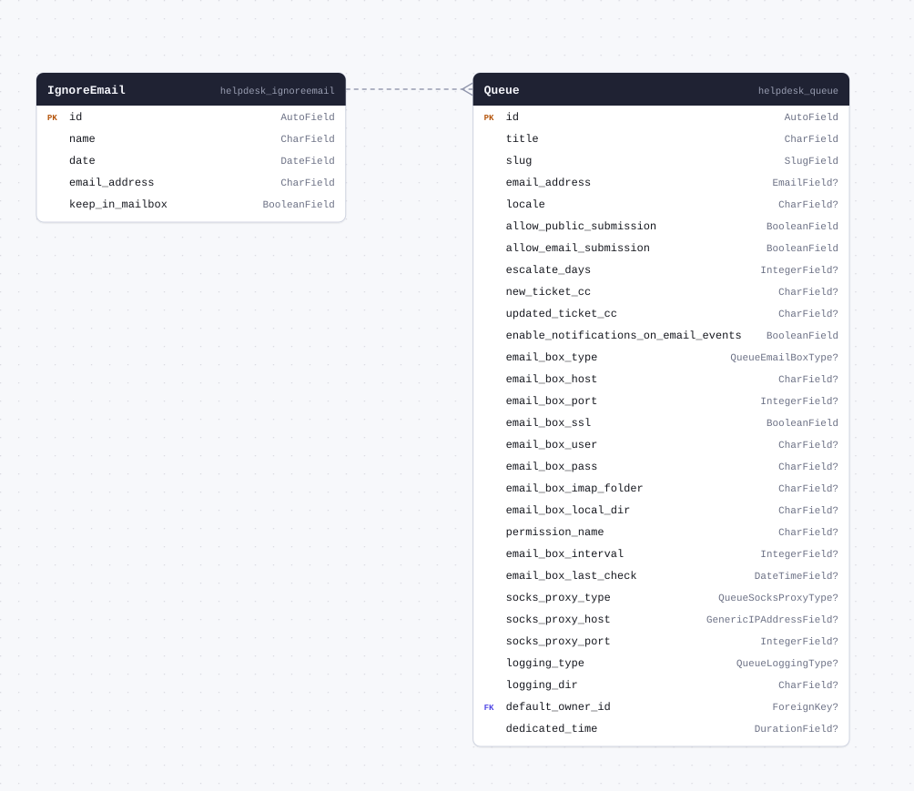

| Column | Field | Type | Null | Key | Default | Description |
| --- | --- | --- | --- | --- | --- | --- |
| `id` | `AutoField` | `integer` |  | PK | `autoincrement()` |  |
| `name` | `CharField` | `varchar(100)` |  |  |  |  |
| `date` | `DateField` | `date` |  |  |  | Date on which this e-mail address was added |
| `email_address` | `CharField` | `varchar(150)` |  |  |  | Enter a full e-mail address, or portions with wildcards, eg *@domain.com or postmaster@*. |
| `keep_in_mailbox` | `BooleanField` | `bool` |  |  | `False` | Do you want to save emails from this address in the mailbox? If this is unticked, emails from this address will be deleted. |

Relations:

- `queues` — many to many with [Queue](#queue)

## TicketCC

Table `helpdesk_ticketcc`, app `helpdesk`.

Often, there are people who wish to follow a ticket who aren't the
person who originally submitted it. This model provides a way for those
people to follow a ticket.

In this circumstance, a 'person' could be either an e-mail address or
an existing system user.

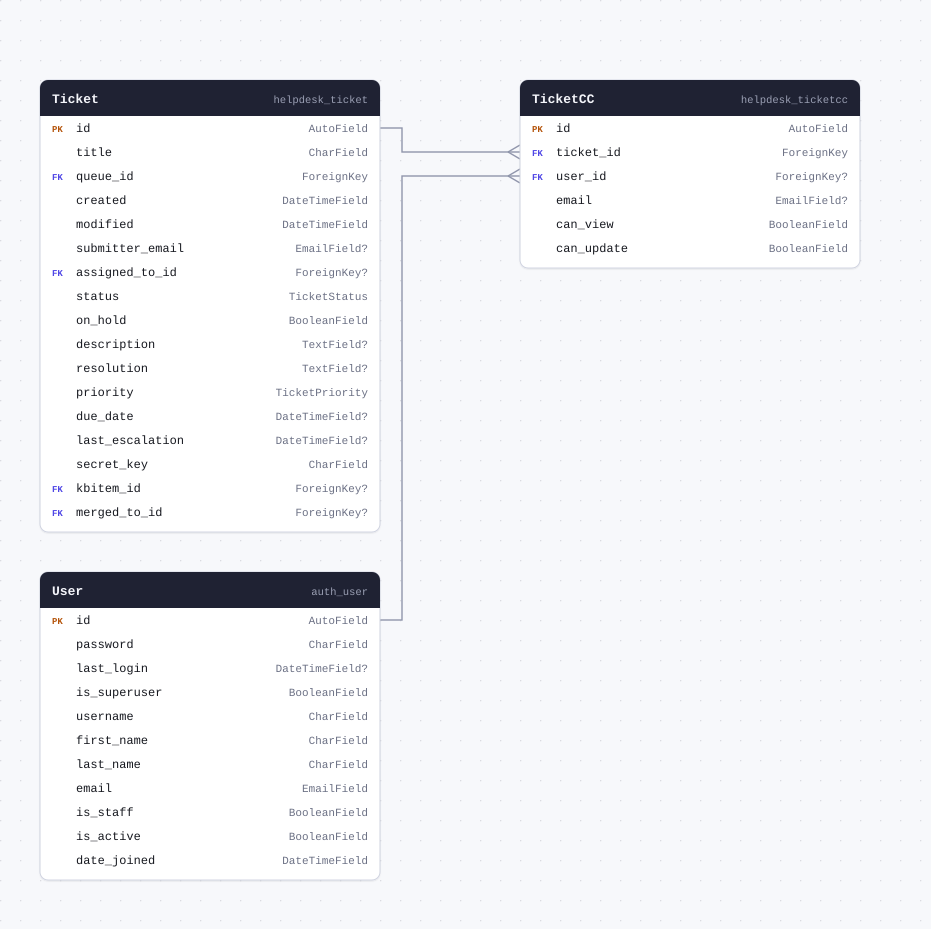

| Column | Field | Type | Null | Key | Default | Description |
| --- | --- | --- | --- | --- | --- | --- |
| `id` | `AutoField` | `integer` |  | PK | `autoincrement()` |  |
| `ticket_id` | `ForeignKey` | `integer` |  | FK |  |  |
| `user_id` | `ForeignKey` | `integer` | yes | FK |  | User who wishes to receive updates for this ticket. |
| `email` | `EmailField` | `varchar(254)` | yes |  |  | For non-user followers, enter their e-mail address |
| `can_view` | `BooleanField` | `bool` |  |  | `False` | Can this CC login to view the ticket details? |
| `can_update` | `BooleanField` | `bool` |  |  | `False` | Can this CC login and update the ticket? |

Indexes:

- index `helpdesk_ticketcc_ticket_id_4e774289` on `ticket_id`
- index `helpdesk_ticketcc_user_id_d811c3c2` on `user_id`

Relations:

- `ticket_id` → [Ticket](#ticket).`id`, on delete cascade
- `user_id` → [User](#user).`id`, on delete cascade

## CustomField

Table `helpdesk_customfield`, app `helpdesk`.

Definitions for custom fields that are glued onto each ticket.

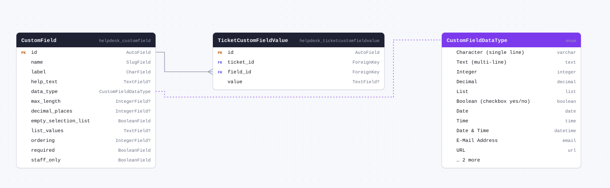

| Column | Field | Type | Null | Key | Default | Description |
| --- | --- | --- | --- | --- | --- | --- |
| `id` | `AutoField` | `integer` |  | PK | `autoincrement()` |  |
| `name` | `SlugField` | `varchar(50)` |  | unique |  | As used in the database and behind the scenes. Must be unique and consist of only lowercase letters with no punctuation. |
| `label` | `CharField` | `varchar(30)` |  |  |  | The display label for this field |
| `help_text` | `TextField` | `text` | yes |  |  | Shown to the user when editing the ticket |
| `data_type` | `CustomFieldDataType` | `varchar(100)` |  |  |  | Allows you to restrict the data entered into this field |
| `max_length` | `IntegerField` | `integer` | yes |  |  |  |
| `decimal_places` | `IntegerField` | `integer` | yes |  |  | Only used for decimal fields |
| `empty_selection_list` | `BooleanField` | `bool` |  |  | `False` | Only for List: adds an empty first entry to the choices list, which enforces that the user makes an active choice. |
| `list_values` | `TextField` | `text` | yes |  |  | For list fields only. Enter one option per line. |
| `ordering` | `IntegerField` | `integer` | yes |  |  | Lower numbers are displayed first; higher numbers are listed later |
| `required` | `BooleanField` | `bool` |  |  | `False` | Does the user have to enter a value for this field? |
| `staff_only` | `BooleanField` | `bool` |  |  | `False` | If this is ticked, then the public submission form will NOT show this field |

Relations:

- [TicketCustomFieldValue](#ticketcustomfieldvalue).`field_id` → `id`, on delete cascade

## TicketCustomFieldValue

Table `helpdesk_ticketcustomfieldvalue`, app `helpdesk`.

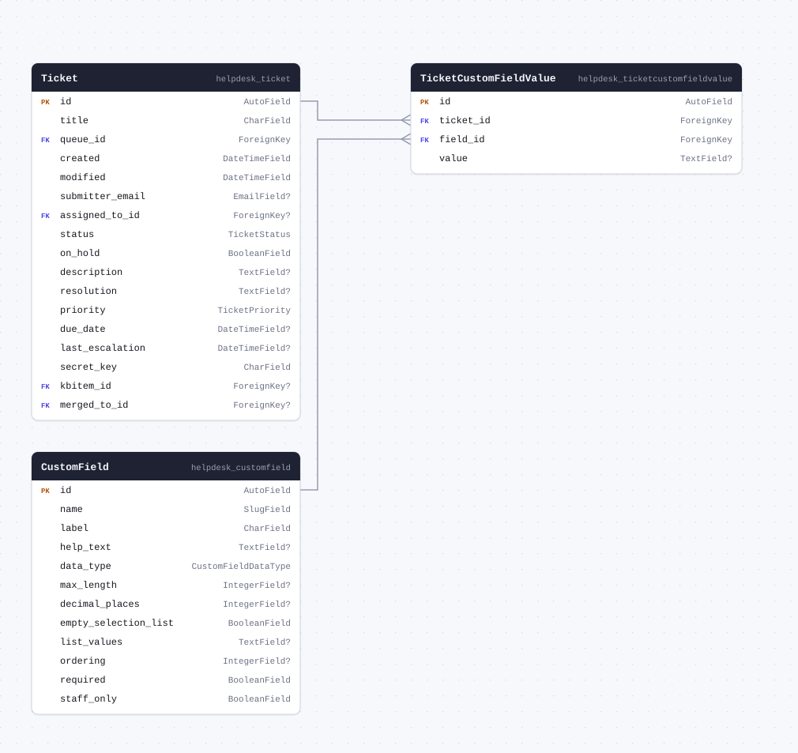

| Column | Field | Type | Null | Key | Default | Description |
| --- | --- | --- | --- | --- | --- | --- |
| `id` | `AutoField` | `integer` |  | PK | `autoincrement()` |  |
| `ticket_id` | `ForeignKey` | `integer` |  | FK |  |  |
| `field_id` | `ForeignKey` | `integer` |  | FK |  |  |
| `value` | `TextField` | `text` | yes |  |  |  |

Indexes:

- index `helpdesk_ticketcustomfieldvalue_ticket_id_4e2fe33a` on `ticket_id`
- index `helpdesk_ticketcustomfieldvalue_field_id_fd61fcda` on `field_id`
- unique `helpdesk_ticketcustomfieldvalue_ticket_id_field_id_4fc28390_uniq` on `ticket_id`, `field_id`

Relations:

- `ticket_id` → [Ticket](#ticket).`id`, on delete cascade
- `field_id` → [CustomField](#customfield).`id`, on delete cascade

## TicketDependency

Table `helpdesk_ticketdependency`, app `helpdesk`.

The ticket identified by `ticket` cannot be resolved until the ticket in `depends_on` has been resolved.
To help enforce this, a helper function `can_be_resolved` on each Ticket instance checks that
these have all been resolved.

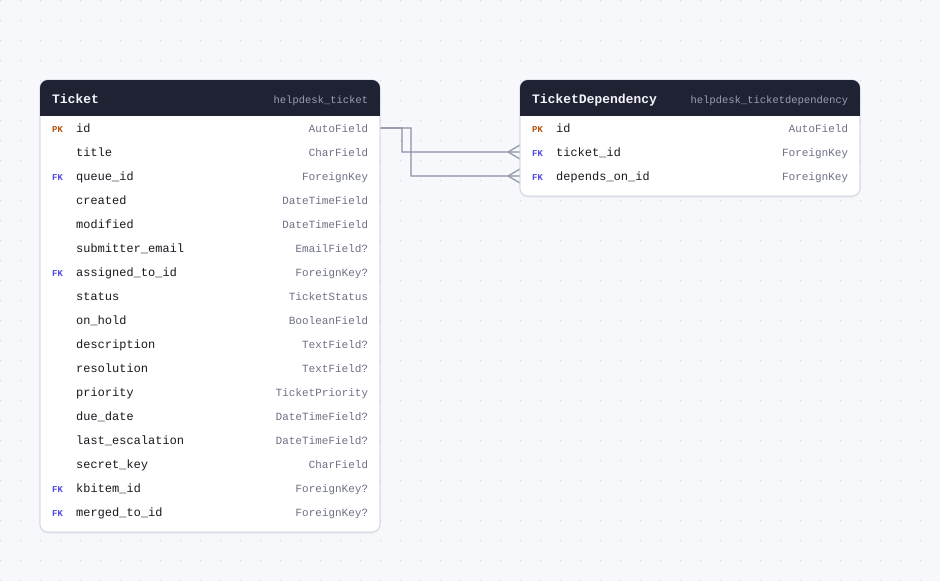

| Column | Field | Type | Null | Key | Default | Description |
| --- | --- | --- | --- | --- | --- | --- |
| `id` | `AutoField` | `integer` |  | PK | `autoincrement()` |  |
| `ticket_id` | `ForeignKey` | `integer` |  | FK |  |  |
| `depends_on_id` | `ForeignKey` | `integer` |  | FK |  |  |

Indexes:

- index `helpdesk_ticketdependency_ticket_id_618bbe6b` on `ticket_id`
- index `helpdesk_ticketdependency_depends_on_id_e310efa4` on `depends_on_id`
- unique `helpdesk_ticketdependency_ticket_id_depends_on_id_43caa9be_uniq` on `ticket_id`, `depends_on_id`

Relations:

- `ticket_id` → [Ticket](#ticket).`id`, on delete cascade
- `depends_on_id` → [Ticket](#ticket).`id`, on delete cascade

## ChecklistTemplate

Table `helpdesk_checklisttemplate`, app `helpdesk`.

| Column | Field | Type | Null | Key | Default | Description |
| --- | --- | --- | --- | --- | --- | --- |
| `id` | `AutoField` | `integer` |  | PK | `autoincrement()` |  |
| `name` | `CharField` | `varchar(100)` |  |  |  |  |
| `task_list` | `JSONField` | `text` |  |  |  |  |

## Checklist

Table `helpdesk_checklist`, app `helpdesk`.

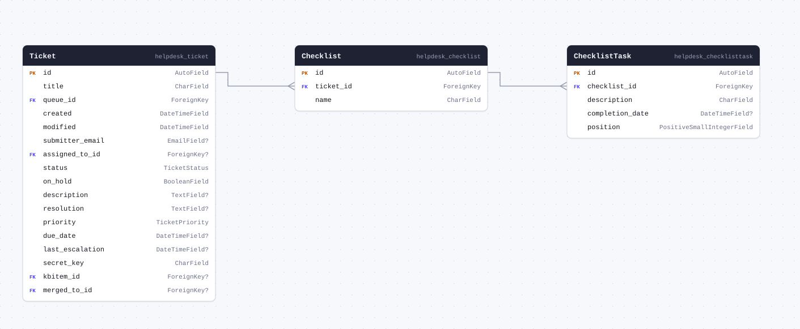

| Column | Field | Type | Null | Key | Default | Description |
| --- | --- | --- | --- | --- | --- | --- |
| `id` | `AutoField` | `integer` |  | PK | `autoincrement()` |  |
| `ticket_id` | `ForeignKey` | `integer` |  | FK |  |  |
| `name` | `CharField` | `varchar(100)` |  |  |  |  |

Indexes:

- index `helpdesk_checklist_ticket_id_78a0d426` on `ticket_id`

Relations:

- `ticket_id` → [Ticket](#ticket).`id`, on delete cascade
- [ChecklistTask](#checklisttask).`checklist_id` → `id`, on delete cascade

## ChecklistTask

Table `helpdesk_checklisttask`, app `helpdesk`.

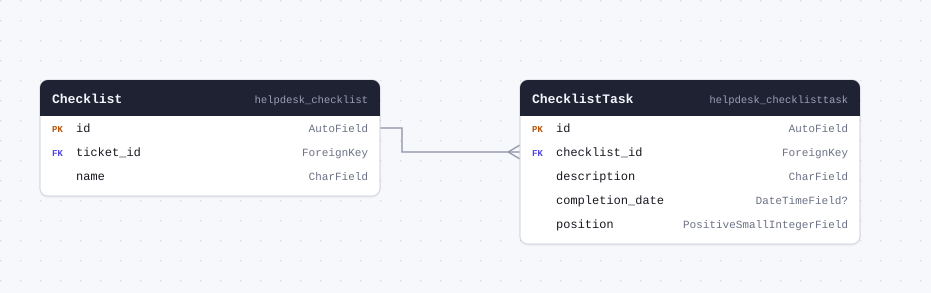

| Column | Field | Type | Null | Key | Default | Description |
| --- | --- | --- | --- | --- | --- | --- |
| `id` | `AutoField` | `integer` |  | PK | `autoincrement()` |  |
| `checklist_id` | `ForeignKey` | `integer` |  | FK |  |  |
| `description` | `CharField` | `varchar(250)` |  |  |  |  |
| `completion_date` | `DateTimeField` | `datetime` | yes |  |  |  |
| `position` | `PositiveSmallIntegerField` | `smallint unsigned` |  |  |  |  |

Indexes:

- index `helpdesk_checklisttask_checklist_id_4171e5cf` on `checklist_id`
- index `helpdesk_checklisttask_position_1604f85c` on `position`

Relations:

- `checklist_id` → [Checklist](#checklist).`id`, on delete cascade

# Enums

## LogEntryActionFlag

| Name | Stored as |
| --- | --- |
| `Addition` | `1` |
| `Change` | `2` |
| `Deletion` | `3` |

## JoinInvitationStatus

| Name | Stored as |
| --- | --- |
| `Sent` | `1` |
| `Accepted` | `2` |
| `Joined Independently` | `3` |

## SimpleTeamMemberAccess

| Name | Stored as |
| --- | --- |
| `open` | `open` |
| `by application` | `application` |
| `by invitation` | `invitation` |

## SimpleTeamManagerAccess

| Name | Stored as |
| --- | --- |
| `add someone` | `add someone` |
| `invite someone` | `invite someone` |

## TeamMemberAccess

| Name | Stored as |
| --- | --- |
| `open` | `open` |
| `by application` | `application` |
| `by invitation` | `invitation` |

## TeamManagerAccess

| Name | Stored as |
| --- | --- |
| `add someone` | `add someone` |
| `invite someone` | `invite someone` |

## SimpleMembershipState

| Name | Stored as |
| --- | --- |
| `applied` | `applied` |
| `invited` | `invited` |
| `declined` | `declined` |
| `rejected` | `rejected` |
| `accepted` | `accepted` |
| `waitlisted` | `waitlisted` |
| `auto joined` | `auto-joined` |

## SimpleMembershipRole

| Name | Stored as |
| --- | --- |
| `member` | `member` |
| `manager` | `manager` |
| `owner` | `owner` |

## MembershipState

| Name | Stored as |
| --- | --- |
| `applied` | `applied` |
| `invited` | `invited` |
| `declined` | `declined` |
| `rejected` | `rejected` |
| `accepted` | `accepted` |
| `waitlisted` | `waitlisted` |
| `auto joined` | `auto-joined` |

## MembershipRole

| Name | Stored as |
| --- | --- |
| `member` | `member` |
| `manager` | `manager` |
| `owner` | `owner` |

## AccountTimezone

| Name | Stored as |
| --- | --- |
| `Africa/Abidjan` | `Africa/Abidjan` |
| `Africa/Accra` | `Africa/Accra` |
| `Africa/Addis_Ababa` | `Africa/Addis_Ababa` |
| `Africa/Algiers` | `Africa/Algiers` |
| `Africa/Asmara` | `Africa/Asmara` |
| `Africa/Asmera` | `Africa/Asmera` |
| `Africa/Bamako` | `Africa/Bamako` |
| `Africa/Bangui` | `Africa/Bangui` |
| `Africa/Banjul` | `Africa/Banjul` |
| `Africa/Bissau` | `Africa/Bissau` |
| `Africa/Blantyre` | `Africa/Blantyre` |
| `Africa/Brazzaville` | `Africa/Brazzaville` |
| `Africa/Bujumbura` | `Africa/Bujumbura` |
| `Africa/Cairo` | `Africa/Cairo` |
| `Africa/Casablanca` | `Africa/Casablanca` |
| `Africa/Ceuta` | `Africa/Ceuta` |
| `Africa/Conakry` | `Africa/Conakry` |
| `Africa/Dakar` | `Africa/Dakar` |
| `Africa/Dar_es_Salaam` | `Africa/Dar_es_Salaam` |
| `Africa/Djibouti` | `Africa/Djibouti` |
| `Africa/Douala` | `Africa/Douala` |
| `Africa/El_Aaiun` | `Africa/El_Aaiun` |
| `Africa/Freetown` | `Africa/Freetown` |
| `Africa/Gaborone` | `Africa/Gaborone` |
| `Africa/Harare` | `Africa/Harare` |
| `Africa/Johannesburg` | `Africa/Johannesburg` |
| `Africa/Juba` | `Africa/Juba` |
| `Africa/Kampala` | `Africa/Kampala` |
| `Africa/Khartoum` | `Africa/Khartoum` |
| `Africa/Kigali` | `Africa/Kigali` |
| `Africa/Kinshasa` | `Africa/Kinshasa` |
| `Africa/Lagos` | `Africa/Lagos` |
| `Africa/Libreville` | `Africa/Libreville` |
| `Africa/Lome` | `Africa/Lome` |
| `Africa/Luanda` | `Africa/Luanda` |
| `Africa/Lubumbashi` | `Africa/Lubumbashi` |
| `Africa/Lusaka` | `Africa/Lusaka` |
| `Africa/Malabo` | `Africa/Malabo` |
| `Africa/Maputo` | `Africa/Maputo` |
| `Africa/Maseru` | `Africa/Maseru` |
| `Africa/Mbabane` | `Africa/Mbabane` |
| `Africa/Mogadishu` | `Africa/Mogadishu` |
| `Africa/Monrovia` | `Africa/Monrovia` |
| `Africa/Nairobi` | `Africa/Nairobi` |
| `Africa/Ndjamena` | `Africa/Ndjamena` |
| `Africa/Niamey` | `Africa/Niamey` |
| `Africa/Nouakchott` | `Africa/Nouakchott` |
| `Africa/Ouagadougou` | `Africa/Ouagadougou` |
| `Africa/Porto-Novo` | `Africa/Porto-Novo` |
| `Africa/Sao_Tome` | `Africa/Sao_Tome` |
| `Africa/Timbuktu` | `Africa/Timbuktu` |
| `Africa/Tripoli` | `Africa/Tripoli` |
| `Africa/Tunis` | `Africa/Tunis` |
| `Africa/Windhoek` | `Africa/Windhoek` |
| `America/Adak` | `America/Adak` |
| `America/Anchorage` | `America/Anchorage` |
| `America/Anguilla` | `America/Anguilla` |
| `America/Antigua` | `America/Antigua` |
| `America/Araguaina` | `America/Araguaina` |
| `America/Argentina/Buenos_Aires` | `America/Argentina/Buenos_Aires` |
| `America/Argentina/Catamarca` | `America/Argentina/Catamarca` |
| `America/Argentina/ComodRivadavia` | `America/Argentina/ComodRivadavia` |
| `America/Argentina/Cordoba` | `America/Argentina/Cordoba` |
| `America/Argentina/Jujuy` | `America/Argentina/Jujuy` |
| `America/Argentina/La_Rioja` | `America/Argentina/La_Rioja` |
| `America/Argentina/Mendoza` | `America/Argentina/Mendoza` |
| `America/Argentina/Rio_Gallegos` | `America/Argentina/Rio_Gallegos` |
| `America/Argentina/Salta` | `America/Argentina/Salta` |
| `America/Argentina/San_Juan` | `America/Argentina/San_Juan` |
| `America/Argentina/San_Luis` | `America/Argentina/San_Luis` |
| `America/Argentina/Tucuman` | `America/Argentina/Tucuman` |
| `America/Argentina/Ushuaia` | `America/Argentina/Ushuaia` |
| `America/Aruba` | `America/Aruba` |
| `America/Asuncion` | `America/Asuncion` |
| `America/Atikokan` | `America/Atikokan` |
| `America/Atka` | `America/Atka` |
| `America/Bahia` | `America/Bahia` |
| `America/Bahia_Banderas` | `America/Bahia_Banderas` |
| `America/Barbados` | `America/Barbados` |
| `America/Belem` | `America/Belem` |
| `America/Belize` | `America/Belize` |
| `America/Blanc-Sablon` | `America/Blanc-Sablon` |
| `America/Boa_Vista` | `America/Boa_Vista` |
| `America/Bogota` | `America/Bogota` |
| `America/Boise` | `America/Boise` |
| `America/Buenos_Aires` | `America/Buenos_Aires` |
| `America/Cambridge_Bay` | `America/Cambridge_Bay` |
| `America/Campo_Grande` | `America/Campo_Grande` |
| `America/Cancun` | `America/Cancun` |
| `America/Caracas` | `America/Caracas` |
| `America/Catamarca` | `America/Catamarca` |
| `America/Cayenne` | `America/Cayenne` |
| `America/Cayman` | `America/Cayman` |
| `America/Chicago` | `America/Chicago` |
| `America/Chihuahua` | `America/Chihuahua` |
| `America/Coral_Harbour` | `America/Coral_Harbour` |
| `America/Cordoba` | `America/Cordoba` |
| `America/Costa_Rica` | `America/Costa_Rica` |
| `America/Creston` | `America/Creston` |
| `America/Cuiaba` | `America/Cuiaba` |
| `America/Curacao` | `America/Curacao` |
| `America/Danmarkshavn` | `America/Danmarkshavn` |
| `America/Dawson` | `America/Dawson` |
| `America/Dawson_Creek` | `America/Dawson_Creek` |
| `America/Denver` | `America/Denver` |
| `America/Detroit` | `America/Detroit` |
| `America/Dominica` | `America/Dominica` |
| `America/Edmonton` | `America/Edmonton` |
| `America/Eirunepe` | `America/Eirunepe` |
| `America/El_Salvador` | `America/El_Salvador` |
| `America/Ensenada` | `America/Ensenada` |
| `America/Fort_Wayne` | `America/Fort_Wayne` |
| `America/Fortaleza` | `America/Fortaleza` |
| `America/Glace_Bay` | `America/Glace_Bay` |
| `America/Godthab` | `America/Godthab` |
| `America/Goose_Bay` | `America/Goose_Bay` |
| `America/Grand_Turk` | `America/Grand_Turk` |
| `America/Grenada` | `America/Grenada` |
| `America/Guadeloupe` | `America/Guadeloupe` |
| `America/Guatemala` | `America/Guatemala` |
| `America/Guayaquil` | `America/Guayaquil` |
| `America/Guyana` | `America/Guyana` |
| `America/Halifax` | `America/Halifax` |
| `America/Havana` | `America/Havana` |
| `America/Hermosillo` | `America/Hermosillo` |
| `America/Indiana/Indianapolis` | `America/Indiana/Indianapolis` |
| `America/Indiana/Knox` | `America/Indiana/Knox` |
| `America/Indiana/Marengo` | `America/Indiana/Marengo` |
| `America/Indiana/Petersburg` | `America/Indiana/Petersburg` |
| `America/Indiana/Tell_City` | `America/Indiana/Tell_City` |
| `America/Indiana/Vevay` | `America/Indiana/Vevay` |
| `America/Indiana/Vincennes` | `America/Indiana/Vincennes` |
| `America/Indiana/Winamac` | `America/Indiana/Winamac` |
| `America/Indianapolis` | `America/Indianapolis` |
| `America/Inuvik` | `America/Inuvik` |
| `America/Iqaluit` | `America/Iqaluit` |
| `America/Jamaica` | `America/Jamaica` |
| `America/Jujuy` | `America/Jujuy` |
| `America/Juneau` | `America/Juneau` |
| `America/Kentucky/Louisville` | `America/Kentucky/Louisville` |
| `America/Kentucky/Monticello` | `America/Kentucky/Monticello` |
| `America/Knox_IN` | `America/Knox_IN` |
| `America/Kralendijk` | `America/Kralendijk` |
| `America/La_Paz` | `America/La_Paz` |
| `America/Lima` | `America/Lima` |
| `America/Los_Angeles` | `America/Los_Angeles` |
| `America/Louisville` | `America/Louisville` |
| `America/Lower_Princes` | `America/Lower_Princes` |
| `America/Maceio` | `America/Maceio` |
| `America/Managua` | `America/Managua` |
| `America/Manaus` | `America/Manaus` |
| `America/Marigot` | `America/Marigot` |
| `America/Martinique` | `America/Martinique` |
| `America/Matamoros` | `America/Matamoros` |
| `America/Mazatlan` | `America/Mazatlan` |
| `America/Mendoza` | `America/Mendoza` |
| `America/Menominee` | `America/Menominee` |
| `America/Merida` | `America/Merida` |
| `America/Metlakatla` | `America/Metlakatla` |
| `America/Mexico_City` | `America/Mexico_City` |
| `America/Miquelon` | `America/Miquelon` |
| `America/Moncton` | `America/Moncton` |
| `America/Monterrey` | `America/Monterrey` |
| `America/Montevideo` | `America/Montevideo` |
| `America/Montreal` | `America/Montreal` |
| `America/Montserrat` | `America/Montserrat` |
| `America/Nassau` | `America/Nassau` |
| `America/New_York` | `America/New_York` |
| `America/Nipigon` | `America/Nipigon` |
| `America/Nome` | `America/Nome` |
| `America/Noronha` | `America/Noronha` |
| `America/North_Dakota/Beulah` | `America/North_Dakota/Beulah` |
| `America/North_Dakota/Center` | `America/North_Dakota/Center` |
| `America/North_Dakota/New_Salem` | `America/North_Dakota/New_Salem` |
| `America/Ojinaga` | `America/Ojinaga` |
| `America/Panama` | `America/Panama` |
| `America/Pangnirtung` | `America/Pangnirtung` |
| `America/Paramaribo` | `America/Paramaribo` |
| `America/Phoenix` | `America/Phoenix` |
| `America/Port-au-Prince` | `America/Port-au-Prince` |
| `America/Port_of_Spain` | `America/Port_of_Spain` |
| `America/Porto_Acre` | `America/Porto_Acre` |
| `America/Porto_Velho` | `America/Porto_Velho` |
| `America/Puerto_Rico` | `America/Puerto_Rico` |
| `America/Rainy_River` | `America/Rainy_River` |
| `America/Rankin_Inlet` | `America/Rankin_Inlet` |
| `America/Recife` | `America/Recife` |
| `America/Regina` | `America/Regina` |
| `America/Resolute` | `America/Resolute` |
| `America/Rio_Branco` | `America/Rio_Branco` |
| `America/Rosario` | `America/Rosario` |
| `America/Santa_Isabel` | `America/Santa_Isabel` |
| `America/Santarem` | `America/Santarem` |
| `America/Santiago` | `America/Santiago` |
| `America/Santo_Domingo` | `America/Santo_Domingo` |
| `America/Sao_Paulo` | `America/Sao_Paulo` |
| `America/Scoresbysund` | `America/Scoresbysund` |
| `America/Shiprock` | `America/Shiprock` |
| `America/Sitka` | `America/Sitka` |
| `America/St_Barthelemy` | `America/St_Barthelemy` |
| `America/St_Johns` | `America/St_Johns` |
| `America/St_Kitts` | `America/St_Kitts` |
| `America/St_Lucia` | `America/St_Lucia` |
| `America/St_Thomas` | `America/St_Thomas` |
| `America/St_Vincent` | `America/St_Vincent` |
| `America/Swift_Current` | `America/Swift_Current` |
| `America/Tegucigalpa` | `America/Tegucigalpa` |
| `America/Thule` | `America/Thule` |
| `America/Thunder_Bay` | `America/Thunder_Bay` |
| `America/Tijuana` | `America/Tijuana` |
| `America/Toronto` | `America/Toronto` |
| `America/Tortola` | `America/Tortola` |
| `America/Vancouver` | `America/Vancouver` |
| `America/Virgin` | `America/Virgin` |
| `America/Whitehorse` | `America/Whitehorse` |
| `America/Winnipeg` | `America/Winnipeg` |
| `America/Yakutat` | `America/Yakutat` |
| `America/Yellowknife` | `America/Yellowknife` |
| `Antarctica/Casey` | `Antarctica/Casey` |
| `Antarctica/Davis` | `Antarctica/Davis` |
| `Antarctica/DumontDUrville` | `Antarctica/DumontDUrville` |
| `Antarctica/Macquarie` | `Antarctica/Macquarie` |
| `Antarctica/Mawson` | `Antarctica/Mawson` |
| `Antarctica/McMurdo` | `Antarctica/McMurdo` |
| `Antarctica/Palmer` | `Antarctica/Palmer` |
| `Antarctica/Rothera` | `Antarctica/Rothera` |
| `Antarctica/South_Pole` | `Antarctica/South_Pole` |
| `Antarctica/Syowa` | `Antarctica/Syowa` |
| `Antarctica/Troll` | `Antarctica/Troll` |
| `Antarctica/Vostok` | `Antarctica/Vostok` |
| `Arctic/Longyearbyen` | `Arctic/Longyearbyen` |
| `Asia/Aden` | `Asia/Aden` |
| `Asia/Almaty` | `Asia/Almaty` |
| `Asia/Amman` | `Asia/Amman` |
| `Asia/Anadyr` | `Asia/Anadyr` |
| `Asia/Aqtau` | `Asia/Aqtau` |
| `Asia/Aqtobe` | `Asia/Aqtobe` |
| `Asia/Ashgabat` | `Asia/Ashgabat` |
| `Asia/Ashkhabad` | `Asia/Ashkhabad` |
| `Asia/Baghdad` | `Asia/Baghdad` |
| `Asia/Bahrain` | `Asia/Bahrain` |
| `Asia/Baku` | `Asia/Baku` |
| `Asia/Bangkok` | `Asia/Bangkok` |
| `Asia/Beirut` | `Asia/Beirut` |
| `Asia/Bishkek` | `Asia/Bishkek` |
| `Asia/Brunei` | `Asia/Brunei` |
| `Asia/Calcutta` | `Asia/Calcutta` |
| `Asia/Chita` | `Asia/Chita` |
| `Asia/Choibalsan` | `Asia/Choibalsan` |
| `Asia/Chongqing` | `Asia/Chongqing` |
| `Asia/Chungking` | `Asia/Chungking` |
| `Asia/Colombo` | `Asia/Colombo` |
| `Asia/Dacca` | `Asia/Dacca` |
| `Asia/Damascus` | `Asia/Damascus` |
| `Asia/Dhaka` | `Asia/Dhaka` |
| `Asia/Dili` | `Asia/Dili` |
| `Asia/Dubai` | `Asia/Dubai` |
| `Asia/Dushanbe` | `Asia/Dushanbe` |
| `Asia/Gaza` | `Asia/Gaza` |
| `Asia/Harbin` | `Asia/Harbin` |
| `Asia/Hebron` | `Asia/Hebron` |
| `Asia/Ho_Chi_Minh` | `Asia/Ho_Chi_Minh` |
| `Asia/Hong_Kong` | `Asia/Hong_Kong` |
| `Asia/Hovd` | `Asia/Hovd` |
| `Asia/Irkutsk` | `Asia/Irkutsk` |
| `Asia/Istanbul` | `Asia/Istanbul` |
| `Asia/Jakarta` | `Asia/Jakarta` |
| `Asia/Jayapura` | `Asia/Jayapura` |
| `Asia/Jerusalem` | `Asia/Jerusalem` |
| `Asia/Kabul` | `Asia/Kabul` |
| `Asia/Kamchatka` | `Asia/Kamchatka` |
| `Asia/Karachi` | `Asia/Karachi` |
| `Asia/Kashgar` | `Asia/Kashgar` |
| `Asia/Kathmandu` | `Asia/Kathmandu` |
| `Asia/Katmandu` | `Asia/Katmandu` |
| `Asia/Khandyga` | `Asia/Khandyga` |
| `Asia/Kolkata` | `Asia/Kolkata` |
| `Asia/Krasnoyarsk` | `Asia/Krasnoyarsk` |
| `Asia/Kuala_Lumpur` | `Asia/Kuala_Lumpur` |
| `Asia/Kuching` | `Asia/Kuching` |
| `Asia/Kuwait` | `Asia/Kuwait` |
| `Asia/Macao` | `Asia/Macao` |
| `Asia/Macau` | `Asia/Macau` |
| `Asia/Magadan` | `Asia/Magadan` |
| `Asia/Makassar` | `Asia/Makassar` |
| `Asia/Manila` | `Asia/Manila` |
| `Asia/Muscat` | `Asia/Muscat` |
| `Asia/Nicosia` | `Asia/Nicosia` |
| `Asia/Novokuznetsk` | `Asia/Novokuznetsk` |
| `Asia/Novosibirsk` | `Asia/Novosibirsk` |
| `Asia/Omsk` | `Asia/Omsk` |
| `Asia/Oral` | `Asia/Oral` |
| `Asia/Phnom_Penh` | `Asia/Phnom_Penh` |
| `Asia/Pontianak` | `Asia/Pontianak` |
| `Asia/Pyongyang` | `Asia/Pyongyang` |
| `Asia/Qatar` | `Asia/Qatar` |
| `Asia/Qyzylorda` | `Asia/Qyzylorda` |
| `Asia/Rangoon` | `Asia/Rangoon` |
| `Asia/Riyadh` | `Asia/Riyadh` |
| `Asia/Saigon` | `Asia/Saigon` |
| `Asia/Sakhalin` | `Asia/Sakhalin` |
| `Asia/Samarkand` | `Asia/Samarkand` |
| `Asia/Seoul` | `Asia/Seoul` |
| `Asia/Shanghai` | `Asia/Shanghai` |
| `Asia/Singapore` | `Asia/Singapore` |
| `Asia/Srednekolymsk` | `Asia/Srednekolymsk` |
| `Asia/Taipei` | `Asia/Taipei` |
| `Asia/Tashkent` | `Asia/Tashkent` |
| `Asia/Tbilisi` | `Asia/Tbilisi` |
| `Asia/Tehran` | `Asia/Tehran` |
| `Asia/Tel_Aviv` | `Asia/Tel_Aviv` |
| `Asia/Thimbu` | `Asia/Thimbu` |
| `Asia/Thimphu` | `Asia/Thimphu` |
| `Asia/Tokyo` | `Asia/Tokyo` |
| `Asia/Ujung_Pandang` | `Asia/Ujung_Pandang` |
| `Asia/Ulaanbaatar` | `Asia/Ulaanbaatar` |
| `Asia/Ulan_Bator` | `Asia/Ulan_Bator` |
| `Asia/Urumqi` | `Asia/Urumqi` |
| `Asia/Ust-Nera` | `Asia/Ust-Nera` |
| `Asia/Vientiane` | `Asia/Vientiane` |
| `Asia/Vladivostok` | `Asia/Vladivostok` |
| `Asia/Yakutsk` | `Asia/Yakutsk` |
| `Asia/Yekaterinburg` | `Asia/Yekaterinburg` |
| `Asia/Yerevan` | `Asia/Yerevan` |
| `Atlantic/Azores` | `Atlantic/Azores` |
| `Atlantic/Bermuda` | `Atlantic/Bermuda` |
| `Atlantic/Canary` | `Atlantic/Canary` |
| `Atlantic/Cape_Verde` | `Atlantic/Cape_Verde` |
| `Atlantic/Faeroe` | `Atlantic/Faeroe` |
| `Atlantic/Faroe` | `Atlantic/Faroe` |
| `Atlantic/Jan_Mayen` | `Atlantic/Jan_Mayen` |
| `Atlantic/Madeira` | `Atlantic/Madeira` |
| `Atlantic/Reykjavik` | `Atlantic/Reykjavik` |
| `Atlantic/South_Georgia` | `Atlantic/South_Georgia` |
| `Atlantic/St_Helena` | `Atlantic/St_Helena` |
| `Atlantic/Stanley` | `Atlantic/Stanley` |
| `Australia/ACT` | `Australia/ACT` |
| `Australia/Adelaide` | `Australia/Adelaide` |
| `Australia/Brisbane` | `Australia/Brisbane` |
| `Australia/Broken_Hill` | `Australia/Broken_Hill` |
| `Australia/Canberra` | `Australia/Canberra` |
| `Australia/Currie` | `Australia/Currie` |
| `Australia/Darwin` | `Australia/Darwin` |
| `Australia/Eucla` | `Australia/Eucla` |
| `Australia/Hobart` | `Australia/Hobart` |
| `Australia/LHI` | `Australia/LHI` |
| `Australia/Lindeman` | `Australia/Lindeman` |
| `Australia/Lord_Howe` | `Australia/Lord_Howe` |
| `Australia/Melbourne` | `Australia/Melbourne` |
| `Australia/NSW` | `Australia/NSW` |
| `Australia/North` | `Australia/North` |
| `Australia/Perth` | `Australia/Perth` |
| `Australia/Queensland` | `Australia/Queensland` |
| `Australia/South` | `Australia/South` |
| `Australia/Sydney` | `Australia/Sydney` |
| `Australia/Tasmania` | `Australia/Tasmania` |
| `Australia/Victoria` | `Australia/Victoria` |
| `Australia/West` | `Australia/West` |
| `Australia/Yancowinna` | `Australia/Yancowinna` |
| `Brazil/Acre` | `Brazil/Acre` |
| `Brazil/DeNoronha` | `Brazil/DeNoronha` |
| `Brazil/East` | `Brazil/East` |
| `Brazil/West` | `Brazil/West` |
| `CET` | `CET` |
| `CST6CDT` | `CST6CDT` |
| `Canada/Atlantic` | `Canada/Atlantic` |
| `Canada/Central` | `Canada/Central` |
| `Canada/East-Saskatchewan` | `Canada/East-Saskatchewan` |
| `Canada/Eastern` | `Canada/Eastern` |
| `Canada/Mountain` | `Canada/Mountain` |
| `Canada/Newfoundland` | `Canada/Newfoundland` |
| `Canada/Pacific` | `Canada/Pacific` |
| `Canada/Saskatchewan` | `Canada/Saskatchewan` |
| `Canada/Yukon` | `Canada/Yukon` |
| `Chile/Continental` | `Chile/Continental` |
| `Chile/EasterIsland` | `Chile/EasterIsland` |
| `Cuba` | `Cuba` |
| `EET` | `EET` |
| `EST` | `EST` |
| `EST5EDT` | `EST5EDT` |
| `Egypt` | `Egypt` |
| `Eire` | `Eire` |
| `Etc/GMT` | `Etc/GMT` |
| `Etc/GMT+0` | `Etc/GMT+0` |
| `Etc/GMT+1` | `Etc/GMT+1` |
| `Etc/GMT+10` | `Etc/GMT+10` |
| `Etc/GMT+11` | `Etc/GMT+11` |
| `Etc/GMT+12` | `Etc/GMT+12` |
| `Etc/GMT+2` | `Etc/GMT+2` |
| `Etc/GMT+3` | `Etc/GMT+3` |
| `Etc/GMT+4` | `Etc/GMT+4` |
| `Etc/GMT+5` | `Etc/GMT+5` |
| `Etc/GMT+6` | `Etc/GMT+6` |
| `Etc/GMT+7` | `Etc/GMT+7` |
| `Etc/GMT+8` | `Etc/GMT+8` |
| `Etc/GMT+9` | `Etc/GMT+9` |
| `Etc/GMT-0` | `Etc/GMT-0` |
| `Etc/GMT-1` | `Etc/GMT-1` |
| `Etc/GMT-10` | `Etc/GMT-10` |
| `Etc/GMT-11` | `Etc/GMT-11` |
| `Etc/GMT-12` | `Etc/GMT-12` |
| `Etc/GMT-13` | `Etc/GMT-13` |
| `Etc/GMT-14` | `Etc/GMT-14` |
| `Etc/GMT-2` | `Etc/GMT-2` |
| `Etc/GMT-3` | `Etc/GMT-3` |
| `Etc/GMT-4` | `Etc/GMT-4` |
| `Etc/GMT-5` | `Etc/GMT-5` |
| `Etc/GMT-6` | `Etc/GMT-6` |
| `Etc/GMT-7` | `Etc/GMT-7` |
| `Etc/GMT-8` | `Etc/GMT-8` |
| `Etc/GMT-9` | `Etc/GMT-9` |
| `Etc/GMT0` | `Etc/GMT0` |
| `Etc/Greenwich` | `Etc/Greenwich` |
| `Etc/UCT` | `Etc/UCT` |
| `Etc/UTC` | `Etc/UTC` |
| `Etc/Universal` | `Etc/Universal` |
| `Etc/Zulu` | `Etc/Zulu` |
| `Europe/Amsterdam` | `Europe/Amsterdam` |
| `Europe/Andorra` | `Europe/Andorra` |
| `Europe/Athens` | `Europe/Athens` |
| `Europe/Belfast` | `Europe/Belfast` |
| `Europe/Belgrade` | `Europe/Belgrade` |
| `Europe/Berlin` | `Europe/Berlin` |
| `Europe/Bratislava` | `Europe/Bratislava` |
| `Europe/Brussels` | `Europe/Brussels` |
| `Europe/Bucharest` | `Europe/Bucharest` |
| `Europe/Budapest` | `Europe/Budapest` |
| `Europe/Busingen` | `Europe/Busingen` |
| `Europe/Chisinau` | `Europe/Chisinau` |
| `Europe/Copenhagen` | `Europe/Copenhagen` |
| `Europe/Dublin` | `Europe/Dublin` |
| `Europe/Gibraltar` | `Europe/Gibraltar` |
| `Europe/Guernsey` | `Europe/Guernsey` |
| `Europe/Helsinki` | `Europe/Helsinki` |
| `Europe/Isle_of_Man` | `Europe/Isle_of_Man` |
| `Europe/Istanbul` | `Europe/Istanbul` |
| `Europe/Jersey` | `Europe/Jersey` |
| `Europe/Kaliningrad` | `Europe/Kaliningrad` |
| `Europe/Kiev` | `Europe/Kiev` |
| `Europe/Lisbon` | `Europe/Lisbon` |
| `Europe/Ljubljana` | `Europe/Ljubljana` |
| `Europe/London` | `Europe/London` |
| `Europe/Luxembourg` | `Europe/Luxembourg` |
| `Europe/Madrid` | `Europe/Madrid` |
| `Europe/Malta` | `Europe/Malta` |
| `Europe/Mariehamn` | `Europe/Mariehamn` |
| `Europe/Minsk` | `Europe/Minsk` |
| `Europe/Monaco` | `Europe/Monaco` |
| `Europe/Moscow` | `Europe/Moscow` |
| `Europe/Nicosia` | `Europe/Nicosia` |
| `Europe/Oslo` | `Europe/Oslo` |
| `Europe/Paris` | `Europe/Paris` |
| `Europe/Podgorica` | `Europe/Podgorica` |
| `Europe/Prague` | `Europe/Prague` |
| `Europe/Riga` | `Europe/Riga` |
| `Europe/Rome` | `Europe/Rome` |
| `Europe/Samara` | `Europe/Samara` |
| `Europe/San_Marino` | `Europe/San_Marino` |
| `Europe/Sarajevo` | `Europe/Sarajevo` |
| `Europe/Simferopol` | `Europe/Simferopol` |
| `Europe/Skopje` | `Europe/Skopje` |
| `Europe/Sofia` | `Europe/Sofia` |
| `Europe/Stockholm` | `Europe/Stockholm` |
| `Europe/Tallinn` | `Europe/Tallinn` |
| `Europe/Tirane` | `Europe/Tirane` |
| `Europe/Tiraspol` | `Europe/Tiraspol` |
| `Europe/Uzhgorod` | `Europe/Uzhgorod` |
| `Europe/Vaduz` | `Europe/Vaduz` |
| `Europe/Vatican` | `Europe/Vatican` |
| `Europe/Vienna` | `Europe/Vienna` |
| `Europe/Vilnius` | `Europe/Vilnius` |
| `Europe/Volgograd` | `Europe/Volgograd` |
| `Europe/Warsaw` | `Europe/Warsaw` |
| `Europe/Zagreb` | `Europe/Zagreb` |
| `Europe/Zaporozhye` | `Europe/Zaporozhye` |
| `Europe/Zurich` | `Europe/Zurich` |
| `GB` | `GB` |
| `GB-Eire` | `GB-Eire` |
| `GMT` | `GMT` |
| `GMT+0` | `GMT+0` |
| `GMT-0` | `GMT-0` |
| `GMT0` | `GMT0` |
| `Greenwich` | `Greenwich` |
| `HST` | `HST` |
| `Hongkong` | `Hongkong` |
| `Iceland` | `Iceland` |
| `Indian/Antananarivo` | `Indian/Antananarivo` |
| `Indian/Chagos` | `Indian/Chagos` |
| `Indian/Christmas` | `Indian/Christmas` |
| `Indian/Cocos` | `Indian/Cocos` |
| `Indian/Comoro` | `Indian/Comoro` |
| `Indian/Kerguelen` | `Indian/Kerguelen` |
| `Indian/Mahe` | `Indian/Mahe` |
| `Indian/Maldives` | `Indian/Maldives` |
| `Indian/Mauritius` | `Indian/Mauritius` |
| `Indian/Mayotte` | `Indian/Mayotte` |
| `Indian/Reunion` | `Indian/Reunion` |
| `Iran` | `Iran` |
| `Israel` | `Israel` |
| `Jamaica` | `Jamaica` |
| `Japan` | `Japan` |
| `Kwajalein` | `Kwajalein` |
| `Libya` | `Libya` |
| `MET` | `MET` |
| `MST` | `MST` |
| `MST7MDT` | `MST7MDT` |
| `Mexico/BajaNorte` | `Mexico/BajaNorte` |
| `Mexico/BajaSur` | `Mexico/BajaSur` |
| `Mexico/General` | `Mexico/General` |
| `NZ` | `NZ` |
| `NZ-CHAT` | `NZ-CHAT` |
| `Navajo` | `Navajo` |
| `PRC` | `PRC` |
| `PST8PDT` | `PST8PDT` |
| `Pacific/Apia` | `Pacific/Apia` |
| `Pacific/Auckland` | `Pacific/Auckland` |
| `Pacific/Bougainville` | `Pacific/Bougainville` |
| `Pacific/Chatham` | `Pacific/Chatham` |
| `Pacific/Chuuk` | `Pacific/Chuuk` |
| `Pacific/Easter` | `Pacific/Easter` |
| `Pacific/Efate` | `Pacific/Efate` |
| `Pacific/Enderbury` | `Pacific/Enderbury` |
| `Pacific/Fakaofo` | `Pacific/Fakaofo` |
| `Pacific/Fiji` | `Pacific/Fiji` |
| `Pacific/Funafuti` | `Pacific/Funafuti` |
| `Pacific/Galapagos` | `Pacific/Galapagos` |
| `Pacific/Gambier` | `Pacific/Gambier` |
| `Pacific/Guadalcanal` | `Pacific/Guadalcanal` |
| `Pacific/Guam` | `Pacific/Guam` |
| `Pacific/Honolulu` | `Pacific/Honolulu` |
| `Pacific/Johnston` | `Pacific/Johnston` |
| `Pacific/Kiritimati` | `Pacific/Kiritimati` |
| `Pacific/Kosrae` | `Pacific/Kosrae` |
| `Pacific/Kwajalein` | `Pacific/Kwajalein` |
| `Pacific/Majuro` | `Pacific/Majuro` |
| `Pacific/Marquesas` | `Pacific/Marquesas` |
| `Pacific/Midway` | `Pacific/Midway` |
| `Pacific/Nauru` | `Pacific/Nauru` |
| `Pacific/Niue` | `Pacific/Niue` |
| `Pacific/Norfolk` | `Pacific/Norfolk` |
| `Pacific/Noumea` | `Pacific/Noumea` |
| `Pacific/Pago_Pago` | `Pacific/Pago_Pago` |
| `Pacific/Palau` | `Pacific/Palau` |
| `Pacific/Pitcairn` | `Pacific/Pitcairn` |
| `Pacific/Pohnpei` | `Pacific/Pohnpei` |
| `Pacific/Ponape` | `Pacific/Ponape` |
| `Pacific/Port_Moresby` | `Pacific/Port_Moresby` |
| `Pacific/Rarotonga` | `Pacific/Rarotonga` |
| `Pacific/Saipan` | `Pacific/Saipan` |
| `Pacific/Samoa` | `Pacific/Samoa` |
| `Pacific/Tahiti` | `Pacific/Tahiti` |
| `Pacific/Tarawa` | `Pacific/Tarawa` |
| `Pacific/Tongatapu` | `Pacific/Tongatapu` |
| `Pacific/Truk` | `Pacific/Truk` |
| `Pacific/Wake` | `Pacific/Wake` |
| `Pacific/Wallis` | `Pacific/Wallis` |
| `Pacific/Yap` | `Pacific/Yap` |
| `Poland` | `Poland` |
| `Portugal` | `Portugal` |
| `ROC` | `ROC` |
| `ROK` | `ROK` |
| `Singapore` | `Singapore` |
| `Turkey` | `Turkey` |
| `UCT` | `UCT` |
| `US/Alaska` | `US/Alaska` |
| `US/Aleutian` | `US/Aleutian` |
| `US/Arizona` | `US/Arizona` |
| `US/Central` | `US/Central` |
| `US/East-Indiana` | `US/East-Indiana` |
| `US/Eastern` | `US/Eastern` |
| `US/Hawaii` | `US/Hawaii` |
| `US/Indiana-Starke` | `US/Indiana-Starke` |
| `US/Michigan` | `US/Michigan` |
| `US/Mountain` | `US/Mountain` |
| `US/Pacific` | `US/Pacific` |
| `US/Pacific-New` | `US/Pacific-New` |
| `US/Samoa` | `US/Samoa` |
| `UTC` | `UTC` |
| `Universal` | `Universal` |
| `W-SU` | `W-SU` |
| `WET` | `WET` |
| `Zulu` | `Zulu` |

## AccountLanguage

| Name | Stored as |
| --- | --- |
| `Afrikaans` | `af` |
| `العربيّة` | `ar` |
| `asturian` | `ast` |
| `Azərbaycanca` | `az` |
| `български` | `bg` |
| `беларуская` | `be` |
| `বাংলা` | `bn` |
| `brezhoneg` | `br` |
| `bosanski` | `bs` |
| `català` | `ca` |
| `česky` | `cs` |
| `Cymraeg` | `cy` |
| `dansk` | `da` |
| `Deutsch` | `de` |
| `Ελληνικά` | `el` |
| `English` | `en` |
| `Australian English` | `en-au` |
| `British English` | `en-gb` |
| `Esperanto` | `eo` |
| `español` | `es` |
| `español de Argentina` | `es-ar` |
| `español de Mexico` | `es-mx` |
| `español de Nicaragua` | `es-ni` |
| `español de Venezuela` | `es-ve` |
| `eesti` | `et` |
| `Basque` | `eu` |
| `فارسی` | `fa` |
| `suomi` | `fi` |
| `français` | `fr` |
| `frysk` | `fy` |
| `Gaeilge` | `ga` |
| `galego` | `gl` |
| `עברית` | `he` |
| `Hindi` | `hi` |
| `Hrvatski` | `hr` |
| `Magyar` | `hu` |
| `Interlingua` | `ia` |
| `Bahasa Indonesia` | `id` |
| `ido` | `io` |
| `Íslenska` | `is` |
| `italiano` | `it` |
| `日本語` | `ja` |
| `ქართული` | `ka` |
| `Қазақ` | `kk` |
| `Khmer` | `km` |
| `Kannada` | `kn` |
| `한국어` | `ko` |
| `Lëtzebuergesch` | `lb` |
| `Lietuviškai` | `lt` |
| `latvieš` | `lv` |
| `Македонски` | `mk` |
| `Malayalam` | `ml` |
| `Mongolian` | `mn` |
| `मराठी` | `mr` |
| `မြန်မာဘာသာ` | `my` |
| `norsk (bokmål)` | `nb` |
| `नेपाली` | `ne` |
| `Nederlands` | `nl` |
| `norsk (nynorsk)` | `nn` |
| `Ирон` | `os` |
| `Punjabi` | `pa` |
| `polski` | `pl` |
| `Português` | `pt` |
| `Português Brasileiro` | `pt-br` |
| `Română` | `ro` |
| `Русский` | `ru` |
| `slovenský` | `sk` |
| `Slovenščina` | `sl` |
| `shqip` | `sq` |
| `српски` | `sr` |
| `srpski (latinica)` | `sr-latn` |
| `svenska` | `sv` |
| `Kiswahili` | `sw` |
| `தமிழ்` | `ta` |
| `తెలుగు` | `te` |
| `ภาษาไทย` | `th` |
| `Türkçe` | `tr` |
| `Татарча` | `tt` |
| `Удмурт` | `udm` |
| `Українська` | `uk` |
| `اردو` | `ur` |
| `Tiếng Việt` | `vi` |
| `简体中文` | `zh-cn` |
| `简体中文` | `zh-hans` |
| `繁體中文` | `zh-hant` |
| `繁體中文` | `zh-tw` |

## QueueEmailBoxType

| Name | Stored as |
| --- | --- |
| `POP 3` | `pop3` |
| `IMAP` | `imap` |
| `IMAP OAUTH` | `oauth` |
| `Local Directory` | `local` |

## QueueSocksProxyType

| Name | Stored as |
| --- | --- |
| `SOCKS4` | `socks4` |
| `SOCKS5` | `socks5` |

## QueueLoggingType

| Name | Stored as |
| --- | --- |
| `None` | `none` |
| `Debug` | `debug` |
| `Information` | `info` |
| `Warning` | `warn` |
| `Error` | `error` |
| `Critical` | `crit` |

## TicketStatus

| Name | Stored as |
| --- | --- |
| `Open` | `1` |
| `Reopened` | `2` |
| `Resolved` | `3` |
| `Closed` | `4` |
| `Duplicate` | `5` |

## TicketPriority

| Name | Stored as |
| --- | --- |
| `1. Critical` | `1` |
| `2. High` | `2` |
| `3. Normal` | `3` |
| `4. Low` | `4` |
| `5. Very Low` | `5` |

## FollowUpNewStatus

| Name | Stored as |
| --- | --- |
| `Open` | `1` |
| `Reopened` | `2` |
| `Resolved` | `3` |
| `Closed` | `4` |
| `Duplicate` | `5` |

## UserSettingsTicketsPerPage

| Name | Stored as |
| --- | --- |
| `10` | `10` |
| `25` | `25` |
| `50` | `50` |
| `100` | `100` |

## UserSettingsTicketRespondLayout

| Name | Stored as |
| --- | --- |
| `Tabs: follow ups and respond share a tabbed card` | `tabs` |
| `Respond form below the follow ups` | `bottom` |
| `Respond form above the follow ups` | `top` |

## CustomFieldDataType

| Name | Stored as |
| --- | --- |
| `Character (single line)` | `varchar` |
| `Text (multi-line)` | `text` |
| `Integer` | `integer` |
| `Decimal` | `decimal` |
| `List` | `list` |
| `Boolean (checkbox yes/no)` | `boolean` |
| `Date` | `date` |
| `Time` | `time` |
| `Date & Time` | `datetime` |
| `E-Mail Address` | `email` |
| `URL` | `url` |
| `IP Address` | `ipaddress` |
| `Slug` | `slug` |
