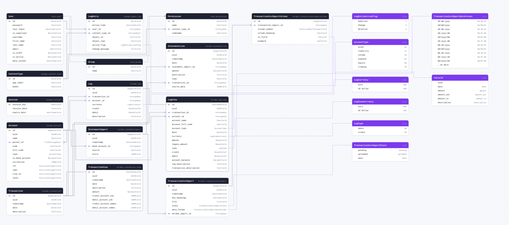
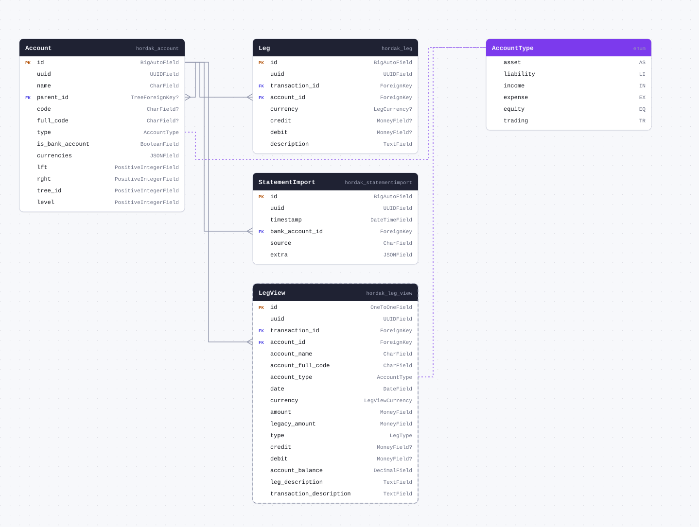
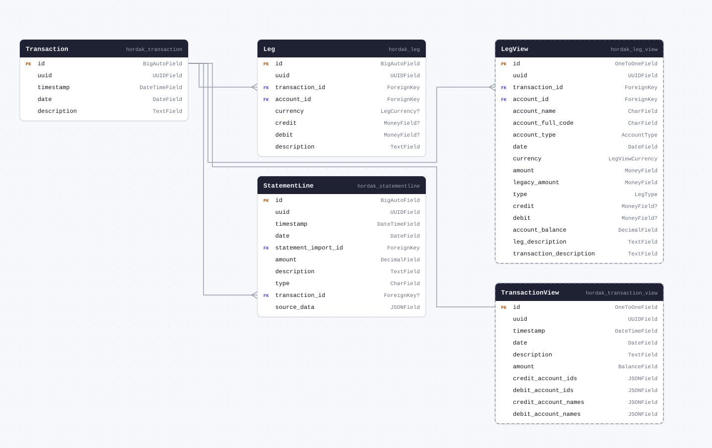
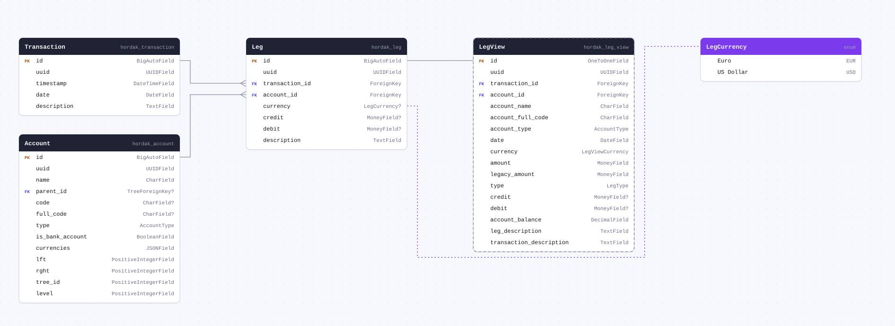
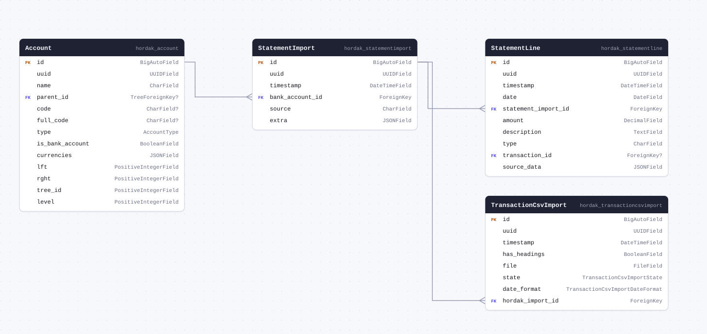
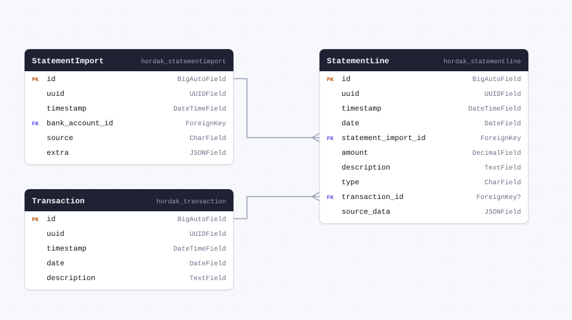
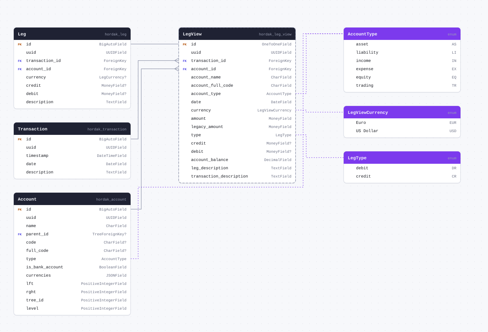
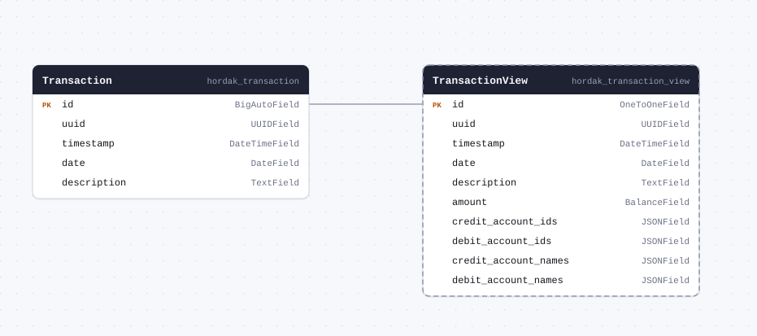
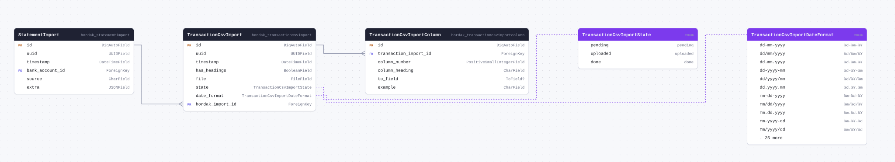
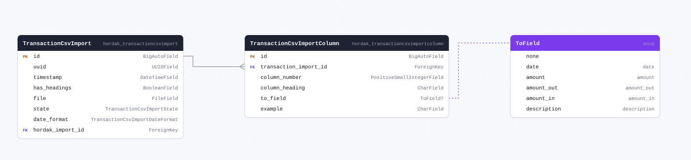

# Schema docs



[LogEntry](#logentry) · [Permission](#permission) · [Group](#group) · [User](#user) · [ContentType](#contenttype) · [Session](#session) · [Account](#account) · [Transaction](#transaction) · [Leg](#leg) · [StatementImport](#statementimport) · [StatementLine](#statementline) · [LegView](#legview) · [TransactionView](#transactionview) · [TransactionCsvImport](#transactioncsvimport) · [TransactionCsvImportColumn](#transactioncsvimportcolumn)

<details>
<summary>The whole schema as SQL</summary>

```sql
CREATE TABLE "django_admin_log" ("id" integer NOT NULL PRIMARY KEY AUTOINCREMENT, "action_time" datetime NOT NULL, "user_id" integer NOT NULL REFERENCES "auth_user" ("id") DEFERRABLE INITIALLY DEFERRED, "content_type_id" integer NULL REFERENCES "django_content_type" ("id") DEFERRABLE INITIALLY DEFERRED, "object_id" text NULL, "object_repr" varchar(200) NOT NULL, "action_flag" smallint unsigned NOT NULL CHECK ("action_flag" >= 0), "change_message" text NOT NULL);

CREATE TABLE "auth_permission" ("id" integer NOT NULL PRIMARY KEY AUTOINCREMENT, "name" varchar(255) NOT NULL, "content_type_id" integer NOT NULL REFERENCES "django_content_type" ("id") DEFERRABLE INITIALLY DEFERRED, "codename" varchar(100) NOT NULL);

CREATE TABLE "auth_group" ("id" integer NOT NULL PRIMARY KEY AUTOINCREMENT, "name" varchar(150) NOT NULL UNIQUE);

CREATE TABLE "auth_group_permissions" ("id" integer NOT NULL PRIMARY KEY AUTOINCREMENT, "group_id" integer NOT NULL REFERENCES "auth_group" ("id") DEFERRABLE INITIALLY DEFERRED, "permission_id" integer NOT NULL REFERENCES "auth_permission" ("id") DEFERRABLE INITIALLY DEFERRED);

CREATE TABLE "auth_user" ("id" integer NOT NULL PRIMARY KEY AUTOINCREMENT, "password" varchar(128) NOT NULL, "last_login" datetime NULL, "is_superuser" bool NOT NULL, "username" varchar(150) NOT NULL UNIQUE, "first_name" varchar(150) NOT NULL, "last_name" varchar(150) NOT NULL, "email" varchar(254) NOT NULL, "is_staff" bool NOT NULL, "is_active" bool NOT NULL, "date_joined" datetime NOT NULL);

CREATE TABLE "auth_user_groups" ("id" integer NOT NULL PRIMARY KEY AUTOINCREMENT, "user_id" integer NOT NULL REFERENCES "auth_user" ("id") DEFERRABLE INITIALLY DEFERRED, "group_id" integer NOT NULL REFERENCES "auth_group" ("id") DEFERRABLE INITIALLY DEFERRED);

CREATE TABLE "auth_user_user_permissions" ("id" integer NOT NULL PRIMARY KEY AUTOINCREMENT, "user_id" integer NOT NULL REFERENCES "auth_user" ("id") DEFERRABLE INITIALLY DEFERRED, "permission_id" integer NOT NULL REFERENCES "auth_permission" ("id") DEFERRABLE INITIALLY DEFERRED);

CREATE TABLE "django_content_type" ("id" integer NOT NULL PRIMARY KEY AUTOINCREMENT, "app_label" varchar(100) NOT NULL, "model" varchar(100) NOT NULL);

CREATE TABLE "django_session" ("session_key" varchar(40) NOT NULL PRIMARY KEY, "session_data" text NOT NULL, "expire_date" datetime NOT NULL);

CREATE TABLE "hordak_account" ("id" integer NOT NULL PRIMARY KEY AUTOINCREMENT, "uuid" char(32) NOT NULL, "name" varchar(255) NOT NULL, "parent_id" bigint NULL REFERENCES "hordak_account" ("id") DEFERRABLE INITIALLY DEFERRED, "code" varchar(6) NULL, "full_code" varchar(255) NULL UNIQUE, "type" varchar(2) NOT NULL, "is_bank_account" bool NOT NULL, "currencies" text NOT NULL CHECK ((JSON_VALID("currencies") OR "currencies" IS NULL)), "lft" integer unsigned NOT NULL CHECK ("lft" >= 0), "rght" integer unsigned NOT NULL CHECK ("rght" >= 0), "tree_id" integer unsigned NOT NULL CHECK ("tree_id" >= 0), "level" integer unsigned NOT NULL CHECK ("level" >= 0));

CREATE TABLE "hordak_transaction" ("id" integer NOT NULL PRIMARY KEY AUTOINCREMENT, "uuid" char(32) NOT NULL, "timestamp" datetime NOT NULL, "date" date NOT NULL, "description" text NOT NULL);

CREATE TABLE "hordak_leg" ("id" integer NOT NULL PRIMARY KEY AUTOINCREMENT, "uuid" char(32) NOT NULL, "transaction_id" bigint NOT NULL REFERENCES "hordak_transaction" ("id") DEFERRABLE INITIALLY DEFERRED, "account_id" bigint NOT NULL REFERENCES "hordak_account" ("id") DEFERRABLE INITIALLY DEFERRED, "currency" varchar(3) NULL, "credit" decimal NULL, "debit" decimal NULL, "description" text NOT NULL);

CREATE TABLE "hordak_statementimport" ("id" integer NOT NULL PRIMARY KEY AUTOINCREMENT, "uuid" char(32) NOT NULL, "timestamp" datetime NOT NULL, "bank_account_id" bigint NOT NULL REFERENCES "hordak_account" ("id") DEFERRABLE INITIALLY DEFERRED, "source" varchar(20) NOT NULL, "extra" text NOT NULL CHECK ((JSON_VALID("extra") OR "extra" IS NULL)));

CREATE TABLE "hordak_statementline" ("id" integer NOT NULL PRIMARY KEY AUTOINCREMENT, "uuid" char(32) NOT NULL, "timestamp" datetime NOT NULL, "date" date NOT NULL, "statement_import_id" bigint NOT NULL REFERENCES "hordak_statementimport" ("id") DEFERRABLE INITIALLY DEFERRED, "amount" decimal NOT NULL, "description" text NOT NULL, "type" varchar(50) NOT NULL, "transaction_id" bigint NULL REFERENCES "hordak_transaction" ("id") DEFERRABLE INITIALLY DEFERRED, "source_data" text NOT NULL CHECK ((JSON_VALID("source_data") OR "source_data" IS NULL)));

CREATE TABLE "hordak_transactioncsvimport" ("id" integer NOT NULL PRIMARY KEY AUTOINCREMENT, "uuid" char(32) NOT NULL, "timestamp" datetime NOT NULL, "has_headings" bool NOT NULL, "file" varchar(100) NOT NULL, "state" varchar(20) NOT NULL, "date_format" varchar(50) NOT NULL, "hordak_import_id" bigint NOT NULL REFERENCES "hordak_statementimport" ("id") DEFERRABLE INITIALLY DEFERRED);

CREATE TABLE "hordak_transactioncsvimportcolumn" ("id" integer NOT NULL PRIMARY KEY AUTOINCREMENT, "transaction_import_id" bigint NOT NULL REFERENCES "hordak_transactioncsvimport" ("id") DEFERRABLE INITIALLY DEFERRED, "column_number" smallint unsigned NOT NULL CHECK ("column_number" >= 0), "column_heading" varchar(100) NOT NULL, "to_field" varchar(20) NULL, "example" varchar(200) NOT NULL);

CREATE INDEX "django_admin_log_user_id_c564eba6" ON "django_admin_log" ("user_id");

CREATE INDEX "django_admin_log_content_type_id_c4bce8eb" ON "django_admin_log" ("content_type_id");

CREATE UNIQUE INDEX "auth_permission_content_type_id_codename_01ab375a_uniq" ON "auth_permission" ("content_type_id", "codename");

CREATE INDEX "auth_permission_content_type_id_2f476e4b" ON "auth_permission" ("content_type_id");

CREATE UNIQUE INDEX "auth_group_permissions_group_id_permission_id_0cd325b0_uniq" ON "auth_group_permissions" ("group_id", "permission_id");

CREATE INDEX "auth_group_permissions_group_id_b120cbf9" ON "auth_group_permissions" ("group_id");

CREATE INDEX "auth_group_permissions_permission_id_84c5c92e" ON "auth_group_permissions" ("permission_id");

CREATE UNIQUE INDEX "auth_user_groups_user_id_group_id_94350c0c_uniq" ON "auth_user_groups" ("user_id", "group_id");

CREATE INDEX "auth_user_groups_user_id_6a12ed8b" ON "auth_user_groups" ("user_id");

CREATE INDEX "auth_user_groups_group_id_97559544" ON "auth_user_groups" ("group_id");

CREATE UNIQUE INDEX "auth_user_user_permissions_user_id_permission_id_14a6b632_uniq" ON "auth_user_user_permissions" ("user_id", "permission_id");

CREATE INDEX "auth_user_user_permissions_user_id_a95ead1b" ON "auth_user_user_permissions" ("user_id");

CREATE INDEX "auth_user_user_permissions_permission_id_1fbb5f2c" ON "auth_user_user_permissions" ("permission_id");

CREATE UNIQUE INDEX "django_content_type_app_label_model_76bd3d3b_uniq" ON "django_content_type" ("app_label", "model");

CREATE INDEX "django_session_expire_date_a5c62663" ON "django_session" ("expire_date");

CREATE UNIQUE INDEX "hordak_account_parent_id_code_818bfa83_uniq" ON "hordak_account" ("parent_id", "code");

CREATE INDEX "hordak_account_parent_id_da3739c5" ON "hordak_account" ("parent_id");

CREATE INDEX "hordak_account_currencies_028029ba" ON "hordak_account" ("currencies");

CREATE INDEX "hordak_account_tree_id_777f166b" ON "hordak_account" ("tree_id");

CREATE INDEX "hordak_account_tree_id_lft_idx" ON "hordak_account" ("tree_id", "lft");

CREATE INDEX "hordak_leg_transaction_id_ed687084" ON "hordak_leg" ("transaction_id");

CREATE INDEX "hordak_leg_account_id_630c3245" ON "hordak_leg" ("account_id");

CREATE INDEX "hordak_statementimport_bank_account_id_215b13b6" ON "hordak_statementimport" ("bank_account_id");

CREATE INDEX "hordak_statementline_statement_import_id_f59bc11f" ON "hordak_statementline" ("statement_import_id");

CREATE INDEX "hordak_statementline_transaction_id_5e8712e3" ON "hordak_statementline" ("transaction_id");

CREATE INDEX "hordak_transactioncsvimport_hordak_import_id_2d303359" ON "hordak_transactioncsvimport" ("hordak_import_id");

CREATE UNIQUE INDEX "hordak_transactioncsvimportcolumn_transaction_import_id_to_field_e2fb27d3_uniq" ON "hordak_transactioncsvimportcolumn" ("transaction_import_id", "to_field");

CREATE UNIQUE INDEX "hordak_transactioncsvimportcolumn_transaction_import_id_column_number_84aacc4c_uniq" ON "hordak_transactioncsvimportcolumn" ("transaction_import_id", "column_number");

CREATE INDEX "hordak_transactioncsvimportcolumn_transaction_import_id_47c81374" ON "hordak_transactioncsvimportcolumn" ("transaction_import_id");
```

</details>

## LogEntry

Table `django_admin_log`, app `admin`.


| Column | Field | Type | Null | Key | Default | Description |
| --- | --- | --- | --- | --- | --- | --- |
| `id` | `AutoField` | `integer` |  | PK | `autoincrement()` |  |
| `action_time` | `DateTimeField` | `datetime` |  |  | `now()` |  |
| `user_id` | `ForeignKey` | `integer` |  | FK |  |  |
| `content_type_id` | `ForeignKey` | `integer` | yes | FK |  |  |
| `object_id` | `TextField` | `text` | yes |  |  |  |
| `object_repr` | `CharField` | `varchar(200)` |  |  |  |  |
| `action_flag` | `LogEntryActionFlag` | `smallint unsigned` |  |  |  |  |
| `change_message` | `TextField` | `text` |  |  |  |  |

Indexes:

- index `django_admin_log_user_id_c564eba6` on `user_id`
- index `django_admin_log_content_type_id_c4bce8eb` on `content_type_id`

Relations:

- `user_id` → [User](#user).`id`, on delete cascade
- `content_type_id` → [ContentType](#contenttype).`id`, on delete set null

## Permission

Table `auth_permission`, app `auth`.

The permissions system provides a way to assign permissions to specific
users and groups of users.

The permission system is used by the Django admin site, but may also be
useful in your own code. The Django admin site uses permissions as follows:

    - The "add" permission limits the user's ability to view the "add" form
      and add an object.
    - The "change" permission limits a user's ability to view the change
      list, view the "change" form and change an object.
    - The "delete" permission limits the ability to delete an object.
    - The "view" permission limits the ability to view an object.

Permissions are set globally per type of object, not per specific object
instance. It is possible to say "Mary may change news stories," but it's
not currently possible to say "Mary may change news stories, but only the
ones she created herself" or "Mary may only change news stories that have a
certain status or publication date."

The permissions listed above are automatically created for each model.


| Column | Field | Type | Null | Key | Default | Description |
| --- | --- | --- | --- | --- | --- | --- |
| `id` | `AutoField` | `integer` |  | PK | `autoincrement()` |  |
| `name` | `CharField` | `varchar(255)` |  |  |  |  |
| `content_type_id` | `ForeignKey` | `integer` |  | FK |  |  |
| `codename` | `CharField` | `varchar(100)` |  |  |  |  |

Indexes:

- index `auth_permission_content_type_id_2f476e4b` on `content_type_id`
- unique `auth_permission_content_type_id_codename_01ab375a_uniq` on `content_type_id`, `codename`

Relations:

- `content_type_id` → [ContentType](#contenttype).`id`, on delete cascade
- `group_set` — many to many with [Group](#group)
- `user_set` — many to many with [User](#user)

## Group

Table `auth_group`, app `auth`.

Groups are a generic way of categorizing users to apply permissions, or
some other label, to those users. A user can belong to any number of
groups.

A user in a group automatically has all the permissions granted to that
group. For example, if the group 'Site editors' has the permission
can_edit_home_page, any user in that group will have that permission.

Beyond permissions, groups are a convenient way to categorize users to
apply some label, or extended functionality, to them. For example, you
could create a group 'Special users', and you could write code that would
do special things to those users -- such as giving them access to a
members-only portion of your site, or sending them members-only email
messages.


| Column | Field | Type | Null | Key | Default | Description |
| --- | --- | --- | --- | --- | --- | --- |
| `id` | `AutoField` | `integer` |  | PK | `autoincrement()` |  |
| `name` | `CharField` | `varchar(150)` |  | unique |  |  |

Relations:

- `permissions` — many to many with [Permission](#permission)
- `user_set` — many to many with [User](#user)

## User

Table `auth_user`, app `auth`.

Columns from `AbstractUser` (abstract): `username`, `first_name`, `last_name`, `email`, `is_staff`, `is_active`, `date_joined`.

Columns from `AbstractBaseUser` (abstract): `password`, `last_login`.

Columns from `PermissionsMixin` (abstract): `is_superuser`.

Users within the Django authentication system are represented by this
model.

Username and password are required. Other fields are optional.


| Column | Field | Type | Null | Key | Default | Description |
| --- | --- | --- | --- | --- | --- | --- |
| `id` | `AutoField` | `integer` |  | PK | `autoincrement()` |  |
| `password` | `CharField` | `varchar(128)` |  |  |  |  |
| `last_login` | `DateTimeField` | `datetime` | yes |  |  |  |
| `is_superuser` | `BooleanField` | `bool` |  |  | `False` | Designates that this user has all permissions without explicitly assigning them. |
| `username` | `CharField` | `varchar(150)` |  | unique |  | Required. 150 characters or fewer. Letters, digits and @/./+/-/_ only. |
| `first_name` | `CharField` | `varchar(150)` |  |  |  |  |
| `last_name` | `CharField` | `varchar(150)` |  |  |  |  |
| `email` | `EmailField` | `varchar(254)` |  |  |  |  |
| `is_staff` | `BooleanField` | `bool` |  |  | `False` | Designates whether the user can log into this admin site. |
| `is_active` | `BooleanField` | `bool` |  |  | `True` | Designates whether this user should be treated as active. Unselect this instead of deleting accounts. |
| `date_joined` | `DateTimeField` | `datetime` |  |  | `now()` |  |

Relations:

- [LogEntry](#logentry).`user_id` → `id`, on delete cascade
- `groups` — many to many with [Group](#group)
- `user_permissions` — many to many with [Permission](#permission)

## ContentType

Table `django_content_type`, app `contenttypes`.


| Column | Field | Type | Null | Key | Default | Description |
| --- | --- | --- | --- | --- | --- | --- |
| `id` | `AutoField` | `integer` |  | PK | `autoincrement()` |  |
| `app_label` | `CharField` | `varchar(100)` |  |  |  |  |
| `model` | `CharField` | `varchar(100)` |  |  |  |  |

Indexes:

- unique `django_content_type_app_label_model_76bd3d3b_uniq` on `app_label`, `model`

Relations:

- [LogEntry](#logentry).`content_type_id` → `id`, on delete set null
- [Permission](#permission).`content_type_id` → `id`, on delete cascade

## Session

Table `django_session`, app `sessions`.

Columns from `AbstractBaseSession` (abstract): `session_key`, `session_data`, `expire_date`.

Django provides full support for anonymous sessions. The session
framework lets you store and retrieve arbitrary data on a
per-site-visitor basis. It stores data on the server side and
abstracts the sending and receiving of cookies. Cookies contain a
session ID -- not the data itself.

The Django sessions framework is entirely cookie-based. It does
not fall back to putting session IDs in URLs. This is an intentional
design decision. Not only does that behavior make URLs ugly, it makes
your site vulnerable to session-ID theft via the "Referer" header.

For complete documentation on using Sessions in your code, consult
the sessions documentation that is shipped with Django (also available
on the Django web site).

| Column | Field | Type | Null | Key | Default | Description |
| --- | --- | --- | --- | --- | --- | --- |
| `session_key` | `CharField` | `varchar(40)` |  | PK |  |  |
| `session_data` | `TextField` | `text` |  |  |  |  |
| `expire_date` | `DateTimeField` | `datetime` |  |  |  |  |

Indexes:

- index `django_session_expire_date_a5c62663` on `expire_date`

## Account

Table `hordak_account`, app `hordak`.

Represents an account

An account may have a parent, and may have zero or more children. Only root
accounts can have a type, all child accounts are assumed to have the same
type as their parent.

An account's balance is calculated as the sum of all of the transaction Leg's
referencing the account.

Attributes:

    uuid (UUID): UUID for account. Use to prevent leaking of IDs (if desired).
    name (str): Name of the account. Required.
    parent (Account|None): Parent account, nonen if root account
    balance (Balance): Account balance, only populated when account is queried using
        ``Account.objects.with_balances()``
    code (str): Account code. Must combine with account codes of parent
        accounts to get fully qualified account code.
    type (str): Type of account as defined by ``AccountType``. Can only be set on
        root accounts. Child accounts are assumed to have the same time as their parent.
    is_bank_account (bool): Is this a bank account. This implies we can import bank statements into
        it and that it only supports a single currency.



| Column | Field | Type | Null | Key | Default | Description |
| --- | --- | --- | --- | --- | --- | --- |
| `id` | `BigAutoField` | `integer` |  | PK | `autoincrement()` |  |
| `uuid` | `UUIDField` | `char(32)` |  |  | `uuid4()` |  |
| `name` | `CharField` | `varchar(255)` |  |  |  |  |
| `parent_id` | `TreeForeignKey` | `bigint` | yes | FK |  |  |
| `code` | `CharField` | `varchar(6)` | yes |  |  |  |
| `full_code` | `CharField` | `varchar(255)` | yes | unique |  |  |
| `type` | `AccountType` | `varchar(2)` |  |  |  |  |
| `is_bank_account` | `BooleanField` | `bool` |  |  | `False` | Is this a bank account. This implies we can import bank statements into it and that it only supports a single currency |
| `currencies` | `JSONField` | `text` |  |  | `account_default_currencies()` |  |
| `lft` | `PositiveIntegerField` | `integer unsigned` |  |  |  |  |
| `rght` | `PositiveIntegerField` | `integer unsigned` |  |  |  |  |
| `tree_id` | `PositiveIntegerField` | `integer unsigned` |  |  |  |  |
| `level` | `PositiveIntegerField` | `integer unsigned` |  |  |  |  |

Indexes:

- index `hordak_account_parent_id_da3739c5` on `parent_id`
- index `hordak_account_currencies_028029ba` on `currencies`
- index `hordak_account_tree_id_777f166b` on `tree_id`
- unique `hordak_account_parent_id_code_818bfa83_uniq` on `parent_id`, `code`
- index `hordak_account_tree_id_lft_idx` on `tree_id`, `lft`

Relations:

- `parent_id` → [Account](#account).`id`, on delete cascade
- [Leg](#leg).`account_id` → `id`, on delete cascade
- [StatementImport](#statementimport).`bank_account_id` → `id`, on delete cascade
- [LegView](#legview).`account_id` → `id`, on delete do nothing

## Transaction

Table `hordak_transaction`, app `hordak`.

Represents a transaction

A transaction is a movement of funds between two accounts. Each transaction
will have two or more legs, each leg specifies an account and an amount.

.. note:

    When working with Hordak Transaction objects you will typically need to do so
    within a database transaction. This is because the database has integrity checks in
    place to ensure the validity of the transaction (i.e. money in = money out).

See Also:

    :meth:`Account.transfer_to()` is a useful shortcut to avoid having to create transactions manually.

Examples:

    You can manually create a transaction as follows::

        from django.db import transaction as db_transaction
        from hordak.models import Transaction, Leg

        with db_transaction.atomic():
            transaction = Transaction.objects.create()
            Leg.objects.create(transaction=transaction, account=my_account1, amount=Money(100, 'EUR'))
            Leg.objects.create(transaction=transaction, account=my_account2, amount=Money(-100, 'EUR'))

Attributes:

    uuid (models.UUIDField): UUID for transaction. Use to prevent leaking of IDs (if desired).
    timestamp (datetime): The datetime when the object was created.
    date (date): The date when the transaction actually occurred, as this may be different to
        :attr:`timestamp`.
    description (str): Optional user-provided description



| Column | Field | Type | Null | Key | Default | Description |
| --- | --- | --- | --- | --- | --- | --- |
| `id` | `BigAutoField` | `integer` |  | PK | `autoincrement()` |  |
| `uuid` | `UUIDField` | `char(32)` |  |  | `uuid4()` |  |
| `timestamp` | `DateTimeField` | `datetime` |  |  | `now()` | The creation date of this transaction object |
| `date` | `DateField` | `date` |  |  | `now()` | The date on which this transaction occurred |
| `description` | `TextField` | `text` |  |  | `''` |  |

Relations:

- [Leg](#leg).`transaction_id` → `id`, on delete cascade
- [StatementLine](#statementline).`transaction_id` → `id`, on delete set null
- [LegView](#legview).`transaction_id` → `id`, on delete do nothing
- [TransactionView](#transactionview).`parent_id` → `id`, on delete do nothing

## Leg

Table `hordak_leg`, app `hordak`.

The leg of a transaction

Represents a single amount either into or out of a transaction. All legs for a transaction
must sum to zero, all legs must be of the same currency.

Attributes:

    uuid (UUID): UUID for transaction leg. Use to prevent leaking of IDs (if desired).
    transaction (Transaction): Transaction to which the Leg belongs.
    account (Account): Account the leg is transferring to/from.
    amount (Money): The amount being transferred
    description (str): Optional user-provided description
    type (str): :attr:`hordak.models.DEBIT` or :attr:`hordak.models.CREDIT`.
    account_balance_after (Balance): The account balance before this transaction.
        Only populated when account is queried using `Leg.objects.with_account_balance_after()`
    account_balance_before (Balance): The account balance after this transaction.
        Only populated when account is queried using `Leg.objects.with_account_balance_before()`



| Column | Field | Type | Null | Key | Default | Description |
| --- | --- | --- | --- | --- | --- | --- |
| `id` | `BigAutoField` | `integer` |  | PK | `autoincrement()` |  |
| `uuid` | `UUIDField` | `char(32)` |  |  | `uuid4()` |  |
| `transaction_id` | `ForeignKey` | `bigint` |  | FK |  |  |
| `account_id` | `ForeignKey` | `bigint` |  | FK |  |  |
| `currency` | `LegCurrency` | `varchar(3)` | yes |  | `'EUR'` |  |
| `credit` | `MoneyField(13, 2)` | `decimal` | yes |  | `None` | Amount of this credit, or NULL if not a credit |
| `debit` | `MoneyField(13, 2)` | `decimal` | yes |  | `None` | Amount of this debit, or NULL if not a debit |
| `description` | `TextField` | `text` |  |  | `''` |  |

Indexes:

- index `hordak_leg_transaction_id_ed687084` on `transaction_id`
- index `hordak_leg_account_id_630c3245` on `account_id`

Relations:

- `transaction_id` → [Transaction](#transaction).`id`, on delete cascade
- `account_id` → [Account](#account).`id`, on delete cascade
- [LegView](#legview).`leg_id` → `id`, on delete do nothing

## StatementImport

Table `hordak_statementimport`, app `hordak`.

Records an import of a bank statement

Attributes:

    uuid (UUID): UUID for statement import. Use to prevent leaking of IDs (if desired).
    timestamp (datetime): The datetime when the object was created.
    bank_account (Account): The account the import is for (should normally point to an asset
        account which represents your bank account)



| Column | Field | Type | Null | Key | Default | Description |
| --- | --- | --- | --- | --- | --- | --- |
| `id` | `BigAutoField` | `integer` |  | PK | `autoincrement()` |  |
| `uuid` | `UUIDField` | `char(32)` |  |  | `uuid4()` |  |
| `timestamp` | `DateTimeField` | `datetime` |  |  | `now()` |  |
| `bank_account_id` | `ForeignKey` | `bigint` |  | FK |  |  |
| `source` | `CharField` | `varchar(20)` |  |  |  | A value uniquely identifying where this data came from. Examples: "csv", "teller.io". |
| `extra` | `JSONField` | `text` |  |  | `json_default()` | Any extra data relating to the import, probably specific to the data source. |

Indexes:

- index `hordak_statementimport_bank_account_id_215b13b6` on `bank_account_id`

Relations:

- `bank_account_id` → [Account](#account).`id`, on delete cascade
- [StatementLine](#statementline).`statement_import_id` → `id`, on delete cascade
- [TransactionCsvImport](#transactioncsvimport).`hordak_import_id` → `id`, on delete cascade

## StatementLine

Table `hordak_statementline`, app `hordak`.

Records a single imported bank statement line

A StatementLine is purely a utility to aid in the creation of transactions
(in the process known as reconciliation). StatementLines have no impact on
account balances.

However, the :meth:`StatementLine.create_transaction()` method can be used to create
a transaction based on the information in the StatementLine.

Attributes:

    uuid (UUID): UUID for statement line. Use to prevent leaking of IDs (if desired).
    timestamp (datetime): The datetime when the object was created.
    date (date): The date given by the statement line
    statement_import (StatementImport): The import to which the line belongs
    amount (Decimal): The amount for the statement line, positive or negative.
    description (str): Any description/memo information provided
    transaction (Transaction): Optionally, the transaction created for this statement line. This normally
        occurs during reconciliation. See also :meth:`StatementLine.create_transaction()`.



| Column | Field | Type | Null | Key | Default | Description |
| --- | --- | --- | --- | --- | --- | --- |
| `id` | `BigAutoField` | `integer` |  | PK | `autoincrement()` |  |
| `uuid` | `UUIDField` | `char(32)` |  |  | `uuid4()` |  |
| `timestamp` | `DateTimeField` | `datetime` |  |  | `now()` |  |
| `date` | `DateField` | `date` |  |  |  |  |
| `statement_import_id` | `ForeignKey` | `bigint` |  | FK |  |  |
| `amount` | `DecimalField(13, 2)` | `decimal` |  |  |  |  |
| `description` | `TextField` | `text` |  |  | `''` |  |
| `type` | `CharField` | `varchar(50)` |  |  | `''` |  |
| `transaction_id` | `ForeignKey` | `bigint` | yes | FK | `None` | Reconcile this statement line to this transaction |
| `source_data` | `JSONField` | `text` |  |  | `json_default()` | Original data received from the data source. |

Indexes:

- index `hordak_statementline_statement_import_id_f59bc11f` on `statement_import_id`
- index `hordak_statementline_transaction_id_5e8712e3` on `transaction_id`

Relations:

- `statement_import_id` → [StatementImport](#statementimport).`id`, on delete cascade
- `transaction_id` → [Transaction](#transaction).`id`, on delete set null

## LegView

Table `hordak_leg_view`, app `hordak`.

Not managed by Django (`managed = False`): it neither creates nor changes the table, whose indexes are the ones its own SQL gives it.

An accounting view onto the Legs table

.. warning::

    Hordak's database views are still experimental and may change or be
    removed in a future version.

This provides a number of features on top of the raw Legs table:

1. Shows the leg type (debit/credit)
2. All amounts are reported as positive
3. Amounts are available in the credit and debit columns (and are NULL if not applicable)
4. A running total `account_balance` field is provided
5. Shows some transaction fields (date, description)

Note that this is a database view and is therefore read-only.

You can also improve query performance (in Postgresql) by deferring the
`account_balance` field, assuming the value not required. For example:

    .. code-block:: python

        HordakLegView.objects.defer('account_balance')

Attributes:

    id (int): The leg ID
    uuid (UUID): The leg UUID
    transaction (Transaction): The transaction which contains this leg
    account (Account): The account this leg is associated with
    date (date): The date when the parent transaction actually occurred
    amount (Balance): The balance of this leg (use ``amount.currency``
                      to get the currency for the other ``Decimal`` fields on this view.
    type (LegType): Either ``LegType.debit`` or ``LegType.credit``.
    credit (Decimal): Amount of this credit, or NULL if not a credit
    debit (Decimal): Amount of this debit, or NULL if not a debit
    account_name (str): The name of account for the leg
    account_full_code (str): The full account code of account for the leg
    account_type (AccountType): The type of account for the leg
    account_balance (Decimal): Account balance following this transaction.
                               For multiple-currency accounts this will
                               be the balance of the same currency as the leg amount.
    leg_description (str): Description of the leg
    transaction_description (str): Description of the transaction



| Column | Field | Type | Null | Key | Default | Description |
| --- | --- | --- | --- | --- | --- | --- |
| `id` | `OneToOneField` | `bigint` |  | PK, FK |  |  |
| `uuid` | `UUIDField` | `char(32)` |  |  |  |  |
| `transaction_id` | `ForeignKey` | `bigint` |  | FK |  |  |
| `account_id` | `ForeignKey` | `bigint` |  | FK |  |  |
| `account_name` | `CharField` | `varchar(255)` |  |  |  |  |
| `account_full_code` | `CharField` | `varchar(255)` |  |  |  |  |
| `account_type` | `AccountType` | `varchar(2)` |  |  |  |  |
| `date` | `DateField` | `date` |  |  |  | The date on which this transaction leg occurred |
| `currency` | `LegViewCurrency` | `varchar(3)` |  |  | `default_currency()` |  |
| `amount` | `MoneyField(13, 2)` | `decimal` |  |  |  |  |
| `legacy_amount` | `MoneyField(13, 2)` | `decimal` |  |  |  | The leg amount, credits are positive, debit are negative (Legacy for Hordak 1.0 compatability) |
| `type` | `LegType` | `varchar(2)` |  |  |  | Type of this transaction leg: debit or credit |
| `credit` | `MoneyField(13, 2)` | `decimal` | yes |  | `None` | Amount of this credit, or NULL if not a credit |
| `debit` | `MoneyField(13, 2)` | `decimal` | yes |  | `None` | Amount of this debit, or NULL if not a debit |
| `account_balance` | `DecimalField(13, 2)` | `decimal` |  |  |  | Account balance following this transaction. For multiple-currency accounts this will be the balance of the same currency as the leg amount. Will be NULL/None for non-leaf accounts. |
| `leg_description` | `TextField` | `text` |  |  |  |  |
| `transaction_description` | `TextField` | `text` |  |  |  |  |

Relations:

- `leg_id` → [Leg](#leg).`id`, on delete do nothing
- `transaction_id` → [Transaction](#transaction).`id`, on delete do nothing
- `account_id` → [Account](#account).`id`, on delete do nothing

## TransactionView

Table `hordak_transaction_view`, app `hordak`.

Not managed by Django (`managed = False`): it neither creates nor changes the table, whose indexes are the ones its own SQL gives it.

An accounting view onto the Transaction table

.. warning::

    Hordak's database views are still experimental and may change or be
    removed in a future version.

This provides a number of features on top of the raw Transaction table:

1. Shows the transaction amount (JSON list, one value per currency)
2. Shows credited/debited account IDs & names

Note that this is a database view and is therefore read-only.

You can also improve query performance (in Postgresql) by deferring unneeded
fields. For example:

    .. code-block:: python

        HordakLegView.objects.defer(
            'credit_account_ids',
            'debit_account_ids',
            'credit_account_names',
            'debit_account_names',
        )



| Column | Field | Type | Null | Key | Default | Description |
| --- | --- | --- | --- | --- | --- | --- |
| `id` | `OneToOneField` | `bigint` |  | PK, FK |  |  |
| `uuid` | `UUIDField` | `char(32)` |  |  |  |  |
| `timestamp` | `DateTimeField` | `datetime` |  |  |  | The creation date of this transaction object |
| `date` | `DateField` | `date` |  |  |  | The date on which this transaction occurred |
| `description` | `TextField` | `text` |  |  |  |  |
| `amount` | `BalanceField` | `text` |  |  |  | The total amount transferred in this transaction |
| `credit_account_ids` | `JSONField` | `text` |  |  |  | List of account ids for the credit legs of this transaction |
| `debit_account_ids` | `JSONField` | `text` |  |  |  | List of account ids for the debit legs of this transaction |
| `credit_account_names` | `JSONField` | `text` |  |  |  | List of account names for the credit legs of this transaction |
| `debit_account_names` | `JSONField` | `text` |  |  |  | List of account names for the debit legs of this transaction |

Relations:

- `parent_id` → [Transaction](#transaction).`id`, on delete do nothing

## TransactionCsvImport

Table `hordak_transactioncsvimport`, app `hordak`.



| Column | Field | Type | Null | Key | Default | Description |
| --- | --- | --- | --- | --- | --- | --- |
| `id` | `BigAutoField` | `integer` |  | PK | `autoincrement()` |  |
| `uuid` | `UUIDField` | `char(32)` |  |  | `uuid4()` |  |
| `timestamp` | `DateTimeField` | `datetime` |  |  | `now()` |  |
| `has_headings` | `BooleanField` | `bool` |  |  | `True` |  |
| `file` | `FileField` | `varchar(100)` |  |  |  |  |
| `state` | `TransactionCsvImportState` | `varchar(20)` |  |  | `'pending'` |  |
| `date_format` | `TransactionCsvImportDateFormat` | `varchar(50)` |  |  | `'%d-%m-%Y'` |  |
| `hordak_import_id` | `ForeignKey` | `bigint` |  | FK |  |  |

Indexes:

- index `hordak_transactioncsvimport_hordak_import_id_2d303359` on `hordak_import_id`

Relations:

- `hordak_import_id` → [StatementImport](#statementimport).`id`, on delete cascade
- [TransactionCsvImportColumn](#transactioncsvimportcolumn).`transaction_import_id` → `id`, on delete cascade

## TransactionCsvImportColumn

Table `hordak_transactioncsvimportcolumn`, app `hordak`.

Represents a column in an imported CSV file

Stores information regarding how we map to the data in the column
to our hordak.StatementLine models.



| Column | Field | Type | Null | Key | Default | Description |
| --- | --- | --- | --- | --- | --- | --- |
| `id` | `BigAutoField` | `integer` |  | PK | `autoincrement()` |  |
| `transaction_import_id` | `ForeignKey` | `bigint` |  | FK |  |  |
| `column_number` | `PositiveSmallIntegerField` | `smallint unsigned` |  |  |  |  |
| `column_heading` | `CharField` | `varchar(100)` |  |  | `''` |  |
| `to_field` | `ToField` | `varchar(20)` | yes |  | `None` |  |
| `example` | `CharField` | `varchar(200)` |  |  | `''` |  |

Indexes:

- index `hordak_transactioncsvimportcolumn_transaction_import_id_47c81374` on `transaction_import_id`
- unique `hordak_transactioncsvimportcolumn_transaction_import_id_to_field_e2fb27d3_uniq` on `transaction_import_id`, `to_field`
- unique `hordak_transactioncsvimportcolumn_transaction_import_id_column_number_84aacc4c_uniq` on `transaction_import_id`, `column_number`

Relations:

- `transaction_import_id` → [TransactionCsvImport](#transactioncsvimport).`id`, on delete cascade

# Enums

## LogEntryActionFlag

| Name | Stored as |
| --- | --- |
| `Addition` | `1` |
| `Change` | `2` |
| `Deletion` | `3` |

## AccountType

| Name | Stored as |
| --- | --- |
| `asset` | `AS` |
| `liability` | `LI` |
| `income` | `IN` |
| `expense` | `EX` |
| `equity` | `EQ` |
| `trading` | `TR` |

## LegCurrency

| Name | Stored as |
| --- | --- |
| `Euro` | `EUR` |
| `US Dollar` | `USD` |

## LegViewCurrency

| Name | Stored as |
| --- | --- |
| `Euro` | `EUR` |
| `US Dollar` | `USD` |

## LegType

| Name | Stored as |
| --- | --- |
| `debit` | `DR` |
| `credit` | `CR` |

## TransactionCsvImportState

| Name | Stored as |
| --- | --- |
| `pending` | `pending` |
| `uploaded` | `uploaded` |
| `done` | `done` |

## TransactionCsvImportDateFormat

| Name | Stored as |
| --- | --- |
| `dd-mm-yyyy` | `%d-%m-%Y` |
| `dd/mm/yyyy` | `%d/%m/%Y` |
| `dd.mm.yyyy` | `%d.%m.%Y` |
| `dd-yyyy-mm` | `%d-%Y-%m` |
| `dd/yyyy/mm` | `%d/%Y/%m` |
| `dd.yyyy.mm` | `%d.%Y.%m` |
| `mm-dd-yyyy` | `%m-%d-%Y` |
| `mm/dd/yyyy` | `%m/%d/%Y` |
| `mm.dd.yyyy` | `%m.%d.%Y` |
| `mm-yyyy-dd` | `%m-%Y-%d` |
| `mm/yyyy/dd` | `%m/%Y/%d` |
| `mm.yyyy.dd` | `%m.%Y.%d` |
| `yyyy-dd-mm` | `%Y-%d-%m` |
| `yyyy/dd/mm` | `%Y/%d/%m` |
| `yyyy.dd.mm` | `%Y.%d.%m` |
| `yyyy-mm-dd` | `%Y-%m-%d` |
| `yyyy/mm/dd` | `%Y/%m/%d` |
| `yyyy.mm.dd` | `%Y.%m.%d` |
| `dd-mm-yy` | `%d-%m-%y` |
| `dd/mm/yy` | `%d/%m/%y` |
| `dd.mm.yy` | `%d.%m.%y` |
| `dd-yy-mm` | `%d-%y-%m` |
| `dd/yy/mm` | `%d/%y/%m` |
| `dd.yy.mm` | `%d.%y.%m` |
| `mm-dd-yy` | `%m-%d-%y` |
| `mm/dd/yy` | `%m/%d/%y` |
| `mm.dd.yy` | `%m.%d.%y` |
| `mm-yy-dd` | `%m-%y-%d` |
| `mm/yy/dd` | `%m/%y/%d` |
| `mm.yy.dd` | `%m.%y.%d` |
| `yy-dd-mm` | `%y-%d-%m` |
| `yy/dd/mm` | `%y/%d/%m` |
| `yy.dd.mm` | `%y.%d.%m` |
| `yy-mm-dd` | `%y-%m-%d` |
| `yy/mm/dd` | `%y/%m/%d` |
| `yy.mm.dd` | `%y.%m.%d` |

## ToField

| Name | Stored as |
| --- | --- |
| `none` |  |
| `date` | `date` |
| `amount` | `amount` |
| `amount_out` | `amount_out` |
| `amount_in` | `amount_in` |
| `description` | `description` |
