# Schema docs

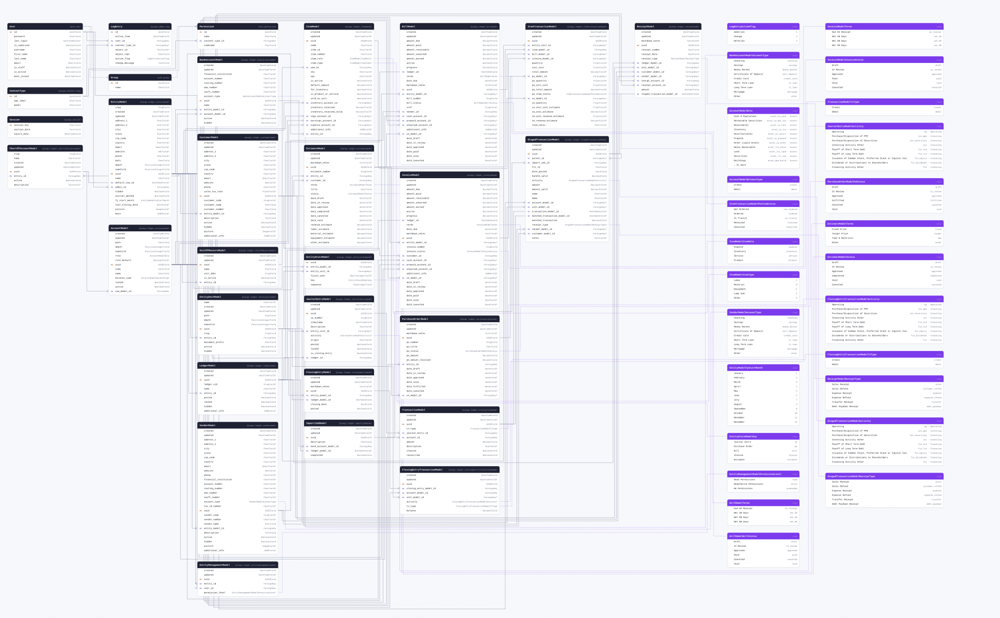

[LogEntry](#logentry) · [Permission](#permission) · [Group](#group) · [User](#user) · [ContentType](#contenttype) · [Session](#session) · [BankAccountModel](#bankaccountmodel) · [AccountModel](#accountmodel) · [ChartOfAccountModel](#chartofaccountmodel) · [CustomerModel](#customermodel) · [UnitOfMeasureModel](#unitofmeasuremodel) · [ItemTransactionModel](#itemtransactionmodel) · [ItemModel](#itemmodel) · [LedgerModel](#ledgermodel) · [EntityUnitModel](#entityunitmodel) · [VendorModel](#vendormodel) · [EntityModel](#entitymodel) · [EntityStateModel](#entitystatemodel) · [EntityManagementModel](#entitymanagementmodel) · [BillModel](#billmodel) · [InvoiceModel](#invoicemodel) · [TransactionModel](#transactionmodel) · [JournalEntryModel](#journalentrymodel) · [PurchaseOrderModel](#purchaseordermodel) · [EstimateModel](#estimatemodel) · [ClosingEntryModel](#closingentrymodel) · [ClosingEntryTransactionModel](#closingentrytransactionmodel) · [ReceiptModel](#receiptmodel) · [ImportJobModel](#importjobmodel) · [StagedTransactionModel](#stagedtransactionmodel)

<details>
<summary>The whole schema as SQL</summary>

```sql
CREATE TABLE "django_admin_log" ("id" integer NOT NULL PRIMARY KEY AUTOINCREMENT, "action_time" datetime NOT NULL, "user_id" integer NOT NULL REFERENCES "auth_user" ("id") DEFERRABLE INITIALLY DEFERRED, "content_type_id" integer NULL REFERENCES "django_content_type" ("id") DEFERRABLE INITIALLY DEFERRED, "object_id" text NULL, "object_repr" varchar(200) NOT NULL, "action_flag" smallint unsigned NOT NULL CHECK ("action_flag" >= 0), "change_message" text NOT NULL);

CREATE TABLE "auth_permission" ("id" integer NOT NULL PRIMARY KEY AUTOINCREMENT, "name" varchar(255) NOT NULL, "content_type_id" integer NOT NULL REFERENCES "django_content_type" ("id") DEFERRABLE INITIALLY DEFERRED, "codename" varchar(100) NOT NULL);

CREATE TABLE "auth_group" ("id" integer NOT NULL PRIMARY KEY AUTOINCREMENT, "name" varchar(150) NOT NULL UNIQUE);

CREATE TABLE "auth_group_permissions" ("id" integer NOT NULL PRIMARY KEY AUTOINCREMENT, "group_id" integer NOT NULL REFERENCES "auth_group" ("id") DEFERRABLE INITIALLY DEFERRED, "permission_id" integer NOT NULL REFERENCES "auth_permission" ("id") DEFERRABLE INITIALLY DEFERRED);

CREATE TABLE "auth_user" ("id" integer NOT NULL PRIMARY KEY AUTOINCREMENT, "password" varchar(128) NOT NULL, "last_login" datetime NULL, "is_superuser" bool NOT NULL, "username" varchar(150) NOT NULL UNIQUE, "first_name" varchar(150) NOT NULL, "last_name" varchar(150) NOT NULL, "email" varchar(254) NOT NULL, "is_staff" bool NOT NULL, "is_active" bool NOT NULL, "date_joined" datetime NOT NULL);

CREATE TABLE "auth_user_groups" ("id" integer NOT NULL PRIMARY KEY AUTOINCREMENT, "user_id" integer NOT NULL REFERENCES "auth_user" ("id") DEFERRABLE INITIALLY DEFERRED, "group_id" integer NOT NULL REFERENCES "auth_group" ("id") DEFERRABLE INITIALLY DEFERRED);

CREATE TABLE "auth_user_user_permissions" ("id" integer NOT NULL PRIMARY KEY AUTOINCREMENT, "user_id" integer NOT NULL REFERENCES "auth_user" ("id") DEFERRABLE INITIALLY DEFERRED, "permission_id" integer NOT NULL REFERENCES "auth_permission" ("id") DEFERRABLE INITIALLY DEFERRED);

CREATE TABLE "django_content_type" ("id" integer NOT NULL PRIMARY KEY AUTOINCREMENT, "app_label" varchar(100) NOT NULL, "model" varchar(100) NOT NULL);

CREATE TABLE "django_session" ("session_key" varchar(40) NOT NULL PRIMARY KEY, "session_data" text NOT NULL, "expire_date" datetime NOT NULL);

CREATE TABLE "django_ledger_bankaccountmodel" ("created" datetime NOT NULL, "updated" datetime NULL, "financial_institution" varchar(100) NULL, "account_number" varchar(30) NULL, "routing_number" varchar(30) NULL, "aba_number" varchar(30) NULL, "swift_number" varchar(30) NULL, "account_type" varchar(20) NOT NULL, "uuid" char(32) NOT NULL PRIMARY KEY, "name" varchar(150) NULL, "entity_model_id" char(32) NOT NULL REFERENCES "django_ledger_entitymodel" ("uuid") DEFERRABLE INITIALLY DEFERRED, "account_model_id" char(32) NOT NULL REFERENCES "django_ledger_accountmodel" ("uuid") DEFERRABLE INITIALLY DEFERRED, "active" bool NOT NULL, "hidden" bool NOT NULL);

CREATE TABLE "django_ledger_accountmodel" ("created" datetime NOT NULL, "updated" datetime NULL, "path" varchar(255) NOT NULL UNIQUE, "depth" integer unsigned NOT NULL CHECK ("depth" >= 0), "numchild" integer unsigned NOT NULL CHECK ("numchild" >= 0), "role" varchar(30) NOT NULL, "role_default" bool NULL, "uuid" char(32) NOT NULL PRIMARY KEY, "code" varchar(10) NOT NULL, "name" varchar(100) NOT NULL, "balance_type" varchar(6) NOT NULL, "locked" bool NOT NULL, "active" bool NOT NULL, "coa_model_id" char(32) NOT NULL REFERENCES "django_ledger_chartofaccountmodel" ("uuid") DEFERRABLE INITIALLY DEFERRED, CONSTRAINT "unique_code_for_coa_model" UNIQUE ("coa_model_id", "code"), CONSTRAINT "only_one_account_assigned_as_default_for_role" UNIQUE ("coa_model_id", "role", "role_default"));

CREATE TABLE "django_ledger_chartofaccountmodel" ("slug" varchar(50) NOT NULL UNIQUE, "name" varchar(150) NULL, "created" datetime NOT NULL, "updated" datetime NULL, "uuid" char(32) NOT NULL PRIMARY KEY, "entity_id" char(32) NOT NULL REFERENCES "django_ledger_entitymodel" ("uuid") DEFERRABLE INITIALLY DEFERRED, "active" bool NOT NULL, "description" text NULL);

CREATE TABLE "django_ledger_customermodel" ("created" datetime NOT NULL, "updated" datetime NULL, "address_1" varchar(70) NULL, "address_2" varchar(70) NULL, "city" varchar(70) NULL, "state" varchar(70) NULL, "zip_code" varchar(20) NULL, "country" varchar(70) NULL, "email" varchar(254) NULL, "website" varchar(200) NULL, "phone" varchar(30) NULL, "sales_tax_rate" real NULL, "uuid" char(32) NOT NULL PRIMARY KEY, "customer_code" varchar(50) NULL UNIQUE, "customer_name" varchar(100) NOT NULL, "customer_number" varchar(30) NOT NULL, "entity_model_id" char(32) NOT NULL REFERENCES "django_ledger_entitymodel" ("uuid") DEFERRABLE INITIALLY DEFERRED, "description" text NOT NULL, "active" bool NOT NULL, "hidden" bool NOT NULL, "picture" varchar(100) NULL, "additional_info" text NULL CHECK ((JSON_VALID("additional_info") OR "additional_info" IS NULL)));

CREATE TABLE "django_ledger_unitofmeasuremodel" ("created" datetime NOT NULL, "updated" datetime NULL, "uuid" char(32) NOT NULL PRIMARY KEY, "name" varchar(50) NOT NULL, "unit_abbr" varchar(10) NOT NULL, "is_active" bool NOT NULL, "entity_id" char(32) NOT NULL REFERENCES "django_ledger_entitymodel" ("uuid") DEFERRABLE INITIALLY DEFERRED);

CREATE TABLE "django_ledger_itemtransactionmodel" ("created" datetime NOT NULL, "updated" datetime NULL, "uuid" char(32) NOT NULL PRIMARY KEY, "entity_unit_id" char(32) NULL REFERENCES "django_ledger_entityunitmodel" ("uuid") DEFERRABLE INITIALLY DEFERRED, "item_model_id" char(32) NOT NULL REFERENCES "django_ledger_itemmodel" ("uuid") DEFERRABLE INITIALLY DEFERRED, "bill_model_id" char(32) NULL REFERENCES "django_ledger_billmodel" ("uuid") DEFERRABLE INITIALLY DEFERRED, "invoice_model_id" char(32) NULL REFERENCES "django_ledger_invoicemodel" ("uuid") DEFERRABLE INITIALLY DEFERRED, "quantity" real NULL, "unit_cost" real NULL, "total_amount" decimal NULL, "po_model_id" char(32) NULL REFERENCES "django_ledger_purchaseordermodel" ("uuid") DEFERRABLE INITIALLY DEFERRED, "po_quantity" real NULL, "po_unit_cost" real NULL, "po_total_amount" decimal NULL, "po_item_status" varchar(15) NULL, "ce_model_id" char(32) NULL REFERENCES "django_ledger_estimatemodel" ("uuid") DEFERRABLE INITIALLY DEFERRED, "ce_quantity" real NULL, "ce_unit_cost_estimate" real NULL, "ce_cost_estimate" decimal NULL, "ce_unit_revenue_estimate" real NULL, "ce_revenue_estimate" decimal NULL, "item_notes" varchar(400) NULL);

CREATE TABLE "django_ledger_itemmodel" ("created" datetime NOT NULL, "updated" datetime NULL, "uuid" char(32) NOT NULL PRIMARY KEY, "name" varchar(100) NOT NULL, "item_id" varchar(50) NULL, "item_number" varchar(30) NOT NULL, "item_role" varchar(10) NULL, "item_type" varchar(1) NULL, "uom_id" char(32) NOT NULL REFERENCES "django_ledger_unitofmeasuremodel" ("uuid") DEFERRABLE INITIALLY DEFERRED, "sku" varchar(50) NULL, "upc" varchar(50) NULL, "is_active" bool NOT NULL, "default_amount" decimal NOT NULL, "for_inventory" bool NOT NULL, "is_product_or_service" bool NOT NULL, "sold_as_unit" bool NOT NULL, "inventory_account_id" char(32) NULL REFERENCES "django_ledger_accountmodel" ("uuid") DEFERRABLE INITIALLY DEFERRED, "inventory_received" decimal NULL, "inventory_received_value" decimal NULL, "cogs_account_id" char(32) NULL REFERENCES "django_ledger_accountmodel" ("uuid") DEFERRABLE INITIALLY DEFERRED, "earnings_account_id" char(32) NULL REFERENCES "django_ledger_accountmodel" ("uuid") DEFERRABLE INITIALLY DEFERRED, "expense_account_id" char(32) NULL REFERENCES "django_ledger_accountmodel" ("uuid") DEFERRABLE INITIALLY DEFERRED, "additional_info" text NULL CHECK ((JSON_VALID("additional_info") OR "additional_info" IS NULL)), "entity_id" char(32) NOT NULL REFERENCES "django_ledger_entitymodel" ("uuid") DEFERRABLE INITIALLY DEFERRED);

CREATE TABLE "django_ledger_ledgermodel" ("created" datetime NOT NULL, "updated" datetime NULL, "uuid" char(32) NOT NULL PRIMARY KEY, "ledger_xid" varchar(150) NULL, "name" varchar(150) NULL, "entity_id" char(32) NOT NULL REFERENCES "django_ledger_entitymodel" ("uuid") DEFERRABLE INITIALLY DEFERRED, "posted" bool NOT NULL, "locked" bool NOT NULL, "hidden" bool NOT NULL, "additional_info" text NULL CHECK ((JSON_VALID("additional_info") OR "additional_info" IS NULL)));

CREATE TABLE "django_ledger_entityunitmodel" ("name" varchar(150) NULL, "created" datetime NOT NULL, "updated" datetime NULL, "path" varchar(255) NOT NULL UNIQUE, "depth" integer unsigned NOT NULL CHECK ("depth" >= 0), "numchild" integer unsigned NOT NULL CHECK ("numchild" >= 0), "uuid" char(32) NOT NULL PRIMARY KEY, "slug" varchar(50) NOT NULL, "entity_id" char(32) NOT NULL REFERENCES "django_ledger_entitymodel" ("uuid") DEFERRABLE INITIALLY DEFERRED, "document_prefix" varchar(3) NOT NULL, "active" bool NOT NULL, "hidden" bool NOT NULL);

CREATE TABLE "django_ledger_vendormodel" ("created" datetime NOT NULL, "updated" datetime NULL, "address_1" varchar(70) NULL, "address_2" varchar(70) NULL, "city" varchar(70) NULL, "state" varchar(70) NULL, "zip_code" varchar(20) NULL, "country" varchar(70) NULL, "email" varchar(254) NULL, "website" varchar(200) NULL, "phone" varchar(30) NULL, "financial_institution" varchar(100) NULL, "account_number" varchar(30) NULL, "routing_number" varchar(30) NULL, "aba_number" varchar(30) NULL, "swift_number" varchar(30) NULL, "account_type" varchar(20) NOT NULL, "tax_id_number" varchar(30) NULL, "uuid" char(32) NOT NULL PRIMARY KEY, "vendor_code" varchar(50) NULL, "vendor_number" varchar(30) NULL, "vendor_name" varchar(100) NOT NULL, "entity_model_id" char(32) NOT NULL REFERENCES "django_ledger_entitymodel" ("uuid") DEFERRABLE INITIALLY DEFERRED, "description" text NOT NULL, "active" bool NOT NULL, "hidden" bool NOT NULL, "picture" varchar(100) NULL, "additional_info" text NULL CHECK ((JSON_VALID("additional_info") OR "additional_info" IS NULL)));

CREATE TABLE "django_ledger_entitymodel" ("slug" varchar(50) NOT NULL UNIQUE, "created" datetime NOT NULL, "updated" datetime NULL, "address_1" varchar(70) NULL, "address_2" varchar(70) NULL, "city" varchar(70) NULL, "state" varchar(70) NULL, "zip_code" varchar(20) NULL, "country" varchar(70) NULL, "email" varchar(254) NULL, "website" varchar(200) NULL, "phone" varchar(30) NULL, "path" varchar(255) NOT NULL UNIQUE, "depth" integer unsigned NOT NULL CHECK ("depth" >= 0), "numchild" integer unsigned NOT NULL CHECK ("numchild" >= 0), "uuid" char(32) NOT NULL PRIMARY KEY, "name" varchar(150) NOT NULL, "default_coa_id" char(32) NULL UNIQUE REFERENCES "django_ledger_chartofaccountmodel" ("uuid") DEFERRABLE INITIALLY DEFERRED, "admin_id" integer NOT NULL REFERENCES "auth_user" ("id") DEFERRABLE INITIALLY DEFERRED, "hidden" bool NOT NULL, "accrual_method" bool NOT NULL, "fy_start_month" integer NOT NULL, "last_closing_date" date NULL, "picture" varchar(100) NULL, "meta" text NULL CHECK ((JSON_VALID("meta") OR "meta" IS NULL)));

CREATE TABLE "django_ledger_entitystatemodel" ("uuid" char(32) NOT NULL PRIMARY KEY, "entity_model_id" char(32) NOT NULL REFERENCES "django_ledger_entitymodel" ("uuid") DEFERRABLE INITIALLY DEFERRED, "entity_unit_id" char(32) NULL REFERENCES "django_ledger_entityunitmodel" ("uuid") DEFERRABLE INITIALLY DEFERRED, "fiscal_year" smallint NULL, "key" varchar(10) NOT NULL, "sequence" bigint NOT NULL);

CREATE TABLE "django_ledger_entitymanagementmodel" ("created" datetime NOT NULL, "updated" datetime NULL, "uuid" char(32) NOT NULL PRIMARY KEY, "entity_id" char(32) NOT NULL REFERENCES "django_ledger_entitymodel" ("uuid") DEFERRABLE INITIALLY DEFERRED, "user_id" integer NOT NULL REFERENCES "auth_user" ("id") DEFERRABLE INITIALLY DEFERRED, "permission_level" varchar(10) NOT NULL);

CREATE TABLE "django_ledger_billmodel" ("created" datetime NOT NULL, "updated" datetime NULL, "amount_due" decimal NOT NULL, "amount_paid" decimal NOT NULL, "amount_receivable" decimal NOT NULL, "amount_unearned" decimal NOT NULL, "amount_earned" decimal NOT NULL, "accrue" bool NOT NULL, "progress" decimal NOT NULL, "ledger_id" char(32) NOT NULL UNIQUE REFERENCES "django_ledger_ledgermodel" ("uuid") DEFERRABLE INITIALLY DEFERRED, "terms" varchar(10) NOT NULL, "date_due" date NULL, "markdown_notes" text NULL, "uuid" char(32) NOT NULL PRIMARY KEY, "entity_model_id" char(32) NULL REFERENCES "django_ledger_entitymodel" ("uuid") DEFERRABLE INITIALLY DEFERRED, "bill_number" varchar(20) NOT NULL, "bill_status" varchar(10) NOT NULL, "xref" varchar(50) NULL, "vendor_id" char(32) NOT NULL REFERENCES "django_ledger_vendormodel" ("uuid") DEFERRABLE INITIALLY DEFERRED, "cash_account_id" char(32) NULL REFERENCES "django_ledger_accountmodel" ("uuid") DEFERRABLE INITIALLY DEFERRED, "prepaid_account_id" char(32) NULL REFERENCES "django_ledger_accountmodel" ("uuid") DEFERRABLE INITIALLY DEFERRED, "unearned_account_id" char(32) NULL REFERENCES "django_ledger_accountmodel" ("uuid") DEFERRABLE INITIALLY DEFERRED, "additional_info" text NULL CHECK ((JSON_VALID("additional_info") OR "additional_info" IS NULL)), "ce_model_id" char(32) NULL REFERENCES "django_ledger_estimatemodel" ("uuid") DEFERRABLE INITIALLY DEFERRED, "date_draft" date NULL, "date_in_review" date NULL, "date_approved" date NULL, "date_paid" date NULL, "date_void" date NULL, "date_canceled" date NULL);

CREATE TABLE "django_ledger_invoicemodel" ("created" datetime NOT NULL, "updated" datetime NULL, "amount_due" decimal NOT NULL, "amount_paid" decimal NOT NULL, "amount_receivable" decimal NOT NULL, "amount_unearned" decimal NOT NULL, "amount_earned" decimal NOT NULL, "accrue" bool NOT NULL, "progress" decimal NOT NULL, "ledger_id" char(32) NOT NULL UNIQUE REFERENCES "django_ledger_ledgermodel" ("uuid") DEFERRABLE INITIALLY DEFERRED, "terms" varchar(10) NOT NULL, "date_due" date NULL, "markdown_notes" text NULL, "uuid" char(32) NOT NULL PRIMARY KEY, "entity_model_id" char(32) NULL REFERENCES "django_ledger_entitymodel" ("uuid") DEFERRABLE INITIALLY DEFERRED, "invoice_number" varchar(20) NOT NULL, "invoice_status" varchar(10) NOT NULL, "customer_id" char(32) NOT NULL REFERENCES "django_ledger_customermodel" ("uuid") DEFERRABLE INITIALLY DEFERRED, "cash_account_id" char(32) NULL REFERENCES "django_ledger_accountmodel" ("uuid") DEFERRABLE INITIALLY DEFERRED, "prepaid_account_id" char(32) NULL REFERENCES "django_ledger_accountmodel" ("uuid") DEFERRABLE INITIALLY DEFERRED, "unearned_account_id" char(32) NULL REFERENCES "django_ledger_accountmodel" ("uuid") DEFERRABLE INITIALLY DEFERRED, "additional_info" text NULL CHECK ((JSON_VALID("additional_info") OR "additional_info" IS NULL)), "ce_model_id" char(32) NULL REFERENCES "django_ledger_estimatemodel" ("uuid") DEFERRABLE INITIALLY DEFERRED, "date_draft" date NULL, "date_in_review" date NULL, "date_approved" date NULL, "date_paid" date NULL, "date_void" date NULL, "date_canceled" date NULL);

CREATE TABLE "django_ledger_transactionmodel" ("created" datetime NOT NULL, "updated" datetime NULL, "uuid" char(32) NOT NULL PRIMARY KEY, "tx_type" varchar(10) NOT NULL, "journal_entry_id" char(32) NOT NULL REFERENCES "django_ledger_journalentrymodel" ("uuid") DEFERRABLE INITIALLY DEFERRED, "account_id" char(32) NOT NULL REFERENCES "django_ledger_accountmodel" ("uuid") DEFERRABLE INITIALLY DEFERRED, "amount" decimal NOT NULL, "description" varchar(100) NULL, "cleared" bool NOT NULL, "reconciled" bool NOT NULL);

CREATE TABLE "django_ledger_journalentrymodel" ("created" datetime NOT NULL, "updated" datetime NULL, "uuid" char(32) NOT NULL PRIMARY KEY, "je_number" varchar(25) NOT NULL, "timestamp" datetime NOT NULL, "description" varchar(120) NULL, "entity_unit_id" char(32) NULL REFERENCES "django_ledger_entityunitmodel" ("uuid") DEFERRABLE INITIALLY DEFERRED, "activity" varchar(20) NULL, "origin" varchar(30) NULL, "posted" bool NOT NULL, "locked" bool NOT NULL, "is_closing_entry" bool NOT NULL, "ledger_id" char(32) NOT NULL REFERENCES "django_ledger_ledgermodel" ("uuid") DEFERRABLE INITIALLY DEFERRED);

CREATE TABLE "django_ledger_purchaseordermodel" ("created" datetime NOT NULL, "updated" datetime NULL, "markdown_notes" text NULL, "uuid" char(32) NOT NULL PRIMARY KEY, "po_number" varchar(20) NOT NULL, "po_title" varchar(250) NOT NULL, "po_status" varchar(10) NOT NULL, "po_amount" decimal NOT NULL, "po_amount_received" decimal NOT NULL, "entity_id" char(32) NOT NULL REFERENCES "django_ledger_entitymodel" ("uuid") DEFERRABLE INITIALLY DEFERRED, "date_draft" date NULL, "date_in_review" date NULL, "date_approved" date NULL, "date_void" date NULL, "date_fulfilled" date NULL, "date_canceled" date NULL, "ce_model_id" char(32) NULL REFERENCES "django_ledger_estimatemodel" ("uuid") DEFERRABLE INITIALLY DEFERRED);

CREATE TABLE "django_ledger_estimatemodel" ("created" datetime NOT NULL, "updated" datetime NULL, "markdown_notes" text NULL, "uuid" char(32) NOT NULL PRIMARY KEY, "estimate_number" varchar(20) NOT NULL, "entity_id" char(32) NOT NULL REFERENCES "django_ledger_entitymodel" ("uuid") DEFERRABLE INITIALLY DEFERRED, "customer_id" char(32) NOT NULL REFERENCES "django_ledger_customermodel" ("uuid") DEFERRABLE INITIALLY DEFERRED, "terms" varchar(10) NOT NULL, "title" varchar(250) NOT NULL, "status" varchar(10) NOT NULL, "date_draft" date NULL, "date_in_review" date NULL, "date_approved" date NULL, "date_completed" date NULL, "date_canceled" date NULL, "date_void" date NULL, "revenue_estimate" decimal NOT NULL, "labor_estimate" decimal NOT NULL, "material_estimate" decimal NOT NULL, "equipment_estimate" decimal NOT NULL, "other_estimate" decimal NOT NULL);

CREATE TABLE "django_ledger_closingentrymodel" ("created" datetime NOT NULL, "updated" datetime NULL, "markdown_notes" text NULL, "uuid" char(32) NOT NULL PRIMARY KEY, "entity_model_id" char(32) NOT NULL REFERENCES "django_ledger_entitymodel" ("uuid") DEFERRABLE INITIALLY DEFERRED, "ledger_model_id" char(32) NOT NULL UNIQUE REFERENCES "django_ledger_ledgermodel" ("uuid") DEFERRABLE INITIALLY DEFERRED, "closing_date" date NOT NULL, "posted" bool NOT NULL, CONSTRAINT "unique_entity_closing_date" UNIQUE ("entity_model_id", "closing_date"));

CREATE TABLE "django_ledger_closingentrytransactionmodel" ("created" datetime NOT NULL, "updated" datetime NULL, "uuid" char(32) NOT NULL PRIMARY KEY, "closing_entry_model_id" char(32) NOT NULL REFERENCES "django_ledger_closingentrymodel" ("uuid") DEFERRABLE INITIALLY DEFERRED, "account_model_id" char(32) NOT NULL REFERENCES "django_ledger_accountmodel" ("uuid") DEFERRABLE INITIALLY DEFERRED, "unit_model_id" char(32) NULL REFERENCES "django_ledger_entityunitmodel" ("uuid") DEFERRABLE INITIALLY DEFERRED, "activity" varchar(20) NULL, "tx_type" varchar(10) NOT NULL, "balance" decimal NOT NULL, CONSTRAINT "unique_closing_entry" UNIQUE ("closing_entry_model_id", "account_model_id", "unit_model_id", "activity"));

CREATE TABLE "django_ledger_receiptmodel" ("created" datetime NOT NULL, "updated" datetime NULL, "markdown_notes" text NULL, "uuid" char(32) NOT NULL PRIMARY KEY, "receipt_number" varchar(255) NOT NULL, "receipt_date" date NOT NULL, "receipt_type" varchar(15) NOT NULL, "ledger_model_id" char(32) NOT NULL REFERENCES "django_ledger_ledgermodel" ("uuid") DEFERRABLE INITIALLY DEFERRED, "unit_model_id" char(32) NULL REFERENCES "django_ledger_entityunitmodel" ("uuid") DEFERRABLE INITIALLY DEFERRED, "customer_model_id" char(32) NULL REFERENCES "django_ledger_customermodel" ("uuid") DEFERRABLE INITIALLY DEFERRED, "vendor_model_id" char(32) NULL REFERENCES "django_ledger_vendormodel" ("uuid") DEFERRABLE INITIALLY DEFERRED, "charge_account_id" char(32) NOT NULL REFERENCES "django_ledger_accountmodel" ("uuid") DEFERRABLE INITIALLY DEFERRED, "receipt_account_id" char(32) NULL REFERENCES "django_ledger_accountmodel" ("uuid") DEFERRABLE INITIALLY DEFERRED, "amount" decimal NOT NULL, "staged_transaction_model_id" char(32) NULL UNIQUE REFERENCES "django_ledger_stagedtransactionmodel" ("uuid") DEFERRABLE INITIALLY DEFERRED);

CREATE TABLE "django_ledger_importjobmodel" ("created" datetime NOT NULL, "updated" datetime NULL, "uuid" char(32) NOT NULL PRIMARY KEY, "description" varchar(200) NOT NULL, "bank_account_model_id" char(32) NOT NULL REFERENCES "django_ledger_bankaccountmodel" ("uuid") DEFERRABLE INITIALLY DEFERRED, "ledger_model_id" char(32) NULL UNIQUE REFERENCES "django_ledger_ledgermodel" ("uuid") DEFERRABLE INITIALLY DEFERRED, "completed" bool NOT NULL);

CREATE TABLE "django_ledger_stagedtransactionmodel" ("created" datetime NOT NULL, "updated" datetime NULL, "uuid" char(32) NOT NULL PRIMARY KEY, "parent_id" char(32) NULL REFERENCES "django_ledger_stagedtransactionmodel" ("uuid") DEFERRABLE INITIALLY DEFERRED, "import_job_id" char(32) NOT NULL REFERENCES "django_ledger_importjobmodel" ("uuid") DEFERRABLE INITIALLY DEFERRED, "fit_id" varchar(100) NOT NULL, "date_posted" date NOT NULL, "bundle_split" bool NOT NULL, "activity" varchar(20) NULL, "amount" decimal NULL, "amount_split" decimal NULL, "name" varchar(200) NULL, "memo" varchar(200) NULL, "account_model_id" char(32) NULL REFERENCES "django_ledger_accountmodel" ("uuid") DEFERRABLE INITIALLY DEFERRED, "unit_model_id" char(32) NULL REFERENCES "django_ledger_entityunitmodel" ("uuid") DEFERRABLE INITIALLY DEFERRED, "transaction_model_id" char(32) NULL UNIQUE REFERENCES "django_ledger_transactionmodel" ("uuid") DEFERRABLE INITIALLY DEFERRED, "matched_transaction_model_id" char(32) NULL UNIQUE REFERENCES "django_ledger_transactionmodel" ("uuid") DEFERRABLE INITIALLY DEFERRED, "matched_transaction" bool NOT NULL, "receipt_type" varchar(20) NULL, "vendor_model_id" char(32) NULL REFERENCES "django_ledger_vendormodel" ("uuid") DEFERRABLE INITIALLY DEFERRED, "customer_model_id" char(32) NULL REFERENCES "django_ledger_customermodel" ("uuid") DEFERRABLE INITIALLY DEFERRED, "notes" text NULL);

CREATE INDEX "django_admin_log_user_id_c564eba6" ON "django_admin_log" ("user_id");

CREATE INDEX "django_admin_log_content_type_id_c4bce8eb" ON "django_admin_log" ("content_type_id");

CREATE UNIQUE INDEX "auth_permission_content_type_id_codename_01ab375a_uniq" ON "auth_permission" ("content_type_id", "codename");

CREATE INDEX "auth_permission_content_type_id_2f476e4b" ON "auth_permission" ("content_type_id");

CREATE UNIQUE INDEX "auth_group_permissions_group_id_permission_id_0cd325b0_uniq" ON "auth_group_permissions" ("group_id", "permission_id");

CREATE INDEX "auth_group_permissions_group_id_b120cbf9" ON "auth_group_permissions" ("group_id");

CREATE INDEX "auth_group_permissions_permission_id_84c5c92e" ON "auth_group_permissions" ("permission_id");

CREATE UNIQUE INDEX "auth_user_groups_user_id_group_id_94350c0c_uniq" ON "auth_user_groups" ("user_id", "group_id");

CREATE INDEX "auth_user_groups_user_id_6a12ed8b" ON "auth_user_groups" ("user_id");

CREATE INDEX "auth_user_groups_group_id_97559544" ON "auth_user_groups" ("group_id");

CREATE UNIQUE INDEX "auth_user_user_permissions_user_id_permission_id_14a6b632_uniq" ON "auth_user_user_permissions" ("user_id", "permission_id");

CREATE INDEX "auth_user_user_permissions_user_id_a95ead1b" ON "auth_user_user_permissions" ("user_id");

CREATE INDEX "auth_user_user_permissions_permission_id_1fbb5f2c" ON "auth_user_user_permissions" ("permission_id");

CREATE UNIQUE INDEX "django_content_type_app_label_model_76bd3d3b_uniq" ON "django_content_type" ("app_label", "model");

CREATE INDEX "django_session_expire_date_a5c62663" ON "django_session" ("expire_date");

CREATE UNIQUE INDEX "django_ledger_bankaccountmodel_entity_model_id_account_number_e070d39f_uniq" ON "django_ledger_bankaccountmodel" ("entity_model_id", "account_number");

CREATE UNIQUE INDEX "django_ledger_bankaccountmodel_entity_model_id_account_model_id_account_number_routing_number_1be39084_uniq" ON "django_ledger_bankaccountmodel" ("entity_model_id", "account_model_id", "account_number", "routing_number");

CREATE INDEX "django_ledger_bankaccountmodel_entity_model_id_5f781f21" ON "django_ledger_bankaccountmodel" ("entity_model_id");

CREATE INDEX "django_ledger_bankaccountmodel_account_model_id_b386bdb4" ON "django_ledger_bankaccountmodel" ("account_model_id");

CREATE INDEX "django_ledg_account_009a4a_idx" ON "django_ledger_bankaccountmodel" ("account_type");

CREATE INDEX "django_ledg_account_ed900d_idx" ON "django_ledger_bankaccountmodel" ("account_model_id");

CREATE INDEX "django_ledg_entity__6ad006_idx" ON "django_ledger_bankaccountmodel" ("entity_model_id");

CREATE INDEX "django_ledger_accountmodel_coa_model_id_4526e35f" ON "django_ledger_accountmodel" ("coa_model_id");

CREATE INDEX "django_ledg_role_812d08_idx" ON "django_ledger_accountmodel" ("role");

CREATE INDEX "django_ledg_balance_daddac_idx" ON "django_ledger_accountmodel" ("balance_type");

CREATE INDEX "django_ledg_active_f8adc2_idx" ON "django_ledger_accountmodel" ("active");

CREATE INDEX "django_ledg_locked_c02b15_idx" ON "django_ledger_accountmodel" ("locked");

CREATE INDEX "django_ledg_coa_mod_e073bc_idx" ON "django_ledger_accountmodel" ("coa_model_id", "code");

CREATE INDEX "django_ledg_code_081adc_idx" ON "django_ledger_accountmodel" ("code");

CREATE INDEX "django_ledger_chartofaccountmodel_entity_id_3c492d5a" ON "django_ledger_chartofaccountmodel" ("entity_id");

CREATE INDEX "django_ledg_entity__48d6e0_idx" ON "django_ledger_chartofaccountmodel" ("entity_id");

CREATE UNIQUE INDEX "django_ledger_customermodel_entity_model_id_customer_number_86da2bf5_uniq" ON "django_ledger_customermodel" ("entity_model_id", "customer_number");

CREATE INDEX "django_ledger_customermodel_entity_model_id_df76cc84" ON "django_ledger_customermodel" ("entity_model_id");

CREATE INDEX "django_ledg_entity__7b3ad8_idx" ON "django_ledger_customermodel" ("entity_model_id", "customer_number");

CREATE INDEX "django_ledg_created_ba7f4c_idx" ON "django_ledger_customermodel" ("created");

CREATE INDEX "django_ledg_updated_f9ac90_idx" ON "django_ledger_customermodel" ("updated");

CREATE INDEX "django_ledg_active_967a81_idx" ON "django_ledger_customermodel" ("active");

CREATE INDEX "django_ledg_hidden_dda722_idx" ON "django_ledger_customermodel" ("hidden");

CREATE UNIQUE INDEX "django_ledger_unitofmeasuremodel_entity_id_unit_abbr_e3bc96ca_uniq" ON "django_ledger_unitofmeasuremodel" ("entity_id", "unit_abbr");

CREATE INDEX "django_ledger_unitofmeasuremodel_unit_abbr_ed8b6776" ON "django_ledger_unitofmeasuremodel" ("unit_abbr");

CREATE INDEX "django_ledger_unitofmeasuremodel_entity_id_e7217da1" ON "django_ledger_unitofmeasuremodel" ("entity_id");

CREATE INDEX "django_ledg_entity__1c8986_idx" ON "django_ledger_unitofmeasuremodel" ("entity_id");

CREATE INDEX "django_ledger_itemtransactionmodel_entity_unit_id_c0d5d408" ON "django_ledger_itemtransactionmodel" ("entity_unit_id");

CREATE INDEX "django_ledger_itemtransactionmodel_item_model_id_daf3c4c9" ON "django_ledger_itemtransactionmodel" ("item_model_id");

CREATE INDEX "django_ledger_itemtransactionmodel_bill_model_id_84bda6ad" ON "django_ledger_itemtransactionmodel" ("bill_model_id");

CREATE INDEX "django_ledger_itemtransactionmodel_invoice_model_id_d8bc02a5" ON "django_ledger_itemtransactionmodel" ("invoice_model_id");

CREATE INDEX "django_ledger_itemtransactionmodel_po_model_id_6079da59" ON "django_ledger_itemtransactionmodel" ("po_model_id");

CREATE INDEX "django_ledger_itemtransactionmodel_ce_model_id_0beeb6ec" ON "django_ledger_itemtransactionmodel" ("ce_model_id");

CREATE INDEX "django_ledg_bill_mo_479f1f_idx" ON "django_ledger_itemtransactionmodel" ("bill_model_id", "item_model_id");

CREATE INDEX "django_ledg_invoice_13ac3b_idx" ON "django_ledger_itemtransactionmodel" ("invoice_model_id", "item_model_id");

CREATE INDEX "django_ledg_po_mode_2675c9_idx" ON "django_ledger_itemtransactionmodel" ("po_model_id", "item_model_id");

CREATE INDEX "django_ledg_ce_mode_ae4efd_idx" ON "django_ledger_itemtransactionmodel" ("ce_model_id", "item_model_id");

CREATE INDEX "django_ledg_po_item_ac9475_idx" ON "django_ledger_itemtransactionmodel" ("po_item_status");

CREATE UNIQUE INDEX "django_ledger_itemmodel_entity_id_item_number_0e3c0673_uniq" ON "django_ledger_itemmodel" ("entity_id", "item_number");

CREATE INDEX "django_ledger_itemmodel_uom_id_781d53d4" ON "django_ledger_itemmodel" ("uom_id");

CREATE INDEX "django_ledger_itemmodel_inventory_account_id_5df4ed3e" ON "django_ledger_itemmodel" ("inventory_account_id");

CREATE INDEX "django_ledger_itemmodel_cogs_account_id_4d75186f" ON "django_ledger_itemmodel" ("cogs_account_id");

CREATE INDEX "django_ledger_itemmodel_earnings_account_id_e52437bb" ON "django_ledger_itemmodel" ("earnings_account_id");

CREATE INDEX "django_ledger_itemmodel_expense_account_id_b7ce040e" ON "django_ledger_itemmodel" ("expense_account_id");

CREATE INDEX "django_ledger_itemmodel_entity_id_12366151" ON "django_ledger_itemmodel" ("entity_id");

CREATE INDEX "django_ledg_item_nu_1e3c20_idx" ON "django_ledger_itemmodel" ("item_number");

CREATE INDEX "django_ledg_item_ty_0cef58_idx" ON "django_ledger_itemmodel" ("item_type");

CREATE INDEX "django_ledg_item_ro_6040aa_idx" ON "django_ledger_itemmodel" ("item_role");

CREATE INDEX "django_ledg_upc_c19d0a_idx" ON "django_ledger_itemmodel" ("upc");

CREATE INDEX "django_ledg_sku_02b4d8_idx" ON "django_ledger_itemmodel" ("sku");

CREATE INDEX "django_ledg_for_inv_c93303_idx" ON "django_ledger_itemmodel" ("for_inventory");

CREATE INDEX "django_ledg_is_prod_4b9941_idx" ON "django_ledger_itemmodel" ("is_product_or_service");

CREATE INDEX "django_ledg_is_acti_ffc9c6_idx" ON "django_ledger_itemmodel" ("is_active");

CREATE UNIQUE INDEX "django_ledger_ledgermodel_entity_id_ledger_xid_e2c3b406_uniq" ON "django_ledger_ledgermodel" ("entity_id", "ledger_xid");

CREATE INDEX "django_ledger_ledgermodel_ledger_xid_9ba04482" ON "django_ledger_ledgermodel" ("ledger_xid");

CREATE INDEX "django_ledger_ledgermodel_entity_id_33b0bea3" ON "django_ledger_ledgermodel" ("entity_id");

CREATE INDEX "django_ledg_entity__e21c5d_idx" ON "django_ledger_ledgermodel" ("entity_id");

CREATE INDEX "django_ledg_entity__040422_idx" ON "django_ledger_ledgermodel" ("entity_id", "posted");

CREATE INDEX "django_ledg_entity__cde962_idx" ON "django_ledger_ledgermodel" ("entity_id", "locked");

CREATE INDEX "django_ledg_entity__7be095_idx" ON "django_ledger_ledgermodel" ("entity_id", "ledger_xid");

CREATE INDEX "django_ledg_ledger__05f099_idx" ON "django_ledger_ledgermodel" ("ledger_xid");

CREATE UNIQUE INDEX "django_ledger_entityunitmodel_entity_id_slug_be1e98cd_uniq" ON "django_ledger_entityunitmodel" ("entity_id", "slug");

CREATE UNIQUE INDEX "django_ledger_entityunitmodel_entity_id_document_prefix_34312c29_uniq" ON "django_ledger_entityunitmodel" ("entity_id", "document_prefix");

CREATE INDEX "django_ledger_entityunitmodel_slug_0d4dbf86" ON "django_ledger_entityunitmodel" ("slug");

CREATE INDEX "django_ledger_entityunitmodel_entity_id_439c908e" ON "django_ledger_entityunitmodel" ("entity_id");

CREATE INDEX "django_ledg_active_2c2caa_idx" ON "django_ledger_entityunitmodel" ("active");

CREATE INDEX "django_ledg_hidden_a01d42_idx" ON "django_ledger_entityunitmodel" ("hidden");

CREATE INDEX "django_ledg_entity__0bdfdc_idx" ON "django_ledger_entityunitmodel" ("entity_id");

CREATE UNIQUE INDEX "django_ledger_vendormodel_entity_model_id_vendor_number_dc954f88_uniq" ON "django_ledger_vendormodel" ("entity_model_id", "vendor_number");

CREATE INDEX "django_ledger_vendormodel_vendor_code_fbc2029b" ON "django_ledger_vendormodel" ("vendor_code");

CREATE INDEX "django_ledger_vendormodel_entity_model_id_395c8bba" ON "django_ledger_vendormodel" ("entity_model_id");

CREATE INDEX "django_ledg_entity__266aa0_idx" ON "django_ledger_vendormodel" ("entity_model_id", "vendor_number");

CREATE INDEX "django_ledg_vendor__5f9f46_idx" ON "django_ledger_vendormodel" ("vendor_number");

CREATE INDEX "django_ledg_created_6a5d9d_idx" ON "django_ledger_vendormodel" ("created");

CREATE INDEX "django_ledg_updated_736f82_idx" ON "django_ledger_vendormodel" ("updated");

CREATE INDEX "django_ledg_active_25e3b1_idx" ON "django_ledger_vendormodel" ("active");

CREATE INDEX "django_ledg_hidden_379b0a_idx" ON "django_ledger_vendormodel" ("hidden");

CREATE INDEX "django_ledger_entitymodel_admin_id_b0859ebd" ON "django_ledger_entitymodel" ("admin_id");

CREATE INDEX "django_ledg_admin_i_09f5c9_idx" ON "django_ledger_entitymodel" ("admin_id");

CREATE UNIQUE INDEX "django_ledger_entitystatemodel_entity_model_id_entity_unit_id_fiscal_year_key_8fda0b72_uniq" ON "django_ledger_entitystatemodel" ("entity_model_id", "entity_unit_id", "fiscal_year", "key");

CREATE INDEX "django_ledger_entitystatemodel_entity_model_id_5e238c40" ON "django_ledger_entitystatemodel" ("entity_model_id");

CREATE INDEX "django_ledger_entitystatemodel_entity_unit_id_d2cd3715" ON "django_ledger_entitystatemodel" ("entity_unit_id");

CREATE INDEX "django_ledg_key_ac156a_idx" ON "django_ledger_entitystatemodel" ("key");

CREATE INDEX "django_ledg_entity__eeae49_idx" ON "django_ledger_entitystatemodel" ("entity_model_id", "fiscal_year", "entity_unit_id", "key");

CREATE INDEX "django_ledger_entitymanagementmodel_entity_id_a2fc9d9a" ON "django_ledger_entitymanagementmodel" ("entity_id");

CREATE INDEX "django_ledger_entitymanagementmodel_user_id_555d3f47" ON "django_ledger_entitymanagementmodel" ("user_id");

CREATE INDEX "django_ledg_entity__9541e6_idx" ON "django_ledger_entitymanagementmodel" ("entity_id", "user_id");

CREATE INDEX "django_ledg_user_id_b7497b_idx" ON "django_ledger_entitymanagementmodel" ("user_id", "entity_id");

CREATE INDEX "django_ledger_billmodel_entity_model_id_aa9ebcda" ON "django_ledger_billmodel" ("entity_model_id");

CREATE INDEX "django_ledger_billmodel_bill_number_ed7beea9" ON "django_ledger_billmodel" ("bill_number");

CREATE INDEX "django_ledger_billmodel_xref_abb65387" ON "django_ledger_billmodel" ("xref");

CREATE INDEX "django_ledger_billmodel_vendor_id_f64038f2" ON "django_ledger_billmodel" ("vendor_id");

CREATE INDEX "django_ledger_billmodel_cash_account_id_e7b4b6a5" ON "django_ledger_billmodel" ("cash_account_id");

CREATE INDEX "django_ledger_billmodel_prepaid_account_id_c344ee16" ON "django_ledger_billmodel" ("prepaid_account_id");

CREATE INDEX "django_ledger_billmodel_unearned_account_id_c3d1d5cc" ON "django_ledger_billmodel" ("unearned_account_id");

CREATE INDEX "django_ledger_billmodel_ce_model_id_2a45669e" ON "django_ledger_billmodel" ("ce_model_id");

CREATE INDEX "django_ledg_bill_st_9e158c_idx" ON "django_ledger_billmodel" ("bill_status");

CREATE INDEX "django_ledg_terms_752251_idx" ON "django_ledger_billmodel" ("terms");

CREATE INDEX "django_ledg_cash_ac_82021a_idx" ON "django_ledger_billmodel" ("cash_account_id");

CREATE INDEX "django_ledg_prepaid_5230e5_idx" ON "django_ledger_billmodel" ("prepaid_account_id");

CREATE INDEX "django_ledg_unearne_806444_idx" ON "django_ledger_billmodel" ("unearned_account_id");

CREATE INDEX "django_ledg_date_du_a8c481_idx" ON "django_ledger_billmodel" ("date_due");

CREATE INDEX "django_ledg_date_dr_7a448e_idx" ON "django_ledger_billmodel" ("date_draft");

CREATE INDEX "django_ledg_date_in_8887cb_idx" ON "django_ledger_billmodel" ("date_in_review");

CREATE INDEX "django_ledg_date_ap_3208a1_idx" ON "django_ledger_billmodel" ("date_approved");

CREATE INDEX "django_ledg_date_pa_daf06c_idx" ON "django_ledger_billmodel" ("date_paid");

CREATE INDEX "django_ledg_date_ca_e43055_idx" ON "django_ledger_billmodel" ("date_canceled");

CREATE INDEX "django_ledg_date_vo_14c747_idx" ON "django_ledger_billmodel" ("date_void");

CREATE INDEX "django_ledg_vendor__28be85_idx" ON "django_ledger_billmodel" ("vendor_id");

CREATE INDEX "django_ledg_bill_nu_6b97b4_idx" ON "django_ledger_billmodel" ("bill_number");

CREATE INDEX "django_ledger_invoicemodel_entity_model_id_acae4e36" ON "django_ledger_invoicemodel" ("entity_model_id");

CREATE INDEX "django_ledger_invoicemodel_invoice_number_5cc1d746" ON "django_ledger_invoicemodel" ("invoice_number");

CREATE INDEX "django_ledger_invoicemodel_customer_id_73221370" ON "django_ledger_invoicemodel" ("customer_id");

CREATE INDEX "django_ledger_invoicemodel_cash_account_id_4a5c9037" ON "django_ledger_invoicemodel" ("cash_account_id");

CREATE INDEX "django_ledger_invoicemodel_prepaid_account_id_c05cefd7" ON "django_ledger_invoicemodel" ("prepaid_account_id");

CREATE INDEX "django_ledger_invoicemodel_unearned_account_id_7359e113" ON "django_ledger_invoicemodel" ("unearned_account_id");

CREATE INDEX "django_ledger_invoicemodel_ce_model_id_e101bd5a" ON "django_ledger_invoicemodel" ("ce_model_id");

CREATE INDEX "django_ledg_invoice_e349d0_idx" ON "django_ledger_invoicemodel" ("invoice_status");

CREATE INDEX "django_ledg_terms_3b6577_idx" ON "django_ledger_invoicemodel" ("terms");

CREATE INDEX "django_ledg_cash_ac_00d697_idx" ON "django_ledger_invoicemodel" ("cash_account_id");

CREATE INDEX "django_ledg_prepaid_470f67_idx" ON "django_ledger_invoicemodel" ("prepaid_account_id");

CREATE INDEX "django_ledg_unearne_bc18fd_idx" ON "django_ledger_invoicemodel" ("unearned_account_id");

CREATE INDEX "django_ledg_date_du_c72892_idx" ON "django_ledger_invoicemodel" ("date_due");

CREATE INDEX "django_ledg_date_dr_ad2569_idx" ON "django_ledger_invoicemodel" ("date_draft");

CREATE INDEX "django_ledg_date_in_e738b8_idx" ON "django_ledger_invoicemodel" ("date_in_review");

CREATE INDEX "django_ledg_date_ap_ae90e1_idx" ON "django_ledger_invoicemodel" ("date_approved");

CREATE INDEX "django_ledg_date_pa_34b872_idx" ON "django_ledger_invoicemodel" ("date_paid");

CREATE INDEX "django_ledg_date_ca_0f65e8_idx" ON "django_ledger_invoicemodel" ("date_canceled");

CREATE INDEX "django_ledg_date_vo_57c444_idx" ON "django_ledger_invoicemodel" ("date_void");

CREATE INDEX "django_ledg_custome_34c881_idx" ON "django_ledger_invoicemodel" ("customer_id");

CREATE INDEX "django_ledg_invoice_d0881e_idx" ON "django_ledger_invoicemodel" ("invoice_number");

CREATE INDEX "django_ledger_transactionmodel_journal_entry_id_1739fd60" ON "django_ledger_transactionmodel" ("journal_entry_id");

CREATE INDEX "django_ledger_transactionmodel_account_id_7d3310be" ON "django_ledger_transactionmodel" ("account_id");

CREATE INDEX "django_ledg_tx_type_da7ba9_idx" ON "django_ledger_transactionmodel" ("tx_type");

CREATE INDEX "django_ledg_account_c4bb7e_idx" ON "django_ledger_transactionmodel" ("account_id");

CREATE INDEX "django_ledg_journal_46c77f_idx" ON "django_ledger_transactionmodel" ("journal_entry_id");

CREATE INDEX "django_ledg_created_b74538_idx" ON "django_ledger_transactionmodel" ("created");

CREATE INDEX "django_ledg_updated_494252_idx" ON "django_ledger_transactionmodel" ("updated");

CREATE INDEX "django_ledg_cleared_335c0b_idx" ON "django_ledger_transactionmodel" ("cleared");

CREATE INDEX "django_ledg_reconci_75dbc7_idx" ON "django_ledger_transactionmodel" ("reconciled");

CREATE INDEX "django_ledger_journalentrymodel_je_number_a73f42ee" ON "django_ledger_journalentrymodel" ("je_number");

CREATE INDEX "django_ledger_journalentrymodel_entity_unit_id_1e0fbf04" ON "django_ledger_journalentrymodel" ("entity_unit_id");

CREATE INDEX "django_ledger_journalentrymodel_ledger_id_c470426c" ON "django_ledger_journalentrymodel" ("ledger_id");

CREATE INDEX "django_ledg_ledger__ecaa89_idx" ON "django_ledger_journalentrymodel" ("ledger_id");

CREATE INDEX "django_ledg_timesta_ab91e8_idx" ON "django_ledger_journalentrymodel" ("timestamp");

CREATE INDEX "django_ledg_activit_bae3bb_idx" ON "django_ledger_journalentrymodel" ("activity");

CREATE INDEX "django_ledg_entity__557f42_idx" ON "django_ledger_journalentrymodel" ("entity_unit_id");

CREATE INDEX "django_ledg_locked_5cc524_idx" ON "django_ledger_journalentrymodel" ("locked");

CREATE INDEX "django_ledg_posted_097e54_idx" ON "django_ledger_journalentrymodel" ("posted");

CREATE INDEX "django_ledg_je_numb_987c8b_idx" ON "django_ledger_journalentrymodel" ("je_number");

CREATE INDEX "django_ledg_is_clos_0ef09e_idx" ON "django_ledger_journalentrymodel" ("is_closing_entry");

CREATE UNIQUE INDEX "django_ledger_purchaseordermodel_entity_id_po_number_35f42db0_uniq" ON "django_ledger_purchaseordermodel" ("entity_id", "po_number");

CREATE INDEX "django_ledger_purchaseordermodel_po_number_aeb0d16d" ON "django_ledger_purchaseordermodel" ("po_number");

CREATE INDEX "django_ledger_purchaseordermodel_entity_id_d60fdbe3" ON "django_ledger_purchaseordermodel" ("entity_id");

CREATE INDEX "django_ledger_purchaseordermodel_ce_model_id_7df49c41" ON "django_ledger_purchaseordermodel" ("ce_model_id");

CREATE INDEX "django_ledg_entity__9ab6ba_idx" ON "django_ledger_purchaseordermodel" ("entity_id");

CREATE INDEX "django_ledg_po_numb_20b7d1_idx" ON "django_ledger_purchaseordermodel" ("po_number");

CREATE INDEX "django_ledg_po_stat_ab8d41_idx" ON "django_ledger_purchaseordermodel" ("po_status");

CREATE INDEX "django_ledg_ce_mode_66c2cc_idx" ON "django_ledger_purchaseordermodel" ("ce_model_id");

CREATE INDEX "django_ledg_date_dr_6fd15b_idx" ON "django_ledger_purchaseordermodel" ("date_draft");

CREATE INDEX "django_ledg_date_in_b6a1f3_idx" ON "django_ledger_purchaseordermodel" ("date_in_review");

CREATE INDEX "django_ledg_date_ap_4667c6_idx" ON "django_ledger_purchaseordermodel" ("date_approved");

CREATE INDEX "django_ledg_date_fu_b29b08_idx" ON "django_ledger_purchaseordermodel" ("date_fulfilled");

CREATE INDEX "django_ledg_date_ca_3edc4b_idx" ON "django_ledger_purchaseordermodel" ("date_canceled");

CREATE INDEX "django_ledg_date_vo_56612f_idx" ON "django_ledger_purchaseordermodel" ("date_void");

CREATE UNIQUE INDEX "django_ledger_estimatemodel_entity_id_estimate_number_47e317cd_uniq" ON "django_ledger_estimatemodel" ("entity_id", "estimate_number");

CREATE INDEX "django_ledger_estimatemodel_estimate_number_df7a8e98" ON "django_ledger_estimatemodel" ("estimate_number");

CREATE INDEX "django_ledger_estimatemodel_entity_id_07051ffe" ON "django_ledger_estimatemodel" ("entity_id");

CREATE INDEX "django_ledger_estimatemodel_customer_id_07671bdc" ON "django_ledger_estimatemodel" ("customer_id");

CREATE INDEX "django_ledg_status_6aa955_idx" ON "django_ledger_estimatemodel" ("status");

CREATE INDEX "django_ledg_custome_a2793e_idx" ON "django_ledger_estimatemodel" ("customer_id");

CREATE INDEX "django_ledg_terms_9507f6_idx" ON "django_ledger_estimatemodel" ("terms");

CREATE INDEX "django_ledg_entity__e2e967_idx" ON "django_ledger_estimatemodel" ("entity_id");

CREATE INDEX "django_ledg_date_dr_502e29_idx" ON "django_ledger_estimatemodel" ("date_draft");

CREATE INDEX "django_ledg_date_in_b24ddd_idx" ON "django_ledger_estimatemodel" ("date_in_review");

CREATE INDEX "django_ledg_date_ap_a754e5_idx" ON "django_ledger_estimatemodel" ("date_approved");

CREATE INDEX "django_ledg_date_ca_9af3db_idx" ON "django_ledger_estimatemodel" ("date_canceled");

CREATE INDEX "django_ledg_date_vo_74c7c8_idx" ON "django_ledger_estimatemodel" ("date_void");

CREATE INDEX "django_ledg_estimat_9ff8a5_idx" ON "django_ledger_estimatemodel" ("estimate_number");

CREATE INDEX "django_ledger_closingentrymodel_entity_model_id_644d71b4" ON "django_ledger_closingentrymodel" ("entity_model_id");

CREATE INDEX "django_ledg_entity__4a55a2_idx" ON "django_ledger_closingentrymodel" ("entity_model_id");

CREATE INDEX "django_ledg_closing_28e3bb_idx" ON "django_ledger_closingentrymodel" ("closing_date");

CREATE INDEX "django_ledg_posted_8db18b_idx" ON "django_ledger_closingentrymodel" ("posted");

CREATE INDEX "django_ledg_entity__9ee361_idx" ON "django_ledger_closingentrymodel" ("entity_model_id", "posted", "closing_date");

CREATE UNIQUE INDEX "unique_ce_opt_1" ON "django_ledger_closingentrytransactionmodel" ("closing_entry_model_id", "account_model_id", "unit_model_id") WHERE "activity" IS NULL;

CREATE UNIQUE INDEX "unique_ce_opt_2" ON "django_ledger_closingentrytransactionmodel" ("closing_entry_model_id", "account_model_id", "activity") WHERE "unit_model_id" IS NULL;

CREATE UNIQUE INDEX "unique_ce_opt_3" ON "django_ledger_closingentrytransactionmodel" ("closing_entry_model_id", "account_model_id") WHERE ("unit_model_id" IS NULL AND "activity" IS NULL);

CREATE INDEX "django_ledger_closingentrytransactionmodel_closing_entry_model_id_fa0cd7b8" ON "django_ledger_closingentrytransactionmodel" ("closing_entry_model_id");

CREATE INDEX "django_ledger_closingentrytransactionmodel_account_model_id_905a9019" ON "django_ledger_closingentrytransactionmodel" ("account_model_id");

CREATE INDEX "django_ledger_closingentrytransactionmodel_unit_model_id_14836d31" ON "django_ledger_closingentrytransactionmodel" ("unit_model_id");

CREATE INDEX "django_ledg_closing_a7a576_idx" ON "django_ledger_closingentrytransactionmodel" ("closing_entry_model_id");

CREATE INDEX "django_ledg_account_5d90df_idx" ON "django_ledger_closingentrytransactionmodel" ("account_model_id");

CREATE INDEX "django_ledger_receiptmodel_ledger_model_id_589128fd" ON "django_ledger_receiptmodel" ("ledger_model_id");

CREATE INDEX "django_ledger_receiptmodel_unit_model_id_c534ceaf" ON "django_ledger_receiptmodel" ("unit_model_id");

CREATE INDEX "django_ledger_receiptmodel_customer_model_id_8c5be53c" ON "django_ledger_receiptmodel" ("customer_model_id");

CREATE INDEX "django_ledger_receiptmodel_vendor_model_id_76856011" ON "django_ledger_receiptmodel" ("vendor_model_id");

CREATE INDEX "django_ledger_receiptmodel_charge_account_id_55b15eac" ON "django_ledger_receiptmodel" ("charge_account_id");

CREATE INDEX "django_ledger_receiptmodel_receipt_account_id_f00a04d3" ON "django_ledger_receiptmodel" ("receipt_account_id");

CREATE INDEX "django_ledger_importjobmodel_bank_account_model_id_144cc40d" ON "django_ledger_importjobmodel" ("bank_account_model_id");

CREATE INDEX "django_ledg_bank_ac_0bad20_idx" ON "django_ledger_importjobmodel" ("bank_account_model_id");

CREATE INDEX "django_ledg_ledger__d9e03f_idx" ON "django_ledger_importjobmodel" ("ledger_model_id");

CREATE INDEX "django_ledg_complet_42632b_idx" ON "django_ledger_importjobmodel" ("completed");

CREATE INDEX "django_ledger_stagedtransactionmodel_parent_id_c3d93181" ON "django_ledger_stagedtransactionmodel" ("parent_id");

CREATE INDEX "django_ledger_stagedtransactionmodel_import_job_id_f8703f44" ON "django_ledger_stagedtransactionmodel" ("import_job_id");

CREATE INDEX "django_ledger_stagedtransactionmodel_account_model_id_64ffac7d" ON "django_ledger_stagedtransactionmodel" ("account_model_id");

CREATE INDEX "django_ledger_stagedtransactionmodel_unit_model_id_7f161b1d" ON "django_ledger_stagedtransactionmodel" ("unit_model_id");

CREATE INDEX "django_ledger_stagedtransactionmodel_vendor_model_id_71f9067c" ON "django_ledger_stagedtransactionmodel" ("vendor_model_id");

CREATE INDEX "django_ledger_stagedtransactionmodel_customer_model_id_5461cdb8" ON "django_ledger_stagedtransactionmodel" ("customer_model_id");

CREATE INDEX "django_ledg_import__8e6511_idx" ON "django_ledger_stagedtransactionmodel" ("import_job_id");

CREATE INDEX "django_ledg_date_po_cbcc8c_idx" ON "django_ledger_stagedtransactionmodel" ("date_posted");

CREATE INDEX "django_ledg_account_53aea9_idx" ON "django_ledger_stagedtransactionmodel" ("account_model_id");

CREATE INDEX "django_ledg_transac_51a6b9_idx" ON "django_ledger_stagedtransactionmodel" ("transaction_model_id");

CREATE INDEX "django_ledg_matched_dde2a7_idx" ON "django_ledger_stagedtransactionmodel" ("matched_transaction_model_id");
```

</details>

## LogEntry

Table `django_admin_log`, app `admin`.


| Column | Field | Type | Null | Key | Default | Description |
| --- | --- | --- | --- | --- | --- | --- |
| `id` | `AutoField` | `integer` |  | PK | `autoincrement()` |  |
| `action_time` | `DateTimeField` | `datetime` |  |  | `now()` |  |
| `user_id` | `ForeignKey` | `integer` |  | FK |  |  |
| `content_type_id` | `ForeignKey` | `integer` | yes | FK |  |  |
| `object_id` | `TextField` | `text` | yes |  |  |  |
| `object_repr` | `CharField` | `varchar(200)` |  |  |  |  |
| `action_flag` | `LogEntryActionFlag` | `smallint unsigned` |  |  |  |  |
| `change_message` | `TextField` | `text` |  |  |  |  |

Indexes:

- index `django_admin_log_user_id_c564eba6` on `user_id`
- index `django_admin_log_content_type_id_c4bce8eb` on `content_type_id`

Relations:

- `user_id` → [User](#user).`id`, on delete cascade
- `content_type_id` → [ContentType](#contenttype).`id`, on delete set null

## Permission

Table `auth_permission`, app `auth`.

The permissions system provides a way to assign permissions to specific
users and groups of users.

The permission system is used by the Django admin site, but may also be
useful in your own code. The Django admin site uses permissions as follows:

    - The "add" permission limits the user's ability to view the "add" form
      and add an object.
    - The "change" permission limits a user's ability to view the change
      list, view the "change" form and change an object.
    - The "delete" permission limits the ability to delete an object.
    - The "view" permission limits the ability to view an object.

Permissions are set globally per type of object, not per specific object
instance. It is possible to say "Mary may change news stories," but it's
not currently possible to say "Mary may change news stories, but only the
ones she created herself" or "Mary may only change news stories that have a
certain status or publication date."

The permissions listed above are automatically created for each model.


| Column | Field | Type | Null | Key | Default | Description |
| --- | --- | --- | --- | --- | --- | --- |
| `id` | `AutoField` | `integer` |  | PK | `autoincrement()` |  |
| `name` | `CharField` | `varchar(255)` |  |  |  |  |
| `content_type_id` | `ForeignKey` | `integer` |  | FK |  |  |
| `codename` | `CharField` | `varchar(100)` |  |  |  |  |

Indexes:

- index `auth_permission_content_type_id_2f476e4b` on `content_type_id`
- unique `auth_permission_content_type_id_codename_01ab375a_uniq` on `content_type_id`, `codename`

Relations:

- `content_type_id` → [ContentType](#contenttype).`id`, on delete cascade
- `group_set` — many to many with [Group](#group)
- `user_set` — many to many with [User](#user)

## Group

Table `auth_group`, app `auth`.

Groups are a generic way of categorizing users to apply permissions, or
some other label, to those users. A user can belong to any number of
groups.

A user in a group automatically has all the permissions granted to that
group. For example, if the group 'Site editors' has the permission
can_edit_home_page, any user in that group will have that permission.

Beyond permissions, groups are a convenient way to categorize users to
apply some label, or extended functionality, to them. For example, you
could create a group 'Special users', and you could write code that would
do special things to those users -- such as giving them access to a
members-only portion of your site, or sending them members-only email
messages.


| Column | Field | Type | Null | Key | Default | Description |
| --- | --- | --- | --- | --- | --- | --- |
| `id` | `AutoField` | `integer` |  | PK | `autoincrement()` |  |
| `name` | `CharField` | `varchar(150)` |  | unique |  |  |

Relations:

- `permissions` — many to many with [Permission](#permission)
- `user_set` — many to many with [User](#user)

## User

Table `auth_user`, app `auth`.

Columns from `AbstractUser` (abstract): `username`, `first_name`, `last_name`, `email`, `is_staff`, `is_active`, `date_joined`.

Columns from `AbstractBaseUser` (abstract): `password`, `last_login`.

Columns from `PermissionsMixin` (abstract): `is_superuser`.

Users within the Django authentication system are represented by this
model.

Username and password are required. Other fields are optional.

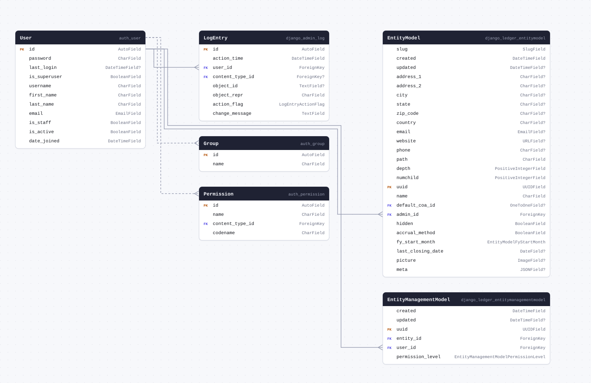

| Column | Field | Type | Null | Key | Default | Description |
| --- | --- | --- | --- | --- | --- | --- |
| `id` | `AutoField` | `integer` |  | PK | `autoincrement()` |  |
| `password` | `CharField` | `varchar(128)` |  |  |  |  |
| `last_login` | `DateTimeField` | `datetime` | yes |  |  |  |
| `is_superuser` | `BooleanField` | `bool` |  |  | `False` | Designates that this user has all permissions without explicitly assigning them. |
| `username` | `CharField` | `varchar(150)` |  | unique |  | Required. 150 characters or fewer. Letters, digits and @/./+/-/_ only. |
| `first_name` | `CharField` | `varchar(150)` |  |  |  |  |
| `last_name` | `CharField` | `varchar(150)` |  |  |  |  |
| `email` | `EmailField` | `varchar(254)` |  |  |  |  |
| `is_staff` | `BooleanField` | `bool` |  |  | `False` | Designates whether the user can log into this admin site. |
| `is_active` | `BooleanField` | `bool` |  |  | `True` | Designates whether this user should be treated as active. Unselect this instead of deleting accounts. |
| `date_joined` | `DateTimeField` | `datetime` |  |  | `now()` |  |

Relations:

- `managed_by` — many to many with [EntityModel](#entitymodel), through [EntityManagementModel](#entitymanagementmodel)
- [LogEntry](#logentry).`user_id` → `id`, on delete cascade
- `groups` — many to many with [Group](#group)
- `user_permissions` — many to many with [Permission](#permission)
- [EntityModel](#entitymodel).`admin_id` → `id`, on delete cascade
- [EntityManagementModel](#entitymanagementmodel).`user_id` → `id`, on delete cascade

## ContentType

Table `django_content_type`, app `contenttypes`.


| Column | Field | Type | Null | Key | Default | Description |
| --- | --- | --- | --- | --- | --- | --- |
| `id` | `AutoField` | `integer` |  | PK | `autoincrement()` |  |
| `app_label` | `CharField` | `varchar(100)` |  |  |  |  |
| `model` | `CharField` | `varchar(100)` |  |  |  |  |

Indexes:

- unique `django_content_type_app_label_model_76bd3d3b_uniq` on `app_label`, `model`

Relations:

- [LogEntry](#logentry).`content_type_id` → `id`, on delete set null
- [Permission](#permission).`content_type_id` → `id`, on delete cascade

## Session

Table `django_session`, app `sessions`.

Columns from `AbstractBaseSession` (abstract): `session_key`, `session_data`, `expire_date`.

Django provides full support for anonymous sessions. The session
framework lets you store and retrieve arbitrary data on a
per-site-visitor basis. It stores data on the server side and
abstracts the sending and receiving of cookies. Cookies contain a
session ID -- not the data itself.

The Django sessions framework is entirely cookie-based. It does
not fall back to putting session IDs in URLs. This is an intentional
design decision. Not only does that behavior make URLs ugly, it makes
your site vulnerable to session-ID theft via the "Referer" header.

For complete documentation on using Sessions in your code, consult
the sessions documentation that is shipped with Django (also available
on the Django web site).

| Column | Field | Type | Null | Key | Default | Description |
| --- | --- | --- | --- | --- | --- | --- |
| `session_key` | `CharField` | `varchar(40)` |  | PK |  |  |
| `session_data` | `TextField` | `text` |  |  |  |  |
| `expire_date` | `DateTimeField` | `datetime` |  |  |  |  |

Indexes:

- index `django_session_expire_date_a5c62663` on `expire_date`

## BankAccountModel

Table `django_ledger_bankaccountmodel`, app `django_ledger`.

Columns from `BankAccountModelAbstract` (abstract): `uuid`, `name`, `entity_model_id`, `account_model_id`, `active`, `hidden`.

Columns from `FinancialAccountInfoMixin` (abstract): `financial_institution`, `account_number`, `routing_number`, `aba_number`, `swift_number`, `account_type`.

Columns from `CreateUpdateMixIn` (abstract): `created`, `updated`.

Base Bank Account Model Implementation

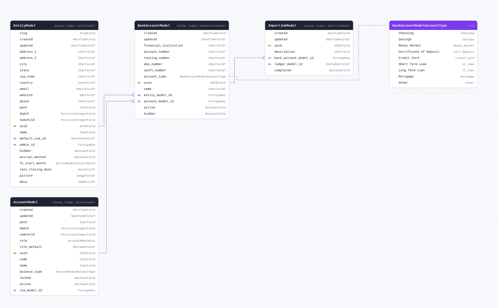

| Column | Field | Type | Null | Key | Default | Description |
| --- | --- | --- | --- | --- | --- | --- |
| `created` | `DateTimeField` | `datetime` |  |  | `now()` |  |
| `updated` | `DateTimeField` | `datetime` | yes |  | `now()` |  |
| `financial_institution` | `CharField` | `varchar(100)` | yes |  |  | Name of the financial institution (i.e. Bank Name). |
| `account_number` | `CharField` | `varchar(30)` | yes |  |  |  |
| `routing_number` | `CharField` | `varchar(30)` | yes |  |  |  |
| `aba_number` | `CharField` | `varchar(30)` | yes |  |  |  |
| `swift_number` | `CharField` | `varchar(30)` | yes |  |  |  |
| `account_type` | `BankAccountModelAccountType` | `varchar(20)` |  |  | `'checking'` |  |
| `uuid` | `UUIDField` | `char(32)` |  | PK | `uuid4()` |  |
| `name` | `CharField` | `varchar(150)` | yes |  |  |  |
| `entity_model_id` | `ForeignKey` | `char(32)` |  | FK |  |  |
| `account_model_id` | `ForeignKey` | `char(32)` |  | FK |  | Account model be used to map transactions from financial institution |
| `active` | `BooleanField` | `bool` |  |  | `False` |  |
| `hidden` | `BooleanField` | `bool` |  |  | `False` |  |

Indexes:

- index `django_ledger_bankaccountmodel_entity_model_id_5f781f21` on `entity_model_id`
- index `django_ledger_bankaccountmodel_account_model_id_b386bdb4` on `account_model_id`
- unique `django_ledger_bankaccountmodel_entity_model_id_account_number_e070d39f_uniq` on `entity_model_id`, `account_number`
- unique `django_ledger_bankaccountmodel_entity_model_id_account_model_id_account_number_routing_number_1be39084_uniq` on `entity_model_id`, `account_model_id`, `account_number`, `routing_number`
- index `django_ledg_account_009a4a_idx` on `account_type`
- index `django_ledg_account_ed900d_idx` on `account_model_id`
- index `django_ledg_entity__6ad006_idx` on `entity_model_id`

Relations:

- `entity_model_id` → [EntityModel](#entitymodel).`uuid`, on delete cascade
- `account_model_id` → [AccountModel](#accountmodel).`uuid`, on delete restrict
- [ImportJobModel](#importjobmodel).`bank_account_model_id` → `uuid`, on delete cascade

## AccountModel

Table `django_ledger_accountmodel`, app `django_ledger`.

Columns from `AccountModelAbstract` (abstract): `uuid`, `code`, `name`, `balance_type`, `locked`, `active`, `coa_model_id`.

Columns from `MP_Node` (abstract): `path`, `depth`, `numchild`.

Columns from `AccountModelRoleMixIn` (abstract): `role`, `role_default`.

Columns from `CreateUpdateMixIn` (abstract): `created`, `updated`.

Base Account Model from Account Model Abstract Class

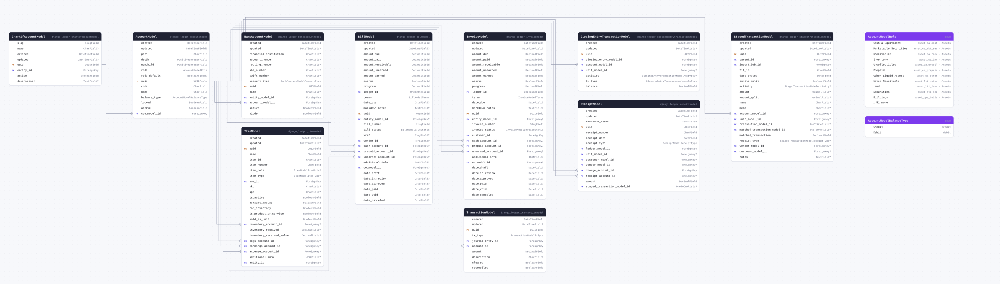

| Column | Field | Type | Null | Key | Default | Description |
| --- | --- | --- | --- | --- | --- | --- |
| `created` | `DateTimeField` | `datetime` |  |  | `now()` |  |
| `updated` | `DateTimeField` | `datetime` | yes |  | `now()` |  |
| `path` | `CharField` | `varchar(255)` |  | unique |  |  |
| `depth` | `PositiveIntegerField` | `integer unsigned` |  |  |  |  |
| `numchild` | `PositiveIntegerField` | `integer unsigned` |  |  | `0` |  |
| `role` | `AccountModelRole` | `varchar(30)` |  |  |  |  |
| `role_default` | `BooleanField` | `bool` | yes |  |  |  |
| `uuid` | `UUIDField` | `char(32)` |  | PK | `uuid4()` |  |
| `code` | `CharField` | `varchar(10)` |  |  |  |  |
| `name` | `CharField` | `varchar(100)` |  |  |  |  |
| `balance_type` | `AccountModelBalanceType` | `varchar(6)` |  |  |  |  |
| `locked` | `BooleanField` | `bool` |  |  | `False` |  |
| `active` | `BooleanField` | `bool` |  |  | `False` |  |
| `coa_model_id` | `ForeignKey` | `char(32)` |  | FK |  |  |

Indexes:

- index `django_ledger_accountmodel_coa_model_id_4526e35f` on `coa_model_id`
- unique `unique_code_for_coa_model` on `coa_model_id`, `code`
- unique `only_one_account_assigned_as_default_for_role` on `coa_model_id`, `role`, `role_default`
- index `django_ledg_role_812d08_idx` on `role`
- index `django_ledg_balance_daddac_idx` on `balance_type`
- index `django_ledg_active_f8adc2_idx` on `active`
- index `django_ledg_locked_c02b15_idx` on `locked`
- index `django_ledg_coa_mod_e073bc_idx` on `coa_model_id`, `code`
- index `django_ledg_code_081adc_idx` on `code`

Relations:

- [BankAccountModel](#bankaccountmodel).`account_model_id` → `uuid`, on delete restrict
- `coa_model_id` → [ChartOfAccountModel](#chartofaccountmodel).`uuid`, on delete cascade
- [ItemModel](#itemmodel).`inventory_account_id` → `uuid`, on delete restrict
- [ItemModel](#itemmodel).`cogs_account_id` → `uuid`, on delete restrict
- [ItemModel](#itemmodel).`earnings_account_id` → `uuid`, on delete restrict
- [ItemModel](#itemmodel).`expense_account_id` → `uuid`, on delete restrict
- [BillModel](#billmodel).`cash_account_id` → `uuid`, on delete restrict
- [BillModel](#billmodel).`prepaid_account_id` → `uuid`, on delete restrict
- [BillModel](#billmodel).`unearned_account_id` → `uuid`, on delete restrict
- [InvoiceModel](#invoicemodel).`cash_account_id` → `uuid`, on delete restrict
- [InvoiceModel](#invoicemodel).`prepaid_account_id` → `uuid`, on delete restrict
- [InvoiceModel](#invoicemodel).`unearned_account_id` → `uuid`, on delete restrict
- [TransactionModel](#transactionmodel).`account_id` → `uuid`, on delete protect
- [ClosingEntryTransactionModel](#closingentrytransactionmodel).`account_model_id` → `uuid`, on delete restrict
- [ReceiptModel](#receiptmodel).`charge_account_id` → `uuid`, on delete protect
- [ReceiptModel](#receiptmodel).`receipt_account_id` → `uuid`, on delete protect
- [StagedTransactionModel](#stagedtransactionmodel).`account_model_id` → `uuid`, on delete restrict

## ChartOfAccountModel

Table `django_ledger_chartofaccountmodel`, app `django_ledger`.

Columns from `ChartOfAccountModelAbstract` (abstract): `uuid`, `entity_id`, `active`, `description`.

Columns from `SlugNameMixIn` (abstract): `slug`, `name`.

Columns from `CreateUpdateMixIn` (abstract): `created`, `updated`.

Base ChartOfAccounts Model

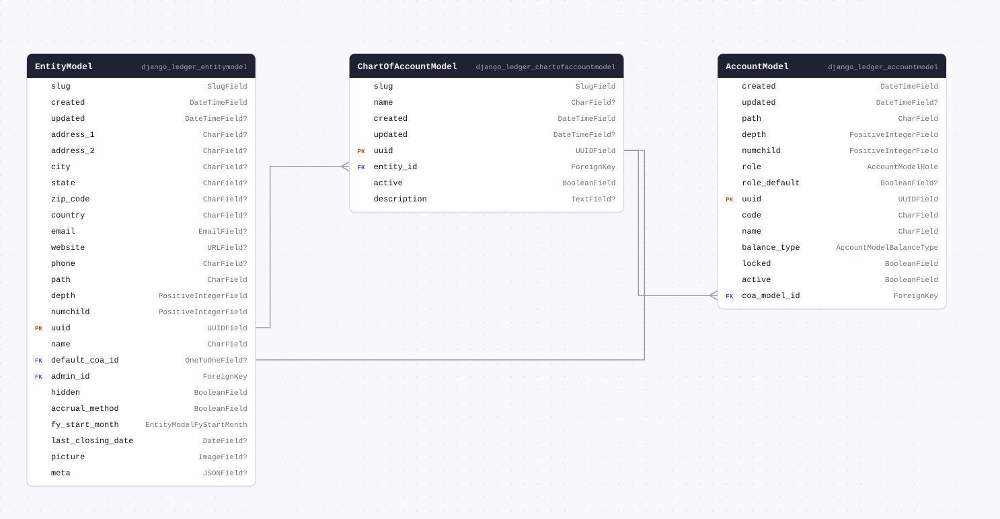

| Column | Field | Type | Null | Key | Default | Description |
| --- | --- | --- | --- | --- | --- | --- |
| `slug` | `SlugField` | `varchar(50)` |  | unique |  |  |
| `name` | `CharField` | `varchar(150)` | yes |  |  |  |
| `created` | `DateTimeField` | `datetime` |  |  | `now()` |  |
| `updated` | `DateTimeField` | `datetime` | yes |  | `now()` |  |
| `uuid` | `UUIDField` | `char(32)` |  | PK | `uuid4()` |  |
| `entity_id` | `ForeignKey` | `char(32)` |  | FK |  |  |
| `active` | `BooleanField` | `bool` |  |  | `True` |  |
| `description` | `TextField` | `text` | yes |  |  |  |

Indexes:

- index `django_ledger_chartofaccountmodel_entity_id_3c492d5a` on `entity_id`
- index `django_ledg_entity__48d6e0_idx` on `entity_id`

Relations:

- [AccountModel](#accountmodel).`coa_model_id` → `uuid`, on delete cascade
- `entity_id` → [EntityModel](#entitymodel).`uuid`, on delete cascade
- [EntityModel](#entitymodel).`default_coa_id` → `uuid`, on delete protect

## CustomerModel

Table `django_ledger_customermodel`, app `django_ledger`.

Columns from `CustomerModelAbstract` (abstract): `uuid`, `customer_code`, `customer_name`, `customer_number`, `entity_model_id`, `description`, `active`, `hidden`, `picture`, `additional_info`.

Columns from `ContactInfoMixIn` (abstract): `address_1`, `address_2`, `city`, `state`, `zip_code`, `country`, `email`, `website`, `phone`.

Columns from `TaxCollectionMixIn` (abstract): `sales_tax_rate`.

Columns from `CreateUpdateMixIn` (abstract): `created`, `updated`.

Base Customer Model Implementation

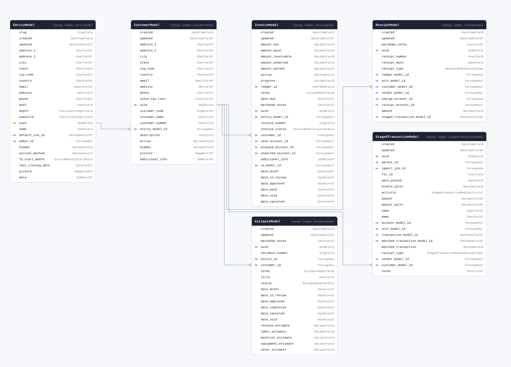

| Column | Field | Type | Null | Key | Default | Description |
| --- | --- | --- | --- | --- | --- | --- |
| `created` | `DateTimeField` | `datetime` |  |  | `now()` |  |
| `updated` | `DateTimeField` | `datetime` | yes |  | `now()` |  |
| `address_1` | `CharField` | `varchar(70)` | yes |  |  |  |
| `address_2` | `CharField` | `varchar(70)` | yes |  |  |  |
| `city` | `CharField` | `varchar(70)` | yes |  |  |  |
| `state` | `CharField` | `varchar(70)` | yes |  |  |  |
| `zip_code` | `CharField` | `varchar(20)` | yes |  |  |  |
| `country` | `CharField` | `varchar(70)` | yes |  |  |  |
| `email` | `EmailField` | `varchar(254)` | yes |  |  |  |
| `website` | `URLField` | `varchar(200)` | yes |  |  |  |
| `phone` | `CharField` | `varchar(30)` | yes |  |  |  |
| `sales_tax_rate` | `FloatField` | `real` | yes |  | `0.0` |  |
| `uuid` | `UUIDField` | `char(32)` |  | PK | `uuid4()` |  |
| `customer_code` | `SlugField` | `varchar(50)` | yes | unique |  |  |
| `customer_name` | `CharField` | `varchar(100)` |  |  |  |  |
| `customer_number` | `CharField` | `varchar(30)` |  |  |  | System generated customer number. |
| `entity_model_id` | `ForeignKey` | `char(32)` |  | FK |  |  |
| `description` | `TextField` | `text` |  |  |  |  |
| `active` | `BooleanField` | `bool` |  |  | `True` |  |
| `hidden` | `BooleanField` | `bool` |  |  | `False` |  |
| `picture` | `ImageField` | `varchar(100)` | yes |  |  |  |
| `additional_info` | `JSONField` | `text` | yes |  | `dict()` |  |

Indexes:

- index `django_ledger_customermodel_entity_model_id_df76cc84` on `entity_model_id`
- unique `django_ledger_customermodel_entity_model_id_customer_number_86da2bf5_uniq` on `entity_model_id`, `customer_number`
- index `django_ledg_entity__7b3ad8_idx` on `entity_model_id`, `customer_number`
- index `django_ledg_created_ba7f4c_idx` on `created`
- index `django_ledg_updated_f9ac90_idx` on `updated`
- index `django_ledg_active_967a81_idx` on `active`
- index `django_ledg_hidden_dda722_idx` on `hidden`

Relations:

- `entity_model_id` → [EntityModel](#entitymodel).`uuid`, on delete cascade
- [InvoiceModel](#invoicemodel).`customer_id` → `uuid`, on delete restrict
- [EstimateModel](#estimatemodel).`customer_id` → `uuid`, on delete restrict
- [ReceiptModel](#receiptmodel).`customer_model_id` → `uuid`, on delete protect
- [StagedTransactionModel](#stagedtransactionmodel).`customer_model_id` → `uuid`, on delete restrict

## UnitOfMeasureModel

Table `django_ledger_unitofmeasuremodel`, app `django_ledger`.

Columns from `UnitOfMeasureModelAbstract` (abstract): `uuid`, `name`, `unit_abbr`, `is_active`, `entity_id`.

Columns from `CreateUpdateMixIn` (abstract): `created`, `updated`.

Base UnitOfMeasureModel from Abstract.

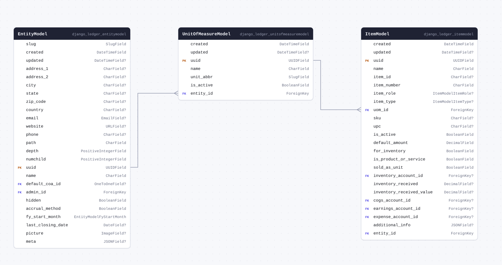

| Column | Field | Type | Null | Key | Default | Description |
| --- | --- | --- | --- | --- | --- | --- |
| `created` | `DateTimeField` | `datetime` |  |  | `now()` |  |
| `updated` | `DateTimeField` | `datetime` | yes |  | `now()` |  |
| `uuid` | `UUIDField` | `char(32)` |  | PK | `uuid4()` |  |
| `name` | `CharField` | `varchar(50)` |  |  |  |  |
| `unit_abbr` | `SlugField` | `varchar(10)` |  |  |  |  |
| `is_active` | `BooleanField` | `bool` |  |  | `True` |  |
| `entity_id` | `ForeignKey` | `char(32)` |  | FK |  |  |

Indexes:

- index `django_ledger_unitofmeasuremodel_unit_abbr_ed8b6776` on `unit_abbr`
- index `django_ledger_unitofmeasuremodel_entity_id_e7217da1` on `entity_id`
- unique `django_ledger_unitofmeasuremodel_entity_id_unit_abbr_e3bc96ca_uniq` on `entity_id`, `unit_abbr`
- index `django_ledg_entity__1c8986_idx` on `entity_id`

Relations:

- `entity_id` → [EntityModel](#entitymodel).`uuid`, on delete cascade
- [ItemModel](#itemmodel).`uom_id` → `uuid`, on delete restrict

## ItemTransactionModel

Table `django_ledger_itemtransactionmodel`, app `django_ledger`.

Columns from `ItemTransactionModelAbstract` (abstract): `uuid`, `entity_unit_id`, `item_model_id`, `bill_model_id`, `invoice_model_id`, `quantity`, `unit_cost`, `total_amount`, `po_model_id`, `po_quantity`, `po_unit_cost`, `po_total_amount`, `po_item_status`, `ce_model_id`, `ce_quantity`, `ce_unit_cost_estimate`, `ce_cost_estimate`, `ce_unit_revenue_estimate`, `ce_revenue_estimate`, `item_notes`.

Columns from `CreateUpdateMixIn` (abstract): `created`, `updated`.

Base ItemTransactionModel from Abstract.

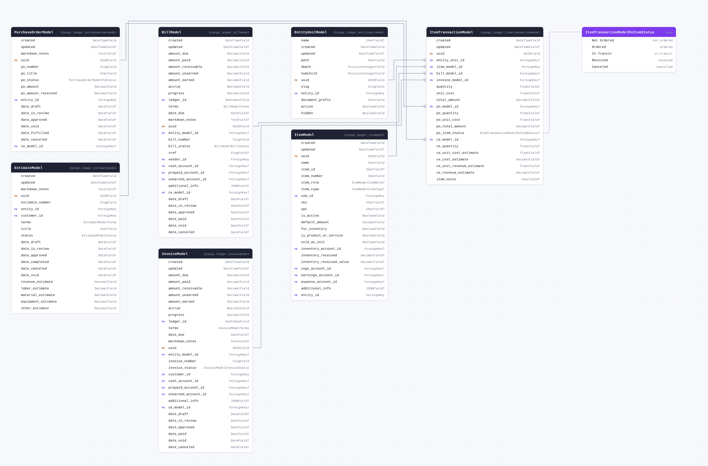

| Column | Field | Type | Null | Key | Default | Description |
| --- | --- | --- | --- | --- | --- | --- |
| `created` | `DateTimeField` | `datetime` |  |  | `now()` |  |
| `updated` | `DateTimeField` | `datetime` | yes |  | `now()` |  |
| `uuid` | `UUIDField` | `char(32)` |  | PK | `uuid4()` |  |
| `entity_unit_id` | `ForeignKey` | `char(32)` | yes | FK |  |  |
| `item_model_id` | `ForeignKey` | `char(32)` |  | FK |  |  |
| `bill_model_id` | `ForeignKey` | `char(32)` | yes | FK |  |  |
| `invoice_model_id` | `ForeignKey` | `char(32)` | yes | FK |  |  |
| `quantity` | `FloatField` | `real` | yes |  |  |  |
| `unit_cost` | `FloatField` | `real` | yes |  |  |  |
| `total_amount` | `DecimalField(20, 2)` | `decimal` | yes |  |  |  |
| `po_model_id` | `ForeignKey` | `char(32)` | yes | FK |  |  |
| `po_quantity` | `FloatField` | `real` | yes |  |  | Authorized item quantity for purchasing. |
| `po_unit_cost` | `FloatField` | `real` | yes |  |  | Purchase Order unit cost. |
| `po_total_amount` | `DecimalField(20, 2)` | `decimal` | yes |  |  | Maximum authorized cost per Purchase Order. |
| `po_item_status` | `ItemTransactionModelPoItemStatus` | `varchar(15)` | yes |  |  |  |
| `ce_model_id` | `ForeignKey` | `char(32)` | yes | FK |  |  |
| `ce_quantity` | `FloatField` | `real` | yes |  |  |  |
| `ce_unit_cost_estimate` | `FloatField` | `real` | yes |  |  |  |
| `ce_cost_estimate` | `DecimalField(20, 2)` | `decimal` | yes |  |  |  |
| `ce_unit_revenue_estimate` | `FloatField` | `real` | yes |  |  |  |
| `ce_revenue_estimate` | `DecimalField(20, 2)` | `decimal` | yes |  |  |  |
| `item_notes` | `CharField` | `varchar(400)` | yes |  |  |  |

Indexes:

- index `django_ledger_itemtransactionmodel_entity_unit_id_c0d5d408` on `entity_unit_id`
- index `django_ledger_itemtransactionmodel_item_model_id_daf3c4c9` on `item_model_id`
- index `django_ledger_itemtransactionmodel_bill_model_id_84bda6ad` on `bill_model_id`
- index `django_ledger_itemtransactionmodel_invoice_model_id_d8bc02a5` on `invoice_model_id`
- index `django_ledger_itemtransactionmodel_po_model_id_6079da59` on `po_model_id`
- index `django_ledger_itemtransactionmodel_ce_model_id_0beeb6ec` on `ce_model_id`
- index `django_ledg_bill_mo_479f1f_idx` on `bill_model_id`, `item_model_id`
- index `django_ledg_invoice_13ac3b_idx` on `invoice_model_id`, `item_model_id`
- index `django_ledg_po_mode_2675c9_idx` on `po_model_id`, `item_model_id`
- index `django_ledg_ce_mode_ae4efd_idx` on `ce_model_id`, `item_model_id`
- index `django_ledg_po_item_ac9475_idx` on `po_item_status`

Relations:

- `entity_unit_id` → [EntityUnitModel](#entityunitmodel).`uuid`, on delete restrict
- `item_model_id` → [ItemModel](#itemmodel).`uuid`, on delete restrict
- `bill_model_id` → [BillModel](#billmodel).`uuid`, on delete restrict
- `invoice_model_id` → [InvoiceModel](#invoicemodel).`uuid`, on delete restrict
- `po_model_id` → [PurchaseOrderModel](#purchaseordermodel).`uuid`, on delete restrict
- `ce_model_id` → [EstimateModel](#estimatemodel).`uuid`, on delete restrict

## ItemModel

Table `django_ledger_itemmodel`, app `django_ledger`.

Columns from `ItemModelAbstract` (abstract): `uuid`, `name`, `item_id`, `item_number`, `item_role`, `item_type`, `uom_id`, `sku`, `upc`, `is_active`, `default_amount`, `for_inventory`, `is_product_or_service`, `sold_as_unit`, `inventory_account_id`, `inventory_received`, `inventory_received_value`, `cogs_account_id`, `earnings_account_id`, `expense_account_id`, `additional_info`, `entity_id`.

Columns from `CreateUpdateMixIn` (abstract): `created`, `updated`.

Base ItemModel from Abstract.

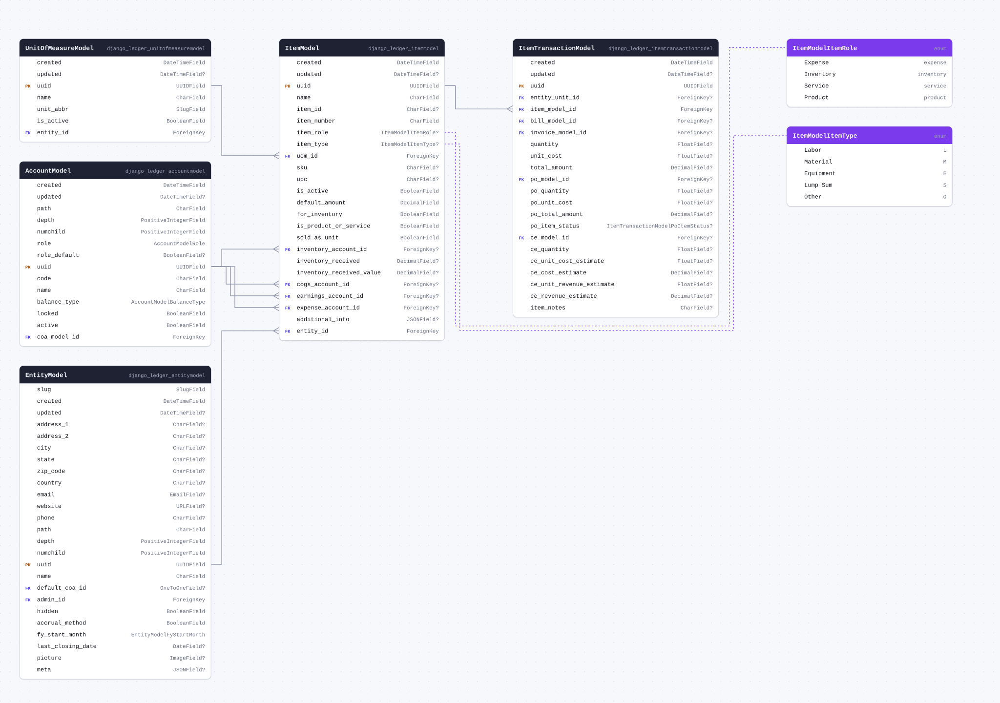

| Column | Field | Type | Null | Key | Default | Description |
| --- | --- | --- | --- | --- | --- | --- |
| `created` | `DateTimeField` | `datetime` |  |  | `now()` |  |
| `updated` | `DateTimeField` | `datetime` | yes |  | `now()` |  |
| `uuid` | `UUIDField` | `char(32)` |  | PK | `uuid4()` |  |
| `name` | `CharField` | `varchar(100)` |  |  |  |  |
| `item_id` | `CharField` | `varchar(50)` | yes |  |  |  |
| `item_number` | `CharField` | `varchar(30)` |  |  |  |  |
| `item_role` | `ItemModelItemRole` | `varchar(10)` | yes |  |  |  |
| `item_type` | `ItemModelItemType` | `varchar(1)` | yes |  |  |  |
| `uom_id` | `ForeignKey` | `char(32)` |  | FK |  |  |
| `sku` | `CharField` | `varchar(50)` | yes |  |  |  |
| `upc` | `CharField` | `varchar(50)` | yes |  |  |  |
| `is_active` | `BooleanField` | `bool` |  |  | `True` |  |
| `default_amount` | `DecimalField(20, 2)` | `decimal` |  |  | `0` |  |
| `for_inventory` | `BooleanField` | `bool` |  |  |  | It is an item you require for your inventory. |
| `is_product_or_service` | `BooleanField` | `bool` |  |  |  | Is a product or service you sell or provide to customers. |
| `sold_as_unit` | `BooleanField` | `bool` |  |  | `False` |  |
| `inventory_account_id` | `ForeignKey` | `char(32)` | yes | FK |  | Inventory account where cost will be capitalized. |
| `inventory_received` | `DecimalField(20, 3)` | `decimal` | yes |  |  |  |
| `inventory_received_value` | `DecimalField(20, 2)` | `decimal` | yes |  |  |  |
| `cogs_account_id` | `ForeignKey` | `char(32)` | yes | FK |  | COGS account where cost will be recognized on Income Statement. |
| `earnings_account_id` | `ForeignKey` | `char(32)` | yes | FK |  | Earnings account where revenue will be recognized on Income Statement. |
| `expense_account_id` | `ForeignKey` | `char(32)` | yes | FK |  | Expense account where cost will be recognized on Income Statement. |
| `additional_info` | `JSONField` | `text` | yes |  | `dict()` |  |
| `entity_id` | `ForeignKey` | `char(32)` |  | FK |  |  |

Indexes:

- index `django_ledger_itemmodel_uom_id_781d53d4` on `uom_id`
- index `django_ledger_itemmodel_inventory_account_id_5df4ed3e` on `inventory_account_id`
- index `django_ledger_itemmodel_cogs_account_id_4d75186f` on `cogs_account_id`
- index `django_ledger_itemmodel_earnings_account_id_e52437bb` on `earnings_account_id`
- index `django_ledger_itemmodel_expense_account_id_b7ce040e` on `expense_account_id`
- index `django_ledger_itemmodel_entity_id_12366151` on `entity_id`
- unique `django_ledger_itemmodel_entity_id_item_number_0e3c0673_uniq` on `entity_id`, `item_number`
- index `django_ledg_item_nu_1e3c20_idx` on `item_number`
- index `django_ledg_item_ty_0cef58_idx` on `item_type`
- index `django_ledg_item_ro_6040aa_idx` on `item_role`
- index `django_ledg_upc_c19d0a_idx` on `upc`
- index `django_ledg_sku_02b4d8_idx` on `sku`
- index `django_ledg_for_inv_c93303_idx` on `for_inventory`
- index `django_ledg_is_prod_4b9941_idx` on `is_product_or_service`
- index `django_ledg_is_acti_ffc9c6_idx` on `is_active`

Relations:

- `billmodel_set` — many to many with [BillModel](#billmodel), through [ItemTransactionModel](#itemtransactionmodel)
- `invoicemodel_set` — many to many with [InvoiceModel](#invoicemodel), through [ItemTransactionModel](#itemtransactionmodel)
- `purchaseordermodel_set` — many to many with [PurchaseOrderModel](#purchaseordermodel), through [ItemTransactionModel](#itemtransactionmodel)
- [ItemTransactionModel](#itemtransactionmodel).`item_model_id` → `uuid`, on delete restrict
- `uom_id` → [UnitOfMeasureModel](#unitofmeasuremodel).`uuid`, on delete restrict
- `inventory_account_id` → [AccountModel](#accountmodel).`uuid`, on delete restrict
- `cogs_account_id` → [AccountModel](#accountmodel).`uuid`, on delete restrict
- `earnings_account_id` → [AccountModel](#accountmodel).`uuid`, on delete restrict
- `expense_account_id` → [AccountModel](#accountmodel).`uuid`, on delete restrict
- `entity_id` → [EntityModel](#entitymodel).`uuid`, on delete cascade

## LedgerModel

Table `django_ledger_ledgermodel`, app `django_ledger`.

Columns from `LedgerModelAbstract` (abstract): `uuid`, `ledger_xid`, `name`, `entity_id`, `posted`, `locked`, `hidden`, `additional_info`.

Columns from `CreateUpdateMixIn` (abstract): `created`, `updated`.

Base LedgerModel from Abstract.

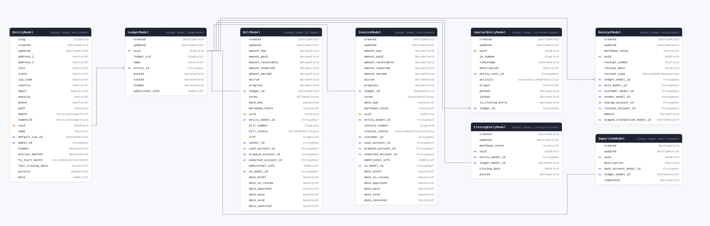

| Column | Field | Type | Null | Key | Default | Description |
| --- | --- | --- | --- | --- | --- | --- |
| `created` | `DateTimeField` | `datetime` |  |  | `now()` |  |
| `updated` | `DateTimeField` | `datetime` | yes |  | `now()` |  |
| `uuid` | `UUIDField` | `char(32)` |  | PK | `uuid4()` |  |
| `ledger_xid` | `SlugField` | `varchar(150)` | yes |  |  | User Defined Ledger ID |
| `name` | `CharField` | `varchar(150)` | yes |  |  |  |
| `entity_id` | `ForeignKey` | `char(32)` |  | FK |  |  |
| `posted` | `BooleanField` | `bool` |  |  | `False` |  |
| `locked` | `BooleanField` | `bool` |  |  | `False` |  |
| `hidden` | `BooleanField` | `bool` |  |  | `False` |  |
| `additional_info` | `JSONField` | `text` | yes |  | `dict()` |  |

Indexes:

- index `django_ledger_ledgermodel_ledger_xid_9ba04482` on `ledger_xid`
- index `django_ledger_ledgermodel_entity_id_33b0bea3` on `entity_id`
- unique `django_ledger_ledgermodel_entity_id_ledger_xid_e2c3b406_uniq` on `entity_id`, `ledger_xid`
- index `django_ledg_entity__e21c5d_idx` on `entity_id`
- index `django_ledg_entity__040422_idx` on `entity_id`, `posted`
- index `django_ledg_entity__cde962_idx` on `entity_id`, `locked`
- index `django_ledg_entity__7be095_idx` on `entity_id`, `ledger_xid`
- index `django_ledg_ledger__05f099_idx` on `ledger_xid`

Relations:

- `entity_id` → [EntityModel](#entitymodel).`uuid`, on delete cascade
- [BillModel](#billmodel).`ledger_id` → `uuid`, on delete cascade
- [InvoiceModel](#invoicemodel).`ledger_id` → `uuid`, on delete cascade
- [JournalEntryModel](#journalentrymodel).`ledger_id` → `uuid`, on delete cascade
- [ClosingEntryModel](#closingentrymodel).`ledger_model_id` → `uuid`, on delete cascade
- [ReceiptModel](#receiptmodel).`ledger_model_id` → `uuid`, on delete protect
- [ImportJobModel](#importjobmodel).`ledger_model_id` → `uuid`, on delete cascade

## EntityUnitModel

Table `django_ledger_entityunitmodel`, app `django_ledger`.

Columns from `EntityUnitModelAbstract` (abstract): `uuid`, `entity_id`, `document_prefix`, `active`, `hidden`.

Columns from `MP_Node` (abstract): `path`, `depth`, `numchild`.

Columns from `SlugNameMixIn` (abstract): `slug`, `name`.

Columns from `CreateUpdateMixIn` (abstract): `created`, `updated`.

Base Model Class for EntityUnitModel

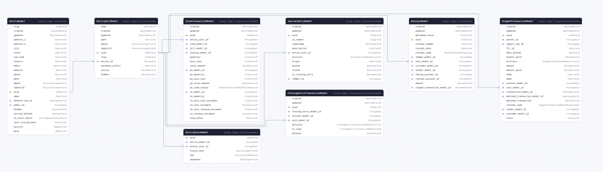

| Column | Field | Type | Null | Key | Default | Description |
| --- | --- | --- | --- | --- | --- | --- |
| `name` | `CharField` | `varchar(150)` | yes |  |  |  |
| `created` | `DateTimeField` | `datetime` |  |  | `now()` |  |
| `updated` | `DateTimeField` | `datetime` | yes |  | `now()` |  |
| `path` | `CharField` | `varchar(255)` |  | unique |  |  |
| `depth` | `PositiveIntegerField` | `integer unsigned` |  |  |  |  |
| `numchild` | `PositiveIntegerField` | `integer unsigned` |  |  | `0` |  |
| `uuid` | `UUIDField` | `char(32)` |  | PK | `uuid4()` |  |
| `slug` | `SlugField` | `varchar(50)` |  |  |  |  |
| `entity_id` | `ForeignKey` | `char(32)` |  | FK |  |  |
| `document_prefix` | `CharField` | `varchar(3)` |  |  |  |  |
| `active` | `BooleanField` | `bool` |  |  | `True` |  |
| `hidden` | `BooleanField` | `bool` |  |  | `False` |  |

Indexes:

- index `django_ledger_entityunitmodel_slug_0d4dbf86` on `slug`
- index `django_ledger_entityunitmodel_entity_id_439c908e` on `entity_id`
- unique `django_ledger_entityunitmodel_entity_id_slug_be1e98cd_uniq` on `entity_id`, `slug`
- unique `django_ledger_entityunitmodel_entity_id_document_prefix_34312c29_uniq` on `entity_id`, `document_prefix`
- index `django_ledg_active_2c2caa_idx` on `active`
- index `django_ledg_hidden_a01d42_idx` on `hidden`
- index `django_ledg_entity__0bdfdc_idx` on `entity_id`

Relations:

- [ItemTransactionModel](#itemtransactionmodel).`entity_unit_id` → `uuid`, on delete restrict
- `entity_id` → [EntityModel](#entitymodel).`uuid`, on delete cascade
- [EntityStateModel](#entitystatemodel).`entity_unit_id` → `uuid`, on delete restrict
- [JournalEntryModel](#journalentrymodel).`entity_unit_id` → `uuid`, on delete restrict
- [ClosingEntryTransactionModel](#closingentrytransactionmodel).`unit_model_id` → `uuid`, on delete restrict
- [ReceiptModel](#receiptmodel).`unit_model_id` → `uuid`, on delete protect
- [StagedTransactionModel](#stagedtransactionmodel).`unit_model_id` → `uuid`, on delete restrict

## VendorModel

Table `django_ledger_vendormodel`, app `django_ledger`.

Columns from `VendorModelAbstract` (abstract): `uuid`, `vendor_code`, `vendor_number`, `vendor_name`, `entity_model_id`, `description`, `active`, `hidden`, `picture`, `additional_info`.

Columns from `ContactInfoMixIn` (abstract): `address_1`, `address_2`, `city`, `state`, `zip_code`, `country`, `email`, `website`, `phone`.

Columns from `FinancialAccountInfoMixin` (abstract): `financial_institution`, `account_number`, `routing_number`, `aba_number`, `swift_number`, `account_type`.

Columns from `TaxInfoMixIn` (abstract): `tax_id_number`.

Columns from `CreateUpdateMixIn` (abstract): `created`, `updated`.

Base Vendor Model Implementation

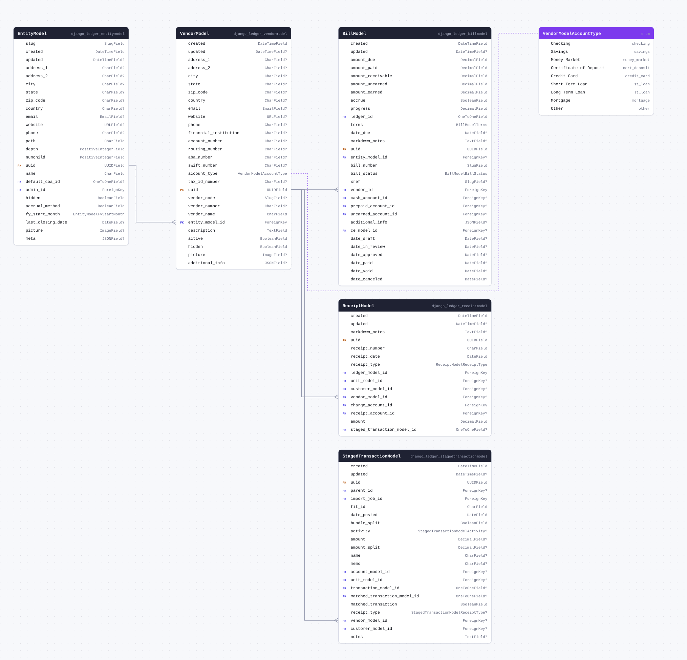

| Column | Field | Type | Null | Key | Default | Description |
| --- | --- | --- | --- | --- | --- | --- |
| `created` | `DateTimeField` | `datetime` |  |  | `now()` |  |
| `updated` | `DateTimeField` | `datetime` | yes |  | `now()` |  |
| `address_1` | `CharField` | `varchar(70)` | yes |  |  |  |
| `address_2` | `CharField` | `varchar(70)` | yes |  |  |  |
| `city` | `CharField` | `varchar(70)` | yes |  |  |  |
| `state` | `CharField` | `varchar(70)` | yes |  |  |  |
| `zip_code` | `CharField` | `varchar(20)` | yes |  |  |  |
| `country` | `CharField` | `varchar(70)` | yes |  |  |  |
| `email` | `EmailField` | `varchar(254)` | yes |  |  |  |
| `website` | `URLField` | `varchar(200)` | yes |  |  |  |
| `phone` | `CharField` | `varchar(30)` | yes |  |  |  |
| `financial_institution` | `CharField` | `varchar(100)` | yes |  |  | Name of the financial institution (i.e. Bank Name). |
| `account_number` | `CharField` | `varchar(30)` | yes |  |  |  |
| `routing_number` | `CharField` | `varchar(30)` | yes |  |  |  |
| `aba_number` | `CharField` | `varchar(30)` | yes |  |  |  |
| `swift_number` | `CharField` | `varchar(30)` | yes |  |  |  |
| `account_type` | `VendorModelAccountType` | `varchar(20)` |  |  | `'checking'` |  |
| `tax_id_number` | `CharField` | `varchar(30)` | yes |  |  |  |
| `uuid` | `UUIDField` | `char(32)` |  | PK | `uuid4()` |  |
| `vendor_code` | `SlugField` | `varchar(50)` | yes |  |  |  |
| `vendor_number` | `CharField` | `varchar(30)` | yes |  |  | System generated vendor number. |
| `vendor_name` | `CharField` | `varchar(100)` |  |  |  |  |
| `entity_model_id` | `ForeignKey` | `char(32)` |  | FK |  |  |
| `description` | `TextField` | `text` |  |  |  |  |
| `active` | `BooleanField` | `bool` |  |  | `True` |  |
| `hidden` | `BooleanField` | `bool` |  |  | `False` |  |
| `picture` | `ImageField` | `varchar(100)` | yes |  |  |  |
| `additional_info` | `JSONField` | `text` | yes |  | `dict()` |  |

Indexes:

- index `django_ledger_vendormodel_vendor_code_fbc2029b` on `vendor_code`
- index `django_ledger_vendormodel_entity_model_id_395c8bba` on `entity_model_id`
- unique `django_ledger_vendormodel_entity_model_id_vendor_number_dc954f88_uniq` on `entity_model_id`, `vendor_number`
- index `django_ledg_entity__266aa0_idx` on `entity_model_id`, `vendor_number`
- index `django_ledg_vendor__5f9f46_idx` on `vendor_number`
- index `django_ledg_created_6a5d9d_idx` on `created`
- index `django_ledg_updated_736f82_idx` on `updated`
- index `django_ledg_active_25e3b1_idx` on `active`
- index `django_ledg_hidden_379b0a_idx` on `hidden`

Relations:

- `entity_model_id` → [EntityModel](#entitymodel).`uuid`, on delete cascade
- [BillModel](#billmodel).`vendor_id` → `uuid`, on delete cascade
- [ReceiptModel](#receiptmodel).`vendor_model_id` → `uuid`, on delete protect
- [StagedTransactionModel](#stagedtransactionmodel).`vendor_model_id` → `uuid`, on delete restrict

## EntityModel

Table `django_ledger_entitymodel`, app `django_ledger`.

Columns from `EntityModelAbstract` (abstract): `uuid`, `default_coa_id`, `admin_id`, `hidden`, `accrual_method`, `fy_start_month`, `last_closing_date`, `picture`, `meta`.

Columns from `MP_Node` (abstract): `path`, `depth`, `numchild`.

Columns from `SlugNameMixIn` (abstract): `slug`, `name`.

Columns from `CreateUpdateMixIn` (abstract): `created`, `updated`.

Columns from `ContactInfoMixIn` (abstract): `address_1`, `address_2`, `city`, `state`, `zip_code`, `country`, `email`, `website`, `phone`.

Entity Model Base Class From Abstract

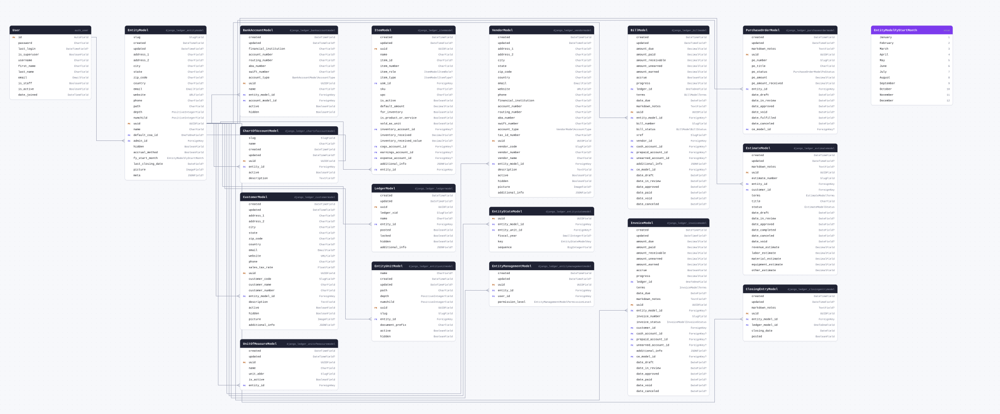

| Column | Field | Type | Null | Key | Default | Description |
| --- | --- | --- | --- | --- | --- | --- |
| `slug` | `SlugField` | `varchar(50)` |  | unique |  |  |
| `created` | `DateTimeField` | `datetime` |  |  | `now()` |  |
| `updated` | `DateTimeField` | `datetime` | yes |  | `now()` |  |
| `address_1` | `CharField` | `varchar(70)` | yes |  |  |  |
| `address_2` | `CharField` | `varchar(70)` | yes |  |  |  |
| `city` | `CharField` | `varchar(70)` | yes |  |  |  |
| `state` | `CharField` | `varchar(70)` | yes |  |  |  |
| `zip_code` | `CharField` | `varchar(20)` | yes |  |  |  |
| `country` | `CharField` | `varchar(70)` | yes |  |  |  |
| `email` | `EmailField` | `varchar(254)` | yes |  |  |  |
| `website` | `URLField` | `varchar(200)` | yes |  |  |  |
| `phone` | `CharField` | `varchar(30)` | yes |  |  |  |
| `path` | `CharField` | `varchar(255)` |  | unique |  |  |
| `depth` | `PositiveIntegerField` | `integer unsigned` |  |  |  |  |
| `numchild` | `PositiveIntegerField` | `integer unsigned` |  |  | `0` |  |
| `uuid` | `UUIDField` | `char(32)` |  | PK | `uuid4()` |  |
| `name` | `CharField` | `varchar(150)` |  |  |  |  |
| `default_coa_id` | `OneToOneField` | `char(32)` | yes | FK, unique |  |  |
| `admin_id` | `ForeignKey` | `integer` |  | FK |  |  |
| `hidden` | `BooleanField` | `bool` |  |  | `False` |  |
| `accrual_method` | `BooleanField` | `bool` |  |  | `False` |  |
| `fy_start_month` | `EntityModelFyStartMonth` | `integer` |  |  | `1` |  |
| `last_closing_date` | `DateField` | `date` | yes |  |  |  |
| `picture` | `ImageField` | `varchar(100)` | yes |  |  |  |
| `meta` | `JSONField` | `text` | yes |  | `dict()` |  |

Indexes:

- index `django_ledger_entitymodel_admin_id_b0859ebd` on `admin_id`
- index `django_ledg_admin_i_09f5c9_idx` on `admin_id`

Relations:

- `managers` — many to many with [User](#user), through [EntityManagementModel](#entitymanagementmodel)
- [BankAccountModel](#bankaccountmodel).`entity_model_id` → `uuid`, on delete cascade
- [ChartOfAccountModel](#chartofaccountmodel).`entity_id` → `uuid`, on delete cascade
- [CustomerModel](#customermodel).`entity_model_id` → `uuid`, on delete cascade
- [UnitOfMeasureModel](#unitofmeasuremodel).`entity_id` → `uuid`, on delete cascade
- [ItemModel](#itemmodel).`entity_id` → `uuid`, on delete cascade
- [LedgerModel](#ledgermodel).`entity_id` → `uuid`, on delete cascade
- [EntityUnitModel](#entityunitmodel).`entity_id` → `uuid`, on delete cascade
- [VendorModel](#vendormodel).`entity_model_id` → `uuid`, on delete cascade
- `default_coa_id` → [ChartOfAccountModel](#chartofaccountmodel).`uuid`, on delete protect
- `admin_id` → [User](#user).`id`, on delete cascade
- [EntityStateModel](#entitystatemodel).`entity_model_id` → `uuid`, on delete cascade
- [EntityManagementModel](#entitymanagementmodel).`entity_id` → `uuid`, on delete cascade
- [BillModel](#billmodel).`entity_model_id` → `uuid`, on delete cascade
- [InvoiceModel](#invoicemodel).`entity_model_id` → `uuid`, on delete cascade
- [PurchaseOrderModel](#purchaseordermodel).`entity_id` → `uuid`, on delete cascade
- [EstimateModel](#estimatemodel).`entity_id` → `uuid`, on delete cascade
- [ClosingEntryModel](#closingentrymodel).`entity_model_id` → `uuid`, on delete cascade

## EntityStateModel

Table `django_ledger_entitystatemodel`, app `django_ledger`.

Columns from `EntityStateModelAbstract` (abstract): `uuid`, `entity_model_id`, `entity_unit_id`, `fiscal_year`, `key`, `sequence`.

Entity State Model Base Class from Abstract.

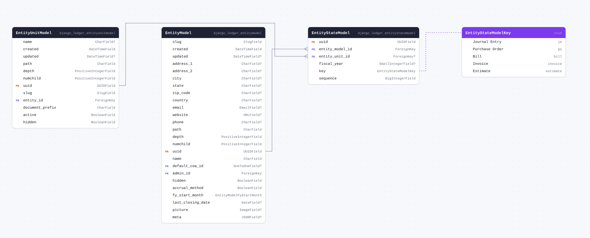

| Column | Field | Type | Null | Key | Default | Description |
| --- | --- | --- | --- | --- | --- | --- |
| `uuid` | `UUIDField` | `char(32)` |  | PK | `uuid4()` |  |
| `entity_model_id` | `ForeignKey` | `char(32)` |  | FK |  |  |
| `entity_unit_id` | `ForeignKey` | `char(32)` | yes | FK |  |  |
| `fiscal_year` | `SmallIntegerField` | `smallint` | yes |  |  |  |
| `key` | `EntityStateModelKey` | `varchar(10)` |  |  |  |  |
| `sequence` | `BigIntegerField` | `bigint` |  |  | `0` |  |

Indexes:

- index `django_ledger_entitystatemodel_entity_model_id_5e238c40` on `entity_model_id`
- index `django_ledger_entitystatemodel_entity_unit_id_d2cd3715` on `entity_unit_id`
- unique `django_ledger_entitystatemodel_entity_model_id_entity_unit_id_fiscal_year_key_8fda0b72_uniq` on `entity_model_id`, `entity_unit_id`, `fiscal_year`, `key`
- index `django_ledg_key_ac156a_idx` on `key`
- index `django_ledg_entity__eeae49_idx` on `entity_model_id`, `fiscal_year`, `entity_unit_id`, `key`

Relations:

- `entity_model_id` → [EntityModel](#entitymodel).`uuid`, on delete cascade
- `entity_unit_id` → [EntityUnitModel](#entityunitmodel).`uuid`, on delete restrict

## EntityManagementModel

Table `django_ledger_entitymanagementmodel`, app `django_ledger`.

Columns from `EntityManagementModelAbstract` (abstract): `uuid`, `entity_id`, `user_id`, `permission_level`.

Columns from `CreateUpdateMixIn` (abstract): `created`, `updated`.

EntityManagement Model Base Class From Abstract

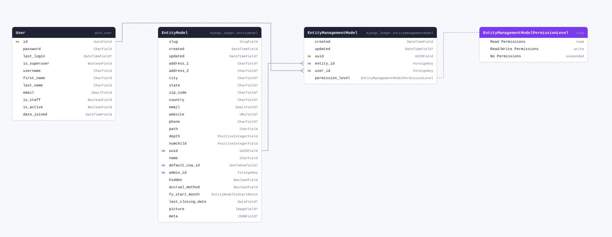

| Column | Field | Type | Null | Key | Default | Description |
| --- | --- | --- | --- | --- | --- | --- |
| `created` | `DateTimeField` | `datetime` |  |  | `now()` |  |
| `updated` | `DateTimeField` | `datetime` | yes |  | `now()` |  |
| `uuid` | `UUIDField` | `char(32)` |  | PK | `uuid4()` |  |
| `entity_id` | `ForeignKey` | `char(32)` |  | FK |  |  |
| `user_id` | `ForeignKey` | `integer` |  | FK |  |  |
| `permission_level` | `EntityManagementModelPermissionLevel` | `varchar(10)` |  |  | `'read'` |  |

Indexes:

- index `django_ledger_entitymanagementmodel_entity_id_a2fc9d9a` on `entity_id`
- index `django_ledger_entitymanagementmodel_user_id_555d3f47` on `user_id`
- index `django_ledg_entity__9541e6_idx` on `entity_id`, `user_id`
- index `django_ledg_user_id_b7497b_idx` on `user_id`, `entity_id`

Relations:

- `entity_id` → [EntityModel](#entitymodel).`uuid`, on delete cascade
- `user_id` → [User](#user).`id`, on delete cascade

## BillModel

Table `django_ledger_billmodel`, app `django_ledger`.

Columns from `BillModelAbstract` (abstract): `uuid`, `entity_model_id`, `bill_number`, `bill_status`, `xref`, `vendor_id`, `additional_info`, `ce_model_id`, `date_draft`, `date_in_review`, `date_approved`, `date_paid`, `date_void`, `date_canceled`.

Columns from `AccrualMixIn` (abstract): `amount_due`, `amount_paid`, `amount_receivable`, `amount_unearned`, `amount_earned`, `accrue`, `progress`, `ledger_id`, `cash_account_id`, `prepaid_account_id`, `unearned_account_id`.

Columns from `PaymentTermsMixIn` (abstract): `terms`, `date_due`.

Columns from `MarkdownNotesMixIn` (abstract): `markdown_notes`.

Columns from `CreateUpdateMixIn` (abstract): `created`, `updated`.

Base BillModel from Abstract.

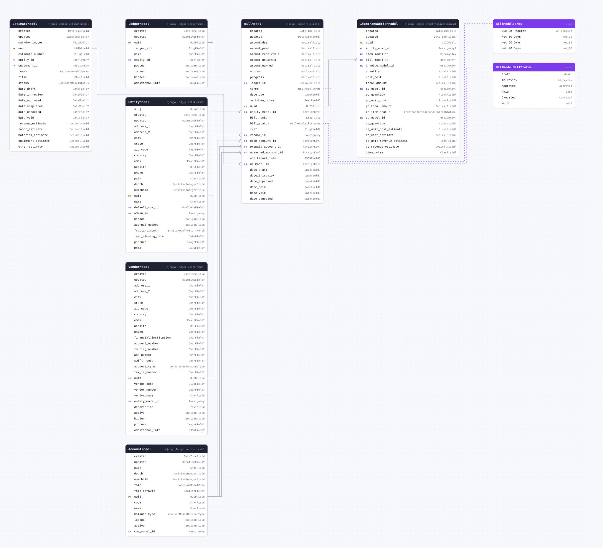

| Column | Field | Type | Null | Key | Default | Description |
| --- | --- | --- | --- | --- | --- | --- |
| `created` | `DateTimeField` | `datetime` |  |  | `now()` |  |
| `updated` | `DateTimeField` | `datetime` | yes |  | `now()` |  |
| `amount_due` | `DecimalField(20, 2)` | `decimal` |  |  | `0` |  |
| `amount_paid` | `DecimalField(20, 2)` | `decimal` |  |  | `0` |  |
| `amount_receivable` | `DecimalField(20, 2)` | `decimal` |  |  | `0` |  |
| `amount_unearned` | `DecimalField(20, 2)` | `decimal` |  |  | `0` |  |
| `amount_earned` | `DecimalField(20, 2)` | `decimal` |  |  | `0` |  |
| `accrue` | `BooleanField` | `bool` |  |  | `False` |  |
| `progress` | `DecimalField(3, 2)` | `decimal` |  |  | `0` |  |
| `ledger_id` | `OneToOneField` | `char(32)` |  | FK, unique |  |  |
| `terms` | `BillModelTerms` | `varchar(10)` |  |  | `'on_receipt'` |  |
| `date_due` | `DateField` | `date` | yes |  |  |  |
| `markdown_notes` | `TextField` | `text` | yes |  |  |  |
| `uuid` | `UUIDField` | `char(32)` |  | PK | `uuid4()` |  |
| `entity_model_id` | `ForeignKey` | `char(32)` | yes | FK |  |  |
| `bill_number` | `SlugField` | `varchar(20)` |  |  |  |  |
| `bill_status` | `BillModelBillStatus` | `varchar(10)` |  |  | `'draft'` |  |
| `xref` | `SlugField` | `varchar(50)` | yes |  |  |  |
| `vendor_id` | `ForeignKey` | `char(32)` |  | FK |  |  |
| `cash_account_id` | `ForeignKey` | `char(32)` | yes | FK |  |  |
| `prepaid_account_id` | `ForeignKey` | `char(32)` | yes | FK |  |  |
| `unearned_account_id` | `ForeignKey` | `char(32)` | yes | FK |  |  |
| `additional_info` | `JSONField` | `text` | yes |  | `dict()` |  |
| `ce_model_id` | `ForeignKey` | `char(32)` | yes | FK |  |  |
| `date_draft` | `DateField` | `date` | yes |  |  |  |
| `date_in_review` | `DateField` | `date` | yes |  |  |  |
| `date_approved` | `DateField` | `date` | yes |  |  |  |
| `date_paid` | `DateField` | `date` | yes |  |  |  |
| `date_void` | `DateField` | `date` | yes |  |  |  |
| `date_canceled` | `DateField` | `date` | yes |  |  |  |

Indexes:

- index `django_ledger_billmodel_entity_model_id_aa9ebcda` on `entity_model_id`
- index `django_ledger_billmodel_bill_number_ed7beea9` on `bill_number`
- index `django_ledger_billmodel_xref_abb65387` on `xref`
- index `django_ledger_billmodel_vendor_id_f64038f2` on `vendor_id`
- index `django_ledger_billmodel_cash_account_id_e7b4b6a5` on `cash_account_id`
- index `django_ledger_billmodel_prepaid_account_id_c344ee16` on `prepaid_account_id`
- index `django_ledger_billmodel_unearned_account_id_c3d1d5cc` on `unearned_account_id`
- index `django_ledger_billmodel_ce_model_id_2a45669e` on `ce_model_id`
- index `django_ledg_bill_st_9e158c_idx` on `bill_status`
- index `django_ledg_terms_752251_idx` on `terms`
- index `django_ledg_cash_ac_82021a_idx` on `cash_account_id`
- index `django_ledg_prepaid_5230e5_idx` on `prepaid_account_id`
- index `django_ledg_unearne_806444_idx` on `unearned_account_id`
- index `django_ledg_date_du_a8c481_idx` on `date_due`
- index `django_ledg_date_dr_7a448e_idx` on `date_draft`
- index `django_ledg_date_in_8887cb_idx` on `date_in_review`
- index `django_ledg_date_ap_3208a1_idx` on `date_approved`
- index `django_ledg_date_pa_daf06c_idx` on `date_paid`
- index `django_ledg_date_ca_e43055_idx` on `date_canceled`
- index `django_ledg_date_vo_14c747_idx` on `date_void`
- index `django_ledg_vendor__28be85_idx` on `vendor_id`
- index `django_ledg_bill_nu_6b97b4_idx` on `bill_number`

Relations:

- `bill_items` — many to many with [ItemModel](#itemmodel), through [ItemTransactionModel](#itemtransactionmodel)
- [ItemTransactionModel](#itemtransactionmodel).`bill_model_id` → `uuid`, on delete restrict
- `ledger_id` → [LedgerModel](#ledgermodel).`uuid`, on delete cascade
- `entity_model_id` → [EntityModel](#entitymodel).`uuid`, on delete cascade
- `vendor_id` → [VendorModel](#vendormodel).`uuid`, on delete cascade
- `cash_account_id` → [AccountModel](#accountmodel).`uuid`, on delete restrict
- `prepaid_account_id` → [AccountModel](#accountmodel).`uuid`, on delete restrict
- `unearned_account_id` → [AccountModel](#accountmodel).`uuid`, on delete restrict
- `ce_model_id` → [EstimateModel](#estimatemodel).`uuid`, on delete restrict

## InvoiceModel

Table `django_ledger_invoicemodel`, app `django_ledger`.

Columns from `InvoiceModelAbstract` (abstract): `uuid`, `entity_model_id`, `invoice_number`, `invoice_status`, `customer_id`, `additional_info`, `ce_model_id`, `date_draft`, `date_in_review`, `date_approved`, `date_paid`, `date_void`, `date_canceled`.

Columns from `AccrualMixIn` (abstract): `amount_due`, `amount_paid`, `amount_receivable`, `amount_unearned`, `amount_earned`, `accrue`, `progress`, `ledger_id`, `cash_account_id`, `prepaid_account_id`, `unearned_account_id`.

Columns from `PaymentTermsMixIn` (abstract): `terms`, `date_due`.

Columns from `MarkdownNotesMixIn` (abstract): `markdown_notes`.

Columns from `CreateUpdateMixIn` (abstract): `created`, `updated`.

Base Invoice Model from Abstract.

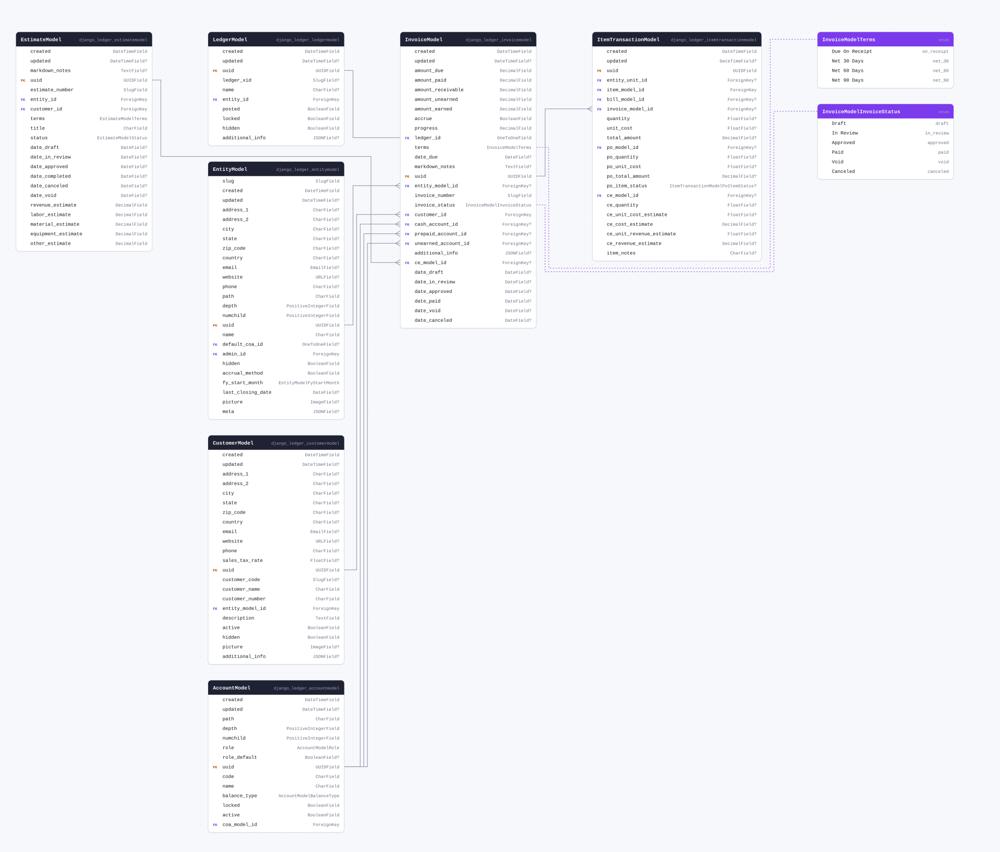

| Column | Field | Type | Null | Key | Default | Description |
| --- | --- | --- | --- | --- | --- | --- |
| `created` | `DateTimeField` | `datetime` |  |  | `now()` |  |
| `updated` | `DateTimeField` | `datetime` | yes |  | `now()` |  |
| `amount_due` | `DecimalField(20, 2)` | `decimal` |  |  | `0` |  |
| `amount_paid` | `DecimalField(20, 2)` | `decimal` |  |  | `0` |  |
| `amount_receivable` | `DecimalField(20, 2)` | `decimal` |  |  | `0` |  |
| `amount_unearned` | `DecimalField(20, 2)` | `decimal` |  |  | `0` |  |
| `amount_earned` | `DecimalField(20, 2)` | `decimal` |  |  | `0` |  |
| `accrue` | `BooleanField` | `bool` |  |  | `False` |  |
| `progress` | `DecimalField(3, 2)` | `decimal` |  |  | `0` |  |
| `ledger_id` | `OneToOneField` | `char(32)` |  | FK, unique |  |  |
| `terms` | `InvoiceModelTerms` | `varchar(10)` |  |  | `'on_receipt'` |  |
| `date_due` | `DateField` | `date` | yes |  |  |  |
| `markdown_notes` | `TextField` | `text` | yes |  |  |  |
| `uuid` | `UUIDField` | `char(32)` |  | PK | `uuid4()` |  |
| `entity_model_id` | `ForeignKey` | `char(32)` | yes | FK |  |  |
| `invoice_number` | `SlugField` | `varchar(20)` |  |  |  |  |
| `invoice_status` | `InvoiceModelInvoiceStatus` | `varchar(10)` |  |  | `'draft'` |  |
| `customer_id` | `ForeignKey` | `char(32)` |  | FK |  |  |
| `cash_account_id` | `ForeignKey` | `char(32)` | yes | FK |  |  |
| `prepaid_account_id` | `ForeignKey` | `char(32)` | yes | FK |  |  |
| `unearned_account_id` | `ForeignKey` | `char(32)` | yes | FK |  |  |
| `additional_info` | `JSONField` | `text` | yes |  | `dict()` |  |
| `ce_model_id` | `ForeignKey` | `char(32)` | yes | FK |  |  |
| `date_draft` | `DateField` | `date` | yes |  |  |  |
| `date_in_review` | `DateField` | `date` | yes |  |  |  |
| `date_approved` | `DateField` | `date` | yes |  |  |  |
| `date_paid` | `DateField` | `date` | yes |  |  |  |
| `date_void` | `DateField` | `date` | yes |  |  |  |
| `date_canceled` | `DateField` | `date` | yes |  |  |  |

Indexes:

- index `django_ledger_invoicemodel_entity_model_id_acae4e36` on `entity_model_id`
- index `django_ledger_invoicemodel_invoice_number_5cc1d746` on `invoice_number`
- index `django_ledger_invoicemodel_customer_id_73221370` on `customer_id`
- index `django_ledger_invoicemodel_cash_account_id_4a5c9037` on `cash_account_id`
- index `django_ledger_invoicemodel_prepaid_account_id_c05cefd7` on `prepaid_account_id`
- index `django_ledger_invoicemodel_unearned_account_id_7359e113` on `unearned_account_id`
- index `django_ledger_invoicemodel_ce_model_id_e101bd5a` on `ce_model_id`
- index `django_ledg_invoice_e349d0_idx` on `invoice_status`
- index `django_ledg_terms_3b6577_idx` on `terms`
- index `django_ledg_cash_ac_00d697_idx` on `cash_account_id`
- index `django_ledg_prepaid_470f67_idx` on `prepaid_account_id`
- index `django_ledg_unearne_bc18fd_idx` on `unearned_account_id`
- index `django_ledg_date_du_c72892_idx` on `date_due`
- index `django_ledg_date_dr_ad2569_idx` on `date_draft`
- index `django_ledg_date_in_e738b8_idx` on `date_in_review`
- index `django_ledg_date_ap_ae90e1_idx` on `date_approved`
- index `django_ledg_date_pa_34b872_idx` on `date_paid`
- index `django_ledg_date_ca_0f65e8_idx` on `date_canceled`
- index `django_ledg_date_vo_57c444_idx` on `date_void`
- index `django_ledg_custome_34c881_idx` on `customer_id`
- index `django_ledg_invoice_d0881e_idx` on `invoice_number`

Relations:

- `invoice_items` — many to many with [ItemModel](#itemmodel), through [ItemTransactionModel](#itemtransactionmodel)
- [ItemTransactionModel](#itemtransactionmodel).`invoice_model_id` → `uuid`, on delete restrict
- `ledger_id` → [LedgerModel](#ledgermodel).`uuid`, on delete cascade
- `entity_model_id` → [EntityModel](#entitymodel).`uuid`, on delete cascade
- `customer_id` → [CustomerModel](#customermodel).`uuid`, on delete restrict
- `cash_account_id` → [AccountModel](#accountmodel).`uuid`, on delete restrict
- `prepaid_account_id` → [AccountModel](#accountmodel).`uuid`, on delete restrict
- `unearned_account_id` → [AccountModel](#accountmodel).`uuid`, on delete restrict
- `ce_model_id` → [EstimateModel](#estimatemodel).`uuid`, on delete restrict

## TransactionModel

Table `django_ledger_transactionmodel`, app `django_ledger`.

Columns from `TransactionModelAbstract` (abstract): `uuid`, `tx_type`, `journal_entry_id`, `account_id`, `amount`, `description`, `cleared`, `reconciled`.

Columns from `CreateUpdateMixIn` (abstract): `created`, `updated`.

Base Transaction Model From Abstract.

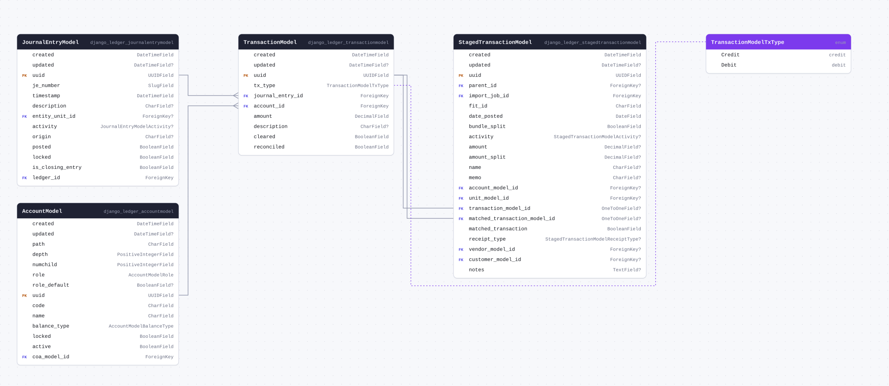

| Column | Field | Type | Null | Key | Default | Description |
| --- | --- | --- | --- | --- | --- | --- |
| `created` | `DateTimeField` | `datetime` |  |  | `now()` |  |
| `updated` | `DateTimeField` | `datetime` | yes |  | `now()` |  |
| `uuid` | `UUIDField` | `char(32)` |  | PK | `uuid4()` |  |
| `tx_type` | `TransactionModelTxType` | `varchar(10)` |  |  |  |  |
| `journal_entry_id` | `ForeignKey` | `char(32)` |  | FK |  | Journal Entry to be associated with this transaction. |
| `account_id` | `ForeignKey` | `char(32)` |  | FK |  | Account from Chart of Accounts to be associated with this transaction. |
| `amount` | `DecimalField(20, 2)` | `decimal` |  |  | `0.0` | Amount of the transaction. |
| `description` | `CharField` | `varchar(100)` | yes |  |  | A description to be included with this individual transaction. |
| `cleared` | `BooleanField` | `bool` |  |  | `False` |  |
| `reconciled` | `BooleanField` | `bool` |  |  | `False` |  |

Indexes:

- index `django_ledger_transactionmodel_journal_entry_id_1739fd60` on `journal_entry_id`
- index `django_ledger_transactionmodel_account_id_7d3310be` on `account_id`
- index `django_ledg_tx_type_da7ba9_idx` on `tx_type`
- index `django_ledg_account_c4bb7e_idx` on `account_id`
- index `django_ledg_journal_46c77f_idx` on `journal_entry_id`
- index `django_ledg_created_b74538_idx` on `created`
- index `django_ledg_updated_494252_idx` on `updated`
- index `django_ledg_cleared_335c0b_idx` on `cleared`
- index `django_ledg_reconci_75dbc7_idx` on `reconciled`

Relations:

- `journal_entry_id` → [JournalEntryModel](#journalentrymodel).`uuid`, on delete cascade
- `account_id` → [AccountModel](#accountmodel).`uuid`, on delete protect
- [StagedTransactionModel](#stagedtransactionmodel).`transaction_model_id` → `uuid`, on delete set null
- [StagedTransactionModel](#stagedtransactionmodel).`matched_transaction_model_id` → `uuid`, on delete set null

## JournalEntryModel

Table `django_ledger_journalentrymodel`, app `django_ledger`.

Columns from `JournalEntryModelAbstract` (abstract): `uuid`, `je_number`, `timestamp`, `description`, `entity_unit_id`, `activity`, `origin`, `posted`, `locked`, `is_closing_entry`, `ledger_id`.

Columns from `CreateUpdateMixIn` (abstract): `created`, `updated`.

Journal Entry Model Base Class From Abstract

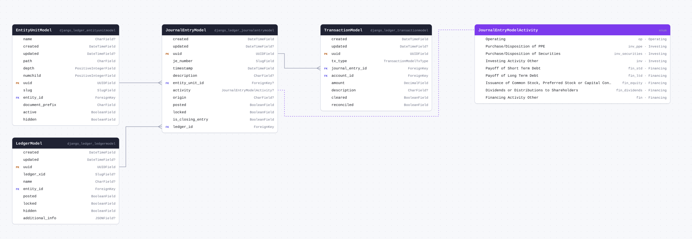

| Column | Field | Type | Null | Key | Default | Description |
| --- | --- | --- | --- | --- | --- | --- |
| `created` | `DateTimeField` | `datetime` |  |  | `now()` |  |
| `updated` | `DateTimeField` | `datetime` | yes |  | `now()` |  |
| `uuid` | `UUIDField` | `char(32)` |  | PK | `uuid4()` |  |
| `je_number` | `SlugField` | `varchar(25)` |  |  |  |  |
| `timestamp` | `DateTimeField` | `datetime` |  |  | `localtime()` |  |
| `description` | `CharField` | `varchar(120)` | yes |  |  |  |
| `entity_unit_id` | `ForeignKey` | `char(32)` | yes | FK |  |  |
| `activity` | `JournalEntryModelActivity` | `varchar(20)` | yes |  |  |  |
| `origin` | `CharField` | `varchar(30)` | yes |  |  |  |
| `posted` | `BooleanField` | `bool` |  |  | `False` |  |
| `locked` | `BooleanField` | `bool` |  |  | `False` |  |
| `is_closing_entry` | `BooleanField` | `bool` |  |  | `False` |  |
| `ledger_id` | `ForeignKey` | `char(32)` |  | FK |  |  |

Indexes:

- index `django_ledger_journalentrymodel_je_number_a73f42ee` on `je_number`
- index `django_ledger_journalentrymodel_entity_unit_id_1e0fbf04` on `entity_unit_id`
- index `django_ledger_journalentrymodel_ledger_id_c470426c` on `ledger_id`
- index `django_ledg_ledger__ecaa89_idx` on `ledger_id`
- index `django_ledg_timesta_ab91e8_idx` on `timestamp`
- index `django_ledg_activit_bae3bb_idx` on `activity`
- index `django_ledg_entity__557f42_idx` on `entity_unit_id`
- index `django_ledg_locked_5cc524_idx` on `locked`
- index `django_ledg_posted_097e54_idx` on `posted`
- index `django_ledg_je_numb_987c8b_idx` on `je_number`
- index `django_ledg_is_clos_0ef09e_idx` on `is_closing_entry`

Relations:

- [TransactionModel](#transactionmodel).`journal_entry_id` → `uuid`, on delete cascade
- `entity_unit_id` → [EntityUnitModel](#entityunitmodel).`uuid`, on delete restrict
- `ledger_id` → [LedgerModel](#ledgermodel).`uuid`, on delete cascade

## PurchaseOrderModel

Table `django_ledger_purchaseordermodel`, app `django_ledger`.

Columns from `PurchaseOrderModelAbstract` (abstract): `uuid`, `po_number`, `po_title`, `po_status`, `po_amount`, `po_amount_received`, `entity_id`, `date_draft`, `date_in_review`, `date_approved`, `date_void`, `date_fulfilled`, `date_canceled`, `ce_model_id`.

Columns from `CreateUpdateMixIn` (abstract): `created`, `updated`.

Columns from `MarkdownNotesMixIn` (abstract): `markdown_notes`.

Purchase Order Base Model

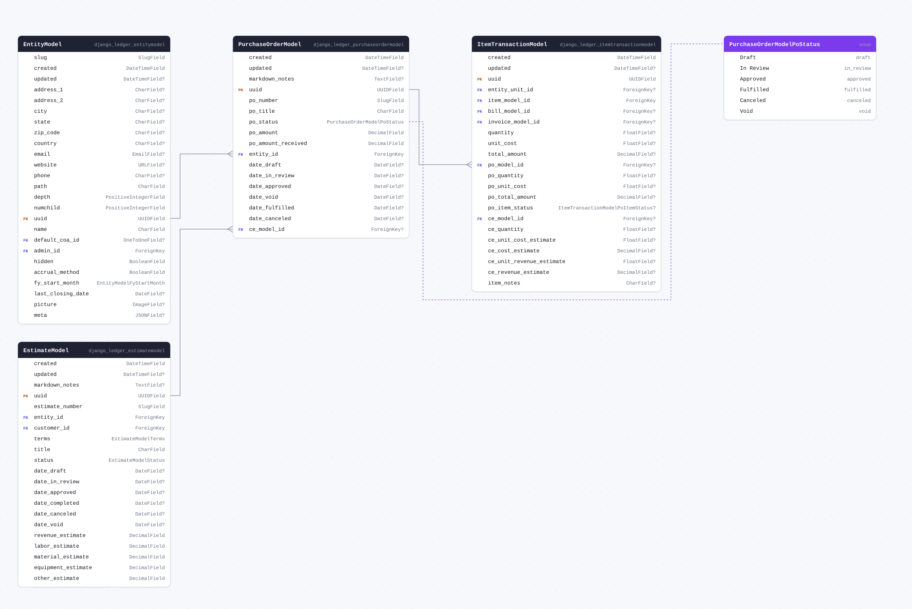

| Column | Field | Type | Null | Key | Default | Description |
| --- | --- | --- | --- | --- | --- | --- |
| `created` | `DateTimeField` | `datetime` |  |  | `now()` |  |
| `updated` | `DateTimeField` | `datetime` | yes |  | `now()` |  |
| `markdown_notes` | `TextField` | `text` | yes |  |  |  |
| `uuid` | `UUIDField` | `char(32)` |  | PK | `uuid4()` |  |
| `po_number` | `SlugField` | `varchar(20)` |  |  |  |  |
| `po_title` | `CharField` | `varchar(250)` |  |  |  |  |
| `po_status` | `PurchaseOrderModelPoStatus` | `varchar(10)` |  |  | `'draft'` |  |
| `po_amount` | `DecimalField(20, 2)` | `decimal` |  |  | `0` |  |
| `po_amount_received` | `DecimalField(20, 2)` | `decimal` |  |  | `0` |  |
| `entity_id` | `ForeignKey` | `char(32)` |  | FK |  |  |
| `date_draft` | `DateField` | `date` | yes |  |  |  |
| `date_in_review` | `DateField` | `date` | yes |  |  |  |
| `date_approved` | `DateField` | `date` | yes |  |  |  |
| `date_void` | `DateField` | `date` | yes |  |  |  |
| `date_fulfilled` | `DateField` | `date` | yes |  |  |  |
| `date_canceled` | `DateField` | `date` | yes |  |  |  |
| `ce_model_id` | `ForeignKey` | `char(32)` | yes | FK |  |  |

Indexes:

- index `django_ledger_purchaseordermodel_po_number_aeb0d16d` on `po_number`
- index `django_ledger_purchaseordermodel_entity_id_d60fdbe3` on `entity_id`
- index `django_ledger_purchaseordermodel_ce_model_id_7df49c41` on `ce_model_id`
- unique `django_ledger_purchaseordermodel_entity_id_po_number_35f42db0_uniq` on `entity_id`, `po_number`
- index `django_ledg_entity__9ab6ba_idx` on `entity_id`
- index `django_ledg_po_numb_20b7d1_idx` on `po_number`
- index `django_ledg_po_stat_ab8d41_idx` on `po_status`
- index `django_ledg_ce_mode_66c2cc_idx` on `ce_model_id`
- index `django_ledg_date_dr_6fd15b_idx` on `date_draft`
- index `django_ledg_date_in_b6a1f3_idx` on `date_in_review`
- index `django_ledg_date_ap_4667c6_idx` on `date_approved`
- index `django_ledg_date_fu_b29b08_idx` on `date_fulfilled`
- index `django_ledg_date_ca_3edc4b_idx` on `date_canceled`
- index `django_ledg_date_vo_56612f_idx` on `date_void`

Relations:

- `po_items` — many to many with [ItemModel](#itemmodel), through [ItemTransactionModel](#itemtransactionmodel)
- [ItemTransactionModel](#itemtransactionmodel).`po_model_id` → `uuid`, on delete restrict
- `entity_id` → [EntityModel](#entitymodel).`uuid`, on delete cascade
- `ce_model_id` → [EstimateModel](#estimatemodel).`uuid`, on delete restrict

## EstimateModel

Table `django_ledger_estimatemodel`, app `django_ledger`.

Columns from `EstimateModelAbstract` (abstract): `uuid`, `estimate_number`, `entity_id`, `customer_id`, `terms`, `title`, `status`, `date_draft`, `date_in_review`, `date_approved`, `date_completed`, `date_canceled`, `date_void`, `revenue_estimate`, `labor_estimate`, `material_estimate`, `equipment_estimate`, `other_estimate`.

Columns from `CreateUpdateMixIn` (abstract): `created`, `updated`.

Columns from `MarkdownNotesMixIn` (abstract): `markdown_notes`.

Base EstimateModel Class.

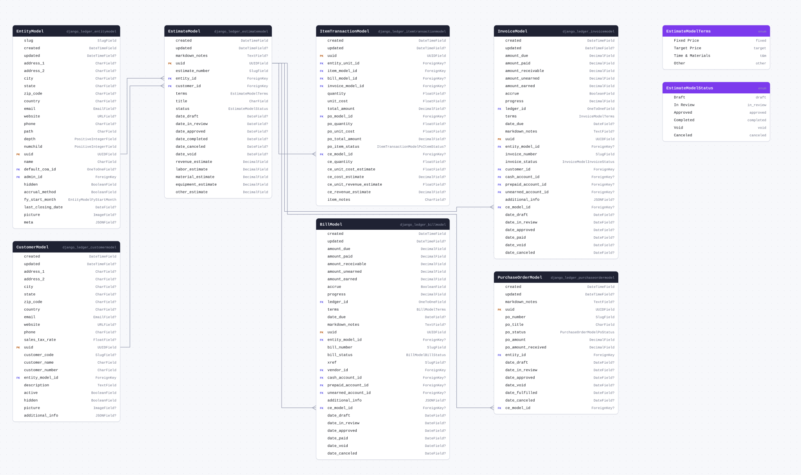

| Column | Field | Type | Null | Key | Default | Description |
| --- | --- | --- | --- | --- | --- | --- |
| `created` | `DateTimeField` | `datetime` |  |  | `now()` |  |
| `updated` | `DateTimeField` | `datetime` | yes |  | `now()` |  |
| `markdown_notes` | `TextField` | `text` | yes |  |  |  |
| `uuid` | `UUIDField` | `char(32)` |  | PK | `uuid4()` |  |
| `estimate_number` | `SlugField` | `varchar(20)` |  |  |  |  |
| `entity_id` | `ForeignKey` | `char(32)` |  | FK |  |  |
| `customer_id` | `ForeignKey` | `char(32)` |  | FK |  |  |
| `terms` | `EstimateModelTerms` | `varchar(10)` |  |  |  |  |
| `title` | `CharField` | `varchar(250)` |  |  |  |  |
| `status` | `EstimateModelStatus` | `varchar(10)` |  |  | `'draft'` |  |
| `date_draft` | `DateField` | `date` | yes |  |  |  |
| `date_in_review` | `DateField` | `date` | yes |  |  |  |
| `date_approved` | `DateField` | `date` | yes |  |  |  |
| `date_completed` | `DateField` | `date` | yes |  |  |  |
| `date_canceled` | `DateField` | `date` | yes |  |  |  |
| `date_void` | `DateField` | `date` | yes |  |  |  |
| `revenue_estimate` | `DecimalField(20, 2)` | `decimal` |  |  | `Decimal('0.00')` | Estimated cost to complete the quoted work. |
| `labor_estimate` | `DecimalField(20, 2)` | `decimal` |  |  | `Decimal('0.00')` | Estimated labor cost to complete the quoted work. |
| `material_estimate` | `DecimalField(20, 2)` | `decimal` |  |  | `0.0` | Estimated material cost to complete the quoted work. |
| `equipment_estimate` | `DecimalField(20, 2)` | `decimal` |  |  | `Decimal('0.00')` | Estimated equipment cost to complete the quoted work. |
| `other_estimate` | `DecimalField(20, 2)` | `decimal` |  |  | `Decimal('0.00')` | Estimated equipment cost to complete the quoted work. |

Indexes:

- index `django_ledger_estimatemodel_estimate_number_df7a8e98` on `estimate_number`
- index `django_ledger_estimatemodel_entity_id_07051ffe` on `entity_id`
- index `django_ledger_estimatemodel_customer_id_07671bdc` on `customer_id`
- unique `django_ledger_estimatemodel_entity_id_estimate_number_47e317cd_uniq` on `entity_id`, `estimate_number`
- index `django_ledg_status_6aa955_idx` on `status`
- index `django_ledg_custome_a2793e_idx` on `customer_id`
- index `django_ledg_terms_9507f6_idx` on `terms`
- index `django_ledg_entity__e2e967_idx` on `entity_id`
- index `django_ledg_date_dr_502e29_idx` on `date_draft`
- index `django_ledg_date_in_b24ddd_idx` on `date_in_review`
- index `django_ledg_date_ap_a754e5_idx` on `date_approved`
- index `django_ledg_date_ca_9af3db_idx` on `date_canceled`
- index `django_ledg_date_vo_74c7c8_idx` on `date_void`
- index `django_ledg_estimat_9ff8a5_idx` on `estimate_number`

Relations:

- [ItemTransactionModel](#itemtransactionmodel).`ce_model_id` → `uuid`, on delete restrict
- [BillModel](#billmodel).`ce_model_id` → `uuid`, on delete restrict
- [InvoiceModel](#invoicemodel).`ce_model_id` → `uuid`, on delete restrict
- [PurchaseOrderModel](#purchaseordermodel).`ce_model_id` → `uuid`, on delete restrict
- `entity_id` → [EntityModel](#entitymodel).`uuid`, on delete cascade
- `customer_id` → [CustomerModel](#customermodel).`uuid`, on delete restrict

## ClosingEntryModel

Table `django_ledger_closingentrymodel`, app `django_ledger`.

Columns from `ClosingEntryModelAbstract` (abstract): `uuid`, `entity_model_id`, `ledger_model_id`, `closing_date`, `posted`.

Columns from `CreateUpdateMixIn` (abstract): `created`, `updated`.

Columns from `MarkdownNotesMixIn` (abstract): `markdown_notes`.

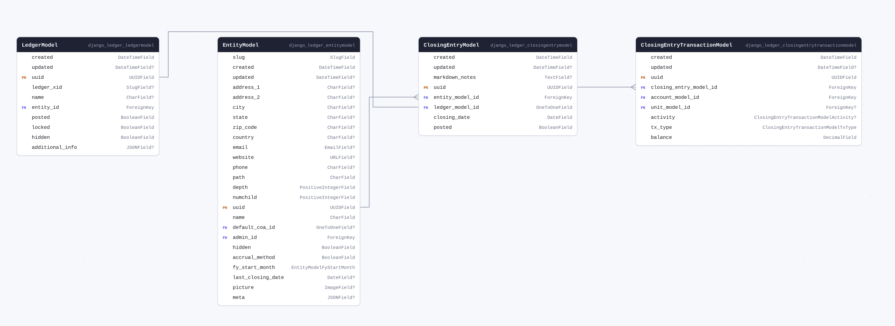

| Column | Field | Type | Null | Key | Default | Description |
| --- | --- | --- | --- | --- | --- | --- |
| `created` | `DateTimeField` | `datetime` |  |  | `now()` |  |
| `updated` | `DateTimeField` | `datetime` | yes |  | `now()` |  |
| `markdown_notes` | `TextField` | `text` | yes |  |  |  |
| `uuid` | `UUIDField` | `char(32)` |  | PK | `uuid4()` |  |
| `entity_model_id` | `ForeignKey` | `char(32)` |  | FK |  |  |
| `ledger_model_id` | `OneToOneField` | `char(32)` |  | FK, unique |  |  |
| `closing_date` | `DateField` | `date` |  |  |  |  |
| `posted` | `BooleanField` | `bool` |  |  | `False` |  |

Indexes:

- index `django_ledger_closingentrymodel_entity_model_id_644d71b4` on `entity_model_id`
- unique `unique_entity_closing_date` on `entity_model_id`, `closing_date`
- index `django_ledg_entity__4a55a2_idx` on `entity_model_id`
- index `django_ledg_closing_28e3bb_idx` on `closing_date`
- index `django_ledg_posted_8db18b_idx` on `posted`
- index `django_ledg_entity__9ee361_idx` on `entity_model_id`, `posted`, `closing_date`

Relations:

- `entity_model_id` → [EntityModel](#entitymodel).`uuid`, on delete cascade
- `ledger_model_id` → [LedgerModel](#ledgermodel).`uuid`, on delete cascade
- [ClosingEntryTransactionModel](#closingentrytransactionmodel).`closing_entry_model_id` → `uuid`, on delete cascade

## ClosingEntryTransactionModel

Table `django_ledger_closingentrytransactionmodel`, app `django_ledger`.

Columns from `ClosingEntryTransactionModelAbstract` (abstract): `uuid`, `closing_entry_model_id`, `account_model_id`, `unit_model_id`, `activity`, `tx_type`, `balance`.

Columns from `CreateUpdateMixIn` (abstract): `created`, `updated`.

Base ClosingEntryModel Class

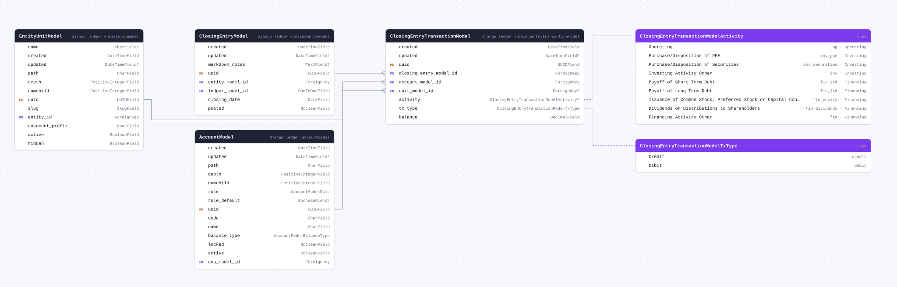

| Column | Field | Type | Null | Key | Default | Description |
| --- | --- | --- | --- | --- | --- | --- |
| `created` | `DateTimeField` | `datetime` |  |  | `now()` |  |
| `updated` | `DateTimeField` | `datetime` | yes |  | `now()` |  |
| `uuid` | `UUIDField` | `char(32)` |  | PK | `uuid4()` |  |
| `closing_entry_model_id` | `ForeignKey` | `char(32)` |  | FK |  |  |
| `account_model_id` | `ForeignKey` | `char(32)` |  | FK |  |  |
| `unit_model_id` | `ForeignKey` | `char(32)` | yes | FK |  |  |
| `activity` | `ClosingEntryTransactionModelActivity` | `varchar(20)` | yes |  |  |  |
| `tx_type` | `ClosingEntryTransactionModelTxType` | `varchar(10)` |  |  |  |  |
| `balance` | `DecimalField(20, 6)` | `decimal` |  |  |  |  |

Indexes:

- index `django_ledger_closingentrytransactionmodel_closing_entry_model_id_fa0cd7b8` on `closing_entry_model_id`
- index `django_ledger_closingentrytransactionmodel_account_model_id_905a9019` on `account_model_id`
- index `django_ledger_closingentrytransactionmodel_unit_model_id_14836d31` on `unit_model_id`
- unique `unique_closing_entry` on `closing_entry_model_id`, `account_model_id`, `unit_model_id`, `activity`
- unique `unique_ce_opt_1` on `closing_entry_model_id`, `account_model_id`, `unit_model_id` where `"activity" IS NULL`
- unique `unique_ce_opt_2` on `closing_entry_model_id`, `account_model_id`, `activity` where `"unit_model_id" IS NULL`
- unique `unique_ce_opt_3` on `closing_entry_model_id`, `account_model_id` where `("unit_model_id" IS NULL AND "activity" IS NULL)`
- index `django_ledg_closing_a7a576_idx` on `closing_entry_model_id`
- index `django_ledg_account_5d90df_idx` on `account_model_id`

Relations:

- `closing_entry_model_id` → [ClosingEntryModel](#closingentrymodel).`uuid`, on delete cascade
- `account_model_id` → [AccountModel](#accountmodel).`uuid`, on delete restrict
- `unit_model_id` → [EntityUnitModel](#entityunitmodel).`uuid`, on delete restrict

## ReceiptModel

Table `django_ledger_receiptmodel`, app `django_ledger`.

Columns from `ReceiptModelAbstract` (abstract): `uuid`, `receipt_number`, `receipt_date`, `receipt_type`, `ledger_model_id`, `unit_model_id`, `customer_model_id`, `vendor_model_id`, `charge_account_id`, `receipt_account_id`, `amount`, `staged_transaction_model_id`.

Columns from `CreateUpdateMixIn` (abstract): `created`, `updated`.

Columns from `MarkdownNotesMixIn` (abstract): `markdown_notes`.

Concrete receipt model ready for migration and admin usage.

Inherits all behavior from ReceiptModelAbstract and is used as the concrete
Django model for persistence.

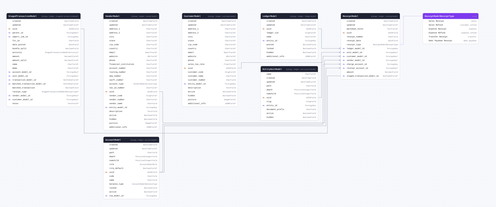

| Column | Field | Type | Null | Key | Default | Description |
| --- | --- | --- | --- | --- | --- | --- |
| `created` | `DateTimeField` | `datetime` |  |  | `now()` |  |
| `updated` | `DateTimeField` | `datetime` | yes |  | `now()` |  |
| `markdown_notes` | `TextField` | `text` | yes |  |  |  |
| `uuid` | `UUIDField` | `char(32)` |  | PK | `uuid4()` |  |
| `receipt_number` | `CharField` | `varchar(255)` |  |  |  |  |
| `receipt_date` | `DateField` | `date` |  |  |  |  |
| `receipt_type` | `ReceiptModelReceiptType` | `varchar(15)` |  |  |  |  |
| `ledger_model_id` | `ForeignKey` | `char(32)` |  | FK |  |  |
| `unit_model_id` | `ForeignKey` | `char(32)` | yes | FK |  | Helps segregate receipts and transactions into different classes or departments. |
| `customer_model_id` | `ForeignKey` | `char(32)` | yes | FK |  |  |
| `vendor_model_id` | `ForeignKey` | `char(32)` | yes | FK |  |  |
| `charge_account_id` | `ForeignKey` | `char(32)` |  | FK |  | The financial account (cash or credit) where this transaction was made. |
| `receipt_account_id` | `ForeignKey` | `char(32)` | yes | FK |  | The income or expense account where this transaction will be reflected |
| `amount` | `DecimalField(20, 2)` | `decimal` |  |  |  | Amount of the receipt. |
| `staged_transaction_model_id` | `OneToOneField` | `char(32)` | yes | FK, unique |  | The staged transaction associated with the receipt from bank feeds. |

Indexes:

- index `django_ledger_receiptmodel_ledger_model_id_589128fd` on `ledger_model_id`
- index `django_ledger_receiptmodel_unit_model_id_c534ceaf` on `unit_model_id`
- index `django_ledger_receiptmodel_customer_model_id_8c5be53c` on `customer_model_id`
- index `django_ledger_receiptmodel_vendor_model_id_76856011` on `vendor_model_id`
- index `django_ledger_receiptmodel_charge_account_id_55b15eac` on `charge_account_id`
- index `django_ledger_receiptmodel_receipt_account_id_f00a04d3` on `receipt_account_id`

Relations:

- `ledger_model_id` → [LedgerModel](#ledgermodel).`uuid`, on delete protect
- `unit_model_id` → [EntityUnitModel](#entityunitmodel).`uuid`, on delete protect
- `customer_model_id` → [CustomerModel](#customermodel).`uuid`, on delete protect
- `vendor_model_id` → [VendorModel](#vendormodel).`uuid`, on delete protect
- `charge_account_id` → [AccountModel](#accountmodel).`uuid`, on delete protect
- `receipt_account_id` → [AccountModel](#accountmodel).`uuid`, on delete protect
- `staged_transaction_model_id` → [StagedTransactionModel](#stagedtransactionmodel).`uuid`, on delete restrict

## ImportJobModel

Table `django_ledger_importjobmodel`, app `django_ledger`.

Columns from `ImportJobModelAbstract` (abstract): `uuid`, `description`, `bank_account_model_id`, `ledger_model_id`, `completed`.

Columns from `CreateUpdateMixIn` (abstract): `created`, `updated`.

Represents the ImportJobModel class.

This class inherits from ImportJobModelAbstract and is specifically designed
to provide implementations and metadata for import job entries. It defines the
Meta subclass, which overrides the abstract attribute indicating whether this
model is abstract or not.

Attributes
----------
None

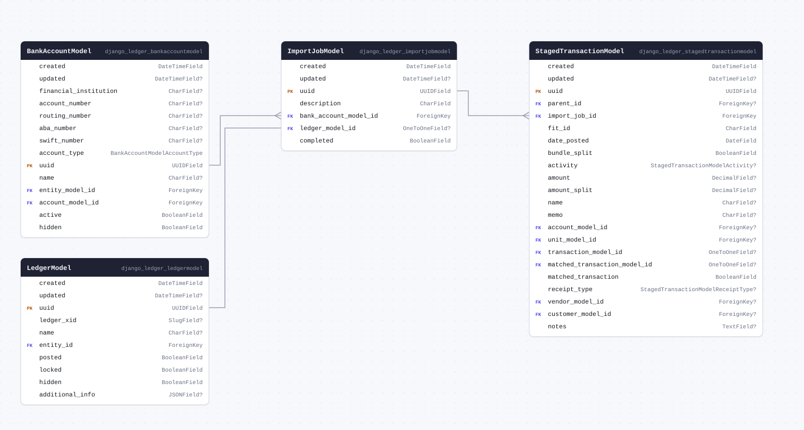

| Column | Field | Type | Null | Key | Default | Description |
| --- | --- | --- | --- | --- | --- | --- |
| `created` | `DateTimeField` | `datetime` |  |  | `now()` |  |
| `updated` | `DateTimeField` | `datetime` | yes |  | `now()` |  |
| `uuid` | `UUIDField` | `char(32)` |  | PK | `uuid4()` |  |
| `description` | `CharField` | `varchar(200)` |  |  |  |  |
| `bank_account_model_id` | `ForeignKey` | `char(32)` |  | FK |  |  |
| `ledger_model_id` | `OneToOneField` | `char(32)` | yes | FK, unique |  |  |
| `completed` | `BooleanField` | `bool` |  |  | `False` |  |

Indexes:

- index `django_ledger_importjobmodel_bank_account_model_id_144cc40d` on `bank_account_model_id`
- index `django_ledg_bank_ac_0bad20_idx` on `bank_account_model_id`
- index `django_ledg_ledger__d9e03f_idx` on `ledger_model_id`
- index `django_ledg_complet_42632b_idx` on `completed`

Relations:

- `bank_account_model_id` → [BankAccountModel](#bankaccountmodel).`uuid`, on delete cascade
- `ledger_model_id` → [LedgerModel](#ledgermodel).`uuid`, on delete cascade
- [StagedTransactionModel](#stagedtransactionmodel).`import_job_id` → `uuid`, on delete cascade

## StagedTransactionModel

Table `django_ledger_stagedtransactionmodel`, app `django_ledger`.

Columns from `StagedTransactionModelAbstract` (abstract): `uuid`, `parent_id`, `import_job_id`, `fit_id`, `date_posted`, `bundle_split`, `activity`, `amount`, `amount_split`, `name`, `memo`, `account_model_id`, `unit_model_id`, `transaction_model_id`, `matched_transaction_model_id`, `matched_transaction`, `receipt_type`, `vendor_model_id`, `customer_model_id`, `notes`.

Columns from `CreateUpdateMixIn` (abstract): `created`, `updated`.

Represents a concrete implementation of a staged transaction model.

This class is derived from `StagedTransactionModelAbstract` and provides
a concrete implementation by overriding its meta-configuration. It is
used to define the structure and behavior of the staged transaction
records in the system.

Attributes
----------
Meta : class
    A nested class that extends the meta-configuration of
    the `StagedTransactionModelAbstract.Meta` class, specifying
    that the model is not abstract.

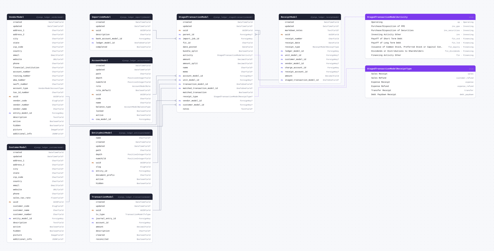

| Column | Field | Type | Null | Key | Default | Description |
| --- | --- | --- | --- | --- | --- | --- |
| `created` | `DateTimeField` | `datetime` |  |  | `now()` |  |
| `updated` | `DateTimeField` | `datetime` | yes |  | `now()` |  |
| `uuid` | `UUIDField` | `char(32)` |  | PK | `uuid4()` |  |
| `parent_id` | `ForeignKey` | `char(32)` | yes | FK |  |  |
| `import_job_id` | `ForeignKey` | `char(32)` |  | FK |  |  |
| `fit_id` | `CharField` | `varchar(100)` |  |  |  |  |
| `date_posted` | `DateField` | `date` |  |  |  |  |
| `bundle_split` | `BooleanField` | `bool` |  |  | `True` |  |
| `activity` | `StagedTransactionModelActivity` | `varchar(20)` | yes |  |  |  |
| `amount` | `DecimalField(15, 2)` | `decimal` | yes |  |  |  |
| `amount_split` | `DecimalField(15, 2)` | `decimal` | yes |  |  |  |
| `name` | `CharField` | `varchar(200)` | yes |  |  |  |
| `memo` | `CharField` | `varchar(200)` | yes |  |  |  |
| `account_model_id` | `ForeignKey` | `char(32)` | yes | FK |  |  |
| `unit_model_id` | `ForeignKey` | `char(32)` | yes | FK |  |  |
| `transaction_model_id` | `OneToOneField` | `char(32)` | yes | FK, unique |  |  |
| `matched_transaction_model_id` | `OneToOneField` | `char(32)` | yes | FK, unique |  |  |
| `matched_transaction` | `BooleanField` | `bool` |  |  | `False` | Indicates whether this transaction is matched to another. |
| `receipt_type` | `StagedTransactionModelReceiptType` | `varchar(20)` | yes |  |  | The receipt type of the transaction. |
| `vendor_model_id` | `ForeignKey` | `char(32)` | yes | FK |  | The Vendor associated with the transaction. |
| `customer_model_id` | `ForeignKey` | `char(32)` | yes | FK |  | The Customer associated with the transaction. |
| `notes` | `TextField` | `text` | yes |  |  |  |

Indexes:

- index `django_ledger_stagedtransactionmodel_parent_id_c3d93181` on `parent_id`
- index `django_ledger_stagedtransactionmodel_import_job_id_f8703f44` on `import_job_id`
- index `django_ledger_stagedtransactionmodel_account_model_id_64ffac7d` on `account_model_id`
- index `django_ledger_stagedtransactionmodel_unit_model_id_7f161b1d` on `unit_model_id`
- index `django_ledger_stagedtransactionmodel_vendor_model_id_71f9067c` on `vendor_model_id`
- index `django_ledger_stagedtransactionmodel_customer_model_id_5461cdb8` on `customer_model_id`
- index `django_ledg_import__8e6511_idx` on `import_job_id`
- index `django_ledg_date_po_cbcc8c_idx` on `date_posted`
- index `django_ledg_account_53aea9_idx` on `account_model_id`
- index `django_ledg_transac_51a6b9_idx` on `transaction_model_id`
- index `django_ledg_matched_dde2a7_idx` on `matched_transaction_model_id`

Relations:

- [ReceiptModel](#receiptmodel).`staged_transaction_model_id` → `uuid`, on delete restrict
- `parent_id` → [StagedTransactionModel](#stagedtransactionmodel).`uuid`, on delete cascade
- `import_job_id` → [ImportJobModel](#importjobmodel).`uuid`, on delete cascade
- `account_model_id` → [AccountModel](#accountmodel).`uuid`, on delete restrict
- `unit_model_id` → [EntityUnitModel](#entityunitmodel).`uuid`, on delete restrict
- `transaction_model_id` → [TransactionModel](#transactionmodel).`uuid`, on delete set null
- `matched_transaction_model_id` → [TransactionModel](#transactionmodel).`uuid`, on delete set null
- `vendor_model_id` → [VendorModel](#vendormodel).`uuid`, on delete restrict
- `customer_model_id` → [CustomerModel](#customermodel).`uuid`, on delete restrict

# Enums

## LogEntryActionFlag

| Name | Stored as |
| --- | --- |
| `Addition` | `1` |
| `Change` | `2` |
| `Deletion` | `3` |

## BankAccountModelAccountType

| Name | Stored as |
| --- | --- |
| `Checking` | `checking` |
| `Savings` | `savings` |
| `Money Market` | `money_market` |
| `Certificate of Deposit` | `cert_deposit` |
| `Credit Card` | `credit_card` |
| `Short Term Loan` | `st_loan` |
| `Long Term Loan` | `lt_loan` |
| `Mortgage` | `mortgage` |
| `Other` | `other` |

## AccountModelRole

| Group | Name | Stored as |
| --- | --- | --- |
| Assets | `Cash & Equivalent` | `asset_ca_cash` |
| Assets | `Marketable Securities` | `asset_ca_mkt_sec` |
| Assets | `Receivables` | `asset_ca_recv` |
| Assets | `Inventory` | `asset_ca_inv` |
| Assets | `Uncollectibles` | `asset_ca_uncoll` |
| Assets | `Prepaid` | `asset_ca_prepaid` |
| Assets | `Other Liquid Assets` | `asset_ca_other` |
| Assets | `Notes Receivable` | `asset_lti_notes` |
| Assets | `Land` | `asset_lti_land` |
| Assets | `Securities` | `asset_lti_sec` |
| Assets | `Buildings` | `asset_ppe_build` |
| Assets | `Buildings - Accum. Depreciation` | `asset_ppe_build_accum_depr` |
| Assets | `Plant` | `asset_ppe_plant` |
| Assets | `Plant - Accum. Depreciation` | `asset_ppe_plant_depr` |
| Assets | `Equipment` | `asset_ppe_equip` |
| Assets | `Equipment - Accum. Depreciation` | `asset_ppe_equip_accum_depr` |
| Assets | `Intangible Assets` | `asset_ia` |
| Assets | `Intangible Assets - Accum. Amortization` | `asset_ia_accum_amort` |
| Assets | `Other Assets` | `asset_adjustment` |
| Liabilities | `Accounts Payable` | `lia_cl_acc_payable` |
| Liabilities | `Credit Line` | `lia_cl_credit_line` |
| Liabilities | `Wages Payable` | `lia_cl_wages_payable` |
| Liabilities | `Interest Payable` | `lia_cl_int_payable` |
| Liabilities | `Taxes Payable` | `lia_cl_taxes_payable` |
| Liabilities | `Short Term Notes Payable` | `lia_cl_st_notes_payable` |
| Liabilities | `Current Maturities of Long Tern Debt` | `lia_cl_ltd_mat` |
| Liabilities | `Deferred Revenue` | `lia_cl_def_rev` |
| Liabilities | `Other Liabilities` | `lia_cl_other` |
| Liabilities | `Long Term Notes Payable` | `lia_ltl_notes` |
| Liabilities | `Bonds Payable` | `lia_ltl_bonds` |
| Liabilities | `Mortgage Payable` | `lia_ltl_mortgage` |
| Equity | `Capital` | `eq_capital` |
| Equity | `Common Stock` | `eq_stock_common` |
| Equity | `Preferred Stock` | `eq_stock_preferred` |
| Equity | `Other Equity Adjustments` | `eq_adjustment` |
| Equity | `Dividends & Distributions to Shareholders` | `eq_dividends` |
| Equity | `Operational Income` | `in_operational` |
| Equity | `Investing/Passive Income` | `in_passive` |
| Equity | `Interest Income` | `in_interest` |
| Equity | `Capital Gain/Loss Income` | `in_gain_loss` |
| Equity | `Other Income` | `in_other` |
| Equity | `Cost of Goods Sold - Regular` | `cogs_regular` |
| Equity | `Cost of Goods Sold - Subcontract` | `cogs_subcontract` |
| Equity | `Cost of Goods Sold - Labor` | `cogs_labor` |
| Equity | `Cost of Goods Sold - Materials` | `cogs_materials` |
| Equity | `Cost of Goods Sold - Equipment` | `cogs_equipment` |
| Equity | `Cost of Goods Sold - Other` | `cogs_other` |
| Equity | `Regular Expense` | `ex_regular` |
| Equity | `Interest Expense - Short Term Debt` | `ex_interest_st` |
| Equity | `Interest Expense - Long Term Debt` | `ex_interest` |
| Equity | `Tax Expense` | `ex_taxes` |
| Equity | `Capital Expense` | `ex_capital` |
| Equity | `Depreciation Expense` | `ex_depreciation` |
| Equity | `Amortization Expense` | `ex_amortization` |
| Equity | `Other Expense` | `ex_other` |
| Root | `CoA Root Account` | `root_coa` |
| Root | `Assets Root Account` | `root_assets` |
| Root | `Liabilities Root Account` | `root_liabilities` |
| Root | `Capital Root Account` | `root_capital` |
| Root | `Income Root Account` | `root_income` |
| Root | `COGS Root Account` | `root_cogs` |
| Root | `Expenses Root Account` | `root_expenses` |

## AccountModelBalanceType

| Name | Stored as |
| --- | --- |
| `Credit` | `credit` |
| `Debit` | `debit` |

## ItemTransactionModelPoItemStatus

| Name | Stored as |
| --- | --- |
| `Not Ordered` | `not_ordered` |
| `Ordered` | `ordered` |
| `In Transit` | `in_transit` |
| `Received` | `received` |
| `Canceled` | `cancelled` |

## ItemModelItemRole

| Name | Stored as |
| --- | --- |
| `Expense` | `expense` |
| `Inventory` | `inventory` |
| `Service` | `service` |
| `Product` | `product` |

## ItemModelItemType

| Name | Stored as |
| --- | --- |
| `Labor` | `L` |
| `Material` | `M` |
| `Equipment` | `E` |
| `Lump Sum` | `S` |
| `Other` | `O` |

## VendorModelAccountType

| Name | Stored as |
| --- | --- |
| `Checking` | `checking` |
| `Savings` | `savings` |
| `Money Market` | `money_market` |
| `Certificate of Deposit` | `cert_deposit` |
| `Credit Card` | `credit_card` |
| `Short Term Loan` | `st_loan` |
| `Long Term Loan` | `lt_loan` |
| `Mortgage` | `mortgage` |
| `Other` | `other` |

## EntityModelFyStartMonth

| Name | Stored as |
| --- | --- |
| `January` | `1` |
| `February` | `2` |
| `March` | `3` |
| `April` | `4` |
| `May` | `5` |
| `June` | `6` |
| `July` | `7` |
| `August` | `8` |
| `September` | `9` |
| `October` | `10` |
| `November` | `11` |
| `December` | `12` |

## EntityStateModelKey

| Name | Stored as |
| --- | --- |
| `Journal Entry` | `je` |
| `Purchase Order` | `po` |
| `Bill` | `bill` |
| `Invoice` | `invoice` |
| `Estimate` | `estimate` |

## EntityManagementModelPermissionLevel

| Name | Stored as |
| --- | --- |
| `Read Permissions` | `read` |
| `Read/Write Permissions` | `write` |
| `No Permissions` | `suspended` |

## BillModelTerms

| Name | Stored as |
| --- | --- |
| `Due On Receipt` | `on_receipt` |
| `Net 30 Days` | `net_30` |
| `Net 60 Days` | `net_60` |
| `Net 90 Days` | `net_90` |

## BillModelBillStatus

| Name | Stored as |
| --- | --- |
| `Draft` | `draft` |
| `In Review` | `in_review` |
| `Approved` | `approved` |
| `Paid` | `paid` |
| `Canceled` | `canceled` |
| `Void` | `void` |

## InvoiceModelTerms

| Name | Stored as |
| --- | --- |
| `Due On Receipt` | `on_receipt` |
| `Net 30 Days` | `net_30` |
| `Net 60 Days` | `net_60` |
| `Net 90 Days` | `net_90` |

## InvoiceModelInvoiceStatus

| Name | Stored as |
| --- | --- |
| `Draft` | `draft` |
| `In Review` | `in_review` |
| `Approved` | `approved` |
| `Paid` | `paid` |
| `Void` | `void` |
| `Canceled` | `canceled` |

## TransactionModelTxType

| Name | Stored as |
| --- | --- |
| `Credit` | `credit` |
| `Debit` | `debit` |

## JournalEntryModelActivity

| Group | Name | Stored as |
| --- | --- | --- |
| Operating | `Operating` | `op` |
| Investing | `Purchase/Disposition of PPE` | `inv_ppe` |
| Investing | `Purchase/Disposition of Securities` | `inv_securities` |
| Investing | `Investing Activity Other` | `inv` |
| Financing | `Payoff of Short Term Debt` | `fin_std` |
| Financing | `Payoff of Long Term Debt` | `fin_ltd` |
| Financing | `Issuance of Common Stock, Preferred Stock or Capital Contribution` | `fin_equity` |
| Financing | `Dividends or Distributions to Shareholders` | `fin_dividends` |
| Financing | `Financing Activity Other` | `fin` |

## PurchaseOrderModelPoStatus

| Name | Stored as |
| --- | --- |
| `Draft` | `draft` |
| `In Review` | `in_review` |
| `Approved` | `approved` |
| `Fulfilled` | `fulfilled` |
| `Canceled` | `canceled` |
| `Void` | `void` |

## EstimateModelTerms

| Name | Stored as |
| --- | --- |
| `Fixed Price` | `fixed` |
| `Target Price` | `target` |
| `Time & Materials` | `t&m` |
| `Other` | `other` |

## EstimateModelStatus

| Name | Stored as |
| --- | --- |
| `Draft` | `draft` |
| `In Review` | `in_review` |
| `Approved` | `approved` |
| `Completed` | `completed` |
| `Void` | `void` |
| `Canceled` | `canceled` |

## ClosingEntryTransactionModelActivity

| Group | Name | Stored as |
| --- | --- | --- |
| Operating | `Operating` | `op` |
| Investing | `Purchase/Disposition of PPE` | `inv_ppe` |
| Investing | `Purchase/Disposition of Securities` | `inv_securities` |
| Investing | `Investing Activity Other` | `inv` |
| Financing | `Payoff of Short Term Debt` | `fin_std` |
| Financing | `Payoff of Long Term Debt` | `fin_ltd` |
| Financing | `Issuance of Common Stock, Preferred Stock or Capital Contribution` | `fin_equity` |
| Financing | `Dividends or Distributions to Shareholders` | `fin_dividends` |
| Financing | `Financing Activity Other` | `fin` |

## ClosingEntryTransactionModelTxType

| Name | Stored as |
| --- | --- |
| `Credit` | `credit` |
| `Debit` | `debit` |

## ReceiptModelReceiptType

| Name | Stored as |
| --- | --- |
| `Sales Receipt` | `sales` |
| `Sales Refund` | `customer_refund` |
| `Expense Receipt` | `expense` |
| `Expense Refund` | `expense_refund` |
| `Transfer Receipt` | `transfer` |
| `Debt Paydown Receipt` | `debt_paydown` |

## StagedTransactionModelActivity

| Group | Name | Stored as |
| --- | --- | --- |
| Operating | `Operating` | `op` |
| Investing | `Purchase/Disposition of PPE` | `inv_ppe` |
| Investing | `Purchase/Disposition of Securities` | `inv_securities` |
| Investing | `Investing Activity Other` | `inv` |
| Financing | `Payoff of Short Term Debt` | `fin_std` |
| Financing | `Payoff of Long Term Debt` | `fin_ltd` |
| Financing | `Issuance of Common Stock, Preferred Stock or Capital Contribution` | `fin_equity` |
| Financing | `Dividends or Distributions to Shareholders` | `fin_dividends` |
| Financing | `Financing Activity Other` | `fin` |

## StagedTransactionModelReceiptType

| Name | Stored as |
| --- | --- |
| `Sales Receipt` | `sales` |
| `Sales Refund` | `customer_refund` |
| `Expense Receipt` | `expense` |
| `Expense Refund` | `expense_refund` |
| `Transfer Receipt` | `transfer` |
| `Debt Paydown Receipt` | `debt_paydown` |
