# Schema docs


[LogEntry](#logentry) · [Permission](#permission) · [Group](#group) · [User](#user) · [ContentType](#contenttype) · [Session](#session) · [Site](#site) · [FlatPage](#flatpage) · [ProductRecord](#productrecord) · [UserRecord](#userrecord) · [UserProductView](#userproductview) · [UserSearch](#usersearch) · [UserAddress](#useraddress) · [Country](#country) · [OrderAndItemCharges](#orderanditemcharges) · [WeightBased](#weightbased) · [WeightBand](#weightband) · [ProductClass](#productclass) · [Category](#category) · [ProductCategory](#productcategory) · [Product](#product) · [ProductRecommendation](#productrecommendation) · [ProductAttribute](#productattribute) · [ProductAttributeValue](#productattributevalue) · [AttributeOptionGroup](#attributeoptiongroup) · [AttributeOption](#attributeoption) · [Option](#option) · [ProductImage](#productimage) · [ProductCategoryHierarchy](#productcategoryhierarchy) · [ProductReview](#productreview) · [Vote](#vote) · [Email](#email) · [CommunicationEventType](#communicationeventtype) · [Notification](#notification) · [Partner](#partner) · [PartnerAddress](#partneraddress) · [StockRecord](#stockrecord) · [StockAlert](#stockalert) · [Basket](#basket) · [basket.Line](#basketline) · [basket.LineAttribute](#basketlineattribute) · [payment.Transaction](#paymenttransaction) · [Source](#source) · [SourceType](#sourcetype) · [Bankcard](#bankcard) · [ConditionalOffer](#conditionaloffer) · [Benefit](#benefit) · [Condition](#condition) · [Range](#range) · [RangeProduct](#rangeproduct) · [RangeProductFileUpload](#rangeproductfileupload) · [PaymentEventQuantity](#paymenteventquantity) · [Order](#order) · [OrderNote](#ordernote) · [OrderStatusChange](#orderstatuschange) · [CommunicationEvent](#communicationevent) · [ShippingAddress](#shippingaddress) · [BillingAddress](#billingaddress) · [order.Line](#orderline) · [LinePrice](#lineprice) · [order.LineAttribute](#orderlineattribute) · [ShippingEvent](#shippingevent) · [ShippingEventQuantity](#shippingeventquantity) · [ShippingEventType](#shippingeventtype) · [PaymentEvent](#paymentevent) · [PaymentEventType](#paymenteventtype) · [OrderDiscount](#orderdiscount) · [OrderLineDiscount](#orderlinediscount) · [Surcharge](#surcharge) · [ProductAlert](#productalert) · [VoucherSet](#voucherset) · [Voucher](#voucher) · [VoucherApplication](#voucherapplication) · [WishList](#wishlist) · [wishlists.Line](#wishlistsline) · [WishListSharedEmail](#wishlistsharedemail) · [KVStore](#kvstore) · [AccountType](#accounttype) · [Account](#account) · [Transfer](#transfer) · [oscar_accounts.Transaction](#oscar_accountstransaction) · [IPAddressRecord](#ipaddressrecord)

<details>
<summary>The whole schema as SQL</summary>

```sql
CREATE TABLE "django_admin_log" ("id" integer NOT NULL PRIMARY KEY AUTOINCREMENT, "action_time" datetime NOT NULL, "user_id" integer NOT NULL REFERENCES "auth_user" ("id") DEFERRABLE INITIALLY DEFERRED, "content_type_id" integer NULL REFERENCES "django_content_type" ("id") DEFERRABLE INITIALLY DEFERRED, "object_id" text NULL, "object_repr" varchar(200) NOT NULL, "action_flag" smallint unsigned NOT NULL CHECK ("action_flag" >= 0), "change_message" text NOT NULL);

CREATE TABLE "auth_permission" ("id" integer NOT NULL PRIMARY KEY AUTOINCREMENT, "name" varchar(255) NOT NULL, "content_type_id" integer NOT NULL REFERENCES "django_content_type" ("id") DEFERRABLE INITIALLY DEFERRED, "codename" varchar(100) NOT NULL);

CREATE TABLE "auth_group" ("id" integer NOT NULL PRIMARY KEY AUTOINCREMENT, "name" varchar(150) NOT NULL UNIQUE);

CREATE TABLE "auth_group_permissions" ("id" integer NOT NULL PRIMARY KEY AUTOINCREMENT, "group_id" integer NOT NULL REFERENCES "auth_group" ("id") DEFERRABLE INITIALLY DEFERRED, "permission_id" integer NOT NULL REFERENCES "auth_permission" ("id") DEFERRABLE INITIALLY DEFERRED);

CREATE TABLE "auth_user" ("id" integer NOT NULL PRIMARY KEY AUTOINCREMENT, "password" varchar(128) NOT NULL, "last_login" datetime NULL, "is_superuser" bool NOT NULL, "username" varchar(150) NOT NULL UNIQUE, "first_name" varchar(150) NOT NULL, "last_name" varchar(150) NOT NULL, "email" varchar(254) NOT NULL, "is_staff" bool NOT NULL, "is_active" bool NOT NULL, "date_joined" datetime NOT NULL);

CREATE TABLE "auth_user_groups" ("id" integer NOT NULL PRIMARY KEY AUTOINCREMENT, "user_id" integer NOT NULL REFERENCES "auth_user" ("id") DEFERRABLE INITIALLY DEFERRED, "group_id" integer NOT NULL REFERENCES "auth_group" ("id") DEFERRABLE INITIALLY DEFERRED);

CREATE TABLE "auth_user_user_permissions" ("id" integer NOT NULL PRIMARY KEY AUTOINCREMENT, "user_id" integer NOT NULL REFERENCES "auth_user" ("id") DEFERRABLE INITIALLY DEFERRED, "permission_id" integer NOT NULL REFERENCES "auth_permission" ("id") DEFERRABLE INITIALLY DEFERRED);

CREATE TABLE "django_content_type" ("id" integer NOT NULL PRIMARY KEY AUTOINCREMENT, "app_label" varchar(100) NOT NULL, "model" varchar(100) NOT NULL);

CREATE TABLE "django_session" ("session_key" varchar(40) NOT NULL PRIMARY KEY, "session_data" text NOT NULL, "expire_date" datetime NOT NULL);

CREATE TABLE "django_site" ("id" integer NOT NULL PRIMARY KEY AUTOINCREMENT, "domain" varchar(100) NOT NULL UNIQUE, "name" varchar(50) NOT NULL);

CREATE TABLE "django_flatpage" ("id" integer NOT NULL PRIMARY KEY AUTOINCREMENT, "url" varchar(100) NOT NULL, "title" varchar(200) NOT NULL, "content" text NOT NULL, "enable_comments" bool NOT NULL, "template_name" varchar(70) NOT NULL, "registration_required" bool NOT NULL);

CREATE TABLE "django_flatpage_sites" ("id" integer NOT NULL PRIMARY KEY AUTOINCREMENT, "flatpage_id" integer NOT NULL REFERENCES "django_flatpage" ("id") DEFERRABLE INITIALLY DEFERRED, "site_id" integer NOT NULL REFERENCES "django_site" ("id") DEFERRABLE INITIALLY DEFERRED);

CREATE TABLE "analytics_productrecord" ("id" integer NOT NULL PRIMARY KEY AUTOINCREMENT, "product_id" bigint NOT NULL UNIQUE REFERENCES "catalogue_product" ("id") DEFERRABLE INITIALLY DEFERRED, "num_views" integer unsigned NOT NULL CHECK ("num_views" >= 0), "num_basket_additions" integer unsigned NOT NULL CHECK ("num_basket_additions" >= 0), "num_purchases" integer unsigned NOT NULL CHECK ("num_purchases" >= 0), "score" real NOT NULL);

CREATE TABLE "analytics_userrecord" ("id" integer NOT NULL PRIMARY KEY AUTOINCREMENT, "user_id" integer NOT NULL UNIQUE REFERENCES "auth_user" ("id") DEFERRABLE INITIALLY DEFERRED, "num_product_views" integer unsigned NOT NULL CHECK ("num_product_views" >= 0), "num_basket_additions" integer unsigned NOT NULL CHECK ("num_basket_additions" >= 0), "num_orders" integer unsigned NOT NULL CHECK ("num_orders" >= 0), "num_order_lines" integer unsigned NOT NULL CHECK ("num_order_lines" >= 0), "num_order_items" integer unsigned NOT NULL CHECK ("num_order_items" >= 0), "total_spent" decimal NOT NULL, "date_last_order" datetime NULL);

CREATE TABLE "analytics_userproductview" ("id" integer NOT NULL PRIMARY KEY AUTOINCREMENT, "user_id" integer NOT NULL REFERENCES "auth_user" ("id") DEFERRABLE INITIALLY DEFERRED, "product_id" bigint NOT NULL REFERENCES "catalogue_product" ("id") DEFERRABLE INITIALLY DEFERRED, "date_created" datetime NOT NULL);

CREATE TABLE "analytics_usersearch" ("id" integer NOT NULL PRIMARY KEY AUTOINCREMENT, "user_id" integer NOT NULL REFERENCES "auth_user" ("id") DEFERRABLE INITIALLY DEFERRED, "query" varchar(255) NOT NULL, "date_created" datetime NOT NULL);

CREATE TABLE "address_useraddress" ("id" integer NOT NULL PRIMARY KEY AUTOINCREMENT, "code" varchar(255) NULL UNIQUE, "title" varchar(64) NOT NULL, "first_name" varchar(255) NOT NULL, "last_name" varchar(255) NOT NULL, "line1" varchar(255) NOT NULL, "line2" varchar(255) NOT NULL, "line3" varchar(255) NOT NULL, "line4" varchar(255) NOT NULL, "state" varchar(255) NOT NULL, "postcode" varchar(64) NOT NULL, "country_id" varchar(2) NOT NULL REFERENCES "address_country" ("iso_3166_1_a2") DEFERRABLE INITIALLY DEFERRED, "search_text" text NOT NULL, "phone_number" varchar(128) NOT NULL, "notes" text NOT NULL, "user_id" integer NOT NULL REFERENCES "auth_user" ("id") DEFERRABLE INITIALLY DEFERRED, "is_default_for_shipping" bool NOT NULL, "is_default_for_billing" bool NOT NULL, "num_orders_as_shipping_address" integer unsigned NOT NULL CHECK ("num_orders_as_shipping_address" >= 0), "num_orders_as_billing_address" integer unsigned NOT NULL CHECK ("num_orders_as_billing_address" >= 0), "hash" varchar(255) NOT NULL, "date_created" datetime NOT NULL);

CREATE TABLE "address_country" ("iso_3166_1_a2" varchar(2) NOT NULL PRIMARY KEY, "iso_3166_1_a3" varchar(3) NOT NULL, "iso_3166_1_numeric" varchar(3) NOT NULL, "printable_name" varchar(128) NOT NULL, "name" varchar(128) NOT NULL, "display_order" smallint unsigned NOT NULL CHECK ("display_order" >= 0), "is_shipping_country" bool NOT NULL);

CREATE TABLE "shipping_orderanditemcharges" ("id" integer NOT NULL PRIMARY KEY AUTOINCREMENT, "code" varchar(128) NOT NULL UNIQUE, "name" varchar(128) NOT NULL UNIQUE, "description" text NOT NULL, "price_per_order" decimal NOT NULL, "price_per_item" decimal NOT NULL, "free_shipping_threshold" decimal NULL);

CREATE TABLE "shipping_orderanditemcharges_countries" ("id" integer NOT NULL PRIMARY KEY AUTOINCREMENT, "orderanditemcharges_id" bigint NOT NULL REFERENCES "shipping_orderanditemcharges" ("id") DEFERRABLE INITIALLY DEFERRED, "country_id" varchar(2) NOT NULL REFERENCES "address_country" ("iso_3166_1_a2") DEFERRABLE INITIALLY DEFERRED);

CREATE TABLE "shipping_weightbased" ("id" integer NOT NULL PRIMARY KEY AUTOINCREMENT, "code" varchar(128) NOT NULL UNIQUE, "name" varchar(128) NOT NULL UNIQUE, "description" text NOT NULL, "default_weight" decimal NOT NULL);

CREATE TABLE "shipping_weightbased_countries" ("id" integer NOT NULL PRIMARY KEY AUTOINCREMENT, "weightbased_id" bigint NOT NULL REFERENCES "shipping_weightbased" ("id") DEFERRABLE INITIALLY DEFERRED, "country_id" varchar(2) NOT NULL REFERENCES "address_country" ("iso_3166_1_a2") DEFERRABLE INITIALLY DEFERRED);

CREATE TABLE "shipping_weightband" ("id" integer NOT NULL PRIMARY KEY AUTOINCREMENT, "method_id" bigint NOT NULL REFERENCES "shipping_weightbased" ("id") DEFERRABLE INITIALLY DEFERRED, "upper_limit" decimal NOT NULL, "charge" decimal NOT NULL);

CREATE TABLE "catalogue_productclass" ("id" integer NOT NULL PRIMARY KEY AUTOINCREMENT, "name" varchar(128) NOT NULL, "slug" varchar(128) NOT NULL UNIQUE, "requires_shipping" bool NOT NULL, "track_stock" bool NOT NULL);

CREATE TABLE "catalogue_productclass_options" ("id" integer NOT NULL PRIMARY KEY AUTOINCREMENT, "productclass_id" bigint NOT NULL REFERENCES "catalogue_productclass" ("id") DEFERRABLE INITIALLY DEFERRED, "option_id" bigint NOT NULL REFERENCES "catalogue_option" ("id") DEFERRABLE INITIALLY DEFERRED);

CREATE TABLE "catalogue_category" ("id" integer NOT NULL PRIMARY KEY AUTOINCREMENT, "path" varchar(255) NOT NULL UNIQUE, "depth" integer unsigned NOT NULL CHECK ("depth" >= 0), "numchild" integer unsigned NOT NULL CHECK ("numchild" >= 0), "name" varchar(255) NOT NULL, "code" varchar(255) NULL UNIQUE, "description" text NOT NULL, "long_description" text NOT NULL, "meta_title" varchar(255) NULL, "meta_description" text NULL, "image" varchar(255) NULL, "slug" varchar(255) NOT NULL, "exclude_from_menu" bool NOT NULL, "is_public" bool NOT NULL, "ancestors_are_public" bool NOT NULL);

CREATE TABLE "catalogue_productcategory" ("id" integer NOT NULL PRIMARY KEY AUTOINCREMENT, "product_id" bigint NOT NULL REFERENCES "catalogue_product" ("id") DEFERRABLE INITIALLY DEFERRED, "category_id" bigint NOT NULL REFERENCES "catalogue_category" ("id") DEFERRABLE INITIALLY DEFERRED);

CREATE TABLE "catalogue_product" ("id" integer NOT NULL PRIMARY KEY AUTOINCREMENT, "structure" varchar(10) NOT NULL, "is_public" bool NOT NULL, "upc" varchar(64) NULL UNIQUE, "parent_id" bigint NULL REFERENCES "catalogue_product" ("id") DEFERRABLE INITIALLY DEFERRED, "title" varchar(255) NOT NULL, "slug" varchar(255) NOT NULL, "description" text NOT NULL, "meta_title" varchar(255) NULL, "meta_description" text NULL, "priority" smallint NOT NULL, "product_class_id" bigint NULL REFERENCES "catalogue_productclass" ("id") DEFERRABLE INITIALLY DEFERRED, "rating" real NULL, "date_created" datetime NOT NULL, "date_updated" datetime NOT NULL, "is_discountable" bool NOT NULL, "code" varchar(255) NULL UNIQUE);

CREATE TABLE "catalogue_product_product_options" ("id" integer NOT NULL PRIMARY KEY AUTOINCREMENT, "product_id" bigint NOT NULL REFERENCES "catalogue_product" ("id") DEFERRABLE INITIALLY DEFERRED, "option_id" bigint NOT NULL REFERENCES "catalogue_option" ("id") DEFERRABLE INITIALLY DEFERRED);

CREATE TABLE "catalogue_productrecommendation" ("id" integer NOT NULL PRIMARY KEY AUTOINCREMENT, "primary_id" bigint NOT NULL REFERENCES "catalogue_product" ("id") DEFERRABLE INITIALLY DEFERRED, "recommendation_id" bigint NOT NULL REFERENCES "catalogue_product" ("id") DEFERRABLE INITIALLY DEFERRED, "ranking" smallint unsigned NOT NULL CHECK ("ranking" >= 0));

CREATE TABLE "catalogue_productattribute" ("id" integer NOT NULL PRIMARY KEY AUTOINCREMENT, "product_class_id" bigint NULL REFERENCES "catalogue_productclass" ("id") DEFERRABLE INITIALLY DEFERRED, "name" varchar(128) NOT NULL, "code" varchar(128) NOT NULL, "type" varchar(20) NOT NULL, "option_group_id" bigint NULL REFERENCES "catalogue_attributeoptiongroup" ("id") DEFERRABLE INITIALLY DEFERRED, "required" bool NOT NULL);

CREATE TABLE "catalogue_productattributevalue" ("id" integer NOT NULL PRIMARY KEY AUTOINCREMENT, "attribute_id" bigint NOT NULL REFERENCES "catalogue_productattribute" ("id") DEFERRABLE INITIALLY DEFERRED, "product_id" bigint NOT NULL REFERENCES "catalogue_product" ("id") DEFERRABLE INITIALLY DEFERRED, "value_text" text NULL, "value_integer" integer NULL, "value_boolean" bool NULL, "value_float" real NULL, "value_richtext" text NULL, "value_date" date NULL, "value_datetime" datetime NULL, "value_option_id" bigint NULL REFERENCES "catalogue_attributeoption" ("id") DEFERRABLE INITIALLY DEFERRED, "value_file" varchar(255) NULL, "value_image" varchar(255) NULL, "entity_content_type_id" integer NULL REFERENCES "django_content_type" ("id") DEFERRABLE INITIALLY DEFERRED, "entity_object_id" integer unsigned NULL CHECK ("entity_object_id" >= 0));

CREATE TABLE "catalogue_productattributevalue_value_multi_option" ("id" integer NOT NULL PRIMARY KEY AUTOINCREMENT, "productattributevalue_id" bigint NOT NULL REFERENCES "catalogue_productattributevalue" ("id") DEFERRABLE INITIALLY DEFERRED, "attributeoption_id" bigint NOT NULL REFERENCES "catalogue_attributeoption" ("id") DEFERRABLE INITIALLY DEFERRED);

CREATE TABLE "catalogue_attributeoptiongroup" ("id" integer NOT NULL PRIMARY KEY AUTOINCREMENT, "name" varchar(128) NOT NULL, "code" varchar(255) NULL UNIQUE);

CREATE TABLE "catalogue_attributeoption" ("id" integer NOT NULL PRIMARY KEY AUTOINCREMENT, "group_id" bigint NOT NULL REFERENCES "catalogue_attributeoptiongroup" ("id") DEFERRABLE INITIALLY DEFERRED, "option" varchar(255) NOT NULL, "code" varchar(255) NULL UNIQUE);

CREATE TABLE "catalogue_option" ("id" integer NOT NULL PRIMARY KEY AUTOINCREMENT, "name" varchar(128) NOT NULL, "code" varchar(128) NOT NULL UNIQUE, "type" varchar(255) NOT NULL, "required" bool NOT NULL, "option_group_id" bigint NULL REFERENCES "catalogue_attributeoptiongroup" ("id") DEFERRABLE INITIALLY DEFERRED, "help_text" varchar(255) NULL, "order" integer NULL);

CREATE TABLE "catalogue_productimage" ("id" integer NOT NULL PRIMARY KEY AUTOINCREMENT, "product_id" bigint NOT NULL REFERENCES "catalogue_product" ("id") DEFERRABLE INITIALLY DEFERRED, "code" varchar(255) NULL UNIQUE, "original" varchar(255) NOT NULL, "caption" varchar(200) NOT NULL, "display_order" integer unsigned NOT NULL CHECK ("display_order" >= 0), "date_created" datetime NOT NULL);

CREATE TABLE "reviews_productreview" ("id" integer NOT NULL PRIMARY KEY AUTOINCREMENT, "product_id" bigint NULL REFERENCES "catalogue_product" ("id") DEFERRABLE INITIALLY DEFERRED, "score" smallint NOT NULL, "title" varchar(255) NOT NULL, "body" text NOT NULL, "user_id" integer NULL REFERENCES "auth_user" ("id") DEFERRABLE INITIALLY DEFERRED, "name" varchar(255) NOT NULL, "email" varchar(254) NOT NULL, "homepage" varchar(200) NOT NULL, "status" smallint NOT NULL, "code" varchar(255) NULL UNIQUE, "total_votes" integer NOT NULL, "delta_votes" integer NOT NULL, "date_created" datetime NOT NULL);

CREATE TABLE "reviews_vote" ("id" integer NOT NULL PRIMARY KEY AUTOINCREMENT, "review_id" bigint NOT NULL REFERENCES "reviews_productreview" ("id") DEFERRABLE INITIALLY DEFERRED, "user_id" integer NOT NULL REFERENCES "auth_user" ("id") DEFERRABLE INITIALLY DEFERRED, "delta" smallint NOT NULL, "date_created" datetime NOT NULL);

CREATE TABLE "communication_email" ("id" integer NOT NULL PRIMARY KEY AUTOINCREMENT, "user_id" integer NULL REFERENCES "auth_user" ("id") DEFERRABLE INITIALLY DEFERRED, "email" varchar(254) NULL, "subject" text NOT NULL, "body_text" text NOT NULL, "body_html" text NOT NULL, "date_sent" datetime NOT NULL);

CREATE TABLE "communication_communicationeventtype" ("id" integer NOT NULL PRIMARY KEY AUTOINCREMENT, "code" varchar(128) NOT NULL UNIQUE, "name" varchar(255) NOT NULL, "category" varchar(255) NOT NULL, "email_subject_template" varchar(255) NULL, "email_body_template" text NULL, "email_body_html_template" text NULL, "sms_template" varchar(170) NULL, "date_created" datetime NOT NULL, "date_updated" datetime NOT NULL);

CREATE TABLE "communication_notification" ("id" integer NOT NULL PRIMARY KEY AUTOINCREMENT, "recipient_id" integer NOT NULL REFERENCES "auth_user" ("id") DEFERRABLE INITIALLY DEFERRED, "sender_id" integer NULL REFERENCES "auth_user" ("id") DEFERRABLE INITIALLY DEFERRED, "subject" varchar(255) NOT NULL, "body" text NOT NULL, "location" varchar(32) NOT NULL, "date_sent" datetime NOT NULL, "date_read" datetime NULL);

CREATE TABLE "partner_partner" ("id" integer NOT NULL PRIMARY KEY AUTOINCREMENT, "code" varchar(128) NOT NULL UNIQUE, "name" varchar(128) NOT NULL);

CREATE TABLE "partner_partner_users" ("id" integer NOT NULL PRIMARY KEY AUTOINCREMENT, "partner_id" bigint NOT NULL REFERENCES "partner_partner" ("id") DEFERRABLE INITIALLY DEFERRED, "user_id" integer NOT NULL REFERENCES "auth_user" ("id") DEFERRABLE INITIALLY DEFERRED);

CREATE TABLE "partner_partneraddress" ("id" integer NOT NULL PRIMARY KEY AUTOINCREMENT, "code" varchar(255) NULL UNIQUE, "title" varchar(64) NOT NULL, "first_name" varchar(255) NOT NULL, "last_name" varchar(255) NOT NULL, "line1" varchar(255) NOT NULL, "line2" varchar(255) NOT NULL, "line3" varchar(255) NOT NULL, "line4" varchar(255) NOT NULL, "state" varchar(255) NOT NULL, "postcode" varchar(64) NOT NULL, "country_id" varchar(2) NOT NULL REFERENCES "address_country" ("iso_3166_1_a2") DEFERRABLE INITIALLY DEFERRED, "search_text" text NOT NULL, "partner_id" bigint NOT NULL REFERENCES "partner_partner" ("id") DEFERRABLE INITIALLY DEFERRED);

CREATE TABLE "partner_stockrecord" ("id" integer NOT NULL PRIMARY KEY AUTOINCREMENT, "product_id" bigint NOT NULL REFERENCES "catalogue_product" ("id") DEFERRABLE INITIALLY DEFERRED, "partner_id" bigint NOT NULL REFERENCES "partner_partner" ("id") DEFERRABLE INITIALLY DEFERRED, "partner_sku" varchar(128) NOT NULL, "price_currency" varchar(12) NOT NULL, "price" decimal NULL, "num_in_stock" integer unsigned NULL CHECK ("num_in_stock" >= 0), "num_allocated" integer NULL, "low_stock_threshold" integer unsigned NULL CHECK ("low_stock_threshold" >= 0), "date_created" datetime NOT NULL, "date_updated" datetime NOT NULL);

CREATE TABLE "partner_stockalert" ("id" integer NOT NULL PRIMARY KEY AUTOINCREMENT, "stockrecord_id" bigint NOT NULL REFERENCES "partner_stockrecord" ("id") DEFERRABLE INITIALLY DEFERRED, "threshold" integer unsigned NOT NULL CHECK ("threshold" >= 0), "status" varchar(128) NOT NULL, "date_created" datetime NOT NULL, "date_closed" datetime NULL);

CREATE TABLE "basket_basket" ("id" integer NOT NULL PRIMARY KEY AUTOINCREMENT, "owner_id" integer NULL REFERENCES "auth_user" ("id") DEFERRABLE INITIALLY DEFERRED, "status" varchar(128) NOT NULL, "date_created" datetime NOT NULL, "date_merged" datetime NULL, "date_submitted" datetime NULL);

CREATE TABLE "basket_basket_vouchers" ("id" integer NOT NULL PRIMARY KEY AUTOINCREMENT, "basket_id" bigint NOT NULL REFERENCES "basket_basket" ("id") DEFERRABLE INITIALLY DEFERRED, "voucher_id" bigint NOT NULL REFERENCES "voucher_voucher" ("id") DEFERRABLE INITIALLY DEFERRED);

CREATE TABLE "basket_line" ("id" integer NOT NULL PRIMARY KEY AUTOINCREMENT, "basket_id" bigint NOT NULL REFERENCES "basket_basket" ("id") DEFERRABLE INITIALLY DEFERRED, "line_reference" varchar(128) NOT NULL, "product_id" bigint NOT NULL REFERENCES "catalogue_product" ("id") DEFERRABLE INITIALLY DEFERRED, "stockrecord_id" bigint NOT NULL REFERENCES "partner_stockrecord" ("id") DEFERRABLE INITIALLY DEFERRED, "quantity" integer unsigned NOT NULL CHECK ("quantity" >= 0), "price_currency" varchar(12) NOT NULL, "price_excl_tax" decimal NULL, "price_incl_tax" decimal NULL, "tax_code" varchar(64) NULL, "date_created" datetime NOT NULL, "date_updated" datetime NOT NULL);

CREATE TABLE "basket_lineattribute" ("id" integer NOT NULL PRIMARY KEY AUTOINCREMENT, "line_id" bigint NOT NULL REFERENCES "basket_line" ("id") DEFERRABLE INITIALLY DEFERRED, "option_id" bigint NOT NULL REFERENCES "catalogue_option" ("id") DEFERRABLE INITIALLY DEFERRED, "value" text NOT NULL CHECK ((JSON_VALID("value") OR "value" IS NULL)));

CREATE TABLE "payment_transaction" ("id" integer NOT NULL PRIMARY KEY AUTOINCREMENT, "source_id" bigint NOT NULL REFERENCES "payment_source" ("id") DEFERRABLE INITIALLY DEFERRED, "txn_type" varchar(128) NOT NULL, "amount" decimal NOT NULL, "reference" varchar(128) NOT NULL, "status" varchar(128) NOT NULL, "date_created" datetime NOT NULL);

CREATE TABLE "payment_source" ("id" integer NOT NULL PRIMARY KEY AUTOINCREMENT, "order_id" bigint NOT NULL REFERENCES "order_order" ("id") DEFERRABLE INITIALLY DEFERRED, "source_type_id" bigint NOT NULL REFERENCES "payment_sourcetype" ("id") DEFERRABLE INITIALLY DEFERRED, "currency" varchar(12) NOT NULL, "amount_allocated" decimal NOT NULL, "amount_debited" decimal NOT NULL, "amount_refunded" decimal NOT NULL, "reference" varchar(255) NOT NULL, "label" varchar(128) NOT NULL);

CREATE TABLE "payment_sourcetype" ("id" integer NOT NULL PRIMARY KEY AUTOINCREMENT, "name" varchar(128) NOT NULL, "code" varchar(128) NOT NULL UNIQUE);

CREATE TABLE "payment_bankcard" ("id" integer NOT NULL PRIMARY KEY AUTOINCREMENT, "user_id" integer NOT NULL REFERENCES "auth_user" ("id") DEFERRABLE INITIALLY DEFERRED, "card_type" varchar(128) NOT NULL, "name" varchar(255) NOT NULL, "number" varchar(32) NOT NULL, "expiry_date" date NOT NULL, "partner_reference" varchar(255) NOT NULL);

CREATE TABLE "offer_conditionaloffer" ("id" integer NOT NULL PRIMARY KEY AUTOINCREMENT, "name" varchar(128) NOT NULL UNIQUE, "slug" varchar(128) NOT NULL UNIQUE, "description" text NOT NULL, "offer_type" varchar(128) NOT NULL, "exclusive" bool NOT NULL, "status" varchar(64) NOT NULL, "condition_id" bigint NOT NULL REFERENCES "offer_condition" ("id") DEFERRABLE INITIALLY DEFERRED, "benefit_id" bigint NOT NULL REFERENCES "offer_benefit" ("id") DEFERRABLE INITIALLY DEFERRED, "priority" integer NOT NULL, "start_datetime" datetime NULL, "end_datetime" datetime NULL, "max_global_applications" integer unsigned NULL CHECK ("max_global_applications" >= 0), "max_user_applications" integer unsigned NULL CHECK ("max_user_applications" >= 0), "max_basket_applications" integer unsigned NULL CHECK ("max_basket_applications" >= 0), "max_discount" decimal NULL, "total_discount" decimal NOT NULL, "num_applications" integer unsigned NOT NULL CHECK ("num_applications" >= 0), "num_orders" integer unsigned NOT NULL CHECK ("num_orders" >= 0), "redirect_url" varchar(200) NOT NULL, "date_created" datetime NOT NULL);

CREATE TABLE "offer_conditionaloffer_combinations" ("id" integer NOT NULL PRIMARY KEY AUTOINCREMENT, "from_conditionaloffer_id" bigint NOT NULL REFERENCES "offer_conditionaloffer" ("id") DEFERRABLE INITIALLY DEFERRED, "to_conditionaloffer_id" bigint NOT NULL REFERENCES "offer_conditionaloffer" ("id") DEFERRABLE INITIALLY DEFERRED);

CREATE TABLE "offer_benefit" ("id" integer NOT NULL PRIMARY KEY AUTOINCREMENT, "range_id" bigint NULL REFERENCES "offer_range" ("id") DEFERRABLE INITIALLY DEFERRED, "type" varchar(128) NOT NULL, "value" decimal NULL, "max_affected_items" integer unsigned NULL CHECK ("max_affected_items" >= 0), "proxy_class" varchar(255) NULL);

CREATE TABLE "offer_condition" ("id" integer NOT NULL PRIMARY KEY AUTOINCREMENT, "range_id" bigint NULL REFERENCES "offer_range" ("id") DEFERRABLE INITIALLY DEFERRED, "type" varchar(128) NOT NULL, "value" decimal NULL, "proxy_class" varchar(255) NULL);

CREATE TABLE "offer_range" ("id" integer NOT NULL PRIMARY KEY AUTOINCREMENT, "name" varchar(128) NOT NULL UNIQUE, "slug" varchar(128) NOT NULL UNIQUE, "description" text NOT NULL, "is_public" bool NOT NULL, "includes_all_products" bool NOT NULL, "proxy_class" varchar(255) NULL UNIQUE, "date_created" datetime NOT NULL);

CREATE TABLE "offer_range_excluded_products" ("id" integer NOT NULL PRIMARY KEY AUTOINCREMENT, "range_id" bigint NOT NULL REFERENCES "offer_range" ("id") DEFERRABLE INITIALLY DEFERRED, "product_id" bigint NOT NULL REFERENCES "catalogue_product" ("id") DEFERRABLE INITIALLY DEFERRED);

CREATE TABLE "offer_range_classes" ("id" integer NOT NULL PRIMARY KEY AUTOINCREMENT, "range_id" bigint NOT NULL REFERENCES "offer_range" ("id") DEFERRABLE INITIALLY DEFERRED, "productclass_id" bigint NOT NULL REFERENCES "catalogue_productclass" ("id") DEFERRABLE INITIALLY DEFERRED);

CREATE TABLE "offer_range_included_categories" ("id" integer NOT NULL PRIMARY KEY AUTOINCREMENT, "range_id" bigint NOT NULL REFERENCES "offer_range" ("id") DEFERRABLE INITIALLY DEFERRED, "category_id" bigint NOT NULL REFERENCES "catalogue_category" ("id") DEFERRABLE INITIALLY DEFERRED);

CREATE TABLE "offer_range_excluded_categories" ("id" integer NOT NULL PRIMARY KEY AUTOINCREMENT, "range_id" bigint NOT NULL REFERENCES "offer_range" ("id") DEFERRABLE INITIALLY DEFERRED, "category_id" bigint NOT NULL REFERENCES "catalogue_category" ("id") DEFERRABLE INITIALLY DEFERRED);

CREATE TABLE "offer_rangeproduct" ("id" integer NOT NULL PRIMARY KEY AUTOINCREMENT, "range_id" bigint NOT NULL REFERENCES "offer_range" ("id") DEFERRABLE INITIALLY DEFERRED, "product_id" bigint NOT NULL REFERENCES "catalogue_product" ("id") DEFERRABLE INITIALLY DEFERRED, "display_order" integer NOT NULL);

CREATE TABLE "offer_rangeproductfileupload" ("id" integer NOT NULL PRIMARY KEY AUTOINCREMENT, "range_id" bigint NOT NULL REFERENCES "offer_range" ("id") DEFERRABLE INITIALLY DEFERRED, "filepath" varchar(255) NOT NULL, "size" integer unsigned NOT NULL CHECK ("size" >= 0), "uploaded_by_id" integer NOT NULL REFERENCES "auth_user" ("id") DEFERRABLE INITIALLY DEFERRED, "date_uploaded" datetime NOT NULL, "upload_type" varchar(8) NOT NULL, "status" varchar(32) NOT NULL, "error_message" varchar(255) NOT NULL, "date_processed" datetime NULL, "num_new_skus" integer unsigned NULL CHECK ("num_new_skus" >= 0), "num_unknown_skus" integer unsigned NULL CHECK ("num_unknown_skus" >= 0), "num_duplicate_skus" integer unsigned NULL CHECK ("num_duplicate_skus" >= 0));

CREATE TABLE "order_paymenteventquantity" ("id" integer NOT NULL PRIMARY KEY AUTOINCREMENT, "event_id" bigint NOT NULL REFERENCES "order_paymentevent" ("id") DEFERRABLE INITIALLY DEFERRED, "line_id" bigint NOT NULL REFERENCES "order_line" ("id") DEFERRABLE INITIALLY DEFERRED, "quantity" integer unsigned NOT NULL CHECK ("quantity" >= 0));

CREATE TABLE "order_order" ("id" integer NOT NULL PRIMARY KEY AUTOINCREMENT, "number" varchar(128) NOT NULL UNIQUE, "site_id" integer NULL REFERENCES "django_site" ("id") DEFERRABLE INITIALLY DEFERRED, "basket_id" bigint NULL REFERENCES "basket_basket" ("id") DEFERRABLE INITIALLY DEFERRED, "user_id" integer NULL REFERENCES "auth_user" ("id") DEFERRABLE INITIALLY DEFERRED, "billing_address_id" bigint NULL REFERENCES "order_billingaddress" ("id") DEFERRABLE INITIALLY DEFERRED, "currency" varchar(12) NOT NULL, "total_incl_tax" decimal NOT NULL, "total_excl_tax" decimal NOT NULL, "shipping_incl_tax" decimal NOT NULL, "shipping_excl_tax" decimal NOT NULL, "shipping_tax_code" varchar(64) NULL, "shipping_address_id" bigint NULL REFERENCES "order_shippingaddress" ("id") DEFERRABLE INITIALLY DEFERRED, "shipping_method" varchar(128) NOT NULL, "shipping_code" varchar(128) NOT NULL, "status" varchar(100) NOT NULL, "guest_email" varchar(254) NOT NULL, "date_placed" datetime NOT NULL, "analytics_tracked" bool NOT NULL);

CREATE TABLE "order_ordernote" ("id" integer NOT NULL PRIMARY KEY AUTOINCREMENT, "order_id" bigint NOT NULL REFERENCES "order_order" ("id") DEFERRABLE INITIALLY DEFERRED, "user_id" integer NULL REFERENCES "auth_user" ("id") DEFERRABLE INITIALLY DEFERRED, "note_type" varchar(128) NOT NULL, "message" text NOT NULL, "date_created" datetime NOT NULL, "date_updated" datetime NOT NULL);

CREATE TABLE "order_orderstatuschange" ("id" integer NOT NULL PRIMARY KEY AUTOINCREMENT, "order_id" bigint NOT NULL REFERENCES "order_order" ("id") DEFERRABLE INITIALLY DEFERRED, "old_status" varchar(100) NOT NULL, "new_status" varchar(100) NOT NULL, "date_created" datetime NOT NULL);

CREATE TABLE "order_communicationevent" ("id" integer NOT NULL PRIMARY KEY AUTOINCREMENT, "order_id" bigint NOT NULL REFERENCES "order_order" ("id") DEFERRABLE INITIALLY DEFERRED, "event_type_id" bigint NOT NULL REFERENCES "communication_communicationeventtype" ("id") DEFERRABLE INITIALLY DEFERRED, "date_created" datetime NOT NULL);

CREATE TABLE "order_shippingaddress" ("id" integer NOT NULL PRIMARY KEY AUTOINCREMENT, "code" varchar(255) NULL UNIQUE, "title" varchar(64) NOT NULL, "first_name" varchar(255) NOT NULL, "last_name" varchar(255) NOT NULL, "line1" varchar(255) NOT NULL, "line2" varchar(255) NOT NULL, "line3" varchar(255) NOT NULL, "line4" varchar(255) NOT NULL, "state" varchar(255) NOT NULL, "postcode" varchar(64) NOT NULL, "country_id" varchar(2) NOT NULL REFERENCES "address_country" ("iso_3166_1_a2") DEFERRABLE INITIALLY DEFERRED, "search_text" text NOT NULL, "phone_number" varchar(128) NOT NULL, "notes" text NOT NULL);

CREATE TABLE "order_billingaddress" ("id" integer NOT NULL PRIMARY KEY AUTOINCREMENT, "code" varchar(255) NULL UNIQUE, "title" varchar(64) NOT NULL, "first_name" varchar(255) NOT NULL, "last_name" varchar(255) NOT NULL, "line1" varchar(255) NOT NULL, "line2" varchar(255) NOT NULL, "line3" varchar(255) NOT NULL, "line4" varchar(255) NOT NULL, "state" varchar(255) NOT NULL, "postcode" varchar(64) NOT NULL, "country_id" varchar(2) NOT NULL REFERENCES "address_country" ("iso_3166_1_a2") DEFERRABLE INITIALLY DEFERRED, "search_text" text NOT NULL);

CREATE TABLE "order_line" ("id" integer NOT NULL PRIMARY KEY AUTOINCREMENT, "order_id" bigint NOT NULL REFERENCES "order_order" ("id") DEFERRABLE INITIALLY DEFERRED, "partner_id" bigint NULL REFERENCES "partner_partner" ("id") DEFERRABLE INITIALLY DEFERRED, "partner_name" varchar(128) NOT NULL, "partner_sku" varchar(128) NOT NULL, "partner_line_reference" varchar(128) NOT NULL, "partner_line_notes" text NOT NULL, "stockrecord_id" bigint NULL REFERENCES "partner_stockrecord" ("id") DEFERRABLE INITIALLY DEFERRED, "product_id" bigint NULL REFERENCES "catalogue_product" ("id") DEFERRABLE INITIALLY DEFERRED, "title" varchar(255) NOT NULL, "upc" varchar(128) NULL, "quantity" integer unsigned NOT NULL CHECK ("quantity" >= 0), "line_price_incl_tax" decimal NOT NULL, "line_price_excl_tax" decimal NOT NULL, "line_price_before_discounts_incl_tax" decimal NOT NULL, "line_price_before_discounts_excl_tax" decimal NOT NULL, "unit_price_incl_tax" decimal NULL, "unit_price_excl_tax" decimal NULL, "tax_code" varchar(64) NULL, "status" varchar(255) NOT NULL, "num_allocated" integer unsigned NOT NULL CHECK ("num_allocated" >= 0), "allocation_cancelled" bool NOT NULL);

CREATE TABLE "order_lineprice" ("id" integer NOT NULL PRIMARY KEY AUTOINCREMENT, "order_id" bigint NOT NULL REFERENCES "order_order" ("id") DEFERRABLE INITIALLY DEFERRED, "line_id" bigint NOT NULL REFERENCES "order_line" ("id") DEFERRABLE INITIALLY DEFERRED, "quantity" integer unsigned NOT NULL CHECK ("quantity" >= 0), "price_incl_tax" decimal NOT NULL, "price_excl_tax" decimal NOT NULL, "shipping_incl_tax" decimal NOT NULL, "shipping_excl_tax" decimal NOT NULL, "tax_code" varchar(64) NULL);

CREATE TABLE "order_lineattribute" ("id" integer NOT NULL PRIMARY KEY AUTOINCREMENT, "line_id" bigint NOT NULL REFERENCES "order_line" ("id") DEFERRABLE INITIALLY DEFERRED, "option_id" bigint NULL REFERENCES "catalogue_option" ("id") DEFERRABLE INITIALLY DEFERRED, "type" varchar(128) NOT NULL, "value" text NOT NULL CHECK ((JSON_VALID("value") OR "value" IS NULL)));

CREATE TABLE "order_shippingevent" ("id" integer NOT NULL PRIMARY KEY AUTOINCREMENT, "order_id" bigint NOT NULL REFERENCES "order_order" ("id") DEFERRABLE INITIALLY DEFERRED, "event_type_id" bigint NOT NULL REFERENCES "order_shippingeventtype" ("id") DEFERRABLE INITIALLY DEFERRED, "notes" text NOT NULL, "date_created" datetime NOT NULL);

CREATE TABLE "order_shippingeventquantity" ("id" integer NOT NULL PRIMARY KEY AUTOINCREMENT, "event_id" bigint NOT NULL REFERENCES "order_shippingevent" ("id") DEFERRABLE INITIALLY DEFERRED, "line_id" bigint NOT NULL REFERENCES "order_line" ("id") DEFERRABLE INITIALLY DEFERRED, "quantity" integer unsigned NOT NULL CHECK ("quantity" >= 0));

CREATE TABLE "order_shippingeventtype" ("id" integer NOT NULL PRIMARY KEY AUTOINCREMENT, "name" varchar(255) NOT NULL UNIQUE, "code" varchar(128) NOT NULL UNIQUE);

CREATE TABLE "order_paymentevent" ("id" integer NOT NULL PRIMARY KEY AUTOINCREMENT, "order_id" bigint NOT NULL REFERENCES "order_order" ("id") DEFERRABLE INITIALLY DEFERRED, "amount" decimal NOT NULL, "reference" varchar(128) NOT NULL, "event_type_id" bigint NOT NULL REFERENCES "order_paymenteventtype" ("id") DEFERRABLE INITIALLY DEFERRED, "shipping_event_id" bigint NULL REFERENCES "order_shippingevent" ("id") DEFERRABLE INITIALLY DEFERRED, "date_created" datetime NOT NULL);

CREATE TABLE "order_paymenteventtype" ("id" integer NOT NULL PRIMARY KEY AUTOINCREMENT, "name" varchar(128) NOT NULL UNIQUE, "code" varchar(128) NOT NULL UNIQUE);

CREATE TABLE "order_orderdiscount" ("id" integer NOT NULL PRIMARY KEY AUTOINCREMENT, "order_id" bigint NOT NULL REFERENCES "order_order" ("id") DEFERRABLE INITIALLY DEFERRED, "category" varchar(64) NOT NULL, "offer_id" integer unsigned NULL CHECK ("offer_id" >= 0), "offer_name" varchar(128) NOT NULL, "voucher_id" integer unsigned NULL CHECK ("voucher_id" >= 0), "voucher_code" varchar(128) NOT NULL, "frequency" integer unsigned NULL CHECK ("frequency" >= 0), "amount" decimal NOT NULL, "message" text NOT NULL);

CREATE TABLE "order_orderlinediscount" ("id" integer NOT NULL PRIMARY KEY AUTOINCREMENT, "line_id" bigint NOT NULL REFERENCES "order_line" ("id") DEFERRABLE INITIALLY DEFERRED, "order_discount_id" bigint NOT NULL REFERENCES "order_orderdiscount" ("id") DEFERRABLE INITIALLY DEFERRED, "is_incl_tax" bool NOT NULL, "amount" decimal NOT NULL);

CREATE TABLE "order_surcharge" ("id" integer NOT NULL PRIMARY KEY AUTOINCREMENT, "order_id" bigint NOT NULL REFERENCES "order_order" ("id") DEFERRABLE INITIALLY DEFERRED, "name" varchar(128) NOT NULL, "code" varchar(128) NOT NULL, "incl_tax" decimal NOT NULL, "excl_tax" decimal NOT NULL, "tax_code" varchar(64) NULL);

CREATE TABLE "customer_productalert" ("id" integer NOT NULL PRIMARY KEY AUTOINCREMENT, "product_id" bigint NOT NULL REFERENCES "catalogue_product" ("id") DEFERRABLE INITIALLY DEFERRED, "user_id" integer NULL REFERENCES "auth_user" ("id") DEFERRABLE INITIALLY DEFERRED, "email" varchar(254) NOT NULL, "key" varchar(128) NOT NULL, "status" varchar(20) NOT NULL, "date_created" datetime NOT NULL, "date_confirmed" datetime NULL, "date_cancelled" datetime NULL, "date_closed" datetime NULL);

CREATE TABLE "voucher_voucherset" ("id" integer NOT NULL PRIMARY KEY AUTOINCREMENT, "name" varchar(100) NOT NULL UNIQUE, "count" integer unsigned NOT NULL CHECK ("count" >= 0), "code_length" integer NOT NULL, "description" text NOT NULL, "date_created" datetime NOT NULL, "start_datetime" datetime NOT NULL, "end_datetime" datetime NOT NULL);

CREATE TABLE "voucher_voucher" ("id" integer NOT NULL PRIMARY KEY AUTOINCREMENT, "name" varchar(128) NOT NULL UNIQUE, "code" varchar(128) NOT NULL UNIQUE, "usage" varchar(128) NOT NULL, "start_datetime" datetime NOT NULL, "end_datetime" datetime NOT NULL, "num_basket_additions" integer unsigned NOT NULL CHECK ("num_basket_additions" >= 0), "num_orders" integer unsigned NOT NULL CHECK ("num_orders" >= 0), "total_discount" decimal NOT NULL, "voucher_set_id" bigint NULL REFERENCES "voucher_voucherset" ("id") DEFERRABLE INITIALLY DEFERRED, "date_created" datetime NOT NULL);

CREATE TABLE "voucher_voucher_offers" ("id" integer NOT NULL PRIMARY KEY AUTOINCREMENT, "voucher_id" bigint NOT NULL REFERENCES "voucher_voucher" ("id") DEFERRABLE INITIALLY DEFERRED, "conditionaloffer_id" bigint NOT NULL REFERENCES "offer_conditionaloffer" ("id") DEFERRABLE INITIALLY DEFERRED);

CREATE TABLE "voucher_voucherapplication" ("id" integer NOT NULL PRIMARY KEY AUTOINCREMENT, "voucher_id" bigint NOT NULL REFERENCES "voucher_voucher" ("id") DEFERRABLE INITIALLY DEFERRED, "user_id" integer NULL REFERENCES "auth_user" ("id") DEFERRABLE INITIALLY DEFERRED, "order_id" bigint NOT NULL REFERENCES "order_order" ("id") DEFERRABLE INITIALLY DEFERRED, "date_created" datetime NOT NULL);

CREATE TABLE "wishlists_wishlist" ("id" integer NOT NULL PRIMARY KEY AUTOINCREMENT, "owner_id" integer NOT NULL REFERENCES "auth_user" ("id") DEFERRABLE INITIALLY DEFERRED, "name" varchar(255) NOT NULL, "key" varchar(6) NOT NULL UNIQUE, "visibility" varchar(20) NOT NULL, "date_created" datetime NOT NULL);

CREATE TABLE "wishlists_line" ("id" integer NOT NULL PRIMARY KEY AUTOINCREMENT, "wishlist_id" bigint NOT NULL REFERENCES "wishlists_wishlist" ("id") DEFERRABLE INITIALLY DEFERRED, "product_id" bigint NULL REFERENCES "catalogue_product" ("id") DEFERRABLE INITIALLY DEFERRED, "quantity" integer unsigned NOT NULL CHECK ("quantity" >= 0), "title" varchar(255) NOT NULL);

CREATE TABLE "wishlists_wishlistsharedemail" ("id" integer NOT NULL PRIMARY KEY AUTOINCREMENT, "wishlist_id" bigint NOT NULL REFERENCES "wishlists_wishlist" ("id") DEFERRABLE INITIALLY DEFERRED, "email" varchar(254) NOT NULL);

CREATE TABLE "thumbnail_kvstore" ("key" varchar(200) NOT NULL PRIMARY KEY, "value" text NOT NULL);

CREATE TABLE "oscar_accounts_accounttype" ("id" integer NOT NULL PRIMARY KEY AUTOINCREMENT, "path" varchar(255) NOT NULL UNIQUE, "depth" integer unsigned NOT NULL CHECK ("depth" >= 0), "numchild" integer unsigned NOT NULL CHECK ("numchild" >= 0), "code" varchar(128) NULL UNIQUE, "name" varchar(128) NOT NULL);

CREATE TABLE "oscar_accounts_account" ("id" integer NOT NULL PRIMARY KEY AUTOINCREMENT, "name" varchar(128) NULL UNIQUE, "description" text NULL, "account_type_id" bigint NULL REFERENCES "oscar_accounts_accounttype" ("id") DEFERRABLE INITIALLY DEFERRED, "code" varchar(128) NULL UNIQUE, "primary_user_id" integer NULL REFERENCES "auth_user" ("id") DEFERRABLE INITIALLY DEFERRED, "status" varchar(32) NOT NULL, "credit_limit" decimal NULL, "balance" decimal NULL, "start_date" datetime NULL, "end_date" datetime NULL, "product_range_id" bigint NULL REFERENCES "offer_range" ("id") DEFERRABLE INITIALLY DEFERRED, "can_be_used_for_non_products" bool NOT NULL, "date_created" datetime NOT NULL);

CREATE TABLE "oscar_accounts_account_secondary_users" ("id" integer NOT NULL PRIMARY KEY AUTOINCREMENT, "account_id" bigint NOT NULL REFERENCES "oscar_accounts_account" ("id") DEFERRABLE INITIALLY DEFERRED, "user_id" integer NOT NULL REFERENCES "auth_user" ("id") DEFERRABLE INITIALLY DEFERRED);

CREATE TABLE "oscar_accounts_transfer" ("id" integer NOT NULL PRIMARY KEY AUTOINCREMENT, "reference" varchar(64) NULL UNIQUE, "source_id" bigint NOT NULL REFERENCES "oscar_accounts_account" ("id") DEFERRABLE INITIALLY DEFERRED, "destination_id" bigint NOT NULL REFERENCES "oscar_accounts_account" ("id") DEFERRABLE INITIALLY DEFERRED, "amount" decimal NOT NULL, "parent_id" bigint NULL REFERENCES "oscar_accounts_transfer" ("id") DEFERRABLE INITIALLY DEFERRED, "merchant_reference" varchar(128) NULL, "description" varchar(256) NULL, "user_id" integer NULL REFERENCES "auth_user" ("id") DEFERRABLE INITIALLY DEFERRED, "username" varchar(150) NOT NULL, "date_created" datetime NOT NULL);

CREATE TABLE "oscar_accounts_transaction" ("id" integer NOT NULL PRIMARY KEY AUTOINCREMENT, "transfer_id" bigint NOT NULL REFERENCES "oscar_accounts_transfer" ("id") DEFERRABLE INITIALLY DEFERRED, "account_id" bigint NOT NULL REFERENCES "oscar_accounts_account" ("id") DEFERRABLE INITIALLY DEFERRED, "amount" decimal NOT NULL, "date_created" datetime NOT NULL);

CREATE TABLE "oscar_accounts_ipaddressrecord" ("id" integer NOT NULL PRIMARY KEY AUTOINCREMENT, "ip_address" char(39) NOT NULL UNIQUE, "total_failures" integer unsigned NOT NULL CHECK ("total_failures" >= 0), "consecutive_failures" integer unsigned NOT NULL CHECK ("consecutive_failures" >= 0), "date_created" datetime NOT NULL, "date_last_failure" datetime NULL);

CREATE INDEX "django_admin_log_user_id_c564eba6" ON "django_admin_log" ("user_id");

CREATE INDEX "django_admin_log_content_type_id_c4bce8eb" ON "django_admin_log" ("content_type_id");

CREATE UNIQUE INDEX "auth_permission_content_type_id_codename_01ab375a_uniq" ON "auth_permission" ("content_type_id", "codename");

CREATE INDEX "auth_permission_content_type_id_2f476e4b" ON "auth_permission" ("content_type_id");

CREATE UNIQUE INDEX "auth_group_permissions_group_id_permission_id_0cd325b0_uniq" ON "auth_group_permissions" ("group_id", "permission_id");

CREATE INDEX "auth_group_permissions_group_id_b120cbf9" ON "auth_group_permissions" ("group_id");

CREATE INDEX "auth_group_permissions_permission_id_84c5c92e" ON "auth_group_permissions" ("permission_id");

CREATE UNIQUE INDEX "auth_user_groups_user_id_group_id_94350c0c_uniq" ON "auth_user_groups" ("user_id", "group_id");

CREATE INDEX "auth_user_groups_user_id_6a12ed8b" ON "auth_user_groups" ("user_id");

CREATE INDEX "auth_user_groups_group_id_97559544" ON "auth_user_groups" ("group_id");

CREATE UNIQUE INDEX "auth_user_user_permissions_user_id_permission_id_14a6b632_uniq" ON "auth_user_user_permissions" ("user_id", "permission_id");

CREATE INDEX "auth_user_user_permissions_user_id_a95ead1b" ON "auth_user_user_permissions" ("user_id");

CREATE INDEX "auth_user_user_permissions_permission_id_1fbb5f2c" ON "auth_user_user_permissions" ("permission_id");

CREATE UNIQUE INDEX "django_content_type_app_label_model_76bd3d3b_uniq" ON "django_content_type" ("app_label", "model");

CREATE INDEX "django_session_expire_date_a5c62663" ON "django_session" ("expire_date");

CREATE INDEX "django_flatpage_url_41612362" ON "django_flatpage" ("url");

CREATE UNIQUE INDEX "django_flatpage_sites_flatpage_id_site_id_0d29d9d1_uniq" ON "django_flatpage_sites" ("flatpage_id", "site_id");

CREATE INDEX "django_flatpage_sites_flatpage_id_078bbc8b" ON "django_flatpage_sites" ("flatpage_id");

CREATE INDEX "django_flatpage_sites_site_id_bfd8ea84" ON "django_flatpage_sites" ("site_id");

CREATE INDEX "analytics_productrecord_num_purchases_405301a0" ON "analytics_productrecord" ("num_purchases");

CREATE INDEX "analytics_userrecord_num_orders_b352ffd1" ON "analytics_userrecord" ("num_orders");

CREATE INDEX "analytics_userrecord_num_order_lines_97cc087f" ON "analytics_userrecord" ("num_order_lines");

CREATE INDEX "analytics_userrecord_num_order_items_fb2a8304" ON "analytics_userrecord" ("num_order_items");

CREATE INDEX "analytics_userproductview_user_id_5e49a8b1" ON "analytics_userproductview" ("user_id");

CREATE INDEX "analytics_userproductview_product_id_a55b87ad" ON "analytics_userproductview" ("product_id");

CREATE INDEX "analytics_usersearch_user_id_1775992d" ON "analytics_usersearch" ("user_id");

CREATE INDEX "analytics_usersearch_query_ad36478b" ON "analytics_usersearch" ("query");

CREATE UNIQUE INDEX "address_useraddress_user_id_hash_9d1738c7_uniq" ON "address_useraddress" ("user_id", "hash");

CREATE INDEX "address_useraddress_country_id_fa26a249" ON "address_useraddress" ("country_id");

CREATE INDEX "address_useraddress_user_id_6edf0244" ON "address_useraddress" ("user_id");

CREATE INDEX "address_useraddress_hash_e0a6b290" ON "address_useraddress" ("hash");

CREATE INDEX "address_country_printable_name_450b016c" ON "address_country" ("printable_name");

CREATE INDEX "address_country_display_order_dc88cde8" ON "address_country" ("display_order");

CREATE INDEX "address_country_is_shipping_country_f7b6c461" ON "address_country" ("is_shipping_country");

CREATE UNIQUE INDEX "shipping_orderanditemcharges_countries_orderanditemcharges_id_country_id_9f0c9c8f_uniq" ON "shipping_orderanditemcharges_countries" ("orderanditemcharges_id", "country_id");

CREATE INDEX "shipping_orderanditemcharges_countries_orderanditemcharges_id_bf5bfee9" ON "shipping_orderanditemcharges_countries" ("orderanditemcharges_id");

CREATE INDEX "shipping_orderanditemcharges_countries_country_id_30387f2e" ON "shipping_orderanditemcharges_countries" ("country_id");

CREATE UNIQUE INDEX "shipping_weightbased_countries_weightbased_id_country_id_de8c5e42_uniq" ON "shipping_weightbased_countries" ("weightbased_id", "country_id");

CREATE INDEX "shipping_weightbased_countries_weightbased_id_93e3132f" ON "shipping_weightbased_countries" ("weightbased_id");

CREATE INDEX "shipping_weightbased_countries_country_id_06117384" ON "shipping_weightbased_countries" ("country_id");

CREATE INDEX "shipping_weightband_method_id_b699a1ba" ON "shipping_weightband" ("method_id");

CREATE INDEX "shipping_weightband_upper_limit_9edc5097" ON "shipping_weightband" ("upper_limit");

CREATE UNIQUE INDEX "catalogue_productclass_options_productclass_id_option_id_2266c635_uniq" ON "catalogue_productclass_options" ("productclass_id", "option_id");

CREATE INDEX "catalogue_productclass_options_productclass_id_732df4c8" ON "catalogue_productclass_options" ("productclass_id");

CREATE INDEX "catalogue_productclass_options_option_id_b099542c" ON "catalogue_productclass_options" ("option_id");

CREATE INDEX "catalogue_category_name_1f342ac2" ON "catalogue_category" ("name");

CREATE INDEX "catalogue_category_slug_9635febd" ON "catalogue_category" ("slug");

CREATE INDEX "catalogue_category_exclude_from_menu_898e8583" ON "catalogue_category" ("exclude_from_menu");

CREATE INDEX "catalogue_category_is_public_ab0536be" ON "catalogue_category" ("is_public");

CREATE INDEX "catalogue_category_ancestors_are_public_d088d0db" ON "catalogue_category" ("ancestors_are_public");

CREATE UNIQUE INDEX "catalogue_productcategory_product_id_category_id_8f0dbfe2_uniq" ON "catalogue_productcategory" ("product_id", "category_id");

CREATE INDEX "catalogue_productcategory_product_id_846a4061" ON "catalogue_productcategory" ("product_id");

CREATE INDEX "catalogue_productcategory_category_id_176db535" ON "catalogue_productcategory" ("category_id");

CREATE INDEX "catalogue_product_is_public_1cf798c5" ON "catalogue_product" ("is_public");

CREATE INDEX "catalogue_product_parent_id_9bfd2382" ON "catalogue_product" ("parent_id");

CREATE INDEX "catalogue_product_slug_c8e2e2b9" ON "catalogue_product" ("slug");

CREATE INDEX "catalogue_product_priority_983a8f56" ON "catalogue_product" ("priority");

CREATE INDEX "catalogue_product_product_class_id_0c6c5b54" ON "catalogue_product" ("product_class_id");

CREATE INDEX "catalogue_product_date_created_d66f485a" ON "catalogue_product" ("date_created");

CREATE INDEX "catalogue_product_date_updated_d3a1785d" ON "catalogue_product" ("date_updated");

CREATE UNIQUE INDEX "catalogue_product_product_options_product_id_option_id_9b3abb31_uniq" ON "catalogue_product_product_options" ("product_id", "option_id");

CREATE INDEX "catalogue_product_product_options_product_id_ad2b46bd" ON "catalogue_product_product_options" ("product_id");

CREATE INDEX "catalogue_product_product_options_option_id_ff470e13" ON "catalogue_product_product_options" ("option_id");

CREATE UNIQUE INDEX "catalogue_productrecommendation_primary_id_recommendation_id_da1fdf43_uniq" ON "catalogue_productrecommendation" ("primary_id", "recommendation_id");

CREATE INDEX "catalogue_productrecommendation_primary_id_6e51a55c" ON "catalogue_productrecommendation" ("primary_id");

CREATE INDEX "catalogue_productrecommendation_recommendation_id_daf8ae95" ON "catalogue_productrecommendation" ("recommendation_id");

CREATE INDEX "catalogue_productrecommendation_ranking_e7a0f7fd" ON "catalogue_productrecommendation" ("ranking");

CREATE UNIQUE INDEX "catalogue_productattribute_code_product_class_id_82f69012_uniq" ON "catalogue_productattribute" ("code", "product_class_id");

CREATE INDEX "catalogue_productattribute_product_class_id_7af808ec" ON "catalogue_productattribute" ("product_class_id");

CREATE INDEX "catalogue_productattribute_code_9ffea293" ON "catalogue_productattribute" ("code");

CREATE INDEX "catalogue_productattribute_option_group_id_6b422dc2" ON "catalogue_productattribute" ("option_group_id");

CREATE UNIQUE INDEX "catalogue_productattributevalue_attribute_id_product_id_1e8e7112_uniq" ON "catalogue_productattributevalue" ("attribute_id", "product_id");

CREATE INDEX "catalogue_productattributevalue_attribute_id_0287c1e7" ON "catalogue_productattributevalue" ("attribute_id");

CREATE INDEX "catalogue_productattributevalue_product_id_a03cd90e" ON "catalogue_productattributevalue" ("product_id");

CREATE INDEX "catalogue_productattributevalue_value_integer_55fbb7d6" ON "catalogue_productattributevalue" ("value_integer");

CREATE INDEX "catalogue_productattributevalue_value_boolean_c5b0d66a" ON "catalogue_productattributevalue" ("value_boolean");

CREATE INDEX "catalogue_productattributevalue_value_float_5ef8d3db" ON "catalogue_productattributevalue" ("value_float");

CREATE INDEX "catalogue_productattributevalue_value_date_d18775c1" ON "catalogue_productattributevalue" ("value_date");

CREATE INDEX "catalogue_productattributevalue_value_datetime_b474ac38" ON "catalogue_productattributevalue" ("value_datetime");

CREATE INDEX "catalogue_productattributevalue_value_option_id_21026066" ON "catalogue_productattributevalue" ("value_option_id");

CREATE INDEX "catalogue_productattributevalue_entity_content_type_id_f7186ab5" ON "catalogue_productattributevalue" ("entity_content_type_id");

CREATE UNIQUE INDEX "catalogue_productattributevalue_value_multi_option_productattributevalue_id_attributeoption_id_a1760824_uniq" ON "catalogue_productattributevalue_value_multi_option" ("productattributevalue_id", "attributeoption_id");

CREATE INDEX "catalogue_productattributevalue_value_multi_option_productattributevalue_id_9c7c031e" ON "catalogue_productattributevalue_value_multi_option" ("productattributevalue_id");

CREATE INDEX "catalogue_productattributevalue_value_multi_option_attributeoption_id_962b600b" ON "catalogue_productattributevalue_value_multi_option" ("attributeoption_id");

CREATE UNIQUE INDEX "catalogue_attributeoption_group_id_option_7a8f6c11_uniq" ON "catalogue_attributeoption" ("group_id", "option");

CREATE INDEX "catalogue_attributeoption_group_id_3d4a5e24" ON "catalogue_attributeoption" ("group_id");

CREATE INDEX "catalogue_option_name_7b84926d" ON "catalogue_option" ("name");

CREATE INDEX "catalogue_option_option_group_id_2fd86269" ON "catalogue_option" ("option_group_id");

CREATE INDEX "catalogue_option_order_d4ee348f" ON "catalogue_option" ("order");

CREATE INDEX "catalogue_productimage_product_id_49474fe8" ON "catalogue_productimage" ("product_id");

CREATE INDEX "catalogue_productimage_display_order_9fa741ac" ON "catalogue_productimage" ("display_order");

CREATE UNIQUE INDEX "reviews_productreview_product_id_user_id_c4fdc4cd_uniq" ON "reviews_productreview" ("product_id", "user_id");

CREATE INDEX "reviews_productreview_product_id_52e52a32" ON "reviews_productreview" ("product_id");

CREATE INDEX "reviews_productreview_user_id_8acb5ddd" ON "reviews_productreview" ("user_id");

CREATE INDEX "reviews_productreview_delta_votes_bd8ffc87" ON "reviews_productreview" ("delta_votes");

CREATE UNIQUE INDEX "reviews_vote_user_id_review_id_bb858939_uniq" ON "reviews_vote" ("user_id", "review_id");

CREATE INDEX "reviews_vote_review_id_371b2d8d" ON "reviews_vote" ("review_id");

CREATE INDEX "reviews_vote_user_id_5fb87b53" ON "reviews_vote" ("user_id");

CREATE INDEX "communication_email_user_id_a6eae16a" ON "communication_email" ("user_id");

CREATE INDEX "communication_communicationeventtype_name_45761eb9" ON "communication_communicationeventtype" ("name");

CREATE INDEX "communication_notification_recipient_id_2f83b142" ON "communication_notification" ("recipient_id");

CREATE INDEX "communication_notification_sender_id_f1fdd4c8" ON "communication_notification" ("sender_id");

CREATE INDEX "partner_partner_name_caa0c2ee" ON "partner_partner" ("name");

CREATE UNIQUE INDEX "partner_partner_users_partner_id_user_id_9e5c0517_uniq" ON "partner_partner_users" ("partner_id", "user_id");

CREATE INDEX "partner_partner_users_partner_id_1883dfd9" ON "partner_partner_users" ("partner_id");

CREATE INDEX "partner_partner_users_user_id_d75d6e40" ON "partner_partner_users" ("user_id");

CREATE INDEX "partner_partneraddress_country_id_02c4f979" ON "partner_partneraddress" ("country_id");

CREATE INDEX "partner_partneraddress_partner_id_59551b0a" ON "partner_partneraddress" ("partner_id");

CREATE UNIQUE INDEX "partner_stockrecord_partner_id_partner_sku_8441e010_uniq" ON "partner_stockrecord" ("partner_id", "partner_sku");

CREATE INDEX "partner_stockrecord_product_id_62fd9e45" ON "partner_stockrecord" ("product_id");

CREATE INDEX "partner_stockrecord_partner_id_4155a586" ON "partner_stockrecord" ("partner_id");

CREATE INDEX "partner_stockrecord_date_updated_e6ae5f14" ON "partner_stockrecord" ("date_updated");

CREATE INDEX "partner_stockalert_stockrecord_id_68ad503a" ON "partner_stockalert" ("stockrecord_id");

CREATE INDEX "partner_stockalert_date_created_832cf043" ON "partner_stockalert" ("date_created");

CREATE INDEX "basket_basket_owner_id_3a018de5" ON "basket_basket" ("owner_id");

CREATE UNIQUE INDEX "basket_basket_vouchers_basket_id_voucher_id_0731eee2_uniq" ON "basket_basket_vouchers" ("basket_id", "voucher_id");

CREATE INDEX "basket_basket_vouchers_basket_id_f857c2f8" ON "basket_basket_vouchers" ("basket_id");

CREATE INDEX "basket_basket_vouchers_voucher_id_c2b66981" ON "basket_basket_vouchers" ("voucher_id");

CREATE UNIQUE INDEX "basket_line_basket_id_line_reference_8977e974_uniq" ON "basket_line" ("basket_id", "line_reference");

CREATE INDEX "basket_line_basket_id_b615c905" ON "basket_line" ("basket_id");

CREATE INDEX "basket_line_line_reference_08e91113" ON "basket_line" ("line_reference");

CREATE INDEX "basket_line_product_id_303d743e" ON "basket_line" ("product_id");

CREATE INDEX "basket_line_stockrecord_id_7039d8a4" ON "basket_line" ("stockrecord_id");

CREATE INDEX "basket_line_date_created_eb0dfb1b" ON "basket_line" ("date_created");

CREATE INDEX "basket_line_date_updated_a74d069d" ON "basket_line" ("date_updated");

CREATE INDEX "basket_lineattribute_line_id_c41e0cdf" ON "basket_lineattribute" ("line_id");

CREATE INDEX "basket_lineattribute_option_id_9387a3f7" ON "basket_lineattribute" ("option_id");

CREATE INDEX "payment_transaction_source_id_c5ac31e8" ON "payment_transaction" ("source_id");

CREATE INDEX "payment_transaction_date_created_f887f6bc" ON "payment_transaction" ("date_created");

CREATE INDEX "payment_source_order_id_6b7f2215" ON "payment_source" ("order_id");

CREATE INDEX "payment_source_source_type_id_700828fe" ON "payment_source" ("source_type_id");

CREATE INDEX "payment_sourcetype_name_a980e862" ON "payment_sourcetype" ("name");

CREATE INDEX "payment_bankcard_user_id_08e1d04c" ON "payment_bankcard" ("user_id");

CREATE INDEX "offer_conditionaloffer_condition_id_e6baa945" ON "offer_conditionaloffer" ("condition_id");

CREATE INDEX "offer_conditionaloffer_benefit_id_f43f68b5" ON "offer_conditionaloffer" ("benefit_id");

CREATE INDEX "offer_conditionaloffer_priority_4c2fc582" ON "offer_conditionaloffer" ("priority");

CREATE UNIQUE INDEX "offer_conditionaloffer_combinations_from_conditionaloffer_id_to_conditionaloffer_id_2e3e9ffe_uniq" ON "offer_conditionaloffer_combinations" ("from_conditionaloffer_id", "to_conditionaloffer_id");

CREATE INDEX "offer_conditionaloffer_combinations_from_conditionaloffer_id_85c3bd9f" ON "offer_conditionaloffer_combinations" ("from_conditionaloffer_id");

CREATE INDEX "offer_conditionaloffer_combinations_to_conditionaloffer_id_ae993478" ON "offer_conditionaloffer_combinations" ("to_conditionaloffer_id");

CREATE INDEX "offer_benefit_range_id_ab19c5ab" ON "offer_benefit" ("range_id");

CREATE INDEX "offer_condition_range_id_b023a2aa" ON "offer_condition" ("range_id");

CREATE UNIQUE INDEX "offer_range_excluded_products_range_id_product_id_eb1cfe87_uniq" ON "offer_range_excluded_products" ("range_id", "product_id");

CREATE INDEX "offer_range_excluded_products_range_id_cce4a032" ON "offer_range_excluded_products" ("range_id");

CREATE INDEX "offer_range_excluded_products_product_id_78c49bfc" ON "offer_range_excluded_products" ("product_id");

CREATE UNIQUE INDEX "offer_range_classes_range_id_productclass_id_28eeefae_uniq" ON "offer_range_classes" ("range_id", "productclass_id");

CREATE INDEX "offer_range_classes_range_id_7d3e573e" ON "offer_range_classes" ("range_id");

CREATE INDEX "offer_range_classes_productclass_id_6f6de46d" ON "offer_range_classes" ("productclass_id");

CREATE UNIQUE INDEX "offer_range_included_categories_range_id_category_id_a661d336_uniq" ON "offer_range_included_categories" ("range_id", "category_id");

CREATE INDEX "offer_range_included_categories_range_id_1b616138" ON "offer_range_included_categories" ("range_id");

CREATE INDEX "offer_range_included_categories_category_id_c61569a5" ON "offer_range_included_categories" ("category_id");

CREATE UNIQUE INDEX "offer_range_excluded_categories_range_id_category_id_2f84ef27_uniq" ON "offer_range_excluded_categories" ("range_id", "category_id");

CREATE INDEX "offer_range_excluded_categories_range_id_6346945d" ON "offer_range_excluded_categories" ("range_id");

CREATE INDEX "offer_range_excluded_categories_category_id_c16fd4f7" ON "offer_range_excluded_categories" ("category_id");

CREATE UNIQUE INDEX "offer_rangeproduct_range_id_product_id_c46b1be8_uniq" ON "offer_rangeproduct" ("range_id", "product_id");

CREATE INDEX "offer_rangeproduct_range_id_ee358495" ON "offer_rangeproduct" ("range_id");

CREATE INDEX "offer_rangeproduct_product_id_723b3ea3" ON "offer_rangeproduct" ("product_id");

CREATE INDEX "offer_rangeproductfileupload_range_id_c055ebf8" ON "offer_rangeproductfileupload" ("range_id");

CREATE INDEX "offer_rangeproductfileupload_uploaded_by_id_c01a3250" ON "offer_rangeproductfileupload" ("uploaded_by_id");

CREATE INDEX "offer_rangeproductfileupload_date_uploaded_f0a4f9ae" ON "offer_rangeproductfileupload" ("date_uploaded");

CREATE UNIQUE INDEX "order_paymenteventquantity_event_id_line_id_765c5209_uniq" ON "order_paymenteventquantity" ("event_id", "line_id");

CREATE INDEX "order_paymenteventquantity_event_id_a540165a" ON "order_paymenteventquantity" ("event_id");

CREATE INDEX "order_paymenteventquantity_line_id_df44b021" ON "order_paymenteventquantity" ("line_id");

CREATE INDEX "order_order_site_id_e27f3526" ON "order_order" ("site_id");

CREATE INDEX "order_order_basket_id_8b0acbb2" ON "order_order" ("basket_id");

CREATE INDEX "order_order_user_id_7cf9bc2b" ON "order_order" ("user_id");

CREATE INDEX "order_order_billing_address_id_8fe537cf" ON "order_order" ("billing_address_id");

CREATE INDEX "order_order_shipping_address_id_57e64931" ON "order_order" ("shipping_address_id");

CREATE INDEX "order_order_date_placed_506a9365" ON "order_order" ("date_placed");

CREATE INDEX "order_ordernote_order_id_7d97583d" ON "order_ordernote" ("order_id");

CREATE INDEX "order_ordernote_user_id_48d7a672" ON "order_ordernote" ("user_id");

CREATE INDEX "order_orderstatuschange_order_id_43efdbe5" ON "order_orderstatuschange" ("order_id");

CREATE INDEX "order_orderstatuschange_date_created_a5107b93" ON "order_orderstatuschange" ("date_created");

CREATE INDEX "order_communicationevent_order_id_94e784ac" ON "order_communicationevent" ("order_id");

CREATE INDEX "order_communicationevent_event_type_id_4bc9ee29" ON "order_communicationevent" ("event_type_id");

CREATE INDEX "order_communicationevent_date_created_ce404d62" ON "order_communicationevent" ("date_created");

CREATE INDEX "order_shippingaddress_country_id_29abf9a0" ON "order_shippingaddress" ("country_id");

CREATE INDEX "order_billingaddress_country_id_17f57dca" ON "order_billingaddress" ("country_id");

CREATE INDEX "order_line_order_id_b9148391" ON "order_line" ("order_id");

CREATE INDEX "order_line_partner_id_258a2fb9" ON "order_line" ("partner_id");

CREATE INDEX "order_line_stockrecord_id_1d65aff5" ON "order_line" ("stockrecord_id");

CREATE INDEX "order_line_product_id_e620902d" ON "order_line" ("product_id");

CREATE INDEX "order_lineprice_order_id_66792e56" ON "order_lineprice" ("order_id");

CREATE INDEX "order_lineprice_line_id_2de52446" ON "order_lineprice" ("line_id");

CREATE INDEX "order_lineattribute_line_id_adf6dd87" ON "order_lineattribute" ("line_id");

CREATE INDEX "order_lineattribute_option_id_b54d597c" ON "order_lineattribute" ("option_id");

CREATE INDEX "order_shippingevent_order_id_8c031fb6" ON "order_shippingevent" ("order_id");

CREATE INDEX "order_shippingevent_event_type_id_9f1efb20" ON "order_shippingevent" ("event_type_id");

CREATE INDEX "order_shippingevent_date_created_74c4a6fa" ON "order_shippingevent" ("date_created");

CREATE UNIQUE INDEX "order_shippingeventquantity_event_id_line_id_91687107_uniq" ON "order_shippingeventquantity" ("event_id", "line_id");

CREATE INDEX "order_shippingeventquantity_event_id_1c7fb9c7" ON "order_shippingeventquantity" ("event_id");

CREATE INDEX "order_shippingeventquantity_line_id_3b089ee0" ON "order_shippingeventquantity" ("line_id");

CREATE INDEX "order_paymentevent_order_id_395b3e82" ON "order_paymentevent" ("order_id");

CREATE INDEX "order_paymentevent_event_type_id_568c7161" ON "order_paymentevent" ("event_type_id");

CREATE INDEX "order_paymentevent_shipping_event_id_213dcfb8" ON "order_paymentevent" ("shipping_event_id");

CREATE INDEX "order_paymentevent_date_created_05d8c079" ON "order_paymentevent" ("date_created");

CREATE INDEX "order_orderdiscount_order_id_bc91e123" ON "order_orderdiscount" ("order_id");

CREATE INDEX "order_orderdiscount_offer_name_706d6119" ON "order_orderdiscount" ("offer_name");

CREATE INDEX "order_orderdiscount_voucher_code_6ee4f360" ON "order_orderdiscount" ("voucher_code");

CREATE INDEX "order_orderlinediscount_line_id_88fbcd4a" ON "order_orderlinediscount" ("line_id");

CREATE INDEX "order_orderlinediscount_order_discount_id_b9dfa715" ON "order_orderlinediscount" ("order_discount_id");

CREATE INDEX "order_surcharge_order_id_5c0a94f5" ON "order_surcharge" ("order_id");

CREATE INDEX "customer_productalert_product_id_7e529a41" ON "customer_productalert" ("product_id");

CREATE INDEX "customer_productalert_user_id_677ad6d6" ON "customer_productalert" ("user_id");

CREATE INDEX "customer_productalert_email_e5f35f45" ON "customer_productalert" ("email");

CREATE INDEX "customer_productalert_key_a26f3bdc" ON "customer_productalert" ("key");

CREATE INDEX "customer_productalert_date_created_00622b1c" ON "customer_productalert" ("date_created");

CREATE INDEX "voucher_voucherset_date_created_3dd68c8e" ON "voucher_voucherset" ("date_created");

CREATE INDEX "voucher_voucher_start_datetime_bfb7df84" ON "voucher_voucher" ("start_datetime");

CREATE INDEX "voucher_voucher_end_datetime_db182297" ON "voucher_voucher" ("end_datetime");

CREATE INDEX "voucher_voucher_voucher_set_id_17b96a54" ON "voucher_voucher" ("voucher_set_id");

CREATE INDEX "voucher_voucher_date_created_f3081a03" ON "voucher_voucher" ("date_created");

CREATE UNIQUE INDEX "voucher_voucher_offers_voucher_id_conditionaloffer_id_01628a7f_uniq" ON "voucher_voucher_offers" ("voucher_id", "conditionaloffer_id");

CREATE INDEX "voucher_voucher_offers_voucher_id_7f9c575d" ON "voucher_voucher_offers" ("voucher_id");

CREATE INDEX "voucher_voucher_offers_conditionaloffer_id_f9682bfb" ON "voucher_voucher_offers" ("conditionaloffer_id");

CREATE INDEX "voucher_voucherapplication_voucher_id_5204edb7" ON "voucher_voucherapplication" ("voucher_id");

CREATE INDEX "voucher_voucherapplication_user_id_df53a393" ON "voucher_voucherapplication" ("user_id");

CREATE INDEX "voucher_voucherapplication_order_id_30248a05" ON "voucher_voucherapplication" ("order_id");

CREATE INDEX "voucher_voucherapplication_date_created_2d9acdaf" ON "voucher_voucherapplication" ("date_created");

CREATE INDEX "wishlists_wishlist_owner_id_d5464c62" ON "wishlists_wishlist" ("owner_id");

CREATE INDEX "wishlists_wishlist_date_created_c05d5e7f" ON "wishlists_wishlist" ("date_created");

CREATE UNIQUE INDEX "wishlists_line_wishlist_id_product_id_78f04673_uniq" ON "wishlists_line" ("wishlist_id", "product_id");

CREATE INDEX "wishlists_line_wishlist_id_4cffe302" ON "wishlists_line" ("wishlist_id");

CREATE INDEX "wishlists_line_product_id_9d6d9b37" ON "wishlists_line" ("product_id");

CREATE INDEX "wishlists_wishlistsharedemail_wishlist_id_d7500842" ON "wishlists_wishlistsharedemail" ("wishlist_id");

CREATE INDEX "oscar_accounts_account_account_type_id_ce445182" ON "oscar_accounts_account" ("account_type_id");

CREATE INDEX "oscar_accounts_account_primary_user_id_95919c13" ON "oscar_accounts_account" ("primary_user_id");

CREATE INDEX "oscar_accounts_account_product_range_id_b773d7c3" ON "oscar_accounts_account" ("product_range_id");

CREATE UNIQUE INDEX "oscar_accounts_account_secondary_users_account_id_user_id_87e6566a_uniq" ON "oscar_accounts_account_secondary_users" ("account_id", "user_id");

CREATE INDEX "oscar_accounts_account_secondary_users_account_id_5ba1ded6" ON "oscar_accounts_account_secondary_users" ("account_id");

CREATE INDEX "oscar_accounts_account_secondary_users_user_id_b4a44a6f" ON "oscar_accounts_account_secondary_users" ("user_id");

CREATE INDEX "oscar_accounts_transfer_source_id_0f016dfb" ON "oscar_accounts_transfer" ("source_id");

CREATE INDEX "oscar_accounts_transfer_destination_id_540bd15f" ON "oscar_accounts_transfer" ("destination_id");

CREATE INDEX "oscar_accounts_transfer_parent_id_e1d7ef5b" ON "oscar_accounts_transfer" ("parent_id");

CREATE INDEX "oscar_accounts_transfer_user_id_c34c8716" ON "oscar_accounts_transfer" ("user_id");

CREATE UNIQUE INDEX "oscar_accounts_transaction_transfer_id_account_id_051060d4_uniq" ON "oscar_accounts_transaction" ("transfer_id", "account_id");

CREATE INDEX "oscar_accounts_transaction_transfer_id_08f32042" ON "oscar_accounts_transaction" ("transfer_id");

CREATE INDEX "oscar_accounts_transaction_account_id_c9c544ff" ON "oscar_accounts_transaction" ("account_id");
```

</details>

## LogEntry

Table `django_admin_log`, app `admin`.


| Column | Field | Type | Null | Key | Default | Description |
| --- | --- | --- | --- | --- | --- | --- |
| `id` | `AutoField` | `integer` |  | PK | `autoincrement()` |  |
| `action_time` | `DateTimeField` | `datetime` |  |  | `now()` |  |
| `user_id` | `ForeignKey` | `integer` |  | FK |  |  |
| `content_type_id` | `ForeignKey` | `integer` | yes | FK |  |  |
| `object_id` | `TextField` | `text` | yes |  |  |  |
| `object_repr` | `CharField` | `varchar(200)` |  |  |  |  |
| `action_flag` | `LogEntryActionFlag` | `smallint unsigned` |  |  |  |  |
| `change_message` | `TextField` | `text` |  |  |  |  |

Indexes:

- index `django_admin_log_user_id_c564eba6` on `user_id`
- index `django_admin_log_content_type_id_c4bce8eb` on `content_type_id`

Relations:

- `user_id` → [User](#user).`id`, on delete cascade
- `content_type_id` → [ContentType](#contenttype).`id`, on delete set null

## Permission

Table `auth_permission`, app `auth`.

The permissions system provides a way to assign permissions to specific
users and groups of users.

The permission system is used by the Django admin site, but may also be
useful in your own code. The Django admin site uses permissions as follows:

    - The "add" permission limits the user's ability to view the "add" form
      and add an object.
    - The "change" permission limits a user's ability to view the change
      list, view the "change" form and change an object.
    - The "delete" permission limits the ability to delete an object.
    - The "view" permission limits the ability to view an object.

Permissions are set globally per type of object, not per specific object
instance. It is possible to say "Mary may change news stories," but it's
not currently possible to say "Mary may change news stories, but only the
ones she created herself" or "Mary may only change news stories that have a
certain status or publication date."

The permissions listed above are automatically created for each model.


| Column | Field | Type | Null | Key | Default | Description |
| --- | --- | --- | --- | --- | --- | --- |
| `id` | `AutoField` | `integer` |  | PK | `autoincrement()` |  |
| `name` | `CharField` | `varchar(255)` |  |  |  |  |
| `content_type_id` | `ForeignKey` | `integer` |  | FK |  |  |
| `codename` | `CharField` | `varchar(100)` |  |  |  |  |

Indexes:

- index `auth_permission_content_type_id_2f476e4b` on `content_type_id`
- unique `auth_permission_content_type_id_codename_01ab375a_uniq` on `content_type_id`, `codename`

Relations:

- `content_type_id` → [ContentType](#contenttype).`id`, on delete cascade
- `group_set` — many to many with [Group](#group)
- `user_set` — many to many with [User](#user)

## Group

Table `auth_group`, app `auth`.

Groups are a generic way of categorizing users to apply permissions, or
some other label, to those users. A user can belong to any number of
groups.

A user in a group automatically has all the permissions granted to that
group. For example, if the group 'Site editors' has the permission
can_edit_home_page, any user in that group will have that permission.

Beyond permissions, groups are a convenient way to categorize users to
apply some label, or extended functionality, to them. For example, you
could create a group 'Special users', and you could write code that would
do special things to those users -- such as giving them access to a
members-only portion of your site, or sending them members-only email
messages.


| Column | Field | Type | Null | Key | Default | Description |
| --- | --- | --- | --- | --- | --- | --- |
| `id` | `AutoField` | `integer` |  | PK | `autoincrement()` |  |
| `name` | `CharField` | `varchar(150)` |  | unique |  |  |

Relations:

- `permissions` — many to many with [Permission](#permission)
- `user_set` — many to many with [User](#user)

## User

Table `auth_user`, app `auth`.

Columns from `AbstractUser` (abstract): `username`, `first_name`, `last_name`, `email`, `is_staff`, `is_active`, `date_joined`.

Columns from `AbstractBaseUser` (abstract): `password`, `last_login`.

Columns from `PermissionsMixin` (abstract): `is_superuser`.

Users within the Django authentication system are represented by this
model.

Username and password are required. Other fields are optional.

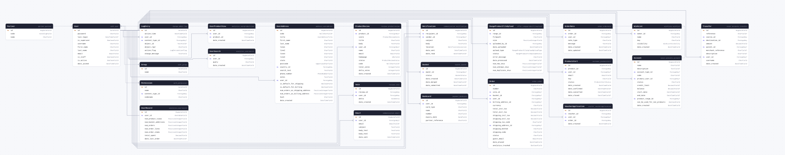

| Column | Field | Type | Null | Key | Default | Description |
| --- | --- | --- | --- | --- | --- | --- |
| `id` | `AutoField` | `integer` |  | PK | `autoincrement()` |  |
| `password` | `CharField` | `varchar(128)` |  |  |  |  |
| `last_login` | `DateTimeField` | `datetime` | yes |  |  |  |
| `is_superuser` | `BooleanField` | `bool` |  |  | `False` | Designates that this user has all permissions without explicitly assigning them. |
| `username` | `CharField` | `varchar(150)` |  | unique |  | Required. 150 characters or fewer. Letters, digits and @/./+/-/_ only. |
| `first_name` | `CharField` | `varchar(150)` |  |  |  |  |
| `last_name` | `CharField` | `varchar(150)` |  |  |  |  |
| `email` | `EmailField` | `varchar(254)` |  |  |  |  |
| `is_staff` | `BooleanField` | `bool` |  |  | `False` | Designates whether the user can log into this admin site. |
| `is_active` | `BooleanField` | `bool` |  |  | `True` | Designates whether this user should be treated as active. Unselect this instead of deleting accounts. |
| `date_joined` | `DateTimeField` | `datetime` |  |  | `now()` |  |

Relations:

- [LogEntry](#logentry).`user_id` → `id`, on delete cascade
- `groups` — many to many with [Group](#group)
- `user_permissions` — many to many with [Permission](#permission)
- [UserRecord](#userrecord).`user_id` → `id`, on delete cascade
- [UserProductView](#userproductview).`user_id` → `id`, on delete cascade
- [UserSearch](#usersearch).`user_id` → `id`, on delete cascade
- [UserAddress](#useraddress).`user_id` → `id`, on delete cascade
- [ProductReview](#productreview).`user_id` → `id`, on delete cascade
- [Vote](#vote).`user_id` → `id`, on delete cascade
- [Email](#email).`user_id` → `id`, on delete cascade
- [Notification](#notification).`recipient_id` → `id`, on delete cascade
- [Notification](#notification).`sender_id` → `id`, on delete cascade
- `partners` — many to many with [Partner](#partner)
- [Basket](#basket).`owner_id` → `id`, on delete cascade
- [Bankcard](#bankcard).`user_id` → `id`, on delete cascade
- [RangeProductFileUpload](#rangeproductfileupload).`uploaded_by_id` → `id`, on delete cascade
- [Order](#order).`user_id` → `id`, on delete set null
- [OrderNote](#ordernote).`user_id` → `id`, on delete cascade
- [ProductAlert](#productalert).`user_id` → `id`, on delete cascade
- [VoucherApplication](#voucherapplication).`user_id` → `id`, on delete cascade
- [WishList](#wishlist).`owner_id` → `id`, on delete cascade
- [Account](#account).`primary_user_id` → `id`, on delete set null
- `account_set` — many to many with [Account](#account)
- [Transfer](#transfer).`user_id` → `id`, on delete set null

## ContentType

Table `django_content_type`, app `contenttypes`.

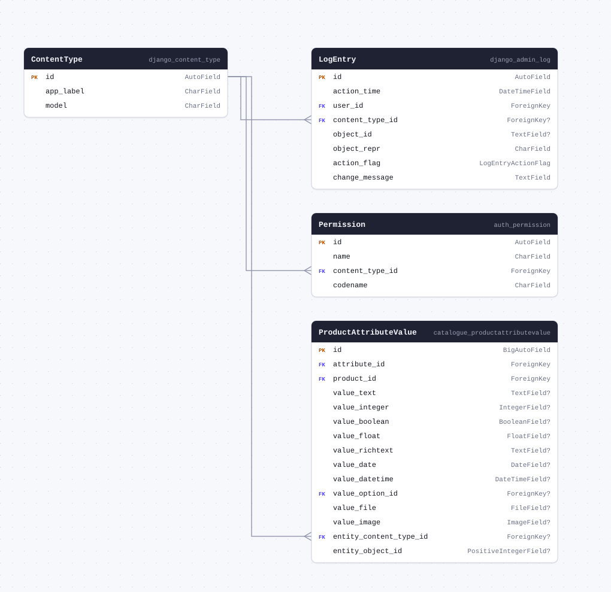

| Column | Field | Type | Null | Key | Default | Description |
| --- | --- | --- | --- | --- | --- | --- |
| `id` | `AutoField` | `integer` |  | PK | `autoincrement()` |  |
| `app_label` | `CharField` | `varchar(100)` |  |  |  |  |
| `model` | `CharField` | `varchar(100)` |  |  |  |  |

Indexes:

- unique `django_content_type_app_label_model_76bd3d3b_uniq` on `app_label`, `model`

Relations:

- [LogEntry](#logentry).`content_type_id` → `id`, on delete set null
- [Permission](#permission).`content_type_id` → `id`, on delete cascade
- [ProductAttributeValue](#productattributevalue).`entity_content_type_id` → `id`, on delete cascade

## Session

Table `django_session`, app `sessions`.

Columns from `AbstractBaseSession` (abstract): `session_key`, `session_data`, `expire_date`.

Django provides full support for anonymous sessions. The session
framework lets you store and retrieve arbitrary data on a
per-site-visitor basis. It stores data on the server side and
abstracts the sending and receiving of cookies. Cookies contain a
session ID -- not the data itself.

The Django sessions framework is entirely cookie-based. It does
not fall back to putting session IDs in URLs. This is an intentional
design decision. Not only does that behavior make URLs ugly, it makes
your site vulnerable to session-ID theft via the "Referer" header.

For complete documentation on using Sessions in your code, consult
the sessions documentation that is shipped with Django (also available
on the Django web site).

| Column | Field | Type | Null | Key | Default | Description |
| --- | --- | --- | --- | --- | --- | --- |
| `session_key` | `CharField` | `varchar(40)` |  | PK |  |  |
| `session_data` | `TextField` | `text` |  |  |  |  |
| `expire_date` | `DateTimeField` | `datetime` |  |  |  |  |

Indexes:

- index `django_session_expire_date_a5c62663` on `expire_date`

## Site

Table `django_site`, app `sites`.

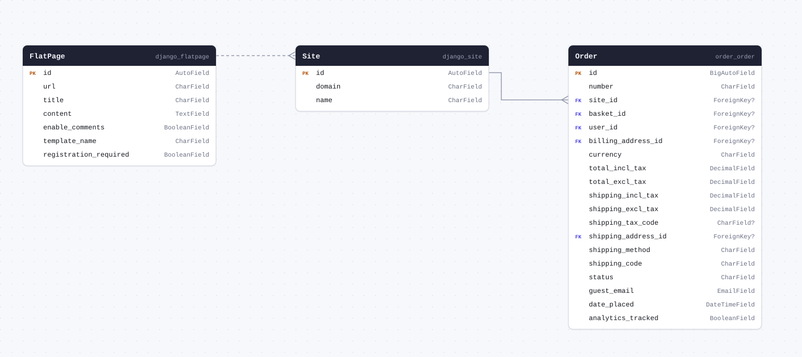

| Column | Field | Type | Null | Key | Default | Description |
| --- | --- | --- | --- | --- | --- | --- |
| `id` | `AutoField` | `integer` |  | PK | `autoincrement()` |  |
| `domain` | `CharField` | `varchar(100)` |  | unique |  |  |
| `name` | `CharField` | `varchar(50)` |  |  |  |  |

Relations:

- `flatpage_set` — many to many with [FlatPage](#flatpage)
- [Order](#order).`site_id` → `id`, on delete set null

## FlatPage

Table `django_flatpage`, app `flatpages`.

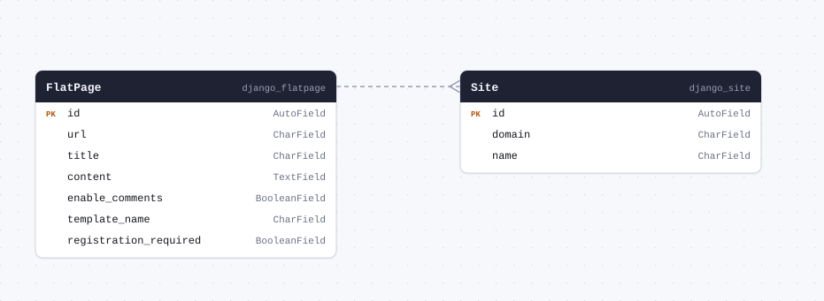

| Column | Field | Type | Null | Key | Default | Description |
| --- | --- | --- | --- | --- | --- | --- |
| `id` | `AutoField` | `integer` |  | PK | `autoincrement()` |  |
| `url` | `CharField` | `varchar(100)` |  |  |  |  |
| `title` | `CharField` | `varchar(200)` |  |  |  |  |
| `content` | `TextField` | `text` |  |  |  |  |
| `enable_comments` | `BooleanField` | `bool` |  |  | `False` |  |
| `template_name` | `CharField` | `varchar(70)` |  |  |  | Example: “flatpages/contact_page.html”. If this isn’t provided, the system will use “flatpages/default.html”. |
| `registration_required` | `BooleanField` | `bool` |  |  | `False` | If this is checked, only logged-in users will be able to view the page. |

Indexes:

- index `django_flatpage_url_41612362` on `url`

Relations:

- `sites` — many to many with [Site](#site)

## ProductRecord

Table `analytics_productrecord`, app `analytics`.

Columns from `AbstractProductRecord` (abstract): `product_id`, `num_views`, `num_basket_additions`, `num_purchases`, `score`.

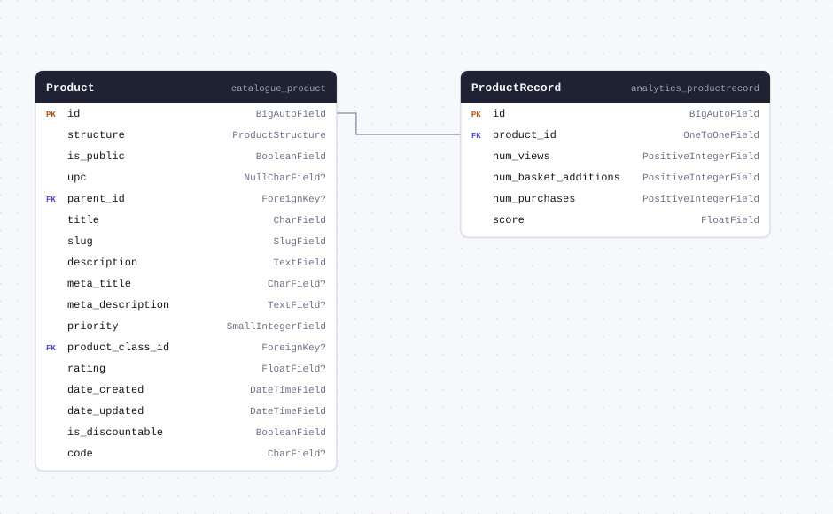

| Column | Field | Type | Null | Key | Default | Description |
| --- | --- | --- | --- | --- | --- | --- |
| `id` | `BigAutoField` | `integer` |  | PK | `autoincrement()` |  |
| `product_id` | `OneToOneField` | `bigint` |  | FK, unique |  |  |
| `num_views` | `PositiveIntegerField` | `integer unsigned` |  |  | `0` |  |
| `num_basket_additions` | `PositiveIntegerField` | `integer unsigned` |  |  | `0` |  |
| `num_purchases` | `PositiveIntegerField` | `integer unsigned` |  |  | `0` |  |
| `score` | `FloatField` | `real` |  |  | `0.0` |  |

Indexes:

- index `analytics_productrecord_num_purchases_405301a0` on `num_purchases`

Relations:

- `product_id` → [Product](#product).`id`, on delete cascade

## UserRecord

Table `analytics_userrecord`, app `analytics`.

Columns from `AbstractUserRecord` (abstract): `user_id`, `num_product_views`, `num_basket_additions`, `num_orders`, `num_order_lines`, `num_order_items`, `total_spent`, `date_last_order`.

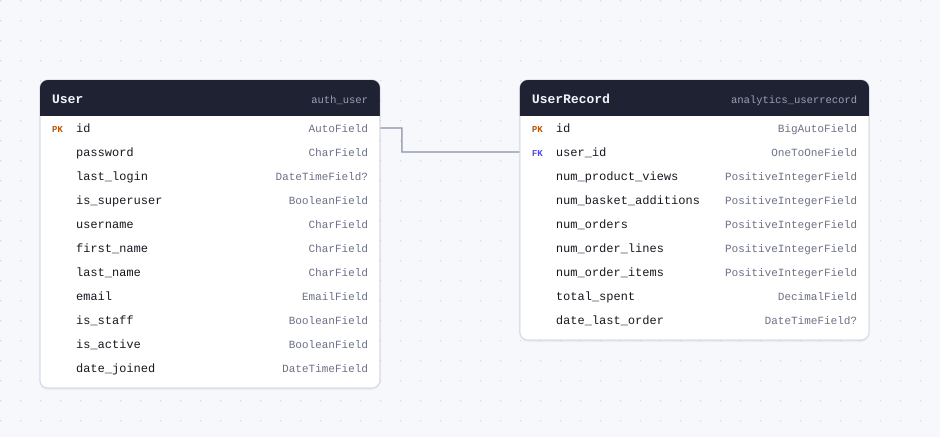

| Column | Field | Type | Null | Key | Default | Description |
| --- | --- | --- | --- | --- | --- | --- |
| `id` | `BigAutoField` | `integer` |  | PK | `autoincrement()` |  |
| `user_id` | `OneToOneField` | `integer` |  | FK, unique |  |  |
| `num_product_views` | `PositiveIntegerField` | `integer unsigned` |  |  | `0` |  |
| `num_basket_additions` | `PositiveIntegerField` | `integer unsigned` |  |  | `0` |  |
| `num_orders` | `PositiveIntegerField` | `integer unsigned` |  |  | `0` |  |
| `num_order_lines` | `PositiveIntegerField` | `integer unsigned` |  |  | `0` |  |
| `num_order_items` | `PositiveIntegerField` | `integer unsigned` |  |  | `0` |  |
| `total_spent` | `DecimalField(12, 2)` | `decimal` |  |  | `Decimal('0.00')` |  |
| `date_last_order` | `DateTimeField` | `datetime` | yes |  |  |  |

Indexes:

- index `analytics_userrecord_num_orders_b352ffd1` on `num_orders`
- index `analytics_userrecord_num_order_lines_97cc087f` on `num_order_lines`
- index `analytics_userrecord_num_order_items_fb2a8304` on `num_order_items`

Relations:

- `user_id` → [User](#user).`id`, on delete cascade

## UserProductView

Table `analytics_userproductview`, app `analytics`.

Columns from `AbstractUserProductView` (abstract): `user_id`, `product_id`, `date_created`.

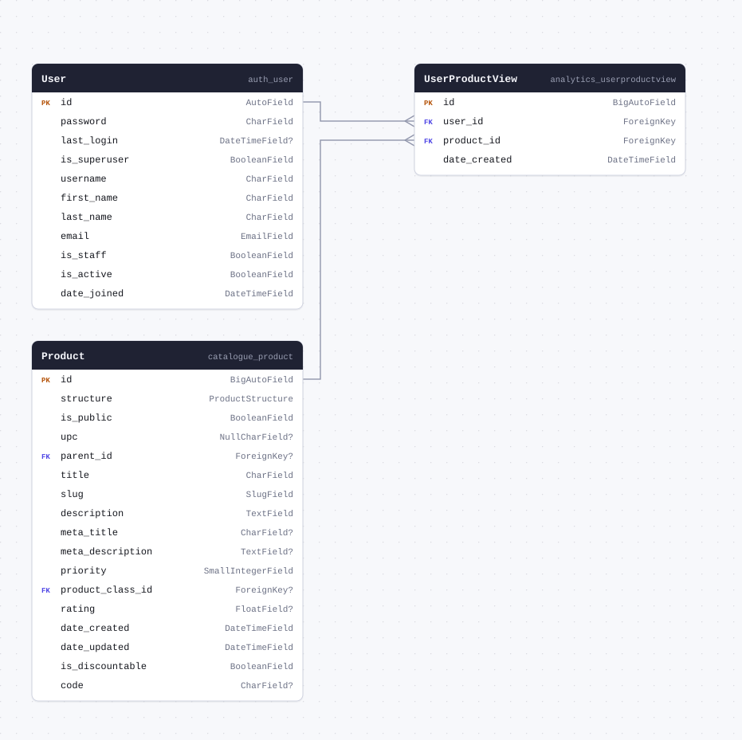

| Column | Field | Type | Null | Key | Default | Description |
| --- | --- | --- | --- | --- | --- | --- |
| `id` | `BigAutoField` | `integer` |  | PK | `autoincrement()` |  |
| `user_id` | `ForeignKey` | `integer` |  | FK |  |  |
| `product_id` | `ForeignKey` | `bigint` |  | FK |  |  |
| `date_created` | `DateTimeField` | `datetime` |  |  | `now()` |  |

Indexes:

- index `analytics_userproductview_user_id_5e49a8b1` on `user_id`
- index `analytics_userproductview_product_id_a55b87ad` on `product_id`

Relations:

- `user_id` → [User](#user).`id`, on delete cascade
- `product_id` → [Product](#product).`id`, on delete cascade

## UserSearch

Table `analytics_usersearch`, app `analytics`.

Columns from `AbstractUserSearch` (abstract): `user_id`, `query`, `date_created`.

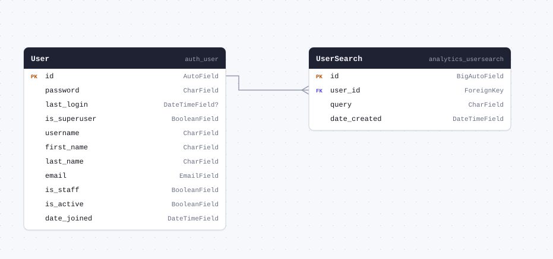

| Column | Field | Type | Null | Key | Default | Description |
| --- | --- | --- | --- | --- | --- | --- |
| `id` | `BigAutoField` | `integer` |  | PK | `autoincrement()` |  |
| `user_id` | `ForeignKey` | `integer` |  | FK |  |  |
| `query` | `CharField` | `varchar(255)` |  |  |  |  |
| `date_created` | `DateTimeField` | `datetime` |  |  | `now()` |  |

Indexes:

- index `analytics_usersearch_user_id_1775992d` on `user_id`
- index `analytics_usersearch_query_ad36478b` on `query`

Relations:

- `user_id` → [User](#user).`id`, on delete cascade

## UserAddress

Table `address_useraddress`, app `address`.

Columns from `AbstractUserAddress` (abstract): `user_id`, `is_default_for_shipping`, `is_default_for_billing`, `num_orders_as_shipping_address`, `num_orders_as_billing_address`, `hash`, `date_created`.

Columns from `AbstractShippingAddress` (abstract): `phone_number`, `notes`.

Columns from `AbstractAddress` (abstract): `code`, `title`, `first_name`, `last_name`, `line1`, `line2`, `line3`, `line4`, `state`, `postcode`, `country_id`, `search_text`.

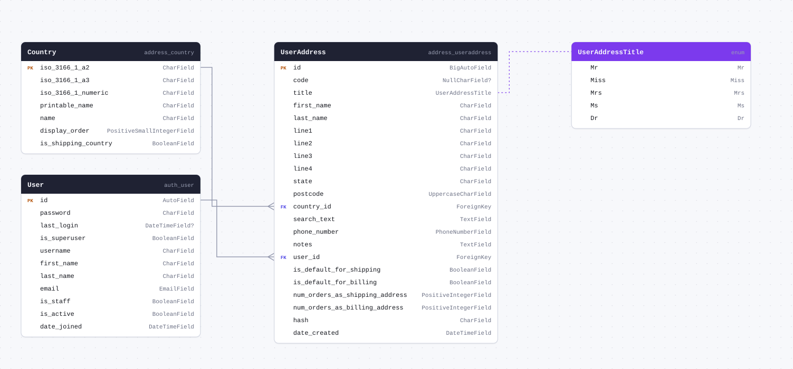

| Column | Field | Type | Null | Key | Default | Description |
| --- | --- | --- | --- | --- | --- | --- |
| `id` | `BigAutoField` | `integer` |  | PK | `autoincrement()` |  |
| `code` | `NullCharField` | `varchar(255)` | yes | unique |  |  |
| `title` | `UserAddressTitle` | `varchar(64)` |  |  |  |  |
| `first_name` | `CharField` | `varchar(255)` |  |  |  |  |
| `last_name` | `CharField` | `varchar(255)` |  |  |  |  |
| `line1` | `CharField` | `varchar(255)` |  |  |  |  |
| `line2` | `CharField` | `varchar(255)` |  |  |  |  |
| `line3` | `CharField` | `varchar(255)` |  |  |  |  |
| `line4` | `CharField` | `varchar(255)` |  |  |  |  |
| `state` | `CharField` | `varchar(255)` |  |  |  |  |
| `postcode` | `UppercaseCharField` | `varchar(64)` |  |  |  |  |
| `country_id` | `ForeignKey` | `varchar(2)` |  | FK |  |  |
| `search_text` | `TextField` | `text` |  |  |  |  |
| `phone_number` | `PhoneNumberField` | `varchar(128)` |  |  |  | In case we need to call you about your order |
| `notes` | `TextField` | `text` |  |  |  | Tell us anything we should know when delivering your order. |
| `user_id` | `ForeignKey` | `integer` |  | FK |  |  |
| `is_default_for_shipping` | `BooleanField` | `bool` |  |  | `False` |  |
| `is_default_for_billing` | `BooleanField` | `bool` |  |  | `False` |  |
| `num_orders_as_shipping_address` | `PositiveIntegerField` | `integer unsigned` |  |  | `0` |  |
| `num_orders_as_billing_address` | `PositiveIntegerField` | `integer unsigned` |  |  | `0` |  |
| `hash` | `CharField` | `varchar(255)` |  |  |  |  |
| `date_created` | `DateTimeField` | `datetime` |  |  | `now()` |  |

Indexes:

- index `address_useraddress_country_id_fa26a249` on `country_id`
- index `address_useraddress_user_id_6edf0244` on `user_id`
- index `address_useraddress_hash_e0a6b290` on `hash`
- unique `address_useraddress_user_id_hash_9d1738c7_uniq` on `user_id`, `hash`

Relations:

- `country_id` → [Country](#country).`iso_3166_1_a2`, on delete cascade
- `user_id` → [User](#user).`id`, on delete cascade

## Country

Table `address_country`, app `address`.

Columns from `AbstractCountry` (abstract): `iso_3166_1_a2`, `iso_3166_1_a3`, `iso_3166_1_numeric`, `printable_name`, `name`, `display_order`, `is_shipping_country`.

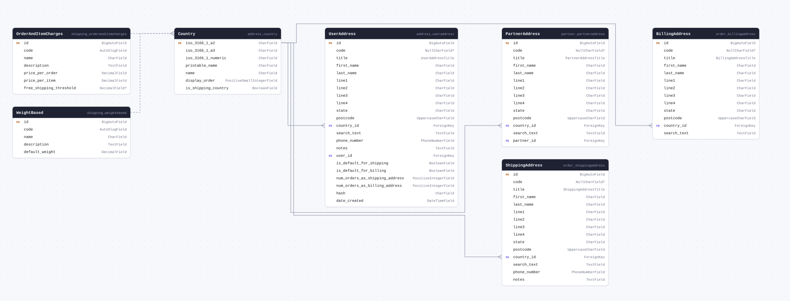

| Column | Field | Type | Null | Key | Default | Description |
| --- | --- | --- | --- | --- | --- | --- |
| `iso_3166_1_a2` | `CharField` | `varchar(2)` |  | PK |  |  |
| `iso_3166_1_a3` | `CharField` | `varchar(3)` |  |  |  |  |
| `iso_3166_1_numeric` | `CharField` | `varchar(3)` |  |  |  |  |
| `printable_name` | `CharField` | `varchar(128)` |  |  |  |  |
| `name` | `CharField` | `varchar(128)` |  |  |  |  |
| `display_order` | `PositiveSmallIntegerField` | `smallint unsigned` |  |  | `0` | Higher the number, higher the country in the list. |
| `is_shipping_country` | `BooleanField` | `bool` |  |  | `False` |  |

Indexes:

- index `address_country_printable_name_450b016c` on `printable_name`
- index `address_country_display_order_dc88cde8` on `display_order`
- index `address_country_is_shipping_country_f7b6c461` on `is_shipping_country`

Relations:

- [UserAddress](#useraddress).`country_id` → `iso_3166_1_a2`, on delete cascade
- `orderanditemcharges_set` — many to many with [OrderAndItemCharges](#orderanditemcharges)
- `weightbased_set` — many to many with [WeightBased](#weightbased)
- [PartnerAddress](#partneraddress).`country_id` → `iso_3166_1_a2`, on delete cascade
- [ShippingAddress](#shippingaddress).`country_id` → `iso_3166_1_a2`, on delete cascade
- [BillingAddress](#billingaddress).`country_id` → `iso_3166_1_a2`, on delete cascade

## OrderAndItemCharges

Table `shipping_orderanditemcharges`, app `shipping`.

Columns from `AbstractOrderAndItemCharges` (abstract): `price_per_order`, `price_per_item`, `free_shipping_threshold`.

Columns from `AbstractBase` (abstract): `code`, `name`, `description`.

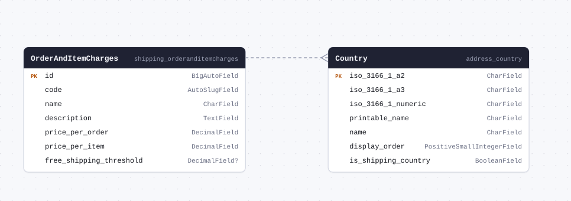

| Column | Field | Type | Null | Key | Default | Description |
| --- | --- | --- | --- | --- | --- | --- |
| `id` | `BigAutoField` | `integer` |  | PK | `autoincrement()` |  |
| `code` | `AutoSlugField` | `varchar(128)` |  | unique |  |  |
| `name` | `CharField` | `varchar(128)` |  | unique |  |  |
| `description` | `TextField` | `text` |  |  |  |  |
| `price_per_order` | `DecimalField(12, 2)` | `decimal` |  |  | `Decimal('0.00')` |  |
| `price_per_item` | `DecimalField(12, 2)` | `decimal` |  |  | `Decimal('0.00')` |  |
| `free_shipping_threshold` | `DecimalField(12, 2)` | `decimal` | yes |  |  |  |

Relations:

- `countries` — many to many with [Country](#country)

## WeightBased

Table `shipping_weightbased`, app `shipping`.

Columns from `AbstractWeightBased` (abstract): `default_weight`.

Columns from `AbstractBase` (abstract): `code`, `name`, `description`.

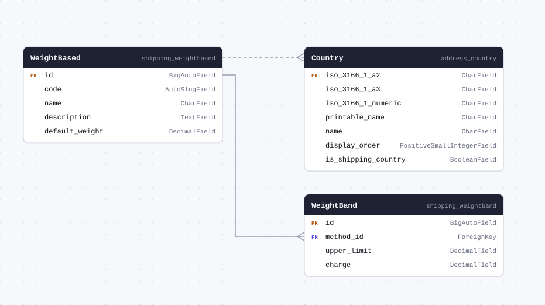

| Column | Field | Type | Null | Key | Default | Description |
| --- | --- | --- | --- | --- | --- | --- |
| `id` | `BigAutoField` | `integer` |  | PK | `autoincrement()` |  |
| `code` | `AutoSlugField` | `varchar(128)` |  | unique |  |  |
| `name` | `CharField` | `varchar(128)` |  | unique |  |  |
| `description` | `TextField` | `text` |  |  |  |  |
| `default_weight` | `DecimalField(12, 3)` | `decimal` |  |  | `Decimal('0.000')` | Default product weight in kg when no weight attribute is defined |

Relations:

- `countries` — many to many with [Country](#country)
- [WeightBand](#weightband).`method_id` → `id`, on delete cascade

## WeightBand

Table `shipping_weightband`, app `shipping`.

Columns from `AbstractWeightBand` (abstract): `method_id`, `upper_limit`, `charge`.

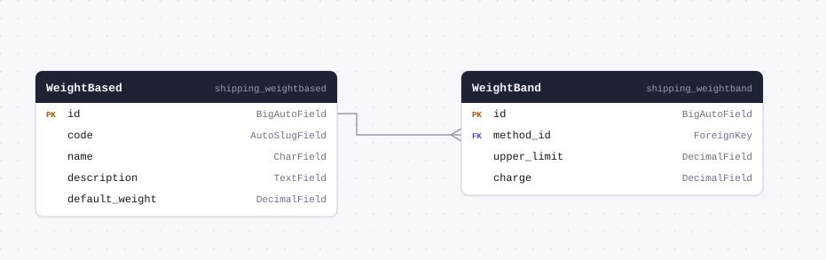

| Column | Field | Type | Null | Key | Default | Description |
| --- | --- | --- | --- | --- | --- | --- |
| `id` | `BigAutoField` | `integer` |  | PK | `autoincrement()` |  |
| `method_id` | `ForeignKey` | `bigint` |  | FK |  |  |
| `upper_limit` | `DecimalField(12, 3)` | `decimal` |  |  |  | Enter upper limit of this weight band in kg. The lower limit will be determined by the other weight bands. |
| `charge` | `DecimalField(12, 2)` | `decimal` |  |  |  |  |

Indexes:

- index `shipping_weightband_method_id_b699a1ba` on `method_id`
- index `shipping_weightband_upper_limit_9edc5097` on `upper_limit`

Relations:

- `method_id` → [WeightBased](#weightbased).`id`, on delete cascade

## ProductClass

Table `catalogue_productclass`, app `catalogue`.

Columns from `AbstractProductClass` (abstract): `name`, `slug`, `requires_shipping`, `track_stock`.

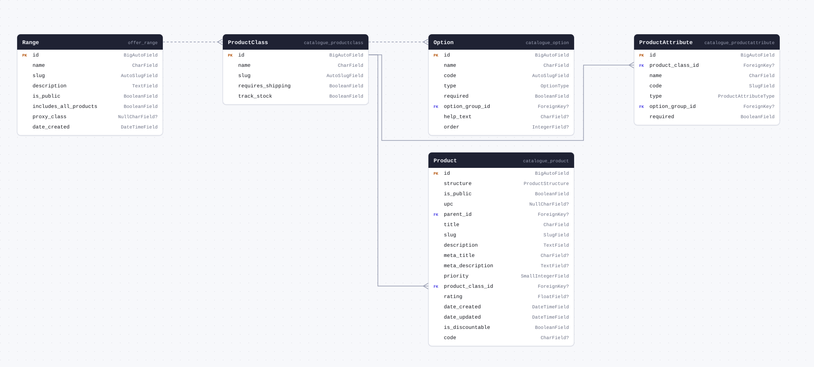

| Column | Field | Type | Null | Key | Default | Description |
| --- | --- | --- | --- | --- | --- | --- |
| `id` | `BigAutoField` | `integer` |  | PK | `autoincrement()` |  |
| `name` | `CharField` | `varchar(128)` |  |  |  |  |
| `slug` | `AutoSlugField` | `varchar(128)` |  | unique |  |  |
| `requires_shipping` | `BooleanField` | `bool` |  |  | `True` |  |
| `track_stock` | `BooleanField` | `bool` |  |  | `True` |  |

Relations:

- `options` — many to many with [Option](#option)
- [Product](#product).`product_class_id` → `id`, on delete protect
- [ProductAttribute](#productattribute).`product_class_id` → `id`, on delete cascade
- `classes` — many to many with [Range](#range)

## Category

Table `catalogue_category`, app `catalogue`.

Columns from `AbstractCategory` (abstract): `name`, `code`, `description`, `long_description`, `meta_title`, `meta_description`, `image`, `slug`, `exclude_from_menu`, `is_public`, `ancestors_are_public`.

Columns from `MP_Node` (abstract): `path`, `depth`, `numchild`.

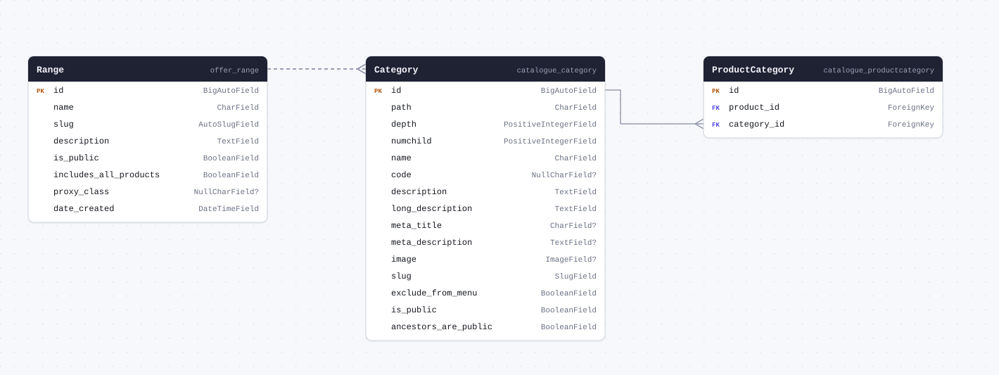

| Column | Field | Type | Null | Key | Default | Description |
| --- | --- | --- | --- | --- | --- | --- |
| `id` | `BigAutoField` | `integer` |  | PK | `autoincrement()` |  |
| `path` | `CharField` | `varchar(255)` |  | unique |  |  |
| `depth` | `PositiveIntegerField` | `integer unsigned` |  |  |  |  |
| `numchild` | `PositiveIntegerField` | `integer unsigned` |  |  | `0` |  |
| `name` | `CharField` | `varchar(255)` |  |  |  |  |
| `code` | `NullCharField` | `varchar(255)` | yes | unique |  |  |
| `description` | `TextField` | `text` |  |  |  |  |
| `long_description` | `TextField` | `text` |  |  |  |  |
| `meta_title` | `CharField` | `varchar(255)` | yes |  |  |  |
| `meta_description` | `TextField` | `text` | yes |  |  |  |
| `image` | `ImageField` | `varchar(255)` | yes |  |  |  |
| `slug` | `SlugField` | `varchar(255)` |  |  |  |  |
| `exclude_from_menu` | `BooleanField` | `bool` |  |  | `False` | Exclude this category from the menu. |
| `is_public` | `BooleanField` | `bool` |  |  | `True` | Show this category in search results and catalogue listings. |
| `ancestors_are_public` | `BooleanField` | `bool` |  |  | `True` | The ancestors of this category are public |

Indexes:

- index `catalogue_category_name_1f342ac2` on `name`
- index `catalogue_category_slug_9635febd` on `slug`
- index `catalogue_category_exclude_from_menu_898e8583` on `exclude_from_menu`
- index `catalogue_category_is_public_ab0536be` on `is_public`
- index `catalogue_category_ancestors_are_public_d088d0db` on `ancestors_are_public`

Relations:

- `product_set` — many to many with [Product](#product), through [ProductCategory](#productcategory)
- [ProductCategory](#productcategory).`category_id` → `id`, on delete cascade
- `includes` — many to many with [Range](#range)
- `excludes` — many to many with [Range](#range)

## ProductCategory

Table `catalogue_productcategory`, app `catalogue`.

Columns from `AbstractProductCategory` (abstract): `product_id`, `category_id`.

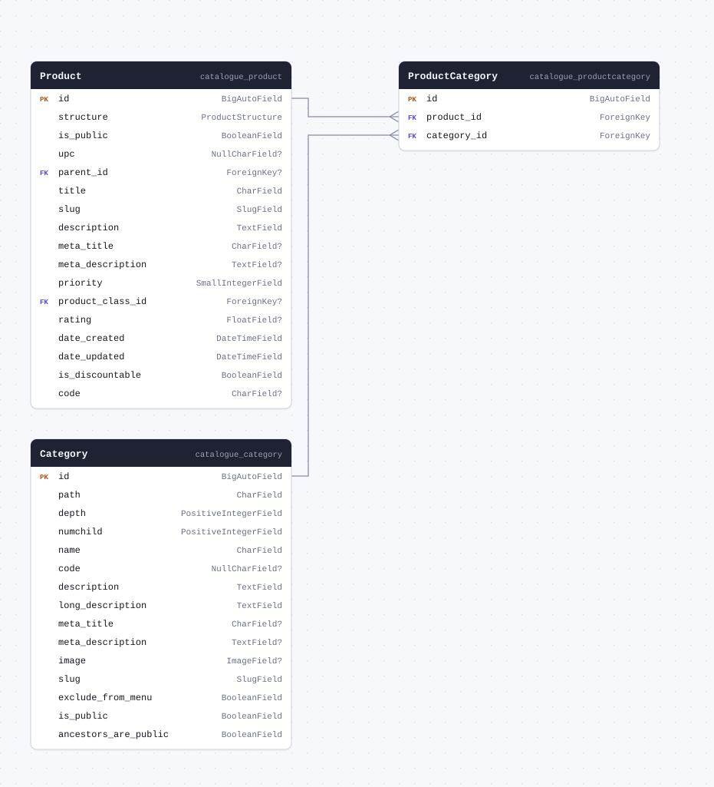

| Column | Field | Type | Null | Key | Default | Description |
| --- | --- | --- | --- | --- | --- | --- |
| `id` | `BigAutoField` | `integer` |  | PK | `autoincrement()` |  |
| `product_id` | `ForeignKey` | `bigint` |  | FK |  |  |
| `category_id` | `ForeignKey` | `bigint` |  | FK |  |  |

Indexes:

- index `catalogue_productcategory_product_id_846a4061` on `product_id`
- index `catalogue_productcategory_category_id_176db535` on `category_id`
- unique `catalogue_productcategory_product_id_category_id_8f0dbfe2_uniq` on `product_id`, `category_id`

Relations:

- `product_id` → [Product](#product).`id`, on delete cascade
- `category_id` → [Category](#category).`id`, on delete cascade

## Product

Table `catalogue_product`, app `catalogue`.

Columns from `AbstractProduct` (abstract): `structure`, `is_public`, `upc`, `parent_id`, `title`, `slug`, `description`, `meta_title`, `meta_description`, `priority`, `product_class_id`, `rating`, `date_created`, `date_updated`, `is_discountable`, `code`.

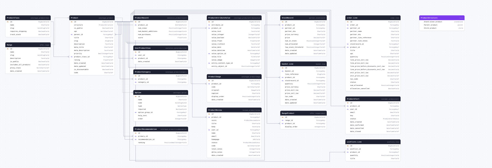

| Column | Field | Type | Null | Key | Default | Description |
| --- | --- | --- | --- | --- | --- | --- |
| `id` | `BigAutoField` | `integer` |  | PK | `autoincrement()` |  |
| `structure` | `ProductStructure` | `varchar(10)` |  |  | `'standalone'` |  |
| `is_public` | `BooleanField` | `bool` |  |  | `True` | Show this product in search results and catalogue listings. |
| `upc` | `NullCharField` | `varchar(64)` | yes | unique |  | Universal Product Code (UPC) is an identifier for a product which is not specific to a particular  supplier. Eg an ISBN for a book. |
| `parent_id` | `ForeignKey` | `bigint` | yes | FK |  | Only choose a parent product if you're creating a child product.  For example if this is a size 4 of a particular t-shirt.  Leave blank if this is a stand-alone product (i.e. there is only one version of this product). |
| `title` | `CharField` | `varchar(255)` |  |  |  |  |
| `slug` | `SlugField` | `varchar(255)` |  |  |  |  |
| `description` | `TextField` | `text` |  |  |  |  |
| `meta_title` | `CharField` | `varchar(255)` | yes |  |  |  |
| `meta_description` | `TextField` | `text` | yes |  |  |  |
| `priority` | `SmallIntegerField` | `smallint` |  |  | `0` | The highest priority products are shown first |
| `product_class_id` | `ForeignKey` | `bigint` | yes | FK |  | Choose what type of product this is |
| `rating` | `FloatField` | `real` | yes |  |  |  |
| `date_created` | `DateTimeField` | `datetime` |  |  | `now()` |  |
| `date_updated` | `DateTimeField` | `datetime` |  |  | `now()` |  |
| `is_discountable` | `BooleanField` | `bool` |  |  | `True` | This flag indicates if this product can be used in an offer or not |
| `code` | `CharField` | `varchar(255)` | yes | unique |  |  |

Indexes:

- index `catalogue_product_is_public_1cf798c5` on `is_public`
- index `catalogue_product_parent_id_9bfd2382` on `parent_id`
- index `catalogue_product_slug_c8e2e2b9` on `slug`
- index `catalogue_product_priority_983a8f56` on `priority`
- index `catalogue_product_product_class_id_0c6c5b54` on `product_class_id`
- index `catalogue_product_date_created_d66f485a` on `date_created`
- index `catalogue_product_date_updated_d3a1785d` on `date_updated`

Relations:

- `attributes` — many to many with [ProductAttribute](#productattribute), through [ProductAttributeValue](#productattributevalue)
- `recommended_products` — many to many with [Product](#product), through [ProductRecommendation](#productrecommendation)
- `categories` — many to many with [Category](#category), through [ProductCategory](#productcategory)
- `product_set` — many to many with [Product](#product), through [ProductRecommendation](#productrecommendation)
- `includes` — many to many with [Range](#range), through [RangeProduct](#rangeproduct)
- [ProductRecord](#productrecord).`product_id` → `id`, on delete cascade
- [UserProductView](#userproductview).`product_id` → `id`, on delete cascade
- [ProductCategory](#productcategory).`product_id` → `id`, on delete cascade
- `parent_id` → [Product](#product).`id`, on delete cascade
- `product_class_id` → [ProductClass](#productclass).`id`, on delete protect
- `product_options` — many to many with [Option](#option)
- [ProductRecommendation](#productrecommendation).`primary_id` → `id`, on delete cascade
- [ProductRecommendation](#productrecommendation).`recommendation_id` → `id`, on delete cascade
- [ProductAttributeValue](#productattributevalue).`product_id` → `id`, on delete cascade
- [ProductImage](#productimage).`product_id` → `id`, on delete cascade
- [ProductReview](#productreview).`product_id` → `id`, on delete cascade
- [StockRecord](#stockrecord).`product_id` → `id`, on delete cascade
- [basket.Line](#basketline).`product_id` → `id`, on delete cascade
- `excludes` — many to many with [Range](#range)
- [RangeProduct](#rangeproduct).`product_id` → `id`, on delete cascade
- [order.Line](#orderline).`product_id` → `id`, on delete set null
- [ProductAlert](#productalert).`product_id` → `id`, on delete cascade
- [wishlists.Line](#wishlistsline).`product_id` → `id`, on delete set null

## ProductRecommendation

Table `catalogue_productrecommendation`, app `catalogue`.

Columns from `AbstractProductRecommendation` (abstract): `primary_id`, `recommendation_id`, `ranking`.

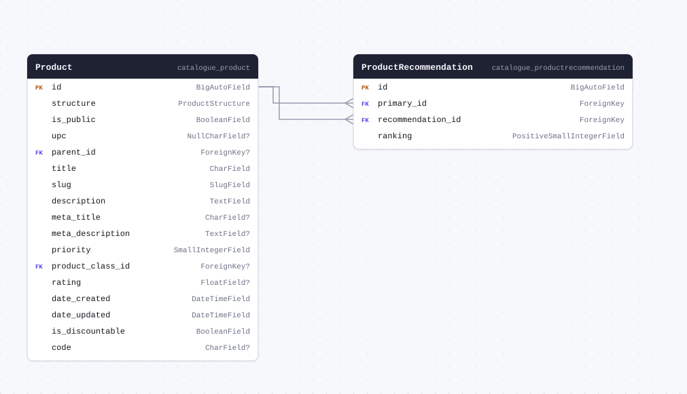

| Column | Field | Type | Null | Key | Default | Description |
| --- | --- | --- | --- | --- | --- | --- |
| `id` | `BigAutoField` | `integer` |  | PK | `autoincrement()` |  |
| `primary_id` | `ForeignKey` | `bigint` |  | FK |  |  |
| `recommendation_id` | `ForeignKey` | `bigint` |  | FK |  |  |
| `ranking` | `PositiveSmallIntegerField` | `smallint unsigned` |  |  | `0` | Determines order of the products. A product with a higher value will appear before one with a lower ranking. |

Indexes:

- index `catalogue_productrecommendation_primary_id_6e51a55c` on `primary_id`
- index `catalogue_productrecommendation_recommendation_id_daf8ae95` on `recommendation_id`
- index `catalogue_productrecommendation_ranking_e7a0f7fd` on `ranking`
- unique `catalogue_productrecommendation_primary_id_recommendation_id_da1fdf43_uniq` on `primary_id`, `recommendation_id`

Relations:

- `primary_id` → [Product](#product).`id`, on delete cascade
- `recommendation_id` → [Product](#product).`id`, on delete cascade

## ProductAttribute

Table `catalogue_productattribute`, app `catalogue`.

Columns from `AbstractProductAttribute` (abstract): `product_class_id`, `name`, `code`, `type`, `option_group_id`, `required`.

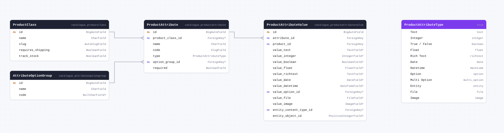

| Column | Field | Type | Null | Key | Default | Description |
| --- | --- | --- | --- | --- | --- | --- |
| `id` | `BigAutoField` | `integer` |  | PK | `autoincrement()` |  |
| `product_class_id` | `ForeignKey` | `bigint` | yes | FK |  |  |
| `name` | `CharField` | `varchar(128)` |  |  |  |  |
| `code` | `SlugField` | `varchar(128)` |  |  |  |  |
| `type` | `ProductAttributeType` | `varchar(20)` |  |  | `'text'` |  |
| `option_group_id` | `ForeignKey` | `bigint` | yes | FK |  | Select an option group if using type "Option" or "Multi Option" |
| `required` | `BooleanField` | `bool` |  |  | `False` |  |

Indexes:

- index `catalogue_productattribute_product_class_id_7af808ec` on `product_class_id`
- index `catalogue_productattribute_code_9ffea293` on `code`
- index `catalogue_productattribute_option_group_id_6b422dc2` on `option_group_id`
- unique `catalogue_productattribute_code_product_class_id_82f69012_uniq` on `code`, `product_class_id`

Relations:

- `product_set` — many to many with [Product](#product), through [ProductAttributeValue](#productattributevalue)
- `product_class_id` → [ProductClass](#productclass).`id`, on delete cascade
- `option_group_id` → [AttributeOptionGroup](#attributeoptiongroup).`id`, on delete cascade
- [ProductAttributeValue](#productattributevalue).`attribute_id` → `id`, on delete cascade

## ProductAttributeValue

Table `catalogue_productattributevalue`, app `catalogue`.

Columns from `AbstractProductAttributeValue` (abstract): `attribute_id`, `product_id`, `value_text`, `value_integer`, `value_boolean`, `value_float`, `value_richtext`, `value_date`, `value_datetime`, `value_option_id`, `value_file`, `value_image`, `entity_content_type_id`, `entity_object_id`.

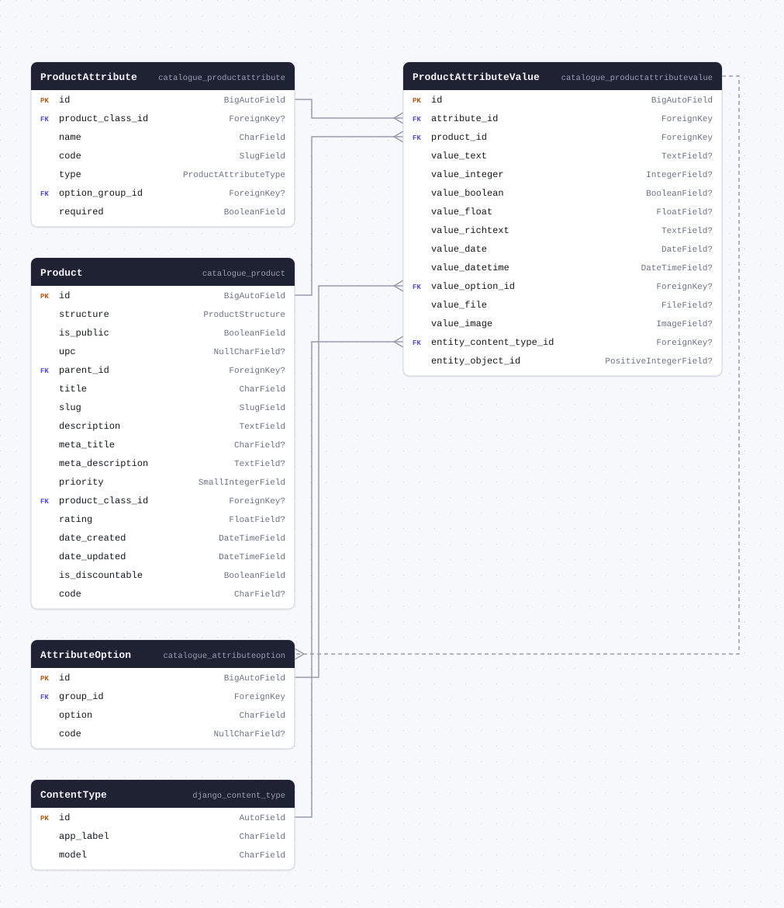

| Column | Field | Type | Null | Key | Default | Description |
| --- | --- | --- | --- | --- | --- | --- |
| `id` | `BigAutoField` | `integer` |  | PK | `autoincrement()` |  |
| `attribute_id` | `ForeignKey` | `bigint` |  | FK |  |  |
| `product_id` | `ForeignKey` | `bigint` |  | FK |  |  |
| `value_text` | `TextField` | `text` | yes |  |  |  |
| `value_integer` | `IntegerField` | `integer` | yes |  |  |  |
| `value_boolean` | `BooleanField` | `bool` | yes |  |  |  |
| `value_float` | `FloatField` | `real` | yes |  |  |  |
| `value_richtext` | `TextField` | `text` | yes |  |  |  |
| `value_date` | `DateField` | `date` | yes |  |  |  |
| `value_datetime` | `DateTimeField` | `datetime` | yes |  |  |  |
| `value_option_id` | `ForeignKey` | `bigint` | yes | FK |  |  |
| `value_file` | `FileField` | `varchar(255)` | yes |  |  |  |
| `value_image` | `ImageField` | `varchar(255)` | yes |  |  |  |
| `entity_content_type_id` | `ForeignKey` | `integer` | yes | FK |  |  |
| `entity_object_id` | `PositiveIntegerField` | `integer unsigned` | yes |  |  |  |

Indexes:

- index `catalogue_productattributevalue_attribute_id_0287c1e7` on `attribute_id`
- index `catalogue_productattributevalue_product_id_a03cd90e` on `product_id`
- index `catalogue_productattributevalue_value_integer_55fbb7d6` on `value_integer`
- index `catalogue_productattributevalue_value_boolean_c5b0d66a` on `value_boolean`
- index `catalogue_productattributevalue_value_float_5ef8d3db` on `value_float`
- index `catalogue_productattributevalue_value_date_d18775c1` on `value_date`
- index `catalogue_productattributevalue_value_datetime_b474ac38` on `value_datetime`
- index `catalogue_productattributevalue_value_option_id_21026066` on `value_option_id`
- index `catalogue_productattributevalue_entity_content_type_id_f7186ab5` on `entity_content_type_id`
- unique `catalogue_productattributevalue_attribute_id_product_id_1e8e7112_uniq` on `attribute_id`, `product_id`

Relations:

- `value_entity` → any model, by `entity_content_type_id` + `entity_object_id` (generic foreign key)
- `attribute_id` → [ProductAttribute](#productattribute).`id`, on delete cascade
- `product_id` → [Product](#product).`id`, on delete cascade
- `value_option_id` → [AttributeOption](#attributeoption).`id`, on delete cascade
- `entity_content_type_id` → [ContentType](#contenttype).`id`, on delete cascade
- `value_multi_option` — many to many with [AttributeOption](#attributeoption)

## AttributeOptionGroup

Table `catalogue_attributeoptiongroup`, app `catalogue`.

Columns from `AbstractAttributeOptionGroup` (abstract): `name`, `code`.

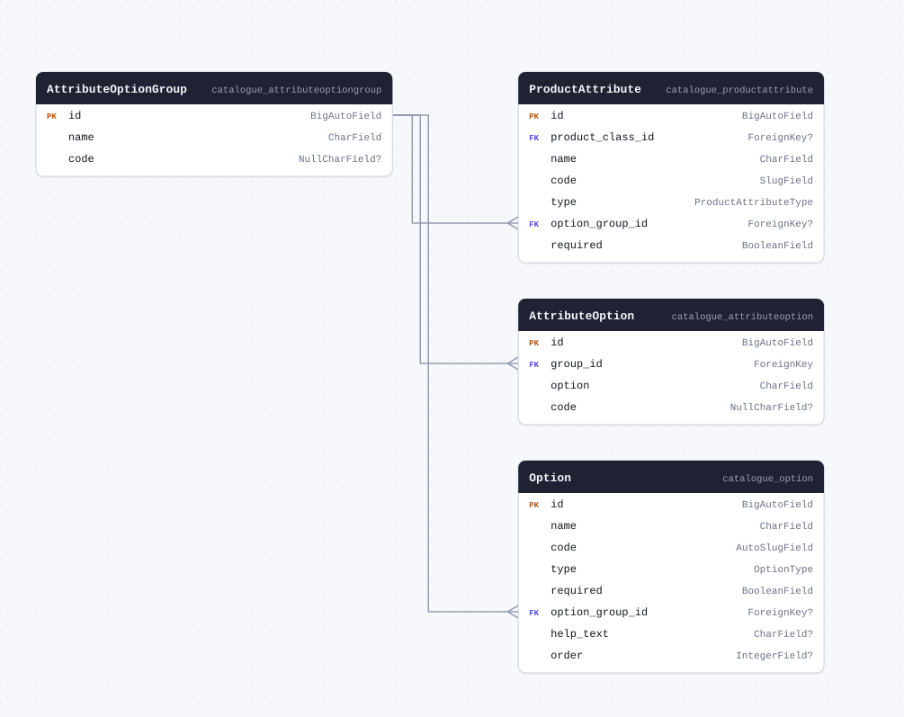

| Column | Field | Type | Null | Key | Default | Description |
| --- | --- | --- | --- | --- | --- | --- |
| `id` | `BigAutoField` | `integer` |  | PK | `autoincrement()` |  |
| `name` | `CharField` | `varchar(128)` |  |  |  |  |
| `code` | `NullCharField` | `varchar(255)` | yes | unique |  |  |

Relations:

- [ProductAttribute](#productattribute).`option_group_id` → `id`, on delete cascade
- [AttributeOption](#attributeoption).`group_id` → `id`, on delete cascade
- [Option](#option).`option_group_id` → `id`, on delete cascade

## AttributeOption

Table `catalogue_attributeoption`, app `catalogue`.

Columns from `AbstractAttributeOption` (abstract): `group_id`, `option`, `code`.

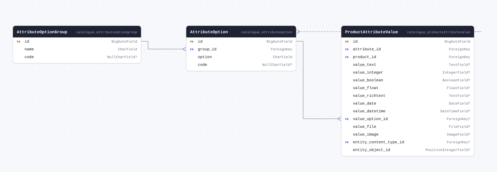

| Column | Field | Type | Null | Key | Default | Description |
| --- | --- | --- | --- | --- | --- | --- |
| `id` | `BigAutoField` | `integer` |  | PK | `autoincrement()` |  |
| `group_id` | `ForeignKey` | `bigint` |  | FK |  |  |
| `option` | `CharField` | `varchar(255)` |  |  |  |  |
| `code` | `NullCharField` | `varchar(255)` | yes | unique |  |  |

Indexes:

- index `catalogue_attributeoption_group_id_3d4a5e24` on `group_id`
- unique `catalogue_attributeoption_group_id_option_7a8f6c11_uniq` on `group_id`, `option`

Relations:

- [ProductAttributeValue](#productattributevalue).`value_option_id` → `id`, on delete cascade
- `multi_valued_attribute_values` — many to many with [ProductAttributeValue](#productattributevalue)
- `group_id` → [AttributeOptionGroup](#attributeoptiongroup).`id`, on delete cascade

## Option

Table `catalogue_option`, app `catalogue`.

Columns from `AbstractOption` (abstract): `name`, `code`, `type`, `required`, `option_group_id`, `help_text`, `order`.

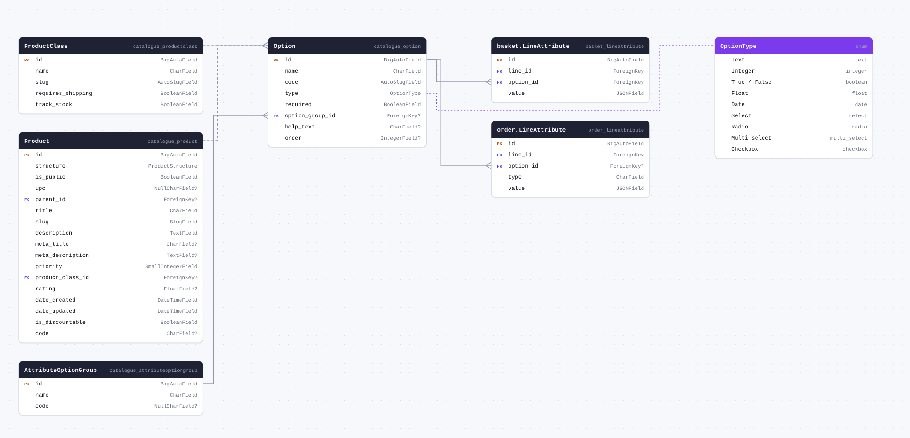

| Column | Field | Type | Null | Key | Default | Description |
| --- | --- | --- | --- | --- | --- | --- |
| `id` | `BigAutoField` | `integer` |  | PK | `autoincrement()` |  |
| `name` | `CharField` | `varchar(128)` |  |  |  |  |
| `code` | `AutoSlugField` | `varchar(128)` |  | unique |  |  |
| `type` | `OptionType` | `varchar(255)` |  |  | `'text'` |  |
| `required` | `BooleanField` | `bool` |  |  | `False` |  |
| `option_group_id` | `ForeignKey` | `bigint` | yes | FK |  | Select an option group if using type "Option" or "Multi Option" |
| `help_text` | `CharField` | `varchar(255)` | yes |  |  | Help text shown to the user on the add to cart form |
| `order` | `IntegerField` | `integer` | yes |  |  | Controls the ordering of product options on product detail pages |

Indexes:

- index `catalogue_option_name_7b84926d` on `name`
- index `catalogue_option_option_group_id_2fd86269` on `option_group_id`
- index `catalogue_option_order_d4ee348f` on `order`

Relations:

- `productclass_set` — many to many with [ProductClass](#productclass)
- `product_set` — many to many with [Product](#product)
- `option_group_id` → [AttributeOptionGroup](#attributeoptiongroup).`id`, on delete cascade
- [basket.LineAttribute](#basketlineattribute).`option_id` → `id`, on delete cascade
- [order.LineAttribute](#orderlineattribute).`option_id` → `id`, on delete set null

## ProductImage

Table `catalogue_productimage`, app `catalogue`.

Columns from `AbstractProductImage` (abstract): `product_id`, `code`, `original`, `caption`, `display_order`, `date_created`.

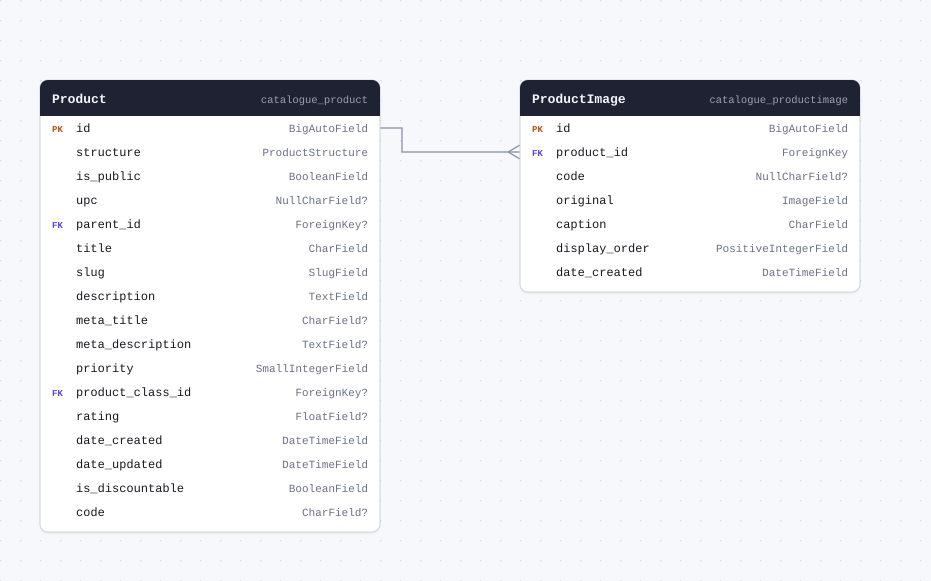

| Column | Field | Type | Null | Key | Default | Description |
| --- | --- | --- | --- | --- | --- | --- |
| `id` | `BigAutoField` | `integer` |  | PK | `autoincrement()` |  |
| `product_id` | `ForeignKey` | `bigint` |  | FK |  |  |
| `code` | `NullCharField` | `varchar(255)` | yes | unique |  |  |
| `original` | `ImageField` | `varchar(255)` |  |  |  |  |
| `caption` | `CharField` | `varchar(200)` |  |  |  |  |
| `display_order` | `PositiveIntegerField` | `integer unsigned` |  |  | `0` | An image with a display order of zero will be the primary image for a product |
| `date_created` | `DateTimeField` | `datetime` |  |  | `now()` |  |

Indexes:

- index `catalogue_productimage_product_id_49474fe8` on `product_id`
- index `catalogue_productimage_display_order_9fa741ac` on `display_order`

Relations:

- `product_id` → [Product](#product).`id`, on delete cascade

## ProductCategoryHierarchy

Table `catalogue_product_category_hierarchy`, app `catalogue`.

Not managed by Django (`managed = False`): it neither creates nor changes the table, whose indexes are the ones its own SQL gives it.

Columns from `AbstractProductCategoryHierarchy` (abstract): `id`, `product_id`, `category_id`.

| Column | Field | Type | Null | Key | Default | Description |
| --- | --- | --- | --- | --- | --- | --- |
| `id` | `CharField` | `varchar(255)` |  | PK |  |  |
| `product_id` | `IntegerField` | `integer` |  |  |  |  |
| `category_id` | `IntegerField` | `integer` |  |  |  |  |

## ProductReview

Table `reviews_productreview`, app `reviews`.

Columns from `AbstractProductReview` (abstract): `product_id`, `score`, `title`, `body`, `user_id`, `name`, `email`, `homepage`, `status`, `code`, `total_votes`, `delta_votes`, `date_created`.

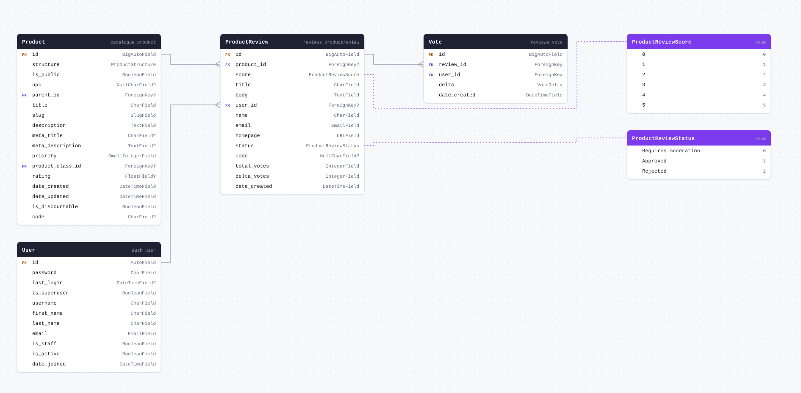

| Column | Field | Type | Null | Key | Default | Description |
| --- | --- | --- | --- | --- | --- | --- |
| `id` | `BigAutoField` | `integer` |  | PK | `autoincrement()` |  |
| `product_id` | `ForeignKey` | `bigint` | yes | FK |  |  |
| `score` | `ProductReviewScore` | `smallint` |  |  |  |  |
| `title` | `CharField` | `varchar(255)` |  |  |  |  |
| `body` | `TextField` | `text` |  |  |  |  |
| `user_id` | `ForeignKey` | `integer` | yes | FK |  |  |
| `name` | `CharField` | `varchar(255)` |  |  |  |  |
| `email` | `EmailField` | `varchar(254)` |  |  |  |  |
| `homepage` | `URLField` | `varchar(200)` |  |  |  |  |
| `status` | `ProductReviewStatus` | `smallint` |  |  | `get_default_review_status()` |  |
| `code` | `NullCharField` | `varchar(255)` | yes | unique |  |  |
| `total_votes` | `IntegerField` | `integer` |  |  | `0` |  |
| `delta_votes` | `IntegerField` | `integer` |  |  | `0` |  |
| `date_created` | `DateTimeField` | `datetime` |  |  | `now()` |  |

Indexes:

- index `reviews_productreview_product_id_52e52a32` on `product_id`
- index `reviews_productreview_user_id_8acb5ddd` on `user_id`
- index `reviews_productreview_delta_votes_bd8ffc87` on `delta_votes`
- unique `reviews_productreview_product_id_user_id_c4fdc4cd_uniq` on `product_id`, `user_id`

Relations:

- `product_id` → [Product](#product).`id`, on delete cascade
- `user_id` → [User](#user).`id`, on delete cascade
- [Vote](#vote).`review_id` → `id`, on delete cascade

## Vote

Table `reviews_vote`, app `reviews`.

Columns from `AbstractVote` (abstract): `review_id`, `user_id`, `delta`, `date_created`.

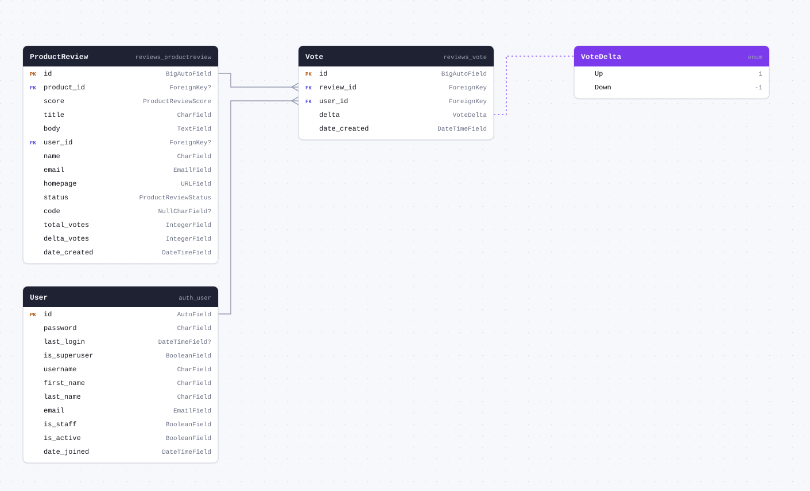

| Column | Field | Type | Null | Key | Default | Description |
| --- | --- | --- | --- | --- | --- | --- |
| `id` | `BigAutoField` | `integer` |  | PK | `autoincrement()` |  |
| `review_id` | `ForeignKey` | `bigint` |  | FK |  |  |
| `user_id` | `ForeignKey` | `integer` |  | FK |  |  |
| `delta` | `VoteDelta` | `smallint` |  |  |  |  |
| `date_created` | `DateTimeField` | `datetime` |  |  | `now()` |  |

Indexes:

- index `reviews_vote_review_id_371b2d8d` on `review_id`
- index `reviews_vote_user_id_5fb87b53` on `user_id`
- unique `reviews_vote_user_id_review_id_bb858939_uniq` on `user_id`, `review_id`

Relations:

- `review_id` → [ProductReview](#productreview).`id`, on delete cascade
- `user_id` → [User](#user).`id`, on delete cascade

## Email

Table `communication_email`, app `communication`.

Columns from `AbstractEmail` (abstract): `user_id`, `email`, `subject`, `body_text`, `body_html`, `date_sent`.

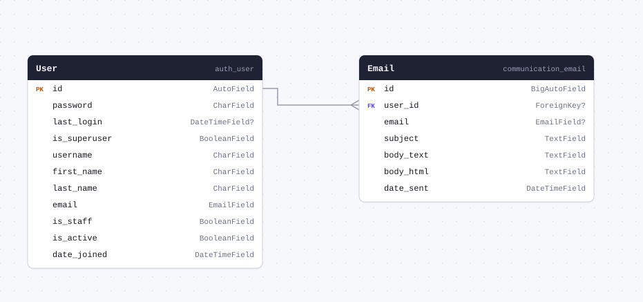

| Column | Field | Type | Null | Key | Default | Description |
| --- | --- | --- | --- | --- | --- | --- |
| `id` | `BigAutoField` | `integer` |  | PK | `autoincrement()` |  |
| `user_id` | `ForeignKey` | `integer` | yes | FK |  |  |
| `email` | `EmailField` | `varchar(254)` | yes |  |  |  |
| `subject` | `TextField` | `text` |  |  |  |  |
| `body_text` | `TextField` | `text` |  |  |  |  |
| `body_html` | `TextField` | `text` |  |  |  |  |
| `date_sent` | `DateTimeField` | `datetime` |  |  | `now()` |  |

Indexes:

- index `communication_email_user_id_a6eae16a` on `user_id`

Relations:

- `user_id` → [User](#user).`id`, on delete cascade

## CommunicationEventType

Table `communication_communicationeventtype`, app `communication`.

Columns from `AbstractCommunicationEventType` (abstract): `code`, `name`, `category`, `email_subject_template`, `email_body_template`, `email_body_html_template`, `sms_template`, `date_created`, `date_updated`.

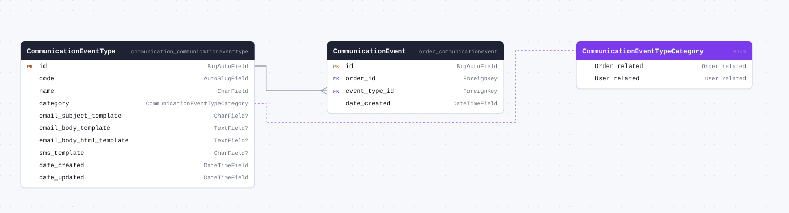

| Column | Field | Type | Null | Key | Default | Description |
| --- | --- | --- | --- | --- | --- | --- |
| `id` | `BigAutoField` | `integer` |  | PK | `autoincrement()` |  |
| `code` | `AutoSlugField` | `varchar(128)` |  | unique |  | Code used for looking up this event programmatically |
| `name` | `CharField` | `varchar(255)` |  |  |  |  |
| `category` | `CommunicationEventTypeCategory` | `varchar(255)` |  |  | `'Order related'` |  |
| `email_subject_template` | `CharField` | `varchar(255)` | yes |  |  |  |
| `email_body_template` | `TextField` | `text` | yes |  |  |  |
| `email_body_html_template` | `TextField` | `text` | yes |  |  | HTML template |
| `sms_template` | `CharField` | `varchar(170)` | yes |  |  | SMS template |
| `date_created` | `DateTimeField` | `datetime` |  |  | `now()` |  |
| `date_updated` | `DateTimeField` | `datetime` |  |  | `now()` |  |

Indexes:

- index `communication_communicationeventtype_name_45761eb9` on `name`

Relations:

- [CommunicationEvent](#communicationevent).`event_type_id` → `id`, on delete cascade

## Notification

Table `communication_notification`, app `communication`.

Columns from `AbstractNotification` (abstract): `recipient_id`, `sender_id`, `subject`, `body`, `location`, `date_sent`, `date_read`.

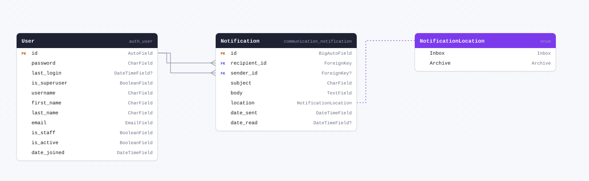

| Column | Field | Type | Null | Key | Default | Description |
| --- | --- | --- | --- | --- | --- | --- |
| `id` | `BigAutoField` | `integer` |  | PK | `autoincrement()` |  |
| `recipient_id` | `ForeignKey` | `integer` |  | FK |  |  |
| `sender_id` | `ForeignKey` | `integer` | yes | FK |  |  |
| `subject` | `CharField` | `varchar(255)` |  |  |  |  |
| `body` | `TextField` | `text` |  |  |  |  |
| `location` | `NotificationLocation` | `varchar(32)` |  |  | `'Inbox'` |  |
| `date_sent` | `DateTimeField` | `datetime` |  |  | `now()` |  |
| `date_read` | `DateTimeField` | `datetime` | yes |  |  |  |

Indexes:

- index `communication_notification_recipient_id_2f83b142` on `recipient_id`
- index `communication_notification_sender_id_f1fdd4c8` on `sender_id`

Relations:

- `recipient_id` → [User](#user).`id`, on delete cascade
- `sender_id` → [User](#user).`id`, on delete cascade

## Partner

Table `partner_partner`, app `partner`.

Columns from `AbstractPartner` (abstract): `code`, `name`.

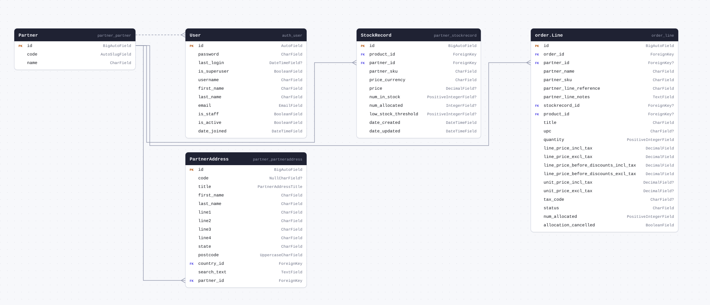

| Column | Field | Type | Null | Key | Default | Description |
| --- | --- | --- | --- | --- | --- | --- |
| `id` | `BigAutoField` | `integer` |  | PK | `autoincrement()` |  |
| `code` | `AutoSlugField` | `varchar(128)` |  | unique |  |  |
| `name` | `CharField` | `varchar(128)` |  |  |  |  |

Indexes:

- index `partner_partner_name_caa0c2ee` on `name`

Relations:

- `users` — many to many with [User](#user)
- [PartnerAddress](#partneraddress).`partner_id` → `id`, on delete cascade
- [StockRecord](#stockrecord).`partner_id` → `id`, on delete cascade
- [order.Line](#orderline).`partner_id` → `id`, on delete set null

## PartnerAddress

Table `partner_partneraddress`, app `partner`.

Columns from `AbstractPartnerAddress` (abstract): `partner_id`.

Columns from `AbstractAddress` (abstract): `code`, `title`, `first_name`, `last_name`, `line1`, `line2`, `line3`, `line4`, `state`, `postcode`, `country_id`, `search_text`.

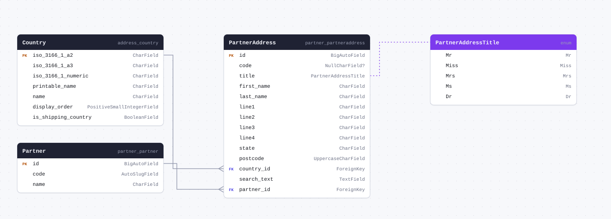

| Column | Field | Type | Null | Key | Default | Description |
| --- | --- | --- | --- | --- | --- | --- |
| `id` | `BigAutoField` | `integer` |  | PK | `autoincrement()` |  |
| `code` | `NullCharField` | `varchar(255)` | yes | unique |  |  |
| `title` | `PartnerAddressTitle` | `varchar(64)` |  |  |  |  |
| `first_name` | `CharField` | `varchar(255)` |  |  |  |  |
| `last_name` | `CharField` | `varchar(255)` |  |  |  |  |
| `line1` | `CharField` | `varchar(255)` |  |  |  |  |
| `line2` | `CharField` | `varchar(255)` |  |  |  |  |
| `line3` | `CharField` | `varchar(255)` |  |  |  |  |
| `line4` | `CharField` | `varchar(255)` |  |  |  |  |
| `state` | `CharField` | `varchar(255)` |  |  |  |  |
| `postcode` | `UppercaseCharField` | `varchar(64)` |  |  |  |  |
| `country_id` | `ForeignKey` | `varchar(2)` |  | FK |  |  |
| `search_text` | `TextField` | `text` |  |  |  |  |
| `partner_id` | `ForeignKey` | `bigint` |  | FK |  |  |

Indexes:

- index `partner_partneraddress_country_id_02c4f979` on `country_id`
- index `partner_partneraddress_partner_id_59551b0a` on `partner_id`

Relations:

- `country_id` → [Country](#country).`iso_3166_1_a2`, on delete cascade
- `partner_id` → [Partner](#partner).`id`, on delete cascade

## StockRecord

Table `partner_stockrecord`, app `partner`.

Columns from `AbstractStockRecord` (abstract): `product_id`, `partner_id`, `partner_sku`, `price_currency`, `price`, `num_in_stock`, `num_allocated`, `low_stock_threshold`, `date_created`, `date_updated`.

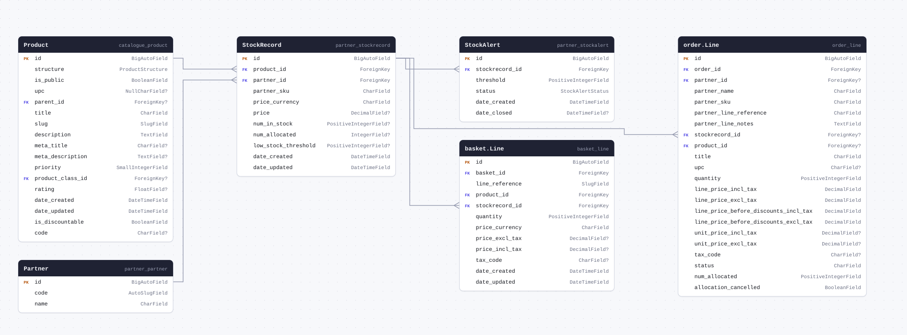

| Column | Field | Type | Null | Key | Default | Description |
| --- | --- | --- | --- | --- | --- | --- |
| `id` | `BigAutoField` | `integer` |  | PK | `autoincrement()` |  |
| `product_id` | `ForeignKey` | `bigint` |  | FK |  |  |
| `partner_id` | `ForeignKey` | `bigint` |  | FK |  |  |
| `partner_sku` | `CharField` | `varchar(128)` |  |  |  |  |
| `price_currency` | `CharField` | `varchar(12)` |  |  | `get_default_currency()` |  |
| `price` | `DecimalField(12, 2)` | `decimal` | yes |  |  |  |
| `num_in_stock` | `PositiveIntegerField` | `integer unsigned` | yes |  |  |  |
| `num_allocated` | `IntegerField` | `integer` | yes |  |  |  |
| `low_stock_threshold` | `PositiveIntegerField` | `integer unsigned` | yes |  |  |  |
| `date_created` | `DateTimeField` | `datetime` |  |  | `now()` |  |
| `date_updated` | `DateTimeField` | `datetime` |  |  | `now()` |  |

Indexes:

- index `partner_stockrecord_product_id_62fd9e45` on `product_id`
- index `partner_stockrecord_partner_id_4155a586` on `partner_id`
- index `partner_stockrecord_date_updated_e6ae5f14` on `date_updated`
- unique `partner_stockrecord_partner_id_partner_sku_8441e010_uniq` on `partner_id`, `partner_sku`

Relations:

- `product_id` → [Product](#product).`id`, on delete cascade
- `partner_id` → [Partner](#partner).`id`, on delete cascade
- [StockAlert](#stockalert).`stockrecord_id` → `id`, on delete cascade
- [basket.Line](#basketline).`stockrecord_id` → `id`, on delete cascade
- [order.Line](#orderline).`stockrecord_id` → `id`, on delete set null

## StockAlert

Table `partner_stockalert`, app `partner`.

Columns from `AbstractStockAlert` (abstract): `stockrecord_id`, `threshold`, `status`, `date_created`, `date_closed`.

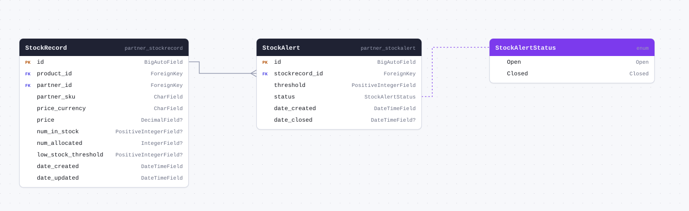

| Column | Field | Type | Null | Key | Default | Description |
| --- | --- | --- | --- | --- | --- | --- |
| `id` | `BigAutoField` | `integer` |  | PK | `autoincrement()` |  |
| `stockrecord_id` | `ForeignKey` | `bigint` |  | FK |  |  |
| `threshold` | `PositiveIntegerField` | `integer unsigned` |  |  |  |  |
| `status` | `StockAlertStatus` | `varchar(128)` |  |  | `'Open'` |  |
| `date_created` | `DateTimeField` | `datetime` |  |  | `now()` |  |
| `date_closed` | `DateTimeField` | `datetime` | yes |  |  |  |

Indexes:

- index `partner_stockalert_stockrecord_id_68ad503a` on `stockrecord_id`
- index `partner_stockalert_date_created_832cf043` on `date_created`

Relations:

- `stockrecord_id` → [StockRecord](#stockrecord).`id`, on delete cascade

## Basket

Table `basket_basket`, app `basket`.

Columns from `AbstractBasket` (abstract): `owner_id`, `status`, `date_created`, `date_merged`, `date_submitted`.

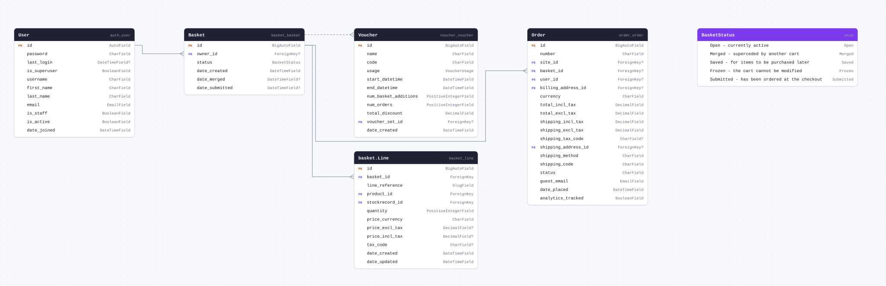

| Column | Field | Type | Null | Key | Default | Description |
| --- | --- | --- | --- | --- | --- | --- |
| `id` | `BigAutoField` | `integer` |  | PK | `autoincrement()` |  |
| `owner_id` | `ForeignKey` | `integer` | yes | FK |  |  |
| `status` | `BasketStatus` | `varchar(128)` |  |  | `'Open'` |  |
| `date_created` | `DateTimeField` | `datetime` |  |  | `now()` |  |
| `date_merged` | `DateTimeField` | `datetime` | yes |  |  |  |
| `date_submitted` | `DateTimeField` | `datetime` | yes |  |  |  |

Indexes:

- index `basket_basket_owner_id_3a018de5` on `owner_id`

Relations:

- `owner_id` → [User](#user).`id`, on delete cascade
- `vouchers` — many to many with [Voucher](#voucher)
- [basket.Line](#basketline).`basket_id` → `id`, on delete cascade
- [Order](#order).`basket_id` → `id`, on delete set null

## basket.Line

Table `basket_line`, app `basket`.

Columns from `AbstractLine` (abstract): `basket_id`, `line_reference`, `product_id`, `stockrecord_id`, `quantity`, `price_currency`, `price_excl_tax`, `price_incl_tax`, `tax_code`, `date_created`, `date_updated`.

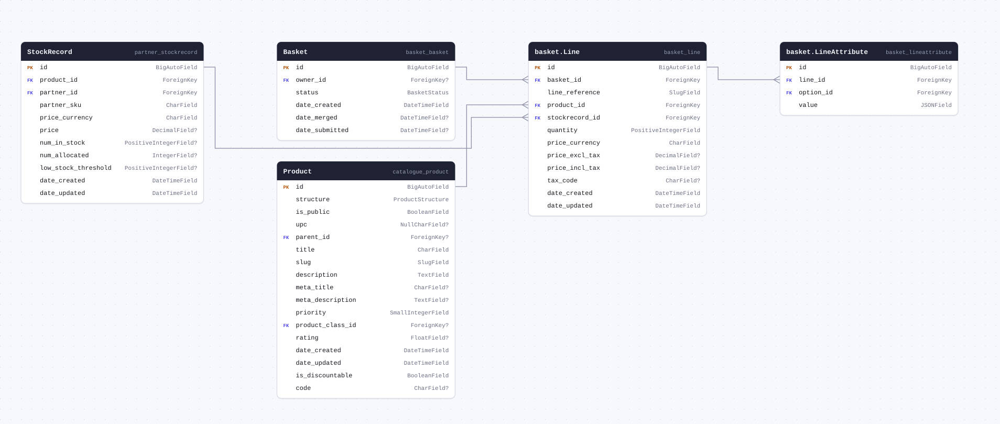

| Column | Field | Type | Null | Key | Default | Description |
| --- | --- | --- | --- | --- | --- | --- |
| `id` | `BigAutoField` | `integer` |  | PK | `autoincrement()` |  |
| `basket_id` | `ForeignKey` | `bigint` |  | FK |  |  |
| `line_reference` | `SlugField` | `varchar(128)` |  |  |  |  |
| `product_id` | `ForeignKey` | `bigint` |  | FK |  |  |
| `stockrecord_id` | `ForeignKey` | `bigint` |  | FK |  |  |
| `quantity` | `PositiveIntegerField` | `integer unsigned` |  |  | `1` |  |
| `price_currency` | `CharField` | `varchar(12)` |  |  | `get_default_currency()` |  |
| `price_excl_tax` | `DecimalField(12, 2)` | `decimal` | yes |  |  |  |
| `price_incl_tax` | `DecimalField(12, 2)` | `decimal` | yes |  |  |  |
| `tax_code` | `CharField` | `varchar(64)` | yes |  |  |  |
| `date_created` | `DateTimeField` | `datetime` |  |  | `now()` |  |
| `date_updated` | `DateTimeField` | `datetime` |  |  | `now()` |  |

Indexes:

- index `basket_line_basket_id_b615c905` on `basket_id`
- index `basket_line_line_reference_08e91113` on `line_reference`
- index `basket_line_product_id_303d743e` on `product_id`
- index `basket_line_stockrecord_id_7039d8a4` on `stockrecord_id`
- index `basket_line_date_created_eb0dfb1b` on `date_created`
- index `basket_line_date_updated_a74d069d` on `date_updated`
- unique `basket_line_basket_id_line_reference_8977e974_uniq` on `basket_id`, `line_reference`

Relations:

- `basket_id` → [Basket](#basket).`id`, on delete cascade
- `product_id` → [Product](#product).`id`, on delete cascade
- `stockrecord_id` → [StockRecord](#stockrecord).`id`, on delete cascade
- [basket.LineAttribute](#basketlineattribute).`line_id` → `id`, on delete cascade

## basket.LineAttribute

Table `basket_lineattribute`, app `basket`.

Columns from `AbstractLineAttribute` (abstract): `line_id`, `option_id`, `value`.

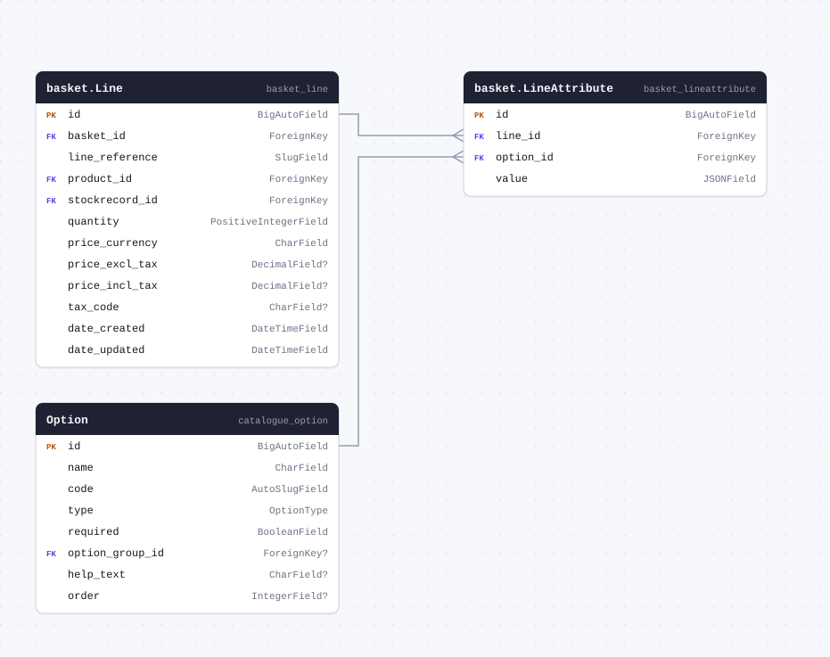

| Column | Field | Type | Null | Key | Default | Description |
| --- | --- | --- | --- | --- | --- | --- |
| `id` | `BigAutoField` | `integer` |  | PK | `autoincrement()` |  |
| `line_id` | `ForeignKey` | `bigint` |  | FK |  |  |
| `option_id` | `ForeignKey` | `bigint` |  | FK |  |  |
| `value` | `JSONField` | `text` |  |  |  |  |

Indexes:

- index `basket_lineattribute_line_id_c41e0cdf` on `line_id`
- index `basket_lineattribute_option_id_9387a3f7` on `option_id`

Relations:

- `line_id` → [basket.Line](#basketline).`id`, on delete cascade
- `option_id` → [Option](#option).`id`, on delete cascade

## payment.Transaction

Table `payment_transaction`, app `payment`.

Columns from `AbstractTransaction` (abstract): `source_id`, `txn_type`, `amount`, `reference`, `status`, `date_created`.

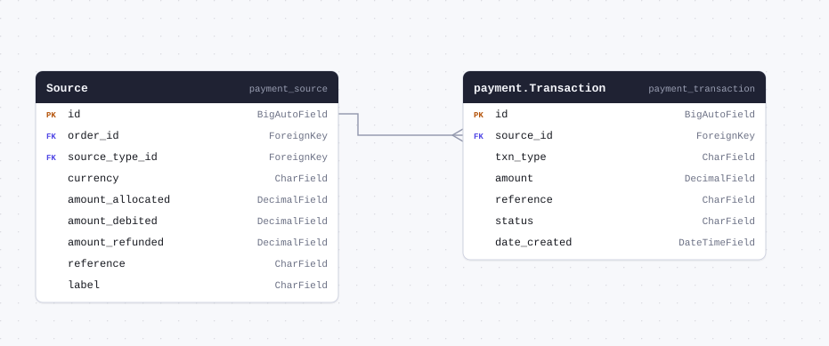

| Column | Field | Type | Null | Key | Default | Description |
| --- | --- | --- | --- | --- | --- | --- |
| `id` | `BigAutoField` | `integer` |  | PK | `autoincrement()` |  |
| `source_id` | `ForeignKey` | `bigint` |  | FK |  |  |
| `txn_type` | `CharField` | `varchar(128)` |  |  |  |  |
| `amount` | `DecimalField(12, 2)` | `decimal` |  |  |  |  |
| `reference` | `CharField` | `varchar(128)` |  |  |  |  |
| `status` | `CharField` | `varchar(128)` |  |  |  |  |
| `date_created` | `DateTimeField` | `datetime` |  |  | `now()` |  |

Indexes:

- index `payment_transaction_source_id_c5ac31e8` on `source_id`
- index `payment_transaction_date_created_f887f6bc` on `date_created`

Relations:

- `source_id` → [Source](#source).`id`, on delete cascade

## Source

Table `payment_source`, app `payment`.

Columns from `AbstractSource` (abstract): `order_id`, `source_type_id`, `currency`, `amount_allocated`, `amount_debited`, `amount_refunded`, `reference`, `label`.

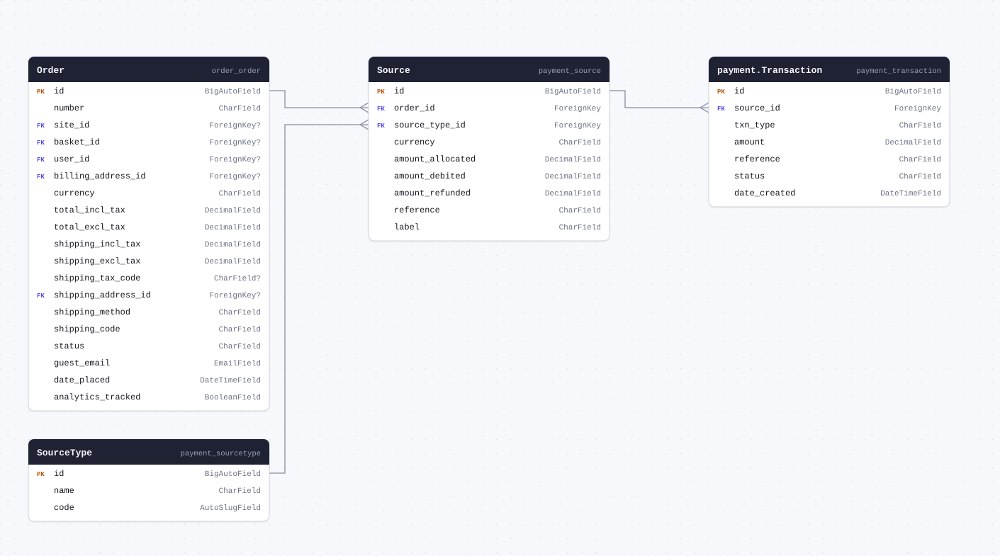

| Column | Field | Type | Null | Key | Default | Description |
| --- | --- | --- | --- | --- | --- | --- |
| `id` | `BigAutoField` | `integer` |  | PK | `autoincrement()` |  |
| `order_id` | `ForeignKey` | `bigint` |  | FK |  |  |
| `source_type_id` | `ForeignKey` | `bigint` |  | FK |  |  |
| `currency` | `CharField` | `varchar(12)` |  |  | `get_default_currency()` |  |
| `amount_allocated` | `DecimalField(12, 2)` | `decimal` |  |  | `Decimal('0.00')` |  |
| `amount_debited` | `DecimalField(12, 2)` | `decimal` |  |  | `Decimal('0.00')` |  |
| `amount_refunded` | `DecimalField(12, 2)` | `decimal` |  |  | `Decimal('0.00')` |  |
| `reference` | `CharField` | `varchar(255)` |  |  |  |  |
| `label` | `CharField` | `varchar(128)` |  |  |  |  |

Indexes:

- index `payment_source_order_id_6b7f2215` on `order_id`
- index `payment_source_source_type_id_700828fe` on `source_type_id`

Relations:

- [payment.Transaction](#paymenttransaction).`source_id` → `id`, on delete cascade
- `order_id` → [Order](#order).`id`, on delete cascade
- `source_type_id` → [SourceType](#sourcetype).`id`, on delete cascade

## SourceType

Table `payment_sourcetype`, app `payment`.

Columns from `AbstractSourceType` (abstract): `name`, `code`.

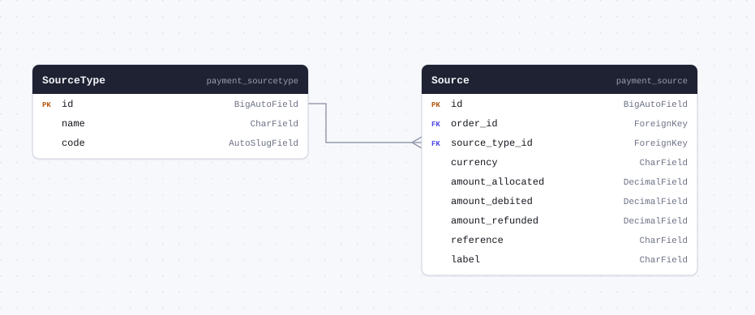

| Column | Field | Type | Null | Key | Default | Description |
| --- | --- | --- | --- | --- | --- | --- |
| `id` | `BigAutoField` | `integer` |  | PK | `autoincrement()` |  |
| `name` | `CharField` | `varchar(128)` |  |  |  |  |
| `code` | `AutoSlugField` | `varchar(128)` |  | unique |  | This is used within forms to identify this source type |

Indexes:

- index `payment_sourcetype_name_a980e862` on `name`

Relations:

- [Source](#source).`source_type_id` → `id`, on delete cascade

## Bankcard

Table `payment_bankcard`, app `payment`.

Columns from `AbstractBankcard` (abstract): `user_id`, `card_type`, `name`, `number`, `expiry_date`, `partner_reference`.

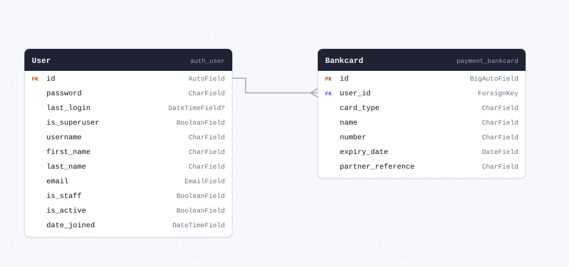

| Column | Field | Type | Null | Key | Default | Description |
| --- | --- | --- | --- | --- | --- | --- |
| `id` | `BigAutoField` | `integer` |  | PK | `autoincrement()` |  |
| `user_id` | `ForeignKey` | `integer` |  | FK |  |  |
| `card_type` | `CharField` | `varchar(128)` |  |  |  |  |
| `name` | `CharField` | `varchar(255)` |  |  |  |  |
| `number` | `CharField` | `varchar(32)` |  |  |  |  |
| `expiry_date` | `DateField` | `date` |  |  |  |  |
| `partner_reference` | `CharField` | `varchar(255)` |  |  |  |  |

Indexes:

- index `payment_bankcard_user_id_08e1d04c` on `user_id`

Relations:

- `user_id` → [User](#user).`id`, on delete cascade

## ConditionalOffer

Table `offer_conditionaloffer`, app `offer`.

Columns from `AbstractConditionalOffer` (abstract): `name`, `slug`, `description`, `offer_type`, `exclusive`, `status`, `condition_id`, `benefit_id`, `priority`, `start_datetime`, `end_datetime`, `max_global_applications`, `max_user_applications`, `max_basket_applications`, `max_discount`, `total_discount`, `num_applications`, `num_orders`, `redirect_url`, `date_created`.

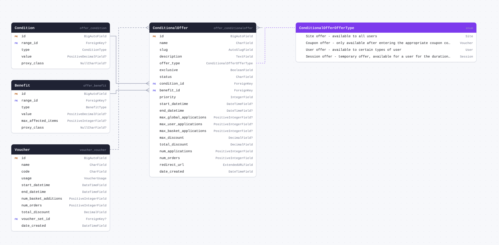

| Column | Field | Type | Null | Key | Default | Description |
| --- | --- | --- | --- | --- | --- | --- |
| `id` | `BigAutoField` | `integer` |  | PK | `autoincrement()` |  |
| `name` | `CharField` | `varchar(128)` |  | unique |  | This is displayed within the customer's cart |
| `slug` | `AutoSlugField` | `varchar(128)` |  | unique |  |  |
| `description` | `TextField` | `text` |  |  |  | This is displayed on the offer browsing page |
| `offer_type` | `ConditionalOfferOfferType` | `varchar(128)` |  |  | `'Site'` |  |
| `exclusive` | `BooleanField` | `bool` |  |  | `True` | Exclusive offers cannot be combined on the same items |
| `status` | `CharField` | `varchar(64)` |  |  | `'Open'` |  |
| `condition_id` | `ForeignKey` | `bigint` |  | FK |  |  |
| `benefit_id` | `ForeignKey` | `bigint` |  | FK |  |  |
| `priority` | `IntegerField` | `integer` |  |  | `0` | The highest priority offers are applied first |
| `start_datetime` | `DateTimeField` | `datetime` | yes |  |  | Offers are active from the start date. Leave this empty if the offer has no start date. |
| `end_datetime` | `DateTimeField` | `datetime` | yes |  |  | Offers are active until the end date. Leave this empty if the offer has no expiry date. |
| `max_global_applications` | `PositiveIntegerField` | `integer unsigned` | yes |  |  | The number of times this offer can be used before it is unavailable |
| `max_user_applications` | `PositiveIntegerField` | `integer unsigned` | yes |  |  | The number of times a single user can use this offer |
| `max_basket_applications` | `PositiveIntegerField` | `integer unsigned` | yes |  |  | The number of times this offer can be applied to a cart (and order) |
| `max_discount` | `DecimalField(12, 2)` | `decimal` | yes |  |  | When an offer has given more discount to orders than this threshold, then the offer becomes unavailable |
| `total_discount` | `DecimalField(12, 2)` | `decimal` |  |  | `Decimal('0.00')` |  |
| `num_applications` | `PositiveIntegerField` | `integer unsigned` |  |  | `0` |  |
| `num_orders` | `PositiveIntegerField` | `integer unsigned` |  |  | `0` |  |
| `redirect_url` | `ExtendedURLField` | `varchar(200)` |  |  |  |  |
| `date_created` | `DateTimeField` | `datetime` |  |  | `now()` |  |

Indexes:

- index `offer_conditionaloffer_condition_id_e6baa945` on `condition_id`
- index `offer_conditionaloffer_benefit_id_f43f68b5` on `benefit_id`
- index `offer_conditionaloffer_priority_4c2fc582` on `priority`

Relations:

- `condition_id` → [Condition](#condition).`id`, on delete cascade
- `benefit_id` → [Benefit](#benefit).`id`, on delete cascade
- `combinations` — many to many with [ConditionalOffer](#conditionaloffer)
- `vouchers` — many to many with [Voucher](#voucher)

## Benefit

Table `offer_benefit`, app `offer`.

Proxy models, on this table: `PercentageDiscountBenefit`, `AbsoluteDiscountBenefit`, `FixedUnitDiscountBenefit`, `FixedPriceBenefit`, `MultibuyDiscountBenefit`, `ShippingBenefit`, `ShippingAbsoluteDiscountBenefit`, `ShippingFixedPriceBenefit`, `ShippingPercentageDiscountBenefit`.

Columns from `AbstractBenefit` (abstract): `range_id`, `type`, `value`, `max_affected_items`, `proxy_class`.

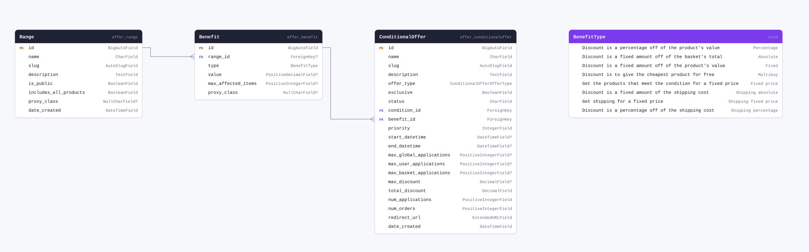

| Column | Field | Type | Null | Key | Default | Description |
| --- | --- | --- | --- | --- | --- | --- |
| `id` | `BigAutoField` | `integer` |  | PK | `autoincrement()` |  |
| `range_id` | `ForeignKey` | `bigint` | yes | FK |  |  |
| `type` | `BenefitType` | `varchar(128)` |  |  |  |  |
| `value` | `PositiveDecimalField(12, 2)` | `decimal` | yes |  |  |  |
| `max_affected_items` | `PositiveIntegerField` | `integer unsigned` | yes |  |  | Set this to prevent the discount consuming all items within the range that are in the cart. |
| `proxy_class` | `NullCharField` | `varchar(255)` | yes |  | `None` |  |

Indexes:

- index `offer_benefit_range_id_ab19c5ab` on `range_id`

Relations:

- [ConditionalOffer](#conditionaloffer).`benefit_id` → `id`, on delete cascade
- `range_id` → [Range](#range).`id`, on delete cascade

## Condition

Table `offer_condition`, app `offer`.

Proxy models, on this table: `CountCondition`, `CoverageCondition`, `ValueCondition`.

Columns from `AbstractCondition` (abstract): `range_id`, `type`, `value`, `proxy_class`.

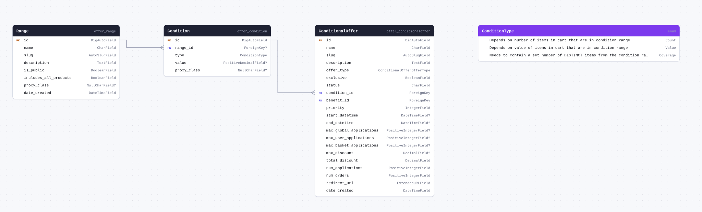

| Column | Field | Type | Null | Key | Default | Description |
| --- | --- | --- | --- | --- | --- | --- |
| `id` | `BigAutoField` | `integer` |  | PK | `autoincrement()` |  |
| `range_id` | `ForeignKey` | `bigint` | yes | FK |  |  |
| `type` | `ConditionType` | `varchar(128)` |  |  |  |  |
| `value` | `PositiveDecimalField(12, 2)` | `decimal` | yes |  |  |  |
| `proxy_class` | `NullCharField` | `varchar(255)` | yes |  | `None` |  |

Indexes:

- index `offer_condition_range_id_b023a2aa` on `range_id`

Relations:

- [ConditionalOffer](#conditionaloffer).`condition_id` → `id`, on delete cascade
- `range_id` → [Range](#range).`id`, on delete cascade

## Range

Table `offer_range`, app `offer`.

Columns from `AbstractRange` (abstract): `name`, `slug`, `description`, `is_public`, `includes_all_products`, `proxy_class`, `date_created`.

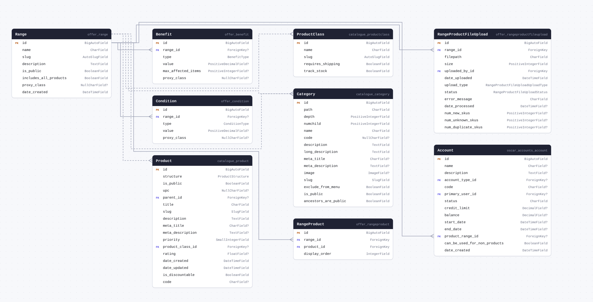

| Column | Field | Type | Null | Key | Default | Description |
| --- | --- | --- | --- | --- | --- | --- |
| `id` | `BigAutoField` | `integer` |  | PK | `autoincrement()` |  |
| `name` | `CharField` | `varchar(128)` |  | unique |  |  |
| `slug` | `AutoSlugField` | `varchar(128)` |  | unique |  |  |
| `description` | `TextField` | `text` |  |  |  |  |
| `is_public` | `BooleanField` | `bool` |  |  | `False` | Public ranges have a customer-facing page |
| `includes_all_products` | `BooleanField` | `bool` |  |  | `False` |  |
| `proxy_class` | `NullCharField` | `varchar(255)` | yes | unique | `None` |  |
| `date_created` | `DateTimeField` | `datetime` |  |  | `now()` |  |

Relations:

- `included_products` — many to many with [Product](#product), through [RangeProduct](#rangeproduct)
- [Benefit](#benefit).`range_id` → `id`, on delete cascade
- [Condition](#condition).`range_id` → `id`, on delete cascade
- `excluded_products` — many to many with [Product](#product)
- `classes` — many to many with [ProductClass](#productclass)
- `included_categories` — many to many with [Category](#category)
- `excluded_categories` — many to many with [Category](#category)
- [RangeProduct](#rangeproduct).`range_id` → `id`, on delete cascade
- [RangeProductFileUpload](#rangeproductfileupload).`range_id` → `id`, on delete cascade
- [Account](#account).`product_range_id` → `id`, on delete cascade

## RangeProduct

Table `offer_rangeproduct`, app `offer`.

Columns from `AbstractRangeProduct` (abstract): `range_id`, `product_id`, `display_order`.

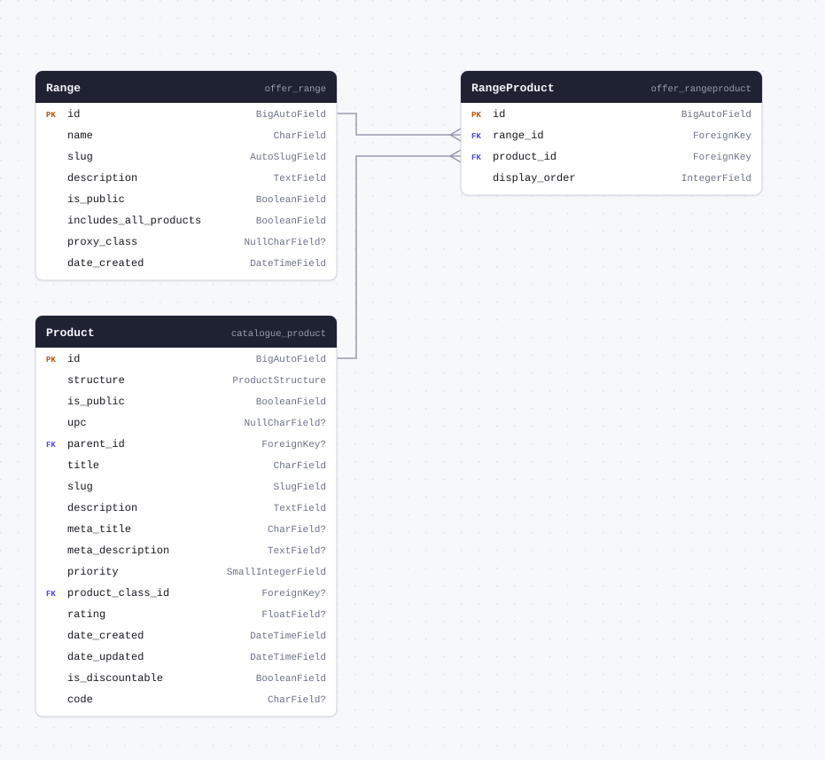

| Column | Field | Type | Null | Key | Default | Description |
| --- | --- | --- | --- | --- | --- | --- |
| `id` | `BigAutoField` | `integer` |  | PK | `autoincrement()` |  |
| `range_id` | `ForeignKey` | `bigint` |  | FK |  |  |
| `product_id` | `ForeignKey` | `bigint` |  | FK |  |  |
| `display_order` | `IntegerField` | `integer` |  |  | `0` |  |

Indexes:

- index `offer_rangeproduct_range_id_ee358495` on `range_id`
- index `offer_rangeproduct_product_id_723b3ea3` on `product_id`
- unique `offer_rangeproduct_range_id_product_id_c46b1be8_uniq` on `range_id`, `product_id`

Relations:

- `range_id` → [Range](#range).`id`, on delete cascade
- `product_id` → [Product](#product).`id`, on delete cascade

## RangeProductFileUpload

Table `offer_rangeproductfileupload`, app `offer`.

Columns from `AbstractRangeProductFileUpload` (abstract): `range_id`, `filepath`, `size`, `uploaded_by_id`, `date_uploaded`, `upload_type`, `status`, `error_message`, `date_processed`, `num_new_skus`, `num_unknown_skus`, `num_duplicate_skus`.

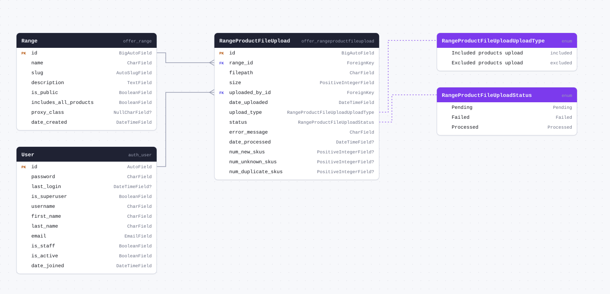

| Column | Field | Type | Null | Key | Default | Description |
| --- | --- | --- | --- | --- | --- | --- |
| `id` | `BigAutoField` | `integer` |  | PK | `autoincrement()` |  |
| `range_id` | `ForeignKey` | `bigint` |  | FK |  |  |
| `filepath` | `CharField` | `varchar(255)` |  |  |  |  |
| `size` | `PositiveIntegerField` | `integer unsigned` |  |  |  |  |
| `uploaded_by_id` | `ForeignKey` | `integer` |  | FK |  |  |
| `date_uploaded` | `DateTimeField` | `datetime` |  |  | `now()` |  |
| `upload_type` | `RangeProductFileUploadUploadType` | `varchar(8)` |  |  | `'included'` |  |
| `status` | `RangeProductFileUploadStatus` | `varchar(32)` |  |  | `'Pending'` |  |
| `error_message` | `CharField` | `varchar(255)` |  |  |  |  |
| `date_processed` | `DateTimeField` | `datetime` | yes |  |  |  |
| `num_new_skus` | `PositiveIntegerField` | `integer unsigned` | yes |  |  |  |
| `num_unknown_skus` | `PositiveIntegerField` | `integer unsigned` | yes |  |  |  |
| `num_duplicate_skus` | `PositiveIntegerField` | `integer unsigned` | yes |  |  |  |

Indexes:

- index `offer_rangeproductfileupload_range_id_c055ebf8` on `range_id`
- index `offer_rangeproductfileupload_uploaded_by_id_c01a3250` on `uploaded_by_id`
- index `offer_rangeproductfileupload_date_uploaded_f0a4f9ae` on `date_uploaded`

Relations:

- `range_id` → [Range](#range).`id`, on delete cascade
- `uploaded_by_id` → [User](#user).`id`, on delete cascade

## PaymentEventQuantity

Table `order_paymenteventquantity`, app `order`.

A "through" model linking lines to payment events

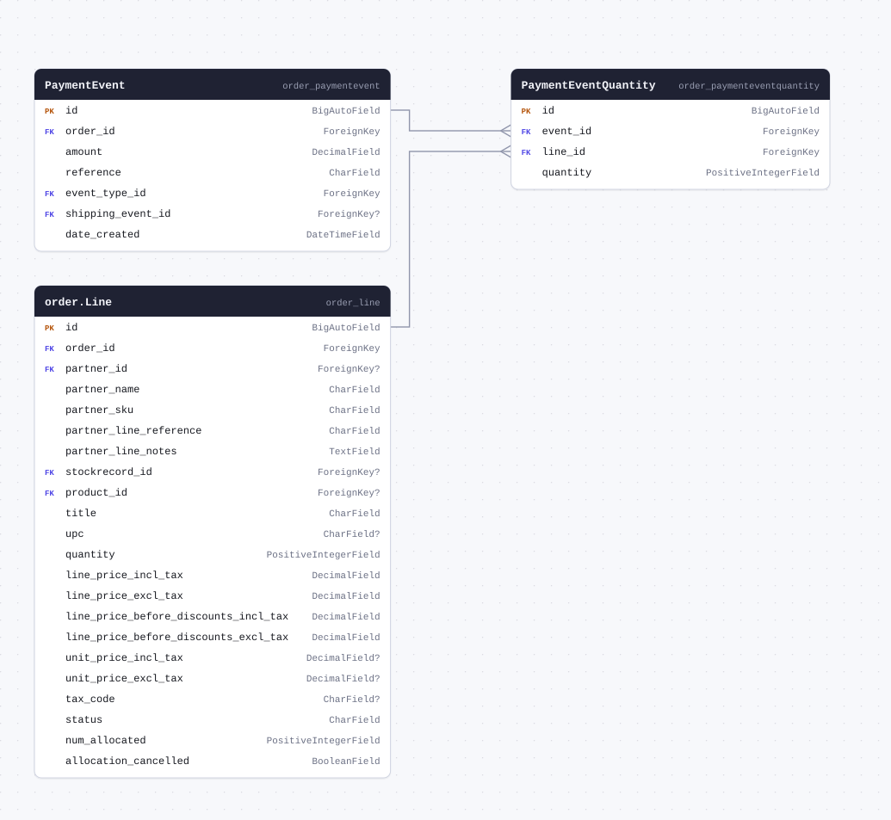

| Column | Field | Type | Null | Key | Default | Description |
| --- | --- | --- | --- | --- | --- | --- |
| `id` | `BigAutoField` | `integer` |  | PK | `autoincrement()` |  |
| `event_id` | `ForeignKey` | `bigint` |  | FK |  |  |
| `line_id` | `ForeignKey` | `bigint` |  | FK |  |  |
| `quantity` | `PositiveIntegerField` | `integer unsigned` |  |  |  |  |

Indexes:

- index `order_paymenteventquantity_event_id_a540165a` on `event_id`
- index `order_paymenteventquantity_line_id_df44b021` on `line_id`
- unique `order_paymenteventquantity_event_id_line_id_765c5209_uniq` on `event_id`, `line_id`

Relations:

- `event_id` → [PaymentEvent](#paymentevent).`id`, on delete cascade
- `line_id` → [order.Line](#orderline).`id`, on delete cascade

## Order

Table `order_order`, app `order`.

Columns from `AbstractOrder` (abstract): `number`, `site_id`, `basket_id`, `user_id`, `billing_address_id`, `currency`, `total_incl_tax`, `total_excl_tax`, `shipping_incl_tax`, `shipping_excl_tax`, `shipping_tax_code`, `shipping_address_id`, `shipping_method`, `shipping_code`, `status`, `guest_email`, `date_placed`, `analytics_tracked`.

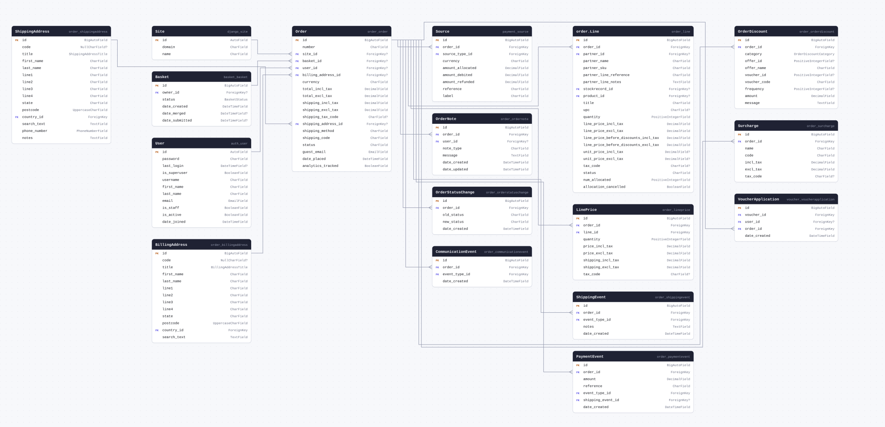

| Column | Field | Type | Null | Key | Default | Description |
| --- | --- | --- | --- | --- | --- | --- |
| `id` | `BigAutoField` | `integer` |  | PK | `autoincrement()` |  |
| `number` | `CharField` | `varchar(128)` |  | unique |  |  |
| `site_id` | `ForeignKey` | `integer` | yes | FK |  |  |
| `basket_id` | `ForeignKey` | `bigint` | yes | FK |  |  |
| `user_id` | `ForeignKey` | `integer` | yes | FK |  |  |
| `billing_address_id` | `ForeignKey` | `bigint` | yes | FK |  |  |
| `currency` | `CharField` | `varchar(12)` |  |  | `get_default_currency()` |  |
| `total_incl_tax` | `DecimalField(12, 2)` | `decimal` |  |  |  |  |
| `total_excl_tax` | `DecimalField(12, 2)` | `decimal` |  |  |  |  |
| `shipping_incl_tax` | `DecimalField(12, 2)` | `decimal` |  |  | `0` |  |
| `shipping_excl_tax` | `DecimalField(12, 2)` | `decimal` |  |  | `0` |  |
| `shipping_tax_code` | `CharField` | `varchar(64)` | yes |  |  |  |
| `shipping_address_id` | `ForeignKey` | `bigint` | yes | FK |  |  |
| `shipping_method` | `CharField` | `varchar(128)` |  |  |  |  |
| `shipping_code` | `CharField` | `varchar(128)` |  |  | `''` |  |
| `status` | `CharField` | `varchar(100)` |  |  |  |  |
| `guest_email` | `EmailField` | `varchar(254)` |  |  |  |  |
| `date_placed` | `DateTimeField` | `datetime` |  |  |  |  |
| `analytics_tracked` | `BooleanField` | `bool` |  |  | `False` |  |

Indexes:

- index `order_order_site_id_e27f3526` on `site_id`
- index `order_order_basket_id_8b0acbb2` on `basket_id`
- index `order_order_user_id_7cf9bc2b` on `user_id`
- index `order_order_billing_address_id_8fe537cf` on `billing_address_id`
- index `order_order_shipping_address_id_57e64931` on `shipping_address_id`
- index `order_order_date_placed_506a9365` on `date_placed`

Relations:

- [Source](#source).`order_id` → `id`, on delete cascade
- `site_id` → [Site](#site).`id`, on delete set null
- `basket_id` → [Basket](#basket).`id`, on delete set null
- `user_id` → [User](#user).`id`, on delete set null
- `billing_address_id` → [BillingAddress](#billingaddress).`id`, on delete set null
- `shipping_address_id` → [ShippingAddress](#shippingaddress).`id`, on delete set null
- [OrderNote](#ordernote).`order_id` → `id`, on delete cascade
- [OrderStatusChange](#orderstatuschange).`order_id` → `id`, on delete cascade
- [CommunicationEvent](#communicationevent).`order_id` → `id`, on delete cascade
- [order.Line](#orderline).`order_id` → `id`, on delete cascade
- [LinePrice](#lineprice).`order_id` → `id`, on delete cascade
- [ShippingEvent](#shippingevent).`order_id` → `id`, on delete cascade
- [PaymentEvent](#paymentevent).`order_id` → `id`, on delete cascade
- [OrderDiscount](#orderdiscount).`order_id` → `id`, on delete cascade
- [Surcharge](#surcharge).`order_id` → `id`, on delete cascade
- [VoucherApplication](#voucherapplication).`order_id` → `id`, on delete cascade

## OrderNote

Table `order_ordernote`, app `order`.

Columns from `AbstractOrderNote` (abstract): `order_id`, `user_id`, `note_type`, `message`, `date_created`, `date_updated`.

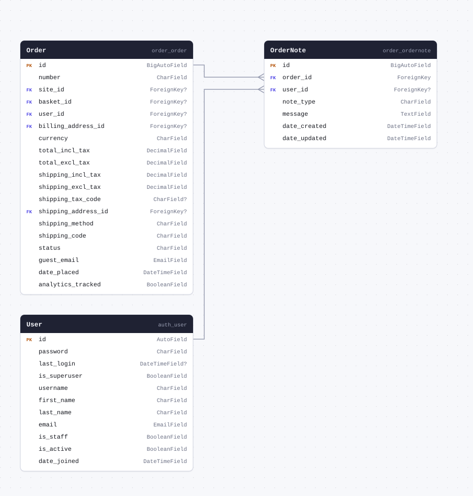

| Column | Field | Type | Null | Key | Default | Description |
| --- | --- | --- | --- | --- | --- | --- |
| `id` | `BigAutoField` | `integer` |  | PK | `autoincrement()` |  |
| `order_id` | `ForeignKey` | `bigint` |  | FK |  |  |
| `user_id` | `ForeignKey` | `integer` | yes | FK |  |  |
| `note_type` | `CharField` | `varchar(128)` |  |  |  |  |
| `message` | `TextField` | `text` |  |  |  |  |
| `date_created` | `DateTimeField` | `datetime` |  |  | `now()` |  |
| `date_updated` | `DateTimeField` | `datetime` |  |  | `now()` |  |

Indexes:

- index `order_ordernote_order_id_7d97583d` on `order_id`
- index `order_ordernote_user_id_48d7a672` on `user_id`

Relations:

- `order_id` → [Order](#order).`id`, on delete cascade
- `user_id` → [User](#user).`id`, on delete cascade

## OrderStatusChange

Table `order_orderstatuschange`, app `order`.

Columns from `AbstractOrderStatusChange` (abstract): `order_id`, `old_status`, `new_status`, `date_created`.

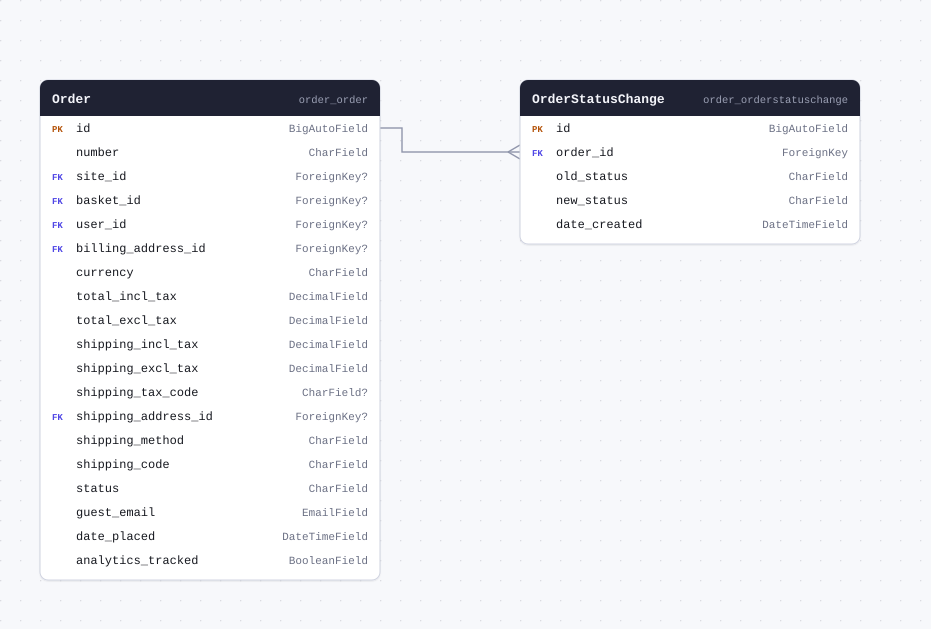

| Column | Field | Type | Null | Key | Default | Description |
| --- | --- | --- | --- | --- | --- | --- |
| `id` | `BigAutoField` | `integer` |  | PK | `autoincrement()` |  |
| `order_id` | `ForeignKey` | `bigint` |  | FK |  |  |
| `old_status` | `CharField` | `varchar(100)` |  |  |  |  |
| `new_status` | `CharField` | `varchar(100)` |  |  |  |  |
| `date_created` | `DateTimeField` | `datetime` |  |  | `now()` |  |

Indexes:

- index `order_orderstatuschange_order_id_43efdbe5` on `order_id`
- index `order_orderstatuschange_date_created_a5107b93` on `date_created`

Relations:

- `order_id` → [Order](#order).`id`, on delete cascade

## CommunicationEvent

Table `order_communicationevent`, app `order`.

Columns from `AbstractCommunicationEvent` (abstract): `order_id`, `event_type_id`, `date_created`.


| Column | Field | Type | Null | Key | Default | Description |
| --- | --- | --- | --- | --- | --- | --- |
| `id` | `BigAutoField` | `integer` |  | PK | `autoincrement()` |  |
| `order_id` | `ForeignKey` | `bigint` |  | FK |  |  |
| `event_type_id` | `ForeignKey` | `bigint` |  | FK |  |  |
| `date_created` | `DateTimeField` | `datetime` |  |  | `now()` |  |

Indexes:

- index `order_communicationevent_order_id_94e784ac` on `order_id`
- index `order_communicationevent_event_type_id_4bc9ee29` on `event_type_id`
- index `order_communicationevent_date_created_ce404d62` on `date_created`

Relations:

- `order_id` → [Order](#order).`id`, on delete cascade
- `event_type_id` → [CommunicationEventType](#communicationeventtype).`id`, on delete cascade

## ShippingAddress

Table `order_shippingaddress`, app `order`.

Columns from `AbstractShippingAddress` (abstract): `phone_number`, `notes`.

Columns from `AbstractAddress` (abstract): `code`, `title`, `first_name`, `last_name`, `line1`, `line2`, `line3`, `line4`, `state`, `postcode`, `country_id`, `search_text`.


| Column | Field | Type | Null | Key | Default | Description |
| --- | --- | --- | --- | --- | --- | --- |
| `id` | `BigAutoField` | `integer` |  | PK | `autoincrement()` |  |
| `code` | `NullCharField` | `varchar(255)` | yes | unique |  |  |
| `title` | `ShippingAddressTitle` | `varchar(64)` |  |  |  |  |
| `first_name` | `CharField` | `varchar(255)` |  |  |  |  |
| `last_name` | `CharField` | `varchar(255)` |  |  |  |  |
| `line1` | `CharField` | `varchar(255)` |  |  |  |  |
| `line2` | `CharField` | `varchar(255)` |  |  |  |  |
| `line3` | `CharField` | `varchar(255)` |  |  |  |  |
| `line4` | `CharField` | `varchar(255)` |  |  |  |  |
| `state` | `CharField` | `varchar(255)` |  |  |  |  |
| `postcode` | `UppercaseCharField` | `varchar(64)` |  |  |  |  |
| `country_id` | `ForeignKey` | `varchar(2)` |  | FK |  |  |
| `search_text` | `TextField` | `text` |  |  |  |  |
| `phone_number` | `PhoneNumberField` | `varchar(128)` |  |  |  | In case we need to call you about your order |
| `notes` | `TextField` | `text` |  |  |  | Tell us anything we should know when delivering your order. |

Indexes:

- index `order_shippingaddress_country_id_29abf9a0` on `country_id`

Relations:

- [Order](#order).`shipping_address_id` → `id`, on delete set null
- `country_id` → [Country](#country).`iso_3166_1_a2`, on delete cascade

## BillingAddress

Table `order_billingaddress`, app `order`.

Columns from `AbstractAddress` (abstract): `code`, `title`, `first_name`, `last_name`, `line1`, `line2`, `line3`, `line4`, `state`, `postcode`, `country_id`, `search_text`.


| Column | Field | Type | Null | Key | Default | Description |
| --- | --- | --- | --- | --- | --- | --- |
| `id` | `BigAutoField` | `integer` |  | PK | `autoincrement()` |  |
| `code` | `NullCharField` | `varchar(255)` | yes | unique |  |  |
| `title` | `BillingAddressTitle` | `varchar(64)` |  |  |  |  |
| `first_name` | `CharField` | `varchar(255)` |  |  |  |  |
| `last_name` | `CharField` | `varchar(255)` |  |  |  |  |
| `line1` | `CharField` | `varchar(255)` |  |  |  |  |
| `line2` | `CharField` | `varchar(255)` |  |  |  |  |
| `line3` | `CharField` | `varchar(255)` |  |  |  |  |
| `line4` | `CharField` | `varchar(255)` |  |  |  |  |
| `state` | `CharField` | `varchar(255)` |  |  |  |  |
| `postcode` | `UppercaseCharField` | `varchar(64)` |  |  |  |  |
| `country_id` | `ForeignKey` | `varchar(2)` |  | FK |  |  |
| `search_text` | `TextField` | `text` |  |  |  |  |

Indexes:

- index `order_billingaddress_country_id_17f57dca` on `country_id`

Relations:

- [Order](#order).`billing_address_id` → `id`, on delete set null
- `country_id` → [Country](#country).`iso_3166_1_a2`, on delete cascade

## order.Line

Table `order_line`, app `order`.

Columns from `AbstractLine` (abstract): `order_id`, `partner_id`, `partner_name`, `partner_sku`, `partner_line_reference`, `partner_line_notes`, `stockrecord_id`, `product_id`, `title`, `upc`, `quantity`, `line_price_incl_tax`, `line_price_excl_tax`, `line_price_before_discounts_incl_tax`, `line_price_before_discounts_excl_tax`, `unit_price_incl_tax`, `unit_price_excl_tax`, `tax_code`, `status`, `num_allocated`, `allocation_cancelled`.


| Column | Field | Type | Null | Key | Default | Description |
| --- | --- | --- | --- | --- | --- | --- |
| `id` | `BigAutoField` | `integer` |  | PK | `autoincrement()` |  |
| `order_id` | `ForeignKey` | `bigint` |  | FK |  |  |
| `partner_id` | `ForeignKey` | `bigint` | yes | FK |  |  |
| `partner_name` | `CharField` | `varchar(128)` |  |  |  |  |
| `partner_sku` | `CharField` | `varchar(128)` |  |  |  |  |
| `partner_line_reference` | `CharField` | `varchar(128)` |  |  |  | This is the item number that the partner uses within their system |
| `partner_line_notes` | `TextField` | `text` |  |  |  |  |
| `stockrecord_id` | `ForeignKey` | `bigint` | yes | FK |  |  |
| `product_id` | `ForeignKey` | `bigint` | yes | FK |  |  |
| `title` | `CharField` | `varchar(255)` |  |  |  |  |
| `upc` | `CharField` | `varchar(128)` | yes |  |  |  |
| `quantity` | `PositiveIntegerField` | `integer unsigned` |  |  | `1` |  |
| `line_price_incl_tax` | `DecimalField(12, 2)` | `decimal` |  |  |  |  |
| `line_price_excl_tax` | `DecimalField(12, 2)` | `decimal` |  |  |  |  |
| `line_price_before_discounts_incl_tax` | `DecimalField(12, 2)` | `decimal` |  |  |  |  |
| `line_price_before_discounts_excl_tax` | `DecimalField(12, 2)` | `decimal` |  |  |  |  |
| `unit_price_incl_tax` | `DecimalField(12, 2)` | `decimal` | yes |  |  |  |
| `unit_price_excl_tax` | `DecimalField(12, 2)` | `decimal` | yes |  |  |  |
| `tax_code` | `CharField` | `varchar(64)` | yes |  |  |  |
| `status` | `CharField` | `varchar(255)` |  |  |  |  |
| `num_allocated` | `PositiveIntegerField` | `integer unsigned` |  |  |  |  |
| `allocation_cancelled` | `BooleanField` | `bool` |  |  | `False` |  |

Indexes:

- index `order_line_order_id_b9148391` on `order_id`
- index `order_line_partner_id_258a2fb9` on `partner_id`
- index `order_line_stockrecord_id_1d65aff5` on `stockrecord_id`
- index `order_line_product_id_e620902d` on `product_id`

Relations:

- `shipping_events` — many to many with [ShippingEvent](#shippingevent), through [ShippingEventQuantity](#shippingeventquantity)
- `paymentevent_set` — many to many with [PaymentEvent](#paymentevent), through [PaymentEventQuantity](#paymenteventquantity)
- [PaymentEventQuantity](#paymenteventquantity).`line_id` → `id`, on delete cascade
- `order_id` → [Order](#order).`id`, on delete cascade
- `partner_id` → [Partner](#partner).`id`, on delete set null
- `stockrecord_id` → [StockRecord](#stockrecord).`id`, on delete set null
- `product_id` → [Product](#product).`id`, on delete set null
- [LinePrice](#lineprice).`line_id` → `id`, on delete cascade
- [order.LineAttribute](#orderlineattribute).`line_id` → `id`, on delete cascade
- [ShippingEventQuantity](#shippingeventquantity).`line_id` → `id`, on delete cascade
- [OrderLineDiscount](#orderlinediscount).`line_id` → `id`, on delete cascade

## LinePrice

Table `order_lineprice`, app `order`.

Columns from `AbstractLinePrice` (abstract): `order_id`, `line_id`, `quantity`, `price_incl_tax`, `price_excl_tax`, `shipping_incl_tax`, `shipping_excl_tax`, `tax_code`.


| Column | Field | Type | Null | Key | Default | Description |
| --- | --- | --- | --- | --- | --- | --- |
| `id` | `BigAutoField` | `integer` |  | PK | `autoincrement()` |  |
| `order_id` | `ForeignKey` | `bigint` |  | FK |  |  |
| `line_id` | `ForeignKey` | `bigint` |  | FK |  |  |
| `quantity` | `PositiveIntegerField` | `integer unsigned` |  |  | `1` |  |
| `price_incl_tax` | `DecimalField(12, 2)` | `decimal` |  |  |  |  |
| `price_excl_tax` | `DecimalField(12, 2)` | `decimal` |  |  |  |  |
| `shipping_incl_tax` | `DecimalField(12, 2)` | `decimal` |  |  | `0` |  |
| `shipping_excl_tax` | `DecimalField(12, 2)` | `decimal` |  |  | `0` |  |
| `tax_code` | `CharField` | `varchar(64)` | yes |  |  |  |

Indexes:

- index `order_lineprice_order_id_66792e56` on `order_id`
- index `order_lineprice_line_id_2de52446` on `line_id`

Relations:

- `order_id` → [Order](#order).`id`, on delete cascade
- `line_id` → [order.Line](#orderline).`id`, on delete cascade

## order.LineAttribute

Table `order_lineattribute`, app `order`.

Columns from `AbstractLineAttribute` (abstract): `line_id`, `option_id`, `type`, `value`.


| Column | Field | Type | Null | Key | Default | Description |
| --- | --- | --- | --- | --- | --- | --- |
| `id` | `BigAutoField` | `integer` |  | PK | `autoincrement()` |  |
| `line_id` | `ForeignKey` | `bigint` |  | FK |  |  |
| `option_id` | `ForeignKey` | `bigint` | yes | FK |  |  |
| `type` | `CharField` | `varchar(128)` |  |  |  |  |
| `value` | `JSONField` | `text` |  |  |  |  |

Indexes:

- index `order_lineattribute_line_id_adf6dd87` on `line_id`
- index `order_lineattribute_option_id_b54d597c` on `option_id`

Relations:

- `line_id` → [order.Line](#orderline).`id`, on delete cascade
- `option_id` → [Option](#option).`id`, on delete set null

## ShippingEvent

Table `order_shippingevent`, app `order`.

Columns from `AbstractShippingEvent` (abstract): `order_id`, `event_type_id`, `notes`, `date_created`.


| Column | Field | Type | Null | Key | Default | Description |
| --- | --- | --- | --- | --- | --- | --- |
| `id` | `BigAutoField` | `integer` |  | PK | `autoincrement()` |  |
| `order_id` | `ForeignKey` | `bigint` |  | FK |  |  |
| `event_type_id` | `ForeignKey` | `bigint` |  | FK |  |  |
| `notes` | `TextField` | `text` |  |  |  | This could be the dispatch reference, or a tracking number |
| `date_created` | `DateTimeField` | `datetime` |  |  | `now()` |  |

Indexes:

- index `order_shippingevent_order_id_8c031fb6` on `order_id`
- index `order_shippingevent_event_type_id_9f1efb20` on `event_type_id`
- index `order_shippingevent_date_created_74c4a6fa` on `date_created`

Relations:

- `lines` — many to many with [order.Line](#orderline), through [ShippingEventQuantity](#shippingeventquantity)
- `order_id` → [Order](#order).`id`, on delete cascade
- `event_type_id` → [ShippingEventType](#shippingeventtype).`id`, on delete cascade
- [ShippingEventQuantity](#shippingeventquantity).`event_id` → `id`, on delete cascade
- [PaymentEvent](#paymentevent).`shipping_event_id` → `id`, on delete cascade

## ShippingEventQuantity

Table `order_shippingeventquantity`, app `order`.

Columns from `AbstractShippingEventQuantity` (abstract): `event_id`, `line_id`, `quantity`.


| Column | Field | Type | Null | Key | Default | Description |
| --- | --- | --- | --- | --- | --- | --- |
| `id` | `BigAutoField` | `integer` |  | PK | `autoincrement()` |  |
| `event_id` | `ForeignKey` | `bigint` |  | FK |  |  |
| `line_id` | `ForeignKey` | `bigint` |  | FK |  |  |
| `quantity` | `PositiveIntegerField` | `integer unsigned` |  |  |  |  |

Indexes:

- index `order_shippingeventquantity_event_id_1c7fb9c7` on `event_id`
- index `order_shippingeventquantity_line_id_3b089ee0` on `line_id`
- unique `order_shippingeventquantity_event_id_line_id_91687107_uniq` on `event_id`, `line_id`

Relations:

- `event_id` → [ShippingEvent](#shippingevent).`id`, on delete cascade
- `line_id` → [order.Line](#orderline).`id`, on delete cascade

## ShippingEventType

Table `order_shippingeventtype`, app `order`.

Columns from `AbstractShippingEventType` (abstract): `name`, `code`.


| Column | Field | Type | Null | Key | Default | Description |
| --- | --- | --- | --- | --- | --- | --- |
| `id` | `BigAutoField` | `integer` |  | PK | `autoincrement()` |  |
| `name` | `CharField` | `varchar(255)` |  | unique |  |  |
| `code` | `AutoSlugField` | `varchar(128)` |  | unique |  |  |

Relations:

- [ShippingEvent](#shippingevent).`event_type_id` → `id`, on delete cascade

## PaymentEvent

Table `order_paymentevent`, app `order`.

Columns from `AbstractPaymentEvent` (abstract): `order_id`, `amount`, `reference`, `event_type_id`, `shipping_event_id`, `date_created`.


| Column | Field | Type | Null | Key | Default | Description |
| --- | --- | --- | --- | --- | --- | --- |
| `id` | `BigAutoField` | `integer` |  | PK | `autoincrement()` |  |
| `order_id` | `ForeignKey` | `bigint` |  | FK |  |  |
| `amount` | `DecimalField(12, 2)` | `decimal` |  |  |  |  |
| `reference` | `CharField` | `varchar(128)` |  |  |  |  |
| `event_type_id` | `ForeignKey` | `bigint` |  | FK |  |  |
| `shipping_event_id` | `ForeignKey` | `bigint` | yes | FK |  |  |
| `date_created` | `DateTimeField` | `datetime` |  |  | `now()` |  |

Indexes:

- index `order_paymentevent_order_id_395b3e82` on `order_id`
- index `order_paymentevent_event_type_id_568c7161` on `event_type_id`
- index `order_paymentevent_shipping_event_id_213dcfb8` on `shipping_event_id`
- index `order_paymentevent_date_created_05d8c079` on `date_created`

Relations:

- `lines` — many to many with [order.Line](#orderline), through [PaymentEventQuantity](#paymenteventquantity)
- [PaymentEventQuantity](#paymenteventquantity).`event_id` → `id`, on delete cascade
- `order_id` → [Order](#order).`id`, on delete cascade
- `event_type_id` → [PaymentEventType](#paymenteventtype).`id`, on delete cascade
- `shipping_event_id` → [ShippingEvent](#shippingevent).`id`, on delete cascade

## PaymentEventType

Table `order_paymenteventtype`, app `order`.

Columns from `AbstractPaymentEventType` (abstract): `name`, `code`.


| Column | Field | Type | Null | Key | Default | Description |
| --- | --- | --- | --- | --- | --- | --- |
| `id` | `BigAutoField` | `integer` |  | PK | `autoincrement()` |  |
| `name` | `CharField` | `varchar(128)` |  | unique |  |  |
| `code` | `AutoSlugField` | `varchar(128)` |  | unique |  |  |

Relations:

- [PaymentEvent](#paymentevent).`event_type_id` → `id`, on delete cascade

## OrderDiscount

Table `order_orderdiscount`, app `order`.

Columns from `AbstractOrderDiscount` (abstract): `order_id`, `category`, `offer_id`, `offer_name`, `voucher_id`, `voucher_code`, `frequency`, `amount`, `message`.


| Column | Field | Type | Null | Key | Default | Description |
| --- | --- | --- | --- | --- | --- | --- |
| `id` | `BigAutoField` | `integer` |  | PK | `autoincrement()` |  |
| `order_id` | `ForeignKey` | `bigint` |  | FK |  |  |
| `category` | `OrderDiscountCategory` | `varchar(64)` |  |  | `'Basket'` |  |
| `offer_id` | `PositiveIntegerField` | `integer unsigned` | yes |  |  |  |
| `offer_name` | `CharField` | `varchar(128)` |  |  |  |  |
| `voucher_id` | `PositiveIntegerField` | `integer unsigned` | yes |  |  |  |
| `voucher_code` | `CharField` | `varchar(128)` |  |  |  |  |
| `frequency` | `PositiveIntegerField` | `integer unsigned` | yes |  |  |  |
| `amount` | `DecimalField(12, 2)` | `decimal` |  |  | `0` |  |
| `message` | `TextField` | `text` |  |  |  |  |

Indexes:

- index `order_orderdiscount_order_id_bc91e123` on `order_id`
- index `order_orderdiscount_offer_name_706d6119` on `offer_name`
- index `order_orderdiscount_voucher_code_6ee4f360` on `voucher_code`

Relations:

- `order_id` → [Order](#order).`id`, on delete cascade
- [OrderLineDiscount](#orderlinediscount).`order_discount_id` → `id`, on delete cascade

## OrderLineDiscount

Table `order_orderlinediscount`, app `order`.

Columns from `AbstractOrderLineDiscount` (abstract): `line_id`, `order_discount_id`, `is_incl_tax`, `amount`.


| Column | Field | Type | Null | Key | Default | Description |
| --- | --- | --- | --- | --- | --- | --- |
| `id` | `BigAutoField` | `integer` |  | PK | `autoincrement()` |  |
| `line_id` | `ForeignKey` | `bigint` |  | FK |  |  |
| `order_discount_id` | `ForeignKey` | `bigint` |  | FK |  |  |
| `is_incl_tax` | `BooleanField` | `bool` |  |  |  |  |
| `amount` | `DecimalField(12, 2)` | `decimal` |  |  | `0` |  |

Indexes:

- index `order_orderlinediscount_line_id_88fbcd4a` on `line_id`
- index `order_orderlinediscount_order_discount_id_b9dfa715` on `order_discount_id`

Relations:

- `line_id` → [order.Line](#orderline).`id`, on delete cascade
- `order_discount_id` → [OrderDiscount](#orderdiscount).`id`, on delete cascade

## Surcharge

Table `order_surcharge`, app `order`.

Columns from `AbstractSurcharge` (abstract): `order_id`, `name`, `code`, `incl_tax`, `excl_tax`, `tax_code`.


| Column | Field | Type | Null | Key | Default | Description |
| --- | --- | --- | --- | --- | --- | --- |
| `id` | `BigAutoField` | `integer` |  | PK | `autoincrement()` |  |
| `order_id` | `ForeignKey` | `bigint` |  | FK |  |  |
| `name` | `CharField` | `varchar(128)` |  |  |  |  |
| `code` | `CharField` | `varchar(128)` |  |  |  |  |
| `incl_tax` | `DecimalField(12, 2)` | `decimal` |  |  | `0` |  |
| `excl_tax` | `DecimalField(12, 2)` | `decimal` |  |  | `0` |  |
| `tax_code` | `CharField` | `varchar(64)` | yes |  |  |  |

Indexes:

- index `order_surcharge_order_id_5c0a94f5` on `order_id`

Relations:

- `order_id` → [Order](#order).`id`, on delete cascade

## ProductAlert

Table `customer_productalert`, app `customer`.

Columns from `AbstractProductAlert` (abstract): `product_id`, `user_id`, `email`, `key`, `status`, `date_created`, `date_confirmed`, `date_cancelled`, `date_closed`.


| Column | Field | Type | Null | Key | Default | Description |
| --- | --- | --- | --- | --- | --- | --- |
| `id` | `BigAutoField` | `integer` |  | PK | `autoincrement()` |  |
| `product_id` | `ForeignKey` | `bigint` |  | FK |  |  |
| `user_id` | `ForeignKey` | `integer` | yes | FK |  |  |
| `email` | `EmailField` | `varchar(254)` |  |  |  |  |
| `key` | `CharField` | `varchar(128)` |  |  |  |  |
| `status` | `ProductAlertStatus` | `varchar(20)` |  |  | `'Active'` |  |
| `date_created` | `DateTimeField` | `datetime` |  |  | `now()` |  |
| `date_confirmed` | `DateTimeField` | `datetime` | yes |  |  |  |
| `date_cancelled` | `DateTimeField` | `datetime` | yes |  |  |  |
| `date_closed` | `DateTimeField` | `datetime` | yes |  |  |  |

Indexes:

- index `customer_productalert_product_id_7e529a41` on `product_id`
- index `customer_productalert_user_id_677ad6d6` on `user_id`
- index `customer_productalert_email_e5f35f45` on `email`
- index `customer_productalert_key_a26f3bdc` on `key`
- index `customer_productalert_date_created_00622b1c` on `date_created`

Relations:

- `product_id` → [Product](#product).`id`, on delete cascade
- `user_id` → [User](#user).`id`, on delete cascade

## VoucherSet

Table `voucher_voucherset`, app `voucher`.

Columns from `AbstractVoucherSet` (abstract): `name`, `count`, `code_length`, `description`, `date_created`, `start_datetime`, `end_datetime`.


| Column | Field | Type | Null | Key | Default | Description |
| --- | --- | --- | --- | --- | --- | --- |
| `id` | `BigAutoField` | `integer` |  | PK | `autoincrement()` |  |
| `name` | `CharField` | `varchar(100)` |  | unique |  |  |
| `count` | `PositiveIntegerField` | `integer unsigned` |  |  |  |  |
| `code_length` | `IntegerField` | `integer` |  |  | `12` |  |
| `description` | `TextField` | `text` |  |  |  |  |
| `date_created` | `DateTimeField` | `datetime` |  |  | `now()` |  |
| `start_datetime` | `DateTimeField` | `datetime` |  |  |  |  |
| `end_datetime` | `DateTimeField` | `datetime` |  |  |  |  |

Indexes:

- index `voucher_voucherset_date_created_3dd68c8e` on `date_created`

Relations:

- [Voucher](#voucher).`voucher_set_id` → `id`, on delete cascade

## Voucher

Table `voucher_voucher`, app `voucher`.

Columns from `AbstractVoucher` (abstract): `name`, `code`, `usage`, `start_datetime`, `end_datetime`, `num_basket_additions`, `num_orders`, `total_discount`, `voucher_set_id`, `date_created`.


| Column | Field | Type | Null | Key | Default | Description |
| --- | --- | --- | --- | --- | --- | --- |
| `id` | `BigAutoField` | `integer` |  | PK | `autoincrement()` |  |
| `name` | `CharField` | `varchar(128)` |  | unique |  | This will be shown in the checkout and basket once the coupon is entered |
| `code` | `CharField` | `varchar(128)` |  | unique |  | Case insensitive / No spaces allowed |
| `usage` | `VoucherUsage` | `varchar(128)` |  |  | `'Multi-use'` |  |
| `start_datetime` | `DateTimeField` | `datetime` |  |  |  |  |
| `end_datetime` | `DateTimeField` | `datetime` |  |  |  |  |
| `num_basket_additions` | `PositiveIntegerField` | `integer unsigned` |  |  | `0` |  |
| `num_orders` | `PositiveIntegerField` | `integer unsigned` |  |  | `0` |  |
| `total_discount` | `DecimalField(12, 2)` | `decimal` |  |  | `Decimal('0.00')` |  |
| `voucher_set_id` | `ForeignKey` | `bigint` | yes | FK |  |  |
| `date_created` | `DateTimeField` | `datetime` |  |  | `now()` |  |

Indexes:

- index `voucher_voucher_start_datetime_bfb7df84` on `start_datetime`
- index `voucher_voucher_end_datetime_db182297` on `end_datetime`
- index `voucher_voucher_voucher_set_id_17b96a54` on `voucher_set_id`
- index `voucher_voucher_date_created_f3081a03` on `date_created`

Relations:

- `basket_set` — many to many with [Basket](#basket)
- `voucher_set_id` → [VoucherSet](#voucherset).`id`, on delete cascade
- `offers` — many to many with [ConditionalOffer](#conditionaloffer)
- [VoucherApplication](#voucherapplication).`voucher_id` → `id`, on delete cascade

## VoucherApplication

Table `voucher_voucherapplication`, app `voucher`.

Columns from `AbstractVoucherApplication` (abstract): `voucher_id`, `user_id`, `order_id`, `date_created`.


| Column | Field | Type | Null | Key | Default | Description |
| --- | --- | --- | --- | --- | --- | --- |
| `id` | `BigAutoField` | `integer` |  | PK | `autoincrement()` |  |
| `voucher_id` | `ForeignKey` | `bigint` |  | FK |  |  |
| `user_id` | `ForeignKey` | `integer` | yes | FK |  |  |
| `order_id` | `ForeignKey` | `bigint` |  | FK |  |  |
| `date_created` | `DateTimeField` | `datetime` |  |  | `now()` |  |

Indexes:

- index `voucher_voucherapplication_voucher_id_5204edb7` on `voucher_id`
- index `voucher_voucherapplication_user_id_df53a393` on `user_id`
- index `voucher_voucherapplication_order_id_30248a05` on `order_id`
- index `voucher_voucherapplication_date_created_2d9acdaf` on `date_created`

Relations:

- `voucher_id` → [Voucher](#voucher).`id`, on delete cascade
- `user_id` → [User](#user).`id`, on delete cascade
- `order_id` → [Order](#order).`id`, on delete cascade

## WishList

Table `wishlists_wishlist`, app `wishlists`.

Columns from `AbstractWishList` (abstract): `owner_id`, `name`, `key`, `visibility`, `date_created`.


| Column | Field | Type | Null | Key | Default | Description |
| --- | --- | --- | --- | --- | --- | --- |
| `id` | `BigAutoField` | `integer` |  | PK | `autoincrement()` |  |
| `owner_id` | `ForeignKey` | `integer` |  | FK |  |  |
| `name` | `CharField` | `varchar(255)` |  |  | `'Default'` |  |
| `key` | `CharField` | `varchar(6)` |  | unique |  |  |
| `visibility` | `WishListVisibility` | `varchar(20)` |  |  | `'Private'` |  |
| `date_created` | `DateTimeField` | `datetime` |  |  | `now()` |  |

Indexes:

- index `wishlists_wishlist_owner_id_d5464c62` on `owner_id`
- index `wishlists_wishlist_date_created_c05d5e7f` on `date_created`

Relations:

- `owner_id` → [User](#user).`id`, on delete cascade
- [wishlists.Line](#wishlistsline).`wishlist_id` → `id`, on delete cascade
- [WishListSharedEmail](#wishlistsharedemail).`wishlist_id` → `id`, on delete cascade

## wishlists.Line

Table `wishlists_line`, app `wishlists`.

Columns from `AbstractLine` (abstract): `wishlist_id`, `product_id`, `quantity`, `title`.


| Column | Field | Type | Null | Key | Default | Description |
| --- | --- | --- | --- | --- | --- | --- |
| `id` | `BigAutoField` | `integer` |  | PK | `autoincrement()` |  |
| `wishlist_id` | `ForeignKey` | `bigint` |  | FK |  |  |
| `product_id` | `ForeignKey` | `bigint` | yes | FK |  |  |
| `quantity` | `PositiveIntegerField` | `integer unsigned` |  |  | `1` |  |
| `title` | `CharField` | `varchar(255)` |  |  |  |  |

Indexes:

- index `wishlists_line_wishlist_id_4cffe302` on `wishlist_id`
- index `wishlists_line_product_id_9d6d9b37` on `product_id`
- unique `wishlists_line_wishlist_id_product_id_78f04673_uniq` on `wishlist_id`, `product_id`

Relations:

- `wishlist_id` → [WishList](#wishlist).`id`, on delete cascade
- `product_id` → [Product](#product).`id`, on delete set null

## WishListSharedEmail

Table `wishlists_wishlistsharedemail`, app `wishlists`.

Columns from `AbstractWishListSharedEmail` (abstract): `wishlist_id`, `email`.


| Column | Field | Type | Null | Key | Default | Description |
| --- | --- | --- | --- | --- | --- | --- |
| `id` | `BigAutoField` | `integer` |  | PK | `autoincrement()` |  |
| `wishlist_id` | `ForeignKey` | `bigint` |  | FK |  |  |
| `email` | `EmailField` | `varchar(254)` |  |  |  |  |

Indexes:

- index `wishlists_wishlistsharedemail_wishlist_id_d7500842` on `wishlist_id`

Relations:

- `wishlist_id` → [WishList](#wishlist).`id`, on delete cascade

## KVStore

Table `thumbnail_kvstore`, app `thumbnail`.

| Column | Field | Type | Null | Key | Default | Description |
| --- | --- | --- | --- | --- | --- | --- |
| `key` | `CharField` | `varchar(200)` |  | PK |  |  |
| `value` | `TextField` | `text` |  |  |  |  |

## AccountType

Table `oscar_accounts_accounttype`, app `oscar_accounts`.

Columns from `AccountType` (abstract): `code`, `name`.

Columns from `MP_Node` (abstract): `path`, `depth`, `numchild`.


| Column | Field | Type | Null | Key | Default | Description |
| --- | --- | --- | --- | --- | --- | --- |
| `id` | `BigAutoField` | `integer` |  | PK | `autoincrement()` |  |
| `path` | `CharField` | `varchar(255)` |  | unique |  |  |
| `depth` | `PositiveIntegerField` | `integer unsigned` |  |  |  |  |
| `numchild` | `PositiveIntegerField` | `integer unsigned` |  |  | `0` |  |
| `code` | `CharField` | `varchar(128)` | yes | unique |  |  |
| `name` | `CharField` | `varchar(128)` |  |  |  |  |

Relations:

- [Account](#account).`account_type_id` → `id`, on delete cascade

## Account

Table `oscar_accounts_account`, app `oscar_accounts`.

Columns from `Account` (abstract): `name`, `description`, `account_type_id`, `code`, `primary_user_id`, `status`, `credit_limit`, `balance`, `start_date`, `end_date`, `product_range_id`, `can_be_used_for_non_products`, `date_created`.


| Column | Field | Type | Null | Key | Default | Description |
| --- | --- | --- | --- | --- | --- | --- |
| `id` | `BigAutoField` | `integer` |  | PK | `autoincrement()` |  |
| `name` | `CharField` | `varchar(128)` | yes | unique |  |  |
| `description` | `TextField` | `text` | yes |  |  | This text is shown to customers during checkout |
| `account_type_id` | `ForeignKey` | `bigint` | yes | FK |  |  |
| `code` | `CharField` | `varchar(128)` | yes | unique |  |  |
| `primary_user_id` | `ForeignKey` | `integer` | yes | FK |  |  |
| `status` | `CharField` | `varchar(32)` |  |  | `'Open'` |  |
| `credit_limit` | `DecimalField(12, 2)` | `decimal` | yes |  | `Decimal('0.00')` |  |
| `balance` | `DecimalField(12, 2)` | `decimal` | yes |  | `Decimal('0.00')` |  |
| `start_date` | `DateTimeField` | `datetime` | yes |  |  |  |
| `end_date` | `DateTimeField` | `datetime` | yes |  |  |  |
| `product_range_id` | `ForeignKey` | `bigint` | yes | FK |  |  |
| `can_be_used_for_non_products` | `BooleanField` | `bool` |  |  | `True` | Whether this account can be used to pay for shipping and other charges |
| `date_created` | `DateTimeField` | `datetime` |  |  | `now()` |  |

Indexes:

- index `oscar_accounts_account_account_type_id_ce445182` on `account_type_id`
- index `oscar_accounts_account_primary_user_id_95919c13` on `primary_user_id`
- index `oscar_accounts_account_product_range_id_b773d7c3` on `product_range_id`

Relations:

- `account_type_id` → [AccountType](#accounttype).`id`, on delete cascade
- `primary_user_id` → [User](#user).`id`, on delete set null
- `product_range_id` → [Range](#range).`id`, on delete cascade
- `secondary_users` — many to many with [User](#user)
- [Transfer](#transfer).`source_id` → `id`, on delete cascade
- [Transfer](#transfer).`destination_id` → `id`, on delete cascade
- [oscar_accounts.Transaction](#oscar_accountstransaction).`account_id` → `id`, on delete cascade

## Transfer

Table `oscar_accounts_transfer`, app `oscar_accounts`.

Columns from `Transfer` (abstract): `reference`, `source_id`, `destination_id`, `amount`, `parent_id`, `merchant_reference`, `description`, `user_id`, `username`, `date_created`.


| Column | Field | Type | Null | Key | Default | Description |
| --- | --- | --- | --- | --- | --- | --- |
| `id` | `BigAutoField` | `integer` |  | PK | `autoincrement()` |  |
| `reference` | `CharField` | `varchar(64)` | yes | unique |  |  |
| `source_id` | `ForeignKey` | `bigint` |  | FK |  |  |
| `destination_id` | `ForeignKey` | `bigint` |  | FK |  |  |
| `amount` | `DecimalField(12, 2)` | `decimal` |  |  |  |  |
| `parent_id` | `ForeignKey` | `bigint` | yes | FK |  |  |
| `merchant_reference` | `CharField` | `varchar(128)` | yes |  |  |  |
| `description` | `CharField` | `varchar(256)` | yes |  |  |  |
| `user_id` | `ForeignKey` | `integer` | yes | FK |  |  |
| `username` | `CharField` | `varchar(150)` |  |  |  |  |
| `date_created` | `DateTimeField` | `datetime` |  |  | `now()` |  |

Indexes:

- index `oscar_accounts_transfer_source_id_0f016dfb` on `source_id`
- index `oscar_accounts_transfer_destination_id_540bd15f` on `destination_id`
- index `oscar_accounts_transfer_parent_id_e1d7ef5b` on `parent_id`
- index `oscar_accounts_transfer_user_id_c34c8716` on `user_id`

Relations:

- `source_id` → [Account](#account).`id`, on delete cascade
- `destination_id` → [Account](#account).`id`, on delete cascade
- `parent_id` → [Transfer](#transfer).`id`, on delete cascade
- `user_id` → [User](#user).`id`, on delete set null
- [oscar_accounts.Transaction](#oscar_accountstransaction).`transfer_id` → `id`, on delete cascade

## oscar_accounts.Transaction

Table `oscar_accounts_transaction`, app `oscar_accounts`.

Columns from `Transaction` (abstract): `transfer_id`, `account_id`, `amount`, `date_created`.


| Column | Field | Type | Null | Key | Default | Description |
| --- | --- | --- | --- | --- | --- | --- |
| `id` | `BigAutoField` | `integer` |  | PK | `autoincrement()` |  |
| `transfer_id` | `ForeignKey` | `bigint` |  | FK |  |  |
| `account_id` | `ForeignKey` | `bigint` |  | FK |  |  |
| `amount` | `DecimalField(12, 2)` | `decimal` |  |  |  |  |
| `date_created` | `DateTimeField` | `datetime` |  |  | `now()` |  |

Indexes:

- index `oscar_accounts_transaction_transfer_id_08f32042` on `transfer_id`
- index `oscar_accounts_transaction_account_id_c9c544ff` on `account_id`
- unique `oscar_accounts_transaction_transfer_id_account_id_051060d4_uniq` on `transfer_id`, `account_id`

Relations:

- `transfer_id` → [Transfer](#transfer).`id`, on delete cascade
- `account_id` → [Account](#account).`id`, on delete cascade

## IPAddressRecord

Table `oscar_accounts_ipaddressrecord`, app `oscar_accounts`.

Columns from `IPAddressRecord` (abstract): `ip_address`, `total_failures`, `consecutive_failures`, `date_created`, `date_last_failure`.

| Column | Field | Type | Null | Key | Default | Description |
| --- | --- | --- | --- | --- | --- | --- |
| `id` | `BigAutoField` | `integer` |  | PK | `autoincrement()` |  |
| `ip_address` | `GenericIPAddressField` | `char(39)` |  | unique |  |  |
| `total_failures` | `PositiveIntegerField` | `integer unsigned` |  |  | `0` |  |
| `consecutive_failures` | `PositiveIntegerField` | `integer unsigned` |  |  | `0` |  |
| `date_created` | `DateTimeField` | `datetime` |  |  | `now()` |  |
| `date_last_failure` | `DateTimeField` | `datetime` | yes |  |  |  |

# Enums

## LogEntryActionFlag

| Name | Stored as |
| --- | --- |
| `Addition` | `1` |
| `Change` | `2` |
| `Deletion` | `3` |

## UserAddressTitle

| Name | Stored as |
| --- | --- |
| `Mr` | `Mr` |
| `Miss` | `Miss` |
| `Mrs` | `Mrs` |
| `Ms` | `Ms` |
| `Dr` | `Dr` |

## ProductStructure

| Name | Stored as |
| --- | --- |
| `Stand-alone product` | `standalone` |
| `Parent product` | `parent` |
| `Child product` | `child` |

## ProductAttributeType

| Name | Stored as |
| --- | --- |
| `Text` | `text` |
| `Integer` | `integer` |
| `True / False` | `boolean` |
| `Float` | `float` |
| `Rich Text` | `richtext` |
| `Date` | `date` |
| `Datetime` | `datetime` |
| `Option` | `option` |
| `Multi Option` | `multi_option` |
| `Entity` | `entity` |
| `File` | `file` |
| `Image` | `image` |

## OptionType

| Name | Stored as |
| --- | --- |
| `Text` | `text` |
| `Integer` | `integer` |
| `True / False` | `boolean` |
| `Float` | `float` |
| `Date` | `date` |
| `Select` | `select` |
| `Radio` | `radio` |
| `Multi select` | `multi_select` |
| `Checkbox` | `checkbox` |

## ProductReviewScore

| Name | Stored as |
| --- | --- |
| `0` | `0` |
| `1` | `1` |
| `2` | `2` |
| `3` | `3` |
| `4` | `4` |
| `5` | `5` |

## ProductReviewStatus

| Name | Stored as |
| --- | --- |
| `Requires moderation` | `0` |
| `Approved` | `1` |
| `Rejected` | `2` |

## VoteDelta

| Name | Stored as |
| --- | --- |
| `Up` | `1` |
| `Down` | `-1` |

## CommunicationEventTypeCategory

| Name | Stored as |
| --- | --- |
| `Order related` | `Order related` |
| `User related` | `User related` |

## NotificationLocation

| Name | Stored as |
| --- | --- |
| `Inbox` | `Inbox` |
| `Archive` | `Archive` |

## PartnerAddressTitle

| Name | Stored as |
| --- | --- |
| `Mr` | `Mr` |
| `Miss` | `Miss` |
| `Mrs` | `Mrs` |
| `Ms` | `Ms` |
| `Dr` | `Dr` |

## StockAlertStatus

| Name | Stored as |
| --- | --- |
| `Open` | `Open` |
| `Closed` | `Closed` |

## BasketStatus

| Name | Stored as |
| --- | --- |
| `Open - currently active` | `Open` |
| `Merged - superceded by another cart` | `Merged` |
| `Saved - for items to be purchased later` | `Saved` |
| `Frozen - the cart cannot be modified` | `Frozen` |
| `Submitted - has been ordered at the checkout` | `Submitted` |

## ConditionalOfferOfferType

| Name | Stored as |
| --- | --- |
| `Site offer - available to all users` | `Site` |
| `Coupon offer - only available after entering the appropriate coupon code` | `Voucher` |
| `User offer - available to certain types of user` | `User` |
| `Session offer - temporary offer, available for a user for the duration of their session` | `Session` |

## BenefitType

| Name | Stored as |
| --- | --- |
| `Discount is a percentage off of the product's value` | `Percentage` |
| `Discount is a fixed amount off of the basket's total` | `Absolute` |
| `Discount is a fixed amount off of the product's value` | `Fixed` |
| `Discount is to give the cheapest product for free` | `Multibuy` |
| `Get the products that meet the condition for a fixed price` | `Fixed price` |
| `Discount is a fixed amount of the shipping cost` | `Shipping absolute` |
| `Get shipping for a fixed price` | `Shipping fixed price` |
| `Discount is a percentage off of the shipping cost` | `Shipping percentage` |

## ConditionType

| Name | Stored as |
| --- | --- |
| `Depends on number of items in cart that are in condition range` | `Count` |
| `Depends on value of items in cart that are in condition range` | `Value` |
| `Needs to contain a set number of DISTINCT items from the condition range` | `Coverage` |

## RangeProductFileUploadUploadType

| Name | Stored as |
| --- | --- |
| `Included products upload` | `included` |
| `Excluded products upload` | `excluded` |

## RangeProductFileUploadStatus

| Name | Stored as |
| --- | --- |
| `Pending` | `Pending` |
| `Failed` | `Failed` |
| `Processed` | `Processed` |

## ShippingAddressTitle

| Name | Stored as |
| --- | --- |
| `Mr` | `Mr` |
| `Miss` | `Miss` |
| `Mrs` | `Mrs` |
| `Ms` | `Ms` |
| `Dr` | `Dr` |

## BillingAddressTitle

| Name | Stored as |
| --- | --- |
| `Mr` | `Mr` |
| `Miss` | `Miss` |
| `Mrs` | `Mrs` |
| `Ms` | `Ms` |
| `Dr` | `Dr` |

## OrderDiscountCategory

| Name | Stored as |
| --- | --- |
| `Cart` | `Basket` |
| `Shipping` | `Shipping` |
| `Deferred` | `Deferred` |

## ProductAlertStatus

| Name | Stored as |
| --- | --- |
| `Not yet confirmed` | `Unconfirmed` |
| `Active` | `Active` |
| `Cancelled` | `Cancelled` |
| `Closed` | `Closed` |

## VoucherUsage

| Name | Stored as |
| --- | --- |
| `Can be used once by one customer` | `Single use` |
| `Can be used multiple times by multiple customers` | `Multi-use` |
| `Can only be used once per customer` | `Once per customer` |

## WishListVisibility

| Name | Stored as |
| --- | --- |
| `Private - Only the owner can see the wish list` | `Private` |
| `Shared - Only the owner and people with access to the obfuscated link can see the wish list` | `Shared` |
| `Public - Everybody can see the wish list` | `Public` |
