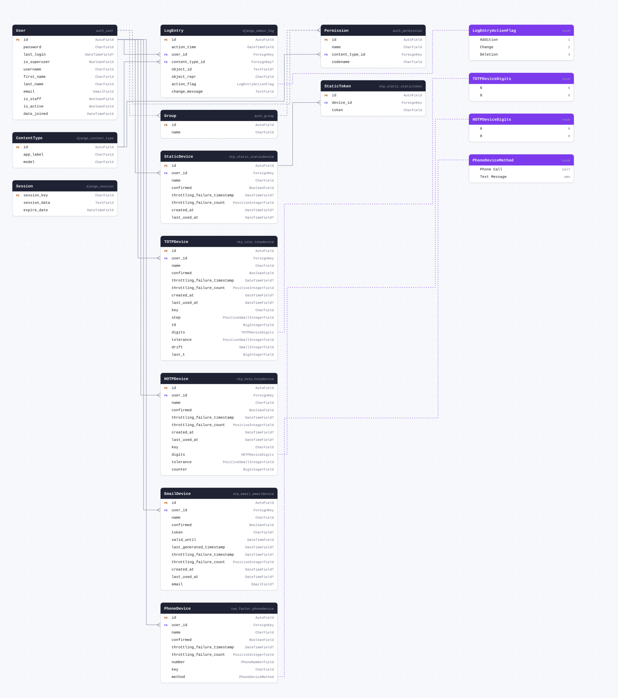
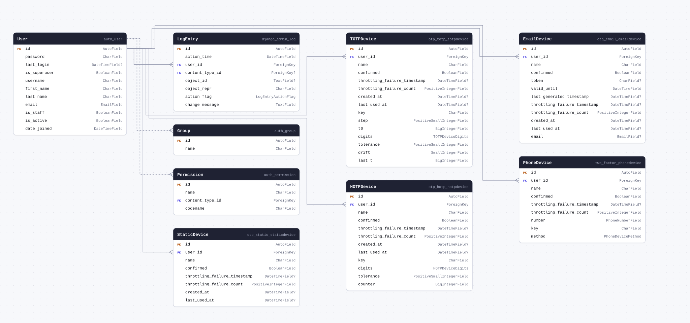
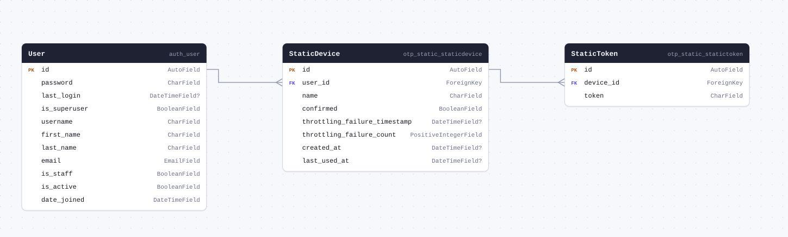
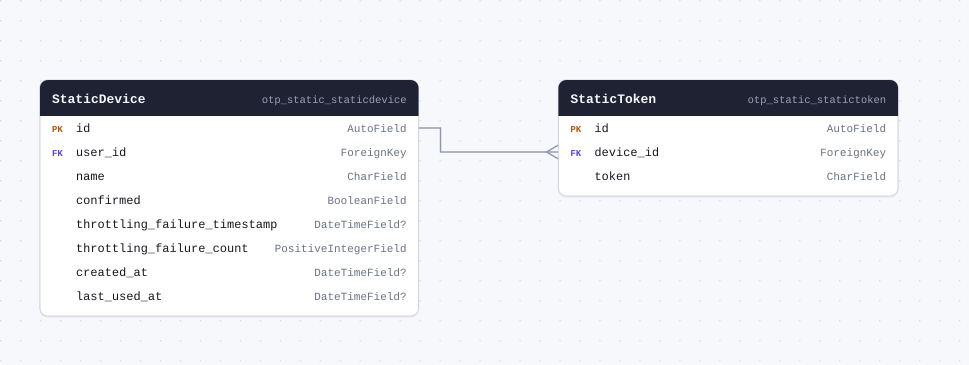
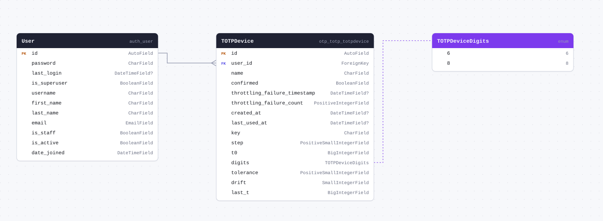
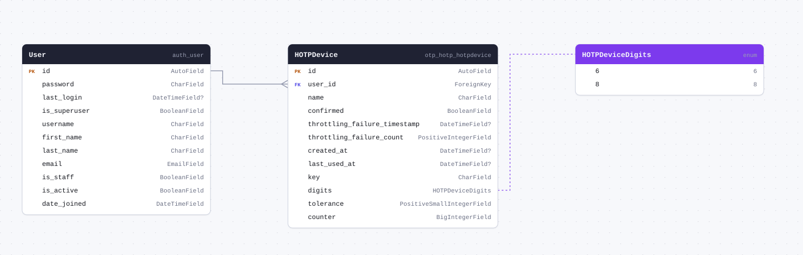
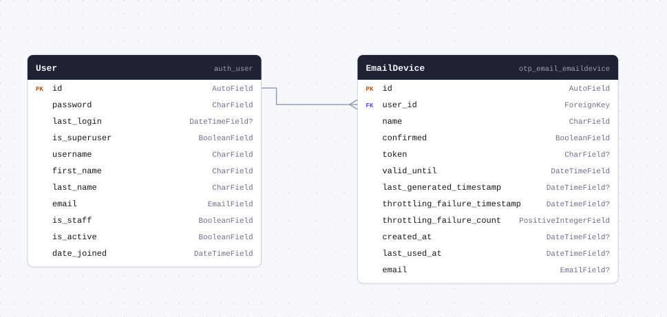
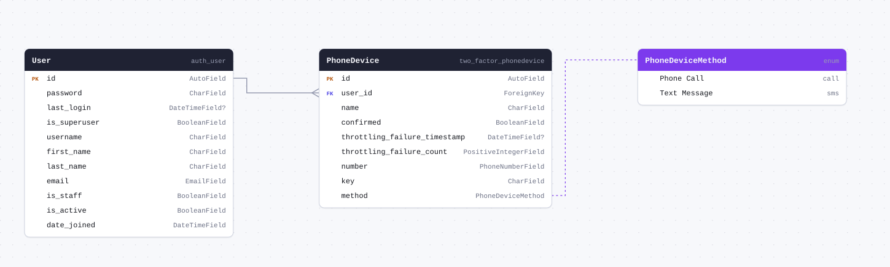

# Schema docs



[LogEntry](#logentry) · [Permission](#permission) · [Group](#group) · [User](#user) · [ContentType](#contenttype) · [Session](#session) · [StaticDevice](#staticdevice) · [StaticToken](#statictoken) · [TOTPDevice](#totpdevice) · [HOTPDevice](#hotpdevice) · [EmailDevice](#emaildevice) · [PhoneDevice](#phonedevice)

<details>
<summary>The whole schema as SQL</summary>

```sql
CREATE TABLE "django_admin_log" ("id" integer NOT NULL PRIMARY KEY AUTOINCREMENT, "action_time" datetime NOT NULL, "user_id" integer NOT NULL REFERENCES "auth_user" ("id") DEFERRABLE INITIALLY DEFERRED, "content_type_id" integer NULL REFERENCES "django_content_type" ("id") DEFERRABLE INITIALLY DEFERRED, "object_id" text NULL, "object_repr" varchar(200) NOT NULL, "action_flag" smallint unsigned NOT NULL CHECK ("action_flag" >= 0), "change_message" text NOT NULL);

CREATE TABLE "auth_permission" ("id" integer NOT NULL PRIMARY KEY AUTOINCREMENT, "name" varchar(255) NOT NULL, "content_type_id" integer NOT NULL REFERENCES "django_content_type" ("id") DEFERRABLE INITIALLY DEFERRED, "codename" varchar(100) NOT NULL);

CREATE TABLE "auth_group" ("id" integer NOT NULL PRIMARY KEY AUTOINCREMENT, "name" varchar(150) NOT NULL UNIQUE);

CREATE TABLE "auth_group_permissions" ("id" integer NOT NULL PRIMARY KEY AUTOINCREMENT, "group_id" integer NOT NULL REFERENCES "auth_group" ("id") DEFERRABLE INITIALLY DEFERRED, "permission_id" integer NOT NULL REFERENCES "auth_permission" ("id") DEFERRABLE INITIALLY DEFERRED);

CREATE TABLE "auth_user" ("id" integer NOT NULL PRIMARY KEY AUTOINCREMENT, "password" varchar(128) NOT NULL, "last_login" datetime NULL, "is_superuser" bool NOT NULL, "username" varchar(150) NOT NULL UNIQUE, "first_name" varchar(150) NOT NULL, "last_name" varchar(150) NOT NULL, "email" varchar(254) NOT NULL, "is_staff" bool NOT NULL, "is_active" bool NOT NULL, "date_joined" datetime NOT NULL);

CREATE TABLE "auth_user_groups" ("id" integer NOT NULL PRIMARY KEY AUTOINCREMENT, "user_id" integer NOT NULL REFERENCES "auth_user" ("id") DEFERRABLE INITIALLY DEFERRED, "group_id" integer NOT NULL REFERENCES "auth_group" ("id") DEFERRABLE INITIALLY DEFERRED);

CREATE TABLE "auth_user_user_permissions" ("id" integer NOT NULL PRIMARY KEY AUTOINCREMENT, "user_id" integer NOT NULL REFERENCES "auth_user" ("id") DEFERRABLE INITIALLY DEFERRED, "permission_id" integer NOT NULL REFERENCES "auth_permission" ("id") DEFERRABLE INITIALLY DEFERRED);

CREATE TABLE "django_content_type" ("id" integer NOT NULL PRIMARY KEY AUTOINCREMENT, "app_label" varchar(100) NOT NULL, "model" varchar(100) NOT NULL);

CREATE TABLE "django_session" ("session_key" varchar(40) NOT NULL PRIMARY KEY, "session_data" text NOT NULL, "expire_date" datetime NOT NULL);

CREATE TABLE "otp_static_staticdevice" ("id" integer NOT NULL PRIMARY KEY AUTOINCREMENT, "user_id" integer NOT NULL REFERENCES "auth_user" ("id") DEFERRABLE INITIALLY DEFERRED, "name" varchar(64) NOT NULL, "confirmed" bool NOT NULL, "throttling_failure_timestamp" datetime NULL, "throttling_failure_count" integer unsigned NOT NULL CHECK ("throttling_failure_count" >= 0), "created_at" datetime NULL, "last_used_at" datetime NULL);

CREATE TABLE "otp_static_statictoken" ("id" integer NOT NULL PRIMARY KEY AUTOINCREMENT, "device_id" integer NOT NULL REFERENCES "otp_static_staticdevice" ("id") DEFERRABLE INITIALLY DEFERRED, "token" varchar(16) NOT NULL);

CREATE TABLE "otp_totp_totpdevice" ("id" integer NOT NULL PRIMARY KEY AUTOINCREMENT, "user_id" integer NOT NULL REFERENCES "auth_user" ("id") DEFERRABLE INITIALLY DEFERRED, "name" varchar(64) NOT NULL, "confirmed" bool NOT NULL, "throttling_failure_timestamp" datetime NULL, "throttling_failure_count" integer unsigned NOT NULL CHECK ("throttling_failure_count" >= 0), "created_at" datetime NULL, "last_used_at" datetime NULL, "key" varchar(80) NOT NULL, "step" smallint unsigned NOT NULL CHECK ("step" >= 0), "t0" bigint NOT NULL, "digits" smallint unsigned NOT NULL CHECK ("digits" >= 0), "tolerance" smallint unsigned NOT NULL CHECK ("tolerance" >= 0), "drift" smallint NOT NULL, "last_t" bigint NOT NULL);

CREATE TABLE "otp_hotp_hotpdevice" ("id" integer NOT NULL PRIMARY KEY AUTOINCREMENT, "user_id" integer NOT NULL REFERENCES "auth_user" ("id") DEFERRABLE INITIALLY DEFERRED, "name" varchar(64) NOT NULL, "confirmed" bool NOT NULL, "throttling_failure_timestamp" datetime NULL, "throttling_failure_count" integer unsigned NOT NULL CHECK ("throttling_failure_count" >= 0), "created_at" datetime NULL, "last_used_at" datetime NULL, "key" varchar(80) NOT NULL, "digits" smallint unsigned NOT NULL CHECK ("digits" >= 0), "tolerance" smallint unsigned NOT NULL CHECK ("tolerance" >= 0), "counter" bigint NOT NULL);

CREATE TABLE "otp_email_emaildevice" ("id" integer NOT NULL PRIMARY KEY AUTOINCREMENT, "user_id" integer NOT NULL REFERENCES "auth_user" ("id") DEFERRABLE INITIALLY DEFERRED, "name" varchar(64) NOT NULL, "confirmed" bool NOT NULL, "token" varchar(16) NULL, "valid_until" datetime NOT NULL, "last_generated_timestamp" datetime NULL, "throttling_failure_timestamp" datetime NULL, "throttling_failure_count" integer unsigned NOT NULL CHECK ("throttling_failure_count" >= 0), "created_at" datetime NULL, "last_used_at" datetime NULL, "email" varchar(254) NULL);

CREATE TABLE "two_factor_phonedevice" ("id" integer NOT NULL PRIMARY KEY AUTOINCREMENT, "user_id" integer NOT NULL REFERENCES "auth_user" ("id") DEFERRABLE INITIALLY DEFERRED, "name" varchar(64) NOT NULL, "confirmed" bool NOT NULL, "throttling_failure_timestamp" datetime NULL, "throttling_failure_count" integer unsigned NOT NULL CHECK ("throttling_failure_count" >= 0), "number" varchar(128) NOT NULL, "key" varchar(40) NOT NULL, "method" varchar(4) NOT NULL);

CREATE INDEX "django_admin_log_user_id_c564eba6" ON "django_admin_log" ("user_id");

CREATE INDEX "django_admin_log_content_type_id_c4bce8eb" ON "django_admin_log" ("content_type_id");

CREATE UNIQUE INDEX "auth_permission_content_type_id_codename_01ab375a_uniq" ON "auth_permission" ("content_type_id", "codename");

CREATE INDEX "auth_permission_content_type_id_2f476e4b" ON "auth_permission" ("content_type_id");

CREATE UNIQUE INDEX "auth_group_permissions_group_id_permission_id_0cd325b0_uniq" ON "auth_group_permissions" ("group_id", "permission_id");

CREATE INDEX "auth_group_permissions_group_id_b120cbf9" ON "auth_group_permissions" ("group_id");

CREATE INDEX "auth_group_permissions_permission_id_84c5c92e" ON "auth_group_permissions" ("permission_id");

CREATE UNIQUE INDEX "auth_user_groups_user_id_group_id_94350c0c_uniq" ON "auth_user_groups" ("user_id", "group_id");

CREATE INDEX "auth_user_groups_user_id_6a12ed8b" ON "auth_user_groups" ("user_id");

CREATE INDEX "auth_user_groups_group_id_97559544" ON "auth_user_groups" ("group_id");

CREATE UNIQUE INDEX "auth_user_user_permissions_user_id_permission_id_14a6b632_uniq" ON "auth_user_user_permissions" ("user_id", "permission_id");

CREATE INDEX "auth_user_user_permissions_user_id_a95ead1b" ON "auth_user_user_permissions" ("user_id");

CREATE INDEX "auth_user_user_permissions_permission_id_1fbb5f2c" ON "auth_user_user_permissions" ("permission_id");

CREATE UNIQUE INDEX "django_content_type_app_label_model_76bd3d3b_uniq" ON "django_content_type" ("app_label", "model");

CREATE INDEX "django_session_expire_date_a5c62663" ON "django_session" ("expire_date");

CREATE INDEX "otp_static_staticdevice_user_id_7f9cff2b" ON "otp_static_staticdevice" ("user_id");

CREATE INDEX "otp_static_statictoken_device_id_74b7c7d1" ON "otp_static_statictoken" ("device_id");

CREATE INDEX "otp_static_statictoken_token_d0a51866" ON "otp_static_statictoken" ("token");

CREATE INDEX "otp_totp_totpdevice_user_id_0fb18292" ON "otp_totp_totpdevice" ("user_id");

CREATE INDEX "otp_hotp_hotpdevice_user_id_831afee3" ON "otp_hotp_hotpdevice" ("user_id");

CREATE INDEX "otp_email_emaildevice_user_id_0215c274" ON "otp_email_emaildevice" ("user_id");

CREATE INDEX "two_factor_phonedevice_user_id_54718003" ON "two_factor_phonedevice" ("user_id");
```

</details>

## LogEntry

Table `django_admin_log`, app `admin`.


| Column | Field | Type | Null | Key | Default | Description |
| --- | --- | --- | --- | --- | --- | --- |
| `id` | `AutoField` | `integer` |  | PK | `autoincrement()` |  |
| `action_time` | `DateTimeField` | `datetime` |  |  | `now()` |  |
| `user_id` | `ForeignKey` | `integer` |  | FK |  |  |
| `content_type_id` | `ForeignKey` | `integer` | yes | FK |  |  |
| `object_id` | `TextField` | `text` | yes |  |  |  |
| `object_repr` | `CharField` | `varchar(200)` |  |  |  |  |
| `action_flag` | `LogEntryActionFlag` | `smallint unsigned` |  |  |  |  |
| `change_message` | `TextField` | `text` |  |  |  |  |

Indexes:

- index `django_admin_log_user_id_c564eba6` on `user_id`
- index `django_admin_log_content_type_id_c4bce8eb` on `content_type_id`

Relations:

- `user_id` → [User](#user).`id`, on delete cascade
- `content_type_id` → [ContentType](#contenttype).`id`, on delete set null

## Permission

Table `auth_permission`, app `auth`.

The permissions system provides a way to assign permissions to specific
users and groups of users.

The permission system is used by the Django admin site, but may also be
useful in your own code. The Django admin site uses permissions as follows:

    - The "add" permission limits the user's ability to view the "add" form
      and add an object.
    - The "change" permission limits a user's ability to view the change
      list, view the "change" form and change an object.
    - The "delete" permission limits the ability to delete an object.
    - The "view" permission limits the ability to view an object.

Permissions are set globally per type of object, not per specific object
instance. It is possible to say "Mary may change news stories," but it's
not currently possible to say "Mary may change news stories, but only the
ones she created herself" or "Mary may only change news stories that have a
certain status or publication date."

The permissions listed above are automatically created for each model.


| Column | Field | Type | Null | Key | Default | Description |
| --- | --- | --- | --- | --- | --- | --- |
| `id` | `AutoField` | `integer` |  | PK | `autoincrement()` |  |
| `name` | `CharField` | `varchar(255)` |  |  |  |  |
| `content_type_id` | `ForeignKey` | `integer` |  | FK |  |  |
| `codename` | `CharField` | `varchar(100)` |  |  |  |  |

Indexes:

- index `auth_permission_content_type_id_2f476e4b` on `content_type_id`
- unique `auth_permission_content_type_id_codename_01ab375a_uniq` on `content_type_id`, `codename`

Relations:

- `content_type_id` → [ContentType](#contenttype).`id`, on delete cascade
- `group_set` — many to many with [Group](#group)
- `user_set` — many to many with [User](#user)

## Group

Table `auth_group`, app `auth`.

Groups are a generic way of categorizing users to apply permissions, or
some other label, to those users. A user can belong to any number of
groups.

A user in a group automatically has all the permissions granted to that
group. For example, if the group 'Site editors' has the permission
can_edit_home_page, any user in that group will have that permission.

Beyond permissions, groups are a convenient way to categorize users to
apply some label, or extended functionality, to them. For example, you
could create a group 'Special users', and you could write code that would
do special things to those users -- such as giving them access to a
members-only portion of your site, or sending them members-only email
messages.


| Column | Field | Type | Null | Key | Default | Description |
| --- | --- | --- | --- | --- | --- | --- |
| `id` | `AutoField` | `integer` |  | PK | `autoincrement()` |  |
| `name` | `CharField` | `varchar(150)` |  | unique |  |  |

Relations:

- `permissions` — many to many with [Permission](#permission)
- `user_set` — many to many with [User](#user)

## User

Table `auth_user`, app `auth`.

Columns from `AbstractUser` (abstract): `username`, `first_name`, `last_name`, `email`, `is_staff`, `is_active`, `date_joined`.

Columns from `AbstractBaseUser` (abstract): `password`, `last_login`.

Columns from `PermissionsMixin` (abstract): `is_superuser`.

Users within the Django authentication system are represented by this
model.

Username and password are required. Other fields are optional.



| Column | Field | Type | Null | Key | Default | Description |
| --- | --- | --- | --- | --- | --- | --- |
| `id` | `AutoField` | `integer` |  | PK | `autoincrement()` |  |
| `password` | `CharField` | `varchar(128)` |  |  |  |  |
| `last_login` | `DateTimeField` | `datetime` | yes |  |  |  |
| `is_superuser` | `BooleanField` | `bool` |  |  | `False` | Designates that this user has all permissions without explicitly assigning them. |
| `username` | `CharField` | `varchar(150)` |  | unique |  | Required. 150 characters or fewer. Letters, digits and @/./+/-/_ only. |
| `first_name` | `CharField` | `varchar(150)` |  |  |  |  |
| `last_name` | `CharField` | `varchar(150)` |  |  |  |  |
| `email` | `EmailField` | `varchar(254)` |  |  |  |  |
| `is_staff` | `BooleanField` | `bool` |  |  | `False` | Designates whether the user can log into this admin site. |
| `is_active` | `BooleanField` | `bool` |  |  | `True` | Designates whether this user should be treated as active. Unselect this instead of deleting accounts. |
| `date_joined` | `DateTimeField` | `datetime` |  |  | `now()` |  |

Relations:

- [LogEntry](#logentry).`user_id` → `id`, on delete cascade
- `groups` — many to many with [Group](#group)
- `user_permissions` — many to many with [Permission](#permission)
- [StaticDevice](#staticdevice).`user_id` → `id`, on delete cascade
- [TOTPDevice](#totpdevice).`user_id` → `id`, on delete cascade
- [HOTPDevice](#hotpdevice).`user_id` → `id`, on delete cascade
- [EmailDevice](#emaildevice).`user_id` → `id`, on delete cascade
- [PhoneDevice](#phonedevice).`user_id` → `id`, on delete cascade

## ContentType

Table `django_content_type`, app `contenttypes`.


| Column | Field | Type | Null | Key | Default | Description |
| --- | --- | --- | --- | --- | --- | --- |
| `id` | `AutoField` | `integer` |  | PK | `autoincrement()` |  |
| `app_label` | `CharField` | `varchar(100)` |  |  |  |  |
| `model` | `CharField` | `varchar(100)` |  |  |  |  |

Indexes:

- unique `django_content_type_app_label_model_76bd3d3b_uniq` on `app_label`, `model`

Relations:

- [LogEntry](#logentry).`content_type_id` → `id`, on delete set null
- [Permission](#permission).`content_type_id` → `id`, on delete cascade

## Session

Table `django_session`, app `sessions`.

Columns from `AbstractBaseSession` (abstract): `session_key`, `session_data`, `expire_date`.

Django provides full support for anonymous sessions. The session
framework lets you store and retrieve arbitrary data on a
per-site-visitor basis. It stores data on the server side and
abstracts the sending and receiving of cookies. Cookies contain a
session ID -- not the data itself.

The Django sessions framework is entirely cookie-based. It does
not fall back to putting session IDs in URLs. This is an intentional
design decision. Not only does that behavior make URLs ugly, it makes
your site vulnerable to session-ID theft via the "Referer" header.

For complete documentation on using Sessions in your code, consult
the sessions documentation that is shipped with Django (also available
on the Django web site).

| Column | Field | Type | Null | Key | Default | Description |
| --- | --- | --- | --- | --- | --- | --- |
| `session_key` | `CharField` | `varchar(40)` |  | PK |  |  |
| `session_data` | `TextField` | `text` |  |  |  |  |
| `expire_date` | `DateTimeField` | `datetime` |  |  |  |  |

Indexes:

- index `django_session_expire_date_a5c62663` on `expire_date`

## StaticDevice

Table `otp_static_staticdevice`, app `otp_static`.

Columns from `TimestampMixin` (abstract): `created_at`, `last_used_at`.

Columns from `ThrottlingMixin` (abstract): `throttling_failure_timestamp`, `throttling_failure_count`.

Columns from `Device` (abstract): `user_id`, `name`, `confirmed`.

A static :class:`~django_otp.models.Device` simply consists of random
tokens shared by the database and the user.

These are frequently used as emergency tokens in case a user's normal
device is lost or unavailable. They can be consumed in any order; each
token will be removed from the database as soon as it is used.

This model has no fields of its own, but serves as a container for
:class:`StaticToken` objects.

.. attribute:: token_set

    The RelatedManager for our tokens.



| Column | Field | Type | Null | Key | Default | Description |
| --- | --- | --- | --- | --- | --- | --- |
| `id` | `AutoField` | `integer` |  | PK | `autoincrement()` |  |
| `user_id` | `ForeignKey` | `integer` |  | FK |  | The user that this device belongs to. |
| `name` | `CharField` | `varchar(64)` |  |  |  | The human-readable name of this device. |
| `confirmed` | `BooleanField` | `bool` |  |  | `True` | Is this device ready for use? |
| `throttling_failure_timestamp` | `DateTimeField` | `datetime` | yes |  | `None` | A timestamp of the last failed verification attempt. Null if last attempt succeeded. |
| `throttling_failure_count` | `PositiveIntegerField` | `integer unsigned` |  |  | `0` | Number of successive failed attempts. |
| `created_at` | `DateTimeField` | `datetime` | yes |  | `now()` | The date and time when this device was initially created in the system. |
| `last_used_at` | `DateTimeField` | `datetime` | yes |  |  | The most recent date and time this device was used. |

Indexes:

- index `otp_static_staticdevice_user_id_7f9cff2b` on `user_id`

Relations:

- `user_id` → [User](#user).`id`, on delete cascade
- [StaticToken](#statictoken).`device_id` → `id`, on delete cascade

## StaticToken

Table `otp_static_statictoken`, app `otp_static`.

A single token belonging to a :class:`StaticDevice`.

.. attribute:: device

    *ForeignKey*: A foreign key to :class:`StaticDevice`.

.. attribute:: token

    *CharField*: A random string up to 16 characters.



| Column | Field | Type | Null | Key | Default | Description |
| --- | --- | --- | --- | --- | --- | --- |
| `id` | `AutoField` | `integer` |  | PK | `autoincrement()` |  |
| `device_id` | `ForeignKey` | `integer` |  | FK |  |  |
| `token` | `CharField` | `varchar(16)` |  |  |  |  |

Indexes:

- index `otp_static_statictoken_device_id_74b7c7d1` on `device_id`
- index `otp_static_statictoken_token_d0a51866` on `token`

Relations:

- `device_id` → [StaticDevice](#staticdevice).`id`, on delete cascade

## TOTPDevice

Table `otp_totp_totpdevice`, app `otp_totp`.

Columns from `TimestampMixin` (abstract): `created_at`, `last_used_at`.

Columns from `ThrottlingMixin` (abstract): `throttling_failure_timestamp`, `throttling_failure_count`.

Columns from `Device` (abstract): `user_id`, `name`, `confirmed`.

A generic TOTP :class:`~django_otp.models.Device`. The model fields mostly
correspond to the arguments to :func:`django_otp.oath.totp`. They all have
sensible defaults, including the key, which is randomly generated.

.. attribute:: key

    *CharField*: A hex-encoded secret key of up to 40 bytes. (Default: 20
    random bytes)

.. attribute:: step

    *PositiveSmallIntegerField*: The time step in seconds. (Default: 30)

.. attribute:: t0

    *BigIntegerField*: The Unix time at which to begin counting steps.
    (Default: 0)

.. attribute:: digits

    *PositiveSmallIntegerField*: The number of digits to expect in a token
    (6 or 8).  (Default: 6)

.. attribute:: tolerance

    *PositiveSmallIntegerField*: The number of time steps in the past or
    future to allow. For example, if this is 1, we'll accept any of three
    tokens: the current one, the previous one, and the next one. (Default:
    1)

.. attribute:: drift

    *SmallIntegerField*: The number of time steps the prover is known to
    deviate from our clock.  If :setting:`OTP_TOTP_SYNC` is ``True``, we'll
    update this any time we match a token that is not the current one.
    (Default: 0)

.. attribute:: last_t

    *BigIntegerField*: The time step of the last verified token. To avoid
    verifying the same token twice, this will be updated on each successful
    verification. Only tokens at a higher time step will be verified
    subsequently. (Default: -1)



| Column | Field | Type | Null | Key | Default | Description |
| --- | --- | --- | --- | --- | --- | --- |
| `id` | `AutoField` | `integer` |  | PK | `autoincrement()` |  |
| `user_id` | `ForeignKey` | `integer` |  | FK |  | The user that this device belongs to. |
| `name` | `CharField` | `varchar(64)` |  |  |  | The human-readable name of this device. |
| `confirmed` | `BooleanField` | `bool` |  |  | `True` | Is this device ready for use? |
| `throttling_failure_timestamp` | `DateTimeField` | `datetime` | yes |  | `None` | A timestamp of the last failed verification attempt. Null if last attempt succeeded. |
| `throttling_failure_count` | `PositiveIntegerField` | `integer unsigned` |  |  | `0` | Number of successive failed attempts. |
| `created_at` | `DateTimeField` | `datetime` | yes |  | `now()` | The date and time when this device was initially created in the system. |
| `last_used_at` | `DateTimeField` | `datetime` | yes |  |  | The most recent date and time this device was used. |
| `key` | `CharField` | `varchar(80)` |  |  | `default_key()` | A hex-encoded secret key of up to 40 bytes. |
| `step` | `PositiveSmallIntegerField` | `smallint unsigned` |  |  | `30` | The time step in seconds. |
| `t0` | `BigIntegerField` | `bigint` |  |  | `0` | The Unix time at which to begin counting steps. |
| `digits` | `TOTPDeviceDigits` | `smallint unsigned` |  |  | `6` | The number of digits to expect in a token. |
| `tolerance` | `PositiveSmallIntegerField` | `smallint unsigned` |  |  | `1` | The number of time steps in the past or future to allow. |
| `drift` | `SmallIntegerField` | `smallint` |  |  | `0` | The number of time steps the prover is known to deviate from our clock. |
| `last_t` | `BigIntegerField` | `bigint` |  |  | `-1` | The t value of the latest verified token. The next token must be at a higher time step. |

Indexes:

- index `otp_totp_totpdevice_user_id_0fb18292` on `user_id`

Relations:

- `user_id` → [User](#user).`id`, on delete cascade

## HOTPDevice

Table `otp_hotp_hotpdevice`, app `otp_hotp`.

Columns from `TimestampMixin` (abstract): `created_at`, `last_used_at`.

Columns from `ThrottlingMixin` (abstract): `throttling_failure_timestamp`, `throttling_failure_count`.

Columns from `Device` (abstract): `user_id`, `name`, `confirmed`.

A generic HOTP :class:`~django_otp.models.Device`. The model fields mostly
correspond to the arguments to :func:`django_otp.oath.hotp`. They all have
sensible defaults, including the key, which is randomly generated.

.. attribute:: key

    *CharField*: A hex-encoded secret key of up to 40 bytes. (Default: 20
    random bytes)

.. attribute:: digits

    *PositiveSmallIntegerField*: The number of digits to expect from the
    token generator (6 or 8). (Default: 6)

.. attribute:: tolerance

    *PositiveSmallIntegerField*: The number of missed tokens to tolerate.
    (Default: 5)

.. attribute:: counter

    *BigIntegerField*: The next counter value to expect. (Initial: 0)



| Column | Field | Type | Null | Key | Default | Description |
| --- | --- | --- | --- | --- | --- | --- |
| `id` | `AutoField` | `integer` |  | PK | `autoincrement()` |  |
| `user_id` | `ForeignKey` | `integer` |  | FK |  | The user that this device belongs to. |
| `name` | `CharField` | `varchar(64)` |  |  |  | The human-readable name of this device. |
| `confirmed` | `BooleanField` | `bool` |  |  | `True` | Is this device ready for use? |
| `throttling_failure_timestamp` | `DateTimeField` | `datetime` | yes |  | `None` | A timestamp of the last failed verification attempt. Null if last attempt succeeded. |
| `throttling_failure_count` | `PositiveIntegerField` | `integer unsigned` |  |  | `0` | Number of successive failed attempts. |
| `created_at` | `DateTimeField` | `datetime` | yes |  | `now()` | The date and time when this device was initially created in the system. |
| `last_used_at` | `DateTimeField` | `datetime` | yes |  |  | The most recent date and time this device was used. |
| `key` | `CharField` | `varchar(80)` |  |  | `default_key()` | A hex-encoded secret key of up to 40 bytes. |
| `digits` | `HOTPDeviceDigits` | `smallint unsigned` |  |  | `6` | The number of digits to expect in a token. |
| `tolerance` | `PositiveSmallIntegerField` | `smallint unsigned` |  |  | `5` | The number of missed tokens to tolerate. |
| `counter` | `BigIntegerField` | `bigint` |  |  | `0` | The next counter value to expect. |

Indexes:

- index `otp_hotp_hotpdevice_user_id_831afee3` on `user_id`

Relations:

- `user_id` → [User](#user).`id`, on delete cascade

## EmailDevice

Table `otp_email_emaildevice`, app `otp_email`.

Columns from `TimestampMixin` (abstract): `created_at`, `last_used_at`.

Columns from `CooldownMixin` (abstract): `last_generated_timestamp`.

Columns from `ThrottlingMixin` (abstract): `throttling_failure_timestamp`, `throttling_failure_count`.

Columns from `SideChannelDevice` (abstract): `token`, `valid_until`.

Columns from `Device` (abstract): `user_id`, `name`, `confirmed`.

A :class:`~django_otp.models.SideChannelDevice` that delivers a token to
the email address saved in this object or alternatively to the user's
registered email address (``user.email``).

The tokens are valid for :setting:`OTP_EMAIL_TOKEN_VALIDITY` seconds. Once
a token has been accepted, it is no longer valid.

Note that if you allow users to reset their passwords by email, this may
provide little additional account security. It may still be useful for,
e.g., requiring the user to re-verify their email address on new devices.

.. attribute:: email

    *EmailField*: An alternative email address to send the tokens to.



| Column | Field | Type | Null | Key | Default | Description |
| --- | --- | --- | --- | --- | --- | --- |
| `id` | `AutoField` | `integer` |  | PK | `autoincrement()` |  |
| `user_id` | `ForeignKey` | `integer` |  | FK |  | The user that this device belongs to. |
| `name` | `CharField` | `varchar(64)` |  |  |  | The human-readable name of this device. |
| `confirmed` | `BooleanField` | `bool` |  |  | `True` | Is this device ready for use? |
| `token` | `CharField` | `varchar(16)` | yes |  |  |  |
| `valid_until` | `DateTimeField` | `datetime` |  |  | `now()` | The timestamp of the moment of expiry of the saved token. |
| `last_generated_timestamp` | `DateTimeField` | `datetime` | yes |  |  | The last time a token was generated for this device. |
| `throttling_failure_timestamp` | `DateTimeField` | `datetime` | yes |  | `None` | A timestamp of the last failed verification attempt. Null if last attempt succeeded. |
| `throttling_failure_count` | `PositiveIntegerField` | `integer unsigned` |  |  | `0` | Number of successive failed attempts. |
| `created_at` | `DateTimeField` | `datetime` | yes |  | `now()` | The date and time when this device was initially created in the system. |
| `last_used_at` | `DateTimeField` | `datetime` | yes |  |  | The most recent date and time this device was used. |
| `email` | `EmailField` | `varchar(254)` | yes |  |  | Optional alternative email address to send tokens to |

Indexes:

- index `otp_email_emaildevice_user_id_0215c274` on `user_id`

Relations:

- `user_id` → [User](#user).`id`, on delete cascade

## PhoneDevice

Table `two_factor_phonedevice`, app `phonenumber`.

Columns from `ThrottlingMixin` (abstract): `throttling_failure_timestamp`, `throttling_failure_count`.

Columns from `Device` (abstract): `user_id`, `name`, `confirmed`.

Model with phone number and token seed linked to a user.



| Column | Field | Type | Null | Key | Default | Description |
| --- | --- | --- | --- | --- | --- | --- |
| `id` | `AutoField` | `integer` |  | PK | `autoincrement()` |  |
| `user_id` | `ForeignKey` | `integer` |  | FK |  | The user that this device belongs to. |
| `name` | `CharField` | `varchar(64)` |  |  |  | The human-readable name of this device. |
| `confirmed` | `BooleanField` | `bool` |  |  | `True` | Is this device ready for use? |
| `throttling_failure_timestamp` | `DateTimeField` | `datetime` | yes |  | `None` | A timestamp of the last failed verification attempt. Null if last attempt succeeded. |
| `throttling_failure_count` | `PositiveIntegerField` | `integer unsigned` |  |  | `0` | Number of successive failed attempts. |
| `number` | `PhoneNumberField` | `varchar(128)` |  |  |  |  |
| `key` | `CharField` | `varchar(40)` |  |  | `random_hex()` | Hex-encoded secret key |
| `method` | `PhoneDeviceMethod` | `varchar(4)` |  |  |  |  |

Indexes:

- index `two_factor_phonedevice_user_id_54718003` on `user_id`

Relations:

- `user_id` → [User](#user).`id`, on delete cascade

# Enums

## LogEntryActionFlag

| Name | Stored as |
| --- | --- |
| `Addition` | `1` |
| `Change` | `2` |
| `Deletion` | `3` |

## TOTPDeviceDigits

| Name | Stored as |
| --- | --- |
| `6` | `6` |
| `8` | `8` |

## HOTPDeviceDigits

| Name | Stored as |
| --- | --- |
| `6` | `6` |
| `8` | `8` |

## PhoneDeviceMethod

| Name | Stored as |
| --- | --- |
| `Phone Call` | `call` |
| `Text Message` | `sms` |
