# Schema docs

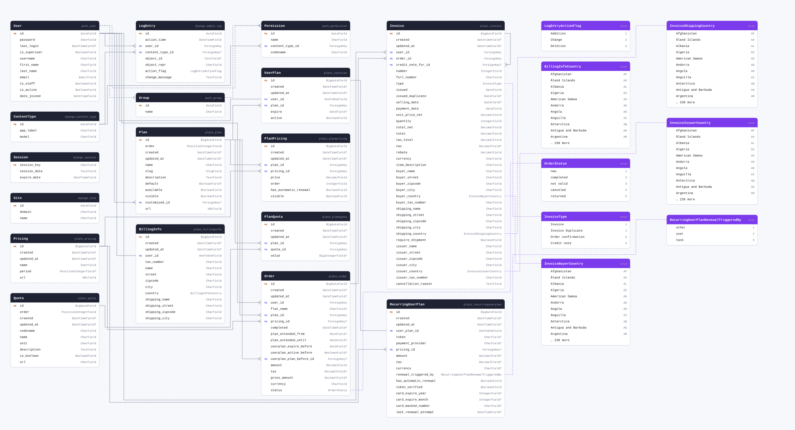

[LogEntry](#logentry) · [Permission](#permission) · [Group](#group) · [User](#user) · [ContentType](#contenttype) · [Session](#session) · [Site](#site) · [Plan](#plan) · [BillingInfo](#billinginfo) · [UserPlan](#userplan) · [Pricing](#pricing) · [PlanPricing](#planpricing) · [Quota](#quota) · [PlanQuota](#planquota) · [Order](#order) · [Invoice](#invoice) · [RecurringUserPlan](#recurringuserplan)

<details>
<summary>The whole schema as SQL</summary>

```sql
CREATE TABLE "django_admin_log" ("id" integer NOT NULL PRIMARY KEY AUTOINCREMENT, "action_time" datetime NOT NULL, "user_id" integer NOT NULL REFERENCES "auth_user" ("id") DEFERRABLE INITIALLY DEFERRED, "content_type_id" integer NULL REFERENCES "django_content_type" ("id") DEFERRABLE INITIALLY DEFERRED, "object_id" text NULL, "object_repr" varchar(200) NOT NULL, "action_flag" smallint unsigned NOT NULL CHECK ("action_flag" >= 0), "change_message" text NOT NULL);

CREATE TABLE "auth_permission" ("id" integer NOT NULL PRIMARY KEY AUTOINCREMENT, "name" varchar(255) NOT NULL, "content_type_id" integer NOT NULL REFERENCES "django_content_type" ("id") DEFERRABLE INITIALLY DEFERRED, "codename" varchar(100) NOT NULL);

CREATE TABLE "auth_group" ("id" integer NOT NULL PRIMARY KEY AUTOINCREMENT, "name" varchar(150) NOT NULL UNIQUE);

CREATE TABLE "auth_group_permissions" ("id" integer NOT NULL PRIMARY KEY AUTOINCREMENT, "group_id" integer NOT NULL REFERENCES "auth_group" ("id") DEFERRABLE INITIALLY DEFERRED, "permission_id" integer NOT NULL REFERENCES "auth_permission" ("id") DEFERRABLE INITIALLY DEFERRED);

CREATE TABLE "auth_user" ("id" integer NOT NULL PRIMARY KEY AUTOINCREMENT, "password" varchar(128) NOT NULL, "last_login" datetime NULL, "is_superuser" bool NOT NULL, "username" varchar(150) NOT NULL UNIQUE, "first_name" varchar(150) NOT NULL, "last_name" varchar(150) NOT NULL, "email" varchar(254) NOT NULL, "is_staff" bool NOT NULL, "is_active" bool NOT NULL, "date_joined" datetime NOT NULL);

CREATE TABLE "auth_user_groups" ("id" integer NOT NULL PRIMARY KEY AUTOINCREMENT, "user_id" integer NOT NULL REFERENCES "auth_user" ("id") DEFERRABLE INITIALLY DEFERRED, "group_id" integer NOT NULL REFERENCES "auth_group" ("id") DEFERRABLE INITIALLY DEFERRED);

CREATE TABLE "auth_user_user_permissions" ("id" integer NOT NULL PRIMARY KEY AUTOINCREMENT, "user_id" integer NOT NULL REFERENCES "auth_user" ("id") DEFERRABLE INITIALLY DEFERRED, "permission_id" integer NOT NULL REFERENCES "auth_permission" ("id") DEFERRABLE INITIALLY DEFERRED);

CREATE TABLE "django_content_type" ("id" integer NOT NULL PRIMARY KEY AUTOINCREMENT, "app_label" varchar(100) NOT NULL, "model" varchar(100) NOT NULL);

CREATE TABLE "django_session" ("session_key" varchar(40) NOT NULL PRIMARY KEY, "session_data" text NOT NULL, "expire_date" datetime NOT NULL);

CREATE TABLE "django_site" ("id" integer NOT NULL PRIMARY KEY AUTOINCREMENT, "domain" varchar(100) NOT NULL UNIQUE, "name" varchar(50) NOT NULL);

CREATE TABLE "plans_plan" ("id" integer NOT NULL PRIMARY KEY AUTOINCREMENT, "order" integer unsigned NOT NULL CHECK ("order" >= 0), "created" datetime NULL, "updated_at" datetime NULL, "name" varchar(100) NOT NULL, "slug" varchar(100) NOT NULL UNIQUE, "description" text NOT NULL, "default" bool NULL UNIQUE, "available" bool NOT NULL, "visible" bool NOT NULL, "customized_id" integer NULL REFERENCES "auth_user" ("id") DEFERRABLE INITIALLY DEFERRED, "url" varchar(200) NOT NULL);

CREATE TABLE "plans_billinginfo" ("id" integer NOT NULL PRIMARY KEY AUTOINCREMENT, "created" datetime NULL, "updated_at" datetime NULL, "user_id" integer NOT NULL UNIQUE REFERENCES "auth_user" ("id") DEFERRABLE INITIALLY DEFERRED, "tax_number" varchar(200) NOT NULL, "name" varchar(200) NOT NULL, "street" varchar(200) NOT NULL, "zipcode" varchar(200) NOT NULL, "city" varchar(200) NOT NULL, "country" varchar(2) NOT NULL, "shipping_name" varchar(200) NOT NULL, "shipping_street" varchar(200) NOT NULL, "shipping_zipcode" varchar(200) NOT NULL, "shipping_city" varchar(200) NOT NULL);

CREATE TABLE "plans_userplan" ("id" integer NOT NULL PRIMARY KEY AUTOINCREMENT, "created" datetime NULL, "updated_at" datetime NULL, "user_id" integer NOT NULL UNIQUE REFERENCES "auth_user" ("id") DEFERRABLE INITIALLY DEFERRED, "plan_id" bigint NOT NULL REFERENCES "plans_plan" ("id") DEFERRABLE INITIALLY DEFERRED, "expire" date NULL, "active" bool NOT NULL);

CREATE TABLE "plans_pricing" ("id" integer NOT NULL PRIMARY KEY AUTOINCREMENT, "created" datetime NULL, "updated_at" datetime NULL, "name" varchar(100) NOT NULL, "period" integer unsigned NULL CHECK ("period" >= 0), "url" varchar(200) NOT NULL);

CREATE TABLE "plans_planpricing" ("id" integer NOT NULL PRIMARY KEY AUTOINCREMENT, "created" datetime NULL, "updated_at" datetime NULL, "plan_id" bigint NOT NULL REFERENCES "plans_plan" ("id") DEFERRABLE INITIALLY DEFERRED, "pricing_id" bigint NOT NULL REFERENCES "plans_pricing" ("id") DEFERRABLE INITIALLY DEFERRED, "price" decimal NOT NULL, "order" integer NOT NULL, "has_automatic_renewal" bool NOT NULL, "visible" bool NOT NULL);

CREATE TABLE "plans_quota" ("id" integer NOT NULL PRIMARY KEY AUTOINCREMENT, "order" integer unsigned NOT NULL CHECK ("order" >= 0), "created" datetime NULL, "updated_at" datetime NULL, "codename" varchar(50) NOT NULL UNIQUE, "name" varchar(100) NOT NULL, "unit" varchar(100) NOT NULL, "description" text NOT NULL, "is_boolean" bool NOT NULL, "url" varchar(200) NOT NULL);

CREATE TABLE "plans_planquota" ("id" integer NOT NULL PRIMARY KEY AUTOINCREMENT, "created" datetime NULL, "updated_at" datetime NULL, "plan_id" bigint NOT NULL REFERENCES "plans_plan" ("id") DEFERRABLE INITIALLY DEFERRED, "quota_id" bigint NOT NULL REFERENCES "plans_quota" ("id") DEFERRABLE INITIALLY DEFERRED, "value" bigint NULL);

CREATE TABLE "plans_order" ("id" integer NOT NULL PRIMARY KEY AUTOINCREMENT, "created" datetime NULL, "updated_at" datetime NULL, "user_id" integer NOT NULL REFERENCES "auth_user" ("id") DEFERRABLE INITIALLY DEFERRED, "flat_name" varchar(200) NULL, "plan_id" bigint NOT NULL REFERENCES "plans_plan" ("id") DEFERRABLE INITIALLY DEFERRED, "pricing_id" bigint NULL REFERENCES "plans_pricing" ("id") DEFERRABLE INITIALLY DEFERRED, "completed" datetime NULL, "plan_extended_from" date NULL, "plan_extended_until" date NULL, "userplan_expire_before" date NULL, "userplan_active_before" bool NULL, "userplan_plan_before_id" bigint NULL REFERENCES "plans_plan" ("id") DEFERRABLE INITIALLY DEFERRED, "amount" decimal NOT NULL, "tax" decimal NULL, "gross_amount" decimal NULL, "currency" varchar(3) NOT NULL, "status" integer NOT NULL);

CREATE TABLE "plans_invoice" ("id" integer NOT NULL PRIMARY KEY AUTOINCREMENT, "created" datetime NULL, "updated_at" datetime NULL, "user_id" integer NOT NULL REFERENCES "auth_user" ("id") DEFERRABLE INITIALLY DEFERRED, "order_id" bigint NOT NULL REFERENCES "plans_order" ("id") DEFERRABLE INITIALLY DEFERRED, "credit_note_for_id" bigint NULL REFERENCES "plans_invoice" ("id") DEFERRABLE INITIALLY DEFERRED, "number" integer NOT NULL, "full_number" varchar(200) NOT NULL, "type" integer NOT NULL, "issued" date NOT NULL, "issued_duplicate" date NULL, "selling_date" date NULL, "payment_date" date NOT NULL, "unit_price_net" decimal NOT NULL, "quantity" integer NOT NULL, "total_net" decimal NOT NULL, "total" decimal NOT NULL, "tax_total" decimal NOT NULL, "tax" decimal NULL, "rebate" decimal NOT NULL, "currency" varchar(3) NOT NULL, "item_description" varchar(200) NOT NULL, "buyer_name" varchar(200) NOT NULL, "buyer_street" varchar(200) NOT NULL, "buyer_zipcode" varchar(200) NOT NULL, "buyer_city" varchar(200) NOT NULL, "buyer_country" varchar(2) NOT NULL, "buyer_tax_number" varchar(200) NOT NULL, "shipping_name" varchar(200) NOT NULL, "shipping_street" varchar(200) NOT NULL, "shipping_zipcode" varchar(200) NOT NULL, "shipping_city" varchar(200) NOT NULL, "shipping_country" varchar(2) NOT NULL, "require_shipment" bool NOT NULL, "issuer_name" varchar(200) NOT NULL, "issuer_street" varchar(200) NOT NULL, "issuer_zipcode" varchar(200) NOT NULL, "issuer_city" varchar(200) NOT NULL, "issuer_country" varchar(2) NOT NULL, "issuer_tax_number" varchar(200) NOT NULL, "cancellation_reason" text NOT NULL);

CREATE TABLE "plans_recurringuserplan" ("id" integer NOT NULL PRIMARY KEY AUTOINCREMENT, "created" datetime NULL, "updated_at" datetime NULL, "user_plan_id" bigint NOT NULL UNIQUE REFERENCES "plans_userplan" ("id") DEFERRABLE INITIALLY DEFERRED, "token" varchar(255) NULL, "payment_provider" varchar(255) NULL, "pricing_id" bigint NULL REFERENCES "plans_pricing" ("id") DEFERRABLE INITIALLY DEFERRED, "amount" decimal NULL, "tax" decimal NULL, "currency" varchar(3) NULL, "renewal_triggered_by" integer NOT NULL, "has_automatic_renewal" bool NOT NULL, "token_verified" bool NOT NULL, "card_expire_year" integer NULL, "card_expire_month" integer NULL, "card_masked_number" varchar(255) NULL, "last_renewal_attempt" datetime NULL);

CREATE INDEX "django_admin_log_user_id_c564eba6" ON "django_admin_log" ("user_id");

CREATE INDEX "django_admin_log_content_type_id_c4bce8eb" ON "django_admin_log" ("content_type_id");

CREATE UNIQUE INDEX "auth_permission_content_type_id_codename_01ab375a_uniq" ON "auth_permission" ("content_type_id", "codename");

CREATE INDEX "auth_permission_content_type_id_2f476e4b" ON "auth_permission" ("content_type_id");

CREATE UNIQUE INDEX "auth_group_permissions_group_id_permission_id_0cd325b0_uniq" ON "auth_group_permissions" ("group_id", "permission_id");

CREATE INDEX "auth_group_permissions_group_id_b120cbf9" ON "auth_group_permissions" ("group_id");

CREATE INDEX "auth_group_permissions_permission_id_84c5c92e" ON "auth_group_permissions" ("permission_id");

CREATE UNIQUE INDEX "auth_user_groups_user_id_group_id_94350c0c_uniq" ON "auth_user_groups" ("user_id", "group_id");

CREATE INDEX "auth_user_groups_user_id_6a12ed8b" ON "auth_user_groups" ("user_id");

CREATE INDEX "auth_user_groups_group_id_97559544" ON "auth_user_groups" ("group_id");

CREATE UNIQUE INDEX "auth_user_user_permissions_user_id_permission_id_14a6b632_uniq" ON "auth_user_user_permissions" ("user_id", "permission_id");

CREATE INDEX "auth_user_user_permissions_user_id_a95ead1b" ON "auth_user_user_permissions" ("user_id");

CREATE INDEX "auth_user_user_permissions_permission_id_1fbb5f2c" ON "auth_user_user_permissions" ("permission_id");

CREATE UNIQUE INDEX "django_content_type_app_label_model_76bd3d3b_uniq" ON "django_content_type" ("app_label", "model");

CREATE INDEX "django_session_expire_date_a5c62663" ON "django_session" ("expire_date");

CREATE INDEX "plans_plan_order_579f69c5" ON "plans_plan" ("order");

CREATE INDEX "plans_plan_created_07bdbc3f" ON "plans_plan" ("created");

CREATE INDEX "plans_plan_available_a258855c" ON "plans_plan" ("available");

CREATE INDEX "plans_plan_visible_f04f078b" ON "plans_plan" ("visible");

CREATE INDEX "plans_plan_customized_id_a5e0e78b" ON "plans_plan" ("customized_id");

CREATE INDEX "plans_billinginfo_created_e5762fb7" ON "plans_billinginfo" ("created");

CREATE INDEX "plans_billinginfo_tax_number_afb5dea3" ON "plans_billinginfo" ("tax_number");

CREATE INDEX "plans_billinginfo_name_e69c18c3" ON "plans_billinginfo" ("name");

CREATE INDEX "plans_userplan_created_5193d3db" ON "plans_userplan" ("created");

CREATE INDEX "plans_userplan_plan_id_0d1d0b4b" ON "plans_userplan" ("plan_id");

CREATE INDEX "plans_userplan_expire_f939a8c9" ON "plans_userplan" ("expire");

CREATE INDEX "plans_userplan_active_d4023ffa" ON "plans_userplan" ("active");

CREATE INDEX "plans_pricing_created_211aacc8" ON "plans_pricing" ("created");

CREATE INDEX "plans_pricing_period_db4f2428" ON "plans_pricing" ("period");

CREATE INDEX "plans_planpricing_created_e2beaf3d" ON "plans_planpricing" ("created");

CREATE INDEX "plans_planpricing_plan_id_4072d329" ON "plans_planpricing" ("plan_id");

CREATE INDEX "plans_planpricing_pricing_id_2c2b0761" ON "plans_planpricing" ("pricing_id");

CREATE INDEX "plans_planpricing_price_3d4f8940" ON "plans_planpricing" ("price");

CREATE INDEX "plans_quota_order_dee24da3" ON "plans_quota" ("order");

CREATE INDEX "plans_quota_created_8ae02a42" ON "plans_quota" ("created");

CREATE INDEX "plans_planquota_created_afe30275" ON "plans_planquota" ("created");

CREATE INDEX "plans_planquota_plan_id_9d7fe141" ON "plans_planquota" ("plan_id");

CREATE INDEX "plans_planquota_quota_id_72a65bec" ON "plans_planquota" ("quota_id");

CREATE INDEX "plans_order_created_643392c9" ON "plans_order" ("created");

CREATE INDEX "plans_order_user_id_d59f4b51" ON "plans_order" ("user_id");

CREATE INDEX "plans_order_plan_id_a7d62a45" ON "plans_order" ("plan_id");

CREATE INDEX "plans_order_pricing_id_0dbc53e8" ON "plans_order" ("pricing_id");

CREATE INDEX "plans_order_completed_6c33dd84" ON "plans_order" ("completed");

CREATE INDEX "plans_order_userplan_plan_before_id_7b2d56f3" ON "plans_order" ("userplan_plan_before_id");

CREATE INDEX "plans_order_amount_b26e68f2" ON "plans_order" ("amount");

CREATE INDEX "plans_order_tax_1ee29bf0" ON "plans_order" ("tax");

CREATE INDEX "plans_invoice_created_d7962606" ON "plans_invoice" ("created");

CREATE INDEX "plans_invoice_user_id_2acf7921" ON "plans_invoice" ("user_id");

CREATE INDEX "plans_invoice_order_id_85fdb39d" ON "plans_invoice" ("order_id");

CREATE INDEX "plans_invoice_credit_note_for_id_1da49395" ON "plans_invoice" ("credit_note_for_id");

CREATE INDEX "plans_invoice_number_029c6241" ON "plans_invoice" ("number");

CREATE INDEX "plans_invoice_type_d48ee091" ON "plans_invoice" ("type");

CREATE INDEX "plans_invoice_issued_74955383" ON "plans_invoice" ("issued");

CREATE INDEX "plans_invoice_issued_duplicate_3993f4e4" ON "plans_invoice" ("issued_duplicate");

CREATE INDEX "plans_invoice_selling_date_a8bf61a5" ON "plans_invoice" ("selling_date");

CREATE INDEX "plans_invoice_payment_date_165bea35" ON "plans_invoice" ("payment_date");

CREATE INDEX "plans_invoice_tax_bbc119a4" ON "plans_invoice" ("tax");

CREATE INDEX "plans_invoice_require_shipment_6591adce" ON "plans_invoice" ("require_shipment");

CREATE INDEX "plans_recurringuserplan_created_e1b360e5" ON "plans_recurringuserplan" ("created");

CREATE INDEX "plans_recurringuserplan_pricing_id_d27a589c" ON "plans_recurringuserplan" ("pricing_id");

CREATE INDEX "plans_recurringuserplan_amount_bb726812" ON "plans_recurringuserplan" ("amount");

CREATE INDEX "plans_recurringuserplan_tax_fb303de5" ON "plans_recurringuserplan" ("tax");

CREATE INDEX "plans_recurringuserplan_renewal_triggered_by_c4ca3377" ON "plans_recurringuserplan" ("renewal_triggered_by");
```

</details>

## LogEntry

Table `django_admin_log`, app `admin`.


| Column | Field | Type | Null | Key | Default | Description |
| --- | --- | --- | --- | --- | --- | --- |
| `id` | `AutoField` | `integer` |  | PK | `autoincrement()` |  |
| `action_time` | `DateTimeField` | `datetime` |  |  | `now()` |  |
| `user_id` | `ForeignKey` | `integer` |  | FK |  |  |
| `content_type_id` | `ForeignKey` | `integer` | yes | FK |  |  |
| `object_id` | `TextField` | `text` | yes |  |  |  |
| `object_repr` | `CharField` | `varchar(200)` |  |  |  |  |
| `action_flag` | `LogEntryActionFlag` | `smallint unsigned` |  |  |  |  |
| `change_message` | `TextField` | `text` |  |  |  |  |

Indexes:

- index `django_admin_log_user_id_c564eba6` on `user_id`
- index `django_admin_log_content_type_id_c4bce8eb` on `content_type_id`

Relations:

- `user_id` → [User](#user).`id`, on delete cascade
- `content_type_id` → [ContentType](#contenttype).`id`, on delete set null

## Permission

Table `auth_permission`, app `auth`.

The permissions system provides a way to assign permissions to specific
users and groups of users.

The permission system is used by the Django admin site, but may also be
useful in your own code. The Django admin site uses permissions as follows:

    - The "add" permission limits the user's ability to view the "add" form
      and add an object.
    - The "change" permission limits a user's ability to view the change
      list, view the "change" form and change an object.
    - The "delete" permission limits the ability to delete an object.
    - The "view" permission limits the ability to view an object.

Permissions are set globally per type of object, not per specific object
instance. It is possible to say "Mary may change news stories," but it's
not currently possible to say "Mary may change news stories, but only the
ones she created herself" or "Mary may only change news stories that have a
certain status or publication date."

The permissions listed above are automatically created for each model.


| Column | Field | Type | Null | Key | Default | Description |
| --- | --- | --- | --- | --- | --- | --- |
| `id` | `AutoField` | `integer` |  | PK | `autoincrement()` |  |
| `name` | `CharField` | `varchar(255)` |  |  |  |  |
| `content_type_id` | `ForeignKey` | `integer` |  | FK |  |  |
| `codename` | `CharField` | `varchar(100)` |  |  |  |  |

Indexes:

- index `auth_permission_content_type_id_2f476e4b` on `content_type_id`
- unique `auth_permission_content_type_id_codename_01ab375a_uniq` on `content_type_id`, `codename`

Relations:

- `content_type_id` → [ContentType](#contenttype).`id`, on delete cascade
- `group_set` — many to many with [Group](#group)
- `user_set` — many to many with [User](#user)

## Group

Table `auth_group`, app `auth`.

Groups are a generic way of categorizing users to apply permissions, or
some other label, to those users. A user can belong to any number of
groups.

A user in a group automatically has all the permissions granted to that
group. For example, if the group 'Site editors' has the permission
can_edit_home_page, any user in that group will have that permission.

Beyond permissions, groups are a convenient way to categorize users to
apply some label, or extended functionality, to them. For example, you
could create a group 'Special users', and you could write code that would
do special things to those users -- such as giving them access to a
members-only portion of your site, or sending them members-only email
messages.


| Column | Field | Type | Null | Key | Default | Description |
| --- | --- | --- | --- | --- | --- | --- |
| `id` | `AutoField` | `integer` |  | PK | `autoincrement()` |  |
| `name` | `CharField` | `varchar(150)` |  | unique |  |  |

Relations:

- `permissions` — many to many with [Permission](#permission)
- `user_set` — many to many with [User](#user)

## User

Table `auth_user`, app `auth`.

Columns from `AbstractUser` (abstract): `username`, `first_name`, `last_name`, `email`, `is_staff`, `is_active`, `date_joined`.

Columns from `AbstractBaseUser` (abstract): `password`, `last_login`.

Columns from `PermissionsMixin` (abstract): `is_superuser`.

Users within the Django authentication system are represented by this
model.

Username and password are required. Other fields are optional.

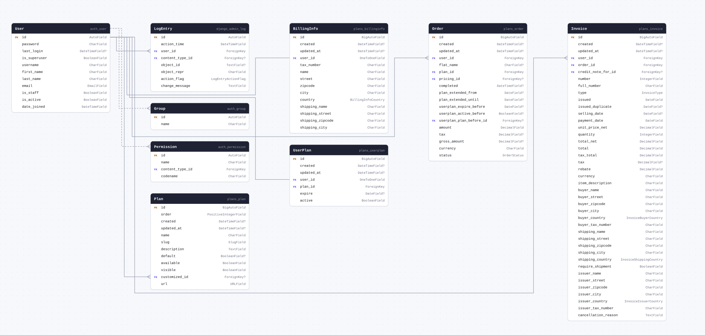

| Column | Field | Type | Null | Key | Default | Description |
| --- | --- | --- | --- | --- | --- | --- |
| `id` | `AutoField` | `integer` |  | PK | `autoincrement()` |  |
| `password` | `CharField` | `varchar(128)` |  |  |  |  |
| `last_login` | `DateTimeField` | `datetime` | yes |  |  |  |
| `is_superuser` | `BooleanField` | `bool` |  |  | `False` | Designates that this user has all permissions without explicitly assigning them. |
| `username` | `CharField` | `varchar(150)` |  | unique |  | Required. 150 characters or fewer. Letters, digits and @/./+/-/_ only. |
| `first_name` | `CharField` | `varchar(150)` |  |  |  |  |
| `last_name` | `CharField` | `varchar(150)` |  |  |  |  |
| `email` | `EmailField` | `varchar(254)` |  |  |  |  |
| `is_staff` | `BooleanField` | `bool` |  |  | `False` | Designates whether the user can log into this admin site. |
| `is_active` | `BooleanField` | `bool` |  |  | `True` | Designates whether this user should be treated as active. Unselect this instead of deleting accounts. |
| `date_joined` | `DateTimeField` | `datetime` |  |  | `now()` |  |

Relations:

- [LogEntry](#logentry).`user_id` → `id`, on delete cascade
- `groups` — many to many with [Group](#group)
- `user_permissions` — many to many with [Permission](#permission)
- [Plan](#plan).`customized_id` → `id`, on delete cascade
- [BillingInfo](#billinginfo).`user_id` → `id`, on delete cascade
- [UserPlan](#userplan).`user_id` → `id`, on delete cascade
- [Order](#order).`user_id` → `id`, on delete cascade
- [Invoice](#invoice).`user_id` → `id`, on delete cascade

## ContentType

Table `django_content_type`, app `contenttypes`.


| Column | Field | Type | Null | Key | Default | Description |
| --- | --- | --- | --- | --- | --- | --- |
| `id` | `AutoField` | `integer` |  | PK | `autoincrement()` |  |
| `app_label` | `CharField` | `varchar(100)` |  |  |  |  |
| `model` | `CharField` | `varchar(100)` |  |  |  |  |

Indexes:

- unique `django_content_type_app_label_model_76bd3d3b_uniq` on `app_label`, `model`

Relations:

- [LogEntry](#logentry).`content_type_id` → `id`, on delete set null
- [Permission](#permission).`content_type_id` → `id`, on delete cascade

## Session

Table `django_session`, app `sessions`.

Columns from `AbstractBaseSession` (abstract): `session_key`, `session_data`, `expire_date`.

Django provides full support for anonymous sessions. The session
framework lets you store and retrieve arbitrary data on a
per-site-visitor basis. It stores data on the server side and
abstracts the sending and receiving of cookies. Cookies contain a
session ID -- not the data itself.

The Django sessions framework is entirely cookie-based. It does
not fall back to putting session IDs in URLs. This is an intentional
design decision. Not only does that behavior make URLs ugly, it makes
your site vulnerable to session-ID theft via the "Referer" header.

For complete documentation on using Sessions in your code, consult
the sessions documentation that is shipped with Django (also available
on the Django web site).

| Column | Field | Type | Null | Key | Default | Description |
| --- | --- | --- | --- | --- | --- | --- |
| `session_key` | `CharField` | `varchar(40)` |  | PK |  |  |
| `session_data` | `TextField` | `text` |  |  |  |  |
| `expire_date` | `DateTimeField` | `datetime` |  |  |  |  |

Indexes:

- index `django_session_expire_date_a5c62663` on `expire_date`

## Site

Table `django_site`, app `sites`.

| Column | Field | Type | Null | Key | Default | Description |
| --- | --- | --- | --- | --- | --- | --- |
| `id` | `AutoField` | `integer` |  | PK | `autoincrement()` |  |
| `domain` | `CharField` | `varchar(100)` |  | unique |  |  |
| `name` | `CharField` | `varchar(50)` |  |  |  |  |

## Plan

Table `plans_plan`, app `plans`.

Columns from `AbstractPlan` (abstract): `name`, `slug`, `description`, `default`, `available`, `visible`, `customized_id`, `url`.

Columns from `BaseMixin` (abstract): `created`, `updated_at`.

Columns from `OrderedModel` (abstract): `order`.

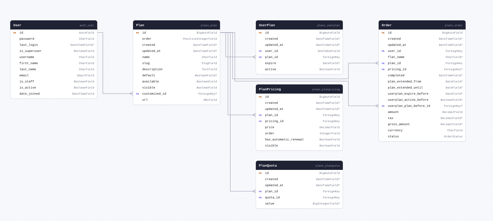

| Column | Field | Type | Null | Key | Default | Description |
| --- | --- | --- | --- | --- | --- | --- |
| `id` | `BigAutoField` | `integer` |  | PK | `autoincrement()` |  |
| `order` | `PositiveIntegerField` | `integer unsigned` |  |  |  |  |
| `created` | `DateTimeField` | `datetime` | yes |  | `now()` |  |
| `updated_at` | `DateTimeField` | `datetime` | yes |  | `now()` |  |
| `name` | `CharField` | `varchar(100)` |  |  |  |  |
| `slug` | `SlugField` | `varchar(100)` |  | unique |  |  |
| `description` | `TextField` | `text` |  |  |  |  |
| `default` | `BooleanField` | `bool` | yes | unique | `None` | Both "Unknown" and "No" means that the plan is not default |
| `available` | `BooleanField` | `bool` |  |  | `False` | Is still available for purchase |
| `visible` | `BooleanField` | `bool` |  |  | `True` | Is visible in current offer |
| `customized_id` | `ForeignKey` | `integer` | yes | FK |  |  |
| `url` | `URLField` | `varchar(200)` |  |  |  | Optional link to page with more information (for clickable pricing table headers) |

Indexes:

- index `plans_plan_order_579f69c5` on `order`
- index `plans_plan_created_07bdbc3f` on `created`
- index `plans_plan_available_a258855c` on `available`
- index `plans_plan_visible_f04f078b` on `visible`
- index `plans_plan_customized_id_a5e0e78b` on `customized_id`

Relations:

- `quotas` — many to many with [Quota](#quota), through [PlanQuota](#planquota)
- `customized_id` → [User](#user).`id`, on delete cascade
- [UserPlan](#userplan).`plan_id` → `id`, on delete cascade
- [PlanPricing](#planpricing).`plan_id` → `id`, on delete cascade
- [PlanQuota](#planquota).`plan_id` → `id`, on delete cascade
- [Order](#order).`plan_id` → `id`, on delete cascade
- [Order](#order).`userplan_plan_before_id` → `id`, on delete set null

## BillingInfo

Table `plans_billinginfo`, app `plans`.

Columns from `AbstractBillingInfo` (abstract): `user_id`, `tax_number`, `name`, `street`, `zipcode`, `city`, `country`, `shipping_name`, `shipping_street`, `shipping_zipcode`, `shipping_city`.

Columns from `BaseMixin` (abstract): `created`, `updated_at`.

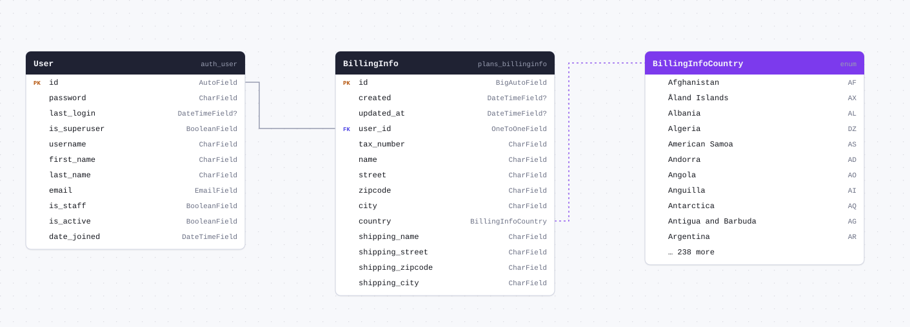

| Column | Field | Type | Null | Key | Default | Description |
| --- | --- | --- | --- | --- | --- | --- |
| `id` | `BigAutoField` | `integer` |  | PK | `autoincrement()` |  |
| `created` | `DateTimeField` | `datetime` | yes |  | `now()` |  |
| `updated_at` | `DateTimeField` | `datetime` | yes |  | `now()` |  |
| `user_id` | `OneToOneField` | `integer` |  | FK, unique |  |  |
| `tax_number` | `CharField` | `varchar(200)` |  |  |  |  |
| `name` | `CharField` | `varchar(200)` |  |  |  |  |
| `street` | `CharField` | `varchar(200)` |  |  |  |  |
| `zipcode` | `CharField` | `varchar(200)` |  |  |  |  |
| `city` | `CharField` | `varchar(200)` |  |  |  |  |
| `country` | `BillingInfoCountry` | `varchar(2)` |  |  |  |  |
| `shipping_name` | `CharField` | `varchar(200)` |  |  |  | optional |
| `shipping_street` | `CharField` | `varchar(200)` |  |  |  | optional |
| `shipping_zipcode` | `CharField` | `varchar(200)` |  |  |  | optional |
| `shipping_city` | `CharField` | `varchar(200)` |  |  |  | optional |

Indexes:

- index `plans_billinginfo_created_e5762fb7` on `created`
- index `plans_billinginfo_tax_number_afb5dea3` on `tax_number`
- index `plans_billinginfo_name_e69c18c3` on `name`

Relations:

- `user_id` → [User](#user).`id`, on delete cascade

## UserPlan

Table `plans_userplan`, app `plans`.

Columns from `AbstractUserPlan` (abstract): `user_id`, `plan_id`, `expire`, `active`.

Columns from `BaseMixin` (abstract): `created`, `updated_at`.

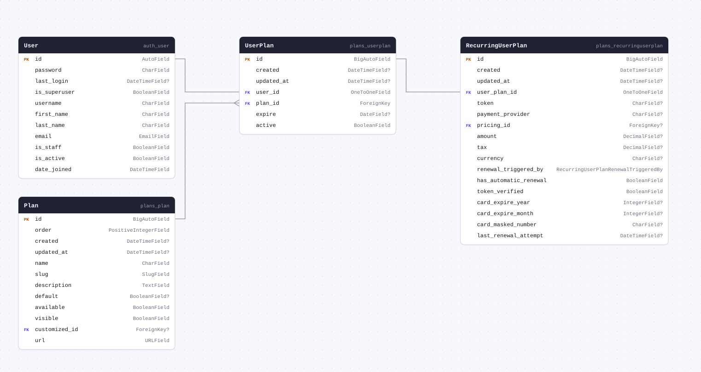

| Column | Field | Type | Null | Key | Default | Description |
| --- | --- | --- | --- | --- | --- | --- |
| `id` | `BigAutoField` | `integer` |  | PK | `autoincrement()` |  |
| `created` | `DateTimeField` | `datetime` | yes |  | `now()` |  |
| `updated_at` | `DateTimeField` | `datetime` | yes |  | `now()` |  |
| `user_id` | `OneToOneField` | `integer` |  | FK, unique |  |  |
| `plan_id` | `ForeignKey` | `bigint` |  | FK |  |  |
| `expire` | `DateField` | `date` | yes |  | `None` |  |
| `active` | `BooleanField` | `bool` |  |  | `True` |  |

Indexes:

- index `plans_userplan_created_5193d3db` on `created`
- index `plans_userplan_plan_id_0d1d0b4b` on `plan_id`
- index `plans_userplan_expire_f939a8c9` on `expire`
- index `plans_userplan_active_d4023ffa` on `active`

Relations:

- `user_id` → [User](#user).`id`, on delete cascade
- `plan_id` → [Plan](#plan).`id`, on delete cascade
- [RecurringUserPlan](#recurringuserplan).`user_plan_id` → `id`, on delete cascade

## Pricing

Table `plans_pricing`, app `plans`.

Columns from `AbstractPricing` (abstract): `name`, `period`, `url`.

Columns from `BaseMixin` (abstract): `created`, `updated_at`.

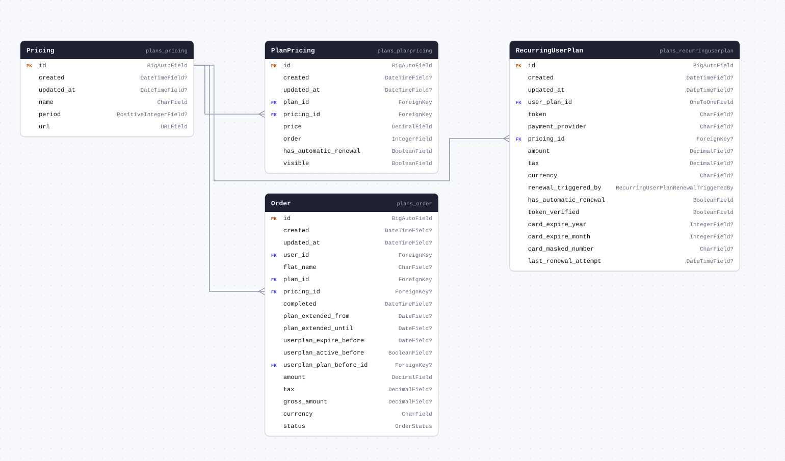

| Column | Field | Type | Null | Key | Default | Description |
| --- | --- | --- | --- | --- | --- | --- |
| `id` | `BigAutoField` | `integer` |  | PK | `autoincrement()` |  |
| `created` | `DateTimeField` | `datetime` | yes |  | `now()` |  |
| `updated_at` | `DateTimeField` | `datetime` | yes |  | `now()` |  |
| `name` | `CharField` | `varchar(100)` |  |  |  |  |
| `period` | `PositiveIntegerField` | `integer unsigned` | yes |  | `30` |  |
| `url` | `URLField` | `varchar(200)` |  |  |  | Optional link to page with more information (for clickable pricing table headers) |

Indexes:

- index `plans_pricing_created_211aacc8` on `created`
- index `plans_pricing_period_db4f2428` on `period`

Relations:

- [PlanPricing](#planpricing).`pricing_id` → `id`, on delete cascade
- [Order](#order).`pricing_id` → `id`, on delete cascade
- [RecurringUserPlan](#recurringuserplan).`pricing_id` → `id`, on delete cascade

## PlanPricing

Table `plans_planpricing`, app `plans`.

Columns from `AbstractPlanPricing` (abstract): `plan_id`, `pricing_id`, `price`, `order`, `has_automatic_renewal`, `visible`.

Columns from `BaseMixin` (abstract): `created`, `updated_at`.

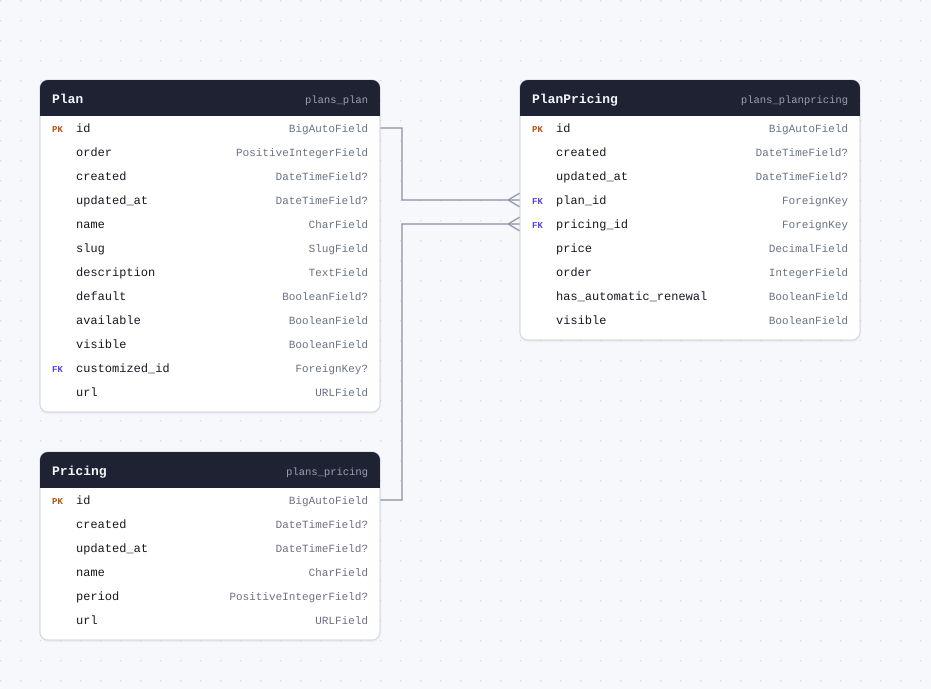

| Column | Field | Type | Null | Key | Default | Description |
| --- | --- | --- | --- | --- | --- | --- |
| `id` | `BigAutoField` | `integer` |  | PK | `autoincrement()` |  |
| `created` | `DateTimeField` | `datetime` | yes |  | `now()` |  |
| `updated_at` | `DateTimeField` | `datetime` | yes |  | `now()` |  |
| `plan_id` | `ForeignKey` | `bigint` |  | FK |  |  |
| `pricing_id` | `ForeignKey` | `bigint` |  | FK |  |  |
| `price` | `DecimalField(7, 2)` | `decimal` |  |  |  |  |
| `order` | `IntegerField` | `integer` |  |  | `0` |  |
| `has_automatic_renewal` | `BooleanField` | `bool` |  |  | `False` | Use automatic renewal if possible? |
| `visible` | `BooleanField` | `bool` |  |  | `True` | Is visible in current offer |

Indexes:

- index `plans_planpricing_created_e2beaf3d` on `created`
- index `plans_planpricing_plan_id_4072d329` on `plan_id`
- index `plans_planpricing_pricing_id_2c2b0761` on `pricing_id`
- index `plans_planpricing_price_3d4f8940` on `price`

Relations:

- `plan_id` → [Plan](#plan).`id`, on delete cascade
- `pricing_id` → [Pricing](#pricing).`id`, on delete cascade

## Quota

Table `plans_quota`, app `plans`.

Columns from `AbstractQuota` (abstract): `codename`, `name`, `unit`, `description`, `is_boolean`, `url`.

Columns from `BaseMixin` (abstract): `created`, `updated_at`.

Columns from `OrderedModel` (abstract): `order`.

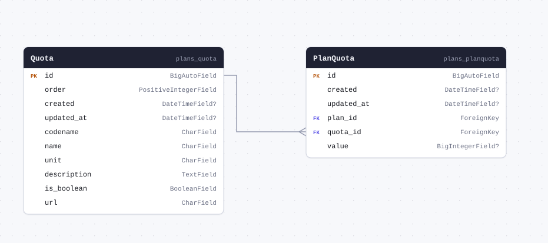

| Column | Field | Type | Null | Key | Default | Description |
| --- | --- | --- | --- | --- | --- | --- |
| `id` | `BigAutoField` | `integer` |  | PK | `autoincrement()` |  |
| `order` | `PositiveIntegerField` | `integer unsigned` |  |  |  |  |
| `created` | `DateTimeField` | `datetime` | yes |  | `now()` |  |
| `updated_at` | `DateTimeField` | `datetime` | yes |  | `now()` |  |
| `codename` | `CharField` | `varchar(50)` |  | unique |  |  |
| `name` | `CharField` | `varchar(100)` |  |  |  |  |
| `unit` | `CharField` | `varchar(100)` |  |  |  |  |
| `description` | `TextField` | `text` |  |  |  |  |
| `is_boolean` | `BooleanField` | `bool` |  |  | `False` |  |
| `url` | `CharField` | `varchar(200)` |  |  |  | Optional link to page with more information (for clickable pricing table headers) |

Indexes:

- index `plans_quota_order_dee24da3` on `order`
- index `plans_quota_created_8ae02a42` on `created`

Relations:

- `plan_set` — many to many with [Plan](#plan), through [PlanQuota](#planquota)
- [PlanQuota](#planquota).`quota_id` → `id`, on delete cascade

## PlanQuota

Table `plans_planquota`, app `plans`.

Columns from `AbstractPlanQuota` (abstract): `plan_id`, `quota_id`, `value`.

Columns from `BaseMixin` (abstract): `created`, `updated_at`.

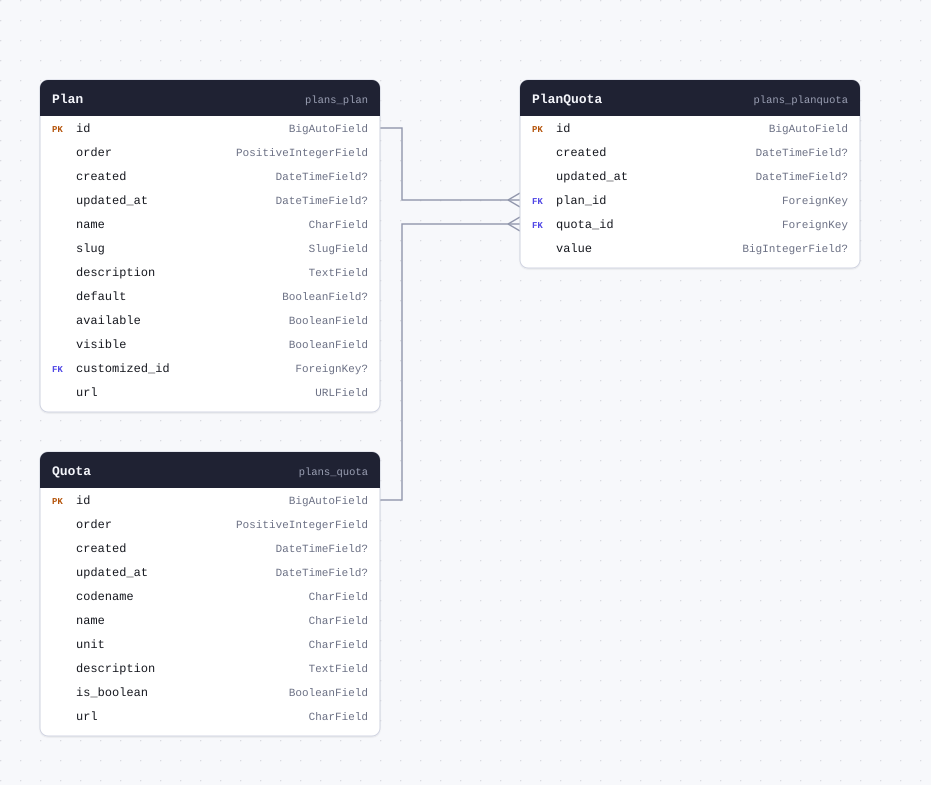

| Column | Field | Type | Null | Key | Default | Description |
| --- | --- | --- | --- | --- | --- | --- |
| `id` | `BigAutoField` | `integer` |  | PK | `autoincrement()` |  |
| `created` | `DateTimeField` | `datetime` | yes |  | `now()` |  |
| `updated_at` | `DateTimeField` | `datetime` | yes |  | `now()` |  |
| `plan_id` | `ForeignKey` | `bigint` |  | FK |  |  |
| `quota_id` | `ForeignKey` | `bigint` |  | FK |  |  |
| `value` | `BigIntegerField` | `bigint` | yes |  | `1` |  |

Indexes:

- index `plans_planquota_created_afe30275` on `created`
- index `plans_planquota_plan_id_9d7fe141` on `plan_id`
- index `plans_planquota_quota_id_72a65bec` on `quota_id`

Relations:

- `plan_id` → [Plan](#plan).`id`, on delete cascade
- `quota_id` → [Quota](#quota).`id`, on delete cascade

## Order

Table `plans_order`, app `plans`.

Columns from `AbstractOrder` (abstract): `user_id`, `flat_name`, `plan_id`, `pricing_id`, `completed`, `plan_extended_from`, `plan_extended_until`, `userplan_expire_before`, `userplan_active_before`, `userplan_plan_before_id`, `amount`, `tax`, `gross_amount`, `currency`, `status`.

Columns from `BaseMixin` (abstract): `created`, `updated_at`.

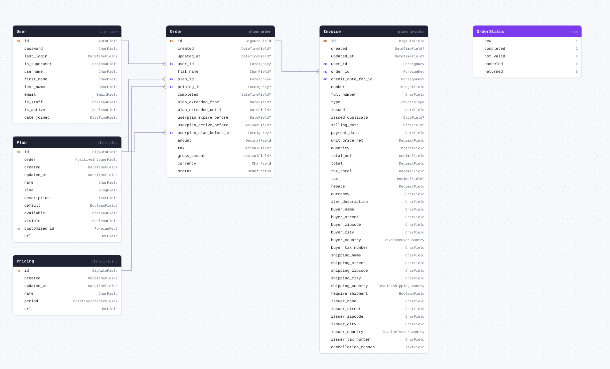

| Column | Field | Type | Null | Key | Default | Description |
| --- | --- | --- | --- | --- | --- | --- |
| `id` | `BigAutoField` | `integer` |  | PK | `autoincrement()` |  |
| `created` | `DateTimeField` | `datetime` | yes |  | `now()` |  |
| `updated_at` | `DateTimeField` | `datetime` | yes |  | `now()` |  |
| `user_id` | `ForeignKey` | `integer` |  | FK |  |  |
| `flat_name` | `CharField` | `varchar(200)` | yes |  |  |  |
| `plan_id` | `ForeignKey` | `bigint` |  | FK |  |  |
| `pricing_id` | `ForeignKey` | `bigint` | yes | FK |  |  |
| `completed` | `DateTimeField` | `datetime` | yes |  |  |  |
| `plan_extended_from` | `DateField` | `date` | yes |  |  | The plan was extended from this date |
| `plan_extended_until` | `DateField` | `date` | yes |  |  | The plan was extended until this date |
| `userplan_expire_before` | `DateField` | `date` | yes |  |  | Snapshot of ``UserPlan.expire`` taken before this order extended the user's plan. Used to restore expire on refund. |
| `userplan_active_before` | `BooleanField` | `bool` | yes |  |  | Snapshot of ``UserPlan.active`` taken before this order extended the user's plan. Doubles as the marker that a snapshot was taken: it's None for legacy orders completed before the snapshot fields existed and either True or False for new orders. |
| `userplan_plan_before_id` | `ForeignKey` | `bigint` | yes | FK |  | Snapshot of ``UserPlan.plan`` taken before this order extended the user's plan. Used to restore the plan on refund when the order is fully unwound: without it, refunding a first purchase (free -> paid) would leave the user on the paid plan with expire=None. None for legacy orders predating this field. |
| `amount` | `DecimalField(7, 2)` | `decimal` |  |  |  |  |
| `tax` | `DecimalField(4, 2)` | `decimal` | yes |  |  |  |
| `gross_amount` | `DecimalField(7, 2)` | `decimal` | yes |  |  | Tax-inclusive total of the order, for orders priced tax-inclusive (e.g. a fixed amount charged by the payment provider). When set, it is the order total and the tax amount is the difference between it and the net amount; the net amount is then expected to be derived from it with net_from_gross(). Leave empty to compute the total from the net amount and the tax rate. |
| `currency` | `CharField` | `varchar(3)` |  |  | `'EUR'` |  |
| `status` | `OrderStatus` | `integer` |  |  | `1` |  |

Indexes:

- index `plans_order_created_643392c9` on `created`
- index `plans_order_user_id_d59f4b51` on `user_id`
- index `plans_order_plan_id_a7d62a45` on `plan_id`
- index `plans_order_pricing_id_0dbc53e8` on `pricing_id`
- index `plans_order_completed_6c33dd84` on `completed`
- index `plans_order_userplan_plan_before_id_7b2d56f3` on `userplan_plan_before_id`
- index `plans_order_amount_b26e68f2` on `amount`
- index `plans_order_tax_1ee29bf0` on `tax`

Relations:

- `user_id` → [User](#user).`id`, on delete cascade
- `plan_id` → [Plan](#plan).`id`, on delete cascade
- `pricing_id` → [Pricing](#pricing).`id`, on delete cascade
- `userplan_plan_before_id` → [Plan](#plan).`id`, on delete set null
- [Invoice](#invoice).`order_id` → `id`, on delete cascade

## Invoice

Table `plans_invoice`, app `plans`.

Columns from `AbstractInvoice` (abstract): `user_id`, `order_id`, `credit_note_for_id`, `number`, `full_number`, `type`, `issued`, `issued_duplicate`, `selling_date`, `payment_date`, `unit_price_net`, `quantity`, `total_net`, `total`, `tax_total`, `tax`, `rebate`, `currency`, `item_description`, `buyer_name`, `buyer_street`, `buyer_zipcode`, `buyer_city`, `buyer_country`, `buyer_tax_number`, `shipping_name`, `shipping_street`, `shipping_zipcode`, `shipping_city`, `shipping_country`, `require_shipment`, `issuer_name`, `issuer_street`, `issuer_zipcode`, `issuer_city`, `issuer_country`, `issuer_tax_number`, `cancellation_reason`.

Columns from `BaseMixin` (abstract): `created`, `updated_at`.

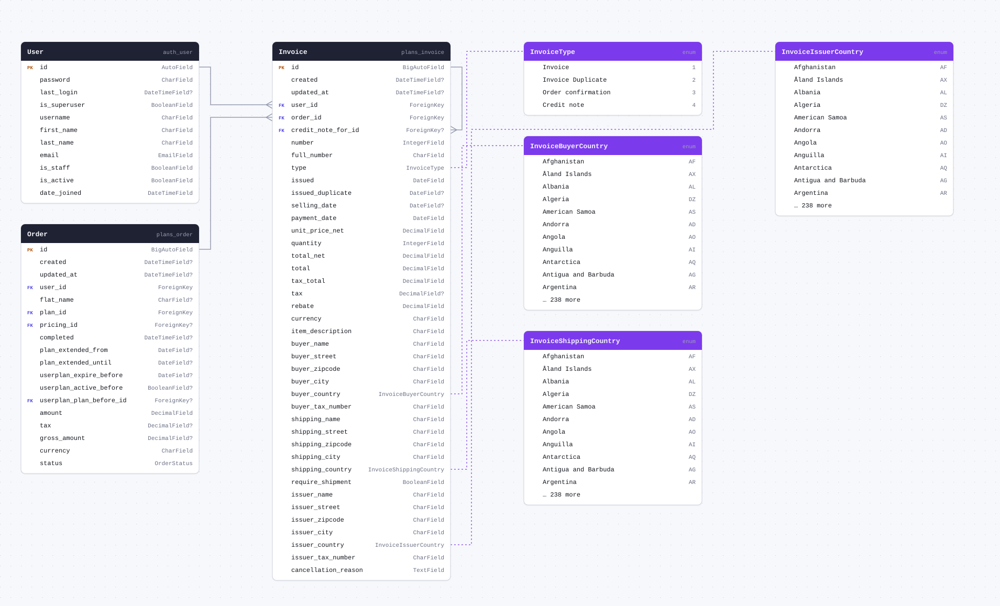

| Column | Field | Type | Null | Key | Default | Description |
| --- | --- | --- | --- | --- | --- | --- |
| `id` | `BigAutoField` | `integer` |  | PK | `autoincrement()` |  |
| `created` | `DateTimeField` | `datetime` | yes |  | `now()` |  |
| `updated_at` | `DateTimeField` | `datetime` | yes |  | `now()` |  |
| `user_id` | `ForeignKey` | `integer` |  | FK |  |  |
| `order_id` | `ForeignKey` | `bigint` |  | FK |  |  |
| `credit_note_for_id` | `ForeignKey` | `bigint` | yes | FK |  |  |
| `number` | `IntegerField` | `integer` |  |  |  |  |
| `full_number` | `CharField` | `varchar(200)` |  |  |  |  |
| `type` | `InvoiceType` | `integer` |  |  | `1` |  |
| `issued` | `DateField` | `date` |  |  |  |  |
| `issued_duplicate` | `DateField` | `date` | yes |  |  |  |
| `selling_date` | `DateField` | `date` | yes |  |  |  |
| `payment_date` | `DateField` | `date` |  |  |  |  |
| `unit_price_net` | `DecimalField(7, 2)` | `decimal` |  |  |  |  |
| `quantity` | `IntegerField` | `integer` |  |  | `1` |  |
| `total_net` | `DecimalField(7, 2)` | `decimal` |  |  |  |  |
| `total` | `DecimalField(7, 2)` | `decimal` |  |  |  |  |
| `tax_total` | `DecimalField(7, 2)` | `decimal` |  |  |  |  |
| `tax` | `DecimalField(4, 2)` | `decimal` | yes |  |  |  |
| `rebate` | `DecimalField(4, 2)` | `decimal` |  |  | `Decimal('0')` |  |
| `currency` | `CharField` | `varchar(3)` |  |  | `'EUR'` |  |
| `item_description` | `CharField` | `varchar(200)` |  |  |  |  |
| `buyer_name` | `CharField` | `varchar(200)` |  |  |  |  |
| `buyer_street` | `CharField` | `varchar(200)` |  |  |  |  |
| `buyer_zipcode` | `CharField` | `varchar(200)` |  |  |  |  |
| `buyer_city` | `CharField` | `varchar(200)` |  |  |  |  |
| `buyer_country` | `InvoiceBuyerCountry` | `varchar(2)` |  |  | `'PL'` |  |
| `buyer_tax_number` | `CharField` | `varchar(200)` |  |  |  |  |
| `shipping_name` | `CharField` | `varchar(200)` |  |  |  |  |
| `shipping_street` | `CharField` | `varchar(200)` |  |  |  |  |
| `shipping_zipcode` | `CharField` | `varchar(200)` |  |  |  |  |
| `shipping_city` | `CharField` | `varchar(200)` |  |  |  |  |
| `shipping_country` | `InvoiceShippingCountry` | `varchar(2)` |  |  | `'PL'` |  |
| `require_shipment` | `BooleanField` | `bool` |  |  | `False` |  |
| `issuer_name` | `CharField` | `varchar(200)` |  |  |  |  |
| `issuer_street` | `CharField` | `varchar(200)` |  |  |  |  |
| `issuer_zipcode` | `CharField` | `varchar(200)` |  |  |  |  |
| `issuer_city` | `CharField` | `varchar(200)` |  |  |  |  |
| `issuer_country` | `InvoiceIssuerCountry` | `varchar(2)` |  |  | `'PL'` |  |
| `issuer_tax_number` | `CharField` | `varchar(200)` |  |  |  |  |
| `cancellation_reason` | `TextField` | `text` |  |  |  |  |

Indexes:

- index `plans_invoice_created_d7962606` on `created`
- index `plans_invoice_user_id_2acf7921` on `user_id`
- index `plans_invoice_order_id_85fdb39d` on `order_id`
- index `plans_invoice_credit_note_for_id_1da49395` on `credit_note_for_id`
- index `plans_invoice_number_029c6241` on `number`
- index `plans_invoice_type_d48ee091` on `type`
- index `plans_invoice_issued_74955383` on `issued`
- index `plans_invoice_issued_duplicate_3993f4e4` on `issued_duplicate`
- index `plans_invoice_selling_date_a8bf61a5` on `selling_date`
- index `plans_invoice_payment_date_165bea35` on `payment_date`
- index `plans_invoice_tax_bbc119a4` on `tax`
- index `plans_invoice_require_shipment_6591adce` on `require_shipment`

Relations:

- `user_id` → [User](#user).`id`, on delete cascade
- `order_id` → [Order](#order).`id`, on delete cascade
- `credit_note_for_id` → [Invoice](#invoice).`id`, on delete set null

## RecurringUserPlan

Table `plans_recurringuserplan`, app `plans`.

Columns from `AbstractRecurringUserPlan` (abstract): `user_plan_id`, `token`, `payment_provider`, `pricing_id`, `amount`, `tax`, `currency`, `renewal_triggered_by`, `_has_automatic_renewal_backup_deprecated`, `token_verified`, `card_expire_year`, `card_expire_month`, `card_masked_number`, `last_renewal_attempt`.

Columns from `BaseMixin` (abstract): `created`, `updated_at`.

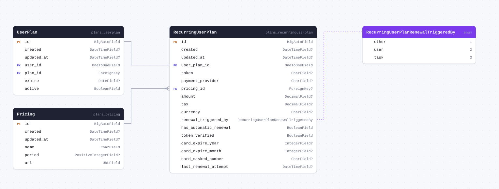

| Column | Field | Type | Null | Key | Default | Description |
| --- | --- | --- | --- | --- | --- | --- |
| `id` | `BigAutoField` | `integer` |  | PK | `autoincrement()` |  |
| `created` | `DateTimeField` | `datetime` | yes |  | `now()` |  |
| `updated_at` | `DateTimeField` | `datetime` | yes |  | `now()` |  |
| `user_plan_id` | `OneToOneField` | `bigint` |  | FK, unique |  |  |
| `token` | `CharField` | `varchar(255)` | yes |  | `None` | Token, that will be used for payment renewal. Depends on used payment provider |
| `payment_provider` | `CharField` | `varchar(255)` | yes |  | `None` | Provider, that will be used for payment renewal |
| `pricing_id` | `ForeignKey` | `bigint` | yes | FK | `None` | Recurring pricing |
| `amount` | `DecimalField(7, 2)` | `decimal` | yes |  |  |  |
| `tax` | `DecimalField(4, 2)` | `decimal` | yes |  |  |  |
| `currency` | `CharField` | `varchar(3)` | yes |  |  |  |
| `renewal_triggered_by` | `RecurringUserPlanRenewalTriggeredBy` | `integer` |  |  | `2` | The source of the associated plan's renewal (USER = user-initiated renewal, TASK = autorenew_account-task-initiated renewal, OTHER = renewal is triggered using another mechanism). |
| `has_automatic_renewal` | `BooleanField` | `bool` |  |  | `False` | Automatic renewal is enabled for associated plan. If False, the plan renewal can be still initiated by user. |
| `token_verified` | `BooleanField` | `bool` |  |  | `False` | The recurring token has been verified by at least one payment to be working. |
| `card_expire_year` | `IntegerField` | `integer` | yes |  |  |  |
| `card_expire_month` | `IntegerField` | `integer` | yes |  |  |  |
| `card_masked_number` | `CharField` | `varchar(255)` | yes |  |  |  |
| `last_renewal_attempt` | `DateTimeField` | `datetime` | yes |  |  |  |

Indexes:

- index `plans_recurringuserplan_created_e1b360e5` on `created`
- index `plans_recurringuserplan_pricing_id_d27a589c` on `pricing_id`
- index `plans_recurringuserplan_amount_bb726812` on `amount`
- index `plans_recurringuserplan_tax_fb303de5` on `tax`
- index `plans_recurringuserplan_renewal_triggered_by_c4ca3377` on `renewal_triggered_by`

Relations:

- `user_plan_id` → [UserPlan](#userplan).`id`, on delete cascade
- `pricing_id` → [Pricing](#pricing).`id`, on delete cascade

# Enums

## LogEntryActionFlag

| Name | Stored as |
| --- | --- |
| `Addition` | `1` |
| `Change` | `2` |
| `Deletion` | `3` |

## BillingInfoCountry

| Name | Stored as |
| --- | --- |
| `Afghanistan` | `AF` |
| `Åland Islands` | `AX` |
| `Albania` | `AL` |
| `Algeria` | `DZ` |
| `American Samoa` | `AS` |
| `Andorra` | `AD` |
| `Angola` | `AO` |
| `Anguilla` | `AI` |
| `Antarctica` | `AQ` |
| `Antigua and Barbuda` | `AG` |
| `Argentina` | `AR` |
| `Armenia` | `AM` |
| `Aruba` | `AW` |
| `Australia` | `AU` |
| `Austria` | `AT` |
| `Azerbaijan` | `AZ` |
| `Bahamas (The)` | `BS` |
| `Bahrain` | `BH` |
| `Bangladesh` | `BD` |
| `Barbados` | `BB` |
| `Belarus` | `BY` |
| `Belgium` | `BE` |
| `Belize` | `BZ` |
| `Benin` | `BJ` |
| `Bermuda` | `BM` |
| `Bhutan` | `BT` |
| `Bolivia` | `BO` |
| `Bonaire, Sint Eustatius and Saba` | `BQ` |
| `Bosnia and Herzegovina` | `BA` |
| `Botswana` | `BW` |
| `Bouvet Island` | `BV` |
| `Brazil` | `BR` |
| `British Indian Ocean Territory` | `IO` |
| `Brunei` | `BN` |
| `Bulgaria` | `BG` |
| `Burkina Faso` | `BF` |
| `Burundi` | `BI` |
| `Cabo Verde` | `CV` |
| `Cambodia` | `KH` |
| `Cameroon` | `CM` |
| `Canada` | `CA` |
| `Cayman Islands` | `KY` |
| `Central African Republic` | `CF` |
| `Chad` | `TD` |
| `Chile` | `CL` |
| `China` | `CN` |
| `Christmas Island` | `CX` |
| `Cocos (Keeling) Islands` | `CC` |
| `Colombia` | `CO` |
| `Comoros` | `KM` |
| `Congo` | `CG` |
| `Cook Islands` | `CK` |
| `Costa Rica` | `CR` |
| `Côte d'Ivoire` | `CI` |
| `Croatia` | `HR` |
| `Cuba` | `CU` |
| `Curaçao` | `CW` |
| `Cyprus` | `CY` |
| `Czechia` | `CZ` |
| `Democratic Republic of the Congo` | `CD` |
| `Denmark` | `DK` |
| `Djibouti` | `DJ` |
| `Dominica` | `DM` |
| `Dominican Republic` | `DO` |
| `Ecuador` | `EC` |
| `Egypt` | `EG` |
| `El Salvador` | `SV` |
| `Equatorial Guinea` | `GQ` |
| `Eritrea` | `ER` |
| `Estonia` | `EE` |
| `Eswatini` | `SZ` |
| `Ethiopia` | `ET` |
| `Falkland Islands (Malvinas)` | `FK` |
| `Faroe Islands` | `FO` |
| `Fiji` | `FJ` |
| `Finland` | `FI` |
| `France` | `FR` |
| `French Guiana` | `GF` |
| `French Polynesia` | `PF` |
| `French Southern Territories` | `TF` |
| `Gabon` | `GA` |
| `Gambia` | `GM` |
| `Georgia` | `GE` |
| `Germany` | `DE` |
| `Ghana` | `GH` |
| `Gibraltar` | `GI` |
| `Greece` | `GR` |
| `Greenland` | `GL` |
| `Grenada` | `GD` |
| `Guadeloupe` | `GP` |
| `Guam` | `GU` |
| `Guatemala` | `GT` |
| `Guernsey` | `GG` |
| `Guinea` | `GN` |
| `Guinea-Bissau` | `GW` |
| `Guyana` | `GY` |
| `Haiti` | `HT` |
| `Heard Island and McDonald Islands` | `HM` |
| `Honduras` | `HN` |
| `Hong Kong` | `HK` |
| `Hungary` | `HU` |
| `Iceland` | `IS` |
| `India` | `IN` |
| `Indonesia` | `ID` |
| `Iran` | `IR` |
| `Iraq` | `IQ` |
| `Ireland` | `IE` |
| `Isle of Man` | `IM` |
| `Israel` | `IL` |
| `Italy` | `IT` |
| `Jamaica` | `JM` |
| `Japan` | `JP` |
| `Jersey` | `JE` |
| `Jordan` | `JO` |
| `Kazakhstan` | `KZ` |
| `Kenya` | `KE` |
| `Kiribati` | `KI` |
| `Kuwait` | `KW` |
| `Kyrgyzstan` | `KG` |
| `Laos` | `LA` |
| `Latvia` | `LV` |
| `Lebanon` | `LB` |
| `Lesotho` | `LS` |
| `Liberia` | `LR` |
| `Libya` | `LY` |
| `Liechtenstein` | `LI` |
| `Lithuania` | `LT` |
| `Luxembourg` | `LU` |
| `Macao` | `MO` |
| `Madagascar` | `MG` |
| `Malawi` | `MW` |
| `Malaysia` | `MY` |
| `Maldives` | `MV` |
| `Mali` | `ML` |
| `Malta` | `MT` |
| `Marshall Islands` | `MH` |
| `Martinique` | `MQ` |
| `Mauritania` | `MR` |
| `Mauritius` | `MU` |
| `Mayotte` | `YT` |
| `Mexico` | `MX` |
| `Micronesia` | `FM` |
| `Moldova` | `MD` |
| `Monaco` | `MC` |
| `Mongolia` | `MN` |
| `Montenegro` | `ME` |
| `Montserrat` | `MS` |
| `Morocco` | `MA` |
| `Mozambique` | `MZ` |
| `Myanmar` | `MM` |
| `Namibia` | `NA` |
| `Naoero` | `NR` |
| `Nepal` | `NP` |
| `Netherlands` | `NL` |
| `New Caledonia` | `NC` |
| `New Zealand` | `NZ` |
| `Nicaragua` | `NI` |
| `Niger` | `NE` |
| `Nigeria` | `NG` |
| `Niue` | `NU` |
| `Norfolk Island` | `NF` |
| `North Korea` | `KP` |
| `North Macedonia` | `MK` |
| `Northern Mariana Islands` | `MP` |
| `Norway` | `NO` |
| `Oman` | `OM` |
| `Pakistan` | `PK` |
| `Palau` | `PW` |
| `Palestine` | `PS` |
| `Panama` | `PA` |
| `Papua New Guinea` | `PG` |
| `Paraguay` | `PY` |
| `Peru` | `PE` |
| `Philippines` | `PH` |
| `Pitcairn` | `PN` |
| `Poland` | `PL` |
| `Portugal` | `PT` |
| `Puerto Rico` | `PR` |
| `Qatar` | `QA` |
| `Réunion` | `RE` |
| `Romania` | `RO` |
| `Russia` | `RU` |
| `Rwanda` | `RW` |
| `Saint Barthélemy` | `BL` |
| `Saint Helena` | `SH` |
| `Saint Kitts and Nevis` | `KN` |
| `Saint Lucia` | `LC` |
| `Saint Martin (French part)` | `MF` |
| `Saint Pierre and Miquelon` | `PM` |
| `Saint Vincent and the Grenadines` | `VC` |
| `Samoa` | `WS` |
| `San Marino` | `SM` |
| `Sao Tome and Principe` | `ST` |
| `Saudi Arabia` | `SA` |
| `Senegal` | `SN` |
| `Serbia` | `RS` |
| `Seychelles` | `SC` |
| `Sierra Leone` | `SL` |
| `Singapore` | `SG` |
| `Sint Maarten (Dutch part)` | `SX` |
| `Slovakia` | `SK` |
| `Slovenia` | `SI` |
| `Solomon Islands` | `SB` |
| `Somalia` | `SO` |
| `South Africa` | `ZA` |
| `South Georgia` | `GS` |
| `South Korea` | `KR` |
| `South Sudan` | `SS` |
| `Spain` | `ES` |
| `Sri Lanka` | `LK` |
| `Sudan` | `SD` |
| `Suriname` | `SR` |
| `Svalbard and Jan Mayen` | `SJ` |
| `Sweden` | `SE` |
| `Switzerland` | `CH` |
| `Syria` | `SY` |
| `Taiwan` | `TW` |
| `Tajikistan` | `TJ` |
| `Tanzania` | `TZ` |
| `Thailand` | `TH` |
| `Timor-Leste` | `TL` |
| `Togo` | `TG` |
| `Tokelau` | `TK` |
| `Tonga` | `TO` |
| `Trinidad and Tobago` | `TT` |
| `Tunisia` | `TN` |
| `Türkiye` | `TR` |
| `Turkmenistan` | `TM` |
| `Turks and Caicos Islands` | `TC` |
| `Tuvalu` | `TV` |
| `Uganda` | `UG` |
| `Ukraine` | `UA` |
| `United Arab Emirates` | `AE` |
| `United Kingdom` | `GB` |
| `United States Minor Outlying Islands` | `UM` |
| `United States of America` | `US` |
| `Uruguay` | `UY` |
| `Uzbekistan` | `UZ` |
| `Vanuatu` | `VU` |
| `Vatican City` | `VA` |
| `Venezuela` | `VE` |
| `Vietnam` | `VN` |
| `Virgin Islands (British)` | `VG` |
| `Virgin Islands (U.S.)` | `VI` |
| `Wallis and Futuna` | `WF` |
| `Western Sahara` | `EH` |
| `Yemen` | `YE` |
| `Zambia` | `ZM` |
| `Zimbabwe` | `ZW` |

## OrderStatus

| Name | Stored as |
| --- | --- |
| `new` | `1` |
| `completed` | `2` |
| `not valid` | `3` |
| `canceled` | `4` |
| `returned` | `5` |

## InvoiceType

| Name | Stored as |
| --- | --- |
| `Invoice` | `1` |
| `Invoice Duplicate` | `2` |
| `Order confirmation` | `3` |
| `Credit note` | `4` |

## InvoiceBuyerCountry

| Name | Stored as |
| --- | --- |
| `Afghanistan` | `AF` |
| `Åland Islands` | `AX` |
| `Albania` | `AL` |
| `Algeria` | `DZ` |
| `American Samoa` | `AS` |
| `Andorra` | `AD` |
| `Angola` | `AO` |
| `Anguilla` | `AI` |
| `Antarctica` | `AQ` |
| `Antigua and Barbuda` | `AG` |
| `Argentina` | `AR` |
| `Armenia` | `AM` |
| `Aruba` | `AW` |
| `Australia` | `AU` |
| `Austria` | `AT` |
| `Azerbaijan` | `AZ` |
| `Bahamas (The)` | `BS` |
| `Bahrain` | `BH` |
| `Bangladesh` | `BD` |
| `Barbados` | `BB` |
| `Belarus` | `BY` |
| `Belgium` | `BE` |
| `Belize` | `BZ` |
| `Benin` | `BJ` |
| `Bermuda` | `BM` |
| `Bhutan` | `BT` |
| `Bolivia` | `BO` |
| `Bonaire, Sint Eustatius and Saba` | `BQ` |
| `Bosnia and Herzegovina` | `BA` |
| `Botswana` | `BW` |
| `Bouvet Island` | `BV` |
| `Brazil` | `BR` |
| `British Indian Ocean Territory` | `IO` |
| `Brunei` | `BN` |
| `Bulgaria` | `BG` |
| `Burkina Faso` | `BF` |
| `Burundi` | `BI` |
| `Cabo Verde` | `CV` |
| `Cambodia` | `KH` |
| `Cameroon` | `CM` |
| `Canada` | `CA` |
| `Cayman Islands` | `KY` |
| `Central African Republic` | `CF` |
| `Chad` | `TD` |
| `Chile` | `CL` |
| `China` | `CN` |
| `Christmas Island` | `CX` |
| `Cocos (Keeling) Islands` | `CC` |
| `Colombia` | `CO` |
| `Comoros` | `KM` |
| `Congo` | `CG` |
| `Cook Islands` | `CK` |
| `Costa Rica` | `CR` |
| `Côte d'Ivoire` | `CI` |
| `Croatia` | `HR` |
| `Cuba` | `CU` |
| `Curaçao` | `CW` |
| `Cyprus` | `CY` |
| `Czechia` | `CZ` |
| `Democratic Republic of the Congo` | `CD` |
| `Denmark` | `DK` |
| `Djibouti` | `DJ` |
| `Dominica` | `DM` |
| `Dominican Republic` | `DO` |
| `Ecuador` | `EC` |
| `Egypt` | `EG` |
| `El Salvador` | `SV` |
| `Equatorial Guinea` | `GQ` |
| `Eritrea` | `ER` |
| `Estonia` | `EE` |
| `Eswatini` | `SZ` |
| `Ethiopia` | `ET` |
| `Falkland Islands (Malvinas)` | `FK` |
| `Faroe Islands` | `FO` |
| `Fiji` | `FJ` |
| `Finland` | `FI` |
| `France` | `FR` |
| `French Guiana` | `GF` |
| `French Polynesia` | `PF` |
| `French Southern Territories` | `TF` |
| `Gabon` | `GA` |
| `Gambia` | `GM` |
| `Georgia` | `GE` |
| `Germany` | `DE` |
| `Ghana` | `GH` |
| `Gibraltar` | `GI` |
| `Greece` | `GR` |
| `Greenland` | `GL` |
| `Grenada` | `GD` |
| `Guadeloupe` | `GP` |
| `Guam` | `GU` |
| `Guatemala` | `GT` |
| `Guernsey` | `GG` |
| `Guinea` | `GN` |
| `Guinea-Bissau` | `GW` |
| `Guyana` | `GY` |
| `Haiti` | `HT` |
| `Heard Island and McDonald Islands` | `HM` |
| `Honduras` | `HN` |
| `Hong Kong` | `HK` |
| `Hungary` | `HU` |
| `Iceland` | `IS` |
| `India` | `IN` |
| `Indonesia` | `ID` |
| `Iran` | `IR` |
| `Iraq` | `IQ` |
| `Ireland` | `IE` |
| `Isle of Man` | `IM` |
| `Israel` | `IL` |
| `Italy` | `IT` |
| `Jamaica` | `JM` |
| `Japan` | `JP` |
| `Jersey` | `JE` |
| `Jordan` | `JO` |
| `Kazakhstan` | `KZ` |
| `Kenya` | `KE` |
| `Kiribati` | `KI` |
| `Kuwait` | `KW` |
| `Kyrgyzstan` | `KG` |
| `Laos` | `LA` |
| `Latvia` | `LV` |
| `Lebanon` | `LB` |
| `Lesotho` | `LS` |
| `Liberia` | `LR` |
| `Libya` | `LY` |
| `Liechtenstein` | `LI` |
| `Lithuania` | `LT` |
| `Luxembourg` | `LU` |
| `Macao` | `MO` |
| `Madagascar` | `MG` |
| `Malawi` | `MW` |
| `Malaysia` | `MY` |
| `Maldives` | `MV` |
| `Mali` | `ML` |
| `Malta` | `MT` |
| `Marshall Islands` | `MH` |
| `Martinique` | `MQ` |
| `Mauritania` | `MR` |
| `Mauritius` | `MU` |
| `Mayotte` | `YT` |
| `Mexico` | `MX` |
| `Micronesia` | `FM` |
| `Moldova` | `MD` |
| `Monaco` | `MC` |
| `Mongolia` | `MN` |
| `Montenegro` | `ME` |
| `Montserrat` | `MS` |
| `Morocco` | `MA` |
| `Mozambique` | `MZ` |
| `Myanmar` | `MM` |
| `Namibia` | `NA` |
| `Naoero` | `NR` |
| `Nepal` | `NP` |
| `Netherlands` | `NL` |
| `New Caledonia` | `NC` |
| `New Zealand` | `NZ` |
| `Nicaragua` | `NI` |
| `Niger` | `NE` |
| `Nigeria` | `NG` |
| `Niue` | `NU` |
| `Norfolk Island` | `NF` |
| `North Korea` | `KP` |
| `North Macedonia` | `MK` |
| `Northern Mariana Islands` | `MP` |
| `Norway` | `NO` |
| `Oman` | `OM` |
| `Pakistan` | `PK` |
| `Palau` | `PW` |
| `Palestine` | `PS` |
| `Panama` | `PA` |
| `Papua New Guinea` | `PG` |
| `Paraguay` | `PY` |
| `Peru` | `PE` |
| `Philippines` | `PH` |
| `Pitcairn` | `PN` |
| `Poland` | `PL` |
| `Portugal` | `PT` |
| `Puerto Rico` | `PR` |
| `Qatar` | `QA` |
| `Réunion` | `RE` |
| `Romania` | `RO` |
| `Russia` | `RU` |
| `Rwanda` | `RW` |
| `Saint Barthélemy` | `BL` |
| `Saint Helena` | `SH` |
| `Saint Kitts and Nevis` | `KN` |
| `Saint Lucia` | `LC` |
| `Saint Martin (French part)` | `MF` |
| `Saint Pierre and Miquelon` | `PM` |
| `Saint Vincent and the Grenadines` | `VC` |
| `Samoa` | `WS` |
| `San Marino` | `SM` |
| `Sao Tome and Principe` | `ST` |
| `Saudi Arabia` | `SA` |
| `Senegal` | `SN` |
| `Serbia` | `RS` |
| `Seychelles` | `SC` |
| `Sierra Leone` | `SL` |
| `Singapore` | `SG` |
| `Sint Maarten (Dutch part)` | `SX` |
| `Slovakia` | `SK` |
| `Slovenia` | `SI` |
| `Solomon Islands` | `SB` |
| `Somalia` | `SO` |
| `South Africa` | `ZA` |
| `South Georgia` | `GS` |
| `South Korea` | `KR` |
| `South Sudan` | `SS` |
| `Spain` | `ES` |
| `Sri Lanka` | `LK` |
| `Sudan` | `SD` |
| `Suriname` | `SR` |
| `Svalbard and Jan Mayen` | `SJ` |
| `Sweden` | `SE` |
| `Switzerland` | `CH` |
| `Syria` | `SY` |
| `Taiwan` | `TW` |
| `Tajikistan` | `TJ` |
| `Tanzania` | `TZ` |
| `Thailand` | `TH` |
| `Timor-Leste` | `TL` |
| `Togo` | `TG` |
| `Tokelau` | `TK` |
| `Tonga` | `TO` |
| `Trinidad and Tobago` | `TT` |
| `Tunisia` | `TN` |
| `Türkiye` | `TR` |
| `Turkmenistan` | `TM` |
| `Turks and Caicos Islands` | `TC` |
| `Tuvalu` | `TV` |
| `Uganda` | `UG` |
| `Ukraine` | `UA` |
| `United Arab Emirates` | `AE` |
| `United Kingdom` | `GB` |
| `United States Minor Outlying Islands` | `UM` |
| `United States of America` | `US` |
| `Uruguay` | `UY` |
| `Uzbekistan` | `UZ` |
| `Vanuatu` | `VU` |
| `Vatican City` | `VA` |
| `Venezuela` | `VE` |
| `Vietnam` | `VN` |
| `Virgin Islands (British)` | `VG` |
| `Virgin Islands (U.S.)` | `VI` |
| `Wallis and Futuna` | `WF` |
| `Western Sahara` | `EH` |
| `Yemen` | `YE` |
| `Zambia` | `ZM` |
| `Zimbabwe` | `ZW` |

## InvoiceShippingCountry

| Name | Stored as |
| --- | --- |
| `Afghanistan` | `AF` |
| `Åland Islands` | `AX` |
| `Albania` | `AL` |
| `Algeria` | `DZ` |
| `American Samoa` | `AS` |
| `Andorra` | `AD` |
| `Angola` | `AO` |
| `Anguilla` | `AI` |
| `Antarctica` | `AQ` |
| `Antigua and Barbuda` | `AG` |
| `Argentina` | `AR` |
| `Armenia` | `AM` |
| `Aruba` | `AW` |
| `Australia` | `AU` |
| `Austria` | `AT` |
| `Azerbaijan` | `AZ` |
| `Bahamas (The)` | `BS` |
| `Bahrain` | `BH` |
| `Bangladesh` | `BD` |
| `Barbados` | `BB` |
| `Belarus` | `BY` |
| `Belgium` | `BE` |
| `Belize` | `BZ` |
| `Benin` | `BJ` |
| `Bermuda` | `BM` |
| `Bhutan` | `BT` |
| `Bolivia` | `BO` |
| `Bonaire, Sint Eustatius and Saba` | `BQ` |
| `Bosnia and Herzegovina` | `BA` |
| `Botswana` | `BW` |
| `Bouvet Island` | `BV` |
| `Brazil` | `BR` |
| `British Indian Ocean Territory` | `IO` |
| `Brunei` | `BN` |
| `Bulgaria` | `BG` |
| `Burkina Faso` | `BF` |
| `Burundi` | `BI` |
| `Cabo Verde` | `CV` |
| `Cambodia` | `KH` |
| `Cameroon` | `CM` |
| `Canada` | `CA` |
| `Cayman Islands` | `KY` |
| `Central African Republic` | `CF` |
| `Chad` | `TD` |
| `Chile` | `CL` |
| `China` | `CN` |
| `Christmas Island` | `CX` |
| `Cocos (Keeling) Islands` | `CC` |
| `Colombia` | `CO` |
| `Comoros` | `KM` |
| `Congo` | `CG` |
| `Cook Islands` | `CK` |
| `Costa Rica` | `CR` |
| `Côte d'Ivoire` | `CI` |
| `Croatia` | `HR` |
| `Cuba` | `CU` |
| `Curaçao` | `CW` |
| `Cyprus` | `CY` |
| `Czechia` | `CZ` |
| `Democratic Republic of the Congo` | `CD` |
| `Denmark` | `DK` |
| `Djibouti` | `DJ` |
| `Dominica` | `DM` |
| `Dominican Republic` | `DO` |
| `Ecuador` | `EC` |
| `Egypt` | `EG` |
| `El Salvador` | `SV` |
| `Equatorial Guinea` | `GQ` |
| `Eritrea` | `ER` |
| `Estonia` | `EE` |
| `Eswatini` | `SZ` |
| `Ethiopia` | `ET` |
| `Falkland Islands (Malvinas)` | `FK` |
| `Faroe Islands` | `FO` |
| `Fiji` | `FJ` |
| `Finland` | `FI` |
| `France` | `FR` |
| `French Guiana` | `GF` |
| `French Polynesia` | `PF` |
| `French Southern Territories` | `TF` |
| `Gabon` | `GA` |
| `Gambia` | `GM` |
| `Georgia` | `GE` |
| `Germany` | `DE` |
| `Ghana` | `GH` |
| `Gibraltar` | `GI` |
| `Greece` | `GR` |
| `Greenland` | `GL` |
| `Grenada` | `GD` |
| `Guadeloupe` | `GP` |
| `Guam` | `GU` |
| `Guatemala` | `GT` |
| `Guernsey` | `GG` |
| `Guinea` | `GN` |
| `Guinea-Bissau` | `GW` |
| `Guyana` | `GY` |
| `Haiti` | `HT` |
| `Heard Island and McDonald Islands` | `HM` |
| `Honduras` | `HN` |
| `Hong Kong` | `HK` |
| `Hungary` | `HU` |
| `Iceland` | `IS` |
| `India` | `IN` |
| `Indonesia` | `ID` |
| `Iran` | `IR` |
| `Iraq` | `IQ` |
| `Ireland` | `IE` |
| `Isle of Man` | `IM` |
| `Israel` | `IL` |
| `Italy` | `IT` |
| `Jamaica` | `JM` |
| `Japan` | `JP` |
| `Jersey` | `JE` |
| `Jordan` | `JO` |
| `Kazakhstan` | `KZ` |
| `Kenya` | `KE` |
| `Kiribati` | `KI` |
| `Kuwait` | `KW` |
| `Kyrgyzstan` | `KG` |
| `Laos` | `LA` |
| `Latvia` | `LV` |
| `Lebanon` | `LB` |
| `Lesotho` | `LS` |
| `Liberia` | `LR` |
| `Libya` | `LY` |
| `Liechtenstein` | `LI` |
| `Lithuania` | `LT` |
| `Luxembourg` | `LU` |
| `Macao` | `MO` |
| `Madagascar` | `MG` |
| `Malawi` | `MW` |
| `Malaysia` | `MY` |
| `Maldives` | `MV` |
| `Mali` | `ML` |
| `Malta` | `MT` |
| `Marshall Islands` | `MH` |
| `Martinique` | `MQ` |
| `Mauritania` | `MR` |
| `Mauritius` | `MU` |
| `Mayotte` | `YT` |
| `Mexico` | `MX` |
| `Micronesia` | `FM` |
| `Moldova` | `MD` |
| `Monaco` | `MC` |
| `Mongolia` | `MN` |
| `Montenegro` | `ME` |
| `Montserrat` | `MS` |
| `Morocco` | `MA` |
| `Mozambique` | `MZ` |
| `Myanmar` | `MM` |
| `Namibia` | `NA` |
| `Naoero` | `NR` |
| `Nepal` | `NP` |
| `Netherlands` | `NL` |
| `New Caledonia` | `NC` |
| `New Zealand` | `NZ` |
| `Nicaragua` | `NI` |
| `Niger` | `NE` |
| `Nigeria` | `NG` |
| `Niue` | `NU` |
| `Norfolk Island` | `NF` |
| `North Korea` | `KP` |
| `North Macedonia` | `MK` |
| `Northern Mariana Islands` | `MP` |
| `Norway` | `NO` |
| `Oman` | `OM` |
| `Pakistan` | `PK` |
| `Palau` | `PW` |
| `Palestine` | `PS` |
| `Panama` | `PA` |
| `Papua New Guinea` | `PG` |
| `Paraguay` | `PY` |
| `Peru` | `PE` |
| `Philippines` | `PH` |
| `Pitcairn` | `PN` |
| `Poland` | `PL` |
| `Portugal` | `PT` |
| `Puerto Rico` | `PR` |
| `Qatar` | `QA` |
| `Réunion` | `RE` |
| `Romania` | `RO` |
| `Russia` | `RU` |
| `Rwanda` | `RW` |
| `Saint Barthélemy` | `BL` |
| `Saint Helena` | `SH` |
| `Saint Kitts and Nevis` | `KN` |
| `Saint Lucia` | `LC` |
| `Saint Martin (French part)` | `MF` |
| `Saint Pierre and Miquelon` | `PM` |
| `Saint Vincent and the Grenadines` | `VC` |
| `Samoa` | `WS` |
| `San Marino` | `SM` |
| `Sao Tome and Principe` | `ST` |
| `Saudi Arabia` | `SA` |
| `Senegal` | `SN` |
| `Serbia` | `RS` |
| `Seychelles` | `SC` |
| `Sierra Leone` | `SL` |
| `Singapore` | `SG` |
| `Sint Maarten (Dutch part)` | `SX` |
| `Slovakia` | `SK` |
| `Slovenia` | `SI` |
| `Solomon Islands` | `SB` |
| `Somalia` | `SO` |
| `South Africa` | `ZA` |
| `South Georgia` | `GS` |
| `South Korea` | `KR` |
| `South Sudan` | `SS` |
| `Spain` | `ES` |
| `Sri Lanka` | `LK` |
| `Sudan` | `SD` |
| `Suriname` | `SR` |
| `Svalbard and Jan Mayen` | `SJ` |
| `Sweden` | `SE` |
| `Switzerland` | `CH` |
| `Syria` | `SY` |
| `Taiwan` | `TW` |
| `Tajikistan` | `TJ` |
| `Tanzania` | `TZ` |
| `Thailand` | `TH` |
| `Timor-Leste` | `TL` |
| `Togo` | `TG` |
| `Tokelau` | `TK` |
| `Tonga` | `TO` |
| `Trinidad and Tobago` | `TT` |
| `Tunisia` | `TN` |
| `Türkiye` | `TR` |
| `Turkmenistan` | `TM` |
| `Turks and Caicos Islands` | `TC` |
| `Tuvalu` | `TV` |
| `Uganda` | `UG` |
| `Ukraine` | `UA` |
| `United Arab Emirates` | `AE` |
| `United Kingdom` | `GB` |
| `United States Minor Outlying Islands` | `UM` |
| `United States of America` | `US` |
| `Uruguay` | `UY` |
| `Uzbekistan` | `UZ` |
| `Vanuatu` | `VU` |
| `Vatican City` | `VA` |
| `Venezuela` | `VE` |
| `Vietnam` | `VN` |
| `Virgin Islands (British)` | `VG` |
| `Virgin Islands (U.S.)` | `VI` |
| `Wallis and Futuna` | `WF` |
| `Western Sahara` | `EH` |
| `Yemen` | `YE` |
| `Zambia` | `ZM` |
| `Zimbabwe` | `ZW` |

## InvoiceIssuerCountry

| Name | Stored as |
| --- | --- |
| `Afghanistan` | `AF` |
| `Åland Islands` | `AX` |
| `Albania` | `AL` |
| `Algeria` | `DZ` |
| `American Samoa` | `AS` |
| `Andorra` | `AD` |
| `Angola` | `AO` |
| `Anguilla` | `AI` |
| `Antarctica` | `AQ` |
| `Antigua and Barbuda` | `AG` |
| `Argentina` | `AR` |
| `Armenia` | `AM` |
| `Aruba` | `AW` |
| `Australia` | `AU` |
| `Austria` | `AT` |
| `Azerbaijan` | `AZ` |
| `Bahamas (The)` | `BS` |
| `Bahrain` | `BH` |
| `Bangladesh` | `BD` |
| `Barbados` | `BB` |
| `Belarus` | `BY` |
| `Belgium` | `BE` |
| `Belize` | `BZ` |
| `Benin` | `BJ` |
| `Bermuda` | `BM` |
| `Bhutan` | `BT` |
| `Bolivia` | `BO` |
| `Bonaire, Sint Eustatius and Saba` | `BQ` |
| `Bosnia and Herzegovina` | `BA` |
| `Botswana` | `BW` |
| `Bouvet Island` | `BV` |
| `Brazil` | `BR` |
| `British Indian Ocean Territory` | `IO` |
| `Brunei` | `BN` |
| `Bulgaria` | `BG` |
| `Burkina Faso` | `BF` |
| `Burundi` | `BI` |
| `Cabo Verde` | `CV` |
| `Cambodia` | `KH` |
| `Cameroon` | `CM` |
| `Canada` | `CA` |
| `Cayman Islands` | `KY` |
| `Central African Republic` | `CF` |
| `Chad` | `TD` |
| `Chile` | `CL` |
| `China` | `CN` |
| `Christmas Island` | `CX` |
| `Cocos (Keeling) Islands` | `CC` |
| `Colombia` | `CO` |
| `Comoros` | `KM` |
| `Congo` | `CG` |
| `Cook Islands` | `CK` |
| `Costa Rica` | `CR` |
| `Côte d'Ivoire` | `CI` |
| `Croatia` | `HR` |
| `Cuba` | `CU` |
| `Curaçao` | `CW` |
| `Cyprus` | `CY` |
| `Czechia` | `CZ` |
| `Democratic Republic of the Congo` | `CD` |
| `Denmark` | `DK` |
| `Djibouti` | `DJ` |
| `Dominica` | `DM` |
| `Dominican Republic` | `DO` |
| `Ecuador` | `EC` |
| `Egypt` | `EG` |
| `El Salvador` | `SV` |
| `Equatorial Guinea` | `GQ` |
| `Eritrea` | `ER` |
| `Estonia` | `EE` |
| `Eswatini` | `SZ` |
| `Ethiopia` | `ET` |
| `Falkland Islands (Malvinas)` | `FK` |
| `Faroe Islands` | `FO` |
| `Fiji` | `FJ` |
| `Finland` | `FI` |
| `France` | `FR` |
| `French Guiana` | `GF` |
| `French Polynesia` | `PF` |
| `French Southern Territories` | `TF` |
| `Gabon` | `GA` |
| `Gambia` | `GM` |
| `Georgia` | `GE` |
| `Germany` | `DE` |
| `Ghana` | `GH` |
| `Gibraltar` | `GI` |
| `Greece` | `GR` |
| `Greenland` | `GL` |
| `Grenada` | `GD` |
| `Guadeloupe` | `GP` |
| `Guam` | `GU` |
| `Guatemala` | `GT` |
| `Guernsey` | `GG` |
| `Guinea` | `GN` |
| `Guinea-Bissau` | `GW` |
| `Guyana` | `GY` |
| `Haiti` | `HT` |
| `Heard Island and McDonald Islands` | `HM` |
| `Honduras` | `HN` |
| `Hong Kong` | `HK` |
| `Hungary` | `HU` |
| `Iceland` | `IS` |
| `India` | `IN` |
| `Indonesia` | `ID` |
| `Iran` | `IR` |
| `Iraq` | `IQ` |
| `Ireland` | `IE` |
| `Isle of Man` | `IM` |
| `Israel` | `IL` |
| `Italy` | `IT` |
| `Jamaica` | `JM` |
| `Japan` | `JP` |
| `Jersey` | `JE` |
| `Jordan` | `JO` |
| `Kazakhstan` | `KZ` |
| `Kenya` | `KE` |
| `Kiribati` | `KI` |
| `Kuwait` | `KW` |
| `Kyrgyzstan` | `KG` |
| `Laos` | `LA` |
| `Latvia` | `LV` |
| `Lebanon` | `LB` |
| `Lesotho` | `LS` |
| `Liberia` | `LR` |
| `Libya` | `LY` |
| `Liechtenstein` | `LI` |
| `Lithuania` | `LT` |
| `Luxembourg` | `LU` |
| `Macao` | `MO` |
| `Madagascar` | `MG` |
| `Malawi` | `MW` |
| `Malaysia` | `MY` |
| `Maldives` | `MV` |
| `Mali` | `ML` |
| `Malta` | `MT` |
| `Marshall Islands` | `MH` |
| `Martinique` | `MQ` |
| `Mauritania` | `MR` |
| `Mauritius` | `MU` |
| `Mayotte` | `YT` |
| `Mexico` | `MX` |
| `Micronesia` | `FM` |
| `Moldova` | `MD` |
| `Monaco` | `MC` |
| `Mongolia` | `MN` |
| `Montenegro` | `ME` |
| `Montserrat` | `MS` |
| `Morocco` | `MA` |
| `Mozambique` | `MZ` |
| `Myanmar` | `MM` |
| `Namibia` | `NA` |
| `Naoero` | `NR` |
| `Nepal` | `NP` |
| `Netherlands` | `NL` |
| `New Caledonia` | `NC` |
| `New Zealand` | `NZ` |
| `Nicaragua` | `NI` |
| `Niger` | `NE` |
| `Nigeria` | `NG` |
| `Niue` | `NU` |
| `Norfolk Island` | `NF` |
| `North Korea` | `KP` |
| `North Macedonia` | `MK` |
| `Northern Mariana Islands` | `MP` |
| `Norway` | `NO` |
| `Oman` | `OM` |
| `Pakistan` | `PK` |
| `Palau` | `PW` |
| `Palestine` | `PS` |
| `Panama` | `PA` |
| `Papua New Guinea` | `PG` |
| `Paraguay` | `PY` |
| `Peru` | `PE` |
| `Philippines` | `PH` |
| `Pitcairn` | `PN` |
| `Poland` | `PL` |
| `Portugal` | `PT` |
| `Puerto Rico` | `PR` |
| `Qatar` | `QA` |
| `Réunion` | `RE` |
| `Romania` | `RO` |
| `Russia` | `RU` |
| `Rwanda` | `RW` |
| `Saint Barthélemy` | `BL` |
| `Saint Helena` | `SH` |
| `Saint Kitts and Nevis` | `KN` |
| `Saint Lucia` | `LC` |
| `Saint Martin (French part)` | `MF` |
| `Saint Pierre and Miquelon` | `PM` |
| `Saint Vincent and the Grenadines` | `VC` |
| `Samoa` | `WS` |
| `San Marino` | `SM` |
| `Sao Tome and Principe` | `ST` |
| `Saudi Arabia` | `SA` |
| `Senegal` | `SN` |
| `Serbia` | `RS` |
| `Seychelles` | `SC` |
| `Sierra Leone` | `SL` |
| `Singapore` | `SG` |
| `Sint Maarten (Dutch part)` | `SX` |
| `Slovakia` | `SK` |
| `Slovenia` | `SI` |
| `Solomon Islands` | `SB` |
| `Somalia` | `SO` |
| `South Africa` | `ZA` |
| `South Georgia` | `GS` |
| `South Korea` | `KR` |
| `South Sudan` | `SS` |
| `Spain` | `ES` |
| `Sri Lanka` | `LK` |
| `Sudan` | `SD` |
| `Suriname` | `SR` |
| `Svalbard and Jan Mayen` | `SJ` |
| `Sweden` | `SE` |
| `Switzerland` | `CH` |
| `Syria` | `SY` |
| `Taiwan` | `TW` |
| `Tajikistan` | `TJ` |
| `Tanzania` | `TZ` |
| `Thailand` | `TH` |
| `Timor-Leste` | `TL` |
| `Togo` | `TG` |
| `Tokelau` | `TK` |
| `Tonga` | `TO` |
| `Trinidad and Tobago` | `TT` |
| `Tunisia` | `TN` |
| `Türkiye` | `TR` |
| `Turkmenistan` | `TM` |
| `Turks and Caicos Islands` | `TC` |
| `Tuvalu` | `TV` |
| `Uganda` | `UG` |
| `Ukraine` | `UA` |
| `United Arab Emirates` | `AE` |
| `United Kingdom` | `GB` |
| `United States Minor Outlying Islands` | `UM` |
| `United States of America` | `US` |
| `Uruguay` | `UY` |
| `Uzbekistan` | `UZ` |
| `Vanuatu` | `VU` |
| `Vatican City` | `VA` |
| `Venezuela` | `VE` |
| `Vietnam` | `VN` |
| `Virgin Islands (British)` | `VG` |
| `Virgin Islands (U.S.)` | `VI` |
| `Wallis and Futuna` | `WF` |
| `Western Sahara` | `EH` |
| `Yemen` | `YE` |
| `Zambia` | `ZM` |
| `Zimbabwe` | `ZW` |

## RecurringUserPlanRenewalTriggeredBy

| Name | Stored as |
| --- | --- |
| `other` | `1` |
| `user` | `2` |
| `task` | `3` |
