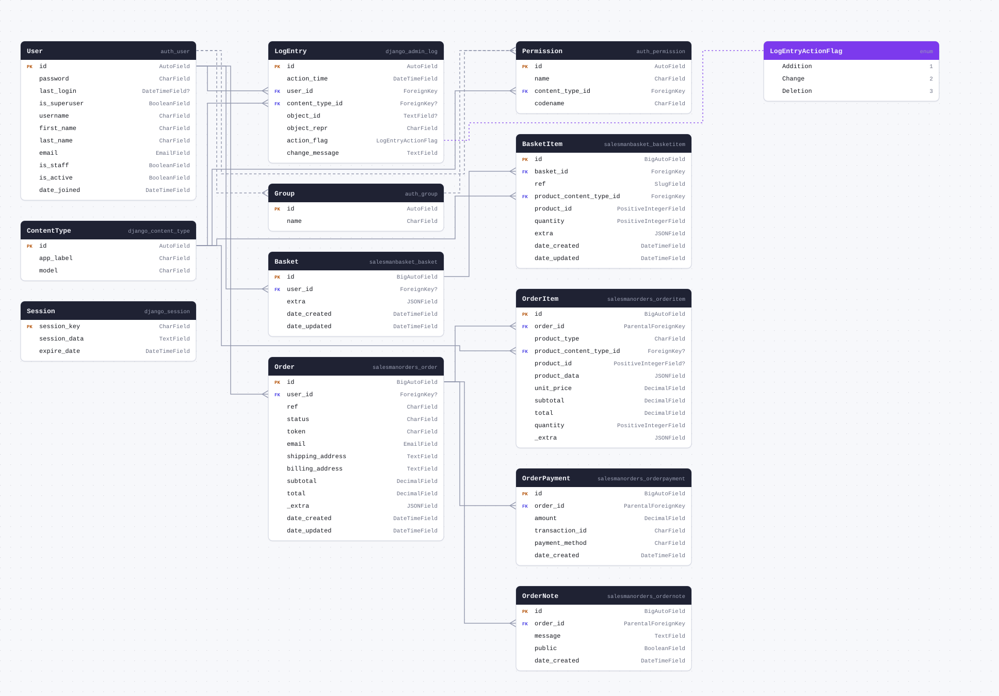
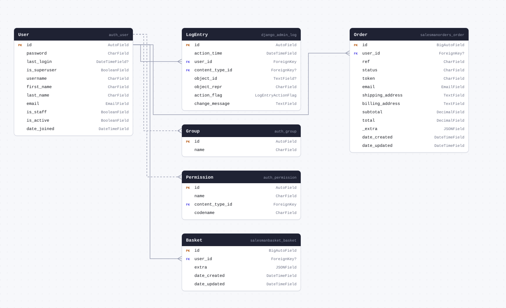
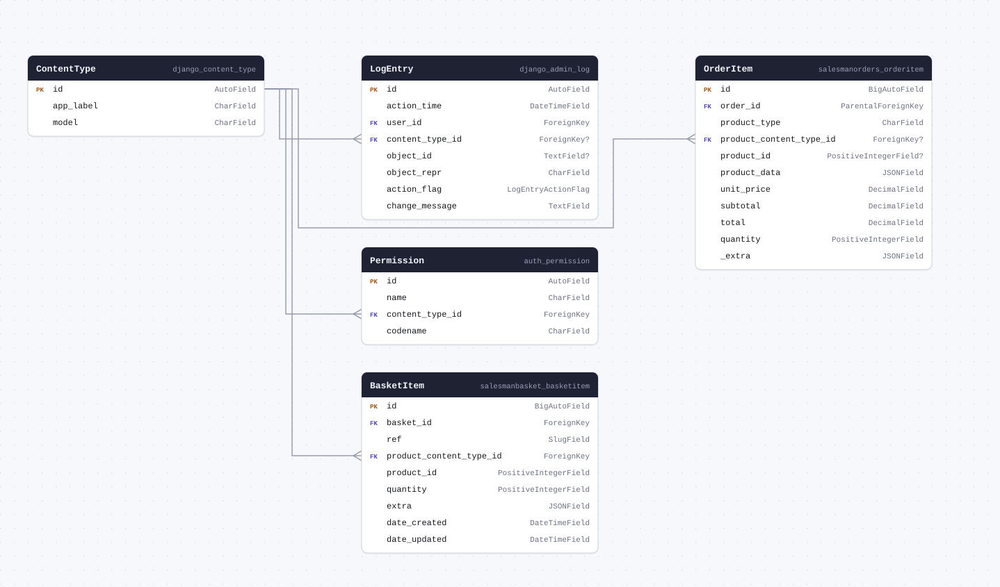
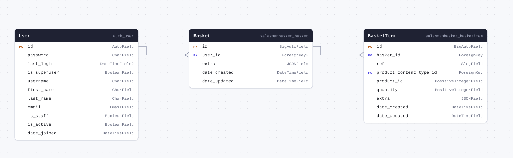
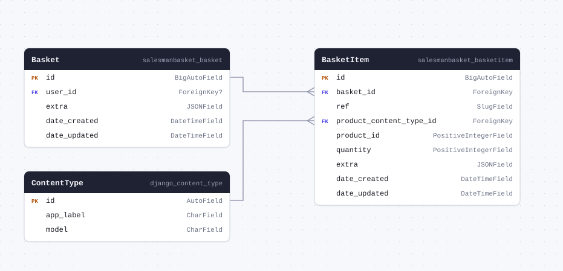
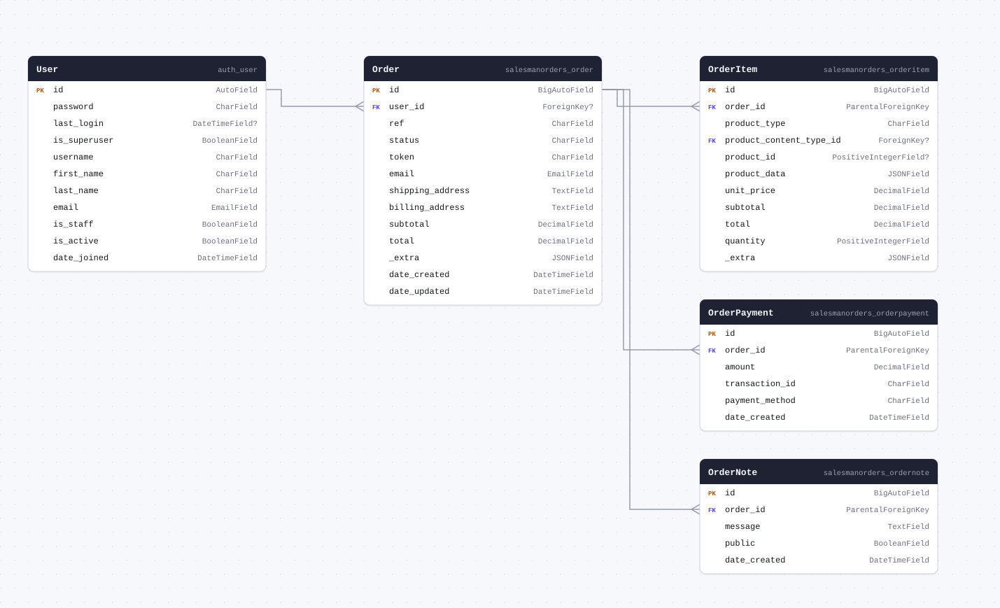
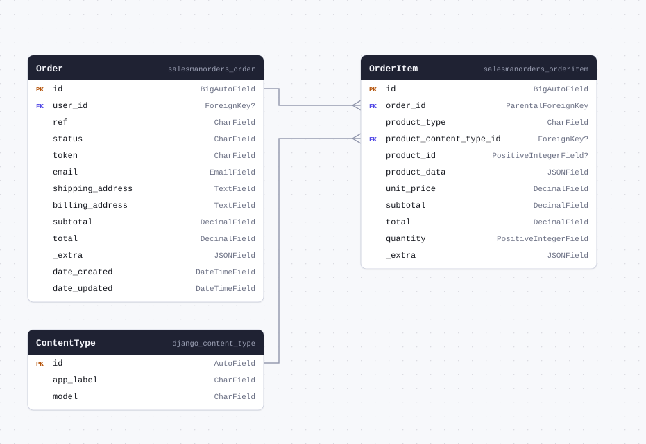
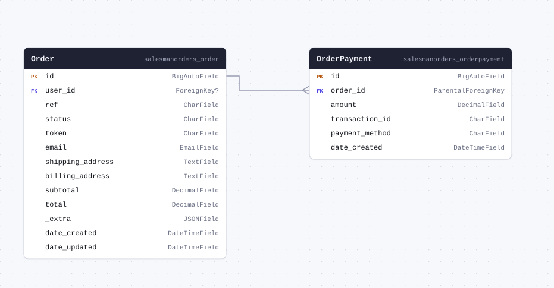
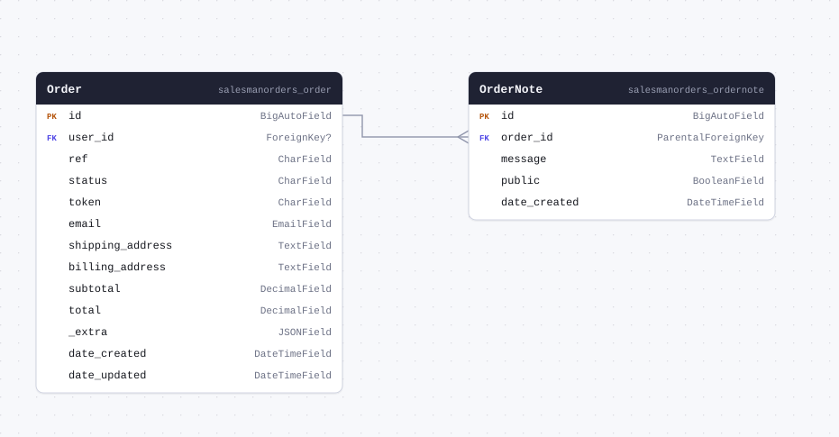

# Schema docs



[LogEntry](#logentry) · [Permission](#permission) · [Group](#group) · [User](#user) · [ContentType](#contenttype) · [Session](#session) · [Basket](#basket) · [BasketItem](#basketitem) · [Order](#order) · [OrderItem](#orderitem) · [OrderPayment](#orderpayment) · [OrderNote](#ordernote)

<details>
<summary>The whole schema as SQL</summary>

```sql
CREATE TABLE "django_admin_log" ("id" integer NOT NULL PRIMARY KEY AUTOINCREMENT, "action_time" datetime NOT NULL, "user_id" integer NOT NULL REFERENCES "auth_user" ("id") DEFERRABLE INITIALLY DEFERRED, "content_type_id" integer NULL REFERENCES "django_content_type" ("id") DEFERRABLE INITIALLY DEFERRED, "object_id" text NULL, "object_repr" varchar(200) NOT NULL, "action_flag" smallint unsigned NOT NULL CHECK ("action_flag" >= 0), "change_message" text NOT NULL);

CREATE TABLE "auth_permission" ("id" integer NOT NULL PRIMARY KEY AUTOINCREMENT, "name" varchar(255) NOT NULL, "content_type_id" integer NOT NULL REFERENCES "django_content_type" ("id") DEFERRABLE INITIALLY DEFERRED, "codename" varchar(100) NOT NULL);

CREATE TABLE "auth_group" ("id" integer NOT NULL PRIMARY KEY AUTOINCREMENT, "name" varchar(150) NOT NULL UNIQUE);

CREATE TABLE "auth_group_permissions" ("id" integer NOT NULL PRIMARY KEY AUTOINCREMENT, "group_id" integer NOT NULL REFERENCES "auth_group" ("id") DEFERRABLE INITIALLY DEFERRED, "permission_id" integer NOT NULL REFERENCES "auth_permission" ("id") DEFERRABLE INITIALLY DEFERRED);

CREATE TABLE "auth_user" ("id" integer NOT NULL PRIMARY KEY AUTOINCREMENT, "password" varchar(128) NOT NULL, "last_login" datetime NULL, "is_superuser" bool NOT NULL, "username" varchar(150) NOT NULL UNIQUE, "first_name" varchar(150) NOT NULL, "last_name" varchar(150) NOT NULL, "email" varchar(254) NOT NULL, "is_staff" bool NOT NULL, "is_active" bool NOT NULL, "date_joined" datetime NOT NULL);

CREATE TABLE "auth_user_groups" ("id" integer NOT NULL PRIMARY KEY AUTOINCREMENT, "user_id" integer NOT NULL REFERENCES "auth_user" ("id") DEFERRABLE INITIALLY DEFERRED, "group_id" integer NOT NULL REFERENCES "auth_group" ("id") DEFERRABLE INITIALLY DEFERRED);

CREATE TABLE "auth_user_user_permissions" ("id" integer NOT NULL PRIMARY KEY AUTOINCREMENT, "user_id" integer NOT NULL REFERENCES "auth_user" ("id") DEFERRABLE INITIALLY DEFERRED, "permission_id" integer NOT NULL REFERENCES "auth_permission" ("id") DEFERRABLE INITIALLY DEFERRED);

CREATE TABLE "django_content_type" ("id" integer NOT NULL PRIMARY KEY AUTOINCREMENT, "app_label" varchar(100) NOT NULL, "model" varchar(100) NOT NULL);

CREATE TABLE "django_session" ("session_key" varchar(40) NOT NULL PRIMARY KEY, "session_data" text NOT NULL, "expire_date" datetime NOT NULL);

CREATE TABLE "salesmanbasket_basket" ("id" integer NOT NULL PRIMARY KEY AUTOINCREMENT, "user_id" integer NULL REFERENCES "auth_user" ("id") DEFERRABLE INITIALLY DEFERRED, "extra" text NOT NULL CHECK ((JSON_VALID("extra") OR "extra" IS NULL)), "date_created" datetime NOT NULL, "date_updated" datetime NOT NULL);

CREATE TABLE "salesmanbasket_basketitem" ("id" integer NOT NULL PRIMARY KEY AUTOINCREMENT, "basket_id" bigint NOT NULL REFERENCES "salesmanbasket_basket" ("id") DEFERRABLE INITIALLY DEFERRED, "ref" varchar(128) NOT NULL, "product_content_type_id" integer NOT NULL REFERENCES "django_content_type" ("id") DEFERRABLE INITIALLY DEFERRED, "product_id" integer unsigned NOT NULL CHECK ("product_id" >= 0), "quantity" integer unsigned NOT NULL CHECK ("quantity" >= 0), "extra" text NOT NULL CHECK ((JSON_VALID("extra") OR "extra" IS NULL)), "date_created" datetime NOT NULL, "date_updated" datetime NOT NULL);

CREATE TABLE "salesmanorders_order" ("id" integer NOT NULL PRIMARY KEY AUTOINCREMENT, "user_id" integer NULL REFERENCES "auth_user" ("id") DEFERRABLE INITIALLY DEFERRED, "ref" varchar(128) NOT NULL UNIQUE, "status" varchar(128) NOT NULL, "token" varchar(128) NOT NULL UNIQUE, "email" varchar(254) NOT NULL, "shipping_address" text NOT NULL, "billing_address" text NOT NULL, "subtotal" decimal NOT NULL, "total" decimal NOT NULL, "_extra" text NOT NULL CHECK ((JSON_VALID("_extra") OR "_extra" IS NULL)), "date_created" datetime NOT NULL, "date_updated" datetime NOT NULL);

CREATE TABLE "salesmanorders_orderitem" ("id" integer NOT NULL PRIMARY KEY AUTOINCREMENT, "order_id" bigint NOT NULL REFERENCES "salesmanorders_order" ("id") DEFERRABLE INITIALLY DEFERRED, "product_type" varchar(128) NOT NULL, "product_content_type_id" integer NULL REFERENCES "django_content_type" ("id") DEFERRABLE INITIALLY DEFERRED, "product_id" integer unsigned NULL CHECK ("product_id" >= 0), "product_data" text NOT NULL CHECK ((JSON_VALID("product_data") OR "product_data" IS NULL)), "unit_price" decimal NOT NULL, "subtotal" decimal NOT NULL, "total" decimal NOT NULL, "quantity" integer unsigned NOT NULL CHECK ("quantity" >= 0), "_extra" text NOT NULL CHECK ((JSON_VALID("_extra") OR "_extra" IS NULL)));

CREATE TABLE "salesmanorders_orderpayment" ("id" integer NOT NULL PRIMARY KEY AUTOINCREMENT, "order_id" bigint NOT NULL REFERENCES "salesmanorders_order" ("id") DEFERRABLE INITIALLY DEFERRED, "amount" decimal NOT NULL, "transaction_id" varchar(128) NOT NULL, "payment_method" varchar(128) NOT NULL, "date_created" datetime NOT NULL);

CREATE TABLE "salesmanorders_ordernote" ("id" integer NOT NULL PRIMARY KEY AUTOINCREMENT, "order_id" bigint NOT NULL REFERENCES "salesmanorders_order" ("id") DEFERRABLE INITIALLY DEFERRED, "message" text NOT NULL, "public" bool NOT NULL, "date_created" datetime NOT NULL);

CREATE INDEX "django_admin_log_user_id_c564eba6" ON "django_admin_log" ("user_id");

CREATE INDEX "django_admin_log_content_type_id_c4bce8eb" ON "django_admin_log" ("content_type_id");

CREATE UNIQUE INDEX "auth_permission_content_type_id_codename_01ab375a_uniq" ON "auth_permission" ("content_type_id", "codename");

CREATE INDEX "auth_permission_content_type_id_2f476e4b" ON "auth_permission" ("content_type_id");

CREATE UNIQUE INDEX "auth_group_permissions_group_id_permission_id_0cd325b0_uniq" ON "auth_group_permissions" ("group_id", "permission_id");

CREATE INDEX "auth_group_permissions_group_id_b120cbf9" ON "auth_group_permissions" ("group_id");

CREATE INDEX "auth_group_permissions_permission_id_84c5c92e" ON "auth_group_permissions" ("permission_id");

CREATE UNIQUE INDEX "auth_user_groups_user_id_group_id_94350c0c_uniq" ON "auth_user_groups" ("user_id", "group_id");

CREATE INDEX "auth_user_groups_user_id_6a12ed8b" ON "auth_user_groups" ("user_id");

CREATE INDEX "auth_user_groups_group_id_97559544" ON "auth_user_groups" ("group_id");

CREATE UNIQUE INDEX "auth_user_user_permissions_user_id_permission_id_14a6b632_uniq" ON "auth_user_user_permissions" ("user_id", "permission_id");

CREATE INDEX "auth_user_user_permissions_user_id_a95ead1b" ON "auth_user_user_permissions" ("user_id");

CREATE INDEX "auth_user_user_permissions_permission_id_1fbb5f2c" ON "auth_user_user_permissions" ("permission_id");

CREATE UNIQUE INDEX "django_content_type_app_label_model_76bd3d3b_uniq" ON "django_content_type" ("app_label", "model");

CREATE INDEX "django_session_expire_date_a5c62663" ON "django_session" ("expire_date");

CREATE INDEX "salesmanbasket_basket_user_id_eaeef919" ON "salesmanbasket_basket" ("user_id");

CREATE UNIQUE INDEX "salesmanbasket_basketitem_basket_id_ref_30460c94_uniq" ON "salesmanbasket_basketitem" ("basket_id", "ref");

CREATE INDEX "salesmanbasket_basketitem_basket_id_c8d78637" ON "salesmanbasket_basketitem" ("basket_id");

CREATE INDEX "salesmanbasket_basketitem_ref_6fffece5" ON "salesmanbasket_basketitem" ("ref");

CREATE INDEX "salesmanbasket_basketitem_product_content_type_id_39be95c8" ON "salesmanbasket_basketitem" ("product_content_type_id");

CREATE INDEX "salesmanorders_order_user_id_d7f8923b" ON "salesmanorders_order" ("user_id");

CREATE INDEX "salesmanorders_orderitem_order_id_98b6ed93" ON "salesmanorders_orderitem" ("order_id");

CREATE INDEX "salesmanorders_orderitem_product_content_type_id_1bee1d97" ON "salesmanorders_orderitem" ("product_content_type_id");

CREATE UNIQUE INDEX "salesmanorders_orderpayment_order_id_transaction_id_d88efb00_uniq" ON "salesmanorders_orderpayment" ("order_id", "transaction_id");

CREATE INDEX "salesmanorders_orderpayment_order_id_e53f6326" ON "salesmanorders_orderpayment" ("order_id");

CREATE INDEX "salesmanorders_ordernote_order_id_a9c9c6da" ON "salesmanorders_ordernote" ("order_id");
```

</details>

## LogEntry

Table `django_admin_log`, app `admin`.


| Column | Field | Type | Null | Key | Default | Description |
| --- | --- | --- | --- | --- | --- | --- |
| `id` | `AutoField` | `integer` |  | PK | `autoincrement()` |  |
| `action_time` | `DateTimeField` | `datetime` |  |  | `now()` |  |
| `user_id` | `ForeignKey` | `integer` |  | FK |  |  |
| `content_type_id` | `ForeignKey` | `integer` | yes | FK |  |  |
| `object_id` | `TextField` | `text` | yes |  |  |  |
| `object_repr` | `CharField` | `varchar(200)` |  |  |  |  |
| `action_flag` | `LogEntryActionFlag` | `smallint unsigned` |  |  |  |  |
| `change_message` | `TextField` | `text` |  |  |  |  |

Indexes:

- index `django_admin_log_user_id_c564eba6` on `user_id`
- index `django_admin_log_content_type_id_c4bce8eb` on `content_type_id`

Relations:

- `user_id` → [User](#user).`id`, on delete cascade
- `content_type_id` → [ContentType](#contenttype).`id`, on delete set null

## Permission

Table `auth_permission`, app `auth`.

The permissions system provides a way to assign permissions to specific
users and groups of users.

The permission system is used by the Django admin site, but may also be
useful in your own code. The Django admin site uses permissions as follows:

    - The "add" permission limits the user's ability to view the "add" form
      and add an object.
    - The "change" permission limits a user's ability to view the change
      list, view the "change" form and change an object.
    - The "delete" permission limits the ability to delete an object.
    - The "view" permission limits the ability to view an object.

Permissions are set globally per type of object, not per specific object
instance. It is possible to say "Mary may change news stories," but it's
not currently possible to say "Mary may change news stories, but only the
ones she created herself" or "Mary may only change news stories that have a
certain status or publication date."

The permissions listed above are automatically created for each model.


| Column | Field | Type | Null | Key | Default | Description |
| --- | --- | --- | --- | --- | --- | --- |
| `id` | `AutoField` | `integer` |  | PK | `autoincrement()` |  |
| `name` | `CharField` | `varchar(255)` |  |  |  |  |
| `content_type_id` | `ForeignKey` | `integer` |  | FK |  |  |
| `codename` | `CharField` | `varchar(100)` |  |  |  |  |

Indexes:

- index `auth_permission_content_type_id_2f476e4b` on `content_type_id`
- unique `auth_permission_content_type_id_codename_01ab375a_uniq` on `content_type_id`, `codename`

Relations:

- `content_type_id` → [ContentType](#contenttype).`id`, on delete cascade
- `group_set` — many to many with [Group](#group)
- `user_set` — many to many with [User](#user)

## Group

Table `auth_group`, app `auth`.

Groups are a generic way of categorizing users to apply permissions, or
some other label, to those users. A user can belong to any number of
groups.

A user in a group automatically has all the permissions granted to that
group. For example, if the group 'Site editors' has the permission
can_edit_home_page, any user in that group will have that permission.

Beyond permissions, groups are a convenient way to categorize users to
apply some label, or extended functionality, to them. For example, you
could create a group 'Special users', and you could write code that would
do special things to those users -- such as giving them access to a
members-only portion of your site, or sending them members-only email
messages.


| Column | Field | Type | Null | Key | Default | Description |
| --- | --- | --- | --- | --- | --- | --- |
| `id` | `AutoField` | `integer` |  | PK | `autoincrement()` |  |
| `name` | `CharField` | `varchar(150)` |  | unique |  |  |

Relations:

- `permissions` — many to many with [Permission](#permission)
- `user_set` — many to many with [User](#user)

## User

Table `auth_user`, app `auth`.

Columns from `AbstractUser` (abstract): `username`, `first_name`, `last_name`, `email`, `is_staff`, `is_active`, `date_joined`.

Columns from `AbstractBaseUser` (abstract): `password`, `last_login`.

Columns from `PermissionsMixin` (abstract): `is_superuser`.

Users within the Django authentication system are represented by this
model.

Username and password are required. Other fields are optional.



| Column | Field | Type | Null | Key | Default | Description |
| --- | --- | --- | --- | --- | --- | --- |
| `id` | `AutoField` | `integer` |  | PK | `autoincrement()` |  |
| `password` | `CharField` | `varchar(128)` |  |  |  |  |
| `last_login` | `DateTimeField` | `datetime` | yes |  |  |  |
| `is_superuser` | `BooleanField` | `bool` |  |  | `False` | Designates that this user has all permissions without explicitly assigning them. |
| `username` | `CharField` | `varchar(150)` |  | unique |  | Required. 150 characters or fewer. Letters, digits and @/./+/-/_ only. |
| `first_name` | `CharField` | `varchar(150)` |  |  |  |  |
| `last_name` | `CharField` | `varchar(150)` |  |  |  |  |
| `email` | `EmailField` | `varchar(254)` |  |  |  |  |
| `is_staff` | `BooleanField` | `bool` |  |  | `False` | Designates whether the user can log into this admin site. |
| `is_active` | `BooleanField` | `bool` |  |  | `True` | Designates whether this user should be treated as active. Unselect this instead of deleting accounts. |
| `date_joined` | `DateTimeField` | `datetime` |  |  | `now()` |  |

Relations:

- [LogEntry](#logentry).`user_id` → `id`, on delete cascade
- `groups` — many to many with [Group](#group)
- `user_permissions` — many to many with [Permission](#permission)
- [Basket](#basket).`user_id` → `id`, on delete cascade
- [Order](#order).`user_id` → `id`, on delete set null

## ContentType

Table `django_content_type`, app `contenttypes`.



| Column | Field | Type | Null | Key | Default | Description |
| --- | --- | --- | --- | --- | --- | --- |
| `id` | `AutoField` | `integer` |  | PK | `autoincrement()` |  |
| `app_label` | `CharField` | `varchar(100)` |  |  |  |  |
| `model` | `CharField` | `varchar(100)` |  |  |  |  |

Indexes:

- unique `django_content_type_app_label_model_76bd3d3b_uniq` on `app_label`, `model`

Relations:

- [LogEntry](#logentry).`content_type_id` → `id`, on delete set null
- [Permission](#permission).`content_type_id` → `id`, on delete cascade
- [BasketItem](#basketitem).`product_content_type_id` → `id`, on delete cascade
- [OrderItem](#orderitem).`product_content_type_id` → `id`, on delete set null

## Session

Table `django_session`, app `sessions`.

Columns from `AbstractBaseSession` (abstract): `session_key`, `session_data`, `expire_date`.

Django provides full support for anonymous sessions. The session
framework lets you store and retrieve arbitrary data on a
per-site-visitor basis. It stores data on the server side and
abstracts the sending and receiving of cookies. Cookies contain a
session ID -- not the data itself.

The Django sessions framework is entirely cookie-based. It does
not fall back to putting session IDs in URLs. This is an intentional
design decision. Not only does that behavior make URLs ugly, it makes
your site vulnerable to session-ID theft via the "Referer" header.

For complete documentation on using Sessions in your code, consult
the sessions documentation that is shipped with Django (also available
on the Django web site).

| Column | Field | Type | Null | Key | Default | Description |
| --- | --- | --- | --- | --- | --- | --- |
| `session_key` | `CharField` | `varchar(40)` |  | PK |  |  |
| `session_data` | `TextField` | `text` |  |  |  |  |
| `expire_date` | `DateTimeField` | `datetime` |  |  |  |  |

Indexes:

- index `django_session_expire_date_a5c62663` on `expire_date`

## Basket

Table `salesmanbasket_basket`, app `salesmanbasket`.

Columns from `BaseBasket` (abstract): `user_id`, `extra`, `date_created`, `date_updated`.

Model that can be swapped by overriding `SALESMAN_BASKET_MODEL` setting.



| Column | Field | Type | Null | Key | Default | Description |
| --- | --- | --- | --- | --- | --- | --- |
| `id` | `BigAutoField` | `integer` |  | PK | `autoincrement()` |  |
| `user_id` | `ForeignKey` | `integer` | yes | FK |  |  |
| `extra` | `JSONField` | `text` |  |  | `dict()` |  |
| `date_created` | `DateTimeField` | `datetime` |  |  | `now()` |  |
| `date_updated` | `DateTimeField` | `datetime` |  |  | `now()` |  |

Indexes:

- index `salesmanbasket_basket_user_id_eaeef919` on `user_id`

Relations:

- `user_id` → [User](#user).`id`, on delete cascade
- [BasketItem](#basketitem).`basket_id` → `id`, on delete cascade

## BasketItem

Table `salesmanbasket_basketitem`, app `salesmanbasket`.

Columns from `BaseBasketItem` (abstract): `basket_id`, `ref`, `product_content_type_id`, `product_id`, `quantity`, `extra`, `date_created`, `date_updated`.

Model that can be swapped by overriding `SALESMAN_BASKET_ITEM_MODEL` setting.



| Column | Field | Type | Null | Key | Default | Description |
| --- | --- | --- | --- | --- | --- | --- |
| `id` | `BigAutoField` | `integer` |  | PK | `autoincrement()` |  |
| `basket_id` | `ForeignKey` | `bigint` |  | FK |  |  |
| `ref` | `SlugField` | `varchar(128)` |  |  |  |  |
| `product_content_type_id` | `ForeignKey` | `integer` |  | FK |  |  |
| `product_id` | `PositiveIntegerField` | `integer unsigned` |  |  |  |  |
| `quantity` | `PositiveIntegerField` | `integer unsigned` |  |  | `1` |  |
| `extra` | `JSONField` | `text` |  |  | `dict()` |  |
| `date_created` | `DateTimeField` | `datetime` |  |  | `now()` |  |
| `date_updated` | `DateTimeField` | `datetime` |  |  | `now()` |  |

Indexes:

- index `salesmanbasket_basketitem_basket_id_c8d78637` on `basket_id`
- index `salesmanbasket_basketitem_ref_6fffece5` on `ref`
- index `salesmanbasket_basketitem_product_content_type_id_39be95c8` on `product_content_type_id`
- unique `salesmanbasket_basketitem_basket_id_ref_30460c94_uniq` on `basket_id`, `ref`

Relations:

- `product` → any model, by `product_content_type_id` + `product_id` (generic foreign key)
- `basket_id` → [Basket](#basket).`id`, on delete cascade
- `product_content_type_id` → [ContentType](#contenttype).`id`, on delete cascade

## Order

Table `salesmanorders_order`, app `salesmanorders`.

Columns from `BaseOrder` (abstract): `user_id`, `ref`, `status`, `token`, `email`, `shipping_address`, `billing_address`, `subtotal`, `total`, `_extra`, `date_created`, `date_updated`.

Model that can be swapped by overriding `SALESMAN_ORDER_MODEL` setting.



| Column | Field | Type | Null | Key | Default | Description |
| --- | --- | --- | --- | --- | --- | --- |
| `id` | `BigAutoField` | `integer` |  | PK | `autoincrement()` |  |
| `user_id` | `ForeignKey` | `integer` | yes | FK |  |  |
| `ref` | `CharField` | `varchar(128)` |  | unique |  | A unique order reference. |
| `status` | `CharField` | `varchar(128)` |  |  | `'NEW'` | Changing order status might trigger a notification to customer. |
| `token` | `CharField` | `varchar(128)` |  | unique | `token_urlsafe()` | Allow non-authenticated customer to access the order with token. To access order suply a '?token={token}' in url querystring. |
| `email` | `EmailField` | `varchar(254)` |  |  |  |  |
| `shipping_address` | `TextField` | `text` |  |  |  |  |
| `billing_address` | `TextField` | `text` |  |  |  |  |
| `subtotal` | `DecimalField(18, 2)` | `decimal` |  |  | `Decimal('0')` |  |
| `total` | `DecimalField(18, 2)` | `decimal` |  |  | `Decimal('0')` |  |
| `_extra` | `JSONField` | `text` |  |  | `dict()` |  |
| `date_created` | `DateTimeField` | `datetime` |  |  | `now()` |  |
| `date_updated` | `DateTimeField` | `datetime` |  |  | `now()` |  |

Indexes:

- index `salesmanorders_order_user_id_d7f8923b` on `user_id`

Relations:

- `user_id` → [User](#user).`id`, on delete set null
- [OrderItem](#orderitem).`order_id` → `id`, on delete cascade
- [OrderPayment](#orderpayment).`order_id` → `id`, on delete cascade
- [OrderNote](#ordernote).`order_id` → `id`, on delete cascade

## OrderItem

Table `salesmanorders_orderitem`, app `salesmanorders`.

Columns from `BaseOrderItem` (abstract): `order_id`, `product_type`, `product_content_type_id`, `product_id`, `product_data`, `unit_price`, `subtotal`, `total`, `quantity`, `_extra`.

Model that can be swapped by overriding `SALESMAN_ORDER_ITEM_MODEL` setting.



| Column | Field | Type | Null | Key | Default | Description |
| --- | --- | --- | --- | --- | --- | --- |
| `id` | `BigAutoField` | `integer` |  | PK | `autoincrement()` |  |
| `order_id` | `ParentalForeignKey` | `bigint` |  | FK |  |  |
| `product_type` | `CharField` | `varchar(128)` |  |  |  |  |
| `product_content_type_id` | `ForeignKey` | `integer` | yes | FK |  |  |
| `product_id` | `PositiveIntegerField` | `integer unsigned` | yes |  |  |  |
| `product_data` | `JSONField` | `text` |  |  | `dict()` |  |
| `unit_price` | `DecimalField(18, 2)` | `decimal` |  |  |  |  |
| `subtotal` | `DecimalField(18, 2)` | `decimal` |  |  |  |  |
| `total` | `DecimalField(18, 2)` | `decimal` |  |  |  |  |
| `quantity` | `PositiveIntegerField` | `integer unsigned` |  |  |  |  |
| `_extra` | `JSONField` | `text` |  |  | `dict()` |  |

Indexes:

- index `salesmanorders_orderitem_order_id_98b6ed93` on `order_id`
- index `salesmanorders_orderitem_product_content_type_id_1bee1d97` on `product_content_type_id`

Relations:

- `product` → any model, by `product_content_type_id` + `product_id` (generic foreign key)
- `order_id` → [Order](#order).`id`, on delete cascade
- `product_content_type_id` → [ContentType](#contenttype).`id`, on delete set null

## OrderPayment

Table `salesmanorders_orderpayment`, app `salesmanorders`.

Columns from `BaseOrderPayment` (abstract): `order_id`, `amount`, `transaction_id`, `payment_method`, `date_created`.

Model that can be swapped by overriding `SALESMAN_ORDER_PAYMENT_MODEL` setting.



| Column | Field | Type | Null | Key | Default | Description |
| --- | --- | --- | --- | --- | --- | --- |
| `id` | `BigAutoField` | `integer` |  | PK | `autoincrement()` |  |
| `order_id` | `ParentalForeignKey` | `bigint` |  | FK |  |  |
| `amount` | `DecimalField(18, 2)` | `decimal` |  |  |  |  |
| `transaction_id` | `CharField` | `varchar(128)` |  |  |  |  |
| `payment_method` | `CharField` | `varchar(128)` |  |  |  |  |
| `date_created` | `DateTimeField` | `datetime` |  |  | `now()` |  |

Indexes:

- index `salesmanorders_orderpayment_order_id_e53f6326` on `order_id`
- unique `salesmanorders_orderpayment_order_id_transaction_id_d88efb00_uniq` on `order_id`, `transaction_id`

Relations:

- `order_id` → [Order](#order).`id`, on delete cascade

## OrderNote

Table `salesmanorders_ordernote`, app `salesmanorders`.

Columns from `BaseOrderNote` (abstract): `order_id`, `message`, `public`, `date_created`.

Model that can be swapped by overriding `SALESMAN_ORDER_NOTE_MODEL` setting.



| Column | Field | Type | Null | Key | Default | Description |
| --- | --- | --- | --- | --- | --- | --- |
| `id` | `BigAutoField` | `integer` |  | PK | `autoincrement()` |  |
| `order_id` | `ParentalForeignKey` | `bigint` |  | FK |  |  |
| `message` | `TextField` | `text` |  |  |  |  |
| `public` | `BooleanField` | `bool` |  |  | `False` | Is accessible to the customer? |
| `date_created` | `DateTimeField` | `datetime` |  |  | `now()` |  |

Indexes:

- index `salesmanorders_ordernote_order_id_a9c9c6da` on `order_id`

Relations:

- `order_id` → [Order](#order).`id`, on delete cascade

# Enums

## LogEntryActionFlag

| Name | Stored as |
| --- | --- |
| `Addition` | `1` |
| `Change` | `2` |
| `Deletion` | `3` |
