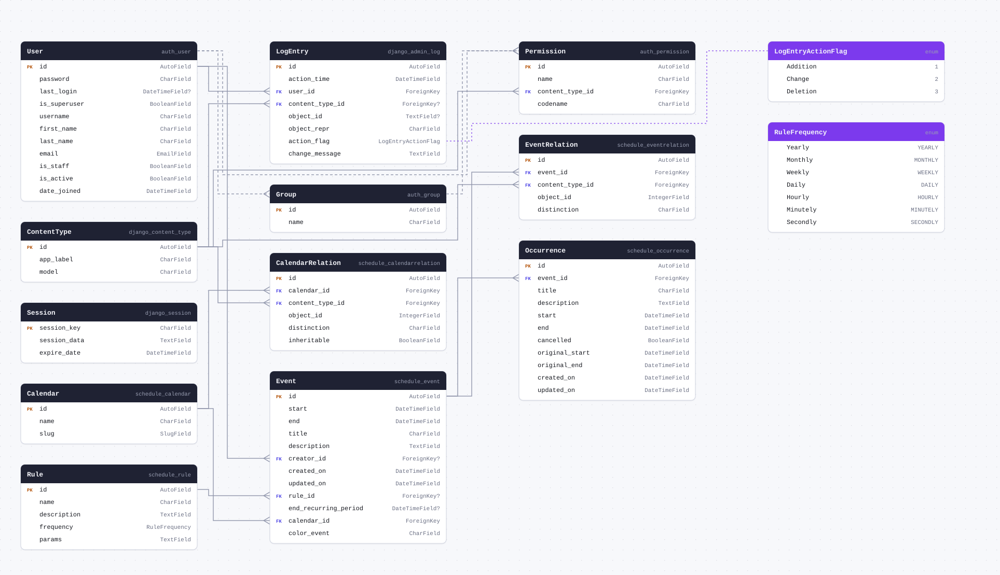
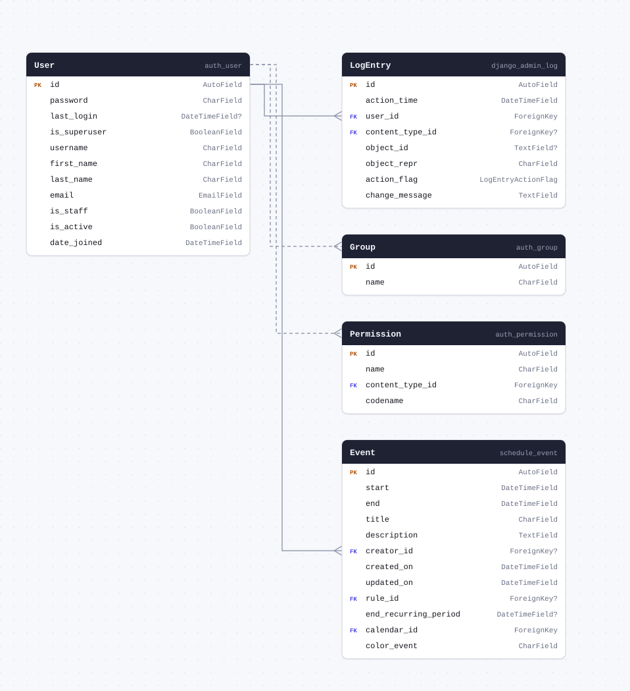
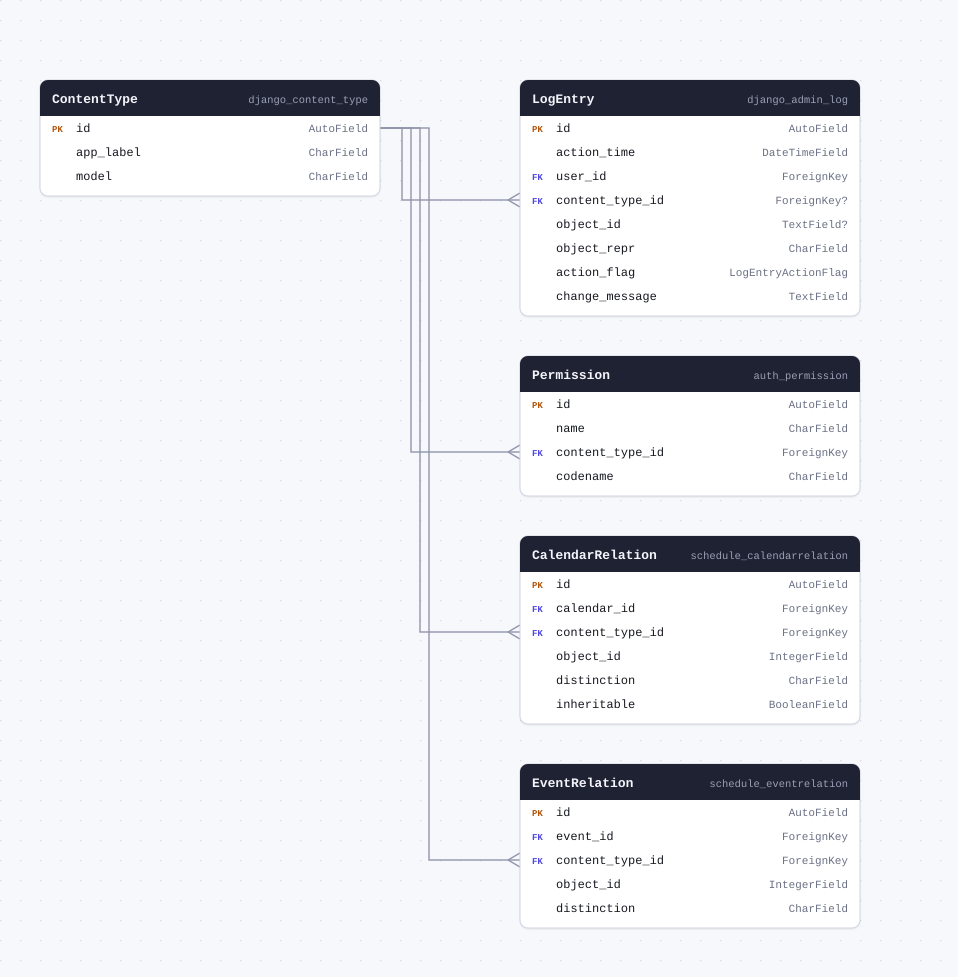
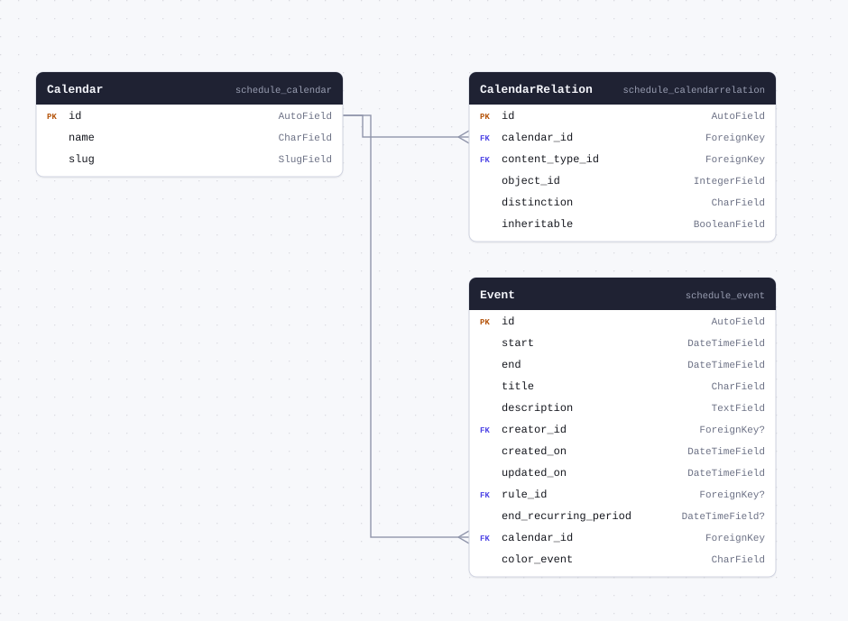
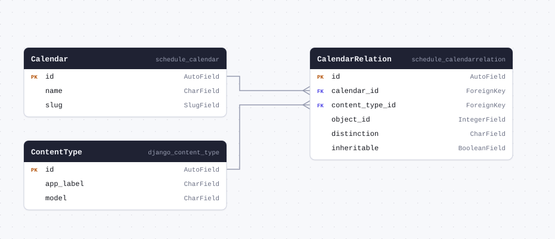
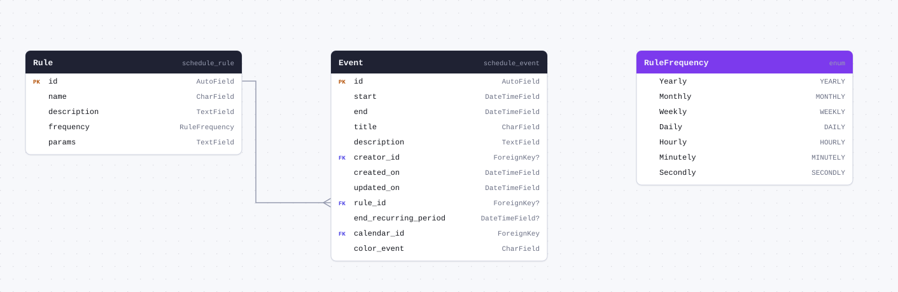
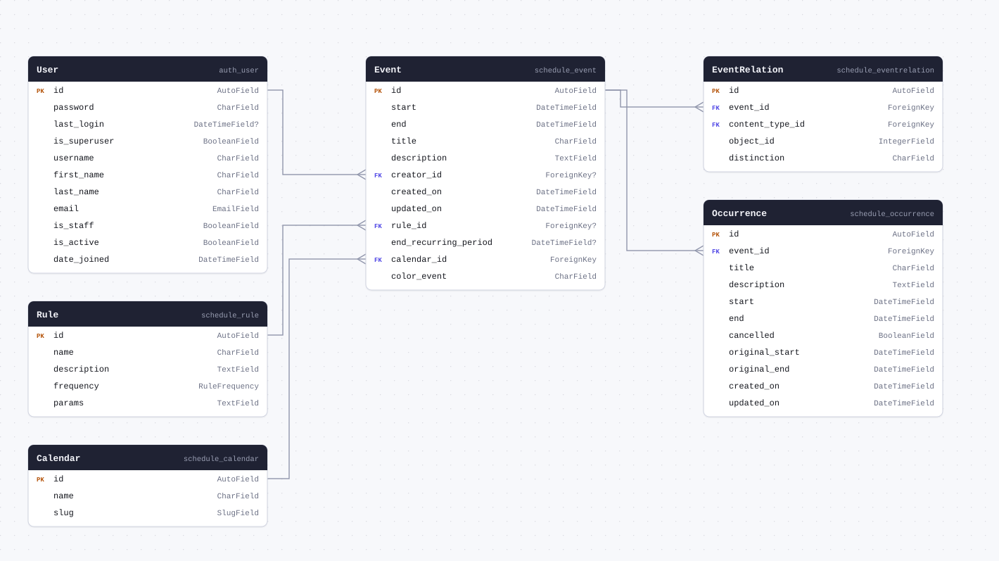
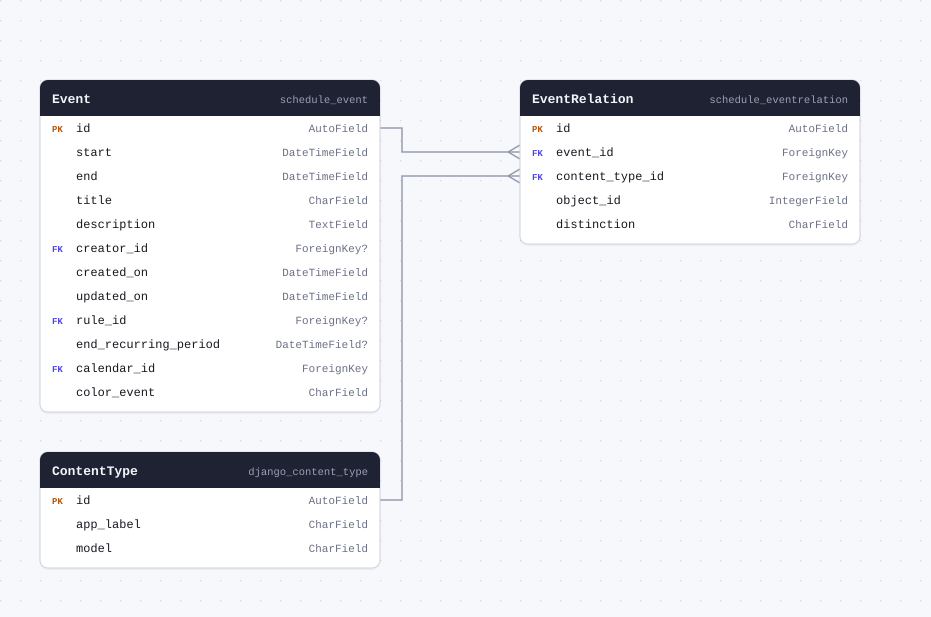
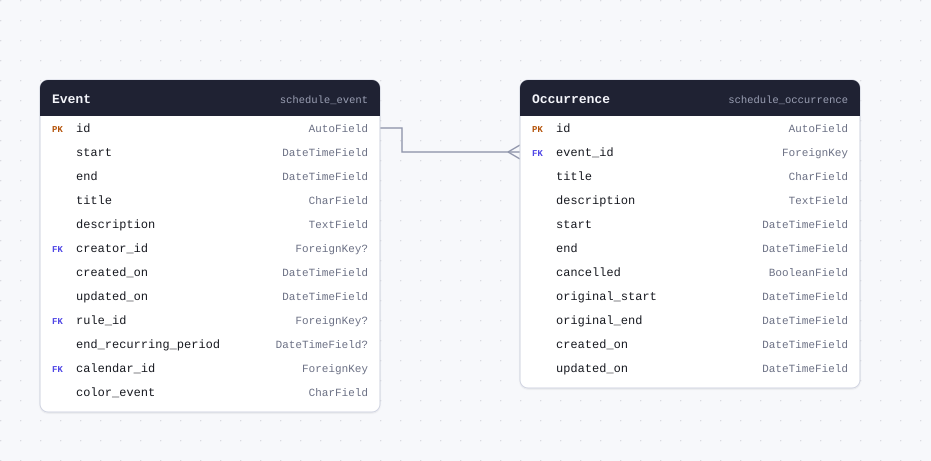

# Schema docs



[LogEntry](#logentry) · [Permission](#permission) · [Group](#group) · [User](#user) · [ContentType](#contenttype) · [Session](#session) · [Calendar](#calendar) · [CalendarRelation](#calendarrelation) · [Rule](#rule) · [Event](#event) · [EventRelation](#eventrelation) · [Occurrence](#occurrence)

<details>
<summary>The whole schema as SQL</summary>

```sql
CREATE TABLE "django_admin_log" ("id" integer NOT NULL PRIMARY KEY AUTOINCREMENT, "action_time" datetime NOT NULL, "user_id" integer NOT NULL REFERENCES "auth_user" ("id") DEFERRABLE INITIALLY DEFERRED, "content_type_id" integer NULL REFERENCES "django_content_type" ("id") DEFERRABLE INITIALLY DEFERRED, "object_id" text NULL, "object_repr" varchar(200) NOT NULL, "action_flag" smallint unsigned NOT NULL CHECK ("action_flag" >= 0), "change_message" text NOT NULL);

CREATE TABLE "auth_permission" ("id" integer NOT NULL PRIMARY KEY AUTOINCREMENT, "name" varchar(255) NOT NULL, "content_type_id" integer NOT NULL REFERENCES "django_content_type" ("id") DEFERRABLE INITIALLY DEFERRED, "codename" varchar(100) NOT NULL);

CREATE TABLE "auth_group" ("id" integer NOT NULL PRIMARY KEY AUTOINCREMENT, "name" varchar(150) NOT NULL UNIQUE);

CREATE TABLE "auth_group_permissions" ("id" integer NOT NULL PRIMARY KEY AUTOINCREMENT, "group_id" integer NOT NULL REFERENCES "auth_group" ("id") DEFERRABLE INITIALLY DEFERRED, "permission_id" integer NOT NULL REFERENCES "auth_permission" ("id") DEFERRABLE INITIALLY DEFERRED);

CREATE TABLE "auth_user" ("id" integer NOT NULL PRIMARY KEY AUTOINCREMENT, "password" varchar(128) NOT NULL, "last_login" datetime NULL, "is_superuser" bool NOT NULL, "username" varchar(150) NOT NULL UNIQUE, "first_name" varchar(150) NOT NULL, "last_name" varchar(150) NOT NULL, "email" varchar(254) NOT NULL, "is_staff" bool NOT NULL, "is_active" bool NOT NULL, "date_joined" datetime NOT NULL);

CREATE TABLE "auth_user_groups" ("id" integer NOT NULL PRIMARY KEY AUTOINCREMENT, "user_id" integer NOT NULL REFERENCES "auth_user" ("id") DEFERRABLE INITIALLY DEFERRED, "group_id" integer NOT NULL REFERENCES "auth_group" ("id") DEFERRABLE INITIALLY DEFERRED);

CREATE TABLE "auth_user_user_permissions" ("id" integer NOT NULL PRIMARY KEY AUTOINCREMENT, "user_id" integer NOT NULL REFERENCES "auth_user" ("id") DEFERRABLE INITIALLY DEFERRED, "permission_id" integer NOT NULL REFERENCES "auth_permission" ("id") DEFERRABLE INITIALLY DEFERRED);

CREATE TABLE "django_content_type" ("id" integer NOT NULL PRIMARY KEY AUTOINCREMENT, "app_label" varchar(100) NOT NULL, "model" varchar(100) NOT NULL);

CREATE TABLE "django_session" ("session_key" varchar(40) NOT NULL PRIMARY KEY, "session_data" text NOT NULL, "expire_date" datetime NOT NULL);

CREATE TABLE "schedule_calendar" ("id" integer NOT NULL PRIMARY KEY AUTOINCREMENT, "name" varchar(200) NOT NULL, "slug" varchar(200) NOT NULL UNIQUE);

CREATE TABLE "schedule_calendarrelation" ("id" integer NOT NULL PRIMARY KEY AUTOINCREMENT, "calendar_id" integer NOT NULL REFERENCES "schedule_calendar" ("id") DEFERRABLE INITIALLY DEFERRED, "content_type_id" integer NOT NULL REFERENCES "django_content_type" ("id") DEFERRABLE INITIALLY DEFERRED, "object_id" integer NOT NULL, "distinction" varchar(20) NOT NULL, "inheritable" bool NOT NULL);

CREATE TABLE "schedule_rule" ("id" integer NOT NULL PRIMARY KEY AUTOINCREMENT, "name" varchar(32) NOT NULL, "description" text NOT NULL, "frequency" varchar(10) NOT NULL, "params" text NOT NULL);

CREATE TABLE "schedule_event" ("id" integer NOT NULL PRIMARY KEY AUTOINCREMENT, "start" datetime NOT NULL, "end" datetime NOT NULL, "title" varchar(255) NOT NULL, "description" text NOT NULL, "creator_id" integer NULL REFERENCES "auth_user" ("id") DEFERRABLE INITIALLY DEFERRED, "created_on" datetime NOT NULL, "updated_on" datetime NOT NULL, "rule_id" integer NULL REFERENCES "schedule_rule" ("id") DEFERRABLE INITIALLY DEFERRED, "end_recurring_period" datetime NULL, "calendar_id" integer NOT NULL REFERENCES "schedule_calendar" ("id") DEFERRABLE INITIALLY DEFERRED, "color_event" varchar(10) NOT NULL);

CREATE TABLE "schedule_eventrelation" ("id" integer NOT NULL PRIMARY KEY AUTOINCREMENT, "event_id" integer NOT NULL REFERENCES "schedule_event" ("id") DEFERRABLE INITIALLY DEFERRED, "content_type_id" integer NOT NULL REFERENCES "django_content_type" ("id") DEFERRABLE INITIALLY DEFERRED, "object_id" integer NOT NULL, "distinction" varchar(20) NOT NULL);

CREATE TABLE "schedule_occurrence" ("id" integer NOT NULL PRIMARY KEY AUTOINCREMENT, "event_id" integer NOT NULL REFERENCES "schedule_event" ("id") DEFERRABLE INITIALLY DEFERRED, "title" varchar(255) NOT NULL, "description" text NOT NULL, "start" datetime NOT NULL, "end" datetime NOT NULL, "cancelled" bool NOT NULL, "original_start" datetime NOT NULL, "original_end" datetime NOT NULL, "created_on" datetime NOT NULL, "updated_on" datetime NOT NULL);

CREATE INDEX "django_admin_log_user_id_c564eba6" ON "django_admin_log" ("user_id");

CREATE INDEX "django_admin_log_content_type_id_c4bce8eb" ON "django_admin_log" ("content_type_id");

CREATE UNIQUE INDEX "auth_permission_content_type_id_codename_01ab375a_uniq" ON "auth_permission" ("content_type_id", "codename");

CREATE INDEX "auth_permission_content_type_id_2f476e4b" ON "auth_permission" ("content_type_id");

CREATE UNIQUE INDEX "auth_group_permissions_group_id_permission_id_0cd325b0_uniq" ON "auth_group_permissions" ("group_id", "permission_id");

CREATE INDEX "auth_group_permissions_group_id_b120cbf9" ON "auth_group_permissions" ("group_id");

CREATE INDEX "auth_group_permissions_permission_id_84c5c92e" ON "auth_group_permissions" ("permission_id");

CREATE UNIQUE INDEX "auth_user_groups_user_id_group_id_94350c0c_uniq" ON "auth_user_groups" ("user_id", "group_id");

CREATE INDEX "auth_user_groups_user_id_6a12ed8b" ON "auth_user_groups" ("user_id");

CREATE INDEX "auth_user_groups_group_id_97559544" ON "auth_user_groups" ("group_id");

CREATE UNIQUE INDEX "auth_user_user_permissions_user_id_permission_id_14a6b632_uniq" ON "auth_user_user_permissions" ("user_id", "permission_id");

CREATE INDEX "auth_user_user_permissions_user_id_a95ead1b" ON "auth_user_user_permissions" ("user_id");

CREATE INDEX "auth_user_user_permissions_permission_id_1fbb5f2c" ON "auth_user_user_permissions" ("permission_id");

CREATE UNIQUE INDEX "django_content_type_app_label_model_76bd3d3b_uniq" ON "django_content_type" ("app_label", "model");

CREATE INDEX "django_session_expire_date_a5c62663" ON "django_session" ("expire_date");

CREATE INDEX "schedule_calendarrelation_calendar_id_0a50be2e" ON "schedule_calendarrelation" ("calendar_id");

CREATE INDEX "schedule_calendarrelation_content_type_id_f2a42f5b" ON "schedule_calendarrelation" ("content_type_id");

CREATE INDEX "schedule_calendarrelation_object_id_1743bce6" ON "schedule_calendarrelation" ("object_id");

CREATE INDEX "schedule_ca_content_cddadb_idx" ON "schedule_calendarrelation" ("content_type_id", "object_id");

CREATE INDEX "schedule_event_start_a11492a7" ON "schedule_event" ("start");

CREATE INDEX "schedule_event_end_674c5848" ON "schedule_event" ("end");

CREATE INDEX "schedule_event_creator_id_d2ffab6e" ON "schedule_event" ("creator_id");

CREATE INDEX "schedule_event_rule_id_90b83d31" ON "schedule_event" ("rule_id");

CREATE INDEX "schedule_event_end_recurring_period_672addcf" ON "schedule_event" ("end_recurring_period");

CREATE INDEX "schedule_event_calendar_id_eb1c700f" ON "schedule_event" ("calendar_id");

CREATE INDEX "schedule_ev_start_a258cb_idx" ON "schedule_event" ("start", "end");

CREATE INDEX "schedule_eventrelation_event_id_8c57a7b4" ON "schedule_eventrelation" ("event_id");

CREATE INDEX "schedule_eventrelation_content_type_id_d4187723" ON "schedule_eventrelation" ("content_type_id");

CREATE INDEX "schedule_eventrelation_object_id_e22334a2" ON "schedule_eventrelation" ("object_id");

CREATE INDEX "schedule_ev_content_6ceecb_idx" ON "schedule_eventrelation" ("content_type_id", "object_id");

CREATE INDEX "schedule_occurrence_event_id_ade47cd8" ON "schedule_occurrence" ("event_id");

CREATE INDEX "schedule_occurrence_start_b28eeb2f" ON "schedule_occurrence" ("start");

CREATE INDEX "schedule_occurrence_end_ae255624" ON "schedule_occurrence" ("end");

CREATE INDEX "schedule_oc_start_76a2f8_idx" ON "schedule_occurrence" ("start", "end");
```

</details>

## LogEntry

Table `django_admin_log`, app `admin`.


| Column | Field | Type | Null | Key | Default | Description |
| --- | --- | --- | --- | --- | --- | --- |
| `id` | `AutoField` | `integer` |  | PK | `autoincrement()` |  |
| `action_time` | `DateTimeField` | `datetime` |  |  | `now()` |  |
| `user_id` | `ForeignKey` | `integer` |  | FK |  |  |
| `content_type_id` | `ForeignKey` | `integer` | yes | FK |  |  |
| `object_id` | `TextField` | `text` | yes |  |  |  |
| `object_repr` | `CharField` | `varchar(200)` |  |  |  |  |
| `action_flag` | `LogEntryActionFlag` | `smallint unsigned` |  |  |  |  |
| `change_message` | `TextField` | `text` |  |  |  |  |

Indexes:

- index `django_admin_log_user_id_c564eba6` on `user_id`
- index `django_admin_log_content_type_id_c4bce8eb` on `content_type_id`

Relations:

- `user_id` → [User](#user).`id`, on delete cascade
- `content_type_id` → [ContentType](#contenttype).`id`, on delete set null

## Permission

Table `auth_permission`, app `auth`.

The permissions system provides a way to assign permissions to specific
users and groups of users.

The permission system is used by the Django admin site, but may also be
useful in your own code. The Django admin site uses permissions as follows:

    - The "add" permission limits the user's ability to view the "add" form
      and add an object.
    - The "change" permission limits a user's ability to view the change
      list, view the "change" form and change an object.
    - The "delete" permission limits the ability to delete an object.
    - The "view" permission limits the ability to view an object.

Permissions are set globally per type of object, not per specific object
instance. It is possible to say "Mary may change news stories," but it's
not currently possible to say "Mary may change news stories, but only the
ones she created herself" or "Mary may only change news stories that have a
certain status or publication date."

The permissions listed above are automatically created for each model.


| Column | Field | Type | Null | Key | Default | Description |
| --- | --- | --- | --- | --- | --- | --- |
| `id` | `AutoField` | `integer` |  | PK | `autoincrement()` |  |
| `name` | `CharField` | `varchar(255)` |  |  |  |  |
| `content_type_id` | `ForeignKey` | `integer` |  | FK |  |  |
| `codename` | `CharField` | `varchar(100)` |  |  |  |  |

Indexes:

- index `auth_permission_content_type_id_2f476e4b` on `content_type_id`
- unique `auth_permission_content_type_id_codename_01ab375a_uniq` on `content_type_id`, `codename`

Relations:

- `content_type_id` → [ContentType](#contenttype).`id`, on delete cascade
- `group_set` — many to many with [Group](#group)
- `user_set` — many to many with [User](#user)

## Group

Table `auth_group`, app `auth`.

Groups are a generic way of categorizing users to apply permissions, or
some other label, to those users. A user can belong to any number of
groups.

A user in a group automatically has all the permissions granted to that
group. For example, if the group 'Site editors' has the permission
can_edit_home_page, any user in that group will have that permission.

Beyond permissions, groups are a convenient way to categorize users to
apply some label, or extended functionality, to them. For example, you
could create a group 'Special users', and you could write code that would
do special things to those users -- such as giving them access to a
members-only portion of your site, or sending them members-only email
messages.


| Column | Field | Type | Null | Key | Default | Description |
| --- | --- | --- | --- | --- | --- | --- |
| `id` | `AutoField` | `integer` |  | PK | `autoincrement()` |  |
| `name` | `CharField` | `varchar(150)` |  | unique |  |  |

Relations:

- `permissions` — many to many with [Permission](#permission)
- `user_set` — many to many with [User](#user)

## User

Table `auth_user`, app `auth`.

Columns from `AbstractUser` (abstract): `username`, `first_name`, `last_name`, `email`, `is_staff`, `is_active`, `date_joined`.

Columns from `AbstractBaseUser` (abstract): `password`, `last_login`.

Columns from `PermissionsMixin` (abstract): `is_superuser`.

Users within the Django authentication system are represented by this
model.

Username and password are required. Other fields are optional.



| Column | Field | Type | Null | Key | Default | Description |
| --- | --- | --- | --- | --- | --- | --- |
| `id` | `AutoField` | `integer` |  | PK | `autoincrement()` |  |
| `password` | `CharField` | `varchar(128)` |  |  |  |  |
| `last_login` | `DateTimeField` | `datetime` | yes |  |  |  |
| `is_superuser` | `BooleanField` | `bool` |  |  | `False` | Designates that this user has all permissions without explicitly assigning them. |
| `username` | `CharField` | `varchar(150)` |  | unique |  | Required. 150 characters or fewer. Letters, digits and @/./+/-/_ only. |
| `first_name` | `CharField` | `varchar(150)` |  |  |  |  |
| `last_name` | `CharField` | `varchar(150)` |  |  |  |  |
| `email` | `EmailField` | `varchar(254)` |  |  |  |  |
| `is_staff` | `BooleanField` | `bool` |  |  | `False` | Designates whether the user can log into this admin site. |
| `is_active` | `BooleanField` | `bool` |  |  | `True` | Designates whether this user should be treated as active. Unselect this instead of deleting accounts. |
| `date_joined` | `DateTimeField` | `datetime` |  |  | `now()` |  |

Relations:

- [LogEntry](#logentry).`user_id` → `id`, on delete cascade
- `groups` — many to many with [Group](#group)
- `user_permissions` — many to many with [Permission](#permission)
- [Event](#event).`creator_id` → `id`, on delete set null

## ContentType

Table `django_content_type`, app `contenttypes`.



| Column | Field | Type | Null | Key | Default | Description |
| --- | --- | --- | --- | --- | --- | --- |
| `id` | `AutoField` | `integer` |  | PK | `autoincrement()` |  |
| `app_label` | `CharField` | `varchar(100)` |  |  |  |  |
| `model` | `CharField` | `varchar(100)` |  |  |  |  |

Indexes:

- unique `django_content_type_app_label_model_76bd3d3b_uniq` on `app_label`, `model`

Relations:

- [LogEntry](#logentry).`content_type_id` → `id`, on delete set null
- [Permission](#permission).`content_type_id` → `id`, on delete cascade
- [CalendarRelation](#calendarrelation).`content_type_id` → `id`, on delete cascade
- [EventRelation](#eventrelation).`content_type_id` → `id`, on delete cascade

## Session

Table `django_session`, app `sessions`.

Columns from `AbstractBaseSession` (abstract): `session_key`, `session_data`, `expire_date`.

Django provides full support for anonymous sessions. The session
framework lets you store and retrieve arbitrary data on a
per-site-visitor basis. It stores data on the server side and
abstracts the sending and receiving of cookies. Cookies contain a
session ID -- not the data itself.

The Django sessions framework is entirely cookie-based. It does
not fall back to putting session IDs in URLs. This is an intentional
design decision. Not only does that behavior make URLs ugly, it makes
your site vulnerable to session-ID theft via the "Referer" header.

For complete documentation on using Sessions in your code, consult
the sessions documentation that is shipped with Django (also available
on the Django web site).

| Column | Field | Type | Null | Key | Default | Description |
| --- | --- | --- | --- | --- | --- | --- |
| `session_key` | `CharField` | `varchar(40)` |  | PK |  |  |
| `session_data` | `TextField` | `text` |  |  |  |  |
| `expire_date` | `DateTimeField` | `datetime` |  |  |  |  |

Indexes:

- index `django_session_expire_date_a5c62663` on `expire_date`

## Calendar

Table `schedule_calendar`, app `schedule`.

This is for grouping events so that batch relations can be made to all
events.  An example would be a project calendar.

name: the name of the calendar
events: all the events contained within the calendar.
>>> calendar = Calendar(name = 'Test Calendar')
>>> calendar.save()
>>> data = {
...         'title': 'Recent Event',
...         'start': datetime.datetime(2008, 1, 5, 0, 0),
...         'end': datetime.datetime(2008, 1, 10, 0, 0)
...        }
>>> event = Event(**data)
>>> event.save()
>>> calendar.events.add(event)
>>> data = {
...         'title': 'Upcoming Event',
...         'start': datetime.datetime(2008, 1, 1, 0, 0),
...         'end': datetime.datetime(2008, 1, 4, 0, 0)
...        }
>>> event = Event(**data)
>>> event.save()
>>> calendar.events.add(event)
>>> data = {
...         'title': 'Current Event',
...         'start': datetime.datetime(2008, 1, 3),
...         'end': datetime.datetime(2008, 1, 6)
...        }
>>> event = Event(**data)
>>> event.save()
>>> calendar.events.add(event)



| Column | Field | Type | Null | Key | Default | Description |
| --- | --- | --- | --- | --- | --- | --- |
| `id` | `AutoField` | `integer` |  | PK | `autoincrement()` |  |
| `name` | `CharField` | `varchar(200)` |  |  |  |  |
| `slug` | `SlugField` | `varchar(200)` |  | unique |  |  |

Relations:

- [CalendarRelation](#calendarrelation).`calendar_id` → `id`, on delete cascade
- [Event](#event).`calendar_id` → `id`, on delete cascade

## CalendarRelation

Table `schedule_calendarrelation`, app `schedule`.

This is for relating data to a Calendar, and possible all of the events for
that calendar, there is also a distinction, so that the same type or kind of
data can be related in different ways.  A good example would be, if you have
calendars that are only visible by certain users, you could create a
relation between calendars and users, with the distinction of 'visibility',
or 'ownership'.  If inheritable is set to true, all the events for this
calendar will inherit this relation.

calendar: a foreign key relation to a Calendar object.
content_type: a foreign key relation to ContentType of the generic object
object_id: the id of the generic object
content_object: the generic foreign key to the generic object
distinction: a string representing a distinction of the relation, User could
have a 'veiwer' relation and an 'owner' relation for example.
inheritable: a boolean that decides if events of the calendar should also
inherit this relation

DISCLAIMER: while this model is a nice out of the box feature to have, it
may not scale well.  If you use this, keep that in mind.



| Column | Field | Type | Null | Key | Default | Description |
| --- | --- | --- | --- | --- | --- | --- |
| `id` | `AutoField` | `integer` |  | PK | `autoincrement()` |  |
| `calendar_id` | `ForeignKey` | `integer` |  | FK |  |  |
| `content_type_id` | `ForeignKey` | `integer` |  | FK |  |  |
| `object_id` | `IntegerField` | `integer` |  |  |  |  |
| `distinction` | `CharField` | `varchar(20)` |  |  |  |  |
| `inheritable` | `BooleanField` | `bool` |  |  | `True` |  |

Indexes:

- index `schedule_calendarrelation_calendar_id_0a50be2e` on `calendar_id`
- index `schedule_calendarrelation_content_type_id_f2a42f5b` on `content_type_id`
- index `schedule_calendarrelation_object_id_1743bce6` on `object_id`
- index `schedule_ca_content_cddadb_idx` on `content_type_id`, `object_id`

Relations:

- `content_object` → any model, by `content_type_id` + `object_id` (generic foreign key)
- `calendar_id` → [Calendar](#calendar).`id`, on delete cascade
- `content_type_id` → [ContentType](#contenttype).`id`, on delete cascade

## Rule

Table `schedule_rule`, app `schedule`.

This defines a rule by which an event will recur.  This is defined by the
rrule in the dateutil documentation.

* name - the human friendly name of this kind of recursion.
* description - a short description describing this type of recursion.
* frequency - the base recurrence period
* param - extra params required to define this type of recursion. The params
  should follow this format:

    param = [rruleparam:value;]*
    rruleparam = see list below
    value = int[,int]*

  The options are: (documentation for these can be found at
  https://dateutil.readthedocs.io/en/stable/rrule.html#module-dateutil.rrule
    ** count
    ** bysetpos
    ** bymonth
    ** bymonthday
    ** byyearday
    ** byweekno
    ** byweekday
    ** byhour
    ** byminute
    ** bysecond
    ** byeaster



| Column | Field | Type | Null | Key | Default | Description |
| --- | --- | --- | --- | --- | --- | --- |
| `id` | `AutoField` | `integer` |  | PK | `autoincrement()` |  |
| `name` | `CharField` | `varchar(32)` |  |  |  |  |
| `description` | `TextField` | `text` |  |  |  |  |
| `frequency` | `RuleFrequency` | `varchar(10)` |  |  |  |  |
| `params` | `TextField` | `text` |  |  |  |  |

Relations:

- [Event](#event).`rule_id` → `id`, on delete set null

## Event

Table `schedule_event`, app `schedule`.

This model stores meta data for a date.  You can relate this data to many
other models.



| Column | Field | Type | Null | Key | Default | Description |
| --- | --- | --- | --- | --- | --- | --- |
| `id` | `AutoField` | `integer` |  | PK | `autoincrement()` |  |
| `start` | `DateTimeField` | `datetime` |  |  |  |  |
| `end` | `DateTimeField` | `datetime` |  |  |  | The end time must be later than the start time. |
| `title` | `CharField` | `varchar(255)` |  |  |  |  |
| `description` | `TextField` | `text` |  |  |  |  |
| `creator_id` | `ForeignKey` | `integer` | yes | FK |  |  |
| `created_on` | `DateTimeField` | `datetime` |  |  | `now()` |  |
| `updated_on` | `DateTimeField` | `datetime` |  |  | `now()` |  |
| `rule_id` | `ForeignKey` | `integer` | yes | FK |  | Select '----' for a one time only event. |
| `end_recurring_period` | `DateTimeField` | `datetime` | yes |  |  | This date is ignored for one time only events. |
| `calendar_id` | `ForeignKey` | `integer` |  | FK |  |  |
| `color_event` | `CharField` | `varchar(10)` |  |  |  |  |

Indexes:

- index `schedule_event_start_a11492a7` on `start`
- index `schedule_event_end_674c5848` on `end`
- index `schedule_event_creator_id_d2ffab6e` on `creator_id`
- index `schedule_event_rule_id_90b83d31` on `rule_id`
- index `schedule_event_end_recurring_period_672addcf` on `end_recurring_period`
- index `schedule_event_calendar_id_eb1c700f` on `calendar_id`
- index `schedule_ev_start_a258cb_idx` on `start`, `end`

Relations:

- `creator_id` → [User](#user).`id`, on delete set null
- `rule_id` → [Rule](#rule).`id`, on delete set null
- `calendar_id` → [Calendar](#calendar).`id`, on delete cascade
- [EventRelation](#eventrelation).`event_id` → `id`, on delete cascade
- [Occurrence](#occurrence).`event_id` → `id`, on delete cascade

## EventRelation

Table `schedule_eventrelation`, app `schedule`.

This is for relating data to an Event, there is also a distinction, so that
data can be related in different ways.  A good example would be, if you have
events that are only visible by certain users, you could create a relation
between events and users, with the distinction of 'visibility', or
'ownership'.

event: a foreign key relation to an Event model.
content_type: a foreign key relation to ContentType of the generic object
object_id: the id of the generic object
content_object: the generic foreign key to the generic object
distinction: a string representing a distinction of the relation, User could
have a 'viewer' relation and an 'owner' relation for example.

DISCLAIMER: while this model is a nice out of the box feature to have, it
may not scale well.  If you use this keep that in mind.



| Column | Field | Type | Null | Key | Default | Description |
| --- | --- | --- | --- | --- | --- | --- |
| `id` | `AutoField` | `integer` |  | PK | `autoincrement()` |  |
| `event_id` | `ForeignKey` | `integer` |  | FK |  |  |
| `content_type_id` | `ForeignKey` | `integer` |  | FK |  |  |
| `object_id` | `IntegerField` | `integer` |  |  |  |  |
| `distinction` | `CharField` | `varchar(20)` |  |  |  |  |

Indexes:

- index `schedule_eventrelation_event_id_8c57a7b4` on `event_id`
- index `schedule_eventrelation_content_type_id_d4187723` on `content_type_id`
- index `schedule_eventrelation_object_id_e22334a2` on `object_id`
- index `schedule_ev_content_6ceecb_idx` on `content_type_id`, `object_id`

Relations:

- `content_object` → any model, by `content_type_id` + `object_id` (generic foreign key)
- `event_id` → [Event](#event).`id`, on delete cascade
- `content_type_id` → [ContentType](#contenttype).`id`, on delete cascade

## Occurrence

Table `schedule_occurrence`, app `schedule`.



| Column | Field | Type | Null | Key | Default | Description |
| --- | --- | --- | --- | --- | --- | --- |
| `id` | `AutoField` | `integer` |  | PK | `autoincrement()` |  |
| `event_id` | `ForeignKey` | `integer` |  | FK |  |  |
| `title` | `CharField` | `varchar(255)` |  |  |  |  |
| `description` | `TextField` | `text` |  |  |  |  |
| `start` | `DateTimeField` | `datetime` |  |  |  |  |
| `end` | `DateTimeField` | `datetime` |  |  |  |  |
| `cancelled` | `BooleanField` | `bool` |  |  | `False` |  |
| `original_start` | `DateTimeField` | `datetime` |  |  |  |  |
| `original_end` | `DateTimeField` | `datetime` |  |  |  |  |
| `created_on` | `DateTimeField` | `datetime` |  |  | `now()` |  |
| `updated_on` | `DateTimeField` | `datetime` |  |  | `now()` |  |

Indexes:

- index `schedule_occurrence_event_id_ade47cd8` on `event_id`
- index `schedule_occurrence_start_b28eeb2f` on `start`
- index `schedule_occurrence_end_ae255624` on `end`
- index `schedule_oc_start_76a2f8_idx` on `start`, `end`

Relations:

- `event_id` → [Event](#event).`id`, on delete cascade

# Enums

## LogEntryActionFlag

| Name | Stored as |
| --- | --- |
| `Addition` | `1` |
| `Change` | `2` |
| `Deletion` | `3` |

## RuleFrequency

| Name | Stored as |
| --- | --- |
| `Yearly` | `YEARLY` |
| `Monthly` | `MONTHLY` |
| `Weekly` | `WEEKLY` |
| `Daily` | `DAILY` |
| `Hourly` | `HOURLY` |
| `Minutely` | `MINUTELY` |
| `Secondly` | `SECONDLY` |
