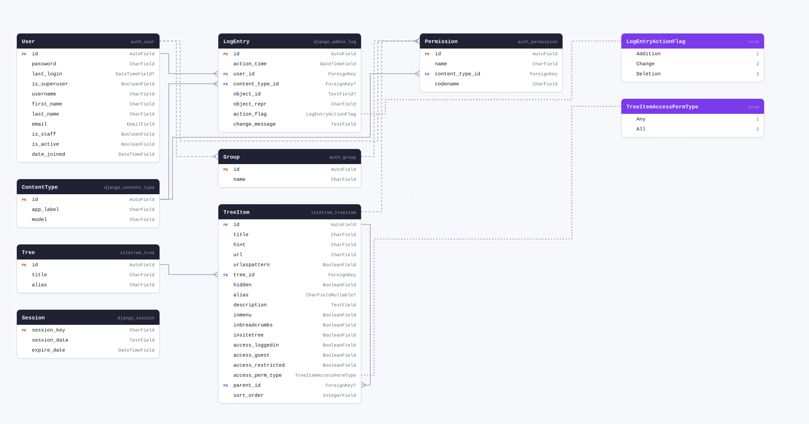
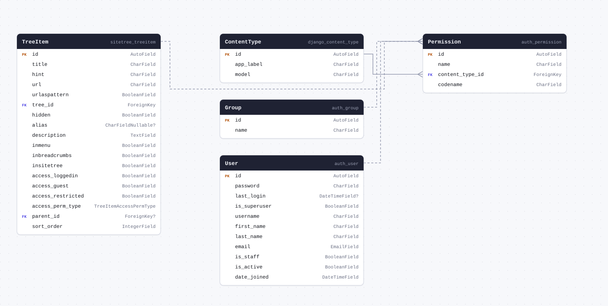
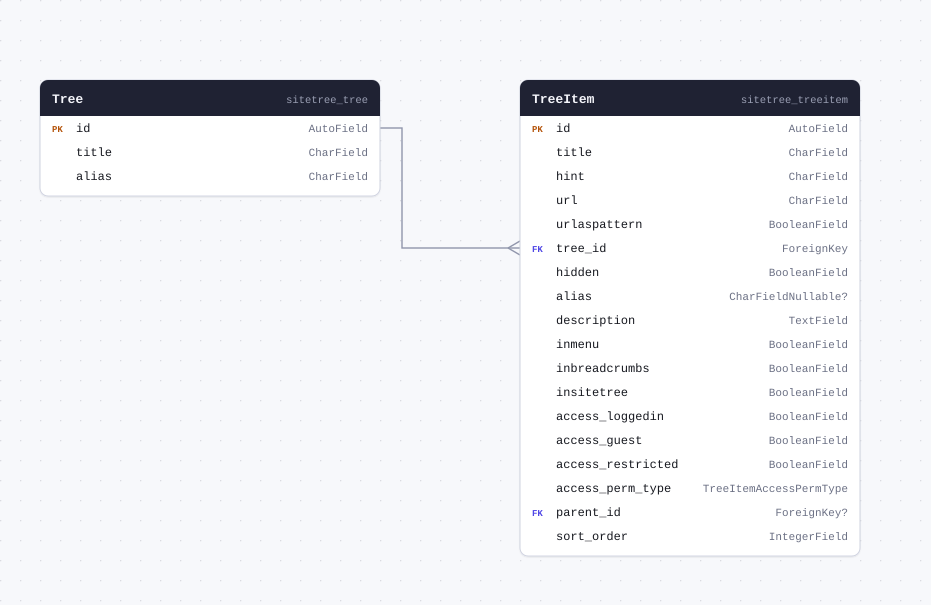
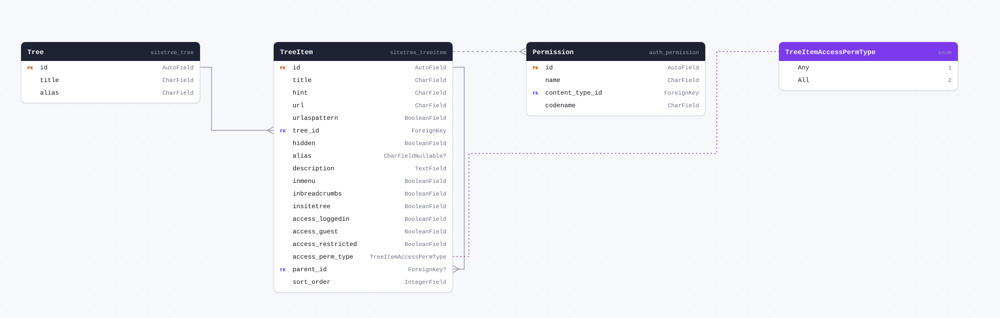

# Schema docs



[LogEntry](#logentry) · [Permission](#permission) · [Group](#group) · [User](#user) · [ContentType](#contenttype) · [Session](#session) · [Tree](#tree) · [TreeItem](#treeitem)

<details>
<summary>The whole schema as SQL</summary>

```sql
CREATE TABLE "django_admin_log" ("id" integer NOT NULL PRIMARY KEY AUTOINCREMENT, "action_time" datetime NOT NULL, "user_id" integer NOT NULL REFERENCES "auth_user" ("id") DEFERRABLE INITIALLY DEFERRED, "content_type_id" integer NULL REFERENCES "django_content_type" ("id") DEFERRABLE INITIALLY DEFERRED, "object_id" text NULL, "object_repr" varchar(200) NOT NULL, "action_flag" smallint unsigned NOT NULL CHECK ("action_flag" >= 0), "change_message" text NOT NULL);

CREATE TABLE "auth_permission" ("id" integer NOT NULL PRIMARY KEY AUTOINCREMENT, "name" varchar(255) NOT NULL, "content_type_id" integer NOT NULL REFERENCES "django_content_type" ("id") DEFERRABLE INITIALLY DEFERRED, "codename" varchar(100) NOT NULL);

CREATE TABLE "auth_group" ("id" integer NOT NULL PRIMARY KEY AUTOINCREMENT, "name" varchar(150) NOT NULL UNIQUE);

CREATE TABLE "auth_group_permissions" ("id" integer NOT NULL PRIMARY KEY AUTOINCREMENT, "group_id" integer NOT NULL REFERENCES "auth_group" ("id") DEFERRABLE INITIALLY DEFERRED, "permission_id" integer NOT NULL REFERENCES "auth_permission" ("id") DEFERRABLE INITIALLY DEFERRED);

CREATE TABLE "auth_user" ("id" integer NOT NULL PRIMARY KEY AUTOINCREMENT, "password" varchar(128) NOT NULL, "last_login" datetime NULL, "is_superuser" bool NOT NULL, "username" varchar(150) NOT NULL UNIQUE, "first_name" varchar(150) NOT NULL, "last_name" varchar(150) NOT NULL, "email" varchar(254) NOT NULL, "is_staff" bool NOT NULL, "is_active" bool NOT NULL, "date_joined" datetime NOT NULL);

CREATE TABLE "auth_user_groups" ("id" integer NOT NULL PRIMARY KEY AUTOINCREMENT, "user_id" integer NOT NULL REFERENCES "auth_user" ("id") DEFERRABLE INITIALLY DEFERRED, "group_id" integer NOT NULL REFERENCES "auth_group" ("id") DEFERRABLE INITIALLY DEFERRED);

CREATE TABLE "auth_user_user_permissions" ("id" integer NOT NULL PRIMARY KEY AUTOINCREMENT, "user_id" integer NOT NULL REFERENCES "auth_user" ("id") DEFERRABLE INITIALLY DEFERRED, "permission_id" integer NOT NULL REFERENCES "auth_permission" ("id") DEFERRABLE INITIALLY DEFERRED);

CREATE TABLE "django_content_type" ("id" integer NOT NULL PRIMARY KEY AUTOINCREMENT, "app_label" varchar(100) NOT NULL, "model" varchar(100) NOT NULL);

CREATE TABLE "django_session" ("session_key" varchar(40) NOT NULL PRIMARY KEY, "session_data" text NOT NULL, "expire_date" datetime NOT NULL);

CREATE TABLE "sitetree_tree" ("id" integer NOT NULL PRIMARY KEY AUTOINCREMENT, "title" varchar(256) NOT NULL, "alias" varchar(80) NOT NULL UNIQUE);

CREATE TABLE "sitetree_treeitem" ("id" integer NOT NULL PRIMARY KEY AUTOINCREMENT, "title" varchar(256) NOT NULL, "hint" varchar(200) NOT NULL, "url" varchar(200) NOT NULL, "urlaspattern" bool NOT NULL, "tree_id" integer NOT NULL REFERENCES "sitetree_tree" ("id") DEFERRABLE INITIALLY DEFERRED, "hidden" bool NOT NULL, "alias" varchar(80) NULL, "description" text NOT NULL, "inmenu" bool NOT NULL, "inbreadcrumbs" bool NOT NULL, "insitetree" bool NOT NULL, "access_loggedin" bool NOT NULL, "access_guest" bool NOT NULL, "access_restricted" bool NOT NULL, "access_perm_type" integer NOT NULL, "parent_id" integer NULL REFERENCES "sitetree_treeitem" ("id") DEFERRABLE INITIALLY DEFERRED, "sort_order" integer NOT NULL);

CREATE TABLE "sitetree_treeitem_access_permissions" ("id" integer NOT NULL PRIMARY KEY AUTOINCREMENT, "treeitem_id" integer NOT NULL REFERENCES "sitetree_treeitem" ("id") DEFERRABLE INITIALLY DEFERRED, "permission_id" integer NOT NULL REFERENCES "auth_permission" ("id") DEFERRABLE INITIALLY DEFERRED);

CREATE INDEX "django_admin_log_user_id_c564eba6" ON "django_admin_log" ("user_id");

CREATE INDEX "django_admin_log_content_type_id_c4bce8eb" ON "django_admin_log" ("content_type_id");

CREATE UNIQUE INDEX "auth_permission_content_type_id_codename_01ab375a_uniq" ON "auth_permission" ("content_type_id", "codename");

CREATE INDEX "auth_permission_content_type_id_2f476e4b" ON "auth_permission" ("content_type_id");

CREATE UNIQUE INDEX "auth_group_permissions_group_id_permission_id_0cd325b0_uniq" ON "auth_group_permissions" ("group_id", "permission_id");

CREATE INDEX "auth_group_permissions_group_id_b120cbf9" ON "auth_group_permissions" ("group_id");

CREATE INDEX "auth_group_permissions_permission_id_84c5c92e" ON "auth_group_permissions" ("permission_id");

CREATE UNIQUE INDEX "auth_user_groups_user_id_group_id_94350c0c_uniq" ON "auth_user_groups" ("user_id", "group_id");

CREATE INDEX "auth_user_groups_user_id_6a12ed8b" ON "auth_user_groups" ("user_id");

CREATE INDEX "auth_user_groups_group_id_97559544" ON "auth_user_groups" ("group_id");

CREATE UNIQUE INDEX "auth_user_user_permissions_user_id_permission_id_14a6b632_uniq" ON "auth_user_user_permissions" ("user_id", "permission_id");

CREATE INDEX "auth_user_user_permissions_user_id_a95ead1b" ON "auth_user_user_permissions" ("user_id");

CREATE INDEX "auth_user_user_permissions_permission_id_1fbb5f2c" ON "auth_user_user_permissions" ("permission_id");

CREATE UNIQUE INDEX "django_content_type_app_label_model_76bd3d3b_uniq" ON "django_content_type" ("app_label", "model");

CREATE INDEX "django_session_expire_date_a5c62663" ON "django_session" ("expire_date");

CREATE UNIQUE INDEX "sitetree_treeitem_tree_id_alias_f597fbd9_uniq" ON "sitetree_treeitem" ("tree_id", "alias");

CREATE INDEX "sitetree_treeitem_url_b91ef35a" ON "sitetree_treeitem" ("url");

CREATE INDEX "sitetree_treeitem_urlaspattern_ff432a51" ON "sitetree_treeitem" ("urlaspattern");

CREATE INDEX "sitetree_treeitem_tree_id_038a4bc7" ON "sitetree_treeitem" ("tree_id");

CREATE INDEX "sitetree_treeitem_hidden_5de28c6e" ON "sitetree_treeitem" ("hidden");

CREATE INDEX "sitetree_treeitem_alias_33dc5690" ON "sitetree_treeitem" ("alias");

CREATE INDEX "sitetree_treeitem_inmenu_ccabc0b0" ON "sitetree_treeitem" ("inmenu");

CREATE INDEX "sitetree_treeitem_inbreadcrumbs_ebb24448" ON "sitetree_treeitem" ("inbreadcrumbs");

CREATE INDEX "sitetree_treeitem_insitetree_60c593a5" ON "sitetree_treeitem" ("insitetree");

CREATE INDEX "sitetree_treeitem_access_loggedin_8a523197" ON "sitetree_treeitem" ("access_loggedin");

CREATE INDEX "sitetree_treeitem_access_guest_09916132" ON "sitetree_treeitem" ("access_guest");

CREATE INDEX "sitetree_treeitem_access_restricted_e9c87676" ON "sitetree_treeitem" ("access_restricted");

CREATE INDEX "sitetree_treeitem_parent_id_88f6f9a4" ON "sitetree_treeitem" ("parent_id");

CREATE INDEX "sitetree_treeitem_sort_order_93fd716c" ON "sitetree_treeitem" ("sort_order");

CREATE UNIQUE INDEX "sitetree_treeitem_access_permissions_treeitem_id_permission_id_a3224a96_uniq" ON "sitetree_treeitem_access_permissions" ("treeitem_id", "permission_id");

CREATE INDEX "sitetree_treeitem_access_permissions_treeitem_id_aedb7367" ON "sitetree_treeitem_access_permissions" ("treeitem_id");

CREATE INDEX "sitetree_treeitem_access_permissions_permission_id_c6d1d87a" ON "sitetree_treeitem_access_permissions" ("permission_id");
```

</details>

## LogEntry

Table `django_admin_log`, app `admin`.


| Column | Field | Type | Null | Key | Default | Description |
| --- | --- | --- | --- | --- | --- | --- |
| `id` | `AutoField` | `integer` |  | PK | `autoincrement()` |  |
| `action_time` | `DateTimeField` | `datetime` |  |  | `now()` |  |
| `user_id` | `ForeignKey` | `integer` |  | FK |  |  |
| `content_type_id` | `ForeignKey` | `integer` | yes | FK |  |  |
| `object_id` | `TextField` | `text` | yes |  |  |  |
| `object_repr` | `CharField` | `varchar(200)` |  |  |  |  |
| `action_flag` | `LogEntryActionFlag` | `smallint unsigned` |  |  |  |  |
| `change_message` | `TextField` | `text` |  |  |  |  |

Indexes:

- index `django_admin_log_user_id_c564eba6` on `user_id`
- index `django_admin_log_content_type_id_c4bce8eb` on `content_type_id`

Relations:

- `user_id` → [User](#user).`id`, on delete cascade
- `content_type_id` → [ContentType](#contenttype).`id`, on delete set null

## Permission

Table `auth_permission`, app `auth`.

The permissions system provides a way to assign permissions to specific
users and groups of users.

The permission system is used by the Django admin site, but may also be
useful in your own code. The Django admin site uses permissions as follows:

    - The "add" permission limits the user's ability to view the "add" form
      and add an object.
    - The "change" permission limits a user's ability to view the change
      list, view the "change" form and change an object.
    - The "delete" permission limits the ability to delete an object.
    - The "view" permission limits the ability to view an object.

Permissions are set globally per type of object, not per specific object
instance. It is possible to say "Mary may change news stories," but it's
not currently possible to say "Mary may change news stories, but only the
ones she created herself" or "Mary may only change news stories that have a
certain status or publication date."

The permissions listed above are automatically created for each model.



| Column | Field | Type | Null | Key | Default | Description |
| --- | --- | --- | --- | --- | --- | --- |
| `id` | `AutoField` | `integer` |  | PK | `autoincrement()` |  |
| `name` | `CharField` | `varchar(255)` |  |  |  |  |
| `content_type_id` | `ForeignKey` | `integer` |  | FK |  |  |
| `codename` | `CharField` | `varchar(100)` |  |  |  |  |

Indexes:

- index `auth_permission_content_type_id_2f476e4b` on `content_type_id`
- unique `auth_permission_content_type_id_codename_01ab375a_uniq` on `content_type_id`, `codename`

Relations:

- `content_type_id` → [ContentType](#contenttype).`id`, on delete cascade
- `group_set` — many to many with [Group](#group)
- `user_set` — many to many with [User](#user)
- `treeitem_set` — many to many with [TreeItem](#treeitem)

## Group

Table `auth_group`, app `auth`.

Groups are a generic way of categorizing users to apply permissions, or
some other label, to those users. A user can belong to any number of
groups.

A user in a group automatically has all the permissions granted to that
group. For example, if the group 'Site editors' has the permission
can_edit_home_page, any user in that group will have that permission.

Beyond permissions, groups are a convenient way to categorize users to
apply some label, or extended functionality, to them. For example, you
could create a group 'Special users', and you could write code that would
do special things to those users -- such as giving them access to a
members-only portion of your site, or sending them members-only email
messages.


| Column | Field | Type | Null | Key | Default | Description |
| --- | --- | --- | --- | --- | --- | --- |
| `id` | `AutoField` | `integer` |  | PK | `autoincrement()` |  |
| `name` | `CharField` | `varchar(150)` |  | unique |  |  |

Relations:

- `permissions` — many to many with [Permission](#permission)
- `user_set` — many to many with [User](#user)

## User

Table `auth_user`, app `auth`.

Columns from `AbstractUser` (abstract): `username`, `first_name`, `last_name`, `email`, `is_staff`, `is_active`, `date_joined`.

Columns from `AbstractBaseUser` (abstract): `password`, `last_login`.

Columns from `PermissionsMixin` (abstract): `is_superuser`.

Users within the Django authentication system are represented by this
model.

Username and password are required. Other fields are optional.


| Column | Field | Type | Null | Key | Default | Description |
| --- | --- | --- | --- | --- | --- | --- |
| `id` | `AutoField` | `integer` |  | PK | `autoincrement()` |  |
| `password` | `CharField` | `varchar(128)` |  |  |  |  |
| `last_login` | `DateTimeField` | `datetime` | yes |  |  |  |
| `is_superuser` | `BooleanField` | `bool` |  |  | `False` | Designates that this user has all permissions without explicitly assigning them. |
| `username` | `CharField` | `varchar(150)` |  | unique |  | Required. 150 characters or fewer. Letters, digits and @/./+/-/_ only. |
| `first_name` | `CharField` | `varchar(150)` |  |  |  |  |
| `last_name` | `CharField` | `varchar(150)` |  |  |  |  |
| `email` | `EmailField` | `varchar(254)` |  |  |  |  |
| `is_staff` | `BooleanField` | `bool` |  |  | `False` | Designates whether the user can log into this admin site. |
| `is_active` | `BooleanField` | `bool` |  |  | `True` | Designates whether this user should be treated as active. Unselect this instead of deleting accounts. |
| `date_joined` | `DateTimeField` | `datetime` |  |  | `now()` |  |

Relations:

- [LogEntry](#logentry).`user_id` → `id`, on delete cascade
- `groups` — many to many with [Group](#group)
- `user_permissions` — many to many with [Permission](#permission)

## ContentType

Table `django_content_type`, app `contenttypes`.


| Column | Field | Type | Null | Key | Default | Description |
| --- | --- | --- | --- | --- | --- | --- |
| `id` | `AutoField` | `integer` |  | PK | `autoincrement()` |  |
| `app_label` | `CharField` | `varchar(100)` |  |  |  |  |
| `model` | `CharField` | `varchar(100)` |  |  |  |  |

Indexes:

- unique `django_content_type_app_label_model_76bd3d3b_uniq` on `app_label`, `model`

Relations:

- [LogEntry](#logentry).`content_type_id` → `id`, on delete set null
- [Permission](#permission).`content_type_id` → `id`, on delete cascade

## Session

Table `django_session`, app `sessions`.

Columns from `AbstractBaseSession` (abstract): `session_key`, `session_data`, `expire_date`.

Django provides full support for anonymous sessions. The session
framework lets you store and retrieve arbitrary data on a
per-site-visitor basis. It stores data on the server side and
abstracts the sending and receiving of cookies. Cookies contain a
session ID -- not the data itself.

The Django sessions framework is entirely cookie-based. It does
not fall back to putting session IDs in URLs. This is an intentional
design decision. Not only does that behavior make URLs ugly, it makes
your site vulnerable to session-ID theft via the "Referer" header.

For complete documentation on using Sessions in your code, consult
the sessions documentation that is shipped with Django (also available
on the Django web site).

| Column | Field | Type | Null | Key | Default | Description |
| --- | --- | --- | --- | --- | --- | --- |
| `session_key` | `CharField` | `varchar(40)` |  | PK |  |  |
| `session_data` | `TextField` | `text` |  |  |  |  |
| `expire_date` | `DateTimeField` | `datetime` |  |  |  |  |

Indexes:

- index `django_session_expire_date_a5c62663` on `expire_date`

## Tree

Table `sitetree_tree`, app `sitetree`.

Columns from `TreeBase` (abstract): `title`, `alias`.

Built-in tree class. Default functionality.



| Column | Field | Type | Null | Key | Default | Description |
| --- | --- | --- | --- | --- | --- | --- |
| `id` | `AutoField` | `integer` |  | PK | `autoincrement()` |  |
| `title` | `CharField` | `varchar(256)` |  |  |  | Site tree title for presentational purposes. |
| `alias` | `CharField` | `varchar(80)` |  | unique |  | Short name to address site tree from templates.<br /><b>Note:</b> change with care. |

Relations:

- [TreeItem](#treeitem).`tree_id` → `id`, on delete cascade

## TreeItem

Table `sitetree_treeitem`, app `sitetree`.

Columns from `TreeItemBase` (abstract): `title`, `hint`, `url`, `urlaspattern`, `tree_id`, `hidden`, `alias`, `description`, `inmenu`, `inbreadcrumbs`, `insitetree`, `access_loggedin`, `access_guest`, `access_restricted`, `access_perm_type`, `parent_id`, `sort_order`.

Built-in tree item class. Default functionality.



| Column | Field | Type | Null | Key | Default | Description |
| --- | --- | --- | --- | --- | --- | --- |
| `id` | `AutoField` | `integer` |  | PK | `autoincrement()` |  |
| `title` | `CharField` | `varchar(256)` |  |  |  | Site tree item title. Can contain template variables E.g.: {{ mytitle }}. |
| `hint` | `CharField` | `varchar(200)` |  |  | `''` | Some additional information about this item that is used as a hint. |
| `url` | `CharField` | `varchar(200)` |  |  |  | Exact URL or URL pattern (see "Additional settings") for this item. |
| `urlaspattern` | `BooleanField` | `bool` |  |  | `False` | Whether the given URL should be treated as a pattern.<br /><b>Note:</b> Refer to Django "URL dispatcher" documentation (e.g. "Naming URL patterns" part). |
| `tree_id` | `ForeignKey` | `integer` |  | FK |  | Site tree this item belongs to. |
| `hidden` | `BooleanField` | `bool` |  |  | `False` | Whether to show this item in navigation. |
| `alias` | `CharFieldNullable` | `varchar(80)` | yes |  |  | Short name to address site tree item from a template.<br /><b>Reserved aliases:</b> "trunk", "this-children", "this-siblings", "this-ancestor-children", "this-parent-siblings". |
| `description` | `TextField` | `text` |  |  | `''` | Additional comments on this item. |
| `inmenu` | `BooleanField` | `bool` |  |  | `True` | Whether to show this item in a menu. |
| `inbreadcrumbs` | `BooleanField` | `bool` |  |  | `True` | Whether to show this item in a breadcrumb path. |
| `insitetree` | `BooleanField` | `bool` |  |  | `True` | Whether to show this item in a site tree. |
| `access_loggedin` | `BooleanField` | `bool` |  |  | `False` | Check it to grant access to this item to authenticated users only. |
| `access_guest` | `BooleanField` | `bool` |  |  | `False` | Check it to grant access to this item to guests only. |
| `access_restricted` | `BooleanField` | `bool` |  |  | `False` | Check it to restrict user access to this item, using Django permissions system. |
| `access_perm_type` | `TreeItemAccessPermType` | `integer` |  |  | `1` | <b>Any</b> &mdash; user should have any of chosen permissions. <b>All</b> &mdash; user should have all chosen permissions. |
| `parent_id` | `ForeignKey` | `integer` | yes | FK |  | Parent site tree item. |
| `sort_order` | `IntegerField` | `integer` |  |  | `0` | Item position among other site tree items under the same parent. |

Indexes:

- index `sitetree_treeitem_url_b91ef35a` on `url`
- index `sitetree_treeitem_urlaspattern_ff432a51` on `urlaspattern`
- index `sitetree_treeitem_tree_id_038a4bc7` on `tree_id`
- index `sitetree_treeitem_hidden_5de28c6e` on `hidden`
- index `sitetree_treeitem_alias_33dc5690` on `alias`
- index `sitetree_treeitem_inmenu_ccabc0b0` on `inmenu`
- index `sitetree_treeitem_inbreadcrumbs_ebb24448` on `inbreadcrumbs`
- index `sitetree_treeitem_insitetree_60c593a5` on `insitetree`
- index `sitetree_treeitem_access_loggedin_8a523197` on `access_loggedin`
- index `sitetree_treeitem_access_guest_09916132` on `access_guest`
- index `sitetree_treeitem_access_restricted_e9c87676` on `access_restricted`
- index `sitetree_treeitem_parent_id_88f6f9a4` on `parent_id`
- index `sitetree_treeitem_sort_order_93fd716c` on `sort_order`
- unique `sitetree_treeitem_tree_id_alias_f597fbd9_uniq` on `tree_id`, `alias`

Relations:

- `tree_id` → [Tree](#tree).`id`, on delete cascade
- `parent_id` → [TreeItem](#treeitem).`id`, on delete cascade
- `access_permissions` — many to many with [Permission](#permission)

# Enums

## LogEntryActionFlag

| Name | Stored as |
| --- | --- |
| `Addition` | `1` |
| `Change` | `2` |
| `Deletion` | `3` |

## TreeItemAccessPermType

| Name | Stored as |
| --- | --- |
| `Any` | `1` |
| `All` | `2` |
