# Schema docs

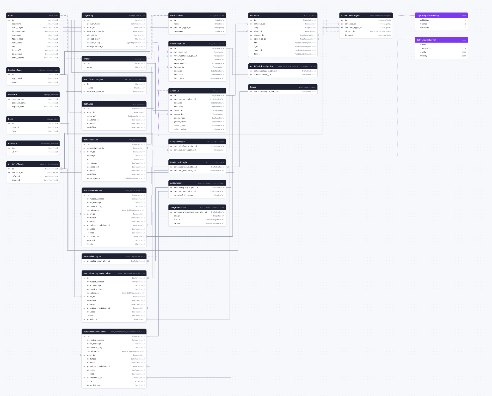

[LogEntry](#logentry) · [Permission](#permission) · [Group](#group) · [User](#user) · [ContentType](#contenttype) · [Session](#session) · [Site](#site) · [NotificationType](#notificationtype) · [Settings](#settings) · [Subscription](#subscription) · [Notification](#notification) · [KVStore](#kvstore) · [Article](#article) · [ArticleForObject](#articleforobject) · [ArticleRevision](#articlerevision) · [ArticlePlugin](#articleplugin) · [ReusablePlugin](#reusableplugin) · [SimplePlugin](#simpleplugin) · [RevisionPlugin](#revisionplugin) · [RevisionPluginRevision](#revisionpluginrevision) · [URLPath](#urlpath) · [Attachment](#attachment) · [AttachmentRevision](#attachmentrevision) · [ArticleSubscription](#articlesubscription) · [Image](#image) · [ImageRevision](#imagerevision)

<details>
<summary>The whole schema as SQL</summary>

```sql
CREATE TABLE "django_admin_log" ("id" integer NOT NULL PRIMARY KEY AUTOINCREMENT, "action_time" datetime NOT NULL, "user_id" integer NOT NULL REFERENCES "auth_user" ("id") DEFERRABLE INITIALLY DEFERRED, "content_type_id" integer NULL REFERENCES "django_content_type" ("id") DEFERRABLE INITIALLY DEFERRED, "object_id" text NULL, "object_repr" varchar(200) NOT NULL, "action_flag" smallint unsigned NOT NULL CHECK ("action_flag" >= 0), "change_message" text NOT NULL);

CREATE TABLE "auth_permission" ("id" integer NOT NULL PRIMARY KEY AUTOINCREMENT, "name" varchar(255) NOT NULL, "content_type_id" integer NOT NULL REFERENCES "django_content_type" ("id") DEFERRABLE INITIALLY DEFERRED, "codename" varchar(100) NOT NULL);

CREATE TABLE "auth_group" ("id" integer NOT NULL PRIMARY KEY AUTOINCREMENT, "name" varchar(150) NOT NULL UNIQUE);

CREATE TABLE "auth_group_permissions" ("id" integer NOT NULL PRIMARY KEY AUTOINCREMENT, "group_id" integer NOT NULL REFERENCES "auth_group" ("id") DEFERRABLE INITIALLY DEFERRED, "permission_id" integer NOT NULL REFERENCES "auth_permission" ("id") DEFERRABLE INITIALLY DEFERRED);

CREATE TABLE "auth_user" ("id" integer NOT NULL PRIMARY KEY AUTOINCREMENT, "password" varchar(128) NOT NULL, "last_login" datetime NULL, "is_superuser" bool NOT NULL, "username" varchar(150) NOT NULL UNIQUE, "first_name" varchar(150) NOT NULL, "last_name" varchar(150) NOT NULL, "email" varchar(254) NOT NULL, "is_staff" bool NOT NULL, "is_active" bool NOT NULL, "date_joined" datetime NOT NULL);

CREATE TABLE "auth_user_groups" ("id" integer NOT NULL PRIMARY KEY AUTOINCREMENT, "user_id" integer NOT NULL REFERENCES "auth_user" ("id") DEFERRABLE INITIALLY DEFERRED, "group_id" integer NOT NULL REFERENCES "auth_group" ("id") DEFERRABLE INITIALLY DEFERRED);

CREATE TABLE "auth_user_user_permissions" ("id" integer NOT NULL PRIMARY KEY AUTOINCREMENT, "user_id" integer NOT NULL REFERENCES "auth_user" ("id") DEFERRABLE INITIALLY DEFERRED, "permission_id" integer NOT NULL REFERENCES "auth_permission" ("id") DEFERRABLE INITIALLY DEFERRED);

CREATE TABLE "django_content_type" ("id" integer NOT NULL PRIMARY KEY AUTOINCREMENT, "app_label" varchar(100) NOT NULL, "model" varchar(100) NOT NULL);

CREATE TABLE "django_session" ("session_key" varchar(40) NOT NULL PRIMARY KEY, "session_data" text NOT NULL, "expire_date" datetime NOT NULL);

CREATE TABLE "django_site" ("id" integer NOT NULL PRIMARY KEY AUTOINCREMENT, "domain" varchar(100) NOT NULL UNIQUE, "name" varchar(50) NOT NULL);

CREATE TABLE "nyt_notificationtype" ("key" varchar(128) NOT NULL PRIMARY KEY, "label" varchar(128) NULL, "content_type_id" integer NULL REFERENCES "django_content_type" ("id") DEFERRABLE INITIALLY DEFERRED);

CREATE TABLE "nyt_settings" ("id" integer NOT NULL PRIMARY KEY AUTOINCREMENT, "user_id" integer NOT NULL REFERENCES "auth_user" ("id") DEFERRABLE INITIALLY DEFERRED, "interval" smallint NOT NULL, "is_default" bool NOT NULL, "created" datetime NOT NULL, "modified" datetime NOT NULL);

CREATE TABLE "nyt_subscription" ("id" integer NOT NULL PRIMARY KEY AUTOINCREMENT, "settings_id" bigint NOT NULL REFERENCES "nyt_settings" ("id") DEFERRABLE INITIALLY DEFERRED, "notification_type_id" varchar(128) NOT NULL REFERENCES "nyt_notificationtype" ("key") DEFERRABLE INITIALLY DEFERRED, "object_id" varchar(64) NULL, "send_emails" bool NOT NULL, "latest_id" bigint NULL REFERENCES "nyt_notification" ("id") DEFERRABLE INITIALLY DEFERRED, "created" datetime NOT NULL, "modified" datetime NOT NULL, "last_sent" datetime NULL);

CREATE TABLE "nyt_notification" ("id" integer NOT NULL PRIMARY KEY AUTOINCREMENT, "subscription_id" bigint NULL REFERENCES "nyt_subscription" ("id") DEFERRABLE INITIALLY DEFERRED, "user_id" integer NULL REFERENCES "auth_user" ("id") DEFERRABLE INITIALLY DEFERRED, "message" text NOT NULL, "url" varchar(2000) NULL, "is_viewed" bool NOT NULL, "is_emailed" bool NOT NULL, "created" datetime NOT NULL, "modified" datetime NOT NULL, "occurrences" integer unsigned NOT NULL CHECK ("occurrences" >= 0));

CREATE TABLE "thumbnail_kvstore" ("key" varchar(200) NOT NULL PRIMARY KEY, "value" text NOT NULL);

CREATE TABLE "wiki_article" ("id" integer NOT NULL PRIMARY KEY AUTOINCREMENT, "current_revision_id" bigint NULL UNIQUE REFERENCES "wiki_articlerevision" ("id") DEFERRABLE INITIALLY DEFERRED, "created" datetime NOT NULL, "modified" datetime NOT NULL, "owner_id" integer NULL REFERENCES "auth_user" ("id") DEFERRABLE INITIALLY DEFERRED, "group_id" integer NULL REFERENCES "auth_group" ("id") DEFERRABLE INITIALLY DEFERRED, "group_read" bool NOT NULL, "group_write" bool NOT NULL, "other_read" bool NOT NULL, "other_write" bool NOT NULL);

CREATE TABLE "wiki_articleforobject" ("id" integer NOT NULL PRIMARY KEY AUTOINCREMENT, "article_id" bigint NOT NULL REFERENCES "wiki_article" ("id") DEFERRABLE INITIALLY DEFERRED, "content_type_id" integer NOT NULL REFERENCES "django_content_type" ("id") DEFERRABLE INITIALLY DEFERRED, "object_id" integer unsigned NOT NULL CHECK ("object_id" >= 0), "is_mptt" bool NOT NULL);

CREATE TABLE "wiki_articlerevision" ("id" integer NOT NULL PRIMARY KEY AUTOINCREMENT, "revision_number" integer NOT NULL, "user_message" text NOT NULL, "automatic_log" text NOT NULL, "ip_address" char(39) NULL, "user_id" integer NULL REFERENCES "auth_user" ("id") DEFERRABLE INITIALLY DEFERRED, "modified" datetime NOT NULL, "created" datetime NOT NULL, "previous_revision_id" bigint NULL REFERENCES "wiki_articlerevision" ("id") DEFERRABLE INITIALLY DEFERRED, "deleted" bool NOT NULL, "locked" bool NOT NULL, "article_id" bigint NOT NULL REFERENCES "wiki_article" ("id") DEFERRABLE INITIALLY DEFERRED, "content" text NOT NULL, "title" varchar(512) NOT NULL);

CREATE TABLE "wiki_articleplugin" ("id" integer NOT NULL PRIMARY KEY AUTOINCREMENT, "article_id" bigint NOT NULL REFERENCES "wiki_article" ("id") DEFERRABLE INITIALLY DEFERRED, "deleted" bool NOT NULL, "created" datetime NOT NULL);

CREATE TABLE "wiki_reusableplugin" ("articleplugin_ptr_id" bigint NOT NULL PRIMARY KEY REFERENCES "wiki_articleplugin" ("id") DEFERRABLE INITIALLY DEFERRED);

CREATE TABLE "wiki_reusableplugin_articles" ("id" integer NOT NULL PRIMARY KEY AUTOINCREMENT, "reusableplugin_id" bigint NOT NULL REFERENCES "wiki_reusableplugin" ("articleplugin_ptr_id") DEFERRABLE INITIALLY DEFERRED, "article_id" bigint NOT NULL REFERENCES "wiki_article" ("id") DEFERRABLE INITIALLY DEFERRED);

CREATE TABLE "wiki_simpleplugin" ("articleplugin_ptr_id" bigint NOT NULL PRIMARY KEY REFERENCES "wiki_articleplugin" ("id") DEFERRABLE INITIALLY DEFERRED, "article_revision_id" bigint NOT NULL REFERENCES "wiki_articlerevision" ("id") DEFERRABLE INITIALLY DEFERRED);

CREATE TABLE "wiki_revisionplugin" ("articleplugin_ptr_id" bigint NOT NULL PRIMARY KEY REFERENCES "wiki_articleplugin" ("id") DEFERRABLE INITIALLY DEFERRED, "current_revision_id" bigint NULL UNIQUE REFERENCES "wiki_revisionpluginrevision" ("id") DEFERRABLE INITIALLY DEFERRED);

CREATE TABLE "wiki_revisionpluginrevision" ("id" integer NOT NULL PRIMARY KEY AUTOINCREMENT, "revision_number" integer NOT NULL, "user_message" text NOT NULL, "automatic_log" text NOT NULL, "ip_address" char(39) NULL, "user_id" integer NULL REFERENCES "auth_user" ("id") DEFERRABLE INITIALLY DEFERRED, "modified" datetime NOT NULL, "created" datetime NOT NULL, "previous_revision_id" bigint NULL REFERENCES "wiki_revisionpluginrevision" ("id") DEFERRABLE INITIALLY DEFERRED, "deleted" bool NOT NULL, "locked" bool NOT NULL, "plugin_id" bigint NOT NULL REFERENCES "wiki_revisionplugin" ("articleplugin_ptr_id") DEFERRABLE INITIALLY DEFERRED);

CREATE TABLE "wiki_urlpath" ("id" integer NOT NULL PRIMARY KEY AUTOINCREMENT, "article_id" bigint NOT NULL REFERENCES "wiki_article" ("id") DEFERRABLE INITIALLY DEFERRED, "slug" varchar(50) NULL, "site_id" integer NOT NULL REFERENCES "django_site" ("id") DEFERRABLE INITIALLY DEFERRED, "parent_id" bigint NULL REFERENCES "wiki_urlpath" ("id") DEFERRABLE INITIALLY DEFERRED, "moved_to_id" bigint NULL REFERENCES "wiki_urlpath" ("id") DEFERRABLE INITIALLY DEFERRED, "lft" integer unsigned NOT NULL CHECK ("lft" >= 0), "rght" integer unsigned NOT NULL CHECK ("rght" >= 0), "tree_id" integer unsigned NOT NULL CHECK ("tree_id" >= 0), "level" integer unsigned NOT NULL CHECK ("level" >= 0));

CREATE TABLE "wiki_attachments_attachment" ("reusableplugin_ptr_id" bigint NOT NULL PRIMARY KEY REFERENCES "wiki_reusableplugin" ("articleplugin_ptr_id") DEFERRABLE INITIALLY DEFERRED, "current_revision_id" bigint NULL UNIQUE REFERENCES "wiki_attachments_attachmentrevision" ("id") DEFERRABLE INITIALLY DEFERRED, "original_filename" varchar(256) NULL);

CREATE TABLE "wiki_attachments_attachmentrevision" ("id" integer NOT NULL PRIMARY KEY AUTOINCREMENT, "revision_number" integer NOT NULL, "user_message" text NOT NULL, "automatic_log" text NOT NULL, "ip_address" char(39) NULL, "user_id" integer NULL REFERENCES "auth_user" ("id") DEFERRABLE INITIALLY DEFERRED, "modified" datetime NOT NULL, "created" datetime NOT NULL, "previous_revision_id" bigint NULL REFERENCES "wiki_attachments_attachmentrevision" ("id") DEFERRABLE INITIALLY DEFERRED, "deleted" bool NOT NULL, "locked" bool NOT NULL, "attachment_id" bigint NOT NULL REFERENCES "wiki_attachments_attachment" ("reusableplugin_ptr_id") DEFERRABLE INITIALLY DEFERRED, "file" varchar(255) NOT NULL, "description" text NOT NULL);

CREATE TABLE "wiki_notifications_articlesubscription" ("articleplugin_ptr_id" bigint NOT NULL PRIMARY KEY REFERENCES "wiki_articleplugin" ("id") DEFERRABLE INITIALLY DEFERRED, "subscription_id" bigint NOT NULL UNIQUE REFERENCES "nyt_subscription" ("id") DEFERRABLE INITIALLY DEFERRED);

CREATE TABLE "wiki_images_image" ("revisionplugin_ptr_id" bigint NOT NULL PRIMARY KEY REFERENCES "wiki_revisionplugin" ("articleplugin_ptr_id") DEFERRABLE INITIALLY DEFERRED);

CREATE TABLE "wiki_images_imagerevision" ("revisionpluginrevision_ptr_id" bigint NOT NULL PRIMARY KEY REFERENCES "wiki_revisionpluginrevision" ("id") DEFERRABLE INITIALLY DEFERRED, "image" varchar(2000) NULL, "width" smallint NULL, "height" smallint NULL);

CREATE INDEX "django_admin_log_user_id_c564eba6" ON "django_admin_log" ("user_id");

CREATE INDEX "django_admin_log_content_type_id_c4bce8eb" ON "django_admin_log" ("content_type_id");

CREATE UNIQUE INDEX "auth_permission_content_type_id_codename_01ab375a_uniq" ON "auth_permission" ("content_type_id", "codename");

CREATE INDEX "auth_permission_content_type_id_2f476e4b" ON "auth_permission" ("content_type_id");

CREATE UNIQUE INDEX "auth_group_permissions_group_id_permission_id_0cd325b0_uniq" ON "auth_group_permissions" ("group_id", "permission_id");

CREATE INDEX "auth_group_permissions_group_id_b120cbf9" ON "auth_group_permissions" ("group_id");

CREATE INDEX "auth_group_permissions_permission_id_84c5c92e" ON "auth_group_permissions" ("permission_id");

CREATE UNIQUE INDEX "auth_user_groups_user_id_group_id_94350c0c_uniq" ON "auth_user_groups" ("user_id", "group_id");

CREATE INDEX "auth_user_groups_user_id_6a12ed8b" ON "auth_user_groups" ("user_id");

CREATE INDEX "auth_user_groups_group_id_97559544" ON "auth_user_groups" ("group_id");

CREATE UNIQUE INDEX "auth_user_user_permissions_user_id_permission_id_14a6b632_uniq" ON "auth_user_user_permissions" ("user_id", "permission_id");

CREATE INDEX "auth_user_user_permissions_user_id_a95ead1b" ON "auth_user_user_permissions" ("user_id");

CREATE INDEX "auth_user_user_permissions_permission_id_1fbb5f2c" ON "auth_user_user_permissions" ("permission_id");

CREATE UNIQUE INDEX "django_content_type_app_label_model_76bd3d3b_uniq" ON "django_content_type" ("app_label", "model");

CREATE INDEX "django_session_expire_date_a5c62663" ON "django_session" ("expire_date");

CREATE INDEX "nyt_notificationtype_content_type_id_18800dea" ON "nyt_notificationtype" ("content_type_id");

CREATE INDEX "nyt_settings_user_id_1fad6d98" ON "nyt_settings" ("user_id");

CREATE INDEX "nyt_subscription_settings_id_761bae06" ON "nyt_subscription" ("settings_id");

CREATE INDEX "nyt_subscription_notification_type_id_ca8af379" ON "nyt_subscription" ("notification_type_id");

CREATE INDEX "nyt_subscription_latest_id_bbb7d98b" ON "nyt_subscription" ("latest_id");

CREATE INDEX "nyt_notification_subscription_id_5a132ae1" ON "nyt_notification" ("subscription_id");

CREATE INDEX "nyt_notification_user_id_acbb5c10" ON "nyt_notification" ("user_id");

CREATE INDEX "wiki_article_owner_id_956bc94a" ON "wiki_article" ("owner_id");

CREATE INDEX "wiki_article_group_id_bf035c83" ON "wiki_article" ("group_id");

CREATE UNIQUE INDEX "wiki_articleforobject_content_type_id_object_id_046be756_uniq" ON "wiki_articleforobject" ("content_type_id", "object_id");

CREATE INDEX "wiki_articleforobject_article_id_7d67d809" ON "wiki_articleforobject" ("article_id");

CREATE INDEX "wiki_articleforobject_content_type_id_ba569059" ON "wiki_articleforobject" ("content_type_id");

CREATE UNIQUE INDEX "wiki_articlerevision_article_id_revision_number_5bcd5334_uniq" ON "wiki_articlerevision" ("article_id", "revision_number");

CREATE INDEX "wiki_articlerevision_user_id_c687e4de" ON "wiki_articlerevision" ("user_id");

CREATE INDEX "wiki_articlerevision_previous_revision_id_bcfaf4c9" ON "wiki_articlerevision" ("previous_revision_id");

CREATE INDEX "wiki_articlerevision_article_id_e0fb2474" ON "wiki_articlerevision" ("article_id");

CREATE INDEX "wiki_articleplugin_article_id_9ab0e854" ON "wiki_articleplugin" ("article_id");

CREATE UNIQUE INDEX "wiki_reusableplugin_articles_reusableplugin_id_article_id_302a7a01_uniq" ON "wiki_reusableplugin_articles" ("reusableplugin_id", "article_id");

CREATE INDEX "wiki_reusableplugin_articles_reusableplugin_id_52618a1c" ON "wiki_reusableplugin_articles" ("reusableplugin_id");

CREATE INDEX "wiki_reusableplugin_articles_article_id_8a09d39e" ON "wiki_reusableplugin_articles" ("article_id");

CREATE INDEX "wiki_simpleplugin_article_revision_id_cff7df92" ON "wiki_simpleplugin" ("article_revision_id");

CREATE INDEX "wiki_revisionpluginrevision_user_id_ee40f729" ON "wiki_revisionpluginrevision" ("user_id");

CREATE INDEX "wiki_revisionpluginrevision_previous_revision_id_38c877c0" ON "wiki_revisionpluginrevision" ("previous_revision_id");

CREATE INDEX "wiki_revisionpluginrevision_plugin_id_c8f4475b" ON "wiki_revisionpluginrevision" ("plugin_id");

CREATE UNIQUE INDEX "wiki_urlpath_site_id_parent_id_slug_e4942e5d_uniq" ON "wiki_urlpath" ("site_id", "parent_id", "slug");

CREATE INDEX "wiki_urlpath_article_id_9ef0c0fb" ON "wiki_urlpath" ("article_id");

CREATE INDEX "wiki_urlpath_slug_39d212eb" ON "wiki_urlpath" ("slug");

CREATE INDEX "wiki_urlpath_site_id_319be912" ON "wiki_urlpath" ("site_id");

CREATE INDEX "wiki_urlpath_parent_id_a6e675ac" ON "wiki_urlpath" ("parent_id");

CREATE INDEX "wiki_urlpath_moved_to_id_4718abf8" ON "wiki_urlpath" ("moved_to_id");

CREATE INDEX "wiki_urlpath_tree_id_090b475d" ON "wiki_urlpath" ("tree_id");

CREATE INDEX "wiki_attachments_attachmentrevision_user_id_2da908ac" ON "wiki_attachments_attachmentrevision" ("user_id");

CREATE INDEX "wiki_attachments_attachmentrevision_previous_revision_id_e7f09093" ON "wiki_attachments_attachmentrevision" ("previous_revision_id");

CREATE INDEX "wiki_attachments_attachmentrevision_attachment_id_32ffc4ea" ON "wiki_attachments_attachmentrevision" ("attachment_id");

CREATE UNIQUE INDEX "wiki_notifications_articlesubscription_subscription_id_articleplugin_ptr_id_6898a80a_uniq" ON "wiki_notifications_articlesubscription" ("subscription_id", "articleplugin_ptr_id");
```

</details>

## LogEntry

Table `django_admin_log`, app `admin`.


| Column | Field | Type | Null | Key | Default | Description |
| --- | --- | --- | --- | --- | --- | --- |
| `id` | `AutoField` | `integer` |  | PK | `autoincrement()` |  |
| `action_time` | `DateTimeField` | `datetime` |  |  | `now()` |  |
| `user_id` | `ForeignKey` | `integer` |  | FK |  |  |
| `content_type_id` | `ForeignKey` | `integer` | yes | FK |  |  |
| `object_id` | `TextField` | `text` | yes |  |  |  |
| `object_repr` | `CharField` | `varchar(200)` |  |  |  |  |
| `action_flag` | `LogEntryActionFlag` | `smallint unsigned` |  |  |  |  |
| `change_message` | `TextField` | `text` |  |  |  |  |

Indexes:

- index `django_admin_log_user_id_c564eba6` on `user_id`
- index `django_admin_log_content_type_id_c4bce8eb` on `content_type_id`

Relations:

- `user_id` → [User](#user).`id`, on delete cascade
- `content_type_id` → [ContentType](#contenttype).`id`, on delete set null

## Permission

Table `auth_permission`, app `auth`.

The permissions system provides a way to assign permissions to specific
users and groups of users.

The permission system is used by the Django admin site, but may also be
useful in your own code. The Django admin site uses permissions as follows:

    - The "add" permission limits the user's ability to view the "add" form
      and add an object.
    - The "change" permission limits a user's ability to view the change
      list, view the "change" form and change an object.
    - The "delete" permission limits the ability to delete an object.
    - The "view" permission limits the ability to view an object.

Permissions are set globally per type of object, not per specific object
instance. It is possible to say "Mary may change news stories," but it's
not currently possible to say "Mary may change news stories, but only the
ones she created herself" or "Mary may only change news stories that have a
certain status or publication date."

The permissions listed above are automatically created for each model.


| Column | Field | Type | Null | Key | Default | Description |
| --- | --- | --- | --- | --- | --- | --- |
| `id` | `AutoField` | `integer` |  | PK | `autoincrement()` |  |
| `name` | `CharField` | `varchar(255)` |  |  |  |  |
| `content_type_id` | `ForeignKey` | `integer` |  | FK |  |  |
| `codename` | `CharField` | `varchar(100)` |  |  |  |  |

Indexes:

- index `auth_permission_content_type_id_2f476e4b` on `content_type_id`
- unique `auth_permission_content_type_id_codename_01ab375a_uniq` on `content_type_id`, `codename`

Relations:

- `content_type_id` → [ContentType](#contenttype).`id`, on delete cascade
- `group_set` — many to many with [Group](#group)
- `user_set` — many to many with [User](#user)

## Group

Table `auth_group`, app `auth`.

Groups are a generic way of categorizing users to apply permissions, or
some other label, to those users. A user can belong to any number of
groups.

A user in a group automatically has all the permissions granted to that
group. For example, if the group 'Site editors' has the permission
can_edit_home_page, any user in that group will have that permission.

Beyond permissions, groups are a convenient way to categorize users to
apply some label, or extended functionality, to them. For example, you
could create a group 'Special users', and you could write code that would
do special things to those users -- such as giving them access to a
members-only portion of your site, or sending them members-only email
messages.

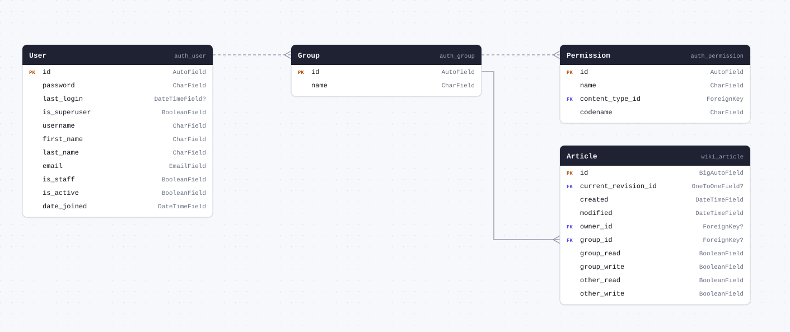

| Column | Field | Type | Null | Key | Default | Description |
| --- | --- | --- | --- | --- | --- | --- |
| `id` | `AutoField` | `integer` |  | PK | `autoincrement()` |  |
| `name` | `CharField` | `varchar(150)` |  | unique |  |  |

Relations:

- `permissions` — many to many with [Permission](#permission)
- `user_set` — many to many with [User](#user)
- [Article](#article).`group_id` → `id`, on delete set null

## User

Table `auth_user`, app `auth`.

Columns from `AbstractUser` (abstract): `username`, `first_name`, `last_name`, `email`, `is_staff`, `is_active`, `date_joined`.

Columns from `AbstractBaseUser` (abstract): `password`, `last_login`.

Columns from `PermissionsMixin` (abstract): `is_superuser`.

Users within the Django authentication system are represented by this
model.

Username and password are required. Other fields are optional.

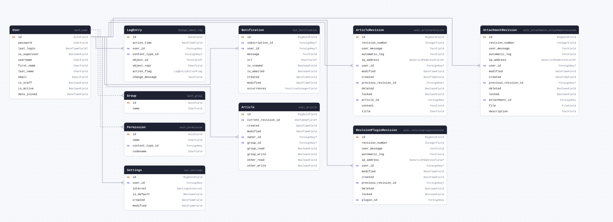

| Column | Field | Type | Null | Key | Default | Description |
| --- | --- | --- | --- | --- | --- | --- |
| `id` | `AutoField` | `integer` |  | PK | `autoincrement()` |  |
| `password` | `CharField` | `varchar(128)` |  |  |  |  |
| `last_login` | `DateTimeField` | `datetime` | yes |  |  |  |
| `is_superuser` | `BooleanField` | `bool` |  |  | `False` | Designates that this user has all permissions without explicitly assigning them. |
| `username` | `CharField` | `varchar(150)` |  | unique |  | Required. 150 characters or fewer. Letters, digits and @/./+/-/_ only. |
| `first_name` | `CharField` | `varchar(150)` |  |  |  |  |
| `last_name` | `CharField` | `varchar(150)` |  |  |  |  |
| `email` | `EmailField` | `varchar(254)` |  |  |  |  |
| `is_staff` | `BooleanField` | `bool` |  |  | `False` | Designates whether the user can log into this admin site. |
| `is_active` | `BooleanField` | `bool` |  |  | `True` | Designates whether this user should be treated as active. Unselect this instead of deleting accounts. |
| `date_joined` | `DateTimeField` | `datetime` |  |  | `now()` |  |

Relations:

- [LogEntry](#logentry).`user_id` → `id`, on delete cascade
- `groups` — many to many with [Group](#group)
- `user_permissions` — many to many with [Permission](#permission)
- [Settings](#settings).`user_id` → `id`, on delete cascade
- [Notification](#notification).`user_id` → `id`, on delete cascade
- [Article](#article).`owner_id` → `id`, on delete set null
- [ArticleRevision](#articlerevision).`user_id` → `id`, on delete set null
- [RevisionPluginRevision](#revisionpluginrevision).`user_id` → `id`, on delete set null
- [AttachmentRevision](#attachmentrevision).`user_id` → `id`, on delete set null

## ContentType

Table `django_content_type`, app `contenttypes`.

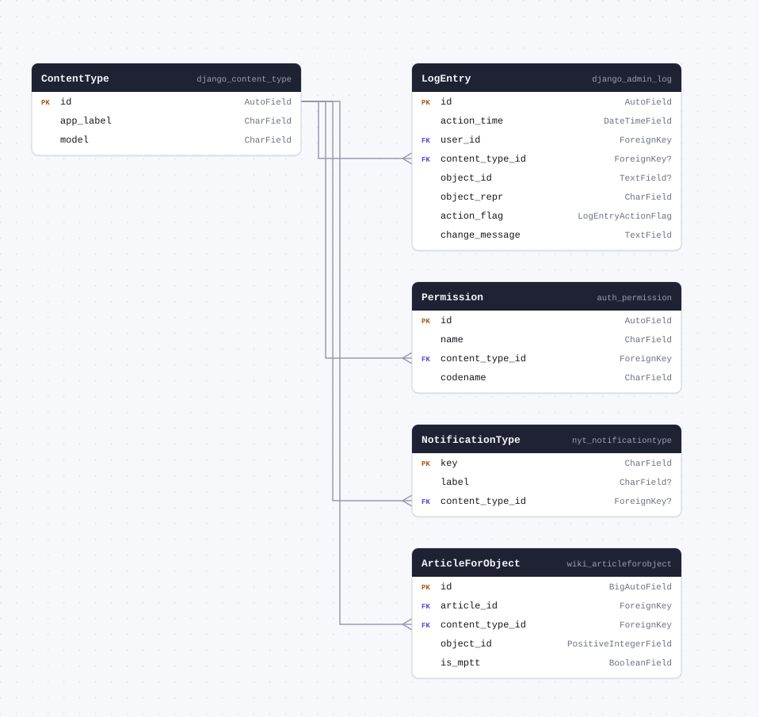

| Column | Field | Type | Null | Key | Default | Description |
| --- | --- | --- | --- | --- | --- | --- |
| `id` | `AutoField` | `integer` |  | PK | `autoincrement()` |  |
| `app_label` | `CharField` | `varchar(100)` |  |  |  |  |
| `model` | `CharField` | `varchar(100)` |  |  |  |  |

Indexes:

- unique `django_content_type_app_label_model_76bd3d3b_uniq` on `app_label`, `model`

Relations:

- [LogEntry](#logentry).`content_type_id` → `id`, on delete set null
- [Permission](#permission).`content_type_id` → `id`, on delete cascade
- [NotificationType](#notificationtype).`content_type_id` → `id`, on delete set null
- [ArticleForObject](#articleforobject).`content_type_id` → `id`, on delete cascade

## Session

Table `django_session`, app `sessions`.

Columns from `AbstractBaseSession` (abstract): `session_key`, `session_data`, `expire_date`.

Django provides full support for anonymous sessions. The session
framework lets you store and retrieve arbitrary data on a
per-site-visitor basis. It stores data on the server side and
abstracts the sending and receiving of cookies. Cookies contain a
session ID -- not the data itself.

The Django sessions framework is entirely cookie-based. It does
not fall back to putting session IDs in URLs. This is an intentional
design decision. Not only does that behavior make URLs ugly, it makes
your site vulnerable to session-ID theft via the "Referer" header.

For complete documentation on using Sessions in your code, consult
the sessions documentation that is shipped with Django (also available
on the Django web site).

| Column | Field | Type | Null | Key | Default | Description |
| --- | --- | --- | --- | --- | --- | --- |
| `session_key` | `CharField` | `varchar(40)` |  | PK |  |  |
| `session_data` | `TextField` | `text` |  |  |  |  |
| `expire_date` | `DateTimeField` | `datetime` |  |  |  |  |

Indexes:

- index `django_session_expire_date_a5c62663` on `expire_date`

## Site

Table `django_site`, app `sites`.

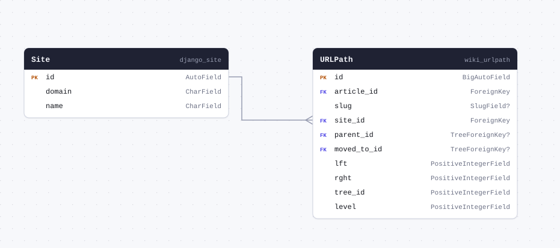

| Column | Field | Type | Null | Key | Default | Description |
| --- | --- | --- | --- | --- | --- | --- |
| `id` | `AutoField` | `integer` |  | PK | `autoincrement()` |  |
| `domain` | `CharField` | `varchar(100)` |  | unique |  |  |
| `name` | `CharField` | `varchar(50)` |  |  |  |  |

Relations:

- [URLPath](#urlpath).`site_id` → `id`, on delete cascade

## NotificationType

Table `nyt_notificationtype`, app `django_nyt`.

Notification types are added on-the-fly by the
applications adding new notifications

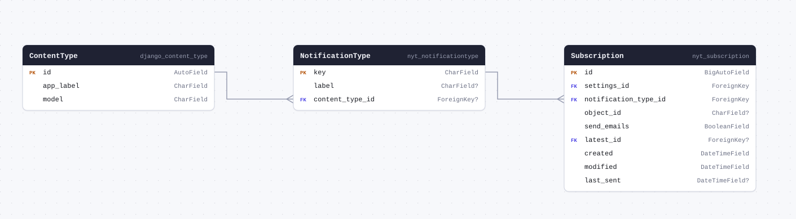

| Column | Field | Type | Null | Key | Default | Description |
| --- | --- | --- | --- | --- | --- | --- |
| `key` | `CharField` | `varchar(128)` |  | PK |  |  |
| `label` | `CharField` | `varchar(128)` | yes |  |  |  |
| `content_type_id` | `ForeignKey` | `integer` | yes | FK |  |  |

Indexes:

- index `nyt_notificationtype_content_type_id_18800dea` on `content_type_id`

Relations:

- `content_type_id` → [ContentType](#contenttype).`id`, on delete set null
- [Subscription](#subscription).`notification_type_id` → `key`, on delete cascade

## Settings

Table `nyt_settings`, app `django_nyt`.

Reusable settings object for a subscription

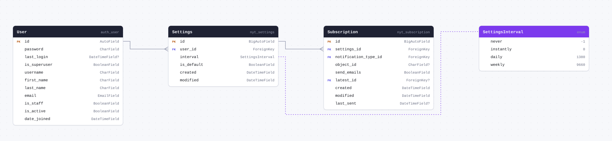

| Column | Field | Type | Null | Key | Default | Description |
| --- | --- | --- | --- | --- | --- | --- |
| `id` | `BigAutoField` | `integer` |  | PK | `autoincrement()` |  |
| `user_id` | `ForeignKey` | `integer` |  | FK |  |  |
| `interval` | `SettingsInterval` | `smallint` |  |  | `0` | interval in minutes (0=instant, 60=notify once per hour) |
| `is_default` | `BooleanField` | `bool` |  |  | `False` |  |
| `created` | `DateTimeField` | `datetime` |  |  | `now()` |  |
| `modified` | `DateTimeField` | `datetime` |  |  | `now()` |  |

Indexes:

- index `nyt_settings_user_id_1fad6d98` on `user_id`

Relations:

- `user_id` → [User](#user).`id`, on delete cascade
- [Subscription](#subscription).`settings_id` → `id`, on delete cascade

## Subscription

Table `nyt_subscription`, app `django_nyt`.

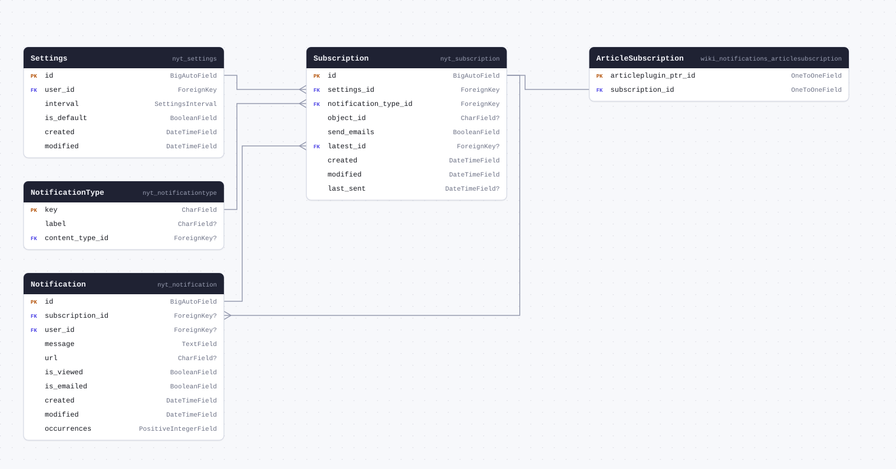

| Column | Field | Type | Null | Key | Default | Description |
| --- | --- | --- | --- | --- | --- | --- |
| `id` | `BigAutoField` | `integer` |  | PK | `autoincrement()` |  |
| `settings_id` | `ForeignKey` | `bigint` |  | FK |  |  |
| `notification_type_id` | `ForeignKey` | `varchar(128)` |  | FK |  |  |
| `object_id` | `CharField` | `varchar(64)` | yes |  |  | Leave this blank to subscribe to any kind of object |
| `send_emails` | `BooleanField` | `bool` |  |  | `True` |  |
| `latest_id` | `ForeignKey` | `bigint` | yes | FK |  |  |
| `created` | `DateTimeField` | `datetime` |  |  | `now()` |  |
| `modified` | `DateTimeField` | `datetime` |  |  | `now()` |  |
| `last_sent` | `DateTimeField` | `datetime` | yes |  |  |  |

Indexes:

- index `nyt_subscription_settings_id_761bae06` on `settings_id`
- index `nyt_subscription_notification_type_id_ca8af379` on `notification_type_id`
- index `nyt_subscription_latest_id_bbb7d98b` on `latest_id`

Relations:

- `settings_id` → [Settings](#settings).`id`, on delete cascade
- `notification_type_id` → [NotificationType](#notificationtype).`key`, on delete cascade
- `latest_id` → [Notification](#notification).`id`, on delete cascade
- [Notification](#notification).`subscription_id` → `id`, on delete set null
- [ArticleSubscription](#articlesubscription).`subscription_id` → `id`, on delete cascade

## Notification

Table `nyt_notification`, app `django_nyt`.

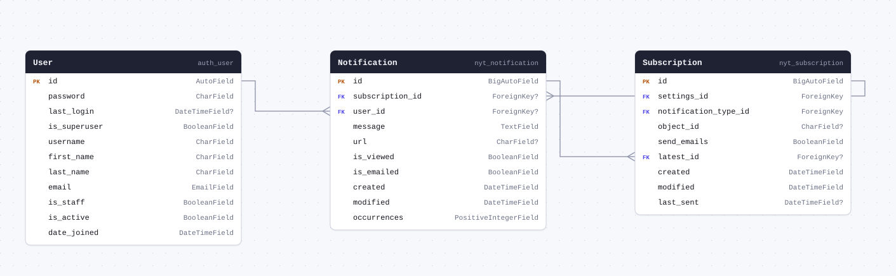

| Column | Field | Type | Null | Key | Default | Description |
| --- | --- | --- | --- | --- | --- | --- |
| `id` | `BigAutoField` | `integer` |  | PK | `autoincrement()` |  |
| `subscription_id` | `ForeignKey` | `bigint` | yes | FK |  |  |
| `user_id` | `ForeignKey` | `integer` | yes | FK |  |  |
| `message` | `TextField` | `text` |  |  |  |  |
| `url` | `CharField` | `varchar(2000)` | yes |  |  |  |
| `is_viewed` | `BooleanField` | `bool` |  |  | `False` |  |
| `is_emailed` | `BooleanField` | `bool` |  |  | `False` |  |
| `created` | `DateTimeField` | `datetime` |  |  | `now()` |  |
| `modified` | `DateTimeField` | `datetime` |  |  | `now()` |  |
| `occurrences` | `PositiveIntegerField` | `integer unsigned` |  |  | `1` | If the same notification was fired multiple times with no intermediate notifications |

Indexes:

- index `nyt_notification_subscription_id_5a132ae1` on `subscription_id`
- index `nyt_notification_user_id_acbb5c10` on `user_id`

Relations:

- [Subscription](#subscription).`latest_id` → `id`, on delete cascade
- `subscription_id` → [Subscription](#subscription).`id`, on delete set null
- `user_id` → [User](#user).`id`, on delete cascade

## KVStore

Table `thumbnail_kvstore`, app `thumbnail`.

| Column | Field | Type | Null | Key | Default | Description |
| --- | --- | --- | --- | --- | --- | --- |
| `key` | `CharField` | `varchar(200)` |  | PK |  |  |
| `value` | `TextField` | `text` |  |  |  |  |

## Article

Table `wiki_article`, app `wiki`.

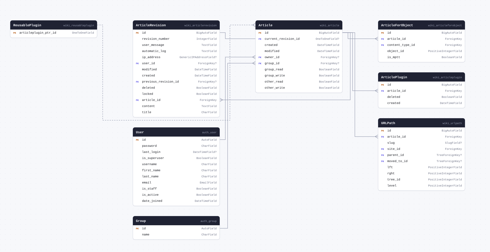

| Column | Field | Type | Null | Key | Default | Description |
| --- | --- | --- | --- | --- | --- | --- |
| `id` | `BigAutoField` | `integer` |  | PK | `autoincrement()` |  |
| `current_revision_id` | `OneToOneField` | `bigint` | yes | FK, unique |  | The revision being displayed for this article. If you need to do a roll-back, simply change the value of this field. |
| `created` | `DateTimeField` | `datetime` |  |  | `now()` |  |
| `modified` | `DateTimeField` | `datetime` |  |  | `now()` | Article properties last modified |
| `owner_id` | `ForeignKey` | `integer` | yes | FK |  | The owner of the article, usually the creator. The owner always has both read and write access. |
| `group_id` | `ForeignKey` | `integer` | yes | FK |  | Like in a UNIX file system, permissions can be given to a user according to group membership. Groups are handled through the Django auth system. |
| `group_read` | `BooleanField` | `bool` |  |  | `True` |  |
| `group_write` | `BooleanField` | `bool` |  |  | `True` |  |
| `other_read` | `BooleanField` | `bool` |  |  | `True` |  |
| `other_write` | `BooleanField` | `bool` |  |  | `True` |  |

Indexes:

- index `wiki_article_owner_id_956bc94a` on `owner_id`
- index `wiki_article_group_id_bf035c83` on `group_id`

Relations:

- `current_revision_id` → [ArticleRevision](#articlerevision).`id`, on delete cascade
- `owner_id` → [User](#user).`id`, on delete set null
- `group_id` → [Group](#group).`id`, on delete set null
- [ArticleForObject](#articleforobject).`article_id` → `id`, on delete cascade
- [ArticleRevision](#articlerevision).`article_id` → `id`, on delete cascade
- [ArticlePlugin](#articleplugin).`article_id` → `id`, on delete cascade
- `shared_plugins_set` — many to many with [ReusablePlugin](#reusableplugin)
- [URLPath](#urlpath).`article_id` → `id`, on delete cascade

## ArticleForObject

Table `wiki_articleforobject`, app `wiki`.

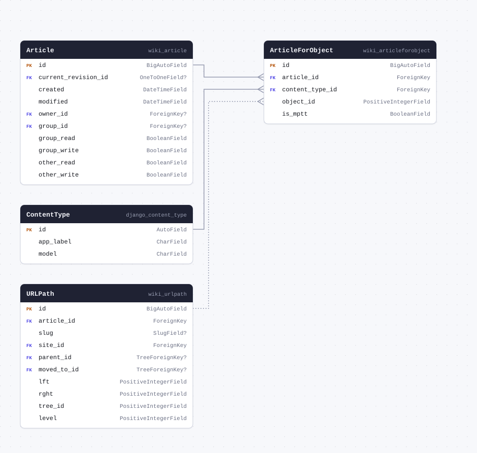

| Column | Field | Type | Null | Key | Default | Description |
| --- | --- | --- | --- | --- | --- | --- |
| `id` | `BigAutoField` | `integer` |  | PK | `autoincrement()` |  |
| `article_id` | `ForeignKey` | `bigint` |  | FK |  |  |
| `content_type_id` | `ForeignKey` | `integer` |  | FK |  |  |
| `object_id` | `PositiveIntegerField` | `integer unsigned` |  |  |  |  |
| `is_mptt` | `BooleanField` | `bool` |  |  | `False` |  |

Indexes:

- index `wiki_articleforobject_article_id_7d67d809` on `article_id`
- index `wiki_articleforobject_content_type_id_ba569059` on `content_type_id`
- unique `wiki_articleforobject_content_type_id_object_id_046be756_uniq` on `content_type_id`, `object_id`

Relations:

- `content_object` → any model, by `content_type_id` + `object_id` (generic foreign key)
- `article_id` → [Article](#article).`id`, on delete cascade
- `content_type_id` → [ContentType](#contenttype).`id`, on delete cascade
- `object_id` → [URLPath](#urlpath).`id` where `content_type_id` is URLPath (generic, `URLPath.articles`)

## ArticleRevision

Table `wiki_articlerevision`, app `wiki`.

Columns from `BaseRevisionMixin` (abstract): `revision_number`, `user_message`, `automatic_log`, `ip_address`, `user_id`, `modified`, `created`, `previous_revision_id`, `deleted`, `locked`.

This is where main revision data is stored. To make it easier to
copy, do NEVER create m2m relationships.

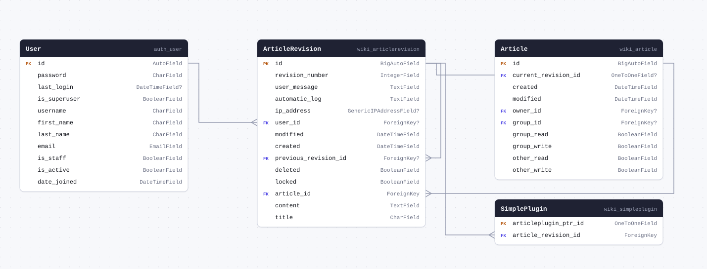

| Column | Field | Type | Null | Key | Default | Description |
| --- | --- | --- | --- | --- | --- | --- |
| `id` | `BigAutoField` | `integer` |  | PK | `autoincrement()` |  |
| `revision_number` | `IntegerField` | `integer` |  |  |  |  |
| `user_message` | `TextField` | `text` |  |  |  |  |
| `automatic_log` | `TextField` | `text` |  |  |  |  |
| `ip_address` | `GenericIPAddressField` | `char(39)` | yes |  |  |  |
| `user_id` | `ForeignKey` | `integer` | yes | FK |  |  |
| `modified` | `DateTimeField` | `datetime` |  |  | `now()` |  |
| `created` | `DateTimeField` | `datetime` |  |  | `now()` |  |
| `previous_revision_id` | `ForeignKey` | `bigint` | yes | FK |  |  |
| `deleted` | `BooleanField` | `bool` |  |  | `False` |  |
| `locked` | `BooleanField` | `bool` |  |  | `False` |  |
| `article_id` | `ForeignKey` | `bigint` |  | FK |  |  |
| `content` | `TextField` | `text` |  |  |  |  |
| `title` | `CharField` | `varchar(512)` |  |  |  | Each revision contains a title field that must be filled out, even if the title has not changed |

Indexes:

- index `wiki_articlerevision_user_id_c687e4de` on `user_id`
- index `wiki_articlerevision_previous_revision_id_bcfaf4c9` on `previous_revision_id`
- index `wiki_articlerevision_article_id_e0fb2474` on `article_id`
- unique `wiki_articlerevision_article_id_revision_number_5bcd5334_uniq` on `article_id`, `revision_number`

Relations:

- [Article](#article).`current_revision_id` → `id`, on delete cascade
- `user_id` → [User](#user).`id`, on delete set null
- `previous_revision_id` → [ArticleRevision](#articlerevision).`id`, on delete set null
- `article_id` → [Article](#article).`id`, on delete cascade
- [SimplePlugin](#simpleplugin).`article_revision_id` → `id`, on delete cascade

## ArticlePlugin

Table `wiki_articleplugin`, app `wiki`.

Subclasses (multi-table): [ReusablePlugin](#reusableplugin), [SimplePlugin](#simpleplugin), [RevisionPlugin](#revisionplugin), [ArticleSubscription](#articlesubscription).

This is the mother of all plugins. Extending from it means a deletion
of an article will CASCADE to your plugin, and the database will be kept
clean. Furthermore, it's possible to list all plugins and maintain generic
properties in the future...

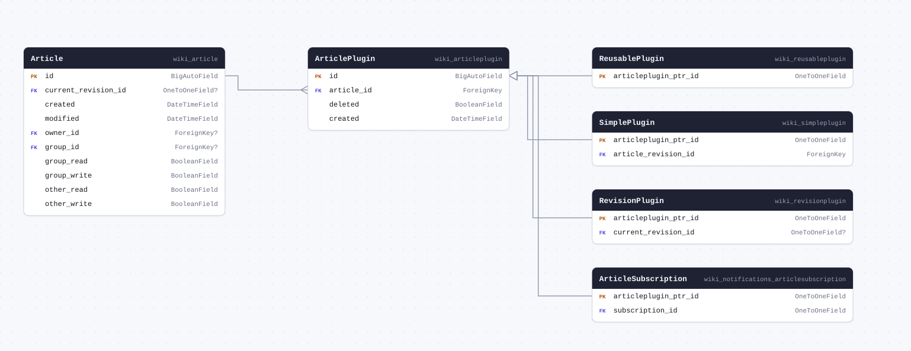

| Column | Field | Type | Null | Key | Default | Description |
| --- | --- | --- | --- | --- | --- | --- |
| `id` | `BigAutoField` | `integer` |  | PK | `autoincrement()` |  |
| `article_id` | `ForeignKey` | `bigint` |  | FK |  |  |
| `deleted` | `BooleanField` | `bool` |  |  | `False` |  |
| `created` | `DateTimeField` | `datetime` |  |  | `now()` |  |

Indexes:

- index `wiki_articleplugin_article_id_9ab0e854` on `article_id`

Relations:

- `article_id` → [Article](#article).`id`, on delete cascade
- [ReusablePlugin](#reusableplugin).`articleplugin_ptr_id` → `id`, parent link, on delete cascade
- [SimplePlugin](#simpleplugin).`articleplugin_ptr_id` → `id`, parent link, on delete cascade
- [RevisionPlugin](#revisionplugin).`articleplugin_ptr_id` → `id`, parent link, on delete cascade
- [ArticleSubscription](#articlesubscription).`articleplugin_ptr_id` → `id`, parent link, on delete cascade

## ReusablePlugin

Table `wiki_reusableplugin`, app `wiki`.

Inherits from [ArticlePlugin](#articleplugin) (multi-table): its rows are joined on `articleplugin_ptr_id`.

Subclasses (multi-table): [Attachment](#attachment).

Extend from this model if you have a plugin that may be related to many
articles. Please note that the ArticlePlugin.article ForeignKey STAYS! This
is in order to maintain an explicit set of permissions.

In general, it's quite complicated to maintain plugin content that's shared
between different articles. The best way to go is to avoid this. For inspiration,
look at wiki.plugins.attachments

You might have to override the permission methods (can_read, can_write etc.)
if you have certain needs for logic in your reusable plugin.

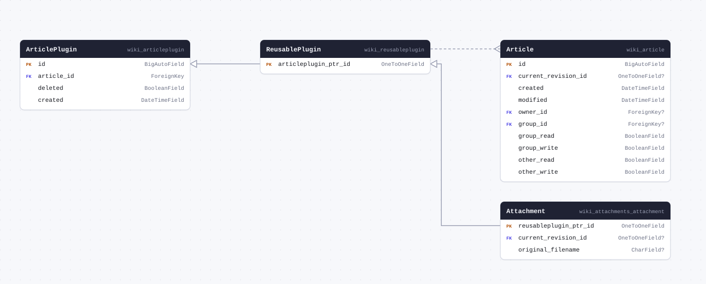

| Column | Field | Type | Null | Key | Default | Description |
| --- | --- | --- | --- | --- | --- | --- |
| `articleplugin_ptr_id` | `OneToOneField` | `bigint` |  | PK, FK |  |  |

Relations:

- `articleplugin_ptr_id` → [ArticlePlugin](#articleplugin).`id`, parent link, on delete cascade
- `articles` — many to many with [Article](#article)
- [Attachment](#attachment).`reusableplugin_ptr_id` → `articleplugin_ptr_id`, parent link, on delete cascade

## SimplePlugin

Table `wiki_simpleplugin`, app `wiki`.

Inherits from [ArticlePlugin](#articleplugin) (multi-table): its rows are joined on `articleplugin_ptr_id`.

Inherit from this model and make sure to specify an article when
saving a new instance. This way, a new revision will be created, and
users are able to roll back to the a previous revision (in which your
plugin wasn't related to the article).

Furthermore, your plugin relation is kept when new revisions are created.

Usage:

class YourPlugin(SimplePlugin):
    ...

Creating new plugins instances:
YourPlugin(article=article_instance, ...) or
YourPlugin.objects.create(article=article_instance, ...)

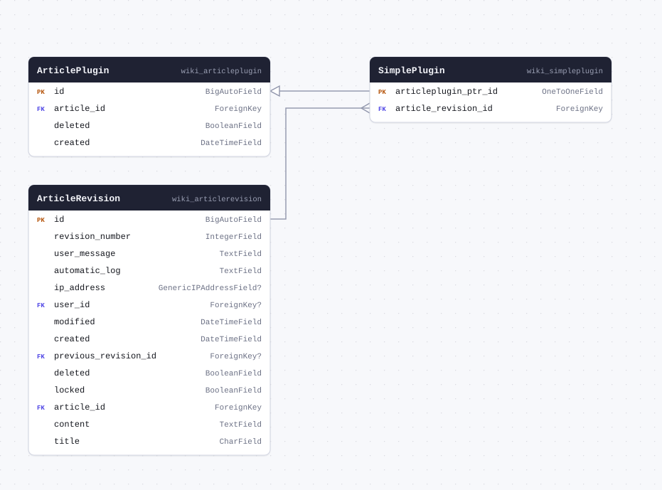

| Column | Field | Type | Null | Key | Default | Description |
| --- | --- | --- | --- | --- | --- | --- |
| `articleplugin_ptr_id` | `OneToOneField` | `bigint` |  | PK, FK |  |  |
| `article_revision_id` | `ForeignKey` | `bigint` |  | FK |  |  |

Indexes:

- index `wiki_simpleplugin_article_revision_id_cff7df92` on `article_revision_id`

Relations:

- `articleplugin_ptr_id` → [ArticlePlugin](#articleplugin).`id`, parent link, on delete cascade
- `article_revision_id` → [ArticleRevision](#articlerevision).`id`, on delete cascade

## RevisionPlugin

Table `wiki_revisionplugin`, app `wiki`.

Inherits from [ArticlePlugin](#articleplugin) (multi-table): its rows are joined on `articleplugin_ptr_id`.

Subclasses (multi-table): [Image](#image).

If you want your plugin to maintain revisions, extend from this one,
not SimplePlugin.

This kind of plugin is not attached to article plugins so rolling articles
back and forth does not affect it.

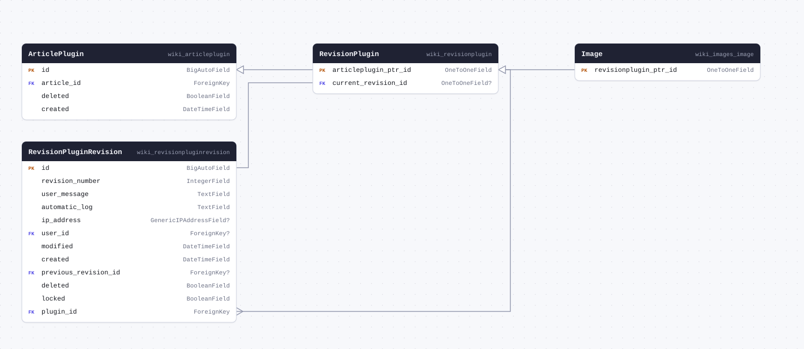

| Column | Field | Type | Null | Key | Default | Description |
| --- | --- | --- | --- | --- | --- | --- |
| `articleplugin_ptr_id` | `OneToOneField` | `bigint` |  | PK, FK |  |  |
| `current_revision_id` | `OneToOneField` | `bigint` | yes | FK, unique |  | The revision being displayed for this plugin. If you need to do a roll-back, simply change the value of this field. |

Relations:

- `articleplugin_ptr_id` → [ArticlePlugin](#articleplugin).`id`, parent link, on delete cascade
- `current_revision_id` → [RevisionPluginRevision](#revisionpluginrevision).`id`, on delete cascade
- [RevisionPluginRevision](#revisionpluginrevision).`plugin_id` → `articleplugin_ptr_id`, on delete cascade
- [Image](#image).`revisionplugin_ptr_id` → `articleplugin_ptr_id`, parent link, on delete cascade

## RevisionPluginRevision

Table `wiki_revisionpluginrevision`, app `wiki`.

Subclasses (multi-table): [ImageRevision](#imagerevision).

Columns from `BaseRevisionMixin` (abstract): `revision_number`, `user_message`, `automatic_log`, `ip_address`, `user_id`, `modified`, `created`, `previous_revision_id`, `deleted`, `locked`.

If you want your plugin to maintain revisions, make an extra model
that extends from this one.

(this class is very much copied from wiki.models.article.ArticleRevision

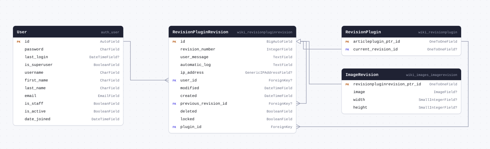

| Column | Field | Type | Null | Key | Default | Description |
| --- | --- | --- | --- | --- | --- | --- |
| `id` | `BigAutoField` | `integer` |  | PK | `autoincrement()` |  |
| `revision_number` | `IntegerField` | `integer` |  |  |  |  |
| `user_message` | `TextField` | `text` |  |  |  |  |
| `automatic_log` | `TextField` | `text` |  |  |  |  |
| `ip_address` | `GenericIPAddressField` | `char(39)` | yes |  |  |  |
| `user_id` | `ForeignKey` | `integer` | yes | FK |  |  |
| `modified` | `DateTimeField` | `datetime` |  |  | `now()` |  |
| `created` | `DateTimeField` | `datetime` |  |  | `now()` |  |
| `previous_revision_id` | `ForeignKey` | `bigint` | yes | FK |  |  |
| `deleted` | `BooleanField` | `bool` |  |  | `False` |  |
| `locked` | `BooleanField` | `bool` |  |  | `False` |  |
| `plugin_id` | `ForeignKey` | `bigint` |  | FK |  |  |

Indexes:

- index `wiki_revisionpluginrevision_user_id_ee40f729` on `user_id`
- index `wiki_revisionpluginrevision_previous_revision_id_38c877c0` on `previous_revision_id`
- index `wiki_revisionpluginrevision_plugin_id_c8f4475b` on `plugin_id`

Relations:

- [RevisionPlugin](#revisionplugin).`current_revision_id` → `id`, on delete cascade
- `user_id` → [User](#user).`id`, on delete set null
- `previous_revision_id` → [RevisionPluginRevision](#revisionpluginrevision).`id`, on delete set null
- `plugin_id` → [RevisionPlugin](#revisionplugin).`articleplugin_ptr_id`, on delete cascade
- [ImageRevision](#imagerevision).`revisionpluginrevision_ptr_id` → `id`, parent link, on delete cascade

## URLPath

Table `wiki_urlpath`, app `wiki`.

Strategy: Very few fields go here, as most has to be managed through an
article's revision. As a side-effect, the URL resolution remains slim and swift.

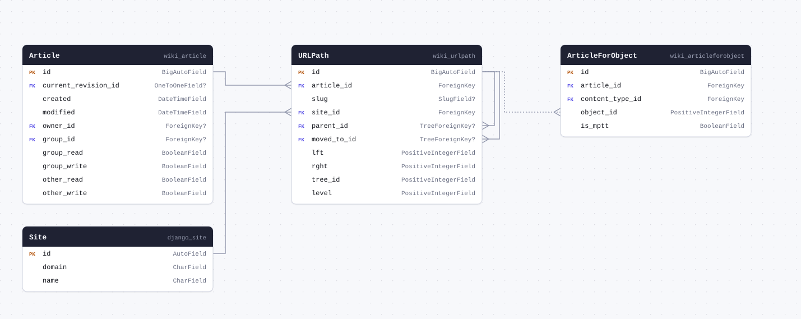

| Column | Field | Type | Null | Key | Default | Description |
| --- | --- | --- | --- | --- | --- | --- |
| `id` | `BigAutoField` | `integer` |  | PK | `autoincrement()` |  |
| `article_id` | `ForeignKey` | `bigint` |  | FK |  | This field is automatically updated, but you need to populate it when creating a new URL path. |
| `slug` | `SlugField` | `varchar(50)` | yes |  |  |  |
| `site_id` | `ForeignKey` | `integer` |  | FK |  |  |
| `parent_id` | `TreeForeignKey` | `bigint` | yes | FK |  | Position of URL path in the tree. |
| `moved_to_id` | `TreeForeignKey` | `bigint` | yes | FK |  | Article path was moved to this location |
| `lft` | `PositiveIntegerField` | `integer unsigned` |  |  |  |  |
| `rght` | `PositiveIntegerField` | `integer unsigned` |  |  |  |  |
| `tree_id` | `PositiveIntegerField` | `integer unsigned` |  |  |  |  |
| `level` | `PositiveIntegerField` | `integer unsigned` |  |  |  |  |

Indexes:

- index `wiki_urlpath_article_id_9ef0c0fb` on `article_id`
- index `wiki_urlpath_slug_39d212eb` on `slug`
- index `wiki_urlpath_site_id_319be912` on `site_id`
- index `wiki_urlpath_parent_id_a6e675ac` on `parent_id`
- index `wiki_urlpath_moved_to_id_4718abf8` on `moved_to_id`
- index `wiki_urlpath_tree_id_090b475d` on `tree_id`
- unique `wiki_urlpath_site_id_parent_id_slug_e4942e5d_uniq` on `site_id`, `parent_id`, `slug`

Relations:

- `article_id` → [Article](#article).`id`, on delete cascade
- `site_id` → [Site](#site).`id`, on delete cascade
- `parent_id` → [URLPath](#urlpath).`id`, on delete cascade
- `moved_to_id` → [URLPath](#urlpath).`id`, on delete set null
- `articles` ← [ArticleForObject](#articleforobject), by `content_type_id` + `object_id` (generic relation)

## Attachment

Table `wiki_attachments_attachment`, app `wiki_attachments`.

Inherits from [ReusablePlugin](#reusableplugin) (multi-table): its rows are joined on `reusableplugin_ptr_id`.

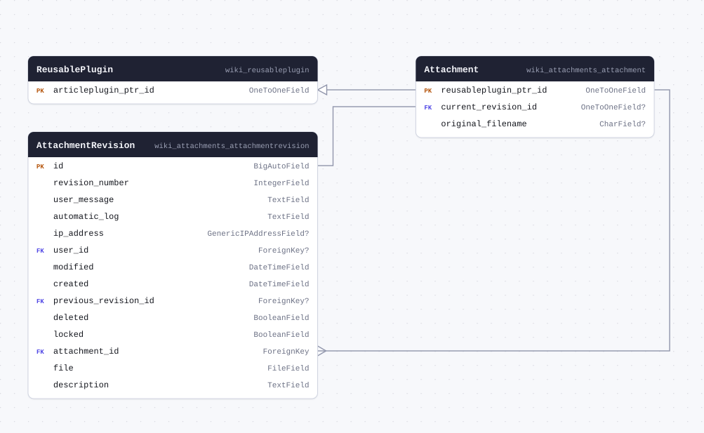

| Column | Field | Type | Null | Key | Default | Description |
| --- | --- | --- | --- | --- | --- | --- |
| `reusableplugin_ptr_id` | `OneToOneField` | `bigint` |  | PK, FK |  |  |
| `current_revision_id` | `OneToOneField` | `bigint` | yes | FK, unique |  | The revision of this attachment currently in use (on all articles using the attachment) |
| `original_filename` | `CharField` | `varchar(256)` | yes |  |  |  |

Relations:

- `reusableplugin_ptr_id` → [ReusablePlugin](#reusableplugin).`articleplugin_ptr_id`, parent link, on delete cascade
- `current_revision_id` → [AttachmentRevision](#attachmentrevision).`id`, on delete cascade
- [AttachmentRevision](#attachmentrevision).`attachment_id` → `reusableplugin_ptr_id`, on delete cascade

## AttachmentRevision

Table `wiki_attachments_attachmentrevision`, app `wiki_attachments`.

Columns from `BaseRevisionMixin` (abstract): `revision_number`, `user_message`, `automatic_log`, `ip_address`, `user_id`, `modified`, `created`, `previous_revision_id`, `deleted`, `locked`.

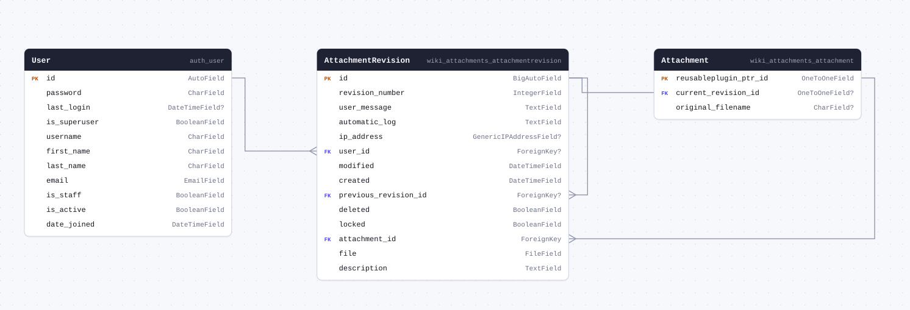

| Column | Field | Type | Null | Key | Default | Description |
| --- | --- | --- | --- | --- | --- | --- |
| `id` | `BigAutoField` | `integer` |  | PK | `autoincrement()` |  |
| `revision_number` | `IntegerField` | `integer` |  |  |  |  |
| `user_message` | `TextField` | `text` |  |  |  |  |
| `automatic_log` | `TextField` | `text` |  |  |  |  |
| `ip_address` | `GenericIPAddressField` | `char(39)` | yes |  |  |  |
| `user_id` | `ForeignKey` | `integer` | yes | FK |  |  |
| `modified` | `DateTimeField` | `datetime` |  |  | `now()` |  |
| `created` | `DateTimeField` | `datetime` |  |  | `now()` |  |
| `previous_revision_id` | `ForeignKey` | `bigint` | yes | FK |  |  |
| `deleted` | `BooleanField` | `bool` |  |  | `False` |  |
| `locked` | `BooleanField` | `bool` |  |  | `False` |  |
| `attachment_id` | `ForeignKey` | `bigint` |  | FK |  |  |
| `file` | `FileField` | `varchar(255)` |  |  |  |  |
| `description` | `TextField` | `text` |  |  |  |  |

Indexes:

- index `wiki_attachments_attachmentrevision_user_id_2da908ac` on `user_id`
- index `wiki_attachments_attachmentrevision_previous_revision_id_e7f09093` on `previous_revision_id`
- index `wiki_attachments_attachmentrevision_attachment_id_32ffc4ea` on `attachment_id`

Relations:

- [Attachment](#attachment).`current_revision_id` → `id`, on delete cascade
- `user_id` → [User](#user).`id`, on delete set null
- `previous_revision_id` → [AttachmentRevision](#attachmentrevision).`id`, on delete set null
- `attachment_id` → [Attachment](#attachment).`reusableplugin_ptr_id`, on delete cascade

## ArticleSubscription

Table `wiki_notifications_articlesubscription`, app `wiki_notifications`.

Inherits from [ArticlePlugin](#articleplugin) (multi-table): its rows are joined on `articleplugin_ptr_id`.

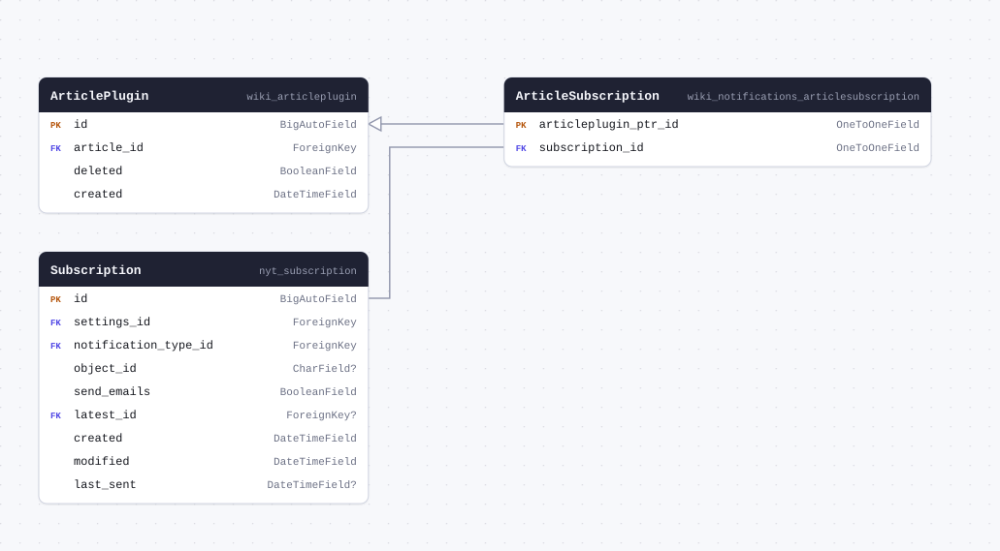

| Column | Field | Type | Null | Key | Default | Description |
| --- | --- | --- | --- | --- | --- | --- |
| `articleplugin_ptr_id` | `OneToOneField` | `bigint` |  | PK, FK |  |  |
| `subscription_id` | `OneToOneField` | `bigint` |  | FK, unique |  |  |

Indexes:

- unique `wiki_notifications_articlesubscription_subscription_id_articleplugin_ptr_id_6898a80a_uniq` on `subscription_id`, `articleplugin_ptr_id`

Relations:

- `articleplugin_ptr_id` → [ArticlePlugin](#articleplugin).`id`, parent link, on delete cascade
- `subscription_id` → [Subscription](#subscription).`id`, on delete cascade

## Image

Table `wiki_images_image`, app `wiki_images`.

Inherits from [RevisionPlugin](#revisionplugin) (multi-table): its rows are joined on `revisionplugin_ptr_id`.

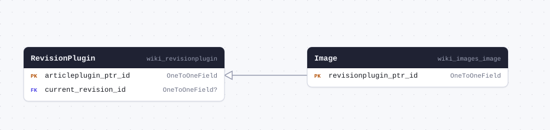

| Column | Field | Type | Null | Key | Default | Description |
| --- | --- | --- | --- | --- | --- | --- |
| `revisionplugin_ptr_id` | `OneToOneField` | `bigint` |  | PK, FK |  |  |

Relations:

- `revisionplugin_ptr_id` → [RevisionPlugin](#revisionplugin).`articleplugin_ptr_id`, parent link, on delete cascade

## ImageRevision

Table `wiki_images_imagerevision`, app `wiki_images`.

Inherits from [RevisionPluginRevision](#revisionpluginrevision) (multi-table): its rows are joined on `revisionpluginrevision_ptr_id`.

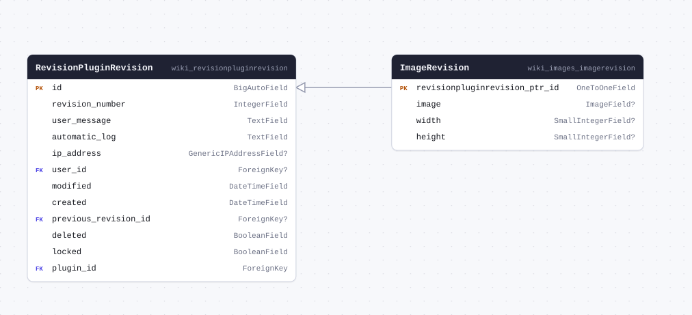

| Column | Field | Type | Null | Key | Default | Description |
| --- | --- | --- | --- | --- | --- | --- |
| `revisionpluginrevision_ptr_id` | `OneToOneField` | `bigint` |  | PK, FK |  |  |
| `image` | `ImageField` | `varchar(2000)` | yes |  |  |  |
| `width` | `SmallIntegerField` | `smallint` | yes |  |  |  |
| `height` | `SmallIntegerField` | `smallint` | yes |  |  |  |

Relations:

- `revisionpluginrevision_ptr_id` → [RevisionPluginRevision](#revisionpluginrevision).`id`, parent link, on delete cascade

# Enums

## LogEntryActionFlag

| Name | Stored as |
| --- | --- |
| `Addition` | `1` |
| `Change` | `2` |
| `Deletion` | `3` |

## SettingsInterval

| Name | Stored as |
| --- | --- |
| `never` | `-1` |
| `instantly` | `0` |
| `daily` | `1380` |
| `weekly` | `9660` |
