# Schema docs

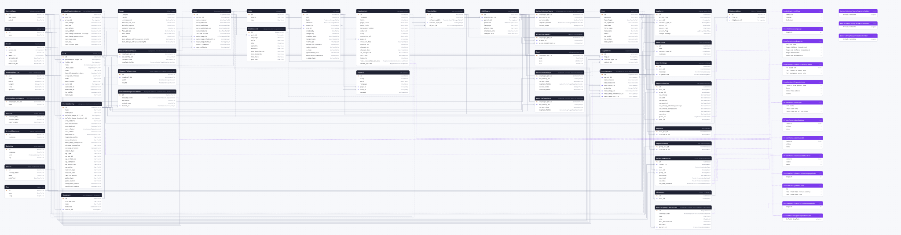

[LogEntry](#logentry) · [Permission](#permission) · [Group](#group) · [User](#user) · [ContentType](#contenttype) · [Session](#session) · [Site](#site) · [UserSettings](#usersettings) · [Page](#page) · [PageUrl](#pageurl) · [GlobalPagePermission](#globalpagepermission) · [PagePermission](#pagepermission) · [PageUser](#pageuser) · [PageUserGroup](#pageusergroup) · [Placeholder](#placeholder) · [CMSPlugin](#cmsplugin) · [PageContent](#pagecontent) · [PlaceholderReference](#placeholderreference) · [AliasPluginModel](#aliaspluginmodel) · [UrlconfRevision](#urlconfrevision) · [CacheKey](#cachekey) · [Source](#source) · [Thumbnail](#thumbnail) · [ThumbnailDimensions](#thumbnaildimensions) · [Folder](#folder) · [FolderPermission](#folderpermission) · [File](#file) · [Clipboard](#clipboard) · [ClipboardItem](#clipboarditem) · [Image](#image) · [ThumbnailOption](#thumbnailoption) · [Text](#text) · [Tag](#tag) · [TaggedItem](#taggeditem) · [StoriesConfigTranslation](#storiesconfigtranslation) · [StoriesConfig](#storiesconfig) · [PostCategoryTranslation](#postcategorytranslation) · [PostCategory](#postcategory) · [Post](#post) · [PostContent](#postcontent) · [LatestPostsPlugin](#latestpostsplugin) · [AuthorEntriesPlugin](#authorentriesplugin) · [FeaturedPostsPlugin](#featuredpostsplugin) · [GenericBlogPlugin](#genericblogplugin)

<details>
<summary>The whole schema as SQL</summary>

```sql
CREATE TABLE "django_admin_log" ("id" integer NOT NULL PRIMARY KEY AUTOINCREMENT, "action_time" datetime NOT NULL, "user_id" integer NOT NULL REFERENCES "auth_user" ("id") DEFERRABLE INITIALLY DEFERRED, "content_type_id" integer NULL REFERENCES "django_content_type" ("id") DEFERRABLE INITIALLY DEFERRED, "object_id" text NULL, "object_repr" varchar(200) NOT NULL, "action_flag" smallint unsigned NOT NULL CHECK ("action_flag" >= 0), "change_message" text NOT NULL);

CREATE TABLE "auth_permission" ("id" integer NOT NULL PRIMARY KEY AUTOINCREMENT, "name" varchar(255) NOT NULL, "content_type_id" integer NOT NULL REFERENCES "django_content_type" ("id") DEFERRABLE INITIALLY DEFERRED, "codename" varchar(100) NOT NULL);

CREATE TABLE "auth_group" ("id" integer NOT NULL PRIMARY KEY AUTOINCREMENT, "name" varchar(150) NOT NULL UNIQUE);

CREATE TABLE "auth_group_permissions" ("id" integer NOT NULL PRIMARY KEY AUTOINCREMENT, "group_id" integer NOT NULL REFERENCES "auth_group" ("id") DEFERRABLE INITIALLY DEFERRED, "permission_id" integer NOT NULL REFERENCES "auth_permission" ("id") DEFERRABLE INITIALLY DEFERRED);

CREATE TABLE "auth_user" ("id" integer NOT NULL PRIMARY KEY AUTOINCREMENT, "password" varchar(128) NOT NULL, "last_login" datetime NULL, "is_superuser" bool NOT NULL, "username" varchar(150) NOT NULL UNIQUE, "first_name" varchar(150) NOT NULL, "last_name" varchar(150) NOT NULL, "email" varchar(254) NOT NULL, "is_staff" bool NOT NULL, "is_active" bool NOT NULL, "date_joined" datetime NOT NULL);

CREATE TABLE "auth_user_groups" ("id" integer NOT NULL PRIMARY KEY AUTOINCREMENT, "user_id" integer NOT NULL REFERENCES "auth_user" ("id") DEFERRABLE INITIALLY DEFERRED, "group_id" integer NOT NULL REFERENCES "auth_group" ("id") DEFERRABLE INITIALLY DEFERRED);

CREATE TABLE "auth_user_user_permissions" ("id" integer NOT NULL PRIMARY KEY AUTOINCREMENT, "user_id" integer NOT NULL REFERENCES "auth_user" ("id") DEFERRABLE INITIALLY DEFERRED, "permission_id" integer NOT NULL REFERENCES "auth_permission" ("id") DEFERRABLE INITIALLY DEFERRED);

CREATE TABLE "django_content_type" ("id" integer NOT NULL PRIMARY KEY AUTOINCREMENT, "app_label" varchar(100) NOT NULL, "model" varchar(100) NOT NULL);

CREATE TABLE "django_session" ("session_key" varchar(40) NOT NULL PRIMARY KEY, "session_data" text NOT NULL, "expire_date" datetime NOT NULL);

CREATE TABLE "django_site" ("id" integer NOT NULL PRIMARY KEY AUTOINCREMENT, "domain" varchar(100) NOT NULL UNIQUE, "name" varchar(50) NOT NULL);

CREATE TABLE "cms_usersettings" ("id" integer NOT NULL PRIMARY KEY AUTOINCREMENT, "user_id" integer NOT NULL UNIQUE REFERENCES "auth_user" ("id") DEFERRABLE INITIALLY DEFERRED, "language" varchar(10) NOT NULL, "clipboard_id" integer NULL REFERENCES "cms_placeholder" ("id") DEFERRABLE INITIALLY DEFERRED);

CREATE TABLE "cms_page" ("id" integer NOT NULL PRIMARY KEY AUTOINCREMENT, "path" varchar(255) NOT NULL UNIQUE, "depth" integer unsigned NOT NULL CHECK ("depth" >= 0), "numchild" integer unsigned NOT NULL CHECK ("numchild" >= 0), "parent_id" integer NULL REFERENCES "cms_page" ("id") DEFERRABLE INITIALLY DEFERRED, "site_id" integer NOT NULL REFERENCES "django_site" ("id") DEFERRABLE INITIALLY DEFERRED, "created_by" varchar(255) NOT NULL, "changed_by" varchar(255) NOT NULL, "creation_date" datetime NOT NULL, "changed_date" datetime NOT NULL, "reverse_id" varchar(40) NULL, "navigation_extenders" varchar(80) NULL, "login_required" bool NOT NULL, "is_home" bool NOT NULL, "application_urls" varchar(200) NULL, "application_namespace" varchar(200) NULL, "is_page_type" bool NOT NULL);

CREATE TABLE "cms_pageurl" ("id" integer NOT NULL PRIMARY KEY AUTOINCREMENT, "slug" varchar(255) NOT NULL, "path" varchar(255) NULL, "language" varchar(15) NOT NULL, "page_id" integer NOT NULL REFERENCES "cms_page" ("id") DEFERRABLE INITIALLY DEFERRED, "site_id" integer NOT NULL REFERENCES "django_site" ("id") DEFERRABLE INITIALLY DEFERRED, "managed" bool NOT NULL, CONSTRAINT "unique_together_page_language" UNIQUE ("page_id", "language"), CONSTRAINT "unique_site_language_path" UNIQUE ("site_id", "language", "path"));

CREATE TABLE "cms_globalpagepermission" ("id" integer NOT NULL PRIMARY KEY AUTOINCREMENT, "user_id" integer NULL REFERENCES "auth_user" ("id") DEFERRABLE INITIALLY DEFERRED, "group_id" integer NULL REFERENCES "auth_group" ("id") DEFERRABLE INITIALLY DEFERRED, "can_change" bool NOT NULL, "can_add" bool NOT NULL, "can_delete" bool NOT NULL, "can_publish" bool NOT NULL, "can_change_advanced_settings" bool NOT NULL, "can_change_permissions" bool NOT NULL, "can_move_page" bool NOT NULL, "can_view" bool NOT NULL, "can_recover_page" bool NOT NULL);

CREATE TABLE "cms_globalpagepermission_sites" ("id" integer NOT NULL PRIMARY KEY AUTOINCREMENT, "globalpagepermission_id" integer NOT NULL REFERENCES "cms_globalpagepermission" ("id") DEFERRABLE INITIALLY DEFERRED, "site_id" integer NOT NULL REFERENCES "django_site" ("id") DEFERRABLE INITIALLY DEFERRED);

CREATE TABLE "cms_pagepermission" ("id" integer NOT NULL PRIMARY KEY AUTOINCREMENT, "user_id" integer NULL REFERENCES "auth_user" ("id") DEFERRABLE INITIALLY DEFERRED, "group_id" integer NULL REFERENCES "auth_group" ("id") DEFERRABLE INITIALLY DEFERRED, "can_change" bool NOT NULL, "can_add" bool NOT NULL, "can_delete" bool NOT NULL, "can_publish" bool NOT NULL, "can_change_advanced_settings" bool NOT NULL, "can_change_permissions" bool NOT NULL, "can_move_page" bool NOT NULL, "can_view" bool NOT NULL, "grant_on" integer NOT NULL, "page_id" integer NULL REFERENCES "cms_page" ("id") DEFERRABLE INITIALLY DEFERRED);

CREATE TABLE "cms_pageuser" ("user_ptr_id" integer NOT NULL PRIMARY KEY REFERENCES "auth_user" ("id") DEFERRABLE INITIALLY DEFERRED, "created_by_id" integer NULL REFERENCES "auth_user" ("id") DEFERRABLE INITIALLY DEFERRED);

CREATE TABLE "cms_pageusergroup" ("group_ptr_id" integer NOT NULL PRIMARY KEY REFERENCES "auth_group" ("id") DEFERRABLE INITIALLY DEFERRED, "created_by_id" integer NULL REFERENCES "auth_user" ("id") DEFERRABLE INITIALLY DEFERRED);

CREATE TABLE "cms_placeholder" ("id" integer NOT NULL PRIMARY KEY AUTOINCREMENT, "slot" varchar(255) NOT NULL, "default_width" smallint unsigned NULL CHECK ("default_width" >= 0), "content_type_id" integer NULL REFERENCES "django_content_type" ("id") DEFERRABLE INITIALLY DEFERRED, "object_id" integer unsigned NULL CHECK ("object_id" >= 0));

CREATE TABLE "cms_cmsplugin" ("id" integer NOT NULL PRIMARY KEY AUTOINCREMENT, "placeholder_id" integer NULL REFERENCES "cms_placeholder" ("id") DEFERRABLE INITIALLY DEFERRED, "parent_id" integer NULL REFERENCES "cms_cmsplugin" ("id") DEFERRABLE INITIALLY DEFERRED, "position" smallint NOT NULL, "language" varchar(15) NOT NULL, "plugin_type" varchar(50) NOT NULL, "creation_date" datetime NOT NULL, "changed_date" datetime NOT NULL);

CREATE TABLE "cms_pagecontent" ("id" integer NOT NULL PRIMARY KEY AUTOINCREMENT, "language" varchar(15) NOT NULL, "title" varchar(255) NOT NULL, "page_title" varchar(255) NULL, "menu_title" varchar(255) NULL, "meta_description" text NULL, "redirect" varchar(2048) NULL, "slug" varchar(255) NOT NULL, "overwrite_url" varchar(255) NULL, "page_id" integer NOT NULL REFERENCES "cms_page" ("id") DEFERRABLE INITIALLY DEFERRED, "creation_date" datetime NOT NULL, "created_by" varchar(255) NOT NULL, "changed_by" varchar(255) NOT NULL, "changed_date" datetime NOT NULL, "in_navigation" bool NOT NULL, "soft_root" bool NOT NULL, "template" varchar(100) NOT NULL, "limit_visibility_in_menu" smallint NULL, "xframe_options" integer NOT NULL);

CREATE TABLE "cms_placeholderreference" ("cmsplugin_ptr_id" integer NOT NULL PRIMARY KEY REFERENCES "cms_cmsplugin" ("id") DEFERRABLE INITIALLY DEFERRED, "name" varchar(255) NOT NULL);

CREATE TABLE "cms_aliaspluginmodel" ("cmsplugin_ptr_id" integer NOT NULL PRIMARY KEY REFERENCES "cms_cmsplugin" ("id") DEFERRABLE INITIALLY DEFERRED, "plugin_id" integer NULL REFERENCES "cms_cmsplugin" ("id") DEFERRABLE INITIALLY DEFERRED, "alias_placeholder_id" integer NULL REFERENCES "cms_placeholder" ("id") DEFERRABLE INITIALLY DEFERRED);

CREATE TABLE "cms_urlconfrevision" ("id" integer NOT NULL PRIMARY KEY AUTOINCREMENT, "revision" varchar(255) NOT NULL);

CREATE TABLE "menus_cachekey" ("id" integer NOT NULL PRIMARY KEY AUTOINCREMENT, "language" varchar(255) NOT NULL, "site" integer unsigned NOT NULL CHECK ("site" >= 0), "key" varchar(255) NOT NULL);

CREATE TABLE "easy_thumbnails_source" ("id" integer NOT NULL PRIMARY KEY AUTOINCREMENT, "storage_hash" varchar(40) NOT NULL, "name" varchar(255) NOT NULL, "modified" datetime NOT NULL);

CREATE TABLE "easy_thumbnails_thumbnail" ("id" integer NOT NULL PRIMARY KEY AUTOINCREMENT, "storage_hash" varchar(40) NOT NULL, "name" varchar(255) NOT NULL, "modified" datetime NOT NULL, "source_id" integer NOT NULL REFERENCES "easy_thumbnails_source" ("id") DEFERRABLE INITIALLY DEFERRED);

CREATE TABLE "easy_thumbnails_thumbnaildimensions" ("id" integer NOT NULL PRIMARY KEY AUTOINCREMENT, "thumbnail_id" integer NOT NULL UNIQUE REFERENCES "easy_thumbnails_thumbnail" ("id") DEFERRABLE INITIALLY DEFERRED, "width" integer unsigned NULL CHECK ("width" >= 0), "height" integer unsigned NULL CHECK ("height" >= 0));

CREATE TABLE "filer_folder" ("id" integer NOT NULL PRIMARY KEY AUTOINCREMENT, "parent_id" integer NULL REFERENCES "filer_folder" ("id") DEFERRABLE INITIALLY DEFERRED, "name" varchar(255) NOT NULL, "owner_id" integer NULL REFERENCES "auth_user" ("id") DEFERRABLE INITIALLY DEFERRED, "uploaded_at" datetime NOT NULL, "created_at" datetime NOT NULL, "modified_at" datetime NOT NULL);

CREATE TABLE "filer_folderpermission" ("id" integer NOT NULL PRIMARY KEY AUTOINCREMENT, "folder_id" integer NULL REFERENCES "filer_folder" ("id") DEFERRABLE INITIALLY DEFERRED, "type" smallint NOT NULL, "user_id" integer NULL REFERENCES "auth_user" ("id") DEFERRABLE INITIALLY DEFERRED, "group_id" integer NULL REFERENCES "auth_group" ("id") DEFERRABLE INITIALLY DEFERRED, "everybody" bool NOT NULL, "can_read" smallint NULL, "can_edit" smallint NULL, "can_add_children" smallint NULL);

CREATE TABLE "filer_file" ("id" integer NOT NULL PRIMARY KEY AUTOINCREMENT, "polymorphic_ctype_id" integer NULL REFERENCES "django_content_type" ("id") DEFERRABLE INITIALLY DEFERRED, "folder_id" integer NULL REFERENCES "filer_folder" ("id") DEFERRABLE INITIALLY DEFERRED, "file" varchar(255) NULL, "_file_size" bigint NULL, "sha1" varchar(40) NOT NULL, "has_all_mandatory_data" bool NOT NULL, "original_filename" varchar(255) NULL, "name" varchar(255) NOT NULL, "description" text NULL, "owner_id" integer NULL REFERENCES "auth_user" ("id") DEFERRABLE INITIALLY DEFERRED, "uploaded_at" datetime NOT NULL, "modified_at" datetime NOT NULL, "is_public" bool NOT NULL, "mime_type" varchar(255) NOT NULL);

CREATE TABLE "filer_clipboard" ("id" integer NOT NULL PRIMARY KEY AUTOINCREMENT, "user_id" integer NOT NULL REFERENCES "auth_user" ("id") DEFERRABLE INITIALLY DEFERRED);

CREATE TABLE "filer_clipboarditem" ("id" integer NOT NULL PRIMARY KEY AUTOINCREMENT, "file_id" integer NOT NULL REFERENCES "filer_file" ("id") DEFERRABLE INITIALLY DEFERRED, "clipboard_id" integer NOT NULL REFERENCES "filer_clipboard" ("id") DEFERRABLE INITIALLY DEFERRED);

CREATE TABLE "filer_image" ("_height" real NULL, "_width" real NULL, "_transparent" bool NOT NULL, "default_alt_text" varchar(255) NULL, "default_caption" varchar(255) NULL, "subject_location" varchar(64) NOT NULL, "file_ptr_id" integer NOT NULL PRIMARY KEY REFERENCES "filer_file" ("id") DEFERRABLE INITIALLY DEFERRED, "date_taken" datetime NULL, "author" varchar(255) NULL, "must_always_publish_author_credit" bool NOT NULL, "must_always_publish_copyright" bool NOT NULL);

CREATE TABLE "filer_thumbnailoption" ("id" integer NOT NULL PRIMARY KEY AUTOINCREMENT, "name" varchar(100) NOT NULL, "width" integer NOT NULL, "height" integer NOT NULL, "crop" bool NOT NULL, "upscale" bool NOT NULL);

CREATE TABLE "djangocms_text_text" ("cmsplugin_ptr_id" integer NOT NULL PRIMARY KEY REFERENCES "cms_cmsplugin" ("id") DEFERRABLE INITIALLY DEFERRED, "body" text NOT NULL, "json" text NULL CHECK ((JSON_VALID("json") OR "json" IS NULL)), "rte" varchar(16) NOT NULL);

CREATE TABLE "taggit_tag" ("id" integer NOT NULL PRIMARY KEY AUTOINCREMENT, "name" varchar(100) NOT NULL UNIQUE, "slug" varchar(100) NOT NULL UNIQUE);

CREATE TABLE "taggit_taggeditem" ("id" integer NOT NULL PRIMARY KEY AUTOINCREMENT, "tag_id" integer NOT NULL REFERENCES "taggit_tag" ("id") DEFERRABLE INITIALLY DEFERRED, "content_type_id" integer NOT NULL REFERENCES "django_content_type" ("id") DEFERRABLE INITIALLY DEFERRED, "object_id" integer NOT NULL, CONSTRAINT "taggit_taggeditem_content_type_id_object_id_tag_id_4bb97a8e_uniq" UNIQUE ("content_type_id", "object_id", "tag_id"));

CREATE TABLE "djangocms_stories_storiesconfig_translation" ("id" integer NOT NULL PRIMARY KEY AUTOINCREMENT, "language_code" varchar(15) NOT NULL, "app_title" varchar(200) NOT NULL, "object_name" varchar(200) NOT NULL, "master_id" bigint NULL REFERENCES "djangocms_stories_storiesconfig" ("id") DEFERRABLE INITIALLY DEFERRED, CONSTRAINT "djangocms_stories_storiesc6510" UNIQUE ("language_code", "master_id"));

CREATE TABLE "djangocms_stories_storiesconfig" ("id" integer NOT NULL PRIMARY KEY AUTOINCREMENT, "type" varchar(100) NOT NULL, "namespace" varchar(100) NOT NULL UNIQUE, "default_image_full_id" integer NULL REFERENCES "filer_thumbnailoption" ("id") DEFERRABLE INITIALLY DEFERRED, "default_image_thumbnail_id" integer NULL REFERENCES "filer_thumbnailoption" ("id") DEFERRABLE INITIALLY DEFERRED, "url_patterns" varchar(12) NOT NULL, "use_placeholder" bool NOT NULL, "use_abstract" bool NOT NULL, "use_related" smallint NOT NULL, "set_author" bool NOT NULL, "paginate_by" smallint NULL, "template_prefix" varchar(200) NOT NULL, "menu_structure" varchar(200) NOT NULL, "menu_empty_categories" bool NOT NULL, "sitemap_changefreq" varchar(12) NOT NULL, "sitemap_priority" decimal NOT NULL, "object_type" varchar(200) NOT NULL, "og_type" varchar(200) NOT NULL, "og_app_id" varchar(200) NOT NULL, "og_profile_id" varchar(200) NOT NULL, "og_publisher" varchar(200) NOT NULL, "og_author_url" varchar(200) NOT NULL, "og_author" varchar(200) NOT NULL, "twitter_type" varchar(200) NOT NULL, "twitter_site" varchar(200) NOT NULL, "twitter_author" varchar(200) NOT NULL, "gplus_type" varchar(200) NOT NULL, "gplus_author" varchar(200) NOT NULL, "send_knock_create" bool NOT NULL, "send_knock_update" bool NOT NULL);

CREATE TABLE "djangocms_stories_postcategory_translation" ("id" integer NOT NULL PRIMARY KEY AUTOINCREMENT, "language_code" varchar(15) NOT NULL, "name" varchar(752) NOT NULL, "slug" varchar(752) NOT NULL, "meta_description" text NOT NULL, "abstract" text NOT NULL, "master_id" bigint NULL REFERENCES "djangocms_stories_postcategory" ("id") DEFERRABLE INITIALLY DEFERRED, CONSTRAINT "djangocms_stories_postcate81fa" UNIQUE ("language_code", "master_id"));

CREATE TABLE "djangocms_stories_postcategory" ("id" integer NOT NULL PRIMARY KEY AUTOINCREMENT, "parent_id" bigint NULL REFERENCES "djangocms_stories_postcategory" ("id") DEFERRABLE INITIALLY DEFERRED, "date_created" datetime NOT NULL, "date_modified" datetime NOT NULL, "app_config_id" bigint NULL REFERENCES "djangocms_stories_storiesconfig" ("id") DEFERRABLE INITIALLY DEFERRED, "priority" integer NULL, "main_image_id" integer NULL REFERENCES "filer_image" ("file_ptr_id") DEFERRABLE INITIALLY DEFERRED, "main_image_thumbnail_id" integer NULL REFERENCES "filer_thumbnailoption" ("id") DEFERRABLE INITIALLY DEFERRED, "main_image_full_id" integer NULL REFERENCES "filer_thumbnailoption" ("id") DEFERRABLE INITIALLY DEFERRED);

CREATE TABLE "djangocms_stories_post" ("id" integer NOT NULL PRIMARY KEY AUTOINCREMENT, "author_id" integer NULL REFERENCES "auth_user" ("id") DEFERRABLE INITIALLY DEFERRED, "date_created" datetime NOT NULL, "date_modified" datetime NOT NULL, "date_published" datetime NULL, "date_published_end" datetime NULL, "date_featured" datetime NULL, "include_in_rss" bool NOT NULL, "main_image_id" integer NULL REFERENCES "filer_image" ("file_ptr_id") DEFERRABLE INITIALLY DEFERRED, "main_image_thumbnail_id" integer NULL REFERENCES "filer_thumbnailoption" ("id") DEFERRABLE INITIALLY DEFERRED, "main_image_full_id" integer NULL REFERENCES "filer_thumbnailoption" ("id") DEFERRABLE INITIALLY DEFERRED, "enable_comments" bool NOT NULL, "app_config_id" bigint NULL REFERENCES "djangocms_stories_storiesconfig" ("id") DEFERRABLE INITIALLY DEFERRED);

CREATE TABLE "djangocms_stories_post_categories" ("id" integer NOT NULL PRIMARY KEY AUTOINCREMENT, "post_id" bigint NOT NULL REFERENCES "djangocms_stories_post" ("id") DEFERRABLE INITIALLY DEFERRED, "postcategory_id" bigint NOT NULL REFERENCES "djangocms_stories_postcategory" ("id") DEFERRABLE INITIALLY DEFERRED);

CREATE TABLE "djangocms_stories_post_sites" ("id" integer NOT NULL PRIMARY KEY AUTOINCREMENT, "post_id" bigint NOT NULL REFERENCES "djangocms_stories_post" ("id") DEFERRABLE INITIALLY DEFERRED, "site_id" integer NOT NULL REFERENCES "django_site" ("id") DEFERRABLE INITIALLY DEFERRED);

CREATE TABLE "djangocms_stories_post_related" ("id" integer NOT NULL PRIMARY KEY AUTOINCREMENT, "sort_value" integer NOT NULL, "from_post_id" bigint NOT NULL REFERENCES "djangocms_stories_post" ("id") DEFERRABLE INITIALLY DEFERRED, "to_post_id" bigint NOT NULL REFERENCES "djangocms_stories_post" ("id") DEFERRABLE INITIALLY DEFERRED);

CREATE TABLE "djangocms_stories_postcontent" ("id" integer NOT NULL PRIMARY KEY AUTOINCREMENT, "post_id" bigint NOT NULL REFERENCES "djangocms_stories_post" ("id") DEFERRABLE INITIALLY DEFERRED, "language" varchar(15) NOT NULL, "title" varchar(752) NOT NULL, "slug" varchar(752) NOT NULL, "subtitle" varchar(767) NOT NULL, "abstract" text NOT NULL, "meta_description" text NOT NULL, "meta_keywords" text NOT NULL, "meta_title" varchar(2000) NOT NULL, "post_text" text NOT NULL);

CREATE TABLE "djangocms_stories_latestpostsplugin" ("cmsplugin_ptr_id" integer NOT NULL PRIMARY KEY REFERENCES "cms_cmsplugin" ("id") DEFERRABLE INITIALLY DEFERRED, "app_config_id" bigint NULL REFERENCES "djangocms_stories_storiesconfig" ("id") DEFERRABLE INITIALLY DEFERRED, "current_site" bool NOT NULL, "template_folder" varchar(200) NOT NULL, "latest_posts" integer NOT NULL, "featured_first" bool NOT NULL);

CREATE TABLE "djangocms_stories_latestpostsplugin_categories" ("id" integer NOT NULL PRIMARY KEY AUTOINCREMENT, "latestpostsplugin_id" integer NOT NULL REFERENCES "djangocms_stories_latestpostsplugin" ("cmsplugin_ptr_id") DEFERRABLE INITIALLY DEFERRED, "postcategory_id" bigint NOT NULL REFERENCES "djangocms_stories_postcategory" ("id") DEFERRABLE INITIALLY DEFERRED);

CREATE TABLE "djangocms_stories_authorentriesplugin" ("cmsplugin_ptr_id" integer NOT NULL PRIMARY KEY REFERENCES "cms_cmsplugin" ("id") DEFERRABLE INITIALLY DEFERRED, "app_config_id" bigint NULL REFERENCES "djangocms_stories_storiesconfig" ("id") DEFERRABLE INITIALLY DEFERRED, "current_site" bool NOT NULL, "template_folder" varchar(200) NOT NULL, "latest_posts" integer NOT NULL);

CREATE TABLE "djangocms_stories_authorentriesplugin_authors" ("id" integer NOT NULL PRIMARY KEY AUTOINCREMENT, "authorentriesplugin_id" integer NOT NULL REFERENCES "djangocms_stories_authorentriesplugin" ("cmsplugin_ptr_id") DEFERRABLE INITIALLY DEFERRED, "user_id" integer NOT NULL REFERENCES "auth_user" ("id") DEFERRABLE INITIALLY DEFERRED);

CREATE TABLE "djangocms_stories_featuredpostsplugin" ("cmsplugin_ptr_id" integer NOT NULL PRIMARY KEY REFERENCES "cms_cmsplugin" ("id") DEFERRABLE INITIALLY DEFERRED, "app_config_id" bigint NULL REFERENCES "djangocms_stories_storiesconfig" ("id") DEFERRABLE INITIALLY DEFERRED, "current_site" bool NOT NULL, "template_folder" varchar(200) NOT NULL);

CREATE TABLE "djangocms_stories_featuredpostsplugin_posts" ("id" integer NOT NULL PRIMARY KEY AUTOINCREMENT, "sort_value" integer NOT NULL, "featuredpostsplugin_id" integer NOT NULL REFERENCES "djangocms_stories_featuredpostsplugin" ("cmsplugin_ptr_id") DEFERRABLE INITIALLY DEFERRED, "post_id" bigint NOT NULL REFERENCES "djangocms_stories_post" ("id") DEFERRABLE INITIALLY DEFERRED);

CREATE TABLE "djangocms_stories_genericblogplugin" ("cmsplugin_ptr_id" integer NOT NULL PRIMARY KEY REFERENCES "cms_cmsplugin" ("id") DEFERRABLE INITIALLY DEFERRED, "app_config_id" bigint NULL REFERENCES "djangocms_stories_storiesconfig" ("id") DEFERRABLE INITIALLY DEFERRED, "current_site" bool NOT NULL, "template_folder" varchar(200) NOT NULL);

CREATE INDEX "django_admin_log_user_id_c564eba6" ON "django_admin_log" ("user_id");

CREATE INDEX "django_admin_log_content_type_id_c4bce8eb" ON "django_admin_log" ("content_type_id");

CREATE UNIQUE INDEX "auth_permission_content_type_id_codename_01ab375a_uniq" ON "auth_permission" ("content_type_id", "codename");

CREATE INDEX "auth_permission_content_type_id_2f476e4b" ON "auth_permission" ("content_type_id");

CREATE UNIQUE INDEX "auth_group_permissions_group_id_permission_id_0cd325b0_uniq" ON "auth_group_permissions" ("group_id", "permission_id");

CREATE INDEX "auth_group_permissions_group_id_b120cbf9" ON "auth_group_permissions" ("group_id");

CREATE INDEX "auth_group_permissions_permission_id_84c5c92e" ON "auth_group_permissions" ("permission_id");

CREATE UNIQUE INDEX "auth_user_groups_user_id_group_id_94350c0c_uniq" ON "auth_user_groups" ("user_id", "group_id");

CREATE INDEX "auth_user_groups_user_id_6a12ed8b" ON "auth_user_groups" ("user_id");

CREATE INDEX "auth_user_groups_group_id_97559544" ON "auth_user_groups" ("group_id");

CREATE UNIQUE INDEX "auth_user_user_permissions_user_id_permission_id_14a6b632_uniq" ON "auth_user_user_permissions" ("user_id", "permission_id");

CREATE INDEX "auth_user_user_permissions_user_id_a95ead1b" ON "auth_user_user_permissions" ("user_id");

CREATE INDEX "auth_user_user_permissions_permission_id_1fbb5f2c" ON "auth_user_user_permissions" ("permission_id");

CREATE UNIQUE INDEX "django_content_type_app_label_model_76bd3d3b_uniq" ON "django_content_type" ("app_label", "model");

CREATE INDEX "django_session_expire_date_a5c62663" ON "django_session" ("expire_date");

CREATE INDEX "cms_usersettings_clipboard_id_3ae17c19" ON "cms_usersettings" ("clipboard_id");

CREATE INDEX "cms_page_parent_id_f89b72e4" ON "cms_page" ("parent_id");

CREATE INDEX "cms_page_site_id_4323d3ff" ON "cms_page" ("site_id");

CREATE INDEX "cms_page_reverse_id_ffc9ede2" ON "cms_page" ("reverse_id");

CREATE INDEX "cms_page_navigation_extenders_c24af8dd" ON "cms_page" ("navigation_extenders");

CREATE INDEX "cms_page_is_home_edadca07" ON "cms_page" ("is_home");

CREATE INDEX "cms_page_application_urls_9ef47497" ON "cms_page" ("application_urls");

CREATE INDEX "cms_pageurl_slug_f8d42287" ON "cms_pageurl" ("slug");

CREATE INDEX "cms_pageurl_path_9f26e673" ON "cms_pageurl" ("path");

CREATE INDEX "cms_pageurl_language_a10302dc" ON "cms_pageurl" ("language");

CREATE INDEX "cms_pageurl_page_id_dbf4793a" ON "cms_pageurl" ("page_id");

CREATE INDEX "cms_pageurl_site_id_7d6fd976" ON "cms_pageurl" ("site_id");

CREATE INDEX "cms_globalpagepermission_user_id_a227cee1" ON "cms_globalpagepermission" ("user_id");

CREATE INDEX "cms_globalpagepermission_group_id_991b4733" ON "cms_globalpagepermission" ("group_id");

CREATE UNIQUE INDEX "cms_globalpagepermission_sites_globalpagepermission_id_site_id_db684f41_uniq" ON "cms_globalpagepermission_sites" ("globalpagepermission_id", "site_id");

CREATE INDEX "cms_globalpagepermission_sites_globalpagepermission_id_46bd2681" ON "cms_globalpagepermission_sites" ("globalpagepermission_id");

CREATE INDEX "cms_globalpagepermission_sites_site_id_00460b53" ON "cms_globalpagepermission_sites" ("site_id");

CREATE INDEX "cms_pagepermission_user_id_0c7d2b3c" ON "cms_pagepermission" ("user_id");

CREATE INDEX "cms_pagepermission_group_id_af5af193" ON "cms_pagepermission" ("group_id");

CREATE INDEX "cms_pagepermission_page_id_0ae9a163" ON "cms_pagepermission" ("page_id");

CREATE INDEX "cms_pageuser_created_by_id_8e9fbf83" ON "cms_pageuser" ("created_by_id");

CREATE INDEX "cms_pageusergroup_created_by_id_7d57fa39" ON "cms_pageusergroup" ("created_by_id");

CREATE INDEX "cms_placeholder_slot_0bc04d21" ON "cms_placeholder" ("slot");

CREATE INDEX "cms_placeholder_content_type_id_a7659d9c" ON "cms_placeholder" ("content_type_id");

CREATE UNIQUE INDEX "cms_cmsplugin_placeholder_id_language_position_bad60ebe_uniq" ON "cms_cmsplugin" ("placeholder_id", "language", "position");

CREATE INDEX "cms_cmsplugin_placeholder_id_0bfa3b26" ON "cms_cmsplugin" ("placeholder_id");

CREATE INDEX "cms_cmsplugin_parent_id_fd3bd9dd" ON "cms_cmsplugin" ("parent_id");

CREATE INDEX "cms_cmsplugin_language_bbea8a48" ON "cms_cmsplugin" ("language");

CREATE INDEX "cms_cmsplugin_plugin_type_94e96ebf" ON "cms_cmsplugin" ("plugin_type");

CREATE INDEX "cms_cmsplug_placeho_3f2b0f_idx" ON "cms_cmsplugin" ("placeholder_id", "language", "position");

CREATE UNIQUE INDEX "cms_pagecontent_language_page_id_fbc0b2cf_uniq" ON "cms_pagecontent" ("language", "page_id");

CREATE INDEX "cms_pagecontent_language_0b8ccf12" ON "cms_pagecontent" ("language");

CREATE INDEX "cms_pagecontent_slug_23c7b868" ON "cms_pagecontent" ("slug");

CREATE INDEX "cms_pagecontent_page_id_b958451e" ON "cms_pagecontent" ("page_id");

CREATE INDEX "cms_pagecontent_in_navigation_c35c26ba" ON "cms_pagecontent" ("in_navigation");

CREATE INDEX "cms_pagecontent_soft_root_ea2486e9" ON "cms_pagecontent" ("soft_root");

CREATE INDEX "cms_pagecontent_limit_visibility_in_menu_e1d68dcf" ON "cms_pagecontent" ("limit_visibility_in_menu");

CREATE INDEX "cms_aliaspluginmodel_plugin_id_9867676e" ON "cms_aliaspluginmodel" ("plugin_id");

CREATE INDEX "cms_aliaspluginmodel_alias_placeholder_id_6d6e0c8a" ON "cms_aliaspluginmodel" ("alias_placeholder_id");

CREATE UNIQUE INDEX "easy_thumbnails_source_storage_hash_name_481ce32d_uniq" ON "easy_thumbnails_source" ("storage_hash", "name");

CREATE INDEX "easy_thumbnails_source_storage_hash_946cbcc9" ON "easy_thumbnails_source" ("storage_hash");

CREATE INDEX "easy_thumbnails_source_name_5fe0edc6" ON "easy_thumbnails_source" ("name");

CREATE UNIQUE INDEX "easy_thumbnails_thumbnail_storage_hash_name_source_id_fb375270_uniq" ON "easy_thumbnails_thumbnail" ("storage_hash", "name", "source_id");

CREATE INDEX "easy_thumbnails_thumbnail_storage_hash_f1435f49" ON "easy_thumbnails_thumbnail" ("storage_hash");

CREATE INDEX "easy_thumbnails_thumbnail_name_b5882c31" ON "easy_thumbnails_thumbnail" ("name");

CREATE INDEX "easy_thumbnails_thumbnail_source_id_5b57bc77" ON "easy_thumbnails_thumbnail" ("source_id");

CREATE UNIQUE INDEX "filer_folder_parent_id_name_bc773258_uniq" ON "filer_folder" ("parent_id", "name");

CREATE INDEX "filer_folder_parent_id_308aecda" ON "filer_folder" ("parent_id");

CREATE INDEX "filer_folder_owner_id_be530fb4" ON "filer_folder" ("owner_id");

CREATE INDEX "filer_folderpermission_folder_id_5d02f1da" ON "filer_folderpermission" ("folder_id");

CREATE INDEX "filer_folderpermission_user_id_7673d4b6" ON "filer_folderpermission" ("user_id");

CREATE INDEX "filer_folderpermission_group_id_8901bafa" ON "filer_folderpermission" ("group_id");

CREATE INDEX "filer_file_polymorphic_ctype_id_f44903c1" ON "filer_file" ("polymorphic_ctype_id");

CREATE INDEX "filer_file_folder_id_af803bbb" ON "filer_file" ("folder_id");

CREATE INDEX "filer_file_owner_id_b9e32671" ON "filer_file" ("owner_id");

CREATE INDEX "filer_clipboard_user_id_b52ff0bc" ON "filer_clipboard" ("user_id");

CREATE INDEX "filer_clipboarditem_file_id_06196f80" ON "filer_clipboarditem" ("file_id");

CREATE INDEX "filer_clipboarditem_clipboard_id_7a76518b" ON "filer_clipboarditem" ("clipboard_id");

CREATE INDEX "taggit_taggeditem_tag_id_f4f5b767" ON "taggit_taggeditem" ("tag_id");

CREATE INDEX "taggit_taggeditem_content_type_id_9957a03c" ON "taggit_taggeditem" ("content_type_id");

CREATE INDEX "taggit_taggeditem_object_id_e2d7d1df" ON "taggit_taggeditem" ("object_id");

CREATE INDEX "taggit_tagg_content_8fc721_idx" ON "taggit_taggeditem" ("content_type_id", "object_id");

CREATE INDEX "djangocms_stories_storiesconfig_translation_language_code_bb06c9ed" ON "djangocms_stories_storiesconfig_translation" ("language_code");

CREATE INDEX "djangocms_stories_storiesconfig_translation_master_id_a155f9ca" ON "djangocms_stories_storiesconfig_translation" ("master_id");

CREATE INDEX "djangocms_stories_storiesconfig_default_image_full_id_ea7695a2" ON "djangocms_stories_storiesconfig" ("default_image_full_id");

CREATE INDEX "djangocms_stories_storiesconfig_default_image_thumbnail_id_385281b3" ON "djangocms_stories_storiesconfig" ("default_image_thumbnail_id");

CREATE UNIQUE INDEX "djangocms_stories_postcategory_translation_language_code_slug_6690704b_uniq" ON "djangocms_stories_postcategory_translation" ("language_code", "slug");

CREATE INDEX "djangocms_stories_postcategory_translation_language_code_05aeadc6" ON "djangocms_stories_postcategory_translation" ("language_code");

CREATE INDEX "djangocms_stories_postcategory_translation_slug_aa73b4f6" ON "djangocms_stories_postcategory_translation" ("slug");

CREATE INDEX "djangocms_stories_postcategory_translation_master_id_920bc899" ON "djangocms_stories_postcategory_translation" ("master_id");

CREATE INDEX "djangocms_stories_postcategory_parent_id_a6fdc19d" ON "djangocms_stories_postcategory" ("parent_id");

CREATE INDEX "djangocms_stories_postcategory_app_config_id_9a18161e" ON "djangocms_stories_postcategory" ("app_config_id");

CREATE INDEX "djangocms_stories_postcategory_main_image_id_a48ad63a" ON "djangocms_stories_postcategory" ("main_image_id");

CREATE INDEX "djangocms_stories_postcategory_main_image_thumbnail_id_bc1e4b19" ON "djangocms_stories_postcategory" ("main_image_thumbnail_id");

CREATE INDEX "djangocms_stories_postcategory_main_image_full_id_6d97b292" ON "djangocms_stories_postcategory" ("main_image_full_id");

CREATE INDEX "djangocms_stories_post_author_id_6036105b" ON "djangocms_stories_post" ("author_id");

CREATE INDEX "djangocms_stories_post_main_image_id_67803bda" ON "djangocms_stories_post" ("main_image_id");

CREATE INDEX "djangocms_stories_post_main_image_thumbnail_id_4b7a78cd" ON "djangocms_stories_post" ("main_image_thumbnail_id");

CREATE INDEX "djangocms_stories_post_main_image_full_id_03c6ec6c" ON "djangocms_stories_post" ("main_image_full_id");

CREATE INDEX "djangocms_stories_post_app_config_id_079a5426" ON "djangocms_stories_post" ("app_config_id");

CREATE UNIQUE INDEX "djangocms_stories_post_categories_post_id_postcategory_id_27533c8d_uniq" ON "djangocms_stories_post_categories" ("post_id", "postcategory_id");

CREATE INDEX "djangocms_stories_post_categories_post_id_9b4fc451" ON "djangocms_stories_post_categories" ("post_id");

CREATE INDEX "djangocms_stories_post_categories_postcategory_id_0b14b3bd" ON "djangocms_stories_post_categories" ("postcategory_id");

CREATE UNIQUE INDEX "djangocms_stories_post_sites_post_id_site_id_d9e8ef97_uniq" ON "djangocms_stories_post_sites" ("post_id", "site_id");

CREATE INDEX "djangocms_stories_post_sites_post_id_ff73a8e0" ON "djangocms_stories_post_sites" ("post_id");

CREATE INDEX "djangocms_stories_post_sites_site_id_cb8fc4ea" ON "djangocms_stories_post_sites" ("site_id");

CREATE UNIQUE INDEX "djangocms_stories_post_related_from_post_id_to_post_id_b556c7a2_uniq" ON "djangocms_stories_post_related" ("from_post_id", "to_post_id");

CREATE INDEX "djangocms_stories_post_related_from_post_id_4de090d2" ON "djangocms_stories_post_related" ("from_post_id");

CREATE INDEX "djangocms_stories_post_related_to_post_id_586ffd5e" ON "djangocms_stories_post_related" ("to_post_id");

CREATE INDEX "djangocms_stories_postcontent_post_id_f335a3f1" ON "djangocms_stories_postcontent" ("post_id");

CREATE INDEX "djangocms_stories_postcontent_language_780f2d2a" ON "djangocms_stories_postcontent" ("language");

CREATE INDEX "djangocms_stories_postcontent_slug_c3594184" ON "djangocms_stories_postcontent" ("slug");

CREATE INDEX "djangocms_stories_latestpostsplugin_app_config_id_6a5c2121" ON "djangocms_stories_latestpostsplugin" ("app_config_id");

CREATE UNIQUE INDEX "djangocms_stories_latestpostsplugin_categories_latestpostsplugin_id_postcategory_id_224c3c7f_uniq" ON "djangocms_stories_latestpostsplugin_categories" ("latestpostsplugin_id", "postcategory_id");

CREATE INDEX "djangocms_stories_latestpostsplugin_categories_latestpostsplugin_id_ded02ed9" ON "djangocms_stories_latestpostsplugin_categories" ("latestpostsplugin_id");

CREATE INDEX "djangocms_stories_latestpostsplugin_categories_postcategory_id_bb3ca4d6" ON "djangocms_stories_latestpostsplugin_categories" ("postcategory_id");

CREATE INDEX "djangocms_stories_authorentriesplugin_app_config_id_294d05dd" ON "djangocms_stories_authorentriesplugin" ("app_config_id");

CREATE UNIQUE INDEX "djangocms_stories_authorentriesplugin_authors_authorentriesplugin_id_user_id_2d9b195d_uniq" ON "djangocms_stories_authorentriesplugin_authors" ("authorentriesplugin_id", "user_id");

CREATE INDEX "djangocms_stories_authorentriesplugin_authors_authorentriesplugin_id_c658e493" ON "djangocms_stories_authorentriesplugin_authors" ("authorentriesplugin_id");

CREATE INDEX "djangocms_stories_authorentriesplugin_authors_user_id_7a9ab3fb" ON "djangocms_stories_authorentriesplugin_authors" ("user_id");

CREATE INDEX "djangocms_stories_featuredpostsplugin_app_config_id_56b763cf" ON "djangocms_stories_featuredpostsplugin" ("app_config_id");

CREATE UNIQUE INDEX "djangocms_stories_featuredpostsplugin_posts_featuredpostsplugin_id_post_id_53314211_uniq" ON "djangocms_stories_featuredpostsplugin_posts" ("featuredpostsplugin_id", "post_id");

CREATE INDEX "djangocms_stories_featuredpostsplugin_posts_featuredpostsplugin_id_93dc0e6a" ON "djangocms_stories_featuredpostsplugin_posts" ("featuredpostsplugin_id");

CREATE INDEX "djangocms_stories_featuredpostsplugin_posts_post_id_79a5b1ed" ON "djangocms_stories_featuredpostsplugin_posts" ("post_id");

CREATE INDEX "djangocms_stories_genericblogplugin_app_config_id_8634394b" ON "djangocms_stories_genericblogplugin" ("app_config_id");
```

</details>

## LogEntry

Table `django_admin_log`, app `admin`.


| Column | Field | Type | Null | Key | Default | Description |
| --- | --- | --- | --- | --- | --- | --- |
| `id` | `AutoField` | `integer` |  | PK | `autoincrement()` |  |
| `action_time` | `DateTimeField` | `datetime` |  |  | `now()` |  |
| `user_id` | `ForeignKey` | `integer` |  | FK |  |  |
| `content_type_id` | `ForeignKey` | `integer` | yes | FK |  |  |
| `object_id` | `TextField` | `text` | yes |  |  |  |
| `object_repr` | `CharField` | `varchar(200)` |  |  |  |  |
| `action_flag` | `LogEntryActionFlag` | `smallint unsigned` |  |  |  |  |
| `change_message` | `TextField` | `text` |  |  |  |  |

Indexes:

- index `django_admin_log_user_id_c564eba6` on `user_id`
- index `django_admin_log_content_type_id_c4bce8eb` on `content_type_id`

Relations:

- `user_id` → [User](#user).`id`, on delete cascade
- `content_type_id` → [ContentType](#contenttype).`id`, on delete set null

## Permission

Table `auth_permission`, app `auth`.

The permissions system provides a way to assign permissions to specific
users and groups of users.

The permission system is used by the Django admin site, but may also be
useful in your own code. The Django admin site uses permissions as follows:

    - The "add" permission limits the user's ability to view the "add" form
      and add an object.
    - The "change" permission limits a user's ability to view the change
      list, view the "change" form and change an object.
    - The "delete" permission limits the ability to delete an object.
    - The "view" permission limits the ability to view an object.

Permissions are set globally per type of object, not per specific object
instance. It is possible to say "Mary may change news stories," but it's
not currently possible to say "Mary may change news stories, but only the
ones she created herself" or "Mary may only change news stories that have a
certain status or publication date."

The permissions listed above are automatically created for each model.


| Column | Field | Type | Null | Key | Default | Description |
| --- | --- | --- | --- | --- | --- | --- |
| `id` | `AutoField` | `integer` |  | PK | `autoincrement()` |  |
| `name` | `CharField` | `varchar(255)` |  |  |  |  |
| `content_type_id` | `ForeignKey` | `integer` |  | FK |  |  |
| `codename` | `CharField` | `varchar(100)` |  |  |  |  |

Indexes:

- index `auth_permission_content_type_id_2f476e4b` on `content_type_id`
- unique `auth_permission_content_type_id_codename_01ab375a_uniq` on `content_type_id`, `codename`

Relations:

- `content_type_id` → [ContentType](#contenttype).`id`, on delete cascade
- `group_set` — many to many with [Group](#group)
- `user_set` — many to many with [User](#user)

## Group

Table `auth_group`, app `auth`.

Subclasses (multi-table): [PageUserGroup](#pageusergroup).

Groups are a generic way of categorizing users to apply permissions, or
some other label, to those users. A user can belong to any number of
groups.

A user in a group automatically has all the permissions granted to that
group. For example, if the group 'Site editors' has the permission
can_edit_home_page, any user in that group will have that permission.

Beyond permissions, groups are a convenient way to categorize users to
apply some label, or extended functionality, to them. For example, you
could create a group 'Special users', and you could write code that would
do special things to those users -- such as giving them access to a
members-only portion of your site, or sending them members-only email
messages.

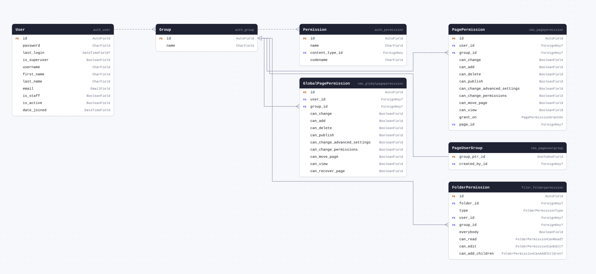

| Column | Field | Type | Null | Key | Default | Description |
| --- | --- | --- | --- | --- | --- | --- |
| `id` | `AutoField` | `integer` |  | PK | `autoincrement()` |  |
| `name` | `CharField` | `varchar(150)` |  | unique |  |  |

Relations:

- `permissions` — many to many with [Permission](#permission)
- `user_set` — many to many with [User](#user)
- [GlobalPagePermission](#globalpagepermission).`group_id` → `id`, on delete cascade
- [PagePermission](#pagepermission).`group_id` → `id`, on delete cascade
- [PageUserGroup](#pageusergroup).`group_ptr_id` → `id`, parent link, on delete cascade
- [FolderPermission](#folderpermission).`group_id` → `id`, on delete cascade

## User

Table `auth_user`, app `auth`.

Subclasses (multi-table): [PageUser](#pageuser).

Columns from `AbstractUser` (abstract): `username`, `first_name`, `last_name`, `email`, `is_staff`, `is_active`, `date_joined`.

Columns from `AbstractBaseUser` (abstract): `password`, `last_login`.

Columns from `PermissionsMixin` (abstract): `is_superuser`.

Users within the Django authentication system are represented by this
model.

Username and password are required. Other fields are optional.

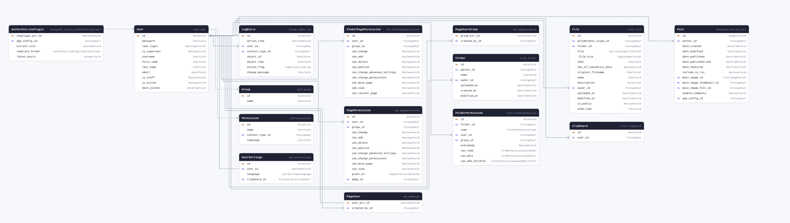

| Column | Field | Type | Null | Key | Default | Description |
| --- | --- | --- | --- | --- | --- | --- |
| `id` | `AutoField` | `integer` |  | PK | `autoincrement()` |  |
| `password` | `CharField` | `varchar(128)` |  |  |  |  |
| `last_login` | `DateTimeField` | `datetime` | yes |  |  |  |
| `is_superuser` | `BooleanField` | `bool` |  |  | `False` | Designates that this user has all permissions without explicitly assigning them. |
| `username` | `CharField` | `varchar(150)` |  | unique |  | Required. 150 characters or fewer. Letters, digits and @/./+/-/_ only. |
| `first_name` | `CharField` | `varchar(150)` |  |  |  |  |
| `last_name` | `CharField` | `varchar(150)` |  |  |  |  |
| `email` | `EmailField` | `varchar(254)` |  |  |  |  |
| `is_staff` | `BooleanField` | `bool` |  |  | `False` | Designates whether the user can log into this admin site. |
| `is_active` | `BooleanField` | `bool` |  |  | `True` | Designates whether this user should be treated as active. Unselect this instead of deleting accounts. |
| `date_joined` | `DateTimeField` | `datetime` |  |  | `now()` |  |

Relations:

- [LogEntry](#logentry).`user_id` → `id`, on delete cascade
- `groups` — many to many with [Group](#group)
- `user_permissions` — many to many with [Permission](#permission)
- [UserSettings](#usersettings).`user_id` → `id`, on delete cascade
- [GlobalPagePermission](#globalpagepermission).`user_id` → `id`, on delete cascade
- [PagePermission](#pagepermission).`user_id` → `id`, on delete cascade
- [PageUser](#pageuser).`user_ptr_id` → `id`, parent link, on delete cascade
- [PageUser](#pageuser).`created_by_id` → `id`, on delete set null
- [PageUserGroup](#pageusergroup).`created_by_id` → `id`, on delete set null
- [Folder](#folder).`owner_id` → `id`, on delete set null
- [FolderPermission](#folderpermission).`user_id` → `id`, on delete set null
- [File](#file).`owner_id` → `id`
- [Clipboard](#clipboard).`user_id` → `id`, on delete cascade
- [Post](#post).`author_id` → `id`, on delete protect
- `authorentriesplugin_set` — many to many with [AuthorEntriesPlugin](#authorentriesplugin)

## ContentType

Table `django_content_type`, app `contenttypes`.

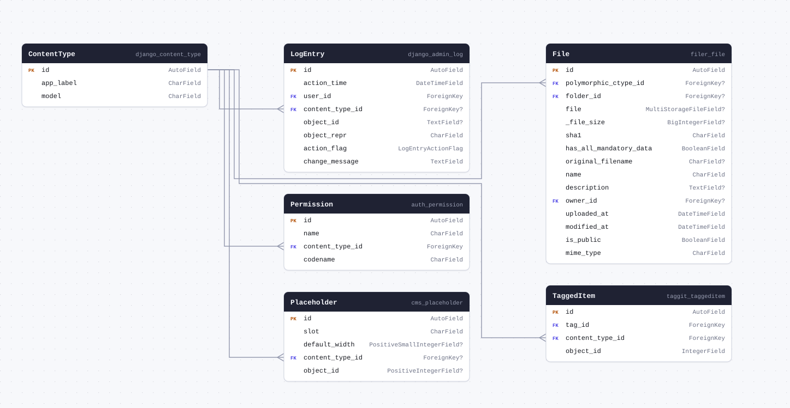

| Column | Field | Type | Null | Key | Default | Description |
| --- | --- | --- | --- | --- | --- | --- |
| `id` | `AutoField` | `integer` |  | PK | `autoincrement()` |  |
| `app_label` | `CharField` | `varchar(100)` |  |  |  |  |
| `model` | `CharField` | `varchar(100)` |  |  |  |  |

Indexes:

- unique `django_content_type_app_label_model_76bd3d3b_uniq` on `app_label`, `model`

Relations:

- [LogEntry](#logentry).`content_type_id` → `id`, on delete set null
- [Permission](#permission).`content_type_id` → `id`, on delete cascade
- [Placeholder](#placeholder).`content_type_id` → `id`, on delete set null
- [File](#file).`polymorphic_ctype_id` → `id`
- [TaggedItem](#taggeditem).`content_type_id` → `id`, on delete cascade

## Session

Table `django_session`, app `sessions`.

Columns from `AbstractBaseSession` (abstract): `session_key`, `session_data`, `expire_date`.

Django provides full support for anonymous sessions. The session
framework lets you store and retrieve arbitrary data on a
per-site-visitor basis. It stores data on the server side and
abstracts the sending and receiving of cookies. Cookies contain a
session ID -- not the data itself.

The Django sessions framework is entirely cookie-based. It does
not fall back to putting session IDs in URLs. This is an intentional
design decision. Not only does that behavior make URLs ugly, it makes
your site vulnerable to session-ID theft via the "Referer" header.

For complete documentation on using Sessions in your code, consult
the sessions documentation that is shipped with Django (also available
on the Django web site).

| Column | Field | Type | Null | Key | Default | Description |
| --- | --- | --- | --- | --- | --- | --- |
| `session_key` | `CharField` | `varchar(40)` |  | PK |  |  |
| `session_data` | `TextField` | `text` |  |  |  |  |
| `expire_date` | `DateTimeField` | `datetime` |  |  |  |  |

Indexes:

- index `django_session_expire_date_a5c62663` on `expire_date`

## Site

Table `django_site`, app `sites`.

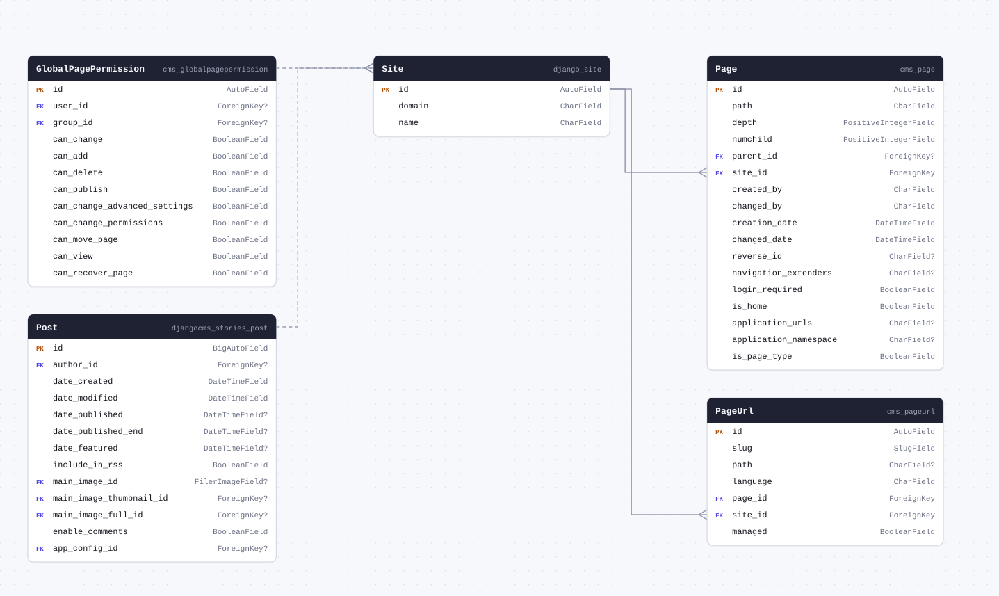

| Column | Field | Type | Null | Key | Default | Description |
| --- | --- | --- | --- | --- | --- | --- |
| `id` | `AutoField` | `integer` |  | PK | `autoincrement()` |  |
| `domain` | `CharField` | `varchar(100)` |  | unique |  |  |
| `name` | `CharField` | `varchar(50)` |  |  |  |  |

Relations:

- [Page](#page).`site_id` → `id`, on delete cascade
- [PageUrl](#pageurl).`site_id` → `id`, on delete cascade
- `globalpagepermission_set` — many to many with [GlobalPagePermission](#globalpagepermission)
- `post_set` — many to many with [Post](#post)

## UserSettings

Table `cms_usersettings`, app `cms`.

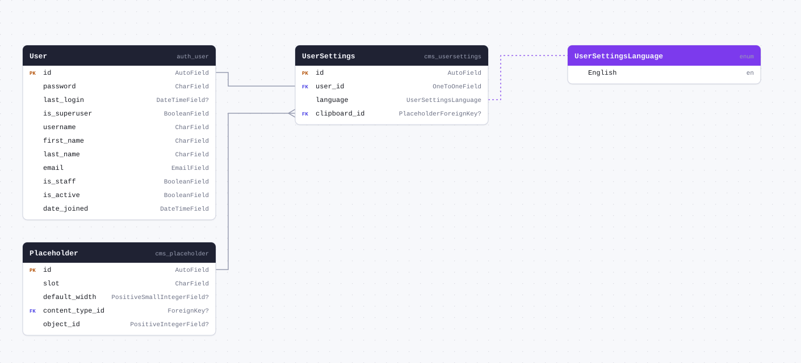

| Column | Field | Type | Null | Key | Default | Description |
| --- | --- | --- | --- | --- | --- | --- |
| `id` | `AutoField` | `integer` |  | PK | `autoincrement()` |  |
| `user_id` | `OneToOneField` | `integer` |  | FK, unique |  |  |
| `language` | `UserSettingsLanguage` | `varchar(10)` |  |  |  | The language for the admin interface and toolbar |
| `clipboard_id` | `PlaceholderForeignKey` | `integer` | yes | FK |  |  |

Indexes:

- index `cms_usersettings_clipboard_id_3ae17c19` on `clipboard_id`

Relations:

- `user_id` → [User](#user).`id`, on delete cascade
- `clipboard_id` → [Placeholder](#placeholder).`id`, on delete cascade

## Page

Table `cms_page`, app `cms`.

Proxy models, on this table: `PageType`.

Columns from `MP_Node` (abstract): `path`, `depth`, `numchild`.

A ``Page`` is the basic unit of site structure in django CMS. The CMS uses a hierarchical page model: each page
stands in relation to other pages as parent, child or sibling. This hierarchy is managed by the `django-treebeard
<http://django-treebeard.readthedocs.io/en/latest/>`_ library.

A ``Page`` is an abstract entity. It does not have any content associated with it, nor does is provide any slugs to
build a URL. This is part of the model :class:`~cms.models.contentmodels.PageContent` and
:class:`~cms.models.pagemodel.PageUrl` respectively.

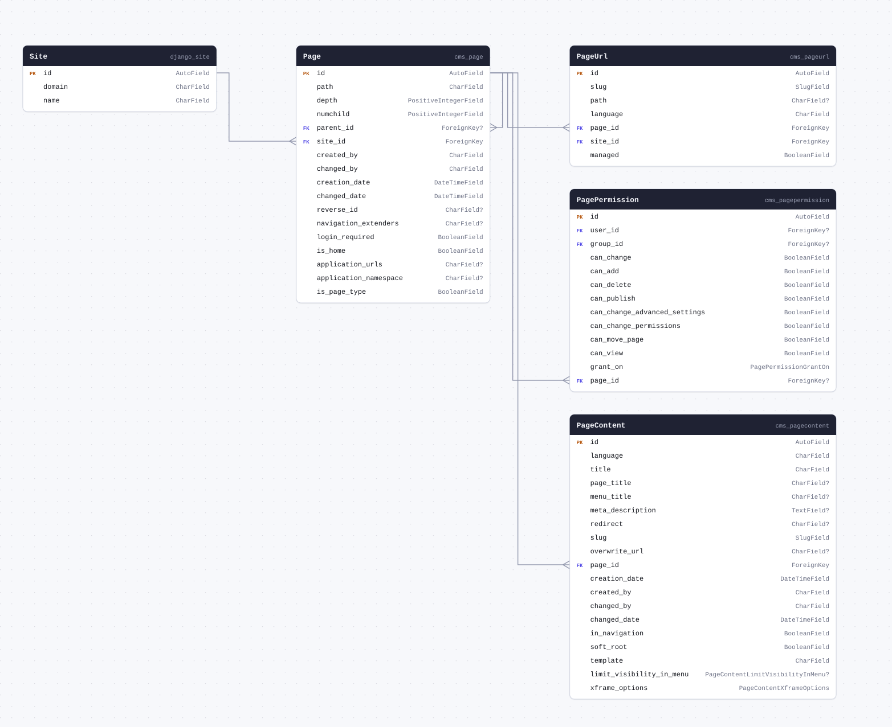

| Column | Field | Type | Null | Key | Default | Description |
| --- | --- | --- | --- | --- | --- | --- |
| `id` | `AutoField` | `integer` |  | PK | `autoincrement()` |  |
| `path` | `CharField` | `varchar(255)` |  | unique |  |  |
| `depth` | `PositiveIntegerField` | `integer unsigned` |  |  |  |  |
| `numchild` | `PositiveIntegerField` | `integer unsigned` |  |  | `0` |  |
| `parent_id` | `ForeignKey` | `integer` | yes | FK |  |  |
| `site_id` | `ForeignKey` | `integer` |  | FK |  |  |
| `created_by` | `CharField` | `varchar(255)` |  |  |  |  |
| `changed_by` | `CharField` | `varchar(255)` |  |  |  |  |
| `creation_date` | `DateTimeField` | `datetime` |  |  | `now()` |  |
| `changed_date` | `DateTimeField` | `datetime` |  |  | `now()` |  |
| `reverse_id` | `CharField` | `varchar(40)` | yes |  |  | A unique identifier that is used with the page_url templatetag for linking to this page |
| `navigation_extenders` | `CharField` | `varchar(80)` | yes |  |  |  |
| `login_required` | `BooleanField` | `bool` |  |  | `False` |  |
| `is_home` | `BooleanField` | `bool` |  |  | `False` |  |
| `application_urls` | `CharField` | `varchar(200)` | yes |  |  |  |
| `application_namespace` | `CharField` | `varchar(200)` | yes |  |  |  |
| `is_page_type` | `BooleanField` | `bool` |  |  | `False` | Mark this page as a page type |

Indexes:

- index `cms_page_parent_id_f89b72e4` on `parent_id`
- index `cms_page_site_id_4323d3ff` on `site_id`
- index `cms_page_reverse_id_ffc9ede2` on `reverse_id`
- index `cms_page_navigation_extenders_c24af8dd` on `navigation_extenders`
- index `cms_page_is_home_edadca07` on `is_home`
- index `cms_page_application_urls_9ef47497` on `application_urls`

Relations:

- `parent_id` → [Page](#page).`id`, on delete cascade
- `site_id` → [Site](#site).`id`, on delete cascade
- [PageUrl](#pageurl).`page_id` → `id`, on delete cascade
- [PagePermission](#pagepermission).`page_id` → `id`, on delete cascade
- [PageContent](#pagecontent).`page_id` → `id`, on delete cascade

## PageUrl

Table `cms_pageurl`, app `cms`.

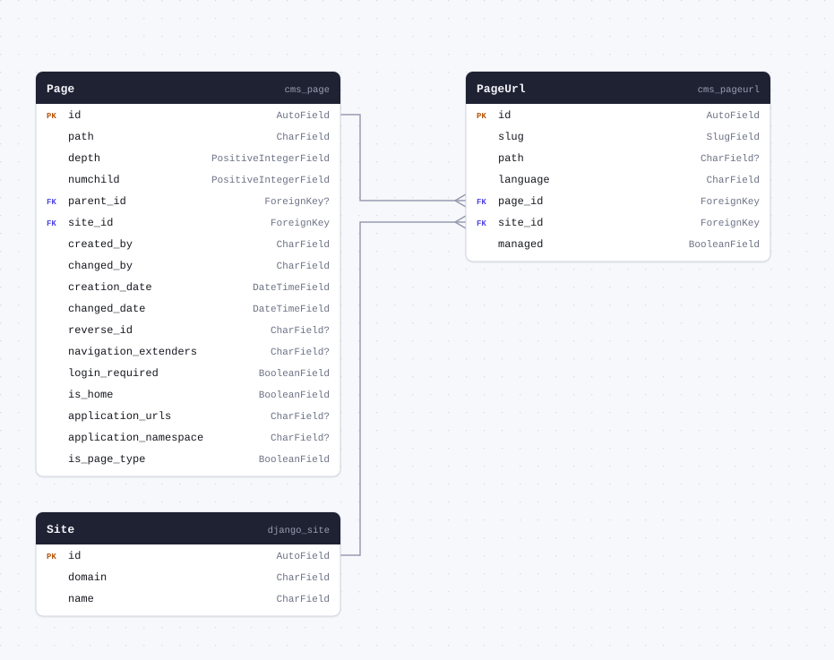

| Column | Field | Type | Null | Key | Default | Description |
| --- | --- | --- | --- | --- | --- | --- |
| `id` | `AutoField` | `integer` |  | PK | `autoincrement()` |  |
| `slug` | `SlugField` | `varchar(255)` |  |  |  |  |
| `path` | `CharField` | `varchar(255)` | yes |  |  |  |
| `language` | `CharField` | `varchar(15)` |  |  |  |  |
| `page_id` | `ForeignKey` | `integer` |  | FK |  |  |
| `site_id` | `ForeignKey` | `integer` |  | FK |  |  |
| `managed` | `BooleanField` | `bool` |  |  | `False` |  |

Indexes:

- index `cms_pageurl_slug_f8d42287` on `slug`
- index `cms_pageurl_path_9f26e673` on `path`
- index `cms_pageurl_language_a10302dc` on `language`
- index `cms_pageurl_page_id_dbf4793a` on `page_id`
- index `cms_pageurl_site_id_7d6fd976` on `site_id`
- unique `unique_together_page_language` on `page_id`, `language`
- unique `unique_site_language_path` on `site_id`, `language`, `path`

Relations:

- `page_id` → [Page](#page).`id`, on delete cascade
- `site_id` → [Site](#site).`id`, on delete cascade

## GlobalPagePermission

Table `cms_globalpagepermission`, app `cms`.

Columns from `AbstractPagePermission` (abstract): `user_id`, `group_id`, `can_change`, `can_add`, `can_delete`, `can_publish`, `can_change_advanced_settings`, `can_change_permissions`, `can_move_page`, `can_view`.

Permissions for all pages (global).

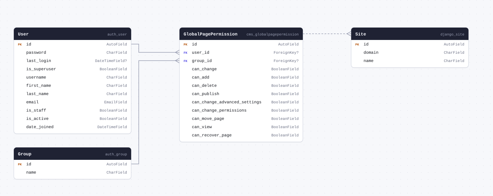

| Column | Field | Type | Null | Key | Default | Description |
| --- | --- | --- | --- | --- | --- | --- |
| `id` | `AutoField` | `integer` |  | PK | `autoincrement()` |  |
| `user_id` | `ForeignKey` | `integer` | yes | FK |  |  |
| `group_id` | `ForeignKey` | `integer` | yes | FK |  |  |
| `can_change` | `BooleanField` | `bool` |  |  | `True` |  |
| `can_add` | `BooleanField` | `bool` |  |  | `True` |  |
| `can_delete` | `BooleanField` | `bool` |  |  | `True` |  |
| `can_publish` | `BooleanField` | `bool` |  |  | `True` |  |
| `can_change_advanced_settings` | `BooleanField` | `bool` |  |  | `False` |  |
| `can_change_permissions` | `BooleanField` | `bool` |  |  | `False` | Allows this user to grant and revoke page permissions for other users. |
| `can_move_page` | `BooleanField` | `bool` |  |  | `True` |  |
| `can_view` | `BooleanField` | `bool` |  |  | `False` | Grants frontend view access. Note: as soon as any user or group is given view access to a page, that page becomes restricted — only users/groups with view access can then see it on the frontend. |
| `can_recover_page` | `BooleanField` | `bool` |  |  | `True` | can recover any deleted page |

Indexes:

- index `cms_globalpagepermission_user_id_a227cee1` on `user_id`
- index `cms_globalpagepermission_group_id_991b4733` on `group_id`

Relations:

- `user_id` → [User](#user).`id`, on delete cascade
- `group_id` → [Group](#group).`id`, on delete cascade
- `sites` — many to many with [Site](#site)

## PagePermission

Table `cms_pagepermission`, app `cms`.

Columns from `AbstractPagePermission` (abstract): `user_id`, `group_id`, `can_change`, `can_add`, `can_delete`, `can_publish`, `can_change_advanced_settings`, `can_change_permissions`, `can_move_page`, `can_view`.

Page permissions for a single page

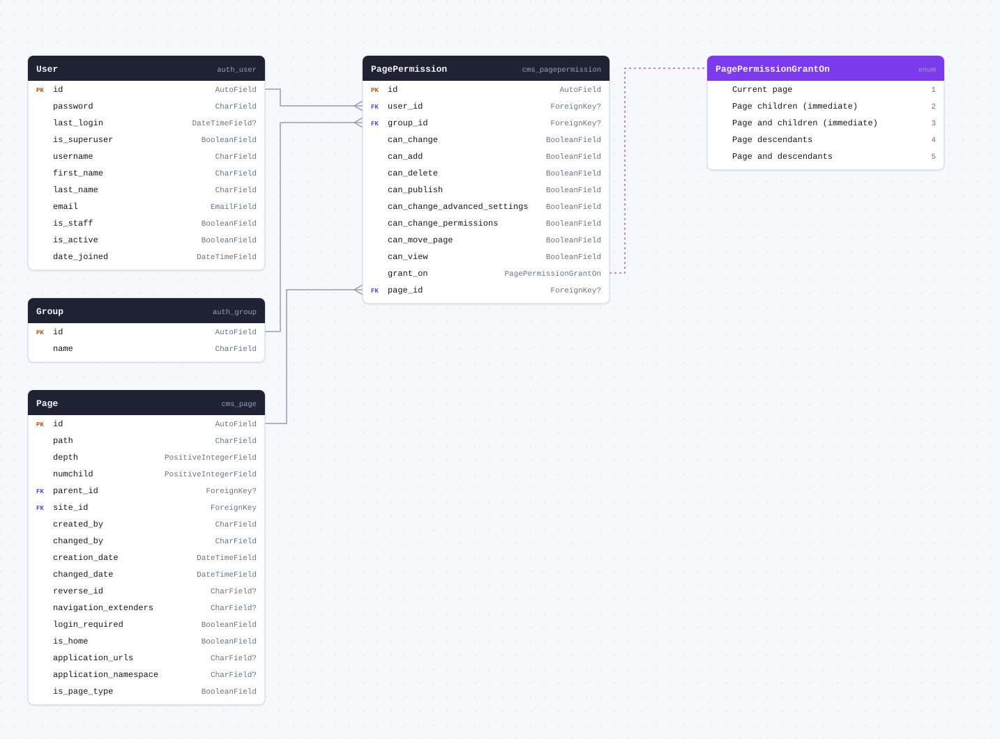

| Column | Field | Type | Null | Key | Default | Description |
| --- | --- | --- | --- | --- | --- | --- |
| `id` | `AutoField` | `integer` |  | PK | `autoincrement()` |  |
| `user_id` | `ForeignKey` | `integer` | yes | FK |  |  |
| `group_id` | `ForeignKey` | `integer` | yes | FK |  |  |
| `can_change` | `BooleanField` | `bool` |  |  | `True` |  |
| `can_add` | `BooleanField` | `bool` |  |  | `True` |  |
| `can_delete` | `BooleanField` | `bool` |  |  | `True` |  |
| `can_publish` | `BooleanField` | `bool` |  |  | `True` |  |
| `can_change_advanced_settings` | `BooleanField` | `bool` |  |  | `False` |  |
| `can_change_permissions` | `BooleanField` | `bool` |  |  | `False` | Allows this user to grant and revoke page permissions for other users. |
| `can_move_page` | `BooleanField` | `bool` |  |  | `True` |  |
| `can_view` | `BooleanField` | `bool` |  |  | `False` | Grants frontend view access. Note: as soon as any user or group is given view access to a page, that page becomes restricted — only users/groups with view access can then see it on the frontend. |
| `grant_on` | `PagePermissionGrantOn` | `integer` |  |  | `5` |  |
| `page_id` | `ForeignKey` | `integer` | yes | FK |  |  |

Indexes:

- index `cms_pagepermission_user_id_0c7d2b3c` on `user_id`
- index `cms_pagepermission_group_id_af5af193` on `group_id`
- index `cms_pagepermission_page_id_0ae9a163` on `page_id`

Relations:

- `user_id` → [User](#user).`id`, on delete cascade
- `group_id` → [Group](#group).`id`, on delete cascade
- `page_id` → [Page](#page).`id`, on delete cascade

## PageUser

Table `cms_pageuser`, app `cms`.

Inherits from [User](#user) (multi-table): its rows are joined on `user_ptr_id`.

Cms specific user data, required for permission system

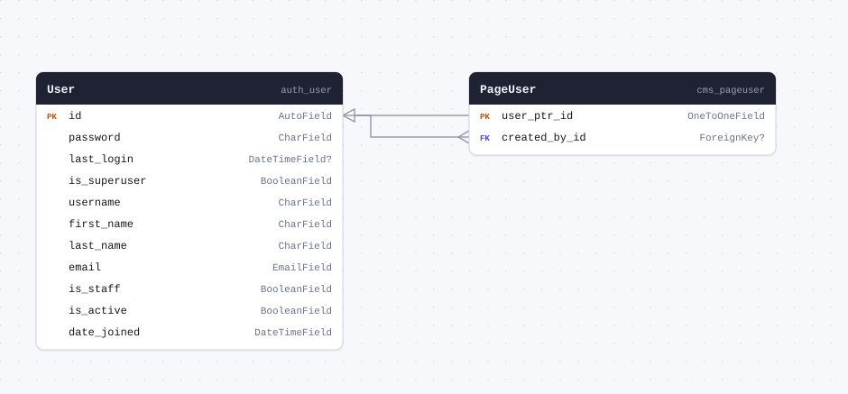

| Column | Field | Type | Null | Key | Default | Description |
| --- | --- | --- | --- | --- | --- | --- |
| `user_ptr_id` | `OneToOneField` | `integer` |  | PK, FK |  |  |
| `created_by_id` | `ForeignKey` | `integer` | yes | FK |  |  |

Indexes:

- index `cms_pageuser_created_by_id_8e9fbf83` on `created_by_id`

Relations:

- `user_ptr_id` → [User](#user).`id`, parent link, on delete cascade
- `created_by_id` → [User](#user).`id`, on delete set null

## PageUserGroup

Table `cms_pageusergroup`, app `cms`.

Inherits from [Group](#group) (multi-table): its rows are joined on `group_ptr_id`.

Cms specific group data, required for permission system

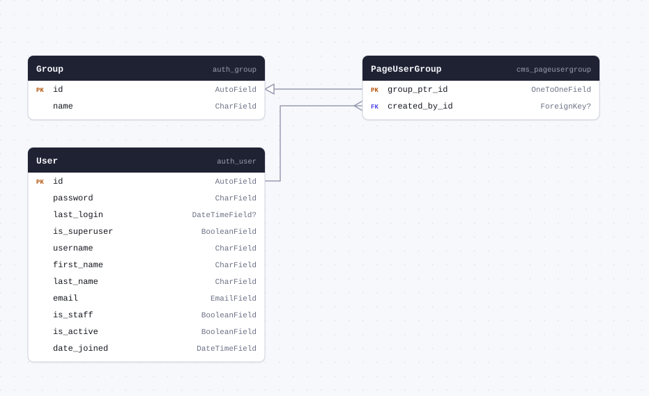

| Column | Field | Type | Null | Key | Default | Description |
| --- | --- | --- | --- | --- | --- | --- |
| `group_ptr_id` | `OneToOneField` | `integer` |  | PK, FK |  |  |
| `created_by_id` | `ForeignKey` | `integer` | yes | FK |  |  |

Indexes:

- index `cms_pageusergroup_created_by_id_7d57fa39` on `created_by_id`

Relations:

- `group_ptr_id` → [Group](#group).`id`, parent link, on delete cascade
- `created_by_id` → [User](#user).`id`, on delete set null

## Placeholder

Table `cms_placeholder`, app `cms`.

``Placeholders`` can be filled with plugins, which store or generate content.

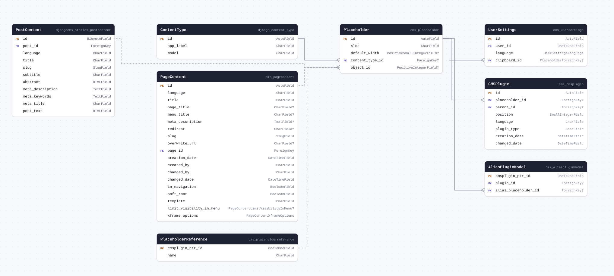

| Column | Field | Type | Null | Key | Default | Description |
| --- | --- | --- | --- | --- | --- | --- |
| `id` | `AutoField` | `integer` |  | PK | `autoincrement()` |  |
| `slot` | `CharField` | `varchar(255)` |  |  |  |  |
| `default_width` | `PositiveSmallIntegerField` | `smallint unsigned` | yes |  |  |  |
| `content_type_id` | `ForeignKey` | `integer` | yes | FK |  |  |
| `object_id` | `PositiveIntegerField` | `integer unsigned` | yes |  |  |  |

Indexes:

- index `cms_placeholder_slot_0bc04d21` on `slot`
- index `cms_placeholder_content_type_id_a7659d9c` on `content_type_id`

Relations:

- `source` → any model, by `content_type_id` + `object_id` (generic foreign key)
- [UserSettings](#usersettings).`clipboard_id` → `id`, on delete cascade
- `content_type_id` → [ContentType](#contenttype).`id`, on delete set null
- [CMSPlugin](#cmsplugin).`placeholder_id` → `id`, on delete cascade
- `object_id` → [PageContent](#pagecontent).`id` where `content_type_id` is PageContent (generic, `PageContent.placeholders`)
- `object_id` → [PlaceholderReference](#placeholderreference).`cmsplugin_ptr_id` where `content_type_id` is PlaceholderReference (generic, `PlaceholderReference.placeholders`)
- [AliasPluginModel](#aliaspluginmodel).`alias_placeholder_id` → `id`, on delete cascade
- `object_id` → [PostContent](#postcontent).`id` where `content_type_id` is PostContent (generic, `PostContent.placeholders`)

## CMSPlugin

Table `cms_cmsplugin`, app `cms`.

Subclasses (multi-table): [PlaceholderReference](#placeholderreference), [AliasPluginModel](#aliaspluginmodel), [Text](#text), [LatestPostsPlugin](#latestpostsplugin), [AuthorEntriesPlugin](#authorentriesplugin), [FeaturedPostsPlugin](#featuredpostsplugin), [GenericBlogPlugin](#genericblogplugin).

The base class for a CMS plugin model. When defining a new custom plugin, you should
store plugin-instance specific information on a subclass of this class. (An example for this
would be to store the number of pictures to display in a gallery.)

Two restrictions apply when subclassing this to use in your own models:

1. Subclasses of CMSPlugin **cannot be further subclassed**
2. Subclasses of CMSPlugin cannot define a "text" field.

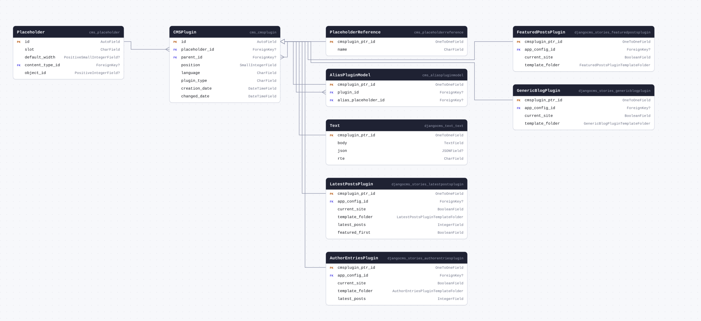

| Column | Field | Type | Null | Key | Default | Description |
| --- | --- | --- | --- | --- | --- | --- |
| `id` | `AutoField` | `integer` |  | PK | `autoincrement()` |  |
| `placeholder_id` | `ForeignKey` | `integer` | yes | FK |  |  |
| `parent_id` | `ForeignKey` | `integer` | yes | FK |  |  |
| `position` | `SmallIntegerField` | `smallint` |  |  | `1` |  |
| `language` | `CharField` | `varchar(15)` |  |  |  |  |
| `plugin_type` | `CharField` | `varchar(50)` |  |  |  |  |
| `creation_date` | `DateTimeField` | `datetime` |  |  | `now()` |  |
| `changed_date` | `DateTimeField` | `datetime` |  |  | `now()` |  |

Indexes:

- index `cms_cmsplugin_placeholder_id_0bfa3b26` on `placeholder_id`
- index `cms_cmsplugin_parent_id_fd3bd9dd` on `parent_id`
- index `cms_cmsplugin_language_bbea8a48` on `language`
- index `cms_cmsplugin_plugin_type_94e96ebf` on `plugin_type`
- unique `cms_cmsplugin_placeholder_id_language_position_bad60ebe_uniq` on `placeholder_id`, `language`, `position`
- index `cms_cmsplug_placeho_3f2b0f_idx` on `placeholder_id`, `language`, `position`

Relations:

- `placeholder_id` → [Placeholder](#placeholder).`id`, on delete cascade
- `parent_id` → [CMSPlugin](#cmsplugin).`id`, on delete cascade
- [PlaceholderReference](#placeholderreference).`cmsplugin_ptr_id` → `id`, parent link, on delete cascade
- [AliasPluginModel](#aliaspluginmodel).`cmsplugin_ptr_id` → `id`, parent link, on delete cascade
- [AliasPluginModel](#aliaspluginmodel).`plugin_id` → `id`, on delete cascade
- [Text](#text).`cmsplugin_ptr_id` → `id`, parent link, on delete cascade
- [LatestPostsPlugin](#latestpostsplugin).`cmsplugin_ptr_id` → `id`, parent link, on delete cascade
- [AuthorEntriesPlugin](#authorentriesplugin).`cmsplugin_ptr_id` → `id`, parent link, on delete cascade
- [FeaturedPostsPlugin](#featuredpostsplugin).`cmsplugin_ptr_id` → `id`, parent link, on delete cascade
- [GenericBlogPlugin](#genericblogplugin).`cmsplugin_ptr_id` → `id`, parent link, on delete cascade

## PageContent

Table `cms_pagecontent`, app `cms`.

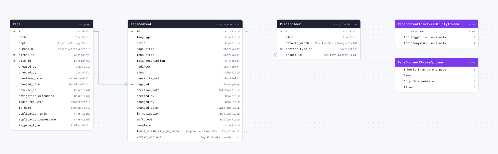

| Column | Field | Type | Null | Key | Default | Description |
| --- | --- | --- | --- | --- | --- | --- |
| `id` | `AutoField` | `integer` |  | PK | `autoincrement()` |  |
| `language` | `CharField` | `varchar(15)` |  |  |  |  |
| `title` | `CharField` | `varchar(255)` |  |  |  | The default title |
| `page_title` | `CharField` | `varchar(255)` | yes |  |  | Overwrites what is displayed at the top of your browser or in bookmarks |
| `menu_title` | `CharField` | `varchar(255)` | yes |  |  | Overwrite what is displayed in the menu |
| `meta_description` | `TextField` | `text` | yes |  |  | A description of the page used by search engines. |
| `redirect` | `CharField` | `varchar(2048)` | yes |  |  | Redirects to this URL. |
| `slug` | `SlugField` | `varchar(255)` |  |  |  | The part of the title that is used in the URL |
| `overwrite_url` | `CharField` | `varchar(255)` | yes |  |  | Keep this field empty if standard path should be used. |
| `page_id` | `ForeignKey` | `integer` |  | FK |  |  |
| `creation_date` | `DateTimeField` | `datetime` |  |  | `now()` |  |
| `created_by` | `CharField` | `varchar(255)` |  |  |  |  |
| `changed_by` | `CharField` | `varchar(255)` |  |  |  |  |
| `changed_date` | `DateTimeField` | `datetime` |  |  | `now()` |  |
| `in_navigation` | `BooleanField` | `bool` |  |  | `True` |  |
| `soft_root` | `BooleanField` | `bool` |  |  | `False` | All ancestors will not be displayed in the navigation |
| `template` | `CharField` | `varchar(100)` |  |  | `'INHERIT'` | The template used to render the content. |
| `limit_visibility_in_menu` | `PageContentLimitVisibilityInMenu` | `smallint` | yes |  | `None` | limit when this page is visible in the menu |
| `xframe_options` | `PageContentXframeOptions` | `integer` |  |  | `0` |  |

Indexes:

- index `cms_pagecontent_language_0b8ccf12` on `language`
- index `cms_pagecontent_slug_23c7b868` on `slug`
- index `cms_pagecontent_page_id_b958451e` on `page_id`
- index `cms_pagecontent_in_navigation_c35c26ba` on `in_navigation`
- index `cms_pagecontent_soft_root_ea2486e9` on `soft_root`
- index `cms_pagecontent_limit_visibility_in_menu_e1d68dcf` on `limit_visibility_in_menu`
- unique `cms_pagecontent_language_page_id_fbc0b2cf_uniq` on `language`, `page_id`

Relations:

- `page_id` → [Page](#page).`id`, on delete cascade
- `placeholders` ← [Placeholder](#placeholder), by `content_type_id` + `object_id` (generic relation)

## PlaceholderReference

Table `cms_placeholderreference`, app `cms`.

Inherits from [CMSPlugin](#cmsplugin) (multi-table): its rows are joined on `cmsplugin_ptr_id`.

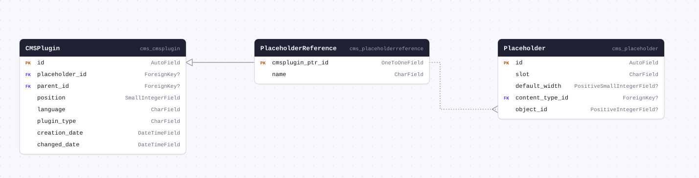

| Column | Field | Type | Null | Key | Default | Description |
| --- | --- | --- | --- | --- | --- | --- |
| `cmsplugin_ptr_id` | `OneToOneField` | `integer` |  | PK, FK |  |  |
| `name` | `CharField` | `varchar(255)` |  |  |  |  |

Relations:

- `cmsplugin_ptr_id` → [CMSPlugin](#cmsplugin).`id`, parent link, on delete cascade
- `placeholders` ← [Placeholder](#placeholder), by `content_type_id` + `object_id` (generic relation)

## AliasPluginModel

Table `cms_aliaspluginmodel`, app `cms`.

Inherits from [CMSPlugin](#cmsplugin) (multi-table): its rows are joined on `cmsplugin_ptr_id`.

AliasPlugin is deprecated,
and it will be removed;
please use the package djangocms-alias instead

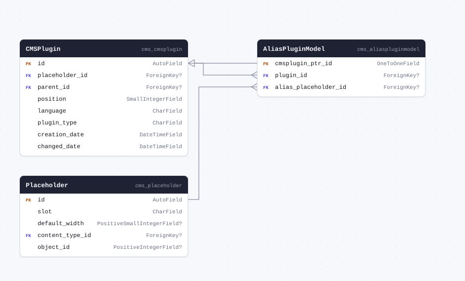

| Column | Field | Type | Null | Key | Default | Description |
| --- | --- | --- | --- | --- | --- | --- |
| `cmsplugin_ptr_id` | `OneToOneField` | `integer` |  | PK, FK |  |  |
| `plugin_id` | `ForeignKey` | `integer` | yes | FK |  |  |
| `alias_placeholder_id` | `ForeignKey` | `integer` | yes | FK |  |  |

Indexes:

- index `cms_aliaspluginmodel_plugin_id_9867676e` on `plugin_id`
- index `cms_aliaspluginmodel_alias_placeholder_id_6d6e0c8a` on `alias_placeholder_id`

Relations:

- `cmsplugin_ptr_id` → [CMSPlugin](#cmsplugin).`id`, parent link, on delete cascade
- `plugin_id` → [CMSPlugin](#cmsplugin).`id`, on delete cascade
- `alias_placeholder_id` → [Placeholder](#placeholder).`id`, on delete cascade

## UrlconfRevision

Table `cms_urlconfrevision`, app `cms`.

| Column | Field | Type | Null | Key | Default | Description |
| --- | --- | --- | --- | --- | --- | --- |
| `id` | `AutoField` | `integer` |  | PK | `autoincrement()` |  |
| `revision` | `CharField` | `varchar(255)` |  |  |  |  |

## CacheKey

Table `menus_cachekey`, app `menus`.

This model stores a set of cache keys accessible by multiple processes/machines.
Multiple Django instances will then share the keys, allowing selective invalidation
of menu trees (per site, per language) in the cache.

| Column | Field | Type | Null | Key | Default | Description |
| --- | --- | --- | --- | --- | --- | --- |
| `id` | `AutoField` | `integer` |  | PK | `autoincrement()` |  |
| `language` | `CharField` | `varchar(255)` |  |  |  |  |
| `site` | `PositiveIntegerField` | `integer unsigned` |  |  |  |  |
| `key` | `CharField` | `varchar(255)` |  |  |  |  |

## Source

Table `easy_thumbnails_source`, app `easy_thumbnails`.

Columns from `File` (abstract): `storage_hash`, `name`, `modified`.

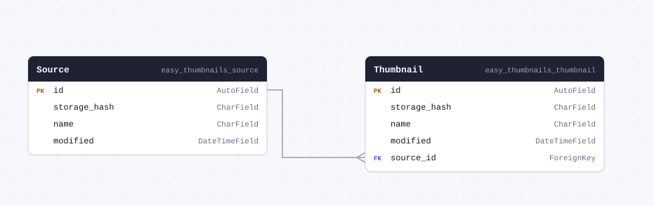

| Column | Field | Type | Null | Key | Default | Description |
| --- | --- | --- | --- | --- | --- | --- |
| `id` | `AutoField` | `integer` |  | PK | `autoincrement()` |  |
| `storage_hash` | `CharField` | `varchar(40)` |  |  |  |  |
| `name` | `CharField` | `varchar(255)` |  |  |  |  |
| `modified` | `DateTimeField` | `datetime` |  |  | `now()` |  |

Indexes:

- index `easy_thumbnails_source_storage_hash_946cbcc9` on `storage_hash`
- index `easy_thumbnails_source_name_5fe0edc6` on `name`
- unique `easy_thumbnails_source_storage_hash_name_481ce32d_uniq` on `storage_hash`, `name`

Relations:

- [Thumbnail](#thumbnail).`source_id` → `id`, on delete cascade

## Thumbnail

Table `easy_thumbnails_thumbnail`, app `easy_thumbnails`.

Columns from `File` (abstract): `storage_hash`, `name`, `modified`.

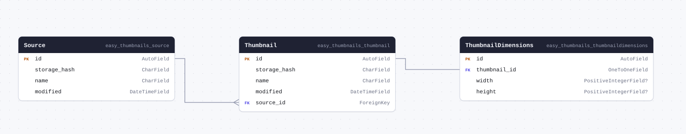

| Column | Field | Type | Null | Key | Default | Description |
| --- | --- | --- | --- | --- | --- | --- |
| `id` | `AutoField` | `integer` |  | PK | `autoincrement()` |  |
| `storage_hash` | `CharField` | `varchar(40)` |  |  |  |  |
| `name` | `CharField` | `varchar(255)` |  |  |  |  |
| `modified` | `DateTimeField` | `datetime` |  |  | `now()` |  |
| `source_id` | `ForeignKey` | `integer` |  | FK |  |  |

Indexes:

- index `easy_thumbnails_thumbnail_storage_hash_f1435f49` on `storage_hash`
- index `easy_thumbnails_thumbnail_name_b5882c31` on `name`
- index `easy_thumbnails_thumbnail_source_id_5b57bc77` on `source_id`
- unique `easy_thumbnails_thumbnail_storage_hash_name_source_id_fb375270_uniq` on `storage_hash`, `name`, `source_id`

Relations:

- `source_id` → [Source](#source).`id`, on delete cascade
- [ThumbnailDimensions](#thumbnaildimensions).`thumbnail_id` → `id`, on delete cascade

## ThumbnailDimensions

Table `easy_thumbnails_thumbnaildimensions`, app `easy_thumbnails`.

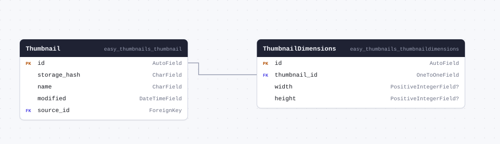

| Column | Field | Type | Null | Key | Default | Description |
| --- | --- | --- | --- | --- | --- | --- |
| `id` | `AutoField` | `integer` |  | PK | `autoincrement()` |  |
| `thumbnail_id` | `OneToOneField` | `integer` |  | FK, unique |  |  |
| `width` | `PositiveIntegerField` | `integer unsigned` | yes |  |  |  |
| `height` | `PositiveIntegerField` | `integer unsigned` | yes |  |  |  |

Relations:

- `thumbnail_id` → [Thumbnail](#thumbnail).`id`, on delete cascade

## Folder

Table `filer_folder`, app `filer`.

Represents a Folder that things (files) can be put into. Folders are *NOT*
mirrored in the Filesystem and can have any unicode chars as their name.
Other models may attach to a folder with a ForeignKey. If the related name
ends with "_files" they will automatically be listed in the
folder.files list along with all the other models that link to the folder
in this way. Make sure the linked models obey the AbstractFile interface
(Duck Type).

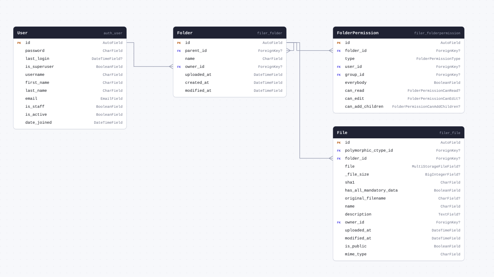

| Column | Field | Type | Null | Key | Default | Description |
| --- | --- | --- | --- | --- | --- | --- |
| `id` | `AutoField` | `integer` |  | PK | `autoincrement()` |  |
| `parent_id` | `ForeignKey` | `integer` | yes | FK |  |  |
| `name` | `CharField` | `varchar(255)` |  |  |  |  |
| `owner_id` | `ForeignKey` | `integer` | yes | FK |  |  |
| `uploaded_at` | `DateTimeField` | `datetime` |  |  | `now()` |  |
| `created_at` | `DateTimeField` | `datetime` |  |  | `now()` |  |
| `modified_at` | `DateTimeField` | `datetime` |  |  | `now()` |  |

Indexes:

- index `filer_folder_parent_id_308aecda` on `parent_id`
- index `filer_folder_owner_id_be530fb4` on `owner_id`
- unique `filer_folder_parent_id_name_bc773258_uniq` on `parent_id`, `name`

Relations:

- `parent_id` → [Folder](#folder).`id`, on delete cascade
- `owner_id` → [User](#user).`id`, on delete set null
- [FolderPermission](#folderpermission).`folder_id` → `id`, on delete cascade
- [File](#file).`folder_id` → `id`

## FolderPermission

Table `filer_folderpermission`, app `filer`.

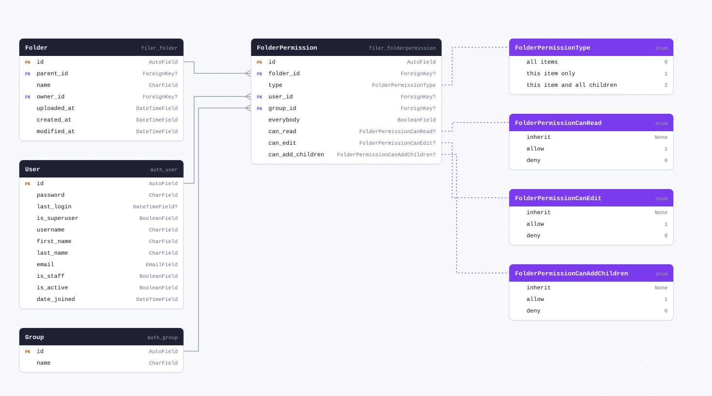

| Column | Field | Type | Null | Key | Default | Description |
| --- | --- | --- | --- | --- | --- | --- |
| `id` | `AutoField` | `integer` |  | PK | `autoincrement()` |  |
| `folder_id` | `ForeignKey` | `integer` | yes | FK |  |  |
| `type` | `FolderPermissionType` | `smallint` |  |  | `0` |  |
| `user_id` | `ForeignKey` | `integer` | yes | FK |  |  |
| `group_id` | `ForeignKey` | `integer` | yes | FK |  |  |
| `everybody` | `BooleanField` | `bool` |  |  | `False` |  |
| `can_read` | `FolderPermissionCanRead` | `smallint` | yes |  | `None` |  |
| `can_edit` | `FolderPermissionCanEdit` | `smallint` | yes |  | `None` |  |
| `can_add_children` | `FolderPermissionCanAddChildren` | `smallint` | yes |  | `None` |  |

Indexes:

- index `filer_folderpermission_folder_id_5d02f1da` on `folder_id`
- index `filer_folderpermission_user_id_7673d4b6` on `user_id`
- index `filer_folderpermission_group_id_8901bafa` on `group_id`

Relations:

- `folder_id` → [Folder](#folder).`id`, on delete cascade
- `user_id` → [User](#user).`id`, on delete set null
- `group_id` → [Group](#group).`id`, on delete cascade

## File

Table `filer_file`, app `filer`.

Subclasses (multi-table): [Image](#image).

Columns from `PolymorphicModel` (abstract): `polymorphic_ctype_id`.

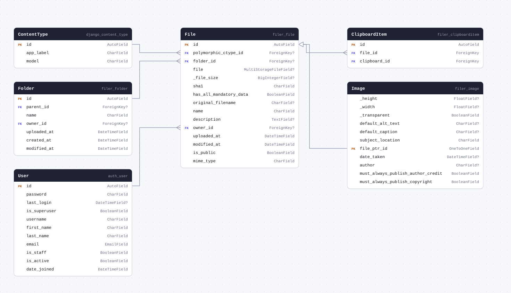

| Column | Field | Type | Null | Key | Default | Description |
| --- | --- | --- | --- | --- | --- | --- |
| `id` | `AutoField` | `integer` |  | PK | `autoincrement()` |  |
| `polymorphic_ctype_id` | `ForeignKey` | `integer` | yes | FK |  |  |
| `folder_id` | `ForeignKey` | `integer` | yes | FK |  |  |
| `file` | `MultiStorageFileField` | `varchar(255)` | yes |  |  |  |
| `_file_size` | `BigIntegerField` | `bigint` | yes |  |  |  |
| `sha1` | `CharField` | `varchar(40)` |  |  | `''` |  |
| `has_all_mandatory_data` | `BooleanField` | `bool` |  |  | `False` |  |
| `original_filename` | `CharField` | `varchar(255)` | yes |  |  |  |
| `name` | `CharField` | `varchar(255)` |  |  | `''` |  |
| `description` | `TextField` | `text` | yes |  |  |  |
| `owner_id` | `ForeignKey` | `integer` | yes | FK |  |  |
| `uploaded_at` | `DateTimeField` | `datetime` |  |  | `now()` |  |
| `modified_at` | `DateTimeField` | `datetime` |  |  | `now()` |  |
| `is_public` | `BooleanField` | `bool` |  |  | `is_public_default()` | Disable any permission checking for this file. File will be publicly accessible to anyone. |
| `mime_type` | `CharField` | `varchar(255)` |  |  | `'application/octet-stream'` | MIME type of uploaded content |

Indexes:

- index `filer_file_polymorphic_ctype_id_f44903c1` on `polymorphic_ctype_id`
- index `filer_file_folder_id_af803bbb` on `folder_id`
- index `filer_file_owner_id_b9e32671` on `owner_id`

Relations:

- `in_clipboards` — many to many with [Clipboard](#clipboard), through [ClipboardItem](#clipboarditem)
- `polymorphic_ctype_id` → [ContentType](#contenttype).`id`
- `folder_id` → [Folder](#folder).`id`
- `owner_id` → [User](#user).`id`
- [ClipboardItem](#clipboarditem).`file_id` → `id`, on delete cascade
- [Image](#image).`file_ptr_id` → `id`, parent link

## Clipboard

Table `filer_clipboard`, app `filer`.

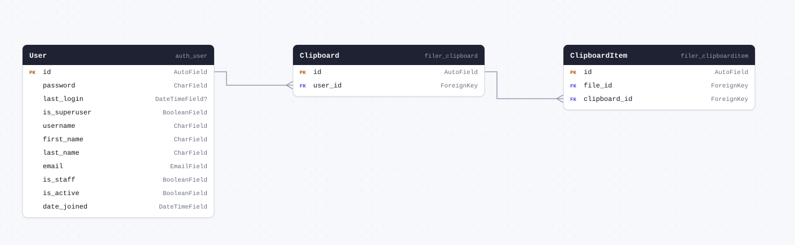

| Column | Field | Type | Null | Key | Default | Description |
| --- | --- | --- | --- | --- | --- | --- |
| `id` | `AutoField` | `integer` |  | PK | `autoincrement()` |  |
| `user_id` | `ForeignKey` | `integer` |  | FK |  |  |

Indexes:

- index `filer_clipboard_user_id_b52ff0bc` on `user_id`

Relations:

- `files` — many to many with [File](#file), through [ClipboardItem](#clipboarditem)
- `user_id` → [User](#user).`id`, on delete cascade
- [ClipboardItem](#clipboarditem).`clipboard_id` → `id`, on delete cascade

## ClipboardItem

Table `filer_clipboarditem`, app `filer`.

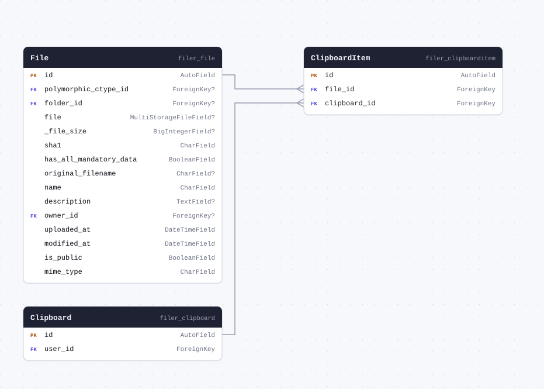

| Column | Field | Type | Null | Key | Default | Description |
| --- | --- | --- | --- | --- | --- | --- |
| `id` | `AutoField` | `integer` |  | PK | `autoincrement()` |  |
| `file_id` | `ForeignKey` | `integer` |  | FK |  |  |
| `clipboard_id` | `ForeignKey` | `integer` |  | FK |  |  |

Indexes:

- index `filer_clipboarditem_file_id_06196f80` on `file_id`
- index `filer_clipboarditem_clipboard_id_7a76518b` on `clipboard_id`

Relations:

- `file_id` → [File](#file).`id`, on delete cascade
- `clipboard_id` → [Clipboard](#clipboard).`id`, on delete cascade

## Image

Table `filer_image`, app `filer`.

Inherits from [File](#file) (multi-table): its rows are joined on `file_ptr_id`.

Columns from `BaseImage` (abstract): `_height`, `_width`, `_transparent`, `default_alt_text`, `default_caption`, `subject_location`, `file_ptr_id`.

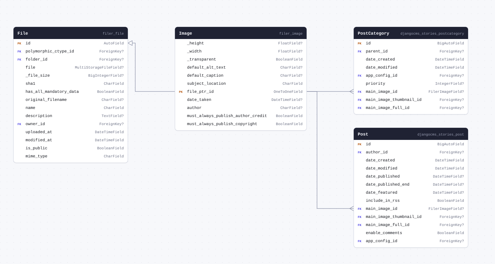

| Column | Field | Type | Null | Key | Default | Description |
| --- | --- | --- | --- | --- | --- | --- |
| `_height` | `FloatField` | `real` | yes |  |  |  |
| `_width` | `FloatField` | `real` | yes |  |  |  |
| `_transparent` | `BooleanField` | `bool` |  |  | `False` |  |
| `default_alt_text` | `CharField` | `varchar(255)` | yes |  |  |  |
| `default_caption` | `CharField` | `varchar(255)` | yes |  |  |  |
| `subject_location` | `CharField` | `varchar(64)` |  |  | `''` |  |
| `file_ptr_id` | `OneToOneField` | `integer` |  | PK, FK |  |  |
| `date_taken` | `DateTimeField` | `datetime` | yes |  |  |  |
| `author` | `CharField` | `varchar(255)` | yes |  |  |  |
| `must_always_publish_author_credit` | `BooleanField` | `bool` |  |  | `False` |  |
| `must_always_publish_copyright` | `BooleanField` | `bool` |  |  | `False` |  |

Relations:

- `file_ptr_id` → [File](#file).`id`, parent link
- [PostCategory](#postcategory).`main_image_id` → `file_ptr_id`, on delete set null
- [Post](#post).`main_image_id` → `file_ptr_id`, on delete set null

## ThumbnailOption

Table `filer_thumbnailoption`, app `filer`.

This class defines the option use to create the thumbnail.

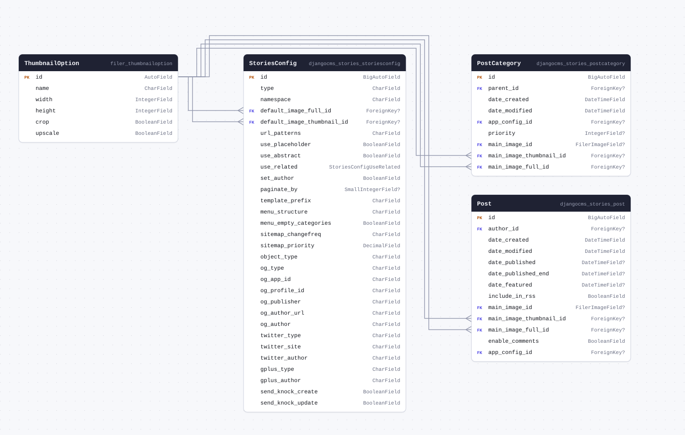

| Column | Field | Type | Null | Key | Default | Description |
| --- | --- | --- | --- | --- | --- | --- |
| `id` | `AutoField` | `integer` |  | PK | `autoincrement()` |  |
| `name` | `CharField` | `varchar(100)` |  |  |  |  |
| `width` | `IntegerField` | `integer` |  |  |  | width in pixel. |
| `height` | `IntegerField` | `integer` |  |  |  | height in pixel. |
| `crop` | `BooleanField` | `bool` |  |  | `True` |  |
| `upscale` | `BooleanField` | `bool` |  |  | `True` |  |

Relations:

- [StoriesConfig](#storiesconfig).`default_image_full_id` → `id`, on delete set null
- [StoriesConfig](#storiesconfig).`default_image_thumbnail_id` → `id`, on delete set null
- [PostCategory](#postcategory).`main_image_thumbnail_id` → `id`, on delete set null
- [PostCategory](#postcategory).`main_image_full_id` → `id`, on delete set null
- [Post](#post).`main_image_thumbnail_id` → `id`, on delete set null
- [Post](#post).`main_image_full_id` → `id`, on delete set null

## Text

Table `djangocms_text_text`, app `djangocms_text`.

Inherits from [CMSPlugin](#cmsplugin) (multi-table): its rows are joined on `cmsplugin_ptr_id`.

Columns from `AbstractText` (abstract): `cmsplugin_ptr_id`, `body`, `json`, `rte`.

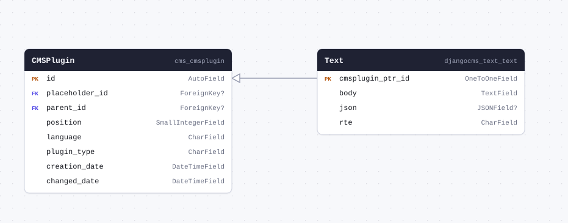

| Column | Field | Type | Null | Key | Default | Description |
| --- | --- | --- | --- | --- | --- | --- |
| `cmsplugin_ptr_id` | `OneToOneField` | `integer` |  | PK, FK |  |  |
| `body` | `TextField` | `text` |  |  |  |  |
| `json` | `JSONField` | `text` | yes |  |  |  |
| `rte` | `CharField` | `varchar(16)` |  |  | `''` | The rich text editor used to create this text. JSON formats vary between editors. |

Relations:

- `cmsplugin_ptr_id` → [CMSPlugin](#cmsplugin).`id`, parent link, on delete cascade

## Tag

Table `taggit_tag`, app `taggit`.

Columns from `TagBase` (abstract): `name`, `slug`.

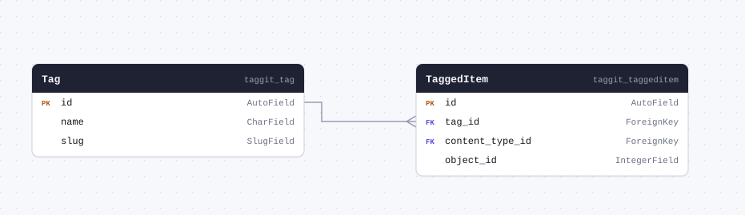

| Column | Field | Type | Null | Key | Default | Description |
| --- | --- | --- | --- | --- | --- | --- |
| `id` | `AutoField` | `integer` |  | PK | `autoincrement()` |  |
| `name` | `CharField` | `varchar(100)` |  | unique |  |  |
| `slug` | `SlugField` | `varchar(100)` |  | unique |  |  |

Relations:

- `djangocms_stories_tags` — many to many with [Post](#post), through [TaggedItem](#taggeditem)
- `djangocms_stories_latest_post` — many to many with [LatestPostsPlugin](#latestpostsplugin), through [TaggedItem](#taggeditem)
- [TaggedItem](#taggeditem).`tag_id` → `id`, on delete cascade

## TaggedItem

Table `taggit_taggeditem`, app `taggit`.

Columns from `GenericTaggedItemBase` (abstract): `object_id`.

Columns from `CommonGenericTaggedItemBase` (abstract): `content_type_id`.

Columns from `TaggedItemBase` (abstract): `tag_id`.

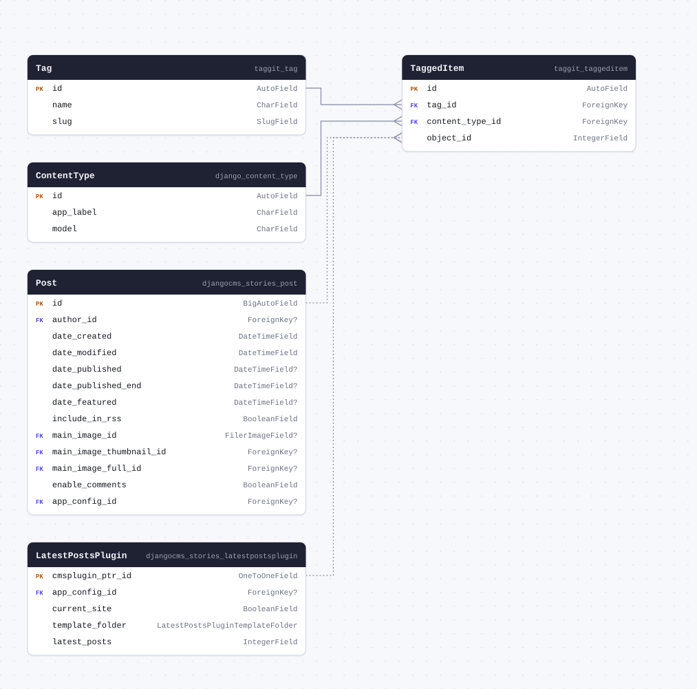

| Column | Field | Type | Null | Key | Default | Description |
| --- | --- | --- | --- | --- | --- | --- |
| `id` | `AutoField` | `integer` |  | PK | `autoincrement()` |  |
| `tag_id` | `ForeignKey` | `integer` |  | FK |  |  |
| `content_type_id` | `ForeignKey` | `integer` |  | FK |  |  |
| `object_id` | `IntegerField` | `integer` |  |  |  |  |

Indexes:

- index `taggit_taggeditem_tag_id_f4f5b767` on `tag_id`
- index `taggit_taggeditem_content_type_id_9957a03c` on `content_type_id`
- index `taggit_taggeditem_object_id_e2d7d1df` on `object_id`
- unique `taggit_taggeditem_content_type_id_object_id_tag_id_4bb97a8e_uniq` on `content_type_id`, `object_id`, `tag_id`
- index `taggit_tagg_content_8fc721_idx` on `content_type_id`, `object_id`

Relations:

- `content_object` → any model, by `content_type_id` + `object_id` (generic foreign key)
- `tag_id` → [Tag](#tag).`id`, on delete cascade
- `content_type_id` → [ContentType](#contenttype).`id`, on delete cascade
- `object_id` → [Post](#post).`id` where `content_type_id` is Post (generic, `Post.tagged_items`)
- `object_id` → [LatestPostsPlugin](#latestpostsplugin).`cmsplugin_ptr_id` where `content_type_id` is LatestPostsPlugin (generic, `LatestPostsPlugin.tagged_items`)

## StoriesConfigTranslation

Table `djangocms_stories_storiesconfig_translation`, app `djangocms_stories`.

Columns from `TranslatedFieldsModel` (abstract): `language_code`.

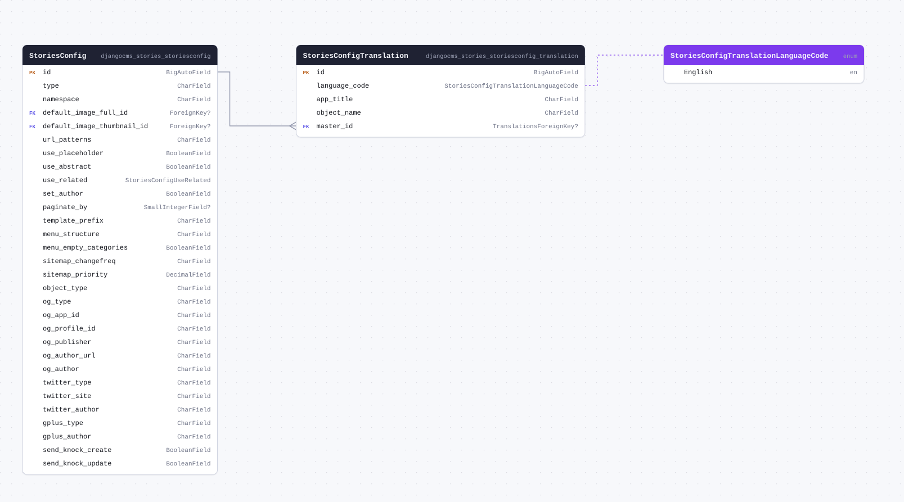

| Column | Field | Type | Null | Key | Default | Description |
| --- | --- | --- | --- | --- | --- | --- |
| `id` | `BigAutoField` | `integer` |  | PK | `autoincrement()` |  |
| `language_code` | `StoriesConfigTranslationLanguageCode` | `varchar(15)` |  |  |  |  |
| `app_title` | `CharField` | `varchar(200)` |  |  | `'+'` |  |
| `object_name` | `CharField` | `varchar(200)` |  |  | `'+'` |  |
| `master_id` | `TranslationsForeignKey` | `bigint` | yes | FK |  |  |

Indexes:

- index `djangocms_stories_storiesconfig_translation_language_code_bb06c9ed` on `language_code`
- index `djangocms_stories_storiesconfig_translation_master_id_a155f9ca` on `master_id`
- unique `djangocms_stories_storiesc6510` on `language_code`, `master_id`

Relations:

- `master_id` → [StoriesConfig](#storiesconfig).`id`, on delete cascade

## StoriesConfig

Table `djangocms_stories_storiesconfig`, app `djangocms_stories`.

Class representing a stories configuration.

This class inherits from TranslatableModel.

Attributes:
    type (models.CharField): Represents the type of the stories config.
    namespace (models.CharField): Represents the namespace of the instance.
    translations (TranslatedFields): Represents the translated fields of the stories config.
    default_image_full (models.ForeignKey): Represents the default size of full images.
    default_image_thumbnail (models.ForeignKey): Represents the default size of thumbnail images.
    url_patterns (models.CharField): Represents the structure of permalinks.
    use_placeholder (models.BooleanField): Represents whether to use placeholder and plugins for article body.
    use_abstract (models.BooleanField): Represents whether to use abstract field.
    use_related (models.SmallIntegerField): Represents whether to enable related posts.
    urlconf (models.CharField): Represents the URL config.
    set_author (models.BooleanField): Represents whether to set author by default.
    paginate_by (models.SmallIntegerField): Represents the number of articles per page for pagination.
    template_prefix (models.CharField): Represents the alternative directory to load the stories templates from.
    menu_structure (models.CharField): Represents the menu structure.
    menu_empty_categories (models.BooleanField): Represents whether to show empty categories in menu.
    sitemap_changefreq (models.CharField): Represents the changefreq attribute for sitemap items.
    sitemap_priority (models.DecimalField): Represents the priority attribute for sitemap items.
    object_type (models.CharField): Represents the object type.
    og_type (models.CharField): Represents the Facebook type.
    og_app_id (models.CharField): Represents the Facebook application ID.
    og_profile_id (models.CharField): Represents the Facebook profile ID.
    og_publisher (models.CharField): Represents the Facebook page URL.
    og_author_url (models.CharField): Represents the Facebook author URL.
    og_author (models.CharField): Represents the Facebook author.
    twitter_type (models.CharField): Represents the Twitter type field.
    twitter_site (models.CharField): Represents the Twitter site handle.
    twitter_author (models.CharField): Represents the Twitter author handle.
    gplus_type (models.CharField): Represents the Schema.org object type.
    gplus_author (models.CharField): Represents the Schema.org author name abstract field.

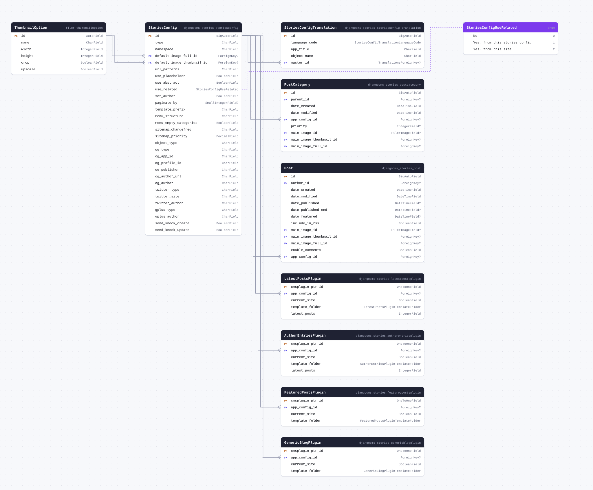

| Column | Field | Type | Null | Key | Default | Description |
| --- | --- | --- | --- | --- | --- | --- |
| `id` | `BigAutoField` | `integer` |  | PK | `autoincrement()` |  |
| `type` | `CharField` | `varchar(100)` |  |  |  |  |
| `namespace` | `CharField` | `varchar(100)` |  | unique | `None` |  |
| `default_image_full_id` | `ForeignKey` | `integer` | yes | FK |  | If left empty the image size will have to be set for every newly created post. |
| `default_image_thumbnail_id` | `ForeignKey` | `integer` | yes | FK |  | If left empty the thumbnail image size will have to be set for every newly created post. |
| `url_patterns` | `CharField` | `varchar(12)` |  |  |  |  |
| `use_placeholder` | `BooleanField` | `bool` |  |  | `True` |  |
| `use_abstract` | `BooleanField` | `bool` |  |  | `True` |  |
| `use_related` | `StoriesConfigUseRelated` | `smallint` |  |  | `1` |  |
| `set_author` | `BooleanField` | `bool` |  |  |  |  |
| `paginate_by` | `SmallIntegerField` | `smallint` | yes |  |  | When paginating list views, how many articles per page? |
| `template_prefix` | `CharField` | `varchar(200)` |  |  | `''` | Alternative directory to load the stories templates from |
| `menu_structure` | `CharField` | `varchar(200)` |  |  |  | Structure of the django CMS menu |
| `menu_empty_categories` | `BooleanField` | `bool` |  |  |  | Show categories with no post attached in the menu |
| `sitemap_changefreq` | `CharField` | `varchar(12)` |  |  |  | Changefreq attribute for sitemap items |
| `sitemap_priority` | `DecimalField(5, 3)` | `decimal` |  |  |  | Priority attribute for sitemap items |
| `object_type` | `CharField` | `varchar(200)` |  |  |  |  |
| `og_type` | `CharField` | `varchar(200)` |  |  |  |  |
| `og_app_id` | `CharField` | `varchar(200)` |  |  |  |  |
| `og_profile_id` | `CharField` | `varchar(200)` |  |  |  |  |
| `og_publisher` | `CharField` | `varchar(200)` |  |  |  |  |
| `og_author_url` | `CharField` | `varchar(200)` |  |  |  |  |
| `og_author` | `CharField` | `varchar(200)` |  |  |  |  |
| `twitter_type` | `CharField` | `varchar(200)` |  |  |  |  |
| `twitter_site` | `CharField` | `varchar(200)` |  |  |  |  |
| `twitter_author` | `CharField` | `varchar(200)` |  |  |  |  |
| `gplus_type` | `CharField` | `varchar(200)` |  |  |  |  |
| `gplus_author` | `CharField` | `varchar(200)` |  |  |  |  |
| `send_knock_create` | `BooleanField` | `bool` |  |  | `False` | Emits a desktop notification -if enabled- when publishing a new post |
| `send_knock_update` | `BooleanField` | `bool` |  |  | `False` | Emits a desktop notification -if enabled- when editing a published post |

Indexes:

- index `djangocms_stories_storiesconfig_default_image_full_id_ea7695a2` on `default_image_full_id`
- index `djangocms_stories_storiesconfig_default_image_thumbnail_id_385281b3` on `default_image_thumbnail_id`

Relations:

- [StoriesConfigTranslation](#storiesconfigtranslation).`master_id` → `id`, on delete cascade
- `default_image_full_id` → [ThumbnailOption](#thumbnailoption).`id`, on delete set null
- `default_image_thumbnail_id` → [ThumbnailOption](#thumbnailoption).`id`, on delete set null
- [PostCategory](#postcategory).`app_config_id` → `id`, on delete cascade
- [Post](#post).`app_config_id` → `id`, on delete cascade
- [LatestPostsPlugin](#latestpostsplugin).`app_config_id` → `id`, on delete cascade
- [AuthorEntriesPlugin](#authorentriesplugin).`app_config_id` → `id`, on delete cascade
- [FeaturedPostsPlugin](#featuredpostsplugin).`app_config_id` → `id`, on delete cascade
- [GenericBlogPlugin](#genericblogplugin).`app_config_id` → `id`, on delete cascade

## PostCategoryTranslation

Table `djangocms_stories_postcategory_translation`, app `djangocms_stories`.

Columns from `TranslatedFieldsModel` (abstract): `language_code`.

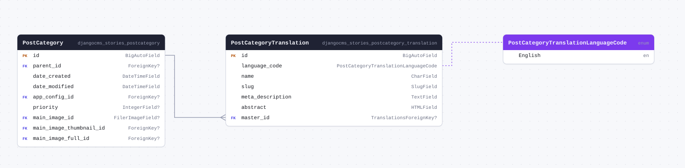

| Column | Field | Type | Null | Key | Default | Description |
| --- | --- | --- | --- | --- | --- | --- |
| `id` | `BigAutoField` | `integer` |  | PK | `autoincrement()` |  |
| `language_code` | `PostCategoryTranslationLanguageCode` | `varchar(15)` |  |  |  |  |
| `name` | `CharField` | `varchar(752)` |  |  |  |  |
| `slug` | `SlugField` | `varchar(752)` |  |  |  |  |
| `meta_description` | `TextField` | `text` |  |  | `''` |  |
| `abstract` | `HTMLField` | `text` |  |  | `''` |  |
| `master_id` | `TranslationsForeignKey` | `bigint` | yes | FK |  |  |

Indexes:

- index `djangocms_stories_postcategory_translation_language_code_05aeadc6` on `language_code`
- index `djangocms_stories_postcategory_translation_slug_aa73b4f6` on `slug`
- index `djangocms_stories_postcategory_translation_master_id_920bc899` on `master_id`
- unique `djangocms_stories_postcategory_translation_language_code_slug_6690704b_uniq` on `language_code`, `slug`
- unique `djangocms_stories_postcate81fa` on `language_code`, `master_id`

Relations:

- `master_id` → [PostCategory](#postcategory).`id`, on delete cascade

## PostCategory

Table `djangocms_stories_postcategory`, app `djangocms_stories`.

Post category allows to structure content in a hierarchy of categories.

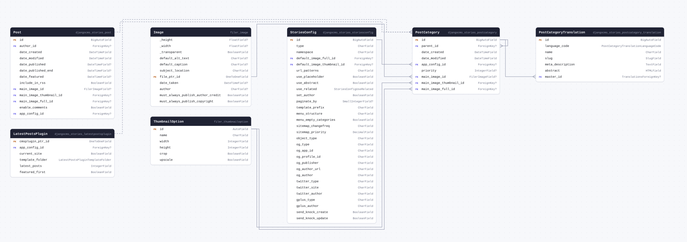

| Column | Field | Type | Null | Key | Default | Description |
| --- | --- | --- | --- | --- | --- | --- |
| `id` | `BigAutoField` | `integer` |  | PK | `autoincrement()` |  |
| `parent_id` | `ForeignKey` | `bigint` | yes | FK |  |  |
| `date_created` | `DateTimeField` | `datetime` |  |  | `now()` |  |
| `date_modified` | `DateTimeField` | `datetime` |  |  | `now()` |  |
| `app_config_id` | `ForeignKey` | `bigint` | yes | FK |  | When selecting a value, the form is reloaded to get the updated default |
| `priority` | `IntegerField` | `integer` | yes |  |  |  |
| `main_image_id` | `FilerImageField` | `integer` | yes | FK |  |  |
| `main_image_thumbnail_id` | `ForeignKey` | `integer` | yes | FK |  |  |
| `main_image_full_id` | `ForeignKey` | `integer` | yes | FK |  |  |

Indexes:

- index `djangocms_stories_postcategory_parent_id_a6fdc19d` on `parent_id`
- index `djangocms_stories_postcategory_app_config_id_9a18161e` on `app_config_id`
- index `djangocms_stories_postcategory_main_image_id_a48ad63a` on `main_image_id`
- index `djangocms_stories_postcategory_main_image_thumbnail_id_bc1e4b19` on `main_image_thumbnail_id`
- index `djangocms_stories_postcategory_main_image_full_id_6d97b292` on `main_image_full_id`

Relations:

- [PostCategoryTranslation](#postcategorytranslation).`master_id` → `id`, on delete cascade
- `parent_id` → [PostCategory](#postcategory).`id`, on delete cascade
- `app_config_id` → [StoriesConfig](#storiesconfig).`id`, on delete cascade
- `main_image_id` → [Image](#image).`file_ptr_id`, on delete set null
- `main_image_thumbnail_id` → [ThumbnailOption](#thumbnailoption).`id`, on delete set null
- `main_image_full_id` → [ThumbnailOption](#thumbnailoption).`id`, on delete set null
- `posts` — many to many with [Post](#post)
- `latestpostsplugin_set` — many to many with [LatestPostsPlugin](#latestpostsplugin)

## Post

Table `djangocms_stories_post`, app `djangocms_stories`.

Represents a blog post or story entry with multilingual content, images, categories, tags, and publication metadata.
It is the "grouper model" for :class:`PostContent`.

This model supports translation, site-specific publishing, image handling, tagging, and flexible URL generation for posts.

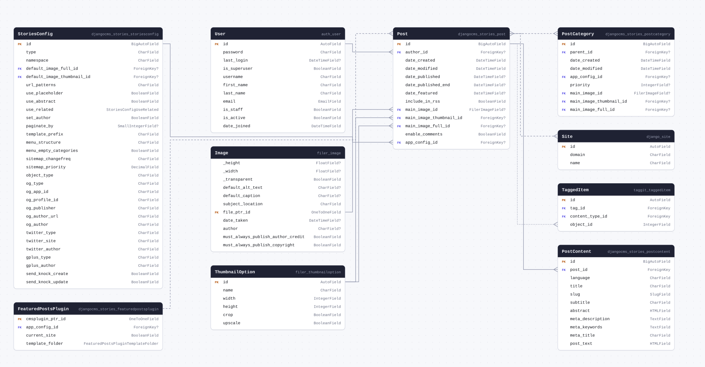

| Column | Field | Type | Null | Key | Default | Description |
| --- | --- | --- | --- | --- | --- | --- |
| `id` | `BigAutoField` | `integer` |  | PK | `autoincrement()` |  |
| `author_id` | `ForeignKey` | `integer` | yes | FK |  |  |
| `date_created` | `DateTimeField` | `datetime` |  |  | `now()` |  |
| `date_modified` | `DateTimeField` | `datetime` |  |  | `now()` |  |
| `date_published` | `DateTimeField` | `datetime` | yes |  |  |  |
| `date_published_end` | `DateTimeField` | `datetime` | yes |  |  |  |
| `date_featured` | `DateTimeField` | `datetime` | yes |  |  | Featured posts are listed before other posts, most recently featured first. Leave empty for regular order by date, or set a future date to feature the post from that date on. |
| `include_in_rss` | `BooleanField` | `bool` |  |  | `True` |  |
| `main_image_id` | `FilerImageField` | `integer` | yes | FK |  |  |
| `main_image_thumbnail_id` | `ForeignKey` | `integer` | yes | FK |  |  |
| `main_image_full_id` | `ForeignKey` | `integer` | yes | FK |  |  |
| `enable_comments` | `BooleanField` | `bool` |  |  | `True` |  |
| `app_config_id` | `ForeignKey` | `bigint` | yes | FK |  | When selecting a value, the form is reloaded to get the updated default |

Indexes:

- index `djangocms_stories_post_author_id_6036105b` on `author_id`
- index `djangocms_stories_post_main_image_id_67803bda` on `main_image_id`
- index `djangocms_stories_post_main_image_thumbnail_id_4b7a78cd` on `main_image_thumbnail_id`
- index `djangocms_stories_post_main_image_full_id_03c6ec6c` on `main_image_full_id`
- index `djangocms_stories_post_app_config_id_079a5426` on `app_config_id`

Relations:

- `tags` — many to many with [Tag](#tag), through [TaggedItem](#taggeditem)
- `author_id` → [User](#user).`id`, on delete protect
- `main_image_id` → [Image](#image).`file_ptr_id`, on delete set null
- `main_image_thumbnail_id` → [ThumbnailOption](#thumbnailoption).`id`, on delete set null
- `main_image_full_id` → [ThumbnailOption](#thumbnailoption).`id`, on delete set null
- `app_config_id` → [StoriesConfig](#storiesconfig).`id`, on delete cascade
- `categories` — many to many with [PostCategory](#postcategory)
- `sites` — many to many with [Site](#site)
- `related` — many to many with [Post](#post)
- `tagged_items` ← [TaggedItem](#taggeditem), by `content_type_id` + `object_id` (generic relation)
- [PostContent](#postcontent).`post_id` → `id`, on delete cascade
- `featuredpostsplugin_set` — many to many with [FeaturedPostsPlugin](#featuredpostsplugin)

## PostContent

Table `djangocms_stories_postcontent`, app `djangocms_stories`.

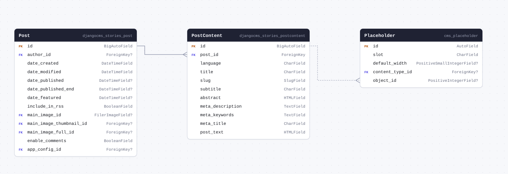

| Column | Field | Type | Null | Key | Default | Description |
| --- | --- | --- | --- | --- | --- | --- |
| `id` | `BigAutoField` | `integer` |  | PK | `autoincrement()` |  |
| `post_id` | `ForeignKey` | `bigint` |  | FK |  |  |
| `language` | `CharField` | `varchar(15)` |  |  |  |  |
| `title` | `CharField` | `varchar(752)` |  |  |  |  |
| `slug` | `SlugField` | `varchar(752)` |  |  |  |  |
| `subtitle` | `CharField` | `varchar(767)` |  |  | `''` |  |
| `abstract` | `HTMLField` | `text` |  |  | `''` |  |
| `meta_description` | `TextField` | `text` |  |  | `''` |  |
| `meta_keywords` | `TextField` | `text` |  |  | `''` |  |
| `meta_title` | `CharField` | `varchar(2000)` |  |  | `''` | used in title tag and social sharing |
| `post_text` | `HTMLField` | `text` |  |  | `''` |  |

Indexes:

- index `djangocms_stories_postcontent_post_id_f335a3f1` on `post_id`
- index `djangocms_stories_postcontent_language_780f2d2a` on `language`
- index `djangocms_stories_postcontent_slug_c3594184` on `slug`

Relations:

- `post_id` → [Post](#post).`id`, on delete cascade
- `placeholders` ← [Placeholder](#placeholder), by `content_type_id` + `object_id` (generic relation)

## LatestPostsPlugin

Table `djangocms_stories_latestpostsplugin`, app `djangocms_stories`.

Inherits from [CMSPlugin](#cmsplugin) (multi-table): its rows are joined on `cmsplugin_ptr_id`.

Columns from `BasePostPlugin` (abstract): `cmsplugin_ptr_id`, `app_config_id`, `current_site`, `template_folder`.

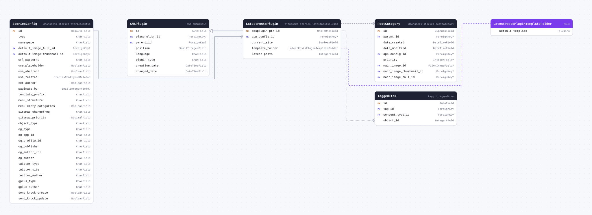

| Column | Field | Type | Null | Key | Default | Description |
| --- | --- | --- | --- | --- | --- | --- |
| `cmsplugin_ptr_id` | `OneToOneField` | `integer` |  | PK, FK |  |  |
| `app_config_id` | `ForeignKey` | `bigint` | yes | FK |  | When selecting a value, the form is reloaded to get the updated default |
| `current_site` | `BooleanField` | `bool` |  |  | `True` | Select items from the current site only |
| `template_folder` | `LatestPostsPluginTemplateFolder` | `varchar(200)` |  |  | `'plugins'` | Select plugin layout to load for this instance |
| `latest_posts` | `IntegerField` | `integer` |  |  | `5` | The number of latests entries to be displayed. |
| `featured_first` | `BooleanField` | `bool` |  |  | `True` | List featured posts before recent ones. Careful: if you feature as many posts as this plugin shows, no recent post will be displayed any more. |

Indexes:

- index `djangocms_stories_latestpostsplugin_app_config_id_6a5c2121` on `app_config_id`

Relations:

- `tags` — many to many with [Tag](#tag), through [TaggedItem](#taggeditem)
- `cmsplugin_ptr_id` → [CMSPlugin](#cmsplugin).`id`, parent link, on delete cascade
- `app_config_id` → [StoriesConfig](#storiesconfig).`id`, on delete cascade
- `categories` — many to many with [PostCategory](#postcategory)
- `tagged_items` ← [TaggedItem](#taggeditem), by `content_type_id` + `object_id` (generic relation)

## AuthorEntriesPlugin

Table `djangocms_stories_authorentriesplugin`, app `djangocms_stories`.

Inherits from [CMSPlugin](#cmsplugin) (multi-table): its rows are joined on `cmsplugin_ptr_id`.

Columns from `BasePostPlugin` (abstract): `cmsplugin_ptr_id`, `app_config_id`, `current_site`, `template_folder`.

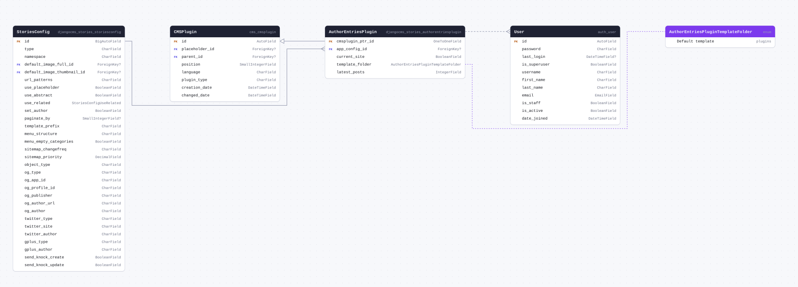

| Column | Field | Type | Null | Key | Default | Description |
| --- | --- | --- | --- | --- | --- | --- |
| `cmsplugin_ptr_id` | `OneToOneField` | `integer` |  | PK, FK |  |  |
| `app_config_id` | `ForeignKey` | `bigint` | yes | FK |  | When selecting a value, the form is reloaded to get the updated default |
| `current_site` | `BooleanField` | `bool` |  |  | `True` | Select items from the current site only |
| `template_folder` | `AuthorEntriesPluginTemplateFolder` | `varchar(200)` |  |  | `'plugins'` | Select plugin layout to load for this instance |
| `latest_posts` | `IntegerField` | `integer` |  |  | `5` | The number of author entries to be displayed. |

Indexes:

- index `djangocms_stories_authorentriesplugin_app_config_id_294d05dd` on `app_config_id`

Relations:

- `cmsplugin_ptr_id` → [CMSPlugin](#cmsplugin).`id`, parent link, on delete cascade
- `app_config_id` → [StoriesConfig](#storiesconfig).`id`, on delete cascade
- `authors` — many to many with [User](#user)

## FeaturedPostsPlugin

Table `djangocms_stories_featuredpostsplugin`, app `djangocms_stories`.

Inherits from [CMSPlugin](#cmsplugin) (multi-table): its rows are joined on `cmsplugin_ptr_id`.

Columns from `BasePostPlugin` (abstract): `cmsplugin_ptr_id`, `app_config_id`, `current_site`, `template_folder`.

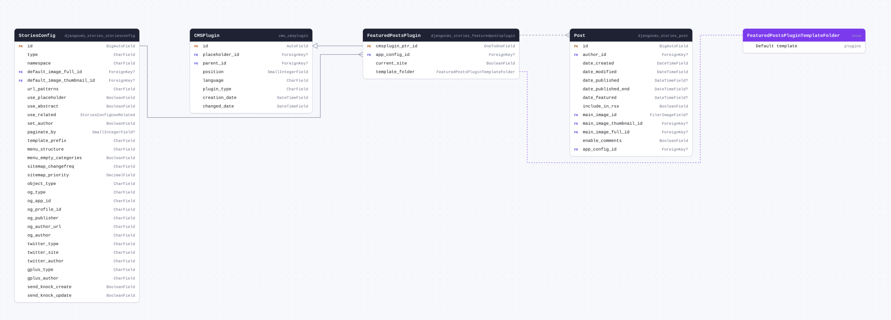

| Column | Field | Type | Null | Key | Default | Description |
| --- | --- | --- | --- | --- | --- | --- |
| `cmsplugin_ptr_id` | `OneToOneField` | `integer` |  | PK, FK |  |  |
| `app_config_id` | `ForeignKey` | `bigint` | yes | FK |  | When selecting a value, the form is reloaded to get the updated default |
| `current_site` | `BooleanField` | `bool` |  |  | `True` | Select items from the current site only |
| `template_folder` | `FeaturedPostsPluginTemplateFolder` | `varchar(200)` |  |  | `'plugins'` | Select plugin layout to load for this instance |

Indexes:

- index `djangocms_stories_featuredpostsplugin_app_config_id_56b763cf` on `app_config_id`

Relations:

- `cmsplugin_ptr_id` → [CMSPlugin](#cmsplugin).`id`, parent link, on delete cascade
- `app_config_id` → [StoriesConfig](#storiesconfig).`id`, on delete cascade
- `posts` — many to many with [Post](#post)

## GenericBlogPlugin

Table `djangocms_stories_genericblogplugin`, app `djangocms_stories`.

Inherits from [CMSPlugin](#cmsplugin) (multi-table): its rows are joined on `cmsplugin_ptr_id`.

Columns from `BasePostPlugin` (abstract): `cmsplugin_ptr_id`, `app_config_id`, `current_site`, `template_folder`.

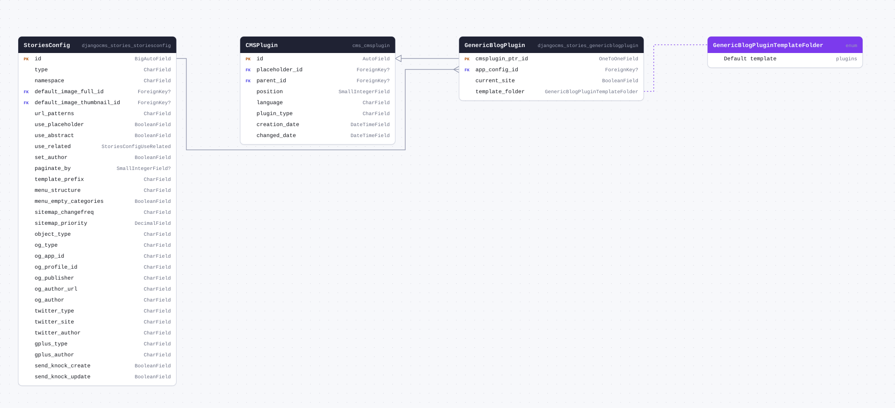

| Column | Field | Type | Null | Key | Default | Description |
| --- | --- | --- | --- | --- | --- | --- |
| `cmsplugin_ptr_id` | `OneToOneField` | `integer` |  | PK, FK |  |  |
| `app_config_id` | `ForeignKey` | `bigint` | yes | FK |  | When selecting a value, the form is reloaded to get the updated default |
| `current_site` | `BooleanField` | `bool` |  |  | `True` | Select items from the current site only |
| `template_folder` | `GenericBlogPluginTemplateFolder` | `varchar(200)` |  |  | `'plugins'` | Select plugin layout to load for this instance |

Indexes:

- index `djangocms_stories_genericblogplugin_app_config_id_8634394b` on `app_config_id`

Relations:

- `cmsplugin_ptr_id` → [CMSPlugin](#cmsplugin).`id`, parent link, on delete cascade
- `app_config_id` → [StoriesConfig](#storiesconfig).`id`, on delete cascade

# Enums

## LogEntryActionFlag

| Name | Stored as |
| --- | --- |
| `Addition` | `1` |
| `Change` | `2` |
| `Deletion` | `3` |

## UserSettingsLanguage

| Name | Stored as |
| --- | --- |
| `English` | `en` |

## PagePermissionGrantOn

| Name | Stored as |
| --- | --- |
| `Current page` | `1` |
| `Page children (immediate)` | `2` |
| `Page and children (immediate)` | `3` |
| `Page descendants` | `4` |
| `Page and descendants` | `5` |

## PageContentLimitVisibilityInMenu

| Name | Stored as |
| --- | --- |
| `no limit set` | `None` |
| `for logged in users only` | `1` |
| `for anonymous users only` | `2` |

## PageContentXframeOptions

| Name | Stored as |
| --- | --- |
| `Inherit from parent page` | `0` |
| `Deny` | `1` |
| `Only this website` | `2` |
| `Allow` | `3` |

## FolderPermissionType

| Name | Stored as |
| --- | --- |
| `all items` | `0` |
| `this item only` | `1` |
| `this item and all children` | `2` |

## FolderPermissionCanRead

| Name | Stored as |
| --- | --- |
| `inherit` | `None` |
| `allow` | `1` |
| `deny` | `0` |

## FolderPermissionCanEdit

| Name | Stored as |
| --- | --- |
| `inherit` | `None` |
| `allow` | `1` |
| `deny` | `0` |

## FolderPermissionCanAddChildren

| Name | Stored as |
| --- | --- |
| `inherit` | `None` |
| `allow` | `1` |
| `deny` | `0` |

## StoriesConfigTranslationLanguageCode

| Name | Stored as |
| --- | --- |
| `English` | `en` |

## StoriesConfigUseRelated

| Name | Stored as |
| --- | --- |
| `No` | `0` |
| `Yes, from this stories config` | `1` |
| `Yes, from this site` | `2` |

## PostCategoryTranslationLanguageCode

| Name | Stored as |
| --- | --- |
| `English` | `en` |

## LatestPostsPluginTemplateFolder

| Name | Stored as |
| --- | --- |
| `Default template` | `plugins` |

## AuthorEntriesPluginTemplateFolder

| Name | Stored as |
| --- | --- |
| `Default template` | `plugins` |

## FeaturedPostsPluginTemplateFolder

| Name | Stored as |
| --- | --- |
| `Default template` | `plugins` |

## GenericBlogPluginTemplateFolder

| Name | Stored as |
| --- | --- |
| `Default template` | `plugins` |
