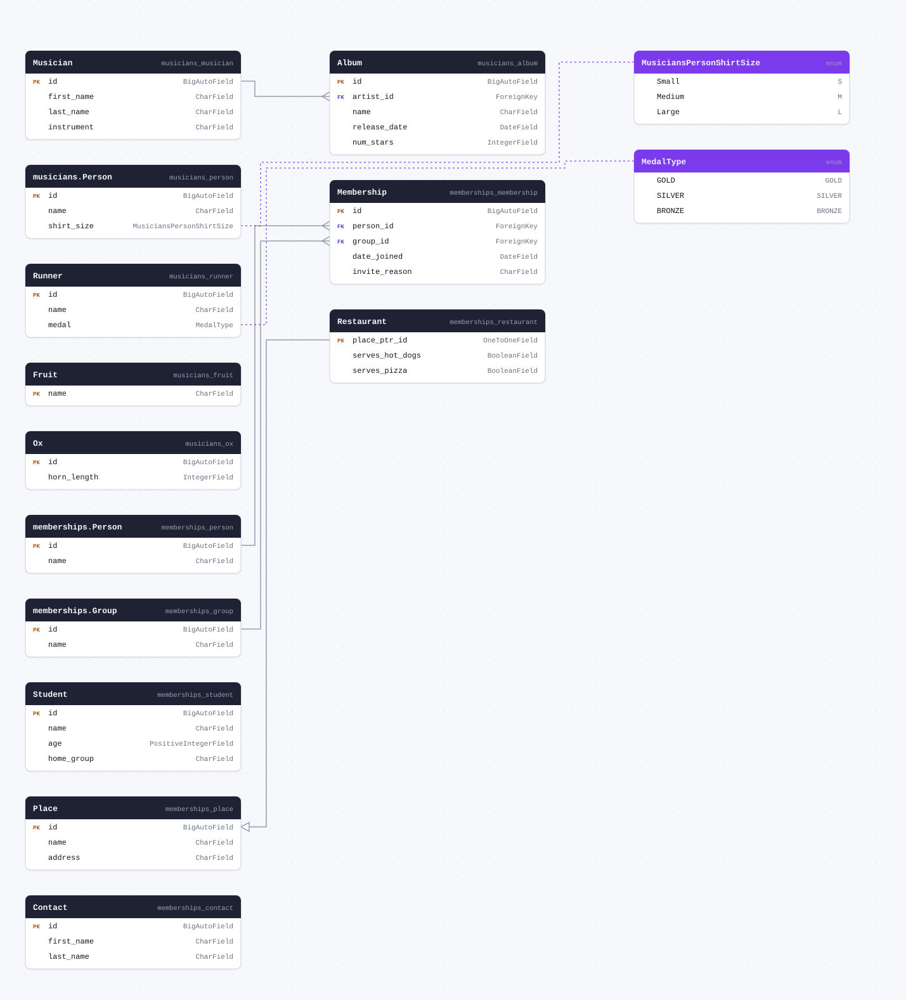
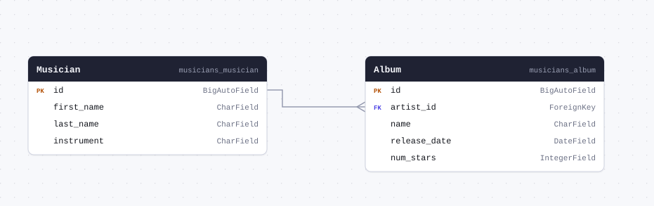
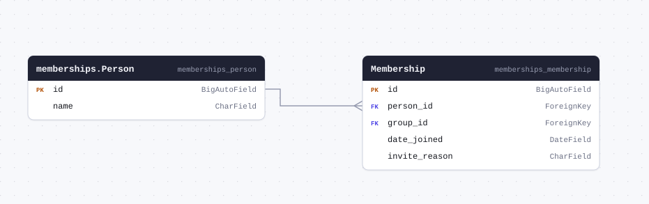
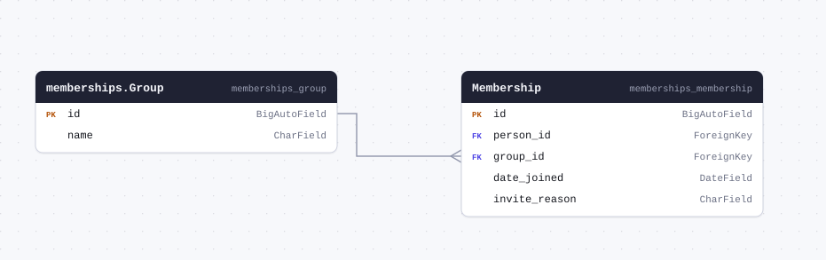
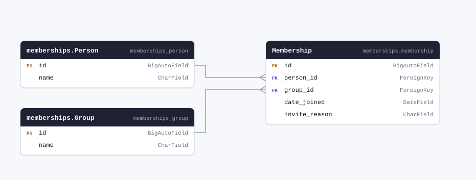
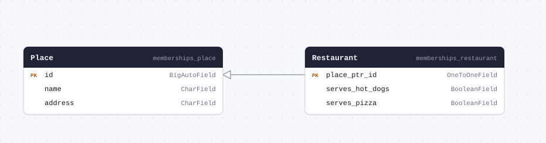

# Schema docs



[Musician](#musician) · [Album](#album) · [musicians.Person](#musiciansperson) · [Runner](#runner) · [Fruit](#fruit) · [Ox](#ox) · [memberships.Person](#membershipsperson) · [memberships.Group](#membershipsgroup) · [Membership](#membership) · [Student](#student) · [Place](#place) · [Restaurant](#restaurant) · [Contact](#contact)

<details>
<summary>The whole schema as SQL</summary>

```sql
CREATE TABLE "musicians_musician" ("id" integer NOT NULL PRIMARY KEY AUTOINCREMENT, "first_name" varchar(50) NOT NULL, "last_name" varchar(50) NOT NULL, "instrument" varchar(100) NOT NULL);

CREATE TABLE "musicians_album" ("id" integer NOT NULL PRIMARY KEY AUTOINCREMENT, "artist_id" bigint NOT NULL REFERENCES "musicians_musician" ("id") DEFERRABLE INITIALLY DEFERRED, "name" varchar(100) NOT NULL, "release_date" date NOT NULL, "num_stars" integer NOT NULL);

CREATE TABLE "musicians_person" ("id" integer NOT NULL PRIMARY KEY AUTOINCREMENT, "name" varchar(60) NOT NULL, "shirt_size" varchar(1) NOT NULL);

CREATE TABLE "musicians_runner" ("id" integer NOT NULL PRIMARY KEY AUTOINCREMENT, "name" varchar(60) NOT NULL, "medal" varchar(10) NOT NULL);

CREATE TABLE "musicians_fruit" ("name" varchar(100) NOT NULL PRIMARY KEY);

CREATE TABLE "musicians_ox" ("id" integer NOT NULL PRIMARY KEY AUTOINCREMENT, "horn_length" integer NOT NULL);

CREATE TABLE "memberships_person" ("id" integer NOT NULL PRIMARY KEY AUTOINCREMENT, "name" varchar(128) NOT NULL);

CREATE TABLE "memberships_group" ("id" integer NOT NULL PRIMARY KEY AUTOINCREMENT, "name" varchar(128) NOT NULL);

CREATE TABLE "memberships_membership" ("id" integer NOT NULL PRIMARY KEY AUTOINCREMENT, "person_id" bigint NOT NULL REFERENCES "memberships_person" ("id") DEFERRABLE INITIALLY DEFERRED, "group_id" bigint NOT NULL REFERENCES "memberships_group" ("id") DEFERRABLE INITIALLY DEFERRED, "date_joined" date NOT NULL, "invite_reason" varchar(64) NOT NULL);

CREATE TABLE "memberships_student" ("id" integer NOT NULL PRIMARY KEY AUTOINCREMENT, "name" varchar(100) NOT NULL, "age" integer unsigned NOT NULL CHECK ("age" >= 0), "home_group" varchar(5) NOT NULL);

CREATE TABLE "memberships_place" ("id" integer NOT NULL PRIMARY KEY AUTOINCREMENT, "name" varchar(50) NOT NULL, "address" varchar(80) NOT NULL);

CREATE TABLE "memberships_restaurant" ("place_ptr_id" bigint NOT NULL PRIMARY KEY REFERENCES "memberships_place" ("id") DEFERRABLE INITIALLY DEFERRED, "serves_hot_dogs" bool NOT NULL, "serves_pizza" bool NOT NULL);

CREATE TABLE "memberships_contact" ("id" integer NOT NULL PRIMARY KEY AUTOINCREMENT, "first_name" varchar(30) NOT NULL, "last_name" varchar(30) NOT NULL);

CREATE INDEX "musicians_album_artist_id_2c564cf3" ON "musicians_album" ("artist_id");

CREATE INDEX "memberships_membership_person_id_88a4ec61" ON "memberships_membership" ("person_id");

CREATE INDEX "memberships_membership_group_id_8fc7e0f8" ON "memberships_membership" ("group_id");
```

</details>

## Musician

Table `musicians_musician`, app `musicians`.



| Column | Field | Type | Null | Key | Default | Description |
| --- | --- | --- | --- | --- | --- | --- |
| `id` | `BigAutoField` | `integer` |  | PK | `autoincrement()` |  |
| `first_name` | `CharField` | `varchar(50)` |  |  |  |  |
| `last_name` | `CharField` | `varchar(50)` |  |  |  |  |
| `instrument` | `CharField` | `varchar(100)` |  |  |  |  |

Relations:

- [Album](#album).`artist_id` → `id`, on delete cascade

## Album

Table `musicians_album`, app `musicians`.


| Column | Field | Type | Null | Key | Default | Description |
| --- | --- | --- | --- | --- | --- | --- |
| `id` | `BigAutoField` | `integer` |  | PK | `autoincrement()` |  |
| `artist_id` | `ForeignKey` | `bigint` |  | FK |  |  |
| `name` | `CharField` | `varchar(100)` |  |  |  |  |
| `release_date` | `DateField` | `date` |  |  |  |  |
| `num_stars` | `IntegerField` | `integer` |  |  |  |  |

Indexes:

- index `musicians_album_artist_id_2c564cf3` on `artist_id`

Relations:

- `artist_id` → [Musician](#musician).`id`, on delete cascade

## musicians.Person

Table `musicians_person`, app `musicians`.

| Column | Field | Type | Null | Key | Default | Description |
| --- | --- | --- | --- | --- | --- | --- |
| `id` | `BigAutoField` | `integer` |  | PK | `autoincrement()` |  |
| `name` | `CharField` | `varchar(60)` |  |  |  |  |
| `shirt_size` | `MusiciansPersonShirtSize` | `varchar(1)` |  |  |  |  |

## Runner

Table `musicians_runner`, app `musicians`.

| Column | Field | Type | Null | Key | Default | Description |
| --- | --- | --- | --- | --- | --- | --- |
| `id` | `BigAutoField` | `integer` |  | PK | `autoincrement()` |  |
| `name` | `CharField` | `varchar(60)` |  |  |  |  |
| `medal` | `MedalType` | `varchar(10)` |  |  |  |  |

## Fruit

Table `musicians_fruit`, app `musicians`.

| Column | Field | Type | Null | Key | Default | Description |
| --- | --- | --- | --- | --- | --- | --- |
| `name` | `CharField` | `varchar(100)` |  | PK |  |  |

## Ox

Table `musicians_ox`, app `musicians`.

| Column | Field | Type | Null | Key | Default | Description |
| --- | --- | --- | --- | --- | --- | --- |
| `id` | `BigAutoField` | `integer` |  | PK | `autoincrement()` |  |
| `horn_length` | `IntegerField` | `integer` |  |  |  |  |

## memberships.Person

Table `memberships_person`, app `memberships`.



| Column | Field | Type | Null | Key | Default | Description |
| --- | --- | --- | --- | --- | --- | --- |
| `id` | `BigAutoField` | `integer` |  | PK | `autoincrement()` |  |
| `name` | `CharField` | `varchar(128)` |  |  |  |  |

Relations:

- `group_set` — many to many with [memberships.Group](#membershipsgroup), through [Membership](#membership)
- [Membership](#membership).`person_id` → `id`, on delete cascade

## memberships.Group

Table `memberships_group`, app `memberships`.



| Column | Field | Type | Null | Key | Default | Description |
| --- | --- | --- | --- | --- | --- | --- |
| `id` | `BigAutoField` | `integer` |  | PK | `autoincrement()` |  |
| `name` | `CharField` | `varchar(128)` |  |  |  |  |

Relations:

- `members` — many to many with [memberships.Person](#membershipsperson), through [Membership](#membership)
- [Membership](#membership).`group_id` → `id`, on delete cascade

## Membership

Table `memberships_membership`, app `memberships`.



| Column | Field | Type | Null | Key | Default | Description |
| --- | --- | --- | --- | --- | --- | --- |
| `id` | `BigAutoField` | `integer` |  | PK | `autoincrement()` |  |
| `person_id` | `ForeignKey` | `bigint` |  | FK |  |  |
| `group_id` | `ForeignKey` | `bigint` |  | FK |  |  |
| `date_joined` | `DateField` | `date` |  |  |  |  |
| `invite_reason` | `CharField` | `varchar(64)` |  |  |  |  |

Indexes:

- index `memberships_membership_person_id_88a4ec61` on `person_id`
- index `memberships_membership_group_id_8fc7e0f8` on `group_id`

Relations:

- `person_id` → [memberships.Person](#membershipsperson).`id`, on delete cascade
- `group_id` → [memberships.Group](#membershipsgroup).`id`, on delete cascade

## Student

Table `memberships_student`, app `memberships`.

Columns from `CommonInfo` (abstract): `name`, `age`.

| Column | Field | Type | Null | Key | Default | Description |
| --- | --- | --- | --- | --- | --- | --- |
| `id` | `BigAutoField` | `integer` |  | PK | `autoincrement()` |  |
| `name` | `CharField` | `varchar(100)` |  |  |  |  |
| `age` | `PositiveIntegerField` | `integer unsigned` |  |  |  |  |
| `home_group` | `CharField` | `varchar(5)` |  |  |  |  |

## Place

Table `memberships_place`, app `memberships`.

Subclasses (multi-table): [Restaurant](#restaurant).


| Column | Field | Type | Null | Key | Default | Description |
| --- | --- | --- | --- | --- | --- | --- |
| `id` | `BigAutoField` | `integer` |  | PK | `autoincrement()` |  |
| `name` | `CharField` | `varchar(50)` |  |  |  |  |
| `address` | `CharField` | `varchar(80)` |  |  |  |  |

Relations:

- [Restaurant](#restaurant).`place_ptr_id` → `id`, parent link, on delete cascade

## Restaurant

Table `memberships_restaurant`, app `memberships`.

Inherits from [Place](#place) (multi-table): its rows are joined on `place_ptr_id`.



| Column | Field | Type | Null | Key | Default | Description |
| --- | --- | --- | --- | --- | --- | --- |
| `place_ptr_id` | `OneToOneField` | `bigint` |  | PK, FK |  |  |
| `serves_hot_dogs` | `BooleanField` | `bool` |  |  | `False` |  |
| `serves_pizza` | `BooleanField` | `bool` |  |  | `False` |  |

Relations:

- `place_ptr_id` → [Place](#place).`id`, parent link, on delete cascade

## Contact

Table `memberships_contact`, app `memberships`.

Proxy models, on this table: `OrderedContact`.

| Column | Field | Type | Null | Key | Default | Description |
| --- | --- | --- | --- | --- | --- | --- |
| `id` | `BigAutoField` | `integer` |  | PK | `autoincrement()` |  |
| `first_name` | `CharField` | `varchar(30)` |  |  |  |  |
| `last_name` | `CharField` | `varchar(30)` |  |  |  |  |

# Enums

## MusiciansPersonShirtSize

| Name | Stored as |
| --- | --- |
| `Small` | `S` |
| `Medium` | `M` |
| `Large` | `L` |

## MedalType

| Name | Stored as |
| --- | --- |
| `GOLD` | `GOLD` |
| `SILVER` | `SILVER` |
| `BRONZE` | `BRONZE` |
