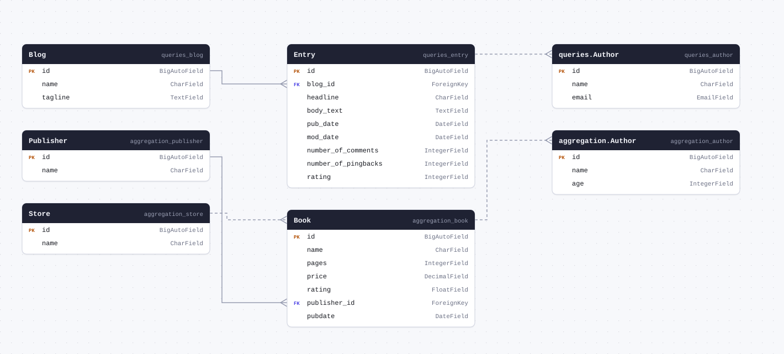
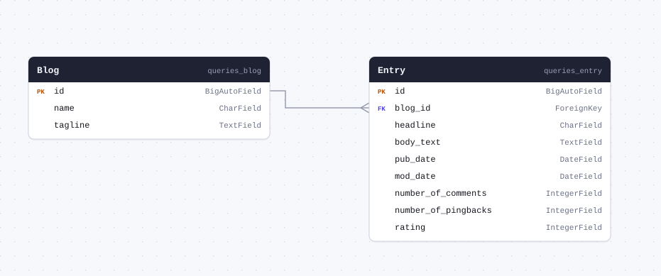
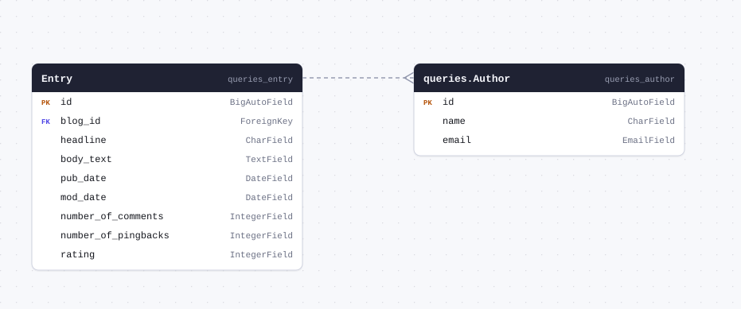
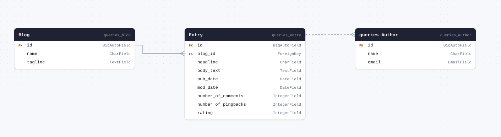
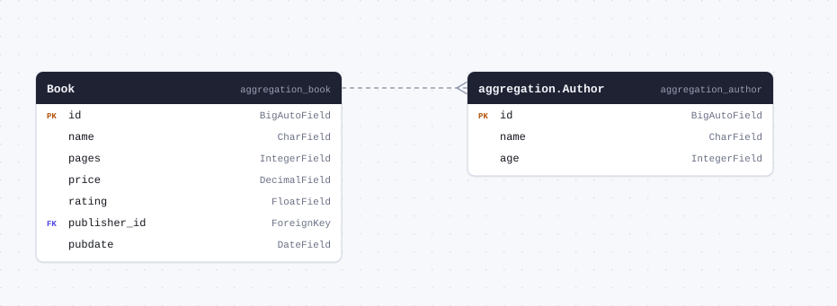
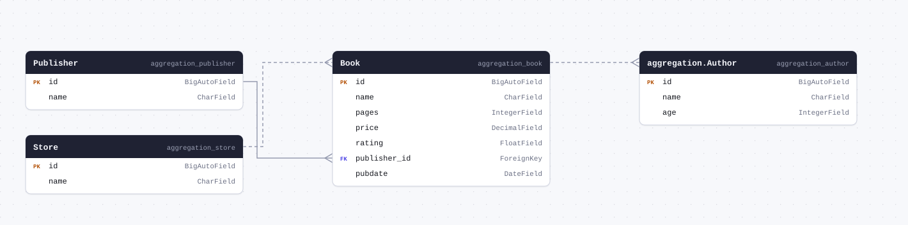
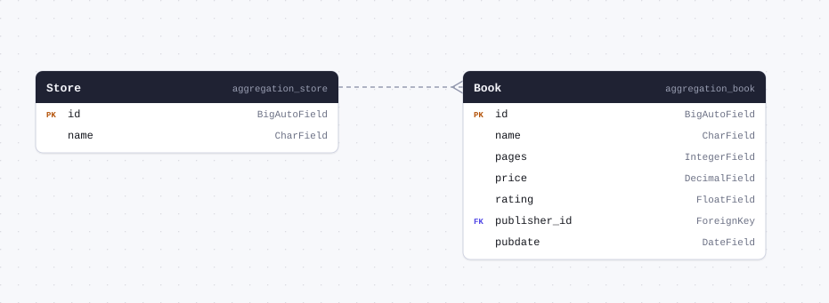

# Schema docs



[Blog](#blog) · [queries.Author](#queriesauthor) · [Entry](#entry) · [aggregation.Author](#aggregationauthor) · [Publisher](#publisher) · [Book](#book) · [Store](#store)

<details>
<summary>The whole schema as SQL</summary>

```sql
CREATE TABLE "queries_blog" ("id" integer NOT NULL PRIMARY KEY AUTOINCREMENT, "name" varchar(100) NOT NULL, "tagline" text NOT NULL);

CREATE TABLE "queries_author" ("id" integer NOT NULL PRIMARY KEY AUTOINCREMENT, "name" varchar(200) NOT NULL, "email" varchar(254) NOT NULL);

CREATE TABLE "queries_entry" ("id" integer NOT NULL PRIMARY KEY AUTOINCREMENT, "blog_id" bigint NOT NULL REFERENCES "queries_blog" ("id") DEFERRABLE INITIALLY DEFERRED, "headline" varchar(255) NOT NULL, "body_text" text NOT NULL, "pub_date" date NOT NULL, "mod_date" date NOT NULL, "number_of_comments" integer NOT NULL, "number_of_pingbacks" integer NOT NULL, "rating" integer NOT NULL);

CREATE TABLE "queries_entry_authors" ("id" integer NOT NULL PRIMARY KEY AUTOINCREMENT, "entry_id" bigint NOT NULL REFERENCES "queries_entry" ("id") DEFERRABLE INITIALLY DEFERRED, "author_id" bigint NOT NULL REFERENCES "queries_author" ("id") DEFERRABLE INITIALLY DEFERRED);

CREATE TABLE "aggregation_author" ("id" integer NOT NULL PRIMARY KEY AUTOINCREMENT, "name" varchar(100) NOT NULL, "age" integer NOT NULL);

CREATE TABLE "aggregation_publisher" ("id" integer NOT NULL PRIMARY KEY AUTOINCREMENT, "name" varchar(300) NOT NULL);

CREATE TABLE "aggregation_book" ("id" integer NOT NULL PRIMARY KEY AUTOINCREMENT, "name" varchar(300) NOT NULL, "pages" integer NOT NULL, "price" decimal NOT NULL, "rating" real NOT NULL, "publisher_id" bigint NOT NULL REFERENCES "aggregation_publisher" ("id") DEFERRABLE INITIALLY DEFERRED, "pubdate" date NOT NULL);

CREATE TABLE "aggregation_book_authors" ("id" integer NOT NULL PRIMARY KEY AUTOINCREMENT, "book_id" bigint NOT NULL REFERENCES "aggregation_book" ("id") DEFERRABLE INITIALLY DEFERRED, "author_id" bigint NOT NULL REFERENCES "aggregation_author" ("id") DEFERRABLE INITIALLY DEFERRED);

CREATE TABLE "aggregation_store" ("id" integer NOT NULL PRIMARY KEY AUTOINCREMENT, "name" varchar(300) NOT NULL);

CREATE TABLE "aggregation_store_books" ("id" integer NOT NULL PRIMARY KEY AUTOINCREMENT, "store_id" bigint NOT NULL REFERENCES "aggregation_store" ("id") DEFERRABLE INITIALLY DEFERRED, "book_id" bigint NOT NULL REFERENCES "aggregation_book" ("id") DEFERRABLE INITIALLY DEFERRED);

CREATE INDEX "queries_entry_blog_id_d507d586" ON "queries_entry" ("blog_id");

CREATE UNIQUE INDEX "queries_entry_authors_entry_id_author_id_0fe8d60f_uniq" ON "queries_entry_authors" ("entry_id", "author_id");

CREATE INDEX "queries_entry_authors_entry_id_d78bc98a" ON "queries_entry_authors" ("entry_id");

CREATE INDEX "queries_entry_authors_author_id_5ab55b77" ON "queries_entry_authors" ("author_id");

CREATE INDEX "aggregation_book_publisher_id_26a75dda" ON "aggregation_book" ("publisher_id");

CREATE UNIQUE INDEX "aggregation_book_authors_book_id_author_id_8d496b9c_uniq" ON "aggregation_book_authors" ("book_id", "author_id");

CREATE INDEX "aggregation_book_authors_book_id_e6809ff9" ON "aggregation_book_authors" ("book_id");

CREATE INDEX "aggregation_book_authors_author_id_d8daf31c" ON "aggregation_book_authors" ("author_id");

CREATE UNIQUE INDEX "aggregation_store_books_store_id_book_id_890672f6_uniq" ON "aggregation_store_books" ("store_id", "book_id");

CREATE INDEX "aggregation_store_books_store_id_6ac4a228" ON "aggregation_store_books" ("store_id");

CREATE INDEX "aggregation_store_books_book_id_c39ee38c" ON "aggregation_store_books" ("book_id");
```

</details>

## Blog

Table `queries_blog`, app `queries`.



| Column | Field | Type | Null | Key | Default | Description |
| --- | --- | --- | --- | --- | --- | --- |
| `id` | `BigAutoField` | `integer` |  | PK | `autoincrement()` |  |
| `name` | `CharField` | `varchar(100)` |  |  |  |  |
| `tagline` | `TextField` | `text` |  |  |  |  |

Relations:

- [Entry](#entry).`blog_id` → `id`, on delete cascade

## queries.Author

Table `queries_author`, app `queries`.



| Column | Field | Type | Null | Key | Default | Description |
| --- | --- | --- | --- | --- | --- | --- |
| `id` | `BigAutoField` | `integer` |  | PK | `autoincrement()` |  |
| `name` | `CharField` | `varchar(200)` |  |  |  |  |
| `email` | `EmailField` | `varchar(254)` |  |  |  |  |

Relations:

- `entry_set` — many to many with [Entry](#entry)

## Entry

Table `queries_entry`, app `queries`.



| Column | Field | Type | Null | Key | Default | Description |
| --- | --- | --- | --- | --- | --- | --- |
| `id` | `BigAutoField` | `integer` |  | PK | `autoincrement()` |  |
| `blog_id` | `ForeignKey` | `bigint` |  | FK |  |  |
| `headline` | `CharField` | `varchar(255)` |  |  |  |  |
| `body_text` | `TextField` | `text` |  |  |  |  |
| `pub_date` | `DateField` | `date` |  |  |  |  |
| `mod_date` | `DateField` | `date` |  |  | `date.today()` |  |
| `number_of_comments` | `IntegerField` | `integer` |  |  | `0` |  |
| `number_of_pingbacks` | `IntegerField` | `integer` |  |  | `0` |  |
| `rating` | `IntegerField` | `integer` |  |  | `5` |  |

Indexes:

- index `queries_entry_blog_id_d507d586` on `blog_id`

Relations:

- `blog_id` → [Blog](#blog).`id`, on delete cascade
- `authors` — many to many with [queries.Author](#queriesauthor)

## aggregation.Author

Table `aggregation_author`, app `aggregation`.



| Column | Field | Type | Null | Key | Default | Description |
| --- | --- | --- | --- | --- | --- | --- |
| `id` | `BigAutoField` | `integer` |  | PK | `autoincrement()` |  |
| `name` | `CharField` | `varchar(100)` |  |  |  |  |
| `age` | `IntegerField` | `integer` |  |  |  |  |

Relations:

- `book_set` — many to many with [Book](#book)

## Publisher

Table `aggregation_publisher`, app `aggregation`.


| Column | Field | Type | Null | Key | Default | Description |
| --- | --- | --- | --- | --- | --- | --- |
| `id` | `BigAutoField` | `integer` |  | PK | `autoincrement()` |  |
| `name` | `CharField` | `varchar(300)` |  |  |  |  |

Relations:

- [Book](#book).`publisher_id` → `id`, on delete cascade

## Book

Table `aggregation_book`, app `aggregation`.



| Column | Field | Type | Null | Key | Default | Description |
| --- | --- | --- | --- | --- | --- | --- |
| `id` | `BigAutoField` | `integer` |  | PK | `autoincrement()` |  |
| `name` | `CharField` | `varchar(300)` |  |  |  |  |
| `pages` | `IntegerField` | `integer` |  |  |  |  |
| `price` | `DecimalField(10, 2)` | `decimal` |  |  |  |  |
| `rating` | `FloatField` | `real` |  |  |  |  |
| `publisher_id` | `ForeignKey` | `bigint` |  | FK |  |  |
| `pubdate` | `DateField` | `date` |  |  |  |  |

Indexes:

- index `aggregation_book_publisher_id_26a75dda` on `publisher_id`

Relations:

- `publisher_id` → [Publisher](#publisher).`id`, on delete cascade
- `authors` — many to many with [aggregation.Author](#aggregationauthor)
- `store_set` — many to many with [Store](#store)

## Store

Table `aggregation_store`, app `aggregation`.



| Column | Field | Type | Null | Key | Default | Description |
| --- | --- | --- | --- | --- | --- | --- |
| `id` | `BigAutoField` | `integer` |  | PK | `autoincrement()` |  |
| `name` | `CharField` | `varchar(300)` |  |  |  |  |

Relations:

- `books` — many to many with [Book](#book)
