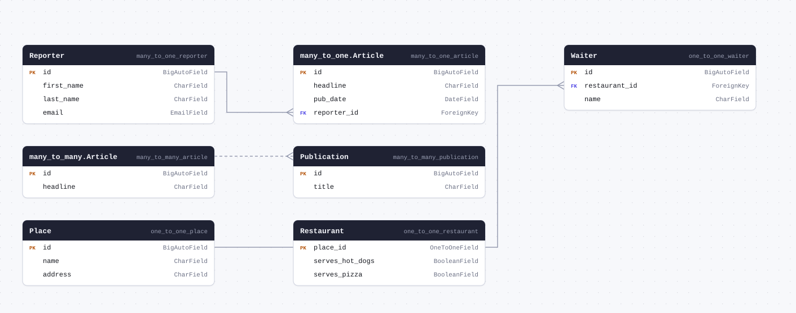
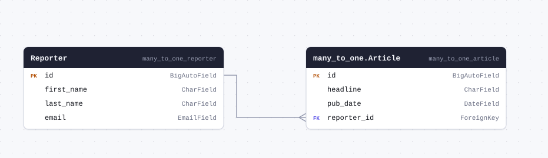
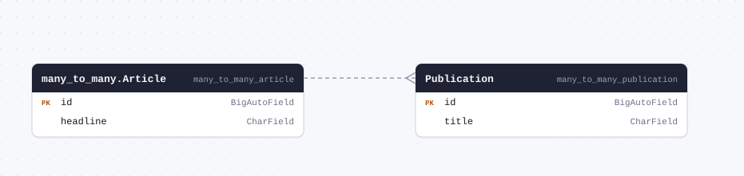
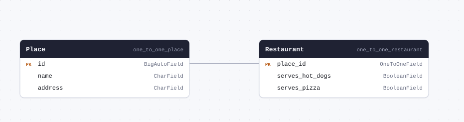
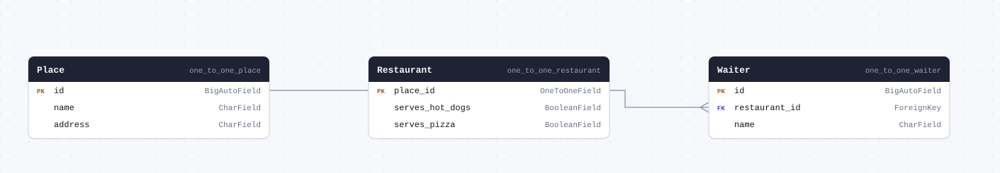
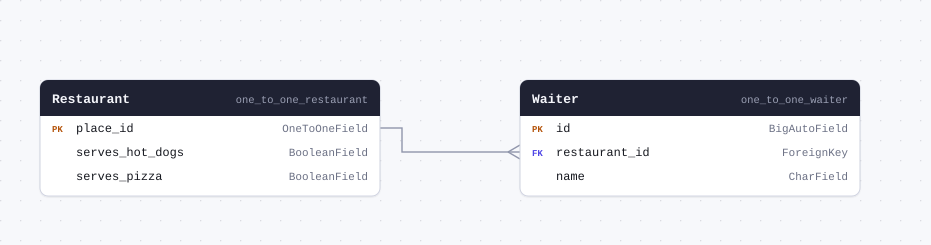

# Schema docs



[Reporter](#reporter) · [many_to_one.Article](#many_to_onearticle) · [Publication](#publication) · [many_to_many.Article](#many_to_manyarticle) · [Place](#place) · [Restaurant](#restaurant) · [Waiter](#waiter)

<details>
<summary>The whole schema as SQL</summary>

```sql
CREATE TABLE "many_to_one_reporter" ("id" integer NOT NULL PRIMARY KEY AUTOINCREMENT, "first_name" varchar(30) NOT NULL, "last_name" varchar(30) NOT NULL, "email" varchar(254) NOT NULL);

CREATE TABLE "many_to_one_article" ("id" integer NOT NULL PRIMARY KEY AUTOINCREMENT, "headline" varchar(100) NOT NULL, "pub_date" date NOT NULL, "reporter_id" bigint NOT NULL REFERENCES "many_to_one_reporter" ("id") DEFERRABLE INITIALLY DEFERRED);

CREATE TABLE "many_to_many_publication" ("id" integer NOT NULL PRIMARY KEY AUTOINCREMENT, "title" varchar(30) NOT NULL);

CREATE TABLE "many_to_many_article" ("id" integer NOT NULL PRIMARY KEY AUTOINCREMENT, "headline" varchar(100) NOT NULL);

CREATE TABLE "many_to_many_article_publications" ("id" integer NOT NULL PRIMARY KEY AUTOINCREMENT, "article_id" bigint NOT NULL REFERENCES "many_to_many_article" ("id") DEFERRABLE INITIALLY DEFERRED, "publication_id" bigint NOT NULL REFERENCES "many_to_many_publication" ("id") DEFERRABLE INITIALLY DEFERRED);

CREATE TABLE "one_to_one_place" ("id" integer NOT NULL PRIMARY KEY AUTOINCREMENT, "name" varchar(50) NOT NULL, "address" varchar(80) NOT NULL);

CREATE TABLE "one_to_one_restaurant" ("place_id" bigint NOT NULL PRIMARY KEY REFERENCES "one_to_one_place" ("id") DEFERRABLE INITIALLY DEFERRED, "serves_hot_dogs" bool NOT NULL, "serves_pizza" bool NOT NULL);

CREATE TABLE "one_to_one_waiter" ("id" integer NOT NULL PRIMARY KEY AUTOINCREMENT, "restaurant_id" bigint NOT NULL REFERENCES "one_to_one_restaurant" ("place_id") DEFERRABLE INITIALLY DEFERRED, "name" varchar(50) NOT NULL);

CREATE INDEX "many_to_one_article_reporter_id_68e5b821" ON "many_to_one_article" ("reporter_id");

CREATE UNIQUE INDEX "many_to_many_article_publications_article_id_publication_id_caad31f7_uniq" ON "many_to_many_article_publications" ("article_id", "publication_id");

CREATE INDEX "many_to_many_article_publications_article_id_a11ac1d9" ON "many_to_many_article_publications" ("article_id");

CREATE INDEX "many_to_many_article_publications_publication_id_6ba0d70a" ON "many_to_many_article_publications" ("publication_id");

CREATE INDEX "one_to_one_waiter_restaurant_id_1c997397" ON "one_to_one_waiter" ("restaurant_id");
```

</details>

## Reporter

Table `many_to_one_reporter`, app `many_to_one`.


| Column | Field | Type | Null | Key | Default | Description |
| --- | --- | --- | --- | --- | --- | --- |
| `id` | `BigAutoField` | `integer` |  | PK | `autoincrement()` |  |
| `first_name` | `CharField` | `varchar(30)` |  |  |  |  |
| `last_name` | `CharField` | `varchar(30)` |  |  |  |  |
| `email` | `EmailField` | `varchar(254)` |  |  |  |  |

Relations:

- [many_to_one.Article](#many_to_onearticle).`reporter_id` → `id`, on delete cascade

## many_to_one.Article

Table `many_to_one_article`, app `many_to_one`.



| Column | Field | Type | Null | Key | Default | Description |
| --- | --- | --- | --- | --- | --- | --- |
| `id` | `BigAutoField` | `integer` |  | PK | `autoincrement()` |  |
| `headline` | `CharField` | `varchar(100)` |  |  |  |  |
| `pub_date` | `DateField` | `date` |  |  |  |  |
| `reporter_id` | `ForeignKey` | `bigint` |  | FK |  |  |

Indexes:

- index `many_to_one_article_reporter_id_68e5b821` on `reporter_id`

Relations:

- `reporter_id` → [Reporter](#reporter).`id`, on delete cascade

## Publication

Table `many_to_many_publication`, app `many_to_many`.



| Column | Field | Type | Null | Key | Default | Description |
| --- | --- | --- | --- | --- | --- | --- |
| `id` | `BigAutoField` | `integer` |  | PK | `autoincrement()` |  |
| `title` | `CharField` | `varchar(30)` |  |  |  |  |

Relations:

- `article_set` — many to many with [many_to_many.Article](#many_to_manyarticle)

## many_to_many.Article

Table `many_to_many_article`, app `many_to_many`.


| Column | Field | Type | Null | Key | Default | Description |
| --- | --- | --- | --- | --- | --- | --- |
| `id` | `BigAutoField` | `integer` |  | PK | `autoincrement()` |  |
| `headline` | `CharField` | `varchar(100)` |  |  |  |  |

Relations:

- `publications` — many to many with [Publication](#publication)

## Place

Table `one_to_one_place`, app `one_to_one`.



| Column | Field | Type | Null | Key | Default | Description |
| --- | --- | --- | --- | --- | --- | --- |
| `id` | `BigAutoField` | `integer` |  | PK | `autoincrement()` |  |
| `name` | `CharField` | `varchar(50)` |  |  |  |  |
| `address` | `CharField` | `varchar(80)` |  |  |  |  |

Relations:

- [Restaurant](#restaurant).`place_id` → `id`, on delete cascade

## Restaurant

Table `one_to_one_restaurant`, app `one_to_one`.



| Column | Field | Type | Null | Key | Default | Description |
| --- | --- | --- | --- | --- | --- | --- |
| `place_id` | `OneToOneField` | `bigint` |  | PK, FK |  |  |
| `serves_hot_dogs` | `BooleanField` | `bool` |  |  | `False` |  |
| `serves_pizza` | `BooleanField` | `bool` |  |  | `False` |  |

Relations:

- `place_id` → [Place](#place).`id`, on delete cascade
- [Waiter](#waiter).`restaurant_id` → `place_id`, on delete cascade

## Waiter

Table `one_to_one_waiter`, app `one_to_one`.



| Column | Field | Type | Null | Key | Default | Description |
| --- | --- | --- | --- | --- | --- | --- |
| `id` | `BigAutoField` | `integer` |  | PK | `autoincrement()` |  |
| `restaurant_id` | `ForeignKey` | `bigint` |  | FK |  |  |
| `name` | `CharField` | `varchar(50)` |  |  |  |  |

Indexes:

- index `one_to_one_waiter_restaurant_id_1c997397` on `restaurant_id`

Relations:

- `restaurant_id` → [Restaurant](#restaurant).`place_id`, on delete cascade
