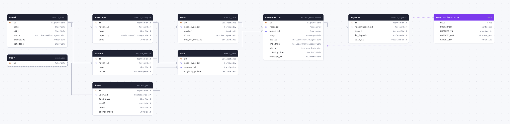
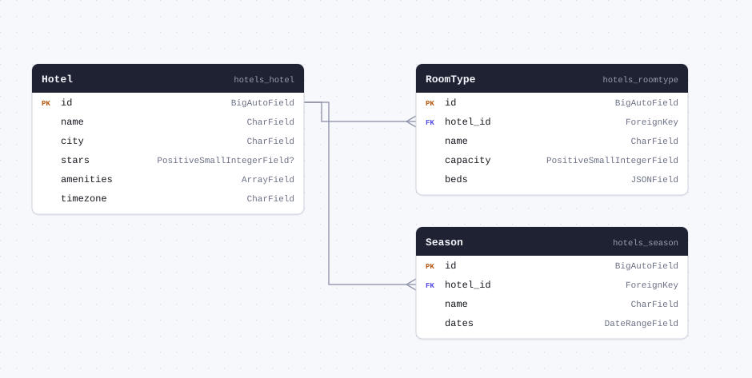
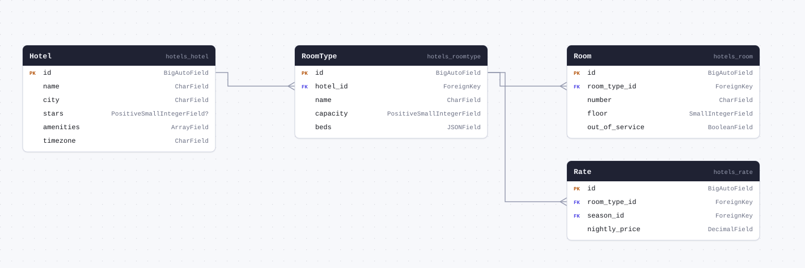
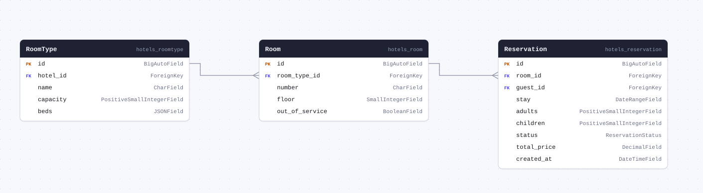
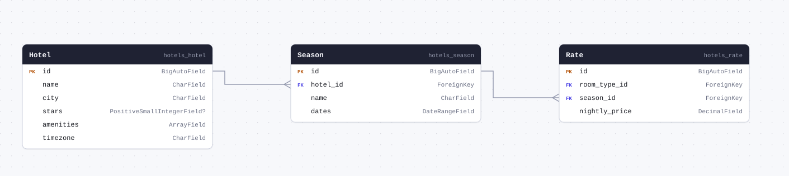
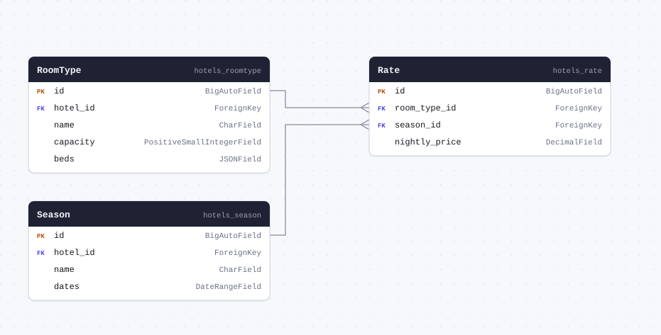
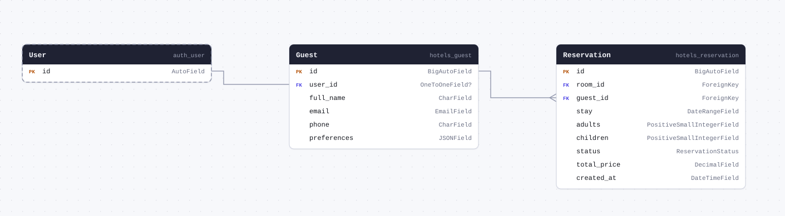
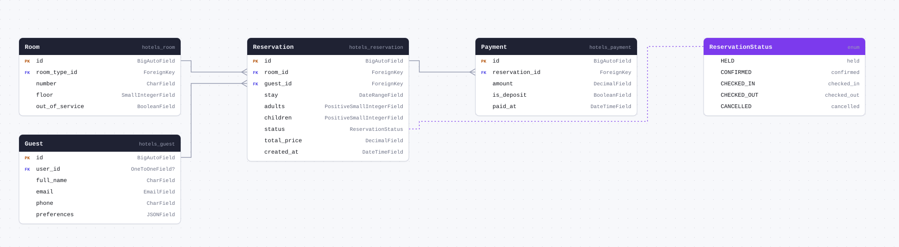
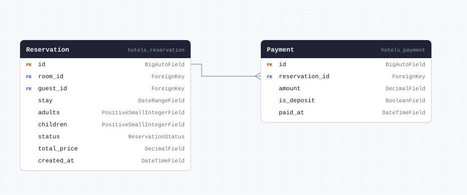

# Schema docs



[Hotel](#hotel) · [RoomType](#roomtype) · [Room](#room) · [Season](#season) · [Rate](#rate) · [Guest](#guest) · [Reservation](#reservation) · [Payment](#payment)

<details>
<summary>The whole schema as SQL</summary>

```sql
CREATE TABLE "hotels_hotel" ("id" bigint NOT NULL PRIMARY KEY GENERATED BY DEFAULT AS IDENTITY, "name" varchar(100) NOT NULL, "city" varchar(100) NOT NULL, "stars" smallint NULL CHECK ("stars" >= 0), "amenities" varchar(30)[] NOT NULL, "timezone" varchar(50) NOT NULL);

CREATE TABLE "hotels_roomtype" ("id" bigint NOT NULL PRIMARY KEY GENERATED BY DEFAULT AS IDENTITY, "hotel_id" bigint NOT NULL, "name" varchar(50) NOT NULL, "capacity" smallint NOT NULL CHECK ("capacity" >= 0), "beds" jsonb NOT NULL);

CREATE TABLE "hotels_room" ("id" bigint NOT NULL PRIMARY KEY GENERATED BY DEFAULT AS IDENTITY, "room_type_id" bigint NOT NULL, "number" varchar(10) NOT NULL, "floor" smallint NOT NULL, "out_of_service" boolean NOT NULL);

CREATE TABLE "hotels_season" ("id" bigint NOT NULL PRIMARY KEY GENERATED BY DEFAULT AS IDENTITY, "hotel_id" bigint NOT NULL, "name" varchar(50) NOT NULL, "dates" daterange NOT NULL, CONSTRAINT "season_no_overlap" EXCLUDE USING GIST ("dates" WITH &&, "hotel_id" WITH =));

CREATE TABLE "hotels_rate" ("id" bigint NOT NULL PRIMARY KEY GENERATED BY DEFAULT AS IDENTITY, "room_type_id" bigint NOT NULL, "season_id" bigint NOT NULL, "nightly_price" numeric(8, 2) NOT NULL);

CREATE TABLE "hotels_guest" ("id" bigint NOT NULL PRIMARY KEY GENERATED BY DEFAULT AS IDENTITY, "user_id" integer NULL UNIQUE, "full_name" varchar(150) NOT NULL, "email" varchar(254) NOT NULL, "phone" varchar(30) NOT NULL, "preferences" jsonb NOT NULL);

CREATE TABLE "hotels_reservation" ("id" bigint NOT NULL PRIMARY KEY GENERATED BY DEFAULT AS IDENTITY, "room_id" bigint NOT NULL, "guest_id" bigint NOT NULL, "stay" daterange NOT NULL, "adults" smallint NOT NULL CHECK ("adults" >= 0), "children" smallint NOT NULL CHECK ("children" >= 0), "status" varchar(12) NOT NULL, "total_price" numeric(10, 2) NOT NULL, "created_at" timestamp with time zone NOT NULL, CONSTRAINT "reservation_no_double_booking" EXCLUDE USING GIST ("stay" WITH &&, "room_id" WITH =) WHERE (NOT ("status" = 'cancelled')), CONSTRAINT "reservation_at_least_one_adult" CHECK ("adults" >= 1));

CREATE TABLE "hotels_payment" ("id" bigint NOT NULL PRIMARY KEY GENERATED BY DEFAULT AS IDENTITY, "reservation_id" bigint NOT NULL, "amount" numeric(10, 2) NOT NULL, "is_deposit" boolean NOT NULL, "paid_at" timestamp with time zone NOT NULL);

ALTER TABLE "hotels_roomtype" ADD CONSTRAINT "hotels_roomtype_hotel_id_name_8ff2ec3a_uniq" UNIQUE ("hotel_id", "name");

ALTER TABLE "hotels_roomtype" ADD CONSTRAINT "hotels_roomtype_hotel_id_04482498_fk_hotels_hotel_id" FOREIGN KEY ("hotel_id") REFERENCES "hotels_hotel" ("id") DEFERRABLE INITIALLY DEFERRED;

CREATE INDEX "hotels_roomtype_hotel_id_04482498" ON "hotels_roomtype" ("hotel_id");

ALTER TABLE "hotels_room" ADD CONSTRAINT "hotels_room_room_type_id_6b3ec3b5_fk_hotels_roomtype_id" FOREIGN KEY ("room_type_id") REFERENCES "hotels_roomtype" ("id") DEFERRABLE INITIALLY DEFERRED;

CREATE INDEX "hotels_room_room_type_id_6b3ec3b5" ON "hotels_room" ("room_type_id");

ALTER TABLE "hotels_season" ADD CONSTRAINT "hotels_season_hotel_id_e85fb9be_fk_hotels_hotel_id" FOREIGN KEY ("hotel_id") REFERENCES "hotels_hotel" ("id") DEFERRABLE INITIALLY DEFERRED;

CREATE INDEX "hotels_season_hotel_id_e85fb9be" ON "hotels_season" ("hotel_id");

ALTER TABLE "hotels_rate" ADD CONSTRAINT "hotels_rate_room_type_id_season_id_40431d5d_uniq" UNIQUE ("room_type_id", "season_id");

ALTER TABLE "hotels_rate" ADD CONSTRAINT "hotels_rate_room_type_id_ae0d3d2f_fk_hotels_roomtype_id" FOREIGN KEY ("room_type_id") REFERENCES "hotels_roomtype" ("id") DEFERRABLE INITIALLY DEFERRED;

ALTER TABLE "hotels_rate" ADD CONSTRAINT "hotels_rate_season_id_50e7cbf4_fk_hotels_season_id" FOREIGN KEY ("season_id") REFERENCES "hotels_season" ("id") DEFERRABLE INITIALLY DEFERRED;

CREATE INDEX "hotels_rate_room_type_id_ae0d3d2f" ON "hotels_rate" ("room_type_id");

CREATE INDEX "hotels_rate_season_id_50e7cbf4" ON "hotels_rate" ("season_id");

ALTER TABLE "hotels_guest" ADD CONSTRAINT "hotels_guest_user_id_12af79ab_fk_auth_user_id" FOREIGN KEY ("user_id") REFERENCES "auth_user" ("id") DEFERRABLE INITIALLY DEFERRED;

ALTER TABLE "hotels_reservation" ADD CONSTRAINT "hotels_reservation_room_id_4a540fa3_fk_hotels_room_id" FOREIGN KEY ("room_id") REFERENCES "hotels_room" ("id") DEFERRABLE INITIALLY DEFERRED;

ALTER TABLE "hotels_reservation" ADD CONSTRAINT "hotels_reservation_guest_id_01924683_fk_hotels_guest_id" FOREIGN KEY ("guest_id") REFERENCES "hotels_guest" ("id") DEFERRABLE INITIALLY DEFERRED;

CREATE INDEX "hotels_reservation_room_id_4a540fa3" ON "hotels_reservation" ("room_id");

CREATE INDEX "hotels_reservation_guest_id_01924683" ON "hotels_reservation" ("guest_id");

CREATE INDEX "reservation_stay_gist" ON "hotels_reservation" USING gist ("stay");

ALTER TABLE "hotels_payment" ADD CONSTRAINT "hotels_payment_reservation_id_ad52d66d_fk_hotels_reservation_id" FOREIGN KEY ("reservation_id") REFERENCES "hotels_reservation" ("id") DEFERRABLE INITIALLY DEFERRED;

CREATE INDEX "hotels_payment_reservation_id_ad52d66d" ON "hotels_payment" ("reservation_id");
```

</details>

## Hotel

Table `hotels_hotel`, app `hotels`.



| Column | Field | Type | Null | Key | Default | Description |
| --- | --- | --- | --- | --- | --- | --- |
| `id` | `BigAutoField` | `bigint` |  | PK | `autoincrement()` |  |
| `name` | `CharField` | `varchar(100)` |  |  |  |  |
| `city` | `CharField` | `varchar(100)` |  |  |  |  |
| `stars` | `PositiveSmallIntegerField` | `smallint` | yes |  |  |  |
| `amenities` | `ArrayField` | `varchar(30)[]` |  |  | `list()` |  |
| `timezone` | `CharField` | `varchar(50)` |  |  | `'UTC'` |  |

Relations:

- [RoomType](#roomtype).`hotel_id` → `id`, on delete cascade
- [Season](#season).`hotel_id` → `id`, on delete cascade

## RoomType

Table `hotels_roomtype`, app `hotels`.



| Column | Field | Type | Null | Key | Default | Description |
| --- | --- | --- | --- | --- | --- | --- |
| `id` | `BigAutoField` | `bigint` |  | PK | `autoincrement()` |  |
| `hotel_id` | `ForeignKey` | `bigint` |  | FK |  |  |
| `name` | `CharField` | `varchar(50)` |  |  |  |  |
| `capacity` | `PositiveSmallIntegerField` | `smallint` |  |  |  |  |
| `beds` | `JSONField` | `jsonb` |  |  | `dict()` | e.g. {"double": 1, "single": 1} |

Indexes:

- index `hotels_roomtype_hotel_id_04482498` on `hotel_id`
- unique `hotels_roomtype_hotel_id_name_8ff2ec3a_uniq` on `hotel_id`, `name`

Relations:

- `hotel_id` → [Hotel](#hotel).`id`, on delete cascade
- [Room](#room).`room_type_id` → `id`, on delete protect
- [Rate](#rate).`room_type_id` → `id`, on delete cascade

## Room

Table `hotels_room`, app `hotels`.



| Column | Field | Type | Null | Key | Default | Description |
| --- | --- | --- | --- | --- | --- | --- |
| `id` | `BigAutoField` | `bigint` |  | PK | `autoincrement()` |  |
| `room_type_id` | `ForeignKey` | `bigint` |  | FK |  |  |
| `number` | `CharField` | `varchar(10)` |  |  |  |  |
| `floor` | `SmallIntegerField` | `smallint` |  |  |  |  |
| `out_of_service` | `BooleanField` | `boolean` |  |  | `False` |  |

Indexes:

- index `hotels_room_room_type_id_6b3ec3b5` on `room_type_id`

Relations:

- `room_type_id` → [RoomType](#roomtype).`id`, on delete protect
- [Reservation](#reservation).`room_id` → `id`, on delete protect

## Season

Table `hotels_season`, app `hotels`.



| Column | Field | Type | Null | Key | Default | Description |
| --- | --- | --- | --- | --- | --- | --- |
| `id` | `BigAutoField` | `bigint` |  | PK | `autoincrement()` |  |
| `hotel_id` | `ForeignKey` | `bigint` |  | FK |  |  |
| `name` | `CharField` | `varchar(50)` |  |  |  |  |
| `dates` | `DateRangeField` | `daterange` |  |  |  |  |

Indexes:

- index `hotels_season_hotel_id_e85fb9be` on `hotel_id`
- gist exclusion `season_no_overlap` on `dates WITH &&`, `hotel_id WITH =`

Relations:

- `hotel_id` → [Hotel](#hotel).`id`, on delete cascade
- [Rate](#rate).`season_id` → `id`, on delete cascade

## Rate

Table `hotels_rate`, app `hotels`.



| Column | Field | Type | Null | Key | Default | Description |
| --- | --- | --- | --- | --- | --- | --- |
| `id` | `BigAutoField` | `bigint` |  | PK | `autoincrement()` |  |
| `room_type_id` | `ForeignKey` | `bigint` |  | FK |  |  |
| `season_id` | `ForeignKey` | `bigint` |  | FK |  |  |
| `nightly_price` | `DecimalField(8, 2)` | `numeric(8, 2)` |  |  |  |  |

Indexes:

- index `hotels_rate_room_type_id_ae0d3d2f` on `room_type_id`
- index `hotels_rate_season_id_50e7cbf4` on `season_id`
- unique `hotels_rate_room_type_id_season_id_40431d5d_uniq` on `room_type_id`, `season_id`

Relations:

- `room_type_id` → [RoomType](#roomtype).`id`, on delete cascade
- `season_id` → [Season](#season).`id`, on delete cascade

## Guest

Table `hotels_guest`, app `hotels`.



| Column | Field | Type | Null | Key | Default | Description |
| --- | --- | --- | --- | --- | --- | --- |
| `id` | `BigAutoField` | `bigint` |  | PK | `autoincrement()` |  |
| `user_id` | `OneToOneField` | `integer` | yes | FK, unique |  |  |
| `full_name` | `CharField` | `varchar(150)` |  |  |  |  |
| `email` | `EmailField` | `varchar(254)` |  |  |  |  |
| `phone` | `CharField` | `varchar(30)` |  |  |  |  |
| `preferences` | `JSONField` | `jsonb` |  |  | `dict()` |  |

Relations:

- `user_id` → `User`.`id` (auth, not in these docs), on delete set null
- [Reservation](#reservation).`guest_id` → `id`, on delete protect

## Reservation

Table `hotels_reservation`, app `hotels`.



| Column | Field | Type | Null | Key | Default | Description |
| --- | --- | --- | --- | --- | --- | --- |
| `id` | `BigAutoField` | `bigint` |  | PK | `autoincrement()` |  |
| `room_id` | `ForeignKey` | `bigint` |  | FK |  |  |
| `guest_id` | `ForeignKey` | `bigint` |  | FK |  |  |
| `stay` | `DateRangeField` | `daterange` |  |  |  |  |
| `adults` | `PositiveSmallIntegerField` | `smallint` |  |  | `1` |  |
| `children` | `PositiveSmallIntegerField` | `smallint` |  |  | `0` |  |
| `status` | `ReservationStatus` | `varchar(12)` |  |  | `'held'` |  |
| `total_price` | `DecimalField(10, 2)` | `numeric(10, 2)` |  |  |  |  |
| `created_at` | `DateTimeField` | `timestamp with time zone` |  |  | `now()` |  |

Indexes:

- index `hotels_reservation_room_id_4a540fa3` on `room_id`
- index `hotels_reservation_guest_id_01924683` on `guest_id`
- gist exclusion `reservation_no_double_booking` on `stay WITH &&`, `room_id WITH =` where `NOT ("status" = 'cancelled')`
- gist index `reservation_stay_gist` on `stay`

Checks:

- `reservation_at_least_one_adult`: `"adults" >= 1`

Relations:

- `room_id` → [Room](#room).`id`, on delete protect
- `guest_id` → [Guest](#guest).`id`, on delete protect
- [Payment](#payment).`reservation_id` → `id`, on delete cascade

## Payment

Table `hotels_payment`, app `hotels`.



| Column | Field | Type | Null | Key | Default | Description |
| --- | --- | --- | --- | --- | --- | --- |
| `id` | `BigAutoField` | `bigint` |  | PK | `autoincrement()` |  |
| `reservation_id` | `ForeignKey` | `bigint` |  | FK |  |  |
| `amount` | `DecimalField(10, 2)` | `numeric(10, 2)` |  |  |  |  |
| `is_deposit` | `BooleanField` | `boolean` |  |  | `False` |  |
| `paid_at` | `DateTimeField` | `timestamp with time zone` |  |  |  |  |

Indexes:

- index `hotels_payment_reservation_id_ad52d66d` on `reservation_id`

Relations:

- `reservation_id` → [Reservation](#reservation).`id`, on delete cascade

# Enums

## ReservationStatus

| Name | Stored as |
| --- | --- |
| `HELD` | `held` |
| `CONFIRMED` | `confirmed` |
| `CHECKED_IN` | `checked_in` |
| `CHECKED_OUT` | `checked_out` |
| `CANCELLED` | `cancelled` |
