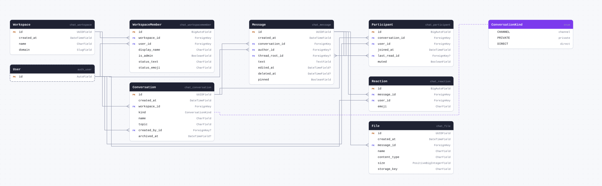
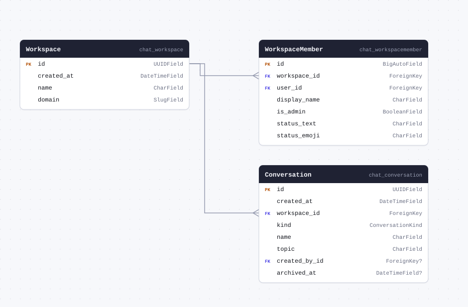
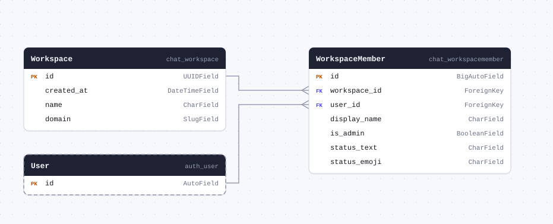
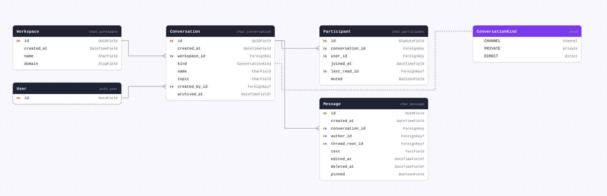
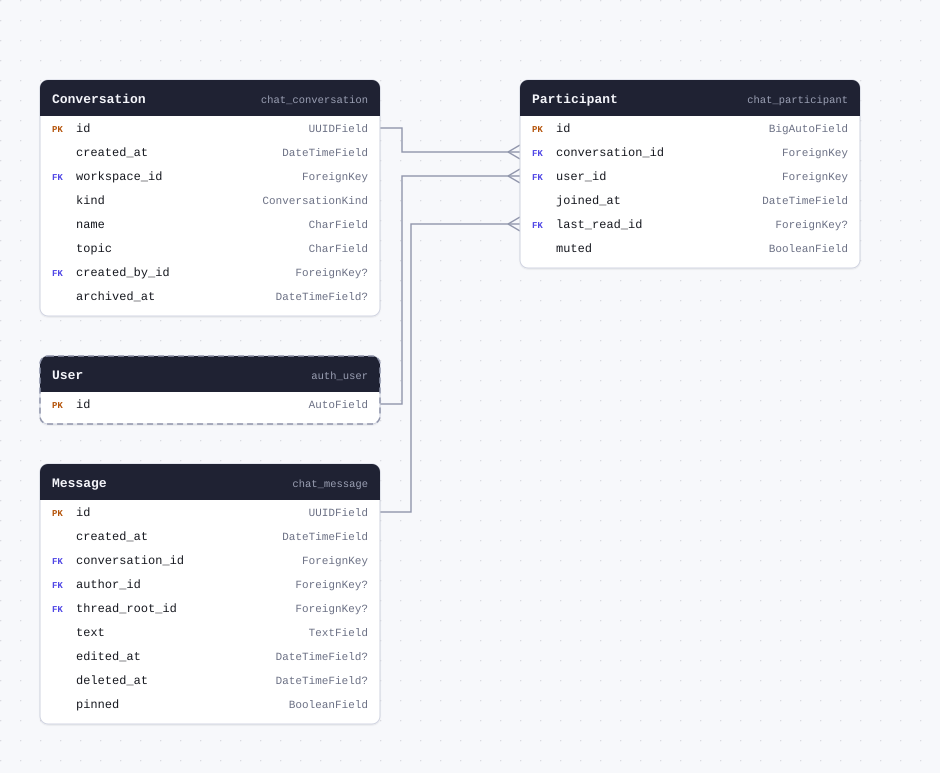
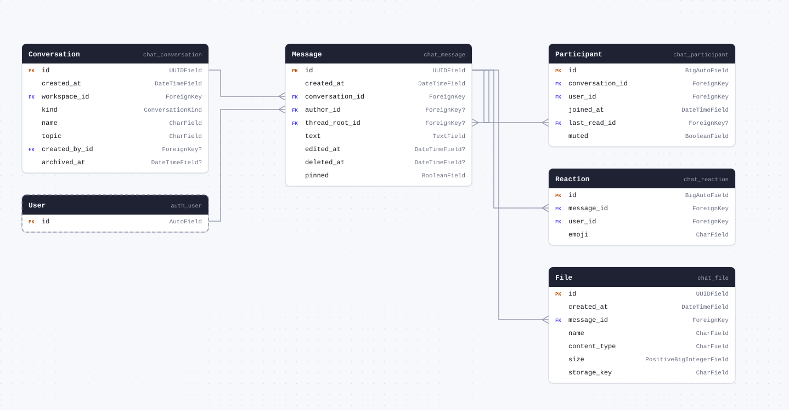
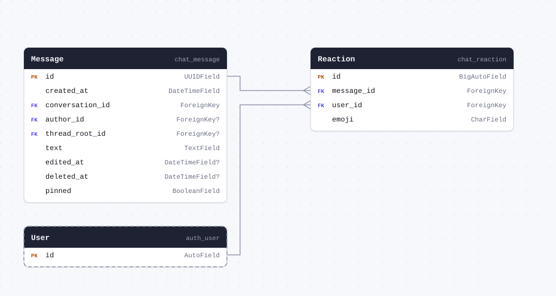
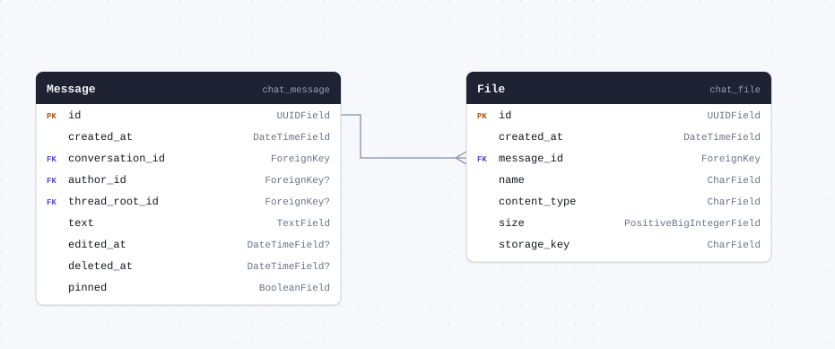

# Schema docs



[Workspace](#workspace) · [WorkspaceMember](#workspacemember) · [Conversation](#conversation) · [Participant](#participant) · [Message](#message) · [Reaction](#reaction) · [File](#file)

<details>
<summary>The whole schema as SQL</summary>

```sql
CREATE TABLE "chat_workspace" ("id" char(32) NOT NULL PRIMARY KEY, "created_at" datetime NOT NULL, "name" varchar(80) NOT NULL, "domain" varchar(50) NOT NULL UNIQUE);

CREATE TABLE "chat_workspacemember" ("id" integer NOT NULL PRIMARY KEY AUTOINCREMENT, "workspace_id" char(32) NOT NULL REFERENCES "chat_workspace" ("id") DEFERRABLE INITIALLY DEFERRED, "user_id" integer NOT NULL REFERENCES "auth_user" ("id") DEFERRABLE INITIALLY DEFERRED, "display_name" varchar(80) NOT NULL, "is_admin" bool NOT NULL, "status_text" varchar(100) NOT NULL, "status_emoji" varchar(32) NOT NULL);

CREATE TABLE "chat_conversation" ("id" char(32) NOT NULL PRIMARY KEY, "created_at" datetime NOT NULL, "workspace_id" char(32) NOT NULL REFERENCES "chat_workspace" ("id") DEFERRABLE INITIALLY DEFERRED, "kind" varchar(7) NOT NULL, "name" varchar(80) NOT NULL, "topic" varchar(250) NOT NULL, "created_by_id" integer NULL REFERENCES "auth_user" ("id") DEFERRABLE INITIALLY DEFERRED, "archived_at" datetime NULL, CONSTRAINT "channel_has_name" CHECK (("kind" = 'direct' OR NOT ("name" = ''))));

CREATE TABLE "chat_participant" ("id" integer NOT NULL PRIMARY KEY AUTOINCREMENT, "conversation_id" char(32) NOT NULL REFERENCES "chat_conversation" ("id") DEFERRABLE INITIALLY DEFERRED, "user_id" integer NOT NULL REFERENCES "auth_user" ("id") DEFERRABLE INITIALLY DEFERRED, "joined_at" datetime NOT NULL, "last_read_id" char(32) NULL REFERENCES "chat_message" ("id") DEFERRABLE INITIALLY DEFERRED, "muted" bool NOT NULL);

CREATE TABLE "chat_message" ("id" char(32) NOT NULL PRIMARY KEY, "created_at" datetime NOT NULL, "conversation_id" char(32) NOT NULL REFERENCES "chat_conversation" ("id") DEFERRABLE INITIALLY DEFERRED, "author_id" integer NULL REFERENCES "auth_user" ("id") DEFERRABLE INITIALLY DEFERRED, "thread_root_id" char(32) NULL REFERENCES "chat_message" ("id") DEFERRABLE INITIALLY DEFERRED, "text" text NOT NULL, "edited_at" datetime NULL, "deleted_at" datetime NULL, "pinned" bool NOT NULL);

CREATE TABLE "chat_reaction" ("id" integer NOT NULL PRIMARY KEY AUTOINCREMENT, "message_id" char(32) NOT NULL REFERENCES "chat_message" ("id") DEFERRABLE INITIALLY DEFERRED, "user_id" integer NOT NULL REFERENCES "auth_user" ("id") DEFERRABLE INITIALLY DEFERRED, "emoji" varchar(32) NOT NULL, CONSTRAINT "react_once" UNIQUE ("message_id", "user_id", "emoji"));

CREATE TABLE "chat_file" ("id" char(32) NOT NULL PRIMARY KEY, "created_at" datetime NOT NULL, "message_id" char(32) NOT NULL REFERENCES "chat_message" ("id") DEFERRABLE INITIALLY DEFERRED, "name" varchar(255) NOT NULL, "content_type" varchar(100) NOT NULL, "size" bigint unsigned NOT NULL CHECK ("size" >= 0), "storage_key" varchar(300) NOT NULL UNIQUE);

CREATE UNIQUE INDEX "chat_workspacemember_workspace_id_user_id_1a8ace47_uniq" ON "chat_workspacemember" ("workspace_id", "user_id");

CREATE INDEX "chat_workspacemember_workspace_id_343139f3" ON "chat_workspacemember" ("workspace_id");

CREATE INDEX "chat_workspacemember_user_id_8e9dd831" ON "chat_workspacemember" ("user_id");

CREATE UNIQUE INDEX "channel_name_unique" ON "chat_conversation" ("workspace_id", "name") WHERE NOT ("kind" = 'direct');

CREATE INDEX "chat_conversation_workspace_id_0f901399" ON "chat_conversation" ("workspace_id");

CREATE INDEX "chat_conversation_created_by_id_615454ae" ON "chat_conversation" ("created_by_id");

CREATE UNIQUE INDEX "chat_participant_conversation_id_user_id_986d2ae0_uniq" ON "chat_participant" ("conversation_id", "user_id");

CREATE INDEX "chat_participant_conversation_id_568ba5d5" ON "chat_participant" ("conversation_id");

CREATE INDEX "chat_participant_user_id_3f5ce7b2" ON "chat_participant" ("user_id");

CREATE INDEX "chat_participant_last_read_id_3764b76e" ON "chat_participant" ("last_read_id");

CREATE INDEX "chat_message_conversation_id_a1207bf4" ON "chat_message" ("conversation_id");

CREATE INDEX "chat_message_author_id_923569d5" ON "chat_message" ("author_id");

CREATE INDEX "chat_message_thread_root_id_7088e73c" ON "chat_message" ("thread_root_id");

CREATE INDEX "message_history" ON "chat_message" ("conversation_id", "created_at");

CREATE INDEX "chat_reaction_message_id_e8fe8671" ON "chat_reaction" ("message_id");

CREATE INDEX "chat_reaction_user_id_72fc92d0" ON "chat_reaction" ("user_id");

CREATE INDEX "chat_file_message_id_ad5b53de" ON "chat_file" ("message_id");
```

</details>

## Workspace

Table `chat_workspace`, app `chat`.

Columns from `UUIDModel` (abstract): `id`, `created_at`.



| Column | Field | Type | Null | Key | Default | Description |
| --- | --- | --- | --- | --- | --- | --- |
| `id` | `UUIDField` | `char(32)` |  | PK | `uuid4()` |  |
| `created_at` | `DateTimeField` | `datetime` |  |  | `now()` |  |
| `name` | `CharField` | `varchar(80)` |  |  |  |  |
| `domain` | `SlugField` | `varchar(50)` |  | unique |  |  |

Relations:

- `members` — many to many with `User`, through [WorkspaceMember](#workspacemember)
- [WorkspaceMember](#workspacemember).`workspace_id` → `id`, on delete cascade
- [Conversation](#conversation).`workspace_id` → `id`, on delete cascade

## WorkspaceMember

Table `chat_workspacemember`, app `chat`.



| Column | Field | Type | Null | Key | Default | Description |
| --- | --- | --- | --- | --- | --- | --- |
| `id` | `BigAutoField` | `integer` |  | PK | `autoincrement()` |  |
| `workspace_id` | `ForeignKey` | `char(32)` |  | FK |  |  |
| `user_id` | `ForeignKey` | `integer` |  | FK |  |  |
| `display_name` | `CharField` | `varchar(80)` |  |  |  |  |
| `is_admin` | `BooleanField` | `bool` |  |  | `False` |  |
| `status_text` | `CharField` | `varchar(100)` |  |  |  |  |
| `status_emoji` | `CharField` | `varchar(32)` |  |  |  |  |

Indexes:

- index `chat_workspacemember_workspace_id_343139f3` on `workspace_id`
- index `chat_workspacemember_user_id_8e9dd831` on `user_id`
- unique `chat_workspacemember_workspace_id_user_id_1a8ace47_uniq` on `workspace_id`, `user_id`

Relations:

- `workspace_id` → [Workspace](#workspace).`id`, on delete cascade
- `user_id` → `User`.`id` (auth, not in these docs), on delete cascade

## Conversation

Table `chat_conversation`, app `chat`.

Columns from `UUIDModel` (abstract): `id`, `created_at`.



| Column | Field | Type | Null | Key | Default | Description |
| --- | --- | --- | --- | --- | --- | --- |
| `id` | `UUIDField` | `char(32)` |  | PK | `uuid4()` |  |
| `created_at` | `DateTimeField` | `datetime` |  |  | `now()` |  |
| `workspace_id` | `ForeignKey` | `char(32)` |  | FK |  |  |
| `kind` | `ConversationKind` | `varchar(7)` |  |  |  |  |
| `name` | `CharField` | `varchar(80)` |  |  |  | Empty for direct messages |
| `topic` | `CharField` | `varchar(250)` |  |  |  |  |
| `created_by_id` | `ForeignKey` | `integer` | yes | FK |  |  |
| `archived_at` | `DateTimeField` | `datetime` | yes |  |  |  |

Indexes:

- index `chat_conversation_workspace_id_0f901399` on `workspace_id`
- index `chat_conversation_created_by_id_615454ae` on `created_by_id`
- unique `channel_name_unique` on `workspace_id`, `name` where `NOT ("kind" = 'direct')`

Checks:

- `channel_has_name`: `("kind" = 'direct' OR NOT ("name" = ''))`

Relations:

- `participants` — many to many with `User`, through [Participant](#participant)
- `workspace_id` → [Workspace](#workspace).`id`, on delete cascade
- `created_by_id` → `User`.`id` (auth, not in these docs), on delete set null
- [Participant](#participant).`conversation_id` → `id`, on delete cascade
- [Message](#message).`conversation_id` → `id`, on delete cascade

## Participant

Table `chat_participant`, app `chat`.



| Column | Field | Type | Null | Key | Default | Description |
| --- | --- | --- | --- | --- | --- | --- |
| `id` | `BigAutoField` | `integer` |  | PK | `autoincrement()` |  |
| `conversation_id` | `ForeignKey` | `char(32)` |  | FK |  |  |
| `user_id` | `ForeignKey` | `integer` |  | FK |  |  |
| `joined_at` | `DateTimeField` | `datetime` |  |  | `now()` |  |
| `last_read_id` | `ForeignKey` | `char(32)` | yes | FK |  |  |
| `muted` | `BooleanField` | `bool` |  |  | `False` |  |

Indexes:

- index `chat_participant_conversation_id_568ba5d5` on `conversation_id`
- index `chat_participant_user_id_3f5ce7b2` on `user_id`
- index `chat_participant_last_read_id_3764b76e` on `last_read_id`
- unique `chat_participant_conversation_id_user_id_986d2ae0_uniq` on `conversation_id`, `user_id`

Relations:

- `conversation_id` → [Conversation](#conversation).`id`, on delete cascade
- `user_id` → `User`.`id` (auth, not in these docs), on delete cascade
- `last_read_id` → [Message](#message).`id`, on delete set null

## Message

Table `chat_message`, app `chat`.

Columns from `UUIDModel` (abstract): `id`, `created_at`.



| Column | Field | Type | Null | Key | Default | Description |
| --- | --- | --- | --- | --- | --- | --- |
| `id` | `UUIDField` | `char(32)` |  | PK | `uuid4()` |  |
| `created_at` | `DateTimeField` | `datetime` |  |  | `now()` |  |
| `conversation_id` | `ForeignKey` | `char(32)` |  | FK |  |  |
| `author_id` | `ForeignKey` | `integer` | yes | FK |  |  |
| `thread_root_id` | `ForeignKey` | `char(32)` | yes | FK |  |  |
| `text` | `TextField` | `text` |  |  |  |  |
| `edited_at` | `DateTimeField` | `datetime` | yes |  |  |  |
| `deleted_at` | `DateTimeField` | `datetime` | yes |  |  |  |
| `pinned` | `BooleanField` | `bool` |  |  | `False` |  |

Indexes:

- index `chat_message_conversation_id_a1207bf4` on `conversation_id`
- index `chat_message_author_id_923569d5` on `author_id`
- index `chat_message_thread_root_id_7088e73c` on `thread_root_id`
- index `message_history` on `conversation_id`, `created_at`

Relations:

- [Participant](#participant).`last_read_id` → `id`, on delete set null
- `conversation_id` → [Conversation](#conversation).`id`, on delete cascade
- `author_id` → `User`.`id` (auth, not in these docs), on delete set null
- `thread_root_id` → [Message](#message).`id`, on delete cascade
- [Reaction](#reaction).`message_id` → `id`, on delete cascade
- [File](#file).`message_id` → `id`, on delete cascade

## Reaction

Table `chat_reaction`, app `chat`.



| Column | Field | Type | Null | Key | Default | Description |
| --- | --- | --- | --- | --- | --- | --- |
| `id` | `BigAutoField` | `integer` |  | PK | `autoincrement()` |  |
| `message_id` | `ForeignKey` | `char(32)` |  | FK |  |  |
| `user_id` | `ForeignKey` | `integer` |  | FK |  |  |
| `emoji` | `CharField` | `varchar(32)` |  |  |  |  |

Indexes:

- index `chat_reaction_message_id_e8fe8671` on `message_id`
- index `chat_reaction_user_id_72fc92d0` on `user_id`
- unique `react_once` on `message_id`, `user_id`, `emoji`

Relations:

- `message_id` → [Message](#message).`id`, on delete cascade
- `user_id` → `User`.`id` (auth, not in these docs), on delete cascade

## File

Table `chat_file`, app `chat`.

Columns from `UUIDModel` (abstract): `id`, `created_at`.



| Column | Field | Type | Null | Key | Default | Description |
| --- | --- | --- | --- | --- | --- | --- |
| `id` | `UUIDField` | `char(32)` |  | PK | `uuid4()` |  |
| `created_at` | `DateTimeField` | `datetime` |  |  | `now()` |  |
| `message_id` | `ForeignKey` | `char(32)` |  | FK |  |  |
| `name` | `CharField` | `varchar(255)` |  |  |  |  |
| `content_type` | `CharField` | `varchar(100)` |  |  |  |  |
| `size` | `PositiveBigIntegerField` | `bigint unsigned` |  |  |  |  |
| `storage_key` | `CharField` | `varchar(300)` |  | unique |  |  |

Indexes:

- index `chat_file_message_id_ad5b53de` on `message_id`

Relations:

- `message_id` → [Message](#message).`id`, on delete cascade

# Enums

## ConversationKind

| Name | Stored as |
| --- | --- |
| `CHANNEL` | `channel` |
| `PRIVATE` | `private` |
| `DIRECT` | `direct` |
