# Schema docs

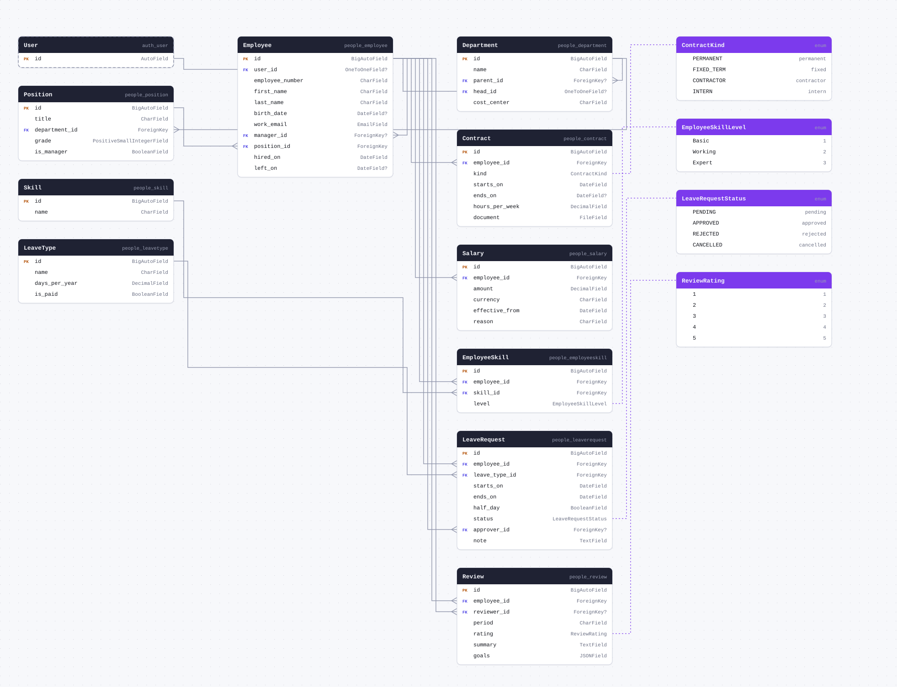

[Department](#department) · [Position](#position) · [Employee](#employee) · [Contract](#contract) · [Salary](#salary) · [Skill](#skill) · [EmployeeSkill](#employeeskill) · [LeaveType](#leavetype) · [LeaveRequest](#leaverequest) · [Review](#review)

<details>
<summary>The whole schema as SQL</summary>

```sql
CREATE TABLE "people_department" ("id" integer NOT NULL PRIMARY KEY AUTOINCREMENT, "name" varchar(100) NOT NULL UNIQUE, "parent_id" bigint NULL REFERENCES "people_department" ("id") DEFERRABLE INITIALLY DEFERRED, "head_id" bigint NULL UNIQUE REFERENCES "people_employee" ("id") DEFERRABLE INITIALLY DEFERRED, "cost_center" varchar(20) NOT NULL);

CREATE TABLE "people_position" ("id" integer NOT NULL PRIMARY KEY AUTOINCREMENT, "title" varchar(100) NOT NULL, "department_id" bigint NOT NULL REFERENCES "people_department" ("id") DEFERRABLE INITIALLY DEFERRED, "grade" smallint unsigned NOT NULL CHECK ("grade" >= 0), "is_manager" bool NOT NULL);

CREATE TABLE "people_employee" ("id" integer NOT NULL PRIMARY KEY AUTOINCREMENT, "user_id" integer NULL UNIQUE REFERENCES "auth_user" ("id") DEFERRABLE INITIALLY DEFERRED, "employee_number" varchar(20) NOT NULL UNIQUE, "first_name" varchar(50) NOT NULL, "last_name" varchar(50) NOT NULL, "birth_date" date NULL, "work_email" varchar(254) NOT NULL UNIQUE, "manager_id" bigint NULL REFERENCES "people_employee" ("id") DEFERRABLE INITIALLY DEFERRED, "position_id" bigint NOT NULL REFERENCES "people_position" ("id") DEFERRABLE INITIALLY DEFERRED, "hired_on" date NOT NULL, "left_on" date NULL, CONSTRAINT "employee_not_own_manager" CHECK (NOT ("manager_id" = ("id") AND "manager_id" IS NOT NULL)), CONSTRAINT "employee_left_after_hire" CHECK (("left_on" IS NULL OR "left_on" >= ("hired_on"))));

CREATE TABLE "people_contract" ("id" integer NOT NULL PRIMARY KEY AUTOINCREMENT, "employee_id" bigint NOT NULL REFERENCES "people_employee" ("id") DEFERRABLE INITIALLY DEFERRED, "kind" varchar(10) NOT NULL, "starts_on" date NOT NULL, "ends_on" date NULL, "hours_per_week" decimal NOT NULL, "document" varchar(100) NOT NULL);

CREATE TABLE "people_salary" ("id" integer NOT NULL PRIMARY KEY AUTOINCREMENT, "employee_id" bigint NOT NULL REFERENCES "people_employee" ("id") DEFERRABLE INITIALLY DEFERRED, "amount" decimal NOT NULL, "currency" varchar(3) NOT NULL, "effective_from" date NOT NULL, "reason" varchar(200) NOT NULL);

CREATE TABLE "people_skill" ("id" integer NOT NULL PRIMARY KEY AUTOINCREMENT, "name" varchar(50) NOT NULL UNIQUE);

CREATE TABLE "people_employeeskill" ("id" integer NOT NULL PRIMARY KEY AUTOINCREMENT, "employee_id" bigint NOT NULL REFERENCES "people_employee" ("id") DEFERRABLE INITIALLY DEFERRED, "skill_id" bigint NOT NULL REFERENCES "people_skill" ("id") DEFERRABLE INITIALLY DEFERRED, "level" smallint unsigned NOT NULL CHECK ("level" >= 0));

CREATE TABLE "people_leavetype" ("id" integer NOT NULL PRIMARY KEY AUTOINCREMENT, "name" varchar(50) NOT NULL UNIQUE, "days_per_year" decimal NOT NULL, "is_paid" bool NOT NULL);

CREATE TABLE "people_leaverequest" ("id" integer NOT NULL PRIMARY KEY AUTOINCREMENT, "employee_id" bigint NOT NULL REFERENCES "people_employee" ("id") DEFERRABLE INITIALLY DEFERRED, "leave_type_id" bigint NOT NULL REFERENCES "people_leavetype" ("id") DEFERRABLE INITIALLY DEFERRED, "starts_on" date NOT NULL, "ends_on" date NOT NULL, "half_day" bool NOT NULL, "status" varchar(10) NOT NULL, "approver_id" bigint NULL REFERENCES "people_employee" ("id") DEFERRABLE INITIALLY DEFERRED, "note" text NOT NULL, CONSTRAINT "leave_ends_after_start" CHECK ("ends_on" >= ("starts_on")));

CREATE TABLE "people_review" ("id" integer NOT NULL PRIMARY KEY AUTOINCREMENT, "employee_id" bigint NOT NULL REFERENCES "people_employee" ("id") DEFERRABLE INITIALLY DEFERRED, "reviewer_id" bigint NULL REFERENCES "people_employee" ("id") DEFERRABLE INITIALLY DEFERRED, "period" varchar(7) NOT NULL, "rating" smallint unsigned NOT NULL CHECK ("rating" >= 0), "summary" text NOT NULL, "goals" text NOT NULL CHECK ((JSON_VALID("goals") OR "goals" IS NULL)));

CREATE INDEX "people_department_parent_id_34651194" ON "people_department" ("parent_id");

CREATE INDEX "people_position_department_id_774daf71" ON "people_position" ("department_id");

CREATE INDEX "people_employee_manager_id_d7ba862f" ON "people_employee" ("manager_id");

CREATE INDEX "people_employee_position_id_591e0e52" ON "people_employee" ("position_id");

CREATE INDEX "people_contract_employee_id_ba6eccb9" ON "people_contract" ("employee_id");

CREATE UNIQUE INDEX "people_salary_employee_id_effective_from_04f18609_uniq" ON "people_salary" ("employee_id", "effective_from");

CREATE INDEX "people_salary_employee_id_c29f2776" ON "people_salary" ("employee_id");

CREATE INDEX "people_employeeskill_employee_id_b64ea790" ON "people_employeeskill" ("employee_id");

CREATE INDEX "people_employeeskill_skill_id_6a4b5e8a" ON "people_employeeskill" ("skill_id");

CREATE INDEX "people_leaverequest_employee_id_c860fa77" ON "people_leaverequest" ("employee_id");

CREATE INDEX "people_leaverequest_leave_type_id_eb33cce4" ON "people_leaverequest" ("leave_type_id");

CREATE INDEX "people_leaverequest_approver_id_12209e74" ON "people_leaverequest" ("approver_id");

CREATE UNIQUE INDEX "people_review_employee_id_period_5db03834_uniq" ON "people_review" ("employee_id", "period");

CREATE INDEX "people_review_employee_id_2e53470c" ON "people_review" ("employee_id");

CREATE INDEX "people_review_reviewer_id_dfc1b3a1" ON "people_review" ("reviewer_id");
```

</details>

## Department

Table `people_department`, app `people`.

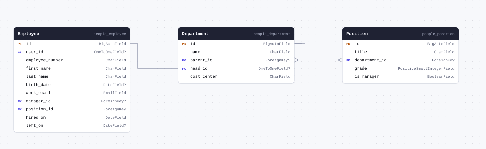

| Column | Field | Type | Null | Key | Default | Description |
| --- | --- | --- | --- | --- | --- | --- |
| `id` | `BigAutoField` | `integer` |  | PK | `autoincrement()` |  |
| `name` | `CharField` | `varchar(100)` |  | unique |  |  |
| `parent_id` | `ForeignKey` | `bigint` | yes | FK |  |  |
| `head_id` | `OneToOneField` | `bigint` | yes | FK, unique |  |  |
| `cost_center` | `CharField` | `varchar(20)` |  |  |  |  |

Indexes:

- index `people_department_parent_id_34651194` on `parent_id`

Relations:

- `parent_id` → [Department](#department).`id`, on delete protect
- `head_id` → [Employee](#employee).`id`, on delete set null
- [Position](#position).`department_id` → `id`, on delete protect

## Position

Table `people_position`, app `people`.

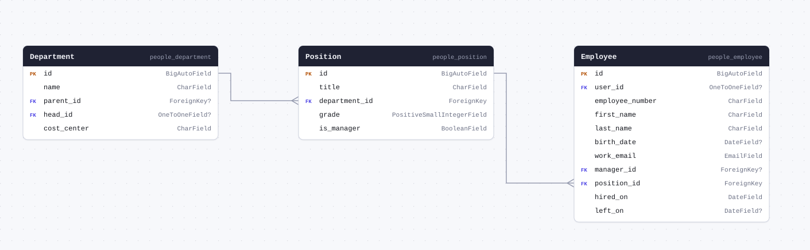

| Column | Field | Type | Null | Key | Default | Description |
| --- | --- | --- | --- | --- | --- | --- |
| `id` | `BigAutoField` | `integer` |  | PK | `autoincrement()` |  |
| `title` | `CharField` | `varchar(100)` |  |  |  |  |
| `department_id` | `ForeignKey` | `bigint` |  | FK |  |  |
| `grade` | `PositiveSmallIntegerField` | `smallint unsigned` |  |  |  |  |
| `is_manager` | `BooleanField` | `bool` |  |  | `False` |  |

Indexes:

- index `people_position_department_id_774daf71` on `department_id`

Relations:

- `department_id` → [Department](#department).`id`, on delete protect
- [Employee](#employee).`position_id` → `id`, on delete protect

## Employee

Table `people_employee`, app `people`.

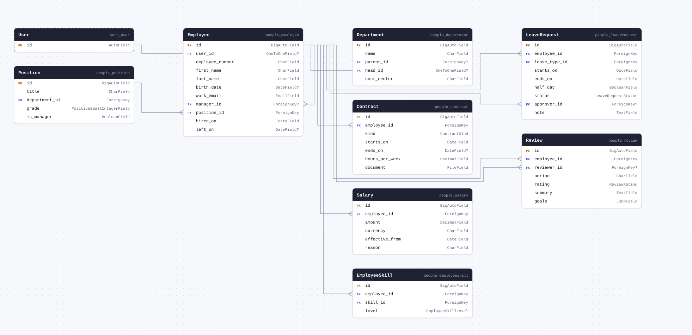

| Column | Field | Type | Null | Key | Default | Description |
| --- | --- | --- | --- | --- | --- | --- |
| `id` | `BigAutoField` | `integer` |  | PK | `autoincrement()` |  |
| `user_id` | `OneToOneField` | `integer` | yes | FK, unique |  |  |
| `employee_number` | `CharField` | `varchar(20)` |  | unique |  |  |
| `first_name` | `CharField` | `varchar(50)` |  |  |  |  |
| `last_name` | `CharField` | `varchar(50)` |  |  |  |  |
| `birth_date` | `DateField` | `date` | yes |  |  |  |
| `work_email` | `EmailField` | `varchar(254)` |  | unique |  |  |
| `manager_id` | `ForeignKey` | `bigint` | yes | FK |  |  |
| `position_id` | `ForeignKey` | `bigint` |  | FK |  |  |
| `hired_on` | `DateField` | `date` |  |  |  |  |
| `left_on` | `DateField` | `date` | yes |  |  |  |

Indexes:

- index `people_employee_manager_id_d7ba862f` on `manager_id`
- index `people_employee_position_id_591e0e52` on `position_id`

Checks:

- `employee_not_own_manager`: `NOT ("manager_id" = ("id") AND "manager_id" IS NOT NULL)`
- `employee_left_after_hire`: `("left_on" IS NULL OR "left_on" >= ("hired_on"))`

Relations:

- `skills` — many to many with [Skill](#skill), through [EmployeeSkill](#employeeskill)
- [Department](#department).`head_id` → `id`, on delete set null
- `user_id` → `User`.`id` (auth, not in these docs), on delete set null
- `manager_id` → [Employee](#employee).`id`, on delete set null
- `position_id` → [Position](#position).`id`, on delete protect
- [Contract](#contract).`employee_id` → `id`, on delete cascade
- [Salary](#salary).`employee_id` → `id`, on delete cascade
- [EmployeeSkill](#employeeskill).`employee_id` → `id`, on delete cascade
- [LeaveRequest](#leaverequest).`employee_id` → `id`, on delete cascade
- [LeaveRequest](#leaverequest).`approver_id` → `id`, on delete set null
- [Review](#review).`employee_id` → `id`, on delete cascade
- [Review](#review).`reviewer_id` → `id`, on delete set null

## Contract

Table `people_contract`, app `people`.

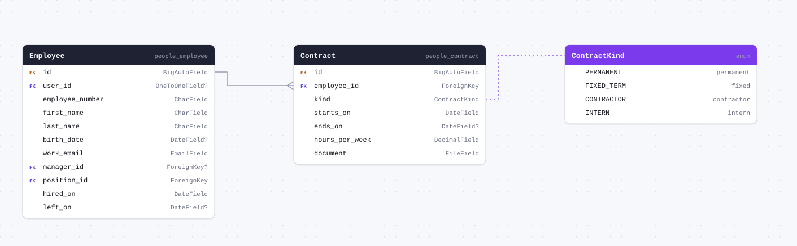

| Column | Field | Type | Null | Key | Default | Description |
| --- | --- | --- | --- | --- | --- | --- |
| `id` | `BigAutoField` | `integer` |  | PK | `autoincrement()` |  |
| `employee_id` | `ForeignKey` | `bigint` |  | FK |  |  |
| `kind` | `ContractKind` | `varchar(10)` |  |  |  |  |
| `starts_on` | `DateField` | `date` |  |  |  |  |
| `ends_on` | `DateField` | `date` | yes |  |  |  |
| `hours_per_week` | `DecimalField(4, 1)` | `decimal` |  |  | `40` |  |
| `document` | `FileField` | `varchar(100)` |  |  |  |  |

Indexes:

- index `people_contract_employee_id_ba6eccb9` on `employee_id`

Relations:

- `employee_id` → [Employee](#employee).`id`, on delete cascade

## Salary

Table `people_salary`, app `people`.

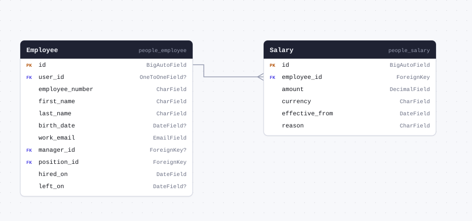

| Column | Field | Type | Null | Key | Default | Description |
| --- | --- | --- | --- | --- | --- | --- |
| `id` | `BigAutoField` | `integer` |  | PK | `autoincrement()` |  |
| `employee_id` | `ForeignKey` | `bigint` |  | FK |  |  |
| `amount` | `DecimalField(12, 2)` | `decimal` |  |  |  |  |
| `currency` | `CharField` | `varchar(3)` |  |  | `'EUR'` |  |
| `effective_from` | `DateField` | `date` |  |  |  |  |
| `reason` | `CharField` | `varchar(200)` |  |  |  |  |

Indexes:

- index `people_salary_employee_id_c29f2776` on `employee_id`
- unique `people_salary_employee_id_effective_from_04f18609_uniq` on `employee_id`, `effective_from`

Relations:

- `employee_id` → [Employee](#employee).`id`, on delete cascade

## Skill

Table `people_skill`, app `people`.

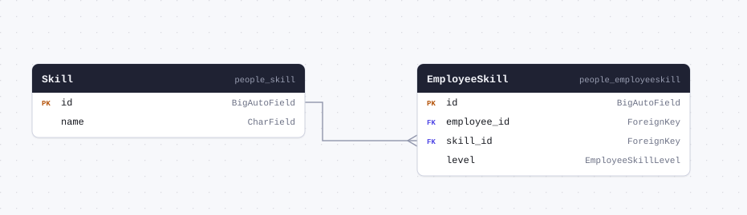

| Column | Field | Type | Null | Key | Default | Description |
| --- | --- | --- | --- | --- | --- | --- |
| `id` | `BigAutoField` | `integer` |  | PK | `autoincrement()` |  |
| `name` | `CharField` | `varchar(50)` |  | unique |  |  |

Relations:

- `employees` — many to many with [Employee](#employee), through [EmployeeSkill](#employeeskill)
- [EmployeeSkill](#employeeskill).`skill_id` → `id`, on delete cascade

## EmployeeSkill

Table `people_employeeskill`, app `people`.

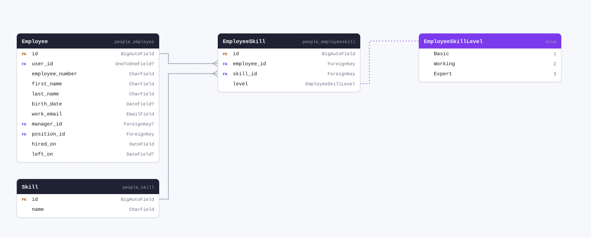

| Column | Field | Type | Null | Key | Default | Description |
| --- | --- | --- | --- | --- | --- | --- |
| `id` | `BigAutoField` | `integer` |  | PK | `autoincrement()` |  |
| `employee_id` | `ForeignKey` | `bigint` |  | FK |  |  |
| `skill_id` | `ForeignKey` | `bigint` |  | FK |  |  |
| `level` | `EmployeeSkillLevel` | `smallint unsigned` |  |  |  |  |

Indexes:

- index `people_employeeskill_employee_id_b64ea790` on `employee_id`
- index `people_employeeskill_skill_id_6a4b5e8a` on `skill_id`

Relations:

- `employee_id` → [Employee](#employee).`id`, on delete cascade
- `skill_id` → [Skill](#skill).`id`, on delete cascade

## LeaveType

Table `people_leavetype`, app `people`.

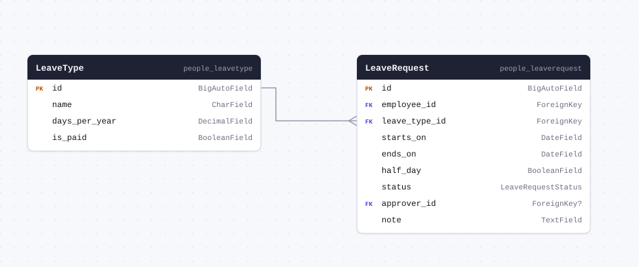

| Column | Field | Type | Null | Key | Default | Description |
| --- | --- | --- | --- | --- | --- | --- |
| `id` | `BigAutoField` | `integer` |  | PK | `autoincrement()` |  |
| `name` | `CharField` | `varchar(50)` |  | unique |  |  |
| `days_per_year` | `DecimalField(4, 1)` | `decimal` |  |  |  |  |
| `is_paid` | `BooleanField` | `bool` |  |  | `True` |  |

Relations:

- [LeaveRequest](#leaverequest).`leave_type_id` → `id`, on delete protect

## LeaveRequest

Table `people_leaverequest`, app `people`.

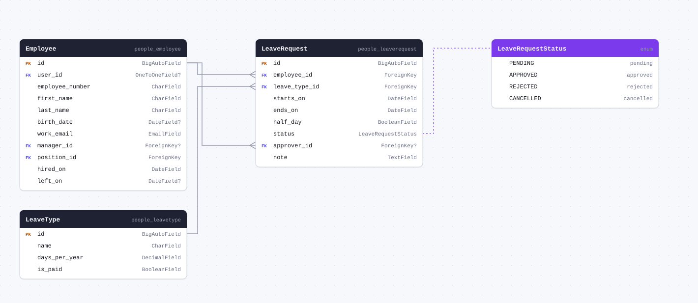

| Column | Field | Type | Null | Key | Default | Description |
| --- | --- | --- | --- | --- | --- | --- |
| `id` | `BigAutoField` | `integer` |  | PK | `autoincrement()` |  |
| `employee_id` | `ForeignKey` | `bigint` |  | FK |  |  |
| `leave_type_id` | `ForeignKey` | `bigint` |  | FK |  |  |
| `starts_on` | `DateField` | `date` |  |  |  |  |
| `ends_on` | `DateField` | `date` |  |  |  |  |
| `half_day` | `BooleanField` | `bool` |  |  | `False` |  |
| `status` | `LeaveRequestStatus` | `varchar(10)` |  |  | `'pending'` |  |
| `approver_id` | `ForeignKey` | `bigint` | yes | FK |  |  |
| `note` | `TextField` | `text` |  |  |  |  |

Indexes:

- index `people_leaverequest_employee_id_c860fa77` on `employee_id`
- index `people_leaverequest_leave_type_id_eb33cce4` on `leave_type_id`
- index `people_leaverequest_approver_id_12209e74` on `approver_id`

Checks:

- `leave_ends_after_start`: `"ends_on" >= ("starts_on")`

Relations:

- `employee_id` → [Employee](#employee).`id`, on delete cascade
- `leave_type_id` → [LeaveType](#leavetype).`id`, on delete protect
- `approver_id` → [Employee](#employee).`id`, on delete set null

## Review

Table `people_review`, app `people`.

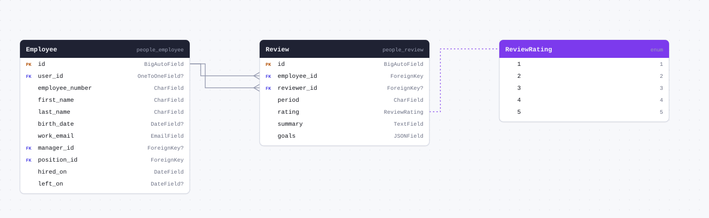

| Column | Field | Type | Null | Key | Default | Description |
| --- | --- | --- | --- | --- | --- | --- |
| `id` | `BigAutoField` | `integer` |  | PK | `autoincrement()` |  |
| `employee_id` | `ForeignKey` | `bigint` |  | FK |  |  |
| `reviewer_id` | `ForeignKey` | `bigint` | yes | FK |  |  |
| `period` | `CharField` | `varchar(7)` |  |  |  | e.g. 2026-H1 |
| `rating` | `ReviewRating` | `smallint unsigned` |  |  |  |  |
| `summary` | `TextField` | `text` |  |  |  |  |
| `goals` | `JSONField` | `text` |  |  | `list()` |  |

Indexes:

- index `people_review_employee_id_2e53470c` on `employee_id`
- index `people_review_reviewer_id_dfc1b3a1` on `reviewer_id`
- unique `people_review_employee_id_period_5db03834_uniq` on `employee_id`, `period`

Relations:

- `employee_id` → [Employee](#employee).`id`, on delete cascade
- `reviewer_id` → [Employee](#employee).`id`, on delete set null

# Enums

## ContractKind

| Name | Stored as |
| --- | --- |
| `PERMANENT` | `permanent` |
| `FIXED_TERM` | `fixed` |
| `CONTRACTOR` | `contractor` |
| `INTERN` | `intern` |

## EmployeeSkillLevel

| Name | Stored as |
| --- | --- |
| `Basic` | `1` |
| `Working` | `2` |
| `Expert` | `3` |

## LeaveRequestStatus

| Name | Stored as |
| --- | --- |
| `PENDING` | `pending` |
| `APPROVED` | `approved` |
| `REJECTED` | `rejected` |
| `CANCELLED` | `cancelled` |

## ReviewRating

| Name | Stored as |
| --- | --- |
| `1` | `1` |
| `2` | `2` |
| `3` | `3` |
| `4` | `4` |
| `5` | `5` |
