# Schema docs

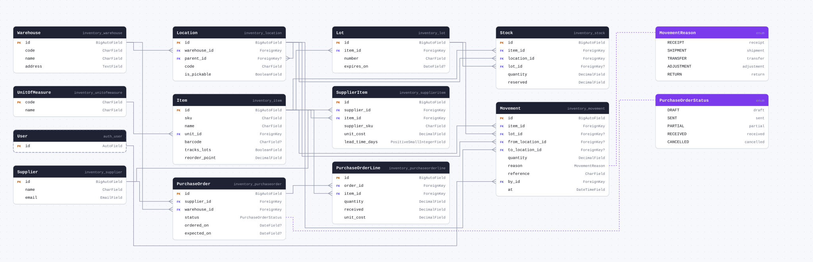

[Warehouse](#warehouse) · [Location](#location) · [UnitOfMeasure](#unitofmeasure) · [Item](#item) · [Lot](#lot) · [Stock](#stock) · [Movement](#movement) · [Supplier](#supplier) · [SupplierItem](#supplieritem) · [PurchaseOrder](#purchaseorder) · [PurchaseOrderLine](#purchaseorderline)

<details>
<summary>The whole schema as SQL</summary>

```sql
CREATE TABLE "inventory_warehouse" ("id" integer NOT NULL PRIMARY KEY AUTOINCREMENT, "code" varchar(10) NOT NULL UNIQUE, "name" varchar(100) NOT NULL, "address" text NOT NULL);

CREATE TABLE "inventory_location" ("id" integer NOT NULL PRIMARY KEY AUTOINCREMENT, "warehouse_id" bigint NOT NULL REFERENCES "inventory_warehouse" ("id") DEFERRABLE INITIALLY DEFERRED, "parent_id" bigint NULL REFERENCES "inventory_location" ("id") DEFERRABLE INITIALLY DEFERRED, "code" varchar(30) NOT NULL, "is_pickable" bool NOT NULL);

CREATE TABLE "inventory_unitofmeasure" ("code" varchar(10) NOT NULL PRIMARY KEY, "name" varchar(30) NOT NULL);

CREATE TABLE "inventory_item" ("id" integer NOT NULL PRIMARY KEY AUTOINCREMENT, "sku" varchar(40) NOT NULL UNIQUE, "name" varchar(200) NOT NULL, "unit_id" varchar(10) NOT NULL REFERENCES "inventory_unitofmeasure" ("code") DEFERRABLE INITIALLY DEFERRED, "barcode" varchar(50) NULL UNIQUE, "tracks_lots" bool NOT NULL, "reorder_point" decimal NOT NULL);

CREATE TABLE "inventory_lot" ("id" integer NOT NULL PRIMARY KEY AUTOINCREMENT, "item_id" bigint NOT NULL REFERENCES "inventory_item" ("id") DEFERRABLE INITIALLY DEFERRED, "number" varchar(40) NOT NULL, "expires_on" date NULL);

CREATE TABLE "inventory_stock" ("id" integer NOT NULL PRIMARY KEY AUTOINCREMENT, "item_id" bigint NOT NULL REFERENCES "inventory_item" ("id") DEFERRABLE INITIALLY DEFERRED, "location_id" bigint NOT NULL REFERENCES "inventory_location" ("id") DEFERRABLE INITIALLY DEFERRED, "lot_id" bigint NULL REFERENCES "inventory_lot" ("id") DEFERRABLE INITIALLY DEFERRED, "quantity" decimal NOT NULL, "reserved" decimal NOT NULL, CONSTRAINT "stock_one_row_per_lot" UNIQUE ("item_id", "location_id", "lot_id"), CONSTRAINT "stock_not_negative" CHECK ("quantity" >= '0'), CONSTRAINT "stock_reserved_within" CHECK ("reserved" <= ("quantity")));

CREATE TABLE "inventory_movement" ("id" integer NOT NULL PRIMARY KEY AUTOINCREMENT, "item_id" bigint NOT NULL REFERENCES "inventory_item" ("id") DEFERRABLE INITIALLY DEFERRED, "lot_id" bigint NULL REFERENCES "inventory_lot" ("id") DEFERRABLE INITIALLY DEFERRED, "from_location_id" bigint NULL REFERENCES "inventory_location" ("id") DEFERRABLE INITIALLY DEFERRED, "to_location_id" bigint NULL REFERENCES "inventory_location" ("id") DEFERRABLE INITIALLY DEFERRED, "quantity" decimal NOT NULL, "reason" varchar(10) NOT NULL, "reference" varchar(50) NOT NULL, "by_id" integer NOT NULL REFERENCES "auth_user" ("id") DEFERRABLE INITIALLY DEFERRED, "at" datetime NOT NULL, CONSTRAINT "movement_positive" CHECK ("quantity" > '0'), CONSTRAINT "movement_has_a_location" CHECK (("from_location_id" IS NOT NULL OR "to_location_id" IS NOT NULL)));

CREATE TABLE "inventory_supplier" ("id" integer NOT NULL PRIMARY KEY AUTOINCREMENT, "name" varchar(100) NOT NULL, "email" varchar(254) NOT NULL);

CREATE TABLE "inventory_supplieritem" ("id" integer NOT NULL PRIMARY KEY AUTOINCREMENT, "supplier_id" bigint NOT NULL REFERENCES "inventory_supplier" ("id") DEFERRABLE INITIALLY DEFERRED, "item_id" bigint NOT NULL REFERENCES "inventory_item" ("id") DEFERRABLE INITIALLY DEFERRED, "supplier_sku" varchar(40) NOT NULL, "unit_cost" decimal NOT NULL, "lead_time_days" smallint unsigned NOT NULL CHECK ("lead_time_days" >= 0));

CREATE TABLE "inventory_purchaseorder" ("id" integer NOT NULL PRIMARY KEY AUTOINCREMENT, "supplier_id" bigint NOT NULL REFERENCES "inventory_supplier" ("id") DEFERRABLE INITIALLY DEFERRED, "warehouse_id" bigint NOT NULL REFERENCES "inventory_warehouse" ("id") DEFERRABLE INITIALLY DEFERRED, "status" varchar(10) NOT NULL, "ordered_on" date NULL, "expected_on" date NULL);

CREATE TABLE "inventory_purchaseorderline" ("id" integer NOT NULL PRIMARY KEY AUTOINCREMENT, "order_id" bigint NOT NULL REFERENCES "inventory_purchaseorder" ("id") DEFERRABLE INITIALLY DEFERRED, "item_id" bigint NOT NULL REFERENCES "inventory_item" ("id") DEFERRABLE INITIALLY DEFERRED, "quantity" decimal NOT NULL, "received" decimal NOT NULL, "unit_cost" decimal NOT NULL);

CREATE UNIQUE INDEX "inventory_location_warehouse_id_code_0454aa8d_uniq" ON "inventory_location" ("warehouse_id", "code");

CREATE INDEX "inventory_location_warehouse_id_972ee1ee" ON "inventory_location" ("warehouse_id");

CREATE INDEX "inventory_location_parent_id_34319007" ON "inventory_location" ("parent_id");

CREATE INDEX "inventory_item_unit_id_9cc1c17e" ON "inventory_item" ("unit_id");

CREATE UNIQUE INDEX "inventory_lot_item_id_number_c238e926_uniq" ON "inventory_lot" ("item_id", "number");

CREATE INDEX "inventory_lot_item_id_e323754c" ON "inventory_lot" ("item_id");

CREATE UNIQUE INDEX "stock_one_row_without_lot" ON "inventory_stock" ("item_id", "location_id") WHERE "lot_id" IS NULL;

CREATE INDEX "inventory_stock_item_id_51ef1040" ON "inventory_stock" ("item_id");

CREATE INDEX "inventory_stock_location_id_be05a9db" ON "inventory_stock" ("location_id");

CREATE INDEX "inventory_stock_lot_id_e5cead22" ON "inventory_stock" ("lot_id");

CREATE INDEX "inventory_movement_item_id_20793f0e" ON "inventory_movement" ("item_id");

CREATE INDEX "inventory_movement_lot_id_c6953902" ON "inventory_movement" ("lot_id");

CREATE INDEX "inventory_movement_from_location_id_93fc7483" ON "inventory_movement" ("from_location_id");

CREATE INDEX "inventory_movement_to_location_id_081c2524" ON "inventory_movement" ("to_location_id");

CREATE INDEX "inventory_movement_by_id_758aa06e" ON "inventory_movement" ("by_id");

CREATE INDEX "inventory_supplieritem_supplier_id_b5039002" ON "inventory_supplieritem" ("supplier_id");

CREATE INDEX "inventory_supplieritem_item_id_589828f9" ON "inventory_supplieritem" ("item_id");

CREATE INDEX "inventory_purchaseorder_supplier_id_c6bc28e9" ON "inventory_purchaseorder" ("supplier_id");

CREATE INDEX "inventory_purchaseorder_warehouse_id_72f41103" ON "inventory_purchaseorder" ("warehouse_id");

CREATE INDEX "inventory_purchaseorderline_order_id_2e62329b" ON "inventory_purchaseorderline" ("order_id");

CREATE INDEX "inventory_purchaseorderline_item_id_cf711322" ON "inventory_purchaseorderline" ("item_id");
```

</details>

## Warehouse

Table `inventory_warehouse`, app `inventory`.

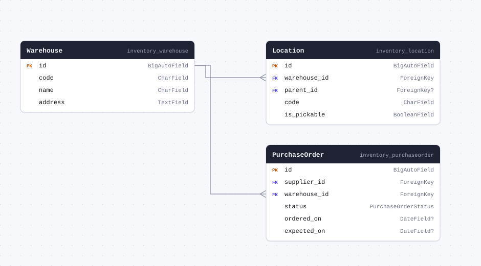

| Column | Field | Type | Null | Key | Default | Description |
| --- | --- | --- | --- | --- | --- | --- |
| `id` | `BigAutoField` | `integer` |  | PK | `autoincrement()` |  |
| `code` | `CharField` | `varchar(10)` |  | unique |  |  |
| `name` | `CharField` | `varchar(100)` |  |  |  |  |
| `address` | `TextField` | `text` |  |  |  |  |

Relations:

- [Location](#location).`warehouse_id` → `id`, on delete cascade
- [PurchaseOrder](#purchaseorder).`warehouse_id` → `id`, on delete protect

## Location

Table `inventory_location`, app `inventory`.

A shelf or bin, inside another location or at the top of a warehouse.

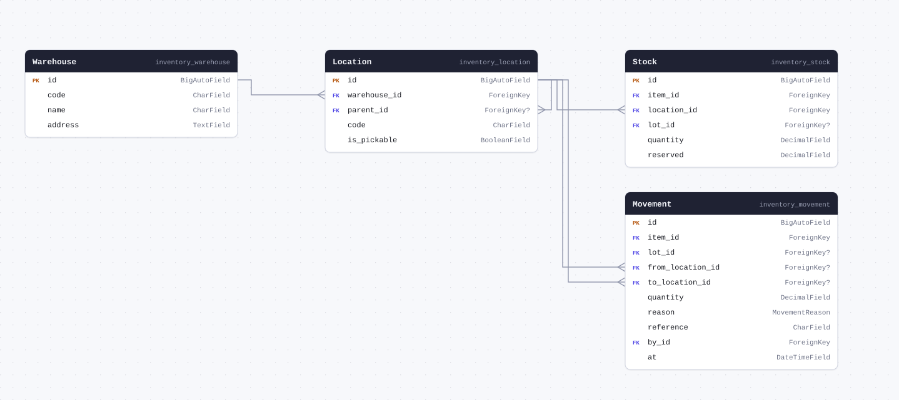

| Column | Field | Type | Null | Key | Default | Description |
| --- | --- | --- | --- | --- | --- | --- |
| `id` | `BigAutoField` | `integer` |  | PK | `autoincrement()` |  |
| `warehouse_id` | `ForeignKey` | `bigint` |  | FK |  |  |
| `parent_id` | `ForeignKey` | `bigint` | yes | FK |  |  |
| `code` | `CharField` | `varchar(30)` |  |  |  |  |
| `is_pickable` | `BooleanField` | `bool` |  |  | `True` |  |

Indexes:

- index `inventory_location_warehouse_id_972ee1ee` on `warehouse_id`
- index `inventory_location_parent_id_34319007` on `parent_id`
- unique `inventory_location_warehouse_id_code_0454aa8d_uniq` on `warehouse_id`, `code`

Relations:

- `warehouse_id` → [Warehouse](#warehouse).`id`, on delete cascade
- `parent_id` → [Location](#location).`id`, on delete cascade
- [Stock](#stock).`location_id` → `id`, on delete cascade
- [Movement](#movement).`from_location_id` → `id`, on delete protect
- [Movement](#movement).`to_location_id` → `id`, on delete protect

## UnitOfMeasure

Table `inventory_unitofmeasure`, app `inventory`.

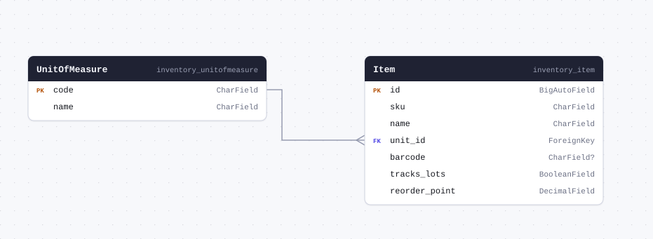

| Column | Field | Type | Null | Key | Default | Description |
| --- | --- | --- | --- | --- | --- | --- |
| `code` | `CharField` | `varchar(10)` |  | PK |  |  |
| `name` | `CharField` | `varchar(30)` |  |  |  |  |

Relations:

- [Item](#item).`unit_id` → `code`, on delete protect

## Item

Table `inventory_item`, app `inventory`.

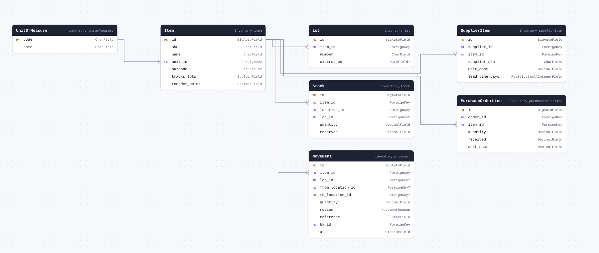

| Column | Field | Type | Null | Key | Default | Description |
| --- | --- | --- | --- | --- | --- | --- |
| `id` | `BigAutoField` | `integer` |  | PK | `autoincrement()` |  |
| `sku` | `CharField` | `varchar(40)` |  | unique |  |  |
| `name` | `CharField` | `varchar(200)` |  |  |  |  |
| `unit_id` | `ForeignKey` | `varchar(10)` |  | FK |  |  |
| `barcode` | `CharField` | `varchar(50)` | yes | unique |  |  |
| `tracks_lots` | `BooleanField` | `bool` |  |  | `False` |  |
| `reorder_point` | `DecimalField(12, 3)` | `decimal` |  |  | `0` |  |

Indexes:

- index `inventory_item_unit_id_9cc1c17e` on `unit_id`

Relations:

- `suppliers` — many to many with [Supplier](#supplier), through [SupplierItem](#supplieritem)
- `unit_id` → [UnitOfMeasure](#unitofmeasure).`code`, on delete protect
- [Lot](#lot).`item_id` → `id`, on delete cascade
- [Stock](#stock).`item_id` → `id`, on delete cascade
- [Movement](#movement).`item_id` → `id`, on delete protect
- [SupplierItem](#supplieritem).`item_id` → `id`, on delete cascade
- [PurchaseOrderLine](#purchaseorderline).`item_id` → `id`, on delete protect

## Lot

Table `inventory_lot`, app `inventory`.

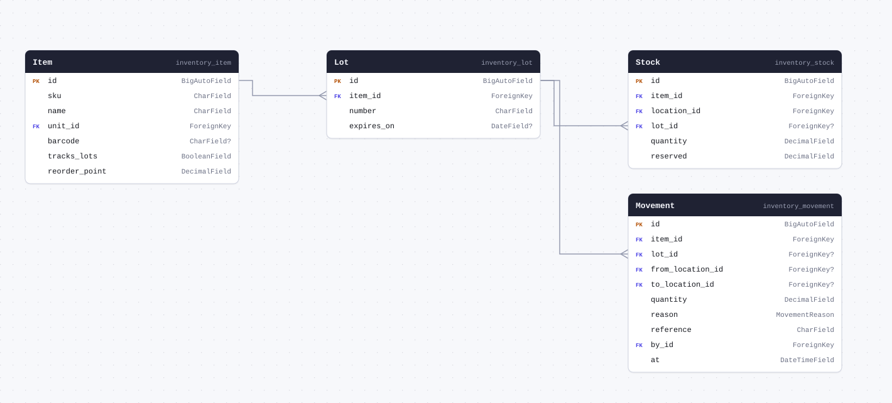

| Column | Field | Type | Null | Key | Default | Description |
| --- | --- | --- | --- | --- | --- | --- |
| `id` | `BigAutoField` | `integer` |  | PK | `autoincrement()` |  |
| `item_id` | `ForeignKey` | `bigint` |  | FK |  |  |
| `number` | `CharField` | `varchar(40)` |  |  |  |  |
| `expires_on` | `DateField` | `date` | yes |  |  |  |

Indexes:

- index `inventory_lot_item_id_e323754c` on `item_id`
- unique `inventory_lot_item_id_number_c238e926_uniq` on `item_id`, `number`

Relations:

- `item_id` → [Item](#item).`id`, on delete cascade
- [Stock](#stock).`lot_id` → `id`, on delete cascade
- [Movement](#movement).`lot_id` → `id`, on delete protect

## Stock

Table `inventory_stock`, app `inventory`.

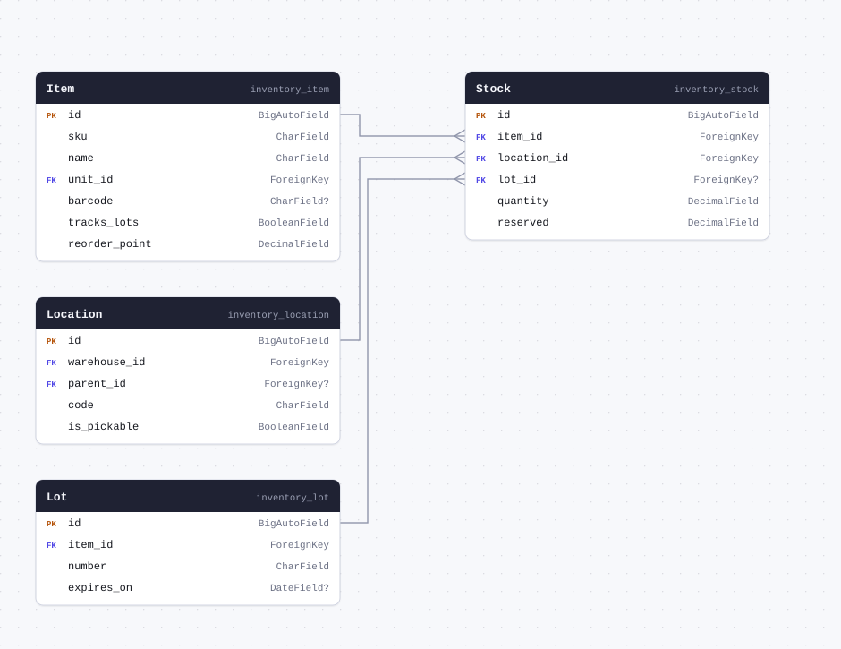

| Column | Field | Type | Null | Key | Default | Description |
| --- | --- | --- | --- | --- | --- | --- |
| `id` | `BigAutoField` | `integer` |  | PK | `autoincrement()` |  |
| `item_id` | `ForeignKey` | `bigint` |  | FK |  |  |
| `location_id` | `ForeignKey` | `bigint` |  | FK |  |  |
| `lot_id` | `ForeignKey` | `bigint` | yes | FK |  |  |
| `quantity` | `DecimalField(12, 3)` | `decimal` |  |  | `0` |  |
| `reserved` | `DecimalField(12, 3)` | `decimal` |  |  | `0` |  |

Indexes:

- index `inventory_stock_item_id_51ef1040` on `item_id`
- index `inventory_stock_location_id_be05a9db` on `location_id`
- index `inventory_stock_lot_id_e5cead22` on `lot_id`
- unique `stock_one_row_per_lot` on `item_id`, `location_id`, `lot_id`
- unique `stock_one_row_without_lot` on `item_id`, `location_id` where `"lot_id" IS NULL`

Checks:

- `stock_not_negative`: `"quantity" >= '0'`
- `stock_reserved_within`: `"reserved" <= ("quantity")`

Relations:

- `item_id` → [Item](#item).`id`, on delete cascade
- `location_id` → [Location](#location).`id`, on delete cascade
- `lot_id` → [Lot](#lot).`id`, on delete cascade

## Movement

Table `inventory_movement`, app `inventory`.

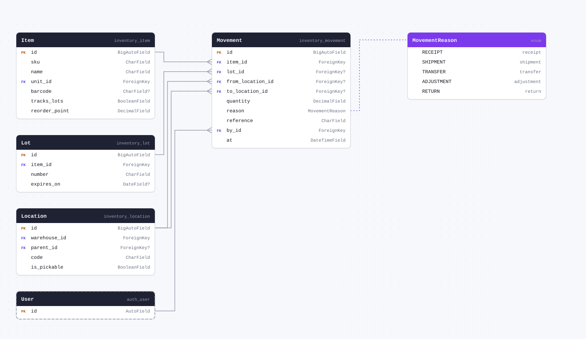

| Column | Field | Type | Null | Key | Default | Description |
| --- | --- | --- | --- | --- | --- | --- |
| `id` | `BigAutoField` | `integer` |  | PK | `autoincrement()` |  |
| `item_id` | `ForeignKey` | `bigint` |  | FK |  |  |
| `lot_id` | `ForeignKey` | `bigint` | yes | FK |  |  |
| `from_location_id` | `ForeignKey` | `bigint` | yes | FK |  |  |
| `to_location_id` | `ForeignKey` | `bigint` | yes | FK |  |  |
| `quantity` | `DecimalField(12, 3)` | `decimal` |  |  |  |  |
| `reason` | `MovementReason` | `varchar(10)` |  |  |  |  |
| `reference` | `CharField` | `varchar(50)` |  |  |  |  |
| `by_id` | `ForeignKey` | `integer` |  | FK |  |  |
| `at` | `DateTimeField` | `datetime` |  |  | `now()` |  |

Indexes:

- index `inventory_movement_item_id_20793f0e` on `item_id`
- index `inventory_movement_lot_id_c6953902` on `lot_id`
- index `inventory_movement_from_location_id_93fc7483` on `from_location_id`
- index `inventory_movement_to_location_id_081c2524` on `to_location_id`
- index `inventory_movement_by_id_758aa06e` on `by_id`

Checks:

- `movement_positive`: `"quantity" > '0'`
- `movement_has_a_location`: `("from_location_id" IS NOT NULL OR "to_location_id" IS NOT NULL)`

Relations:

- `item_id` → [Item](#item).`id`, on delete protect
- `lot_id` → [Lot](#lot).`id`, on delete protect
- `from_location_id` → [Location](#location).`id`, on delete protect
- `to_location_id` → [Location](#location).`id`, on delete protect
- `by_id` → `User`.`id` (auth, not in these docs), on delete protect

## Supplier

Table `inventory_supplier`, app `inventory`.

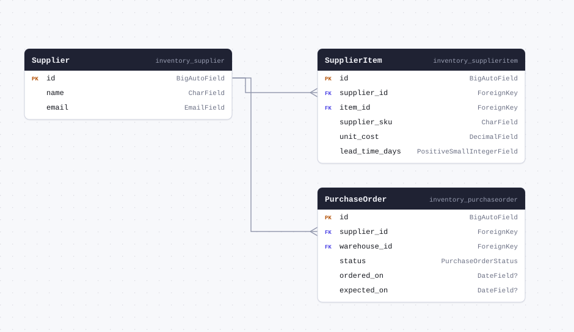

| Column | Field | Type | Null | Key | Default | Description |
| --- | --- | --- | --- | --- | --- | --- |
| `id` | `BigAutoField` | `integer` |  | PK | `autoincrement()` |  |
| `name` | `CharField` | `varchar(100)` |  |  |  |  |
| `email` | `EmailField` | `varchar(254)` |  |  |  |  |

Relations:

- `items` — many to many with [Item](#item), through [SupplierItem](#supplieritem)
- [SupplierItem](#supplieritem).`supplier_id` → `id`, on delete cascade
- [PurchaseOrder](#purchaseorder).`supplier_id` → `id`, on delete protect

## SupplierItem

Table `inventory_supplieritem`, app `inventory`.

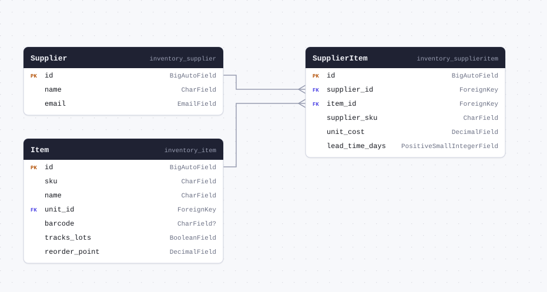

| Column | Field | Type | Null | Key | Default | Description |
| --- | --- | --- | --- | --- | --- | --- |
| `id` | `BigAutoField` | `integer` |  | PK | `autoincrement()` |  |
| `supplier_id` | `ForeignKey` | `bigint` |  | FK |  |  |
| `item_id` | `ForeignKey` | `bigint` |  | FK |  |  |
| `supplier_sku` | `CharField` | `varchar(40)` |  |  |  |  |
| `unit_cost` | `DecimalField(10, 4)` | `decimal` |  |  |  |  |
| `lead_time_days` | `PositiveSmallIntegerField` | `smallint unsigned` |  |  | `7` |  |

Indexes:

- index `inventory_supplieritem_supplier_id_b5039002` on `supplier_id`
- index `inventory_supplieritem_item_id_589828f9` on `item_id`

Relations:

- `supplier_id` → [Supplier](#supplier).`id`, on delete cascade
- `item_id` → [Item](#item).`id`, on delete cascade

## PurchaseOrder

Table `inventory_purchaseorder`, app `inventory`.

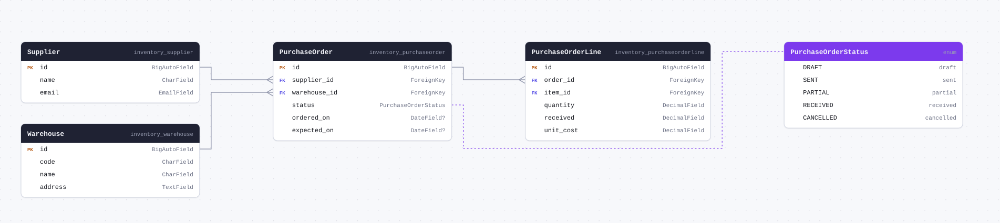

| Column | Field | Type | Null | Key | Default | Description |
| --- | --- | --- | --- | --- | --- | --- |
| `id` | `BigAutoField` | `integer` |  | PK | `autoincrement()` |  |
| `supplier_id` | `ForeignKey` | `bigint` |  | FK |  |  |
| `warehouse_id` | `ForeignKey` | `bigint` |  | FK |  |  |
| `status` | `PurchaseOrderStatus` | `varchar(10)` |  |  | `'draft'` |  |
| `ordered_on` | `DateField` | `date` | yes |  |  |  |
| `expected_on` | `DateField` | `date` | yes |  |  |  |

Indexes:

- index `inventory_purchaseorder_supplier_id_c6bc28e9` on `supplier_id`
- index `inventory_purchaseorder_warehouse_id_72f41103` on `warehouse_id`

Relations:

- `supplier_id` → [Supplier](#supplier).`id`, on delete protect
- `warehouse_id` → [Warehouse](#warehouse).`id`, on delete protect
- [PurchaseOrderLine](#purchaseorderline).`order_id` → `id`, on delete cascade

## PurchaseOrderLine

Table `inventory_purchaseorderline`, app `inventory`.

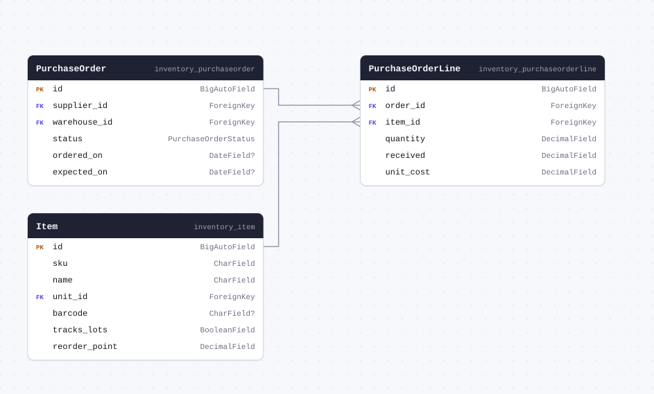

| Column | Field | Type | Null | Key | Default | Description |
| --- | --- | --- | --- | --- | --- | --- |
| `id` | `BigAutoField` | `integer` |  | PK | `autoincrement()` |  |
| `order_id` | `ForeignKey` | `bigint` |  | FK |  |  |
| `item_id` | `ForeignKey` | `bigint` |  | FK |  |  |
| `quantity` | `DecimalField(12, 3)` | `decimal` |  |  |  |  |
| `received` | `DecimalField(12, 3)` | `decimal` |  |  | `0` |  |
| `unit_cost` | `DecimalField(10, 4)` | `decimal` |  |  |  |  |

Indexes:

- index `inventory_purchaseorderline_order_id_2e62329b` on `order_id`
- index `inventory_purchaseorderline_item_id_cf711322` on `item_id`

Relations:

- `order_id` → [PurchaseOrder](#purchaseorder).`id`, on delete cascade
- `item_id` → [Item](#item).`id`, on delete protect

# Enums

## MovementReason

| Name | Stored as |
| --- | --- |
| `RECEIPT` | `receipt` |
| `SHIPMENT` | `shipment` |
| `TRANSFER` | `transfer` |
| `ADJUSTMENT` | `adjustment` |
| `RETURN` | `return` |

## PurchaseOrderStatus

| Name | Stored as |
| --- | --- |
| `DRAFT` | `draft` |
| `SENT` | `sent` |
| `PARTIAL` | `partial` |
| `RECEIVED` | `received` |
| `CANCELLED` | `cancelled` |
