# Schema docs

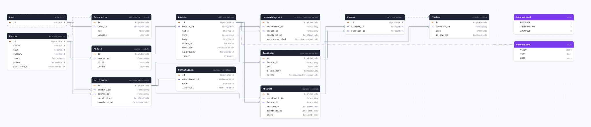

[Instructor](#instructor) · [Course](#course) · [Module](#module) · [Lesson](#lesson) · [Enrollment](#enrollment) · [LessonProgress](#lessonprogress) · [Question](#question) · [Choice](#choice) · [Attempt](#attempt) · [Answer](#answer) · [Certificate](#certificate)

<details>
<summary>The whole schema as SQL</summary>

```sql
CREATE TABLE "courses_instructor" ("id" integer NOT NULL PRIMARY KEY AUTOINCREMENT, "user_id" integer NOT NULL UNIQUE REFERENCES "auth_user" ("id") DEFERRABLE INITIALLY DEFERRED, "bio" text NOT NULL, "website" varchar(200) NOT NULL);

CREATE TABLE "courses_course" ("id" integer NOT NULL PRIMARY KEY AUTOINCREMENT, "title" varchar(200) NOT NULL, "slug" varchar(50) NOT NULL UNIQUE, "summary" text NOT NULL, "level" smallint unsigned NOT NULL CHECK ("level" >= 0), "price" decimal NOT NULL, "published_at" datetime NULL);

CREATE TABLE "courses_course_instructors" ("id" integer NOT NULL PRIMARY KEY AUTOINCREMENT, "course_id" bigint NOT NULL REFERENCES "courses_course" ("id") DEFERRABLE INITIALLY DEFERRED, "instructor_id" bigint NOT NULL REFERENCES "courses_instructor" ("id") DEFERRABLE INITIALLY DEFERRED);

CREATE TABLE "courses_course_prerequisites" ("id" integer NOT NULL PRIMARY KEY AUTOINCREMENT, "from_course_id" bigint NOT NULL REFERENCES "courses_course" ("id") DEFERRABLE INITIALLY DEFERRED, "to_course_id" bigint NOT NULL REFERENCES "courses_course" ("id") DEFERRABLE INITIALLY DEFERRED);

CREATE TABLE "courses_module" ("id" integer NOT NULL PRIMARY KEY AUTOINCREMENT, "course_id" bigint NOT NULL REFERENCES "courses_course" ("id") DEFERRABLE INITIALLY DEFERRED, "title" varchar(200) NOT NULL, "_order" integer NOT NULL);

CREATE TABLE "courses_lesson" ("id" integer NOT NULL PRIMARY KEY AUTOINCREMENT, "module_id" bigint NOT NULL REFERENCES "courses_module" ("id") DEFERRABLE INITIALLY DEFERRED, "title" varchar(200) NOT NULL, "kind" varchar(5) NOT NULL, "body" text NOT NULL, "video_url" varchar(200) NOT NULL, "duration" bigint NULL, "is_preview" bool NOT NULL, "_order" integer NOT NULL);

CREATE TABLE "courses_enrollment" ("id" integer NOT NULL PRIMARY KEY AUTOINCREMENT, "student_id" integer NOT NULL REFERENCES "auth_user" ("id") DEFERRABLE INITIALLY DEFERRED, "course_id" bigint NOT NULL REFERENCES "courses_course" ("id") DEFERRABLE INITIALLY DEFERRED, "enrolled_at" datetime NOT NULL, "completed_at" datetime NULL, CONSTRAINT "enroll_once" UNIQUE ("student_id", "course_id"));

CREATE TABLE "courses_lessonprogress" ("id" integer NOT NULL PRIMARY KEY AUTOINCREMENT, "enrollment_id" bigint NOT NULL REFERENCES "courses_enrollment" ("id") DEFERRABLE INITIALLY DEFERRED, "lesson_id" bigint NOT NULL REFERENCES "courses_lesson" ("id") DEFERRABLE INITIALLY DEFERRED, "completed_at" datetime NOT NULL, "seconds_watched" integer unsigned NOT NULL CHECK ("seconds_watched" >= 0));

CREATE TABLE "courses_question" ("id" integer NOT NULL PRIMARY KEY AUTOINCREMENT, "lesson_id" bigint NOT NULL REFERENCES "courses_lesson" ("id") DEFERRABLE INITIALLY DEFERRED, "text" text NOT NULL, "allows_many" bool NOT NULL, "points" smallint unsigned NOT NULL CHECK ("points" >= 0));

CREATE TABLE "courses_choice" ("id" integer NOT NULL PRIMARY KEY AUTOINCREMENT, "question_id" bigint NOT NULL REFERENCES "courses_question" ("id") DEFERRABLE INITIALLY DEFERRED, "text" varchar(300) NOT NULL, "is_correct" bool NOT NULL);

CREATE TABLE "courses_attempt" ("id" integer NOT NULL PRIMARY KEY AUTOINCREMENT, "enrollment_id" bigint NOT NULL REFERENCES "courses_enrollment" ("id") DEFERRABLE INITIALLY DEFERRED, "lesson_id" bigint NOT NULL REFERENCES "courses_lesson" ("id") DEFERRABLE INITIALLY DEFERRED, "started_at" datetime NOT NULL, "submitted_at" datetime NULL, "score" decimal NULL);

CREATE TABLE "courses_answer" ("id" integer NOT NULL PRIMARY KEY AUTOINCREMENT, "attempt_id" bigint NOT NULL REFERENCES "courses_attempt" ("id") DEFERRABLE INITIALLY DEFERRED, "question_id" bigint NOT NULL REFERENCES "courses_question" ("id") DEFERRABLE INITIALLY DEFERRED);

CREATE TABLE "courses_answer_choices" ("id" integer NOT NULL PRIMARY KEY AUTOINCREMENT, "answer_id" bigint NOT NULL REFERENCES "courses_answer" ("id") DEFERRABLE INITIALLY DEFERRED, "choice_id" bigint NOT NULL REFERENCES "courses_choice" ("id") DEFERRABLE INITIALLY DEFERRED);

CREATE TABLE "courses_certificate" ("id" integer NOT NULL PRIMARY KEY AUTOINCREMENT, "enrollment_id" bigint NOT NULL UNIQUE REFERENCES "courses_enrollment" ("id") DEFERRABLE INITIALLY DEFERRED, "code" varchar(20) NOT NULL UNIQUE, "issued_at" datetime NOT NULL);

CREATE UNIQUE INDEX "courses_course_instructors_course_id_instructor_id_bb074e9c_uniq" ON "courses_course_instructors" ("course_id", "instructor_id");

CREATE INDEX "courses_course_instructors_course_id_f276839d" ON "courses_course_instructors" ("course_id");

CREATE INDEX "courses_course_instructors_instructor_id_9812a859" ON "courses_course_instructors" ("instructor_id");

CREATE UNIQUE INDEX "courses_course_prerequisites_from_course_id_to_course_id_91caca13_uniq" ON "courses_course_prerequisites" ("from_course_id", "to_course_id");

CREATE INDEX "courses_course_prerequisites_from_course_id_9cda6dc7" ON "courses_course_prerequisites" ("from_course_id");

CREATE INDEX "courses_course_prerequisites_to_course_id_d895f6b3" ON "courses_course_prerequisites" ("to_course_id");

CREATE INDEX "courses_module_course_id_7d4820de" ON "courses_module" ("course_id");

CREATE INDEX "courses_lesson_module_id_41252914" ON "courses_lesson" ("module_id");

CREATE INDEX "courses_enrollment_student_id_aebf8536" ON "courses_enrollment" ("student_id");

CREATE INDEX "courses_enrollment_course_id_2631503e" ON "courses_enrollment" ("course_id");

CREATE INDEX "courses_lessonprogress_enrollment_id_dd947713" ON "courses_lessonprogress" ("enrollment_id");

CREATE INDEX "courses_lessonprogress_lesson_id_b0b36960" ON "courses_lessonprogress" ("lesson_id");

CREATE INDEX "courses_question_lesson_id_f91dc203" ON "courses_question" ("lesson_id");

CREATE INDEX "courses_choice_question_id_e3bc6751" ON "courses_choice" ("question_id");

CREATE INDEX "courses_attempt_enrollment_id_288fd6a6" ON "courses_attempt" ("enrollment_id");

CREATE INDEX "courses_attempt_lesson_id_8534b2c3" ON "courses_attempt" ("lesson_id");

CREATE UNIQUE INDEX "courses_answer_attempt_id_question_id_e2e8bdaf_uniq" ON "courses_answer" ("attempt_id", "question_id");

CREATE INDEX "courses_answer_attempt_id_df8c02ec" ON "courses_answer" ("attempt_id");

CREATE INDEX "courses_answer_question_id_f7e35d1f" ON "courses_answer" ("question_id");

CREATE UNIQUE INDEX "courses_answer_choices_answer_id_choice_id_f7ec2f40_uniq" ON "courses_answer_choices" ("answer_id", "choice_id");

CREATE INDEX "courses_answer_choices_answer_id_c404d8bd" ON "courses_answer_choices" ("answer_id");

CREATE INDEX "courses_answer_choices_choice_id_09dc7f5a" ON "courses_answer_choices" ("choice_id");
```

</details>

## Instructor

Table `courses_instructor`, app `courses`.

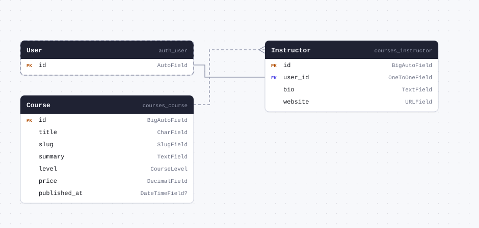

| Column | Field | Type | Null | Key | Default | Description |
| --- | --- | --- | --- | --- | --- | --- |
| `id` | `BigAutoField` | `integer` |  | PK | `autoincrement()` |  |
| `user_id` | `OneToOneField` | `integer` |  | FK, unique |  |  |
| `bio` | `TextField` | `text` |  |  |  |  |
| `website` | `URLField` | `varchar(200)` |  |  |  |  |

Relations:

- `user_id` → `User`.`id` (auth, not in these docs), on delete cascade
- `courses` — many to many with [Course](#course)

## Course

Table `courses_course`, app `courses`.

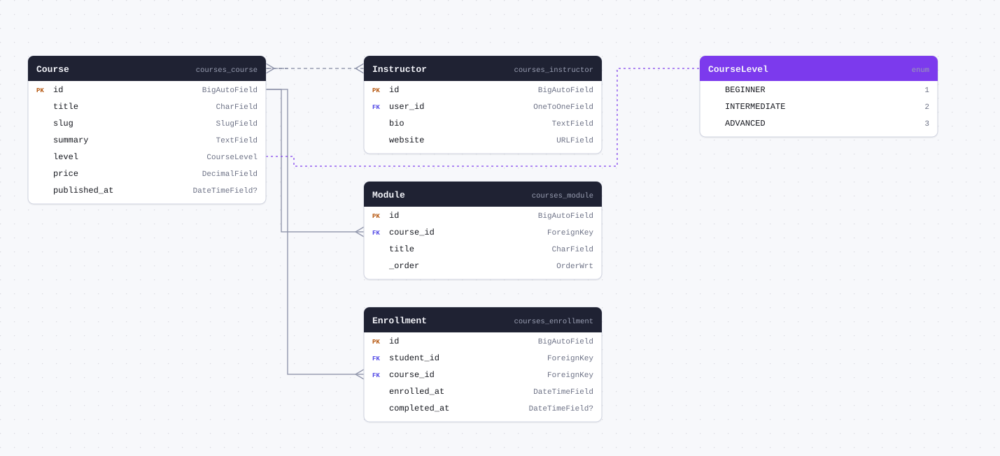

| Column | Field | Type | Null | Key | Default | Description |
| --- | --- | --- | --- | --- | --- | --- |
| `id` | `BigAutoField` | `integer` |  | PK | `autoincrement()` |  |
| `title` | `CharField` | `varchar(200)` |  |  |  |  |
| `slug` | `SlugField` | `varchar(50)` |  | unique |  |  |
| `summary` | `TextField` | `text` |  |  |  |  |
| `level` | `CourseLevel` | `smallint unsigned` |  |  | `1` |  |
| `price` | `DecimalField(8, 2)` | `decimal` |  |  | `0` |  |
| `published_at` | `DateTimeField` | `datetime` | yes |  |  |  |

Relations:

- `instructors` — many to many with [Instructor](#instructor)
- `prerequisites` — many to many with [Course](#course)
- [Module](#module).`course_id` → `id`, on delete cascade
- [Enrollment](#enrollment).`course_id` → `id`, on delete cascade

## Module

Table `courses_module`, app `courses`.

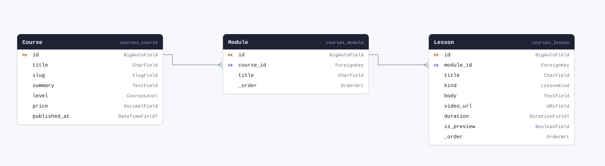

| Column | Field | Type | Null | Key | Default | Description |
| --- | --- | --- | --- | --- | --- | --- |
| `id` | `BigAutoField` | `integer` |  | PK | `autoincrement()` |  |
| `course_id` | `ForeignKey` | `bigint` |  | FK |  |  |
| `title` | `CharField` | `varchar(200)` |  |  |  |  |
| `_order` | `OrderWrt` | `integer` |  |  |  |  |

Indexes:

- index `courses_module_course_id_7d4820de` on `course_id`

Relations:

- `course_id` → [Course](#course).`id`, on delete cascade
- [Lesson](#lesson).`module_id` → `id`, on delete cascade

## Lesson

Table `courses_lesson`, app `courses`.

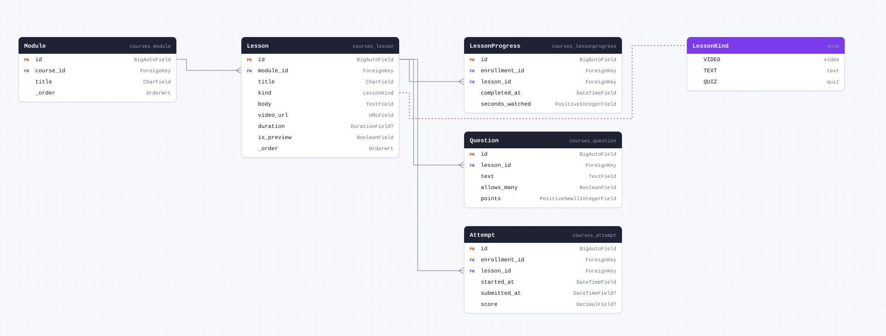

| Column | Field | Type | Null | Key | Default | Description |
| --- | --- | --- | --- | --- | --- | --- |
| `id` | `BigAutoField` | `integer` |  | PK | `autoincrement()` |  |
| `module_id` | `ForeignKey` | `bigint` |  | FK |  |  |
| `title` | `CharField` | `varchar(200)` |  |  |  |  |
| `kind` | `LessonKind` | `varchar(5)` |  |  |  |  |
| `body` | `TextField` | `text` |  |  |  |  |
| `video_url` | `URLField` | `varchar(200)` |  |  |  |  |
| `duration` | `DurationField` | `bigint` | yes |  |  |  |
| `is_preview` | `BooleanField` | `bool` |  |  | `False` | Open to visitors who have not enrolled |
| `_order` | `OrderWrt` | `integer` |  |  |  |  |

Indexes:

- index `courses_lesson_module_id_41252914` on `module_id`

Relations:

- `module_id` → [Module](#module).`id`, on delete cascade
- [LessonProgress](#lessonprogress).`lesson_id` → `id`, on delete cascade
- [Question](#question).`lesson_id` → `id`, on delete cascade
- [Attempt](#attempt).`lesson_id` → `id`, on delete cascade

## Enrollment

Table `courses_enrollment`, app `courses`.

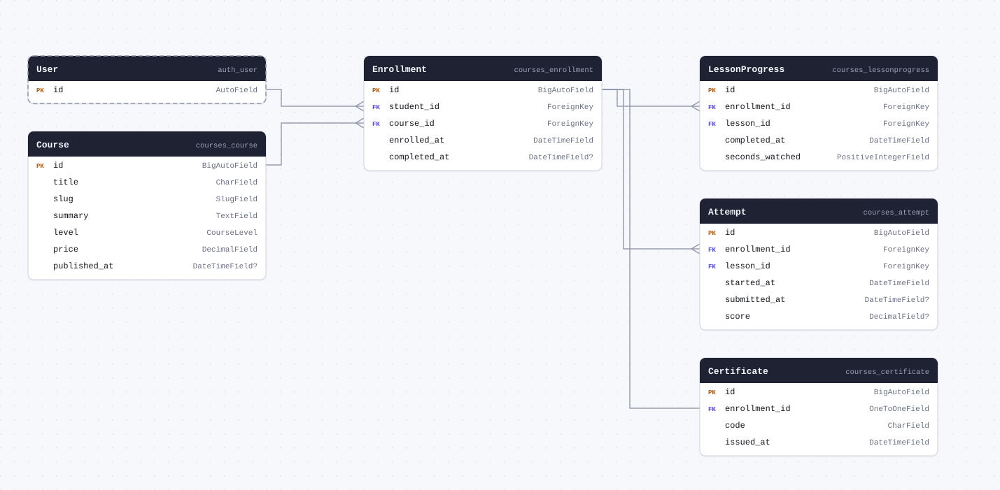

| Column | Field | Type | Null | Key | Default | Description |
| --- | --- | --- | --- | --- | --- | --- |
| `id` | `BigAutoField` | `integer` |  | PK | `autoincrement()` |  |
| `student_id` | `ForeignKey` | `integer` |  | FK |  |  |
| `course_id` | `ForeignKey` | `bigint` |  | FK |  |  |
| `enrolled_at` | `DateTimeField` | `datetime` |  |  | `now()` |  |
| `completed_at` | `DateTimeField` | `datetime` | yes |  |  |  |

Indexes:

- index `courses_enrollment_student_id_aebf8536` on `student_id`
- index `courses_enrollment_course_id_2631503e` on `course_id`
- unique `enroll_once` on `student_id`, `course_id`

Relations:

- `completed_lessons` — many to many with [Lesson](#lesson), through [LessonProgress](#lessonprogress)
- `student_id` → `User`.`id` (auth, not in these docs), on delete cascade
- `course_id` → [Course](#course).`id`, on delete cascade
- [LessonProgress](#lessonprogress).`enrollment_id` → `id`, on delete cascade
- [Attempt](#attempt).`enrollment_id` → `id`, on delete cascade
- [Certificate](#certificate).`enrollment_id` → `id`, on delete protect

## LessonProgress

Table `courses_lessonprogress`, app `courses`.

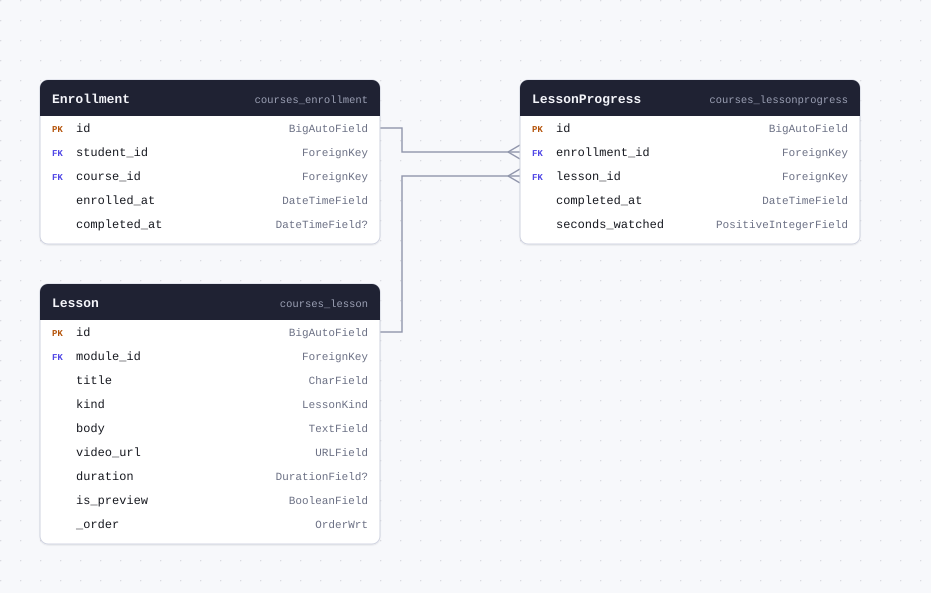

| Column | Field | Type | Null | Key | Default | Description |
| --- | --- | --- | --- | --- | --- | --- |
| `id` | `BigAutoField` | `integer` |  | PK | `autoincrement()` |  |
| `enrollment_id` | `ForeignKey` | `bigint` |  | FK |  |  |
| `lesson_id` | `ForeignKey` | `bigint` |  | FK |  |  |
| `completed_at` | `DateTimeField` | `datetime` |  |  | `now()` |  |
| `seconds_watched` | `PositiveIntegerField` | `integer unsigned` |  |  | `0` |  |

Indexes:

- index `courses_lessonprogress_enrollment_id_dd947713` on `enrollment_id`
- index `courses_lessonprogress_lesson_id_b0b36960` on `lesson_id`

Relations:

- `enrollment_id` → [Enrollment](#enrollment).`id`, on delete cascade
- `lesson_id` → [Lesson](#lesson).`id`, on delete cascade

## Question

Table `courses_question`, app `courses`.

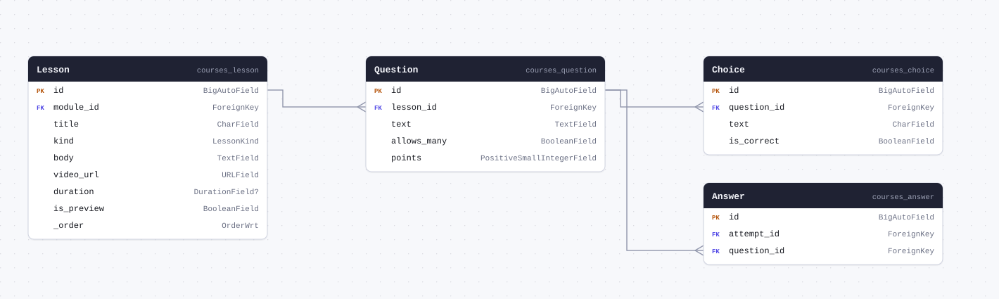

| Column | Field | Type | Null | Key | Default | Description |
| --- | --- | --- | --- | --- | --- | --- |
| `id` | `BigAutoField` | `integer` |  | PK | `autoincrement()` |  |
| `lesson_id` | `ForeignKey` | `bigint` |  | FK |  |  |
| `text` | `TextField` | `text` |  |  |  |  |
| `allows_many` | `BooleanField` | `bool` |  |  | `False` |  |
| `points` | `PositiveSmallIntegerField` | `smallint unsigned` |  |  | `1` |  |

Indexes:

- index `courses_question_lesson_id_f91dc203` on `lesson_id`

Relations:

- `lesson_id` → [Lesson](#lesson).`id`, on delete cascade
- [Choice](#choice).`question_id` → `id`, on delete cascade
- [Answer](#answer).`question_id` → `id`, on delete cascade

## Choice

Table `courses_choice`, app `courses`.

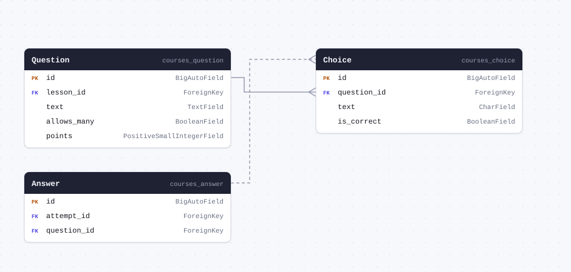

| Column | Field | Type | Null | Key | Default | Description |
| --- | --- | --- | --- | --- | --- | --- |
| `id` | `BigAutoField` | `integer` |  | PK | `autoincrement()` |  |
| `question_id` | `ForeignKey` | `bigint` |  | FK |  |  |
| `text` | `CharField` | `varchar(300)` |  |  |  |  |
| `is_correct` | `BooleanField` | `bool` |  |  | `False` |  |

Indexes:

- index `courses_choice_question_id_e3bc6751` on `question_id`

Relations:

- `question_id` → [Question](#question).`id`, on delete cascade
- `answer_set` — many to many with [Answer](#answer)

## Attempt

Table `courses_attempt`, app `courses`.

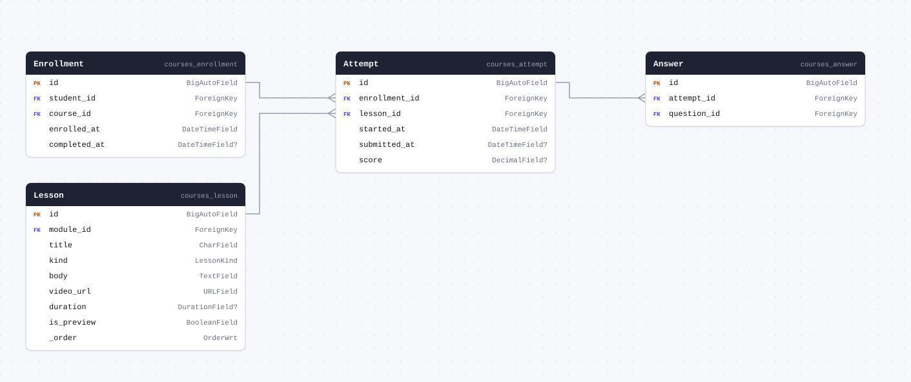

| Column | Field | Type | Null | Key | Default | Description |
| --- | --- | --- | --- | --- | --- | --- |
| `id` | `BigAutoField` | `integer` |  | PK | `autoincrement()` |  |
| `enrollment_id` | `ForeignKey` | `bigint` |  | FK |  |  |
| `lesson_id` | `ForeignKey` | `bigint` |  | FK |  |  |
| `started_at` | `DateTimeField` | `datetime` |  |  | `now()` |  |
| `submitted_at` | `DateTimeField` | `datetime` | yes |  |  |  |
| `score` | `DecimalField(5, 2)` | `decimal` | yes |  |  |  |

Indexes:

- index `courses_attempt_enrollment_id_288fd6a6` on `enrollment_id`
- index `courses_attempt_lesson_id_8534b2c3` on `lesson_id`

Relations:

- `enrollment_id` → [Enrollment](#enrollment).`id`, on delete cascade
- `lesson_id` → [Lesson](#lesson).`id`, on delete cascade
- [Answer](#answer).`attempt_id` → `id`, on delete cascade

## Answer

Table `courses_answer`, app `courses`.

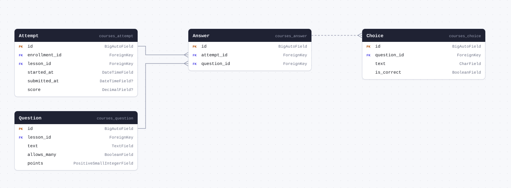

| Column | Field | Type | Null | Key | Default | Description |
| --- | --- | --- | --- | --- | --- | --- |
| `id` | `BigAutoField` | `integer` |  | PK | `autoincrement()` |  |
| `attempt_id` | `ForeignKey` | `bigint` |  | FK |  |  |
| `question_id` | `ForeignKey` | `bigint` |  | FK |  |  |

Indexes:

- index `courses_answer_attempt_id_df8c02ec` on `attempt_id`
- index `courses_answer_question_id_f7e35d1f` on `question_id`
- unique `courses_answer_attempt_id_question_id_e2e8bdaf_uniq` on `attempt_id`, `question_id`

Relations:

- `attempt_id` → [Attempt](#attempt).`id`, on delete cascade
- `question_id` → [Question](#question).`id`, on delete cascade
- `choices` — many to many with [Choice](#choice)

## Certificate

Table `courses_certificate`, app `courses`.

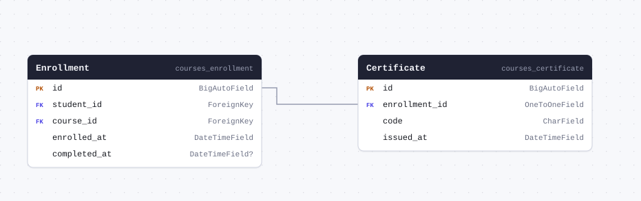

| Column | Field | Type | Null | Key | Default | Description |
| --- | --- | --- | --- | --- | --- | --- |
| `id` | `BigAutoField` | `integer` |  | PK | `autoincrement()` |  |
| `enrollment_id` | `OneToOneField` | `bigint` |  | FK, unique |  |  |
| `code` | `CharField` | `varchar(20)` |  | unique |  |  |
| `issued_at` | `DateTimeField` | `datetime` |  |  | `now()` |  |

Relations:

- `enrollment_id` → [Enrollment](#enrollment).`id`, on delete protect

# Enums

## CourseLevel

| Name | Stored as |
| --- | --- |
| `BEGINNER` | `1` |
| `INTERMEDIATE` | `2` |
| `ADVANCED` | `3` |

## LessonKind

| Name | Stored as |
| --- | --- |
| `VIDEO` | `video` |
| `TEXT` | `text` |
| `QUIZ` | `quiz` |
