# Schema docs

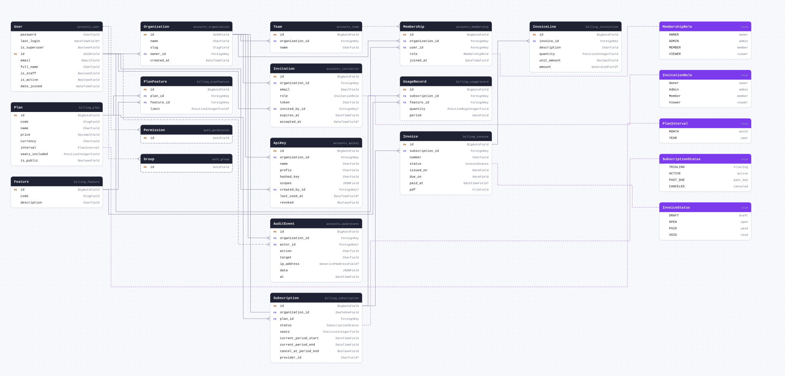

[User](#user) · [Organization](#organization) · [Membership](#membership) · [Team](#team) · [Invitation](#invitation) · [ApiKey](#apikey) · [AuditEvent](#auditevent) · [Plan](#plan) · [Feature](#feature) · [PlanFeature](#planfeature) · [Subscription](#subscription) · [UsageRecord](#usagerecord) · [Invoice](#invoice) · [InvoiceLine](#invoiceline)

<details>
<summary>The whole schema as SQL</summary>

```sql
CREATE TABLE "accounts_user" ("password" varchar(128) NOT NULL, "last_login" datetime NULL, "is_superuser" bool NOT NULL, "id" char(32) NOT NULL PRIMARY KEY, "email" varchar(254) NOT NULL UNIQUE, "full_name" varchar(150) NOT NULL, "is_staff" bool NOT NULL, "is_active" bool NOT NULL, "date_joined" datetime NOT NULL);

CREATE TABLE "accounts_user_groups" ("id" integer NOT NULL PRIMARY KEY AUTOINCREMENT, "user_id" char(32) NOT NULL REFERENCES "accounts_user" ("id") DEFERRABLE INITIALLY DEFERRED, "group_id" integer NOT NULL REFERENCES "auth_group" ("id") DEFERRABLE INITIALLY DEFERRED);

CREATE TABLE "accounts_user_user_permissions" ("id" integer NOT NULL PRIMARY KEY AUTOINCREMENT, "user_id" char(32) NOT NULL REFERENCES "accounts_user" ("id") DEFERRABLE INITIALLY DEFERRED, "permission_id" integer NOT NULL REFERENCES "auth_permission" ("id") DEFERRABLE INITIALLY DEFERRED);

CREATE TABLE "accounts_organization" ("id" char(32) NOT NULL PRIMARY KEY, "name" varchar(100) NOT NULL, "slug" varchar(50) NOT NULL UNIQUE, "owner_id" char(32) NOT NULL REFERENCES "accounts_user" ("id") DEFERRABLE INITIALLY DEFERRED, "created_at" datetime NOT NULL);

CREATE TABLE "accounts_membership" ("id" integer NOT NULL PRIMARY KEY AUTOINCREMENT, "organization_id" char(32) NOT NULL REFERENCES "accounts_organization" ("id") DEFERRABLE INITIALLY DEFERRED, "user_id" char(32) NOT NULL REFERENCES "accounts_user" ("id") DEFERRABLE INITIALLY DEFERRED, "role" varchar(10) NOT NULL, "joined_at" datetime NOT NULL, CONSTRAINT "membership_unique" UNIQUE ("organization_id", "user_id"));

CREATE TABLE "accounts_team" ("id" integer NOT NULL PRIMARY KEY AUTOINCREMENT, "organization_id" char(32) NOT NULL REFERENCES "accounts_organization" ("id") DEFERRABLE INITIALLY DEFERRED, "name" varchar(100) NOT NULL);

CREATE TABLE "accounts_team_members" ("id" integer NOT NULL PRIMARY KEY AUTOINCREMENT, "team_id" bigint NOT NULL REFERENCES "accounts_team" ("id") DEFERRABLE INITIALLY DEFERRED, "membership_id" bigint NOT NULL REFERENCES "accounts_membership" ("id") DEFERRABLE INITIALLY DEFERRED);

CREATE TABLE "accounts_invitation" ("id" integer NOT NULL PRIMARY KEY AUTOINCREMENT, "organization_id" char(32) NOT NULL REFERENCES "accounts_organization" ("id") DEFERRABLE INITIALLY DEFERRED, "email" varchar(254) NOT NULL, "role" varchar(10) NOT NULL, "token" varchar(64) NOT NULL UNIQUE, "invited_by_id" char(32) NULL REFERENCES "accounts_user" ("id") DEFERRABLE INITIALLY DEFERRED, "expires_at" datetime NOT NULL, "accepted_at" datetime NULL);

CREATE TABLE "accounts_apikey" ("id" integer NOT NULL PRIMARY KEY AUTOINCREMENT, "organization_id" char(32) NOT NULL REFERENCES "accounts_organization" ("id") DEFERRABLE INITIALLY DEFERRED, "name" varchar(50) NOT NULL, "prefix" varchar(8) NOT NULL UNIQUE, "hashed_key" varchar(128) NOT NULL, "scopes" text NOT NULL CHECK ((JSON_VALID("scopes") OR "scopes" IS NULL)), "created_by_id" char(32) NULL REFERENCES "accounts_user" ("id") DEFERRABLE INITIALLY DEFERRED, "last_used_at" datetime NULL, "revoked" bool NOT NULL);

CREATE TABLE "accounts_auditevent" ("id" integer NOT NULL PRIMARY KEY AUTOINCREMENT, "organization_id" char(32) NOT NULL REFERENCES "accounts_organization" ("id") DEFERRABLE INITIALLY DEFERRED, "actor_id" char(32) NULL, "action" varchar(50) NOT NULL, "target" varchar(200) NOT NULL, "ip_address" char(39) NULL, "data" text NOT NULL CHECK ((JSON_VALID("data") OR "data" IS NULL)), "at" datetime NOT NULL);

CREATE TABLE "billing_plan" ("id" integer NOT NULL PRIMARY KEY AUTOINCREMENT, "code" varchar(50) NOT NULL UNIQUE, "name" varchar(50) NOT NULL, "price" decimal NOT NULL, "currency" varchar(3) NOT NULL, "interval" varchar(5) NOT NULL, "seats_included" integer unsigned NOT NULL CHECK ("seats_included" >= 0), "is_public" bool NOT NULL);

CREATE TABLE "billing_feature" ("id" integer NOT NULL PRIMARY KEY AUTOINCREMENT, "code" varchar(50) NOT NULL UNIQUE, "description" varchar(200) NOT NULL);

CREATE TABLE "billing_planfeature" ("id" integer NOT NULL PRIMARY KEY AUTOINCREMENT, "plan_id" bigint NOT NULL REFERENCES "billing_plan" ("id") DEFERRABLE INITIALLY DEFERRED, "feature_id" bigint NOT NULL REFERENCES "billing_feature" ("id") DEFERRABLE INITIALLY DEFERRED, "limit" integer unsigned NULL CHECK ("limit" >= 0));

CREATE TABLE "billing_subscription" ("id" integer NOT NULL PRIMARY KEY AUTOINCREMENT, "organization_id" char(32) NOT NULL UNIQUE REFERENCES "accounts_organization" ("id") DEFERRABLE INITIALLY DEFERRED, "plan_id" bigint NOT NULL REFERENCES "billing_plan" ("id") DEFERRABLE INITIALLY DEFERRED, "status" varchar(10) NOT NULL, "seats" integer unsigned NOT NULL CHECK ("seats" >= 0), "current_period_start" datetime NOT NULL, "current_period_end" datetime NOT NULL, "cancel_at_period_end" bool NOT NULL, "provider_id" varchar(100) NULL UNIQUE);

CREATE TABLE "billing_usagerecord" ("id" integer NOT NULL PRIMARY KEY AUTOINCREMENT, "subscription_id" bigint NOT NULL REFERENCES "billing_subscription" ("id") DEFERRABLE INITIALLY DEFERRED, "feature_id" bigint NOT NULL REFERENCES "billing_feature" ("id") DEFERRABLE INITIALLY DEFERRED, "quantity" bigint unsigned NOT NULL CHECK ("quantity" >= 0), "period" date NOT NULL, CONSTRAINT "usage_once_per_period" UNIQUE ("subscription_id", "feature_id", "period"));

CREATE TABLE "billing_invoice" ("id" integer NOT NULL PRIMARY KEY AUTOINCREMENT, "subscription_id" bigint NOT NULL REFERENCES "billing_subscription" ("id") DEFERRABLE INITIALLY DEFERRED, "number" varchar(20) NOT NULL UNIQUE, "status" varchar(5) NOT NULL, "issued_on" date NOT NULL, "due_on" date NOT NULL, "paid_at" datetime NULL, "pdf" varchar(100) NOT NULL, CONSTRAINT "invoice_due_after_issue" CHECK ("due_on" >= ("issued_on")));

CREATE TABLE "billing_invoiceline" ("id" integer NOT NULL PRIMARY KEY AUTOINCREMENT, "invoice_id" bigint NOT NULL REFERENCES "billing_invoice" ("id") DEFERRABLE INITIALLY DEFERRED, "description" varchar(200) NOT NULL, "quantity" integer unsigned NOT NULL CHECK ("quantity" >= 0), "unit_amount" decimal NOT NULL, "amount" decimal GENERATED ALWAYS AS ((CAST(("quantity" * "unit_amount") AS NUMERIC))) STORED);

CREATE UNIQUE INDEX "user_email_ci_unique" ON "accounts_user" ((LOWER("email")));

CREATE UNIQUE INDEX "accounts_user_groups_user_id_group_id_59c0b32f_uniq" ON "accounts_user_groups" ("user_id", "group_id");

CREATE INDEX "accounts_user_groups_user_id_52b62117" ON "accounts_user_groups" ("user_id");

CREATE INDEX "accounts_user_groups_group_id_bd11a704" ON "accounts_user_groups" ("group_id");

CREATE UNIQUE INDEX "accounts_user_user_permissions_user_id_permission_id_2ab516c2_uniq" ON "accounts_user_user_permissions" ("user_id", "permission_id");

CREATE INDEX "accounts_user_user_permissions_user_id_e4f0a161" ON "accounts_user_user_permissions" ("user_id");

CREATE INDEX "accounts_user_user_permissions_permission_id_113bb443" ON "accounts_user_user_permissions" ("permission_id");

CREATE INDEX "accounts_organization_owner_id_55bbcc9e" ON "accounts_organization" ("owner_id");

CREATE INDEX "accounts_membership_organization_id_936776de" ON "accounts_membership" ("organization_id");

CREATE INDEX "accounts_membership_user_id_487fb39e" ON "accounts_membership" ("user_id");

CREATE UNIQUE INDEX "accounts_team_organization_id_name_4d3668c9_uniq" ON "accounts_team" ("organization_id", "name");

CREATE INDEX "accounts_team_organization_id_bf0a6adc" ON "accounts_team" ("organization_id");

CREATE UNIQUE INDEX "accounts_team_members_team_id_membership_id_134ca2d0_uniq" ON "accounts_team_members" ("team_id", "membership_id");

CREATE INDEX "accounts_team_members_team_id_4443c9b3" ON "accounts_team_members" ("team_id");

CREATE INDEX "accounts_team_members_membership_id_efa1764a" ON "accounts_team_members" ("membership_id");

CREATE INDEX "accounts_invitation_organization_id_2be75950" ON "accounts_invitation" ("organization_id");

CREATE INDEX "accounts_invitation_invited_by_id_94a21efc" ON "accounts_invitation" ("invited_by_id");

CREATE INDEX "accounts_apikey_organization_id_79d80250" ON "accounts_apikey" ("organization_id");

CREATE INDEX "accounts_apikey_created_by_id_1b5317c8" ON "accounts_apikey" ("created_by_id");

CREATE INDEX "accounts_auditevent_organization_id_5fa8aa26" ON "accounts_auditevent" ("organization_id");

CREATE INDEX "accounts_auditevent_actor_id_179eee89" ON "accounts_auditevent" ("actor_id");

CREATE INDEX "accounts_auditevent_at_9771b2fb" ON "accounts_auditevent" ("at");

CREATE UNIQUE INDEX "billing_planfeature_plan_id_feature_id_9ab2dca2_uniq" ON "billing_planfeature" ("plan_id", "feature_id");

CREATE INDEX "billing_planfeature_plan_id_1c0e5b6d" ON "billing_planfeature" ("plan_id");

CREATE INDEX "billing_planfeature_feature_id_2f53e972" ON "billing_planfeature" ("feature_id");

CREATE INDEX "billing_subscription_plan_id_4e20d4ad" ON "billing_subscription" ("plan_id");

CREATE INDEX "billing_usagerecord_subscription_id_66d9b5d7" ON "billing_usagerecord" ("subscription_id");

CREATE INDEX "billing_usagerecord_feature_id_c15622a1" ON "billing_usagerecord" ("feature_id");

CREATE INDEX "billing_invoice_subscription_id_b7df633b" ON "billing_invoice" ("subscription_id");

CREATE INDEX "billing_invoiceline_invoice_id_ff507e12" ON "billing_invoiceline" ("invoice_id");
```

</details>

## User

Table `accounts_user`, app `accounts`.

Columns from `AbstractBaseUser` (abstract): `password`, `last_login`.

Columns from `PermissionsMixin` (abstract): `is_superuser`.

Signs in with an e-mail address, not a username.

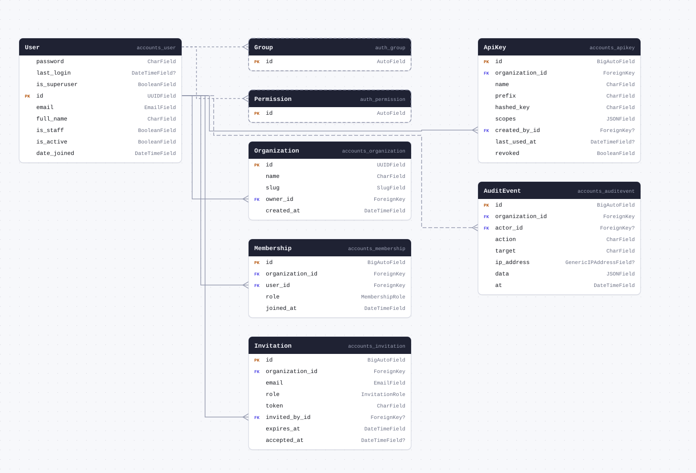

| Column | Field | Type | Null | Key | Default | Description |
| --- | --- | --- | --- | --- | --- | --- |
| `password` | `CharField` | `varchar(128)` |  |  |  |  |
| `last_login` | `DateTimeField` | `datetime` | yes |  |  |  |
| `is_superuser` | `BooleanField` | `bool` |  |  | `False` | Designates that this user has all permissions without explicitly assigning them. |
| `id` | `UUIDField` | `char(32)` |  | PK | `uuid4()` |  |
| `email` | `EmailField` | `varchar(254)` |  | unique |  |  |
| `full_name` | `CharField` | `varchar(150)` |  |  |  |  |
| `is_staff` | `BooleanField` | `bool` |  |  | `False` |  |
| `is_active` | `BooleanField` | `bool` |  |  | `True` |  |
| `date_joined` | `DateTimeField` | `datetime` |  |  | `now()` |  |

Indexes:

- unique `user_email_ci_unique` on `LOWER("email")`

Relations:

- `organizations` — many to many with [Organization](#organization), through [Membership](#membership)
- `groups` — many to many with `Group` (auth, not in these docs)
- `user_permissions` — many to many with `Permission` (auth, not in these docs)
- [Organization](#organization).`owner_id` → `id`, on delete protect
- [Membership](#membership).`user_id` → `id`, on delete cascade
- [Invitation](#invitation).`invited_by_id` → `id`, on delete set null
- [ApiKey](#apikey).`created_by_id` → `id`, on delete set null
- [AuditEvent](#auditevent).`actor_id` → `id`, on delete do nothing, no database constraint

## Organization

Table `accounts_organization`, app `accounts`.

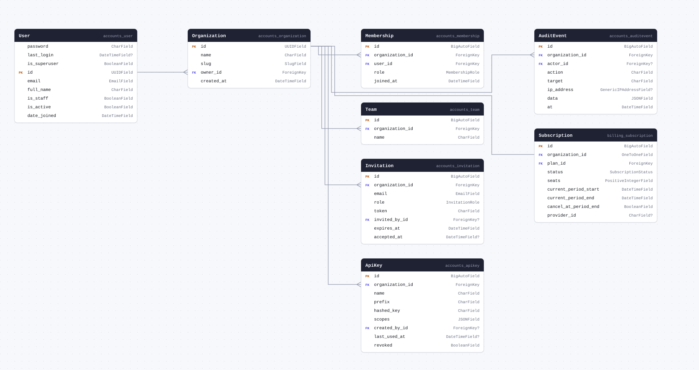

| Column | Field | Type | Null | Key | Default | Description |
| --- | --- | --- | --- | --- | --- | --- |
| `id` | `UUIDField` | `char(32)` |  | PK | `uuid4()` |  |
| `name` | `CharField` | `varchar(100)` |  |  |  |  |
| `slug` | `SlugField` | `varchar(50)` |  | unique |  |  |
| `owner_id` | `ForeignKey` | `char(32)` |  | FK |  |  |
| `created_at` | `DateTimeField` | `datetime` |  |  | `now()` |  |

Indexes:

- index `accounts_organization_owner_id_55bbcc9e` on `owner_id`

Relations:

- `members` — many to many with [User](#user), through [Membership](#membership)
- `owner_id` → [User](#user).`id`, on delete protect
- [Membership](#membership).`organization_id` → `id`, on delete cascade
- [Team](#team).`organization_id` → `id`, on delete cascade
- [Invitation](#invitation).`organization_id` → `id`, on delete cascade
- [ApiKey](#apikey).`organization_id` → `id`, on delete cascade
- [AuditEvent](#auditevent).`organization_id` → `id`, on delete cascade
- [Subscription](#subscription).`organization_id` → `id`, on delete cascade

## Membership

Table `accounts_membership`, app `accounts`.

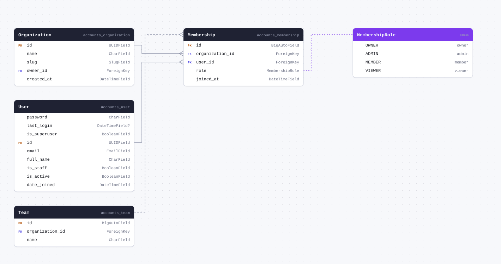

| Column | Field | Type | Null | Key | Default | Description |
| --- | --- | --- | --- | --- | --- | --- |
| `id` | `BigAutoField` | `integer` |  | PK | `autoincrement()` |  |
| `organization_id` | `ForeignKey` | `char(32)` |  | FK |  |  |
| `user_id` | `ForeignKey` | `char(32)` |  | FK |  |  |
| `role` | `MembershipRole` | `varchar(10)` |  |  | `'member'` |  |
| `joined_at` | `DateTimeField` | `datetime` |  |  | `now()` |  |

Indexes:

- index `accounts_membership_organization_id_936776de` on `organization_id`
- index `accounts_membership_user_id_487fb39e` on `user_id`
- unique `membership_unique` on `organization_id`, `user_id`

Relations:

- `organization_id` → [Organization](#organization).`id`, on delete cascade
- `user_id` → [User](#user).`id`, on delete cascade
- `teams` — many to many with [Team](#team)

## Team

Table `accounts_team`, app `accounts`.

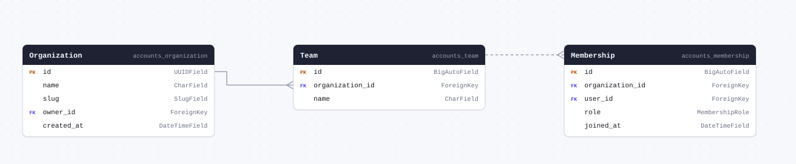

| Column | Field | Type | Null | Key | Default | Description |
| --- | --- | --- | --- | --- | --- | --- |
| `id` | `BigAutoField` | `integer` |  | PK | `autoincrement()` |  |
| `organization_id` | `ForeignKey` | `char(32)` |  | FK |  |  |
| `name` | `CharField` | `varchar(100)` |  |  |  |  |

Indexes:

- index `accounts_team_organization_id_bf0a6adc` on `organization_id`
- unique `accounts_team_organization_id_name_4d3668c9_uniq` on `organization_id`, `name`

Relations:

- `organization_id` → [Organization](#organization).`id`, on delete cascade
- `members` — many to many with [Membership](#membership)

## Invitation

Table `accounts_invitation`, app `accounts`.

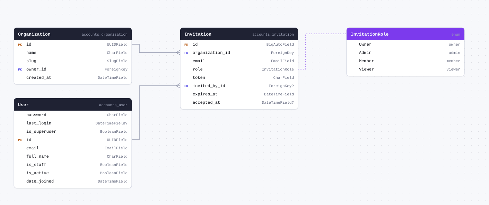

| Column | Field | Type | Null | Key | Default | Description |
| --- | --- | --- | --- | --- | --- | --- |
| `id` | `BigAutoField` | `integer` |  | PK | `autoincrement()` |  |
| `organization_id` | `ForeignKey` | `char(32)` |  | FK |  |  |
| `email` | `EmailField` | `varchar(254)` |  |  |  |  |
| `role` | `InvitationRole` | `varchar(10)` |  |  | `'member'` |  |
| `token` | `CharField` | `varchar(64)` |  | unique |  |  |
| `invited_by_id` | `ForeignKey` | `char(32)` | yes | FK |  |  |
| `expires_at` | `DateTimeField` | `datetime` |  |  |  |  |
| `accepted_at` | `DateTimeField` | `datetime` | yes |  |  |  |

Indexes:

- index `accounts_invitation_organization_id_2be75950` on `organization_id`
- index `accounts_invitation_invited_by_id_94a21efc` on `invited_by_id`

Relations:

- `organization_id` → [Organization](#organization).`id`, on delete cascade
- `invited_by_id` → [User](#user).`id`, on delete set null

## ApiKey

Table `accounts_apikey`, app `accounts`.

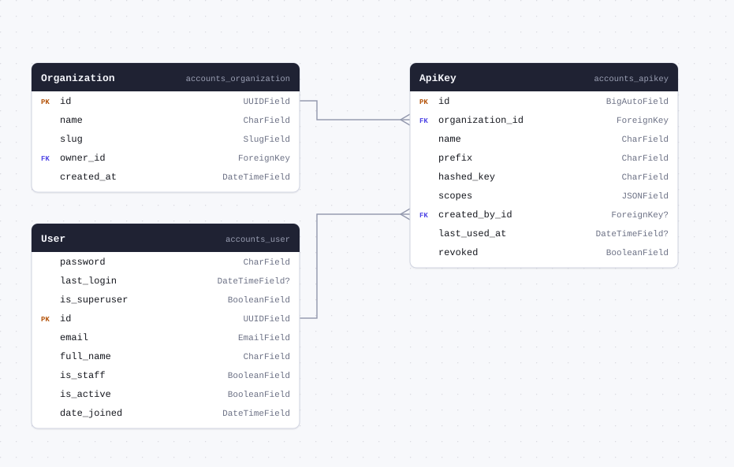

| Column | Field | Type | Null | Key | Default | Description |
| --- | --- | --- | --- | --- | --- | --- |
| `id` | `BigAutoField` | `integer` |  | PK | `autoincrement()` |  |
| `organization_id` | `ForeignKey` | `char(32)` |  | FK |  |  |
| `name` | `CharField` | `varchar(50)` |  |  |  |  |
| `prefix` | `CharField` | `varchar(8)` |  | unique |  |  |
| `hashed_key` | `CharField` | `varchar(128)` |  |  |  |  |
| `scopes` | `JSONField` | `text` |  |  | `list()` |  |
| `created_by_id` | `ForeignKey` | `char(32)` | yes | FK |  |  |
| `last_used_at` | `DateTimeField` | `datetime` | yes |  |  |  |
| `revoked` | `BooleanField` | `bool` |  |  | `False` |  |

Indexes:

- index `accounts_apikey_organization_id_79d80250` on `organization_id`
- index `accounts_apikey_created_by_id_1b5317c8` on `created_by_id`

Relations:

- `organization_id` → [Organization](#organization).`id`, on delete cascade
- `created_by_id` → [User](#user).`id`, on delete set null

## AuditEvent

Table `accounts_auditevent`, app `accounts`.

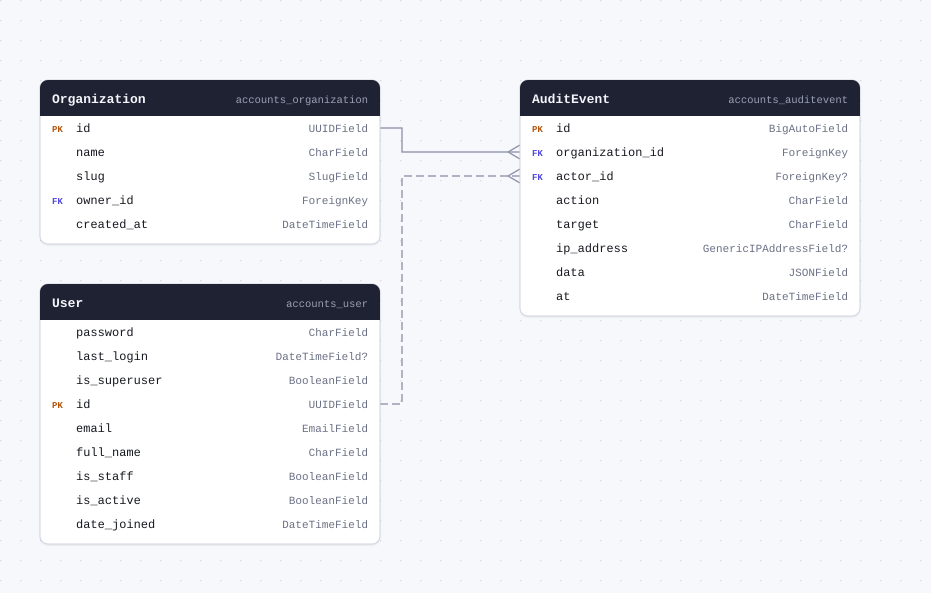

| Column | Field | Type | Null | Key | Default | Description |
| --- | --- | --- | --- | --- | --- | --- |
| `id` | `BigAutoField` | `integer` |  | PK | `autoincrement()` |  |
| `organization_id` | `ForeignKey` | `char(32)` |  | FK |  |  |
| `actor_id` | `ForeignKey` | `char(32)` | yes | FK (no constraint) |  |  |
| `action` | `CharField` | `varchar(50)` |  |  |  |  |
| `target` | `CharField` | `varchar(200)` |  |  |  |  |
| `ip_address` | `GenericIPAddressField` | `char(39)` | yes |  |  |  |
| `data` | `JSONField` | `text` |  |  | `dict()` |  |
| `at` | `DateTimeField` | `datetime` |  |  | `now()` |  |

Indexes:

- index `accounts_auditevent_organization_id_5fa8aa26` on `organization_id`
- index `accounts_auditevent_actor_id_179eee89` on `actor_id`
- index `accounts_auditevent_at_9771b2fb` on `at`

Relations:

- `organization_id` → [Organization](#organization).`id`, on delete cascade
- `actor_id` → [User](#user).`id`, on delete do nothing, no database constraint

## Plan

Table `billing_plan`, app `billing`.

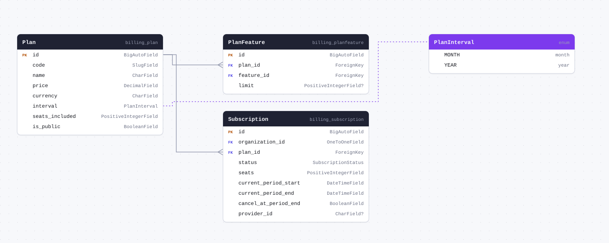

| Column | Field | Type | Null | Key | Default | Description |
| --- | --- | --- | --- | --- | --- | --- |
| `id` | `BigAutoField` | `integer` |  | PK | `autoincrement()` |  |
| `code` | `SlugField` | `varchar(50)` |  | unique |  |  |
| `name` | `CharField` | `varchar(50)` |  |  |  |  |
| `price` | `DecimalField(8, 2)` | `decimal` |  |  |  |  |
| `currency` | `CharField` | `varchar(3)` |  |  | `'USD'` |  |
| `interval` | `PlanInterval` | `varchar(5)` |  |  | `'month'` |  |
| `seats_included` | `PositiveIntegerField` | `integer unsigned` |  |  | `1` |  |
| `is_public` | `BooleanField` | `bool` |  |  | `True` |  |

Relations:

- `features` — many to many with [Feature](#feature), through [PlanFeature](#planfeature)
- [PlanFeature](#planfeature).`plan_id` → `id`, on delete cascade
- [Subscription](#subscription).`plan_id` → `id`, on delete protect

## Feature

Table `billing_feature`, app `billing`.

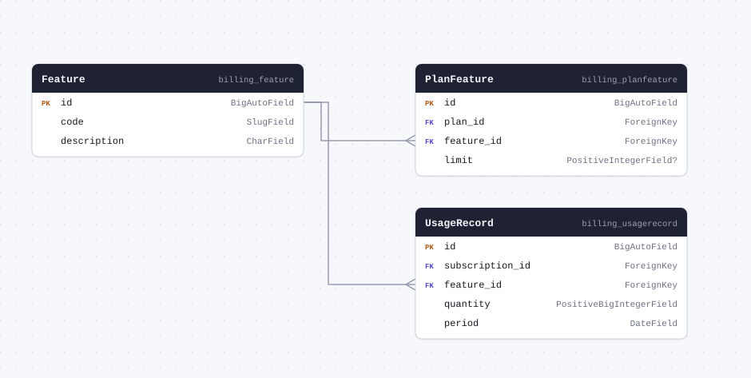

| Column | Field | Type | Null | Key | Default | Description |
| --- | --- | --- | --- | --- | --- | --- |
| `id` | `BigAutoField` | `integer` |  | PK | `autoincrement()` |  |
| `code` | `SlugField` | `varchar(50)` |  | unique |  |  |
| `description` | `CharField` | `varchar(200)` |  |  |  |  |

Relations:

- `plans` — many to many with [Plan](#plan), through [PlanFeature](#planfeature)
- [PlanFeature](#planfeature).`feature_id` → `id`, on delete cascade
- [UsageRecord](#usagerecord).`feature_id` → `id`, on delete cascade

## PlanFeature

Table `billing_planfeature`, app `billing`.

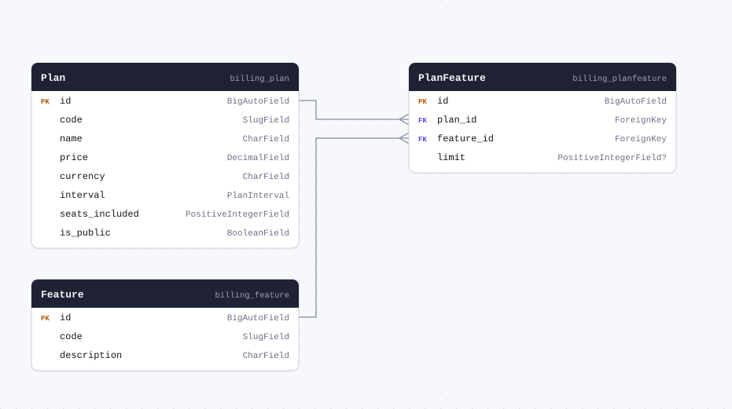

| Column | Field | Type | Null | Key | Default | Description |
| --- | --- | --- | --- | --- | --- | --- |
| `id` | `BigAutoField` | `integer` |  | PK | `autoincrement()` |  |
| `plan_id` | `ForeignKey` | `bigint` |  | FK |  |  |
| `feature_id` | `ForeignKey` | `bigint` |  | FK |  |  |
| `limit` | `PositiveIntegerField` | `integer unsigned` | yes |  |  | Empty for no limit |

Indexes:

- index `billing_planfeature_plan_id_1c0e5b6d` on `plan_id`
- index `billing_planfeature_feature_id_2f53e972` on `feature_id`
- unique `billing_planfeature_plan_id_feature_id_9ab2dca2_uniq` on `plan_id`, `feature_id`

Relations:

- `plan_id` → [Plan](#plan).`id`, on delete cascade
- `feature_id` → [Feature](#feature).`id`, on delete cascade

## Subscription

Table `billing_subscription`, app `billing`.

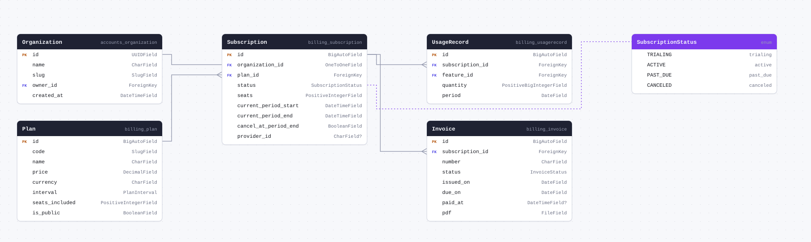

| Column | Field | Type | Null | Key | Default | Description |
| --- | --- | --- | --- | --- | --- | --- |
| `id` | `BigAutoField` | `integer` |  | PK | `autoincrement()` |  |
| `organization_id` | `OneToOneField` | `char(32)` |  | FK, unique |  |  |
| `plan_id` | `ForeignKey` | `bigint` |  | FK |  |  |
| `status` | `SubscriptionStatus` | `varchar(10)` |  |  | `'trialing'` |  |
| `seats` | `PositiveIntegerField` | `integer unsigned` |  |  | `1` |  |
| `current_period_start` | `DateTimeField` | `datetime` |  |  |  |  |
| `current_period_end` | `DateTimeField` | `datetime` |  |  |  |  |
| `cancel_at_period_end` | `BooleanField` | `bool` |  |  | `False` |  |
| `provider_id` | `CharField` | `varchar(100)` | yes | unique |  |  |

Indexes:

- index `billing_subscription_plan_id_4e20d4ad` on `plan_id`

Relations:

- `organization_id` → [Organization](#organization).`id`, on delete cascade
- `plan_id` → [Plan](#plan).`id`, on delete protect
- [UsageRecord](#usagerecord).`subscription_id` → `id`, on delete cascade
- [Invoice](#invoice).`subscription_id` → `id`, on delete protect

## UsageRecord

Table `billing_usagerecord`, app `billing`.

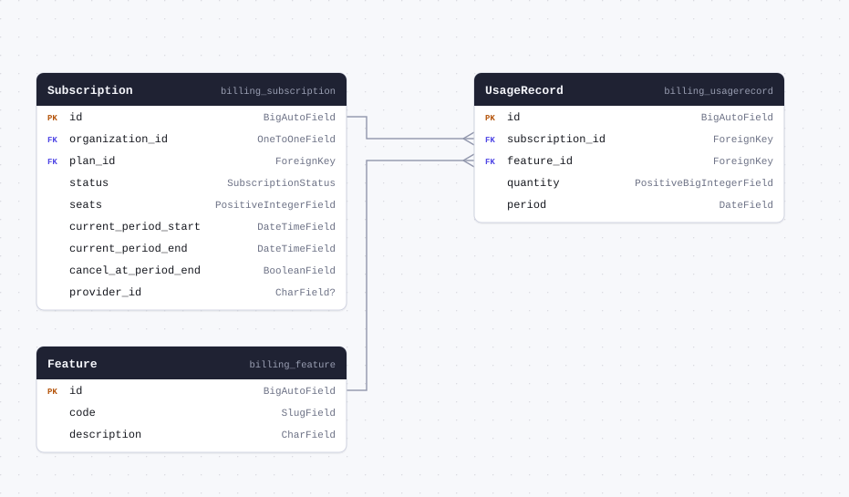

| Column | Field | Type | Null | Key | Default | Description |
| --- | --- | --- | --- | --- | --- | --- |
| `id` | `BigAutoField` | `integer` |  | PK | `autoincrement()` |  |
| `subscription_id` | `ForeignKey` | `bigint` |  | FK |  |  |
| `feature_id` | `ForeignKey` | `bigint` |  | FK |  |  |
| `quantity` | `PositiveBigIntegerField` | `bigint unsigned` |  |  |  |  |
| `period` | `DateField` | `date` |  |  |  |  |

Indexes:

- index `billing_usagerecord_subscription_id_66d9b5d7` on `subscription_id`
- index `billing_usagerecord_feature_id_c15622a1` on `feature_id`
- unique `usage_once_per_period` on `subscription_id`, `feature_id`, `period`

Relations:

- `subscription_id` → [Subscription](#subscription).`id`, on delete cascade
- `feature_id` → [Feature](#feature).`id`, on delete cascade

## Invoice

Table `billing_invoice`, app `billing`.

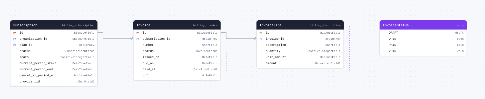

| Column | Field | Type | Null | Key | Default | Description |
| --- | --- | --- | --- | --- | --- | --- |
| `id` | `BigAutoField` | `integer` |  | PK | `autoincrement()` |  |
| `subscription_id` | `ForeignKey` | `bigint` |  | FK |  |  |
| `number` | `CharField` | `varchar(20)` |  | unique |  |  |
| `status` | `InvoiceStatus` | `varchar(5)` |  |  | `'draft'` |  |
| `issued_on` | `DateField` | `date` |  |  |  |  |
| `due_on` | `DateField` | `date` |  |  |  |  |
| `paid_at` | `DateTimeField` | `datetime` | yes |  |  |  |
| `pdf` | `FileField` | `varchar(100)` |  |  |  |  |

Indexes:

- index `billing_invoice_subscription_id_b7df633b` on `subscription_id`

Checks:

- `invoice_due_after_issue`: `"due_on" >= ("issued_on")`

Relations:

- `subscription_id` → [Subscription](#subscription).`id`, on delete protect
- [InvoiceLine](#invoiceline).`invoice_id` → `id`, on delete cascade

## InvoiceLine

Table `billing_invoiceline`, app `billing`.

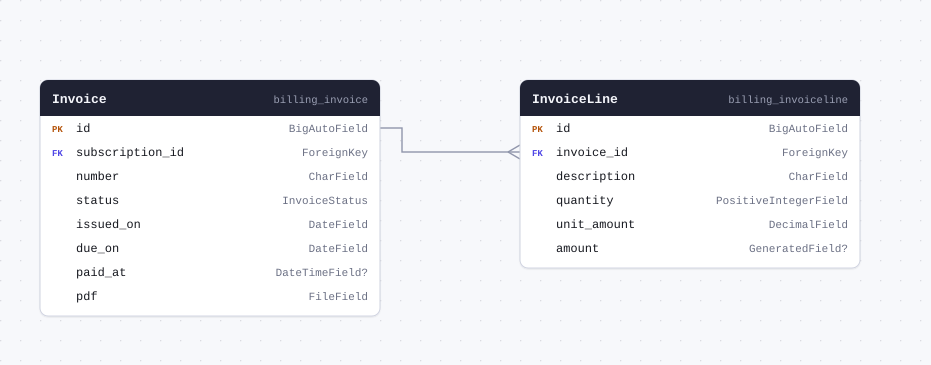

| Column | Field | Type | Null | Key | Default | Description |
| --- | --- | --- | --- | --- | --- | --- |
| `id` | `BigAutoField` | `integer` |  | PK | `autoincrement()` |  |
| `invoice_id` | `ForeignKey` | `bigint` |  | FK |  |  |
| `description` | `CharField` | `varchar(200)` |  |  |  |  |
| `quantity` | `PositiveIntegerField` | `integer unsigned` |  |  | `1` |  |
| `unit_amount` | `DecimalField(10, 2)` | `decimal` |  |  |  |  |
| `amount` | `GeneratedField(12, 2)` | `decimal` | yes |  | generated (stored): `(CAST(("quantity" * "unit_amount") AS NUMERIC))` |  |

Indexes:

- index `billing_invoiceline_invoice_id_ff507e12` on `invoice_id`

Relations:

- `invoice_id` → [Invoice](#invoice).`id`, on delete cascade

# Enums

## MembershipRole

| Name | Stored as |
| --- | --- |
| `OWNER` | `owner` |
| `ADMIN` | `admin` |
| `MEMBER` | `member` |
| `VIEWER` | `viewer` |

## InvitationRole

| Name | Stored as |
| --- | --- |
| `Owner` | `owner` |
| `Admin` | `admin` |
| `Member` | `member` |
| `Viewer` | `viewer` |

## PlanInterval

| Name | Stored as |
| --- | --- |
| `MONTH` | `month` |
| `YEAR` | `year` |

## SubscriptionStatus

| Name | Stored as |
| --- | --- |
| `TRIALING` | `trialing` |
| `ACTIVE` | `active` |
| `PAST_DUE` | `past_due` |
| `CANCELED` | `canceled` |

## InvoiceStatus

| Name | Stored as |
| --- | --- |
| `DRAFT` | `draft` |
| `OPEN` | `open` |
| `PAID` | `paid` |
| `VOID` | `void` |
