# Schema docs

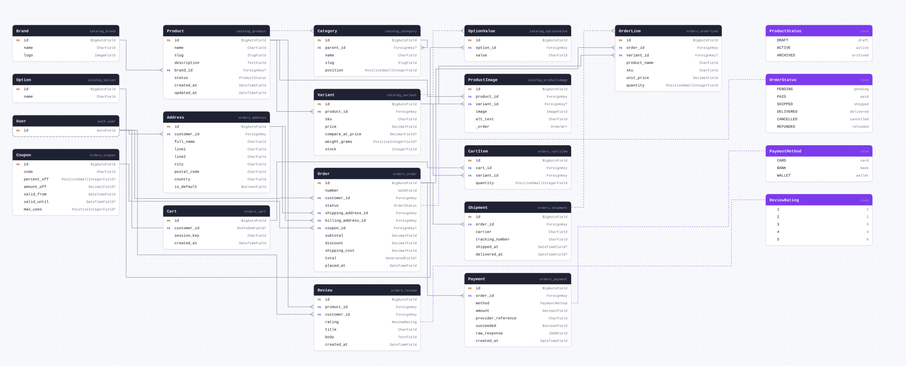

[Category](#category) · [Brand](#brand) · [Product](#product) · [Option](#option) · [OptionValue](#optionvalue) · [Variant](#variant) · [ProductImage](#productimage) · [Address](#address) · [Cart](#cart) · [CartItem](#cartitem) · [Coupon](#coupon) · [Order](#order) · [OrderLine](#orderline) · [Payment](#payment) · [Shipment](#shipment) · [Review](#review)

<details>
<summary>The whole schema as SQL</summary>

```sql
CREATE TABLE "catalog_category" ("id" integer NOT NULL PRIMARY KEY AUTOINCREMENT, "parent_id" bigint NULL REFERENCES "catalog_category" ("id") DEFERRABLE INITIALLY DEFERRED, "name" varchar(100) NOT NULL, "slug" varchar(100) NOT NULL, "position" smallint unsigned NOT NULL CHECK ("position" >= 0), CONSTRAINT "category_slug_unique_in_parent" UNIQUE ("parent_id", "slug"));

CREATE TABLE "catalog_brand" ("id" integer NOT NULL PRIMARY KEY AUTOINCREMENT, "name" varchar(100) NOT NULL UNIQUE, "logo" varchar(100) NOT NULL);

CREATE TABLE "catalog_product" ("id" integer NOT NULL PRIMARY KEY AUTOINCREMENT, "name" varchar(200) NOT NULL, "slug" varchar(200) NOT NULL UNIQUE, "description" text NOT NULL, "brand_id" bigint NULL REFERENCES "catalog_brand" ("id") DEFERRABLE INITIALLY DEFERRED, "status" varchar(10) NOT NULL, "created_at" datetime NOT NULL, "updated_at" datetime NOT NULL);

CREATE TABLE "catalog_product_categories" ("id" integer NOT NULL PRIMARY KEY AUTOINCREMENT, "product_id" bigint NOT NULL REFERENCES "catalog_product" ("id") DEFERRABLE INITIALLY DEFERRED, "category_id" bigint NOT NULL REFERENCES "catalog_category" ("id") DEFERRABLE INITIALLY DEFERRED);

CREATE TABLE "catalog_option" ("id" integer NOT NULL PRIMARY KEY AUTOINCREMENT, "name" varchar(50) NOT NULL UNIQUE);

CREATE TABLE "catalog_optionvalue" ("id" integer NOT NULL PRIMARY KEY AUTOINCREMENT, "option_id" bigint NOT NULL REFERENCES "catalog_option" ("id") DEFERRABLE INITIALLY DEFERRED, "value" varchar(50) NOT NULL);

CREATE TABLE "catalog_variant" ("id" integer NOT NULL PRIMARY KEY AUTOINCREMENT, "product_id" bigint NOT NULL REFERENCES "catalog_product" ("id") DEFERRABLE INITIALLY DEFERRED, "sku" varchar(40) NOT NULL UNIQUE, "price" decimal NOT NULL, "compare_at_price" decimal NULL, "weight_grams" integer unsigned NULL CHECK ("weight_grams" >= 0), "stock" integer NOT NULL, CONSTRAINT "variant_price_not_negative" CHECK ("price" >= '0'), CONSTRAINT "variant_compare_at_above_price" CHECK (("compare_at_price" IS NULL OR "compare_at_price" > ("price"))));

CREATE TABLE "catalog_variant_values" ("id" integer NOT NULL PRIMARY KEY AUTOINCREMENT, "variant_id" bigint NOT NULL REFERENCES "catalog_variant" ("id") DEFERRABLE INITIALLY DEFERRED, "optionvalue_id" bigint NOT NULL REFERENCES "catalog_optionvalue" ("id") DEFERRABLE INITIALLY DEFERRED);

CREATE TABLE "catalog_productimage" ("id" integer NOT NULL PRIMARY KEY AUTOINCREMENT, "product_id" bigint NOT NULL REFERENCES "catalog_product" ("id") DEFERRABLE INITIALLY DEFERRED, "variant_id" bigint NULL REFERENCES "catalog_variant" ("id") DEFERRABLE INITIALLY DEFERRED, "image" varchar(100) NOT NULL, "alt_text" varchar(200) NOT NULL, "_order" integer NOT NULL);

CREATE TABLE "orders_address" ("id" integer NOT NULL PRIMARY KEY AUTOINCREMENT, "customer_id" integer NOT NULL REFERENCES "auth_user" ("id") DEFERRABLE INITIALLY DEFERRED, "full_name" varchar(100) NOT NULL, "line1" varchar(200) NOT NULL, "line2" varchar(200) NOT NULL, "city" varchar(100) NOT NULL, "postal_code" varchar(20) NOT NULL, "country" varchar(2) NOT NULL, "is_default" bool NOT NULL);

CREATE TABLE "orders_cart" ("id" integer NOT NULL PRIMARY KEY AUTOINCREMENT, "customer_id" integer NULL UNIQUE REFERENCES "auth_user" ("id") DEFERRABLE INITIALLY DEFERRED, "session_key" varchar(40) NOT NULL, "created_at" datetime NOT NULL);

CREATE TABLE "orders_cartitem" ("id" integer NOT NULL PRIMARY KEY AUTOINCREMENT, "cart_id" bigint NOT NULL REFERENCES "orders_cart" ("id") DEFERRABLE INITIALLY DEFERRED, "variant_id" bigint NOT NULL REFERENCES "catalog_variant" ("id") DEFERRABLE INITIALLY DEFERRED, "quantity" smallint unsigned NOT NULL CHECK ("quantity" >= 0));

CREATE TABLE "orders_coupon" ("id" integer NOT NULL PRIMARY KEY AUTOINCREMENT, "code" varchar(30) NOT NULL UNIQUE, "percent_off" smallint unsigned NULL CHECK ("percent_off" >= 0), "amount_off" decimal NULL, "valid_from" datetime NOT NULL, "valid_until" datetime NULL, "max_uses" integer unsigned NULL CHECK ("max_uses" >= 0), CONSTRAINT "coupon_percent_xor_amount" CHECK ((("percent_off" IS NULL OR "amount_off" IS NULL) AND 1 = (CASE WHEN "percent_off" IS NULL THEN 1 ELSE 0 END + CASE WHEN "amount_off" IS NULL THEN 1 ELSE 0 END))), CONSTRAINT "coupon_percent_at_most_100" CHECK ("percent_off" <= 100));

CREATE TABLE "orders_order" ("id" integer NOT NULL PRIMARY KEY AUTOINCREMENT, "number" char(32) NOT NULL UNIQUE, "customer_id" integer NOT NULL REFERENCES "auth_user" ("id") DEFERRABLE INITIALLY DEFERRED, "status" varchar(10) NOT NULL, "shipping_address_id" bigint NOT NULL REFERENCES "orders_address" ("id") DEFERRABLE INITIALLY DEFERRED, "billing_address_id" bigint NOT NULL REFERENCES "orders_address" ("id") DEFERRABLE INITIALLY DEFERRED, "coupon_id" bigint NULL REFERENCES "orders_coupon" ("id") DEFERRABLE INITIALLY DEFERRED, "subtotal" decimal NOT NULL, "discount" decimal NOT NULL, "shipping_cost" decimal NOT NULL, "total" decimal GENERATED ALWAYS AS ((CAST(((CAST(("subtotal" - "discount") AS NUMERIC)) + "shipping_cost") AS NUMERIC))) STORED, "placed_at" datetime NOT NULL);

CREATE TABLE "orders_orderline" ("id" integer NOT NULL PRIMARY KEY AUTOINCREMENT, "order_id" bigint NOT NULL REFERENCES "orders_order" ("id") DEFERRABLE INITIALLY DEFERRED, "variant_id" bigint NULL REFERENCES "catalog_variant" ("id") DEFERRABLE INITIALLY DEFERRED, "product_name" varchar(200) NOT NULL, "sku" varchar(40) NOT NULL, "unit_price" decimal NOT NULL, "quantity" smallint unsigned NOT NULL CHECK ("quantity" >= 0));

CREATE TABLE "orders_payment" ("id" integer NOT NULL PRIMARY KEY AUTOINCREMENT, "order_id" bigint NOT NULL REFERENCES "orders_order" ("id") DEFERRABLE INITIALLY DEFERRED, "method" varchar(10) NOT NULL, "amount" decimal NOT NULL, "provider_reference" varchar(100) NOT NULL UNIQUE, "succeeded" bool NOT NULL, "raw_response" text NOT NULL CHECK ((JSON_VALID("raw_response") OR "raw_response" IS NULL)), "created_at" datetime NOT NULL);

CREATE TABLE "orders_shipment" ("id" integer NOT NULL PRIMARY KEY AUTOINCREMENT, "order_id" bigint NOT NULL REFERENCES "orders_order" ("id") DEFERRABLE INITIALLY DEFERRED, "carrier" varchar(50) NOT NULL, "tracking_number" varchar(100) NOT NULL, "shipped_at" datetime NULL, "delivered_at" datetime NULL);

CREATE TABLE "orders_shipment_lines" ("id" integer NOT NULL PRIMARY KEY AUTOINCREMENT, "shipment_id" bigint NOT NULL REFERENCES "orders_shipment" ("id") DEFERRABLE INITIALLY DEFERRED, "orderline_id" bigint NOT NULL REFERENCES "orders_orderline" ("id") DEFERRABLE INITIALLY DEFERRED);

CREATE TABLE "orders_review" ("id" integer NOT NULL PRIMARY KEY AUTOINCREMENT, "product_id" bigint NOT NULL REFERENCES "catalog_product" ("id") DEFERRABLE INITIALLY DEFERRED, "customer_id" integer NOT NULL REFERENCES "auth_user" ("id") DEFERRABLE INITIALLY DEFERRED, "rating" smallint unsigned NOT NULL CHECK ("rating" >= 0), "title" varchar(100) NOT NULL, "body" text NOT NULL, "created_at" datetime NOT NULL, CONSTRAINT "one_review_per_customer" UNIQUE ("product_id", "customer_id"));

CREATE INDEX "catalog_category_parent_id_f61bd017" ON "catalog_category" ("parent_id");

CREATE INDEX "catalog_category_slug_dbf63ad0" ON "catalog_category" ("slug");

CREATE INDEX "catalog_product_brand_id_bb0c7890" ON "catalog_product" ("brand_id");

CREATE INDEX "catalog_product_status_0fdef323" ON "catalog_product" ("status");

CREATE UNIQUE INDEX "catalog_product_categories_product_id_category_id_9802d7aa_uniq" ON "catalog_product_categories" ("product_id", "category_id");

CREATE INDEX "catalog_product_categories_product_id_be67c3f5" ON "catalog_product_categories" ("product_id");

CREATE INDEX "catalog_product_categories_category_id_f9457ae1" ON "catalog_product_categories" ("category_id");

CREATE UNIQUE INDEX "catalog_optionvalue_option_id_value_2127280a_uniq" ON "catalog_optionvalue" ("option_id", "value");

CREATE INDEX "catalog_optionvalue_option_id_412a2011" ON "catalog_optionvalue" ("option_id");

CREATE INDEX "catalog_variant_product_id_8a21d193" ON "catalog_variant" ("product_id");

CREATE UNIQUE INDEX "catalog_variant_values_variant_id_optionvalue_id_dcaf4625_uniq" ON "catalog_variant_values" ("variant_id", "optionvalue_id");

CREATE INDEX "catalog_variant_values_variant_id_8dba3976" ON "catalog_variant_values" ("variant_id");

CREATE INDEX "catalog_variant_values_optionvalue_id_006ad784" ON "catalog_variant_values" ("optionvalue_id");

CREATE INDEX "catalog_productimage_product_id_1f42dd8c" ON "catalog_productimage" ("product_id");

CREATE INDEX "catalog_productimage_variant_id_a898ff0d" ON "catalog_productimage" ("variant_id");

CREATE UNIQUE INDEX "one_default_address_per_customer" ON "orders_address" ("customer_id") WHERE "is_default" = 1;

CREATE INDEX "orders_address_customer_id_b8a7cdae" ON "orders_address" ("customer_id");

CREATE INDEX "orders_cart_session_key_fec96a01" ON "orders_cart" ("session_key");

CREATE UNIQUE INDEX "orders_cartitem_cart_id_variant_id_3af2015d_uniq" ON "orders_cartitem" ("cart_id", "variant_id");

CREATE INDEX "orders_cartitem_cart_id_529df5fa" ON "orders_cartitem" ("cart_id");

CREATE INDEX "orders_cartitem_variant_id_a3661000" ON "orders_cartitem" ("variant_id");

CREATE INDEX "orders_order_customer_id_0b76f6a4" ON "orders_order" ("customer_id");

CREATE INDEX "orders_order_shipping_address_id_c4f8227a" ON "orders_order" ("shipping_address_id");

CREATE INDEX "orders_order_billing_address_id_deb02e83" ON "orders_order" ("billing_address_id");

CREATE INDEX "orders_order_coupon_id_5bddb887" ON "orders_order" ("coupon_id");

CREATE INDEX "order_customer_recent" ON "orders_order" ("customer_id", "placed_at" DESC);

CREATE INDEX "orders_orderline_order_id_17f8f3ef" ON "orders_orderline" ("order_id");

CREATE INDEX "orders_orderline_variant_id_0aa9a0d5" ON "orders_orderline" ("variant_id");

CREATE INDEX "orders_payment_order_id_bdccf250" ON "orders_payment" ("order_id");

CREATE INDEX "orders_shipment_order_id_661ed8ed" ON "orders_shipment" ("order_id");

CREATE UNIQUE INDEX "orders_shipment_lines_shipment_id_orderline_id_5131a05e_uniq" ON "orders_shipment_lines" ("shipment_id", "orderline_id");

CREATE INDEX "orders_shipment_lines_shipment_id_8cb4bc33" ON "orders_shipment_lines" ("shipment_id");

CREATE INDEX "orders_shipment_lines_orderline_id_5fc93f2e" ON "orders_shipment_lines" ("orderline_id");

CREATE INDEX "orders_review_product_id_fcb3225d" ON "orders_review" ("product_id");

CREATE INDEX "orders_review_customer_id_bf5f8e94" ON "orders_review" ("customer_id");
```

</details>

## Category

Table `catalog_category`, app `catalog`.

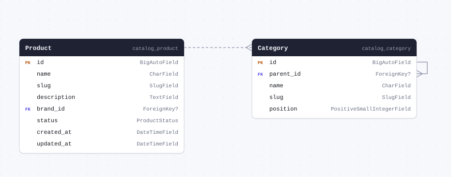

| Column | Field | Type | Null | Key | Default | Description |
| --- | --- | --- | --- | --- | --- | --- |
| `id` | `BigAutoField` | `integer` |  | PK | `autoincrement()` |  |
| `parent_id` | `ForeignKey` | `bigint` | yes | FK |  |  |
| `name` | `CharField` | `varchar(100)` |  |  |  |  |
| `slug` | `SlugField` | `varchar(100)` |  |  |  |  |
| `position` | `PositiveSmallIntegerField` | `smallint unsigned` |  |  | `0` |  |

Indexes:

- index `catalog_category_parent_id_f61bd017` on `parent_id`
- index `catalog_category_slug_dbf63ad0` on `slug`
- unique `category_slug_unique_in_parent` on `parent_id`, `slug`

Relations:

- `parent_id` → [Category](#category).`id`, on delete cascade
- `products` — many to many with [Product](#product)

## Brand

Table `catalog_brand`, app `catalog`.

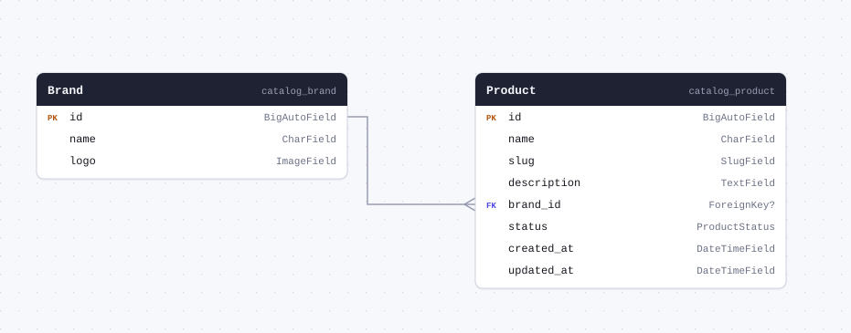

| Column | Field | Type | Null | Key | Default | Description |
| --- | --- | --- | --- | --- | --- | --- |
| `id` | `BigAutoField` | `integer` |  | PK | `autoincrement()` |  |
| `name` | `CharField` | `varchar(100)` |  | unique |  |  |
| `logo` | `ImageField` | `varchar(100)` |  |  |  |  |

Relations:

- [Product](#product).`brand_id` → `id`, on delete set null

## Product

Table `catalog_product`, app `catalog`.

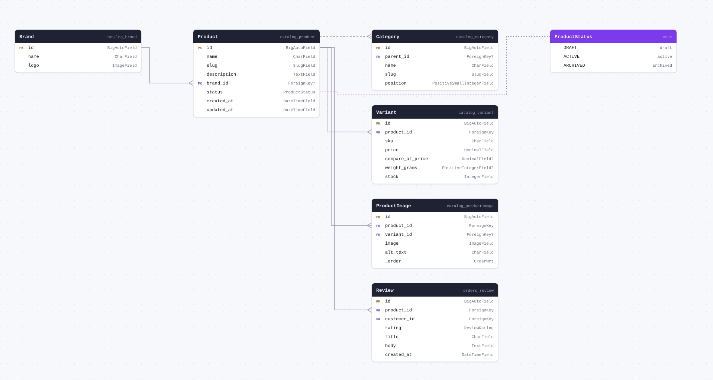

| Column | Field | Type | Null | Key | Default | Description |
| --- | --- | --- | --- | --- | --- | --- |
| `id` | `BigAutoField` | `integer` |  | PK | `autoincrement()` |  |
| `name` | `CharField` | `varchar(200)` |  |  |  |  |
| `slug` | `SlugField` | `varchar(200)` |  | unique |  |  |
| `description` | `TextField` | `text` |  |  |  |  |
| `brand_id` | `ForeignKey` | `bigint` | yes | FK |  |  |
| `status` | `ProductStatus` | `varchar(10)` |  |  | `'draft'` |  |
| `created_at` | `DateTimeField` | `datetime` |  |  | `now()` |  |
| `updated_at` | `DateTimeField` | `datetime` |  |  | `now()` |  |

Indexes:

- index `catalog_product_brand_id_bb0c7890` on `brand_id`
- index `catalog_product_status_0fdef323` on `status`

Relations:

- `brand_id` → [Brand](#brand).`id`, on delete set null
- `categories` — many to many with [Category](#category)
- [Variant](#variant).`product_id` → `id`, on delete cascade
- [ProductImage](#productimage).`product_id` → `id`, on delete cascade
- [Review](#review).`product_id` → `id`, on delete cascade

## Option

Table `catalog_option`, app `catalog`.

A way variants differ: size, colour.

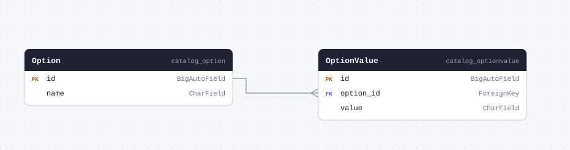

| Column | Field | Type | Null | Key | Default | Description |
| --- | --- | --- | --- | --- | --- | --- |
| `id` | `BigAutoField` | `integer` |  | PK | `autoincrement()` |  |
| `name` | `CharField` | `varchar(50)` |  | unique |  |  |

Relations:

- [OptionValue](#optionvalue).`option_id` → `id`, on delete cascade

## OptionValue

Table `catalog_optionvalue`, app `catalog`.

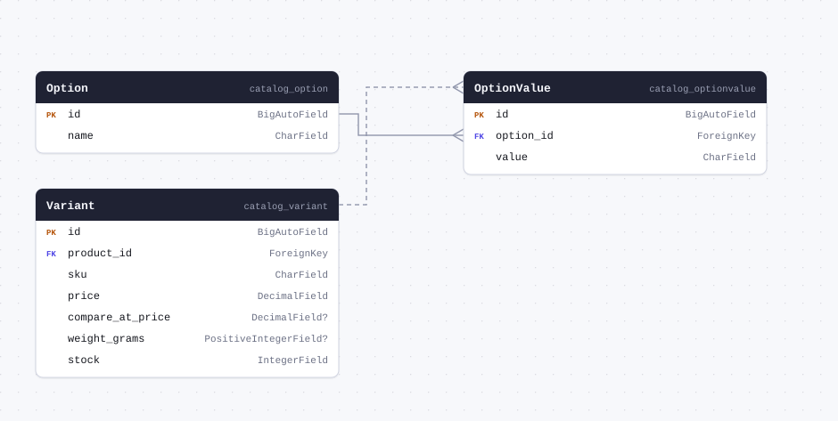

| Column | Field | Type | Null | Key | Default | Description |
| --- | --- | --- | --- | --- | --- | --- |
| `id` | `BigAutoField` | `integer` |  | PK | `autoincrement()` |  |
| `option_id` | `ForeignKey` | `bigint` |  | FK |  |  |
| `value` | `CharField` | `varchar(50)` |  |  |  |  |

Indexes:

- index `catalog_optionvalue_option_id_412a2011` on `option_id`
- unique `catalog_optionvalue_option_id_value_2127280a_uniq` on `option_id`, `value`

Relations:

- `option_id` → [Option](#option).`id`, on delete cascade
- `variant_set` — many to many with [Variant](#variant)

## Variant

Table `catalog_variant`, app `catalog`.

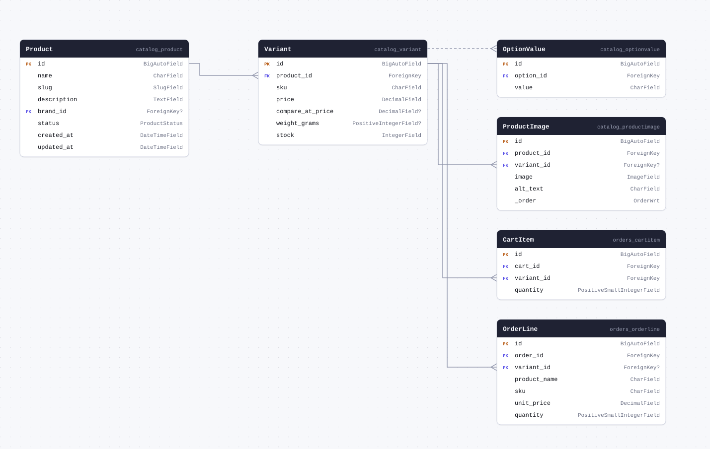

| Column | Field | Type | Null | Key | Default | Description |
| --- | --- | --- | --- | --- | --- | --- |
| `id` | `BigAutoField` | `integer` |  | PK | `autoincrement()` |  |
| `product_id` | `ForeignKey` | `bigint` |  | FK |  |  |
| `sku` | `CharField` | `varchar(40)` |  | unique |  |  |
| `price` | `DecimalField(10, 2)` | `decimal` |  |  |  |  |
| `compare_at_price` | `DecimalField(10, 2)` | `decimal` | yes |  |  |  |
| `weight_grams` | `PositiveIntegerField` | `integer unsigned` | yes |  |  |  |
| `stock` | `IntegerField` | `integer` |  |  | `0` |  |

Indexes:

- index `catalog_variant_product_id_8a21d193` on `product_id`

Checks:

- `variant_price_not_negative`: `"price" >= '0'`
- `variant_compare_at_above_price`: `("compare_at_price" IS NULL OR "compare_at_price" > ("price"))`

Relations:

- `product_id` → [Product](#product).`id`, on delete cascade
- `values` — many to many with [OptionValue](#optionvalue)
- [ProductImage](#productimage).`variant_id` → `id`, on delete set null
- [CartItem](#cartitem).`variant_id` → `id`, on delete cascade
- [OrderLine](#orderline).`variant_id` → `id`, on delete set null

## ProductImage

Table `catalog_productimage`, app `catalog`.

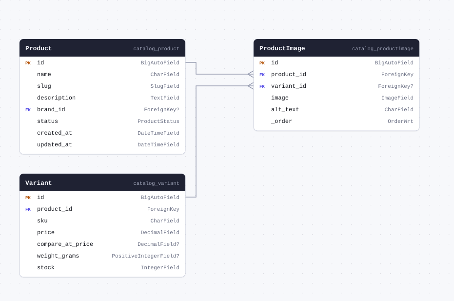

| Column | Field | Type | Null | Key | Default | Description |
| --- | --- | --- | --- | --- | --- | --- |
| `id` | `BigAutoField` | `integer` |  | PK | `autoincrement()` |  |
| `product_id` | `ForeignKey` | `bigint` |  | FK |  |  |
| `variant_id` | `ForeignKey` | `bigint` | yes | FK |  |  |
| `image` | `ImageField` | `varchar(100)` |  |  |  |  |
| `alt_text` | `CharField` | `varchar(200)` |  |  |  |  |
| `_order` | `OrderWrt` | `integer` |  |  |  |  |

Indexes:

- index `catalog_productimage_product_id_1f42dd8c` on `product_id`
- index `catalog_productimage_variant_id_a898ff0d` on `variant_id`

Relations:

- `product_id` → [Product](#product).`id`, on delete cascade
- `variant_id` → [Variant](#variant).`id`, on delete set null

## Address

Table `orders_address`, app `orders`.

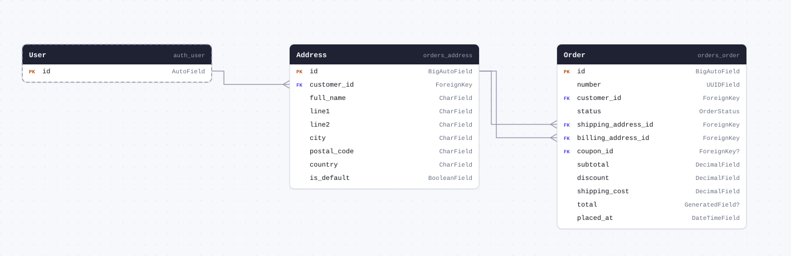

| Column | Field | Type | Null | Key | Default | Description |
| --- | --- | --- | --- | --- | --- | --- |
| `id` | `BigAutoField` | `integer` |  | PK | `autoincrement()` |  |
| `customer_id` | `ForeignKey` | `integer` |  | FK |  |  |
| `full_name` | `CharField` | `varchar(100)` |  |  |  |  |
| `line1` | `CharField` | `varchar(200)` |  |  |  |  |
| `line2` | `CharField` | `varchar(200)` |  |  |  |  |
| `city` | `CharField` | `varchar(100)` |  |  |  |  |
| `postal_code` | `CharField` | `varchar(20)` |  |  |  |  |
| `country` | `CharField` | `varchar(2)` |  |  |  |  |
| `is_default` | `BooleanField` | `bool` |  |  | `False` |  |

Indexes:

- index `orders_address_customer_id_b8a7cdae` on `customer_id`
- unique `one_default_address_per_customer` on `customer_id` where `"is_default" = 1`

Relations:

- `customer_id` → `User`.`id` (auth, not in these docs), on delete cascade
- [Order](#order).`shipping_address_id` → `id`, on delete protect
- [Order](#order).`billing_address_id` → `id`, on delete protect

## Cart

Table `orders_cart`, app `orders`.

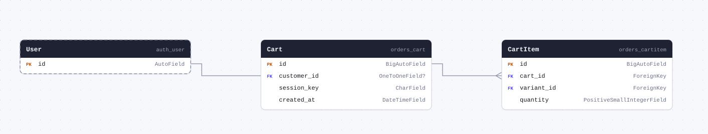

| Column | Field | Type | Null | Key | Default | Description |
| --- | --- | --- | --- | --- | --- | --- |
| `id` | `BigAutoField` | `integer` |  | PK | `autoincrement()` |  |
| `customer_id` | `OneToOneField` | `integer` | yes | FK, unique |  |  |
| `session_key` | `CharField` | `varchar(40)` |  |  |  |  |
| `created_at` | `DateTimeField` | `datetime` |  |  | `now()` |  |

Indexes:

- index `orders_cart_session_key_fec96a01` on `session_key`

Relations:

- `customer_id` → `User`.`id` (auth, not in these docs), on delete cascade
- [CartItem](#cartitem).`cart_id` → `id`, on delete cascade

## CartItem

Table `orders_cartitem`, app `orders`.

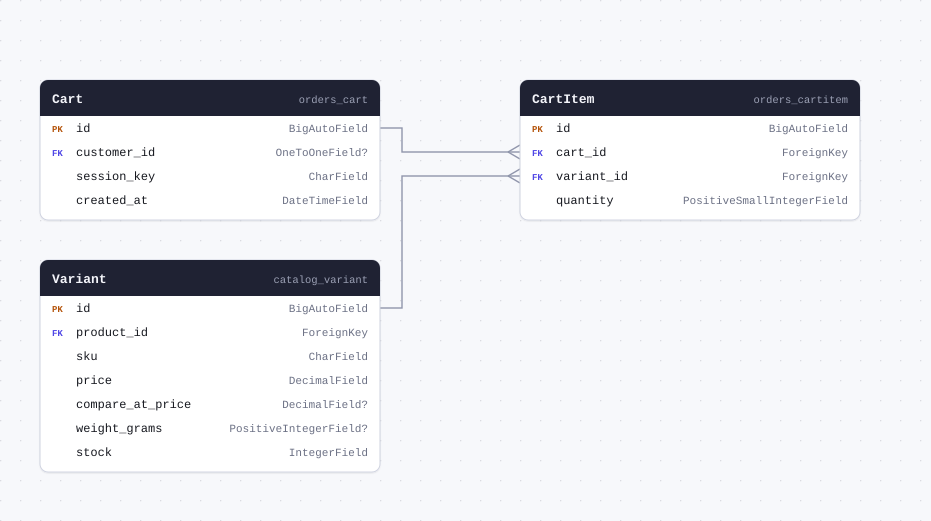

| Column | Field | Type | Null | Key | Default | Description |
| --- | --- | --- | --- | --- | --- | --- |
| `id` | `BigAutoField` | `integer` |  | PK | `autoincrement()` |  |
| `cart_id` | `ForeignKey` | `bigint` |  | FK |  |  |
| `variant_id` | `ForeignKey` | `bigint` |  | FK |  |  |
| `quantity` | `PositiveSmallIntegerField` | `smallint unsigned` |  |  | `1` |  |

Indexes:

- index `orders_cartitem_cart_id_529df5fa` on `cart_id`
- index `orders_cartitem_variant_id_a3661000` on `variant_id`
- unique `orders_cartitem_cart_id_variant_id_3af2015d_uniq` on `cart_id`, `variant_id`

Relations:

- `cart_id` → [Cart](#cart).`id`, on delete cascade
- `variant_id` → [Variant](#variant).`id`, on delete cascade

## Coupon

Table `orders_coupon`, app `orders`.

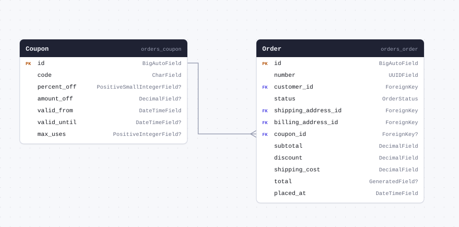

| Column | Field | Type | Null | Key | Default | Description |
| --- | --- | --- | --- | --- | --- | --- |
| `id` | `BigAutoField` | `integer` |  | PK | `autoincrement()` |  |
| `code` | `CharField` | `varchar(30)` |  | unique |  |  |
| `percent_off` | `PositiveSmallIntegerField` | `smallint unsigned` | yes |  |  |  |
| `amount_off` | `DecimalField(10, 2)` | `decimal` | yes |  |  |  |
| `valid_from` | `DateTimeField` | `datetime` |  |  |  |  |
| `valid_until` | `DateTimeField` | `datetime` | yes |  |  |  |
| `max_uses` | `PositiveIntegerField` | `integer unsigned` | yes |  |  |  |

Checks:

- `coupon_percent_xor_amount`: `(("percent_off" IS NULL OR "amount_off" IS NULL) AND 1 = (CASE WHEN "percent_off" IS NULL THEN 1 ELSE 0 END + CASE WHEN "amount_off" IS NULL THEN 1 ELSE 0 END))`
- `coupon_percent_at_most_100`: `"percent_off" <= 100`

Relations:

- [Order](#order).`coupon_id` → `id`, on delete set null

## Order

Table `orders_order`, app `orders`.

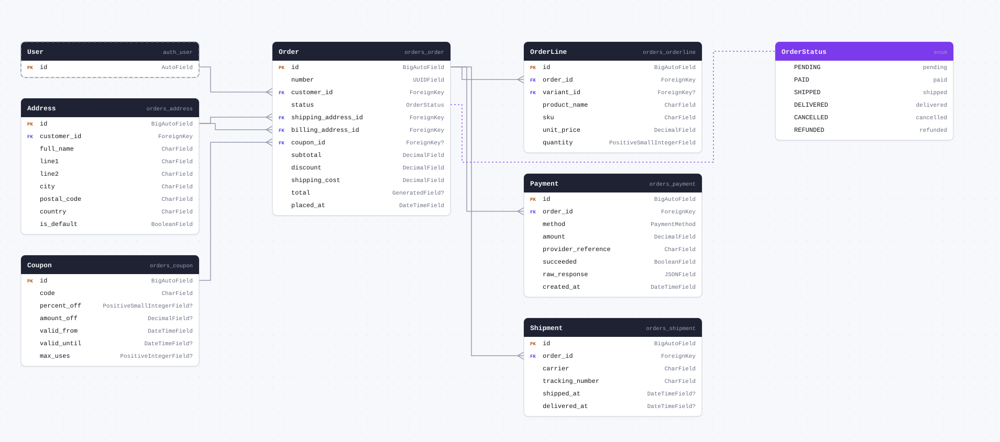

| Column | Field | Type | Null | Key | Default | Description |
| --- | --- | --- | --- | --- | --- | --- |
| `id` | `BigAutoField` | `integer` |  | PK | `autoincrement()` |  |
| `number` | `UUIDField` | `char(32)` |  | unique | `uuid4()` |  |
| `customer_id` | `ForeignKey` | `integer` |  | FK |  |  |
| `status` | `OrderStatus` | `varchar(10)` |  |  | `'pending'` |  |
| `shipping_address_id` | `ForeignKey` | `bigint` |  | FK |  |  |
| `billing_address_id` | `ForeignKey` | `bigint` |  | FK |  |  |
| `coupon_id` | `ForeignKey` | `bigint` | yes | FK |  |  |
| `subtotal` | `DecimalField(12, 2)` | `decimal` |  |  |  |  |
| `discount` | `DecimalField(12, 2)` | `decimal` |  |  | `0` |  |
| `shipping_cost` | `DecimalField(10, 2)` | `decimal` |  |  | `0` |  |
| `total` | `GeneratedField(12, 2)` | `decimal` | yes |  | generated (stored): `(CAST(((CAST(("subtotal" - "discount") AS NUMERIC)) + "shipping_cost") AS NUMERIC))` |  |
| `placed_at` | `DateTimeField` | `datetime` |  |  | `now()` |  |

Indexes:

- index `orders_order_customer_id_0b76f6a4` on `customer_id`
- index `orders_order_shipping_address_id_c4f8227a` on `shipping_address_id`
- index `orders_order_billing_address_id_deb02e83` on `billing_address_id`
- index `orders_order_coupon_id_5bddb887` on `coupon_id`
- index `order_customer_recent` on `customer_id`, `placed_at` desc

Relations:

- `customer_id` → `User`.`id` (auth, not in these docs), on delete protect
- `shipping_address_id` → [Address](#address).`id`, on delete protect
- `billing_address_id` → [Address](#address).`id`, on delete protect
- `coupon_id` → [Coupon](#coupon).`id`, on delete set null
- [OrderLine](#orderline).`order_id` → `id`, on delete cascade
- [Payment](#payment).`order_id` → `id`, on delete cascade
- [Shipment](#shipment).`order_id` → `id`, on delete cascade

## OrderLine

Table `orders_orderline`, app `orders`.

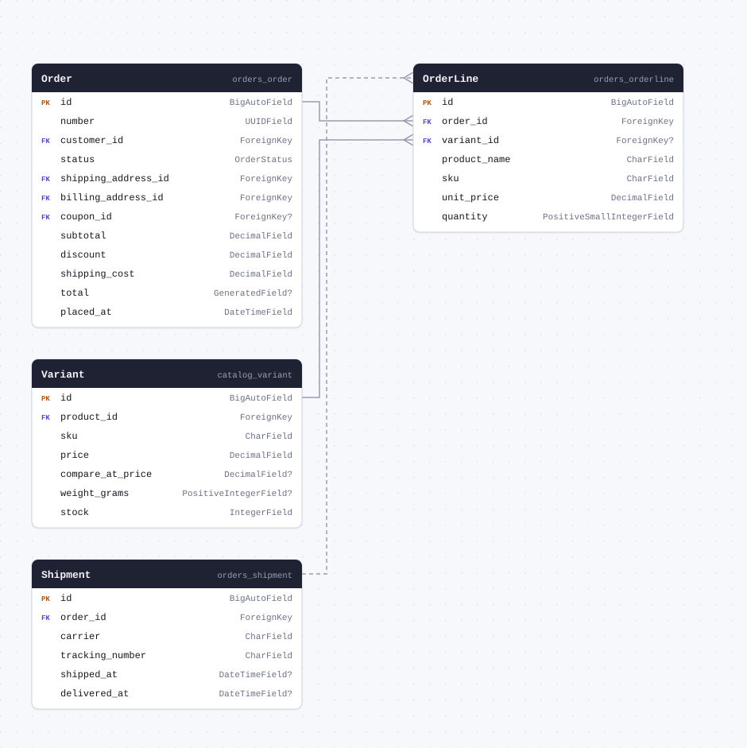

| Column | Field | Type | Null | Key | Default | Description |
| --- | --- | --- | --- | --- | --- | --- |
| `id` | `BigAutoField` | `integer` |  | PK | `autoincrement()` |  |
| `order_id` | `ForeignKey` | `bigint` |  | FK |  |  |
| `variant_id` | `ForeignKey` | `bigint` | yes | FK |  |  |
| `product_name` | `CharField` | `varchar(200)` |  |  |  |  |
| `sku` | `CharField` | `varchar(40)` |  |  |  |  |
| `unit_price` | `DecimalField(10, 2)` | `decimal` |  |  |  |  |
| `quantity` | `PositiveSmallIntegerField` | `smallint unsigned` |  |  |  |  |

Indexes:

- index `orders_orderline_order_id_17f8f3ef` on `order_id`
- index `orders_orderline_variant_id_0aa9a0d5` on `variant_id`

Relations:

- `order_id` → [Order](#order).`id`, on delete cascade
- `variant_id` → [Variant](#variant).`id`, on delete set null
- `shipments` — many to many with [Shipment](#shipment)

## Payment

Table `orders_payment`, app `orders`.

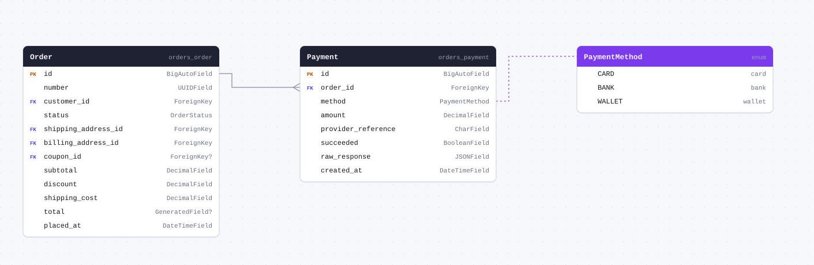

| Column | Field | Type | Null | Key | Default | Description |
| --- | --- | --- | --- | --- | --- | --- |
| `id` | `BigAutoField` | `integer` |  | PK | `autoincrement()` |  |
| `order_id` | `ForeignKey` | `bigint` |  | FK |  |  |
| `method` | `PaymentMethod` | `varchar(10)` |  |  |  |  |
| `amount` | `DecimalField(12, 2)` | `decimal` |  |  |  |  |
| `provider_reference` | `CharField` | `varchar(100)` |  | unique |  |  |
| `succeeded` | `BooleanField` | `bool` |  |  | `False` |  |
| `raw_response` | `JSONField` | `text` |  |  | `dict()` |  |
| `created_at` | `DateTimeField` | `datetime` |  |  | `now()` |  |

Indexes:

- index `orders_payment_order_id_bdccf250` on `order_id`

Relations:

- `order_id` → [Order](#order).`id`, on delete cascade

## Shipment

Table `orders_shipment`, app `orders`.

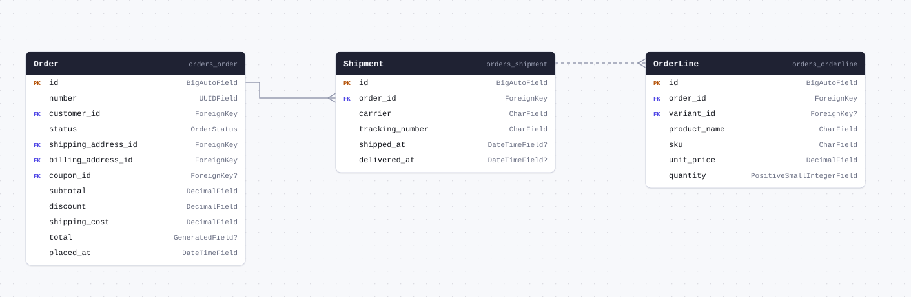

| Column | Field | Type | Null | Key | Default | Description |
| --- | --- | --- | --- | --- | --- | --- |
| `id` | `BigAutoField` | `integer` |  | PK | `autoincrement()` |  |
| `order_id` | `ForeignKey` | `bigint` |  | FK |  |  |
| `carrier` | `CharField` | `varchar(50)` |  |  |  |  |
| `tracking_number` | `CharField` | `varchar(100)` |  |  |  |  |
| `shipped_at` | `DateTimeField` | `datetime` | yes |  |  |  |
| `delivered_at` | `DateTimeField` | `datetime` | yes |  |  |  |

Indexes:

- index `orders_shipment_order_id_661ed8ed` on `order_id`

Relations:

- `order_id` → [Order](#order).`id`, on delete cascade
- `lines` — many to many with [OrderLine](#orderline)

## Review

Table `orders_review`, app `orders`.

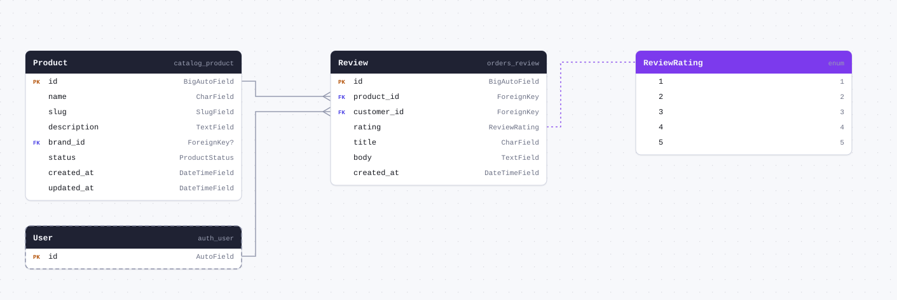

| Column | Field | Type | Null | Key | Default | Description |
| --- | --- | --- | --- | --- | --- | --- |
| `id` | `BigAutoField` | `integer` |  | PK | `autoincrement()` |  |
| `product_id` | `ForeignKey` | `bigint` |  | FK |  |  |
| `customer_id` | `ForeignKey` | `integer` |  | FK |  |  |
| `rating` | `ReviewRating` | `smallint unsigned` |  |  |  |  |
| `title` | `CharField` | `varchar(100)` |  |  |  |  |
| `body` | `TextField` | `text` |  |  |  |  |
| `created_at` | `DateTimeField` | `datetime` |  |  | `now()` |  |

Indexes:

- index `orders_review_product_id_fcb3225d` on `product_id`
- index `orders_review_customer_id_bf5f8e94` on `customer_id`
- unique `one_review_per_customer` on `product_id`, `customer_id`

Relations:

- `product_id` → [Product](#product).`id`, on delete cascade
- `customer_id` → `User`.`id` (auth, not in these docs), on delete cascade

# Enums

## ProductStatus

| Name | Stored as |
| --- | --- |
| `DRAFT` | `draft` |
| `ACTIVE` | `active` |
| `ARCHIVED` | `archived` |

## OrderStatus

| Name | Stored as |
| --- | --- |
| `PENDING` | `pending` |
| `PAID` | `paid` |
| `SHIPPED` | `shipped` |
| `DELIVERED` | `delivered` |
| `CANCELLED` | `cancelled` |
| `REFUNDED` | `refunded` |

## PaymentMethod

| Name | Stored as |
| --- | --- |
| `CARD` | `card` |
| `BANK` | `bank` |
| `WALLET` | `wallet` |

## ReviewRating

| Name | Stored as |
| --- | --- |
| `1` | `1` |
| `2` | `2` |
| `3` | `3` |
| `4` | `4` |
| `5` | `5` |
