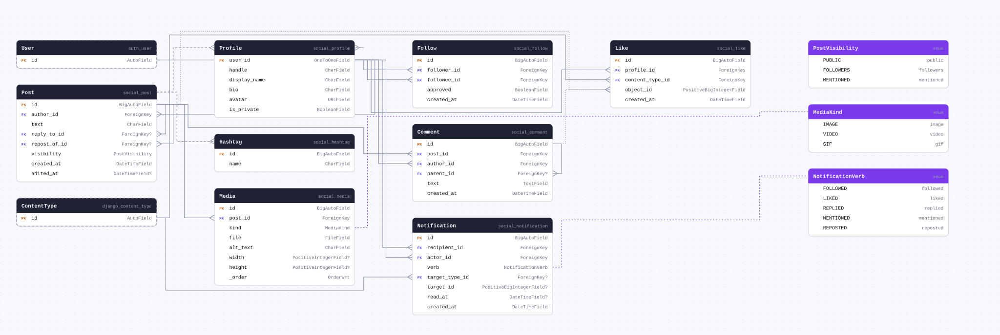
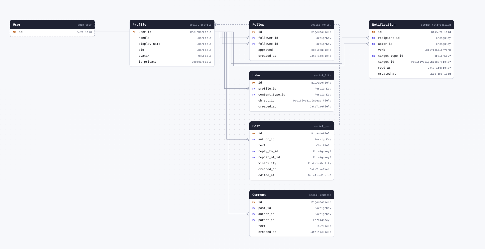
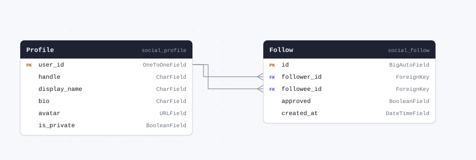
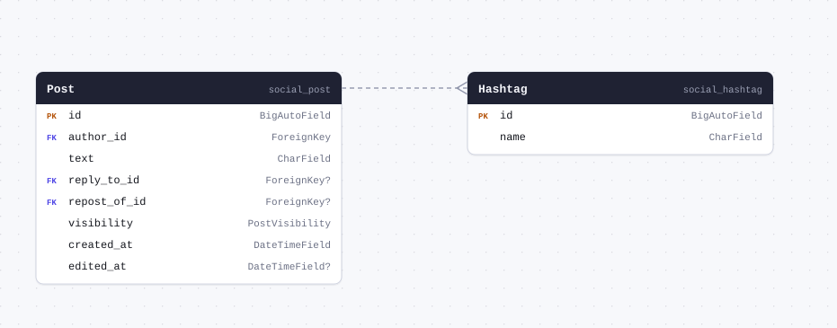
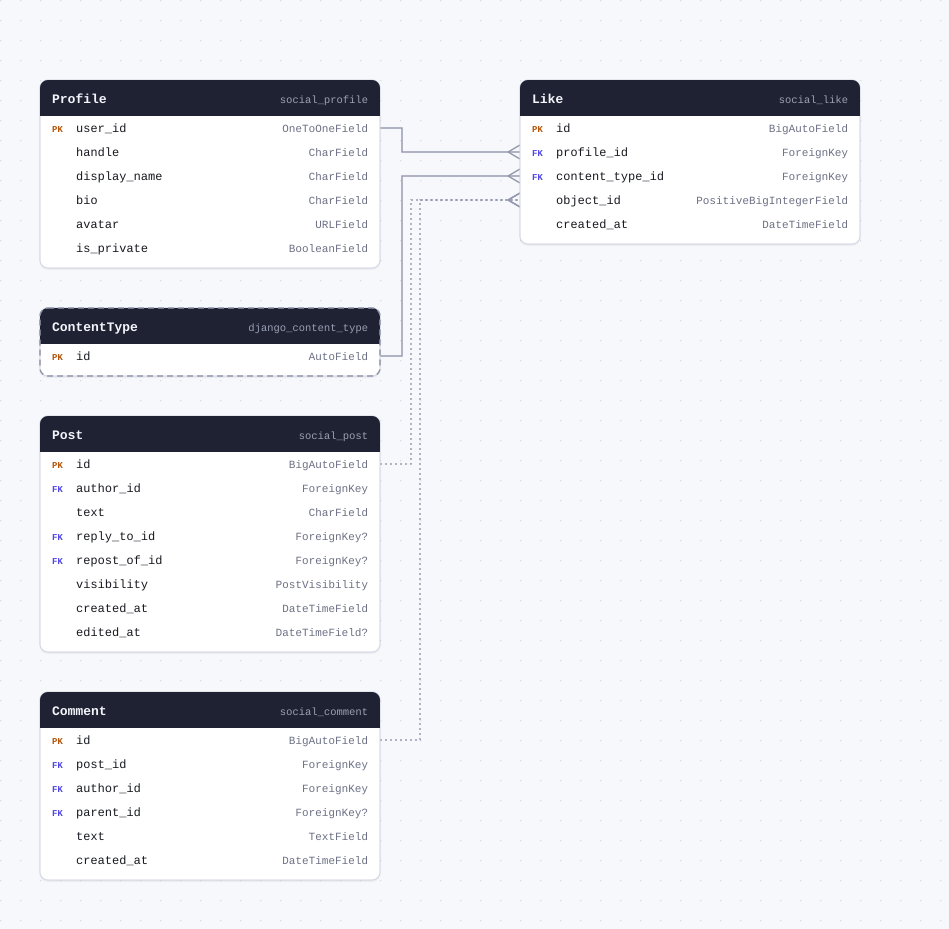
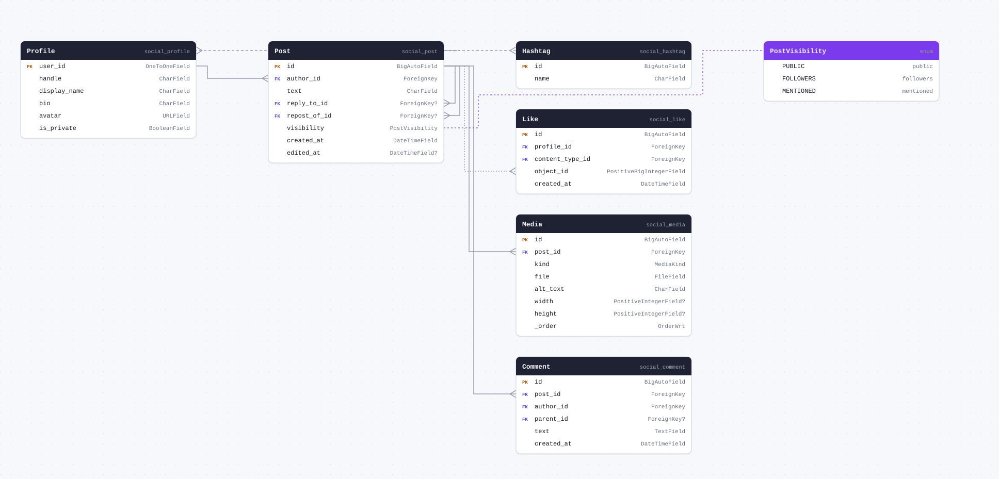
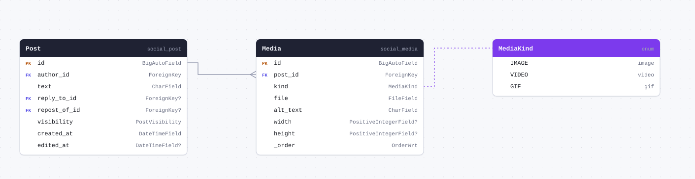
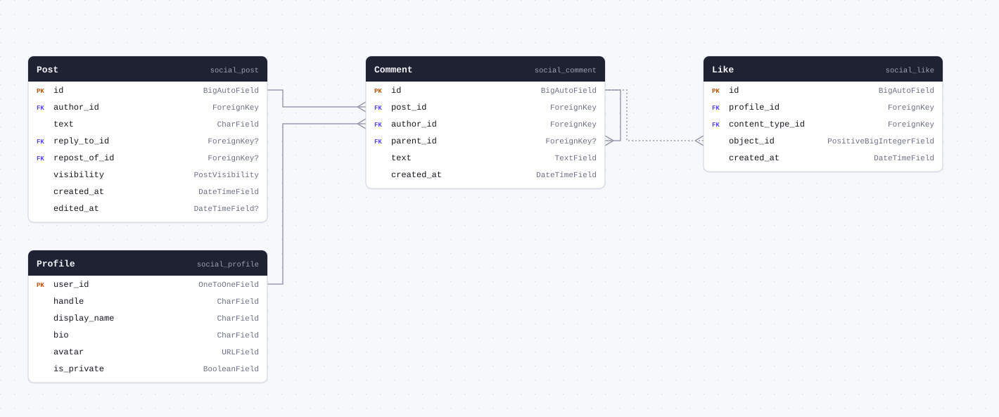
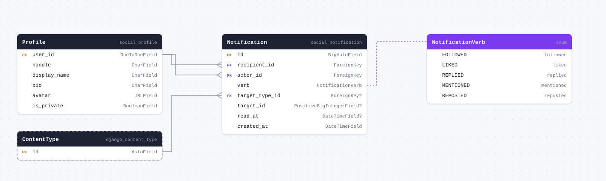

# Schema docs



[Profile](#profile) · [Follow](#follow) · [Hashtag](#hashtag) · [Like](#like) · [Post](#post) · [Media](#media) · [Comment](#comment) · [Notification](#notification)

<details>
<summary>The whole schema as SQL</summary>

```sql
CREATE TABLE "social_profile" ("user_id" integer NOT NULL PRIMARY KEY REFERENCES "auth_user" ("id") DEFERRABLE INITIALLY DEFERRED, "handle" varchar(30) NOT NULL UNIQUE, "display_name" varchar(50) NOT NULL, "bio" varchar(160) NOT NULL, "avatar" varchar(200) NOT NULL, "is_private" bool NOT NULL);

CREATE TABLE "social_profile_blocked" ("id" integer NOT NULL PRIMARY KEY AUTOINCREMENT, "from_profile_id" integer NOT NULL REFERENCES "social_profile" ("user_id") DEFERRABLE INITIALLY DEFERRED, "to_profile_id" integer NOT NULL REFERENCES "social_profile" ("user_id") DEFERRABLE INITIALLY DEFERRED);

CREATE TABLE "social_follow" ("id" integer NOT NULL PRIMARY KEY AUTOINCREMENT, "follower_id" integer NOT NULL REFERENCES "social_profile" ("user_id") DEFERRABLE INITIALLY DEFERRED, "followee_id" integer NOT NULL REFERENCES "social_profile" ("user_id") DEFERRABLE INITIALLY DEFERRED, "approved" bool NOT NULL, "created_at" datetime NOT NULL, CONSTRAINT "follow_once" UNIQUE ("follower_id", "followee_id"), CONSTRAINT "no_self_follow" CHECK (NOT ("follower_id" = ("followee_id"))));

CREATE TABLE "social_hashtag" ("id" integer NOT NULL PRIMARY KEY AUTOINCREMENT, "name" varchar(100) NOT NULL UNIQUE);

CREATE TABLE "social_like" ("id" integer NOT NULL PRIMARY KEY AUTOINCREMENT, "profile_id" integer NOT NULL REFERENCES "social_profile" ("user_id") DEFERRABLE INITIALLY DEFERRED, "content_type_id" integer NOT NULL REFERENCES "django_content_type" ("id") DEFERRABLE INITIALLY DEFERRED, "object_id" bigint unsigned NOT NULL CHECK ("object_id" >= 0), "created_at" datetime NOT NULL, CONSTRAINT "like_once" UNIQUE ("profile_id", "content_type_id", "object_id"));

CREATE TABLE "social_post" ("id" integer NOT NULL PRIMARY KEY AUTOINCREMENT, "author_id" integer NOT NULL REFERENCES "social_profile" ("user_id") DEFERRABLE INITIALLY DEFERRED, "text" varchar(500) NOT NULL, "reply_to_id" bigint NULL REFERENCES "social_post" ("id") DEFERRABLE INITIALLY DEFERRED, "repost_of_id" bigint NULL REFERENCES "social_post" ("id") DEFERRABLE INITIALLY DEFERRED, "visibility" varchar(10) NOT NULL, "created_at" datetime NOT NULL, "edited_at" datetime NULL);

CREATE TABLE "social_post_hashtags" ("id" integer NOT NULL PRIMARY KEY AUTOINCREMENT, "post_id" bigint NOT NULL REFERENCES "social_post" ("id") DEFERRABLE INITIALLY DEFERRED, "hashtag_id" bigint NOT NULL REFERENCES "social_hashtag" ("id") DEFERRABLE INITIALLY DEFERRED);

CREATE TABLE "social_post_mentions" ("id" integer NOT NULL PRIMARY KEY AUTOINCREMENT, "post_id" bigint NOT NULL REFERENCES "social_post" ("id") DEFERRABLE INITIALLY DEFERRED, "profile_id" integer NOT NULL REFERENCES "social_profile" ("user_id") DEFERRABLE INITIALLY DEFERRED);

CREATE TABLE "social_media" ("id" integer NOT NULL PRIMARY KEY AUTOINCREMENT, "post_id" bigint NOT NULL REFERENCES "social_post" ("id") DEFERRABLE INITIALLY DEFERRED, "kind" varchar(5) NOT NULL, "file" varchar(100) NOT NULL, "alt_text" varchar(400) NOT NULL, "width" integer unsigned NULL CHECK ("width" >= 0), "height" integer unsigned NULL CHECK ("height" >= 0), "_order" integer NOT NULL);

CREATE TABLE "social_comment" ("id" integer NOT NULL PRIMARY KEY AUTOINCREMENT, "post_id" bigint NOT NULL REFERENCES "social_post" ("id") DEFERRABLE INITIALLY DEFERRED, "author_id" integer NOT NULL REFERENCES "social_profile" ("user_id") DEFERRABLE INITIALLY DEFERRED, "parent_id" bigint NULL REFERENCES "social_comment" ("id") DEFERRABLE INITIALLY DEFERRED, "text" text NOT NULL, "created_at" datetime NOT NULL);

CREATE TABLE "social_notification" ("id" integer NOT NULL PRIMARY KEY AUTOINCREMENT, "recipient_id" integer NOT NULL REFERENCES "social_profile" ("user_id") DEFERRABLE INITIALLY DEFERRED, "actor_id" integer NOT NULL REFERENCES "social_profile" ("user_id") DEFERRABLE INITIALLY DEFERRED, "verb" varchar(10) NOT NULL, "target_type_id" integer NULL REFERENCES "django_content_type" ("id") DEFERRABLE INITIALLY DEFERRED, "target_id" bigint unsigned NULL CHECK ("target_id" >= 0), "read_at" datetime NULL, "created_at" datetime NOT NULL);

CREATE UNIQUE INDEX "social_profile_blocked_from_profile_id_to_profile_id_d5cbd823_uniq" ON "social_profile_blocked" ("from_profile_id", "to_profile_id");

CREATE INDEX "social_profile_blocked_from_profile_id_b8773f9e" ON "social_profile_blocked" ("from_profile_id");

CREATE INDEX "social_profile_blocked_to_profile_id_a2c8223d" ON "social_profile_blocked" ("to_profile_id");

CREATE INDEX "social_follow_follower_id_a92b1c63" ON "social_follow" ("follower_id");

CREATE INDEX "social_follow_followee_id_f37e3ad7" ON "social_follow" ("followee_id");

CREATE INDEX "social_like_profile_id_48845ebd" ON "social_like" ("profile_id");

CREATE INDEX "social_like_content_type_id_41c5dd37" ON "social_like" ("content_type_id");

CREATE INDEX "social_post_author_id_db6459ee" ON "social_post" ("author_id");

CREATE INDEX "social_post_reply_to_id_450e9a95" ON "social_post" ("reply_to_id");

CREATE INDEX "social_post_repost_of_id_0c70b976" ON "social_post" ("repost_of_id");

CREATE INDEX "post_timeline" ON "social_post" ("author_id", "created_at" DESC);

CREATE UNIQUE INDEX "social_post_hashtags_post_id_hashtag_id_e84c0358_uniq" ON "social_post_hashtags" ("post_id", "hashtag_id");

CREATE INDEX "social_post_hashtags_post_id_806245da" ON "social_post_hashtags" ("post_id");

CREATE INDEX "social_post_hashtags_hashtag_id_9837d0aa" ON "social_post_hashtags" ("hashtag_id");

CREATE UNIQUE INDEX "social_post_mentions_post_id_profile_id_ec44e6d7_uniq" ON "social_post_mentions" ("post_id", "profile_id");

CREATE INDEX "social_post_mentions_post_id_a5dfe4d0" ON "social_post_mentions" ("post_id");

CREATE INDEX "social_post_mentions_profile_id_9f4b2f7d" ON "social_post_mentions" ("profile_id");

CREATE INDEX "social_media_post_id_8cfab698" ON "social_media" ("post_id");

CREATE INDEX "social_comment_post_id_c5f61de0" ON "social_comment" ("post_id");

CREATE INDEX "social_comment_author_id_efe921df" ON "social_comment" ("author_id");

CREATE INDEX "social_comment_parent_id_a94a370c" ON "social_comment" ("parent_id");

CREATE INDEX "social_notification_recipient_id_392d8c89" ON "social_notification" ("recipient_id");

CREATE INDEX "social_notification_actor_id_78e4b611" ON "social_notification" ("actor_id");

CREATE INDEX "social_notification_target_type_id_ded844a5" ON "social_notification" ("target_type_id");

CREATE INDEX "notification_inbox" ON "social_notification" ("recipient_id", "created_at" DESC);

CREATE INDEX "notification_unread" ON "social_notification" ("recipient_id") WHERE "read_at" IS NULL;
```

</details>

## Profile

Table `social_profile`, app `social`.



| Column | Field | Type | Null | Key | Default | Description |
| --- | --- | --- | --- | --- | --- | --- |
| `user_id` | `OneToOneField` | `integer` |  | PK, FK |  |  |
| `handle` | `CharField` | `varchar(30)` |  | unique |  |  |
| `display_name` | `CharField` | `varchar(50)` |  |  |  |  |
| `bio` | `CharField` | `varchar(160)` |  |  |  |  |
| `avatar` | `URLField` | `varchar(200)` |  |  |  |  |
| `is_private` | `BooleanField` | `bool` |  |  | `False` |  |

Relations:

- `following` — many to many with [Profile](#profile), through [Follow](#follow)
- `followers` — many to many with [Profile](#profile), through [Follow](#follow)
- `user_id` → `User`.`id` (auth, not in these docs), on delete cascade
- `blocked` — many to many with [Profile](#profile)
- [Follow](#follow).`follower_id` → `user_id`, on delete cascade
- [Follow](#follow).`followee_id` → `user_id`, on delete cascade
- [Like](#like).`profile_id` → `user_id`, on delete cascade
- [Post](#post).`author_id` → `user_id`, on delete cascade
- `mentioned_in` — many to many with [Post](#post)
- [Comment](#comment).`author_id` → `user_id`, on delete cascade
- [Notification](#notification).`recipient_id` → `user_id`, on delete cascade
- [Notification](#notification).`actor_id` → `user_id`, on delete cascade

## Follow

Table `social_follow`, app `social`.



| Column | Field | Type | Null | Key | Default | Description |
| --- | --- | --- | --- | --- | --- | --- |
| `id` | `BigAutoField` | `integer` |  | PK | `autoincrement()` |  |
| `follower_id` | `ForeignKey` | `integer` |  | FK |  |  |
| `followee_id` | `ForeignKey` | `integer` |  | FK |  |  |
| `approved` | `BooleanField` | `bool` |  |  | `True` | False while a private profile has not accepted |
| `created_at` | `DateTimeField` | `datetime` |  |  | `now()` |  |

Indexes:

- index `social_follow_follower_id_a92b1c63` on `follower_id`
- index `social_follow_followee_id_f37e3ad7` on `followee_id`
- unique `follow_once` on `follower_id`, `followee_id`

Checks:

- `no_self_follow`: `NOT ("follower_id" = ("followee_id"))`

Relations:

- `follower_id` → [Profile](#profile).`user_id`, on delete cascade
- `followee_id` → [Profile](#profile).`user_id`, on delete cascade

## Hashtag

Table `social_hashtag`, app `social`.



| Column | Field | Type | Null | Key | Default | Description |
| --- | --- | --- | --- | --- | --- | --- |
| `id` | `BigAutoField` | `integer` |  | PK | `autoincrement()` |  |
| `name` | `CharField` | `varchar(100)` |  | unique |  |  |

Relations:

- `posts` — many to many with [Post](#post)

## Like

Table `social_like`, app `social`.



| Column | Field | Type | Null | Key | Default | Description |
| --- | --- | --- | --- | --- | --- | --- |
| `id` | `BigAutoField` | `integer` |  | PK | `autoincrement()` |  |
| `profile_id` | `ForeignKey` | `integer` |  | FK |  |  |
| `content_type_id` | `ForeignKey` | `integer` |  | FK |  |  |
| `object_id` | `PositiveBigIntegerField` | `bigint unsigned` |  |  |  |  |
| `created_at` | `DateTimeField` | `datetime` |  |  | `now()` |  |

Indexes:

- index `social_like_profile_id_48845ebd` on `profile_id`
- index `social_like_content_type_id_41c5dd37` on `content_type_id`
- unique `like_once` on `profile_id`, `content_type_id`, `object_id`

Relations:

- `target` → any model, by `content_type_id` + `object_id` (generic foreign key)
- `profile_id` → [Profile](#profile).`user_id`, on delete cascade
- `content_type_id` → `ContentType`.`id` (contenttypes, not in these docs), on delete cascade
- `object_id` → [Post](#post).`id` where `content_type_id` is Post (generic, `Post.likes`)
- `object_id` → [Comment](#comment).`id` where `content_type_id` is Comment (generic, `Comment.likes`)

## Post

Table `social_post`, app `social`.



| Column | Field | Type | Null | Key | Default | Description |
| --- | --- | --- | --- | --- | --- | --- |
| `id` | `BigAutoField` | `integer` |  | PK | `autoincrement()` |  |
| `author_id` | `ForeignKey` | `integer` |  | FK |  |  |
| `text` | `CharField` | `varchar(500)` |  |  |  |  |
| `reply_to_id` | `ForeignKey` | `bigint` | yes | FK |  |  |
| `repost_of_id` | `ForeignKey` | `bigint` | yes | FK |  |  |
| `visibility` | `PostVisibility` | `varchar(10)` |  |  | `'public'` |  |
| `created_at` | `DateTimeField` | `datetime` |  |  | `now()` |  |
| `edited_at` | `DateTimeField` | `datetime` | yes |  |  |  |

Indexes:

- index `social_post_author_id_db6459ee` on `author_id`
- index `social_post_reply_to_id_450e9a95` on `reply_to_id`
- index `social_post_repost_of_id_0c70b976` on `repost_of_id`
- index `post_timeline` on `author_id`, `created_at` desc

Relations:

- `author_id` → [Profile](#profile).`user_id`, on delete cascade
- `reply_to_id` → [Post](#post).`id`, on delete set null
- `repost_of_id` → [Post](#post).`id`, on delete cascade
- `hashtags` — many to many with [Hashtag](#hashtag)
- `mentions` — many to many with [Profile](#profile)
- `likes` ← [Like](#like), by `content_type_id` + `object_id` (generic relation)
- [Media](#media).`post_id` → `id`, on delete cascade
- [Comment](#comment).`post_id` → `id`, on delete cascade

## Media

Table `social_media`, app `social`.



| Column | Field | Type | Null | Key | Default | Description |
| --- | --- | --- | --- | --- | --- | --- |
| `id` | `BigAutoField` | `integer` |  | PK | `autoincrement()` |  |
| `post_id` | `ForeignKey` | `bigint` |  | FK |  |  |
| `kind` | `MediaKind` | `varchar(5)` |  |  |  |  |
| `file` | `FileField` | `varchar(100)` |  |  |  |  |
| `alt_text` | `CharField` | `varchar(400)` |  |  |  |  |
| `width` | `PositiveIntegerField` | `integer unsigned` | yes |  |  |  |
| `height` | `PositiveIntegerField` | `integer unsigned` | yes |  |  |  |
| `_order` | `OrderWrt` | `integer` |  |  |  |  |

Indexes:

- index `social_media_post_id_8cfab698` on `post_id`

Relations:

- `post_id` → [Post](#post).`id`, on delete cascade

## Comment

Table `social_comment`, app `social`.



| Column | Field | Type | Null | Key | Default | Description |
| --- | --- | --- | --- | --- | --- | --- |
| `id` | `BigAutoField` | `integer` |  | PK | `autoincrement()` |  |
| `post_id` | `ForeignKey` | `bigint` |  | FK |  |  |
| `author_id` | `ForeignKey` | `integer` |  | FK |  |  |
| `parent_id` | `ForeignKey` | `bigint` | yes | FK |  |  |
| `text` | `TextField` | `text` |  |  |  |  |
| `created_at` | `DateTimeField` | `datetime` |  |  | `now()` |  |

Indexes:

- index `social_comment_post_id_c5f61de0` on `post_id`
- index `social_comment_author_id_efe921df` on `author_id`
- index `social_comment_parent_id_a94a370c` on `parent_id`

Relations:

- `post_id` → [Post](#post).`id`, on delete cascade
- `author_id` → [Profile](#profile).`user_id`, on delete cascade
- `parent_id` → [Comment](#comment).`id`, on delete cascade
- `likes` ← [Like](#like), by `content_type_id` + `object_id` (generic relation)

## Notification

Table `social_notification`, app `social`.



| Column | Field | Type | Null | Key | Default | Description |
| --- | --- | --- | --- | --- | --- | --- |
| `id` | `BigAutoField` | `integer` |  | PK | `autoincrement()` |  |
| `recipient_id` | `ForeignKey` | `integer` |  | FK |  |  |
| `actor_id` | `ForeignKey` | `integer` |  | FK |  |  |
| `verb` | `NotificationVerb` | `varchar(10)` |  |  |  |  |
| `target_type_id` | `ForeignKey` | `integer` | yes | FK |  |  |
| `target_id` | `PositiveBigIntegerField` | `bigint unsigned` | yes |  |  |  |
| `read_at` | `DateTimeField` | `datetime` | yes |  |  |  |
| `created_at` | `DateTimeField` | `datetime` |  |  | `now()` |  |

Indexes:

- index `social_notification_recipient_id_392d8c89` on `recipient_id`
- index `social_notification_actor_id_78e4b611` on `actor_id`
- index `social_notification_target_type_id_ded844a5` on `target_type_id`
- index `notification_inbox` on `recipient_id`, `created_at` desc
- index `notification_unread` on `recipient_id` where `"read_at" IS NULL`

Relations:

- `target` → any model, by `target_type_id` + `target_id` (generic foreign key)
- `recipient_id` → [Profile](#profile).`user_id`, on delete cascade
- `actor_id` → [Profile](#profile).`user_id`, on delete cascade
- `target_type_id` → `ContentType`.`id` (contenttypes, not in these docs), on delete cascade

# Enums

## PostVisibility

| Name | Stored as |
| --- | --- |
| `PUBLIC` | `public` |
| `FOLLOWERS` | `followers` |
| `MENTIONED` | `mentioned` |

## MediaKind

| Name | Stored as |
| --- | --- |
| `IMAGE` | `image` |
| `VIDEO` | `video` |
| `GIF` | `gif` |

## NotificationVerb

| Name | Stored as |
| --- | --- |
| `FOLLOWED` | `followed` |
| `LIKED` | `liked` |
| `REPLIED` | `replied` |
| `MENTIONED` | `mentioned` |
| `REPOSTED` | `reposted` |
