# Schema docs

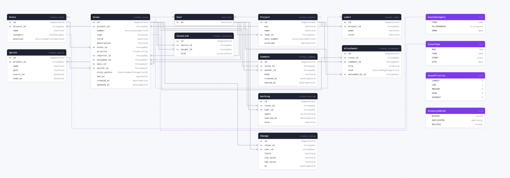

[Project](#project) · [State](#state) · [Label](#label) · [Sprint](#sprint) · [Issue](#issue) · [IssueLink](#issuelink) · [Comment](#comment) · [Attachment](#attachment) · [WorkLog](#worklog) · [Change](#change)

<details>
<summary>The whole schema as SQL</summary>

```sql
CREATE TABLE "tracker_project" ("id" integer NOT NULL PRIMARY KEY AUTOINCREMENT, "key" varchar(10) NOT NULL UNIQUE, "name" varchar(100) NOT NULL, "lead_id" integer NULL REFERENCES "auth_user" ("id") DEFERRABLE INITIALLY DEFERRED, "next_number" integer unsigned NOT NULL CHECK ("next_number" >= 0), "archived" bool NOT NULL);

CREATE TABLE "tracker_project_members" ("id" integer NOT NULL PRIMARY KEY AUTOINCREMENT, "project_id" bigint NOT NULL REFERENCES "tracker_project" ("id") DEFERRABLE INITIALLY DEFERRED, "user_id" integer NOT NULL REFERENCES "auth_user" ("id") DEFERRABLE INITIALLY DEFERRED);

CREATE TABLE "tracker_state" ("id" integer NOT NULL PRIMARY KEY AUTOINCREMENT, "project_id" bigint NOT NULL REFERENCES "tracker_project" ("id") DEFERRABLE INITIALLY DEFERRED, "name" varchar(30) NOT NULL, "category" varchar(12) NOT NULL, "position" smallint unsigned NOT NULL CHECK ("position" >= 0));

CREATE TABLE "tracker_state_transitions" ("id" integer NOT NULL PRIMARY KEY AUTOINCREMENT, "from_state_id" bigint NOT NULL REFERENCES "tracker_state" ("id") DEFERRABLE INITIALLY DEFERRED, "to_state_id" bigint NOT NULL REFERENCES "tracker_state" ("id") DEFERRABLE INITIALLY DEFERRED);

CREATE TABLE "tracker_label" ("id" integer NOT NULL PRIMARY KEY AUTOINCREMENT, "project_id" bigint NOT NULL REFERENCES "tracker_project" ("id") DEFERRABLE INITIALLY DEFERRED, "name" varchar(30) NOT NULL, "color" varchar(7) NOT NULL);

CREATE TABLE "tracker_sprint" ("id" integer NOT NULL PRIMARY KEY AUTOINCREMENT, "project_id" bigint NOT NULL REFERENCES "tracker_project" ("id") DEFERRABLE INITIALLY DEFERRED, "name" varchar(50) NOT NULL, "goal" text NOT NULL, "starts_on" date NOT NULL, "ends_on" date NOT NULL, CONSTRAINT "sprint_ends_after_start" CHECK ("ends_on" > ("starts_on")));

CREATE TABLE "tracker_issue" ("id" integer NOT NULL PRIMARY KEY AUTOINCREMENT, "project_id" bigint NOT NULL REFERENCES "tracker_project" ("id") DEFERRABLE INITIALLY DEFERRED, "number" integer unsigned NOT NULL CHECK ("number" >= 0), "type" varchar(5) NOT NULL, "title" varchar(255) NOT NULL, "description" text NOT NULL, "state_id" bigint NOT NULL REFERENCES "tracker_state" ("id") DEFERRABLE INITIALLY DEFERRED, "priority" smallint unsigned NOT NULL CHECK ("priority" >= 0), "reporter_id" integer NOT NULL REFERENCES "auth_user" ("id") DEFERRABLE INITIALLY DEFERRED, "assignee_id" integer NULL REFERENCES "auth_user" ("id") DEFERRABLE INITIALLY DEFERRED, "epic_id" bigint NULL REFERENCES "tracker_issue" ("id") DEFERRABLE INITIALLY DEFERRED, "sprint_id" bigint NULL REFERENCES "tracker_sprint" ("id") DEFERRABLE INITIALLY DEFERRED, "story_points" smallint unsigned NULL CHECK ("story_points" >= 0), "due_on" date NULL, "created_at" datetime NOT NULL, "updated_at" datetime NOT NULL, CONSTRAINT "issue_key_unique" UNIQUE ("project_id", "number"));

CREATE TABLE "tracker_issue_watchers" ("id" integer NOT NULL PRIMARY KEY AUTOINCREMENT, "issue_id" bigint NOT NULL REFERENCES "tracker_issue" ("id") DEFERRABLE INITIALLY DEFERRED, "user_id" integer NOT NULL REFERENCES "auth_user" ("id") DEFERRABLE INITIALLY DEFERRED);

CREATE TABLE "tracker_issue_labels" ("id" integer NOT NULL PRIMARY KEY AUTOINCREMENT, "issue_id" bigint NOT NULL REFERENCES "tracker_issue" ("id") DEFERRABLE INITIALLY DEFERRED, "label_id" bigint NOT NULL REFERENCES "tracker_label" ("id") DEFERRABLE INITIALLY DEFERRED);

CREATE TABLE "tracker_issuelink" ("id" integer NOT NULL PRIMARY KEY AUTOINCREMENT, "source_id" bigint NOT NULL REFERENCES "tracker_issue" ("id") DEFERRABLE INITIALLY DEFERRED, "target_id" bigint NOT NULL REFERENCES "tracker_issue" ("id") DEFERRABLE INITIALLY DEFERRED, "kind" varchar(10) NOT NULL);

CREATE TABLE "tracker_comment" ("id" integer NOT NULL PRIMARY KEY AUTOINCREMENT, "issue_id" bigint NOT NULL REFERENCES "tracker_issue" ("id") DEFERRABLE INITIALLY DEFERRED, "author_id" integer NOT NULL REFERENCES "auth_user" ("id") DEFERRABLE INITIALLY DEFERRED, "body" text NOT NULL, "created_at" datetime NOT NULL, "edited_at" datetime NULL);

CREATE TABLE "tracker_attachment" ("id" integer NOT NULL PRIMARY KEY AUTOINCREMENT, "issue_id" bigint NOT NULL REFERENCES "tracker_issue" ("id") DEFERRABLE INITIALLY DEFERRED, "comment_id" bigint NULL REFERENCES "tracker_comment" ("id") DEFERRABLE INITIALLY DEFERRED, "file" varchar(100) NOT NULL, "size" bigint unsigned NOT NULL CHECK ("size" >= 0), "uploaded_by_id" integer NULL REFERENCES "auth_user" ("id") DEFERRABLE INITIALLY DEFERRED);

CREATE TABLE "tracker_worklog" ("id" integer NOT NULL PRIMARY KEY AUTOINCREMENT, "issue_id" bigint NOT NULL REFERENCES "tracker_issue" ("id") DEFERRABLE INITIALLY DEFERRED, "user_id" integer NOT NULL REFERENCES "auth_user" ("id") DEFERRABLE INITIALLY DEFERRED, "spent" bigint NOT NULL, "started_at" datetime NOT NULL, "note" varchar(200) NOT NULL);

CREATE TABLE "tracker_change" ("id" integer NOT NULL PRIMARY KEY AUTOINCREMENT, "issue_id" bigint NOT NULL REFERENCES "tracker_issue" ("id") DEFERRABLE INITIALLY DEFERRED, "user_id" integer NULL REFERENCES "auth_user" ("id") DEFERRABLE INITIALLY DEFERRED, "field" varchar(50) NOT NULL, "old_value" text NOT NULL, "new_value" text NOT NULL, "at" datetime NOT NULL);

CREATE INDEX "tracker_project_lead_id_76fcd210" ON "tracker_project" ("lead_id");

CREATE UNIQUE INDEX "tracker_project_members_project_id_user_id_62cc35a2_uniq" ON "tracker_project_members" ("project_id", "user_id");

CREATE INDEX "tracker_project_members_project_id_c8fb1d03" ON "tracker_project_members" ("project_id");

CREATE INDEX "tracker_project_members_user_id_cb20f532" ON "tracker_project_members" ("user_id");

CREATE UNIQUE INDEX "tracker_state_project_id_name_e4195aed_uniq" ON "tracker_state" ("project_id", "name");

CREATE INDEX "tracker_state_project_id_09387f3a" ON "tracker_state" ("project_id");

CREATE UNIQUE INDEX "tracker_state_transitions_from_state_id_to_state_id_6ffbdb08_uniq" ON "tracker_state_transitions" ("from_state_id", "to_state_id");

CREATE INDEX "tracker_state_transitions_from_state_id_1297df33" ON "tracker_state_transitions" ("from_state_id");

CREATE INDEX "tracker_state_transitions_to_state_id_ff99f968" ON "tracker_state_transitions" ("to_state_id");

CREATE UNIQUE INDEX "tracker_label_project_id_name_c3354c61_uniq" ON "tracker_label" ("project_id", "name");

CREATE INDEX "tracker_label_project_id_7e334efc" ON "tracker_label" ("project_id");

CREATE INDEX "tracker_sprint_project_id_8e58867b" ON "tracker_sprint" ("project_id");

CREATE INDEX "tracker_issue_project_id_9b6cd5f2" ON "tracker_issue" ("project_id");

CREATE INDEX "tracker_issue_state_id_d16a18ef" ON "tracker_issue" ("state_id");

CREATE INDEX "tracker_issue_reporter_id_14400ee5" ON "tracker_issue" ("reporter_id");

CREATE INDEX "tracker_issue_assignee_id_938e4010" ON "tracker_issue" ("assignee_id");

CREATE INDEX "tracker_issue_epic_id_d0bdf040" ON "tracker_issue" ("epic_id");

CREATE INDEX "tracker_issue_sprint_id_b1259353" ON "tracker_issue" ("sprint_id");

CREATE INDEX "issue_assignee_state" ON "tracker_issue" ("assignee_id", "state_id");

CREATE INDEX "issue_recent" ON "tracker_issue" ("project_id", "updated_at" DESC);

CREATE UNIQUE INDEX "tracker_issue_watchers_issue_id_user_id_d51aa75a_uniq" ON "tracker_issue_watchers" ("issue_id", "user_id");

CREATE INDEX "tracker_issue_watchers_issue_id_a1e248f8" ON "tracker_issue_watchers" ("issue_id");

CREATE INDEX "tracker_issue_watchers_user_id_f11a50f3" ON "tracker_issue_watchers" ("user_id");

CREATE UNIQUE INDEX "tracker_issue_labels_issue_id_label_id_4677982a_uniq" ON "tracker_issue_labels" ("issue_id", "label_id");

CREATE INDEX "tracker_issue_labels_issue_id_7f24b2ef" ON "tracker_issue_labels" ("issue_id");

CREATE INDEX "tracker_issue_labels_label_id_69bbbdbe" ON "tracker_issue_labels" ("label_id");

CREATE UNIQUE INDEX "tracker_issuelink_source_id_target_id_kind_9c006157_uniq" ON "tracker_issuelink" ("source_id", "target_id", "kind");

CREATE INDEX "tracker_issuelink_source_id_c7571d8e" ON "tracker_issuelink" ("source_id");

CREATE INDEX "tracker_issuelink_target_id_e26da2f2" ON "tracker_issuelink" ("target_id");

CREATE INDEX "tracker_comment_issue_id_1406012c" ON "tracker_comment" ("issue_id");

CREATE INDEX "tracker_comment_author_id_4dd64fe0" ON "tracker_comment" ("author_id");

CREATE INDEX "tracker_attachment_issue_id_d077b81c" ON "tracker_attachment" ("issue_id");

CREATE INDEX "tracker_attachment_comment_id_6bb44455" ON "tracker_attachment" ("comment_id");

CREATE INDEX "tracker_attachment_uploaded_by_id_122a8f1b" ON "tracker_attachment" ("uploaded_by_id");

CREATE INDEX "tracker_worklog_issue_id_cda398b1" ON "tracker_worklog" ("issue_id");

CREATE INDEX "tracker_worklog_user_id_bfff3b43" ON "tracker_worklog" ("user_id");

CREATE INDEX "tracker_change_issue_id_d651f814" ON "tracker_change" ("issue_id");

CREATE INDEX "tracker_change_user_id_773a3168" ON "tracker_change" ("user_id");
```

</details>

## Project

Table `tracker_project`, app `tracker`.

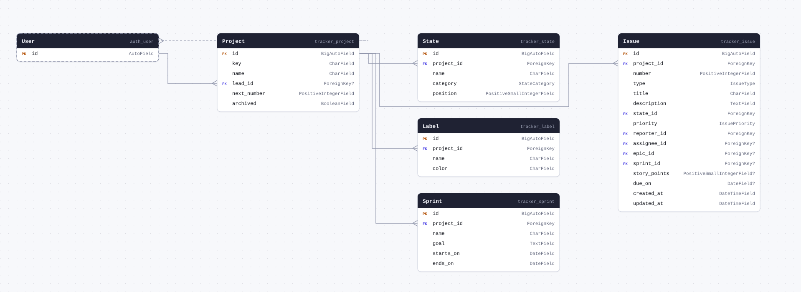

| Column | Field | Type | Null | Key | Default | Description |
| --- | --- | --- | --- | --- | --- | --- |
| `id` | `BigAutoField` | `integer` |  | PK | `autoincrement()` |  |
| `key` | `CharField` | `varchar(10)` |  | unique |  | Prefix of issue keys, e.g. WEB |
| `name` | `CharField` | `varchar(100)` |  |  |  |  |
| `lead_id` | `ForeignKey` | `integer` | yes | FK |  |  |
| `next_number` | `PositiveIntegerField` | `integer unsigned` |  |  | `1` |  |
| `archived` | `BooleanField` | `bool` |  |  | `False` |  |

Indexes:

- index `tracker_project_lead_id_76fcd210` on `lead_id`

Relations:

- `lead_id` → `User`.`id` (auth, not in these docs), on delete set null
- `members` — many to many with `User` (auth, not in these docs)
- [State](#state).`project_id` → `id`, on delete cascade
- [Label](#label).`project_id` → `id`, on delete cascade
- [Sprint](#sprint).`project_id` → `id`, on delete cascade
- [Issue](#issue).`project_id` → `id`, on delete cascade

## State

Table `tracker_state`, app `tracker`.

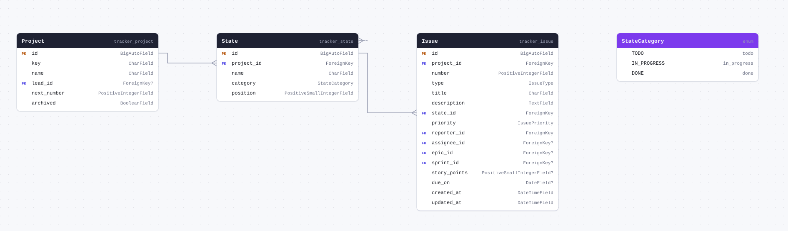

| Column | Field | Type | Null | Key | Default | Description |
| --- | --- | --- | --- | --- | --- | --- |
| `id` | `BigAutoField` | `integer` |  | PK | `autoincrement()` |  |
| `project_id` | `ForeignKey` | `bigint` |  | FK |  |  |
| `name` | `CharField` | `varchar(30)` |  |  |  |  |
| `category` | `StateCategory` | `varchar(12)` |  |  |  |  |
| `position` | `PositiveSmallIntegerField` | `smallint unsigned` |  |  |  |  |

Indexes:

- index `tracker_state_project_id_09387f3a` on `project_id`
- unique `tracker_state_project_id_name_e4195aed_uniq` on `project_id`, `name`

Relations:

- `project_id` → [Project](#project).`id`, on delete cascade
- `transitions` — many to many with [State](#state)
- [Issue](#issue).`state_id` → `id`, on delete protect

## Label

Table `tracker_label`, app `tracker`.

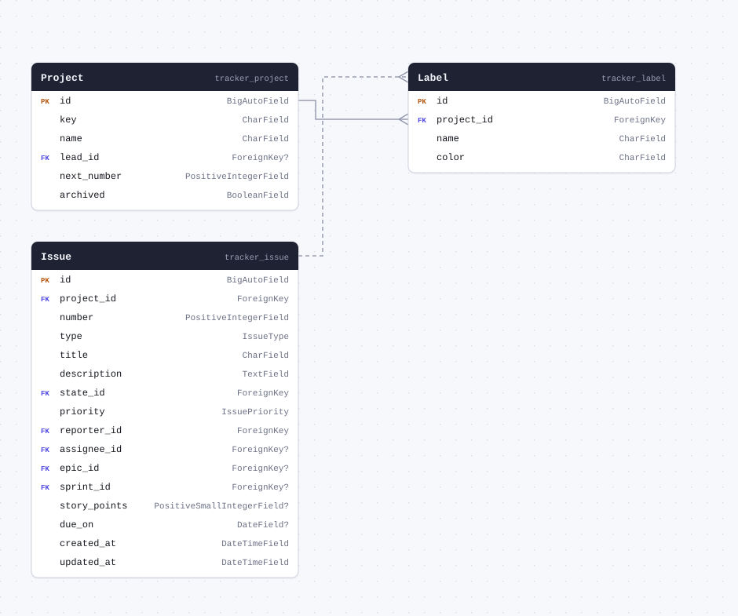

| Column | Field | Type | Null | Key | Default | Description |
| --- | --- | --- | --- | --- | --- | --- |
| `id` | `BigAutoField` | `integer` |  | PK | `autoincrement()` |  |
| `project_id` | `ForeignKey` | `bigint` |  | FK |  |  |
| `name` | `CharField` | `varchar(30)` |  |  |  |  |
| `color` | `CharField` | `varchar(7)` |  |  | `'#888888'` |  |

Indexes:

- index `tracker_label_project_id_7e334efc` on `project_id`
- unique `tracker_label_project_id_name_c3354c61_uniq` on `project_id`, `name`

Relations:

- `project_id` → [Project](#project).`id`, on delete cascade
- `issues` — many to many with [Issue](#issue)

## Sprint

Table `tracker_sprint`, app `tracker`.

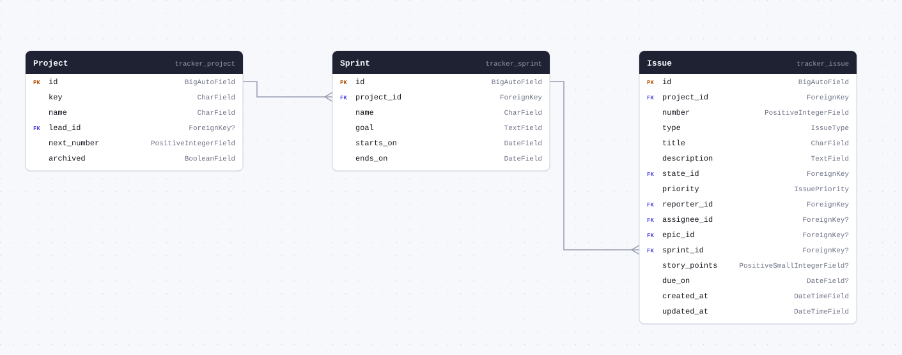

| Column | Field | Type | Null | Key | Default | Description |
| --- | --- | --- | --- | --- | --- | --- |
| `id` | `BigAutoField` | `integer` |  | PK | `autoincrement()` |  |
| `project_id` | `ForeignKey` | `bigint` |  | FK |  |  |
| `name` | `CharField` | `varchar(50)` |  |  |  |  |
| `goal` | `TextField` | `text` |  |  |  |  |
| `starts_on` | `DateField` | `date` |  |  |  |  |
| `ends_on` | `DateField` | `date` |  |  |  |  |

Indexes:

- index `tracker_sprint_project_id_8e58867b` on `project_id`

Checks:

- `sprint_ends_after_start`: `"ends_on" > ("starts_on")`

Relations:

- `project_id` → [Project](#project).`id`, on delete cascade
- [Issue](#issue).`sprint_id` → `id`, on delete set null

## Issue

Table `tracker_issue`, app `tracker`.

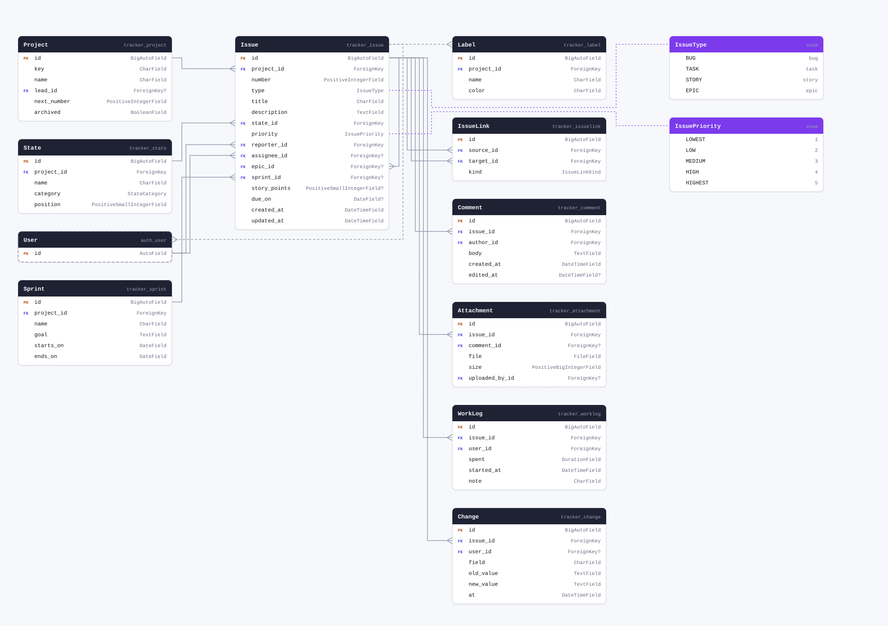

| Column | Field | Type | Null | Key | Default | Description |
| --- | --- | --- | --- | --- | --- | --- |
| `id` | `BigAutoField` | `integer` |  | PK | `autoincrement()` |  |
| `project_id` | `ForeignKey` | `bigint` |  | FK |  |  |
| `number` | `PositiveIntegerField` | `integer unsigned` |  |  |  |  |
| `type` | `IssueType` | `varchar(5)` |  |  | `'task'` |  |
| `title` | `CharField` | `varchar(255)` |  |  |  |  |
| `description` | `TextField` | `text` |  |  |  |  |
| `state_id` | `ForeignKey` | `bigint` |  | FK |  |  |
| `priority` | `IssuePriority` | `smallint unsigned` |  |  | `3` |  |
| `reporter_id` | `ForeignKey` | `integer` |  | FK |  |  |
| `assignee_id` | `ForeignKey` | `integer` | yes | FK |  |  |
| `epic_id` | `ForeignKey` | `bigint` | yes | FK |  |  |
| `sprint_id` | `ForeignKey` | `bigint` | yes | FK |  |  |
| `story_points` | `PositiveSmallIntegerField` | `smallint unsigned` | yes |  |  |  |
| `due_on` | `DateField` | `date` | yes |  |  |  |
| `created_at` | `DateTimeField` | `datetime` |  |  | `now()` |  |
| `updated_at` | `DateTimeField` | `datetime` |  |  | `now()` |  |

Indexes:

- index `tracker_issue_project_id_9b6cd5f2` on `project_id`
- index `tracker_issue_state_id_d16a18ef` on `state_id`
- index `tracker_issue_reporter_id_14400ee5` on `reporter_id`
- index `tracker_issue_assignee_id_938e4010` on `assignee_id`
- index `tracker_issue_epic_id_d0bdf040` on `epic_id`
- index `tracker_issue_sprint_id_b1259353` on `sprint_id`
- unique `issue_key_unique` on `project_id`, `number`
- index `issue_assignee_state` on `assignee_id`, `state_id`
- index `issue_recent` on `project_id`, `updated_at` desc

Relations:

- `links` — many to many with [Issue](#issue), through [IssueLink](#issuelink)
- `linked_from` — many to many with [Issue](#issue), through [IssueLink](#issuelink)
- `project_id` → [Project](#project).`id`, on delete cascade
- `state_id` → [State](#state).`id`, on delete protect
- `reporter_id` → `User`.`id` (auth, not in these docs), on delete protect
- `assignee_id` → `User`.`id` (auth, not in these docs), on delete set null
- `epic_id` → [Issue](#issue).`id`, on delete set null
- `sprint_id` → [Sprint](#sprint).`id`, on delete set null
- `watchers` — many to many with `User` (auth, not in these docs)
- `labels` — many to many with [Label](#label)
- [IssueLink](#issuelink).`source_id` → `id`, on delete cascade
- [IssueLink](#issuelink).`target_id` → `id`, on delete cascade
- [Comment](#comment).`issue_id` → `id`, on delete cascade
- [Attachment](#attachment).`issue_id` → `id`, on delete cascade
- [WorkLog](#worklog).`issue_id` → `id`, on delete cascade
- [Change](#change).`issue_id` → `id`, on delete cascade

## IssueLink

Table `tracker_issuelink`, app `tracker`.

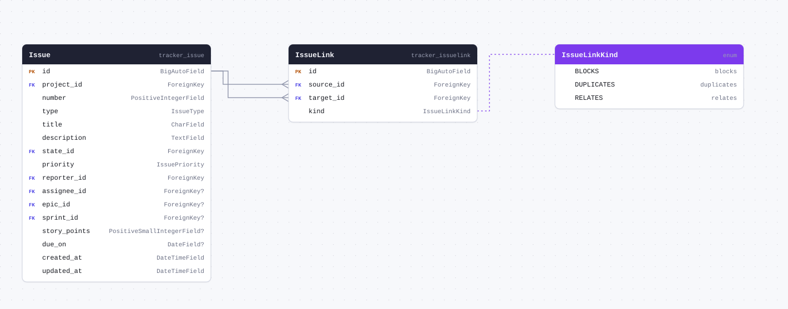

| Column | Field | Type | Null | Key | Default | Description |
| --- | --- | --- | --- | --- | --- | --- |
| `id` | `BigAutoField` | `integer` |  | PK | `autoincrement()` |  |
| `source_id` | `ForeignKey` | `bigint` |  | FK |  |  |
| `target_id` | `ForeignKey` | `bigint` |  | FK |  |  |
| `kind` | `IssueLinkKind` | `varchar(10)` |  |  |  |  |

Indexes:

- index `tracker_issuelink_source_id_c7571d8e` on `source_id`
- index `tracker_issuelink_target_id_e26da2f2` on `target_id`
- unique `tracker_issuelink_source_id_target_id_kind_9c006157_uniq` on `source_id`, `target_id`, `kind`

Relations:

- `source_id` → [Issue](#issue).`id`, on delete cascade
- `target_id` → [Issue](#issue).`id`, on delete cascade

## Comment

Table `tracker_comment`, app `tracker`.

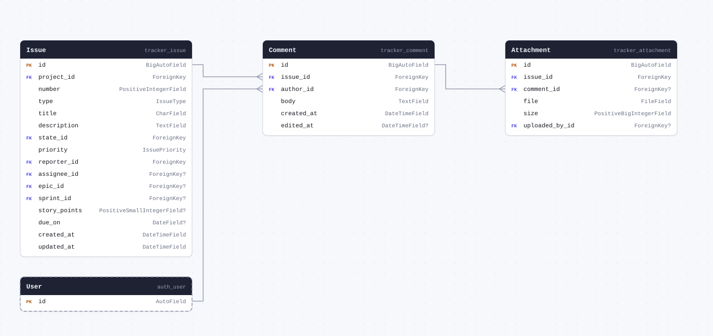

| Column | Field | Type | Null | Key | Default | Description |
| --- | --- | --- | --- | --- | --- | --- |
| `id` | `BigAutoField` | `integer` |  | PK | `autoincrement()` |  |
| `issue_id` | `ForeignKey` | `bigint` |  | FK |  |  |
| `author_id` | `ForeignKey` | `integer` |  | FK |  |  |
| `body` | `TextField` | `text` |  |  |  |  |
| `created_at` | `DateTimeField` | `datetime` |  |  | `now()` |  |
| `edited_at` | `DateTimeField` | `datetime` | yes |  |  |  |

Indexes:

- index `tracker_comment_issue_id_1406012c` on `issue_id`
- index `tracker_comment_author_id_4dd64fe0` on `author_id`

Relations:

- `issue_id` → [Issue](#issue).`id`, on delete cascade
- `author_id` → `User`.`id` (auth, not in these docs), on delete cascade
- [Attachment](#attachment).`comment_id` → `id`, on delete set null

## Attachment

Table `tracker_attachment`, app `tracker`.

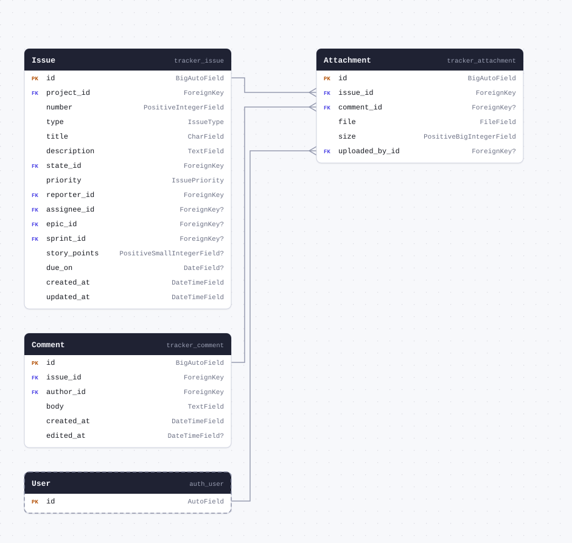

| Column | Field | Type | Null | Key | Default | Description |
| --- | --- | --- | --- | --- | --- | --- |
| `id` | `BigAutoField` | `integer` |  | PK | `autoincrement()` |  |
| `issue_id` | `ForeignKey` | `bigint` |  | FK |  |  |
| `comment_id` | `ForeignKey` | `bigint` | yes | FK |  |  |
| `file` | `FileField` | `varchar(100)` |  |  |  |  |
| `size` | `PositiveBigIntegerField` | `bigint unsigned` |  |  |  |  |
| `uploaded_by_id` | `ForeignKey` | `integer` | yes | FK |  |  |

Indexes:

- index `tracker_attachment_issue_id_d077b81c` on `issue_id`
- index `tracker_attachment_comment_id_6bb44455` on `comment_id`
- index `tracker_attachment_uploaded_by_id_122a8f1b` on `uploaded_by_id`

Relations:

- `issue_id` → [Issue](#issue).`id`, on delete cascade
- `comment_id` → [Comment](#comment).`id`, on delete set null
- `uploaded_by_id` → `User`.`id` (auth, not in these docs), on delete set null

## WorkLog

Table `tracker_worklog`, app `tracker`.

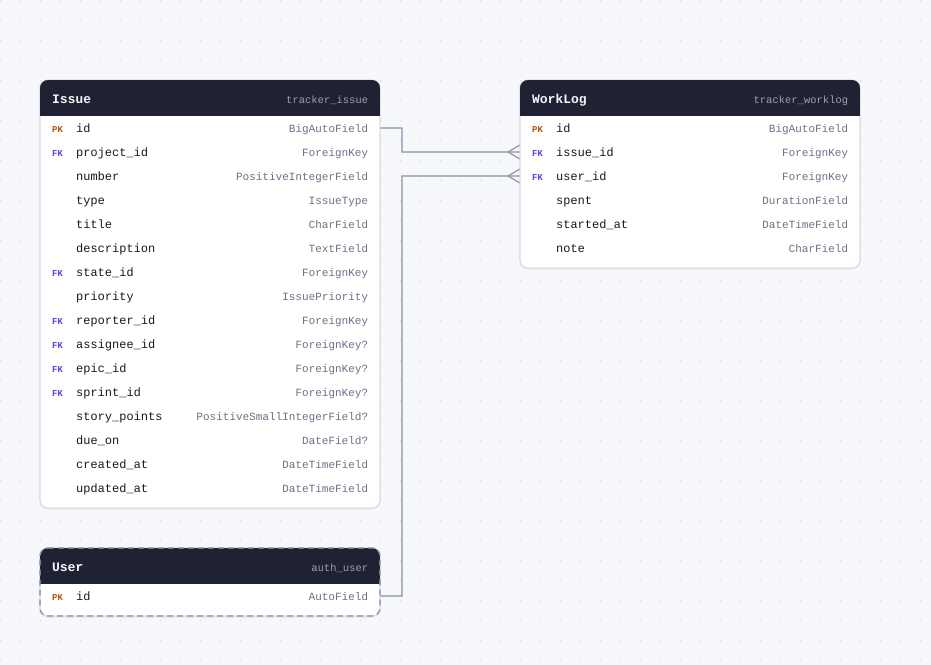

| Column | Field | Type | Null | Key | Default | Description |
| --- | --- | --- | --- | --- | --- | --- |
| `id` | `BigAutoField` | `integer` |  | PK | `autoincrement()` |  |
| `issue_id` | `ForeignKey` | `bigint` |  | FK |  |  |
| `user_id` | `ForeignKey` | `integer` |  | FK |  |  |
| `spent` | `DurationField` | `bigint` |  |  |  |  |
| `started_at` | `DateTimeField` | `datetime` |  |  |  |  |
| `note` | `CharField` | `varchar(200)` |  |  |  |  |

Indexes:

- index `tracker_worklog_issue_id_cda398b1` on `issue_id`
- index `tracker_worklog_user_id_bfff3b43` on `user_id`

Relations:

- `issue_id` → [Issue](#issue).`id`, on delete cascade
- `user_id` → `User`.`id` (auth, not in these docs), on delete cascade

## Change

Table `tracker_change`, app `tracker`.

One field of an issue changed, for its history.

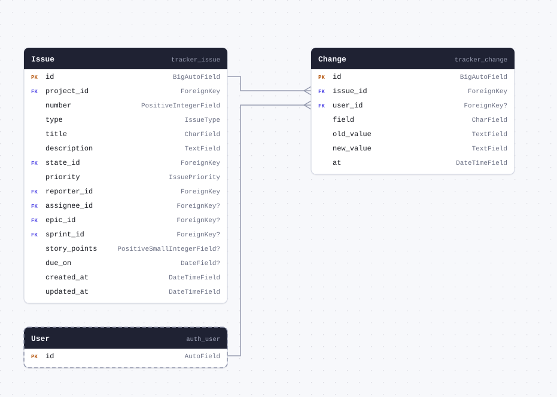

| Column | Field | Type | Null | Key | Default | Description |
| --- | --- | --- | --- | --- | --- | --- |
| `id` | `BigAutoField` | `integer` |  | PK | `autoincrement()` |  |
| `issue_id` | `ForeignKey` | `bigint` |  | FK |  |  |
| `user_id` | `ForeignKey` | `integer` | yes | FK |  |  |
| `field` | `CharField` | `varchar(50)` |  |  |  |  |
| `old_value` | `TextField` | `text` |  |  |  |  |
| `new_value` | `TextField` | `text` |  |  |  |  |
| `at` | `DateTimeField` | `datetime` |  |  | `now()` |  |

Indexes:

- index `tracker_change_issue_id_d651f814` on `issue_id`
- index `tracker_change_user_id_773a3168` on `user_id`

Relations:

- `issue_id` → [Issue](#issue).`id`, on delete cascade
- `user_id` → `User`.`id` (auth, not in these docs), on delete set null

# Enums

## StateCategory

| Name | Stored as |
| --- | --- |
| `TODO` | `todo` |
| `IN_PROGRESS` | `in_progress` |
| `DONE` | `done` |

## IssueType

| Name | Stored as |
| --- | --- |
| `BUG` | `bug` |
| `TASK` | `task` |
| `STORY` | `story` |
| `EPIC` | `epic` |

## IssuePriority

| Name | Stored as |
| --- | --- |
| `LOWEST` | `1` |
| `LOW` | `2` |
| `MEDIUM` | `3` |
| `HIGH` | `4` |
| `HIGHEST` | `5` |

## IssueLinkKind

| Name | Stored as |
| --- | --- |
| `BLOCKS` | `blocks` |
| `DUPLICATES` | `duplicates` |
| `RELATES` | `relates` |
