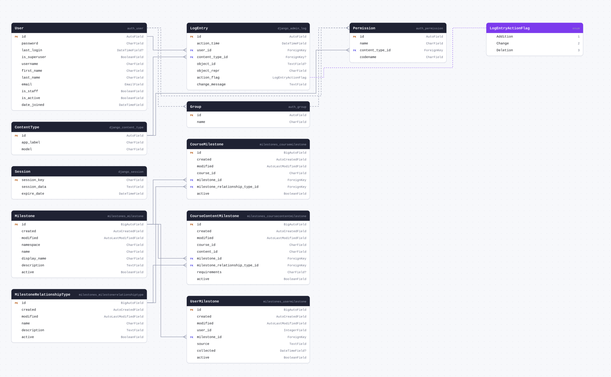
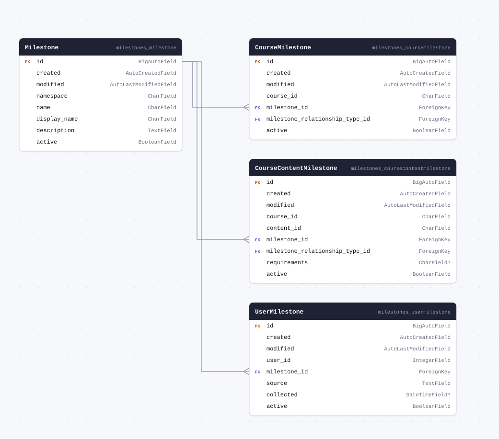
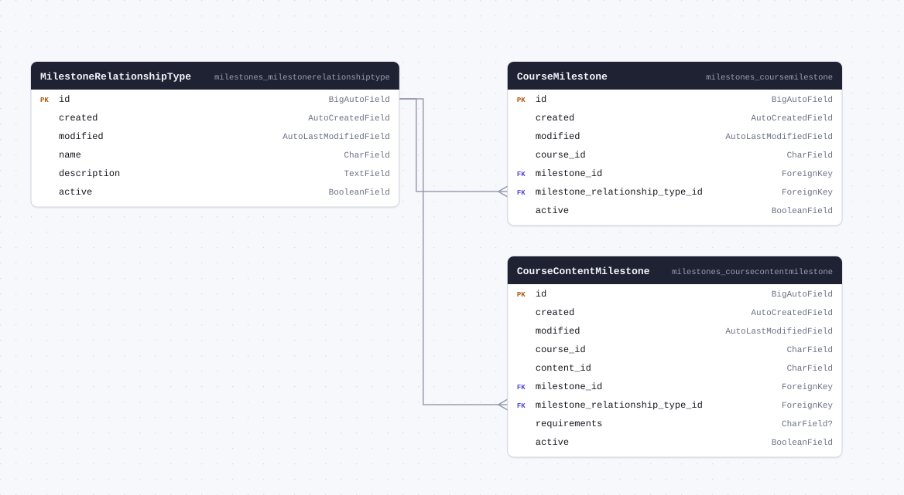
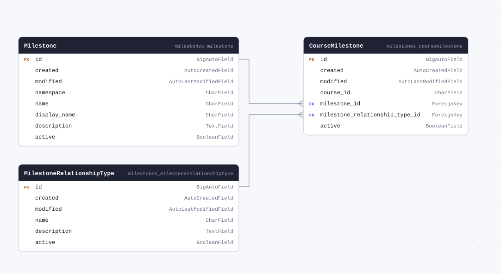
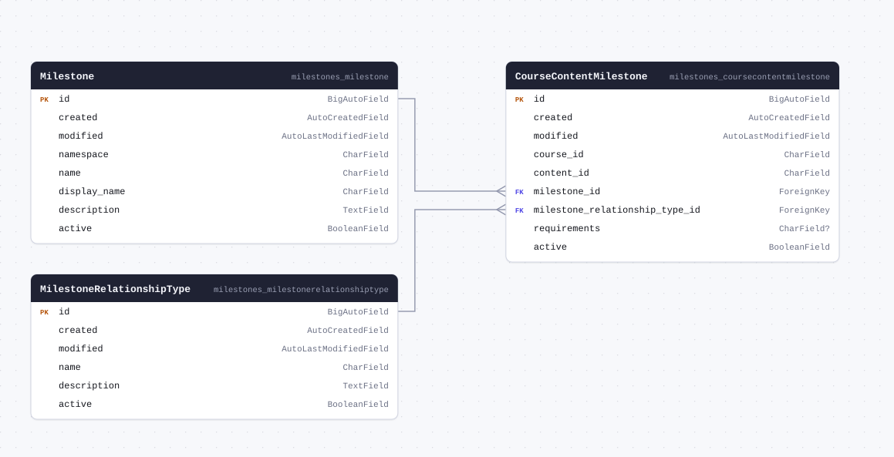
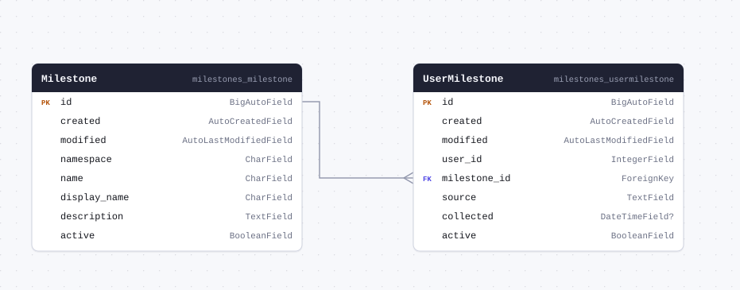

# Schema docs



[LogEntry](#logentry) · [Permission](#permission) · [Group](#group) · [User](#user) · [ContentType](#contenttype) · [Session](#session) · [Milestone](#milestone) · [MilestoneRelationshipType](#milestonerelationshiptype) · [CourseMilestone](#coursemilestone) · [CourseContentMilestone](#coursecontentmilestone) · [UserMilestone](#usermilestone)

<details>
<summary>The whole schema as SQL</summary>

```sql
CREATE TABLE "django_admin_log" ("id" integer NOT NULL PRIMARY KEY AUTOINCREMENT, "action_time" datetime NOT NULL, "user_id" integer NOT NULL REFERENCES "auth_user" ("id") DEFERRABLE INITIALLY DEFERRED, "content_type_id" integer NULL REFERENCES "django_content_type" ("id") DEFERRABLE INITIALLY DEFERRED, "object_id" text NULL, "object_repr" varchar(200) NOT NULL, "action_flag" smallint unsigned NOT NULL CHECK ("action_flag" >= 0), "change_message" text NOT NULL);

CREATE TABLE "auth_permission" ("id" integer NOT NULL PRIMARY KEY AUTOINCREMENT, "name" varchar(255) NOT NULL, "content_type_id" integer NOT NULL REFERENCES "django_content_type" ("id") DEFERRABLE INITIALLY DEFERRED, "codename" varchar(100) NOT NULL);

CREATE TABLE "auth_group" ("id" integer NOT NULL PRIMARY KEY AUTOINCREMENT, "name" varchar(150) NOT NULL UNIQUE);

CREATE TABLE "auth_group_permissions" ("id" integer NOT NULL PRIMARY KEY AUTOINCREMENT, "group_id" integer NOT NULL REFERENCES "auth_group" ("id") DEFERRABLE INITIALLY DEFERRED, "permission_id" integer NOT NULL REFERENCES "auth_permission" ("id") DEFERRABLE INITIALLY DEFERRED);

CREATE TABLE "auth_user" ("id" integer NOT NULL PRIMARY KEY AUTOINCREMENT, "password" varchar(128) NOT NULL, "last_login" datetime NULL, "is_superuser" bool NOT NULL, "username" varchar(150) NOT NULL UNIQUE, "first_name" varchar(150) NOT NULL, "last_name" varchar(150) NOT NULL, "email" varchar(254) NOT NULL, "is_staff" bool NOT NULL, "is_active" bool NOT NULL, "date_joined" datetime NOT NULL);

CREATE TABLE "auth_user_groups" ("id" integer NOT NULL PRIMARY KEY AUTOINCREMENT, "user_id" integer NOT NULL REFERENCES "auth_user" ("id") DEFERRABLE INITIALLY DEFERRED, "group_id" integer NOT NULL REFERENCES "auth_group" ("id") DEFERRABLE INITIALLY DEFERRED);

CREATE TABLE "auth_user_user_permissions" ("id" integer NOT NULL PRIMARY KEY AUTOINCREMENT, "user_id" integer NOT NULL REFERENCES "auth_user" ("id") DEFERRABLE INITIALLY DEFERRED, "permission_id" integer NOT NULL REFERENCES "auth_permission" ("id") DEFERRABLE INITIALLY DEFERRED);

CREATE TABLE "django_content_type" ("id" integer NOT NULL PRIMARY KEY AUTOINCREMENT, "app_label" varchar(100) NOT NULL, "model" varchar(100) NOT NULL);

CREATE TABLE "django_session" ("session_key" varchar(40) NOT NULL PRIMARY KEY, "session_data" text NOT NULL, "expire_date" datetime NOT NULL);

CREATE TABLE "milestones_milestone" ("id" integer NOT NULL PRIMARY KEY AUTOINCREMENT, "created" datetime NOT NULL, "modified" datetime NOT NULL, "namespace" varchar(255) NOT NULL, "name" varchar(255) NOT NULL, "display_name" varchar(255) NOT NULL, "description" text NOT NULL, "active" bool NOT NULL);

CREATE TABLE "milestones_milestonerelationshiptype" ("id" integer NOT NULL PRIMARY KEY AUTOINCREMENT, "created" datetime NOT NULL, "modified" datetime NOT NULL, "name" varchar(25) NOT NULL UNIQUE, "description" text NOT NULL, "active" bool NOT NULL);

CREATE TABLE "milestones_coursemilestone" ("id" integer NOT NULL PRIMARY KEY AUTOINCREMENT, "created" datetime NOT NULL, "modified" datetime NOT NULL, "course_id" varchar(255) NOT NULL, "milestone_id" bigint NOT NULL REFERENCES "milestones_milestone" ("id") DEFERRABLE INITIALLY DEFERRED, "milestone_relationship_type_id" bigint NOT NULL REFERENCES "milestones_milestonerelationshiptype" ("id") DEFERRABLE INITIALLY DEFERRED, "active" bool NOT NULL);

CREATE TABLE "milestones_coursecontentmilestone" ("id" integer NOT NULL PRIMARY KEY AUTOINCREMENT, "created" datetime NOT NULL, "modified" datetime NOT NULL, "course_id" varchar(255) NOT NULL, "content_id" varchar(255) NOT NULL, "milestone_id" bigint NOT NULL REFERENCES "milestones_milestone" ("id") DEFERRABLE INITIALLY DEFERRED, "milestone_relationship_type_id" bigint NOT NULL REFERENCES "milestones_milestonerelationshiptype" ("id") DEFERRABLE INITIALLY DEFERRED, "requirements" varchar(255) NULL, "active" bool NOT NULL);

CREATE TABLE "milestones_usermilestone" ("id" integer NOT NULL PRIMARY KEY AUTOINCREMENT, "created" datetime NOT NULL, "modified" datetime NOT NULL, "user_id" integer NOT NULL, "milestone_id" bigint NOT NULL REFERENCES "milestones_milestone" ("id") DEFERRABLE INITIALLY DEFERRED, "source" text NOT NULL, "collected" datetime NULL, "active" bool NOT NULL);

CREATE INDEX "django_admin_log_user_id_c564eba6" ON "django_admin_log" ("user_id");

CREATE INDEX "django_admin_log_content_type_id_c4bce8eb" ON "django_admin_log" ("content_type_id");

CREATE UNIQUE INDEX "auth_permission_content_type_id_codename_01ab375a_uniq" ON "auth_permission" ("content_type_id", "codename");

CREATE INDEX "auth_permission_content_type_id_2f476e4b" ON "auth_permission" ("content_type_id");

CREATE UNIQUE INDEX "auth_group_permissions_group_id_permission_id_0cd325b0_uniq" ON "auth_group_permissions" ("group_id", "permission_id");

CREATE INDEX "auth_group_permissions_group_id_b120cbf9" ON "auth_group_permissions" ("group_id");

CREATE INDEX "auth_group_permissions_permission_id_84c5c92e" ON "auth_group_permissions" ("permission_id");

CREATE UNIQUE INDEX "auth_user_groups_user_id_group_id_94350c0c_uniq" ON "auth_user_groups" ("user_id", "group_id");

CREATE INDEX "auth_user_groups_user_id_6a12ed8b" ON "auth_user_groups" ("user_id");

CREATE INDEX "auth_user_groups_group_id_97559544" ON "auth_user_groups" ("group_id");

CREATE UNIQUE INDEX "auth_user_user_permissions_user_id_permission_id_14a6b632_uniq" ON "auth_user_user_permissions" ("user_id", "permission_id");

CREATE INDEX "auth_user_user_permissions_user_id_a95ead1b" ON "auth_user_user_permissions" ("user_id");

CREATE INDEX "auth_user_user_permissions_permission_id_1fbb5f2c" ON "auth_user_user_permissions" ("permission_id");

CREATE UNIQUE INDEX "django_content_type_app_label_model_76bd3d3b_uniq" ON "django_content_type" ("app_label", "model");

CREATE INDEX "django_session_expire_date_a5c62663" ON "django_session" ("expire_date");

CREATE UNIQUE INDEX "milestones_milestone_namespace_name_0b80f867_uniq" ON "milestones_milestone" ("namespace", "name");

CREATE INDEX "milestones_milestone_namespace_a8e8807c" ON "milestones_milestone" ("namespace");

CREATE INDEX "milestones_milestone_name_23fb0698" ON "milestones_milestone" ("name");

CREATE INDEX "milestones_milestone_active_9a6c1703" ON "milestones_milestone" ("active");

CREATE UNIQUE INDEX "milestones_coursemilestone_course_id_milestone_id_36b21ae8_uniq" ON "milestones_coursemilestone" ("course_id", "milestone_id");

CREATE INDEX "milestones_coursemilestone_course_id_ce46a0fc" ON "milestones_coursemilestone" ("course_id");

CREATE INDEX "milestones_coursemilestone_milestone_id_03d9ef01" ON "milestones_coursemilestone" ("milestone_id");

CREATE INDEX "milestones_coursemilestone_milestone_relationship_type_id_6c64b782" ON "milestones_coursemilestone" ("milestone_relationship_type_id");

CREATE INDEX "milestones_coursemilestone_active_c590442e" ON "milestones_coursemilestone" ("active");

CREATE UNIQUE INDEX "milestones_coursecontentmilestone_course_id_content_id_milestone_id_7caa5ba5_uniq" ON "milestones_coursecontentmilestone" ("course_id", "content_id", "milestone_id");

CREATE INDEX "milestones_coursecontentmilestone_course_id_6fd3fad0" ON "milestones_coursecontentmilestone" ("course_id");

CREATE INDEX "milestones_coursecontentmilestone_content_id_21f4c95f" ON "milestones_coursecontentmilestone" ("content_id");

CREATE INDEX "milestones_coursecontentmilestone_milestone_id_bd7a608b" ON "milestones_coursecontentmilestone" ("milestone_id");

CREATE INDEX "milestones_coursecontentmilestone_milestone_relationship_type_id_31556ebf" ON "milestones_coursecontentmilestone" ("milestone_relationship_type_id");

CREATE INDEX "milestones_coursecontentmilestone_active_b7ab709d" ON "milestones_coursecontentmilestone" ("active");

CREATE UNIQUE INDEX "milestones_usermilestone_user_id_milestone_id_02197f01_uniq" ON "milestones_usermilestone" ("user_id", "milestone_id");

CREATE INDEX "milestones_usermilestone_user_id_b3e9aef4" ON "milestones_usermilestone" ("user_id");

CREATE INDEX "milestones_usermilestone_milestone_id_f90f9430" ON "milestones_usermilestone" ("milestone_id");

CREATE INDEX "milestones_usermilestone_active_93a18e7f" ON "milestones_usermilestone" ("active");
```

</details>

## LogEntry

Table `django_admin_log`, app `admin`.


| Column | Field | Type | Null | Key | Default | Description |
| --- | --- | --- | --- | --- | --- | --- |
| `id` | `AutoField` | `integer` |  | PK | `autoincrement()` |  |
| `action_time` | `DateTimeField` | `datetime` |  |  | `now()` |  |
| `user_id` | `ForeignKey` | `integer` |  | FK |  |  |
| `content_type_id` | `ForeignKey` | `integer` | yes | FK |  |  |
| `object_id` | `TextField` | `text` | yes |  |  |  |
| `object_repr` | `CharField` | `varchar(200)` |  |  |  |  |
| `action_flag` | `LogEntryActionFlag` | `smallint unsigned` |  |  |  |  |
| `change_message` | `TextField` | `text` |  |  |  |  |

Indexes:

- index `django_admin_log_user_id_c564eba6` on `user_id`
- index `django_admin_log_content_type_id_c4bce8eb` on `content_type_id`

Relations:

- `user_id` → [User](#user).`id`, on delete cascade
- `content_type_id` → [ContentType](#contenttype).`id`, on delete set null

## Permission

Table `auth_permission`, app `auth`.

The permissions system provides a way to assign permissions to specific
users and groups of users.

The permission system is used by the Django admin site, but may also be
useful in your own code. The Django admin site uses permissions as follows:

    - The "add" permission limits the user's ability to view the "add" form
      and add an object.
    - The "change" permission limits a user's ability to view the change
      list, view the "change" form and change an object.
    - The "delete" permission limits the ability to delete an object.
    - The "view" permission limits the ability to view an object.

Permissions are set globally per type of object, not per specific object
instance. It is possible to say "Mary may change news stories," but it's
not currently possible to say "Mary may change news stories, but only the
ones she created herself" or "Mary may only change news stories that have a
certain status or publication date."

The permissions listed above are automatically created for each model.


| Column | Field | Type | Null | Key | Default | Description |
| --- | --- | --- | --- | --- | --- | --- |
| `id` | `AutoField` | `integer` |  | PK | `autoincrement()` |  |
| `name` | `CharField` | `varchar(255)` |  |  |  |  |
| `content_type_id` | `ForeignKey` | `integer` |  | FK |  |  |
| `codename` | `CharField` | `varchar(100)` |  |  |  |  |

Indexes:

- index `auth_permission_content_type_id_2f476e4b` on `content_type_id`
- unique `auth_permission_content_type_id_codename_01ab375a_uniq` on `content_type_id`, `codename`

Relations:

- `content_type_id` → [ContentType](#contenttype).`id`, on delete cascade
- `group_set` — many to many with [Group](#group)
- `user_set` — many to many with [User](#user)

## Group

Table `auth_group`, app `auth`.

Groups are a generic way of categorizing users to apply permissions, or
some other label, to those users. A user can belong to any number of
groups.

A user in a group automatically has all the permissions granted to that
group. For example, if the group 'Site editors' has the permission
can_edit_home_page, any user in that group will have that permission.

Beyond permissions, groups are a convenient way to categorize users to
apply some label, or extended functionality, to them. For example, you
could create a group 'Special users', and you could write code that would
do special things to those users -- such as giving them access to a
members-only portion of your site, or sending them members-only email
messages.


| Column | Field | Type | Null | Key | Default | Description |
| --- | --- | --- | --- | --- | --- | --- |
| `id` | `AutoField` | `integer` |  | PK | `autoincrement()` |  |
| `name` | `CharField` | `varchar(150)` |  | unique |  |  |

Relations:

- `permissions` — many to many with [Permission](#permission)
- `user_set` — many to many with [User](#user)

## User

Table `auth_user`, app `auth`.

Columns from `AbstractUser` (abstract): `username`, `first_name`, `last_name`, `email`, `is_staff`, `is_active`, `date_joined`.

Columns from `AbstractBaseUser` (abstract): `password`, `last_login`.

Columns from `PermissionsMixin` (abstract): `is_superuser`.

Users within the Django authentication system are represented by this
model.

Username and password are required. Other fields are optional.


| Column | Field | Type | Null | Key | Default | Description |
| --- | --- | --- | --- | --- | --- | --- |
| `id` | `AutoField` | `integer` |  | PK | `autoincrement()` |  |
| `password` | `CharField` | `varchar(128)` |  |  |  |  |
| `last_login` | `DateTimeField` | `datetime` | yes |  |  |  |
| `is_superuser` | `BooleanField` | `bool` |  |  | `False` | Designates that this user has all permissions without explicitly assigning them. |
| `username` | `CharField` | `varchar(150)` |  | unique |  | Required. 150 characters or fewer. Letters, digits and @/./+/-/_ only. |
| `first_name` | `CharField` | `varchar(150)` |  |  |  |  |
| `last_name` | `CharField` | `varchar(150)` |  |  |  |  |
| `email` | `EmailField` | `varchar(254)` |  |  |  |  |
| `is_staff` | `BooleanField` | `bool` |  |  | `False` | Designates whether the user can log into this admin site. |
| `is_active` | `BooleanField` | `bool` |  |  | `True` | Designates whether this user should be treated as active. Unselect this instead of deleting accounts. |
| `date_joined` | `DateTimeField` | `datetime` |  |  | `now()` |  |

Relations:

- [LogEntry](#logentry).`user_id` → `id`, on delete cascade
- `groups` — many to many with [Group](#group)
- `user_permissions` — many to many with [Permission](#permission)

## ContentType

Table `django_content_type`, app `contenttypes`.


| Column | Field | Type | Null | Key | Default | Description |
| --- | --- | --- | --- | --- | --- | --- |
| `id` | `AutoField` | `integer` |  | PK | `autoincrement()` |  |
| `app_label` | `CharField` | `varchar(100)` |  |  |  |  |
| `model` | `CharField` | `varchar(100)` |  |  |  |  |

Indexes:

- unique `django_content_type_app_label_model_76bd3d3b_uniq` on `app_label`, `model`

Relations:

- [LogEntry](#logentry).`content_type_id` → `id`, on delete set null
- [Permission](#permission).`content_type_id` → `id`, on delete cascade

## Session

Table `django_session`, app `sessions`.

Columns from `AbstractBaseSession` (abstract): `session_key`, `session_data`, `expire_date`.

Django provides full support for anonymous sessions. The session
framework lets you store and retrieve arbitrary data on a
per-site-visitor basis. It stores data on the server side and
abstracts the sending and receiving of cookies. Cookies contain a
session ID -- not the data itself.

The Django sessions framework is entirely cookie-based. It does
not fall back to putting session IDs in URLs. This is an intentional
design decision. Not only does that behavior make URLs ugly, it makes
your site vulnerable to session-ID theft via the "Referer" header.

For complete documentation on using Sessions in your code, consult
the sessions documentation that is shipped with Django (also available
on the Django web site).

| Column | Field | Type | Null | Key | Default | Description |
| --- | --- | --- | --- | --- | --- | --- |
| `session_key` | `CharField` | `varchar(40)` |  | PK |  |  |
| `session_data` | `TextField` | `text` |  |  |  |  |
| `expire_date` | `DateTimeField` | `datetime` |  |  |  |  |

Indexes:

- index `django_session_expire_date_a5c62663` on `expire_date`

## Milestone

Table `milestones_milestone`, app `milestones`.

Columns from `TimeStampedModel` (abstract): `created`, `modified`.

A Milestone is a representation of an accomplishment which can be
attained by a user. Milestones have a base set of meta data
describing the milestone, including id, name, and description.
Milestones can be used to drive functionality and behavior 'behind
the scenes' in Open edX, such as with the Pre-Requisite Course and
Course Entrance Exam use cases.

.. no_pii:



| Column | Field | Type | Null | Key | Default | Description |
| --- | --- | --- | --- | --- | --- | --- |
| `id` | `BigAutoField` | `integer` |  | PK | `autoincrement()` |  |
| `created` | `AutoCreatedField` | `datetime` |  |  | `now()` |  |
| `modified` | `AutoLastModifiedField` | `datetime` |  |  | `now()` |  |
| `namespace` | `CharField` | `varchar(255)` |  |  |  |  |
| `name` | `CharField` | `varchar(255)` |  |  |  |  |
| `display_name` | `CharField` | `varchar(255)` |  |  |  |  |
| `description` | `TextField` | `text` |  |  |  |  |
| `active` | `BooleanField` | `bool` |  |  | `True` |  |

Indexes:

- index `milestones_milestone_namespace_a8e8807c` on `namespace`
- index `milestones_milestone_name_23fb0698` on `name`
- index `milestones_milestone_active_9a6c1703` on `active`
- unique `milestones_milestone_namespace_name_0b80f867_uniq` on `namespace`, `name`

Relations:

- [CourseMilestone](#coursemilestone).`milestone_id` → `id`, on delete cascade
- [CourseContentMilestone](#coursecontentmilestone).`milestone_id` → `id`, on delete cascade
- [UserMilestone](#usermilestone).`milestone_id` → `id`, on delete cascade

## MilestoneRelationshipType

Table `milestones_milestonerelationshiptype`, app `milestones`.

Columns from `TimeStampedModel` (abstract): `created`, `modified`.

A MilestoneRelationshipType represents a category of link available
between a Milestone and a particular learning object (such as a
Course). In addition to learning objects, a MilestoneRelationshipType
can also represent the link between a Milestone and other platform
entities (such as a User).  For example, a Course Author may
indicate that Course 101 "fulfills" Milestone A, creating a new
CourseMilestone record in the process. When a User completes
Course 101, a new UserMilestone record is created reflecting the
newly-attained Milestone A.  The Course Author may also indicate
that Course 102 "requires" Milestone A, yielding a second
CourseMilestone record.  Because the User has gained Milestone A
(via Course 101), they can access Course 102.

This same process of indicating MilestoneRelationshipTypes can be
applied to other learning objects as well, such as course content
(XBlocks/modules).

.. no_pii:



| Column | Field | Type | Null | Key | Default | Description |
| --- | --- | --- | --- | --- | --- | --- |
| `id` | `BigAutoField` | `integer` |  | PK | `autoincrement()` |  |
| `created` | `AutoCreatedField` | `datetime` |  |  | `now()` |  |
| `modified` | `AutoLastModifiedField` | `datetime` |  |  | `now()` |  |
| `name` | `CharField` | `varchar(25)` |  | unique |  |  |
| `description` | `TextField` | `text` |  |  |  |  |
| `active` | `BooleanField` | `bool` |  |  | `True` |  |

Relations:

- [CourseMilestone](#coursemilestone).`milestone_relationship_type_id` → `id`, on delete cascade
- [CourseContentMilestone](#coursecontentmilestone).`milestone_relationship_type_id` → `id`, on delete cascade

## CourseMilestone

Table `milestones_coursemilestone`, app `milestones`.

Columns from `TimeStampedModel` (abstract): `created`, `modified`.

A CourseMilestone represents the link between a Course and a
Milestone. Because Courses are not true Open edX entities (in the
Django/ORM sense) the modeling and integrity will be limited to that
of specifying CourseKeyFields in this model, as well as related ones
below. In addition, a MilestoneRelationshipType specifies the
particular sort of relationship that exists between the Course and
the Milestone, such as "requires".

.. no_pii:



| Column | Field | Type | Null | Key | Default | Description |
| --- | --- | --- | --- | --- | --- | --- |
| `id` | `BigAutoField` | `integer` |  | PK | `autoincrement()` |  |
| `created` | `AutoCreatedField` | `datetime` |  |  | `now()` |  |
| `modified` | `AutoLastModifiedField` | `datetime` |  |  | `now()` |  |
| `course_id` | `CharField` | `varchar(255)` |  |  |  |  |
| `milestone_id` | `ForeignKey` | `bigint` |  | FK |  |  |
| `milestone_relationship_type_id` | `ForeignKey` | `bigint` |  | FK |  |  |
| `active` | `BooleanField` | `bool` |  |  | `True` |  |

Indexes:

- index `milestones_coursemilestone_course_id_ce46a0fc` on `course_id`
- index `milestones_coursemilestone_milestone_id_03d9ef01` on `milestone_id`
- index `milestones_coursemilestone_milestone_relationship_type_id_6c64b782` on `milestone_relationship_type_id`
- index `milestones_coursemilestone_active_c590442e` on `active`
- unique `milestones_coursemilestone_course_id_milestone_id_36b21ae8_uniq` on `course_id`, `milestone_id`

Relations:

- `milestone_id` → [Milestone](#milestone).`id`, on delete cascade
- `milestone_relationship_type_id` → [MilestoneRelationshipType](#milestonerelationshiptype).`id`, on delete cascade

## CourseContentMilestone

Table `milestones_coursecontentmilestone`, app `milestones`.

Columns from `TimeStampedModel` (abstract): `created`, `modified`.

A CourseContentMilestone represents the link between a specific
Course module (such as an XBlock) and a Milestone. Because
CourseContent objects are not true Open edX entities (in the
Django/ORM sense) the modeling and integrity will be limited to that
of specifying LocationKeyFields in this model, as well as related
ones. In addition, a MilestoneRelationshipType specifies the
particular sort of relationship that exists between the Milestone
and the CourseContent, such as "requires" or "fulfills".

.. no_pii:



| Column | Field | Type | Null | Key | Default | Description |
| --- | --- | --- | --- | --- | --- | --- |
| `id` | `BigAutoField` | `integer` |  | PK | `autoincrement()` |  |
| `created` | `AutoCreatedField` | `datetime` |  |  | `now()` |  |
| `modified` | `AutoLastModifiedField` | `datetime` |  |  | `now()` |  |
| `course_id` | `CharField` | `varchar(255)` |  |  |  |  |
| `content_id` | `CharField` | `varchar(255)` |  |  |  |  |
| `milestone_id` | `ForeignKey` | `bigint` |  | FK |  |  |
| `milestone_relationship_type_id` | `ForeignKey` | `bigint` |  | FK |  |  |
| `requirements` | `CharField` | `varchar(255)` | yes |  |  | Stores JSON data required to determine milestone fulfillment |
| `active` | `BooleanField` | `bool` |  |  | `True` |  |

Indexes:

- index `milestones_coursecontentmilestone_course_id_6fd3fad0` on `course_id`
- index `milestones_coursecontentmilestone_content_id_21f4c95f` on `content_id`
- index `milestones_coursecontentmilestone_milestone_id_bd7a608b` on `milestone_id`
- index `milestones_coursecontentmilestone_milestone_relationship_type_id_31556ebf` on `milestone_relationship_type_id`
- index `milestones_coursecontentmilestone_active_b7ab709d` on `active`
- unique `milestones_coursecontentmilestone_course_id_content_id_milestone_id_7caa5ba5_uniq` on `course_id`, `content_id`, `milestone_id`

Relations:

- `milestone_id` → [Milestone](#milestone).`id`, on delete cascade
- `milestone_relationship_type_id` → [MilestoneRelationshipType](#milestonerelationshiptype).`id`, on delete cascade

## UserMilestone

Table `milestones_usermilestone`, app `milestones`.

Columns from `TimeStampedModel` (abstract): `created`, `modified`.

A UserMilestone represents an stage reached or event experienced
by a User during their interactions with the Open edX platform.

The use of the 'collected' field in this model could support future
use cases such as "Goals", in which a User might keep a list of
Milestones they are interested in attaining. Side Note: In the
Mozilla Open Badges world, this collection concept is referred
to as the user's "backpack".

The 'source' field was originally introduced as a free-form auditing
field to document the method, location, or event which triggered the
collection of the milestone by this user.

.. no_pii:



| Column | Field | Type | Null | Key | Default | Description |
| --- | --- | --- | --- | --- | --- | --- |
| `id` | `BigAutoField` | `integer` |  | PK | `autoincrement()` |  |
| `created` | `AutoCreatedField` | `datetime` |  |  | `now()` |  |
| `modified` | `AutoLastModifiedField` | `datetime` |  |  | `now()` |  |
| `user_id` | `IntegerField` | `integer` |  |  |  |  |
| `milestone_id` | `ForeignKey` | `bigint` |  | FK |  |  |
| `source` | `TextField` | `text` |  |  |  |  |
| `collected` | `DateTimeField` | `datetime` | yes |  |  |  |
| `active` | `BooleanField` | `bool` |  |  | `True` |  |

Indexes:

- index `milestones_usermilestone_user_id_b3e9aef4` on `user_id`
- index `milestones_usermilestone_milestone_id_f90f9430` on `milestone_id`
- index `milestones_usermilestone_active_93a18e7f` on `active`
- unique `milestones_usermilestone_user_id_milestone_id_02197f01_uniq` on `user_id`, `milestone_id`

Relations:

- `milestone_id` → [Milestone](#milestone).`id`, on delete cascade

# Enums

## LogEntryActionFlag

| Name | Stored as |
| --- | --- |
| `Addition` | `1` |
| `Change` | `2` |
| `Deletion` | `3` |
