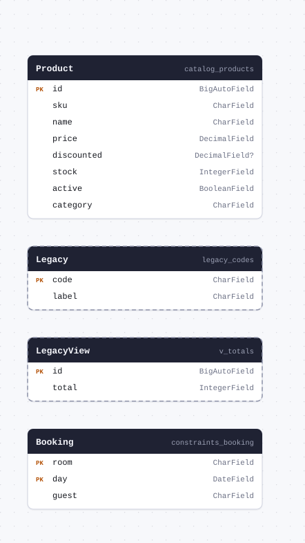

# Schema docs



[Product](#product) · [Legacy](#legacy) · [LegacyView](#legacyview) · [Booking](#booking)

<details>
<summary>The whole schema as SQL</summary>

```sql
CREATE TABLE "catalog_products" ("id" integer NOT NULL PRIMARY KEY AUTOINCREMENT, "sku" varchar(20) NOT NULL, "name" varchar(100) NOT NULL, "price" decimal NOT NULL, "discounted" decimal NULL, "stock" integer NOT NULL, "active" bool NOT NULL, "category" varchar(30) NOT NULL, CONSTRAINT "price_not_negative" CHECK ("price" >= '0'), CONSTRAINT "discount_below_price" CHECK (("discounted" IS NULL OR "discounted" < ("price"))));

CREATE TABLE "constraints_booking" ("room" varchar(10) NOT NULL, "day" date NOT NULL, "guest" varchar(50) NOT NULL, PRIMARY KEY ("room", "day"));

CREATE UNIQUE INDEX "catalog_products_category_name_b76394ac_uniq" ON "catalog_products" ("category", "name");

CREATE UNIQUE INDEX "sku_unique_case_insensitive" ON "catalog_products" ((LOWER("sku")));

CREATE UNIQUE INDEX "one_active_name" ON "catalog_products" ("name") WHERE "active" = 1;

CREATE INDEX "category_price" ON "catalog_products" ("category", "price" DESC);

CREATE INDEX "name_upper" ON "catalog_products" ((UPPER("name")));

CREATE INDEX "low_stock" ON "catalog_products" ("stock") WHERE "stock" <= 5;
```

</details>

## Product

Table `catalog_products`, app `constraints`.

| Column | Field | Type | Null | Key | Default | Description |
| --- | --- | --- | --- | --- | --- | --- |
| `id` | `BigAutoField` | `integer` |  | PK | `autoincrement()` |  |
| `sku` | `CharField` | `varchar(20)` |  |  |  |  |
| `name` | `CharField` | `varchar(100)` |  |  |  |  |
| `price` | `DecimalField(10, 2)` | `decimal` |  |  |  |  |
| `discounted` | `DecimalField(10, 2)` | `decimal` | yes |  |  |  |
| `stock` | `IntegerField` | `integer` |  |  | `0` |  |
| `active` | `BooleanField` | `bool` |  |  | `True` |  |
| `category` | `CharField` | `varchar(30)` |  |  |  |  |

Indexes:

- unique `catalog_products_category_name_b76394ac_uniq` on `category`, `name`
- unique `sku_unique_case_insensitive` on `LOWER("sku")`
- unique `one_active_name` on `name` where `"active" = 1`
- index `category_price` on `category`, `price` desc
- index `name_upper` on `UPPER("name")`
- index `low_stock` on `stock` where `"stock" <= 5`

Checks:

- `price_not_negative`: `"price" >= '0'`
- `discount_below_price`: `("discounted" IS NULL OR "discounted" < ("price"))`

## Legacy

Table `legacy_codes`, app `constraints`.

Not managed by Django (`managed = False`): it neither creates nor changes the table, whose indexes are the ones its own SQL gives it.

A table another system owns.

| Column | Field | Type | Null | Key | Default | Description |
| --- | --- | --- | --- | --- | --- | --- |
| `code` | `CharField` | `varchar(10)` |  | PK |  |  |
| `label` | `CharField` | `varchar(50)` |  |  |  |  |

## LegacyView

Table `v_totals`, app `constraints`.

Not managed by Django (`managed = False`): it neither creates nor changes the table, whose indexes are the ones its own SQL gives it.

| Column | Field | Type | Null | Key | Default | Description |
| --- | --- | --- | --- | --- | --- | --- |
| `id` | `BigAutoField` | `integer` |  | PK | `autoincrement()` |  |
| `total` | `IntegerField` | `integer` |  |  |  |  |

## Booking

Table `constraints_booking`, app `constraints`.

| Column | Field | Type | Null | Key | Default | Description |
| --- | --- | --- | --- | --- | --- | --- |
| `room` | `CharField` | `varchar(10)` |  | PK |  |  |
| `day` | `DateField` | `date` |  | PK |  |  |
| `guest` | `CharField` | `varchar(50)` |  |  |  |  |
