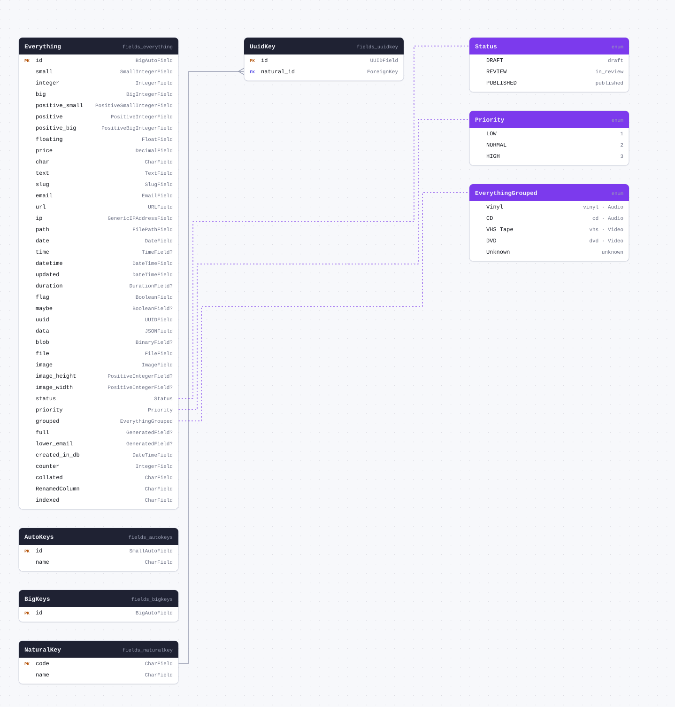
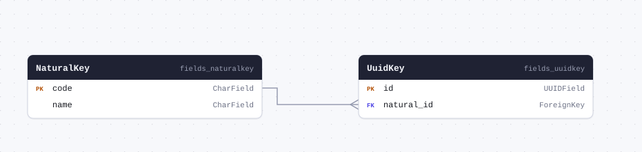

# Schema docs



[Everything](#everything) · [AutoKeys](#autokeys) · [BigKeys](#bigkeys) · [NaturalKey](#naturalkey) · [UuidKey](#uuidkey)

<details>
<summary>The whole schema as SQL</summary>

```sql
CREATE TABLE "fields_everything" ("id" integer NOT NULL PRIMARY KEY AUTOINCREMENT, "small" smallint NOT NULL, "integer" integer NOT NULL, "big" bigint NOT NULL, "positive_small" smallint unsigned NOT NULL CHECK ("positive_small" >= 0), "positive" integer unsigned NOT NULL CHECK ("positive" >= 0), "positive_big" bigint unsigned NOT NULL CHECK ("positive_big" >= 0), "floating" real NOT NULL, "price" decimal NOT NULL, "char" varchar(100) NOT NULL, "text" text NOT NULL, "slug" varchar(50) NOT NULL UNIQUE, "email" varchar(254) NOT NULL, "url" varchar(500) NOT NULL, "ip" char(39) NOT NULL, "path" varchar(100) NOT NULL, "date" date NOT NULL, "time" time NULL, "datetime" datetime NOT NULL, "updated" datetime NOT NULL, "duration" bigint NULL, "flag" bool NOT NULL, "maybe" bool NULL, "uuid" char(32) NOT NULL UNIQUE, "data" text NOT NULL CHECK ((JSON_VALID("data") OR "data" IS NULL)), "blob" BLOB NULL, "file" varchar(255) NOT NULL, "image" varchar(100) NOT NULL, "image_height" integer unsigned NULL CHECK ("image_height" >= 0), "image_width" integer unsigned NULL CHECK ("image_width" >= 0), "status" varchar(20) NOT NULL, "priority" integer NOT NULL, "grouped" varchar(10) NOT NULL, "full" varchar(201) GENERATED ALWAYS AS ((COALESCE("char", '') || COALESCE((COALESCE(' ', '') || COALESCE("slug", '')), ''))) STORED, "lower_email" varchar(254) GENERATED ALWAYS AS (LOWER("email")) VIRTUAL, "created_in_db" datetime DEFAULT (STRFTIME('%Y-%m-%d %H:%M:%f', 'NOW')) NOT NULL, "counter" integer DEFAULT 0 NOT NULL, "collated" varchar(50) COLLATE NOCASE NOT NULL, "RenamedColumn" varchar(10) NOT NULL, "indexed" varchar(10) NOT NULL);

CREATE TABLE "fields_autokeys" ("id" integer NOT NULL PRIMARY KEY AUTOINCREMENT, "name" varchar(10) NOT NULL);

CREATE TABLE "fields_bigkeys" ("id" integer NOT NULL PRIMARY KEY AUTOINCREMENT);

CREATE TABLE "fields_naturalkey" ("code" varchar(3) NOT NULL PRIMARY KEY, "name" varchar(50) NOT NULL);

CREATE TABLE "fields_uuidkey" ("id" char(32) NOT NULL PRIMARY KEY, "natural_id" varchar(3) NOT NULL REFERENCES "fields_naturalkey" ("code") DEFERRABLE INITIALLY DEFERRED);

CREATE INDEX "fields_everything_indexed_6710899d" ON "fields_everything" ("indexed");

CREATE INDEX "fields_uuidkey_natural_id_419581fe" ON "fields_uuidkey" ("natural_id");
```

</details>

## Everything

Table `fields_everything`, app `fields`.

One column of every kind — A row with one column of each kind.

| Column | Field | Type | Null | Key | Default | Description |
| --- | --- | --- | --- | --- | --- | --- |
| `id` | `BigAutoField` | `integer` |  | PK | `autoincrement()` |  |
| `small` | `SmallIntegerField` | `smallint` |  |  |  |  |
| `integer` | `IntegerField` | `integer` |  |  |  |  |
| `big` | `BigIntegerField` | `bigint` |  |  |  |  |
| `positive_small` | `PositiveSmallIntegerField` | `smallint unsigned` |  |  |  |  |
| `positive` | `PositiveIntegerField` | `integer unsigned` |  |  |  |  |
| `positive_big` | `PositiveBigIntegerField` | `bigint unsigned` |  |  |  |  |
| `floating` | `FloatField` | `real` |  |  |  |  |
| `price` | `DecimalField(10, 2)` | `decimal` |  |  | `Decimal('0.00')` |  |
| `char` | `CharField` | `varchar(100)` |  |  |  | Up to 100 characters |
| `text` | `TextField` | `text` |  |  |  |  |
| `slug` | `SlugField` | `varchar(50)` |  | unique |  |  |
| `email` | `EmailField` | `varchar(254)` |  |  |  |  |
| `url` | `URLField` | `varchar(500)` |  |  |  |  |
| `ip` | `GenericIPAddressField` | `char(39)` |  |  |  |  |
| `path` | `FilePathField` | `varchar(100)` |  |  |  |  |
| `date` | `DateField` | `date` |  |  |  |  |
| `time` | `TimeField` | `time` | yes |  |  |  |
| `datetime` | `DateTimeField` | `datetime` |  |  | `now()` |  |
| `updated` | `DateTimeField` | `datetime` |  |  | `now()` |  |
| `duration` | `DurationField` | `bigint` | yes |  |  |  |
| `flag` | `BooleanField` | `bool` |  |  | `False` |  |
| `maybe` | `BooleanField` | `bool` | yes |  |  |  |
| `uuid` | `UUIDField` | `char(32)` |  | unique | `uuid4()` |  |
| `data` | `JSONField` | `text` |  |  | `dict()` |  |
| `blob` | `BinaryField` | `BLOB` | yes |  |  |  |
| `file` | `FileField` | `varchar(255)` |  |  |  |  |
| `image` | `ImageField` | `varchar(100)` |  |  |  |  |
| `image_height` | `PositiveIntegerField` | `integer unsigned` | yes |  |  |  |
| `image_width` | `PositiveIntegerField` | `integer unsigned` | yes |  |  |  |
| `status` | `Status` | `varchar(20)` |  |  | `'draft'` |  |
| `priority` | `Priority` | `integer` |  |  | `2` |  |
| `grouped` | `EverythingGrouped` | `varchar(10)` |  |  |  |  |
| `full` | `GeneratedField` | `varchar(201)` | yes |  | generated (stored): `(COALESCE("char", '') \|\| COALESCE((COALESCE(' ', '') \|\| COALESCE("slug", '')), ''))` |  |
| `lower_email` | `GeneratedField` | `varchar(254)` | yes |  | generated (virtual): `LOWER("email")` |  |
| `created_in_db` | `DateTimeField` | `datetime` |  |  | `(STRFTIME('%Y-%m-%d %H:%M:%f', 'NOW'))` (database) |  |
| `counter` | `IntegerField` | `integer` |  |  | `0` (database) | How many times the row was seen |
| `collated` | `CharField` | `varchar(50)` collation `NOCASE` |  |  |  |  |
| `RenamedColumn` | `CharField` | `varchar(10)` |  |  |  |  |
| `indexed` | `CharField` | `varchar(10)` |  |  |  |  |

Indexes:

- index `fields_everything_indexed_6710899d` on `indexed`

## AutoKeys

Table `fields_autokeys`, app `fields`.

| Column | Field | Type | Null | Key | Default | Description |
| --- | --- | --- | --- | --- | --- | --- |
| `id` | `SmallAutoField` | `integer` |  | PK | `autoincrement()` |  |
| `name` | `CharField` | `varchar(10)` |  |  |  |  |

## BigKeys

Table `fields_bigkeys`, app `fields`.

| Column | Field | Type | Null | Key | Default | Description |
| --- | --- | --- | --- | --- | --- | --- |
| `id` | `BigAutoField` | `integer` |  | PK | `autoincrement()` |  |

## NaturalKey

Table `fields_naturalkey`, app `fields`.


| Column | Field | Type | Null | Key | Default | Description |
| --- | --- | --- | --- | --- | --- | --- |
| `code` | `CharField` | `varchar(3)` |  | PK |  |  |
| `name` | `CharField` | `varchar(50)` |  |  |  |  |

Relations:

- [UuidKey](#uuidkey).`natural_id` → `code`, on delete protect

## UuidKey

Table `fields_uuidkey`, app `fields`.



| Column | Field | Type | Null | Key | Default | Description |
| --- | --- | --- | --- | --- | --- | --- |
| `id` | `UUIDField` | `char(32)` |  | PK | `uuid4()` |  |
| `natural_id` | `ForeignKey` | `varchar(3)` |  | FK |  |  |

Indexes:

- index `fields_uuidkey_natural_id_419581fe` on `natural_id`

Relations:

- `natural_id` → [NaturalKey](#naturalkey).`code`, on delete protect

# Enums

## Status

| Name | Stored as |
| --- | --- |
| `DRAFT` | `draft` |
| `REVIEW` | `in_review` |
| `PUBLISHED` | `published` |

## Priority

| Name | Stored as |
| --- | --- |
| `LOW` | `1` |
| `NORMAL` | `2` |
| `HIGH` | `3` |

## EverythingGrouped

| Group | Name | Stored as |
| --- | --- | --- |
| Audio | `Vinyl` | `vinyl` |
| Audio | `CD` | `cd` |
| Video | `VHS Tape` | `vhs` |
| Video | `DVD` | `dvd` |
|  | `Unknown` | `unknown` |
