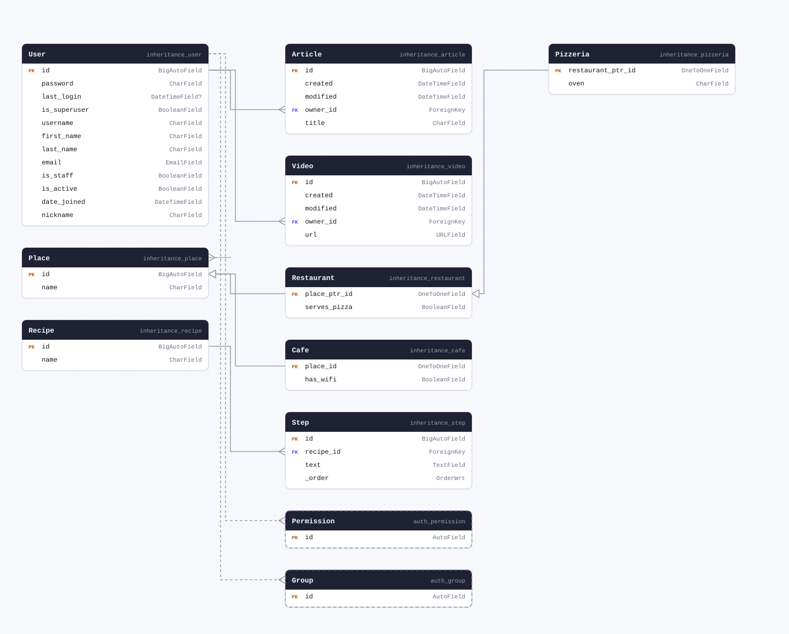
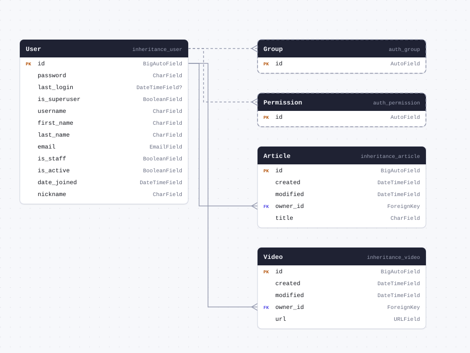
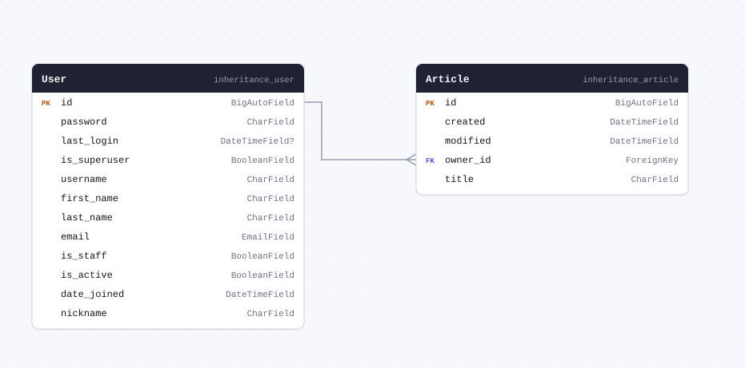
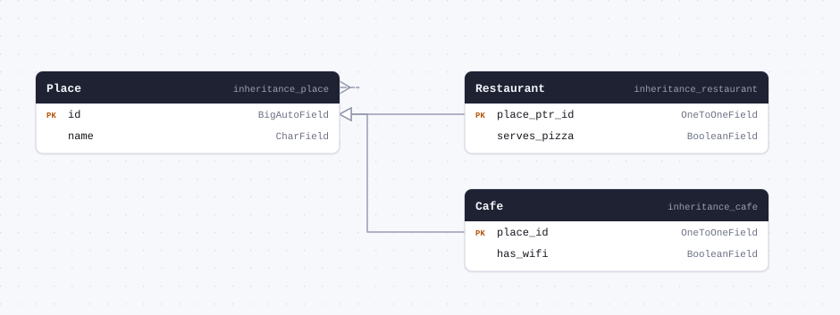
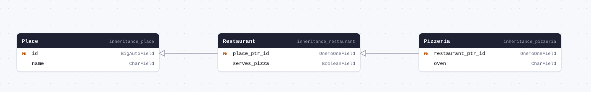
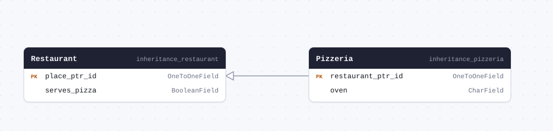
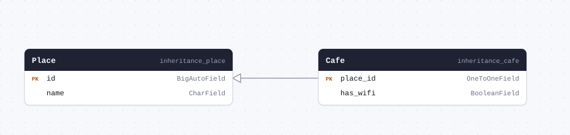
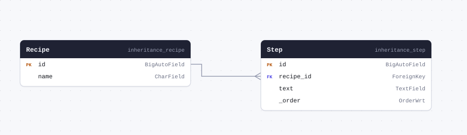

# Schema docs



[User](#user) · [Article](#article) · [Video](#video) · [Place](#place) · [Restaurant](#restaurant) · [Pizzeria](#pizzeria) · [Cafe](#cafe) · [Step](#step) · [Recipe](#recipe)

<details>
<summary>The whole schema as SQL</summary>

```sql
CREATE TABLE "inheritance_user" ("id" integer NOT NULL PRIMARY KEY AUTOINCREMENT, "password" varchar(128) NOT NULL, "last_login" datetime NULL, "is_superuser" bool NOT NULL, "username" varchar(150) NOT NULL UNIQUE, "first_name" varchar(150) NOT NULL, "last_name" varchar(150) NOT NULL, "email" varchar(254) NOT NULL, "is_staff" bool NOT NULL, "is_active" bool NOT NULL, "date_joined" datetime NOT NULL, "nickname" varchar(30) NOT NULL);

CREATE TABLE "inheritance_user_groups" ("id" integer NOT NULL PRIMARY KEY AUTOINCREMENT, "user_id" bigint NOT NULL REFERENCES "inheritance_user" ("id") DEFERRABLE INITIALLY DEFERRED, "group_id" integer NOT NULL REFERENCES "auth_group" ("id") DEFERRABLE INITIALLY DEFERRED);

CREATE TABLE "inheritance_user_user_permissions" ("id" integer NOT NULL PRIMARY KEY AUTOINCREMENT, "user_id" bigint NOT NULL REFERENCES "inheritance_user" ("id") DEFERRABLE INITIALLY DEFERRED, "permission_id" integer NOT NULL REFERENCES "auth_permission" ("id") DEFERRABLE INITIALLY DEFERRED);

CREATE TABLE "inheritance_article" ("id" integer NOT NULL PRIMARY KEY AUTOINCREMENT, "created" datetime NOT NULL, "modified" datetime NOT NULL, "owner_id" bigint NOT NULL REFERENCES "inheritance_user" ("id") DEFERRABLE INITIALLY DEFERRED, "title" varchar(100) NOT NULL);

CREATE TABLE "inheritance_video" ("id" integer NOT NULL PRIMARY KEY AUTOINCREMENT, "created" datetime NOT NULL, "modified" datetime NOT NULL, "owner_id" bigint NOT NULL REFERENCES "inheritance_user" ("id") DEFERRABLE INITIALLY DEFERRED, "url" varchar(200) NOT NULL);

CREATE TABLE "inheritance_place" ("id" integer NOT NULL PRIMARY KEY AUTOINCREMENT, "name" varchar(50) NOT NULL);

CREATE TABLE "inheritance_place_neighbours" ("id" integer NOT NULL PRIMARY KEY AUTOINCREMENT, "from_place_id" bigint NOT NULL REFERENCES "inheritance_place" ("id") DEFERRABLE INITIALLY DEFERRED, "to_place_id" bigint NOT NULL REFERENCES "inheritance_place" ("id") DEFERRABLE INITIALLY DEFERRED);

CREATE TABLE "inheritance_restaurant" ("place_ptr_id" bigint NOT NULL PRIMARY KEY REFERENCES "inheritance_place" ("id") DEFERRABLE INITIALLY DEFERRED, "serves_pizza" bool NOT NULL);

CREATE TABLE "inheritance_pizzeria" ("restaurant_ptr_id" bigint NOT NULL PRIMARY KEY REFERENCES "inheritance_restaurant" ("place_ptr_id") DEFERRABLE INITIALLY DEFERRED, "oven" varchar(20) NOT NULL);

CREATE TABLE "inheritance_cafe" ("place_id" bigint NOT NULL PRIMARY KEY REFERENCES "inheritance_place" ("id") DEFERRABLE INITIALLY DEFERRED, "has_wifi" bool NOT NULL);

CREATE TABLE "inheritance_step" ("id" integer NOT NULL PRIMARY KEY AUTOINCREMENT, "recipe_id" bigint NOT NULL REFERENCES "inheritance_recipe" ("id") DEFERRABLE INITIALLY DEFERRED, "text" text NOT NULL, "_order" integer NOT NULL);

CREATE TABLE "inheritance_recipe" ("id" integer NOT NULL PRIMARY KEY AUTOINCREMENT, "name" varchar(50) NOT NULL);

CREATE UNIQUE INDEX "inheritance_user_groups_user_id_group_id_aadf7250_uniq" ON "inheritance_user_groups" ("user_id", "group_id");

CREATE INDEX "inheritance_user_groups_user_id_d4609eb1" ON "inheritance_user_groups" ("user_id");

CREATE INDEX "inheritance_user_groups_group_id_f2bd876e" ON "inheritance_user_groups" ("group_id");

CREATE UNIQUE INDEX "inheritance_user_user_permissions_user_id_permission_id_8c1f9d93_uniq" ON "inheritance_user_user_permissions" ("user_id", "permission_id");

CREATE INDEX "inheritance_user_user_permissions_user_id_230d96e8" ON "inheritance_user_user_permissions" ("user_id");

CREATE INDEX "inheritance_user_user_permissions_permission_id_7f1345d9" ON "inheritance_user_user_permissions" ("permission_id");

CREATE INDEX "inheritance_article_owner_id_8253ce6b" ON "inheritance_article" ("owner_id");

CREATE INDEX "inheritance_video_owner_id_a80486d8" ON "inheritance_video" ("owner_id");

CREATE UNIQUE INDEX "inheritance_place_neighbours_from_place_id_to_place_id_66d01626_uniq" ON "inheritance_place_neighbours" ("from_place_id", "to_place_id");

CREATE INDEX "inheritance_place_neighbours_from_place_id_cee82684" ON "inheritance_place_neighbours" ("from_place_id");

CREATE INDEX "inheritance_place_neighbours_to_place_id_7b63a29d" ON "inheritance_place_neighbours" ("to_place_id");

CREATE INDEX "inheritance_step_recipe_id_967ccabe" ON "inheritance_step" ("recipe_id");
```

</details>

## User

Table `inheritance_user`, app `inheritance`.

Columns from `AbstractUser` (abstract): `username`, `first_name`, `last_name`, `email`, `is_staff`, `is_active`, `date_joined`.

Columns from `AbstractBaseUser` (abstract): `password`, `last_login`.

Columns from `PermissionsMixin` (abstract): `is_superuser`.

The project's own user, in place of auth.User (AUTH_USER_MODEL).



| Column | Field | Type | Null | Key | Default | Description |
| --- | --- | --- | --- | --- | --- | --- |
| `id` | `BigAutoField` | `integer` |  | PK | `autoincrement()` |  |
| `password` | `CharField` | `varchar(128)` |  |  |  |  |
| `last_login` | `DateTimeField` | `datetime` | yes |  |  |  |
| `is_superuser` | `BooleanField` | `bool` |  |  | `False` | Designates that this user has all permissions without explicitly assigning them. |
| `username` | `CharField` | `varchar(150)` |  | unique |  | Required. 150 characters or fewer. Letters, digits and @/./+/-/_ only. |
| `first_name` | `CharField` | `varchar(150)` |  |  |  |  |
| `last_name` | `CharField` | `varchar(150)` |  |  |  |  |
| `email` | `EmailField` | `varchar(254)` |  |  |  |  |
| `is_staff` | `BooleanField` | `bool` |  |  | `False` | Designates whether the user can log into this admin site. |
| `is_active` | `BooleanField` | `bool` |  |  | `True` | Designates whether this user should be treated as active. Unselect this instead of deleting accounts. |
| `date_joined` | `DateTimeField` | `datetime` |  |  | `now()` |  |
| `nickname` | `CharField` | `varchar(30)` |  |  |  |  |

Relations:

- `groups` — many to many with `Group` (auth, not in these docs)
- `user_permissions` — many to many with `Permission` (auth, not in these docs)
- [Article](#article).`owner_id` → `id`, on delete cascade
- [Video](#video).`owner_id` → `id`, on delete cascade

## Article

Table `inheritance_article`, app `inheritance`.

Columns from `Timestamped` (abstract): `created`, `modified`, `owner_id`.



| Column | Field | Type | Null | Key | Default | Description |
| --- | --- | --- | --- | --- | --- | --- |
| `id` | `BigAutoField` | `integer` |  | PK | `autoincrement()` |  |
| `created` | `DateTimeField` | `datetime` |  |  | `now()` |  |
| `modified` | `DateTimeField` | `datetime` |  |  | `now()` |  |
| `owner_id` | `ForeignKey` | `bigint` |  | FK |  |  |
| `title` | `CharField` | `varchar(100)` |  |  |  |  |

Indexes:

- index `inheritance_article_owner_id_8253ce6b` on `owner_id`

Relations:

- `owner_id` → [User](#user).`id`, on delete cascade

## Video

Table `inheritance_video`, app `inheritance`.

Columns from `Timestamped` (abstract): `created`, `modified`, `owner_id`.


| Column | Field | Type | Null | Key | Default | Description |
| --- | --- | --- | --- | --- | --- | --- |
| `id` | `BigAutoField` | `integer` |  | PK | `autoincrement()` |  |
| `created` | `DateTimeField` | `datetime` |  |  | `now()` |  |
| `modified` | `DateTimeField` | `datetime` |  |  | `now()` |  |
| `owner_id` | `ForeignKey` | `bigint` |  | FK |  |  |
| `url` | `URLField` | `varchar(200)` |  |  |  |  |

Indexes:

- index `inheritance_video_owner_id_a80486d8` on `owner_id`

Relations:

- `owner_id` → [User](#user).`id`, on delete cascade

## Place

Table `inheritance_place`, app `inheritance`.

Subclasses (multi-table): [Restaurant](#restaurant), [Cafe](#cafe).



| Column | Field | Type | Null | Key | Default | Description |
| --- | --- | --- | --- | --- | --- | --- |
| `id` | `BigAutoField` | `integer` |  | PK | `autoincrement()` |  |
| `name` | `CharField` | `varchar(50)` |  |  |  |  |

Relations:

- `neighbours` — many to many with [Place](#place)
- [Restaurant](#restaurant).`place_ptr_id` → `id`, parent link, on delete cascade
- [Cafe](#cafe).`place_id` → `id`, parent link, on delete cascade

## Restaurant

Table `inheritance_restaurant`, app `inheritance`.

Inherits from [Place](#place) (multi-table): its rows are joined on `place_ptr_id`.

Subclasses (multi-table): [Pizzeria](#pizzeria).

Proxy models, on this table: `OpenRestaurant`.



| Column | Field | Type | Null | Key | Default | Description |
| --- | --- | --- | --- | --- | --- | --- |
| `place_ptr_id` | `OneToOneField` | `bigint` |  | PK, FK |  |  |
| `serves_pizza` | `BooleanField` | `bool` |  |  | `False` |  |

Relations:

- `place_ptr_id` → [Place](#place).`id`, parent link, on delete cascade
- [Pizzeria](#pizzeria).`restaurant_ptr_id` → `place_ptr_id`, parent link, on delete cascade

## Pizzeria

Table `inheritance_pizzeria`, app `inheritance`.

Inherits from [Restaurant](#restaurant) (multi-table): its rows are joined on `restaurant_ptr_id`.



| Column | Field | Type | Null | Key | Default | Description |
| --- | --- | --- | --- | --- | --- | --- |
| `restaurant_ptr_id` | `OneToOneField` | `bigint` |  | PK, FK |  |  |
| `oven` | `CharField` | `varchar(20)` |  |  |  |  |

Relations:

- `restaurant_ptr_id` → [Restaurant](#restaurant).`place_ptr_id`, parent link, on delete cascade

## Cafe

Table `inheritance_cafe`, app `inheritance`.

Inherits from [Place](#place) (multi-table): its rows are joined on `place_id`.



| Column | Field | Type | Null | Key | Default | Description |
| --- | --- | --- | --- | --- | --- | --- |
| `place_id` | `OneToOneField` | `bigint` |  | PK, FK |  |  |
| `has_wifi` | `BooleanField` | `bool` |  |  | `True` |  |

Relations:

- `place_id` → [Place](#place).`id`, parent link, on delete cascade

## Step

Table `inheritance_step`, app `inheritance`.



| Column | Field | Type | Null | Key | Default | Description |
| --- | --- | --- | --- | --- | --- | --- |
| `id` | `BigAutoField` | `integer` |  | PK | `autoincrement()` |  |
| `recipe_id` | `ForeignKey` | `bigint` |  | FK |  |  |
| `text` | `TextField` | `text` |  |  |  |  |
| `_order` | `OrderWrt` | `integer` |  |  |  |  |

Indexes:

- index `inheritance_step_recipe_id_967ccabe` on `recipe_id`

Relations:

- `recipe_id` → [Recipe](#recipe).`id`, on delete cascade

## Recipe

Table `inheritance_recipe`, app `inheritance`.


| Column | Field | Type | Null | Key | Default | Description |
| --- | --- | --- | --- | --- | --- | --- |
| `id` | `BigAutoField` | `integer` |  | PK | `autoincrement()` |  |
| `name` | `CharField` | `varchar(50)` |  |  |  |  |

Relations:

- [Step](#step).`recipe_id` → `id`, on delete cascade
