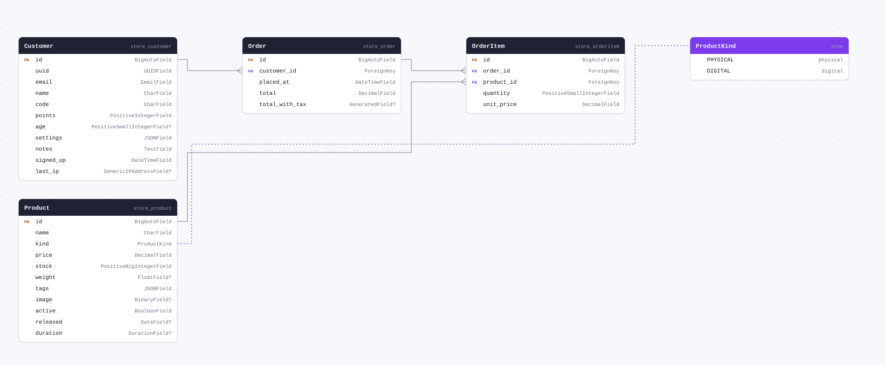
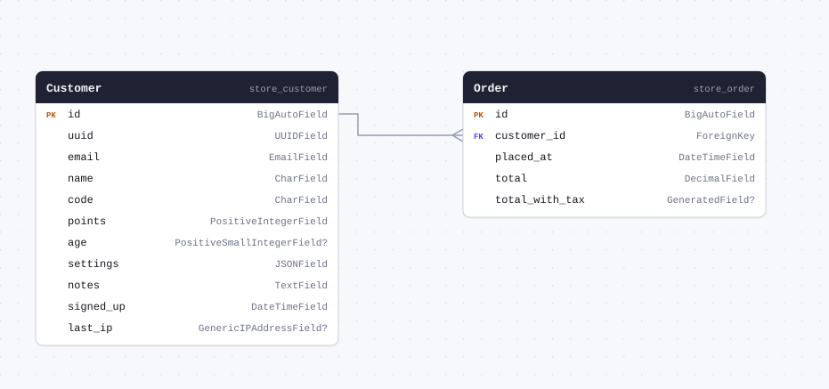
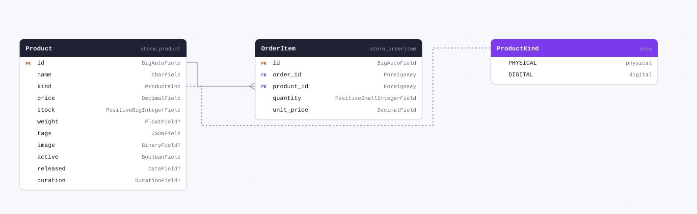
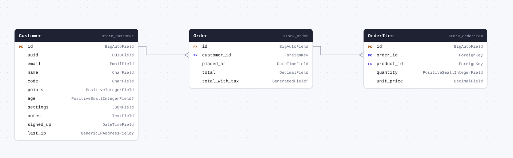
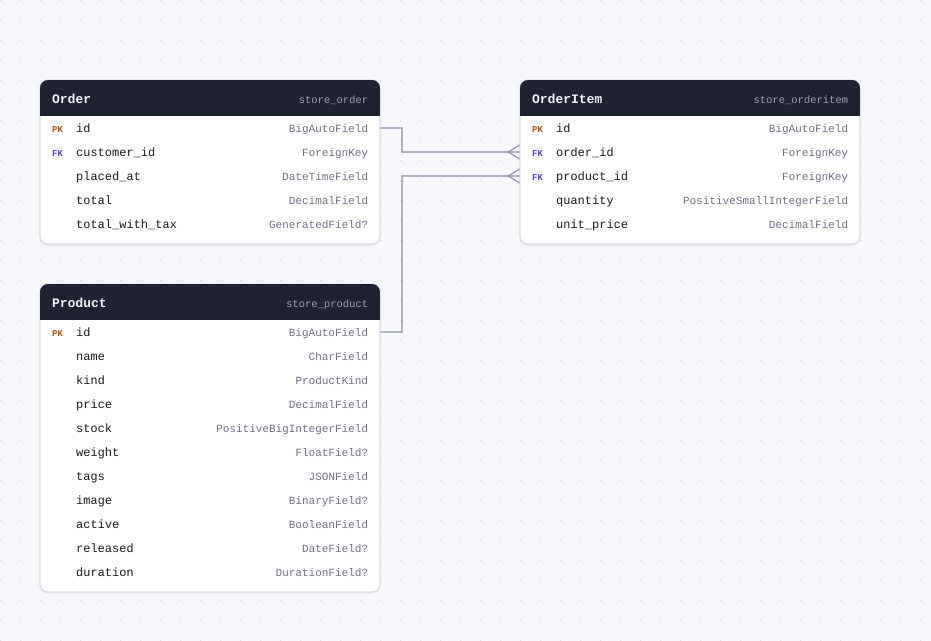

# Schema docs



[Customer](#customer) · [Product](#product) · [Order](#order) · [OrderItem](#orderitem)

<details>
<summary>The whole schema as SQL</summary>

```sql
-- Written for MySQL 8.4, assumed: the database could not be asked.

CREATE TABLE `store_customer` (`id` bigint AUTO_INCREMENT NOT NULL PRIMARY KEY, `uuid` char(32) NOT NULL UNIQUE, `email` varchar(191) NOT NULL  COMMENT '191 characters fit a utf8mb4 index of 767 bytes', `name` varchar(100) COLLATE `utf8mb4_unicode_ci` NOT NULL, `code` varchar(20) COLLATE `utf8mb4_bin` NOT NULL UNIQUE, `points` integer UNSIGNED NOT NULL CHECK (`points` >= 0), `age` smallint UNSIGNED NULL CHECK (`age` >= 0), `settings` json NOT NULL, `notes` longtext NOT NULL, `signed_up` datetime(6) NOT NULL, `last_ip` char(39) NULL);

ALTER TABLE `store_customer` COMMENT = 'People who buy';

CREATE TABLE `store_product` (`id` bigint AUTO_INCREMENT NOT NULL PRIMARY KEY, `name` varchar(200) NOT NULL, `kind` varchar(8) NOT NULL, `price` numeric(10, 2) NOT NULL, `stock` bigint UNSIGNED NOT NULL CHECK (`stock` >= 0), `weight` double precision NULL, `tags` json NOT NULL, `image` longblob NULL, `active` bool DEFAULT 1 NOT NULL, `released` date NULL, `duration` bigint NULL);

CREATE TABLE `store_order` (`id` bigint AUTO_INCREMENT NOT NULL PRIMARY KEY, `customer_id` bigint NOT NULL, `placed_at` datetime(6) NOT NULL, `total` numeric(12, 2) NOT NULL, `total_with_tax` numeric(14, 2) GENERATED ALWAYS AS ((`total` * 1.1)) VIRTUAL);

CREATE TABLE `store_orderitem` (`id` bigint AUTO_INCREMENT NOT NULL PRIMARY KEY, `order_id` bigint NOT NULL, `product_id` bigint NOT NULL, `quantity` smallint UNSIGNED NOT NULL CHECK (`quantity` >= 0), `unit_price` numeric(10, 2) NOT NULL);

CREATE UNIQUE INDEX `customer_email_ci_unique` ON `store_customer` ((LOWER(`email`)));

ALTER TABLE `store_product` ADD CONSTRAINT `product_price_not_negative` CHECK (`price` >= 0);

CREATE INDEX `product_kind_price` ON `store_product` (`kind`, `price` DESC);

ALTER TABLE `store_order` ADD CONSTRAINT `store_order_customer_id_13d6d43e_fk_store_customer_id` FOREIGN KEY (`customer_id`) REFERENCES `store_customer` (`id`);

ALTER TABLE `store_orderitem` ADD CONSTRAINT `store_orderitem_order_id_product_id_44513b04_uniq` UNIQUE (`order_id`, `product_id`);

ALTER TABLE `store_orderitem` ADD CONSTRAINT `store_orderitem_order_id_acf8722d_fk_store_order_id` FOREIGN KEY (`order_id`) REFERENCES `store_order` (`id`);

ALTER TABLE `store_orderitem` ADD CONSTRAINT `store_orderitem_product_id_f2b098d4_fk_store_product_id` FOREIGN KEY (`product_id`) REFERENCES `store_product` (`id`);
```

</details>

## Customer

Table `store_customer`, app `store`.

People who buy



| Column | Field | Type | Null | Key | Default | Description |
| --- | --- | --- | --- | --- | --- | --- |
| `id` | `BigAutoField` | `bigint` |  | PK | `autoincrement()` |  |
| `uuid` | `UUIDField` | `char(32)` |  | unique | `uuid4()` |  |
| `email` | `EmailField` | `varchar(191)` |  |  |  | 191 characters fit a utf8mb4 index of 767 bytes |
| `name` | `CharField` | `varchar(100)` collation `utf8mb4_unicode_ci` |  |  |  |  |
| `code` | `CharField` | `varchar(20)` collation `utf8mb4_bin` |  | unique |  |  |
| `points` | `PositiveIntegerField` | `integer UNSIGNED` |  |  | `0` |  |
| `age` | `PositiveSmallIntegerField` | `smallint UNSIGNED` | yes |  |  |  |
| `settings` | `JSONField` | `json` |  |  | `dict()` |  |
| `notes` | `TextField` | `longtext` |  |  |  |  |
| `signed_up` | `DateTimeField` | `datetime(6)` |  |  | `now()` |  |
| `last_ip` | `GenericIPAddressField` | `char(39)` | yes |  |  |  |

Indexes:

- unique `customer_email_ci_unique` on `LOWER(`email`)`

Relations:

- [Order](#order).`customer_id` → `id`, on delete protect

## Product

Table `store_product`, app `store`.



| Column | Field | Type | Null | Key | Default | Description |
| --- | --- | --- | --- | --- | --- | --- |
| `id` | `BigAutoField` | `bigint` |  | PK | `autoincrement()` |  |
| `name` | `CharField` | `varchar(200)` |  |  |  |  |
| `kind` | `ProductKind` | `varchar(8)` |  |  | `'physical'` |  |
| `price` | `DecimalField(10, 2)` | `numeric(10, 2)` |  |  |  |  |
| `stock` | `PositiveBigIntegerField` | `bigint UNSIGNED` |  |  | `0` |  |
| `weight` | `FloatField` | `double precision` | yes |  |  |  |
| `tags` | `JSONField` | `json` |  |  | `list()` |  |
| `image` | `BinaryField` | `longblob` | yes |  |  |  |
| `active` | `BooleanField` | `bool` |  |  | `1` (database) |  |
| `released` | `DateField` | `date` | yes |  |  |  |
| `duration` | `DurationField` | `bigint` | yes |  |  |  |

Indexes:

- index `product_kind_price` on `kind`, `price` desc

Checks:

- `product_price_not_negative`: ``price` >= 0`

Relations:

- `order_set` — many to many with [Order](#order), through [OrderItem](#orderitem)
- [OrderItem](#orderitem).`product_id` → `id`, on delete protect

## Order

Table `store_order`, app `store`.



| Column | Field | Type | Null | Key | Default | Description |
| --- | --- | --- | --- | --- | --- | --- |
| `id` | `BigAutoField` | `bigint` |  | PK | `autoincrement()` |  |
| `customer_id` | `ForeignKey` | `bigint` |  | FK |  |  |
| `placed_at` | `DateTimeField` | `datetime(6)` |  |  | `now()` |  |
| `total` | `DecimalField(12, 2)` | `numeric(12, 2)` |  |  |  |  |
| `total_with_tax` | `GeneratedField(14, 2)` | `numeric(14, 2)` | yes |  | generated (virtual): `(`total` * 1.1)` |  |

Relations:

- `products` — many to many with [Product](#product), through [OrderItem](#orderitem)
- `customer_id` → [Customer](#customer).`id`, on delete protect
- [OrderItem](#orderitem).`order_id` → `id`, on delete cascade

## OrderItem

Table `store_orderitem`, app `store`.



| Column | Field | Type | Null | Key | Default | Description |
| --- | --- | --- | --- | --- | --- | --- |
| `id` | `BigAutoField` | `bigint` |  | PK | `autoincrement()` |  |
| `order_id` | `ForeignKey` | `bigint` |  | FK |  |  |
| `product_id` | `ForeignKey` | `bigint` |  | FK |  |  |
| `quantity` | `PositiveSmallIntegerField` | `smallint UNSIGNED` |  |  | `1` |  |
| `unit_price` | `DecimalField(10, 2)` | `numeric(10, 2)` |  |  |  |  |

Indexes:

- unique `store_orderitem_order_id_product_id_44513b04_uniq` on `order_id`, `product_id`

Relations:

- `order_id` → [Order](#order).`id`, on delete cascade
- `product_id` → [Product](#product).`id`, on delete protect

# Enums

## ProductKind

| Name | Stored as |
| --- | --- |
| `PHYSICAL` | `physical` |
| `DIGITAL` | `digital` |
