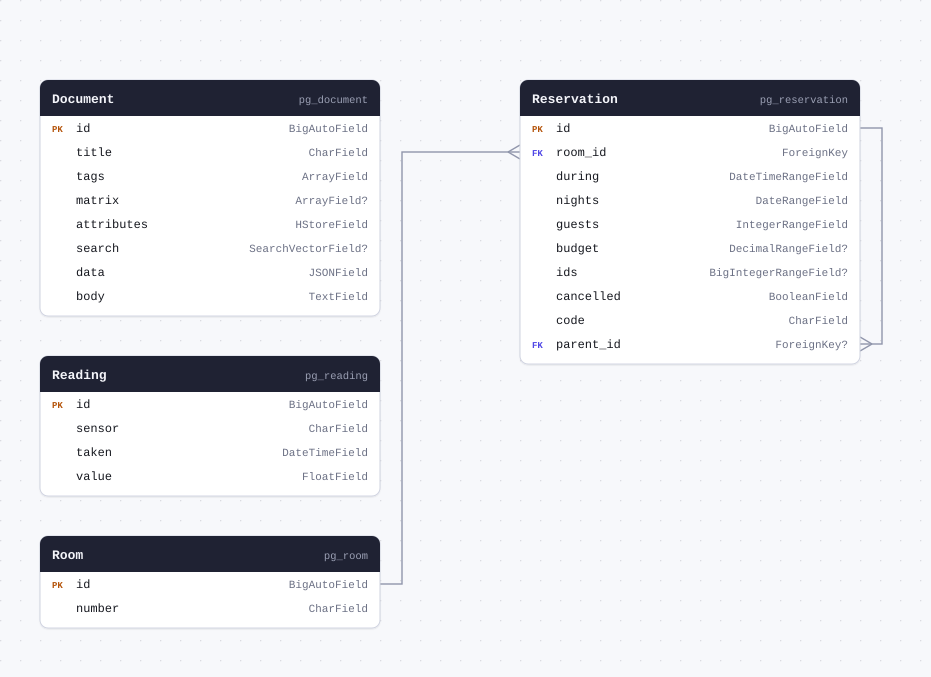
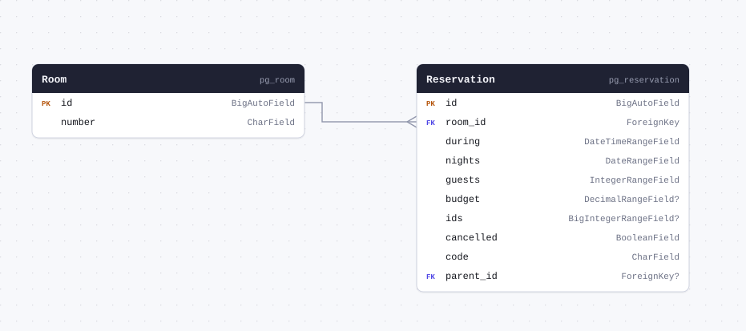
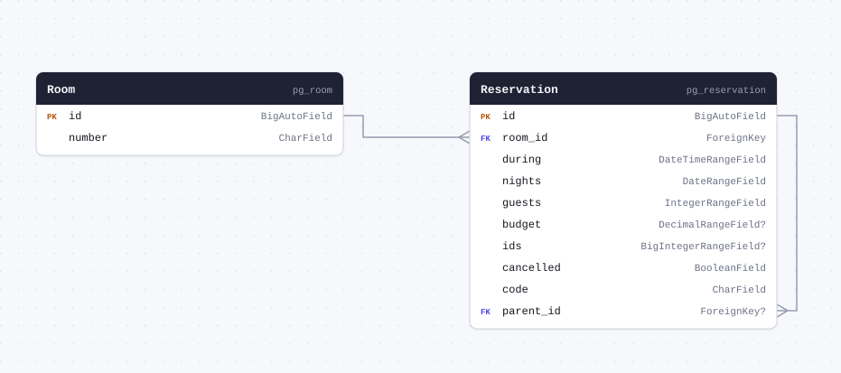

# Schema docs



[Document](#document) · [Reading](#reading) · [Room](#room) · [Reservation](#reservation)

<details>
<summary>The whole schema as SQL</summary>

```sql
CREATE TABLE "pg_document" ("id" bigint NOT NULL PRIMARY KEY GENERATED BY DEFAULT AS IDENTITY, "title" varchar(200) COLLATE "und-x-icu" NOT NULL, "tags" varchar(30)[] NOT NULL, "matrix" integer[3][3] NULL, "attributes" hstore NOT NULL, "search" tsvector NULL, "data" jsonb NOT NULL, "body" text NOT NULL);

CREATE TABLE "pg_reading" ("id" bigint NOT NULL PRIMARY KEY GENERATED BY DEFAULT AS IDENTITY, "sensor" varchar(20) NOT NULL, "taken" timestamp with time zone NOT NULL, "value" double precision NOT NULL);

CREATE TABLE "pg_room" ("id" bigint NOT NULL PRIMARY KEY GENERATED BY DEFAULT AS IDENTITY, "number" varchar(10) NOT NULL UNIQUE);

CREATE TABLE "pg_reservation" ("id" bigint NOT NULL PRIMARY KEY GENERATED BY DEFAULT AS IDENTITY, "room_id" bigint NOT NULL, "during" tstzrange NOT NULL, "nights" daterange NOT NULL, "guests" int4range NOT NULL, "budget" numrange NULL, "ids" int8range NULL, "cancelled" boolean NOT NULL, "code" varchar(10) NOT NULL, "parent_id" bigint NULL, CONSTRAINT "exclude_overlapping_reservations" EXCLUDE USING GIST ("during" WITH &&, "room_id" WITH =) WHERE (NOT "cancelled"), CONSTRAINT "code_unique_deferred" UNIQUE ("code") DEFERRABLE INITIALLY DEFERRED);

CREATE INDEX "document_search" ON "pg_document" USING gin ("search");

CREATE INDEX "document_tags" ON "pg_document" USING gin ("tags");

CREATE INDEX "document_data" ON "pg_document" USING gin ("data" jsonb_path_ops);

CREATE INDEX "document_title_trgm" ON "pg_document" USING gin ((LOWER("title")) gin_trgm_ops);

CREATE INDEX "document_body_hash" ON "pg_document" USING hash ("body");

CREATE INDEX "document_title" ON "pg_document" USING btree ("title") WITH (fillfactor = 70);

CREATE INDEX "document_bloom" ON "pg_document" USING bloom ("title", "body") WITH (length = 80);

CREATE INDEX "reading_taken" ON "pg_reading" USING brin ("taken") WITH (autosummarize = on, pages_per_range = 16);

CREATE INDEX "reading_sensor_covering" ON "pg_reading" ("sensor") INCLUDE ("value");

CREATE INDEX "pg_room_number_bc696db1_like" ON "pg_room" ("number" varchar_pattern_ops);

ALTER TABLE "pg_reservation" ADD CONSTRAINT "pg_reservation_room_id_eb95f46a_fk_pg_room_id" FOREIGN KEY ("room_id") REFERENCES "pg_room" ("id") DEFERRABLE INITIALLY DEFERRED;

ALTER TABLE "pg_reservation" ADD CONSTRAINT "pg_reservation_parent_id_e31561e2_fk_pg_reservation_id" FOREIGN KEY ("parent_id") REFERENCES "pg_reservation" ("id") DEFERRABLE INITIALLY DEFERRED;

CREATE UNIQUE INDEX "code_room_covering" ON "pg_reservation" ("code", "room_id") INCLUDE ("guests");

ALTER TABLE "pg_reservation" ADD CONSTRAINT "room_parent_unique" UNIQUE NULLS NOT DISTINCT ("room_id", "parent_id");

CREATE INDEX "pg_reservation_room_id_eb95f46a" ON "pg_reservation" ("room_id");

CREATE INDEX "pg_reservation_parent_id_e31561e2" ON "pg_reservation" ("parent_id");

CREATE INDEX "reservation_during" ON "pg_reservation" USING gist ("during");

CREATE INDEX "reservation_nights" ON "pg_reservation" USING spgist ("nights");
```

</details>

## Document

Table `pg_document`, app `pg`.

| Column | Field | Type | Null | Key | Default | Description |
| --- | --- | --- | --- | --- | --- | --- |
| `id` | `BigAutoField` | `bigint` |  | PK | `autoincrement()` |  |
| `title` | `CharField` | `varchar(200)` collation `und-x-icu` |  |  |  |  |
| `tags` | `ArrayField` | `varchar(30)[]` |  |  | `list()` |  |
| `matrix` | `ArrayField` | `integer[3][3]` | yes |  |  |  |
| `attributes` | `HStoreField` | `hstore` |  |  | `dict()` |  |
| `search` | `SearchVectorField` | `tsvector` | yes |  |  |  |
| `data` | `JSONField` | `jsonb` |  |  | `dict()` |  |
| `body` | `TextField` | `text` |  |  |  |  |

Indexes:

- gin index `document_search` on `search`
- gin index `document_tags` on `tags`
- gin index `document_data` on `data` (`jsonb_path_ops`)
- gin index `document_title_trgm` on `LOWER("title") gin_trgm_ops`
- hash index `document_body_hash` on `body`
- btree index `document_title` on `title` with `fillfactor = 70`
- bloom index `document_bloom` on `title`, `body` with `length = 80`

## Reading

Table `pg_reading`, app `pg`.

| Column | Field | Type | Null | Key | Default | Description |
| --- | --- | --- | --- | --- | --- | --- |
| `id` | `BigAutoField` | `bigint` |  | PK | `autoincrement()` |  |
| `sensor` | `CharField` | `varchar(20)` |  |  |  |  |
| `taken` | `DateTimeField` | `timestamp with time zone` |  |  |  |  |
| `value` | `FloatField` | `double precision` |  |  |  |  |

Indexes:

- brin index `reading_taken` on `taken` with `autosummarize = on, pages_per_range = 16`
- index `reading_sensor_covering` on `sensor` include `value`

## Room

Table `pg_room`, app `pg`.



| Column | Field | Type | Null | Key | Default | Description |
| --- | --- | --- | --- | --- | --- | --- |
| `id` | `BigAutoField` | `bigint` |  | PK | `autoincrement()` |  |
| `number` | `CharField` | `varchar(10)` |  | unique |  |  |

Indexes:

- index `pg_room_number_bc696db1_like` on `number` (`varchar_pattern_ops`)

Relations:

- [Reservation](#reservation).`room_id` → `id`, on delete cascade

## Reservation

Table `pg_reservation`, app `pg`.



| Column | Field | Type | Null | Key | Default | Description |
| --- | --- | --- | --- | --- | --- | --- |
| `id` | `BigAutoField` | `bigint` |  | PK | `autoincrement()` |  |
| `room_id` | `ForeignKey` | `bigint` |  | FK |  |  |
| `during` | `DateTimeRangeField` | `tstzrange` |  |  |  |  |
| `nights` | `DateRangeField` | `daterange` |  |  |  |  |
| `guests` | `IntegerRangeField` | `int4range` |  |  |  |  |
| `budget` | `DecimalRangeField` | `numrange` | yes |  |  |  |
| `ids` | `BigIntegerRangeField` | `int8range` | yes |  |  |  |
| `cancelled` | `BooleanField` | `boolean` |  |  | `False` |  |
| `code` | `CharField` | `varchar(10)` |  |  |  |  |
| `parent_id` | `ForeignKey` | `bigint` | yes | FK |  |  |

Indexes:

- index `pg_reservation_room_id_eb95f46a` on `room_id`
- index `pg_reservation_parent_id_e31561e2` on `parent_id`
- gist exclusion `exclude_overlapping_reservations` on `during WITH &&`, `room_id WITH =` where `NOT "cancelled"`
- unique `code_unique_deferred` on `code`, deferrable (initially deferred)
- unique `code_room_covering` on `code`, `room_id` include `guests`
- unique `room_parent_unique` on `room_id`, `parent_id`, nulls not distinct
- gist index `reservation_during` on `during`
- spgist index `reservation_nights` on `nights`

Relations:

- `room_id` → [Room](#room).`id`, on delete cascade
- `parent_id` → [Reservation](#reservation).`id`, on delete cascade
