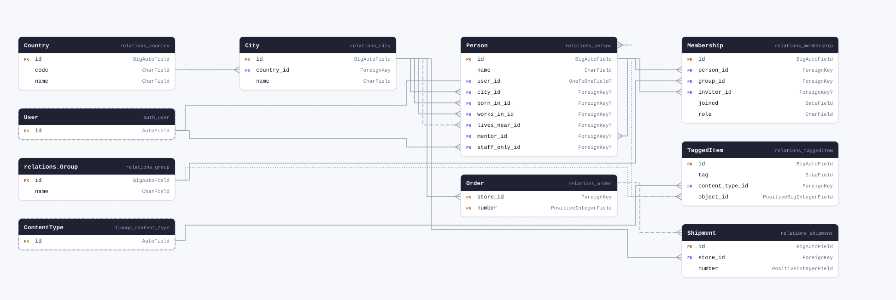
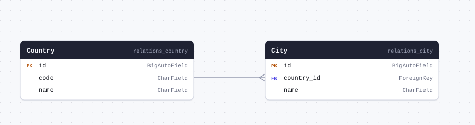
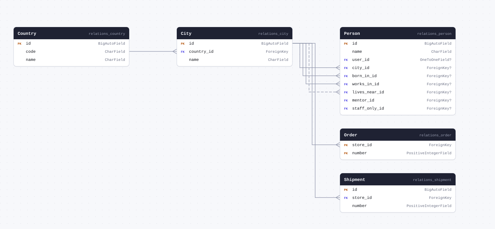
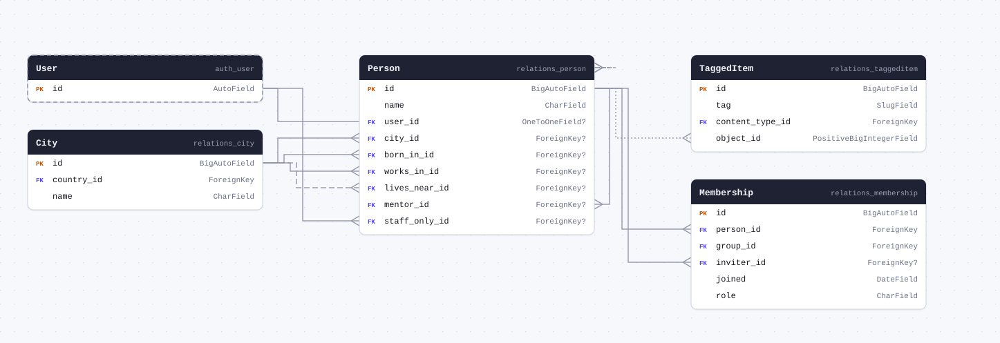
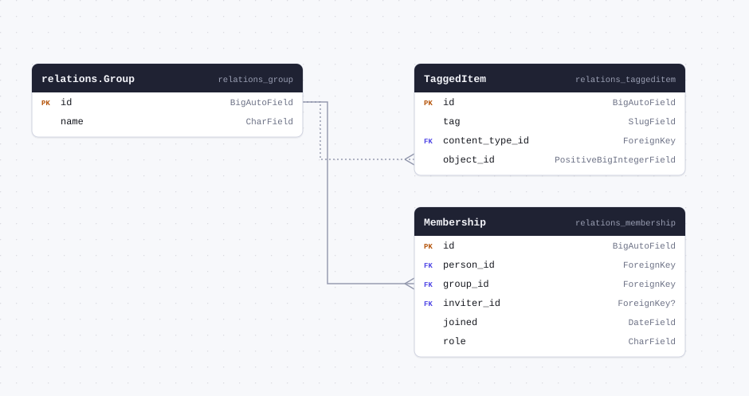
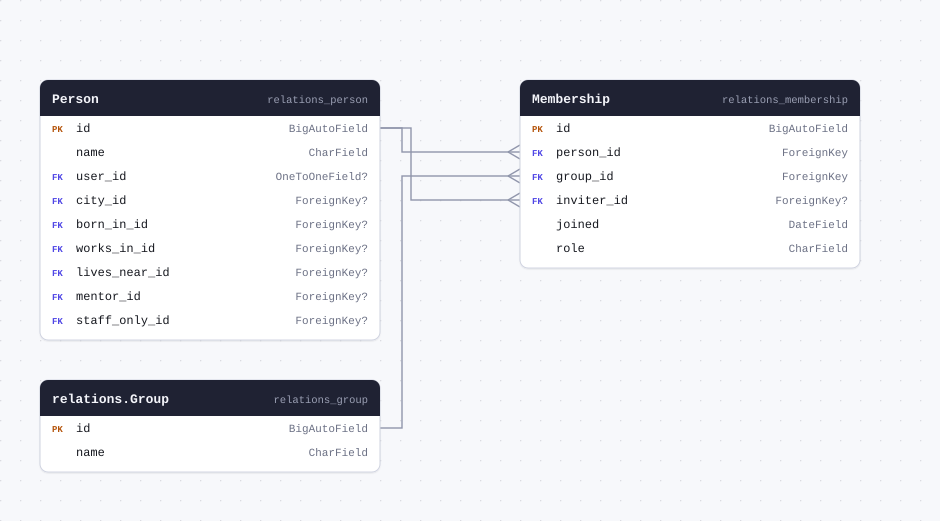
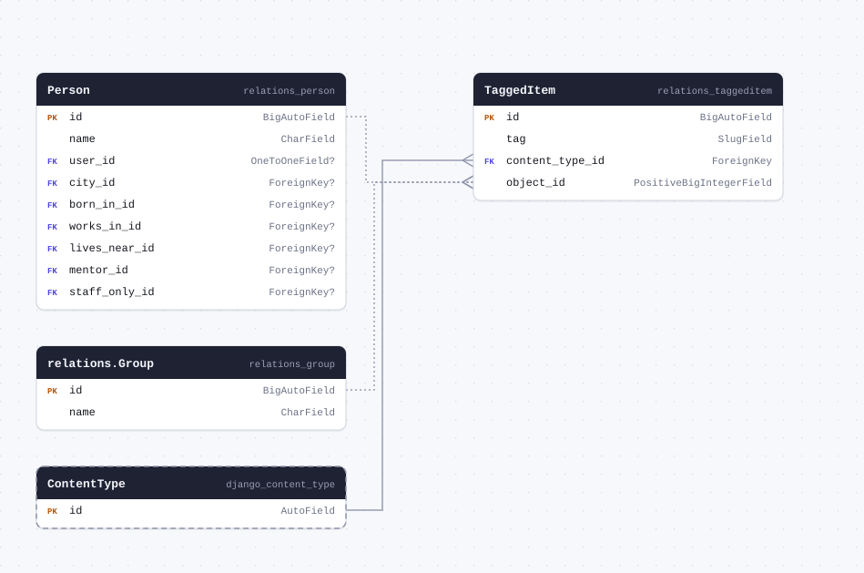
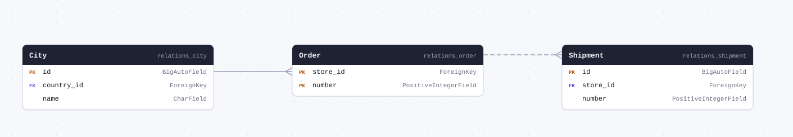
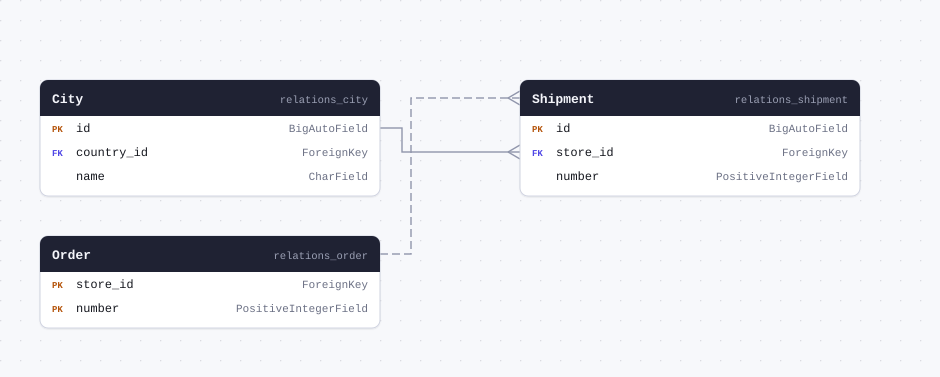

# Schema docs



[Country](#country) · [City](#city) · [Person](#person) · [relations.Group](#relationsgroup) · [Membership](#membership) · [TaggedItem](#taggeditem) · [Order](#order) · [Shipment](#shipment)

<details>
<summary>The whole schema as SQL</summary>

```sql
CREATE TABLE "relations_country" ("id" integer NOT NULL PRIMARY KEY AUTOINCREMENT, "code" varchar(2) NOT NULL UNIQUE, "name" varchar(50) NOT NULL);

CREATE TABLE "relations_city" ("id" integer NOT NULL PRIMARY KEY AUTOINCREMENT, "country_id" varchar(2) NOT NULL REFERENCES "relations_country" ("code") DEFERRABLE INITIALLY DEFERRED, "name" varchar(50) NOT NULL);

CREATE TABLE "relations_person" ("id" integer NOT NULL PRIMARY KEY AUTOINCREMENT, "name" varchar(50) NOT NULL, "user_id" integer NULL UNIQUE REFERENCES "auth_user" ("id") DEFERRABLE INITIALLY DEFERRED, "city_id" bigint NULL REFERENCES "relations_city" ("id") DEFERRABLE INITIALLY DEFERRED, "born_in_id" bigint NULL REFERENCES "relations_city" ("id") DEFERRABLE INITIALLY DEFERRED, "works_in_id" bigint NULL REFERENCES "relations_city" ("id") DEFERRABLE INITIALLY DEFERRED, "lives_near_id" bigint NULL, "mentor_id" bigint NULL REFERENCES "relations_person" ("id") DEFERRABLE INITIALLY DEFERRED, "staff_only_id" integer NULL REFERENCES "auth_user" ("id") DEFERRABLE INITIALLY DEFERRED);

CREATE TABLE "relations_person_friends" ("id" integer NOT NULL PRIMARY KEY AUTOINCREMENT, "from_person_id" bigint NOT NULL REFERENCES "relations_person" ("id") DEFERRABLE INITIALLY DEFERRED, "to_person_id" bigint NOT NULL REFERENCES "relations_person" ("id") DEFERRABLE INITIALLY DEFERRED);

CREATE TABLE "relations_person_follows" ("id" integer NOT NULL PRIMARY KEY AUTOINCREMENT, "from_person_id" bigint NOT NULL REFERENCES "relations_person" ("id") DEFERRABLE INITIALLY DEFERRED, "to_person_id" bigint NOT NULL REFERENCES "relations_person" ("id") DEFERRABLE INITIALLY DEFERRED);

CREATE TABLE "relations_group" ("id" integer NOT NULL PRIMARY KEY AUTOINCREMENT, "name" varchar(50) NOT NULL);

CREATE TABLE "relations_membership" ("id" integer NOT NULL PRIMARY KEY AUTOINCREMENT, "person_id" bigint NOT NULL REFERENCES "relations_person" ("id") DEFERRABLE INITIALLY DEFERRED, "group_id" bigint NOT NULL REFERENCES "relations_group" ("id") DEFERRABLE INITIALLY DEFERRED, "inviter_id" bigint NULL REFERENCES "relations_person" ("id") DEFERRABLE INITIALLY DEFERRED, "joined" date NOT NULL, "role" varchar(20) NOT NULL);

CREATE TABLE "relations_taggeditem" ("id" integer NOT NULL PRIMARY KEY AUTOINCREMENT, "tag" varchar(50) NOT NULL, "content_type_id" integer NOT NULL REFERENCES "django_content_type" ("id") DEFERRABLE INITIALLY DEFERRED, "object_id" bigint unsigned NOT NULL CHECK ("object_id" >= 0));

CREATE TABLE "relations_order" ("store_id" bigint NOT NULL REFERENCES "relations_city" ("id") DEFERRABLE INITIALLY DEFERRED, "number" integer unsigned NOT NULL CHECK ("number" >= 0), PRIMARY KEY ("store_id", "number"));

CREATE TABLE "relations_shipment" ("id" integer NOT NULL PRIMARY KEY AUTOINCREMENT, "store_id" bigint NOT NULL REFERENCES "relations_city" ("id") DEFERRABLE INITIALLY DEFERRED, "number" integer unsigned NOT NULL CHECK ("number" >= 0));

CREATE INDEX "relations_city_country_id_8ddd2190" ON "relations_city" ("country_id");

CREATE INDEX "relations_person_city_id_ee75dfc6" ON "relations_person" ("city_id");

CREATE INDEX "relations_person_born_in_id_132384a6" ON "relations_person" ("born_in_id");

CREATE INDEX "relations_person_works_in_id_118348c8" ON "relations_person" ("works_in_id");

CREATE INDEX "relations_person_lives_near_id_32bd1884" ON "relations_person" ("lives_near_id");

CREATE INDEX "relations_person_mentor_id_3cdf0f15" ON "relations_person" ("mentor_id");

CREATE INDEX "relations_person_staff_only_id_6714b20c" ON "relations_person" ("staff_only_id");

CREATE UNIQUE INDEX "relations_person_friends_from_person_id_to_person_id_407bce23_uniq" ON "relations_person_friends" ("from_person_id", "to_person_id");

CREATE INDEX "relations_person_friends_from_person_id_55ed1ec3" ON "relations_person_friends" ("from_person_id");

CREATE INDEX "relations_person_friends_to_person_id_5d7035c5" ON "relations_person_friends" ("to_person_id");

CREATE UNIQUE INDEX "relations_person_follows_from_person_id_to_person_id_cf6cbfd2_uniq" ON "relations_person_follows" ("from_person_id", "to_person_id");

CREATE INDEX "relations_person_follows_from_person_id_6198c03e" ON "relations_person_follows" ("from_person_id");

CREATE INDEX "relations_person_follows_to_person_id_bbf80c07" ON "relations_person_follows" ("to_person_id");

CREATE UNIQUE INDEX "relations_membership_person_id_group_id_55c9856a_uniq" ON "relations_membership" ("person_id", "group_id");

CREATE INDEX "relations_membership_person_id_38c139ee" ON "relations_membership" ("person_id");

CREATE INDEX "relations_membership_group_id_a37f4726" ON "relations_membership" ("group_id");

CREATE INDEX "relations_membership_inviter_id_2b488868" ON "relations_membership" ("inviter_id");

CREATE INDEX "relations_taggeditem_tag_82d5858b" ON "relations_taggeditem" ("tag");

CREATE INDEX "relations_taggeditem_content_type_id_49230ed1" ON "relations_taggeditem" ("content_type_id");

CREATE INDEX "relations_t_content_18b1dd_idx" ON "relations_taggeditem" ("content_type_id", "object_id");

CREATE INDEX "relations_order_store_id_105b2ab9" ON "relations_order" ("store_id");

CREATE INDEX "relations_shipment_store_id_342c1f34" ON "relations_shipment" ("store_id");
```

</details>

## Country

Table `relations_country`, app `relations`.



| Column | Field | Type | Null | Key | Default | Description |
| --- | --- | --- | --- | --- | --- | --- |
| `id` | `BigAutoField` | `integer` |  | PK | `autoincrement()` |  |
| `code` | `CharField` | `varchar(2)` |  | unique |  |  |
| `name` | `CharField` | `varchar(50)` |  |  |  |  |

Relations:

- [City](#city).`country_id` → `code`, on delete protect

## City

Table `relations_city`, app `relations`.



| Column | Field | Type | Null | Key | Default | Description |
| --- | --- | --- | --- | --- | --- | --- |
| `id` | `BigAutoField` | `integer` |  | PK | `autoincrement()` |  |
| `country_id` | `ForeignKey` | `varchar(2)` |  | FK | `default_country()` |  |
| `name` | `CharField` | `varchar(50)` |  |  |  |  |

Indexes:

- index `relations_city_country_id_8ddd2190` on `country_id`

Relations:

- `country_id` → [Country](#country).`code`, on delete protect
- [Person](#person).`city_id` → `id`, on delete set null
- [Person](#person).`born_in_id` → `id`, on delete restrict
- [Person](#person).`works_in_id` → `id`, on delete set default
- [Person](#person).`lives_near_id` → `id`, on delete do nothing, no database constraint
- [Order](#order).`store_id` → `id`, on delete cascade
- [Shipment](#shipment).`store_id` → `id`, on delete cascade

## Person

Table `relations_person`, app `relations`.



| Column | Field | Type | Null | Key | Default | Description |
| --- | --- | --- | --- | --- | --- | --- |
| `id` | `BigAutoField` | `integer` |  | PK | `autoincrement()` |  |
| `name` | `CharField` | `varchar(50)` |  |  |  |  |
| `user_id` | `OneToOneField` | `integer` | yes | FK, unique |  |  |
| `city_id` | `ForeignKey` | `bigint` | yes | FK |  |  |
| `born_in_id` | `ForeignKey` | `bigint` | yes | FK |  |  |
| `works_in_id` | `ForeignKey` | `bigint` | yes | FK | `None` |  |
| `lives_near_id` | `ForeignKey` | `bigint` | yes | FK (no constraint) |  |  |
| `mentor_id` | `ForeignKey` | `bigint` | yes | FK |  |  |
| `staff_only_id` | `ForeignKey` | `integer` | yes | FK |  |  |

Indexes:

- index `relations_person_city_id_ee75dfc6` on `city_id`
- index `relations_person_born_in_id_132384a6` on `born_in_id`
- index `relations_person_works_in_id_118348c8` on `works_in_id`
- index `relations_person_lives_near_id_32bd1884` on `lives_near_id`
- index `relations_person_mentor_id_3cdf0f15` on `mentor_id`
- index `relations_person_staff_only_id_6714b20c` on `staff_only_id`

Relations:

- `groups` — many to many with [relations.Group](#relationsgroup), through [Membership](#membership)
- `user_id` → `User`.`id` (auth, not in these docs), on delete cascade
- `city_id` → [City](#city).`id`, on delete set null
- `born_in_id` → [City](#city).`id`, on delete restrict
- `works_in_id` → [City](#city).`id`, on delete set default
- `lives_near_id` → [City](#city).`id`, on delete do nothing, no database constraint
- `mentor_id` → [Person](#person).`id`, on delete set (None)
- `staff_only_id` → `User`.`id` (auth, not in these docs), on delete cascade
- `friends` — many to many with [Person](#person)
- `follows` — many to many with [Person](#person)
- `tags` ← [TaggedItem](#taggeditem), by `content_type_id` + `object_id` (generic relation)
- [Membership](#membership).`person_id` → `id`, on delete cascade
- [Membership](#membership).`inviter_id` → `id`, on delete set null

## relations.Group

Table `relations_group`, app `relations`.



| Column | Field | Type | Null | Key | Default | Description |
| --- | --- | --- | --- | --- | --- | --- |
| `id` | `BigAutoField` | `integer` |  | PK | `autoincrement()` |  |
| `name` | `CharField` | `varchar(50)` |  |  |  |  |

Relations:

- `members` — many to many with [Person](#person), through [Membership](#membership)
- `tags` ← [TaggedItem](#taggeditem), by `content_type_id` + `object_id` (generic relation)
- [Membership](#membership).`group_id` → `id`, on delete cascade

## Membership

Table `relations_membership`, app `relations`.



| Column | Field | Type | Null | Key | Default | Description |
| --- | --- | --- | --- | --- | --- | --- |
| `id` | `BigAutoField` | `integer` |  | PK | `autoincrement()` |  |
| `person_id` | `ForeignKey` | `bigint` |  | FK |  |  |
| `group_id` | `ForeignKey` | `bigint` |  | FK |  |  |
| `inviter_id` | `ForeignKey` | `bigint` | yes | FK |  |  |
| `joined` | `DateField` | `date` |  |  |  |  |
| `role` | `CharField` | `varchar(20)` |  |  | `'member'` |  |

Indexes:

- index `relations_membership_person_id_38c139ee` on `person_id`
- index `relations_membership_group_id_a37f4726` on `group_id`
- index `relations_membership_inviter_id_2b488868` on `inviter_id`
- unique `relations_membership_person_id_group_id_55c9856a_uniq` on `person_id`, `group_id`

Relations:

- `person_id` → [Person](#person).`id`, on delete cascade
- `group_id` → [relations.Group](#relationsgroup).`id`, on delete cascade
- `inviter_id` → [Person](#person).`id`, on delete set null

## TaggedItem

Table `relations_taggeditem`, app `relations`.



| Column | Field | Type | Null | Key | Default | Description |
| --- | --- | --- | --- | --- | --- | --- |
| `id` | `BigAutoField` | `integer` |  | PK | `autoincrement()` |  |
| `tag` | `SlugField` | `varchar(50)` |  |  |  |  |
| `content_type_id` | `ForeignKey` | `integer` |  | FK |  |  |
| `object_id` | `PositiveBigIntegerField` | `bigint unsigned` |  |  |  |  |

Indexes:

- index `relations_taggeditem_tag_82d5858b` on `tag`
- index `relations_taggeditem_content_type_id_49230ed1` on `content_type_id`
- index `relations_t_content_18b1dd_idx` on `content_type_id`, `object_id`

Relations:

- `content_object` → any model, by `content_type_id` + `object_id` (generic foreign key)
- `object_id` → [Person](#person).`id` where `content_type_id` is Person (generic, `Person.tags`)
- `object_id` → [relations.Group](#relationsgroup).`id` where `content_type_id` is relations.Group (generic, `relations.Group.tags`)
- `content_type_id` → `ContentType`.`id` (contenttypes, not in these docs), on delete cascade

## Order

Table `relations_order`, app `relations`.



| Column | Field | Type | Null | Key | Default | Description |
| --- | --- | --- | --- | --- | --- | --- |
| `store_id` | `ForeignKey` | `bigint` |  | PK, FK |  |  |
| `number` | `PositiveIntegerField` | `integer unsigned` |  | PK |  |  |

Indexes:

- index `relations_order_store_id_105b2ab9` on `store_id`

Relations:

- `store_id` → [City](#city).`id`, on delete cascade
- [Shipment](#shipment).`order` (`store_id`, `number`) → (`store_id`, `number`), on delete cascade, no database constraint

## Shipment

Table `relations_shipment`, app `relations`.



| Column | Field | Type | Null | Key | Default | Description |
| --- | --- | --- | --- | --- | --- | --- |
| `id` | `BigAutoField` | `integer` |  | PK | `autoincrement()` |  |
| `store_id` | `ForeignKey` | `bigint` |  | FK |  |  |
| `number` | `PositiveIntegerField` | `integer unsigned` |  | FK (no constraint) |  |  |

Indexes:

- index `relations_shipment_store_id_342c1f34` on `store_id`

Relations:

- `store_id` → [City](#city).`id`, on delete cascade
- `order` (`store_id`, `number`) → [Order](#order).(`store_id`, `number`), on delete cascade, no database constraint
