# Schema docs

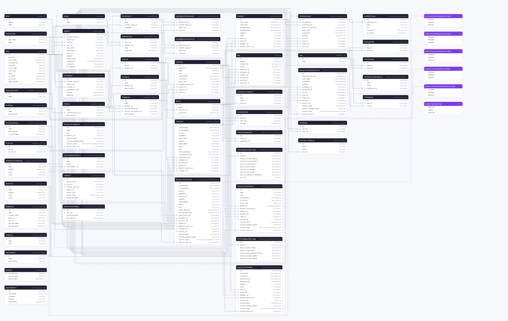

[Site](#site) · [UserObjectPermission](#userobjectpermission) · [GroupObjectPermission](#groupobjectpermission) · [Comment](#comment) · [CommentFlag](#commentflag) · [Attachment](#attachment) · [LinkReference](#linkreference) · [Classification](#classification) · [Product](#product) · [Priority](#priority) · [Component](#component) · [Version](#version) · [Build](#build) · [Tag](#tag) · [TestCaseStatus](#testcasestatus) · [Category](#category) · [HistoricalTestCase](#historicaltestcase) · [TestCase](#testcase) · [testcases.Property](#testcasesproperty) · [TestCasePlan](#testcaseplan) · [TestCaseComponent](#testcasecomponent) · [TestCaseTag](#testcasetag) · [BugSystem](#bugsystem) · [TestCaseEmailSettings](#testcaseemailsettings) · [HistoricalTemplate](#historicaltemplate) · [Template](#template) · [PlanType](#plantype) · [HistoricalTestPlan](#historicaltestplan) · [TestPlan](#testplan) · [TestPlanTag](#testplantag) · [TestPlanEmailSettings](#testplanemailsettings) · [HistoricalTestRun](#historicaltestrun) · [TestRun](#testrun) · [TestExecutionStatus](#testexecutionstatus) · [HistoricalTestExecution](#historicaltestexecution) · [TestExecution](#testexecution) · [TestExecutionProperty](#testexecutionproperty) · [TestRunTag](#testruntag) · [TestRunCC](#testruncc) · [Environment](#environment) · [EnvironmentProperty](#environmentproperty) · [testruns.Property](#testrunsproperty) · [Severity](#severity) · [Bug](#bug) · [LogEntry](#logentry) · [Permission](#permission) · [Group](#group) · [User](#user) · [ContentType](#contenttype) · [Session](#session) · [CaptchaStore](#captchastore) · [UserActivationKey](#useractivationkey)

<details>
<summary>The whole schema as SQL</summary>

```sql
CREATE TABLE "django_site" ("id" integer NOT NULL PRIMARY KEY AUTOINCREMENT, "domain" varchar(100) NOT NULL UNIQUE, "name" varchar(50) NOT NULL);

CREATE TABLE "guardian_userobjectpermission" ("id" integer NOT NULL PRIMARY KEY AUTOINCREMENT, "permission_id" integer NOT NULL REFERENCES "auth_permission" ("id") DEFERRABLE INITIALLY DEFERRED, "content_type_id" integer NOT NULL REFERENCES "django_content_type" ("id") DEFERRABLE INITIALLY DEFERRED, "object_pk" varchar(255) NOT NULL, "user_id" integer NOT NULL REFERENCES "auth_user" ("id") DEFERRABLE INITIALLY DEFERRED);

CREATE TABLE "guardian_groupobjectpermission" ("id" integer NOT NULL PRIMARY KEY AUTOINCREMENT, "permission_id" integer NOT NULL REFERENCES "auth_permission" ("id") DEFERRABLE INITIALLY DEFERRED, "content_type_id" integer NOT NULL REFERENCES "django_content_type" ("id") DEFERRABLE INITIALLY DEFERRED, "object_pk" varchar(255) NOT NULL, "group_id" integer NOT NULL REFERENCES "auth_group" ("id") DEFERRABLE INITIALLY DEFERRED);

CREATE TABLE "django_comments" ("id" integer NOT NULL PRIMARY KEY AUTOINCREMENT, "content_type_id" integer NOT NULL REFERENCES "django_content_type" ("id") DEFERRABLE INITIALLY DEFERRED, "object_pk" varchar(64) NOT NULL, "site_id" integer NOT NULL REFERENCES "django_site" ("id") DEFERRABLE INITIALLY DEFERRED, "user_id" integer NULL REFERENCES "auth_user" ("id") DEFERRABLE INITIALLY DEFERRED, "user_name" varchar(50) NOT NULL, "user_email" varchar(254) NOT NULL, "user_url" varchar(200) NOT NULL, "comment" text NOT NULL, "submit_date" datetime NOT NULL, "ip_address" char(39) NULL, "is_public" bool NOT NULL, "is_removed" bool NOT NULL);

CREATE TABLE "django_comment_flags" ("id" integer NOT NULL PRIMARY KEY AUTOINCREMENT, "user_id" integer NOT NULL REFERENCES "auth_user" ("id") DEFERRABLE INITIALLY DEFERRED, "comment_id" integer NOT NULL REFERENCES "django_comments" ("id") DEFERRABLE INITIALLY DEFERRED, "flag" varchar(30) NOT NULL, "flag_date" datetime NOT NULL);

CREATE TABLE "attachments_attachment" ("id" integer NOT NULL PRIMARY KEY AUTOINCREMENT, "content_type_id" integer NOT NULL REFERENCES "django_content_type" ("id") DEFERRABLE INITIALLY DEFERRED, "object_id" varchar(64) NOT NULL, "creator_id" integer NOT NULL REFERENCES "auth_user" ("id") DEFERRABLE INITIALLY DEFERRED, "attachment_file" varchar(100) NOT NULL, "created" datetime NOT NULL, "modified" datetime NOT NULL);

CREATE TABLE "linkreference_linkreference" ("id" integer NOT NULL PRIMARY KEY AUTOINCREMENT, "execution_id" integer NOT NULL REFERENCES "testruns_testexecution" ("id") DEFERRABLE INITIALLY DEFERRED, "name" varchar(64) NOT NULL, "url" varchar(200) NOT NULL, "created_on" datetime NOT NULL, "is_defect" bool NOT NULL);

CREATE TABLE "management_classification" ("id" integer NOT NULL PRIMARY KEY AUTOINCREMENT, "name" varchar(64) NOT NULL UNIQUE);

CREATE TABLE "management_product" ("id" integer NOT NULL PRIMARY KEY AUTOINCREMENT, "name" varchar(255) NOT NULL UNIQUE, "classification_id" integer NOT NULL REFERENCES "management_classification" ("id") DEFERRABLE INITIALLY DEFERRED, "description" text NOT NULL);

CREATE TABLE "management_priority" ("id" integer NOT NULL PRIMARY KEY AUTOINCREMENT, "value" varchar(64) NOT NULL UNIQUE, "is_active" bool NOT NULL);

CREATE TABLE "management_component" ("id" integer NOT NULL PRIMARY KEY AUTOINCREMENT, "name" varchar(64) NOT NULL, "product_id" integer NOT NULL REFERENCES "management_product" ("id") DEFERRABLE INITIALLY DEFERRED, "initial_owner_id" integer NULL REFERENCES "auth_user" ("id") DEFERRABLE INITIALLY DEFERRED, "initial_qa_contact_id" integer NULL REFERENCES "auth_user" ("id") DEFERRABLE INITIALLY DEFERRED, "description" text NOT NULL);

CREATE TABLE "management_version" ("id" integer NOT NULL PRIMARY KEY AUTOINCREMENT, "value" varchar(192) NOT NULL, "product_id" integer NOT NULL REFERENCES "management_product" ("id") DEFERRABLE INITIALLY DEFERRED);

CREATE TABLE "management_build" ("id" integer NOT NULL PRIMARY KEY AUTOINCREMENT, "name" varchar(255) NOT NULL, "version_id" integer NOT NULL REFERENCES "management_version" ("id") DEFERRABLE INITIALLY DEFERRED, "is_active" bool NOT NULL);

CREATE TABLE "management_tag" ("id" integer NOT NULL PRIMARY KEY AUTOINCREMENT, "name" varchar(255) NOT NULL);

CREATE TABLE "testcases_testcasestatus" ("id" integer NOT NULL PRIMARY KEY AUTOINCREMENT, "name" varchar(255) NOT NULL, "description" text NULL, "is_confirmed" bool NOT NULL);

CREATE TABLE "testcases_category" ("id" integer NOT NULL PRIMARY KEY AUTOINCREMENT, "name" varchar(255) NOT NULL, "product_id" integer NOT NULL REFERENCES "management_product" ("id") DEFERRABLE INITIALLY DEFERRED, "description" text NOT NULL);

CREATE TABLE "testcases_historicaltestcase" ("id" integer NOT NULL, "create_date" datetime NOT NULL, "is_automated" bool NOT NULL, "script" text NULL, "arguments" text NULL, "extra_link" varchar(1024) NULL, "summary" varchar(255) NOT NULL, "requirement" varchar(255) NULL, "notes" text NULL, "text" text NOT NULL, "setup_duration" bigint NULL, "testing_duration" bigint NULL, "case_status_id" integer NULL, "category_id" integer NULL, "priority_id" integer NULL, "author_id" integer NULL, "default_tester_id" integer NULL, "reviewer_id" integer NULL, "history_id" integer NOT NULL PRIMARY KEY AUTOINCREMENT, "history_date" datetime NOT NULL, "history_change_reason" text NULL, "history_type" varchar(1) NOT NULL, "history_user_id" integer NULL REFERENCES "auth_user" ("id") DEFERRABLE INITIALLY DEFERRED);

CREATE TABLE "testcases_testcase" ("id" integer NOT NULL PRIMARY KEY AUTOINCREMENT, "create_date" datetime NOT NULL, "is_automated" bool NOT NULL, "script" text NULL, "arguments" text NULL, "extra_link" varchar(1024) NULL, "summary" varchar(255) NOT NULL, "requirement" varchar(255) NULL, "notes" text NULL, "text" text NOT NULL, "setup_duration" bigint NULL, "testing_duration" bigint NULL, "case_status_id" integer NOT NULL REFERENCES "testcases_testcasestatus" ("id") DEFERRABLE INITIALLY DEFERRED, "category_id" integer NOT NULL REFERENCES "testcases_category" ("id") DEFERRABLE INITIALLY DEFERRED, "priority_id" integer NOT NULL REFERENCES "management_priority" ("id") DEFERRABLE INITIALLY DEFERRED, "author_id" integer NOT NULL REFERENCES "auth_user" ("id") DEFERRABLE INITIALLY DEFERRED, "default_tester_id" integer NULL REFERENCES "auth_user" ("id") DEFERRABLE INITIALLY DEFERRED, "reviewer_id" integer NULL REFERENCES "auth_user" ("id") DEFERRABLE INITIALLY DEFERRED);

CREATE TABLE "testcases_property" ("id" integer NOT NULL PRIMARY KEY AUTOINCREMENT, "name" varchar(255) NOT NULL, "value" varchar(255) NOT NULL, "case_id" integer NOT NULL REFERENCES "testcases_testcase" ("id") DEFERRABLE INITIALLY DEFERRED);

CREATE TABLE "testcases_testcaseplan" ("id" integer NOT NULL PRIMARY KEY AUTOINCREMENT, "plan_id" integer NOT NULL REFERENCES "testplans_testplan" ("id") DEFERRABLE INITIALLY DEFERRED, "case_id" integer NOT NULL REFERENCES "testcases_testcase" ("id") DEFERRABLE INITIALLY DEFERRED, "sortkey" integer NULL);

CREATE TABLE "testcases_testcasecomponent" ("id" integer NOT NULL PRIMARY KEY AUTOINCREMENT, "case_id" integer NOT NULL REFERENCES "testcases_testcase" ("id") DEFERRABLE INITIALLY DEFERRED, "component_id" integer NOT NULL REFERENCES "management_component" ("id") DEFERRABLE INITIALLY DEFERRED);

CREATE TABLE "testcases_testcasetag" ("id" integer NOT NULL PRIMARY KEY AUTOINCREMENT, "tag_id" integer NOT NULL REFERENCES "management_tag" ("id") DEFERRABLE INITIALLY DEFERRED, "case_id" integer NOT NULL REFERENCES "testcases_testcase" ("id") DEFERRABLE INITIALLY DEFERRED);

CREATE TABLE "testcases_bugsystem" ("id" integer NOT NULL PRIMARY KEY AUTOINCREMENT, "name" varchar(255) NOT NULL UNIQUE, "tracker_type" varchar(128) NOT NULL, "base_url" varchar(1024) NULL, "api_url" varchar(1024) NULL, "api_username" varchar(256) NULL, "api_password" varchar(256) NULL);

CREATE TABLE "testcases_testcaseemailsettings" ("id" integer NOT NULL PRIMARY KEY AUTOINCREMENT, "case_id" integer NOT NULL UNIQUE REFERENCES "testcases_testcase" ("id") DEFERRABLE INITIALLY DEFERRED, "notify_on_case_update" bool NOT NULL, "notify_on_case_delete" bool NOT NULL, "auto_to_case_author" bool NOT NULL, "auto_to_case_tester" bool NOT NULL, "auto_to_run_manager" bool NOT NULL, "auto_to_run_tester" bool NOT NULL, "auto_to_execution_assignee" bool NOT NULL, "cc_list" text NOT NULL);

CREATE TABLE "testcases_historicaltemplate" ("id" integer NOT NULL, "name" varchar(255) NOT NULL, "text" text NOT NULL, "history_id" integer NOT NULL PRIMARY KEY AUTOINCREMENT, "history_date" datetime NOT NULL, "history_change_reason" text NULL, "history_type" varchar(1) NOT NULL, "history_user_id" integer NULL REFERENCES "auth_user" ("id") DEFERRABLE INITIALLY DEFERRED);

CREATE TABLE "testcases_template" ("id" integer NOT NULL PRIMARY KEY AUTOINCREMENT, "name" varchar(255) NOT NULL, "text" text NOT NULL);

CREATE TABLE "testplans_plantype" ("id" integer NOT NULL PRIMARY KEY AUTOINCREMENT, "name" varchar(64) NOT NULL UNIQUE, "description" text NULL);

CREATE TABLE "testplans_historicaltestplan" ("id" integer NOT NULL, "name" varchar(255) NOT NULL, "text" text NOT NULL, "create_date" datetime NOT NULL, "is_active" bool NOT NULL, "extra_link" varchar(1024) NULL, "parent_id" integer NULL, "product_version_id" integer NULL, "author_id" integer NULL, "product_id" integer NULL, "type_id" integer NULL, "history_id" integer NOT NULL PRIMARY KEY AUTOINCREMENT, "history_date" datetime NOT NULL, "history_change_reason" text NULL, "history_type" varchar(1) NOT NULL, "history_user_id" integer NULL REFERENCES "auth_user" ("id") DEFERRABLE INITIALLY DEFERRED);

CREATE TABLE "testplans_testplan" ("id" integer NOT NULL PRIMARY KEY AUTOINCREMENT, "parent_id" integer NULL REFERENCES "testplans_testplan" ("id") DEFERRABLE INITIALLY DEFERRED, "name" varchar(255) NOT NULL, "text" text NOT NULL, "create_date" datetime NOT NULL, "is_active" bool NOT NULL, "extra_link" varchar(1024) NULL, "product_version_id" integer NOT NULL REFERENCES "management_version" ("id") DEFERRABLE INITIALLY DEFERRED, "author_id" integer NOT NULL REFERENCES "auth_user" ("id") DEFERRABLE INITIALLY DEFERRED, "product_id" integer NOT NULL REFERENCES "management_product" ("id") DEFERRABLE INITIALLY DEFERRED, "type_id" integer NOT NULL REFERENCES "testplans_plantype" ("id") DEFERRABLE INITIALLY DEFERRED);

CREATE TABLE "testplans_testplantag" ("id" integer NOT NULL PRIMARY KEY AUTOINCREMENT, "tag_id" integer NOT NULL REFERENCES "management_tag" ("id") DEFERRABLE INITIALLY DEFERRED, "plan_id" integer NOT NULL REFERENCES "testplans_testplan" ("id") DEFERRABLE INITIALLY DEFERRED);

CREATE TABLE "testplans_testplanemailsettings" ("id" integer NOT NULL PRIMARY KEY AUTOINCREMENT, "plan_id" integer NOT NULL UNIQUE REFERENCES "testplans_testplan" ("id") DEFERRABLE INITIALLY DEFERRED, "auto_to_plan_author" bool NOT NULL, "auto_to_case_owner" bool NOT NULL, "auto_to_case_default_tester" bool NOT NULL, "notify_on_plan_update" bool NOT NULL, "notify_on_case_update" bool NOT NULL);

CREATE TABLE "testruns_historicaltestrun" ("id" integer NOT NULL, "start_date" datetime NULL, "stop_date" datetime NULL, "planned_start" datetime NULL, "planned_stop" datetime NULL, "summary" text NOT NULL, "notes" text NOT NULL, "plan_id" integer NULL, "build_id" integer NULL, "manager_id" integer NULL, "default_tester_id" integer NULL, "history_id" integer NOT NULL PRIMARY KEY AUTOINCREMENT, "history_date" datetime NOT NULL, "history_change_reason" text NULL, "history_type" varchar(1) NOT NULL, "history_user_id" integer NULL REFERENCES "auth_user" ("id") DEFERRABLE INITIALLY DEFERRED);

CREATE TABLE "testruns_testrun" ("id" integer NOT NULL PRIMARY KEY AUTOINCREMENT, "start_date" datetime NULL, "stop_date" datetime NULL, "planned_start" datetime NULL, "planned_stop" datetime NULL, "summary" text NOT NULL, "notes" text NOT NULL, "plan_id" integer NOT NULL REFERENCES "testplans_testplan" ("id") DEFERRABLE INITIALLY DEFERRED, "build_id" integer NOT NULL REFERENCES "management_build" ("id") DEFERRABLE INITIALLY DEFERRED, "manager_id" integer NOT NULL REFERENCES "auth_user" ("id") DEFERRABLE INITIALLY DEFERRED, "default_tester_id" integer NULL REFERENCES "auth_user" ("id") DEFERRABLE INITIALLY DEFERRED);

CREATE TABLE "testruns_testexecutionstatus" ("id" integer NOT NULL PRIMARY KEY AUTOINCREMENT, "name" varchar(60) NOT NULL UNIQUE, "weight" integer NOT NULL, "icon" varchar(64) NOT NULL, "color" varchar(18) NOT NULL);

CREATE TABLE "testruns_historicaltestexecution" ("id" integer NOT NULL, "case_text_version" integer NOT NULL, "start_date" datetime NULL, "stop_date" datetime NULL, "sortkey" integer NULL, "assignee_id" integer NULL, "tested_by_id" integer NULL, "run_id" integer NULL, "case_id" integer NULL, "status_id" integer NULL, "build_id" integer NULL, "history_id" integer NOT NULL PRIMARY KEY AUTOINCREMENT, "history_date" datetime NOT NULL, "history_change_reason" text NULL, "history_type" varchar(1) NOT NULL, "history_user_id" integer NULL REFERENCES "auth_user" ("id") DEFERRABLE INITIALLY DEFERRED);

CREATE TABLE "testruns_testexecution" ("id" integer NOT NULL PRIMARY KEY AUTOINCREMENT, "assignee_id" integer NULL REFERENCES "auth_user" ("id") DEFERRABLE INITIALLY DEFERRED, "tested_by_id" integer NULL REFERENCES "auth_user" ("id") DEFERRABLE INITIALLY DEFERRED, "case_text_version" integer NOT NULL, "start_date" datetime NULL, "stop_date" datetime NULL, "sortkey" integer NULL, "run_id" integer NOT NULL REFERENCES "testruns_testrun" ("id") DEFERRABLE INITIALLY DEFERRED, "case_id" integer NOT NULL REFERENCES "testcases_testcase" ("id") DEFERRABLE INITIALLY DEFERRED, "status_id" integer NOT NULL REFERENCES "testruns_testexecutionstatus" ("id") DEFERRABLE INITIALLY DEFERRED, "build_id" integer NOT NULL REFERENCES "management_build" ("id") DEFERRABLE INITIALLY DEFERRED);

CREATE TABLE "testruns_testexecutionproperty" ("id" integer NOT NULL PRIMARY KEY AUTOINCREMENT, "name" varchar(255) NOT NULL, "value" varchar(255) NOT NULL, "execution_id" integer NOT NULL REFERENCES "testruns_testexecution" ("id") DEFERRABLE INITIALLY DEFERRED);

CREATE TABLE "testruns_testruntag" ("id" integer NOT NULL PRIMARY KEY AUTOINCREMENT, "tag_id" integer NOT NULL REFERENCES "management_tag" ("id") DEFERRABLE INITIALLY DEFERRED, "run_id" integer NOT NULL REFERENCES "testruns_testrun" ("id") DEFERRABLE INITIALLY DEFERRED);

CREATE TABLE "testruns_testruncc" ("id" integer NOT NULL PRIMARY KEY AUTOINCREMENT, "run_id" integer NOT NULL REFERENCES "testruns_testrun" ("id") DEFERRABLE INITIALLY DEFERRED, "user_id" integer NOT NULL REFERENCES "auth_user" ("id") DEFERRABLE INITIALLY DEFERRED);

CREATE TABLE "testruns_environment" ("id" integer NOT NULL PRIMARY KEY AUTOINCREMENT, "name" varchar(255) NOT NULL UNIQUE, "description" text NOT NULL);

CREATE TABLE "testruns_environmentproperty" ("id" integer NOT NULL PRIMARY KEY AUTOINCREMENT, "name" varchar(255) NOT NULL, "value" varchar(255) NOT NULL, "environment_id" integer NOT NULL REFERENCES "testruns_environment" ("id") DEFERRABLE INITIALLY DEFERRED);

CREATE TABLE "testruns_property" ("id" integer NOT NULL PRIMARY KEY AUTOINCREMENT, "name" varchar(255) NOT NULL, "value" varchar(255) NOT NULL, "run_id" integer NOT NULL REFERENCES "testruns_testrun" ("id") DEFERRABLE INITIALLY DEFERRED);

CREATE TABLE "bugs_severity" ("id" integer NOT NULL PRIMARY KEY AUTOINCREMENT, "name" varchar(64) NOT NULL UNIQUE, "weight" integer NOT NULL, "icon" varchar(64) NOT NULL, "color" varchar(18) NOT NULL);

CREATE TABLE "bugs_bug" ("id" integer NOT NULL PRIMARY KEY AUTOINCREMENT, "summary" varchar(255) NOT NULL, "created_at" datetime NOT NULL, "status" bool NOT NULL, "reporter_id" integer NOT NULL REFERENCES "auth_user" ("id") DEFERRABLE INITIALLY DEFERRED, "assignee_id" integer NULL REFERENCES "auth_user" ("id") DEFERRABLE INITIALLY DEFERRED, "product_id" integer NOT NULL REFERENCES "management_product" ("id") DEFERRABLE INITIALLY DEFERRED, "version_id" integer NOT NULL REFERENCES "management_version" ("id") DEFERRABLE INITIALLY DEFERRED, "build_id" integer NOT NULL REFERENCES "management_build" ("id") DEFERRABLE INITIALLY DEFERRED, "severity_id" integer NULL REFERENCES "bugs_severity" ("id") DEFERRABLE INITIALLY DEFERRED);

CREATE TABLE "bugs_bug_executions" ("id" integer NOT NULL PRIMARY KEY AUTOINCREMENT, "bug_id" integer NOT NULL REFERENCES "bugs_bug" ("id") DEFERRABLE INITIALLY DEFERRED, "testexecution_id" integer NOT NULL REFERENCES "testruns_testexecution" ("id") DEFERRABLE INITIALLY DEFERRED);

CREATE TABLE "bugs_bug_tags" ("id" integer NOT NULL PRIMARY KEY AUTOINCREMENT, "bug_id" integer NOT NULL REFERENCES "bugs_bug" ("id") DEFERRABLE INITIALLY DEFERRED, "tag_id" integer NOT NULL REFERENCES "management_tag" ("id") DEFERRABLE INITIALLY DEFERRED);

CREATE TABLE "django_admin_log" ("id" integer NOT NULL PRIMARY KEY AUTOINCREMENT, "action_time" datetime NOT NULL, "user_id" integer NOT NULL REFERENCES "auth_user" ("id") DEFERRABLE INITIALLY DEFERRED, "content_type_id" integer NULL REFERENCES "django_content_type" ("id") DEFERRABLE INITIALLY DEFERRED, "object_id" text NULL, "object_repr" varchar(200) NOT NULL, "action_flag" smallint unsigned NOT NULL CHECK ("action_flag" >= 0), "change_message" text NOT NULL);

CREATE TABLE "auth_permission" ("id" integer NOT NULL PRIMARY KEY AUTOINCREMENT, "name" varchar(255) NOT NULL, "content_type_id" integer NOT NULL REFERENCES "django_content_type" ("id") DEFERRABLE INITIALLY DEFERRED, "codename" varchar(100) NOT NULL);

CREATE TABLE "auth_group" ("id" integer NOT NULL PRIMARY KEY AUTOINCREMENT, "name" varchar(150) NOT NULL UNIQUE);

CREATE TABLE "auth_group_permissions" ("id" integer NOT NULL PRIMARY KEY AUTOINCREMENT, "group_id" integer NOT NULL REFERENCES "auth_group" ("id") DEFERRABLE INITIALLY DEFERRED, "permission_id" integer NOT NULL REFERENCES "auth_permission" ("id") DEFERRABLE INITIALLY DEFERRED);

CREATE TABLE "auth_user" ("id" integer NOT NULL PRIMARY KEY AUTOINCREMENT, "password" varchar(128) NOT NULL, "last_login" datetime NULL, "is_superuser" bool NOT NULL, "username" varchar(150) NOT NULL UNIQUE, "first_name" varchar(150) NOT NULL, "last_name" varchar(150) NOT NULL, "email" varchar(254) NOT NULL, "is_staff" bool NOT NULL, "is_active" bool NOT NULL, "date_joined" datetime NOT NULL);

CREATE TABLE "auth_user_groups" ("id" integer NOT NULL PRIMARY KEY AUTOINCREMENT, "user_id" integer NOT NULL REFERENCES "auth_user" ("id") DEFERRABLE INITIALLY DEFERRED, "group_id" integer NOT NULL REFERENCES "auth_group" ("id") DEFERRABLE INITIALLY DEFERRED);

CREATE TABLE "auth_user_user_permissions" ("id" integer NOT NULL PRIMARY KEY AUTOINCREMENT, "user_id" integer NOT NULL REFERENCES "auth_user" ("id") DEFERRABLE INITIALLY DEFERRED, "permission_id" integer NOT NULL REFERENCES "auth_permission" ("id") DEFERRABLE INITIALLY DEFERRED);

CREATE TABLE "django_content_type" ("id" integer NOT NULL PRIMARY KEY AUTOINCREMENT, "app_label" varchar(100) NOT NULL, "model" varchar(100) NOT NULL);

CREATE TABLE "django_session" ("session_key" varchar(40) NOT NULL PRIMARY KEY, "session_data" text NOT NULL, "expire_date" datetime NOT NULL);

CREATE TABLE "captcha_captchastore" ("id" integer NOT NULL PRIMARY KEY AUTOINCREMENT, "challenge" varchar(32) NOT NULL, "response" varchar(32) NOT NULL, "hashkey" varchar(40) NOT NULL UNIQUE, "expiration" datetime NOT NULL);

CREATE TABLE "kiwi_auth_useractivationkey" ("id" integer NOT NULL PRIMARY KEY AUTOINCREMENT, "user_id" integer NOT NULL REFERENCES "auth_user" ("id") DEFERRABLE INITIALLY DEFERRED, "activation_key" varchar(64) NULL, "key_expires" datetime NULL);

CREATE UNIQUE INDEX "guardian_userobjectpermission_user_id_permission_id_object_pk_b0b3d2fc_uniq" ON "guardian_userobjectpermission" ("user_id", "permission_id", "object_pk");

CREATE INDEX "guardian_userobjectpermission_permission_id_71807bfc" ON "guardian_userobjectpermission" ("permission_id");

CREATE INDEX "guardian_userobjectpermission_content_type_id_2e892405" ON "guardian_userobjectpermission" ("content_type_id");

CREATE INDEX "guardian_userobjectpermission_user_id_d5c1e964" ON "guardian_userobjectpermission" ("user_id");

CREATE INDEX "guardian_us_content_179ed2_idx" ON "guardian_userobjectpermission" ("content_type_id", "object_pk");

CREATE UNIQUE INDEX "guardian_groupobjectpermission_group_id_permission_id_object_pk_3f189f7c_uniq" ON "guardian_groupobjectpermission" ("group_id", "permission_id", "object_pk");

CREATE INDEX "guardian_groupobjectpermission_permission_id_36572738" ON "guardian_groupobjectpermission" ("permission_id");

CREATE INDEX "guardian_groupobjectpermission_content_type_id_7ade36b8" ON "guardian_groupobjectpermission" ("content_type_id");

CREATE INDEX "guardian_groupobjectpermission_group_id_4bbbfb62" ON "guardian_groupobjectpermission" ("group_id");

CREATE INDEX "guardian_gr_content_ae6aec_idx" ON "guardian_groupobjectpermission" ("content_type_id", "object_pk");

CREATE INDEX "django_comments_content_type_id_c4afe962" ON "django_comments" ("content_type_id");

CREATE INDEX "django_comments_object_pk_7fc98e83" ON "django_comments" ("object_pk");

CREATE INDEX "django_comments_site_id_9dcf666e" ON "django_comments" ("site_id");

CREATE INDEX "django_comments_user_id_a0a440a1" ON "django_comments" ("user_id");

CREATE INDEX "django_comments_submit_date_514ed2d9" ON "django_comments" ("submit_date");

CREATE INDEX "django_comments_is_removed_52a03ae3" ON "django_comments" ("is_removed");

CREATE UNIQUE INDEX "django_comment_flags_user_id_comment_id_flag_537f77a7_uniq" ON "django_comment_flags" ("user_id", "comment_id", "flag");

CREATE INDEX "django_comment_flags_user_id_f3f81f0a" ON "django_comment_flags" ("user_id");

CREATE INDEX "django_comment_flags_comment_id_d8054933" ON "django_comment_flags" ("comment_id");

CREATE INDEX "django_comment_flags_flag_8b141fcb" ON "django_comment_flags" ("flag");

CREATE INDEX "attachments_attachment_content_type_id_35dd9d5d" ON "attachments_attachment" ("content_type_id");

CREATE INDEX "attachments_attachment_object_id_102ce831" ON "attachments_attachment" ("object_id");

CREATE INDEX "attachments_attachment_creator_id_d471ef83" ON "attachments_attachment" ("creator_id");

CREATE INDEX "attachments_attachment_created_96fbcd43" ON "attachments_attachment" ("created");

CREATE INDEX "attachments_attachment_modified_1d39a3d7" ON "attachments_attachment" ("modified");

CREATE INDEX "linkreference_linkreference_execution_id_0f007e30" ON "linkreference_linkreference" ("execution_id");

CREATE INDEX "linkreference_linkreference_url_a67ef7ca" ON "linkreference_linkreference" ("url");

CREATE INDEX "linkreference_linkreference_created_on_9a8e5281" ON "linkreference_linkreference" ("created_on");

CREATE INDEX "linkreference_linkreference_is_defect_1afb0f5c" ON "linkreference_linkreference" ("is_defect");

CREATE INDEX "management_product_classification_id_e4e18e09" ON "management_product" ("classification_id");

CREATE UNIQUE INDEX "management_component_product_id_name_2bff48aa_uniq" ON "management_component" ("product_id", "name");

CREATE INDEX "management_component_product_id_82d6de7e" ON "management_component" ("product_id");

CREATE INDEX "management_component_initial_owner_id_983a4de8" ON "management_component" ("initial_owner_id");

CREATE INDEX "management_component_initial_qa_contact_id_00659846" ON "management_component" ("initial_qa_contact_id");

CREATE UNIQUE INDEX "management_version_product_id_value_97d2c1b8_uniq" ON "management_version" ("product_id", "value");

CREATE INDEX "management_version_product_id_f1cf2daf" ON "management_version" ("product_id");

CREATE UNIQUE INDEX "management_build_version_id_name_0ca02373_uniq" ON "management_build" ("version_id", "name");

CREATE INDEX "management_build_version_id_b16465e8" ON "management_build" ("version_id");

CREATE INDEX "testcases_testcasestatus_is_confirmed_ba7f915d" ON "testcases_testcasestatus" ("is_confirmed");

CREATE UNIQUE INDEX "testcases_category_product_id_name_6f991fe0_uniq" ON "testcases_category" ("product_id", "name");

CREATE INDEX "testcases_category_product_id_f26067e7" ON "testcases_category" ("product_id");

CREATE INDEX "testcases_historicaltestcase_id_12c89411" ON "testcases_historicaltestcase" ("id");

CREATE INDEX "testcases_historicaltestcase_summary_92d50821" ON "testcases_historicaltestcase" ("summary");

CREATE INDEX "testcases_historicaltestcase_setup_duration_2342e865" ON "testcases_historicaltestcase" ("setup_duration");

CREATE INDEX "testcases_historicaltestcase_testing_duration_63c88e57" ON "testcases_historicaltestcase" ("testing_duration");

CREATE INDEX "testcases_historicaltestcase_case_status_id_35c6b721" ON "testcases_historicaltestcase" ("case_status_id");

CREATE INDEX "testcases_historicaltestcase_category_id_05519a7a" ON "testcases_historicaltestcase" ("category_id");

CREATE INDEX "testcases_historicaltestcase_priority_id_defa02c4" ON "testcases_historicaltestcase" ("priority_id");

CREATE INDEX "testcases_historicaltestcase_author_id_0cb2d010" ON "testcases_historicaltestcase" ("author_id");

CREATE INDEX "testcases_historicaltestcase_default_tester_id_4096f1c6" ON "testcases_historicaltestcase" ("default_tester_id");

CREATE INDEX "testcases_historicaltestcase_reviewer_id_33c64d01" ON "testcases_historicaltestcase" ("reviewer_id");

CREATE INDEX "testcases_historicaltestcase_history_date_fe588372" ON "testcases_historicaltestcase" ("history_date");

CREATE INDEX "testcases_historicaltestcase_history_user_id_7091ce1e" ON "testcases_historicaltestcase" ("history_user_id");

CREATE INDEX "testcases_testcase_summary_511d8323" ON "testcases_testcase" ("summary");

CREATE INDEX "testcases_testcase_setup_duration_56e5887d" ON "testcases_testcase" ("setup_duration");

CREATE INDEX "testcases_testcase_testing_duration_3ae6ba2d" ON "testcases_testcase" ("testing_duration");

CREATE INDEX "testcases_testcase_case_status_id_506e2b3f" ON "testcases_testcase" ("case_status_id");

CREATE INDEX "testcases_testcase_category_id_f52a4b36" ON "testcases_testcase" ("category_id");

CREATE INDEX "testcases_testcase_priority_id_06e62b85" ON "testcases_testcase" ("priority_id");

CREATE INDEX "testcases_testcase_author_id_40ee8140" ON "testcases_testcase" ("author_id");

CREATE INDEX "testcases_testcase_default_tester_id_d9c8faf2" ON "testcases_testcase" ("default_tester_id");

CREATE INDEX "testcases_testcase_reviewer_id_4be5756e" ON "testcases_testcase" ("reviewer_id");

CREATE INDEX "testcases_property_case_id_ce458207" ON "testcases_property" ("case_id");

CREATE UNIQUE INDEX "testcases_testcaseplan_plan_id_case_id_16d50827_uniq" ON "testcases_testcaseplan" ("plan_id", "case_id");

CREATE INDEX "testcases_testcaseplan_plan_id_40b3d762" ON "testcases_testcaseplan" ("plan_id");

CREATE INDEX "testcases_testcaseplan_case_id_89f638fc" ON "testcases_testcaseplan" ("case_id");

CREATE INDEX "testcases_testcasecomponent_case_id_fc27e38a" ON "testcases_testcasecomponent" ("case_id");

CREATE INDEX "testcases_testcasecomponent_component_id_edd78178" ON "testcases_testcasecomponent" ("component_id");

CREATE INDEX "testcases_testcasetag_tag_id_b16f414a" ON "testcases_testcasetag" ("tag_id");

CREATE INDEX "testcases_testcasetag_case_id_338ecd07" ON "testcases_testcasetag" ("case_id");

CREATE INDEX "testcases_historicaltemplate_id_75442f7f" ON "testcases_historicaltemplate" ("id");

CREATE INDEX "testcases_historicaltemplate_history_date_b1bbfd15" ON "testcases_historicaltemplate" ("history_date");

CREATE INDEX "testcases_historicaltemplate_history_user_id_0234739e" ON "testcases_historicaltemplate" ("history_user_id");

CREATE INDEX "testplans_historicaltestplan_id_1f0d0717" ON "testplans_historicaltestplan" ("id");

CREATE INDEX "testplans_historicaltestplan_name_d1afc49f" ON "testplans_historicaltestplan" ("name");

CREATE INDEX "testplans_historicaltestplan_is_active_aa220a2c" ON "testplans_historicaltestplan" ("is_active");

CREATE INDEX "testplans_historicaltestplan_parent_id_4d7e6ee8" ON "testplans_historicaltestplan" ("parent_id");

CREATE INDEX "testplans_historicaltestplan_product_version_id_4598a8b7" ON "testplans_historicaltestplan" ("product_version_id");

CREATE INDEX "testplans_historicaltestplan_author_id_7de6569d" ON "testplans_historicaltestplan" ("author_id");

CREATE INDEX "testplans_historicaltestplan_product_id_2410d78b" ON "testplans_historicaltestplan" ("product_id");

CREATE INDEX "testplans_historicaltestplan_type_id_65c12bbd" ON "testplans_historicaltestplan" ("type_id");

CREATE INDEX "testplans_historicaltestplan_history_date_3078d054" ON "testplans_historicaltestplan" ("history_date");

CREATE INDEX "testplans_historicaltestplan_history_user_id_0b43ff14" ON "testplans_historicaltestplan" ("history_user_id");

CREATE INDEX "testplans_testplan_parent_id_c3460a73" ON "testplans_testplan" ("parent_id");

CREATE INDEX "testplans_testplan_name_0bcb1318" ON "testplans_testplan" ("name");

CREATE INDEX "testplans_testplan_is_active_66e60279" ON "testplans_testplan" ("is_active");

CREATE INDEX "testplans_testplan_product_version_id_0ad731f7" ON "testplans_testplan" ("product_version_id");

CREATE INDEX "testplans_testplan_author_id_8fc1910b" ON "testplans_testplan" ("author_id");

CREATE INDEX "testplans_testplan_product_id_6e99180c" ON "testplans_testplan" ("product_id");

CREATE INDEX "testplans_testplan_type_id_b83ae87b" ON "testplans_testplan" ("type_id");

CREATE INDEX "testplans_testplantag_tag_id_4a5c61b6" ON "testplans_testplantag" ("tag_id");

CREATE INDEX "testplans_testplantag_plan_id_f5c9e46a" ON "testplans_testplantag" ("plan_id");

CREATE INDEX "testruns_historicaltestrun_id_5b716816" ON "testruns_historicaltestrun" ("id");

CREATE INDEX "testruns_historicaltestrun_start_date_2966e83c" ON "testruns_historicaltestrun" ("start_date");

CREATE INDEX "testruns_historicaltestrun_stop_date_df8f576c" ON "testruns_historicaltestrun" ("stop_date");

CREATE INDEX "testruns_historicaltestrun_planned_start_614a868d" ON "testruns_historicaltestrun" ("planned_start");

CREATE INDEX "testruns_historicaltestrun_planned_stop_f3a63beb" ON "testruns_historicaltestrun" ("planned_stop");

CREATE INDEX "testruns_historicaltestrun_plan_id_adfcb9d1" ON "testruns_historicaltestrun" ("plan_id");

CREATE INDEX "testruns_historicaltestrun_build_id_83cb88d1" ON "testruns_historicaltestrun" ("build_id");

CREATE INDEX "testruns_historicaltestrun_manager_id_48e016d3" ON "testruns_historicaltestrun" ("manager_id");

CREATE INDEX "testruns_historicaltestrun_default_tester_id_bfc251b2" ON "testruns_historicaltestrun" ("default_tester_id");

CREATE INDEX "testruns_historicaltestrun_history_date_c382be04" ON "testruns_historicaltestrun" ("history_date");

CREATE INDEX "testruns_historicaltestrun_history_user_id_8021d038" ON "testruns_historicaltestrun" ("history_user_id");

CREATE INDEX "testruns_testrun_start_date_069af648" ON "testruns_testrun" ("start_date");

CREATE INDEX "testruns_testrun_stop_date_ef2271e8" ON "testruns_testrun" ("stop_date");

CREATE INDEX "testruns_testrun_planned_start_ea8990da" ON "testruns_testrun" ("planned_start");

CREATE INDEX "testruns_testrun_planned_stop_db2c9977" ON "testruns_testrun" ("planned_stop");

CREATE INDEX "testruns_testrun_plan_id_6c5c942a" ON "testruns_testrun" ("plan_id");

CREATE INDEX "testruns_testrun_build_id_fca012cf" ON "testruns_testrun" ("build_id");

CREATE INDEX "testruns_testrun_manager_id_3b380cf6" ON "testruns_testrun" ("manager_id");

CREATE INDEX "testruns_testrun_default_tester_id_cfd29db3" ON "testruns_testrun" ("default_tester_id");

CREATE INDEX "testruns_historicaltestexecution_id_69b1b1b1" ON "testruns_historicaltestexecution" ("id");

CREATE INDEX "testruns_historicaltestexecution_start_date_3e5ed561" ON "testruns_historicaltestexecution" ("start_date");

CREATE INDEX "testruns_historicaltestexecution_stop_date_d659f81c" ON "testruns_historicaltestexecution" ("stop_date");

CREATE INDEX "testruns_historicaltestexecution_assignee_id_f690ec0e" ON "testruns_historicaltestexecution" ("assignee_id");

CREATE INDEX "testruns_historicaltestexecution_tested_by_id_a30c4c8c" ON "testruns_historicaltestexecution" ("tested_by_id");

CREATE INDEX "testruns_historicaltestexecution_run_id_3e1696ea" ON "testruns_historicaltestexecution" ("run_id");

CREATE INDEX "testruns_historicaltestexecution_case_id_1cc6facc" ON "testruns_historicaltestexecution" ("case_id");

CREATE INDEX "testruns_historicaltestexecution_status_id_52897e9a" ON "testruns_historicaltestexecution" ("status_id");

CREATE INDEX "testruns_historicaltestexecution_build_id_3b63ffa5" ON "testruns_historicaltestexecution" ("build_id");

CREATE INDEX "testruns_historicaltestexecution_history_date_035536b8" ON "testruns_historicaltestexecution" ("history_date");

CREATE INDEX "testruns_historicaltestexecution_history_user_id_cfb71d7e" ON "testruns_historicaltestexecution" ("history_user_id");

CREATE INDEX "testruns_testexecution_assignee_id_0daefb61" ON "testruns_testexecution" ("assignee_id");

CREATE INDEX "testruns_testexecution_tested_by_id_23ec246c" ON "testruns_testexecution" ("tested_by_id");

CREATE INDEX "testruns_testexecution_start_date_d50373f5" ON "testruns_testexecution" ("start_date");

CREATE INDEX "testruns_testexecution_stop_date_1e245a90" ON "testruns_testexecution" ("stop_date");

CREATE INDEX "testruns_testexecution_run_id_b07eceea" ON "testruns_testexecution" ("run_id");

CREATE INDEX "testruns_testexecution_case_id_24b74b89" ON "testruns_testexecution" ("case_id");

CREATE INDEX "testruns_testexecution_status_id_82e677b4" ON "testruns_testexecution" ("status_id");

CREATE INDEX "testruns_testexecution_build_id_511386d9" ON "testruns_testexecution" ("build_id");

CREATE INDEX "testruns_testexecutionproperty_execution_id_5b7ba16e" ON "testruns_testexecutionproperty" ("execution_id");

CREATE INDEX "testruns_testruntag_tag_id_71c717c0" ON "testruns_testruntag" ("tag_id");

CREATE INDEX "testruns_testruntag_run_id_08efd935" ON "testruns_testruntag" ("run_id");

CREATE UNIQUE INDEX "testruns_testruncc_run_id_user_id_33646180_uniq" ON "testruns_testruncc" ("run_id", "user_id");

CREATE INDEX "testruns_testruncc_run_id_e1329c9b" ON "testruns_testruncc" ("run_id");

CREATE INDEX "testruns_testruncc_user_id_d87465d8" ON "testruns_testruncc" ("user_id");

CREATE INDEX "testruns_environmentproperty_environment_id_f9ac7236" ON "testruns_environmentproperty" ("environment_id");

CREATE INDEX "testruns_property_run_id_71808437" ON "testruns_property" ("run_id");

CREATE INDEX "bugs_bug_summary_8321d37f" ON "bugs_bug" ("summary");

CREATE INDEX "bugs_bug_created_at_f132529e" ON "bugs_bug" ("created_at");

CREATE INDEX "bugs_bug_status_3e54f71f" ON "bugs_bug" ("status");

CREATE INDEX "bugs_bug_reporter_id_f3c433c0" ON "bugs_bug" ("reporter_id");

CREATE INDEX "bugs_bug_assignee_id_2006cbf7" ON "bugs_bug" ("assignee_id");

CREATE INDEX "bugs_bug_product_id_a052f422" ON "bugs_bug" ("product_id");

CREATE INDEX "bugs_bug_version_id_9e5c9e9d" ON "bugs_bug" ("version_id");

CREATE INDEX "bugs_bug_build_id_f3b6bc1b" ON "bugs_bug" ("build_id");

CREATE INDEX "bugs_bug_severity_id_e3498925" ON "bugs_bug" ("severity_id");

CREATE UNIQUE INDEX "bugs_bug_executions_bug_id_testexecution_id_0fd55cb1_uniq" ON "bugs_bug_executions" ("bug_id", "testexecution_id");

CREATE INDEX "bugs_bug_executions_bug_id_3a87c570" ON "bugs_bug_executions" ("bug_id");

CREATE INDEX "bugs_bug_executions_testexecution_id_b835d93d" ON "bugs_bug_executions" ("testexecution_id");

CREATE UNIQUE INDEX "bugs_bug_tags_bug_id_tag_id_e88c85cd_uniq" ON "bugs_bug_tags" ("bug_id", "tag_id");

CREATE INDEX "bugs_bug_tags_bug_id_d465bac2" ON "bugs_bug_tags" ("bug_id");

CREATE INDEX "bugs_bug_tags_tag_id_c3ddee2f" ON "bugs_bug_tags" ("tag_id");

CREATE INDEX "django_admin_log_user_id_c564eba6" ON "django_admin_log" ("user_id");

CREATE INDEX "django_admin_log_content_type_id_c4bce8eb" ON "django_admin_log" ("content_type_id");

CREATE UNIQUE INDEX "auth_permission_content_type_id_codename_01ab375a_uniq" ON "auth_permission" ("content_type_id", "codename");

CREATE INDEX "auth_permission_content_type_id_2f476e4b" ON "auth_permission" ("content_type_id");

CREATE UNIQUE INDEX "auth_group_permissions_group_id_permission_id_0cd325b0_uniq" ON "auth_group_permissions" ("group_id", "permission_id");

CREATE INDEX "auth_group_permissions_group_id_b120cbf9" ON "auth_group_permissions" ("group_id");

CREATE INDEX "auth_group_permissions_permission_id_84c5c92e" ON "auth_group_permissions" ("permission_id");

CREATE UNIQUE INDEX "auth_user_groups_user_id_group_id_94350c0c_uniq" ON "auth_user_groups" ("user_id", "group_id");

CREATE INDEX "auth_user_groups_user_id_6a12ed8b" ON "auth_user_groups" ("user_id");

CREATE INDEX "auth_user_groups_group_id_97559544" ON "auth_user_groups" ("group_id");

CREATE UNIQUE INDEX "auth_user_user_permissions_user_id_permission_id_14a6b632_uniq" ON "auth_user_user_permissions" ("user_id", "permission_id");

CREATE INDEX "auth_user_user_permissions_user_id_a95ead1b" ON "auth_user_user_permissions" ("user_id");

CREATE INDEX "auth_user_user_permissions_permission_id_1fbb5f2c" ON "auth_user_user_permissions" ("permission_id");

CREATE UNIQUE INDEX "django_content_type_app_label_model_76bd3d3b_uniq" ON "django_content_type" ("app_label", "model");

CREATE INDEX "django_session_expire_date_a5c62663" ON "django_session" ("expire_date");

CREATE INDEX "kiwi_auth_useractivationkey_user_id_cb6f6f73" ON "kiwi_auth_useractivationkey" ("user_id");
```

</details>

## Site

Table `django_site`, app `sites`.

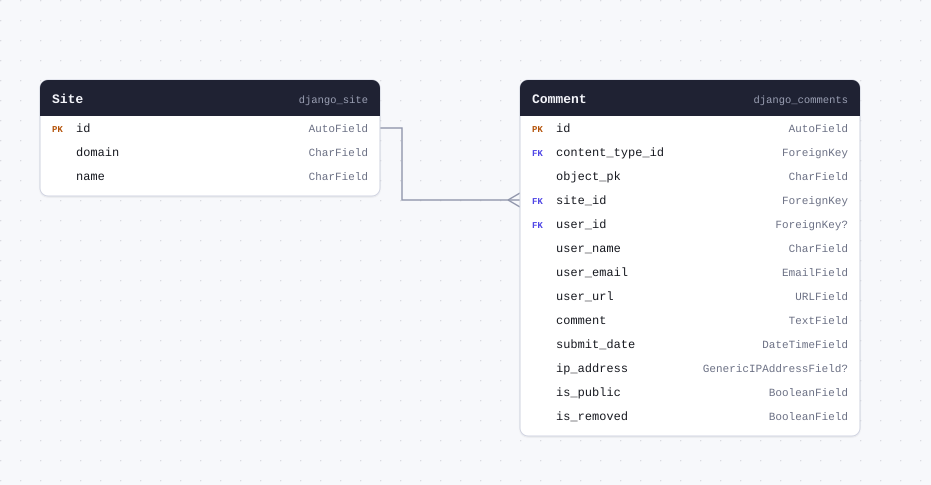

| Column | Field | Type | Null | Key | Default | Description |
| --- | --- | --- | --- | --- | --- | --- |
| `id` | `AutoField` | `integer` |  | PK | `autoincrement()` |  |
| `domain` | `CharField` | `varchar(100)` |  | unique |  |  |
| `name` | `CharField` | `varchar(50)` |  |  |  |  |

Relations:

- [Comment](#comment).`site_id` → `id`, on delete cascade

## UserObjectPermission

Table `guardian_userobjectpermission`, app `guardian`.

Columns from `UserObjectPermissionBase` (abstract): `user_id`.

Columns from `BaseObjectPermission` (abstract): `permission_id`.

Columns from `BaseGenericObjectPermission` (abstract): `content_type_id`, `object_pk`.

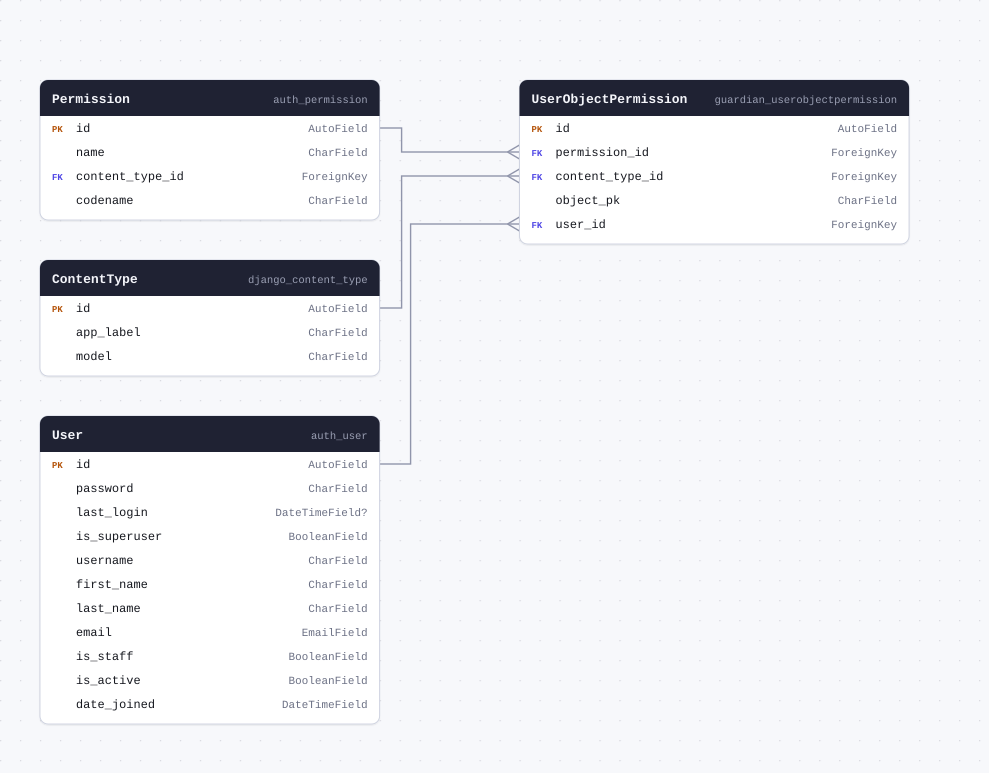

| Column | Field | Type | Null | Key | Default | Description |
| --- | --- | --- | --- | --- | --- | --- |
| `id` | `AutoField` | `integer` |  | PK | `autoincrement()` |  |
| `permission_id` | `ForeignKey` | `integer` |  | FK |  |  |
| `content_type_id` | `ForeignKey` | `integer` |  | FK |  |  |
| `object_pk` | `CharField` | `varchar(255)` |  |  |  |  |
| `user_id` | `ForeignKey` | `integer` |  | FK |  |  |

Indexes:

- index `guardian_userobjectpermission_permission_id_71807bfc` on `permission_id`
- index `guardian_userobjectpermission_content_type_id_2e892405` on `content_type_id`
- index `guardian_userobjectpermission_user_id_d5c1e964` on `user_id`
- unique `guardian_userobjectpermission_user_id_permission_id_object_pk_b0b3d2fc_uniq` on `user_id`, `permission_id`, `object_pk`
- index `guardian_us_content_179ed2_idx` on `content_type_id`, `object_pk`

Relations:

- `content_object` → any model, by `content_type_id` + `object_pk` (generic foreign key)
- `permission_id` → [Permission](#permission).`id`, on delete cascade
- `content_type_id` → [ContentType](#contenttype).`id`, on delete cascade
- `user_id` → [User](#user).`id`, on delete cascade

## GroupObjectPermission

Table `guardian_groupobjectpermission`, app `guardian`.

Columns from `GroupObjectPermissionBase` (abstract): `group_id`.

Columns from `BaseObjectPermission` (abstract): `permission_id`.

Columns from `BaseGenericObjectPermission` (abstract): `content_type_id`, `object_pk`.

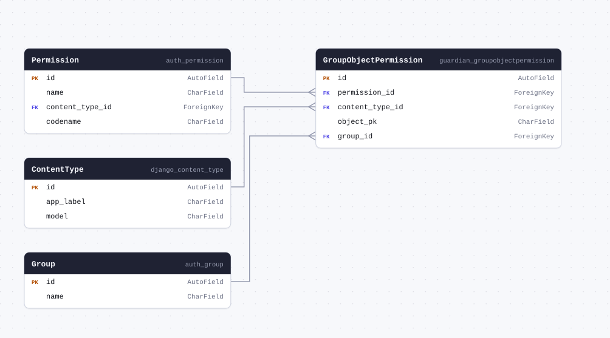

| Column | Field | Type | Null | Key | Default | Description |
| --- | --- | --- | --- | --- | --- | --- |
| `id` | `AutoField` | `integer` |  | PK | `autoincrement()` |  |
| `permission_id` | `ForeignKey` | `integer` |  | FK |  |  |
| `content_type_id` | `ForeignKey` | `integer` |  | FK |  |  |
| `object_pk` | `CharField` | `varchar(255)` |  |  |  |  |
| `group_id` | `ForeignKey` | `integer` |  | FK |  |  |

Indexes:

- index `guardian_groupobjectpermission_permission_id_36572738` on `permission_id`
- index `guardian_groupobjectpermission_content_type_id_7ade36b8` on `content_type_id`
- index `guardian_groupobjectpermission_group_id_4bbbfb62` on `group_id`
- unique `guardian_groupobjectpermission_group_id_permission_id_object_pk_3f189f7c_uniq` on `group_id`, `permission_id`, `object_pk`
- index `guardian_gr_content_ae6aec_idx` on `content_type_id`, `object_pk`

Relations:

- `content_object` → any model, by `content_type_id` + `object_pk` (generic foreign key)
- `permission_id` → [Permission](#permission).`id`, on delete cascade
- `content_type_id` → [ContentType](#contenttype).`id`, on delete cascade
- `group_id` → [Group](#group).`id`, on delete cascade

## Comment

Table `django_comments`, app `django_comments`.

Columns from `CommentAbstractModel` (abstract): `user_id`, `user_name`, `user_email`, `user_url`, `comment`, `submit_date`, `ip_address`, `is_public`, `is_removed`.

Columns from `BaseCommentAbstractModel` (abstract): `content_type_id`, `object_pk`, `site_id`.

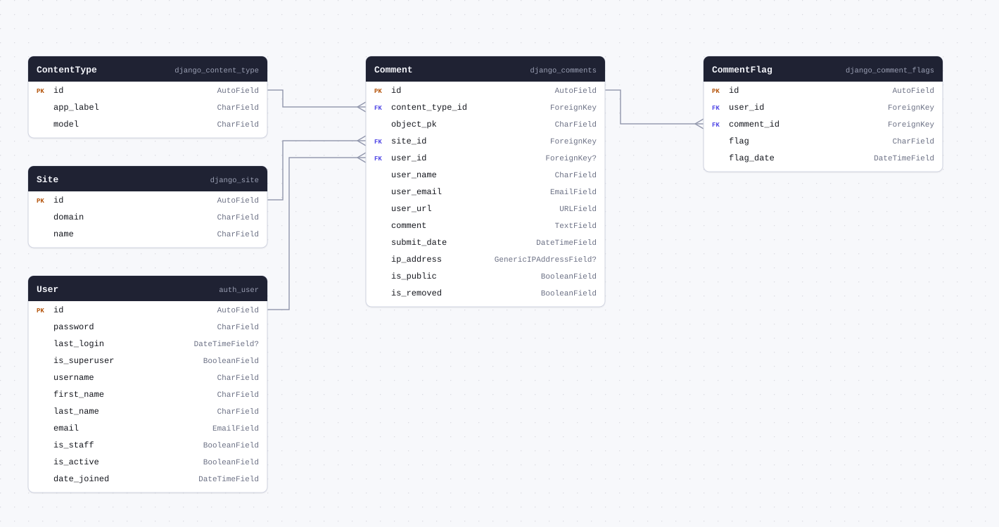

| Column | Field | Type | Null | Key | Default | Description |
| --- | --- | --- | --- | --- | --- | --- |
| `id` | `AutoField` | `integer` |  | PK | `autoincrement()` |  |
| `content_type_id` | `ForeignKey` | `integer` |  | FK |  |  |
| `object_pk` | `CharField` | `varchar(64)` |  |  |  |  |
| `site_id` | `ForeignKey` | `integer` |  | FK |  |  |
| `user_id` | `ForeignKey` | `integer` | yes | FK |  |  |
| `user_name` | `CharField` | `varchar(50)` |  |  |  |  |
| `user_email` | `EmailField` | `varchar(254)` |  |  |  |  |
| `user_url` | `URLField` | `varchar(200)` |  |  |  |  |
| `comment` | `TextField` | `text` |  |  |  |  |
| `submit_date` | `DateTimeField` | `datetime` |  |  | `None` |  |
| `ip_address` | `GenericIPAddressField` | `char(39)` | yes |  |  |  |
| `is_public` | `BooleanField` | `bool` |  |  | `True` | Uncheck this box to make the comment effectively disappear from the site. |
| `is_removed` | `BooleanField` | `bool` |  |  | `False` | Check this box if the comment is inappropriate. A "This comment has been removed" message will be displayed instead. |

Indexes:

- index `django_comments_content_type_id_c4afe962` on `content_type_id`
- index `django_comments_object_pk_7fc98e83` on `object_pk`
- index `django_comments_site_id_9dcf666e` on `site_id`
- index `django_comments_user_id_a0a440a1` on `user_id`
- index `django_comments_submit_date_514ed2d9` on `submit_date`
- index `django_comments_is_removed_52a03ae3` on `is_removed`

Relations:

- `content_object` → any model, by `content_type_id` + `object_pk` (generic foreign key)
- `content_type_id` → [ContentType](#contenttype).`id`, on delete cascade
- `site_id` → [Site](#site).`id`, on delete cascade
- `user_id` → [User](#user).`id`, on delete set null
- [CommentFlag](#commentflag).`comment_id` → `id`, on delete cascade

## CommentFlag

Table `django_comment_flags`, app `django_comments`.

Records a flag on a comment. This is intentionally flexible; right now, a
flag could be:

    * A "removal suggestion" -- where a user suggests a comment for (potential) removal.

    * A "moderator deletion" -- used when a moderator deletes a comment.

You can (ab)use this model to add other flags, if needed. However, by
design users are only allowed to flag a comment with a given flag once;
if you want rating look elsewhere.

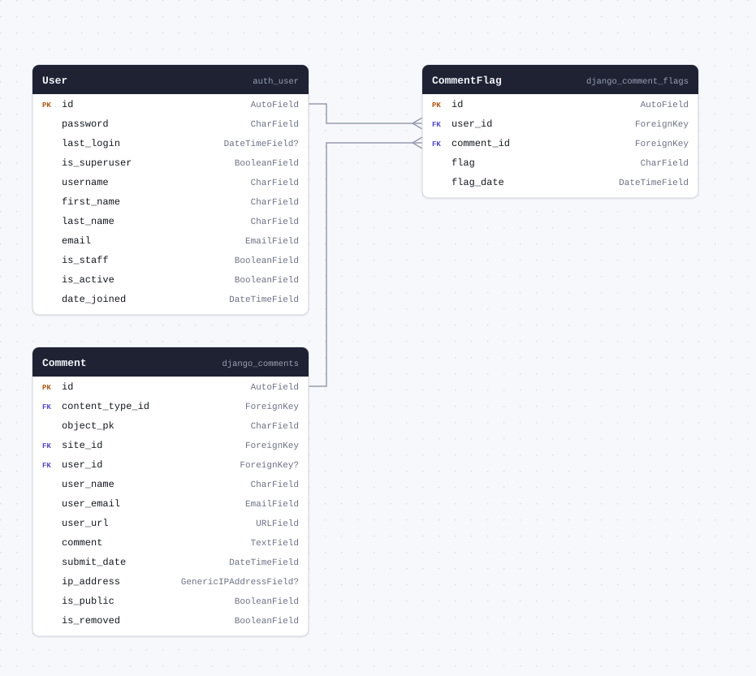

| Column | Field | Type | Null | Key | Default | Description |
| --- | --- | --- | --- | --- | --- | --- |
| `id` | `AutoField` | `integer` |  | PK | `autoincrement()` |  |
| `user_id` | `ForeignKey` | `integer` |  | FK |  |  |
| `comment_id` | `ForeignKey` | `integer` |  | FK |  |  |
| `flag` | `CharField` | `varchar(30)` |  |  |  |  |
| `flag_date` | `DateTimeField` | `datetime` |  |  | `None` |  |

Indexes:

- index `django_comment_flags_user_id_f3f81f0a` on `user_id`
- index `django_comment_flags_comment_id_d8054933` on `comment_id`
- index `django_comment_flags_flag_8b141fcb` on `flag`
- unique `django_comment_flags_user_id_comment_id_flag_537f77a7_uniq` on `user_id`, `comment_id`, `flag`

Relations:

- `user_id` → [User](#user).`id`, on delete cascade
- `comment_id` → [Comment](#comment).`id`, on delete cascade

## Attachment

Table `attachments_attachment`, app `attachments`.

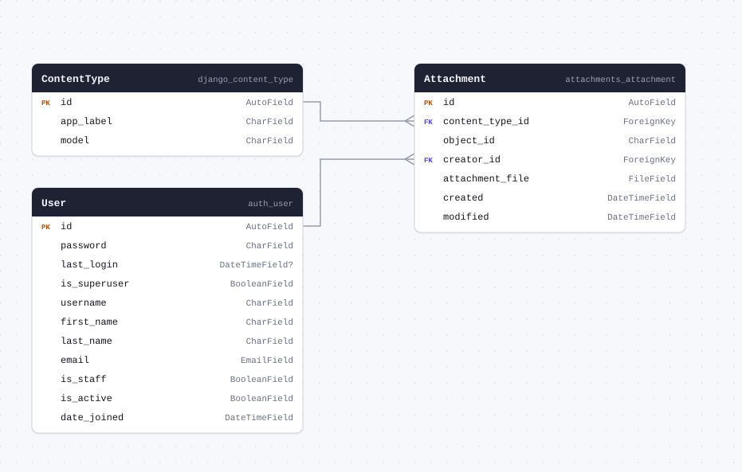

| Column | Field | Type | Null | Key | Default | Description |
| --- | --- | --- | --- | --- | --- | --- |
| `id` | `AutoField` | `integer` |  | PK | `autoincrement()` |  |
| `content_type_id` | `ForeignKey` | `integer` |  | FK |  |  |
| `object_id` | `CharField` | `varchar(64)` |  |  |  |  |
| `creator_id` | `ForeignKey` | `integer` |  | FK |  |  |
| `attachment_file` | `FileField` | `varchar(100)` |  |  |  |  |
| `created` | `DateTimeField` | `datetime` |  |  | `now()` |  |
| `modified` | `DateTimeField` | `datetime` |  |  | `now()` |  |

Indexes:

- index `attachments_attachment_content_type_id_35dd9d5d` on `content_type_id`
- index `attachments_attachment_object_id_102ce831` on `object_id`
- index `attachments_attachment_creator_id_d471ef83` on `creator_id`
- index `attachments_attachment_created_96fbcd43` on `created`
- index `attachments_attachment_modified_1d39a3d7` on `modified`

Relations:

- `content_object` → any model, by `content_type_id` + `object_id` (generic foreign key)
- `content_type_id` → [ContentType](#contenttype).`id`, on delete cascade
- `creator_id` → [User](#user).`id`, on delete cascade

## LinkReference

Table `linkreference_linkreference`, app `linkreference`.

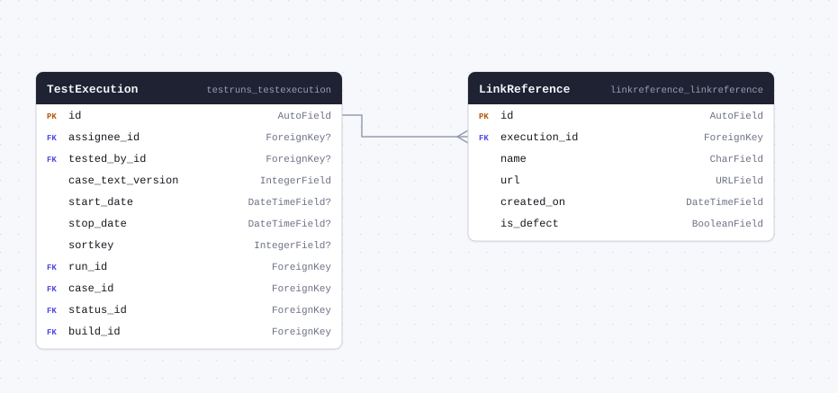

| Column | Field | Type | Null | Key | Default | Description |
| --- | --- | --- | --- | --- | --- | --- |
| `id` | `AutoField` | `integer` |  | PK | `autoincrement()` |  |
| `execution_id` | `ForeignKey` | `integer` |  | FK |  |  |
| `name` | `CharField` | `varchar(64)` |  |  | `''` |  |
| `url` | `URLField` | `varchar(200)` |  |  |  |  |
| `created_on` | `DateTimeField` | `datetime` |  |  | `now()` |  |
| `is_defect` | `BooleanField` | `bool` |  |  | `False` |  |

Indexes:

- index `linkreference_linkreference_execution_id_0f007e30` on `execution_id`
- index `linkreference_linkreference_url_a67ef7ca` on `url`
- index `linkreference_linkreference_created_on_9a8e5281` on `created_on`
- index `linkreference_linkreference_is_defect_1afb0f5c` on `is_defect`

Relations:

- `execution_id` → [TestExecution](#testexecution).`id`, on delete cascade

## Classification

Table `management_classification`, app `management`.

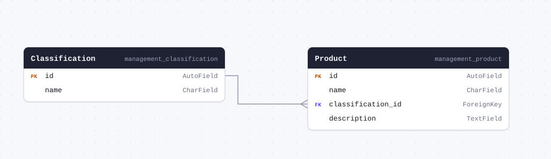

| Column | Field | Type | Null | Key | Default | Description |
| --- | --- | --- | --- | --- | --- | --- |
| `id` | `AutoField` | `integer` |  | PK | `autoincrement()` |  |
| `name` | `CharField` | `varchar(64)` |  | unique |  |  |

Relations:

- [Product](#product).`classification_id` → `id`, on delete cascade

## Product

Table `management_product`, app `management`.

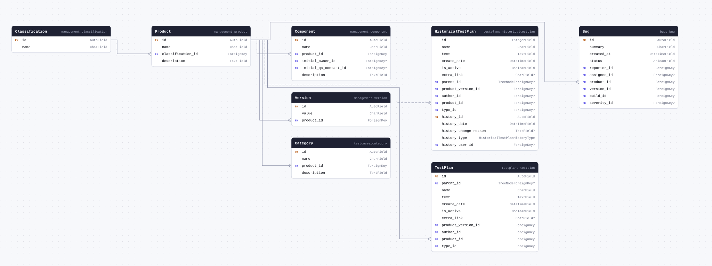

| Column | Field | Type | Null | Key | Default | Description |
| --- | --- | --- | --- | --- | --- | --- |
| `id` | `AutoField` | `integer` |  | PK | `autoincrement()` |  |
| `name` | `CharField` | `varchar(255)` |  | unique |  |  |
| `classification_id` | `ForeignKey` | `integer` |  | FK |  |  |
| `description` | `TextField` | `text` |  |  |  |  |

Indexes:

- index `management_product_classification_id_e4e18e09` on `classification_id`

Relations:

- `classification_id` → [Classification](#classification).`id`, on delete cascade
- [Component](#component).`product_id` → `id`, on delete cascade
- [Version](#version).`product_id` → `id`, on delete cascade
- [Category](#category).`product_id` → `id`, on delete cascade
- [HistoricalTestPlan](#historicaltestplan).`product_id` → `id`, on delete do nothing, no database constraint
- [TestPlan](#testplan).`product_id` → `id`, on delete cascade
- [Bug](#bug).`product_id` → `id`, on delete cascade

## Priority

Table `management_priority`, app `management`.

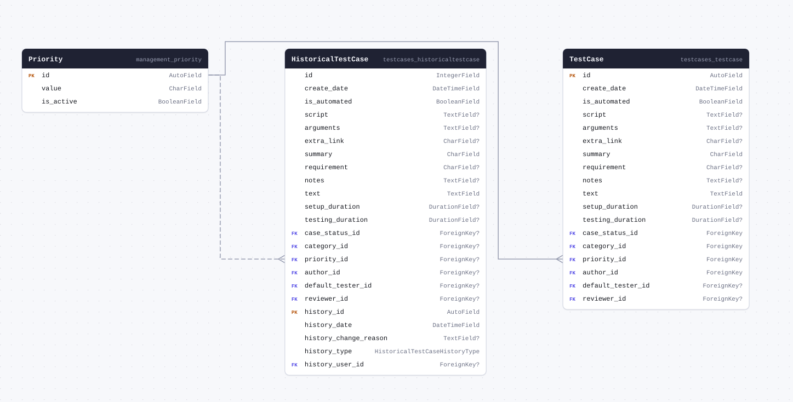

| Column | Field | Type | Null | Key | Default | Description |
| --- | --- | --- | --- | --- | --- | --- |
| `id` | `AutoField` | `integer` |  | PK | `autoincrement()` |  |
| `value` | `CharField` | `varchar(64)` |  | unique |  |  |
| `is_active` | `BooleanField` | `bool` |  |  | `True` |  |

Relations:

- [HistoricalTestCase](#historicaltestcase).`priority_id` → `id`, on delete do nothing, no database constraint
- [TestCase](#testcase).`priority_id` → `id`, on delete cascade

## Component

Table `management_component`, app `management`.

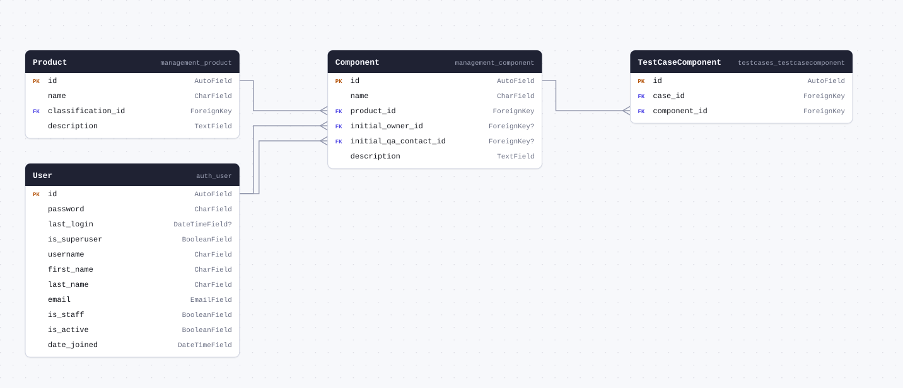

| Column | Field | Type | Null | Key | Default | Description |
| --- | --- | --- | --- | --- | --- | --- |
| `id` | `AutoField` | `integer` |  | PK | `autoincrement()` |  |
| `name` | `CharField` | `varchar(64)` |  |  |  |  |
| `product_id` | `ForeignKey` | `integer` |  | FK |  |  |
| `initial_owner_id` | `ForeignKey` | `integer` | yes | FK |  |  |
| `initial_qa_contact_id` | `ForeignKey` | `integer` | yes | FK |  |  |
| `description` | `TextField` | `text` |  |  |  |  |

Indexes:

- index `management_component_product_id_82d6de7e` on `product_id`
- index `management_component_initial_owner_id_983a4de8` on `initial_owner_id`
- index `management_component_initial_qa_contact_id_00659846` on `initial_qa_contact_id`
- unique `management_component_product_id_name_2bff48aa_uniq` on `product_id`, `name`

Relations:

- `cases` — many to many with [TestCase](#testcase), through [TestCaseComponent](#testcasecomponent)
- `product_id` → [Product](#product).`id`, on delete cascade
- `initial_owner_id` → [User](#user).`id`, on delete cascade
- `initial_qa_contact_id` → [User](#user).`id`, on delete cascade
- [TestCaseComponent](#testcasecomponent).`component_id` → `id`, on delete cascade

## Version

Table `management_version`, app `management`.

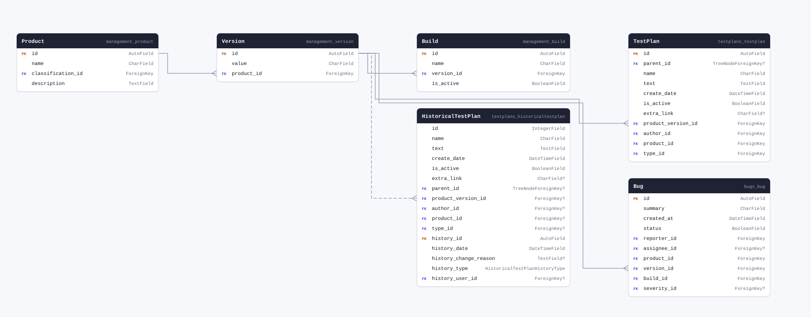

| Column | Field | Type | Null | Key | Default | Description |
| --- | --- | --- | --- | --- | --- | --- |
| `id` | `AutoField` | `integer` |  | PK | `autoincrement()` |  |
| `value` | `CharField` | `varchar(192)` |  |  |  |  |
| `product_id` | `ForeignKey` | `integer` |  | FK |  |  |

Indexes:

- index `management_version_product_id_f1cf2daf` on `product_id`
- unique `management_version_product_id_value_97d2c1b8_uniq` on `product_id`, `value`

Relations:

- `product_id` → [Product](#product).`id`, on delete cascade
- [Build](#build).`version_id` → `id`, on delete cascade
- [HistoricalTestPlan](#historicaltestplan).`product_version_id` → `id`, on delete do nothing, no database constraint
- [TestPlan](#testplan).`product_version_id` → `id`, on delete cascade
- [Bug](#bug).`version_id` → `id`, on delete cascade

## Build

Table `management_build`, app `management`.

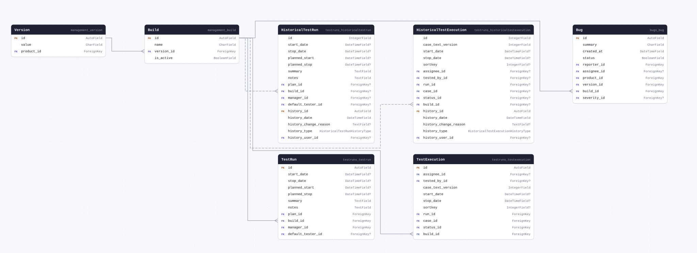

| Column | Field | Type | Null | Key | Default | Description |
| --- | --- | --- | --- | --- | --- | --- |
| `id` | `AutoField` | `integer` |  | PK | `autoincrement()` |  |
| `name` | `CharField` | `varchar(255)` |  |  |  |  |
| `version_id` | `ForeignKey` | `integer` |  | FK |  |  |
| `is_active` | `BooleanField` | `bool` |  |  | `True` |  |

Indexes:

- index `management_build_version_id_b16465e8` on `version_id`
- unique `management_build_version_id_name_0ca02373_uniq` on `version_id`, `name`

Relations:

- `version_id` → [Version](#version).`id`, on delete cascade
- [HistoricalTestRun](#historicaltestrun).`build_id` → `id`, on delete do nothing, no database constraint
- [TestRun](#testrun).`build_id` → `id`, on delete cascade
- [HistoricalTestExecution](#historicaltestexecution).`build_id` → `id`, on delete do nothing, no database constraint
- [TestExecution](#testexecution).`build_id` → `id`, on delete cascade
- [Bug](#bug).`build_id` → `id`, on delete cascade

## Tag

Table `management_tag`, app `management`.

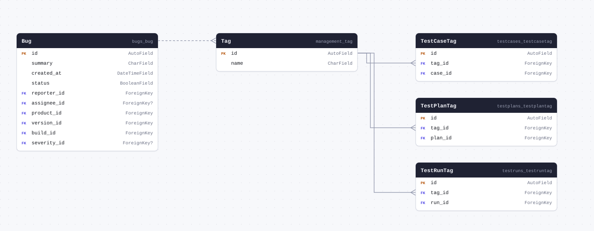

| Column | Field | Type | Null | Key | Default | Description |
| --- | --- | --- | --- | --- | --- | --- |
| `id` | `AutoField` | `integer` |  | PK | `autoincrement()` |  |
| `name` | `CharField` | `varchar(255)` |  |  |  |  |

Relations:

- `case` — many to many with [TestCase](#testcase), through [TestCaseTag](#testcasetag)
- `plan` — many to many with [TestPlan](#testplan), through [TestPlanTag](#testplantag)
- `run` — many to many with [TestRun](#testrun), through [TestRunTag](#testruntag)
- [TestCaseTag](#testcasetag).`tag_id` → `id`, on delete cascade
- [TestPlanTag](#testplantag).`tag_id` → `id`, on delete cascade
- [TestRunTag](#testruntag).`tag_id` → `id`, on delete cascade
- `bugs` — many to many with [Bug](#bug)

## TestCaseStatus

Table `testcases_testcasestatus`, app `testcases`.

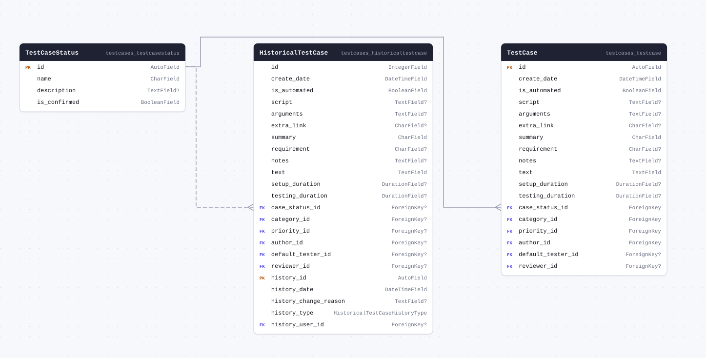

| Column | Field | Type | Null | Key | Default | Description |
| --- | --- | --- | --- | --- | --- | --- |
| `id` | `AutoField` | `integer` |  | PK | `autoincrement()` |  |
| `name` | `CharField` | `varchar(255)` |  |  |  |  |
| `description` | `TextField` | `text` | yes |  |  |  |
| `is_confirmed` | `BooleanField` | `bool` |  |  | `False` |  |

Indexes:

- index `testcases_testcasestatus_is_confirmed_ba7f915d` on `is_confirmed`

Relations:

- [HistoricalTestCase](#historicaltestcase).`case_status_id` → `id`, on delete do nothing, no database constraint
- [TestCase](#testcase).`case_status_id` → `id`, on delete cascade

## Category

Table `testcases_category`, app `testcases`.

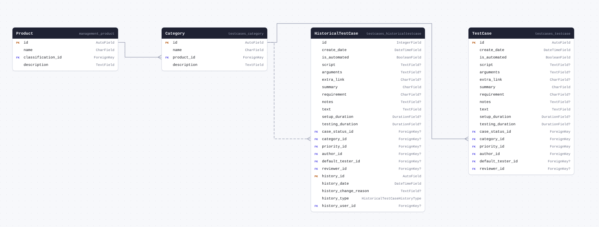

| Column | Field | Type | Null | Key | Default | Description |
| --- | --- | --- | --- | --- | --- | --- |
| `id` | `AutoField` | `integer` |  | PK | `autoincrement()` |  |
| `name` | `CharField` | `varchar(255)` |  |  |  |  |
| `product_id` | `ForeignKey` | `integer` |  | FK |  |  |
| `description` | `TextField` | `text` |  |  |  |  |

Indexes:

- index `testcases_category_product_id_f26067e7` on `product_id`
- unique `testcases_category_product_id_name_6f991fe0_uniq` on `product_id`, `name`

Relations:

- `product_id` → [Product](#product).`id`, on delete cascade
- [HistoricalTestCase](#historicaltestcase).`category_id` → `id`, on delete do nothing, no database constraint
- [TestCase](#testcase).`category_id` → `id`, on delete cascade

## HistoricalTestCase

Table `testcases_historicaltestcase`, app `testcases`.

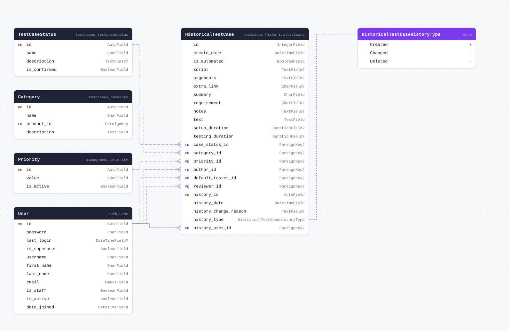

| Column | Field | Type | Null | Key | Default | Description |
| --- | --- | --- | --- | --- | --- | --- |
| `id` | `IntegerField` | `integer` |  |  |  |  |
| `create_date` | `DateTimeField` | `datetime` |  |  |  |  |
| `is_automated` | `BooleanField` | `bool` |  |  | `False` |  |
| `script` | `TextField` | `text` | yes |  |  |  |
| `arguments` | `TextField` | `text` | yes |  |  |  |
| `extra_link` | `CharField` | `varchar(1024)` | yes |  | `None` |  |
| `summary` | `CharField` | `varchar(255)` |  |  |  |  |
| `requirement` | `CharField` | `varchar(255)` | yes |  |  |  |
| `notes` | `TextField` | `text` | yes |  |  |  |
| `text` | `TextField` | `text` |  |  |  |  |
| `setup_duration` | `DurationField` | `bigint` | yes |  |  |  |
| `testing_duration` | `DurationField` | `bigint` | yes |  |  |  |
| `case_status_id` | `ForeignKey` | `integer` | yes | FK (no constraint) |  |  |
| `category_id` | `ForeignKey` | `integer` | yes | FK (no constraint) |  |  |
| `priority_id` | `ForeignKey` | `integer` | yes | FK (no constraint) |  |  |
| `author_id` | `ForeignKey` | `integer` | yes | FK (no constraint) |  |  |
| `default_tester_id` | `ForeignKey` | `integer` | yes | FK (no constraint) |  |  |
| `reviewer_id` | `ForeignKey` | `integer` | yes | FK (no constraint) |  |  |
| `history_id` | `AutoField` | `integer` |  | PK | `autoincrement()` |  |
| `history_date` | `DateTimeField` | `datetime` |  |  |  |  |
| `history_change_reason` | `TextField` | `text` | yes |  |  |  |
| `history_type` | `HistoricalTestCaseHistoryType` | `varchar(1)` |  |  |  |  |
| `history_user_id` | `ForeignKey` | `integer` | yes | FK |  |  |

Indexes:

- index `testcases_historicaltestcase_id_12c89411` on `id`
- index `testcases_historicaltestcase_summary_92d50821` on `summary`
- index `testcases_historicaltestcase_setup_duration_2342e865` on `setup_duration`
- index `testcases_historicaltestcase_testing_duration_63c88e57` on `testing_duration`
- index `testcases_historicaltestcase_case_status_id_35c6b721` on `case_status_id`
- index `testcases_historicaltestcase_category_id_05519a7a` on `category_id`
- index `testcases_historicaltestcase_priority_id_defa02c4` on `priority_id`
- index `testcases_historicaltestcase_author_id_0cb2d010` on `author_id`
- index `testcases_historicaltestcase_default_tester_id_4096f1c6` on `default_tester_id`
- index `testcases_historicaltestcase_reviewer_id_33c64d01` on `reviewer_id`
- index `testcases_historicaltestcase_history_date_fe588372` on `history_date`
- index `testcases_historicaltestcase_history_user_id_7091ce1e` on `history_user_id`

Relations:

- `case_status_id` → [TestCaseStatus](#testcasestatus).`id`, on delete do nothing, no database constraint
- `category_id` → [Category](#category).`id`, on delete do nothing, no database constraint
- `priority_id` → [Priority](#priority).`id`, on delete do nothing, no database constraint
- `author_id` → [User](#user).`id`, on delete do nothing, no database constraint
- `default_tester_id` → [User](#user).`id`, on delete do nothing, no database constraint
- `reviewer_id` → [User](#user).`id`, on delete do nothing, no database constraint
- `history_user_id` → [User](#user).`id`, on delete set null

## TestCase

Table `testcases_testcase`, app `testcases`.

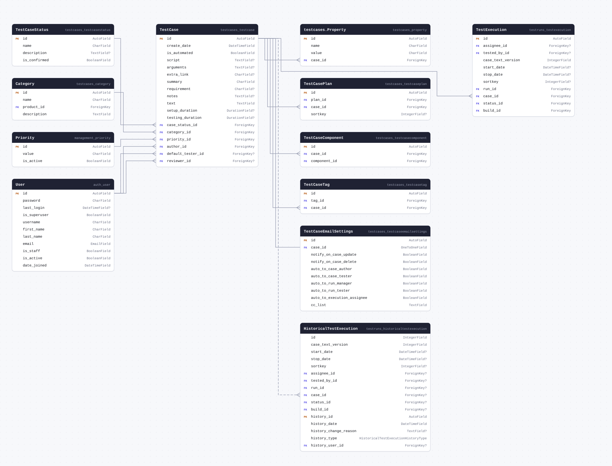

| Column | Field | Type | Null | Key | Default | Description |
| --- | --- | --- | --- | --- | --- | --- |
| `id` | `AutoField` | `integer` |  | PK | `autoincrement()` |  |
| `create_date` | `DateTimeField` | `datetime` |  |  | `now()` |  |
| `is_automated` | `BooleanField` | `bool` |  |  | `False` |  |
| `script` | `TextField` | `text` | yes |  |  |  |
| `arguments` | `TextField` | `text` | yes |  |  |  |
| `extra_link` | `CharField` | `varchar(1024)` | yes |  | `None` |  |
| `summary` | `CharField` | `varchar(255)` |  |  |  |  |
| `requirement` | `CharField` | `varchar(255)` | yes |  |  |  |
| `notes` | `TextField` | `text` | yes |  |  |  |
| `text` | `TextField` | `text` |  |  |  |  |
| `setup_duration` | `DurationField` | `bigint` | yes |  |  |  |
| `testing_duration` | `DurationField` | `bigint` | yes |  |  |  |
| `case_status_id` | `ForeignKey` | `integer` |  | FK |  |  |
| `category_id` | `ForeignKey` | `integer` |  | FK |  |  |
| `priority_id` | `ForeignKey` | `integer` |  | FK |  |  |
| `author_id` | `ForeignKey` | `integer` |  | FK |  |  |
| `default_tester_id` | `ForeignKey` | `integer` | yes | FK |  |  |
| `reviewer_id` | `ForeignKey` | `integer` | yes | FK |  |  |

Indexes:

- index `testcases_testcase_summary_511d8323` on `summary`
- index `testcases_testcase_setup_duration_56e5887d` on `setup_duration`
- index `testcases_testcase_testing_duration_3ae6ba2d` on `testing_duration`
- index `testcases_testcase_case_status_id_506e2b3f` on `case_status_id`
- index `testcases_testcase_category_id_f52a4b36` on `category_id`
- index `testcases_testcase_priority_id_06e62b85` on `priority_id`
- index `testcases_testcase_author_id_40ee8140` on `author_id`
- index `testcases_testcase_default_tester_id_d9c8faf2` on `default_tester_id`
- index `testcases_testcase_reviewer_id_4be5756e` on `reviewer_id`

Relations:

- `plan` — many to many with [TestPlan](#testplan), through [TestCasePlan](#testcaseplan)
- `component` — many to many with [Component](#component), through [TestCaseComponent](#testcasecomponent)
- `tag` — many to many with [Tag](#tag), through [TestCaseTag](#testcasetag)
- `case_status_id` → [TestCaseStatus](#testcasestatus).`id`, on delete cascade
- `category_id` → [Category](#category).`id`, on delete cascade
- `priority_id` → [Priority](#priority).`id`, on delete cascade
- `author_id` → [User](#user).`id`, on delete cascade
- `default_tester_id` → [User](#user).`id`, on delete cascade
- `reviewer_id` → [User](#user).`id`, on delete cascade
- [testcases.Property](#testcasesproperty).`case_id` → `id`, on delete cascade
- [TestCasePlan](#testcaseplan).`case_id` → `id`, on delete cascade
- [TestCaseComponent](#testcasecomponent).`case_id` → `id`, on delete cascade
- [TestCaseTag](#testcasetag).`case_id` → `id`, on delete cascade
- [TestCaseEmailSettings](#testcaseemailsettings).`case_id` → `id`, on delete cascade
- [HistoricalTestExecution](#historicaltestexecution).`case_id` → `id`, on delete do nothing, no database constraint
- [TestExecution](#testexecution).`case_id` → `id`, on delete cascade

## testcases.Property

Table `testcases_property`, app `testcases`.

Columns from `Property` (abstract): `name`, `value`.

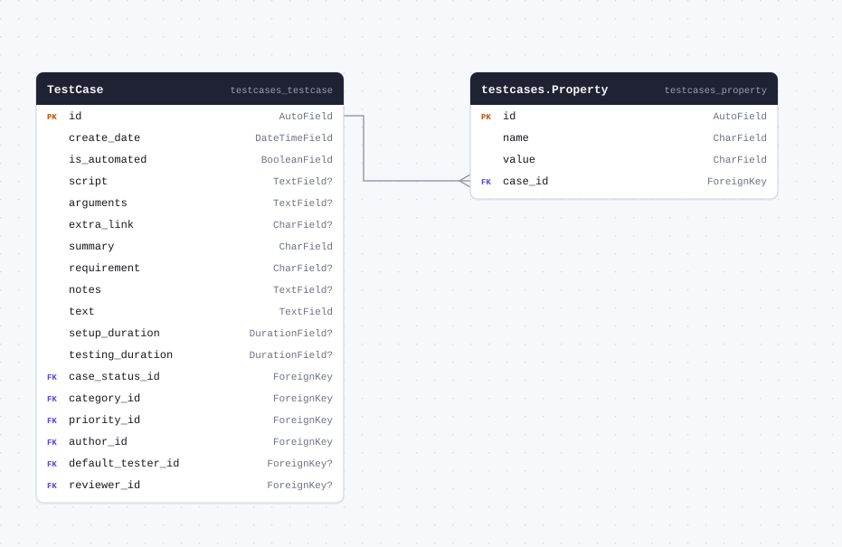

| Column | Field | Type | Null | Key | Default | Description |
| --- | --- | --- | --- | --- | --- | --- |
| `id` | `AutoField` | `integer` |  | PK | `autoincrement()` |  |
| `name` | `CharField` | `varchar(255)` |  |  |  |  |
| `value` | `CharField` | `varchar(255)` |  |  |  |  |
| `case_id` | `ForeignKey` | `integer` |  | FK |  |  |

Indexes:

- index `testcases_property_case_id_ce458207` on `case_id`

Relations:

- `case_id` → [TestCase](#testcase).`id`, on delete cascade

## TestCasePlan

Table `testcases_testcaseplan`, app `testcases`.

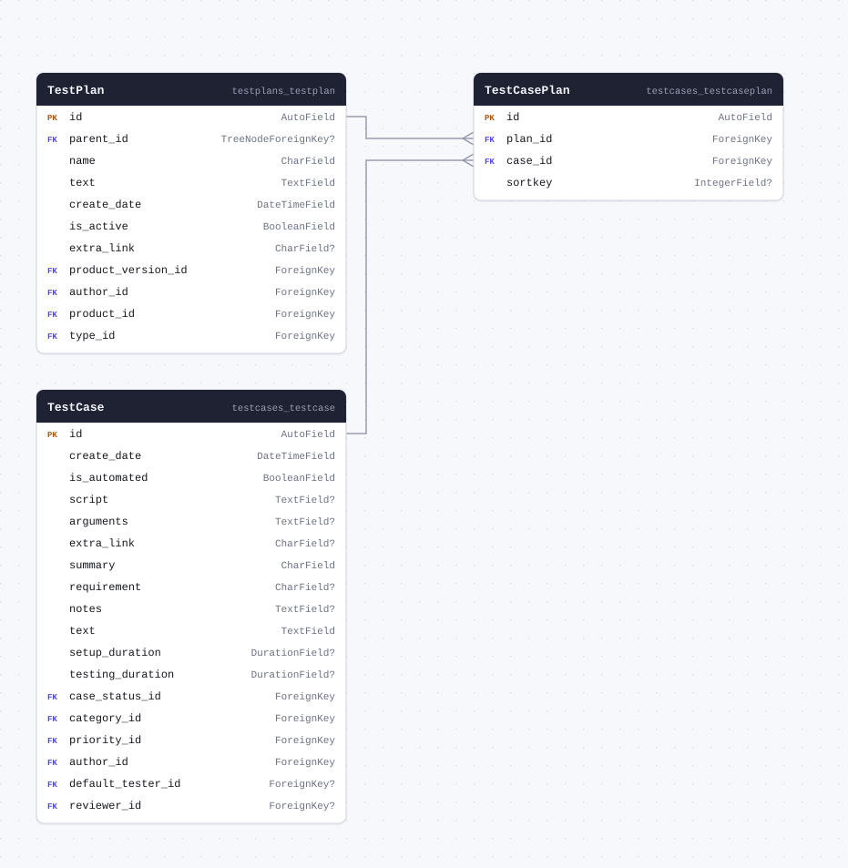

| Column | Field | Type | Null | Key | Default | Description |
| --- | --- | --- | --- | --- | --- | --- |
| `id` | `AutoField` | `integer` |  | PK | `autoincrement()` |  |
| `plan_id` | `ForeignKey` | `integer` |  | FK |  |  |
| `case_id` | `ForeignKey` | `integer` |  | FK |  |  |
| `sortkey` | `IntegerField` | `integer` | yes |  |  |  |

Indexes:

- index `testcases_testcaseplan_plan_id_40b3d762` on `plan_id`
- index `testcases_testcaseplan_case_id_89f638fc` on `case_id`
- unique `testcases_testcaseplan_plan_id_case_id_16d50827_uniq` on `plan_id`, `case_id`

Relations:

- `plan_id` → [TestPlan](#testplan).`id`, on delete cascade
- `case_id` → [TestCase](#testcase).`id`, on delete cascade

## TestCaseComponent

Table `testcases_testcasecomponent`, app `testcases`.

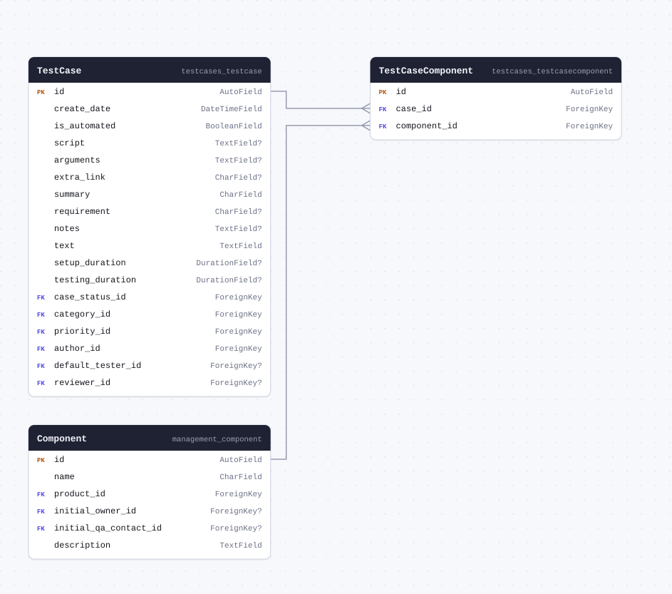

| Column | Field | Type | Null | Key | Default | Description |
| --- | --- | --- | --- | --- | --- | --- |
| `id` | `AutoField` | `integer` |  | PK | `autoincrement()` |  |
| `case_id` | `ForeignKey` | `integer` |  | FK |  |  |
| `component_id` | `ForeignKey` | `integer` |  | FK |  |  |

Indexes:

- index `testcases_testcasecomponent_case_id_fc27e38a` on `case_id`
- index `testcases_testcasecomponent_component_id_edd78178` on `component_id`

Relations:

- `case_id` → [TestCase](#testcase).`id`, on delete cascade
- `component_id` → [Component](#component).`id`, on delete cascade

## TestCaseTag

Table `testcases_testcasetag`, app `testcases`.

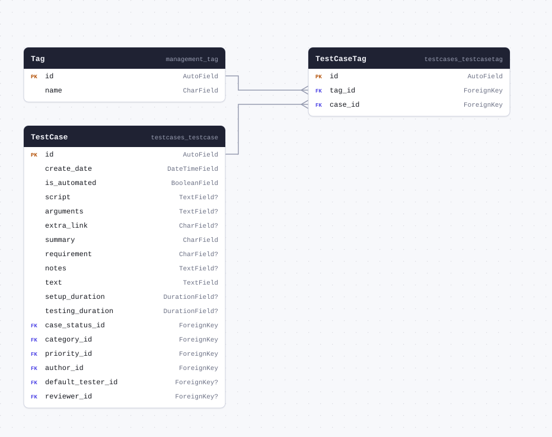

| Column | Field | Type | Null | Key | Default | Description |
| --- | --- | --- | --- | --- | --- | --- |
| `id` | `AutoField` | `integer` |  | PK | `autoincrement()` |  |
| `tag_id` | `ForeignKey` | `integer` |  | FK |  |  |
| `case_id` | `ForeignKey` | `integer` |  | FK |  |  |

Indexes:

- index `testcases_testcasetag_tag_id_b16f414a` on `tag_id`
- index `testcases_testcasetag_case_id_338ecd07` on `case_id`

Relations:

- `tag_id` → [Tag](#tag).`id`, on delete cascade
- `case_id` → [TestCase](#testcase).`id`, on delete cascade

## BugSystem

Table `testcases_bugsystem`, app `testcases`.

This model describes a bug tracking system used in
Kiwi TCMS. Fields below can be configured via
the admin interface and their meaning is:

#. **name:** a visual name for this bug tracker, e.g. `Kiwi TCMS GitHub`;
#. **tracker_type:** a select menu to specify what kind of external
   system we interface with, e.g. Bugzilla, JIRA, others;
   The available options for this field are automatically populated
   by Kiwi TCMS;

   .. warning::

        Once this field is set it can't be reset to ``NULL``. Although
        Kiwi TCMS takes care to handle misconfigurations we advise you to
        configure your API credentials properly!

#. **base_url:** base URL of this bug tracker.

   .. warning::

        If this field is left empty funtionality that depends on it will be disabled!

#. **api_url, api_username, api_password:** configuration for an internal RPC object
   that communicate to the issue tracking system when necessary. Depending on the
   actual type of IT we're interfacing with some of these values may not be necessary.
   Refer to :mod:`tcms.issuetracker.types` for more information!

   .. warning::

        This is saved as plain-text in the database because it needs to be passed
        to the internal RPC object!

| Column | Field | Type | Null | Key | Default | Description |
| --- | --- | --- | --- | --- | --- | --- |
| `id` | `AutoField` | `integer` |  | PK | `autoincrement()` |  |
| `name` | `CharField` | `varchar(255)` |  | unique |  |  |
| `tracker_type` | `CharField` | `varchar(128)` |  |  | `'IssueTrackerType'` | This determines how Kiwi TCMS integrates with the IT system |
| `base_url` | `CharField` | `varchar(1024)` | yes |  |  | Base URL, for example <strong>https://bugzilla.example.com</strong>! Leave empty to disable! |
| `api_url` | `CharField` | `varchar(1024)` | yes |  |  | This is the URL to which API requests will be sent. Leave empty to disable! |
| `api_username` | `CharField` | `varchar(256)` | yes |  |  |  |
| `api_password` | `CharField` | `varchar(256)` | yes |  |  |  |

## TestCaseEmailSettings

Table `testcases_testcaseemailsettings`, app `testcases`.

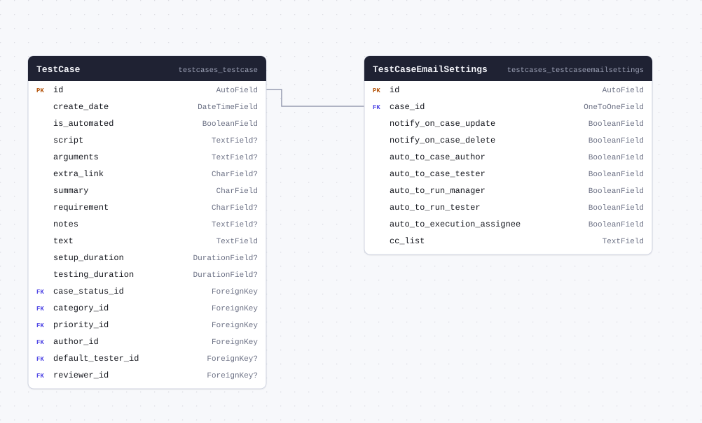

| Column | Field | Type | Null | Key | Default | Description |
| --- | --- | --- | --- | --- | --- | --- |
| `id` | `AutoField` | `integer` |  | PK | `autoincrement()` |  |
| `case_id` | `OneToOneField` | `integer` |  | FK, unique |  |  |
| `notify_on_case_update` | `BooleanField` | `bool` |  |  | `True` |  |
| `notify_on_case_delete` | `BooleanField` | `bool` |  |  | `True` |  |
| `auto_to_case_author` | `BooleanField` | `bool` |  |  | `True` |  |
| `auto_to_case_tester` | `BooleanField` | `bool` |  |  | `True` |  |
| `auto_to_run_manager` | `BooleanField` | `bool` |  |  | `True` |  |
| `auto_to_run_tester` | `BooleanField` | `bool` |  |  | `True` |  |
| `auto_to_execution_assignee` | `BooleanField` | `bool` |  |  | `True` |  |
| `cc_list` | `TextField` | `text` |  |  | `''` |  |

Relations:

- `case_id` → [TestCase](#testcase).`id`, on delete cascade

## HistoricalTemplate

Table `testcases_historicaltemplate`, app `testcases`.

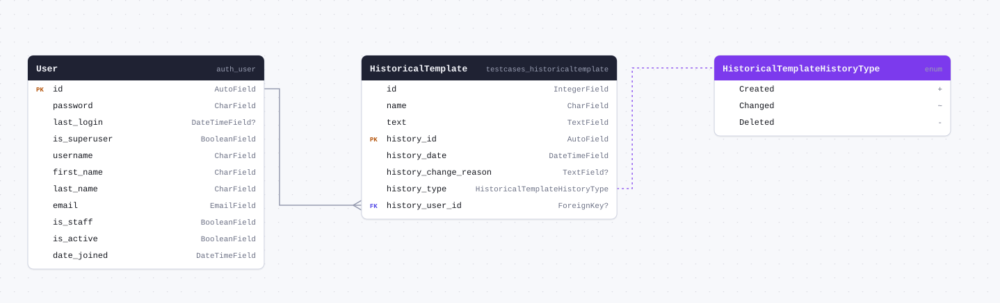

| Column | Field | Type | Null | Key | Default | Description |
| --- | --- | --- | --- | --- | --- | --- |
| `id` | `IntegerField` | `integer` |  |  |  |  |
| `name` | `CharField` | `varchar(255)` |  |  |  |  |
| `text` | `TextField` | `text` |  |  |  |  |
| `history_id` | `AutoField` | `integer` |  | PK | `autoincrement()` |  |
| `history_date` | `DateTimeField` | `datetime` |  |  |  |  |
| `history_change_reason` | `TextField` | `text` | yes |  |  |  |
| `history_type` | `HistoricalTemplateHistoryType` | `varchar(1)` |  |  |  |  |
| `history_user_id` | `ForeignKey` | `integer` | yes | FK |  |  |

Indexes:

- index `testcases_historicaltemplate_id_75442f7f` on `id`
- index `testcases_historicaltemplate_history_date_b1bbfd15` on `history_date`
- index `testcases_historicaltemplate_history_user_id_0234739e` on `history_user_id`

Relations:

- `history_user_id` → [User](#user).`id`, on delete set null

## Template

Table `testcases_template`, app `testcases`.

| Column | Field | Type | Null | Key | Default | Description |
| --- | --- | --- | --- | --- | --- | --- |
| `id` | `AutoField` | `integer` |  | PK | `autoincrement()` |  |
| `name` | `CharField` | `varchar(255)` |  |  |  |  |
| `text` | `TextField` | `text` |  |  |  |  |

## PlanType

Table `testplans_plantype`, app `testplans`.

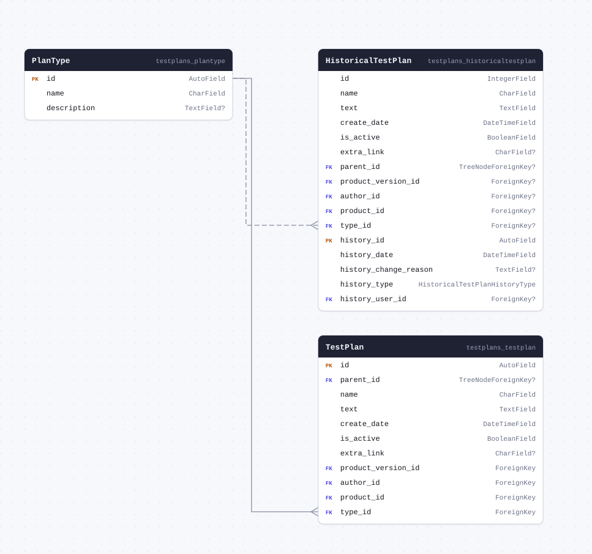

| Column | Field | Type | Null | Key | Default | Description |
| --- | --- | --- | --- | --- | --- | --- |
| `id` | `AutoField` | `integer` |  | PK | `autoincrement()` |  |
| `name` | `CharField` | `varchar(64)` |  | unique |  |  |
| `description` | `TextField` | `text` | yes |  |  |  |

Relations:

- [HistoricalTestPlan](#historicaltestplan).`type_id` → `id`, on delete do nothing, no database constraint
- [TestPlan](#testplan).`type_id` → `id`, on delete cascade

## HistoricalTestPlan

Table `testplans_historicaltestplan`, app `testplans`.

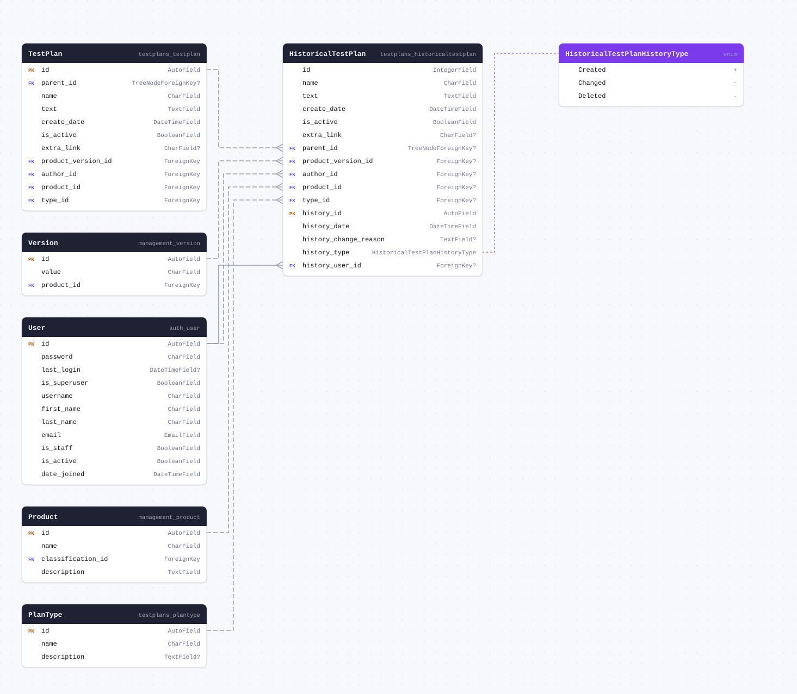

| Column | Field | Type | Null | Key | Default | Description |
| --- | --- | --- | --- | --- | --- | --- |
| `id` | `IntegerField` | `integer` |  |  |  |  |
| `name` | `CharField` | `varchar(255)` |  |  |  |  |
| `text` | `TextField` | `text` |  |  |  |  |
| `create_date` | `DateTimeField` | `datetime` |  |  |  |  |
| `is_active` | `BooleanField` | `bool` |  |  | `True` |  |
| `extra_link` | `CharField` | `varchar(1024)` | yes |  | `None` |  |
| `parent_id` | `TreeNodeForeignKey` | `integer` | yes | FK (no constraint) |  |  |
| `product_version_id` | `ForeignKey` | `integer` | yes | FK (no constraint) |  |  |
| `author_id` | `ForeignKey` | `integer` | yes | FK (no constraint) |  |  |
| `product_id` | `ForeignKey` | `integer` | yes | FK (no constraint) |  |  |
| `type_id` | `ForeignKey` | `integer` | yes | FK (no constraint) |  |  |
| `history_id` | `AutoField` | `integer` |  | PK | `autoincrement()` |  |
| `history_date` | `DateTimeField` | `datetime` |  |  |  |  |
| `history_change_reason` | `TextField` | `text` | yes |  |  |  |
| `history_type` | `HistoricalTestPlanHistoryType` | `varchar(1)` |  |  |  |  |
| `history_user_id` | `ForeignKey` | `integer` | yes | FK |  |  |

Indexes:

- index `testplans_historicaltestplan_id_1f0d0717` on `id`
- index `testplans_historicaltestplan_name_d1afc49f` on `name`
- index `testplans_historicaltestplan_is_active_aa220a2c` on `is_active`
- index `testplans_historicaltestplan_parent_id_4d7e6ee8` on `parent_id`
- index `testplans_historicaltestplan_product_version_id_4598a8b7` on `product_version_id`
- index `testplans_historicaltestplan_author_id_7de6569d` on `author_id`
- index `testplans_historicaltestplan_product_id_2410d78b` on `product_id`
- index `testplans_historicaltestplan_type_id_65c12bbd` on `type_id`
- index `testplans_historicaltestplan_history_date_3078d054` on `history_date`
- index `testplans_historicaltestplan_history_user_id_0b43ff14` on `history_user_id`

Relations:

- `parent_id` → [TestPlan](#testplan).`id`, on delete do nothing, no database constraint
- `product_version_id` → [Version](#version).`id`, on delete do nothing, no database constraint
- `author_id` → [User](#user).`id`, on delete do nothing, no database constraint
- `product_id` → [Product](#product).`id`, on delete do nothing, no database constraint
- `type_id` → [PlanType](#plantype).`id`, on delete do nothing, no database constraint
- `history_user_id` → [User](#user).`id`, on delete set null

## TestPlan

Table `testplans_testplan`, app `testplans`.

Columns from `TreeNode` (abstract): `parent_id`.

A plan within the TCMS

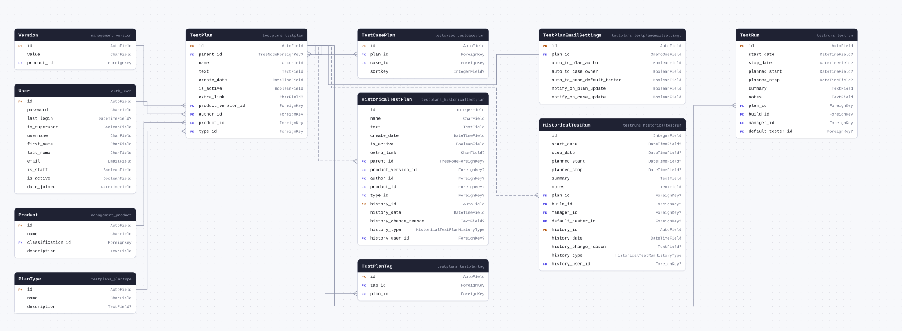

| Column | Field | Type | Null | Key | Default | Description |
| --- | --- | --- | --- | --- | --- | --- |
| `id` | `AutoField` | `integer` |  | PK | `autoincrement()` |  |
| `parent_id` | `TreeNodeForeignKey` | `integer` | yes | FK |  |  |
| `name` | `CharField` | `varchar(255)` |  |  |  |  |
| `text` | `TextField` | `text` |  |  |  |  |
| `create_date` | `DateTimeField` | `datetime` |  |  | `now()` |  |
| `is_active` | `BooleanField` | `bool` |  |  | `True` |  |
| `extra_link` | `CharField` | `varchar(1024)` | yes |  | `None` |  |
| `product_version_id` | `ForeignKey` | `integer` |  | FK |  |  |
| `author_id` | `ForeignKey` | `integer` |  | FK |  |  |
| `product_id` | `ForeignKey` | `integer` |  | FK |  |  |
| `type_id` | `ForeignKey` | `integer` |  | FK |  |  |

Indexes:

- index `testplans_testplan_parent_id_c3460a73` on `parent_id`
- index `testplans_testplan_name_0bcb1318` on `name`
- index `testplans_testplan_is_active_66e60279` on `is_active`
- index `testplans_testplan_product_version_id_0ad731f7` on `product_version_id`
- index `testplans_testplan_author_id_8fc1910b` on `author_id`
- index `testplans_testplan_product_id_6e99180c` on `product_id`
- index `testplans_testplan_type_id_b83ae87b` on `type_id`

Relations:

- `tag` — many to many with [Tag](#tag), through [TestPlanTag](#testplantag)
- `cases` — many to many with [TestCase](#testcase), through [TestCasePlan](#testcaseplan)
- [TestCasePlan](#testcaseplan).`plan_id` → `id`, on delete cascade
- [HistoricalTestPlan](#historicaltestplan).`parent_id` → `id`, on delete do nothing, no database constraint
- `parent_id` → [TestPlan](#testplan).`id`, on delete cascade
- `product_version_id` → [Version](#version).`id`, on delete cascade
- `author_id` → [User](#user).`id`, on delete cascade
- `product_id` → [Product](#product).`id`, on delete cascade
- `type_id` → [PlanType](#plantype).`id`, on delete cascade
- [TestPlanTag](#testplantag).`plan_id` → `id`, on delete cascade
- [TestPlanEmailSettings](#testplanemailsettings).`plan_id` → `id`, on delete cascade
- [HistoricalTestRun](#historicaltestrun).`plan_id` → `id`, on delete do nothing, no database constraint
- [TestRun](#testrun).`plan_id` → `id`, on delete cascade

## TestPlanTag

Table `testplans_testplantag`, app `testplans`.

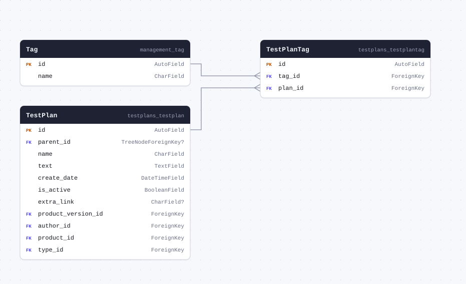

| Column | Field | Type | Null | Key | Default | Description |
| --- | --- | --- | --- | --- | --- | --- |
| `id` | `AutoField` | `integer` |  | PK | `autoincrement()` |  |
| `tag_id` | `ForeignKey` | `integer` |  | FK |  |  |
| `plan_id` | `ForeignKey` | `integer` |  | FK |  |  |

Indexes:

- index `testplans_testplantag_tag_id_4a5c61b6` on `tag_id`
- index `testplans_testplantag_plan_id_f5c9e46a` on `plan_id`

Relations:

- `tag_id` → [Tag](#tag).`id`, on delete cascade
- `plan_id` → [TestPlan](#testplan).`id`, on delete cascade

## TestPlanEmailSettings

Table `testplans_testplanemailsettings`, app `testplans`.

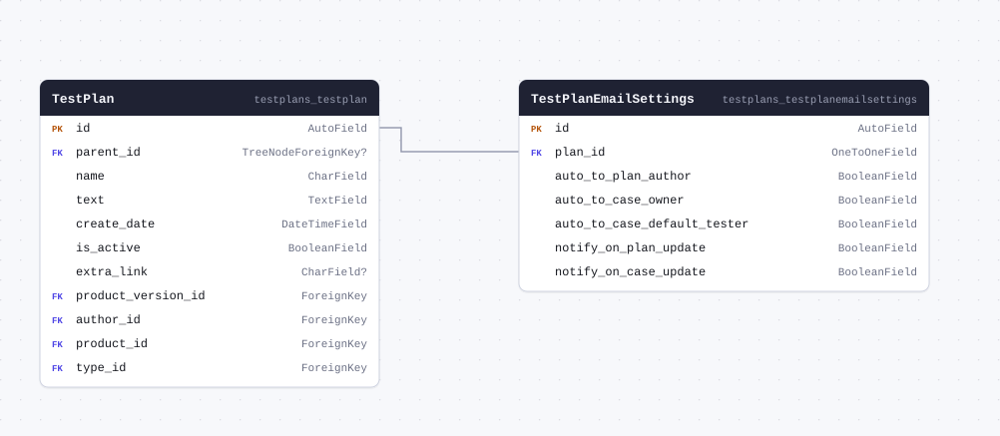

| Column | Field | Type | Null | Key | Default | Description |
| --- | --- | --- | --- | --- | --- | --- |
| `id` | `AutoField` | `integer` |  | PK | `autoincrement()` |  |
| `plan_id` | `OneToOneField` | `integer` |  | FK, unique |  |  |
| `auto_to_plan_author` | `BooleanField` | `bool` |  |  | `True` |  |
| `auto_to_case_owner` | `BooleanField` | `bool` |  |  | `True` |  |
| `auto_to_case_default_tester` | `BooleanField` | `bool` |  |  | `True` |  |
| `notify_on_plan_update` | `BooleanField` | `bool` |  |  | `True` |  |
| `notify_on_case_update` | `BooleanField` | `bool` |  |  | `True` |  |

Relations:

- `plan_id` → [TestPlan](#testplan).`id`, on delete cascade

## HistoricalTestRun

Table `testruns_historicaltestrun`, app `testruns`.

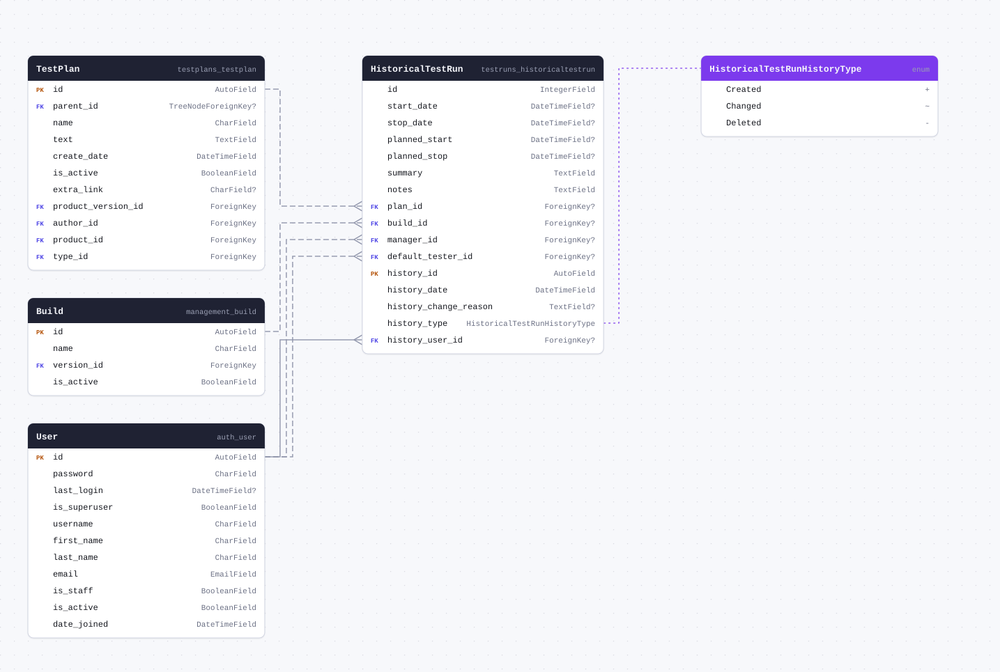

| Column | Field | Type | Null | Key | Default | Description |
| --- | --- | --- | --- | --- | --- | --- |
| `id` | `IntegerField` | `integer` |  |  |  |  |
| `start_date` | `DateTimeField` | `datetime` | yes |  |  |  |
| `stop_date` | `DateTimeField` | `datetime` | yes |  |  |  |
| `planned_start` | `DateTimeField` | `datetime` | yes |  |  |  |
| `planned_stop` | `DateTimeField` | `datetime` | yes |  |  |  |
| `summary` | `TextField` | `text` |  |  |  |  |
| `notes` | `TextField` | `text` |  |  |  |  |
| `plan_id` | `ForeignKey` | `integer` | yes | FK (no constraint) |  |  |
| `build_id` | `ForeignKey` | `integer` | yes | FK (no constraint) |  |  |
| `manager_id` | `ForeignKey` | `integer` | yes | FK (no constraint) |  |  |
| `default_tester_id` | `ForeignKey` | `integer` | yes | FK (no constraint) |  |  |
| `history_id` | `AutoField` | `integer` |  | PK | `autoincrement()` |  |
| `history_date` | `DateTimeField` | `datetime` |  |  |  |  |
| `history_change_reason` | `TextField` | `text` | yes |  |  |  |
| `history_type` | `HistoricalTestRunHistoryType` | `varchar(1)` |  |  |  |  |
| `history_user_id` | `ForeignKey` | `integer` | yes | FK |  |  |

Indexes:

- index `testruns_historicaltestrun_id_5b716816` on `id`
- index `testruns_historicaltestrun_start_date_2966e83c` on `start_date`
- index `testruns_historicaltestrun_stop_date_df8f576c` on `stop_date`
- index `testruns_historicaltestrun_planned_start_614a868d` on `planned_start`
- index `testruns_historicaltestrun_planned_stop_f3a63beb` on `planned_stop`
- index `testruns_historicaltestrun_plan_id_adfcb9d1` on `plan_id`
- index `testruns_historicaltestrun_build_id_83cb88d1` on `build_id`
- index `testruns_historicaltestrun_manager_id_48e016d3` on `manager_id`
- index `testruns_historicaltestrun_default_tester_id_bfc251b2` on `default_tester_id`
- index `testruns_historicaltestrun_history_date_c382be04` on `history_date`
- index `testruns_historicaltestrun_history_user_id_8021d038` on `history_user_id`

Relations:

- `plan_id` → [TestPlan](#testplan).`id`, on delete do nothing, no database constraint
- `build_id` → [Build](#build).`id`, on delete do nothing, no database constraint
- `manager_id` → [User](#user).`id`, on delete do nothing, no database constraint
- `default_tester_id` → [User](#user).`id`, on delete do nothing, no database constraint
- `history_user_id` → [User](#user).`id`, on delete set null

## TestRun

Table `testruns_testrun`, app `testruns`.

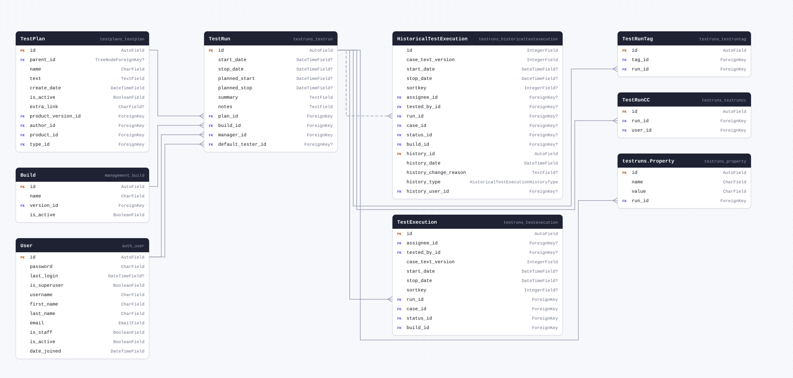

| Column | Field | Type | Null | Key | Default | Description |
| --- | --- | --- | --- | --- | --- | --- |
| `id` | `AutoField` | `integer` |  | PK | `autoincrement()` |  |
| `start_date` | `DateTimeField` | `datetime` | yes |  |  |  |
| `stop_date` | `DateTimeField` | `datetime` | yes |  |  |  |
| `planned_start` | `DateTimeField` | `datetime` | yes |  |  |  |
| `planned_stop` | `DateTimeField` | `datetime` | yes |  |  |  |
| `summary` | `TextField` | `text` |  |  |  |  |
| `notes` | `TextField` | `text` |  |  |  |  |
| `plan_id` | `ForeignKey` | `integer` |  | FK |  |  |
| `build_id` | `ForeignKey` | `integer` |  | FK |  |  |
| `manager_id` | `ForeignKey` | `integer` |  | FK |  |  |
| `default_tester_id` | `ForeignKey` | `integer` | yes | FK |  |  |

Indexes:

- index `testruns_testrun_start_date_069af648` on `start_date`
- index `testruns_testrun_stop_date_ef2271e8` on `stop_date`
- index `testruns_testrun_planned_start_ea8990da` on `planned_start`
- index `testruns_testrun_planned_stop_db2c9977` on `planned_stop`
- index `testruns_testrun_plan_id_6c5c942a` on `plan_id`
- index `testruns_testrun_build_id_fca012cf` on `build_id`
- index `testruns_testrun_manager_id_3b380cf6` on `manager_id`
- index `testruns_testrun_default_tester_id_cfd29db3` on `default_tester_id`

Relations:

- `tag` — many to many with [Tag](#tag), through [TestRunTag](#testruntag)
- `cc` — many to many with [User](#user), through [TestRunCC](#testruncc)
- `plan_id` → [TestPlan](#testplan).`id`, on delete cascade
- `build_id` → [Build](#build).`id`, on delete cascade
- `manager_id` → [User](#user).`id`, on delete cascade
- `default_tester_id` → [User](#user).`id`, on delete cascade
- [HistoricalTestExecution](#historicaltestexecution).`run_id` → `id`, on delete do nothing, no database constraint
- [TestExecution](#testexecution).`run_id` → `id`, on delete cascade
- [TestRunTag](#testruntag).`run_id` → `id`, on delete cascade
- [TestRunCC](#testruncc).`run_id` → `id`, on delete cascade
- [testruns.Property](#testrunsproperty).`run_id` → `id`, on delete cascade

## TestExecutionStatus

Table `testruns_testexecutionstatus`, app `testruns`.

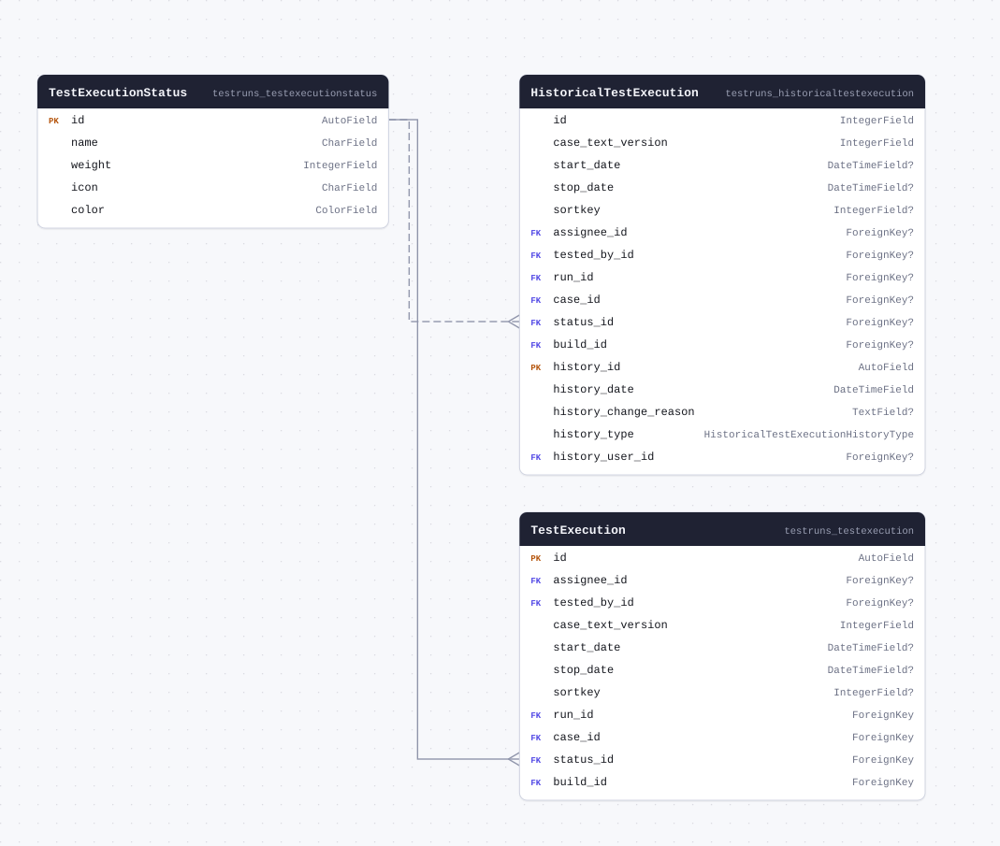

| Column | Field | Type | Null | Key | Default | Description |
| --- | --- | --- | --- | --- | --- | --- |
| `id` | `AutoField` | `integer` |  | PK | `autoincrement()` |  |
| `name` | `CharField` | `varchar(60)` |  | unique |  |  |
| `weight` | `IntegerField` | `integer` |  |  | `0` |  |
| `icon` | `CharField` | `varchar(64)` |  |  |  |  |
| `color` | `ColorField` | `varchar(18)` |  |  | `'#FFFFFF'` |  |

Relations:

- [HistoricalTestExecution](#historicaltestexecution).`status_id` → `id`, on delete do nothing, no database constraint
- [TestExecution](#testexecution).`status_id` → `id`, on delete cascade

## HistoricalTestExecution

Table `testruns_historicaltestexecution`, app `testruns`.

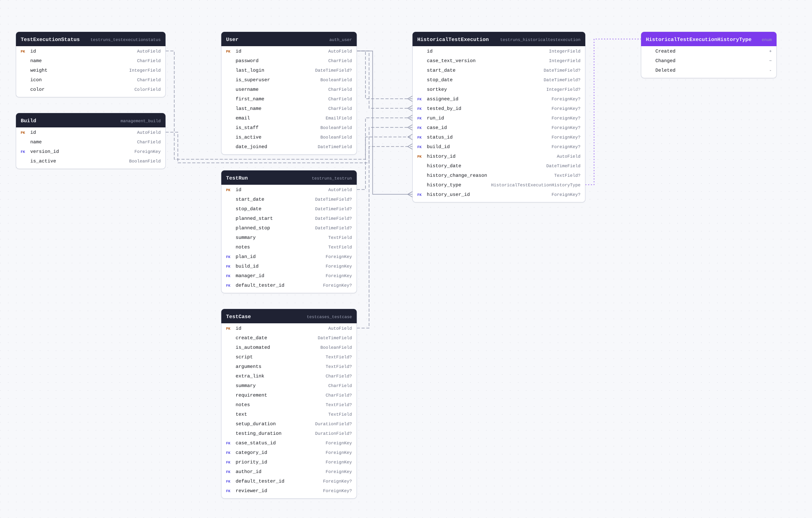

| Column | Field | Type | Null | Key | Default | Description |
| --- | --- | --- | --- | --- | --- | --- |
| `id` | `IntegerField` | `integer` |  |  |  |  |
| `case_text_version` | `IntegerField` | `integer` |  |  |  |  |
| `start_date` | `DateTimeField` | `datetime` | yes |  |  |  |
| `stop_date` | `DateTimeField` | `datetime` | yes |  |  |  |
| `sortkey` | `IntegerField` | `integer` | yes |  |  |  |
| `assignee_id` | `ForeignKey` | `integer` | yes | FK (no constraint) |  |  |
| `tested_by_id` | `ForeignKey` | `integer` | yes | FK (no constraint) |  |  |
| `run_id` | `ForeignKey` | `integer` | yes | FK (no constraint) |  |  |
| `case_id` | `ForeignKey` | `integer` | yes | FK (no constraint) |  |  |
| `status_id` | `ForeignKey` | `integer` | yes | FK (no constraint) |  |  |
| `build_id` | `ForeignKey` | `integer` | yes | FK (no constraint) |  |  |
| `history_id` | `AutoField` | `integer` |  | PK | `autoincrement()` |  |
| `history_date` | `DateTimeField` | `datetime` |  |  |  |  |
| `history_change_reason` | `TextField` | `text` | yes |  |  |  |
| `history_type` | `HistoricalTestExecutionHistoryType` | `varchar(1)` |  |  |  |  |
| `history_user_id` | `ForeignKey` | `integer` | yes | FK |  |  |

Indexes:

- index `testruns_historicaltestexecution_id_69b1b1b1` on `id`
- index `testruns_historicaltestexecution_start_date_3e5ed561` on `start_date`
- index `testruns_historicaltestexecution_stop_date_d659f81c` on `stop_date`
- index `testruns_historicaltestexecution_assignee_id_f690ec0e` on `assignee_id`
- index `testruns_historicaltestexecution_tested_by_id_a30c4c8c` on `tested_by_id`
- index `testruns_historicaltestexecution_run_id_3e1696ea` on `run_id`
- index `testruns_historicaltestexecution_case_id_1cc6facc` on `case_id`
- index `testruns_historicaltestexecution_status_id_52897e9a` on `status_id`
- index `testruns_historicaltestexecution_build_id_3b63ffa5` on `build_id`
- index `testruns_historicaltestexecution_history_date_035536b8` on `history_date`
- index `testruns_historicaltestexecution_history_user_id_cfb71d7e` on `history_user_id`

Relations:

- `assignee_id` → [User](#user).`id`, on delete do nothing, no database constraint
- `tested_by_id` → [User](#user).`id`, on delete do nothing, no database constraint
- `run_id` → [TestRun](#testrun).`id`, on delete do nothing, no database constraint
- `case_id` → [TestCase](#testcase).`id`, on delete do nothing, no database constraint
- `status_id` → [TestExecutionStatus](#testexecutionstatus).`id`, on delete do nothing, no database constraint
- `build_id` → [Build](#build).`id`, on delete do nothing, no database constraint
- `history_user_id` → [User](#user).`id`, on delete set null

## TestExecution

Table `testruns_testexecution`, app `testruns`.

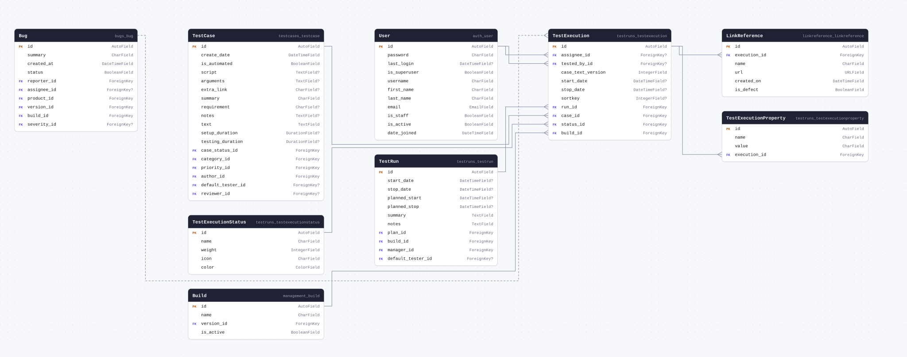

| Column | Field | Type | Null | Key | Default | Description |
| --- | --- | --- | --- | --- | --- | --- |
| `id` | `AutoField` | `integer` |  | PK | `autoincrement()` |  |
| `assignee_id` | `ForeignKey` | `integer` | yes | FK |  |  |
| `tested_by_id` | `ForeignKey` | `integer` | yes | FK |  |  |
| `case_text_version` | `IntegerField` | `integer` |  |  |  |  |
| `start_date` | `DateTimeField` | `datetime` | yes |  |  |  |
| `stop_date` | `DateTimeField` | `datetime` | yes |  |  |  |
| `sortkey` | `IntegerField` | `integer` | yes |  |  |  |
| `run_id` | `ForeignKey` | `integer` |  | FK |  |  |
| `case_id` | `ForeignKey` | `integer` |  | FK |  |  |
| `status_id` | `ForeignKey` | `integer` |  | FK |  |  |
| `build_id` | `ForeignKey` | `integer` |  | FK |  |  |

Indexes:

- index `testruns_testexecution_assignee_id_0daefb61` on `assignee_id`
- index `testruns_testexecution_tested_by_id_23ec246c` on `tested_by_id`
- index `testruns_testexecution_start_date_d50373f5` on `start_date`
- index `testruns_testexecution_stop_date_1e245a90` on `stop_date`
- index `testruns_testexecution_run_id_b07eceea` on `run_id`
- index `testruns_testexecution_case_id_24b74b89` on `case_id`
- index `testruns_testexecution_status_id_82e677b4` on `status_id`
- index `testruns_testexecution_build_id_511386d9` on `build_id`

Relations:

- [LinkReference](#linkreference).`execution_id` → `id`, on delete cascade
- `assignee_id` → [User](#user).`id`, on delete cascade
- `tested_by_id` → [User](#user).`id`, on delete cascade
- `run_id` → [TestRun](#testrun).`id`, on delete cascade
- `case_id` → [TestCase](#testcase).`id`, on delete cascade
- `status_id` → [TestExecutionStatus](#testexecutionstatus).`id`, on delete cascade
- `build_id` → [Build](#build).`id`, on delete cascade
- [TestExecutionProperty](#testexecutionproperty).`execution_id` → `id`, on delete cascade
- `bugs` — many to many with [Bug](#bug)

## TestExecutionProperty

Table `testruns_testexecutionproperty`, app `testruns`.

Columns from `Property` (abstract): `name`, `value`.

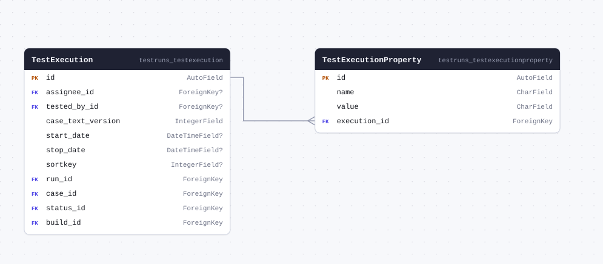

| Column | Field | Type | Null | Key | Default | Description |
| --- | --- | --- | --- | --- | --- | --- |
| `id` | `AutoField` | `integer` |  | PK | `autoincrement()` |  |
| `name` | `CharField` | `varchar(255)` |  |  |  |  |
| `value` | `CharField` | `varchar(255)` |  |  |  |  |
| `execution_id` | `ForeignKey` | `integer` |  | FK |  |  |

Indexes:

- index `testruns_testexecutionproperty_execution_id_5b7ba16e` on `execution_id`

Relations:

- `execution_id` → [TestExecution](#testexecution).`id`, on delete cascade

## TestRunTag

Table `testruns_testruntag`, app `testruns`.

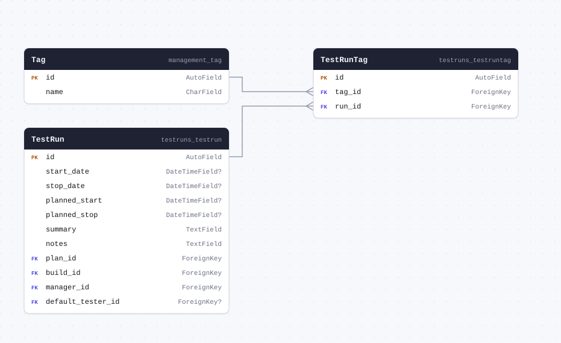

| Column | Field | Type | Null | Key | Default | Description |
| --- | --- | --- | --- | --- | --- | --- |
| `id` | `AutoField` | `integer` |  | PK | `autoincrement()` |  |
| `tag_id` | `ForeignKey` | `integer` |  | FK |  |  |
| `run_id` | `ForeignKey` | `integer` |  | FK |  |  |

Indexes:

- index `testruns_testruntag_tag_id_71c717c0` on `tag_id`
- index `testruns_testruntag_run_id_08efd935` on `run_id`

Relations:

- `tag_id` → [Tag](#tag).`id`, on delete cascade
- `run_id` → [TestRun](#testrun).`id`, on delete cascade

## TestRunCC

Table `testruns_testruncc`, app `testruns`.

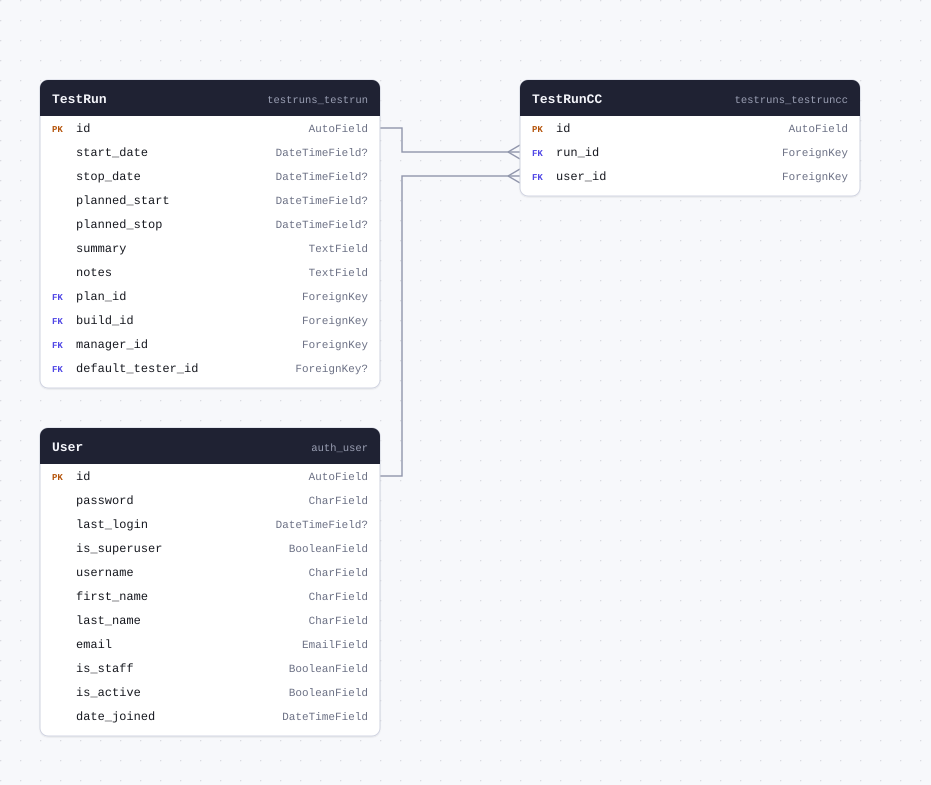

| Column | Field | Type | Null | Key | Default | Description |
| --- | --- | --- | --- | --- | --- | --- |
| `id` | `AutoField` | `integer` |  | PK | `autoincrement()` |  |
| `run_id` | `ForeignKey` | `integer` |  | FK |  |  |
| `user_id` | `ForeignKey` | `integer` |  | FK |  |  |

Indexes:

- index `testruns_testruncc_run_id_e1329c9b` on `run_id`
- index `testruns_testruncc_user_id_d87465d8` on `user_id`
- unique `testruns_testruncc_run_id_user_id_33646180_uniq` on `run_id`, `user_id`

Relations:

- `run_id` → [TestRun](#testrun).`id`, on delete cascade
- `user_id` → [User](#user).`id`, on delete cascade

## Environment

Table `testruns_environment`, app `testruns`.

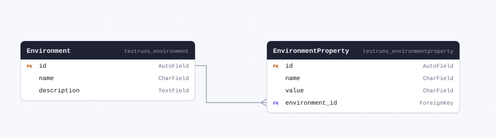

| Column | Field | Type | Null | Key | Default | Description |
| --- | --- | --- | --- | --- | --- | --- |
| `id` | `AutoField` | `integer` |  | PK | `autoincrement()` |  |
| `name` | `CharField` | `varchar(255)` |  | unique |  |  |
| `description` | `TextField` | `text` |  |  |  |  |

Relations:

- [EnvironmentProperty](#environmentproperty).`environment_id` → `id`, on delete cascade

## EnvironmentProperty

Table `testruns_environmentproperty`, app `testruns`.

Columns from `Property` (abstract): `name`, `value`.


| Column | Field | Type | Null | Key | Default | Description |
| --- | --- | --- | --- | --- | --- | --- |
| `id` | `AutoField` | `integer` |  | PK | `autoincrement()` |  |
| `name` | `CharField` | `varchar(255)` |  |  |  |  |
| `value` | `CharField` | `varchar(255)` |  |  |  |  |
| `environment_id` | `ForeignKey` | `integer` |  | FK |  |  |

Indexes:

- index `testruns_environmentproperty_environment_id_f9ac7236` on `environment_id`

Relations:

- `environment_id` → [Environment](#environment).`id`, on delete cascade

## testruns.Property

Table `testruns_property`, app `testruns`.

Columns from `Property` (abstract): `name`, `value`.

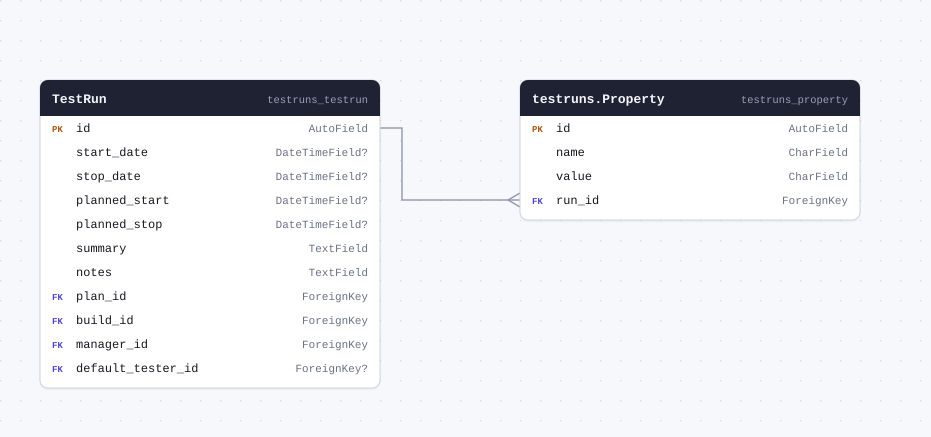

| Column | Field | Type | Null | Key | Default | Description |
| --- | --- | --- | --- | --- | --- | --- |
| `id` | `AutoField` | `integer` |  | PK | `autoincrement()` |  |
| `name` | `CharField` | `varchar(255)` |  |  |  |  |
| `value` | `CharField` | `varchar(255)` |  |  |  |  |
| `run_id` | `ForeignKey` | `integer` |  | FK |  |  |

Indexes:

- index `testruns_property_run_id_71808437` on `run_id`

Relations:

- `run_id` → [TestRun](#testrun).`id`, on delete cascade

## Severity

Table `bugs_severity`, app `bugs`.

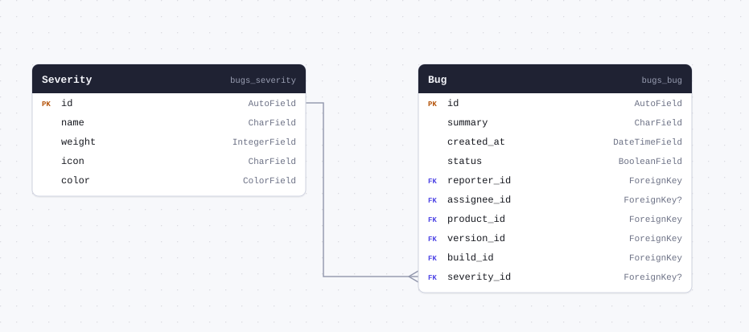

| Column | Field | Type | Null | Key | Default | Description |
| --- | --- | --- | --- | --- | --- | --- |
| `id` | `AutoField` | `integer` |  | PK | `autoincrement()` |  |
| `name` | `CharField` | `varchar(64)` |  | unique |  |  |
| `weight` | `IntegerField` | `integer` |  |  | `0` |  |
| `icon` | `CharField` | `varchar(64)` |  |  |  |  |
| `color` | `ColorField` | `varchar(18)` |  |  | `'#FFFFFF'` |  |

Relations:

- [Bug](#bug).`severity_id` → `id`, on delete cascade

## Bug

Table `bugs_bug`, app `bugs`.

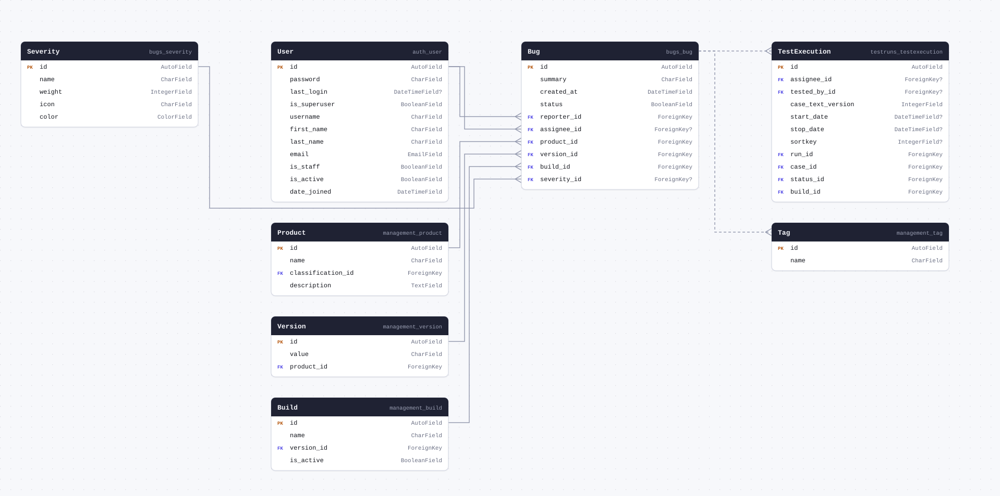

| Column | Field | Type | Null | Key | Default | Description |
| --- | --- | --- | --- | --- | --- | --- |
| `id` | `AutoField` | `integer` |  | PK | `autoincrement()` |  |
| `summary` | `CharField` | `varchar(255)` |  |  |  |  |
| `created_at` | `DateTimeField` | `datetime` |  |  | `now()` |  |
| `status` | `BooleanField` | `bool` |  |  | `True` |  |
| `reporter_id` | `ForeignKey` | `integer` |  | FK |  |  |
| `assignee_id` | `ForeignKey` | `integer` | yes | FK |  |  |
| `product_id` | `ForeignKey` | `integer` |  | FK |  |  |
| `version_id` | `ForeignKey` | `integer` |  | FK |  |  |
| `build_id` | `ForeignKey` | `integer` |  | FK |  |  |
| `severity_id` | `ForeignKey` | `integer` | yes | FK |  |  |

Indexes:

- index `bugs_bug_summary_8321d37f` on `summary`
- index `bugs_bug_created_at_f132529e` on `created_at`
- index `bugs_bug_status_3e54f71f` on `status`
- index `bugs_bug_reporter_id_f3c433c0` on `reporter_id`
- index `bugs_bug_assignee_id_2006cbf7` on `assignee_id`
- index `bugs_bug_product_id_a052f422` on `product_id`
- index `bugs_bug_version_id_9e5c9e9d` on `version_id`
- index `bugs_bug_build_id_f3b6bc1b` on `build_id`
- index `bugs_bug_severity_id_e3498925` on `severity_id`

Relations:

- `reporter_id` → [User](#user).`id`, on delete cascade
- `assignee_id` → [User](#user).`id`, on delete cascade
- `product_id` → [Product](#product).`id`, on delete cascade
- `version_id` → [Version](#version).`id`, on delete cascade
- `build_id` → [Build](#build).`id`, on delete cascade
- `severity_id` → [Severity](#severity).`id`, on delete cascade
- `executions` — many to many with [TestExecution](#testexecution)
- `tags` — many to many with [Tag](#tag)

## LogEntry

Table `django_admin_log`, app `admin`.


| Column | Field | Type | Null | Key | Default | Description |
| --- | --- | --- | --- | --- | --- | --- |
| `id` | `AutoField` | `integer` |  | PK | `autoincrement()` |  |
| `action_time` | `DateTimeField` | `datetime` |  |  | `now()` |  |
| `user_id` | `ForeignKey` | `integer` |  | FK |  |  |
| `content_type_id` | `ForeignKey` | `integer` | yes | FK |  |  |
| `object_id` | `TextField` | `text` | yes |  |  |  |
| `object_repr` | `CharField` | `varchar(200)` |  |  |  |  |
| `action_flag` | `LogEntryActionFlag` | `smallint unsigned` |  |  |  |  |
| `change_message` | `TextField` | `text` |  |  |  |  |

Indexes:

- index `django_admin_log_user_id_c564eba6` on `user_id`
- index `django_admin_log_content_type_id_c4bce8eb` on `content_type_id`

Relations:

- `user_id` → [User](#user).`id`, on delete cascade
- `content_type_id` → [ContentType](#contenttype).`id`, on delete set null

## Permission

Table `auth_permission`, app `auth`.

The permissions system provides a way to assign permissions to specific
users and groups of users.

The permission system is used by the Django admin site, but may also be
useful in your own code. The Django admin site uses permissions as follows:

    - The "add" permission limits the user's ability to view the "add" form
      and add an object.
    - The "change" permission limits a user's ability to view the change
      list, view the "change" form and change an object.
    - The "delete" permission limits the ability to delete an object.
    - The "view" permission limits the ability to view an object.

Permissions are set globally per type of object, not per specific object
instance. It is possible to say "Mary may change news stories," but it's
not currently possible to say "Mary may change news stories, but only the
ones she created herself" or "Mary may only change news stories that have a
certain status or publication date."

The permissions listed above are automatically created for each model.

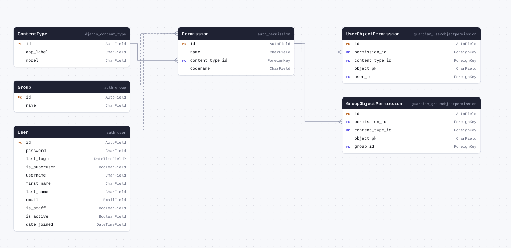

| Column | Field | Type | Null | Key | Default | Description |
| --- | --- | --- | --- | --- | --- | --- |
| `id` | `AutoField` | `integer` |  | PK | `autoincrement()` |  |
| `name` | `CharField` | `varchar(255)` |  |  |  |  |
| `content_type_id` | `ForeignKey` | `integer` |  | FK |  |  |
| `codename` | `CharField` | `varchar(100)` |  |  |  |  |

Indexes:

- index `auth_permission_content_type_id_2f476e4b` on `content_type_id`
- unique `auth_permission_content_type_id_codename_01ab375a_uniq` on `content_type_id`, `codename`

Relations:

- [UserObjectPermission](#userobjectpermission).`permission_id` → `id`, on delete cascade
- [GroupObjectPermission](#groupobjectpermission).`permission_id` → `id`, on delete cascade
- `content_type_id` → [ContentType](#contenttype).`id`, on delete cascade
- `group_set` — many to many with [Group](#group)
- `user_set` — many to many with [User](#user)

## Group

Table `auth_group`, app `auth`.

Groups are a generic way of categorizing users to apply permissions, or
some other label, to those users. A user can belong to any number of
groups.

A user in a group automatically has all the permissions granted to that
group. For example, if the group 'Site editors' has the permission
can_edit_home_page, any user in that group will have that permission.

Beyond permissions, groups are a convenient way to categorize users to
apply some label, or extended functionality, to them. For example, you
could create a group 'Special users', and you could write code that would
do special things to those users -- such as giving them access to a
members-only portion of your site, or sending them members-only email
messages.

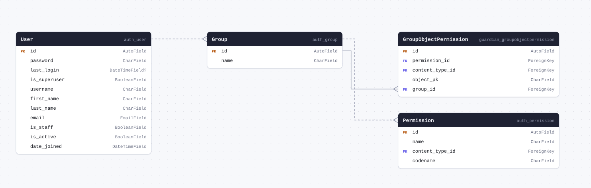

| Column | Field | Type | Null | Key | Default | Description |
| --- | --- | --- | --- | --- | --- | --- |
| `id` | `AutoField` | `integer` |  | PK | `autoincrement()` |  |
| `name` | `CharField` | `varchar(150)` |  | unique |  |  |

Relations:

- [GroupObjectPermission](#groupobjectpermission).`group_id` → `id`, on delete cascade
- `permissions` — many to many with [Permission](#permission)
- `user_set` — many to many with [User](#user)

## User

Table `auth_user`, app `auth`.

Columns from `AbstractUser` (abstract): `username`, `first_name`, `last_name`, `email`, `is_staff`, `is_active`, `date_joined`.

Columns from `AbstractBaseUser` (abstract): `password`, `last_login`.

Columns from `PermissionsMixin` (abstract): `is_superuser`.

Users within the Django authentication system are represented by this
model.

Username and password are required. Other fields are optional.

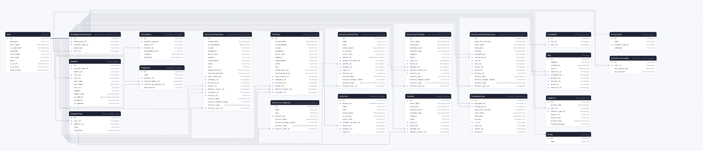

| Column | Field | Type | Null | Key | Default | Description |
| --- | --- | --- | --- | --- | --- | --- |
| `id` | `AutoField` | `integer` |  | PK | `autoincrement()` |  |
| `password` | `CharField` | `varchar(128)` |  |  |  |  |
| `last_login` | `DateTimeField` | `datetime` | yes |  |  |  |
| `is_superuser` | `BooleanField` | `bool` |  |  | `False` | Designates that this user has all permissions without explicitly assigning them. |
| `username` | `CharField` | `varchar(150)` |  | unique |  | Required. 150 characters or fewer. Letters, digits and @/./+/-/_ only. |
| `first_name` | `CharField` | `varchar(150)` |  |  |  |  |
| `last_name` | `CharField` | `varchar(150)` |  |  |  |  |
| `email` | `EmailField` | `varchar(254)` |  |  |  |  |
| `is_staff` | `BooleanField` | `bool` |  |  | `False` | Designates whether the user can log into this admin site. |
| `is_active` | `BooleanField` | `bool` |  |  | `True` | Designates whether this user should be treated as active. Unselect this instead of deleting accounts. |
| `date_joined` | `DateTimeField` | `datetime` |  |  | `now()` |  |

Relations:

- `testrun_set` — many to many with [TestRun](#testrun), through [TestRunCC](#testruncc)
- [UserObjectPermission](#userobjectpermission).`user_id` → `id`, on delete cascade
- [Comment](#comment).`user_id` → `id`, on delete set null
- [CommentFlag](#commentflag).`user_id` → `id`, on delete cascade
- [Attachment](#attachment).`creator_id` → `id`, on delete cascade
- [Component](#component).`initial_owner_id` → `id`, on delete cascade
- [Component](#component).`initial_qa_contact_id` → `id`, on delete cascade
- [HistoricalTestCase](#historicaltestcase).`author_id` → `id`, on delete do nothing, no database constraint
- [HistoricalTestCase](#historicaltestcase).`default_tester_id` → `id`, on delete do nothing, no database constraint
- [HistoricalTestCase](#historicaltestcase).`reviewer_id` → `id`, on delete do nothing, no database constraint
- [HistoricalTestCase](#historicaltestcase).`history_user_id` → `id`, on delete set null
- [TestCase](#testcase).`author_id` → `id`, on delete cascade
- [TestCase](#testcase).`default_tester_id` → `id`, on delete cascade
- [TestCase](#testcase).`reviewer_id` → `id`, on delete cascade
- [HistoricalTemplate](#historicaltemplate).`history_user_id` → `id`, on delete set null
- [HistoricalTestPlan](#historicaltestplan).`author_id` → `id`, on delete do nothing, no database constraint
- [HistoricalTestPlan](#historicaltestplan).`history_user_id` → `id`, on delete set null
- [TestPlan](#testplan).`author_id` → `id`, on delete cascade
- [HistoricalTestRun](#historicaltestrun).`manager_id` → `id`, on delete do nothing, no database constraint
- [HistoricalTestRun](#historicaltestrun).`default_tester_id` → `id`, on delete do nothing, no database constraint
- [HistoricalTestRun](#historicaltestrun).`history_user_id` → `id`, on delete set null
- [TestRun](#testrun).`manager_id` → `id`, on delete cascade
- [TestRun](#testrun).`default_tester_id` → `id`, on delete cascade
- [HistoricalTestExecution](#historicaltestexecution).`assignee_id` → `id`, on delete do nothing, no database constraint
- [HistoricalTestExecution](#historicaltestexecution).`tested_by_id` → `id`, on delete do nothing, no database constraint
- [HistoricalTestExecution](#historicaltestexecution).`history_user_id` → `id`, on delete set null
- [TestExecution](#testexecution).`assignee_id` → `id`, on delete cascade
- [TestExecution](#testexecution).`tested_by_id` → `id`, on delete cascade
- [TestRunCC](#testruncc).`user_id` → `id`, on delete cascade
- [Bug](#bug).`reporter_id` → `id`, on delete cascade
- [Bug](#bug).`assignee_id` → `id`, on delete cascade
- [LogEntry](#logentry).`user_id` → `id`, on delete cascade
- `groups` — many to many with [Group](#group)
- `user_permissions` — many to many with [Permission](#permission)
- [UserActivationKey](#useractivationkey).`user_id` → `id`, on delete cascade

## ContentType

Table `django_content_type`, app `contenttypes`.

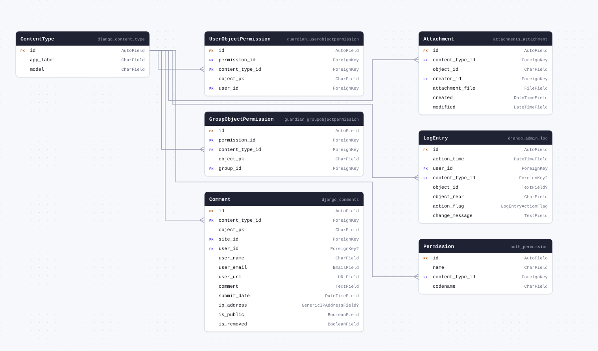

| Column | Field | Type | Null | Key | Default | Description |
| --- | --- | --- | --- | --- | --- | --- |
| `id` | `AutoField` | `integer` |  | PK | `autoincrement()` |  |
| `app_label` | `CharField` | `varchar(100)` |  |  |  |  |
| `model` | `CharField` | `varchar(100)` |  |  |  |  |

Indexes:

- unique `django_content_type_app_label_model_76bd3d3b_uniq` on `app_label`, `model`

Relations:

- [UserObjectPermission](#userobjectpermission).`content_type_id` → `id`, on delete cascade
- [GroupObjectPermission](#groupobjectpermission).`content_type_id` → `id`, on delete cascade
- [Comment](#comment).`content_type_id` → `id`, on delete cascade
- [Attachment](#attachment).`content_type_id` → `id`, on delete cascade
- [LogEntry](#logentry).`content_type_id` → `id`, on delete set null
- [Permission](#permission).`content_type_id` → `id`, on delete cascade

## Session

Table `django_session`, app `sessions`.

Columns from `AbstractBaseSession` (abstract): `session_key`, `session_data`, `expire_date`.

Django provides full support for anonymous sessions. The session
framework lets you store and retrieve arbitrary data on a
per-site-visitor basis. It stores data on the server side and
abstracts the sending and receiving of cookies. Cookies contain a
session ID -- not the data itself.

The Django sessions framework is entirely cookie-based. It does
not fall back to putting session IDs in URLs. This is an intentional
design decision. Not only does that behavior make URLs ugly, it makes
your site vulnerable to session-ID theft via the "Referer" header.

For complete documentation on using Sessions in your code, consult
the sessions documentation that is shipped with Django (also available
on the Django web site).

| Column | Field | Type | Null | Key | Default | Description |
| --- | --- | --- | --- | --- | --- | --- |
| `session_key` | `CharField` | `varchar(40)` |  | PK |  |  |
| `session_data` | `TextField` | `text` |  |  |  |  |
| `expire_date` | `DateTimeField` | `datetime` |  |  |  |  |

Indexes:

- index `django_session_expire_date_a5c62663` on `expire_date`

## CaptchaStore

Table `captcha_captchastore`, app `captcha`.

| Column | Field | Type | Null | Key | Default | Description |
| --- | --- | --- | --- | --- | --- | --- |
| `id` | `AutoField` | `integer` |  | PK | `autoincrement()` |  |
| `challenge` | `CharField` | `varchar(32)` |  |  |  |  |
| `response` | `CharField` | `varchar(32)` |  |  |  |  |
| `hashkey` | `CharField` | `varchar(40)` |  | unique |  |  |
| `expiration` | `DateTimeField` | `datetime` |  |  |  |  |

## UserActivationKey

Table `kiwi_auth_useractivationkey`, app `kiwi_auth`.

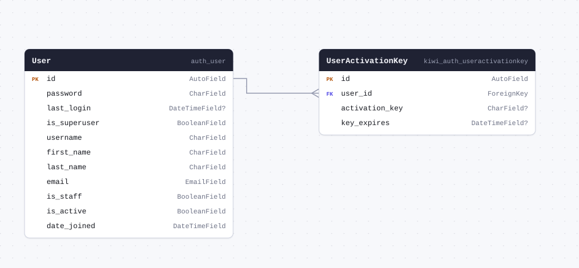

| Column | Field | Type | Null | Key | Default | Description |
| --- | --- | --- | --- | --- | --- | --- |
| `id` | `AutoField` | `integer` |  | PK | `autoincrement()` |  |
| `user_id` | `ForeignKey` | `integer` |  | FK |  |  |
| `activation_key` | `CharField` | `varchar(64)` | yes |  |  |  |
| `key_expires` | `DateTimeField` | `datetime` | yes |  |  |  |

Indexes:

- index `kiwi_auth_useractivationkey_user_id_cb6f6f73` on `user_id`

Relations:

- `user_id` → [User](#user).`id`, on delete cascade

# Enums

## HistoricalTestCaseHistoryType

| Name | Stored as |
| --- | --- |
| `Created` | `+` |
| `Changed` | `~` |
| `Deleted` | `-` |

## HistoricalTemplateHistoryType

| Name | Stored as |
| --- | --- |
| `Created` | `+` |
| `Changed` | `~` |
| `Deleted` | `-` |

## HistoricalTestPlanHistoryType

| Name | Stored as |
| --- | --- |
| `Created` | `+` |
| `Changed` | `~` |
| `Deleted` | `-` |

## HistoricalTestRunHistoryType

| Name | Stored as |
| --- | --- |
| `Created` | `+` |
| `Changed` | `~` |
| `Deleted` | `-` |

## HistoricalTestExecutionHistoryType

| Name | Stored as |
| --- | --- |
| `Created` | `+` |
| `Changed` | `~` |
| `Deleted` | `-` |

## LogEntryActionFlag

| Name | Stored as |
| --- | --- |
| `Addition` | `1` |
| `Change` | `2` |
| `Deletion` | `3` |
