# Schema docs

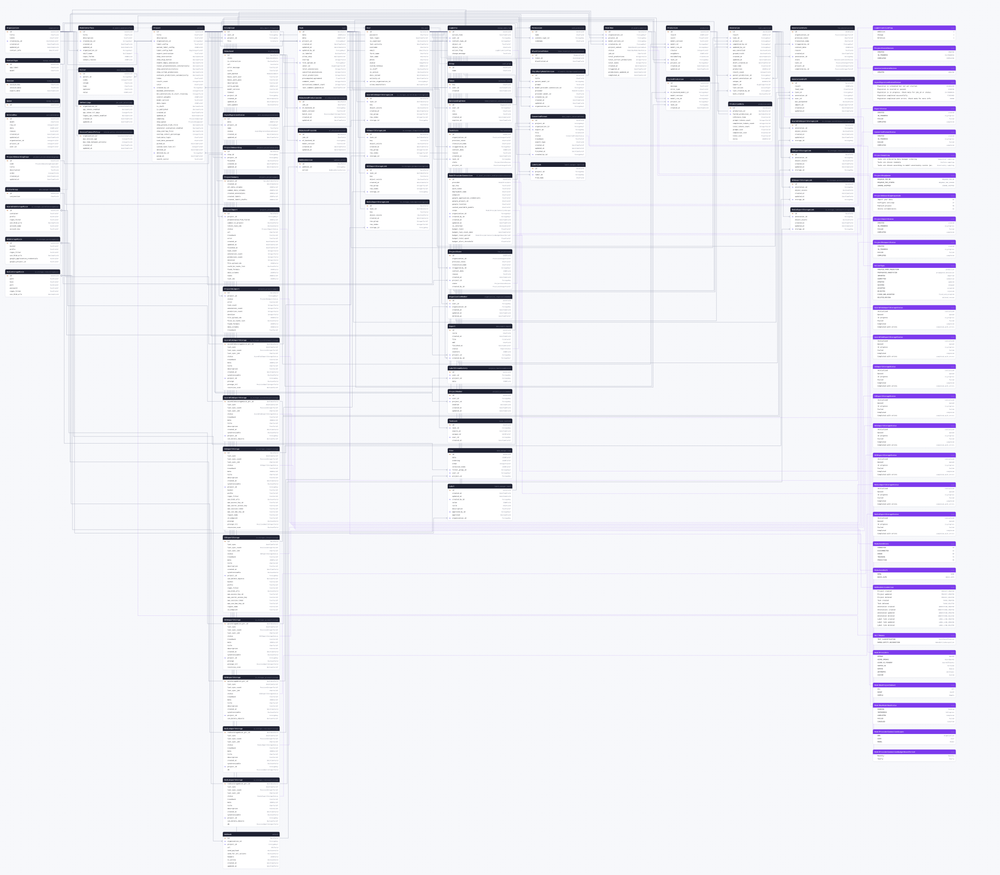

[LogEntry](#logentry) · [Permission](#permission) · [Group](#group) · [ContentType](#contenttype) · [Session](#session) · [Queue](#queue) · [Token](#token) · [OutstandingToken](#outstandingtoken) · [BlacklistedToken](#blacklistedtoken) · [TaskState](#taskstate) · [AnnotationState](#annotationstate) · [ProjectState](#projectstate) · [AsyncMigrationStatus](#asyncmigrationstatus) · [DeletedRow](#deletedrow) · [User](#user) · [OrganizationMember](#organizationmember) · [Organization](#organization) · [FileUpload](#fileupload) · [Export](#export) · [ConvertedFormat](#convertedformat) · [Project](#project) · [ProjectOnboardingSteps](#projectonboardingsteps) · [ProjectOnboarding](#projectonboarding) · [LabelStreamHistory](#labelstreamhistory) · [ProjectMember](#projectmember) · [ProjectSummary](#projectsummary) · [ProjectImport](#projectimport) · [ProjectReimport](#projectreimport) · [Task](#task) · [Annotation](#annotation) · [TaskLock](#tasklock) · [AnnotationDraft](#annotationdraft) · [Prediction](#prediction) · [FailedPrediction](#failedprediction) · [PredictionMeta](#predictionmeta) · [View](#view) · [FilterGroup](#filtergroup) · [Filter](#filter) · [AzureBlobStorageMixin](#azureblobstoragemixin) · [AzureBlobImportStorage](#azureblobimportstorage) · [AzureBlobExportStorage](#azureblobexportstorage) · [AzureBlobImportStorageLink](#azureblobimportstoragelink) · [AzureBlobExportStorageLink](#azureblobexportstoragelink) · [S3ImportStorage](#s3importstorage) · [S3ExportStorage](#s3exportstorage) · [S3ImportStorageLink](#s3importstoragelink) · [S3ExportStorageLink](#s3exportstoragelink) · [GCSStorageMixin](#gcsstoragemixin) · [GCSImportStorage](#gcsimportstorage) · [GCSExportStorage](#gcsexportstorage) · [GCSImportStorageLink](#gcsimportstoragelink) · [GCSExportStorageLink](#gcsexportstoragelink) · [RedisStorageMixin](#redisstoragemixin) · [RedisImportStorage](#redisimportstorage) · [RedisExportStorage](#redisexportstorage) · [RedisImportStorageLink](#redisimportstoragelink) · [RedisExportStorageLink](#redisexportstoragelink) · [MLBackend](#mlbackend) · [MLBackendPredictionJob](#mlbackendpredictionjob) · [MLBackendTrainJob](#mlbackendtrainjob) · [Webhook](#webhook) · [WebhookAction](#webhookaction) · [Label](#label) · [LabelLink](#labellink) · [ModelInterface](#modelinterface) · [ThirdPartyModelVersion](#thirdpartymodelversion) · [ModelRun](#modelrun) · [ModelProviderConnection](#modelproviderconnection) · [JWTSettings](#jwtsettings) · [SessionTimeoutPolicy](#sessiontimeoutpolicy)

<details>
<summary>The whole schema as SQL</summary>

```sql
CREATE TABLE "django_admin_log" ("id" integer NOT NULL PRIMARY KEY AUTOINCREMENT, "action_time" datetime NOT NULL, "user_id" integer NOT NULL REFERENCES "htx_user" ("id") DEFERRABLE INITIALLY DEFERRED, "content_type_id" integer NULL REFERENCES "django_content_type" ("id") DEFERRABLE INITIALLY DEFERRED, "object_id" text NULL, "object_repr" varchar(200) NOT NULL, "action_flag" smallint unsigned NOT NULL CHECK ("action_flag" >= 0), "change_message" text NOT NULL);

CREATE TABLE "auth_permission" ("id" integer NOT NULL PRIMARY KEY AUTOINCREMENT, "name" varchar(255) NOT NULL, "content_type_id" integer NOT NULL REFERENCES "django_content_type" ("id") DEFERRABLE INITIALLY DEFERRED, "codename" varchar(100) NOT NULL);

CREATE TABLE "auth_group" ("id" integer NOT NULL PRIMARY KEY AUTOINCREMENT, "name" varchar(150) NOT NULL UNIQUE);

CREATE TABLE "auth_group_permissions" ("id" integer NOT NULL PRIMARY KEY AUTOINCREMENT, "group_id" integer NOT NULL REFERENCES "auth_group" ("id") DEFERRABLE INITIALLY DEFERRED, "permission_id" integer NOT NULL REFERENCES "auth_permission" ("id") DEFERRABLE INITIALLY DEFERRED);

CREATE TABLE "django_content_type" ("id" integer NOT NULL PRIMARY KEY AUTOINCREMENT, "app_label" varchar(100) NOT NULL, "model" varchar(100) NOT NULL);

CREATE TABLE "django_session" ("session_key" varchar(40) NOT NULL PRIMARY KEY, "session_data" text NOT NULL, "expire_date" datetime NOT NULL);

CREATE TABLE "authtoken_token" ("key" varchar(40) NOT NULL PRIMARY KEY, "user_id" integer NOT NULL UNIQUE REFERENCES "htx_user" ("id") DEFERRABLE INITIALLY DEFERRED, "created" datetime NOT NULL);

CREATE TABLE "token_blacklist_outstandingtoken" ("id" integer NOT NULL PRIMARY KEY AUTOINCREMENT, "user_id" integer NULL REFERENCES "htx_user" ("id") DEFERRABLE INITIALLY DEFERRED, "jti" varchar(255) NOT NULL UNIQUE, "token" text NOT NULL, "created_at" datetime NULL, "expires_at" datetime NOT NULL);

CREATE TABLE "token_blacklist_blacklistedtoken" ("id" integer NOT NULL PRIMARY KEY AUTOINCREMENT, "token_id" bigint NOT NULL UNIQUE REFERENCES "token_blacklist_outstandingtoken" ("id") DEFERRABLE INITIALLY DEFERRED, "blacklisted_at" datetime NOT NULL);

CREATE TABLE "fsm_taskstate" ("id" char(32) NOT NULL PRIMARY KEY, "organization_id" integer unsigned NULL CHECK ("organization_id" >= 0), "previous_state" varchar(50) NULL, "transition_name" varchar(100) NULL, "triggered_by_id" integer NULL REFERENCES "htx_user" ("id") DEFERRABLE INITIALLY DEFERRED, "context_data" text NOT NULL CHECK ((JSON_VALID("context_data") OR "context_data" IS NULL)), "reason" text NOT NULL, "created_at" datetime NOT NULL, "task_id" integer NOT NULL REFERENCES "task" ("id") DEFERRABLE INITIALLY DEFERRED, "state" varchar(50) NOT NULL, "project_id" integer unsigned NOT NULL CHECK ("project_id" >= 0));

CREATE TABLE "fsm_annotationstate" ("id" char(32) NOT NULL PRIMARY KEY, "organization_id" integer unsigned NULL CHECK ("organization_id" >= 0), "previous_state" varchar(50) NULL, "transition_name" varchar(100) NULL, "triggered_by_id" integer NULL REFERENCES "htx_user" ("id") DEFERRABLE INITIALLY DEFERRED, "context_data" text NOT NULL CHECK ((JSON_VALID("context_data") OR "context_data" IS NULL)), "reason" text NOT NULL, "created_at" datetime NOT NULL, "annotation_id" integer NOT NULL REFERENCES "task_completion" ("id") DEFERRABLE INITIALLY DEFERRED, "state" varchar(50) NOT NULL, "task_id" integer unsigned NOT NULL CHECK ("task_id" >= 0), "project_id" integer unsigned NOT NULL CHECK ("project_id" >= 0), "completed_by_id" integer unsigned NULL CHECK ("completed_by_id" >= 0));

CREATE TABLE "fsm_projectstate" ("id" char(32) NOT NULL PRIMARY KEY, "organization_id" integer unsigned NULL CHECK ("organization_id" >= 0), "previous_state" varchar(50) NULL, "transition_name" varchar(100) NULL, "triggered_by_id" integer NULL REFERENCES "htx_user" ("id") DEFERRABLE INITIALLY DEFERRED, "context_data" text NOT NULL CHECK ((JSON_VALID("context_data") OR "context_data" IS NULL)), "reason" text NOT NULL, "created_at" datetime NOT NULL, "project_id" integer NOT NULL REFERENCES "project" ("id") DEFERRABLE INITIALLY DEFERRED, "state" varchar(50) NOT NULL, "created_by_id" integer unsigned NULL CHECK ("created_by_id" >= 0));

CREATE TABLE "core_asyncmigrationstatus" ("id" integer NOT NULL PRIMARY KEY AUTOINCREMENT, "meta" text NULL CHECK ((JSON_VALID("meta") OR "meta" IS NULL)), "project_id" integer NULL REFERENCES "project" ("id") DEFERRABLE INITIALLY DEFERRED, "name" text NOT NULL, "status" varchar(100) NULL, "created_at" datetime NOT NULL, "updated_at" datetime NOT NULL);

CREATE TABLE "core_deletedrow" ("id" integer NOT NULL PRIMARY KEY AUTOINCREMENT, "model" varchar(1024) NOT NULL, "row_id" integer NULL, "data" text NULL CHECK ((JSON_VALID("data") OR "data" IS NULL)), "reason" text NULL, "created_at" datetime NOT NULL, "updated_at" datetime NOT NULL, "organization_id" integer NULL, "project_id" integer NULL, "user_id" integer NULL);

CREATE TABLE "htx_user" ("id" integer NOT NULL PRIMARY KEY AUTOINCREMENT, "password" varchar(128) NOT NULL, "last_login" datetime NULL, "is_superuser" bool NOT NULL, "last_activity" datetime NOT NULL, "username" varchar(256) NOT NULL, "email" varchar(254) NOT NULL UNIQUE, "first_name" varchar(256) NOT NULL, "last_name" varchar(256) NOT NULL, "phone" varchar(256) NOT NULL, "avatar" varchar(100) NOT NULL, "custom_hotkeys" text NULL CHECK ((JSON_VALID("custom_hotkeys") OR "custom_hotkeys" IS NULL)), "is_staff" bool NOT NULL, "is_active" bool NOT NULL, "date_joined" datetime NOT NULL, "activity_at" datetime NOT NULL, "active_organization_id" integer NULL REFERENCES "organization" ("id") DEFERRABLE INITIALLY DEFERRED, "allow_newsletters" bool NULL);

CREATE TABLE "htx_user_groups" ("id" integer NOT NULL PRIMARY KEY AUTOINCREMENT, "user_id" integer NOT NULL REFERENCES "htx_user" ("id") DEFERRABLE INITIALLY DEFERRED, "group_id" integer NOT NULL REFERENCES "auth_group" ("id") DEFERRABLE INITIALLY DEFERRED);

CREATE TABLE "htx_user_user_permissions" ("id" integer NOT NULL PRIMARY KEY AUTOINCREMENT, "user_id" integer NOT NULL REFERENCES "htx_user" ("id") DEFERRABLE INITIALLY DEFERRED, "permission_id" integer NOT NULL REFERENCES "auth_permission" ("id") DEFERRABLE INITIALLY DEFERRED);

CREATE TABLE "organizations_organizationmember" ("id" integer NOT NULL PRIMARY KEY AUTOINCREMENT, "user_id" integer NOT NULL REFERENCES "htx_user" ("id") DEFERRABLE INITIALLY DEFERRED, "organization_id" integer NOT NULL REFERENCES "organization" ("id") DEFERRABLE INITIALLY DEFERRED, "created_at" datetime NOT NULL, "updated_at" datetime NOT NULL, "deleted_at" datetime NULL);

CREATE TABLE "organization" ("id" integer NOT NULL PRIMARY KEY AUTOINCREMENT, "title" varchar(1000) NOT NULL, "token" varchar(256) NULL UNIQUE, "created_by_id" integer NULL UNIQUE REFERENCES "htx_user" ("id") DEFERRABLE INITIALLY DEFERRED, "created_at" datetime NOT NULL, "updated_at" datetime NOT NULL, "contact_info" varchar(254) NULL);

CREATE TABLE "data_import_fileupload" ("id" integer NOT NULL PRIMARY KEY AUTOINCREMENT, "user_id" integer NOT NULL REFERENCES "htx_user" ("id") DEFERRABLE INITIALLY DEFERRED, "project_id" integer NOT NULL REFERENCES "project" ("id") DEFERRABLE INITIALLY DEFERRED, "file" varchar(100) NOT NULL);

CREATE TABLE "data_export_export" ("id" integer NOT NULL PRIMARY KEY AUTOINCREMENT, "title" varchar(2048) NOT NULL, "created_at" datetime NOT NULL, "file" varchar(100) NULL, "md5" varchar(128) NOT NULL, "finished_at" datetime NULL, "status" varchar(64) NOT NULL, "counters" text NOT NULL CHECK ((JSON_VALID("counters") OR "counters" IS NULL)), "project_id" integer NOT NULL REFERENCES "project" ("id") DEFERRABLE INITIALLY DEFERRED, "created_by_id" integer NULL REFERENCES "htx_user" ("id") DEFERRABLE INITIALLY DEFERRED);

CREATE TABLE "data_export_convertedformat" ("id" integer NOT NULL PRIMARY KEY AUTOINCREMENT, "project_id" integer NULL REFERENCES "project" ("id") DEFERRABLE INITIALLY DEFERRED, "organization_id" integer NULL REFERENCES "organization" ("id") DEFERRABLE INITIALLY DEFERRED, "export_id" integer NOT NULL REFERENCES "data_export_export" ("id") DEFERRABLE INITIALLY DEFERRED, "file" varchar(100) NULL, "status" varchar(64) NOT NULL, "traceback" text NULL, "export_type" varchar(64) NOT NULL, "created_at" datetime NULL, "updated_at" datetime NULL, "finished_at" datetime NULL, "created_by_id" integer NULL REFERENCES "htx_user" ("id") DEFERRABLE INITIALLY DEFERRED);

CREATE TABLE "project" ("id" integer NOT NULL PRIMARY KEY AUTOINCREMENT, "title" varchar(50) NULL, "description" text NULL, "organization_id" integer NULL REFERENCES "organization" ("id") DEFERRABLE INITIALLY DEFERRED, "label_config" text NULL, "parsed_label_config" text NULL CHECK ((JSON_VALID("parsed_label_config") OR "parsed_label_config" IS NULL)), "label_config_hash" bigint NULL, "expert_instruction" text NULL, "show_instruction" bool NOT NULL, "show_skip_button" bool NOT NULL, "enable_empty_annotation" bool NOT NULL, "reveal_preannotations_interactively" bool NOT NULL, "show_annotation_history" bool NOT NULL, "show_collab_predictions" bool NOT NULL, "evaluate_predictions_automatically" bool NOT NULL, "token" varchar(256) NULL, "result_count" integer NOT NULL, "color" varchar(16) NULL, "created_by_id" integer NULL REFERENCES "htx_user" ("id") DEFERRABLE INITIALLY DEFERRED, "maximum_annotations" integer NOT NULL, "min_annotations_to_start_training" integer NOT NULL, "control_weights" text NULL CHECK ((JSON_VALID("control_weights") OR "control_weights" IS NULL)), "model_version" text NULL, "data_types" text NULL CHECK ((JSON_VALID("data_types") OR "data_types" IS NULL)), "is_draft" bool NOT NULL, "is_published" bool NOT NULL, "created_at" datetime NOT NULL, "updated_at" datetime NOT NULL, "sampling" varchar(100) NULL, "skip_queue" varchar(100) NULL, "show_ground_truth_first" bool NOT NULL, "annotator_evaluation_enabled" bool DEFAULT 0 NOT NULL, "show_overlap_first" bool NOT NULL, "overlap_cohort_percentage" integer NOT NULL, "task_data_login" varchar(256) NULL, "task_data_password" varchar(256) NULL, "pinned_at" datetime NULL, "custom_task_lock_ttl" integer NULL, "deleted_at" datetime NULL, "deleted_by_id" integer NULL REFERENCES "htx_user" ("id") DEFERRABLE INITIALLY DEFERRED, "purge_at" datetime NULL, "search_vector" text NULL);

CREATE TABLE "projects_projectonboardingsteps" ("id" integer NOT NULL PRIMARY KEY AUTOINCREMENT, "code" varchar(2) NULL, "title" varchar(1000) NOT NULL, "description" text NOT NULL, "order" integer NOT NULL, "created_at" datetime NOT NULL, "updated_at" datetime NOT NULL);

CREATE TABLE "projects_projectonboarding" ("id" integer NOT NULL PRIMARY KEY AUTOINCREMENT, "step_id" integer NOT NULL REFERENCES "projects_projectonboardingsteps" ("id") DEFERRABLE INITIALLY DEFERRED, "project_id" integer NOT NULL REFERENCES "project" ("id") DEFERRABLE INITIALLY DEFERRED, "finished" bool NOT NULL, "created_at" datetime NOT NULL, "updated_at" datetime NOT NULL);

CREATE TABLE "projects_labelstreamhistory" ("id" integer NOT NULL PRIMARY KEY AUTOINCREMENT, "user_id" integer NOT NULL REFERENCES "htx_user" ("id") DEFERRABLE INITIALLY DEFERRED, "project_id" integer NOT NULL REFERENCES "project" ("id") DEFERRABLE INITIALLY DEFERRED, "data" text NOT NULL CHECK ((JSON_VALID("data") OR "data" IS NULL)), CONSTRAINT "unique_history" UNIQUE ("user_id", "project_id"));

CREATE TABLE "projects_projectmember" ("id" integer NOT NULL PRIMARY KEY AUTOINCREMENT, "user_id" integer NOT NULL REFERENCES "htx_user" ("id") DEFERRABLE INITIALLY DEFERRED, "project_id" integer NOT NULL REFERENCES "project" ("id") DEFERRABLE INITIALLY DEFERRED, "enabled" bool NOT NULL, "created_at" datetime NOT NULL, "updated_at" datetime NOT NULL);

CREATE TABLE "projects_projectsummary" ("project_id" integer NOT NULL PRIMARY KEY REFERENCES "project" ("id") DEFERRABLE INITIALLY DEFERRED, "created_at" datetime NOT NULL, "all_data_columns" text NULL CHECK ((JSON_VALID("all_data_columns") OR "all_data_columns" IS NULL)), "common_data_columns" text NULL CHECK ((JSON_VALID("common_data_columns") OR "common_data_columns" IS NULL)), "created_annotations" text NULL CHECK ((JSON_VALID("created_annotations") OR "created_annotations" IS NULL)), "created_labels" text NULL CHECK ((JSON_VALID("created_labels") OR "created_labels" IS NULL)), "created_labels_drafts" text NULL CHECK ((JSON_VALID("created_labels_drafts") OR "created_labels_drafts" IS NULL)));

CREATE TABLE "projects_projectimport" ("id" integer NOT NULL PRIMARY KEY AUTOINCREMENT, "project_id" integer NULL REFERENCES "project" ("id") DEFERRABLE INITIALLY DEFERRED, "preannotated_from_fields" text NULL CHECK ((JSON_VALID("preannotated_from_fields") OR "preannotated_from_fields" IS NULL)), "commit_to_project" bool NOT NULL, "return_task_ids" bool NOT NULL, "status" varchar(64) NOT NULL, "url" varchar(2048) NULL, "traceback" text NULL, "error" text NULL, "created_at" datetime NULL, "updated_at" datetime NULL, "finished_at" datetime NULL, "task_count" integer NOT NULL, "annotation_count" integer NOT NULL, "prediction_count" integer NOT NULL, "duration" integer NOT NULL, "file_upload_ids" text NOT NULL CHECK ((JSON_VALID("file_upload_ids") OR "file_upload_ids" IS NULL)), "could_be_tasks_list" bool NOT NULL, "found_formats" text NOT NULL CHECK ((JSON_VALID("found_formats") OR "found_formats" IS NULL)), "data_columns" text NOT NULL CHECK ((JSON_VALID("data_columns") OR "data_columns" IS NULL)), "tasks" text NULL CHECK ((JSON_VALID("tasks") OR "tasks" IS NULL)), "task_ids" text NOT NULL CHECK ((JSON_VALID("task_ids") OR "task_ids" IS NULL)));

CREATE TABLE "projects_projectreimport" ("id" integer NOT NULL PRIMARY KEY AUTOINCREMENT, "project_id" integer NULL REFERENCES "project" ("id") DEFERRABLE INITIALLY DEFERRED, "status" varchar(64) NOT NULL, "error" text NULL, "task_count" integer NOT NULL, "annotation_count" integer NOT NULL, "prediction_count" integer NOT NULL, "duration" integer NOT NULL, "file_upload_ids" text NOT NULL CHECK ((JSON_VALID("file_upload_ids") OR "file_upload_ids" IS NULL)), "files_as_tasks_list" bool NOT NULL, "found_formats" text NOT NULL CHECK ((JSON_VALID("found_formats") OR "found_formats" IS NULL)), "data_columns" text NOT NULL CHECK ((JSON_VALID("data_columns") OR "data_columns" IS NULL)), "traceback" text NULL);

CREATE TABLE "task" ("id" integer NOT NULL PRIMARY KEY AUTOINCREMENT, "data" text NOT NULL CHECK ((JSON_VALID("data") OR "data" IS NULL)), "meta" text NULL CHECK ((JSON_VALID("meta") OR "meta" IS NULL)), "project_id" integer NULL REFERENCES "project" ("id") DEFERRABLE INITIALLY DEFERRED, "created_at" datetime NOT NULL, "updated_at" datetime NOT NULL, "updated_by_id" integer NULL REFERENCES "htx_user" ("id") DEFERRABLE INITIALLY DEFERRED, "is_labeled" bool NOT NULL, "allow_skip" bool NULL, "overlap" integer NOT NULL, "file_upload_id" integer NULL REFERENCES "data_import_fileupload" ("id") DEFERRABLE INITIALLY DEFERRED, "inner_id" bigint NULL, "total_annotations" integer NOT NULL, "cancelled_annotations" integer NOT NULL, "total_predictions" integer NOT NULL, "precomputed_agreement" real NULL, "comment_count" integer NOT NULL, "unresolved_comment_count" integer NOT NULL, "last_comment_updated_at" datetime NULL);

CREATE TABLE "task_comment_authors" ("id" integer NOT NULL PRIMARY KEY AUTOINCREMENT, "task_id" integer NOT NULL REFERENCES "task" ("id") DEFERRABLE INITIALLY DEFERRED, "user_id" integer NOT NULL REFERENCES "htx_user" ("id") DEFERRABLE INITIALLY DEFERRED);

CREATE TABLE "task_completion" ("id" integer NOT NULL PRIMARY KEY AUTOINCREMENT, "result" text NULL CHECK ((JSON_VALID("result") OR "result" IS NULL)), "task_id" integer NULL REFERENCES "task" ("id") DEFERRABLE INITIALLY DEFERRED, "project_id" integer NULL REFERENCES "project" ("id") DEFERRABLE INITIALLY DEFERRED, "completed_by_id" integer NULL REFERENCES "htx_user" ("id") DEFERRABLE INITIALLY DEFERRED, "updated_by_id" integer NULL REFERENCES "htx_user" ("id") DEFERRABLE INITIALLY DEFERRED, "was_cancelled" bool NOT NULL, "ground_truth" bool NOT NULL, "created_at" datetime NOT NULL, "updated_at" datetime NOT NULL, "draft_created_at" datetime NULL, "lead_time" real NULL, "prediction" text NULL CHECK ((JSON_VALID("prediction") OR "prediction" IS NULL)), "result_count" integer NOT NULL, "parent_prediction_id" integer NULL REFERENCES "prediction" ("id") DEFERRABLE INITIALLY DEFERRED, "parent_annotation_id" integer NULL REFERENCES "task_completion" ("id") DEFERRABLE INITIALLY DEFERRED, "unique_id" char(32) NULL UNIQUE, "import_id" bigint NULL, "last_action" varchar(128) NULL, "last_created_by_id" integer NULL REFERENCES "htx_user" ("id") DEFERRABLE INITIALLY DEFERRED, "bulk_created" bool DEFAULT 0 NULL);

CREATE TABLE "tasks_tasklock" ("id" integer NOT NULL PRIMARY KEY AUTOINCREMENT, "task_id" integer NOT NULL REFERENCES "task" ("id") DEFERRABLE INITIALLY DEFERRED, "expire_at" datetime NOT NULL, "unique_id" char(32) NULL UNIQUE, "user_id" integer NOT NULL REFERENCES "htx_user" ("id") DEFERRABLE INITIALLY DEFERRED, "created_at" datetime NULL);

CREATE TABLE "tasks_annotationdraft" ("id" integer NOT NULL PRIMARY KEY AUTOINCREMENT, "result" text NOT NULL CHECK ((JSON_VALID("result") OR "result" IS NULL)), "lead_time" real NULL, "task_id" integer NULL REFERENCES "task" ("id") DEFERRABLE INITIALLY DEFERRED, "annotation_id" integer NULL REFERENCES "task_completion" ("id") DEFERRABLE INITIALLY DEFERRED, "user_id" integer NOT NULL REFERENCES "htx_user" ("id") DEFERRABLE INITIALLY DEFERRED, "was_postponed" bool NOT NULL, "import_id" bigint NULL, "created_at" datetime NOT NULL, "updated_at" datetime NOT NULL);

CREATE TABLE "prediction" ("id" integer NOT NULL PRIMARY KEY AUTOINCREMENT, "result" text NULL CHECK ((JSON_VALID("result") OR "result" IS NULL)), "score" real NULL, "model_version" text NULL, "model_id" integer NULL REFERENCES "ml_mlbackend" ("id") DEFERRABLE INITIALLY DEFERRED, "model_run_id" integer NULL REFERENCES "ml_models_modelrun" ("id") DEFERRABLE INITIALLY DEFERRED, "cluster" integer NULL, "neighbors" text NULL CHECK ((JSON_VALID("neighbors") OR "neighbors" IS NULL)), "mislabeling" real NOT NULL, "task_id" integer NOT NULL REFERENCES "task" ("id") DEFERRABLE INITIALLY DEFERRED, "project_id" integer NULL REFERENCES "project" ("id") DEFERRABLE INITIALLY DEFERRED, "created_at" datetime NOT NULL, "updated_at" datetime NOT NULL);

CREATE TABLE "tasks_failedprediction" ("id" integer NOT NULL PRIMARY KEY AUTOINCREMENT, "message" text NULL, "error_type" varchar(512) NULL, "ml_backend_model_id" integer NULL REFERENCES "ml_mlbackend" ("id") DEFERRABLE INITIALLY DEFERRED, "model_version" text NULL, "model_run_id" integer NULL REFERENCES "ml_models_modelrun" ("id") DEFERRABLE INITIALLY DEFERRED, "project_id" integer NULL REFERENCES "project" ("id") DEFERRABLE INITIALLY DEFERRED, "task_id" integer NOT NULL REFERENCES "task" ("id") DEFERRABLE INITIALLY DEFERRED, "created_at" datetime NOT NULL);

CREATE TABLE "prediction_meta" ("id" integer NOT NULL PRIMARY KEY AUTOINCREMENT, "prediction_id" integer NULL UNIQUE REFERENCES "prediction" ("id") DEFERRABLE INITIALLY DEFERRED, "failed_prediction_id" integer NULL UNIQUE REFERENCES "tasks_failedprediction" ("id") DEFERRABLE INITIALLY DEFERRED, "inference_time" real NULL, "prompt_tokens_count" integer NULL, "completion_tokens_count" integer NULL, "total_tokens_count" integer NULL, "prompt_cost" real NULL, "completion_cost" real NULL, "total_cost" real NULL, "extra" text NULL CHECK ((JSON_VALID("extra") OR "extra" IS NULL)), CONSTRAINT "prediction_or_failed_prediction_not_null" CHECK ((("prediction_id" IS NOT NULL AND "failed_prediction_id" IS NULL) OR ("prediction_id" IS NULL AND "failed_prediction_id" IS NOT NULL))));

CREATE TABLE "data_manager_view" ("id" integer NOT NULL PRIMARY KEY AUTOINCREMENT, "data" text NULL CHECK ((JSON_VALID("data") OR "data" IS NULL)), "ordering" text NULL CHECK ((JSON_VALID("ordering") OR "ordering" IS NULL)), "order" integer NULL, "selected_items" text NULL CHECK ((JSON_VALID("selected_items") OR "selected_items" IS NULL)), "filter_group_id" integer NULL REFERENCES "data_manager_filtergroup" ("id") DEFERRABLE INITIALLY DEFERRED, "user_id" integer NULL REFERENCES "htx_user" ("id") DEFERRABLE INITIALLY DEFERRED, "project_id" integer NOT NULL REFERENCES "project" ("id") DEFERRABLE INITIALLY DEFERRED);

CREATE TABLE "data_manager_filtergroup" ("id" integer NOT NULL PRIMARY KEY AUTOINCREMENT, "conjunction" varchar(1024) NOT NULL);

CREATE TABLE "data_manager_filtergroup_filters" ("id" integer NOT NULL PRIMARY KEY AUTOINCREMENT, "filtergroup_id" integer NOT NULL REFERENCES "data_manager_filtergroup" ("id") DEFERRABLE INITIALLY DEFERRED, "filter_id" integer NOT NULL REFERENCES "data_manager_filter" ("id") DEFERRABLE INITIALLY DEFERRED);

CREATE TABLE "data_manager_filter" ("id" integer NOT NULL PRIMARY KEY AUTOINCREMENT, "parent_id" integer NULL REFERENCES "data_manager_filter" ("id") DEFERRABLE INITIALLY DEFERRED, "index" integer NULL, "column" varchar(1024) NOT NULL, "type" varchar(1024) NOT NULL, "operator" varchar(1024) NOT NULL, "value" text NULL CHECK ((JSON_VALID("value") OR "value" IS NULL)));

CREATE TABLE "io_storages_azureblobstoragemixin" ("id" integer NOT NULL PRIMARY KEY AUTOINCREMENT, "container" text NULL, "prefix" text NULL, "regex_filter" text NULL, "use_blob_urls" bool NOT NULL, "account_name" text NULL, "account_key" text NULL);

CREATE TABLE "io_storages_azureblobimportstorage" ("azureblobstoragemixin_ptr_id" integer NOT NULL PRIMARY KEY REFERENCES "io_storages_azureblobstoragemixin" ("id") DEFERRABLE INITIALLY DEFERRED, "last_sync" datetime NULL, "last_sync_count" integer unsigned NULL CHECK ("last_sync_count" >= 0), "last_sync_job" varchar(256) NULL, "status" varchar(64) NOT NULL, "traceback" text NULL, "meta" text NULL CHECK ((JSON_VALID("meta") OR "meta" IS NULL)), "title" varchar(256) NULL, "description" text NULL, "created_at" datetime NOT NULL, "synchronizable" bool NOT NULL, "project_id" integer NOT NULL REFERENCES "project" ("id") DEFERRABLE INITIALLY DEFERRED, "presign" bool NOT NULL, "presign_ttl" smallint unsigned NOT NULL CHECK ("presign_ttl" >= 0), "recursive_scan" bool DEFAULT 0 NULL);

CREATE TABLE "io_storages_azureblobexportstorage" ("azureblobstoragemixin_ptr_id" integer NOT NULL PRIMARY KEY REFERENCES "io_storages_azureblobstoragemixin" ("id") DEFERRABLE INITIALLY DEFERRED, "last_sync" datetime NULL, "last_sync_count" integer unsigned NULL CHECK ("last_sync_count" >= 0), "last_sync_job" varchar(256) NULL, "status" varchar(64) NOT NULL, "traceback" text NULL, "meta" text NULL CHECK ((JSON_VALID("meta") OR "meta" IS NULL)), "title" varchar(256) NULL, "description" text NULL, "created_at" datetime NOT NULL, "synchronizable" bool NOT NULL, "project_id" integer NOT NULL REFERENCES "project" ("id") DEFERRABLE INITIALLY DEFERRED, "can_delete_objects" bool NULL);

CREATE TABLE "io_storages_azureblobimportstoragelink" ("id" integer NOT NULL PRIMARY KEY AUTOINCREMENT, "task_id" integer NOT NULL UNIQUE REFERENCES "task" ("id") DEFERRABLE INITIALLY DEFERRED, "key" text NOT NULL, "object_exists" bool NOT NULL, "created_at" datetime NOT NULL, "row_group" integer NULL, "row_index" integer NULL, "storage_id" integer NOT NULL REFERENCES "io_storages_azureblobimportstorage" ("azureblobstoragemixin_ptr_id") DEFERRABLE INITIALLY DEFERRED);

CREATE TABLE "io_storages_azureblobexportstoragelink" ("id" integer NOT NULL PRIMARY KEY AUTOINCREMENT, "annotation_id" integer NOT NULL REFERENCES "task_completion" ("id") DEFERRABLE INITIALLY DEFERRED, "object_exists" bool NOT NULL, "created_at" datetime NOT NULL, "updated_at" datetime NOT NULL, "storage_id" integer NOT NULL REFERENCES "io_storages_azureblobexportstorage" ("azureblobstoragemixin_ptr_id") DEFERRABLE INITIALLY DEFERRED);

CREATE TABLE "io_storages_s3importstorage" ("id" integer NOT NULL PRIMARY KEY AUTOINCREMENT, "last_sync" datetime NULL, "last_sync_count" integer unsigned NULL CHECK ("last_sync_count" >= 0), "last_sync_job" varchar(256) NULL, "status" varchar(64) NOT NULL, "traceback" text NULL, "meta" text NULL CHECK ((JSON_VALID("meta") OR "meta" IS NULL)), "title" varchar(256) NULL, "description" text NULL, "created_at" datetime NOT NULL, "synchronizable" bool NOT NULL, "project_id" integer NOT NULL REFERENCES "project" ("id") DEFERRABLE INITIALLY DEFERRED, "bucket" text NULL, "prefix" text NULL, "regex_filter" text NULL, "use_blob_urls" bool NOT NULL, "aws_access_key_id" text NULL, "aws_secret_access_key" text NULL, "aws_session_token" text NULL, "aws_sse_kms_key_id" text NULL, "region_name" text NULL, "s3_endpoint" text NULL, "presign" bool NOT NULL, "presign_ttl" smallint unsigned NOT NULL CHECK ("presign_ttl" >= 0), "recursive_scan" bool NOT NULL);

CREATE TABLE "io_storages_s3exportstorage" ("id" integer NOT NULL PRIMARY KEY AUTOINCREMENT, "last_sync" datetime NULL, "last_sync_count" integer unsigned NULL CHECK ("last_sync_count" >= 0), "last_sync_job" varchar(256) NULL, "status" varchar(64) NOT NULL, "traceback" text NULL, "meta" text NULL CHECK ((JSON_VALID("meta") OR "meta" IS NULL)), "title" varchar(256) NULL, "description" text NULL, "created_at" datetime NOT NULL, "synchronizable" bool NOT NULL, "project_id" integer NOT NULL REFERENCES "project" ("id") DEFERRABLE INITIALLY DEFERRED, "can_delete_objects" bool NULL, "bucket" text NULL, "prefix" text NULL, "regex_filter" text NULL, "use_blob_urls" bool NOT NULL, "aws_access_key_id" text NULL, "aws_secret_access_key" text NULL, "aws_session_token" text NULL, "aws_sse_kms_key_id" text NULL, "region_name" text NULL, "s3_endpoint" text NULL);

CREATE TABLE "io_storages_s3importstoragelink" ("id" integer NOT NULL PRIMARY KEY AUTOINCREMENT, "task_id" integer NOT NULL UNIQUE REFERENCES "task" ("id") DEFERRABLE INITIALLY DEFERRED, "key" text NOT NULL, "object_exists" bool NOT NULL, "created_at" datetime NOT NULL, "row_group" integer NULL, "row_index" integer NULL, "storage_id" integer NOT NULL REFERENCES "io_storages_s3importstorage" ("id") DEFERRABLE INITIALLY DEFERRED);

CREATE TABLE "io_storages_s3exportstoragelink" ("id" integer NOT NULL PRIMARY KEY AUTOINCREMENT, "annotation_id" integer NOT NULL REFERENCES "task_completion" ("id") DEFERRABLE INITIALLY DEFERRED, "object_exists" bool NOT NULL, "created_at" datetime NOT NULL, "updated_at" datetime NOT NULL, "storage_id" integer NOT NULL REFERENCES "io_storages_s3exportstorage" ("id") DEFERRABLE INITIALLY DEFERRED);

CREATE TABLE "io_storages_gcsstoragemixin" ("id" integer NOT NULL PRIMARY KEY AUTOINCREMENT, "bucket" text NULL, "prefix" text NULL, "regex_filter" text NULL, "use_blob_urls" bool NOT NULL, "google_application_credentials" text NULL, "google_project_id" text NULL);

CREATE TABLE "io_storages_gcsimportstorage" ("gcsstoragemixin_ptr_id" integer NOT NULL PRIMARY KEY REFERENCES "io_storages_gcsstoragemixin" ("id") DEFERRABLE INITIALLY DEFERRED, "last_sync" datetime NULL, "last_sync_count" integer unsigned NULL CHECK ("last_sync_count" >= 0), "last_sync_job" varchar(256) NULL, "status" varchar(64) NOT NULL, "traceback" text NULL, "meta" text NULL CHECK ((JSON_VALID("meta") OR "meta" IS NULL)), "title" varchar(256) NULL, "description" text NULL, "created_at" datetime NOT NULL, "synchronizable" bool NOT NULL, "project_id" integer NOT NULL REFERENCES "project" ("id") DEFERRABLE INITIALLY DEFERRED, "presign" bool NOT NULL, "presign_ttl" smallint unsigned NOT NULL CHECK ("presign_ttl" >= 0), "recursive_scan" bool DEFAULT 0 NULL);

CREATE TABLE "io_storages_gcsexportstorage" ("gcsstoragemixin_ptr_id" integer NOT NULL PRIMARY KEY REFERENCES "io_storages_gcsstoragemixin" ("id") DEFERRABLE INITIALLY DEFERRED, "last_sync" datetime NULL, "last_sync_count" integer unsigned NULL CHECK ("last_sync_count" >= 0), "last_sync_job" varchar(256) NULL, "status" varchar(64) NOT NULL, "traceback" text NULL, "meta" text NULL CHECK ((JSON_VALID("meta") OR "meta" IS NULL)), "title" varchar(256) NULL, "description" text NULL, "created_at" datetime NOT NULL, "synchronizable" bool NOT NULL, "project_id" integer NOT NULL REFERENCES "project" ("id") DEFERRABLE INITIALLY DEFERRED, "can_delete_objects" bool NULL);

CREATE TABLE "io_storages_gcsimportstoragelink" ("id" integer NOT NULL PRIMARY KEY AUTOINCREMENT, "task_id" integer NOT NULL UNIQUE REFERENCES "task" ("id") DEFERRABLE INITIALLY DEFERRED, "key" text NOT NULL, "object_exists" bool NOT NULL, "created_at" datetime NOT NULL, "row_group" integer NULL, "row_index" integer NULL, "storage_id" integer NOT NULL REFERENCES "io_storages_gcsimportstorage" ("gcsstoragemixin_ptr_id") DEFERRABLE INITIALLY DEFERRED);

CREATE TABLE "io_storages_gcsexportstoragelink" ("id" integer NOT NULL PRIMARY KEY AUTOINCREMENT, "annotation_id" integer NOT NULL REFERENCES "task_completion" ("id") DEFERRABLE INITIALLY DEFERRED, "object_exists" bool NOT NULL, "created_at" datetime NOT NULL, "updated_at" datetime NOT NULL, "storage_id" integer NOT NULL REFERENCES "io_storages_gcsexportstorage" ("gcsstoragemixin_ptr_id") DEFERRABLE INITIALLY DEFERRED);

CREATE TABLE "io_storages_redisstoragemixin" ("id" integer NOT NULL PRIMARY KEY AUTOINCREMENT, "path" text NULL, "host" text NULL, "port" text NULL, "password" text NULL, "regex_filter" text NULL, "use_blob_urls" bool NOT NULL);

CREATE TABLE "io_storages_redisimportstorage" ("redisstoragemixin_ptr_id" integer NOT NULL PRIMARY KEY REFERENCES "io_storages_redisstoragemixin" ("id") DEFERRABLE INITIALLY DEFERRED, "last_sync" datetime NULL, "last_sync_count" integer unsigned NULL CHECK ("last_sync_count" >= 0), "last_sync_job" varchar(256) NULL, "status" varchar(64) NOT NULL, "traceback" text NULL, "meta" text NULL CHECK ((JSON_VALID("meta") OR "meta" IS NULL)), "title" varchar(256) NULL, "description" text NULL, "created_at" datetime NOT NULL, "synchronizable" bool NOT NULL, "project_id" integer NOT NULL REFERENCES "project" ("id") DEFERRABLE INITIALLY DEFERRED, "db" smallint unsigned NOT NULL CHECK ("db" >= 0));

CREATE TABLE "io_storages_redisexportstorage" ("redisstoragemixin_ptr_id" integer NOT NULL PRIMARY KEY REFERENCES "io_storages_redisstoragemixin" ("id") DEFERRABLE INITIALLY DEFERRED, "last_sync" datetime NULL, "last_sync_count" integer unsigned NULL CHECK ("last_sync_count" >= 0), "last_sync_job" varchar(256) NULL, "status" varchar(64) NOT NULL, "traceback" text NULL, "meta" text NULL CHECK ((JSON_VALID("meta") OR "meta" IS NULL)), "title" varchar(256) NULL, "description" text NULL, "created_at" datetime NOT NULL, "synchronizable" bool NOT NULL, "project_id" integer NOT NULL REFERENCES "project" ("id") DEFERRABLE INITIALLY DEFERRED, "can_delete_objects" bool NULL, "db" smallint unsigned NOT NULL CHECK ("db" >= 0));

CREATE TABLE "io_storages_redisimportstoragelink" ("id" integer NOT NULL PRIMARY KEY AUTOINCREMENT, "task_id" integer NOT NULL UNIQUE REFERENCES "task" ("id") DEFERRABLE INITIALLY DEFERRED, "key" text NOT NULL, "object_exists" bool NOT NULL, "created_at" datetime NOT NULL, "row_group" integer NULL, "row_index" integer NULL, "storage_id" integer NOT NULL REFERENCES "io_storages_redisimportstorage" ("redisstoragemixin_ptr_id") DEFERRABLE INITIALLY DEFERRED);

CREATE TABLE "io_storages_redisexportstoragelink" ("id" integer NOT NULL PRIMARY KEY AUTOINCREMENT, "annotation_id" integer NOT NULL REFERENCES "task_completion" ("id") DEFERRABLE INITIALLY DEFERRED, "object_exists" bool NOT NULL, "created_at" datetime NOT NULL, "updated_at" datetime NOT NULL, "storage_id" integer NOT NULL REFERENCES "io_storages_redisexportstorage" ("redisstoragemixin_ptr_id") DEFERRABLE INITIALLY DEFERRED);

CREATE TABLE "ml_mlbackend" ("id" integer NOT NULL PRIMARY KEY AUTOINCREMENT, "state" varchar(2) NOT NULL, "is_interactive" bool NOT NULL, "url" text NOT NULL, "error_message" text NULL, "title" text NULL, "auth_method" varchar(255) NOT NULL, "basic_auth_user" text NULL, "basic_auth_pass" text NULL, "description" text NULL, "extra_params" text NULL CHECK ((JSON_VALID("extra_params") OR "extra_params" IS NULL)), "model_version" text NULL, "timeout" real NOT NULL, "project_id" integer NOT NULL REFERENCES "project" ("id") DEFERRABLE INITIALLY DEFERRED, "created_at" datetime NOT NULL, "updated_at" datetime NOT NULL, "auto_update" bool NOT NULL);

CREATE TABLE "ml_mlbackendpredictionjob" ("id" integer NOT NULL PRIMARY KEY AUTOINCREMENT, "job_id" varchar(128) NOT NULL, "ml_backend_id" integer NOT NULL REFERENCES "ml_mlbackend" ("id") DEFERRABLE INITIALLY DEFERRED, "model_version" text NULL, "batch_size" smallint unsigned NOT NULL CHECK ("batch_size" >= 0), "created_at" datetime NOT NULL, "updated_at" datetime NOT NULL);

CREATE TABLE "ml_mlbackendtrainjob" ("id" integer NOT NULL PRIMARY KEY AUTOINCREMENT, "job_id" varchar(128) NOT NULL, "ml_backend_id" integer NOT NULL REFERENCES "ml_mlbackend" ("id") DEFERRABLE INITIALLY DEFERRED, "model_version" text NULL, "created_at" datetime NOT NULL, "updated_at" datetime NOT NULL);

CREATE TABLE "webhook" ("id" integer NOT NULL PRIMARY KEY AUTOINCREMENT, "organization_id" integer NOT NULL REFERENCES "organization" ("id") DEFERRABLE INITIALLY DEFERRED, "project_id" integer NULL REFERENCES "project" ("id") DEFERRABLE INITIALLY DEFERRED, "url" varchar(2048) NOT NULL, "send_payload" bool NOT NULL, "send_for_all_actions" bool NOT NULL, "headers" text NOT NULL CHECK ((JSON_VALID("headers") OR "headers" IS NULL)), "is_active" bool NOT NULL, "created_at" datetime NOT NULL, "updated_at" datetime NOT NULL);

CREATE TABLE "webhook_action" ("id" integer NOT NULL PRIMARY KEY AUTOINCREMENT, "webhook_id" integer NOT NULL REFERENCES "webhook" ("id") DEFERRABLE INITIALLY DEFERRED, "action" varchar(128) NOT NULL);

CREATE TABLE "labels_manager_label" ("id" integer NOT NULL PRIMARY KEY AUTOINCREMENT, "created_at" datetime NOT NULL, "updated_at" datetime NOT NULL, "created_by_id" integer NOT NULL REFERENCES "htx_user" ("id") DEFERRABLE INITIALLY DEFERRED, "value" text NOT NULL CHECK ((JSON_VALID("value") OR "value" IS NULL)), "title" varchar(2048) NOT NULL, "description" text NULL, "approved_by_id" integer NULL REFERENCES "htx_user" ("id") DEFERRABLE INITIALLY DEFERRED, "approved" bool NOT NULL, "organization_id" integer NOT NULL REFERENCES "organization" ("id") DEFERRABLE INITIALLY DEFERRED, CONSTRAINT "unique_title" UNIQUE ("title", "organization_id"));

CREATE TABLE "labels_manager_labellink" ("id" integer NOT NULL PRIMARY KEY AUTOINCREMENT, "project_id" integer NOT NULL REFERENCES "project" ("id") DEFERRABLE INITIALLY DEFERRED, "label_id" integer NOT NULL REFERENCES "labels_manager_label" ("id") DEFERRABLE INITIALLY DEFERRED, "from_name" varchar(2048) NOT NULL, CONSTRAINT "unique_label_project" UNIQUE ("project_id", "label_id"));

CREATE TABLE "ml_models_modelinterface" ("id" integer NOT NULL PRIMARY KEY AUTOINCREMENT, "title" varchar(500) NOT NULL, "description" text NULL, "created_by_id" integer NULL REFERENCES "htx_user" ("id") DEFERRABLE INITIALLY DEFERRED, "created_at" datetime NOT NULL, "updated_at" datetime NOT NULL, "organization_id" integer NULL REFERENCES "organization" ("id") DEFERRABLE INITIALLY DEFERRED, "skill_name" varchar(255) NULL, "input_fields" text NOT NULL CHECK ((JSON_VALID("input_fields") OR "input_fields" IS NULL)), "output_classes" text NOT NULL CHECK ((JSON_VALID("output_classes") OR "output_classes" IS NULL)));

CREATE TABLE "ml_models_modelinterface_associated_projects" ("id" integer NOT NULL PRIMARY KEY AUTOINCREMENT, "modelinterface_id" integer NOT NULL REFERENCES "ml_models_modelinterface" ("id") DEFERRABLE INITIALLY DEFERRED, "project_id" integer NOT NULL REFERENCES "project" ("id") DEFERRABLE INITIALLY DEFERRED);

CREATE TABLE "ml_models_thirdpartymodelversion" ("id" integer NOT NULL PRIMARY KEY AUTOINCREMENT, "title" varchar(500) NOT NULL, "parent_model_id" integer NOT NULL REFERENCES "ml_models_modelinterface" ("id") DEFERRABLE INITIALLY DEFERRED, "prompt" text NOT NULL, "model_provider_connection_id" integer NULL REFERENCES "ml_model_providers_modelproviderconnection" ("id") DEFERRABLE INITIALLY DEFERRED, "provider" varchar(255) NOT NULL, "provider_model_id" varchar(255) NOT NULL, "created_by_id" integer NULL REFERENCES "htx_user" ("id") DEFERRABLE INITIALLY DEFERRED, "created_at" datetime NOT NULL, "updated_at" datetime NOT NULL, "organization_id" integer NULL REFERENCES "organization" ("id") DEFERRABLE INITIALLY DEFERRED);

CREATE TABLE "ml_models_modelrun" ("id" integer NOT NULL PRIMARY KEY AUTOINCREMENT, "organization_id" integer NULL REFERENCES "organization" ("id") DEFERRABLE INITIALLY DEFERRED, "project_id" integer NOT NULL REFERENCES "project" ("id") DEFERRABLE INITIALLY DEFERRED, "model_version_id" integer NOT NULL REFERENCES "ml_models_thirdpartymodelversion" ("id") DEFERRABLE INITIALLY DEFERRED, "created_by_id" integer NULL REFERENCES "htx_user" ("id") DEFERRABLE INITIALLY DEFERRED, "project_subset" varchar(255) NOT NULL, "status" varchar(255) NOT NULL, "job_id" varchar(255) NULL, "total_predictions" integer NOT NULL, "total_correct_predictions" integer NOT NULL, "total_tasks" integer NOT NULL, "created_at" datetime NOT NULL, "triggered_at" datetime NULL, "predictions_updated_at" datetime NULL, "completed_at" datetime NULL);

CREATE TABLE "ml_model_providers_modelproviderconnection" ("id" integer NOT NULL PRIMARY KEY AUTOINCREMENT, "provider" varchar(255) NOT NULL, "api_key" text NULL, "auth_token" text NULL, "deployment_name" varchar(512) NULL, "endpoint" varchar(512) NULL, "google_application_credentials" text NULL, "google_project_id" varchar(255) NULL, "google_location" varchar(255) NULL, "cached_available_models" varchar(4096) NULL, "scope" varchar(255) NOT NULL, "organization_id" integer NULL REFERENCES "organization" ("id") DEFERRABLE INITIALLY DEFERRED, "created_by_id" integer NULL REFERENCES "htx_user" ("id") DEFERRABLE INITIALLY DEFERRED, "created_at" datetime NOT NULL, "updated_at" datetime NOT NULL, "is_internal" bool NULL, "budget_limit" real NULL, "budget_last_reset_date" datetime NULL, "budget_reset_period" varchar(20) NULL, "budget_total_spent" real NULL, "budget_alert_threshold" real NULL);

CREATE TABLE "jwt_auth_jwtsettings" ("organization_id" integer NOT NULL PRIMARY KEY REFERENCES "organization" ("id") DEFERRABLE INITIALLY DEFERRED, "api_tokens_enabled" bool NOT NULL, "api_token_ttl_days" integer NOT NULL, "legacy_api_tokens_enabled" bool NOT NULL, "created_at" datetime NOT NULL, "updated_at" datetime NOT NULL);

CREATE TABLE "session_policy_sessiontimeoutpolicy" ("organization_id" integer NOT NULL PRIMARY KEY REFERENCES "organization" ("id") DEFERRABLE INITIALLY DEFERRED, "max_session_age" integer NOT NULL, "max_time_between_activity" integer NOT NULL, "created_at" datetime NOT NULL, "updated_at" datetime NOT NULL);

CREATE INDEX "django_admin_log_user_id_c564eba6" ON "django_admin_log" ("user_id");

CREATE INDEX "django_admin_log_content_type_id_c4bce8eb" ON "django_admin_log" ("content_type_id");

CREATE UNIQUE INDEX "auth_permission_content_type_id_codename_01ab375a_uniq" ON "auth_permission" ("content_type_id", "codename");

CREATE INDEX "auth_permission_content_type_id_2f476e4b" ON "auth_permission" ("content_type_id");

CREATE UNIQUE INDEX "auth_group_permissions_group_id_permission_id_0cd325b0_uniq" ON "auth_group_permissions" ("group_id", "permission_id");

CREATE INDEX "auth_group_permissions_group_id_b120cbf9" ON "auth_group_permissions" ("group_id");

CREATE INDEX "auth_group_permissions_permission_id_84c5c92e" ON "auth_group_permissions" ("permission_id");

CREATE UNIQUE INDEX "django_content_type_app_label_model_76bd3d3b_uniq" ON "django_content_type" ("app_label", "model");

CREATE INDEX "django_session_expire_date_a5c62663" ON "django_session" ("expire_date");

CREATE INDEX "token_blacklist_outstandingtoken_user_id_83bc629a" ON "token_blacklist_outstandingtoken" ("user_id");

CREATE INDEX "fsm_taskstate_organization_id_192d4ce3" ON "fsm_taskstate" ("organization_id");

CREATE INDEX "fsm_taskstate_triggered_by_id_1f1dfd8f" ON "fsm_taskstate" ("triggered_by_id");

CREATE INDEX "fsm_taskstate_task_id_94042c41" ON "fsm_taskstate" ("task_id");

CREATE INDEX "fsm_taskstate_state_d158253a" ON "fsm_taskstate" ("state");

CREATE INDEX "fsm_taskstate_project_id_4e135c45" ON "fsm_taskstate" ("project_id");

CREATE INDEX "task_current_state_idx" ON "fsm_taskstate" ("task_id", "id" DESC);

CREATE INDEX "task_project_state_idx" ON "fsm_taskstate" ("project_id", "state", "id" DESC);

CREATE INDEX "task_org_reporting_idx" ON "fsm_taskstate" ("organization_id", "state", "id" DESC);

CREATE INDEX "task_history_idx" ON "fsm_taskstate" ("task_id", "id");

CREATE INDEX "fsm_annotationstate_organization_id_a5163275" ON "fsm_annotationstate" ("organization_id");

CREATE INDEX "fsm_annotationstate_triggered_by_id_1e47eb15" ON "fsm_annotationstate" ("triggered_by_id");

CREATE INDEX "fsm_annotationstate_annotation_id_a73ea2ec" ON "fsm_annotationstate" ("annotation_id");

CREATE INDEX "fsm_annotationstate_state_84d28d51" ON "fsm_annotationstate" ("state");

CREATE INDEX "fsm_annotationstate_task_id_e50e54d5" ON "fsm_annotationstate" ("task_id");

CREATE INDEX "fsm_annotationstate_project_id_bf5279de" ON "fsm_annotationstate" ("project_id");

CREATE INDEX "fsm_annotationstate_completed_by_id_3f46eae0" ON "fsm_annotationstate" ("completed_by_id");

CREATE INDEX "anno_current_state_idx" ON "fsm_annotationstate" ("annotation_id", "id" DESC);

CREATE INDEX "anno_task_state_idx" ON "fsm_annotationstate" ("task_id", "state", "id" DESC);

CREATE INDEX "anno_user_report_idx" ON "fsm_annotationstate" ("completed_by_id", "state", "id" DESC);

CREATE INDEX "anno_project_report_idx" ON "fsm_annotationstate" ("project_id", "state", "id" DESC);

CREATE INDEX "fsm_projectstate_organization_id_3889ce76" ON "fsm_projectstate" ("organization_id");

CREATE INDEX "fsm_projectstate_triggered_by_id_345c19fc" ON "fsm_projectstate" ("triggered_by_id");

CREATE INDEX "fsm_projectstate_project_id_590cf19b" ON "fsm_projectstate" ("project_id");

CREATE INDEX "fsm_projectstate_state_4ee8839f" ON "fsm_projectstate" ("state");

CREATE INDEX "fsm_projectstate_created_by_id_4d716749" ON "fsm_projectstate" ("created_by_id");

CREATE INDEX "project_current_state_idx" ON "fsm_projectstate" ("project_id", "id" DESC);

CREATE INDEX "project_org_state_idx" ON "fsm_projectstate" ("organization_id", "state", "id" DESC);

CREATE INDEX "project_org_reporting_idx" ON "fsm_projectstate" ("organization_id", "id" DESC);

CREATE INDEX "core_asyncmigrationstatus_project_id_c78fbf75" ON "core_asyncmigrationstatus" ("project_id");

CREATE INDEX "htx_user_active_organization_id_2e1bb565" ON "htx_user" ("active_organization_id");

CREATE INDEX "htx_user_usernam_a41619_idx" ON "htx_user" ("username");

CREATE INDEX "htx_user_email_051c68_idx" ON "htx_user" ("email");

CREATE INDEX "htx_user_first_n_93c5de_idx" ON "htx_user" ("first_name");

CREATE INDEX "htx_user_last_na_2ace53_idx" ON "htx_user" ("last_name");

CREATE INDEX "htx_user_date_jo_3bd95e_idx" ON "htx_user" ("date_joined");

CREATE UNIQUE INDEX "htx_user_groups_user_id_group_id_34da071d_uniq" ON "htx_user_groups" ("user_id", "group_id");

CREATE INDEX "htx_user_groups_user_id_620c9163" ON "htx_user_groups" ("user_id");

CREATE INDEX "htx_user_groups_group_id_d0fee99a" ON "htx_user_groups" ("group_id");

CREATE UNIQUE INDEX "htx_user_user_permissions_user_id_permission_id_12eb87f0_uniq" ON "htx_user_user_permissions" ("user_id", "permission_id");

CREATE INDEX "htx_user_user_permissions_user_id_a71f59ac" ON "htx_user_user_permissions" ("user_id");

CREATE INDEX "htx_user_user_permissions_permission_id_edaf5db1" ON "htx_user_user_permissions" ("permission_id");

CREATE INDEX "organizations_organizationmember_user_id_f3845ee5" ON "organizations_organizationmember" ("user_id");

CREATE INDEX "organizations_organizationmember_organization_id_f26cf71b" ON "organizations_organizationmember" ("organization_id");

CREATE INDEX "organizations_organizationmember_deleted_at_af2d5523" ON "organizations_organizationmember" ("deleted_at");

CREATE INDEX "data_import_fileupload_user_id_a3e1f065" ON "data_import_fileupload" ("user_id");

CREATE INDEX "data_import_fileupload_project_id_1f511810" ON "data_import_fileupload" ("project_id");

CREATE INDEX "data_export_export_project_id_dc05487f" ON "data_export_export" ("project_id");

CREATE INDEX "data_export_export_created_by_id_ae0b7af3" ON "data_export_export" ("created_by_id");

CREATE INDEX "data_export_convertedformat_project_id_3cda1a1c" ON "data_export_convertedformat" ("project_id");

CREATE INDEX "data_export_convertedformat_organization_id_d0e9d7c8" ON "data_export_convertedformat" ("organization_id");

CREATE INDEX "data_export_convertedformat_export_id_3305f028" ON "data_export_convertedformat" ("export_id");

CREATE INDEX "data_export_convertedformat_created_by_id_a765f2cd" ON "data_export_convertedformat" ("created_by_id");

CREATE INDEX "project_organization_id_3c9f74fb" ON "project" ("organization_id");

CREATE INDEX "project_created_by_id_6cc13408" ON "project" ("created_by_id");

CREATE INDEX "project_pinned__a39ccb_idx" ON "project" ("pinned_at", "created_at");

CREATE INDEX "projects_projectonboarding_step_id_c232d94b" ON "projects_projectonboarding" ("step_id");

CREATE INDEX "projects_projectonboarding_project_id_120e4f53" ON "projects_projectonboarding" ("project_id");

CREATE INDEX "projects_labelstreamhistory_user_id_1b571ab9" ON "projects_labelstreamhistory" ("user_id");

CREATE INDEX "projects_labelstreamhistory_project_id_906c91dd" ON "projects_labelstreamhistory" ("project_id");

CREATE INDEX "projects_projectmember_user_id_a475bbd8" ON "projects_projectmember" ("user_id");

CREATE INDEX "projects_projectmember_project_id_e589ddea" ON "projects_projectmember" ("project_id");

CREATE INDEX "projects_projectimport_project_id_619e3461" ON "projects_projectimport" ("project_id");

CREATE INDEX "projects_projectreimport_project_id_6bcffbed" ON "projects_projectreimport" ("project_id");

CREATE INDEX "task_project_id_963d6354" ON "task" ("project_id");

CREATE INDEX "task_updated_by_id_c9d9ddfb" ON "task" ("updated_by_id");

CREATE INDEX "task_overlap_455a13f0" ON "task" ("overlap");

CREATE INDEX "task_file_upload_id_549188ed" ON "task" ("file_upload_id");

CREATE INDEX "task_total_annotations_e77e347b" ON "task" ("total_annotations");

CREATE INDEX "task_cancelled_annotations_60dfe3b9" ON "task" ("cancelled_annotations");

CREATE INDEX "task_total_predictions_f1a6b218" ON "task" ("total_predictions");

CREATE INDEX "task_comment_count_049355cc" ON "task" ("comment_count");

CREATE INDEX "task_unresolved_comment_count_8707d0c7" ON "task" ("unresolved_comment_count");

CREATE INDEX "task_last_comment_updated_at_d1bc3403" ON "task" ("last_comment_updated_at");

CREATE INDEX "task_project_6acf5f_idx" ON "task" ("project_id", "is_labeled");

CREATE INDEX "task_project_499b59_idx" ON "task" ("project_id", "inner_id");

CREATE INDEX "task_id_aef988_idx" ON "task" ("id", "project_id");

CREATE INDEX "task_id_7a9aca_idx" ON "task" ("id", "overlap");

CREATE INDEX "task_overlap_6a196e_idx" ON "task" ("overlap");

CREATE INDEX "task_project_7b1c80_idx" ON "task" ("project_id", "id");

CREATE UNIQUE INDEX "task_comment_authors_task_id_user_id_f6f772c9_uniq" ON "task_comment_authors" ("task_id", "user_id");

CREATE INDEX "task_comment_authors_task_id_80618a4a" ON "task_comment_authors" ("task_id");

CREATE INDEX "task_comment_authors_user_id_ff0b1cf0" ON "task_comment_authors" ("user_id");

CREATE INDEX "task_completion_task_id_b9049fbc" ON "task_completion" ("task_id");

CREATE INDEX "task_completion_project_id_94072c87" ON "task_completion" ("project_id");

CREATE INDEX "task_completion_completed_by_id_3f3206b1" ON "task_completion" ("completed_by_id");

CREATE INDEX "task_completion_updated_by_id_1164a739" ON "task_completion" ("updated_by_id");

CREATE INDEX "task_completion_parent_prediction_id_053d00d9" ON "task_completion" ("parent_prediction_id");

CREATE INDEX "task_completion_parent_annotation_id_58398c37" ON "task_completion" ("parent_annotation_id");

CREATE INDEX "task_completion_import_id_e434c5af" ON "task_completion" ("import_id");

CREATE INDEX "task_completion_last_created_by_id_a04457d1" ON "task_completion" ("last_created_by_id");

CREATE INDEX "task_comple_created_f55e6f_idx" ON "task_completion" ("created_at");

CREATE INDEX "task_comple_ground__088a1b_idx" ON "task_completion" ("ground_truth");

CREATE INDEX "task_comple_id_653858_idx" ON "task_completion" ("id", "task_id");

CREATE INDEX "task_comple_last_ac_777e69_idx" ON "task_completion" ("last_action");

CREATE INDEX "task_comple_project_2cbbfc_idx" ON "task_completion" ("project_id", "ground_truth");

CREATE INDEX "task_comple_project_c7e507_idx" ON "task_completion" ("project_id", "id");

CREATE INDEX "task_comple_project_5c60f3_idx" ON "task_completion" ("project_id", "was_cancelled");

CREATE INDEX "task_comple_task_id_d49cd7_idx" ON "task_completion" ("task_id", "completed_by_id");

CREATE INDEX "task_comple_task_id_e82920_idx" ON "task_completion" ("task_id", "ground_truth");

CREATE INDEX "task_comple_task_id_8072c3_idx" ON "task_completion" ("task_id", "was_cancelled");

CREATE INDEX "task_comple_was_can_f87d4e_idx" ON "task_completion" ("was_cancelled");

CREATE INDEX "tasks_tasklock_task_id_6531a5ed" ON "tasks_tasklock" ("task_id");

CREATE INDEX "tasks_tasklock_user_id_748ae86f" ON "tasks_tasklock" ("user_id");

CREATE INDEX "tasks_annotationdraft_task_id_c1bf62e3" ON "tasks_annotationdraft" ("task_id");

CREATE INDEX "tasks_annotationdraft_annotation_id_86db74e5" ON "tasks_annotationdraft" ("annotation_id");

CREATE INDEX "tasks_annotationdraft_user_id_e92f09dc" ON "tasks_annotationdraft" ("user_id");

CREATE INDEX "tasks_annotationdraft_was_postponed_6a1ee000" ON "tasks_annotationdraft" ("was_postponed");

CREATE INDEX "tasks_annotationdraft_import_id_29542ca8" ON "tasks_annotationdraft" ("import_id");

CREATE INDEX "prediction_model_id_f9d54ad0" ON "prediction" ("model_id");

CREATE INDEX "prediction_model_run_id_9d95621b" ON "prediction" ("model_run_id");

CREATE INDEX "prediction_task_id_4e4fb4d3" ON "prediction" ("task_id");

CREATE INDEX "prediction_project_id_ec1ad819" ON "prediction" ("project_id");

CREATE INDEX "tasks_failedprediction_ml_backend_model_id_5813a377" ON "tasks_failedprediction" ("ml_backend_model_id");

CREATE INDEX "tasks_failedprediction_model_run_id_eec73944" ON "tasks_failedprediction" ("model_run_id");

CREATE INDEX "tasks_failedprediction_project_id_6b803bbe" ON "tasks_failedprediction" ("project_id");

CREATE INDEX "tasks_failedprediction_task_id_ed2f3848" ON "tasks_failedprediction" ("task_id");

CREATE INDEX "data_manager_view_filter_group_id_39a9ec2b" ON "data_manager_view" ("filter_group_id");

CREATE INDEX "data_manager_view_user_id_e71e14cd" ON "data_manager_view" ("user_id");

CREATE INDEX "data_manager_view_project_id_59f5a002" ON "data_manager_view" ("project_id");

CREATE INDEX "data_manage_project_69b96e_idx" ON "data_manager_view" ("project_id", "order");

CREATE UNIQUE INDEX "data_manager_filtergroup_filters_filtergroup_id_filter_id_196c3e22_uniq" ON "data_manager_filtergroup_filters" ("filtergroup_id", "filter_id");

CREATE INDEX "data_manager_filtergroup_filters_filtergroup_id_85d9bb16" ON "data_manager_filtergroup_filters" ("filtergroup_id");

CREATE INDEX "data_manager_filtergroup_filters_filter_id_954bc394" ON "data_manager_filtergroup_filters" ("filter_id");

CREATE INDEX "data_manager_filter_parent_id_b5dd2a37" ON "data_manager_filter" ("parent_id");

CREATE INDEX "io_storages_azureblobimportstorage_project_id_67a67313" ON "io_storages_azureblobimportstorage" ("project_id");

CREATE INDEX "io_storages_azureblobexportstorage_project_id_43222df5" ON "io_storages_azureblobexportstorage" ("project_id");

CREATE INDEX "io_storages_azureblobimportstoragelink_storage_id_a08c3173" ON "io_storages_azureblobimportstoragelink" ("storage_id");

CREATE INDEX "io_storages_azureblobexportstoragelink_annotation_id_6cc15c83" ON "io_storages_azureblobexportstoragelink" ("annotation_id");

CREATE INDEX "io_storages_azureblobexportstoragelink_storage_id_1b260b1e" ON "io_storages_azureblobexportstoragelink" ("storage_id");

CREATE INDEX "io_storages_s3importstorage_project_id_dee63a8d" ON "io_storages_s3importstorage" ("project_id");

CREATE INDEX "io_storages_s3exportstorage_project_id_5e76add6" ON "io_storages_s3exportstorage" ("project_id");

CREATE INDEX "io_storages_s3importstoragelink_storage_id_50ca5bd8" ON "io_storages_s3importstoragelink" ("storage_id");

CREATE INDEX "io_storages_s3exportstoragelink_annotation_id_729994fe" ON "io_storages_s3exportstoragelink" ("annotation_id");

CREATE INDEX "io_storages_s3exportstoragelink_storage_id_a4563d13" ON "io_storages_s3exportstoragelink" ("storage_id");

CREATE INDEX "io_storages_gcsimportstorage_project_id_dfb68296" ON "io_storages_gcsimportstorage" ("project_id");

CREATE INDEX "io_storages_gcsexportstorage_project_id_c3141a14" ON "io_storages_gcsexportstorage" ("project_id");

CREATE INDEX "io_storages_gcsimportstoragelink_storage_id_f3037a96" ON "io_storages_gcsimportstoragelink" ("storage_id");

CREATE INDEX "io_storages_gcsexportstoragelink_annotation_id_2df715a6" ON "io_storages_gcsexportstoragelink" ("annotation_id");

CREATE INDEX "io_storages_gcsexportstoragelink_storage_id_e940a32d" ON "io_storages_gcsexportstoragelink" ("storage_id");

CREATE INDEX "io_storages_redisimportstorage_project_id_c7b9adc0" ON "io_storages_redisimportstorage" ("project_id");

CREATE INDEX "io_storages_redisexportstorage_project_id_12a2546c" ON "io_storages_redisexportstorage" ("project_id");

CREATE INDEX "io_storages_redisimportstoragelink_storage_id_17124de8" ON "io_storages_redisimportstoragelink" ("storage_id");

CREATE INDEX "io_storages_redisexportstoragelink_annotation_id_8547e508" ON "io_storages_redisexportstoragelink" ("annotation_id");

CREATE INDEX "io_storages_redisexportstoragelink_storage_id_807898d8" ON "io_storages_redisexportstoragelink" ("storage_id");

CREATE INDEX "ml_mlbackend_project_id_ca08142d" ON "ml_mlbackend" ("project_id");

CREATE INDEX "ml_mlbackendpredictionjob_ml_backend_id_c1aea4f1" ON "ml_mlbackendpredictionjob" ("ml_backend_id");

CREATE INDEX "ml_mlbackendtrainjob_ml_backend_id_3d40686e" ON "ml_mlbackendtrainjob" ("ml_backend_id");

CREATE INDEX "webhook_organization_id_b5440e9a" ON "webhook" ("organization_id");

CREATE INDEX "webhook_project_id_e686d00c" ON "webhook" ("project_id");

CREATE INDEX "webhook_created_at_b2a71ea5" ON "webhook" ("created_at");

CREATE INDEX "webhook_updated_at_695b4e7f" ON "webhook" ("updated_at");

CREATE UNIQUE INDEX "webhook_action_webhook_id_action_11842b15_uniq" ON "webhook_action" ("webhook_id", "action");

CREATE INDEX "webhook_action_webhook_id_4eb6213f" ON "webhook_action" ("webhook_id");

CREATE INDEX "webhook_action_action_4398909e" ON "webhook_action" ("action");

CREATE INDEX "labels_manager_label_created_by_id_e3b3e785" ON "labels_manager_label" ("created_by_id");

CREATE INDEX "labels_manager_label_approved_by_id_4b6a871f" ON "labels_manager_label" ("approved_by_id");

CREATE INDEX "labels_manager_label_organization_id_5f714874" ON "labels_manager_label" ("organization_id");

CREATE INDEX "labels_manager_labellink_project_id_e3d33738" ON "labels_manager_labellink" ("project_id");

CREATE INDEX "labels_manager_labellink_label_id_c8afbfa4" ON "labels_manager_labellink" ("label_id");

CREATE INDEX "ml_models_modelinterface_created_by_id_8ba717c0" ON "ml_models_modelinterface" ("created_by_id");

CREATE INDEX "ml_models_modelinterface_organization_id_d5688149" ON "ml_models_modelinterface" ("organization_id");

CREATE UNIQUE INDEX "ml_models_modelinterface_associated_projects_modelinterface_id_project_id_4278f3da_uniq" ON "ml_models_modelinterface_associated_projects" ("modelinterface_id", "project_id");

CREATE INDEX "ml_models_modelinterface_associated_projects_modelinterface_id_035df3df" ON "ml_models_modelinterface_associated_projects" ("modelinterface_id");

CREATE INDEX "ml_models_modelinterface_associated_projects_project_id_76a17855" ON "ml_models_modelinterface_associated_projects" ("project_id");

CREATE INDEX "ml_models_thirdpartymodelversion_parent_model_id_599e1869" ON "ml_models_thirdpartymodelversion" ("parent_model_id");

CREATE INDEX "ml_models_thirdpartymodelversion_model_provider_connection_id_b98c173f" ON "ml_models_thirdpartymodelversion" ("model_provider_connection_id");

CREATE INDEX "ml_models_thirdpartymodelversion_created_by_id_b1fb2c2f" ON "ml_models_thirdpartymodelversion" ("created_by_id");

CREATE INDEX "ml_models_thirdpartymodelversion_organization_id_a4a5df4d" ON "ml_models_thirdpartymodelversion" ("organization_id");

CREATE INDEX "ml_models_modelrun_organization_id_1f7f8243" ON "ml_models_modelrun" ("organization_id");

CREATE INDEX "ml_models_modelrun_project_id_1b76ea76" ON "ml_models_modelrun" ("project_id");

CREATE INDEX "ml_models_modelrun_model_version_id_e15572eb" ON "ml_models_modelrun" ("model_version_id");

CREATE INDEX "ml_models_modelrun_created_by_id_1a302218" ON "ml_models_modelrun" ("created_by_id");

CREATE INDEX "ml_model_providers_modelproviderconnection_organization_id_ef7f6136" ON "ml_model_providers_modelproviderconnection" ("organization_id");

CREATE INDEX "ml_model_providers_modelproviderconnection_created_by_id_2e24aab7" ON "ml_model_providers_modelproviderconnection" ("created_by_id");
```

</details>

## LogEntry

Table `django_admin_log`, app `admin`.

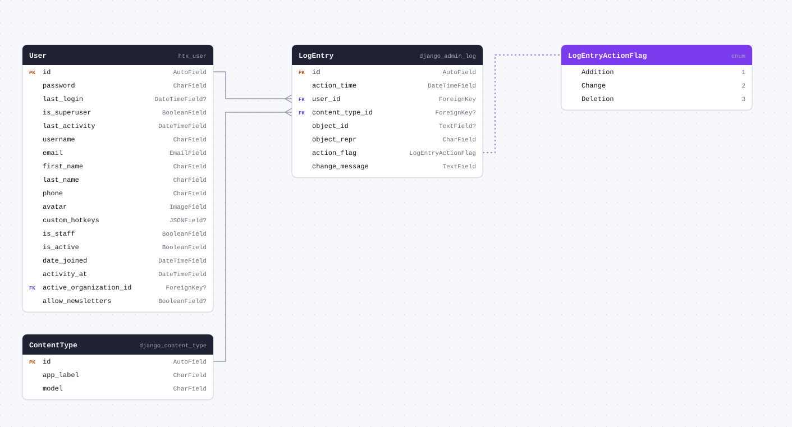

| Column | Field | Type | Null | Key | Default | Description |
| --- | --- | --- | --- | --- | --- | --- |
| `id` | `AutoField` | `integer` |  | PK | `autoincrement()` |  |
| `action_time` | `DateTimeField` | `datetime` |  |  | `now()` |  |
| `user_id` | `ForeignKey` | `integer` |  | FK |  |  |
| `content_type_id` | `ForeignKey` | `integer` | yes | FK |  |  |
| `object_id` | `TextField` | `text` | yes |  |  |  |
| `object_repr` | `CharField` | `varchar(200)` |  |  |  |  |
| `action_flag` | `LogEntryActionFlag` | `smallint unsigned` |  |  |  |  |
| `change_message` | `TextField` | `text` |  |  |  |  |

Indexes:

- index `django_admin_log_user_id_c564eba6` on `user_id`
- index `django_admin_log_content_type_id_c4bce8eb` on `content_type_id`

Relations:

- `user_id` → [User](#user).`id`, on delete cascade
- `content_type_id` → [ContentType](#contenttype).`id`, on delete set null

## Permission

Table `auth_permission`, app `auth`.

The permissions system provides a way to assign permissions to specific
users and groups of users.

The permission system is used by the Django admin site, but may also be
useful in your own code. The Django admin site uses permissions as follows:

    - The "add" permission limits the user's ability to view the "add" form
      and add an object.
    - The "change" permission limits a user's ability to view the change
      list, view the "change" form and change an object.
    - The "delete" permission limits the ability to delete an object.
    - The "view" permission limits the ability to view an object.

Permissions are set globally per type of object, not per specific object
instance. It is possible to say "Mary may change news stories," but it's
not currently possible to say "Mary may change news stories, but only the
ones she created herself" or "Mary may only change news stories that have a
certain status or publication date."

The permissions listed above are automatically created for each model.

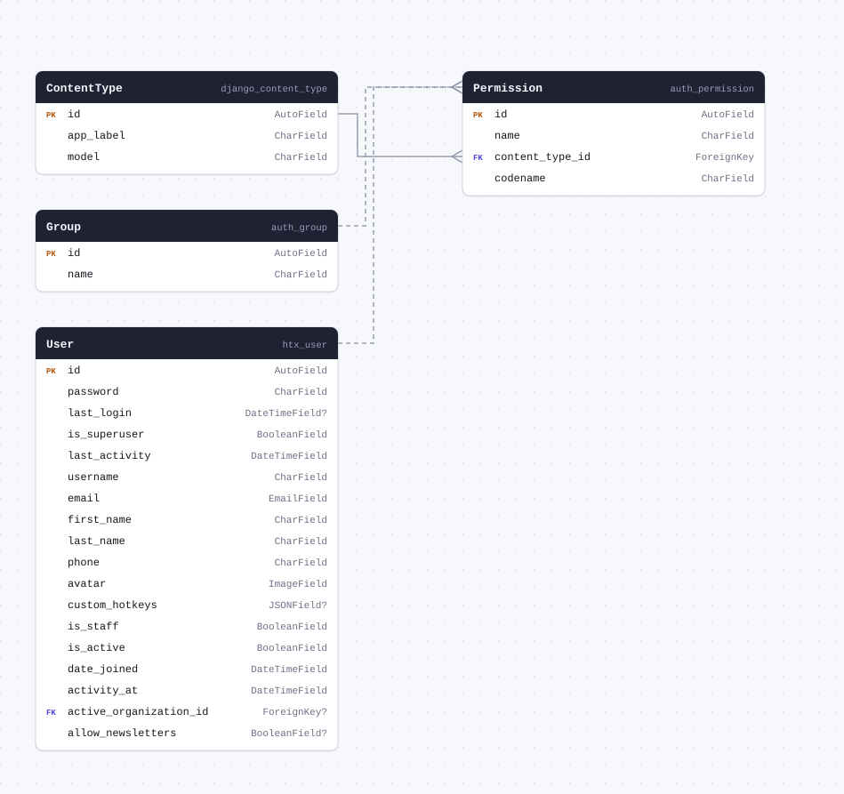

| Column | Field | Type | Null | Key | Default | Description |
| --- | --- | --- | --- | --- | --- | --- |
| `id` | `AutoField` | `integer` |  | PK | `autoincrement()` |  |
| `name` | `CharField` | `varchar(255)` |  |  |  |  |
| `content_type_id` | `ForeignKey` | `integer` |  | FK |  |  |
| `codename` | `CharField` | `varchar(100)` |  |  |  |  |

Indexes:

- index `auth_permission_content_type_id_2f476e4b` on `content_type_id`
- unique `auth_permission_content_type_id_codename_01ab375a_uniq` on `content_type_id`, `codename`

Relations:

- `content_type_id` → [ContentType](#contenttype).`id`, on delete cascade
- `group_set` — many to many with [Group](#group)
- `user_set` — many to many with [User](#user)

## Group

Table `auth_group`, app `auth`.

Groups are a generic way of categorizing users to apply permissions, or
some other label, to those users. A user can belong to any number of
groups.

A user in a group automatically has all the permissions granted to that
group. For example, if the group 'Site editors' has the permission
can_edit_home_page, any user in that group will have that permission.

Beyond permissions, groups are a convenient way to categorize users to
apply some label, or extended functionality, to them. For example, you
could create a group 'Special users', and you could write code that would
do special things to those users -- such as giving them access to a
members-only portion of your site, or sending them members-only email
messages.

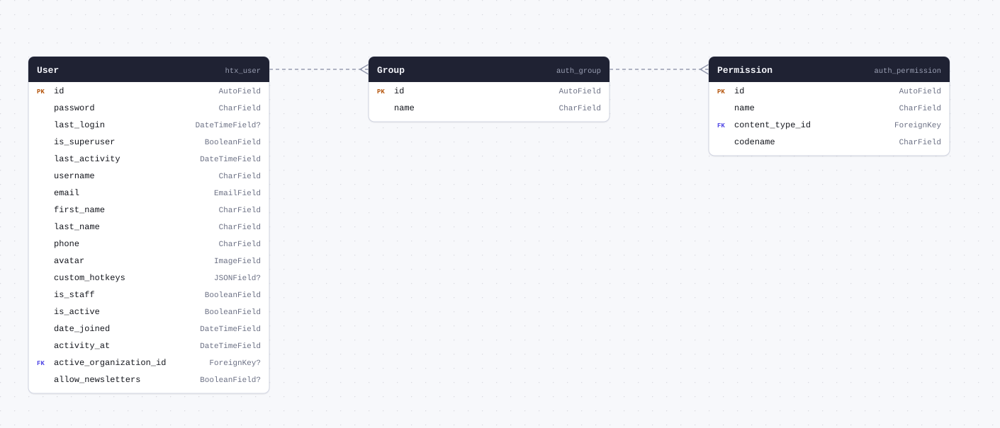

| Column | Field | Type | Null | Key | Default | Description |
| --- | --- | --- | --- | --- | --- | --- |
| `id` | `AutoField` | `integer` |  | PK | `autoincrement()` |  |
| `name` | `CharField` | `varchar(150)` |  | unique |  |  |

Relations:

- `permissions` — many to many with [Permission](#permission)
- `user_set` — many to many with [User](#user)

## ContentType

Table `django_content_type`, app `contenttypes`.


| Column | Field | Type | Null | Key | Default | Description |
| --- | --- | --- | --- | --- | --- | --- |
| `id` | `AutoField` | `integer` |  | PK | `autoincrement()` |  |
| `app_label` | `CharField` | `varchar(100)` |  |  |  |  |
| `model` | `CharField` | `varchar(100)` |  |  |  |  |

Indexes:

- unique `django_content_type_app_label_model_76bd3d3b_uniq` on `app_label`, `model`

Relations:

- [LogEntry](#logentry).`content_type_id` → `id`, on delete set null
- [Permission](#permission).`content_type_id` → `id`, on delete cascade

## Session

Table `django_session`, app `sessions`.

Columns from `AbstractBaseSession` (abstract): `session_key`, `session_data`, `expire_date`.

Django provides full support for anonymous sessions. The session
framework lets you store and retrieve arbitrary data on a
per-site-visitor basis. It stores data on the server side and
abstracts the sending and receiving of cookies. Cookies contain a
session ID -- not the data itself.

The Django sessions framework is entirely cookie-based. It does
not fall back to putting session IDs in URLs. This is an intentional
design decision. Not only does that behavior make URLs ugly, it makes
your site vulnerable to session-ID theft via the "Referer" header.

For complete documentation on using Sessions in your code, consult
the sessions documentation that is shipped with Django (also available
on the Django web site).

| Column | Field | Type | Null | Key | Default | Description |
| --- | --- | --- | --- | --- | --- | --- |
| `session_key` | `CharField` | `varchar(40)` |  | PK |  |  |
| `session_data` | `TextField` | `text` |  |  |  |  |
| `expire_date` | `DateTimeField` | `datetime` |  |  |  |  |

Indexes:

- index `django_session_expire_date_a5c62663` on `expire_date`

## Queue

Table `django_rq_queue`, app `django_rq`.

Not managed by Django (`managed = False`): it neither creates nor changes the table, whose indexes are the ones its own SQL gives it.

Placeholder model with no database table, but with django admin page
and contenttype permission

| Column | Field | Type | Null | Key | Default | Description |
| --- | --- | --- | --- | --- | --- | --- |
| `id` | `AutoField` | `integer` |  | PK | `autoincrement()` |  |

## Token

Table `authtoken_token`, app `authtoken`.

Proxy models, on this table: `TokenProxy`.

The default authorization token model.

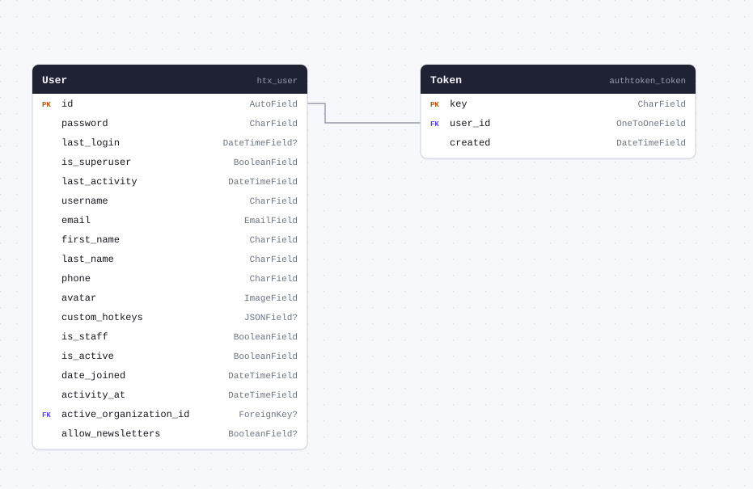

| Column | Field | Type | Null | Key | Default | Description |
| --- | --- | --- | --- | --- | --- | --- |
| `key` | `CharField` | `varchar(40)` |  | PK |  |  |
| `user_id` | `OneToOneField` | `integer` |  | FK, unique |  |  |
| `created` | `DateTimeField` | `datetime` |  |  | `now()` |  |

Relations:

- `user_id` → [User](#user).`id`, on delete cascade

## OutstandingToken

Table `token_blacklist_outstandingtoken`, app `token_blacklist`.

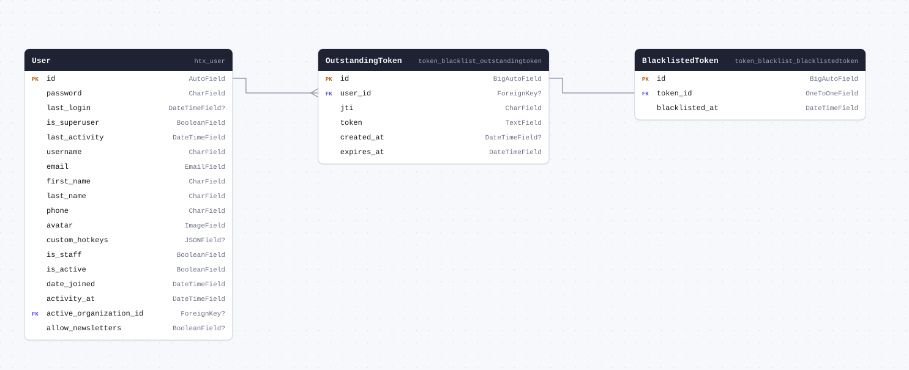

| Column | Field | Type | Null | Key | Default | Description |
| --- | --- | --- | --- | --- | --- | --- |
| `id` | `BigAutoField` | `integer` |  | PK | `autoincrement()` |  |
| `user_id` | `ForeignKey` | `integer` | yes | FK |  |  |
| `jti` | `CharField` | `varchar(255)` |  | unique |  |  |
| `token` | `TextField` | `text` |  |  |  |  |
| `created_at` | `DateTimeField` | `datetime` | yes |  |  |  |
| `expires_at` | `DateTimeField` | `datetime` |  |  |  |  |

Indexes:

- index `token_blacklist_outstandingtoken_user_id_83bc629a` on `user_id`

Relations:

- `user_id` → [User](#user).`id`, on delete set null
- [BlacklistedToken](#blacklistedtoken).`token_id` → `id`, on delete cascade

## BlacklistedToken

Table `token_blacklist_blacklistedtoken`, app `token_blacklist`.

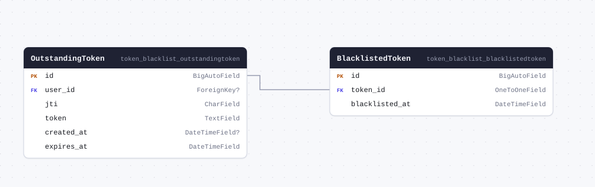

| Column | Field | Type | Null | Key | Default | Description |
| --- | --- | --- | --- | --- | --- | --- |
| `id` | `BigAutoField` | `integer` |  | PK | `autoincrement()` |  |
| `token_id` | `OneToOneField` | `bigint` |  | FK, unique |  |  |
| `blacklisted_at` | `DateTimeField` | `datetime` |  |  | `now()` |  |

Relations:

- `token_id` → [OutstandingToken](#outstandingtoken).`id`, on delete cascade

## TaskState

Table `fsm_taskstate`, app `fsm`.

Columns from `BaseState` (abstract): `id`, `organization_id`, `state`, `previous_state`, `transition_name`, `triggered_by_id`, `context_data`, `reason`, `created_at`.

Core task state tracking for Label Studio.
Provides basic task state management with:
- Simple 3-state workflow (CREATED → IN_PROGRESS → COMPLETED)
- High-performance queries with UUID7 ordering

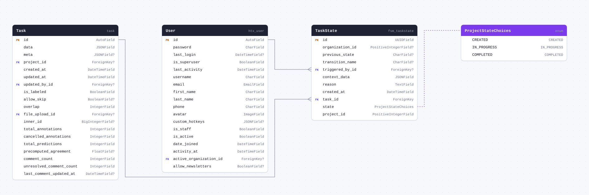

| Column | Field | Type | Null | Key | Default | Description |
| --- | --- | --- | --- | --- | --- | --- |
| `id` | `UUIDField` | `char(32)` |  | PK | `generate_uuid7()` | UUID7 provides natural time ordering and global uniqueness |
| `organization_id` | `PositiveIntegerField` | `integer unsigned` | yes |  |  | Organization ID that owns this state record (for multi-tenant applications) |
| `previous_state` | `CharField` | `varchar(50)` | yes |  |  | Previous state before this transition |
| `transition_name` | `CharField` | `varchar(100)` | yes |  |  | Name of the transition method that triggered this state change |
| `triggered_by_id` | `ForeignKey` | `integer` | yes | FK |  | User who triggered this state transition |
| `context_data` | `JSONField` | `text` |  |  | `dict()` | Additional context data for this transition (e.g., validation results, external IDs) |
| `reason` | `TextField` | `text` |  |  |  | Human-readable reason for this state transition |
| `created_at` | `DateTimeField` | `datetime` |  |  | `now()` | Human-readable timestamp for debugging (UUID7 id contains precise timestamp) |
| `task_id` | `ForeignKey` | `integer` |  | FK |  |  |
| `state` | `ProjectStateChoices` | `varchar(50)` |  |  |  |  |
| `project_id` | `PositiveIntegerField` | `integer unsigned` |  |  |  | From task.project_id - denormalized for performance |

Indexes:

- index `fsm_taskstate_organization_id_192d4ce3` on `organization_id`
- index `fsm_taskstate_triggered_by_id_1f1dfd8f` on `triggered_by_id`
- index `fsm_taskstate_task_id_94042c41` on `task_id`
- index `fsm_taskstate_state_d158253a` on `state`
- index `fsm_taskstate_project_id_4e135c45` on `project_id`
- index `task_current_state_idx` on `task_id`, `id` desc
- index `task_project_state_idx` on `project_id`, `state`, `id` desc
- index `task_org_reporting_idx` on `organization_id`, `state`, `id` desc
- index `task_history_idx` on `task_id`, `id`

Relations:

- `triggered_by_id` → [User](#user).`id`, on delete set null
- `task_id` → [Task](#task).`id`, on delete cascade

## AnnotationState

Table `fsm_annotationstate`, app `fsm`.

Columns from `BaseState` (abstract): `id`, `organization_id`, `state`, `previous_state`, `transition_name`, `triggered_by_id`, `context_data`, `reason`, `created_at`.

Core annotation state tracking for Label Studio.
Provides basic annotation state management with:
- Simple 2-state workflow (CREATED → COMPLETED)

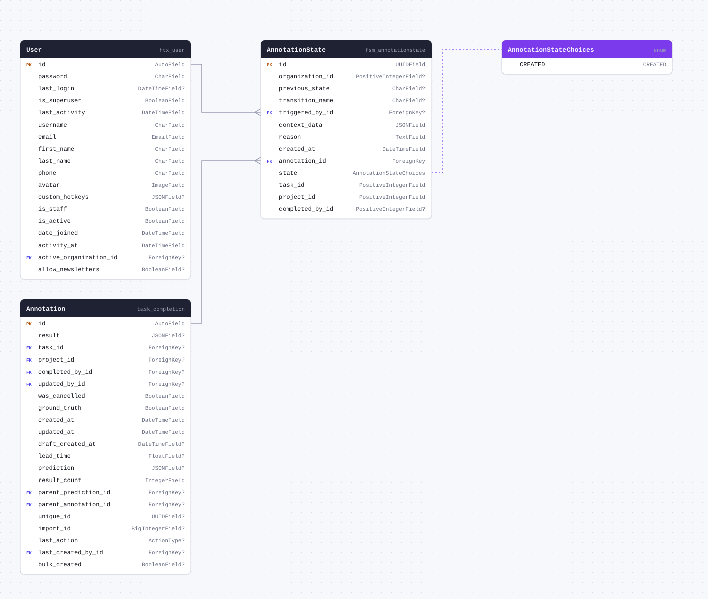

| Column | Field | Type | Null | Key | Default | Description |
| --- | --- | --- | --- | --- | --- | --- |
| `id` | `UUIDField` | `char(32)` |  | PK | `generate_uuid7()` | UUID7 provides natural time ordering and global uniqueness |
| `organization_id` | `PositiveIntegerField` | `integer unsigned` | yes |  |  | Organization ID that owns this state record (for multi-tenant applications) |
| `previous_state` | `CharField` | `varchar(50)` | yes |  |  | Previous state before this transition |
| `transition_name` | `CharField` | `varchar(100)` | yes |  |  | Name of the transition method that triggered this state change |
| `triggered_by_id` | `ForeignKey` | `integer` | yes | FK |  | User who triggered this state transition |
| `context_data` | `JSONField` | `text` |  |  | `dict()` | Additional context data for this transition (e.g., validation results, external IDs) |
| `reason` | `TextField` | `text` |  |  |  | Human-readable reason for this state transition |
| `created_at` | `DateTimeField` | `datetime` |  |  | `now()` | Human-readable timestamp for debugging (UUID7 id contains precise timestamp) |
| `annotation_id` | `ForeignKey` | `integer` |  | FK |  |  |
| `state` | `AnnotationStateChoices` | `varchar(50)` |  |  |  |  |
| `task_id` | `PositiveIntegerField` | `integer unsigned` |  |  |  | From annotation.task_id - denormalized for performance |
| `project_id` | `PositiveIntegerField` | `integer unsigned` |  |  |  | From annotation.task.project_id - denormalized for performance |
| `completed_by_id` | `PositiveIntegerField` | `integer unsigned` | yes |  |  | From annotation.completed_by_id - denormalized for performance |

Indexes:

- index `fsm_annotationstate_organization_id_a5163275` on `organization_id`
- index `fsm_annotationstate_triggered_by_id_1e47eb15` on `triggered_by_id`
- index `fsm_annotationstate_annotation_id_a73ea2ec` on `annotation_id`
- index `fsm_annotationstate_state_84d28d51` on `state`
- index `fsm_annotationstate_task_id_e50e54d5` on `task_id`
- index `fsm_annotationstate_project_id_bf5279de` on `project_id`
- index `fsm_annotationstate_completed_by_id_3f46eae0` on `completed_by_id`
- index `anno_current_state_idx` on `annotation_id`, `id` desc
- index `anno_task_state_idx` on `task_id`, `state`, `id` desc
- index `anno_user_report_idx` on `completed_by_id`, `state`, `id` desc
- index `anno_project_report_idx` on `project_id`, `state`, `id` desc

Relations:

- `triggered_by_id` → [User](#user).`id`, on delete set null
- `annotation_id` → [Annotation](#annotation).`id`, on delete cascade

## ProjectState

Table `fsm_projectstate`, app `fsm`.

Columns from `BaseState` (abstract): `id`, `organization_id`, `state`, `previous_state`, `transition_name`, `triggered_by_id`, `context_data`, `reason`, `created_at`.

Core project state tracking for Label Studio.
Provides basic project state management with:
- Simple 3-state workflow (CREATED → IN_PROGRESS → COMPLETED)
- Project lifecycle tracking

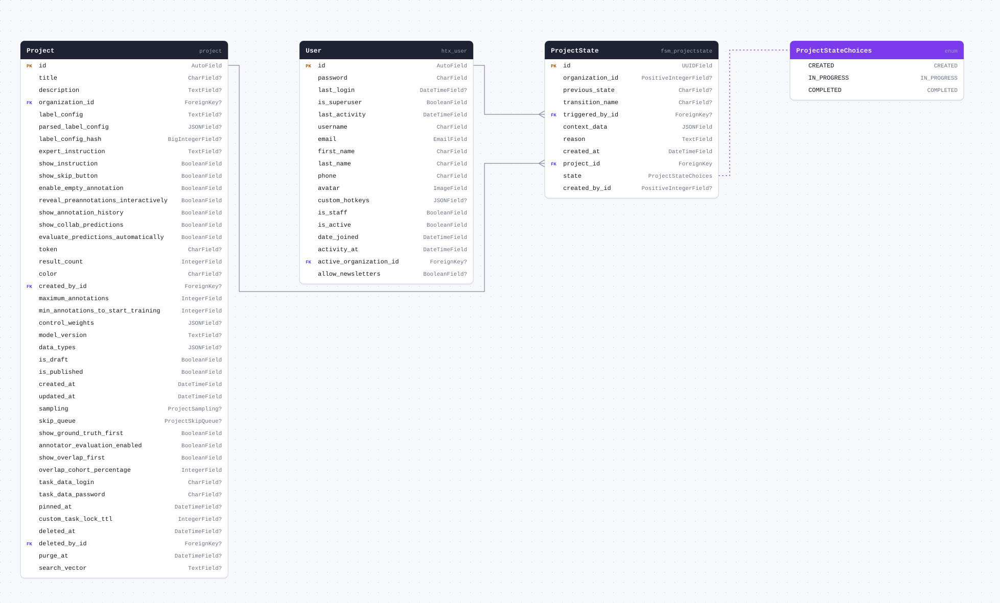

| Column | Field | Type | Null | Key | Default | Description |
| --- | --- | --- | --- | --- | --- | --- |
| `id` | `UUIDField` | `char(32)` |  | PK | `generate_uuid7()` | UUID7 provides natural time ordering and global uniqueness |
| `organization_id` | `PositiveIntegerField` | `integer unsigned` | yes |  |  | Organization ID that owns this state record (for multi-tenant applications) |
| `previous_state` | `CharField` | `varchar(50)` | yes |  |  | Previous state before this transition |
| `transition_name` | `CharField` | `varchar(100)` | yes |  |  | Name of the transition method that triggered this state change |
| `triggered_by_id` | `ForeignKey` | `integer` | yes | FK |  | User who triggered this state transition |
| `context_data` | `JSONField` | `text` |  |  | `dict()` | Additional context data for this transition (e.g., validation results, external IDs) |
| `reason` | `TextField` | `text` |  |  |  | Human-readable reason for this state transition |
| `created_at` | `DateTimeField` | `datetime` |  |  | `now()` | Human-readable timestamp for debugging (UUID7 id contains precise timestamp) |
| `project_id` | `ForeignKey` | `integer` |  | FK |  |  |
| `state` | `ProjectStateChoices` | `varchar(50)` |  |  |  |  |
| `created_by_id` | `PositiveIntegerField` | `integer unsigned` | yes |  |  | From project.created_by_id - denormalized for performance |

Indexes:

- index `fsm_projectstate_organization_id_3889ce76` on `organization_id`
- index `fsm_projectstate_triggered_by_id_345c19fc` on `triggered_by_id`
- index `fsm_projectstate_project_id_590cf19b` on `project_id`
- index `fsm_projectstate_state_4ee8839f` on `state`
- index `fsm_projectstate_created_by_id_4d716749` on `created_by_id`
- index `project_current_state_idx` on `project_id`, `id` desc
- index `project_org_state_idx` on `organization_id`, `state`, `id` desc
- index `project_org_reporting_idx` on `organization_id`, `id` desc

Relations:

- `triggered_by_id` → [User](#user).`id`, on delete set null
- `project_id` → [Project](#project).`id`, on delete cascade

## AsyncMigrationStatus

Table `core_asyncmigrationstatus`, app `core`.

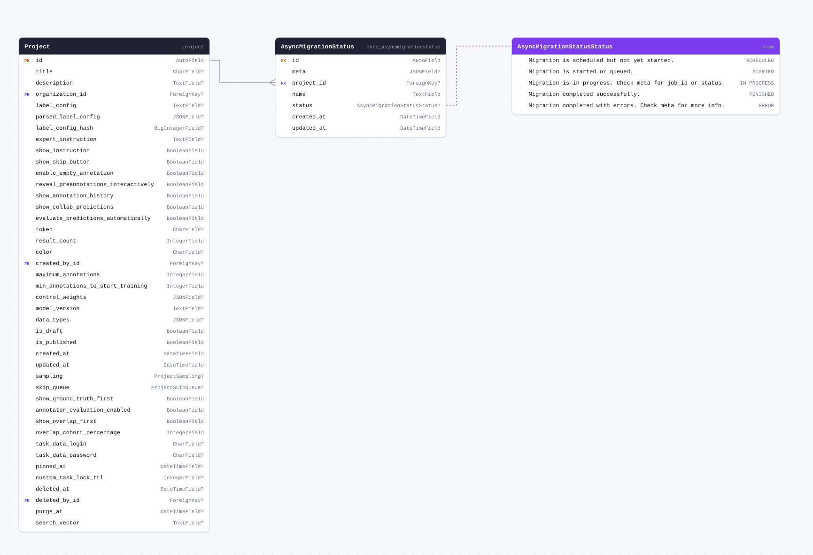

| Column | Field | Type | Null | Key | Default | Description |
| --- | --- | --- | --- | --- | --- | --- |
| `id` | `AutoField` | `integer` |  | PK | `autoincrement()` |  |
| `meta` | `JSONField` | `text` | yes |  | `dict()` | Meta is for any params for migrations, e.g.: project, filter or error message. |
| `project_id` | `ForeignKey` | `integer` | yes | FK |  | Project ID for this migration |
| `name` | `TextField` | `text` |  |  |  | Migration name |
| `status` | `AsyncMigrationStatusStatus` | `varchar(100)` | yes |  | `None` |  |
| `created_at` | `DateTimeField` | `datetime` |  |  | `now()` | Creation time |
| `updated_at` | `DateTimeField` | `datetime` |  |  | `now()` | Last updated time |

Indexes:

- index `core_asyncmigrationstatus_project_id_c78fbf75` on `project_id`

Relations:

- `project_id` → [Project](#project).`id`, on delete cascade

## DeletedRow

Table `core_deletedrow`, app `core`.

Model to store deleted rows of other models.
Useful for using as backup for deleted rows, in case we need to restore them.

| Column | Field | Type | Null | Key | Default | Description |
| --- | --- | --- | --- | --- | --- | --- |
| `id` | `AutoField` | `integer` |  | PK | `autoincrement()` |  |
| `model` | `CharField` | `varchar(1024)` |  |  |  |  |
| `row_id` | `IntegerField` | `integer` | yes |  |  |  |
| `data` | `JSONField` | `text` | yes |  |  |  |
| `reason` | `TextField` | `text` | yes |  |  |  |
| `created_at` | `DateTimeField` | `datetime` |  |  | `now()` |  |
| `updated_at` | `DateTimeField` | `datetime` |  |  | `now()` |  |
| `organization_id` | `IntegerField` | `integer` | yes |  |  |  |
| `project_id` | `IntegerField` | `integer` | yes |  |  |  |
| `user_id` | `IntegerField` | `integer` | yes |  |  |  |

## User

Table `htx_user`, app `users`.

Columns from `AbstractBaseUser` (abstract): `password`, `last_login`.

Columns from `PermissionsMixin` (abstract): `is_superuser`.

Columns from `UserLastActivityMixin` (abstract): `last_activity`.

An abstract base class implementing a fully featured User model with
admin-compliant permissions.

Username and password are required. Other fields are optional.

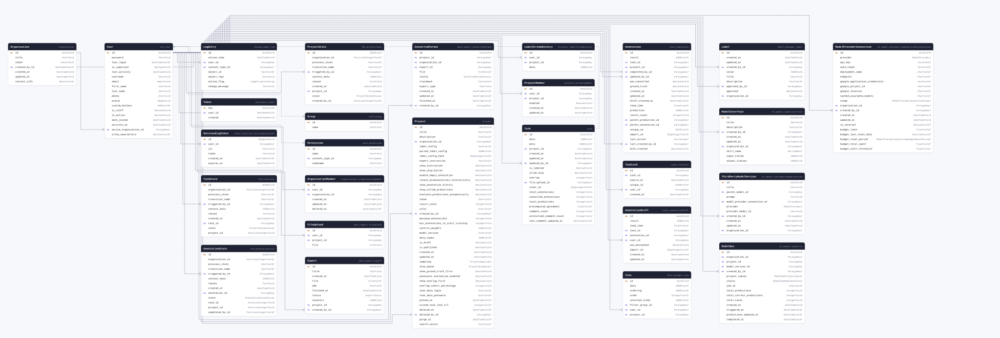

| Column | Field | Type | Null | Key | Default | Description |
| --- | --- | --- | --- | --- | --- | --- |
| `id` | `AutoField` | `integer` |  | PK | `autoincrement()` |  |
| `password` | `CharField` | `varchar(128)` |  |  |  |  |
| `last_login` | `DateTimeField` | `datetime` | yes |  |  |  |
| `is_superuser` | `BooleanField` | `bool` |  |  | `False` | Designates that this user has all permissions without explicitly assigning them. |
| `last_activity` | `DateTimeField` | `datetime` |  |  | `now()` |  |
| `username` | `CharField` | `varchar(256)` |  |  |  |  |
| `email` | `EmailField` | `varchar(254)` |  | unique |  |  |
| `first_name` | `CharField` | `varchar(256)` |  |  |  |  |
| `last_name` | `CharField` | `varchar(256)` |  |  |  |  |
| `phone` | `CharField` | `varchar(256)` |  |  |  |  |
| `avatar` | `ImageField` | `varchar(100)` |  |  |  |  |
| `custom_hotkeys` | `JSONField` | `text` | yes |  | `dict()` | Custom keyboard shortcuts configuration for the user interface |
| `is_staff` | `BooleanField` | `bool` |  |  | `False` | Designates whether the user can log into this admin site. |
| `is_active` | `BooleanField` | `bool` |  |  | `True` | Designates whether to treat this user as active. Unselect this instead of deleting accounts. |
| `date_joined` | `DateTimeField` | `datetime` |  |  | `now()` |  |
| `activity_at` | `DateTimeField` | `datetime` |  |  | `now()` |  |
| `active_organization_id` | `ForeignKey` | `integer` | yes | FK |  |  |
| `allow_newsletters` | `BooleanField` | `bool` | yes |  | `None` | Allow sending newsletters to user |

Indexes:

- index `htx_user_active_organization_id_2e1bb565` on `active_organization_id`
- index `htx_user_usernam_a41619_idx` on `username`
- index `htx_user_email_051c68_idx` on `email`
- index `htx_user_first_n_93c5de_idx` on `first_name`
- index `htx_user_last_na_2ace53_idx` on `last_name`
- index `htx_user_date_jo_3bd95e_idx` on `date_joined`

Relations:

- `organizations` — many to many with [Organization](#organization), through [OrganizationMember](#organizationmember)
- [LogEntry](#logentry).`user_id` → `id`, on delete cascade
- [Token](#token).`user_id` → `id`, on delete cascade
- [OutstandingToken](#outstandingtoken).`user_id` → `id`, on delete set null
- [TaskState](#taskstate).`triggered_by_id` → `id`, on delete set null
- [AnnotationState](#annotationstate).`triggered_by_id` → `id`, on delete set null
- [ProjectState](#projectstate).`triggered_by_id` → `id`, on delete set null
- `active_organization_id` → [Organization](#organization).`id`, on delete set null
- `groups` — many to many with [Group](#group)
- `user_permissions` — many to many with [Permission](#permission)
- [OrganizationMember](#organizationmember).`user_id` → `id`, on delete cascade
- [Organization](#organization).`created_by_id` → `id`, on delete set null
- [FileUpload](#fileupload).`user_id` → `id`, on delete cascade
- [Export](#export).`created_by_id` → `id`, on delete set null
- [ConvertedFormat](#convertedformat).`created_by_id` → `id`, on delete set null
- [Project](#project).`created_by_id` → `id`, on delete set null
- [Project](#project).`deleted_by_id` → `id`, on delete set null
- [LabelStreamHistory](#labelstreamhistory).`user_id` → `id`, on delete cascade
- [ProjectMember](#projectmember).`user_id` → `id`, on delete cascade
- [Task](#task).`updated_by_id` → `id`, on delete set null
- `tasks_with_comments` — many to many with [Task](#task)
- [Annotation](#annotation).`completed_by_id` → `id`, on delete set null
- [Annotation](#annotation).`updated_by_id` → `id`, on delete set null
- [Annotation](#annotation).`last_created_by_id` → `id`, on delete set null
- [TaskLock](#tasklock).`user_id` → `id`, on delete cascade
- [AnnotationDraft](#annotationdraft).`user_id` → `id`, on delete cascade
- [View](#view).`user_id` → `id`, on delete cascade
- [Label](#label).`created_by_id` → `id`, on delete cascade
- [Label](#label).`approved_by_id` → `id`, on delete cascade
- [ModelInterface](#modelinterface).`created_by_id` → `id`, on delete set null
- [ThirdPartyModelVersion](#thirdpartymodelversion).`created_by_id` → `id`, on delete set null
- [ModelRun](#modelrun).`created_by_id` → `id`, on delete set null
- [ModelProviderConnection](#modelproviderconnection).`created_by_id` → `id`, on delete set null

## OrganizationMember

Table `organizations_organizationmember`, app `organizations`.

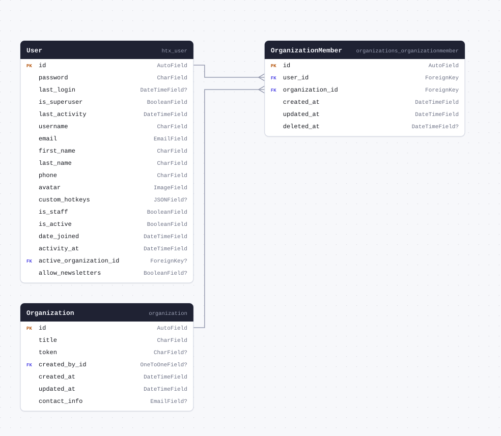

| Column | Field | Type | Null | Key | Default | Description |
| --- | --- | --- | --- | --- | --- | --- |
| `id` | `AutoField` | `integer` |  | PK | `autoincrement()` |  |
| `user_id` | `ForeignKey` | `integer` |  | FK |  | User ID |
| `organization_id` | `ForeignKey` | `integer` |  | FK |  | Organization ID |
| `created_at` | `DateTimeField` | `datetime` |  |  | `now()` |  |
| `updated_at` | `DateTimeField` | `datetime` |  |  | `now()` |  |
| `deleted_at` | `DateTimeField` | `datetime` | yes |  | `None` | Timestamp indicating when the organization member was marked as deleted.  If NULL, the member is not considered deleted. |

Indexes:

- index `organizations_organizationmember_user_id_f3845ee5` on `user_id`
- index `organizations_organizationmember_organization_id_f26cf71b` on `organization_id`
- index `organizations_organizationmember_deleted_at_af2d5523` on `deleted_at`

Relations:

- `user_id` → [User](#user).`id`, on delete cascade
- `organization_id` → [Organization](#organization).`id`, on delete cascade

## Organization

Table `organization`, app `organizations`.

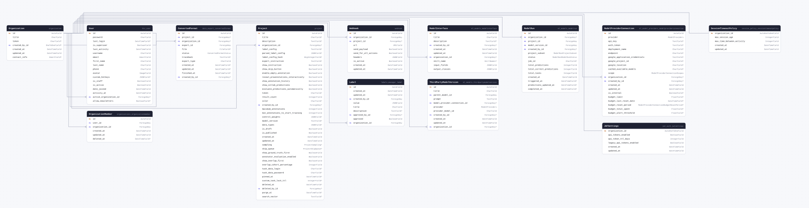

| Column | Field | Type | Null | Key | Default | Description |
| --- | --- | --- | --- | --- | --- | --- |
| `id` | `AutoField` | `integer` |  | PK | `autoincrement()` |  |
| `title` | `CharField` | `varchar(1000)` |  |  |  |  |
| `token` | `CharField` | `varchar(256)` | yes | unique | `create_hash()` |  |
| `created_by_id` | `OneToOneField` | `integer` | yes | FK, unique |  |  |
| `created_at` | `DateTimeField` | `datetime` |  |  | `now()` |  |
| `updated_at` | `DateTimeField` | `datetime` |  |  | `now()` |  |
| `contact_info` | `EmailField` | `varchar(254)` | yes |  |  |  |

Relations:

- `users` — many to many with [User](#user), through [OrganizationMember](#organizationmember)
- [User](#user).`active_organization_id` → `id`, on delete set null
- [OrganizationMember](#organizationmember).`organization_id` → `id`, on delete cascade
- `created_by_id` → [User](#user).`id`, on delete set null
- [ConvertedFormat](#convertedformat).`organization_id` → `id`, on delete cascade
- [Project](#project).`organization_id` → `id`, on delete cascade
- [Webhook](#webhook).`organization_id` → `id`, on delete cascade
- [Label](#label).`organization_id` → `id`, on delete cascade
- [ModelInterface](#modelinterface).`organization_id` → `id`, on delete cascade
- [ThirdPartyModelVersion](#thirdpartymodelversion).`organization_id` → `id`, on delete cascade
- [ModelRun](#modelrun).`organization_id` → `id`, on delete cascade
- [ModelProviderConnection](#modelproviderconnection).`organization_id` → `id`, on delete cascade
- [JWTSettings](#jwtsettings).`organization_id` → `id`, on delete do nothing
- [SessionTimeoutPolicy](#sessiontimeoutpolicy).`organization_id` → `id`, on delete do nothing

## FileUpload

Table `data_import_fileupload`, app `data_import`.

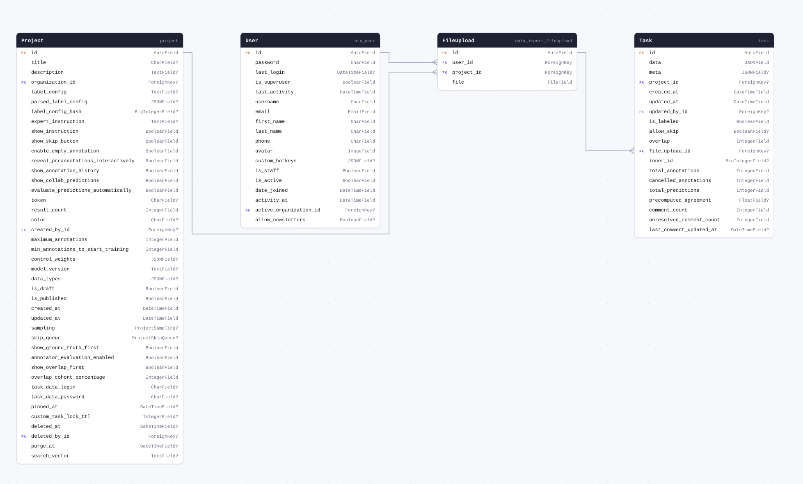

| Column | Field | Type | Null | Key | Default | Description |
| --- | --- | --- | --- | --- | --- | --- |
| `id` | `AutoField` | `integer` |  | PK | `autoincrement()` |  |
| `user_id` | `ForeignKey` | `integer` |  | FK |  |  |
| `project_id` | `ForeignKey` | `integer` |  | FK |  |  |
| `file` | `FileField` | `varchar(100)` |  |  |  |  |

Indexes:

- index `data_import_fileupload_user_id_a3e1f065` on `user_id`
- index `data_import_fileupload_project_id_1f511810` on `project_id`

Relations:

- `user_id` → [User](#user).`id`, on delete cascade
- `project_id` → [Project](#project).`id`, on delete cascade
- [Task](#task).`file_upload_id` → `id`, on delete set null

## Export

Table `data_export_export`, app `data_export`.

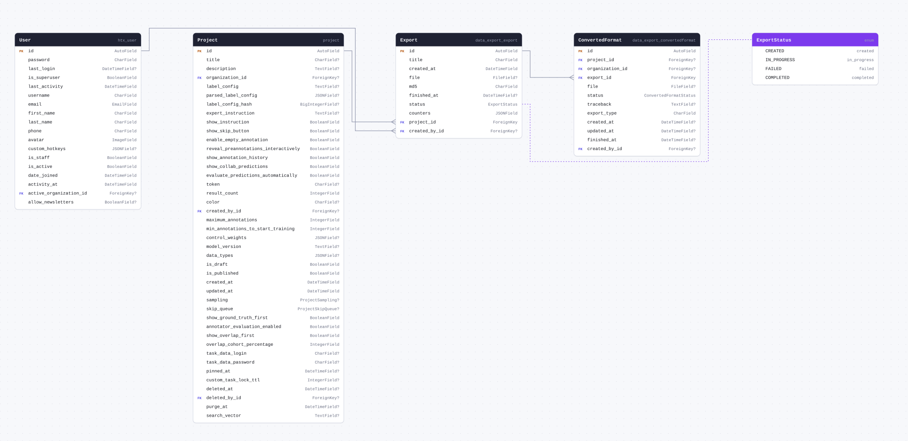

| Column | Field | Type | Null | Key | Default | Description |
| --- | --- | --- | --- | --- | --- | --- |
| `id` | `AutoField` | `integer` |  | PK | `autoincrement()` |  |
| `title` | `CharField` | `varchar(2048)` |  |  | `''` |  |
| `created_at` | `DateTimeField` | `datetime` |  |  | `now()` | Creation time |
| `file` | `FileField` | `varchar(100)` | yes |  |  |  |
| `md5` | `CharField` | `varchar(128)` |  |  | `''` |  |
| `finished_at` | `DateTimeField` | `datetime` | yes |  | `None` | Complete or fail time |
| `status` | `ExportStatus` | `varchar(64)` |  |  | `'created'` |  |
| `counters` | `JSONField` | `text` |  |  | `dict()` |  |
| `project_id` | `ForeignKey` | `integer` |  | FK |  |  |
| `created_by_id` | `ForeignKey` | `integer` | yes | FK |  |  |

Indexes:

- index `data_export_export_project_id_dc05487f` on `project_id`
- index `data_export_export_created_by_id_ae0b7af3` on `created_by_id`

Relations:

- `project_id` → [Project](#project).`id`, on delete cascade
- `created_by_id` → [User](#user).`id`, on delete set null
- [ConvertedFormat](#convertedformat).`export_id` → `id`, on delete cascade

## ConvertedFormat

Table `data_export_convertedformat`, app `data_export`.

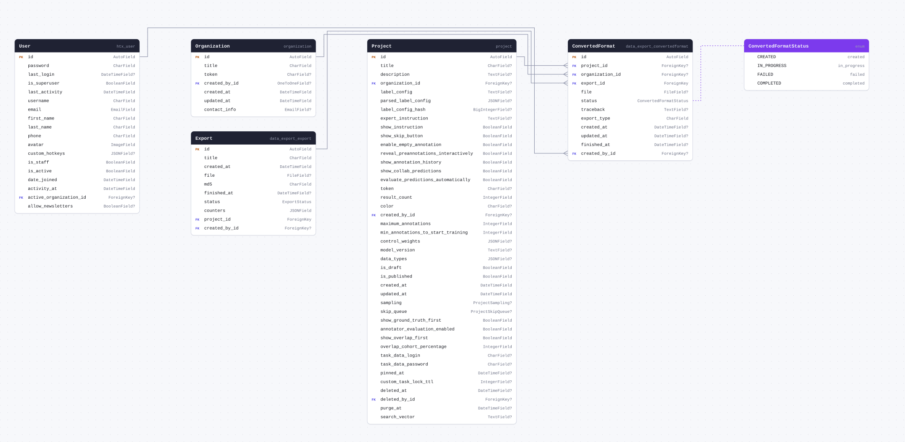

| Column | Field | Type | Null | Key | Default | Description |
| --- | --- | --- | --- | --- | --- | --- |
| `id` | `AutoField` | `integer` |  | PK | `autoincrement()` |  |
| `project_id` | `ForeignKey` | `integer` | yes | FK |  |  |
| `organization_id` | `ForeignKey` | `integer` | yes | FK |  |  |
| `export_id` | `ForeignKey` | `integer` |  | FK |  | Export snapshot for this converted file |
| `file` | `FileField` | `varchar(100)` | yes |  |  |  |
| `status` | `ConvertedFormatStatus` | `varchar(64)` |  |  | `'created'` |  |
| `traceback` | `TextField` | `text` | yes |  |  | Traceback report in case of errors |
| `export_type` | `CharField` | `varchar(64)` |  |  |  |  |
| `created_at` | `DateTimeField` | `datetime` | yes |  | `now()` | Creation time |
| `updated_at` | `DateTimeField` | `datetime` | yes |  | `now()` | Updated time |
| `finished_at` | `DateTimeField` | `datetime` | yes |  | `None` | Complete or fail time |
| `created_by_id` | `ForeignKey` | `integer` | yes | FK |  |  |

Indexes:

- index `data_export_convertedformat_project_id_3cda1a1c` on `project_id`
- index `data_export_convertedformat_organization_id_d0e9d7c8` on `organization_id`
- index `data_export_convertedformat_export_id_3305f028` on `export_id`
- index `data_export_convertedformat_created_by_id_a765f2cd` on `created_by_id`

Relations:

- `project_id` → [Project](#project).`id`, on delete cascade
- `organization_id` → [Organization](#organization).`id`, on delete cascade
- `export_id` → [Export](#export).`id`, on delete cascade
- `created_by_id` → [User](#user).`id`, on delete set null

## Project

Table `project`, app `projects`.

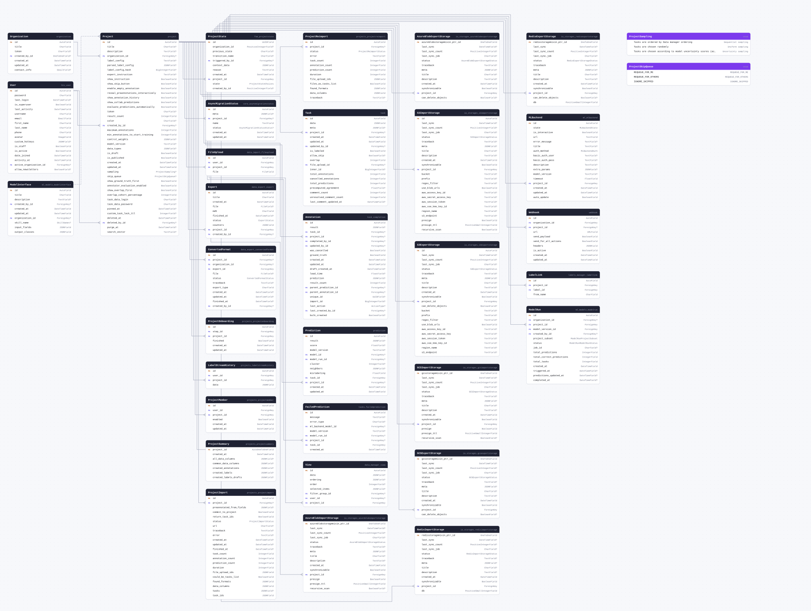

| Column | Field | Type | Null | Key | Default | Description |
| --- | --- | --- | --- | --- | --- | --- |
| `id` | `AutoField` | `integer` |  | PK | `autoincrement()` |  |
| `title` | `CharField` | `varchar(50)` | yes |  | `''` | Project name. Must be between 3 and 50 characters long. |
| `description` | `TextField` | `text` | yes |  | `''` | Project description |
| `organization_id` | `ForeignKey` | `integer` | yes | FK |  |  |
| `label_config` | `TextField` | `text` | yes |  | `'<View></View>'` | Label config in XML format. See more about it in documentation |
| `parsed_label_config` | `JSONField` | `text` | yes |  | `None` | Parsed label config in JSON format. See more about it in documentation |
| `label_config_hash` | `BigIntegerField` | `bigint` | yes |  | `None` |  |
| `expert_instruction` | `TextField` | `text` | yes |  | `''` | Labeling instructions in HTML format |
| `show_instruction` | `BooleanField` | `bool` |  |  | `False` | Show instructions to the annotator before they start |
| `show_skip_button` | `BooleanField` | `bool` |  |  | `True` | Show a skip button in interface and allow annotators to skip the task |
| `enable_empty_annotation` | `BooleanField` | `bool` |  |  | `True` | Allow annotators to submit empty annotations |
| `reveal_preannotations_interactively` | `BooleanField` | `bool` |  |  | `False` | Reveal pre-annotations interactively |
| `show_annotation_history` | `BooleanField` | `bool` |  |  | `False` | Show annotation history to annotator |
| `show_collab_predictions` | `BooleanField` | `bool` |  |  | `True` | If set, the annotator can view model predictions |
| `evaluate_predictions_automatically` | `BooleanField` | `bool` |  |  | `False` | Retrieve and display predictions when loading a task |
| `token` | `CharField` | `varchar(256)` | yes |  | `create_hash()` |  |
| `result_count` | `IntegerField` | `integer` |  |  | `0` | Total results inside of annotations counter |
| `color` | `CharField` | `varchar(16)` | yes |  | `'#FFFFFF'` |  |
| `created_by_id` | `ForeignKey` | `integer` | yes | FK |  |  |
| `maximum_annotations` | `IntegerField` | `integer` |  |  | `1` | Maximum number of annotations for one task. If the number of annotations per task is equal or greater to this value, the task is completed (is_labeled=True) |
| `min_annotations_to_start_training` | `IntegerField` | `integer` |  |  | `0` | Minimum number of completed tasks after which model training is started |
| `control_weights` | `JSONField` | `text` | yes |  | `dict()` | Dict of weights for each control tag in metric calculation. Each control tag (e.g. label or choice) will have it's own key in control weight dict with weight for each label and overall weight.For example, if bounding box annotation with control tag named my_bbox should be included with 0.33 weight in agreement calculation, and the first label Car should be twice more important than Airplaine, then you have to need the specify: {'my_bbox': {'type': 'RectangleLabels', 'labels': {'Car': 1.0, 'Airplaine': 0.5}, 'overall': 0.33} |
| `model_version` | `TextField` | `text` | yes |  | `''` | Machine learning model version |
| `data_types` | `JSONField` | `text` | yes |  | `dict()` |  |
| `is_draft` | `BooleanField` | `bool` |  |  | `False` | Whether or not the project is in the middle of being created |
| `is_published` | `BooleanField` | `bool` |  |  | `False` | Whether or not the project is published to annotators |
| `created_at` | `DateTimeField` | `datetime` |  |  | `now()` |  |
| `updated_at` | `DateTimeField` | `datetime` |  |  | `now()` |  |
| `sampling` | `ProjectSampling` | `varchar(100)` | yes |  | `'Sequential sampling'` |  |
| `skip_queue` | `ProjectSkipQueue` | `varchar(100)` | yes |  | `'REQUEUE_FOR_OTHERS'` |  |
| `show_ground_truth_first` | `BooleanField` | `bool` |  |  | `False` | Onboarding mode (true): show ground truth tasks first in the labeling stream |
| `annotator_evaluation_enabled` | `BooleanField` | `bool` |  |  | `0` (database) | Enable annotator evaluation for the project |
| `show_overlap_first` | `BooleanField` | `bool` |  |  | `False` |  |
| `overlap_cohort_percentage` | `IntegerField` | `integer` |  |  | `100` |  |
| `task_data_login` | `CharField` | `varchar(256)` | yes |  |  | Task data credentials: login |
| `task_data_password` | `CharField` | `varchar(256)` | yes |  |  | Task data credentials: password |
| `pinned_at` | `DateTimeField` | `datetime` | yes |  | `None` | Pinned date and time |
| `custom_task_lock_ttl` | `IntegerField` | `integer` | yes |  | `None` | Custom task lock TTL in seconds. If not set, the default value is used |
| `deleted_at` | `DateTimeField` | `datetime` | yes |  |  |  |
| `deleted_by_id` | `ForeignKey` | `integer` | yes | FK |  |  |
| `purge_at` | `DateTimeField` | `datetime` | yes |  |  |  |
| `search_vector` | `TextField` | `text` | yes |  |  |  |

Indexes:

- index `project_organization_id_3c9f74fb` on `organization_id`
- index `project_created_by_id_6cc13408` on `created_by_id`
- index `project_pinned__a39ccb_idx` on `pinned_at`, `created_at`

Relations:

- `label_set` — many to many with [Label](#label), through [LabelLink](#labellink)
- [ProjectState](#projectstate).`project_id` → `id`, on delete cascade
- [AsyncMigrationStatus](#asyncmigrationstatus).`project_id` → `id`, on delete cascade
- [FileUpload](#fileupload).`project_id` → `id`, on delete cascade
- [Export](#export).`project_id` → `id`, on delete cascade
- [ConvertedFormat](#convertedformat).`project_id` → `id`, on delete cascade
- `organization_id` → [Organization](#organization).`id`, on delete cascade
- `created_by_id` → [User](#user).`id`, on delete set null
- `deleted_by_id` → [User](#user).`id`, on delete set null
- [ProjectOnboarding](#projectonboarding).`project_id` → `id`, on delete cascade
- [LabelStreamHistory](#labelstreamhistory).`project_id` → `id`, on delete cascade
- [ProjectMember](#projectmember).`project_id` → `id`, on delete cascade
- [ProjectSummary](#projectsummary).`project_id` → `id`, on delete cascade
- [ProjectImport](#projectimport).`project_id` → `id`, on delete cascade
- [ProjectReimport](#projectreimport).`project_id` → `id`, on delete cascade
- [Task](#task).`project_id` → `id`, on delete cascade
- [Annotation](#annotation).`project_id` → `id`, on delete cascade
- [Prediction](#prediction).`project_id` → `id`, on delete cascade
- [FailedPrediction](#failedprediction).`project_id` → `id`, on delete cascade
- [View](#view).`project_id` → `id`, on delete cascade
- [AzureBlobImportStorage](#azureblobimportstorage).`project_id` → `id`, on delete cascade
- [AzureBlobExportStorage](#azureblobexportstorage).`project_id` → `id`, on delete cascade
- [S3ImportStorage](#s3importstorage).`project_id` → `id`, on delete cascade
- [S3ExportStorage](#s3exportstorage).`project_id` → `id`, on delete cascade
- [GCSImportStorage](#gcsimportstorage).`project_id` → `id`, on delete cascade
- [GCSExportStorage](#gcsexportstorage).`project_id` → `id`, on delete cascade
- [RedisImportStorage](#redisimportstorage).`project_id` → `id`, on delete cascade
- [RedisExportStorage](#redisexportstorage).`project_id` → `id`, on delete cascade
- [MLBackend](#mlbackend).`project_id` → `id`, on delete cascade
- [Webhook](#webhook).`project_id` → `id`, on delete cascade
- [LabelLink](#labellink).`project_id` → `id`, on delete cascade
- `modelinterface_set` — many to many with [ModelInterface](#modelinterface)
- [ModelRun](#modelrun).`project_id` → `id`, on delete cascade

## ProjectOnboardingSteps

Table `projects_projectonboardingsteps`, app `projects`.

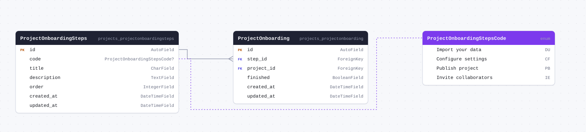

| Column | Field | Type | Null | Key | Default | Description |
| --- | --- | --- | --- | --- | --- | --- |
| `id` | `AutoField` | `integer` |  | PK | `autoincrement()` |  |
| `code` | `ProjectOnboardingStepsCode` | `varchar(2)` | yes |  |  |  |
| `title` | `CharField` | `varchar(1000)` |  |  |  |  |
| `description` | `TextField` | `text` |  |  |  |  |
| `order` | `IntegerField` | `integer` |  |  | `0` |  |
| `created_at` | `DateTimeField` | `datetime` |  |  | `now()` |  |
| `updated_at` | `DateTimeField` | `datetime` |  |  | `now()` |  |

Relations:

- [ProjectOnboarding](#projectonboarding).`step_id` → `id`, on delete cascade

## ProjectOnboarding

Table `projects_projectonboarding`, app `projects`.

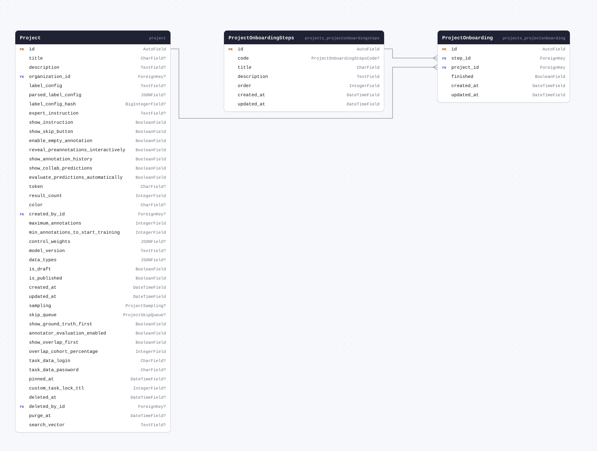

| Column | Field | Type | Null | Key | Default | Description |
| --- | --- | --- | --- | --- | --- | --- |
| `id` | `AutoField` | `integer` |  | PK | `autoincrement()` |  |
| `step_id` | `ForeignKey` | `integer` |  | FK |  |  |
| `project_id` | `ForeignKey` | `integer` |  | FK |  |  |
| `finished` | `BooleanField` | `bool` |  |  | `False` |  |
| `created_at` | `DateTimeField` | `datetime` |  |  | `now()` |  |
| `updated_at` | `DateTimeField` | `datetime` |  |  | `now()` |  |

Indexes:

- index `projects_projectonboarding_step_id_c232d94b` on `step_id`
- index `projects_projectonboarding_project_id_120e4f53` on `project_id`

Relations:

- `step_id` → [ProjectOnboardingSteps](#projectonboardingsteps).`id`, on delete cascade
- `project_id` → [Project](#project).`id`, on delete cascade

## LabelStreamHistory

Table `projects_labelstreamhistory`, app `projects`.

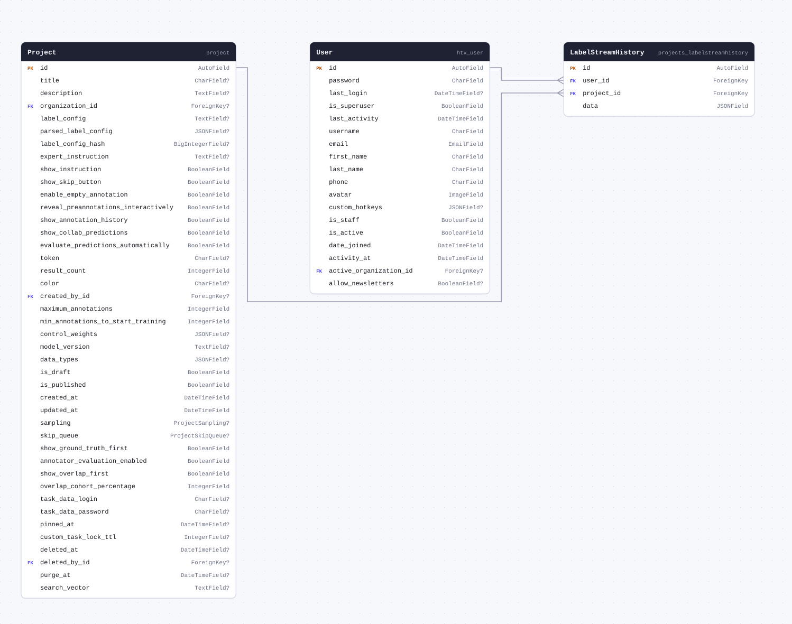

| Column | Field | Type | Null | Key | Default | Description |
| --- | --- | --- | --- | --- | --- | --- |
| `id` | `AutoField` | `integer` |  | PK | `autoincrement()` |  |
| `user_id` | `ForeignKey` | `integer` |  | FK |  | User ID |
| `project_id` | `ForeignKey` | `integer` |  | FK |  | Project ID |
| `data` | `JSONField` | `text` |  |  | `list()` |  |

Indexes:

- index `projects_labelstreamhistory_user_id_1b571ab9` on `user_id`
- index `projects_labelstreamhistory_project_id_906c91dd` on `project_id`
- unique `unique_history` on `user_id`, `project_id`

Relations:

- `user_id` → [User](#user).`id`, on delete cascade
- `project_id` → [Project](#project).`id`, on delete cascade

## ProjectMember

Table `projects_projectmember`, app `projects`.


| Column | Field | Type | Null | Key | Default | Description |
| --- | --- | --- | --- | --- | --- | --- |
| `id` | `AutoField` | `integer` |  | PK | `autoincrement()` |  |
| `user_id` | `ForeignKey` | `integer` |  | FK |  | User ID |
| `project_id` | `ForeignKey` | `integer` |  | FK |  | Project ID |
| `enabled` | `BooleanField` | `bool` |  |  | `True` | Project member is enabled |
| `created_at` | `DateTimeField` | `datetime` |  |  | `now()` |  |
| `updated_at` | `DateTimeField` | `datetime` |  |  | `now()` |  |

Indexes:

- index `projects_projectmember_user_id_a475bbd8` on `user_id`
- index `projects_projectmember_project_id_e589ddea` on `project_id`

Relations:

- `user_id` → [User](#user).`id`, on delete cascade
- `project_id` → [Project](#project).`id`, on delete cascade

## ProjectSummary

Table `projects_projectsummary`, app `projects`.

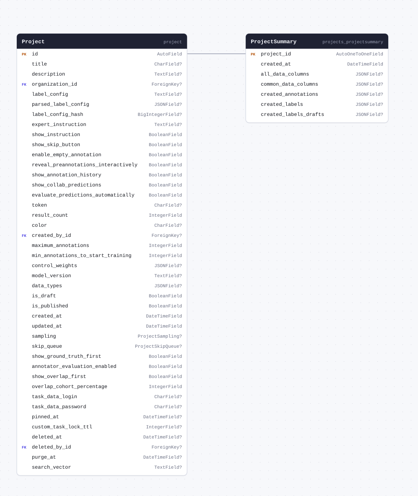

| Column | Field | Type | Null | Key | Default | Description |
| --- | --- | --- | --- | --- | --- | --- |
| `project_id` | `AutoOneToOneField` | `integer` |  | PK, FK |  |  |
| `created_at` | `DateTimeField` | `datetime` |  |  | `now()` | Creation time |
| `all_data_columns` | `JSONField` | `text` | yes |  | `dict()` | All data columns found in imported tasks |
| `common_data_columns` | `JSONField` | `text` | yes |  | `list()` | Common data columns found across imported tasks |
| `created_annotations` | `JSONField` | `text` | yes |  | `dict()` | Unique annotation types identified by tuple (from_name, to_name, type) |
| `created_labels` | `JSONField` | `text` | yes |  | `dict()` | Unique labels |
| `created_labels_drafts` | `JSONField` | `text` | yes |  | `dict()` | Unique drafts labels |

Relations:

- `project_id` → [Project](#project).`id`, on delete cascade

## ProjectImport

Table `projects_projectimport`, app `projects`.

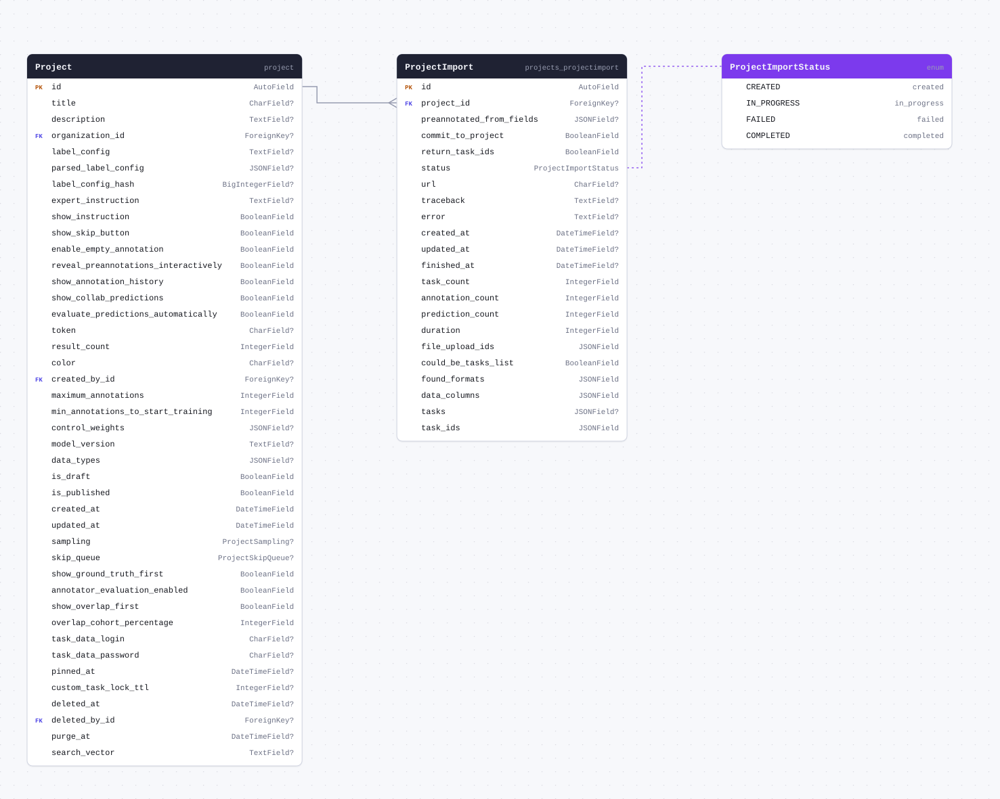

| Column | Field | Type | Null | Key | Default | Description |
| --- | --- | --- | --- | --- | --- | --- |
| `id` | `AutoField` | `integer` |  | PK | `autoincrement()` |  |
| `project_id` | `ForeignKey` | `integer` | yes | FK |  |  |
| `preannotated_from_fields` | `JSONField` | `text` | yes |  |  |  |
| `commit_to_project` | `BooleanField` | `bool` |  |  | `False` |  |
| `return_task_ids` | `BooleanField` | `bool` |  |  | `False` |  |
| `status` | `ProjectImportStatus` | `varchar(64)` |  |  | `'created'` |  |
| `url` | `CharField` | `varchar(2048)` | yes |  |  |  |
| `traceback` | `TextField` | `text` | yes |  |  |  |
| `error` | `TextField` | `text` | yes |  |  |  |
| `created_at` | `DateTimeField` | `datetime` | yes |  | `now()` | Creation time |
| `updated_at` | `DateTimeField` | `datetime` | yes |  | `now()` | Updated time |
| `finished_at` | `DateTimeField` | `datetime` | yes |  | `None` | Complete or fail time |
| `task_count` | `IntegerField` | `integer` |  |  | `0` |  |
| `annotation_count` | `IntegerField` | `integer` |  |  | `0` |  |
| `prediction_count` | `IntegerField` | `integer` |  |  | `0` |  |
| `duration` | `IntegerField` | `integer` |  |  | `0` |  |
| `file_upload_ids` | `JSONField` | `text` |  |  | `list()` |  |
| `could_be_tasks_list` | `BooleanField` | `bool` |  |  | `False` |  |
| `found_formats` | `JSONField` | `text` |  |  | `list()` |  |
| `data_columns` | `JSONField` | `text` |  |  | `list()` |  |
| `tasks` | `JSONField` | `text` | yes |  |  |  |
| `task_ids` | `JSONField` | `text` |  |  | `list()` |  |

Indexes:

- index `projects_projectimport_project_id_619e3461` on `project_id`

Relations:

- `project_id` → [Project](#project).`id`, on delete cascade

## ProjectReimport

Table `projects_projectreimport`, app `projects`.

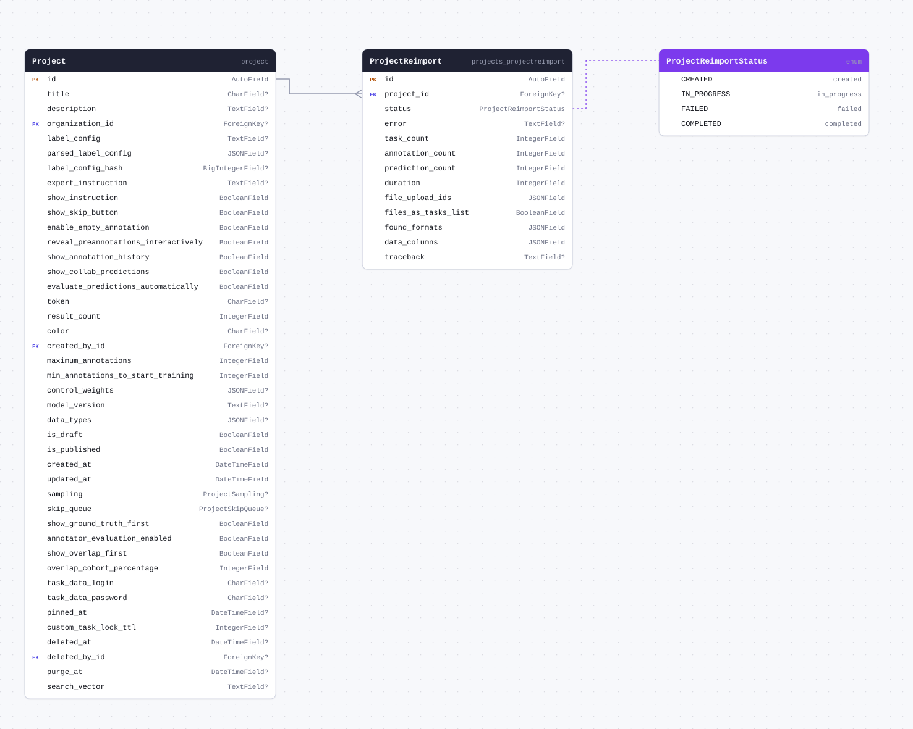

| Column | Field | Type | Null | Key | Default | Description |
| --- | --- | --- | --- | --- | --- | --- |
| `id` | `AutoField` | `integer` |  | PK | `autoincrement()` |  |
| `project_id` | `ForeignKey` | `integer` | yes | FK |  |  |
| `status` | `ProjectReimportStatus` | `varchar(64)` |  |  | `'created'` |  |
| `error` | `TextField` | `text` | yes |  |  |  |
| `task_count` | `IntegerField` | `integer` |  |  | `0` |  |
| `annotation_count` | `IntegerField` | `integer` |  |  | `0` |  |
| `prediction_count` | `IntegerField` | `integer` |  |  | `0` |  |
| `duration` | `IntegerField` | `integer` |  |  | `0` |  |
| `file_upload_ids` | `JSONField` | `text` |  |  | `list()` |  |
| `files_as_tasks_list` | `BooleanField` | `bool` |  |  | `False` |  |
| `found_formats` | `JSONField` | `text` |  |  | `list()` |  |
| `data_columns` | `JSONField` | `text` |  |  | `list()` |  |
| `traceback` | `TextField` | `text` | yes |  |  |  |

Indexes:

- index `projects_projectreimport_project_id_6bcffbed` on `project_id`

Relations:

- `project_id` → [Project](#project).`id`, on delete cascade

## Task

Table `task`, app `tasks`.

Business tasks from project

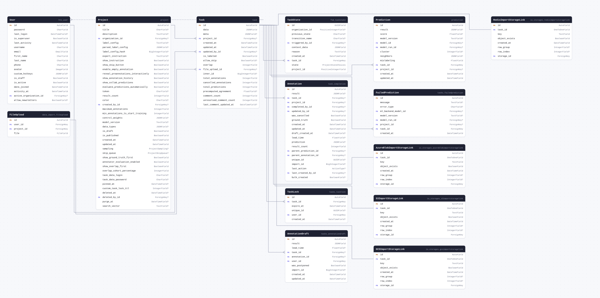

| Column | Field | Type | Null | Key | Default | Description |
| --- | --- | --- | --- | --- | --- | --- |
| `id` | `AutoField` | `integer` |  | PK | `autoincrement()` |  |
| `data` | `JSONField` | `text` |  |  |  | User imported or uploaded data for a task. Data is formatted according to the project label config. You can find examples of data for your project on the Import page in the Label Studio Data Manager UI. |
| `meta` | `JSONField` | `text` | yes |  | `dict()` | Meta is user imported (uploaded) data and can be useful as input for an ML Backend for embeddings, advanced vectors, and other info. It is passed to ML during training/predicting steps. |
| `project_id` | `ForeignKey` | `integer` | yes | FK |  | Project ID for this task |
| `created_at` | `DateTimeField` | `datetime` |  |  | `now()` | Time a task was created |
| `updated_at` | `DateTimeField` | `datetime` |  |  | `now()` | Last time a task was updated |
| `updated_by_id` | `ForeignKey` | `integer` | yes | FK |  | Last annotator or reviewer who updated this task |
| `is_labeled` | `BooleanField` | `bool` |  |  | `False` | True if the number of annotations for this task is greater than or equal to the number of maximum_completions for the project |
| `allow_skip` | `BooleanField` | `bool` | yes |  | `True` | Whether this task can be skipped. Set to False to make task unskippable. |
| `overlap` | `IntegerField` | `integer` |  |  | `1` | Number of distinct annotators that processed the current task |
| `file_upload_id` | `ForeignKey` | `integer` | yes | FK |  | Uploaded file used as data source for this task |
| `inner_id` | `BigIntegerField` | `bigint` | yes |  | `0` | Internal task ID in the project, starts with 1 |
| `total_annotations` | `IntegerField` | `integer` |  |  | `0` | Number of total annotations for the current task except cancelled annotations |
| `cancelled_annotations` | `IntegerField` | `integer` |  |  | `0` | Number of total cancelled annotations for the current task |
| `total_predictions` | `IntegerField` | `integer` |  |  | `0` | Number of total predictions for the current task |
| `precomputed_agreement` | `FloatField` | `real` | yes |  |  | Average agreement score for the task |
| `comment_count` | `IntegerField` | `integer` |  |  | `0` | Number of comments in the task including all annotations |
| `unresolved_comment_count` | `IntegerField` | `integer` |  |  | `0` | Number of unresolved comments in the task including all annotations |
| `last_comment_updated_at` | `DateTimeField` | `datetime` | yes |  | `None` | When the last comment was updated |

Indexes:

- index `task_project_id_963d6354` on `project_id`
- index `task_updated_by_id_c9d9ddfb` on `updated_by_id`
- index `task_overlap_455a13f0` on `overlap`
- index `task_file_upload_id_549188ed` on `file_upload_id`
- index `task_total_annotations_e77e347b` on `total_annotations`
- index `task_cancelled_annotations_60dfe3b9` on `cancelled_annotations`
- index `task_total_predictions_f1a6b218` on `total_predictions`
- index `task_comment_count_049355cc` on `comment_count`
- index `task_unresolved_comment_count_8707d0c7` on `unresolved_comment_count`
- index `task_last_comment_updated_at_d1bc3403` on `last_comment_updated_at`
- index `task_project_6acf5f_idx` on `project_id`, `is_labeled`
- index `task_project_499b59_idx` on `project_id`, `inner_id`
- index `task_id_aef988_idx` on `id`, `project_id`
- index `task_id_7a9aca_idx` on `id`, `overlap`
- index `task_overlap_6a196e_idx` on `overlap`
- index `task_project_7b1c80_idx` on `project_id`, `id`

Relations:

- [TaskState](#taskstate).`task_id` → `id`, on delete cascade
- `project_id` → [Project](#project).`id`, on delete cascade
- `updated_by_id` → [User](#user).`id`, on delete set null
- `file_upload_id` → [FileUpload](#fileupload).`id`, on delete set null
- `comment_authors` — many to many with [User](#user)
- [Annotation](#annotation).`task_id` → `id`, on delete cascade
- [TaskLock](#tasklock).`task_id` → `id`, on delete cascade
- [AnnotationDraft](#annotationdraft).`task_id` → `id`, on delete cascade
- [Prediction](#prediction).`task_id` → `id`, on delete cascade
- [FailedPrediction](#failedprediction).`task_id` → `id`, on delete cascade
- [AzureBlobImportStorageLink](#azureblobimportstoragelink).`task_id` → `id`, on delete cascade
- [S3ImportStorageLink](#s3importstoragelink).`task_id` → `id`, on delete cascade
- [GCSImportStorageLink](#gcsimportstoragelink).`task_id` → `id`, on delete cascade
- [RedisImportStorageLink](#redisimportstoragelink).`task_id` → `id`, on delete cascade

## Annotation

Table `task_completion`, app `tasks`.

Annotations & Labeling results

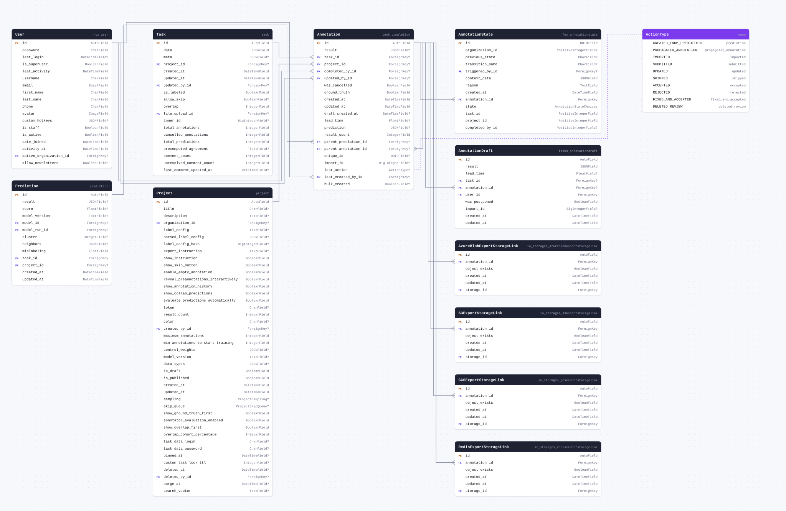

| Column | Field | Type | Null | Key | Default | Description |
| --- | --- | --- | --- | --- | --- | --- |
| `id` | `AutoField` | `integer` |  | PK | `autoincrement()` |  |
| `result` | `JSONField` | `text` | yes |  | `None` | The main value of annotator work - labeling result in JSON format |
| `task_id` | `ForeignKey` | `integer` | yes | FK |  | Corresponding task for this annotation |
| `project_id` | `ForeignKey` | `integer` | yes | FK |  | Project ID for this annotation |
| `completed_by_id` | `ForeignKey` | `integer` | yes | FK |  | User ID of the person who created this annotation |
| `updated_by_id` | `ForeignKey` | `integer` | yes | FK |  | Last user who updated this annotation |
| `was_cancelled` | `BooleanField` | `bool` |  |  | `False` | User skipped the task |
| `ground_truth` | `BooleanField` | `bool` |  |  | `False` | This annotation is a Ground Truth (ground_truth) |
| `created_at` | `DateTimeField` | `datetime` |  |  | `now()` | Creation time |
| `updated_at` | `DateTimeField` | `datetime` |  |  | `now()` | Last updated time |
| `draft_created_at` | `DateTimeField` | `datetime` | yes |  | `None` | Draft creation time |
| `lead_time` | `FloatField` | `real` | yes |  | `None` | How much time it took to annotate the task |
| `prediction` | `JSONField` | `text` | yes |  | `dict()` | Prediction viewed at the time of annotation |
| `result_count` | `IntegerField` | `integer` |  |  | `0` | Results inside of annotation counter |
| `parent_prediction_id` | `ForeignKey` | `integer` | yes | FK |  | Points to the prediction from which this annotation was created |
| `parent_annotation_id` | `ForeignKey` | `integer` | yes | FK |  | Points to the parent annotation from which this annotation was created |
| `unique_id` | `UUIDField` | `char(32)` | yes | unique | `uuid4()` |  |
| `import_id` | `BigIntegerField` | `bigint` | yes |  | `None` | Original annotation ID that was at the import step or NULL if this annotation wasn't imported |
| `last_action` | `ActionType` | `varchar(128)` | yes |  | `None` | Action which was performed in the last annotation history item |
| `last_created_by_id` | `ForeignKey` | `integer` | yes | FK | `None` | User who created the last annotation history item |
| `bulk_created` | `BooleanField` | `bool` | yes |  | `0` (database) | Annotation was created in bulk mode |

Indexes:

- index `task_completion_task_id_b9049fbc` on `task_id`
- index `task_completion_project_id_94072c87` on `project_id`
- index `task_completion_completed_by_id_3f3206b1` on `completed_by_id`
- index `task_completion_updated_by_id_1164a739` on `updated_by_id`
- index `task_completion_parent_prediction_id_053d00d9` on `parent_prediction_id`
- index `task_completion_parent_annotation_id_58398c37` on `parent_annotation_id`
- index `task_completion_import_id_e434c5af` on `import_id`
- index `task_completion_last_created_by_id_a04457d1` on `last_created_by_id`
- index `task_comple_created_f55e6f_idx` on `created_at`
- index `task_comple_ground__088a1b_idx` on `ground_truth`
- index `task_comple_id_653858_idx` on `id`, `task_id`
- index `task_comple_last_ac_777e69_idx` on `last_action`
- index `task_comple_project_2cbbfc_idx` on `project_id`, `ground_truth`
- index `task_comple_project_c7e507_idx` on `project_id`, `id`
- index `task_comple_project_5c60f3_idx` on `project_id`, `was_cancelled`
- index `task_comple_task_id_d49cd7_idx` on `task_id`, `completed_by_id`
- index `task_comple_task_id_e82920_idx` on `task_id`, `ground_truth`
- index `task_comple_task_id_8072c3_idx` on `task_id`, `was_cancelled`
- index `task_comple_was_can_f87d4e_idx` on `was_cancelled`

Relations:

- [AnnotationState](#annotationstate).`annotation_id` → `id`, on delete cascade
- `task_id` → [Task](#task).`id`, on delete cascade
- `project_id` → [Project](#project).`id`, on delete cascade
- `completed_by_id` → [User](#user).`id`, on delete set null
- `updated_by_id` → [User](#user).`id`, on delete set null
- `parent_prediction_id` → [Prediction](#prediction).`id`, on delete set null
- `parent_annotation_id` → [Annotation](#annotation).`id`, on delete set null
- `last_created_by_id` → [User](#user).`id`, on delete set null
- [AnnotationDraft](#annotationdraft).`annotation_id` → `id`, on delete cascade
- [AzureBlobExportStorageLink](#azureblobexportstoragelink).`annotation_id` → `id`, on delete cascade
- [S3ExportStorageLink](#s3exportstoragelink).`annotation_id` → `id`, on delete cascade
- [GCSExportStorageLink](#gcsexportstoragelink).`annotation_id` → `id`, on delete cascade
- [RedisExportStorageLink](#redisexportstoragelink).`annotation_id` → `id`, on delete cascade

## TaskLock

Table `tasks_tasklock`, app `tasks`.

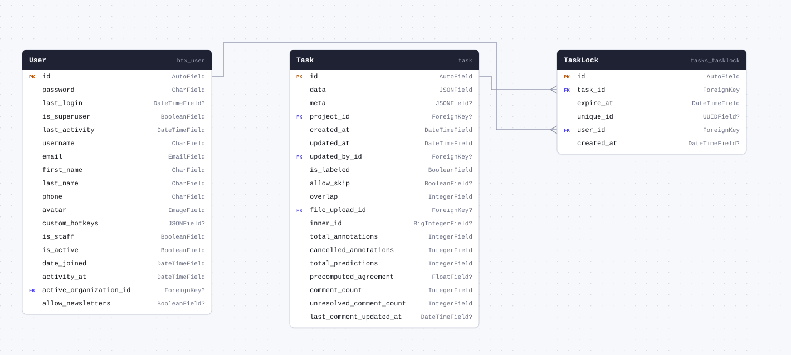

| Column | Field | Type | Null | Key | Default | Description |
| --- | --- | --- | --- | --- | --- | --- |
| `id` | `AutoField` | `integer` |  | PK | `autoincrement()` |  |
| `task_id` | `ForeignKey` | `integer` |  | FK |  | Locked task |
| `expire_at` | `DateTimeField` | `datetime` |  |  |  |  |
| `unique_id` | `UUIDField` | `char(32)` | yes | unique | `uuid4()` |  |
| `user_id` | `ForeignKey` | `integer` |  | FK |  | User who locked this task |
| `created_at` | `DateTimeField` | `datetime` | yes |  | `now()` | Creation time |

Indexes:

- index `tasks_tasklock_task_id_6531a5ed` on `task_id`
- index `tasks_tasklock_user_id_748ae86f` on `user_id`

Relations:

- `task_id` → [Task](#task).`id`, on delete cascade
- `user_id` → [User](#user).`id`, on delete cascade

## AnnotationDraft

Table `tasks_annotationdraft`, app `tasks`.

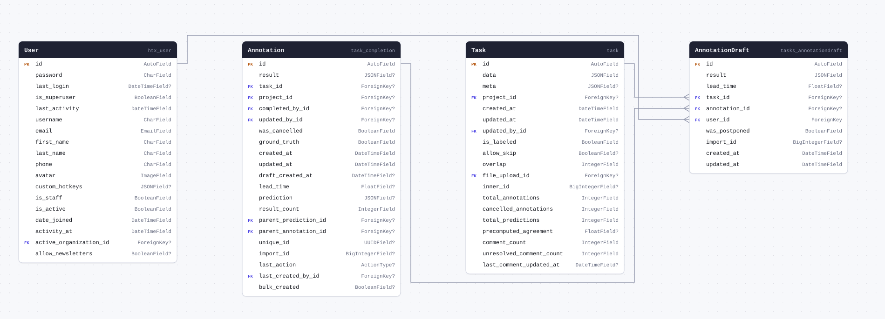

| Column | Field | Type | Null | Key | Default | Description |
| --- | --- | --- | --- | --- | --- | --- |
| `id` | `AutoField` | `integer` |  | PK | `autoincrement()` |  |
| `result` | `JSONField` | `text` |  |  |  | Draft result in JSON format |
| `lead_time` | `FloatField` | `real` | yes |  |  | How much time it took to annotate the task |
| `task_id` | `ForeignKey` | `integer` | yes | FK |  | Corresponding task for this draft |
| `annotation_id` | `ForeignKey` | `integer` | yes | FK |  | Corresponding annotation for this draft |
| `user_id` | `ForeignKey` | `integer` |  | FK |  | User who created this draft |
| `was_postponed` | `BooleanField` | `bool` |  |  | `False` | User postponed this draft (clicked a forward button) in the label stream |
| `import_id` | `BigIntegerField` | `bigint` | yes |  | `None` | Original draft ID that was at the import step or NULL if this draft wasn't imported |
| `created_at` | `DateTimeField` | `datetime` |  |  | `now()` | Creation time |
| `updated_at` | `DateTimeField` | `datetime` |  |  | `now()` | Last update time |

Indexes:

- index `tasks_annotationdraft_task_id_c1bf62e3` on `task_id`
- index `tasks_annotationdraft_annotation_id_86db74e5` on `annotation_id`
- index `tasks_annotationdraft_user_id_e92f09dc` on `user_id`
- index `tasks_annotationdraft_was_postponed_6a1ee000` on `was_postponed`
- index `tasks_annotationdraft_import_id_29542ca8` on `import_id`

Relations:

- `task_id` → [Task](#task).`id`, on delete cascade
- `annotation_id` → [Annotation](#annotation).`id`, on delete cascade
- `user_id` → [User](#user).`id`, on delete cascade

## Prediction

Table `prediction`, app `tasks`.

ML backend / Prompts predictions

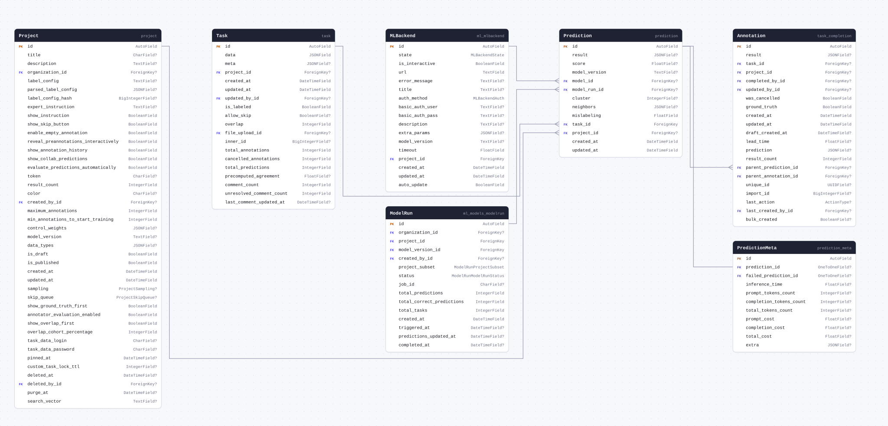

| Column | Field | Type | Null | Key | Default | Description |
| --- | --- | --- | --- | --- | --- | --- |
| `id` | `AutoField` | `integer` |  | PK | `autoincrement()` |  |
| `result` | `JSONField` | `text` | yes |  | `dict()` | Prediction result |
| `score` | `FloatField` | `real` | yes |  | `None` | Prediction score |
| `model_version` | `TextField` | `text` | yes |  | `''` | A string value that for model version that produced the prediction. Used in both live models and when uploading offline predictions. |
| `model_id` | `ForeignKey` | `integer` | yes | FK |  | An ML Backend instance that created the prediction. |
| `model_run_id` | `ForeignKey` | `integer` | yes | FK |  | A run of a ModelVersion that created the prediction. |
| `cluster` | `IntegerField` | `integer` | yes |  | `None` | Cluster for the current prediction |
| `neighbors` | `JSONField` | `text` | yes |  |  | Array of task IDs of the closest neighbors |
| `mislabeling` | `FloatField` | `real` |  |  | `0.0` | Related task mislabeling score |
| `task_id` | `ForeignKey` | `integer` |  | FK |  |  |
| `project_id` | `ForeignKey` | `integer` | yes | FK |  |  |
| `created_at` | `DateTimeField` | `datetime` |  |  | `now()` |  |
| `updated_at` | `DateTimeField` | `datetime` |  |  | `now()` |  |

Indexes:

- index `prediction_model_id_f9d54ad0` on `model_id`
- index `prediction_model_run_id_9d95621b` on `model_run_id`
- index `prediction_task_id_4e4fb4d3` on `task_id`
- index `prediction_project_id_ec1ad819` on `project_id`

Relations:

- [Annotation](#annotation).`parent_prediction_id` → `id`, on delete set null
- `model_id` → [MLBackend](#mlbackend).`id`, on delete cascade
- `model_run_id` → [ModelRun](#modelrun).`id`, on delete cascade
- `task_id` → [Task](#task).`id`, on delete cascade
- `project_id` → [Project](#project).`id`, on delete cascade
- [PredictionMeta](#predictionmeta).`prediction_id` → `id`, on delete cascade

## FailedPrediction

Table `tasks_failedprediction`, app `tasks`.

Class for storing failed prediction(s) for a task

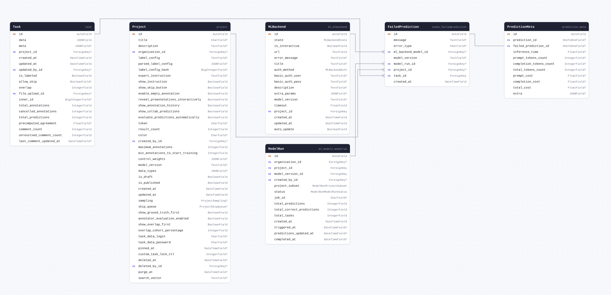

| Column | Field | Type | Null | Key | Default | Description |
| --- | --- | --- | --- | --- | --- | --- |
| `id` | `AutoField` | `integer` |  | PK | `autoincrement()` |  |
| `message` | `TextField` | `text` | yes |  | `None` | The message explaining why generating this prediction failed |
| `error_type` | `CharField` | `varchar(512)` | yes |  | `None` | The type of error that caused prediction to fail |
| `ml_backend_model_id` | `ForeignKey` | `integer` | yes | FK |  | An ML Backend instance that created the failed prediction. |
| `model_version` | `TextField` | `text` | yes |  | `None` | A string value that for model version that produced the failed prediction. Used in both live models and when uploading offline predictions. |
| `model_run_id` | `ForeignKey` | `integer` | yes | FK |  | A run of a ModelVersion that created the failed prediction. |
| `project_id` | `ForeignKey` | `integer` | yes | FK |  |  |
| `task_id` | `ForeignKey` | `integer` |  | FK |  |  |
| `created_at` | `DateTimeField` | `datetime` |  |  | `now()` |  |

Indexes:

- index `tasks_failedprediction_ml_backend_model_id_5813a377` on `ml_backend_model_id`
- index `tasks_failedprediction_model_run_id_eec73944` on `model_run_id`
- index `tasks_failedprediction_project_id_6b803bbe` on `project_id`
- index `tasks_failedprediction_task_id_ed2f3848` on `task_id`

Relations:

- `ml_backend_model_id` → [MLBackend](#mlbackend).`id`, on delete set null
- `model_run_id` → [ModelRun](#modelrun).`id`, on delete cascade
- `project_id` → [Project](#project).`id`, on delete cascade
- `task_id` → [Task](#task).`id`, on delete cascade
- [PredictionMeta](#predictionmeta).`failed_prediction_id` → `id`, on delete cascade

## PredictionMeta

Table `prediction_meta`, app `tasks`.

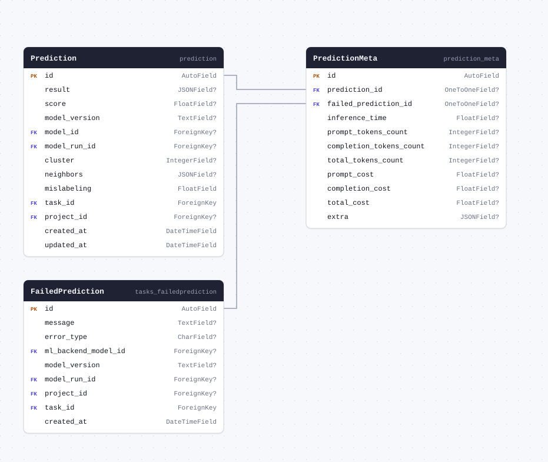

| Column | Field | Type | Null | Key | Default | Description |
| --- | --- | --- | --- | --- | --- | --- |
| `id` | `AutoField` | `integer` |  | PK | `autoincrement()` |  |
| `prediction_id` | `OneToOneField` | `integer` | yes | FK, unique |  | Reference to the associated prediction |
| `failed_prediction_id` | `OneToOneField` | `integer` | yes | FK, unique |  | Reference to the associated failed prediction |
| `inference_time` | `FloatField` | `real` | yes |  |  | Time taken for inference in seconds |
| `prompt_tokens_count` | `IntegerField` | `integer` | yes |  |  | Number of tokens in the prompt |
| `completion_tokens_count` | `IntegerField` | `integer` | yes |  |  | Number of tokens in the completion |
| `total_tokens_count` | `IntegerField` | `integer` | yes |  |  | Total number of tokens |
| `prompt_cost` | `FloatField` | `real` | yes |  |  | Cost of the prompt |
| `completion_cost` | `FloatField` | `real` | yes |  |  | Cost of the completion |
| `total_cost` | `FloatField` | `real` | yes |  |  | Total cost |
| `extra` | `JSONField` | `text` | yes |  |  | Additional metadata in JSON format |

Checks:

- `prediction_or_failed_prediction_not_null`: `(("prediction_id" IS NOT NULL AND "failed_prediction_id" IS NULL) OR ("prediction_id" IS NULL AND "failed_prediction_id" IS NOT NULL))`

Relations:

- `prediction_id` → [Prediction](#prediction).`id`, on delete cascade
- `failed_prediction_id` → [FailedPrediction](#failedprediction).`id`, on delete cascade

## View

Table `data_manager_view`, app `data_manager`.

Columns from `ViewBaseModel` (abstract): `data`, `ordering`, `order`, `selected_items`, `filter_group_id`, `user_id`.

Columns from `ProjectViewMixin` (abstract): `project_id`.

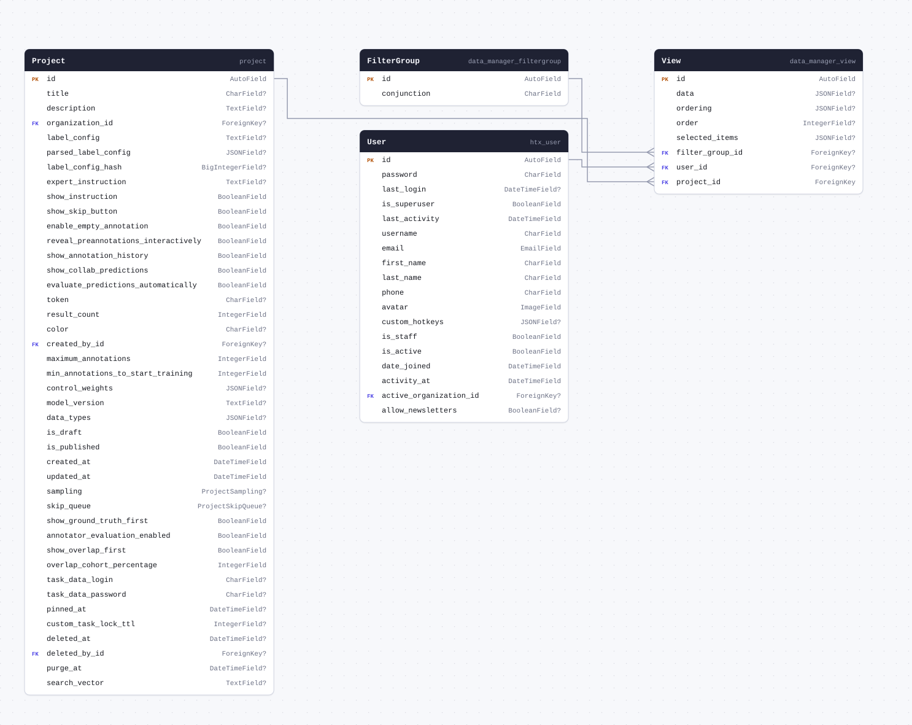

| Column | Field | Type | Null | Key | Default | Description |
| --- | --- | --- | --- | --- | --- | --- |
| `id` | `AutoField` | `integer` |  | PK | `autoincrement()` |  |
| `data` | `JSONField` | `text` | yes |  | `dict()` | Custom view data |
| `ordering` | `JSONField` | `text` | yes |  | `dict()` | Ordering parameters |
| `order` | `IntegerField` | `integer` | yes |  | `0` | Position of the tab, starting at the left in data manager and increasing as the tabs go left to right |
| `selected_items` | `JSONField` | `text` | yes |  | `dict()` | Selected items |
| `filter_group_id` | `ForeignKey` | `integer` | yes | FK |  | Groups of filters |
| `user_id` | `ForeignKey` | `integer` | yes | FK |  | User who made this view |
| `project_id` | `ForeignKey` | `integer` |  | FK |  | Project ID |

Indexes:

- index `data_manager_view_filter_group_id_39a9ec2b` on `filter_group_id`
- index `data_manager_view_user_id_e71e14cd` on `user_id`
- index `data_manager_view_project_id_59f5a002` on `project_id`
- index `data_manage_project_69b96e_idx` on `project_id`, `order`

Relations:

- `filter_group_id` → [FilterGroup](#filtergroup).`id`, on delete set null
- `user_id` → [User](#user).`id`, on delete cascade
- `project_id` → [Project](#project).`id`, on delete cascade

## FilterGroup

Table `data_manager_filtergroup`, app `data_manager`.

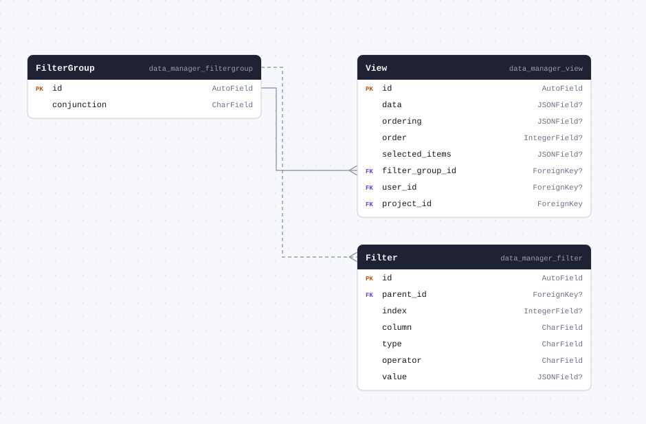

| Column | Field | Type | Null | Key | Default | Description |
| --- | --- | --- | --- | --- | --- | --- |
| `id` | `AutoField` | `integer` |  | PK | `autoincrement()` |  |
| `conjunction` | `CharField` | `varchar(1024)` |  |  |  | Type of conjunction |

Relations:

- [View](#view).`filter_group_id` → `id`, on delete set null
- `filters` — many to many with [Filter](#filter)

## Filter

Table `data_manager_filter`, app `data_manager`.

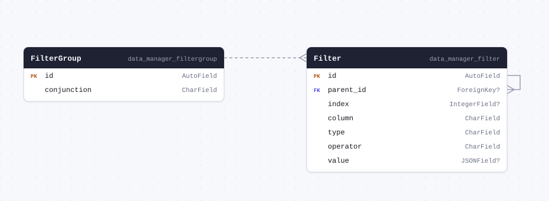

| Column | Field | Type | Null | Key | Default | Description |
| --- | --- | --- | --- | --- | --- | --- |
| `id` | `AutoField` | `integer` |  | PK | `autoincrement()` |  |
| `parent_id` | `ForeignKey` | `integer` | yes | FK |  | Optional parent filter to create one-level hierarchy (child filters are AND-merged with parent) |
| `index` | `IntegerField` | `integer` | yes |  | `None` | Display order among root filters only |
| `column` | `CharField` | `varchar(1024)` |  |  |  | Field name |
| `type` | `CharField` | `varchar(1024)` |  |  |  | Field type |
| `operator` | `CharField` | `varchar(1024)` |  |  |  | Filter operator |
| `value` | `JSONField` | `text` | yes |  | `dict()` | Filter value |

Indexes:

- index `data_manager_filter_parent_id_b5dd2a37` on `parent_id`

Relations:

- `filter_groups` — many to many with [FilterGroup](#filtergroup)
- `parent_id` → [Filter](#filter).`id`, on delete cascade

## AzureBlobStorageMixin

Table `io_storages_azureblobstoragemixin`, app `io_storages`.

Subclasses (multi-table): [AzureBlobImportStorage](#azureblobimportstorage), [AzureBlobExportStorage](#azureblobexportstorage).

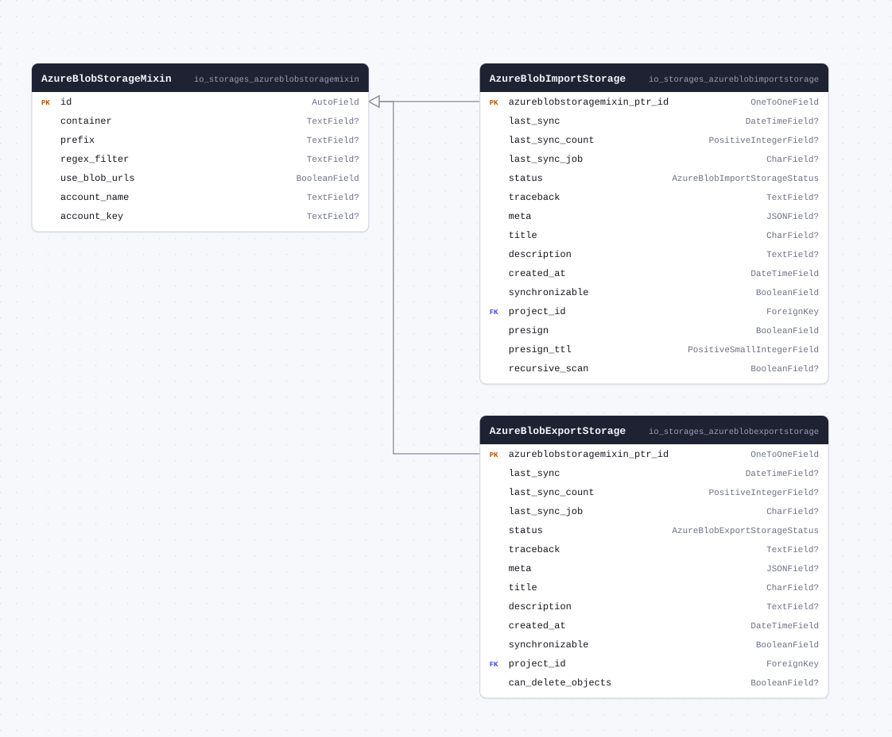

| Column | Field | Type | Null | Key | Default | Description |
| --- | --- | --- | --- | --- | --- | --- |
| `id` | `AutoField` | `integer` |  | PK | `autoincrement()` |  |
| `container` | `TextField` | `text` | yes |  |  | Azure blob container |
| `prefix` | `TextField` | `text` | yes |  |  | Azure blob prefix name |
| `regex_filter` | `TextField` | `text` | yes |  |  | Cloud storage regex for filtering objects |
| `use_blob_urls` | `BooleanField` | `bool` |  |  | `False` | Interpret objects as BLOBs and generate URLs |
| `account_name` | `TextField` | `text` | yes |  |  | Azure Blob account name |
| `account_key` | `TextField` | `text` | yes |  |  | Azure Blob account key |

Relations:

- [AzureBlobImportStorage](#azureblobimportstorage).`azureblobstoragemixin_ptr_id` → `id`, parent link, on delete cascade
- [AzureBlobExportStorage](#azureblobexportstorage).`azureblobstoragemixin_ptr_id` → `id`, parent link, on delete cascade

## AzureBlobImportStorage

Table `io_storages_azureblobimportstorage`, app `io_storages`.

Inherits from [AzureBlobStorageMixin](#azureblobstoragemixin) (multi-table): its rows are joined on `azureblobstoragemixin_ptr_id`.

Columns from `ProjectStorageMixin` (abstract): `project_id`.

Columns from `AzureBlobImportStorageBase` (abstract): `azureblobstoragemixin_ptr_id`, `presign`, `presign_ttl`, `recursive_scan`.

Columns from `Storage` (abstract): `title`, `description`, `created_at`, `synchronizable`.

Columns from `StorageInfo` (abstract): `last_sync`, `last_sync_count`, `last_sync_job`, `status`, `traceback`, `meta`.

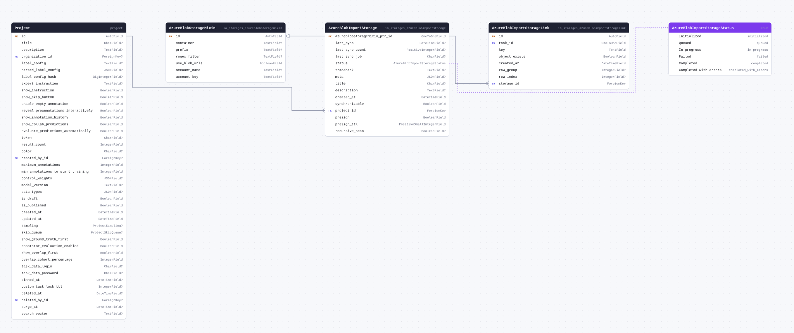

| Column | Field | Type | Null | Key | Default | Description |
| --- | --- | --- | --- | --- | --- | --- |
| `azureblobstoragemixin_ptr_id` | `OneToOneField` | `integer` |  | PK, FK |  |  |
| `last_sync` | `DateTimeField` | `datetime` | yes |  |  | Last sync finished time |
| `last_sync_count` | `PositiveIntegerField` | `integer unsigned` | yes |  |  | Count of tasks synced last time |
| `last_sync_job` | `CharField` | `varchar(256)` | yes |  |  | Last sync job ID |
| `status` | `AzureBlobImportStorageStatus` | `varchar(64)` |  |  | `'initialized'` |  |
| `traceback` | `TextField` | `text` | yes |  |  | Traceback report for the last failed sync |
| `meta` | `JSONField` | `text` | yes |  | `dict()` | Meta and debug information about storage processes |
| `title` | `CharField` | `varchar(256)` | yes |  |  | Cloud storage title |
| `description` | `TextField` | `text` | yes |  |  | Cloud storage description |
| `created_at` | `DateTimeField` | `datetime` |  |  | `now()` | Creation time |
| `synchronizable` | `BooleanField` | `bool` |  |  | `True` | If storage can be synced |
| `project_id` | `ForeignKey` | `integer` |  | FK |  | A unique integer value identifying this project. |
| `presign` | `BooleanField` | `bool` |  |  | `True` | Generate presigned URLs |
| `presign_ttl` | `PositiveSmallIntegerField` | `smallint unsigned` |  |  | `1` | Presigned URLs TTL (in minutes) |
| `recursive_scan` | `BooleanField` | `bool` | yes |  | `0` (database) | Perform recursive scan over the container content |

Indexes:

- index `io_storages_azureblobimportstorage_project_id_67a67313` on `project_id`

Relations:

- `azureblobstoragemixin_ptr_id` → [AzureBlobStorageMixin](#azureblobstoragemixin).`id`, parent link, on delete cascade
- `project_id` → [Project](#project).`id`, on delete cascade
- [AzureBlobImportStorageLink](#azureblobimportstoragelink).`storage_id` → `azureblobstoragemixin_ptr_id`, on delete cascade

## AzureBlobExportStorage

Table `io_storages_azureblobexportstorage`, app `io_storages`.

Inherits from [AzureBlobStorageMixin](#azureblobstoragemixin) (multi-table): its rows are joined on `azureblobstoragemixin_ptr_id`.

Columns from `ExportStorage` (abstract): `can_delete_objects`.

Columns from `Storage` (abstract): `title`, `description`, `created_at`, `synchronizable`.

Columns from `StorageInfo` (abstract): `last_sync`, `last_sync_count`, `last_sync_job`, `status`, `traceback`, `meta`.

Columns from `ProjectStorageMixin` (abstract): `project_id`.

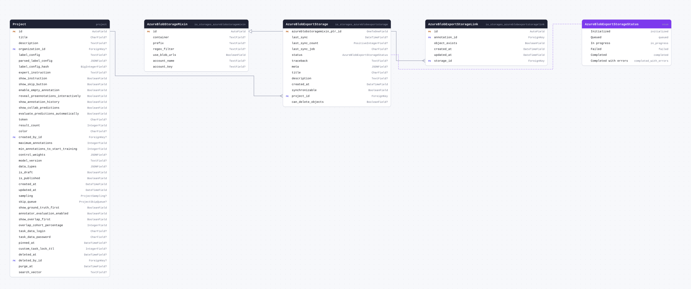

| Column | Field | Type | Null | Key | Default | Description |
| --- | --- | --- | --- | --- | --- | --- |
| `azureblobstoragemixin_ptr_id` | `OneToOneField` | `integer` |  | PK, FK |  |  |
| `last_sync` | `DateTimeField` | `datetime` | yes |  |  | Last sync finished time |
| `last_sync_count` | `PositiveIntegerField` | `integer unsigned` | yes |  |  | Count of tasks synced last time |
| `last_sync_job` | `CharField` | `varchar(256)` | yes |  |  | Last sync job ID |
| `status` | `AzureBlobExportStorageStatus` | `varchar(64)` |  |  | `'initialized'` |  |
| `traceback` | `TextField` | `text` | yes |  |  | Traceback report for the last failed sync |
| `meta` | `JSONField` | `text` | yes |  | `dict()` | Meta and debug information about storage processes |
| `title` | `CharField` | `varchar(256)` | yes |  |  | Cloud storage title |
| `description` | `TextField` | `text` | yes |  |  | Cloud storage description |
| `created_at` | `DateTimeField` | `datetime` |  |  | `now()` | Creation time |
| `synchronizable` | `BooleanField` | `bool` |  |  | `True` | If storage can be synced |
| `project_id` | `ForeignKey` | `integer` |  | FK |  | A unique integer value identifying this project. |
| `can_delete_objects` | `BooleanField` | `bool` | yes |  |  | Deletion from storage enabled |

Indexes:

- index `io_storages_azureblobexportstorage_project_id_43222df5` on `project_id`

Relations:

- `azureblobstoragemixin_ptr_id` → [AzureBlobStorageMixin](#azureblobstoragemixin).`id`, parent link, on delete cascade
- `project_id` → [Project](#project).`id`, on delete cascade
- [AzureBlobExportStorageLink](#azureblobexportstoragelink).`storage_id` → `azureblobstoragemixin_ptr_id`, on delete cascade

## AzureBlobImportStorageLink

Table `io_storages_azureblobimportstoragelink`, app `io_storages`.

Columns from `ImportStorageLink` (abstract): `task_id`, `key`, `object_exists`, `created_at`, `row_group`, `row_index`.

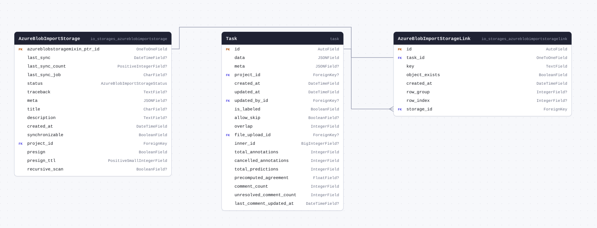

| Column | Field | Type | Null | Key | Default | Description |
| --- | --- | --- | --- | --- | --- | --- |
| `id` | `AutoField` | `integer` |  | PK | `autoincrement()` |  |
| `task_id` | `OneToOneField` | `integer` |  | FK, unique |  |  |
| `key` | `TextField` | `text` |  |  |  | External link key |
| `object_exists` | `BooleanField` | `bool` |  |  | `True` | Whether object under external link still exists |
| `created_at` | `DateTimeField` | `datetime` |  |  | `now()` | Creation time |
| `row_group` | `IntegerField` | `integer` | yes |  |  | Parquet row group |
| `row_index` | `IntegerField` | `integer` | yes |  |  | Parquet row index, or JSON[L] object index |
| `storage_id` | `ForeignKey` | `integer` |  | FK |  |  |

Indexes:

- index `io_storages_azureblobimportstoragelink_storage_id_a08c3173` on `storage_id`

Relations:

- `task_id` → [Task](#task).`id`, on delete cascade
- `storage_id` → [AzureBlobImportStorage](#azureblobimportstorage).`azureblobstoragemixin_ptr_id`, on delete cascade

## AzureBlobExportStorageLink

Table `io_storages_azureblobexportstoragelink`, app `io_storages`.

Columns from `ExportStorageLink` (abstract): `annotation_id`, `object_exists`, `created_at`, `updated_at`.

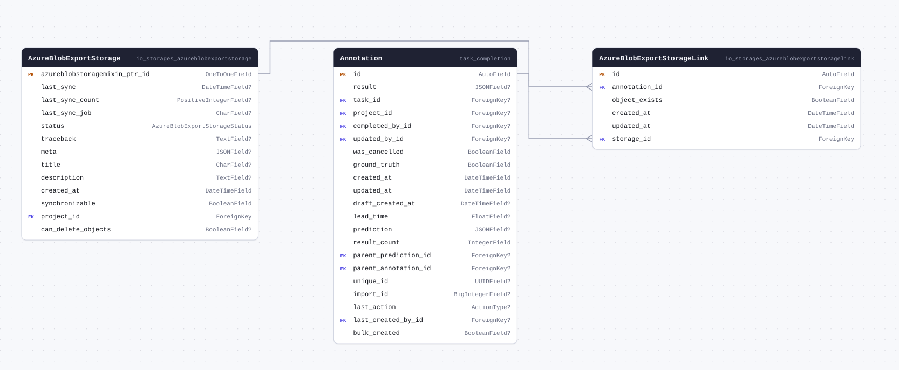

| Column | Field | Type | Null | Key | Default | Description |
| --- | --- | --- | --- | --- | --- | --- |
| `id` | `AutoField` | `integer` |  | PK | `autoincrement()` |  |
| `annotation_id` | `ForeignKey` | `integer` |  | FK |  |  |
| `object_exists` | `BooleanField` | `bool` |  |  | `True` | Whether object under external link still exists |
| `created_at` | `DateTimeField` | `datetime` |  |  | `now()` | Creation time |
| `updated_at` | `DateTimeField` | `datetime` |  |  | `now()` | Update time |
| `storage_id` | `ForeignKey` | `integer` |  | FK |  |  |

Indexes:

- index `io_storages_azureblobexportstoragelink_annotation_id_6cc15c83` on `annotation_id`
- index `io_storages_azureblobexportstoragelink_storage_id_1b260b1e` on `storage_id`

Relations:

- `annotation_id` → [Annotation](#annotation).`id`, on delete cascade
- `storage_id` → [AzureBlobExportStorage](#azureblobexportstorage).`azureblobstoragemixin_ptr_id`, on delete cascade

## S3ImportStorage

Table `io_storages_s3importstorage`, app `io_storages`.

Columns from `ProjectStorageMixin` (abstract): `project_id`.

Columns from `S3ImportStorageBase` (abstract): `presign`, `presign_ttl`, `recursive_scan`.

Columns from `S3StorageMixin` (abstract): `bucket`, `prefix`, `regex_filter`, `use_blob_urls`, `aws_access_key_id`, `aws_secret_access_key`, `aws_session_token`, `aws_sse_kms_key_id`, `region_name`, `s3_endpoint`.

Columns from `Storage` (abstract): `title`, `description`, `created_at`, `synchronizable`.

Columns from `StorageInfo` (abstract): `last_sync`, `last_sync_count`, `last_sync_job`, `status`, `traceback`, `meta`.

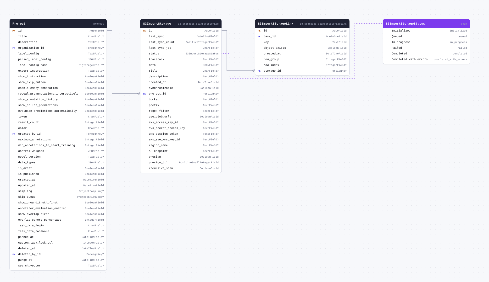

| Column | Field | Type | Null | Key | Default | Description |
| --- | --- | --- | --- | --- | --- | --- |
| `id` | `AutoField` | `integer` |  | PK | `autoincrement()` |  |
| `last_sync` | `DateTimeField` | `datetime` | yes |  |  | Last sync finished time |
| `last_sync_count` | `PositiveIntegerField` | `integer unsigned` | yes |  |  | Count of tasks synced last time |
| `last_sync_job` | `CharField` | `varchar(256)` | yes |  |  | Last sync job ID |
| `status` | `S3ImportStorageStatus` | `varchar(64)` |  |  | `'initialized'` |  |
| `traceback` | `TextField` | `text` | yes |  |  | Traceback report for the last failed sync |
| `meta` | `JSONField` | `text` | yes |  | `dict()` | Meta and debug information about storage processes |
| `title` | `CharField` | `varchar(256)` | yes |  |  | Cloud storage title |
| `description` | `TextField` | `text` | yes |  |  | Cloud storage description |
| `created_at` | `DateTimeField` | `datetime` |  |  | `now()` | Creation time |
| `synchronizable` | `BooleanField` | `bool` |  |  | `True` | If storage can be synced |
| `project_id` | `ForeignKey` | `integer` |  | FK |  | A unique integer value identifying this project. |
| `bucket` | `TextField` | `text` | yes |  |  | S3 bucket name |
| `prefix` | `TextField` | `text` | yes |  |  | S3 bucket prefix |
| `regex_filter` | `TextField` | `text` | yes |  |  | Cloud storage regex for filtering objects |
| `use_blob_urls` | `BooleanField` | `bool` |  |  | `False` | Interpret objects as BLOBs and generate URLs |
| `aws_access_key_id` | `TextField` | `text` | yes |  |  | AWS_ACCESS_KEY_ID |
| `aws_secret_access_key` | `TextField` | `text` | yes |  |  | AWS_SECRET_ACCESS_KEY |
| `aws_session_token` | `TextField` | `text` | yes |  |  | AWS_SESSION_TOKEN |
| `aws_sse_kms_key_id` | `TextField` | `text` | yes |  |  | AWS SSE KMS Key ID |
| `region_name` | `TextField` | `text` | yes |  |  | AWS Region |
| `s3_endpoint` | `TextField` | `text` | yes |  |  | S3 Endpoint |
| `presign` | `BooleanField` | `bool` |  |  | `True` | Generate presigned URLs |
| `presign_ttl` | `PositiveSmallIntegerField` | `smallint unsigned` |  |  | `1` | Presigned URLs TTL (in minutes) |
| `recursive_scan` | `BooleanField` | `bool` |  |  | `False` | Perform recursive scan over the bucket content |

Indexes:

- index `io_storages_s3importstorage_project_id_dee63a8d` on `project_id`

Relations:

- `project_id` → [Project](#project).`id`, on delete cascade
- [S3ImportStorageLink](#s3importstoragelink).`storage_id` → `id`, on delete cascade

## S3ExportStorage

Table `io_storages_s3exportstorage`, app `io_storages`.

Columns from `S3StorageMixin` (abstract): `bucket`, `prefix`, `regex_filter`, `use_blob_urls`, `aws_access_key_id`, `aws_secret_access_key`, `aws_session_token`, `aws_sse_kms_key_id`, `region_name`, `s3_endpoint`.

Columns from `ExportStorage` (abstract): `can_delete_objects`.

Columns from `Storage` (abstract): `title`, `description`, `created_at`, `synchronizable`.

Columns from `StorageInfo` (abstract): `last_sync`, `last_sync_count`, `last_sync_job`, `status`, `traceback`, `meta`.

Columns from `ProjectStorageMixin` (abstract): `project_id`.

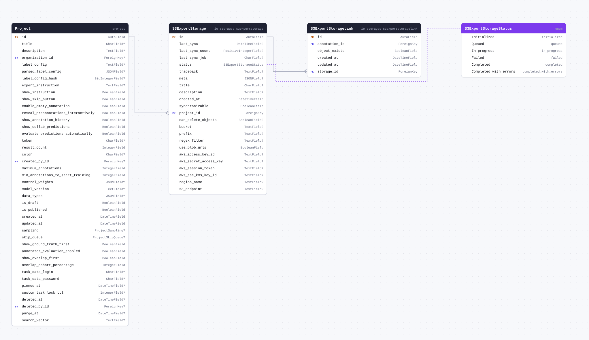

| Column | Field | Type | Null | Key | Default | Description |
| --- | --- | --- | --- | --- | --- | --- |
| `id` | `AutoField` | `integer` |  | PK | `autoincrement()` |  |
| `last_sync` | `DateTimeField` | `datetime` | yes |  |  | Last sync finished time |
| `last_sync_count` | `PositiveIntegerField` | `integer unsigned` | yes |  |  | Count of tasks synced last time |
| `last_sync_job` | `CharField` | `varchar(256)` | yes |  |  | Last sync job ID |
| `status` | `S3ExportStorageStatus` | `varchar(64)` |  |  | `'initialized'` |  |
| `traceback` | `TextField` | `text` | yes |  |  | Traceback report for the last failed sync |
| `meta` | `JSONField` | `text` | yes |  | `dict()` | Meta and debug information about storage processes |
| `title` | `CharField` | `varchar(256)` | yes |  |  | Cloud storage title |
| `description` | `TextField` | `text` | yes |  |  | Cloud storage description |
| `created_at` | `DateTimeField` | `datetime` |  |  | `now()` | Creation time |
| `synchronizable` | `BooleanField` | `bool` |  |  | `True` | If storage can be synced |
| `project_id` | `ForeignKey` | `integer` |  | FK |  | A unique integer value identifying this project. |
| `can_delete_objects` | `BooleanField` | `bool` | yes |  |  | Deletion from storage enabled |
| `bucket` | `TextField` | `text` | yes |  |  | S3 bucket name |
| `prefix` | `TextField` | `text` | yes |  |  | S3 bucket prefix |
| `regex_filter` | `TextField` | `text` | yes |  |  | Cloud storage regex for filtering objects |
| `use_blob_urls` | `BooleanField` | `bool` |  |  | `False` | Interpret objects as BLOBs and generate URLs |
| `aws_access_key_id` | `TextField` | `text` | yes |  |  | AWS_ACCESS_KEY_ID |
| `aws_secret_access_key` | `TextField` | `text` | yes |  |  | AWS_SECRET_ACCESS_KEY |
| `aws_session_token` | `TextField` | `text` | yes |  |  | AWS_SESSION_TOKEN |
| `aws_sse_kms_key_id` | `TextField` | `text` | yes |  |  | AWS SSE KMS Key ID |
| `region_name` | `TextField` | `text` | yes |  |  | AWS Region |
| `s3_endpoint` | `TextField` | `text` | yes |  |  | S3 Endpoint |

Indexes:

- index `io_storages_s3exportstorage_project_id_5e76add6` on `project_id`

Relations:

- `project_id` → [Project](#project).`id`, on delete cascade
- [S3ExportStorageLink](#s3exportstoragelink).`storage_id` → `id`, on delete cascade

## S3ImportStorageLink

Table `io_storages_s3importstoragelink`, app `io_storages`.

Columns from `ImportStorageLink` (abstract): `task_id`, `key`, `object_exists`, `created_at`, `row_group`, `row_index`.

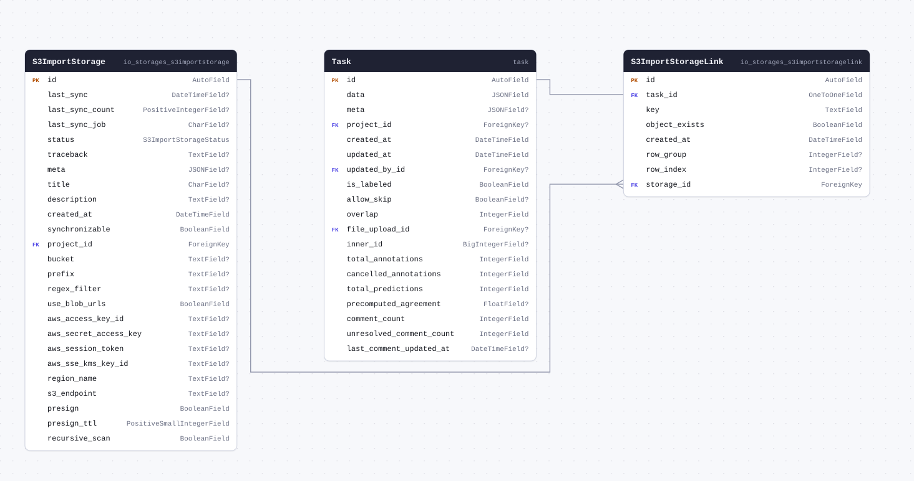

| Column | Field | Type | Null | Key | Default | Description |
| --- | --- | --- | --- | --- | --- | --- |
| `id` | `AutoField` | `integer` |  | PK | `autoincrement()` |  |
| `task_id` | `OneToOneField` | `integer` |  | FK, unique |  |  |
| `key` | `TextField` | `text` |  |  |  | External link key |
| `object_exists` | `BooleanField` | `bool` |  |  | `True` | Whether object under external link still exists |
| `created_at` | `DateTimeField` | `datetime` |  |  | `now()` | Creation time |
| `row_group` | `IntegerField` | `integer` | yes |  |  | Parquet row group |
| `row_index` | `IntegerField` | `integer` | yes |  |  | Parquet row index, or JSON[L] object index |
| `storage_id` | `ForeignKey` | `integer` |  | FK |  |  |

Indexes:

- index `io_storages_s3importstoragelink_storage_id_50ca5bd8` on `storage_id`

Relations:

- `task_id` → [Task](#task).`id`, on delete cascade
- `storage_id` → [S3ImportStorage](#s3importstorage).`id`, on delete cascade

## S3ExportStorageLink

Table `io_storages_s3exportstoragelink`, app `io_storages`.

Columns from `ExportStorageLink` (abstract): `annotation_id`, `object_exists`, `created_at`, `updated_at`.

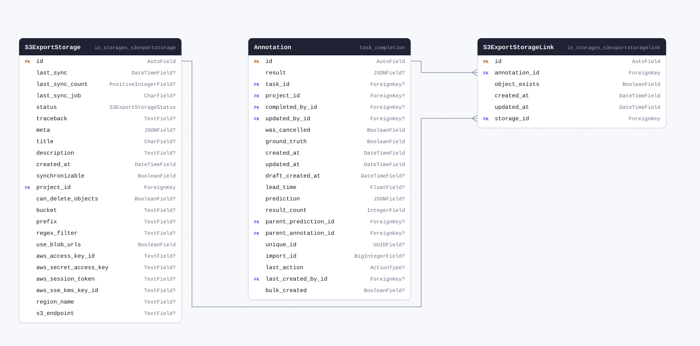

| Column | Field | Type | Null | Key | Default | Description |
| --- | --- | --- | --- | --- | --- | --- |
| `id` | `AutoField` | `integer` |  | PK | `autoincrement()` |  |
| `annotation_id` | `ForeignKey` | `integer` |  | FK |  |  |
| `object_exists` | `BooleanField` | `bool` |  |  | `True` | Whether object under external link still exists |
| `created_at` | `DateTimeField` | `datetime` |  |  | `now()` | Creation time |
| `updated_at` | `DateTimeField` | `datetime` |  |  | `now()` | Update time |
| `storage_id` | `ForeignKey` | `integer` |  | FK |  |  |

Indexes:

- index `io_storages_s3exportstoragelink_annotation_id_729994fe` on `annotation_id`
- index `io_storages_s3exportstoragelink_storage_id_a4563d13` on `storage_id`

Relations:

- `annotation_id` → [Annotation](#annotation).`id`, on delete cascade
- `storage_id` → [S3ExportStorage](#s3exportstorage).`id`, on delete cascade

## GCSStorageMixin

Table `io_storages_gcsstoragemixin`, app `io_storages`.

Subclasses (multi-table): [GCSImportStorage](#gcsimportstorage), [GCSExportStorage](#gcsexportstorage).

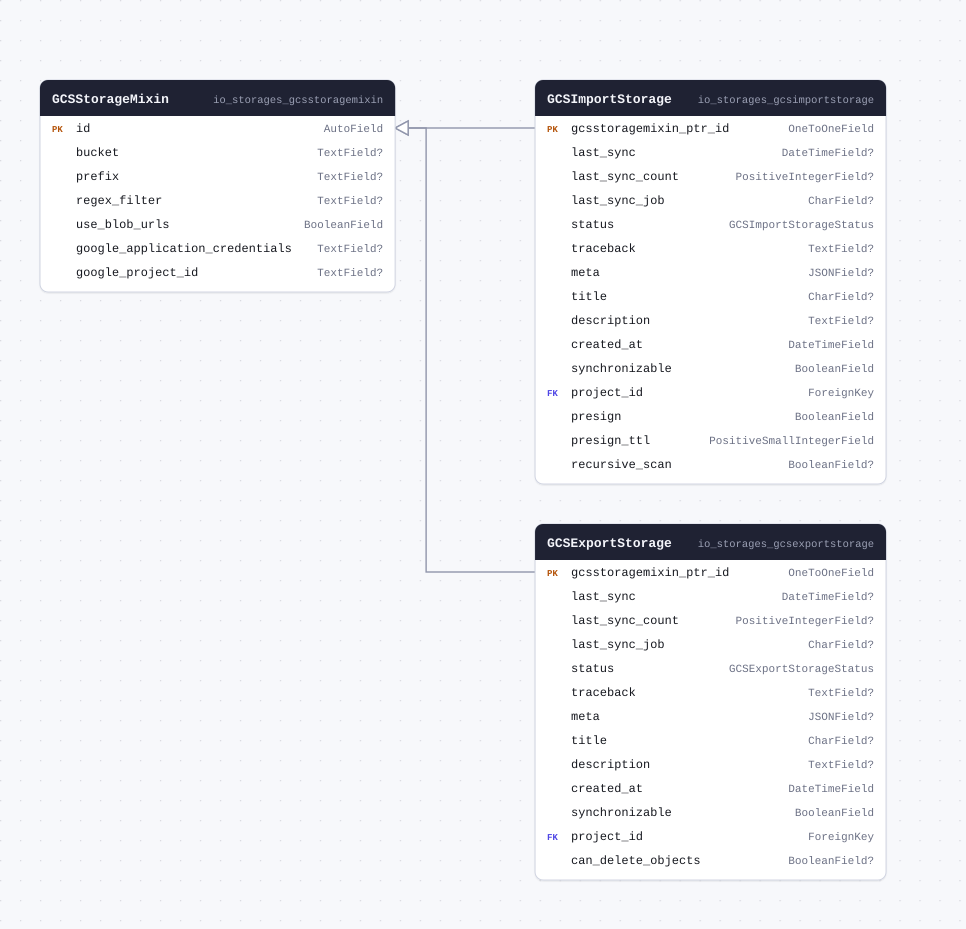

| Column | Field | Type | Null | Key | Default | Description |
| --- | --- | --- | --- | --- | --- | --- |
| `id` | `AutoField` | `integer` |  | PK | `autoincrement()` |  |
| `bucket` | `TextField` | `text` | yes |  |  | GCS bucket name |
| `prefix` | `TextField` | `text` | yes |  |  | GCS bucket prefix |
| `regex_filter` | `TextField` | `text` | yes |  |  | Cloud storage regex for filtering objects |
| `use_blob_urls` | `BooleanField` | `bool` |  |  | `False` | Interpret objects as BLOBs and generate URLs |
| `google_application_credentials` | `TextField` | `text` | yes |  |  | The content of GOOGLE_APPLICATION_CREDENTIALS json file |
| `google_project_id` | `TextField` | `text` | yes |  |  | Google project ID |

Relations:

- [GCSImportStorage](#gcsimportstorage).`gcsstoragemixin_ptr_id` → `id`, parent link, on delete cascade
- [GCSExportStorage](#gcsexportstorage).`gcsstoragemixin_ptr_id` → `id`, parent link, on delete cascade

## GCSImportStorage

Table `io_storages_gcsimportstorage`, app `io_storages`.

Inherits from [GCSStorageMixin](#gcsstoragemixin) (multi-table): its rows are joined on `gcsstoragemixin_ptr_id`.

Columns from `ProjectStorageMixin` (abstract): `project_id`.

Columns from `GCSImportStorageBase` (abstract): `gcsstoragemixin_ptr_id`, `presign`, `presign_ttl`, `recursive_scan`.

Columns from `Storage` (abstract): `title`, `description`, `created_at`, `synchronizable`.

Columns from `StorageInfo` (abstract): `last_sync`, `last_sync_count`, `last_sync_job`, `status`, `traceback`, `meta`.

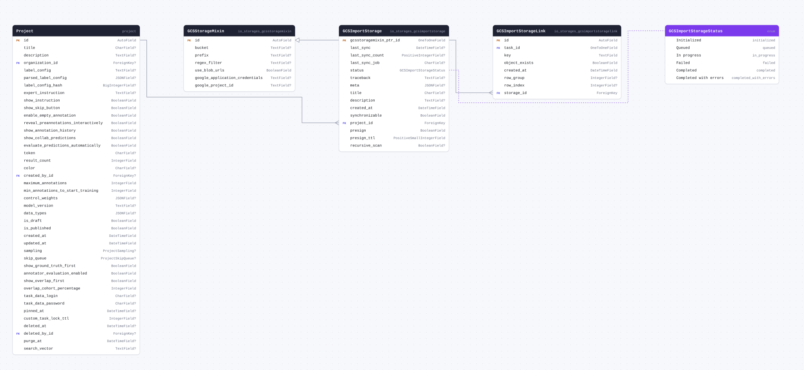

| Column | Field | Type | Null | Key | Default | Description |
| --- | --- | --- | --- | --- | --- | --- |
| `gcsstoragemixin_ptr_id` | `OneToOneField` | `integer` |  | PK, FK |  |  |
| `last_sync` | `DateTimeField` | `datetime` | yes |  |  | Last sync finished time |
| `last_sync_count` | `PositiveIntegerField` | `integer unsigned` | yes |  |  | Count of tasks synced last time |
| `last_sync_job` | `CharField` | `varchar(256)` | yes |  |  | Last sync job ID |
| `status` | `GCSImportStorageStatus` | `varchar(64)` |  |  | `'initialized'` |  |
| `traceback` | `TextField` | `text` | yes |  |  | Traceback report for the last failed sync |
| `meta` | `JSONField` | `text` | yes |  | `dict()` | Meta and debug information about storage processes |
| `title` | `CharField` | `varchar(256)` | yes |  |  | Cloud storage title |
| `description` | `TextField` | `text` | yes |  |  | Cloud storage description |
| `created_at` | `DateTimeField` | `datetime` |  |  | `now()` | Creation time |
| `synchronizable` | `BooleanField` | `bool` |  |  | `True` | If storage can be synced |
| `project_id` | `ForeignKey` | `integer` |  | FK |  | A unique integer value identifying this project. |
| `presign` | `BooleanField` | `bool` |  |  | `True` | Generate presigned URLs |
| `presign_ttl` | `PositiveSmallIntegerField` | `smallint unsigned` |  |  | `1` | Presigned URLs TTL (in minutes) |
| `recursive_scan` | `BooleanField` | `bool` | yes |  | `0` (database) | Perform recursive scan over the bucket content |

Indexes:

- index `io_storages_gcsimportstorage_project_id_dfb68296` on `project_id`

Relations:

- `gcsstoragemixin_ptr_id` → [GCSStorageMixin](#gcsstoragemixin).`id`, parent link, on delete cascade
- `project_id` → [Project](#project).`id`, on delete cascade
- [GCSImportStorageLink](#gcsimportstoragelink).`storage_id` → `gcsstoragemixin_ptr_id`, on delete cascade

## GCSExportStorage

Table `io_storages_gcsexportstorage`, app `io_storages`.

Inherits from [GCSStorageMixin](#gcsstoragemixin) (multi-table): its rows are joined on `gcsstoragemixin_ptr_id`.

Columns from `ExportStorage` (abstract): `can_delete_objects`.

Columns from `Storage` (abstract): `title`, `description`, `created_at`, `synchronizable`.

Columns from `StorageInfo` (abstract): `last_sync`, `last_sync_count`, `last_sync_job`, `status`, `traceback`, `meta`.

Columns from `ProjectStorageMixin` (abstract): `project_id`.

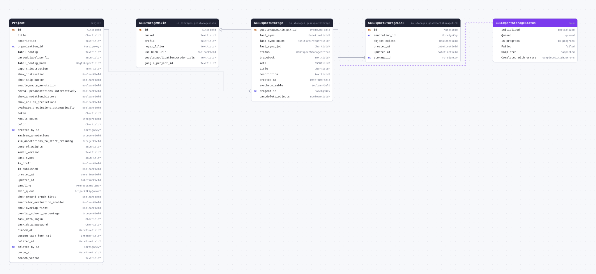

| Column | Field | Type | Null | Key | Default | Description |
| --- | --- | --- | --- | --- | --- | --- |
| `gcsstoragemixin_ptr_id` | `OneToOneField` | `integer` |  | PK, FK |  |  |
| `last_sync` | `DateTimeField` | `datetime` | yes |  |  | Last sync finished time |
| `last_sync_count` | `PositiveIntegerField` | `integer unsigned` | yes |  |  | Count of tasks synced last time |
| `last_sync_job` | `CharField` | `varchar(256)` | yes |  |  | Last sync job ID |
| `status` | `GCSExportStorageStatus` | `varchar(64)` |  |  | `'initialized'` |  |
| `traceback` | `TextField` | `text` | yes |  |  | Traceback report for the last failed sync |
| `meta` | `JSONField` | `text` | yes |  | `dict()` | Meta and debug information about storage processes |
| `title` | `CharField` | `varchar(256)` | yes |  |  | Cloud storage title |
| `description` | `TextField` | `text` | yes |  |  | Cloud storage description |
| `created_at` | `DateTimeField` | `datetime` |  |  | `now()` | Creation time |
| `synchronizable` | `BooleanField` | `bool` |  |  | `True` | If storage can be synced |
| `project_id` | `ForeignKey` | `integer` |  | FK |  | A unique integer value identifying this project. |
| `can_delete_objects` | `BooleanField` | `bool` | yes |  |  | Deletion from storage enabled |

Indexes:

- index `io_storages_gcsexportstorage_project_id_c3141a14` on `project_id`

Relations:

- `gcsstoragemixin_ptr_id` → [GCSStorageMixin](#gcsstoragemixin).`id`, parent link, on delete cascade
- `project_id` → [Project](#project).`id`, on delete cascade
- [GCSExportStorageLink](#gcsexportstoragelink).`storage_id` → `gcsstoragemixin_ptr_id`, on delete cascade

## GCSImportStorageLink

Table `io_storages_gcsimportstoragelink`, app `io_storages`.

Columns from `ImportStorageLink` (abstract): `task_id`, `key`, `object_exists`, `created_at`, `row_group`, `row_index`.

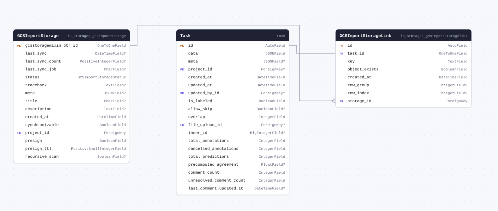

| Column | Field | Type | Null | Key | Default | Description |
| --- | --- | --- | --- | --- | --- | --- |
| `id` | `AutoField` | `integer` |  | PK | `autoincrement()` |  |
| `task_id` | `OneToOneField` | `integer` |  | FK, unique |  |  |
| `key` | `TextField` | `text` |  |  |  | External link key |
| `object_exists` | `BooleanField` | `bool` |  |  | `True` | Whether object under external link still exists |
| `created_at` | `DateTimeField` | `datetime` |  |  | `now()` | Creation time |
| `row_group` | `IntegerField` | `integer` | yes |  |  | Parquet row group |
| `row_index` | `IntegerField` | `integer` | yes |  |  | Parquet row index, or JSON[L] object index |
| `storage_id` | `ForeignKey` | `integer` |  | FK |  |  |

Indexes:

- index `io_storages_gcsimportstoragelink_storage_id_f3037a96` on `storage_id`

Relations:

- `task_id` → [Task](#task).`id`, on delete cascade
- `storage_id` → [GCSImportStorage](#gcsimportstorage).`gcsstoragemixin_ptr_id`, on delete cascade

## GCSExportStorageLink

Table `io_storages_gcsexportstoragelink`, app `io_storages`.

Columns from `ExportStorageLink` (abstract): `annotation_id`, `object_exists`, `created_at`, `updated_at`.

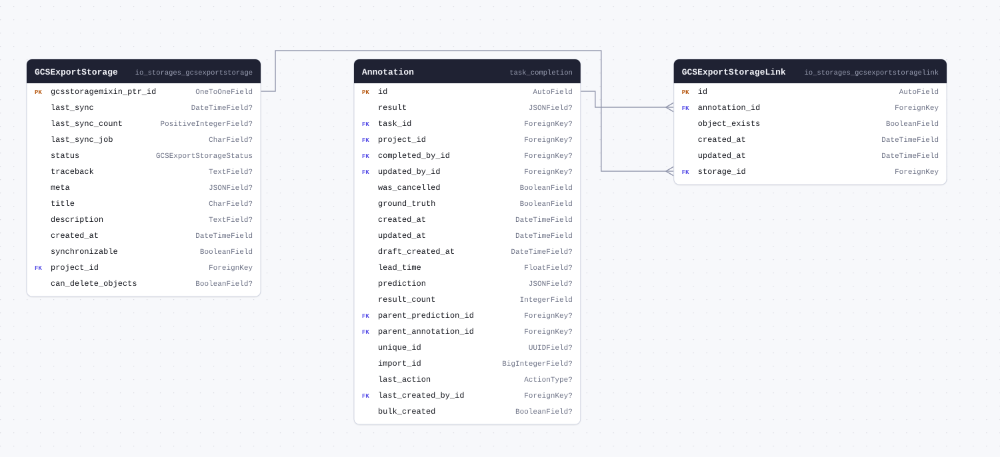

| Column | Field | Type | Null | Key | Default | Description |
| --- | --- | --- | --- | --- | --- | --- |
| `id` | `AutoField` | `integer` |  | PK | `autoincrement()` |  |
| `annotation_id` | `ForeignKey` | `integer` |  | FK |  |  |
| `object_exists` | `BooleanField` | `bool` |  |  | `True` | Whether object under external link still exists |
| `created_at` | `DateTimeField` | `datetime` |  |  | `now()` | Creation time |
| `updated_at` | `DateTimeField` | `datetime` |  |  | `now()` | Update time |
| `storage_id` | `ForeignKey` | `integer` |  | FK |  |  |

Indexes:

- index `io_storages_gcsexportstoragelink_annotation_id_2df715a6` on `annotation_id`
- index `io_storages_gcsexportstoragelink_storage_id_e940a32d` on `storage_id`

Relations:

- `annotation_id` → [Annotation](#annotation).`id`, on delete cascade
- `storage_id` → [GCSExportStorage](#gcsexportstorage).`gcsstoragemixin_ptr_id`, on delete cascade

## RedisStorageMixin

Table `io_storages_redisstoragemixin`, app `io_storages`.

Subclasses (multi-table): [RedisImportStorage](#redisimportstorage), [RedisExportStorage](#redisexportstorage).

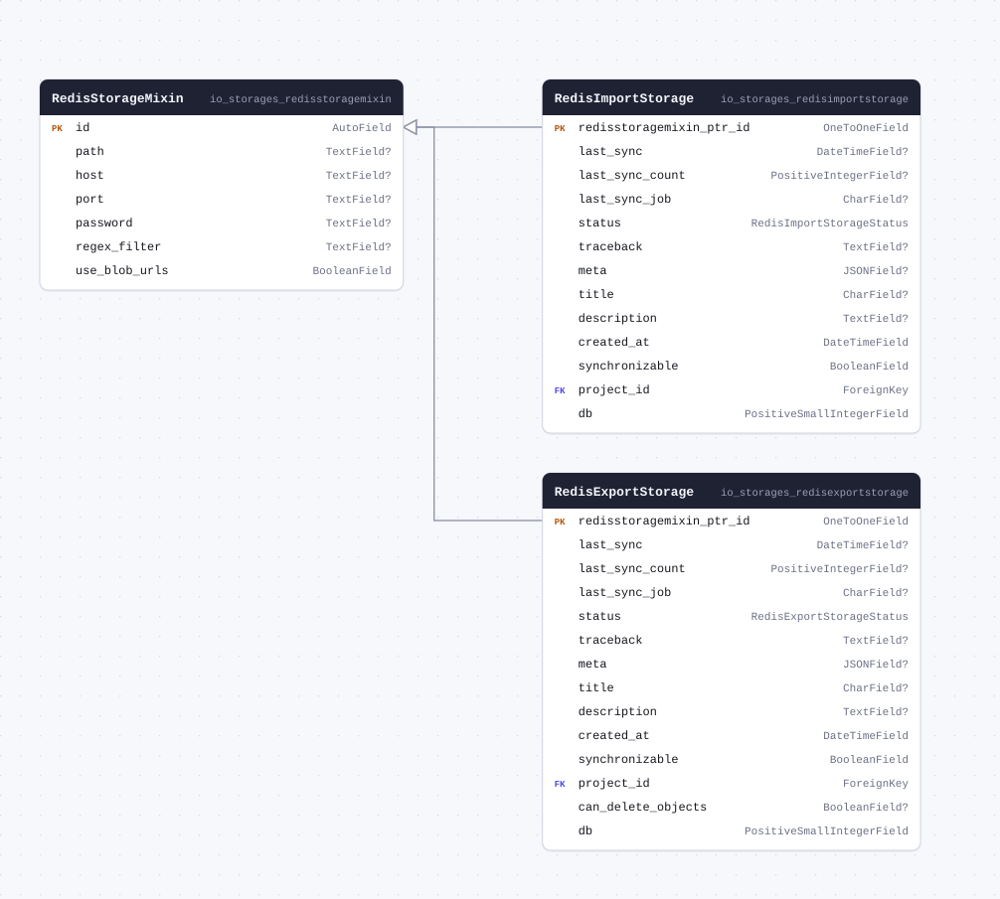

| Column | Field | Type | Null | Key | Default | Description |
| --- | --- | --- | --- | --- | --- | --- |
| `id` | `AutoField` | `integer` |  | PK | `autoincrement()` |  |
| `path` | `TextField` | `text` | yes |  |  | Storage prefix (optional) |
| `host` | `TextField` | `text` | yes |  |  | Server Host IP (optional) |
| `port` | `TextField` | `text` | yes |  |  | Server Port (optional) |
| `password` | `TextField` | `text` | yes |  |  | Server Password (optional) |
| `regex_filter` | `TextField` | `text` | yes |  |  | Cloud storage regex for filtering objects |
| `use_blob_urls` | `BooleanField` | `bool` |  |  | `False` | Interpret objects as BLOBs and generate URLs |

Relations:

- [RedisImportStorage](#redisimportstorage).`redisstoragemixin_ptr_id` → `id`, parent link, on delete cascade
- [RedisExportStorage](#redisexportstorage).`redisstoragemixin_ptr_id` → `id`, parent link, on delete cascade

## RedisImportStorage

Table `io_storages_redisimportstorage`, app `io_storages`.

Inherits from [RedisStorageMixin](#redisstoragemixin) (multi-table): its rows are joined on `redisstoragemixin_ptr_id`.

Columns from `ProjectStorageMixin` (abstract): `project_id`.

Columns from `RedisImportStorageBase` (abstract): `redisstoragemixin_ptr_id`, `db`.

Columns from `Storage` (abstract): `title`, `description`, `created_at`, `synchronizable`.

Columns from `StorageInfo` (abstract): `last_sync`, `last_sync_count`, `last_sync_job`, `status`, `traceback`, `meta`.


| Column | Field | Type | Null | Key | Default | Description |
| --- | --- | --- | --- | --- | --- | --- |
| `redisstoragemixin_ptr_id` | `OneToOneField` | `integer` |  | PK, FK |  |  |
| `last_sync` | `DateTimeField` | `datetime` | yes |  |  | Last sync finished time |
| `last_sync_count` | `PositiveIntegerField` | `integer unsigned` | yes |  |  | Count of tasks synced last time |
| `last_sync_job` | `CharField` | `varchar(256)` | yes |  |  | Last sync job ID |
| `status` | `RedisImportStorageStatus` | `varchar(64)` |  |  | `'initialized'` |  |
| `traceback` | `TextField` | `text` | yes |  |  | Traceback report for the last failed sync |
| `meta` | `JSONField` | `text` | yes |  | `dict()` | Meta and debug information about storage processes |
| `title` | `CharField` | `varchar(256)` | yes |  |  | Cloud storage title |
| `description` | `TextField` | `text` | yes |  |  | Cloud storage description |
| `created_at` | `DateTimeField` | `datetime` |  |  | `now()` | Creation time |
| `synchronizable` | `BooleanField` | `bool` |  |  | `True` | If storage can be synced |
| `project_id` | `ForeignKey` | `integer` |  | FK |  | A unique integer value identifying this project. |
| `db` | `PositiveSmallIntegerField` | `smallint unsigned` |  |  | `1` | Server Database |

Indexes:

- index `io_storages_redisimportstorage_project_id_c7b9adc0` on `project_id`

Relations:

- `redisstoragemixin_ptr_id` → [RedisStorageMixin](#redisstoragemixin).`id`, parent link, on delete cascade
- `project_id` → [Project](#project).`id`, on delete cascade
- [RedisImportStorageLink](#redisimportstoragelink).`storage_id` → `redisstoragemixin_ptr_id`, on delete cascade

## RedisExportStorage

Table `io_storages_redisexportstorage`, app `io_storages`.

Inherits from [RedisStorageMixin](#redisstoragemixin) (multi-table): its rows are joined on `redisstoragemixin_ptr_id`.

Columns from `ExportStorage` (abstract): `can_delete_objects`.

Columns from `Storage` (abstract): `title`, `description`, `created_at`, `synchronizable`.

Columns from `StorageInfo` (abstract): `last_sync`, `last_sync_count`, `last_sync_job`, `status`, `traceback`, `meta`.

Columns from `ProjectStorageMixin` (abstract): `project_id`.

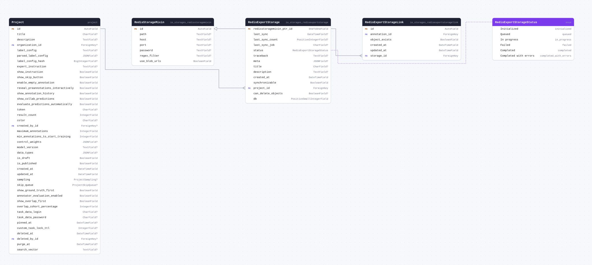

| Column | Field | Type | Null | Key | Default | Description |
| --- | --- | --- | --- | --- | --- | --- |
| `redisstoragemixin_ptr_id` | `OneToOneField` | `integer` |  | PK, FK |  |  |
| `last_sync` | `DateTimeField` | `datetime` | yes |  |  | Last sync finished time |
| `last_sync_count` | `PositiveIntegerField` | `integer unsigned` | yes |  |  | Count of tasks synced last time |
| `last_sync_job` | `CharField` | `varchar(256)` | yes |  |  | Last sync job ID |
| `status` | `RedisExportStorageStatus` | `varchar(64)` |  |  | `'initialized'` |  |
| `traceback` | `TextField` | `text` | yes |  |  | Traceback report for the last failed sync |
| `meta` | `JSONField` | `text` | yes |  | `dict()` | Meta and debug information about storage processes |
| `title` | `CharField` | `varchar(256)` | yes |  |  | Cloud storage title |
| `description` | `TextField` | `text` | yes |  |  | Cloud storage description |
| `created_at` | `DateTimeField` | `datetime` |  |  | `now()` | Creation time |
| `synchronizable` | `BooleanField` | `bool` |  |  | `True` | If storage can be synced |
| `project_id` | `ForeignKey` | `integer` |  | FK |  | A unique integer value identifying this project. |
| `can_delete_objects` | `BooleanField` | `bool` | yes |  |  | Deletion from storage enabled |
| `db` | `PositiveSmallIntegerField` | `smallint unsigned` |  |  | `2` | Server Database |

Indexes:

- index `io_storages_redisexportstorage_project_id_12a2546c` on `project_id`

Relations:

- `redisstoragemixin_ptr_id` → [RedisStorageMixin](#redisstoragemixin).`id`, parent link, on delete cascade
- `project_id` → [Project](#project).`id`, on delete cascade
- [RedisExportStorageLink](#redisexportstoragelink).`storage_id` → `redisstoragemixin_ptr_id`, on delete cascade

## RedisImportStorageLink

Table `io_storages_redisimportstoragelink`, app `io_storages`.

Columns from `ImportStorageLink` (abstract): `task_id`, `key`, `object_exists`, `created_at`, `row_group`, `row_index`.


| Column | Field | Type | Null | Key | Default | Description |
| --- | --- | --- | --- | --- | --- | --- |
| `id` | `AutoField` | `integer` |  | PK | `autoincrement()` |  |
| `task_id` | `OneToOneField` | `integer` |  | FK, unique |  |  |
| `key` | `TextField` | `text` |  |  |  | External link key |
| `object_exists` | `BooleanField` | `bool` |  |  | `True` | Whether object under external link still exists |
| `created_at` | `DateTimeField` | `datetime` |  |  | `now()` | Creation time |
| `row_group` | `IntegerField` | `integer` | yes |  |  | Parquet row group |
| `row_index` | `IntegerField` | `integer` | yes |  |  | Parquet row index, or JSON[L] object index |
| `storage_id` | `ForeignKey` | `integer` |  | FK |  |  |

Indexes:

- index `io_storages_redisimportstoragelink_storage_id_17124de8` on `storage_id`

Relations:

- `task_id` → [Task](#task).`id`, on delete cascade
- `storage_id` → [RedisImportStorage](#redisimportstorage).`redisstoragemixin_ptr_id`, on delete cascade

## RedisExportStorageLink

Table `io_storages_redisexportstoragelink`, app `io_storages`.

Columns from `ExportStorageLink` (abstract): `annotation_id`, `object_exists`, `created_at`, `updated_at`.


| Column | Field | Type | Null | Key | Default | Description |
| --- | --- | --- | --- | --- | --- | --- |
| `id` | `AutoField` | `integer` |  | PK | `autoincrement()` |  |
| `annotation_id` | `ForeignKey` | `integer` |  | FK |  |  |
| `object_exists` | `BooleanField` | `bool` |  |  | `True` | Whether object under external link still exists |
| `created_at` | `DateTimeField` | `datetime` |  |  | `now()` | Creation time |
| `updated_at` | `DateTimeField` | `datetime` |  |  | `now()` | Update time |
| `storage_id` | `ForeignKey` | `integer` |  | FK |  |  |

Indexes:

- index `io_storages_redisexportstoragelink_annotation_id_8547e508` on `annotation_id`
- index `io_storages_redisexportstoragelink_storage_id_807898d8` on `storage_id`

Relations:

- `annotation_id` → [Annotation](#annotation).`id`, on delete cascade
- `storage_id` → [RedisExportStorage](#redisexportstorage).`redisstoragemixin_ptr_id`, on delete cascade

## MLBackend

Table `ml_mlbackend`, app `ml`.


| Column | Field | Type | Null | Key | Default | Description |
| --- | --- | --- | --- | --- | --- | --- |
| `id` | `AutoField` | `integer` |  | PK | `autoincrement()` |  |
| `state` | `MLBackendState` | `varchar(2)` |  |  | `'DI'` |  |
| `is_interactive` | `BooleanField` | `bool` |  |  | `False` | Used to interactively annotate tasks. If true, model returns one list with results |
| `url` | `TextField` | `text` |  |  |  | URL for the machine learning model server |
| `error_message` | `TextField` | `text` | yes |  |  | Error message in error state |
| `title` | `TextField` | `text` | yes |  | `'default'` | Name of the machine learning backend |
| `auth_method` | `MLBackendAuth` | `varchar(255)` |  |  | `'NONE'` |  |
| `basic_auth_user` | `TextField` | `text` | yes |  | `''` | HTTP Basic Auth user |
| `basic_auth_pass` | `TextField` | `text` | yes |  | `''` | HTTP Basic Auth password |
| `description` | `TextField` | `text` | yes |  | `''` | Description for the machine learning backend |
| `extra_params` | `JSONField` | `text` | yes |  |  | Any extra parameters passed to the ML Backend during the setup |
| `model_version` | `TextField` | `text` | yes |  | `''` | Current model version associated with this machine learning backend |
| `timeout` | `FloatField` | `real` |  |  | `100.0` | Response model timeout |
| `project_id` | `ForeignKey` | `integer` |  | FK |  |  |
| `created_at` | `DateTimeField` | `datetime` |  |  | `now()` |  |
| `updated_at` | `DateTimeField` | `datetime` |  |  | `now()` |  |
| `auto_update` | `BooleanField` | `bool` |  |  | `True` | If false, model version is set by the user, if true - getting latest version from backend. |

Indexes:

- index `ml_mlbackend_project_id_ca08142d` on `project_id`

Relations:

- [Prediction](#prediction).`model_id` → `id`, on delete cascade
- [FailedPrediction](#failedprediction).`ml_backend_model_id` → `id`, on delete set null
- `project_id` → [Project](#project).`id`, on delete cascade
- [MLBackendPredictionJob](#mlbackendpredictionjob).`ml_backend_id` → `id`, on delete cascade
- [MLBackendTrainJob](#mlbackendtrainjob).`ml_backend_id` → `id`, on delete cascade

## MLBackendPredictionJob

Table `ml_mlbackendpredictionjob`, app `ml`.


| Column | Field | Type | Null | Key | Default | Description |
| --- | --- | --- | --- | --- | --- | --- |
| `id` | `AutoField` | `integer` |  | PK | `autoincrement()` |  |
| `job_id` | `CharField` | `varchar(128)` |  |  |  |  |
| `ml_backend_id` | `ForeignKey` | `integer` |  | FK |  |  |
| `model_version` | `TextField` | `text` | yes |  |  | Model version this job is associated with |
| `batch_size` | `PositiveSmallIntegerField` | `smallint unsigned` |  |  | `100` | Number of tasks processed per batch |
| `created_at` | `DateTimeField` | `datetime` |  |  | `now()` |  |
| `updated_at` | `DateTimeField` | `datetime` |  |  | `now()` |  |

Indexes:

- index `ml_mlbackendpredictionjob_ml_backend_id_c1aea4f1` on `ml_backend_id`

Relations:

- `ml_backend_id` → [MLBackend](#mlbackend).`id`, on delete cascade

## MLBackendTrainJob

Table `ml_mlbackendtrainjob`, app `ml`.


| Column | Field | Type | Null | Key | Default | Description |
| --- | --- | --- | --- | --- | --- | --- |
| `id` | `AutoField` | `integer` |  | PK | `autoincrement()` |  |
| `job_id` | `CharField` | `varchar(128)` |  |  |  |  |
| `ml_backend_id` | `ForeignKey` | `integer` |  | FK |  |  |
| `model_version` | `TextField` | `text` | yes |  |  | Model version this job is associated with |
| `created_at` | `DateTimeField` | `datetime` |  |  | `now()` |  |
| `updated_at` | `DateTimeField` | `datetime` |  |  | `now()` |  |

Indexes:

- index `ml_mlbackendtrainjob_ml_backend_id_3d40686e` on `ml_backend_id`

Relations:

- `ml_backend_id` → [MLBackend](#mlbackend).`id`, on delete cascade

## Webhook

Table `webhook`, app `webhooks`.

Model of webhooks.

If webhook has not null project field -- it's project webhook


| Column | Field | Type | Null | Key | Default | Description |
| --- | --- | --- | --- | --- | --- | --- |
| `id` | `AutoField` | `integer` |  | PK | `autoincrement()` |  |
| `organization_id` | `ForeignKey` | `integer` |  | FK |  |  |
| `project_id` | `ForeignKey` | `integer` | yes | FK | `None` |  |
| `url` | `URLField` | `varchar(2048)` |  |  |  | URL of webhook |
| `send_payload` | `BooleanField` | `bool` |  |  | `True` | If value is False send only action |
| `send_for_all_actions` | `BooleanField` | `bool` |  |  | `True` | If value is False - used only for actions from WebhookAction |
| `headers` | `JSONField` | `text` |  |  | `dict()` | Key Value Json of headers |
| `is_active` | `BooleanField` | `bool` |  |  | `True` | If value is False the webhook is disabled |
| `created_at` | `DateTimeField` | `datetime` |  |  | `now()` | Creation time |
| `updated_at` | `DateTimeField` | `datetime` |  |  | `now()` | Last update time |

Indexes:

- index `webhook_organization_id_b5440e9a` on `organization_id`
- index `webhook_project_id_e686d00c` on `project_id`
- index `webhook_created_at_b2a71ea5` on `created_at`
- index `webhook_updated_at_695b4e7f` on `updated_at`

Relations:

- `organization_id` → [Organization](#organization).`id`, on delete cascade
- `project_id` → [Project](#project).`id`, on delete cascade
- [WebhookAction](#webhookaction).`webhook_id` → `id`, on delete cascade

## WebhookAction

Table `webhook_action`, app `webhooks`.


| Column | Field | Type | Null | Key | Default | Description |
| --- | --- | --- | --- | --- | --- | --- |
| `id` | `AutoField` | `integer` |  | PK | `autoincrement()` |  |
| `webhook_id` | `ForeignKey` | `integer` |  | FK |  |  |
| `action` | `WebhookActionAction` | `varchar(128)` |  |  |  | Action value |

Indexes:

- index `webhook_action_webhook_id_4eb6213f` on `webhook_id`
- index `webhook_action_action_4398909e` on `action`
- unique `webhook_action_webhook_id_action_11842b15_uniq` on `webhook_id`, `action`

Relations:

- `webhook_id` → [Webhook](#webhook).`id`, on delete cascade

## Label

Table `labels_manager_label`, app `labels_manager`.


| Column | Field | Type | Null | Key | Default | Description |
| --- | --- | --- | --- | --- | --- | --- |
| `id` | `AutoField` | `integer` |  | PK | `autoincrement()` |  |
| `created_at` | `DateTimeField` | `datetime` |  |  | `now()` | Time of label creation |
| `updated_at` | `DateTimeField` | `datetime` |  |  | `now()` | Time of label modification |
| `created_by_id` | `ForeignKey` | `integer` |  | FK |  | User who made this label |
| `value` | `JSONField` | `text` |  |  |  | Label value |
| `title` | `CharField` | `varchar(2048)` |  |  |  | Label title |
| `description` | `TextField` | `text` | yes |  |  | Label description |
| `approved_by_id` | `ForeignKey` | `integer` | yes | FK |  | User who approved this label |
| `approved` | `BooleanField` | `bool` |  |  | `False` | Status of label |
| `organization_id` | `ForeignKey` | `integer` |  | FK |  |  |

Indexes:

- index `labels_manager_label_created_by_id_e3b3e785` on `created_by_id`
- index `labels_manager_label_approved_by_id_4b6a871f` on `approved_by_id`
- index `labels_manager_label_organization_id_5f714874` on `organization_id`
- unique `unique_title` on `title`, `organization_id`

Relations:

- `projects` — many to many with [Project](#project), through [LabelLink](#labellink)
- `created_by_id` → [User](#user).`id`, on delete cascade
- `approved_by_id` → [User](#user).`id`, on delete cascade
- `organization_id` → [Organization](#organization).`id`, on delete cascade
- [LabelLink](#labellink).`label_id` → `id`, on delete cascade

## LabelLink

Table `labels_manager_labellink`, app `labels_manager`.


| Column | Field | Type | Null | Key | Default | Description |
| --- | --- | --- | --- | --- | --- | --- |
| `id` | `AutoField` | `integer` |  | PK | `autoincrement()` |  |
| `project_id` | `ForeignKey` | `integer` |  | FK |  |  |
| `label_id` | `ForeignKey` | `integer` |  | FK |  |  |
| `from_name` | `CharField` | `varchar(2048)` |  |  |  | Tag name |

Indexes:

- index `labels_manager_labellink_project_id_e3d33738` on `project_id`
- index `labels_manager_labellink_label_id_c8afbfa4` on `label_id`
- unique `unique_label_project` on `project_id`, `label_id`

Relations:

- `project_id` → [Project](#project).`id`, on delete cascade
- `label_id` → [Label](#label).`id`, on delete cascade

## ModelInterface

Table `ml_models_modelinterface`, app `ml_models`.


| Column | Field | Type | Null | Key | Default | Description |
| --- | --- | --- | --- | --- | --- | --- |
| `id` | `AutoField` | `integer` |  | PK | `autoincrement()` |  |
| `title` | `CharField` | `varchar(500)` |  |  |  | Model name |
| `description` | `TextField` | `text` | yes |  |  | Model description |
| `created_by_id` | `ForeignKey` | `integer` | yes | FK |  |  |
| `created_at` | `DateTimeField` | `datetime` |  |  | `now()` |  |
| `updated_at` | `DateTimeField` | `datetime` |  |  | `now()` |  |
| `organization_id` | `ForeignKey` | `integer` | yes | FK |  |  |
| `skill_name` | `SkillNames` | `varchar(255)` | yes |  |  |  |
| `input_fields` | `JSONField` | `text` |  |  | `list()` |  |
| `output_classes` | `JSONField` | `text` |  |  | `list()` |  |

Indexes:

- index `ml_models_modelinterface_created_by_id_8ba717c0` on `created_by_id`
- index `ml_models_modelinterface_organization_id_d5688149` on `organization_id`

Relations:

- `created_by_id` → [User](#user).`id`, on delete set null
- `organization_id` → [Organization](#organization).`id`, on delete cascade
- `associated_projects` — many to many with [Project](#project)
- [ThirdPartyModelVersion](#thirdpartymodelversion).`parent_model_id` → `id`, on delete cascade

## ThirdPartyModelVersion

Table `ml_models_thirdpartymodelversion`, app `ml_models`.

Columns from `ModelVersion` (abstract): `title`, `parent_model_id`, `prompt`, `model_provider_connection_id`.


| Column | Field | Type | Null | Key | Default | Description |
| --- | --- | --- | --- | --- | --- | --- |
| `id` | `AutoField` | `integer` |  | PK | `autoincrement()` |  |
| `title` | `CharField` | `varchar(500)` |  |  |  | Model name |
| `parent_model_id` | `ForeignKey` | `integer` |  | FK |  |  |
| `prompt` | `TextField` | `text` |  |  |  | Prompt to execute |
| `model_provider_connection_id` | `ForeignKey` | `integer` | yes | FK |  |  |
| `provider` | `ModelProviders` | `varchar(255)` |  |  | `'OpenAI'` | The model provider to use e.g. OpenAI |
| `provider_model_id` | `CharField` | `varchar(255)` |  |  |  | The model ID to use within the given provider, e.g. gpt-3.5 |
| `created_by_id` | `ForeignKey` | `integer` | yes | FK |  |  |
| `created_at` | `DateTimeField` | `datetime` |  |  | `now()` |  |
| `updated_at` | `DateTimeField` | `datetime` |  |  | `now()` |  |
| `organization_id` | `ForeignKey` | `integer` | yes | FK |  |  |

Indexes:

- index `ml_models_thirdpartymodelversion_parent_model_id_599e1869` on `parent_model_id`
- index `ml_models_thirdpartymodelversion_model_provider_connection_id_b98c173f` on `model_provider_connection_id`
- index `ml_models_thirdpartymodelversion_created_by_id_b1fb2c2f` on `created_by_id`
- index `ml_models_thirdpartymodelversion_organization_id_a4a5df4d` on `organization_id`

Relations:

- `parent_model_id` → [ModelInterface](#modelinterface).`id`, on delete cascade
- `model_provider_connection_id` → [ModelProviderConnection](#modelproviderconnection).`id`, on delete set null
- `created_by_id` → [User](#user).`id`, on delete set null
- `organization_id` → [Organization](#organization).`id`, on delete cascade
- [ModelRun](#modelrun).`model_version_id` → `id`, on delete cascade

## ModelRun

Table `ml_models_modelrun`, app `ml_models`.


| Column | Field | Type | Null | Key | Default | Description |
| --- | --- | --- | --- | --- | --- | --- |
| `id` | `AutoField` | `integer` |  | PK | `autoincrement()` |  |
| `organization_id` | `ForeignKey` | `integer` | yes | FK |  |  |
| `project_id` | `ForeignKey` | `integer` |  | FK |  |  |
| `model_version_id` | `ForeignKey` | `integer` |  | FK |  |  |
| `created_by_id` | `ForeignKey` | `integer` | yes | FK |  |  |
| `project_subset` | `ModelRunProjectSubset` | `varchar(255)` |  |  | `'HasGT'` |  |
| `status` | `ModelRunModelRunStatus` | `varchar(255)` |  |  | `'Pending'` |  |
| `job_id` | `CharField` | `varchar(255)` | yes |  | `None` | Job ID for inference job for a ModelRun e.g. Adala job ID |
| `total_predictions` | `IntegerField` | `integer` |  |  | `0` |  |
| `total_correct_predictions` | `IntegerField` | `integer` |  |  | `0` |  |
| `total_tasks` | `IntegerField` | `integer` |  |  | `0` |  |
| `created_at` | `DateTimeField` | `datetime` |  |  | `now()` |  |
| `triggered_at` | `DateTimeField` | `datetime` | yes |  | `None` |  |
| `predictions_updated_at` | `DateTimeField` | `datetime` | yes |  | `None` |  |
| `completed_at` | `DateTimeField` | `datetime` | yes |  | `None` |  |

Indexes:

- index `ml_models_modelrun_organization_id_1f7f8243` on `organization_id`
- index `ml_models_modelrun_project_id_1b76ea76` on `project_id`
- index `ml_models_modelrun_model_version_id_e15572eb` on `model_version_id`
- index `ml_models_modelrun_created_by_id_1a302218` on `created_by_id`

Relations:

- [Prediction](#prediction).`model_run_id` → `id`, on delete cascade
- [FailedPrediction](#failedprediction).`model_run_id` → `id`, on delete cascade
- `organization_id` → [Organization](#organization).`id`, on delete cascade
- `project_id` → [Project](#project).`id`, on delete cascade
- `model_version_id` → [ThirdPartyModelVersion](#thirdpartymodelversion).`id`, on delete cascade
- `created_by_id` → [User](#user).`id`, on delete set null

## ModelProviderConnection

Table `ml_model_providers_modelproviderconnection`, app `ml_model_providers`.


| Column | Field | Type | Null | Key | Default | Description |
| --- | --- | --- | --- | --- | --- | --- |
| `id` | `AutoField` | `integer` |  | PK | `autoincrement()` |  |
| `provider` | `ModelProviders` | `varchar(255)` |  |  | `'OpenAI'` |  |
| `api_key` | `TextField` | `text` | yes |  |  | Model provider API key |
| `auth_token` | `TextField` | `text` | yes |  |  | Model provider Auth token |
| `deployment_name` | `CharField` | `varchar(512)` | yes |  |  | Azure OpenAI deployment name |
| `endpoint` | `CharField` | `varchar(512)` | yes |  |  | Azure OpenAI endpoint |
| `google_application_credentials` | `TextField` | `text` | yes |  |  | The content of GOOGLE_APPLICATION_CREDENTIALS json file |
| `google_project_id` | `CharField` | `varchar(255)` | yes |  |  | Google project ID |
| `google_location` | `CharField` | `varchar(255)` | yes |  |  | Google project location |
| `cached_available_models` | `CharField` | `varchar(4096)` | yes |  |  | List of available models from the provider |
| `scope` | `ModelProviderConnectionScopes` | `varchar(255)` |  |  | `'Organization'` |  |
| `organization_id` | `ForeignKey` | `integer` | yes | FK |  |  |
| `created_by_id` | `ForeignKey` | `integer` | yes | FK |  |  |
| `created_at` | `DateTimeField` | `datetime` |  |  | `now()` |  |
| `updated_at` | `DateTimeField` | `datetime` |  |  | `now()` |  |
| `is_internal` | `BooleanField` | `bool` | yes |  | `False` | Whether the model provider connection is internal, not visible to the user |
| `budget_limit` | `FloatField` | `real` | yes |  | `None` | Budget limit for the model provider connection (null if unlimited) |
| `budget_last_reset_date` | `DateTimeField` | `datetime` | yes |  | `None` | Date and time the budget was last reset |
| `budget_reset_period` | `ModelProviderConnectionBudgetResetPeriod` | `varchar(20)` | yes |  | `None` | Budget reset period for the model provider connection (null if not reset) |
| `budget_total_spent` | `FloatField` | `real` | yes |  | `None` | Tracked total budget spent for the given provider connection within the current budget period |
| `budget_alert_threshold` | `FloatField` | `real` | yes |  | `None` | Budget alert threshold for the given provider connection |

Indexes:

- index `ml_model_providers_modelproviderconnection_organization_id_ef7f6136` on `organization_id`
- index `ml_model_providers_modelproviderconnection_created_by_id_2e24aab7` on `created_by_id`

Relations:

- [ThirdPartyModelVersion](#thirdpartymodelversion).`model_provider_connection_id` → `id`, on delete set null
- `organization_id` → [Organization](#organization).`id`, on delete cascade
- `created_by_id` → [User](#user).`id`, on delete set null

## JWTSettings

Table `jwt_auth_jwtsettings`, app `jwt_auth`.

Organization-specific JWT settings for authentication


| Column | Field | Type | Null | Key | Default | Description |
| --- | --- | --- | --- | --- | --- | --- |
| `organization_id` | `AutoOneToOneField` | `integer` |  | PK, FK |  |  |
| `api_tokens_enabled` | `BooleanField` | `bool` |  |  | `True` | Enable JWT API token authentication for this organization |
| `api_token_ttl_days` | `IntegerField` | `integer` |  |  | `73000` | Number of days before JWT API tokens expire |
| `legacy_api_tokens_enabled` | `BooleanField` | `bool` |  |  | `False` | Enable legacy API token authentication for this organization |
| `created_at` | `DateTimeField` | `datetime` |  |  | `now()` |  |
| `updated_at` | `DateTimeField` | `datetime` |  |  | `now()` |  |

Relations:

- `organization_id` → [Organization](#organization).`id`, on delete do nothing

## SessionTimeoutPolicy

Table `session_policy_sessiontimeoutpolicy`, app `session_policy`.

Organization-specific session timeout policy configuration


| Column | Field | Type | Null | Key | Default | Description |
| --- | --- | --- | --- | --- | --- | --- |
| `organization_id` | `AutoOneToOneField` | `integer` |  | PK, FK |  |  |
| `max_session_age` | `IntegerField` | `integer` |  |  | `11520` | Number of minutes that a session can be active before needing to re-login |
| `max_time_between_activity` | `IntegerField` | `integer` |  |  | `4320` | Number of minutes that a session stays active without any activity |
| `created_at` | `DateTimeField` | `datetime` |  |  | `now()` |  |
| `updated_at` | `DateTimeField` | `datetime` |  |  | `now()` |  |

Relations:

- `organization_id` → [Organization](#organization).`id`, on delete do nothing

# Enums

## LogEntryActionFlag

| Name | Stored as |
| --- | --- |
| `Addition` | `1` |
| `Change` | `2` |
| `Deletion` | `3` |

## ProjectStateChoices

| Name | Stored as |
| --- | --- |
| `CREATED` | `CREATED` |
| `IN_PROGRESS` | `IN_PROGRESS` |
| `COMPLETED` | `COMPLETED` |

## AnnotationStateChoices

| Name | Stored as |
| --- | --- |
| `CREATED` | `CREATED` |

## AsyncMigrationStatusStatus

| Name | Stored as |
| --- | --- |
| `Migration is scheduled but not yet started.` | `SCHEDULED` |
| `Migration is started or queued.` | `STARTED` |
| `Migration is in progress. Check meta for job_id or status.` | `IN PROGRESS` |
| `Migration completed successfully.` | `FINISHED` |
| `Migration completed with errors. Check meta for more info.` | `ERROR` |

## ExportStatus

| Name | Stored as |
| --- | --- |
| `CREATED` | `created` |
| `IN_PROGRESS` | `in_progress` |
| `FAILED` | `failed` |
| `COMPLETED` | `completed` |

## ConvertedFormatStatus

| Name | Stored as |
| --- | --- |
| `CREATED` | `created` |
| `IN_PROGRESS` | `in_progress` |
| `FAILED` | `failed` |
| `COMPLETED` | `completed` |

## ProjectSampling

| Name | Stored as |
| --- | --- |
| `Tasks are ordered by Data manager ordering` | `Sequential sampling` |
| `Tasks are chosen randomly` | `Uniform sampling` |
| `Tasks are chosen according to model uncertainty scores (active learning mode)` | `Uncertainty sampling` |

## ProjectSkipQueue

| Name | Stored as |
| --- | --- |
| `REQUEUE_FOR_ME` | `REQUEUE_FOR_ME` |
| `REQUEUE_FOR_OTHERS` | `REQUEUE_FOR_OTHERS` |
| `IGNORE_SKIPPED` | `IGNORE_SKIPPED` |

## ProjectOnboardingStepsCode

| Name | Stored as |
| --- | --- |
| `Import your data` | `DU` |
| `Configure settings` | `CF` |
| `Publish project` | `PB` |
| `Invite collaborators` | `IE` |

## ProjectImportStatus

| Name | Stored as |
| --- | --- |
| `CREATED` | `created` |
| `IN_PROGRESS` | `in_progress` |
| `FAILED` | `failed` |
| `COMPLETED` | `completed` |

## ProjectReimportStatus

| Name | Stored as |
| --- | --- |
| `CREATED` | `created` |
| `IN_PROGRESS` | `in_progress` |
| `FAILED` | `failed` |
| `COMPLETED` | `completed` |

## ActionType

| Name | Stored as |
| --- | --- |
| `CREATED_FROM_PREDICTION` | `prediction` |
| `PROPAGATED_ANNOTATION` | `propagated_annotation` |
| `IMPORTED` | `imported` |
| `SUBMITTED` | `submitted` |
| `UPDATED` | `updated` |
| `SKIPPED` | `skipped` |
| `ACCEPTED` | `accepted` |
| `REJECTED` | `rejected` |
| `FIXED_AND_ACCEPTED` | `fixed_and_accepted` |
| `DELETED_REVIEW` | `deleted_review` |

## AzureBlobImportStorageStatus

| Name | Stored as |
| --- | --- |
| `Initialized` | `initialized` |
| `Queued` | `queued` |
| `In progress` | `in_progress` |
| `Failed` | `failed` |
| `Completed` | `completed` |
| `Completed with errors` | `completed_with_errors` |

## AzureBlobExportStorageStatus

| Name | Stored as |
| --- | --- |
| `Initialized` | `initialized` |
| `Queued` | `queued` |
| `In progress` | `in_progress` |
| `Failed` | `failed` |
| `Completed` | `completed` |
| `Completed with errors` | `completed_with_errors` |

## S3ImportStorageStatus

| Name | Stored as |
| --- | --- |
| `Initialized` | `initialized` |
| `Queued` | `queued` |
| `In progress` | `in_progress` |
| `Failed` | `failed` |
| `Completed` | `completed` |
| `Completed with errors` | `completed_with_errors` |

## S3ExportStorageStatus

| Name | Stored as |
| --- | --- |
| `Initialized` | `initialized` |
| `Queued` | `queued` |
| `In progress` | `in_progress` |
| `Failed` | `failed` |
| `Completed` | `completed` |
| `Completed with errors` | `completed_with_errors` |

## GCSImportStorageStatus

| Name | Stored as |
| --- | --- |
| `Initialized` | `initialized` |
| `Queued` | `queued` |
| `In progress` | `in_progress` |
| `Failed` | `failed` |
| `Completed` | `completed` |
| `Completed with errors` | `completed_with_errors` |

## GCSExportStorageStatus

| Name | Stored as |
| --- | --- |
| `Initialized` | `initialized` |
| `Queued` | `queued` |
| `In progress` | `in_progress` |
| `Failed` | `failed` |
| `Completed` | `completed` |
| `Completed with errors` | `completed_with_errors` |

## RedisImportStorageStatus

| Name | Stored as |
| --- | --- |
| `Initialized` | `initialized` |
| `Queued` | `queued` |
| `In progress` | `in_progress` |
| `Failed` | `failed` |
| `Completed` | `completed` |
| `Completed with errors` | `completed_with_errors` |

## RedisExportStorageStatus

| Name | Stored as |
| --- | --- |
| `Initialized` | `initialized` |
| `Queued` | `queued` |
| `In progress` | `in_progress` |
| `Failed` | `failed` |
| `Completed` | `completed` |
| `Completed with errors` | `completed_with_errors` |

## MLBackendState

| Name | Stored as |
| --- | --- |
| `CONNECTED` | `CO` |
| `DISCONNECTED` | `DI` |
| `ERROR` | `ER` |
| `TRAINING` | `TR` |
| `PREDICTING` | `PR` |

## MLBackendAuth

| Name | Stored as |
| --- | --- |
| `NONE` | `NONE` |
| `BASIC_AUTH` | `BASIC_AUTH` |

## WebhookActionAction

| Name | Stored as |
| --- | --- |
| `Project created` | `PROJECT_CREATED` |
| `Project updated` | `PROJECT_UPDATED` |
| `Project deleted` | `PROJECT_DELETED` |
| `Task created` | `TASKS_CREATED` |
| `Task deleted` | `TASKS_DELETED` |
| `Annotation created` | `ANNOTATION_CREATED` |
| `Annotations created` | `ANNOTATIONS_CREATED` |
| `Annotation updated` | `ANNOTATION_UPDATED` |
| `Annotation deleted` | `ANNOTATIONS_DELETED` |
| `Label link created` | `LABEL_LINK_CREATED` |
| `Label link updated` | `LABEL_LINK_UPDATED` |
| `Label link deleted` | `LABEL_LINK_DELETED` |

## SkillNames

| Name | Stored as |
| --- | --- |
| `TEXT_CLASSIFICATION` | `TextClassification` |
| `NAMED_ENTITY_RECOGNITION` | `NamedEntityRecognition` |

## ModelProviders

| Name | Stored as |
| --- | --- |
| `OPENAI` | `OpenAI` |
| `AZURE_OPENAI` | `AzureOpenAI` |
| `AZURE_AI_FOUNDRY` | `AzureAIFoundry` |
| `VERTEX_AI` | `VertexAI` |
| `GEMINI` | `Gemini` |
| `ANTHROPIC` | `Anthropic` |
| `CUSTOM` | `Custom` |

## ModelRunProjectSubset

| Name | Stored as |
| --- | --- |
| `ALL` | `All` |
| `HASGT` | `HasGT` |
| `SAMPLE` | `Sample` |

## ModelRunModelRunStatus

| Name | Stored as |
| --- | --- |
| `PENDING` | `Pending` |
| `INPROGRESS` | `InProgress` |
| `COMPLETED` | `Completed` |
| `FAILED` | `Failed` |
| `CANCELED` | `Canceled` |

## ModelProviderConnectionScopes

| Name | Stored as |
| --- | --- |
| `ORG` | `Organization` |
| `USER` | `User` |
| `MODEL` | `Model` |

## ModelProviderConnectionBudgetResetPeriod

| Name | Stored as |
| --- | --- |
| `Monthly` | `Monthly` |
| `Yearly` | `Yearly` |
