# Schema docs

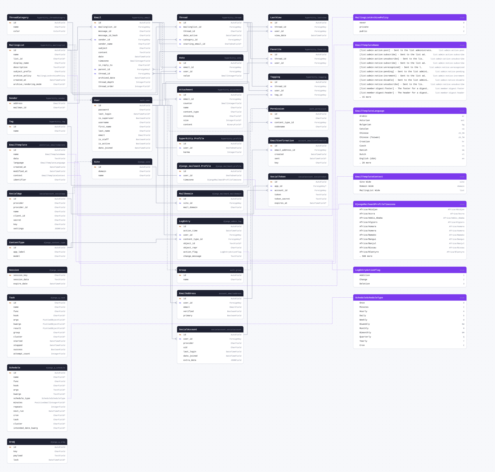

[ThreadCategory](#threadcategory) · [Thread](#thread) · [LastView](#lastview) · [MailingList](#mailinglist) · [Vote](#vote) · [Email](#email) · [Attachment](#attachment) · [Favorite](#favorite) · [hyperkitty.Profile](#hyperkittyprofile) · [Sender](#sender) · [Tagging](#tagging) · [Tag](#tag) · [EmailTemplate](#emailtemplate) · [django_mailman3.Profile](#django_mailman3profile) · [MailDomain](#maildomain) · [LogEntry](#logentry) · [Permission](#permission) · [Group](#group) · [User](#user) · [ContentType](#contenttype) · [Session](#session) · [Site](#site) · [Task](#task) · [Schedule](#schedule) · [OrmQ](#ormq) · [EmailAddress](#emailaddress) · [EmailConfirmation](#emailconfirmation) · [SocialApp](#socialapp) · [SocialAccount](#socialaccount) · [SocialToken](#socialtoken)

<details>
<summary>The whole schema as SQL</summary>

```sql
CREATE TABLE "hyperkitty_threadcategory" ("id" integer NOT NULL PRIMARY KEY AUTOINCREMENT, "name" varchar(255) NOT NULL UNIQUE, "color" varchar(7) NOT NULL);

CREATE TABLE "hyperkitty_thread" ("id" integer NOT NULL PRIMARY KEY AUTOINCREMENT, "mailinglist_id" integer NOT NULL REFERENCES "hyperkitty_mailinglist" ("id") DEFERRABLE INITIALLY DEFERRED, "thread_id" varchar(255) NOT NULL, "date_active" datetime NOT NULL, "category_id" integer NULL REFERENCES "hyperkitty_threadcategory" ("id") DEFERRABLE INITIALLY DEFERRED, "starting_email_id" integer NULL UNIQUE REFERENCES "hyperkitty_email" ("id") DEFERRABLE INITIALLY DEFERRED);

CREATE TABLE "hyperkitty_lastview" ("id" integer NOT NULL PRIMARY KEY AUTOINCREMENT, "thread_id" integer NOT NULL REFERENCES "hyperkitty_thread" ("id") DEFERRABLE INITIALLY DEFERRED, "user_id" integer NOT NULL REFERENCES "auth_user" ("id") DEFERRABLE INITIALLY DEFERRED, "view_date" datetime NOT NULL);

CREATE TABLE "hyperkitty_mailinglist" ("id" integer NOT NULL PRIMARY KEY AUTOINCREMENT, "name" varchar(254) NOT NULL UNIQUE, "list_id" varchar(254) NULL UNIQUE, "display_name" varchar(255) NOT NULL, "description" text NULL, "subject_prefix" varchar(255) NOT NULL, "archive_policy" integer NOT NULL, "created_at" datetime NOT NULL, "archive_rendering_mode" varchar(255) NULL);

CREATE TABLE "hyperkitty_mailinglist_owners" ("id" integer NOT NULL PRIMARY KEY AUTOINCREMENT, "mailinglist_id" integer NOT NULL REFERENCES "hyperkitty_mailinglist" ("id") DEFERRABLE INITIALLY DEFERRED, "user_id" integer NOT NULL REFERENCES "auth_user" ("id") DEFERRABLE INITIALLY DEFERRED);

CREATE TABLE "hyperkitty_mailinglist_moderators" ("id" integer NOT NULL PRIMARY KEY AUTOINCREMENT, "mailinglist_id" integer NOT NULL REFERENCES "hyperkitty_mailinglist" ("id") DEFERRABLE INITIALLY DEFERRED, "user_id" integer NOT NULL REFERENCES "auth_user" ("id") DEFERRABLE INITIALLY DEFERRED);

CREATE TABLE "hyperkitty_vote" ("id" integer NOT NULL PRIMARY KEY AUTOINCREMENT, "email_id" integer NOT NULL REFERENCES "hyperkitty_email" ("id") DEFERRABLE INITIALLY DEFERRED, "user_id" integer NOT NULL REFERENCES "auth_user" ("id") DEFERRABLE INITIALLY DEFERRED, "value" smallint NOT NULL);

CREATE TABLE "hyperkitty_email" ("id" integer NOT NULL PRIMARY KEY AUTOINCREMENT, "mailinglist_id" integer NOT NULL REFERENCES "hyperkitty_mailinglist" ("id") DEFERRABLE INITIALLY DEFERRED, "message_id" varchar(255) NOT NULL, "message_id_hash" varchar(255) NOT NULL, "sender_id" varchar(255) NOT NULL REFERENCES "hyperkitty_sender" ("address") DEFERRABLE INITIALLY DEFERRED, "sender_name" varchar(255) NULL, "subject" varchar(512) NOT NULL, "content" text NOT NULL, "date" datetime NOT NULL, "timezone" smallint NOT NULL, "in_reply_to" varchar(255) NULL, "parent_id" integer NULL, "thread_id" integer NOT NULL REFERENCES "hyperkitty_thread" ("id") DEFERRABLE INITIALLY DEFERRED, "archived_date" datetime NOT NULL, "thread_depth" integer NOT NULL, "thread_order" integer NULL);

CREATE TABLE "hyperkitty_attachment" ("id" integer NOT NULL PRIMARY KEY AUTOINCREMENT, "email_id" integer NOT NULL REFERENCES "hyperkitty_email" ("id") DEFERRABLE INITIALLY DEFERRED, "counter" smallint NOT NULL, "name" varchar(255) NOT NULL, "content_type" varchar(255) NOT NULL, "encoding" varchar(255) NULL, "size" integer NULL, "content" BLOB NULL);

CREATE TABLE "hyperkitty_favorite" ("id" integer NOT NULL PRIMARY KEY AUTOINCREMENT, "thread_id" integer NOT NULL REFERENCES "hyperkitty_thread" ("id") DEFERRABLE INITIALLY DEFERRED, "user_id" integer NOT NULL REFERENCES "auth_user" ("id") DEFERRABLE INITIALLY DEFERRED);

CREATE TABLE "hyperkitty_profile" ("id" integer NOT NULL PRIMARY KEY AUTOINCREMENT, "user_id" integer NOT NULL UNIQUE REFERENCES "auth_user" ("id") DEFERRABLE INITIALLY DEFERRED, "karma" integer NOT NULL);

CREATE TABLE "hyperkitty_sender" ("address" varchar(255) NOT NULL PRIMARY KEY, "mailman_id" varchar(255) NULL);

CREATE TABLE "hyperkitty_tagging" ("id" integer NOT NULL PRIMARY KEY AUTOINCREMENT, "thread_id" integer NOT NULL REFERENCES "hyperkitty_thread" ("id") DEFERRABLE INITIALLY DEFERRED, "user_id" integer NOT NULL REFERENCES "auth_user" ("id") DEFERRABLE INITIALLY DEFERRED, "tag_id" integer NOT NULL REFERENCES "hyperkitty_tag" ("id") DEFERRABLE INITIALLY DEFERRED);

CREATE TABLE "hyperkitty_tag" ("id" integer NOT NULL PRIMARY KEY AUTOINCREMENT, "name" varchar(255) NOT NULL UNIQUE);

CREATE TABLE "postorius_emailtemplate" ("id" integer NOT NULL PRIMARY KEY AUTOINCREMENT, "name" varchar(100) NOT NULL, "data" text NOT NULL, "language" varchar(5) NOT NULL, "created_at" datetime NOT NULL, "modified_at" datetime NOT NULL, "context" varchar(50) NOT NULL, "identifier" varchar(100) NOT NULL);

CREATE TABLE "django_mailman3_profile" ("id" integer NOT NULL PRIMARY KEY AUTOINCREMENT, "user_id" integer NOT NULL UNIQUE REFERENCES "auth_user" ("id") DEFERRABLE INITIALLY DEFERRED, "timezone" varchar(100) NOT NULL);

CREATE TABLE "django_mailman3_maildomain" ("id" integer NOT NULL PRIMARY KEY AUTOINCREMENT, "site_id" integer NOT NULL REFERENCES "django_site" ("id") DEFERRABLE INITIALLY DEFERRED, "mail_domain" varchar(255) NOT NULL UNIQUE);

CREATE TABLE "django_admin_log" ("id" integer NOT NULL PRIMARY KEY AUTOINCREMENT, "action_time" datetime NOT NULL, "user_id" integer NOT NULL REFERENCES "auth_user" ("id") DEFERRABLE INITIALLY DEFERRED, "content_type_id" integer NULL REFERENCES "django_content_type" ("id") DEFERRABLE INITIALLY DEFERRED, "object_id" text NULL, "object_repr" varchar(200) NOT NULL, "action_flag" smallint unsigned NOT NULL CHECK ("action_flag" >= 0), "change_message" text NOT NULL);

CREATE TABLE "auth_permission" ("id" integer NOT NULL PRIMARY KEY AUTOINCREMENT, "name" varchar(255) NOT NULL, "content_type_id" integer NOT NULL REFERENCES "django_content_type" ("id") DEFERRABLE INITIALLY DEFERRED, "codename" varchar(100) NOT NULL);

CREATE TABLE "auth_group" ("id" integer NOT NULL PRIMARY KEY AUTOINCREMENT, "name" varchar(150) NOT NULL UNIQUE);

CREATE TABLE "auth_group_permissions" ("id" integer NOT NULL PRIMARY KEY AUTOINCREMENT, "group_id" integer NOT NULL REFERENCES "auth_group" ("id") DEFERRABLE INITIALLY DEFERRED, "permission_id" integer NOT NULL REFERENCES "auth_permission" ("id") DEFERRABLE INITIALLY DEFERRED);

CREATE TABLE "auth_user" ("id" integer NOT NULL PRIMARY KEY AUTOINCREMENT, "password" varchar(128) NOT NULL, "last_login" datetime NULL, "is_superuser" bool NOT NULL, "username" varchar(150) NOT NULL UNIQUE, "first_name" varchar(150) NOT NULL, "last_name" varchar(150) NOT NULL, "email" varchar(254) NOT NULL, "is_staff" bool NOT NULL, "is_active" bool NOT NULL, "date_joined" datetime NOT NULL);

CREATE TABLE "auth_user_groups" ("id" integer NOT NULL PRIMARY KEY AUTOINCREMENT, "user_id" integer NOT NULL REFERENCES "auth_user" ("id") DEFERRABLE INITIALLY DEFERRED, "group_id" integer NOT NULL REFERENCES "auth_group" ("id") DEFERRABLE INITIALLY DEFERRED);

CREATE TABLE "auth_user_user_permissions" ("id" integer NOT NULL PRIMARY KEY AUTOINCREMENT, "user_id" integer NOT NULL REFERENCES "auth_user" ("id") DEFERRABLE INITIALLY DEFERRED, "permission_id" integer NOT NULL REFERENCES "auth_permission" ("id") DEFERRABLE INITIALLY DEFERRED);

CREATE TABLE "django_content_type" ("id" integer NOT NULL PRIMARY KEY AUTOINCREMENT, "app_label" varchar(100) NOT NULL, "model" varchar(100) NOT NULL);

CREATE TABLE "django_session" ("session_key" varchar(40) NOT NULL PRIMARY KEY, "session_data" text NOT NULL, "expire_date" datetime NOT NULL);

CREATE TABLE "django_site" ("id" integer NOT NULL PRIMARY KEY AUTOINCREMENT, "domain" varchar(100) NOT NULL UNIQUE, "name" varchar(50) NOT NULL);

CREATE TABLE "django_q_task" ("id" varchar(32) NOT NULL PRIMARY KEY, "name" varchar(100) NOT NULL, "func" varchar(256) NOT NULL, "hook" varchar(256) NULL, "args" text NULL, "kwargs" text NULL, "result" text NULL, "group" varchar(100) NULL, "cluster" varchar(100) NULL, "started" datetime NOT NULL, "stopped" datetime NOT NULL, "success" bool NOT NULL, "attempt_count" integer NOT NULL);

CREATE TABLE "django_q_schedule" ("id" integer NOT NULL PRIMARY KEY AUTOINCREMENT, "name" varchar(100) NULL, "func" varchar(256) NOT NULL, "hook" varchar(256) NULL, "args" text NULL, "kwargs" text NULL, "schedule_type" varchar(2) NOT NULL, "minutes" smallint unsigned NULL CHECK ("minutes" >= 0), "repeats" integer NOT NULL, "next_run" datetime NULL, "cron" varchar(100) NULL, "task" varchar(100) NULL, "cluster" varchar(100) NULL, "intended_date_kwarg" varchar(100) NULL);

CREATE TABLE "django_q_ormq" ("id" integer NOT NULL PRIMARY KEY AUTOINCREMENT, "key" varchar(100) NOT NULL, "payload" text NOT NULL, "lock" datetime NULL);

CREATE TABLE "account_emailaddress" ("id" integer NOT NULL PRIMARY KEY AUTOINCREMENT, "user_id" integer NOT NULL REFERENCES "auth_user" ("id") DEFERRABLE INITIALLY DEFERRED, "email" varchar(254) NOT NULL, "verified" bool NOT NULL, "primary" bool NOT NULL);

CREATE TABLE "account_emailconfirmation" ("id" integer NOT NULL PRIMARY KEY AUTOINCREMENT, "email_address_id" integer NOT NULL REFERENCES "account_emailaddress" ("id") DEFERRABLE INITIALLY DEFERRED, "created" datetime NOT NULL, "sent" datetime NULL, "key" varchar(64) NOT NULL UNIQUE);

CREATE TABLE "socialaccount_socialapp" ("id" integer NOT NULL PRIMARY KEY AUTOINCREMENT, "provider" varchar(30) NOT NULL, "provider_id" varchar(200) NOT NULL, "name" varchar(40) NOT NULL, "client_id" varchar(191) NOT NULL, "secret" varchar(191) NOT NULL, "key" varchar(191) NOT NULL, "settings" text NOT NULL CHECK ((JSON_VALID("settings") OR "settings" IS NULL)));

CREATE TABLE "socialaccount_socialapp_sites" ("id" integer NOT NULL PRIMARY KEY AUTOINCREMENT, "socialapp_id" integer NOT NULL REFERENCES "socialaccount_socialapp" ("id") DEFERRABLE INITIALLY DEFERRED, "site_id" integer NOT NULL REFERENCES "django_site" ("id") DEFERRABLE INITIALLY DEFERRED);

CREATE TABLE "socialaccount_socialaccount" ("id" integer NOT NULL PRIMARY KEY AUTOINCREMENT, "user_id" integer NOT NULL REFERENCES "auth_user" ("id") DEFERRABLE INITIALLY DEFERRED, "provider" varchar(200) NOT NULL, "uid" varchar(191) NOT NULL, "last_login" datetime NOT NULL, "date_joined" datetime NOT NULL, "extra_data" text NOT NULL CHECK ((JSON_VALID("extra_data") OR "extra_data" IS NULL)));

CREATE TABLE "socialaccount_socialtoken" ("id" integer NOT NULL PRIMARY KEY AUTOINCREMENT, "app_id" integer NULL REFERENCES "socialaccount_socialapp" ("id") DEFERRABLE INITIALLY DEFERRED, "account_id" integer NOT NULL REFERENCES "socialaccount_socialaccount" ("id") DEFERRABLE INITIALLY DEFERRED, "token" text NOT NULL, "token_secret" text NOT NULL, "expires_at" datetime NULL);

CREATE UNIQUE INDEX "hyperkitty_thread_mailinglist_id_thread_id_d832e465_uniq" ON "hyperkitty_thread" ("mailinglist_id", "thread_id");

CREATE INDEX "hyperkitty_thread_mailinglist_id_ff80772b" ON "hyperkitty_thread" ("mailinglist_id");

CREATE INDEX "hyperkitty_thread_thread_id_1eb0910a" ON "hyperkitty_thread" ("thread_id");

CREATE INDEX "hyperkitty_thread_date_active_34994eb8" ON "hyperkitty_thread" ("date_active");

CREATE INDEX "hyperkitty_thread_category_id_0d7a8102" ON "hyperkitty_thread" ("category_id");

CREATE INDEX "hyperkitty_lastview_thread_id_5bd4f0ad" ON "hyperkitty_lastview" ("thread_id");

CREATE INDEX "hyperkitty_lastview_user_id_5586ea1f" ON "hyperkitty_lastview" ("user_id");

CREATE UNIQUE INDEX "hyperkitty_mailinglist_owners_mailinglist_id_user_id_c977af32_uniq" ON "hyperkitty_mailinglist_owners" ("mailinglist_id", "user_id");

CREATE INDEX "hyperkitty_mailinglist_owners_mailinglist_id_a47e04ec" ON "hyperkitty_mailinglist_owners" ("mailinglist_id");

CREATE INDEX "hyperkitty_mailinglist_owners_user_id_1404d888" ON "hyperkitty_mailinglist_owners" ("user_id");

CREATE UNIQUE INDEX "hyperkitty_mailinglist_moderators_mailinglist_id_user_id_f08637ac_uniq" ON "hyperkitty_mailinglist_moderators" ("mailinglist_id", "user_id");

CREATE INDEX "hyperkitty_mailinglist_moderators_mailinglist_id_e58fb301" ON "hyperkitty_mailinglist_moderators" ("mailinglist_id");

CREATE INDEX "hyperkitty_mailinglist_moderators_user_id_f7d14f18" ON "hyperkitty_mailinglist_moderators" ("user_id");

CREATE UNIQUE INDEX "hyperkitty_vote_email_id_user_id_61fb1880_uniq" ON "hyperkitty_vote" ("email_id", "user_id");

CREATE INDEX "hyperkitty_vote_email_id_73a50f4d" ON "hyperkitty_vote" ("email_id");

CREATE INDEX "hyperkitty_vote_user_id_30d9d03b" ON "hyperkitty_vote" ("user_id");

CREATE INDEX "hyperkitty_vote_value_8b62f468" ON "hyperkitty_vote" ("value");

CREATE UNIQUE INDEX "hyperkitty_email_mailinglist_id_message_id_355216d0_uniq" ON "hyperkitty_email" ("mailinglist_id", "message_id");

CREATE INDEX "hyperkitty_email_mailinglist_id_2c2b6f03" ON "hyperkitty_email" ("mailinglist_id");

CREATE INDEX "hyperkitty_email_message_id_584fd58b" ON "hyperkitty_email" ("message_id");

CREATE INDEX "hyperkitty_email_message_id_hash_8a4a6406" ON "hyperkitty_email" ("message_id_hash");

CREATE INDEX "hyperkitty_email_sender_id_218742c7" ON "hyperkitty_email" ("sender_id");

CREATE INDEX "hyperkitty_email_subject_7ae9de90" ON "hyperkitty_email" ("subject");

CREATE INDEX "hyperkitty_email_date_5a028303" ON "hyperkitty_email" ("date");

CREATE INDEX "hyperkitty_email_in_reply_to_19db9b71" ON "hyperkitty_email" ("in_reply_to");

CREATE INDEX "hyperkitty_email_parent_id_c0b40ef8" ON "hyperkitty_email" ("parent_id");

CREATE INDEX "hyperkitty_email_thread_id_038c9aee" ON "hyperkitty_email" ("thread_id");

CREATE INDEX "hyperkitty_email_archived_date_2cfdd7a1" ON "hyperkitty_email" ("archived_date");

CREATE INDEX "hyperkitty_email_thread_order_610e7931" ON "hyperkitty_email" ("thread_order");

CREATE UNIQUE INDEX "hyperkitty_attachment_email_id_counter_fd863122_uniq" ON "hyperkitty_attachment" ("email_id", "counter");

CREATE INDEX "hyperkitty_attachment_email_id_37b08338" ON "hyperkitty_attachment" ("email_id");

CREATE INDEX "hyperkitty_favorite_thread_id_312a9c52" ON "hyperkitty_favorite" ("thread_id");

CREATE INDEX "hyperkitty_favorite_user_id_ae8c1115" ON "hyperkitty_favorite" ("user_id");

CREATE INDEX "hyperkitty_sender_mailman_id_beeb6ae1" ON "hyperkitty_sender" ("mailman_id");

CREATE INDEX "hyperkitty_tagging_thread_id_ab30508b" ON "hyperkitty_tagging" ("thread_id");

CREATE INDEX "hyperkitty_tagging_user_id_9af832e2" ON "hyperkitty_tagging" ("user_id");

CREATE INDEX "hyperkitty_tagging_tag_id_e26757dd" ON "hyperkitty_tagging" ("tag_id");

CREATE UNIQUE INDEX "postorius_emailtemplate_name_identifier_language_052d72ee_uniq" ON "postorius_emailtemplate" ("name", "identifier", "language");

CREATE INDEX "django_mailman3_maildomain_site_id_54206c14" ON "django_mailman3_maildomain" ("site_id");

CREATE INDEX "django_admin_log_user_id_c564eba6" ON "django_admin_log" ("user_id");

CREATE INDEX "django_admin_log_content_type_id_c4bce8eb" ON "django_admin_log" ("content_type_id");

CREATE UNIQUE INDEX "auth_permission_content_type_id_codename_01ab375a_uniq" ON "auth_permission" ("content_type_id", "codename");

CREATE INDEX "auth_permission_content_type_id_2f476e4b" ON "auth_permission" ("content_type_id");

CREATE UNIQUE INDEX "auth_group_permissions_group_id_permission_id_0cd325b0_uniq" ON "auth_group_permissions" ("group_id", "permission_id");

CREATE INDEX "auth_group_permissions_group_id_b120cbf9" ON "auth_group_permissions" ("group_id");

CREATE INDEX "auth_group_permissions_permission_id_84c5c92e" ON "auth_group_permissions" ("permission_id");

CREATE UNIQUE INDEX "auth_user_groups_user_id_group_id_94350c0c_uniq" ON "auth_user_groups" ("user_id", "group_id");

CREATE INDEX "auth_user_groups_user_id_6a12ed8b" ON "auth_user_groups" ("user_id");

CREATE INDEX "auth_user_groups_group_id_97559544" ON "auth_user_groups" ("group_id");

CREATE UNIQUE INDEX "auth_user_user_permissions_user_id_permission_id_14a6b632_uniq" ON "auth_user_user_permissions" ("user_id", "permission_id");

CREATE INDEX "auth_user_user_permissions_user_id_a95ead1b" ON "auth_user_user_permissions" ("user_id");

CREATE INDEX "auth_user_user_permissions_permission_id_1fbb5f2c" ON "auth_user_user_permissions" ("permission_id");

CREATE UNIQUE INDEX "django_content_type_app_label_model_76bd3d3b_uniq" ON "django_content_type" ("app_label", "model");

CREATE INDEX "django_session_expire_date_a5c62663" ON "django_session" ("expire_date");

CREATE INDEX "success_index" ON "django_q_task" ("group", "name", "func") WHERE "success";

CREATE UNIQUE INDEX "account_emailaddress_user_id_email_987c8728_uniq" ON "account_emailaddress" ("user_id", "email");

CREATE UNIQUE INDEX "unique_primary_email" ON "account_emailaddress" ("user_id", "primary") WHERE "primary";

CREATE UNIQUE INDEX "unique_verified_email" ON "account_emailaddress" ("email") WHERE "verified";

CREATE INDEX "account_emailaddress_user_id_2c513194" ON "account_emailaddress" ("user_id");

CREATE INDEX "account_emailaddress_email_03be32b2" ON "account_emailaddress" ("email");

CREATE INDEX "account_emailconfirmation_email_address_id_5b7f8c58" ON "account_emailconfirmation" ("email_address_id");

CREATE UNIQUE INDEX "socialaccount_socialapp_sites_socialapp_id_site_id_71a9a768_uniq" ON "socialaccount_socialapp_sites" ("socialapp_id", "site_id");

CREATE INDEX "socialaccount_socialapp_sites_socialapp_id_97fb6e7d" ON "socialaccount_socialapp_sites" ("socialapp_id");

CREATE INDEX "socialaccount_socialapp_sites_site_id_2579dee5" ON "socialaccount_socialapp_sites" ("site_id");

CREATE UNIQUE INDEX "socialaccount_socialaccount_provider_uid_fc810c6e_uniq" ON "socialaccount_socialaccount" ("provider", "uid");

CREATE INDEX "socialaccount_socialaccount_user_id_8146e70c" ON "socialaccount_socialaccount" ("user_id");

CREATE UNIQUE INDEX "socialaccount_socialtoken_app_id_account_id_fca4e0ac_uniq" ON "socialaccount_socialtoken" ("app_id", "account_id");

CREATE INDEX "socialaccount_socialtoken_app_id_636a42d7" ON "socialaccount_socialtoken" ("app_id");

CREATE INDEX "socialaccount_socialtoken_account_id_951f210e" ON "socialaccount_socialtoken" ("account_id");
```

</details>

## ThreadCategory

Table `hyperkitty_threadcategory`, app `hyperkitty`.

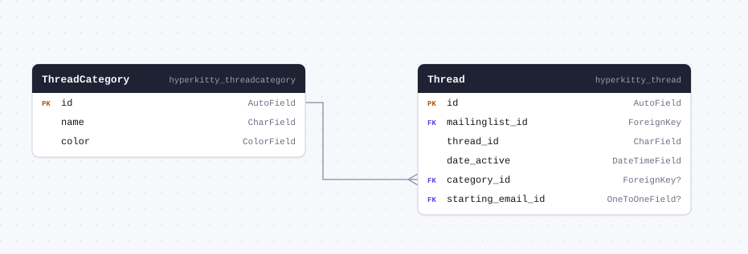

| Column | Field | Type | Null | Key | Default | Description |
| --- | --- | --- | --- | --- | --- | --- |
| `id` | `AutoField` | `integer` |  | PK | `autoincrement()` |  |
| `name` | `CharField` | `varchar(255)` |  | unique |  |  |
| `color` | `ColorField` | `varchar(7)` |  |  |  |  |

Relations:

- [Thread](#thread).`category_id` → `id`, on delete set null

## Thread

Table `hyperkitty_thread`, app `hyperkitty`.

A thread of archived email, from a mailing-list. It is identified by both
the list name and the thread id.

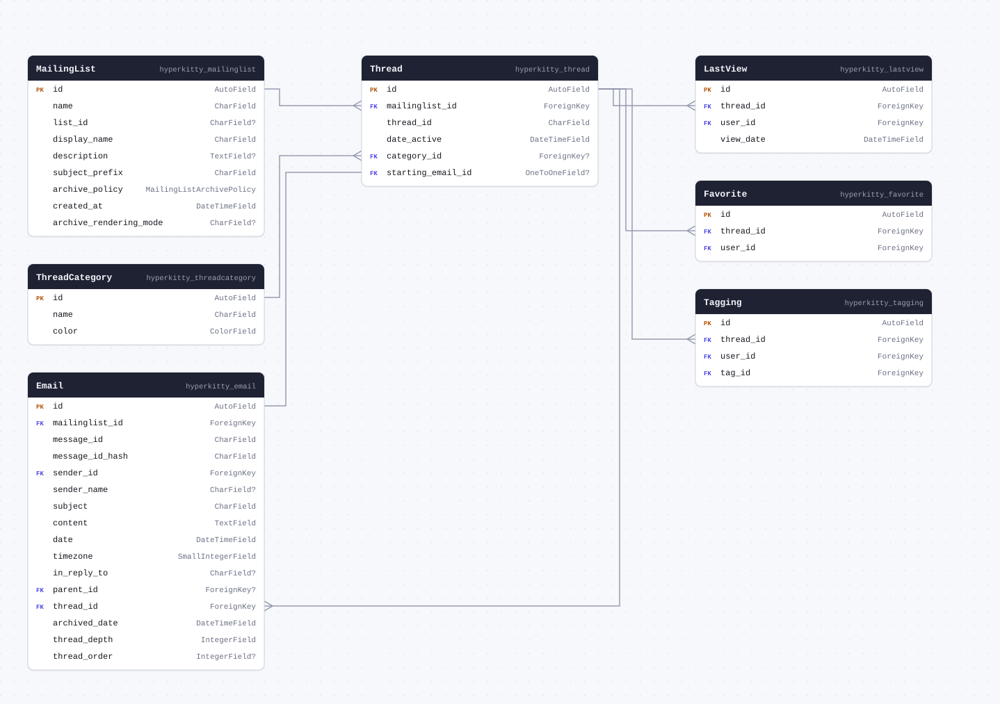

| Column | Field | Type | Null | Key | Default | Description |
| --- | --- | --- | --- | --- | --- | --- |
| `id` | `AutoField` | `integer` |  | PK | `autoincrement()` |  |
| `mailinglist_id` | `ForeignKey` | `integer` |  | FK |  |  |
| `thread_id` | `CharField` | `varchar(255)` |  |  |  |  |
| `date_active` | `DateTimeField` | `datetime` |  |  | `now()` |  |
| `category_id` | `ForeignKey` | `integer` | yes | FK |  |  |
| `starting_email_id` | `OneToOneField` | `integer` | yes | FK, unique |  |  |

Indexes:

- index `hyperkitty_thread_mailinglist_id_ff80772b` on `mailinglist_id`
- index `hyperkitty_thread_thread_id_1eb0910a` on `thread_id`
- index `hyperkitty_thread_date_active_34994eb8` on `date_active`
- index `hyperkitty_thread_category_id_0d7a8102` on `category_id`
- unique `hyperkitty_thread_mailinglist_id_thread_id_d832e465_uniq` on `mailinglist_id`, `thread_id`

Relations:

- `tags` — many to many with [Tag](#tag), through [Tagging](#tagging)
- `mailinglist_id` → [MailingList](#mailinglist).`id`, on delete cascade
- `category_id` → [ThreadCategory](#threadcategory).`id`, on delete set null
- `starting_email_id` → [Email](#email).`id`, on delete set null
- [LastView](#lastview).`thread_id` → `id`, on delete cascade
- [Email](#email).`thread_id` → `id`, on delete cascade
- [Favorite](#favorite).`thread_id` → `id`, on delete cascade
- [Tagging](#tagging).`thread_id` → `id`, on delete cascade

## LastView

Table `hyperkitty_lastview`, app `hyperkitty`.

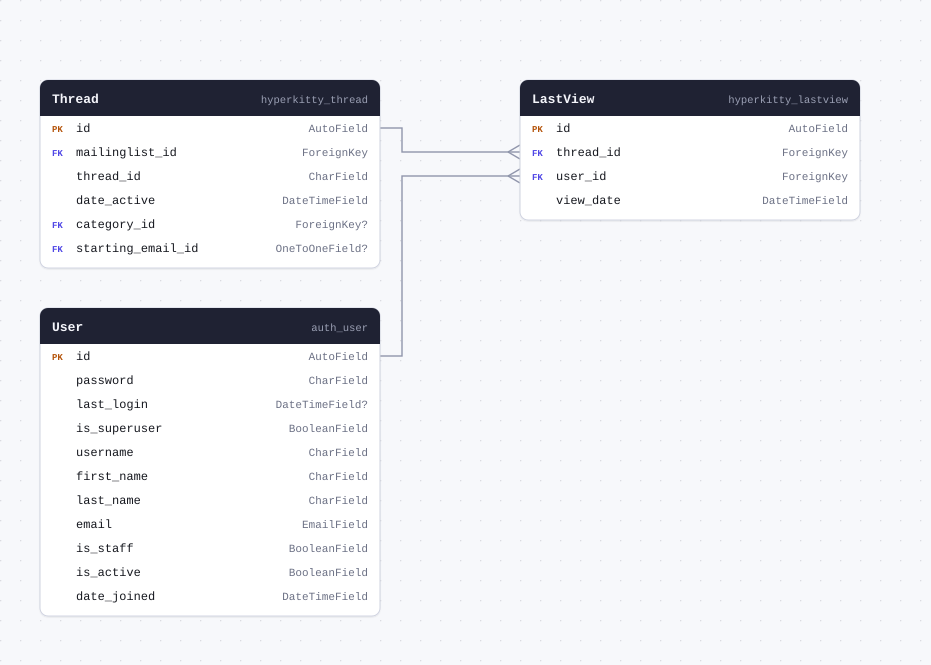

| Column | Field | Type | Null | Key | Default | Description |
| --- | --- | --- | --- | --- | --- | --- |
| `id` | `AutoField` | `integer` |  | PK | `autoincrement()` |  |
| `thread_id` | `ForeignKey` | `integer` |  | FK |  |  |
| `user_id` | `ForeignKey` | `integer` |  | FK |  |  |
| `view_date` | `DateTimeField` | `datetime` |  |  | `now()` |  |

Indexes:

- index `hyperkitty_lastview_thread_id_5bd4f0ad` on `thread_id`
- index `hyperkitty_lastview_user_id_5586ea1f` on `user_id`

Relations:

- `thread_id` → [Thread](#thread).`id`, on delete cascade
- `user_id` → [User](#user).`id`, on delete cascade

## MailingList

Table `hyperkitty_mailinglist`, app `hyperkitty`.

An archived mailing-list.

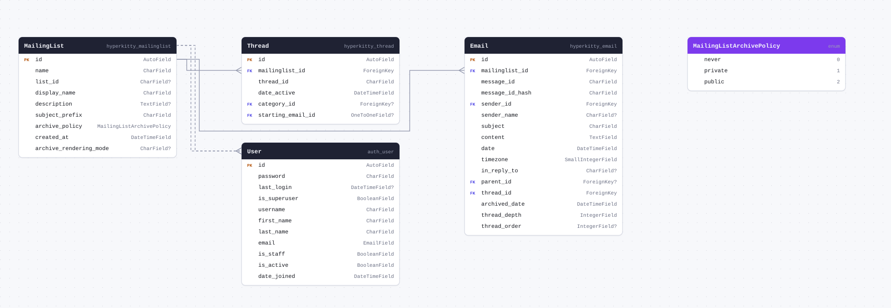

| Column | Field | Type | Null | Key | Default | Description |
| --- | --- | --- | --- | --- | --- | --- |
| `id` | `AutoField` | `integer` |  | PK | `autoincrement()` |  |
| `name` | `CharField` | `varchar(254)` |  | unique |  |  |
| `list_id` | `CharField` | `varchar(254)` | yes | unique |  |  |
| `display_name` | `CharField` | `varchar(255)` |  |  |  |  |
| `description` | `TextField` | `text` | yes |  |  |  |
| `subject_prefix` | `CharField` | `varchar(255)` |  |  |  |  |
| `archive_policy` | `MailingListArchivePolicy` | `integer` |  |  | `2` |  |
| `created_at` | `DateTimeField` | `datetime` |  |  | `now()` |  |
| `archive_rendering_mode` | `CharField` | `varchar(255)` | yes |  |  |  |

Relations:

- [Thread](#thread).`mailinglist_id` → `id`, on delete cascade
- `owners` — many to many with [User](#user)
- `moderators` — many to many with [User](#user)
- [Email](#email).`mailinglist_id` → `id`, on delete cascade

## Vote

Table `hyperkitty_vote`, app `hyperkitty`.

A User's vote on a message

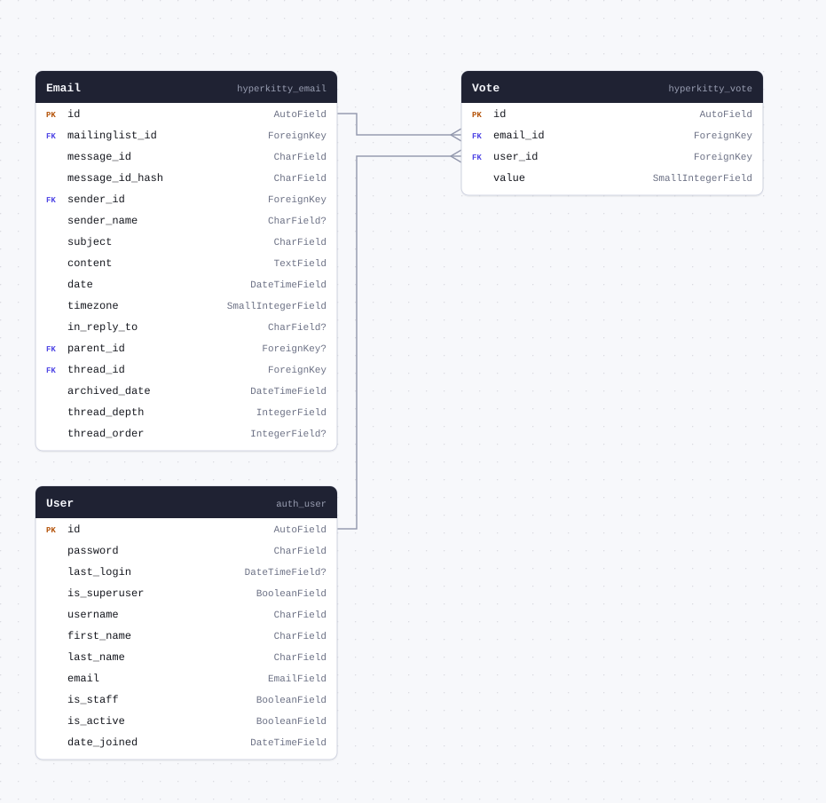

| Column | Field | Type | Null | Key | Default | Description |
| --- | --- | --- | --- | --- | --- | --- |
| `id` | `AutoField` | `integer` |  | PK | `autoincrement()` |  |
| `email_id` | `ForeignKey` | `integer` |  | FK |  |  |
| `user_id` | `ForeignKey` | `integer` |  | FK |  |  |
| `value` | `SmallIntegerField` | `smallint` |  |  |  |  |

Indexes:

- index `hyperkitty_vote_email_id_73a50f4d` on `email_id`
- index `hyperkitty_vote_user_id_30d9d03b` on `user_id`
- index `hyperkitty_vote_value_8b62f468` on `value`
- unique `hyperkitty_vote_email_id_user_id_61fb1880_uniq` on `email_id`, `user_id`

Relations:

- `email_id` → [Email](#email).`id`, on delete cascade
- `user_id` → [User](#user).`id`, on delete cascade

## Email

Table `hyperkitty_email`, app `hyperkitty`.

An archived email, from a mailing-list. It is identified by both the list
name and the message id.

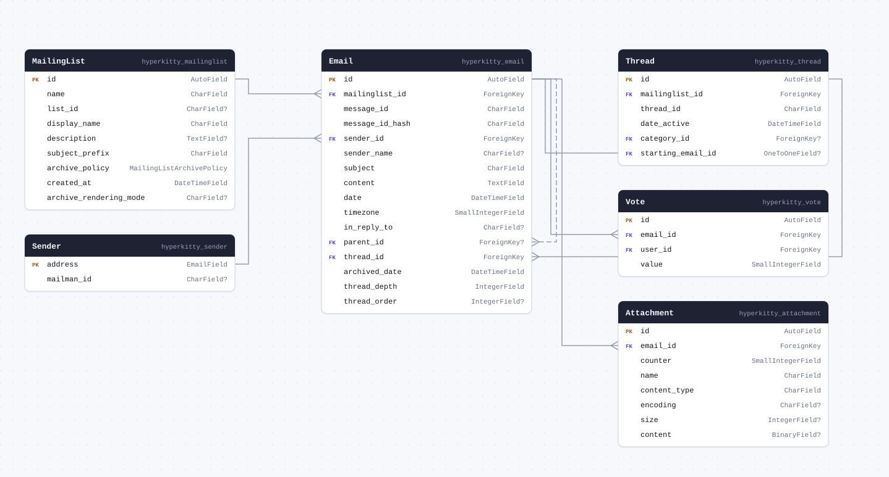

| Column | Field | Type | Null | Key | Default | Description |
| --- | --- | --- | --- | --- | --- | --- |
| `id` | `AutoField` | `integer` |  | PK | `autoincrement()` |  |
| `mailinglist_id` | `ForeignKey` | `integer` |  | FK |  |  |
| `message_id` | `CharField` | `varchar(255)` |  |  |  |  |
| `message_id_hash` | `CharField` | `varchar(255)` |  |  |  |  |
| `sender_id` | `ForeignKey` | `varchar(255)` |  | FK |  |  |
| `sender_name` | `CharField` | `varchar(255)` | yes |  |  |  |
| `subject` | `CharField` | `varchar(512)` |  |  |  |  |
| `content` | `TextField` | `text` |  |  |  |  |
| `date` | `DateTimeField` | `datetime` |  |  |  |  |
| `timezone` | `SmallIntegerField` | `smallint` |  |  |  |  |
| `in_reply_to` | `CharField` | `varchar(255)` | yes |  |  |  |
| `parent_id` | `ForeignKey` | `integer` | yes | FK (no constraint) |  |  |
| `thread_id` | `ForeignKey` | `integer` |  | FK |  |  |
| `archived_date` | `DateTimeField` | `datetime` |  |  | `now()` |  |
| `thread_depth` | `IntegerField` | `integer` |  |  | `0` |  |
| `thread_order` | `IntegerField` | `integer` | yes |  |  |  |

Indexes:

- index `hyperkitty_email_mailinglist_id_2c2b6f03` on `mailinglist_id`
- index `hyperkitty_email_message_id_584fd58b` on `message_id`
- index `hyperkitty_email_message_id_hash_8a4a6406` on `message_id_hash`
- index `hyperkitty_email_sender_id_218742c7` on `sender_id`
- index `hyperkitty_email_subject_7ae9de90` on `subject`
- index `hyperkitty_email_date_5a028303` on `date`
- index `hyperkitty_email_in_reply_to_19db9b71` on `in_reply_to`
- index `hyperkitty_email_parent_id_c0b40ef8` on `parent_id`
- index `hyperkitty_email_thread_id_038c9aee` on `thread_id`
- index `hyperkitty_email_archived_date_2cfdd7a1` on `archived_date`
- index `hyperkitty_email_thread_order_610e7931` on `thread_order`
- unique `hyperkitty_email_mailinglist_id_message_id_355216d0_uniq` on `mailinglist_id`, `message_id`

Relations:

- [Thread](#thread).`starting_email_id` → `id`, on delete set null
- [Vote](#vote).`email_id` → `id`, on delete cascade
- `mailinglist_id` → [MailingList](#mailinglist).`id`, on delete cascade
- `sender_id` → [Sender](#sender).`address`, on delete cascade
- `parent_id` → [Email](#email).`id`, on delete do nothing, no database constraint
- `thread_id` → [Thread](#thread).`id`, on delete cascade
- [Attachment](#attachment).`email_id` → `id`, on delete cascade

## Attachment

Table `hyperkitty_attachment`, app `hyperkitty`.

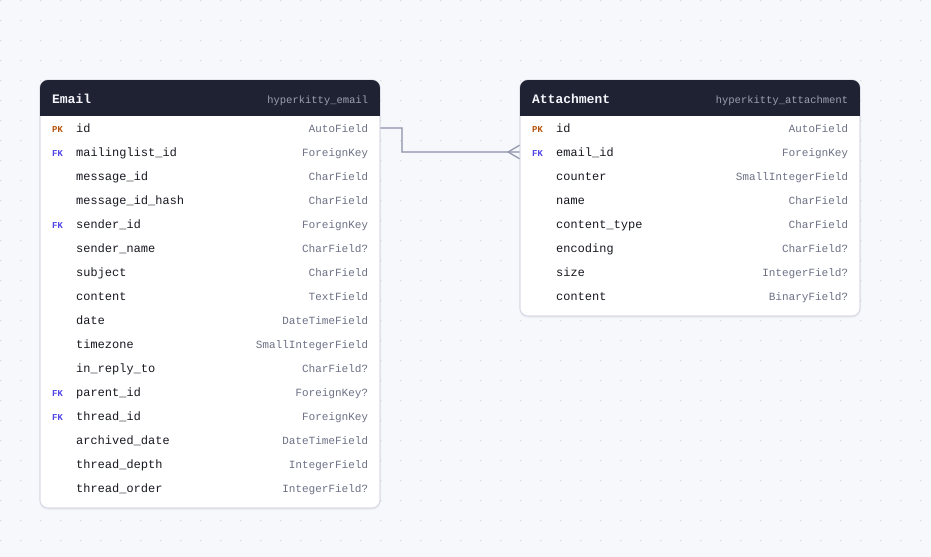

| Column | Field | Type | Null | Key | Default | Description |
| --- | --- | --- | --- | --- | --- | --- |
| `id` | `AutoField` | `integer` |  | PK | `autoincrement()` |  |
| `email_id` | `ForeignKey` | `integer` |  | FK |  |  |
| `counter` | `SmallIntegerField` | `smallint` |  |  |  |  |
| `name` | `CharField` | `varchar(255)` |  |  |  |  |
| `content_type` | `CharField` | `varchar(255)` |  |  |  |  |
| `encoding` | `CharField` | `varchar(255)` | yes |  |  |  |
| `size` | `IntegerField` | `integer` | yes |  |  |  |
| `content` | `BinaryField` | `BLOB` | yes |  |  |  |

Indexes:

- index `hyperkitty_attachment_email_id_37b08338` on `email_id`
- unique `hyperkitty_attachment_email_id_counter_fd863122_uniq` on `email_id`, `counter`

Relations:

- `email_id` → [Email](#email).`id`, on delete cascade

## Favorite

Table `hyperkitty_favorite`, app `hyperkitty`.

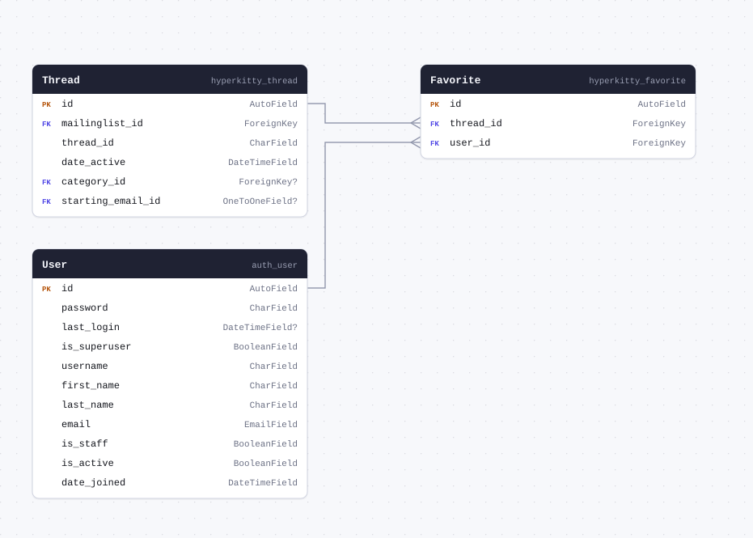

| Column | Field | Type | Null | Key | Default | Description |
| --- | --- | --- | --- | --- | --- | --- |
| `id` | `AutoField` | `integer` |  | PK | `autoincrement()` |  |
| `thread_id` | `ForeignKey` | `integer` |  | FK |  |  |
| `user_id` | `ForeignKey` | `integer` |  | FK |  |  |

Indexes:

- index `hyperkitty_favorite_thread_id_312a9c52` on `thread_id`
- index `hyperkitty_favorite_user_id_ae8c1115` on `user_id`

Relations:

- `thread_id` → [Thread](#thread).`id`, on delete cascade
- `user_id` → [User](#user).`id`, on delete cascade

## hyperkitty.Profile

Table `hyperkitty_profile`, app `hyperkitty`.

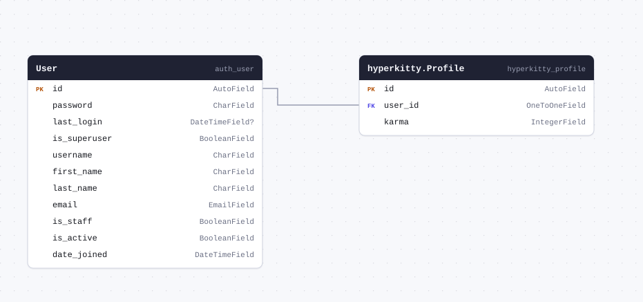

| Column | Field | Type | Null | Key | Default | Description |
| --- | --- | --- | --- | --- | --- | --- |
| `id` | `AutoField` | `integer` |  | PK | `autoincrement()` |  |
| `user_id` | `OneToOneField` | `integer` |  | FK, unique |  |  |
| `karma` | `IntegerField` | `integer` |  |  | `1` |  |

Relations:

- `user_id` → [User](#user).`id`, on delete cascade

## Sender

Table `hyperkitty_sender`, app `hyperkitty`.

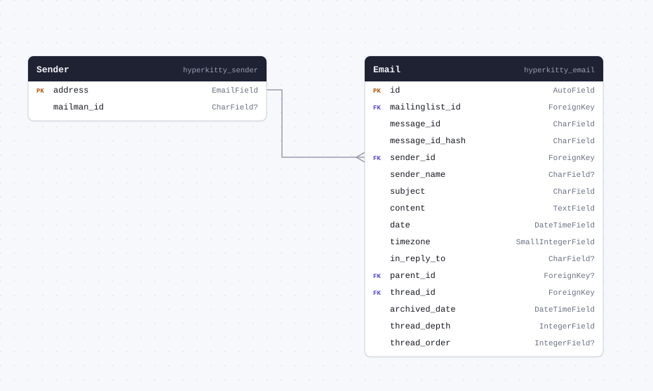

| Column | Field | Type | Null | Key | Default | Description |
| --- | --- | --- | --- | --- | --- | --- |
| `address` | `EmailField` | `varchar(255)` |  | PK |  |  |
| `mailman_id` | `CharField` | `varchar(255)` | yes |  |  |  |

Indexes:

- index `hyperkitty_sender_mailman_id_beeb6ae1` on `mailman_id`

Relations:

- [Email](#email).`sender_id` → `address`, on delete cascade

## Tagging

Table `hyperkitty_tagging`, app `hyperkitty`.

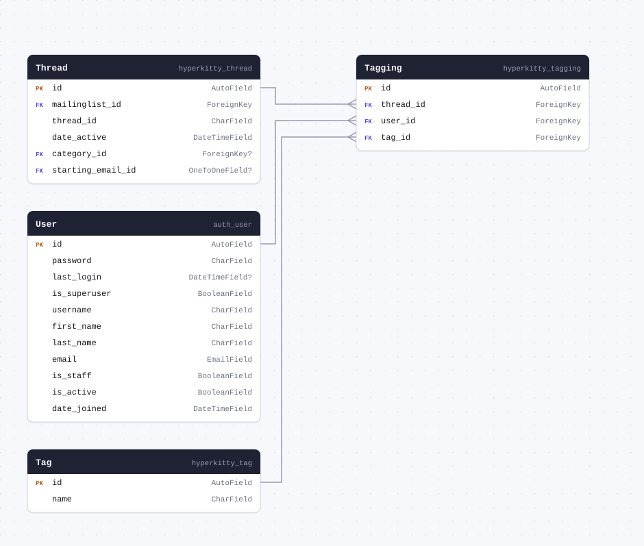

| Column | Field | Type | Null | Key | Default | Description |
| --- | --- | --- | --- | --- | --- | --- |
| `id` | `AutoField` | `integer` |  | PK | `autoincrement()` |  |
| `thread_id` | `ForeignKey` | `integer` |  | FK |  |  |
| `user_id` | `ForeignKey` | `integer` |  | FK |  |  |
| `tag_id` | `ForeignKey` | `integer` |  | FK |  |  |

Indexes:

- index `hyperkitty_tagging_thread_id_ab30508b` on `thread_id`
- index `hyperkitty_tagging_user_id_9af832e2` on `user_id`
- index `hyperkitty_tagging_tag_id_e26757dd` on `tag_id`

Relations:

- `thread_id` → [Thread](#thread).`id`, on delete cascade
- `user_id` → [User](#user).`id`, on delete cascade
- `tag_id` → [Tag](#tag).`id`, on delete cascade

## Tag

Table `hyperkitty_tag`, app `hyperkitty`.

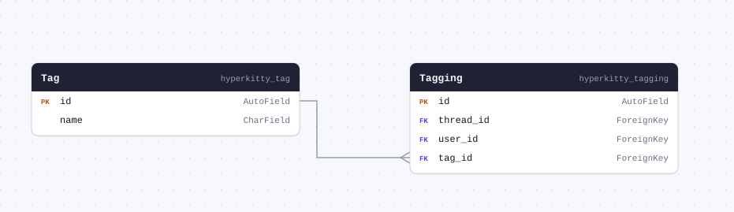

| Column | Field | Type | Null | Key | Default | Description |
| --- | --- | --- | --- | --- | --- | --- |
| `id` | `AutoField` | `integer` |  | PK | `autoincrement()` |  |
| `name` | `CharField` | `varchar(255)` |  | unique |  |  |

Relations:

- `threads` — many to many with [Thread](#thread), through [Tagging](#tagging)
- `users` — many to many with [User](#user), through [Tagging](#tagging)
- [Tagging](#tagging).`tag_id` → `id`, on delete cascade

## EmailTemplate

Table `postorius_emailtemplate`, app `postorius`.

A Template represents contents of partial or complete emails sent out by
Mailman Core on various events or when an action is required. Headers and
Footers on emails for decorations are also repsented as templates.

| Column | Field | Type | Null | Key | Default | Description |
| --- | --- | --- | --- | --- | --- | --- |
| `id` | `AutoField` | `integer` |  | PK | `autoincrement()` |  |
| `name` | `EmailTemplateName` | `varchar(100)` |  |  |  | Choose the template you want to customize. |
| `data` | `TextField` | `text` |  |  |  | Note: Do not add any secret content in templates as they are publicly accessible. You can use these variables in the templates.  $hyperkitty_url: Permalink to archived message in Hyperkitty  - only in list:member:regular:footer and list:member:regular:header $listname: Name of the Mailing List e.g. ant@example.com  $list_id: The List-ID header e.g. ant.example.com  $display_name: Display name of the mailing list e.g. Ant  $short_listname: Local part of the listname e.g. ant  $domain: The domain part of the listname e.g. example.com  $description: The mailing list's short description text  $info: The mailing list's longer descriptive text  $request_email: The email address for -request address  $owner_email: The email address for -owner address  $site_email: The email address to reach the owners of the site  $language: The two letter language code for list's preferred language e.g. fr, en, de  Some templates accept additional variables. See <a href="https://docs.mailman3.org/projects/mailman/en/latest/src/mailman/rest/docs/templates.html#templated-texts">this doc</a> |
| `language` | `EmailTemplateLanguage` | `varchar(5)` |  |  |  | Language for the template, this should be the list's preferred language. |
| `created_at` | `DateTimeField` | `datetime` |  |  | `now()` |  |
| `modified_at` | `DateTimeField` | `datetime` |  |  | `now()` |  |
| `context` | `EmailTemplateContext` | `varchar(50)` |  |  |  |  |
| `identifier` | `CharField` | `varchar(100)` |  |  |  |  |

Indexes:

- unique `postorius_emailtemplate_name_identifier_language_052d72ee_uniq` on `name`, `identifier`, `language`

## django_mailman3.Profile

Table `django_mailman3_profile`, app `django_mailman3`.

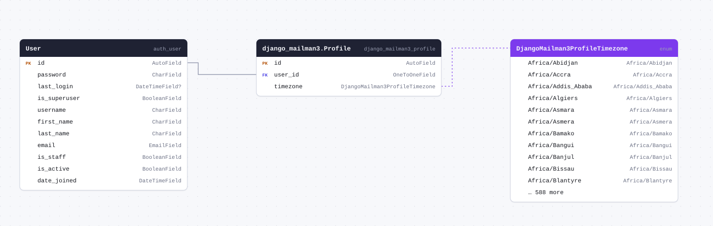

| Column | Field | Type | Null | Key | Default | Description |
| --- | --- | --- | --- | --- | --- | --- |
| `id` | `AutoField` | `integer` |  | PK | `autoincrement()` |  |
| `user_id` | `OneToOneField` | `integer` |  | FK, unique |  |  |
| `timezone` | `DjangoMailman3ProfileTimezone` | `varchar(100)` |  |  | `''` |  |

Relations:

- `user_id` → [User](#user).`id`, on delete cascade

## MailDomain

Table `django_mailman3_maildomain`, app `django_mailman3`.

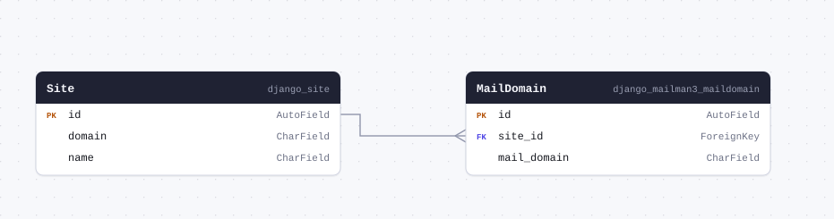

| Column | Field | Type | Null | Key | Default | Description |
| --- | --- | --- | --- | --- | --- | --- |
| `id` | `AutoField` | `integer` |  | PK | `autoincrement()` |  |
| `site_id` | `ForeignKey` | `integer` |  | FK |  |  |
| `mail_domain` | `CharField` | `varchar(255)` |  | unique |  |  |

Indexes:

- index `django_mailman3_maildomain_site_id_54206c14` on `site_id`

Relations:

- `site_id` → [Site](#site).`id`, on delete cascade

## LogEntry

Table `django_admin_log`, app `admin`.


| Column | Field | Type | Null | Key | Default | Description |
| --- | --- | --- | --- | --- | --- | --- |
| `id` | `AutoField` | `integer` |  | PK | `autoincrement()` |  |
| `action_time` | `DateTimeField` | `datetime` |  |  | `now()` |  |
| `user_id` | `ForeignKey` | `integer` |  | FK |  |  |
| `content_type_id` | `ForeignKey` | `integer` | yes | FK |  |  |
| `object_id` | `TextField` | `text` | yes |  |  |  |
| `object_repr` | `CharField` | `varchar(200)` |  |  |  |  |
| `action_flag` | `LogEntryActionFlag` | `smallint unsigned` |  |  |  |  |
| `change_message` | `TextField` | `text` |  |  |  |  |

Indexes:

- index `django_admin_log_user_id_c564eba6` on `user_id`
- index `django_admin_log_content_type_id_c4bce8eb` on `content_type_id`

Relations:

- `user_id` → [User](#user).`id`, on delete cascade
- `content_type_id` → [ContentType](#contenttype).`id`, on delete set null

## Permission

Table `auth_permission`, app `auth`.

The permissions system provides a way to assign permissions to specific
users and groups of users.

The permission system is used by the Django admin site, but may also be
useful in your own code. The Django admin site uses permissions as follows:

    - The "add" permission limits the user's ability to view the "add" form
      and add an object.
    - The "change" permission limits a user's ability to view the change
      list, view the "change" form and change an object.
    - The "delete" permission limits the ability to delete an object.
    - The "view" permission limits the ability to view an object.

Permissions are set globally per type of object, not per specific object
instance. It is possible to say "Mary may change news stories," but it's
not currently possible to say "Mary may change news stories, but only the
ones she created herself" or "Mary may only change news stories that have a
certain status or publication date."

The permissions listed above are automatically created for each model.


| Column | Field | Type | Null | Key | Default | Description |
| --- | --- | --- | --- | --- | --- | --- |
| `id` | `AutoField` | `integer` |  | PK | `autoincrement()` |  |
| `name` | `CharField` | `varchar(255)` |  |  |  |  |
| `content_type_id` | `ForeignKey` | `integer` |  | FK |  |  |
| `codename` | `CharField` | `varchar(100)` |  |  |  |  |

Indexes:

- index `auth_permission_content_type_id_2f476e4b` on `content_type_id`
- unique `auth_permission_content_type_id_codename_01ab375a_uniq` on `content_type_id`, `codename`

Relations:

- `content_type_id` → [ContentType](#contenttype).`id`, on delete cascade
- `group_set` — many to many with [Group](#group)
- `user_set` — many to many with [User](#user)

## Group

Table `auth_group`, app `auth`.

Groups are a generic way of categorizing users to apply permissions, or
some other label, to those users. A user can belong to any number of
groups.

A user in a group automatically has all the permissions granted to that
group. For example, if the group 'Site editors' has the permission
can_edit_home_page, any user in that group will have that permission.

Beyond permissions, groups are a convenient way to categorize users to
apply some label, or extended functionality, to them. For example, you
could create a group 'Special users', and you could write code that would
do special things to those users -- such as giving them access to a
members-only portion of your site, or sending them members-only email
messages.


| Column | Field | Type | Null | Key | Default | Description |
| --- | --- | --- | --- | --- | --- | --- |
| `id` | `AutoField` | `integer` |  | PK | `autoincrement()` |  |
| `name` | `CharField` | `varchar(150)` |  | unique |  |  |

Relations:

- `permissions` — many to many with [Permission](#permission)
- `user_set` — many to many with [User](#user)

## User

Table `auth_user`, app `auth`.

Columns from `AbstractUser` (abstract): `username`, `first_name`, `last_name`, `email`, `is_staff`, `is_active`, `date_joined`.

Columns from `AbstractBaseUser` (abstract): `password`, `last_login`.

Columns from `PermissionsMixin` (abstract): `is_superuser`.

Users within the Django authentication system are represented by this
model.

Username and password are required. Other fields are optional.

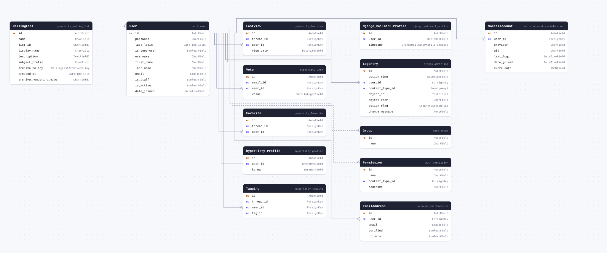

| Column | Field | Type | Null | Key | Default | Description |
| --- | --- | --- | --- | --- | --- | --- |
| `id` | `AutoField` | `integer` |  | PK | `autoincrement()` |  |
| `password` | `CharField` | `varchar(128)` |  |  |  |  |
| `last_login` | `DateTimeField` | `datetime` | yes |  |  |  |
| `is_superuser` | `BooleanField` | `bool` |  |  | `False` | Designates that this user has all permissions without explicitly assigning them. |
| `username` | `CharField` | `varchar(150)` |  | unique |  | Required. 150 characters or fewer. Letters, digits and @/./+/-/_ only. |
| `first_name` | `CharField` | `varchar(150)` |  |  |  |  |
| `last_name` | `CharField` | `varchar(150)` |  |  |  |  |
| `email` | `EmailField` | `varchar(254)` |  |  |  |  |
| `is_staff` | `BooleanField` | `bool` |  |  | `False` | Designates whether the user can log into this admin site. |
| `is_active` | `BooleanField` | `bool` |  |  | `True` | Designates whether this user should be treated as active. Unselect this instead of deleting accounts. |
| `date_joined` | `DateTimeField` | `datetime` |  |  | `now()` |  |

Relations:

- `tags` — many to many with [Tag](#tag), through [Tagging](#tagging)
- [LastView](#lastview).`user_id` → `id`, on delete cascade
- `owned_lists` — many to many with [MailingList](#mailinglist)
- `moderated_lists` — many to many with [MailingList](#mailinglist)
- [Vote](#vote).`user_id` → `id`, on delete cascade
- [Favorite](#favorite).`user_id` → `id`, on delete cascade
- [hyperkitty.Profile](#hyperkittyprofile).`user_id` → `id`, on delete cascade
- [Tagging](#tagging).`user_id` → `id`, on delete cascade
- [django_mailman3.Profile](#django_mailman3profile).`user_id` → `id`, on delete cascade
- [LogEntry](#logentry).`user_id` → `id`, on delete cascade
- `groups` — many to many with [Group](#group)
- `user_permissions` — many to many with [Permission](#permission)
- [EmailAddress](#emailaddress).`user_id` → `id`, on delete cascade
- [SocialAccount](#socialaccount).`user_id` → `id`, on delete cascade

## ContentType

Table `django_content_type`, app `contenttypes`.


| Column | Field | Type | Null | Key | Default | Description |
| --- | --- | --- | --- | --- | --- | --- |
| `id` | `AutoField` | `integer` |  | PK | `autoincrement()` |  |
| `app_label` | `CharField` | `varchar(100)` |  |  |  |  |
| `model` | `CharField` | `varchar(100)` |  |  |  |  |

Indexes:

- unique `django_content_type_app_label_model_76bd3d3b_uniq` on `app_label`, `model`

Relations:

- [LogEntry](#logentry).`content_type_id` → `id`, on delete set null
- [Permission](#permission).`content_type_id` → `id`, on delete cascade

## Session

Table `django_session`, app `sessions`.

Columns from `AbstractBaseSession` (abstract): `session_key`, `session_data`, `expire_date`.

Django provides full support for anonymous sessions. The session
framework lets you store and retrieve arbitrary data on a
per-site-visitor basis. It stores data on the server side and
abstracts the sending and receiving of cookies. Cookies contain a
session ID -- not the data itself.

The Django sessions framework is entirely cookie-based. It does
not fall back to putting session IDs in URLs. This is an intentional
design decision. Not only does that behavior make URLs ugly, it makes
your site vulnerable to session-ID theft via the "Referer" header.

For complete documentation on using Sessions in your code, consult
the sessions documentation that is shipped with Django (also available
on the Django web site).

| Column | Field | Type | Null | Key | Default | Description |
| --- | --- | --- | --- | --- | --- | --- |
| `session_key` | `CharField` | `varchar(40)` |  | PK |  |  |
| `session_data` | `TextField` | `text` |  |  |  |  |
| `expire_date` | `DateTimeField` | `datetime` |  |  |  |  |

Indexes:

- index `django_session_expire_date_a5c62663` on `expire_date`

## Site

Table `django_site`, app `sites`.

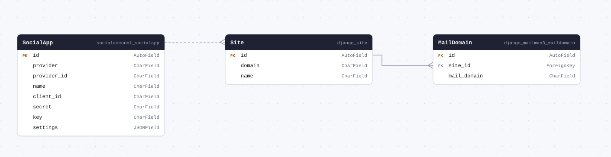

| Column | Field | Type | Null | Key | Default | Description |
| --- | --- | --- | --- | --- | --- | --- |
| `id` | `AutoField` | `integer` |  | PK | `autoincrement()` |  |
| `domain` | `CharField` | `varchar(100)` |  | unique |  |  |
| `name` | `CharField` | `varchar(50)` |  |  |  |  |

Relations:

- [MailDomain](#maildomain).`site_id` → `id`, on delete cascade
- `socialapp_set` — many to many with [SocialApp](#socialapp)

## Task

Table `django_q_task`, app `django_q`.

Proxy models, on this table: `Success`, `Failure`.

| Column | Field | Type | Null | Key | Default | Description |
| --- | --- | --- | --- | --- | --- | --- |
| `id` | `CharField` | `varchar(32)` |  | PK |  | 32-character task identifier. |
| `name` | `CharField` | `varchar(100)` |  |  |  | Optional human-readable name for lookup and display. |
| `func` | `CharField` | `varchar(256)` |  |  |  | Dotted import path to the callable, e.g. myapp.tasks.job. |
| `hook` | `CharField` | `varchar(256)` | yes |  |  | Optional dotted path to a callback that receives the task result. |
| `args` | `PickledObjectField` | `text` | yes |  |  | Pickled positional arguments (tuple). |
| `kwargs` | `PickledObjectField` | `text` | yes |  |  | Pickled keyword arguments (dict). |
| `result` | `PickledObjectField` | `text` | yes |  |  | Pickled return value or error payload. |
| `group` | `CharField` | `varchar(100)` | yes |  |  | Optional group id to aggregate related tasks. |
| `cluster` | `CharField` | `varchar(100)` | yes |  | `None` | Name of the cluster that executed this task. |
| `started` | `DateTimeField` | `datetime` |  |  |  | When the worker started executing the task. |
| `stopped` | `DateTimeField` | `datetime` |  |  |  | When the worker finished (success or failure). |
| `success` | `BooleanField` | `bool` |  |  | `True` | False if the task raised an exception or timed out. |
| `attempt_count` | `IntegerField` | `integer` |  |  | `0` | How many times execution was attempted. |

Indexes:

- index `success_index` on `group`, `name`, `func` where `"success"`

## Schedule

Table `django_q_schedule`, app `django_q`.

| Column | Field | Type | Null | Key | Default | Description |
| --- | --- | --- | --- | --- | --- | --- |
| `id` | `AutoField` | `integer` |  | PK | `autoincrement()` |  |
| `name` | `CharField` | `varchar(100)` | yes |  |  | Optional label to identify this schedule in the admin. |
| `func` | `CharField` | `varchar(256)` |  |  |  | e.g. module.tasks.function |
| `hook` | `CharField` | `varchar(256)` | yes |  |  | e.g. module.tasks.result_function |
| `args` | `TextField` | `text` | yes |  |  | e.g. 1, 2, 'John' |
| `kwargs` | `TextField` | `text` | yes |  |  | e.g. x=1, y=2, name='John' |
| `schedule_type` | `ScheduleScheduleType` | `varchar(2)` |  |  | `'O'` | How often this task should be enqueued. |
| `minutes` | `PositiveSmallIntegerField` | `smallint unsigned` | yes |  |  | Number of minutes for the Minutes type |
| `repeats` | `IntegerField` | `integer` |  |  | `-1` | n = n times, -1 = forever |
| `next_run` | `DateTimeField` | `datetime` | yes |  | `now()` | When this schedule runs next (stored in UTC). |
| `cron` | `CharField` | `varchar(100)` | yes |  |  | Cron expression |
| `task` | `CharField` | `varchar(100)` | yes |  |  | Id of the last task spawned from this schedule (read-only). |
| `cluster` | `CharField` | `varchar(100)` | yes |  | `None` | Name of the target cluster |
| `intended_date_kwarg` | `CharField` | `varchar(100)` | yes |  |  | Name of kwarg to pass intended schedule date |

## OrmQ

Table `django_q_ormq`, app `django_q`.

| Column | Field | Type | Null | Key | Default | Description |
| --- | --- | --- | --- | --- | --- | --- |
| `id` | `AutoField` | `integer` |  | PK | `autoincrement()` |  |
| `key` | `CharField` | `varchar(100)` |  |  |  | Name of the target cluster |
| `payload` | `TextField` | `text` |  |  |  | Signed serialized task package (do not edit manually). |
| `lock` | `DateTimeField` | `datetime` | yes |  |  | Prevent any cluster from pulling until |

## EmailAddress

Table `account_emailaddress`, app `account`.

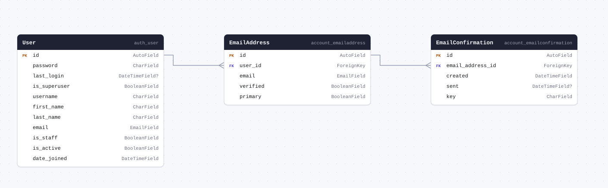

| Column | Field | Type | Null | Key | Default | Description |
| --- | --- | --- | --- | --- | --- | --- |
| `id` | `AutoField` | `integer` |  | PK | `autoincrement()` |  |
| `user_id` | `ForeignKey` | `integer` |  | FK |  |  |
| `email` | `EmailField` | `varchar(254)` |  |  |  |  |
| `verified` | `BooleanField` | `bool` |  |  | `False` |  |
| `primary` | `BooleanField` | `bool` |  |  | `False` |  |

Indexes:

- index `account_emailaddress_user_id_2c513194` on `user_id`
- index `account_emailaddress_email_03be32b2` on `email`
- unique `account_emailaddress_user_id_email_987c8728_uniq` on `user_id`, `email`
- unique `unique_primary_email` on `user_id`, `primary` where `"primary"`
- unique `unique_verified_email` on `email` where `"verified"`

Relations:

- `user_id` → [User](#user).`id`, on delete cascade
- [EmailConfirmation](#emailconfirmation).`email_address_id` → `id`, on delete cascade

## EmailConfirmation

Table `account_emailconfirmation`, app `account`.

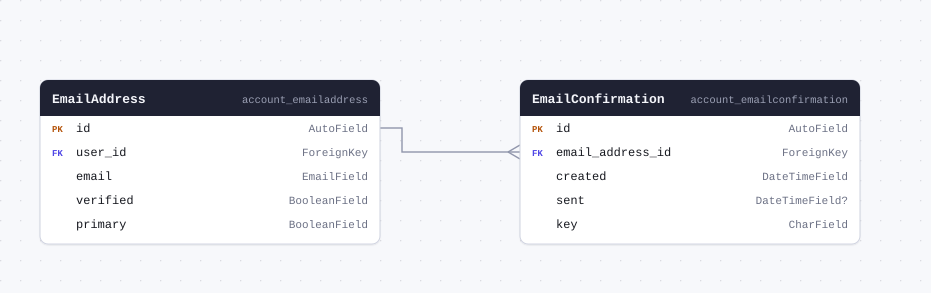

| Column | Field | Type | Null | Key | Default | Description |
| --- | --- | --- | --- | --- | --- | --- |
| `id` | `AutoField` | `integer` |  | PK | `autoincrement()` |  |
| `email_address_id` | `ForeignKey` | `integer` |  | FK |  |  |
| `created` | `DateTimeField` | `datetime` |  |  | `now()` |  |
| `sent` | `DateTimeField` | `datetime` | yes |  |  |  |
| `key` | `CharField` | `varchar(64)` |  | unique |  |  |

Indexes:

- index `account_emailconfirmation_email_address_id_5b7f8c58` on `email_address_id`

Relations:

- `email_address_id` → [EmailAddress](#emailaddress).`id`, on delete cascade

## SocialApp

Table `socialaccount_socialapp`, app `socialaccount`.

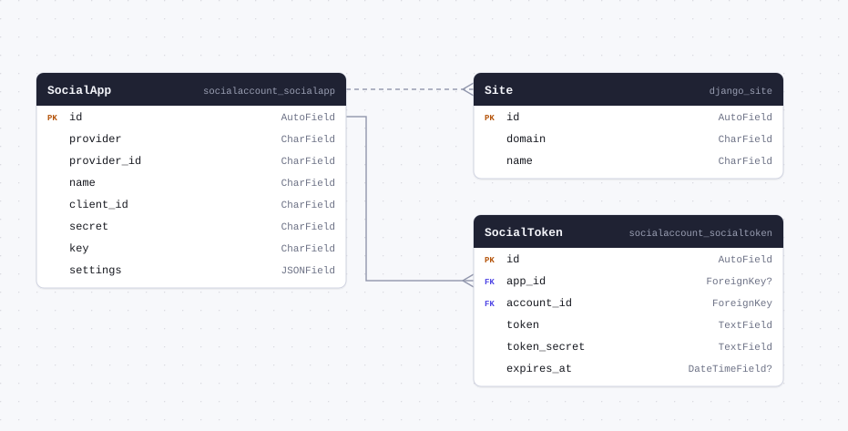

| Column | Field | Type | Null | Key | Default | Description |
| --- | --- | --- | --- | --- | --- | --- |
| `id` | `AutoField` | `integer` |  | PK | `autoincrement()` |  |
| `provider` | `CharField` | `varchar(30)` |  |  |  |  |
| `provider_id` | `CharField` | `varchar(200)` |  |  |  |  |
| `name` | `CharField` | `varchar(40)` |  |  |  |  |
| `client_id` | `CharField` | `varchar(191)` |  |  |  | App ID, or consumer key |
| `secret` | `CharField` | `varchar(191)` |  |  |  | API secret, client secret, or consumer secret |
| `key` | `CharField` | `varchar(191)` |  |  |  | Key |
| `settings` | `JSONField` | `text` |  |  | `dict()` |  |

Relations:

- `sites` — many to many with [Site](#site)
- [SocialToken](#socialtoken).`app_id` → `id`, on delete set null

## SocialAccount

Table `socialaccount_socialaccount`, app `socialaccount`.

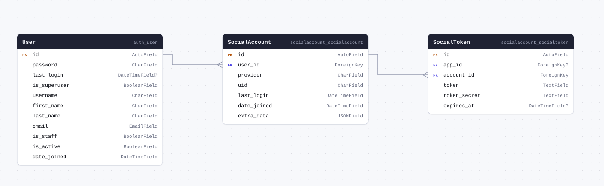

| Column | Field | Type | Null | Key | Default | Description |
| --- | --- | --- | --- | --- | --- | --- |
| `id` | `AutoField` | `integer` |  | PK | `autoincrement()` |  |
| `user_id` | `ForeignKey` | `integer` |  | FK |  |  |
| `provider` | `CharField` | `varchar(200)` |  |  |  |  |
| `uid` | `CharField` | `varchar(191)` |  |  |  |  |
| `last_login` | `DateTimeField` | `datetime` |  |  | `now()` |  |
| `date_joined` | `DateTimeField` | `datetime` |  |  | `now()` |  |
| `extra_data` | `JSONField` | `text` |  |  | `dict()` |  |

Indexes:

- index `socialaccount_socialaccount_user_id_8146e70c` on `user_id`
- unique `socialaccount_socialaccount_provider_uid_fc810c6e_uniq` on `provider`, `uid`

Relations:

- `user_id` → [User](#user).`id`, on delete cascade
- [SocialToken](#socialtoken).`account_id` → `id`, on delete cascade

## SocialToken

Table `socialaccount_socialtoken`, app `socialaccount`.

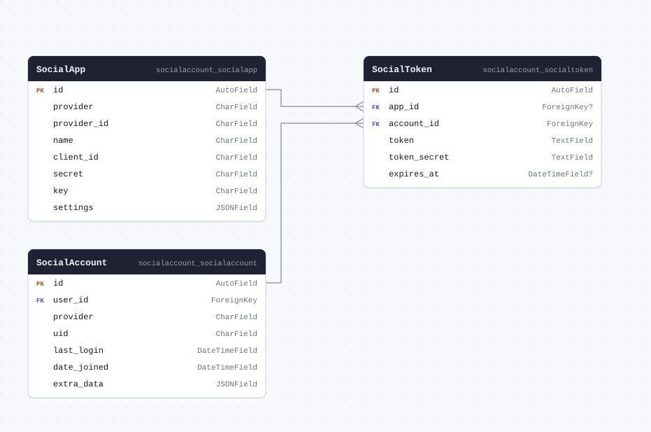

| Column | Field | Type | Null | Key | Default | Description |
| --- | --- | --- | --- | --- | --- | --- |
| `id` | `AutoField` | `integer` |  | PK | `autoincrement()` |  |
| `app_id` | `ForeignKey` | `integer` | yes | FK |  |  |
| `account_id` | `ForeignKey` | `integer` |  | FK |  |  |
| `token` | `TextField` | `text` |  |  |  | "oauth_token" (OAuth1) or access token (OAuth2) |
| `token_secret` | `TextField` | `text` |  |  |  | "oauth_token_secret" (OAuth1) or refresh token (OAuth2) |
| `expires_at` | `DateTimeField` | `datetime` | yes |  |  |  |

Indexes:

- index `socialaccount_socialtoken_app_id_636a42d7` on `app_id`
- index `socialaccount_socialtoken_account_id_951f210e` on `account_id`
- unique `socialaccount_socialtoken_app_id_account_id_fca4e0ac_uniq` on `app_id`, `account_id`

Relations:

- `app_id` → [SocialApp](#socialapp).`id`, on delete set null
- `account_id` → [SocialAccount](#socialaccount).`id`, on delete cascade

# Enums

## MailingListArchivePolicy

| Name | Stored as |
| --- | --- |
| `never` | `0` |
| `private` | `1` |
| `public` | `2` |

## EmailTemplateName

| Name | Stored as |
| --- | --- |
| `[list:admin:action:post] - Sent to the list administrators when moderator approval for a posting is required.` | `list:admin:action:post` |
| `[list:admin:action:subscribe] - Sent to the list administrators when moderator approval for a subscription request is required.` | `list:admin:action:subscribe` |
| `[list:admin:action:unsubscribe] - Sent to the list administrators when moderator approval for an unsubscription request is required.` | `list:admin:action:unsubscribe` |
| `[list:admin:notice:subscribe] - Sent to the list administrators to notify them when a new member has been subscribed.` | `list:admin:notice:subscribe` |
| `[list:admin:notice:unrecognized] - Sent to the list administrators when a bounce message in an unrecognized format has been received.` | `list:admin:notice:unrecognized` |
| `[list:admin:notice:pending] - Sent to the list administrators from the 'mailman notify' command.` | `list:admin:notice:pending` |
| `[list:admin:notice:increment] - Sent to the list administrators to notify them when a member's bounce score is incremented.` | `list:admin:notice:increment` |
| `[list:admin:notice:disable] - Sent to the list administrators to notify them when a member's delivery is disabled due to excessive bounces.` | `list:admin:notice:disable` |
| `[list:admin:notice:unsubscribe] - Sent to the list administrators to notify them when a member has been unsubscribed.` | `list:admin:notice:unsubscribe` |
| `[list:member:digest:footer] - The footer for a digest message.` | `list:member:digest:footer` |
| `[list:member:digest:header] - The header for a digest message.` | `list:member:digest:header` |
| `[list:member:digest:masthead] - The digest “masthead”; i.e. a common introduction for all digest messages.` | `list:member:digest:masthead` |
| `[list:member:regular:footer] - The footer for a regular (non-digest) message.` | `list:member:regular:footer` |
| `[list:member:regular:header] - The header for a regular (non-digest) message.` | `list:member:regular:header` |
| `[list:user:action:subscribe] - The message sent to subscribers when a subscription confirmation is required.` | `list:user:action:subscribe` |
| `[list:user:action:unsubscribe] - The message sent to subscribers when an unsubscription confirmation is required.` | `list:user:action:unsubscribe` |
| `[list:user:action:invite] - The message sent to subscribers when they are invited to join a list.` | `list:user:action:invite` |
| `[list:user:notice:goodbye] - The notice sent to a member when they unsubscribe from a mailing list.` | `list:user:notice:goodbye` |
| `[list:user:notice:hold] - The notice sent to a poster when their message is being held for moderator approval.` | `list:user:notice:hold` |
| `[list:user:notice:no-more-today] - Sent to a user when the maximum number of autoresponses has been reached for that day.` | `list:user:notice:no-more-today` |
| `[list:user:notice:post] - Notice sent to a poster when their message has been received by the mailing list.` | `list:user:notice:post` |
| `[list:user:notice:probe] - A bounce probe sent to a member when their subscription has been disabled due to bounces.` | `list:user:notice:probe` |
| `[list:user:notice:refuse] - Notice sent to a poster when their message has been rejected by the list’s moderator.` | `list:user:notice:refuse` |
| `[list:user:notice:rejected] - Notice sent to a poster when their message has been rejected automatically.` | `list:user:notice:rejected` |
| `[list:user:notice:welcome] - The notice sent to a member when they are subscribed to the mailing list.` | `list:user:notice:welcome` |
| `[list:user:notice:warning] - The notice sent to a member when their membership has been disabled due to excessive bounces.` | `list:user:notice:warning` |

## EmailTemplateLanguage

| Name | Stored as |
| --- | --- |
| `Arabic` | `ar` |
| `Asturian` | `ast` |
| `Bulgarian` | `bg` |
| `Catalan` | `ca` |
| `Chinese` | `zh_CN` |
| `Chinese (Taiwan)` | `zh_TW` |
| `Croatian` | `hr` |
| `Czech` | `cs` |
| `Danish` | `da` |
| `Dutch` | `nl` |
| `English (USA)` | `en` |
| `Estonian` | `et` |
| `Euskara` | `eu` |
| `Finnish` | `fi` |
| `French` | `fr` |
| `Galician` | `gl` |
| `German` | `de` |
| `Greek` | `el` |
| `Hebrew` | `he` |
| `Hungarian` | `hu` |
| `Interlingua` | `ia` |
| `Italian` | `it` |
| `Japanese` | `ja` |
| `Korean` | `ko` |
| `Lithuanian` | `lt` |
| `Norwegian` | `no` |
| `Polish` | `pl` |
| `Portuguese` | `pt` |
| `Portuguese (Brazil)` | `pt_BR` |
| `Romanian` | `ro` |
| `Russian` | `ru` |
| `Serbian` | `sr` |
| `Slovak` | `sk` |
| `Slovenian` | `sl` |
| `Spanish` | `es` |
| `Swedish` | `sv` |
| `Turkish` | `tr` |
| `Ukrainian` | `uk` |
| `Vietnamese` | `vi` |

## EmailTemplateContext

| Name | Stored as |
| --- | --- |
| `Site Wide` | `site` |
| `Domain Wide` | `domain` |
| `MailingList Wide` | `list` |

## DjangoMailman3ProfileTimezone

| Name | Stored as |
| --- | --- |
| `Africa/Abidjan` | `Africa/Abidjan` |
| `Africa/Accra` | `Africa/Accra` |
| `Africa/Addis_Ababa` | `Africa/Addis_Ababa` |
| `Africa/Algiers` | `Africa/Algiers` |
| `Africa/Asmara` | `Africa/Asmara` |
| `Africa/Asmera` | `Africa/Asmera` |
| `Africa/Bamako` | `Africa/Bamako` |
| `Africa/Bangui` | `Africa/Bangui` |
| `Africa/Banjul` | `Africa/Banjul` |
| `Africa/Bissau` | `Africa/Bissau` |
| `Africa/Blantyre` | `Africa/Blantyre` |
| `Africa/Brazzaville` | `Africa/Brazzaville` |
| `Africa/Bujumbura` | `Africa/Bujumbura` |
| `Africa/Cairo` | `Africa/Cairo` |
| `Africa/Casablanca` | `Africa/Casablanca` |
| `Africa/Ceuta` | `Africa/Ceuta` |
| `Africa/Conakry` | `Africa/Conakry` |
| `Africa/Dakar` | `Africa/Dakar` |
| `Africa/Dar_es_Salaam` | `Africa/Dar_es_Salaam` |
| `Africa/Djibouti` | `Africa/Djibouti` |
| `Africa/Douala` | `Africa/Douala` |
| `Africa/El_Aaiun` | `Africa/El_Aaiun` |
| `Africa/Freetown` | `Africa/Freetown` |
| `Africa/Gaborone` | `Africa/Gaborone` |
| `Africa/Harare` | `Africa/Harare` |
| `Africa/Johannesburg` | `Africa/Johannesburg` |
| `Africa/Juba` | `Africa/Juba` |
| `Africa/Kampala` | `Africa/Kampala` |
| `Africa/Khartoum` | `Africa/Khartoum` |
| `Africa/Kigali` | `Africa/Kigali` |
| `Africa/Kinshasa` | `Africa/Kinshasa` |
| `Africa/Lagos` | `Africa/Lagos` |
| `Africa/Libreville` | `Africa/Libreville` |
| `Africa/Lome` | `Africa/Lome` |
| `Africa/Luanda` | `Africa/Luanda` |
| `Africa/Lubumbashi` | `Africa/Lubumbashi` |
| `Africa/Lusaka` | `Africa/Lusaka` |
| `Africa/Malabo` | `Africa/Malabo` |
| `Africa/Maputo` | `Africa/Maputo` |
| `Africa/Maseru` | `Africa/Maseru` |
| `Africa/Mbabane` | `Africa/Mbabane` |
| `Africa/Mogadishu` | `Africa/Mogadishu` |
| `Africa/Monrovia` | `Africa/Monrovia` |
| `Africa/Nairobi` | `Africa/Nairobi` |
| `Africa/Ndjamena` | `Africa/Ndjamena` |
| `Africa/Niamey` | `Africa/Niamey` |
| `Africa/Nouakchott` | `Africa/Nouakchott` |
| `Africa/Ouagadougou` | `Africa/Ouagadougou` |
| `Africa/Porto-Novo` | `Africa/Porto-Novo` |
| `Africa/Sao_Tome` | `Africa/Sao_Tome` |
| `Africa/Timbuktu` | `Africa/Timbuktu` |
| `Africa/Tripoli` | `Africa/Tripoli` |
| `Africa/Tunis` | `Africa/Tunis` |
| `Africa/Windhoek` | `Africa/Windhoek` |
| `America/Adak` | `America/Adak` |
| `America/Anchorage` | `America/Anchorage` |
| `America/Anguilla` | `America/Anguilla` |
| `America/Antigua` | `America/Antigua` |
| `America/Araguaina` | `America/Araguaina` |
| `America/Argentina/Buenos_Aires` | `America/Argentina/Buenos_Aires` |
| `America/Argentina/Catamarca` | `America/Argentina/Catamarca` |
| `America/Argentina/ComodRivadavia` | `America/Argentina/ComodRivadavia` |
| `America/Argentina/Cordoba` | `America/Argentina/Cordoba` |
| `America/Argentina/Jujuy` | `America/Argentina/Jujuy` |
| `America/Argentina/La_Rioja` | `America/Argentina/La_Rioja` |
| `America/Argentina/Mendoza` | `America/Argentina/Mendoza` |
| `America/Argentina/Rio_Gallegos` | `America/Argentina/Rio_Gallegos` |
| `America/Argentina/Salta` | `America/Argentina/Salta` |
| `America/Argentina/San_Juan` | `America/Argentina/San_Juan` |
| `America/Argentina/San_Luis` | `America/Argentina/San_Luis` |
| `America/Argentina/Tucuman` | `America/Argentina/Tucuman` |
| `America/Argentina/Ushuaia` | `America/Argentina/Ushuaia` |
| `America/Aruba` | `America/Aruba` |
| `America/Asuncion` | `America/Asuncion` |
| `America/Atikokan` | `America/Atikokan` |
| `America/Atka` | `America/Atka` |
| `America/Bahia` | `America/Bahia` |
| `America/Bahia_Banderas` | `America/Bahia_Banderas` |
| `America/Barbados` | `America/Barbados` |
| `America/Belem` | `America/Belem` |
| `America/Belize` | `America/Belize` |
| `America/Blanc-Sablon` | `America/Blanc-Sablon` |
| `America/Boa_Vista` | `America/Boa_Vista` |
| `America/Bogota` | `America/Bogota` |
| `America/Boise` | `America/Boise` |
| `America/Buenos_Aires` | `America/Buenos_Aires` |
| `America/Cambridge_Bay` | `America/Cambridge_Bay` |
| `America/Campo_Grande` | `America/Campo_Grande` |
| `America/Cancun` | `America/Cancun` |
| `America/Caracas` | `America/Caracas` |
| `America/Catamarca` | `America/Catamarca` |
| `America/Cayenne` | `America/Cayenne` |
| `America/Cayman` | `America/Cayman` |
| `America/Chicago` | `America/Chicago` |
| `America/Chihuahua` | `America/Chihuahua` |
| `America/Ciudad_Juarez` | `America/Ciudad_Juarez` |
| `America/Coral_Harbour` | `America/Coral_Harbour` |
| `America/Cordoba` | `America/Cordoba` |
| `America/Costa_Rica` | `America/Costa_Rica` |
| `America/Coyhaique` | `America/Coyhaique` |
| `America/Creston` | `America/Creston` |
| `America/Cuiaba` | `America/Cuiaba` |
| `America/Curacao` | `America/Curacao` |
| `America/Danmarkshavn` | `America/Danmarkshavn` |
| `America/Dawson` | `America/Dawson` |
| `America/Dawson_Creek` | `America/Dawson_Creek` |
| `America/Denver` | `America/Denver` |
| `America/Detroit` | `America/Detroit` |
| `America/Dominica` | `America/Dominica` |
| `America/Edmonton` | `America/Edmonton` |
| `America/Eirunepe` | `America/Eirunepe` |
| `America/El_Salvador` | `America/El_Salvador` |
| `America/Ensenada` | `America/Ensenada` |
| `America/Fort_Nelson` | `America/Fort_Nelson` |
| `America/Fort_Wayne` | `America/Fort_Wayne` |
| `America/Fortaleza` | `America/Fortaleza` |
| `America/Glace_Bay` | `America/Glace_Bay` |
| `America/Godthab` | `America/Godthab` |
| `America/Goose_Bay` | `America/Goose_Bay` |
| `America/Grand_Turk` | `America/Grand_Turk` |
| `America/Grenada` | `America/Grenada` |
| `America/Guadeloupe` | `America/Guadeloupe` |
| `America/Guatemala` | `America/Guatemala` |
| `America/Guayaquil` | `America/Guayaquil` |
| `America/Guyana` | `America/Guyana` |
| `America/Halifax` | `America/Halifax` |
| `America/Havana` | `America/Havana` |
| `America/Hermosillo` | `America/Hermosillo` |
| `America/Indiana/Indianapolis` | `America/Indiana/Indianapolis` |
| `America/Indiana/Knox` | `America/Indiana/Knox` |
| `America/Indiana/Marengo` | `America/Indiana/Marengo` |
| `America/Indiana/Petersburg` | `America/Indiana/Petersburg` |
| `America/Indiana/Tell_City` | `America/Indiana/Tell_City` |
| `America/Indiana/Vevay` | `America/Indiana/Vevay` |
| `America/Indiana/Vincennes` | `America/Indiana/Vincennes` |
| `America/Indiana/Winamac` | `America/Indiana/Winamac` |
| `America/Indianapolis` | `America/Indianapolis` |
| `America/Inuvik` | `America/Inuvik` |
| `America/Iqaluit` | `America/Iqaluit` |
| `America/Jamaica` | `America/Jamaica` |
| `America/Jujuy` | `America/Jujuy` |
| `America/Juneau` | `America/Juneau` |
| `America/Kentucky/Louisville` | `America/Kentucky/Louisville` |
| `America/Kentucky/Monticello` | `America/Kentucky/Monticello` |
| `America/Knox_IN` | `America/Knox_IN` |
| `America/Kralendijk` | `America/Kralendijk` |
| `America/La_Paz` | `America/La_Paz` |
| `America/Lima` | `America/Lima` |
| `America/Los_Angeles` | `America/Los_Angeles` |
| `America/Louisville` | `America/Louisville` |
| `America/Lower_Princes` | `America/Lower_Princes` |
| `America/Maceio` | `America/Maceio` |
| `America/Managua` | `America/Managua` |
| `America/Manaus` | `America/Manaus` |
| `America/Marigot` | `America/Marigot` |
| `America/Martinique` | `America/Martinique` |
| `America/Matamoros` | `America/Matamoros` |
| `America/Mazatlan` | `America/Mazatlan` |
| `America/Mendoza` | `America/Mendoza` |
| `America/Menominee` | `America/Menominee` |
| `America/Merida` | `America/Merida` |
| `America/Metlakatla` | `America/Metlakatla` |
| `America/Mexico_City` | `America/Mexico_City` |
| `America/Miquelon` | `America/Miquelon` |
| `America/Moncton` | `America/Moncton` |
| `America/Monterrey` | `America/Monterrey` |
| `America/Montevideo` | `America/Montevideo` |
| `America/Montreal` | `America/Montreal` |
| `America/Montserrat` | `America/Montserrat` |
| `America/Nassau` | `America/Nassau` |
| `America/New_York` | `America/New_York` |
| `America/Nipigon` | `America/Nipigon` |
| `America/Nome` | `America/Nome` |
| `America/Noronha` | `America/Noronha` |
| `America/North_Dakota/Beulah` | `America/North_Dakota/Beulah` |
| `America/North_Dakota/Center` | `America/North_Dakota/Center` |
| `America/North_Dakota/New_Salem` | `America/North_Dakota/New_Salem` |
| `America/Nuuk` | `America/Nuuk` |
| `America/Ojinaga` | `America/Ojinaga` |
| `America/Panama` | `America/Panama` |
| `America/Pangnirtung` | `America/Pangnirtung` |
| `America/Paramaribo` | `America/Paramaribo` |
| `America/Phoenix` | `America/Phoenix` |
| `America/Port-au-Prince` | `America/Port-au-Prince` |
| `America/Port_of_Spain` | `America/Port_of_Spain` |
| `America/Porto_Acre` | `America/Porto_Acre` |
| `America/Porto_Velho` | `America/Porto_Velho` |
| `America/Puerto_Rico` | `America/Puerto_Rico` |
| `America/Punta_Arenas` | `America/Punta_Arenas` |
| `America/Rainy_River` | `America/Rainy_River` |
| `America/Rankin_Inlet` | `America/Rankin_Inlet` |
| `America/Recife` | `America/Recife` |
| `America/Regina` | `America/Regina` |
| `America/Resolute` | `America/Resolute` |
| `America/Rio_Branco` | `America/Rio_Branco` |
| `America/Rosario` | `America/Rosario` |
| `America/Santa_Isabel` | `America/Santa_Isabel` |
| `America/Santarem` | `America/Santarem` |
| `America/Santiago` | `America/Santiago` |
| `America/Santo_Domingo` | `America/Santo_Domingo` |
| `America/Sao_Paulo` | `America/Sao_Paulo` |
| `America/Scoresbysund` | `America/Scoresbysund` |
| `America/Shiprock` | `America/Shiprock` |
| `America/Sitka` | `America/Sitka` |
| `America/St_Barthelemy` | `America/St_Barthelemy` |
| `America/St_Johns` | `America/St_Johns` |
| `America/St_Kitts` | `America/St_Kitts` |
| `America/St_Lucia` | `America/St_Lucia` |
| `America/St_Thomas` | `America/St_Thomas` |
| `America/St_Vincent` | `America/St_Vincent` |
| `America/Swift_Current` | `America/Swift_Current` |
| `America/Tegucigalpa` | `America/Tegucigalpa` |
| `America/Thule` | `America/Thule` |
| `America/Thunder_Bay` | `America/Thunder_Bay` |
| `America/Tijuana` | `America/Tijuana` |
| `America/Toronto` | `America/Toronto` |
| `America/Tortola` | `America/Tortola` |
| `America/Vancouver` | `America/Vancouver` |
| `America/Virgin` | `America/Virgin` |
| `America/Whitehorse` | `America/Whitehorse` |
| `America/Winnipeg` | `America/Winnipeg` |
| `America/Yakutat` | `America/Yakutat` |
| `America/Yellowknife` | `America/Yellowknife` |
| `Antarctica/Casey` | `Antarctica/Casey` |
| `Antarctica/Davis` | `Antarctica/Davis` |
| `Antarctica/DumontDUrville` | `Antarctica/DumontDUrville` |
| `Antarctica/Macquarie` | `Antarctica/Macquarie` |
| `Antarctica/Mawson` | `Antarctica/Mawson` |
| `Antarctica/McMurdo` | `Antarctica/McMurdo` |
| `Antarctica/Palmer` | `Antarctica/Palmer` |
| `Antarctica/Rothera` | `Antarctica/Rothera` |
| `Antarctica/South_Pole` | `Antarctica/South_Pole` |
| `Antarctica/Syowa` | `Antarctica/Syowa` |
| `Antarctica/Troll` | `Antarctica/Troll` |
| `Antarctica/Vostok` | `Antarctica/Vostok` |
| `Arctic/Longyearbyen` | `Arctic/Longyearbyen` |
| `Asia/Aden` | `Asia/Aden` |
| `Asia/Almaty` | `Asia/Almaty` |
| `Asia/Amman` | `Asia/Amman` |
| `Asia/Anadyr` | `Asia/Anadyr` |
| `Asia/Aqtau` | `Asia/Aqtau` |
| `Asia/Aqtobe` | `Asia/Aqtobe` |
| `Asia/Ashgabat` | `Asia/Ashgabat` |
| `Asia/Ashkhabad` | `Asia/Ashkhabad` |
| `Asia/Atyrau` | `Asia/Atyrau` |
| `Asia/Baghdad` | `Asia/Baghdad` |
| `Asia/Bahrain` | `Asia/Bahrain` |
| `Asia/Baku` | `Asia/Baku` |
| `Asia/Bangkok` | `Asia/Bangkok` |
| `Asia/Barnaul` | `Asia/Barnaul` |
| `Asia/Beirut` | `Asia/Beirut` |
| `Asia/Bishkek` | `Asia/Bishkek` |
| `Asia/Brunei` | `Asia/Brunei` |
| `Asia/Calcutta` | `Asia/Calcutta` |
| `Asia/Chita` | `Asia/Chita` |
| `Asia/Choibalsan` | `Asia/Choibalsan` |
| `Asia/Chongqing` | `Asia/Chongqing` |
| `Asia/Chungking` | `Asia/Chungking` |
| `Asia/Colombo` | `Asia/Colombo` |
| `Asia/Dacca` | `Asia/Dacca` |
| `Asia/Damascus` | `Asia/Damascus` |
| `Asia/Dhaka` | `Asia/Dhaka` |
| `Asia/Dili` | `Asia/Dili` |
| `Asia/Dubai` | `Asia/Dubai` |
| `Asia/Dushanbe` | `Asia/Dushanbe` |
| `Asia/Famagusta` | `Asia/Famagusta` |
| `Asia/Gaza` | `Asia/Gaza` |
| `Asia/Harbin` | `Asia/Harbin` |
| `Asia/Hebron` | `Asia/Hebron` |
| `Asia/Ho_Chi_Minh` | `Asia/Ho_Chi_Minh` |
| `Asia/Hong_Kong` | `Asia/Hong_Kong` |
| `Asia/Hovd` | `Asia/Hovd` |
| `Asia/Irkutsk` | `Asia/Irkutsk` |
| `Asia/Istanbul` | `Asia/Istanbul` |
| `Asia/Jakarta` | `Asia/Jakarta` |
| `Asia/Jayapura` | `Asia/Jayapura` |
| `Asia/Jerusalem` | `Asia/Jerusalem` |
| `Asia/Kabul` | `Asia/Kabul` |
| `Asia/Kamchatka` | `Asia/Kamchatka` |
| `Asia/Karachi` | `Asia/Karachi` |
| `Asia/Kashgar` | `Asia/Kashgar` |
| `Asia/Kathmandu` | `Asia/Kathmandu` |
| `Asia/Katmandu` | `Asia/Katmandu` |
| `Asia/Khandyga` | `Asia/Khandyga` |
| `Asia/Kolkata` | `Asia/Kolkata` |
| `Asia/Krasnoyarsk` | `Asia/Krasnoyarsk` |
| `Asia/Kuala_Lumpur` | `Asia/Kuala_Lumpur` |
| `Asia/Kuching` | `Asia/Kuching` |
| `Asia/Kuwait` | `Asia/Kuwait` |
| `Asia/Macao` | `Asia/Macao` |
| `Asia/Macau` | `Asia/Macau` |
| `Asia/Magadan` | `Asia/Magadan` |
| `Asia/Makassar` | `Asia/Makassar` |
| `Asia/Manila` | `Asia/Manila` |
| `Asia/Muscat` | `Asia/Muscat` |
| `Asia/Nicosia` | `Asia/Nicosia` |
| `Asia/Novokuznetsk` | `Asia/Novokuznetsk` |
| `Asia/Novosibirsk` | `Asia/Novosibirsk` |
| `Asia/Omsk` | `Asia/Omsk` |
| `Asia/Oral` | `Asia/Oral` |
| `Asia/Phnom_Penh` | `Asia/Phnom_Penh` |
| `Asia/Pontianak` | `Asia/Pontianak` |
| `Asia/Pyongyang` | `Asia/Pyongyang` |
| `Asia/Qatar` | `Asia/Qatar` |
| `Asia/Qostanay` | `Asia/Qostanay` |
| `Asia/Qyzylorda` | `Asia/Qyzylorda` |
| `Asia/Rangoon` | `Asia/Rangoon` |
| `Asia/Riyadh` | `Asia/Riyadh` |
| `Asia/Saigon` | `Asia/Saigon` |
| `Asia/Sakhalin` | `Asia/Sakhalin` |
| `Asia/Samarkand` | `Asia/Samarkand` |
| `Asia/Seoul` | `Asia/Seoul` |
| `Asia/Shanghai` | `Asia/Shanghai` |
| `Asia/Singapore` | `Asia/Singapore` |
| `Asia/Srednekolymsk` | `Asia/Srednekolymsk` |
| `Asia/Taipei` | `Asia/Taipei` |
| `Asia/Tashkent` | `Asia/Tashkent` |
| `Asia/Tbilisi` | `Asia/Tbilisi` |
| `Asia/Tehran` | `Asia/Tehran` |
| `Asia/Tel_Aviv` | `Asia/Tel_Aviv` |
| `Asia/Thimbu` | `Asia/Thimbu` |
| `Asia/Thimphu` | `Asia/Thimphu` |
| `Asia/Tokyo` | `Asia/Tokyo` |
| `Asia/Tomsk` | `Asia/Tomsk` |
| `Asia/Ujung_Pandang` | `Asia/Ujung_Pandang` |
| `Asia/Ulaanbaatar` | `Asia/Ulaanbaatar` |
| `Asia/Ulan_Bator` | `Asia/Ulan_Bator` |
| `Asia/Urumqi` | `Asia/Urumqi` |
| `Asia/Ust-Nera` | `Asia/Ust-Nera` |
| `Asia/Vientiane` | `Asia/Vientiane` |
| `Asia/Vladivostok` | `Asia/Vladivostok` |
| `Asia/Yakutsk` | `Asia/Yakutsk` |
| `Asia/Yangon` | `Asia/Yangon` |
| `Asia/Yekaterinburg` | `Asia/Yekaterinburg` |
| `Asia/Yerevan` | `Asia/Yerevan` |
| `Atlantic/Azores` | `Atlantic/Azores` |
| `Atlantic/Bermuda` | `Atlantic/Bermuda` |
| `Atlantic/Canary` | `Atlantic/Canary` |
| `Atlantic/Cape_Verde` | `Atlantic/Cape_Verde` |
| `Atlantic/Faeroe` | `Atlantic/Faeroe` |
| `Atlantic/Faroe` | `Atlantic/Faroe` |
| `Atlantic/Jan_Mayen` | `Atlantic/Jan_Mayen` |
| `Atlantic/Madeira` | `Atlantic/Madeira` |
| `Atlantic/Reykjavik` | `Atlantic/Reykjavik` |
| `Atlantic/South_Georgia` | `Atlantic/South_Georgia` |
| `Atlantic/St_Helena` | `Atlantic/St_Helena` |
| `Atlantic/Stanley` | `Atlantic/Stanley` |
| `Australia/ACT` | `Australia/ACT` |
| `Australia/Adelaide` | `Australia/Adelaide` |
| `Australia/Brisbane` | `Australia/Brisbane` |
| `Australia/Broken_Hill` | `Australia/Broken_Hill` |
| `Australia/Canberra` | `Australia/Canberra` |
| `Australia/Currie` | `Australia/Currie` |
| `Australia/Darwin` | `Australia/Darwin` |
| `Australia/Eucla` | `Australia/Eucla` |
| `Australia/Hobart` | `Australia/Hobart` |
| `Australia/LHI` | `Australia/LHI` |
| `Australia/Lindeman` | `Australia/Lindeman` |
| `Australia/Lord_Howe` | `Australia/Lord_Howe` |
| `Australia/Melbourne` | `Australia/Melbourne` |
| `Australia/NSW` | `Australia/NSW` |
| `Australia/North` | `Australia/North` |
| `Australia/Perth` | `Australia/Perth` |
| `Australia/Queensland` | `Australia/Queensland` |
| `Australia/South` | `Australia/South` |
| `Australia/Sydney` | `Australia/Sydney` |
| `Australia/Tasmania` | `Australia/Tasmania` |
| `Australia/Victoria` | `Australia/Victoria` |
| `Australia/West` | `Australia/West` |
| `Australia/Yancowinna` | `Australia/Yancowinna` |
| `Brazil/Acre` | `Brazil/Acre` |
| `Brazil/DeNoronha` | `Brazil/DeNoronha` |
| `Brazil/East` | `Brazil/East` |
| `Brazil/West` | `Brazil/West` |
| `CET` | `CET` |
| `CST6CDT` | `CST6CDT` |
| `Canada/Atlantic` | `Canada/Atlantic` |
| `Canada/Central` | `Canada/Central` |
| `Canada/Eastern` | `Canada/Eastern` |
| `Canada/Mountain` | `Canada/Mountain` |
| `Canada/Newfoundland` | `Canada/Newfoundland` |
| `Canada/Pacific` | `Canada/Pacific` |
| `Canada/Saskatchewan` | `Canada/Saskatchewan` |
| `Canada/Yukon` | `Canada/Yukon` |
| `Chile/Continental` | `Chile/Continental` |
| `Chile/EasterIsland` | `Chile/EasterIsland` |
| `Cuba` | `Cuba` |
| `EET` | `EET` |
| `EST` | `EST` |
| `EST5EDT` | `EST5EDT` |
| `Egypt` | `Egypt` |
| `Eire` | `Eire` |
| `Etc/GMT` | `Etc/GMT` |
| `Etc/GMT+0` | `Etc/GMT+0` |
| `Etc/GMT+1` | `Etc/GMT+1` |
| `Etc/GMT+10` | `Etc/GMT+10` |
| `Etc/GMT+11` | `Etc/GMT+11` |
| `Etc/GMT+12` | `Etc/GMT+12` |
| `Etc/GMT+2` | `Etc/GMT+2` |
| `Etc/GMT+3` | `Etc/GMT+3` |
| `Etc/GMT+4` | `Etc/GMT+4` |
| `Etc/GMT+5` | `Etc/GMT+5` |
| `Etc/GMT+6` | `Etc/GMT+6` |
| `Etc/GMT+7` | `Etc/GMT+7` |
| `Etc/GMT+8` | `Etc/GMT+8` |
| `Etc/GMT+9` | `Etc/GMT+9` |
| `Etc/GMT-0` | `Etc/GMT-0` |
| `Etc/GMT-1` | `Etc/GMT-1` |
| `Etc/GMT-10` | `Etc/GMT-10` |
| `Etc/GMT-11` | `Etc/GMT-11` |
| `Etc/GMT-12` | `Etc/GMT-12` |
| `Etc/GMT-13` | `Etc/GMT-13` |
| `Etc/GMT-14` | `Etc/GMT-14` |
| `Etc/GMT-2` | `Etc/GMT-2` |
| `Etc/GMT-3` | `Etc/GMT-3` |
| `Etc/GMT-4` | `Etc/GMT-4` |
| `Etc/GMT-5` | `Etc/GMT-5` |
| `Etc/GMT-6` | `Etc/GMT-6` |
| `Etc/GMT-7` | `Etc/GMT-7` |
| `Etc/GMT-8` | `Etc/GMT-8` |
| `Etc/GMT-9` | `Etc/GMT-9` |
| `Etc/GMT0` | `Etc/GMT0` |
| `Etc/Greenwich` | `Etc/Greenwich` |
| `Etc/UCT` | `Etc/UCT` |
| `Etc/UTC` | `Etc/UTC` |
| `Etc/Universal` | `Etc/Universal` |
| `Etc/Zulu` | `Etc/Zulu` |
| `Europe/Amsterdam` | `Europe/Amsterdam` |
| `Europe/Andorra` | `Europe/Andorra` |
| `Europe/Astrakhan` | `Europe/Astrakhan` |
| `Europe/Athens` | `Europe/Athens` |
| `Europe/Belfast` | `Europe/Belfast` |
| `Europe/Belgrade` | `Europe/Belgrade` |
| `Europe/Berlin` | `Europe/Berlin` |
| `Europe/Bratislava` | `Europe/Bratislava` |
| `Europe/Brussels` | `Europe/Brussels` |
| `Europe/Bucharest` | `Europe/Bucharest` |
| `Europe/Budapest` | `Europe/Budapest` |
| `Europe/Busingen` | `Europe/Busingen` |
| `Europe/Chisinau` | `Europe/Chisinau` |
| `Europe/Copenhagen` | `Europe/Copenhagen` |
| `Europe/Dublin` | `Europe/Dublin` |
| `Europe/Gibraltar` | `Europe/Gibraltar` |
| `Europe/Guernsey` | `Europe/Guernsey` |
| `Europe/Helsinki` | `Europe/Helsinki` |
| `Europe/Isle_of_Man` | `Europe/Isle_of_Man` |
| `Europe/Istanbul` | `Europe/Istanbul` |
| `Europe/Jersey` | `Europe/Jersey` |
| `Europe/Kaliningrad` | `Europe/Kaliningrad` |
| `Europe/Kiev` | `Europe/Kiev` |
| `Europe/Kirov` | `Europe/Kirov` |
| `Europe/Kyiv` | `Europe/Kyiv` |
| `Europe/Lisbon` | `Europe/Lisbon` |
| `Europe/Ljubljana` | `Europe/Ljubljana` |
| `Europe/London` | `Europe/London` |
| `Europe/Luxembourg` | `Europe/Luxembourg` |
| `Europe/Madrid` | `Europe/Madrid` |
| `Europe/Malta` | `Europe/Malta` |
| `Europe/Mariehamn` | `Europe/Mariehamn` |
| `Europe/Minsk` | `Europe/Minsk` |
| `Europe/Monaco` | `Europe/Monaco` |
| `Europe/Moscow` | `Europe/Moscow` |
| `Europe/Nicosia` | `Europe/Nicosia` |
| `Europe/Oslo` | `Europe/Oslo` |
| `Europe/Paris` | `Europe/Paris` |
| `Europe/Podgorica` | `Europe/Podgorica` |
| `Europe/Prague` | `Europe/Prague` |
| `Europe/Riga` | `Europe/Riga` |
| `Europe/Rome` | `Europe/Rome` |
| `Europe/Samara` | `Europe/Samara` |
| `Europe/San_Marino` | `Europe/San_Marino` |
| `Europe/Sarajevo` | `Europe/Sarajevo` |
| `Europe/Saratov` | `Europe/Saratov` |
| `Europe/Simferopol` | `Europe/Simferopol` |
| `Europe/Skopje` | `Europe/Skopje` |
| `Europe/Sofia` | `Europe/Sofia` |
| `Europe/Stockholm` | `Europe/Stockholm` |
| `Europe/Tallinn` | `Europe/Tallinn` |
| `Europe/Tirane` | `Europe/Tirane` |
| `Europe/Tiraspol` | `Europe/Tiraspol` |
| `Europe/Ulyanovsk` | `Europe/Ulyanovsk` |
| `Europe/Uzhgorod` | `Europe/Uzhgorod` |
| `Europe/Vaduz` | `Europe/Vaduz` |
| `Europe/Vatican` | `Europe/Vatican` |
| `Europe/Vienna` | `Europe/Vienna` |
| `Europe/Vilnius` | `Europe/Vilnius` |
| `Europe/Volgograd` | `Europe/Volgograd` |
| `Europe/Warsaw` | `Europe/Warsaw` |
| `Europe/Zagreb` | `Europe/Zagreb` |
| `Europe/Zaporozhye` | `Europe/Zaporozhye` |
| `Europe/Zurich` | `Europe/Zurich` |
| `Factory` | `Factory` |
| `GB` | `GB` |
| `GB-Eire` | `GB-Eire` |
| `GMT` | `GMT` |
| `GMT+0` | `GMT+0` |
| `GMT-0` | `GMT-0` |
| `GMT0` | `GMT0` |
| `Greenwich` | `Greenwich` |
| `HST` | `HST` |
| `Hongkong` | `Hongkong` |
| `Iceland` | `Iceland` |
| `Indian/Antananarivo` | `Indian/Antananarivo` |
| `Indian/Chagos` | `Indian/Chagos` |
| `Indian/Christmas` | `Indian/Christmas` |
| `Indian/Cocos` | `Indian/Cocos` |
| `Indian/Comoro` | `Indian/Comoro` |
| `Indian/Kerguelen` | `Indian/Kerguelen` |
| `Indian/Mahe` | `Indian/Mahe` |
| `Indian/Maldives` | `Indian/Maldives` |
| `Indian/Mauritius` | `Indian/Mauritius` |
| `Indian/Mayotte` | `Indian/Mayotte` |
| `Indian/Reunion` | `Indian/Reunion` |
| `Iran` | `Iran` |
| `Israel` | `Israel` |
| `Jamaica` | `Jamaica` |
| `Japan` | `Japan` |
| `Kwajalein` | `Kwajalein` |
| `Libya` | `Libya` |
| `MET` | `MET` |
| `MST` | `MST` |
| `MST7MDT` | `MST7MDT` |
| `Mexico/BajaNorte` | `Mexico/BajaNorte` |
| `Mexico/BajaSur` | `Mexico/BajaSur` |
| `Mexico/General` | `Mexico/General` |
| `NZ` | `NZ` |
| `NZ-CHAT` | `NZ-CHAT` |
| `Navajo` | `Navajo` |
| `PRC` | `PRC` |
| `PST8PDT` | `PST8PDT` |
| `Pacific/Apia` | `Pacific/Apia` |
| `Pacific/Auckland` | `Pacific/Auckland` |
| `Pacific/Bougainville` | `Pacific/Bougainville` |
| `Pacific/Chatham` | `Pacific/Chatham` |
| `Pacific/Chuuk` | `Pacific/Chuuk` |
| `Pacific/Easter` | `Pacific/Easter` |
| `Pacific/Efate` | `Pacific/Efate` |
| `Pacific/Enderbury` | `Pacific/Enderbury` |
| `Pacific/Fakaofo` | `Pacific/Fakaofo` |
| `Pacific/Fiji` | `Pacific/Fiji` |
| `Pacific/Funafuti` | `Pacific/Funafuti` |
| `Pacific/Galapagos` | `Pacific/Galapagos` |
| `Pacific/Gambier` | `Pacific/Gambier` |
| `Pacific/Guadalcanal` | `Pacific/Guadalcanal` |
| `Pacific/Guam` | `Pacific/Guam` |
| `Pacific/Honolulu` | `Pacific/Honolulu` |
| `Pacific/Johnston` | `Pacific/Johnston` |
| `Pacific/Kanton` | `Pacific/Kanton` |
| `Pacific/Kiritimati` | `Pacific/Kiritimati` |
| `Pacific/Kosrae` | `Pacific/Kosrae` |
| `Pacific/Kwajalein` | `Pacific/Kwajalein` |
| `Pacific/Majuro` | `Pacific/Majuro` |
| `Pacific/Marquesas` | `Pacific/Marquesas` |
| `Pacific/Midway` | `Pacific/Midway` |
| `Pacific/Nauru` | `Pacific/Nauru` |
| `Pacific/Niue` | `Pacific/Niue` |
| `Pacific/Norfolk` | `Pacific/Norfolk` |
| `Pacific/Noumea` | `Pacific/Noumea` |
| `Pacific/Pago_Pago` | `Pacific/Pago_Pago` |
| `Pacific/Palau` | `Pacific/Palau` |
| `Pacific/Pitcairn` | `Pacific/Pitcairn` |
| `Pacific/Pohnpei` | `Pacific/Pohnpei` |
| `Pacific/Ponape` | `Pacific/Ponape` |
| `Pacific/Port_Moresby` | `Pacific/Port_Moresby` |
| `Pacific/Rarotonga` | `Pacific/Rarotonga` |
| `Pacific/Saipan` | `Pacific/Saipan` |
| `Pacific/Samoa` | `Pacific/Samoa` |
| `Pacific/Tahiti` | `Pacific/Tahiti` |
| `Pacific/Tarawa` | `Pacific/Tarawa` |
| `Pacific/Tongatapu` | `Pacific/Tongatapu` |
| `Pacific/Truk` | `Pacific/Truk` |
| `Pacific/Wake` | `Pacific/Wake` |
| `Pacific/Wallis` | `Pacific/Wallis` |
| `Pacific/Yap` | `Pacific/Yap` |
| `Poland` | `Poland` |
| `Portugal` | `Portugal` |
| `ROC` | `ROC` |
| `ROK` | `ROK` |
| `Singapore` | `Singapore` |
| `Turkey` | `Turkey` |
| `UCT` | `UCT` |
| `US/Alaska` | `US/Alaska` |
| `US/Aleutian` | `US/Aleutian` |
| `US/Arizona` | `US/Arizona` |
| `US/Central` | `US/Central` |
| `US/East-Indiana` | `US/East-Indiana` |
| `US/Eastern` | `US/Eastern` |
| `US/Hawaii` | `US/Hawaii` |
| `US/Indiana-Starke` | `US/Indiana-Starke` |
| `US/Michigan` | `US/Michigan` |
| `US/Mountain` | `US/Mountain` |
| `US/Pacific` | `US/Pacific` |
| `US/Samoa` | `US/Samoa` |
| `UTC` | `UTC` |
| `Universal` | `Universal` |
| `W-SU` | `W-SU` |
| `WET` | `WET` |
| `Zulu` | `Zulu` |
| `localtime` | `localtime` |

## LogEntryActionFlag

| Name | Stored as |
| --- | --- |
| `Addition` | `1` |
| `Change` | `2` |
| `Deletion` | `3` |

## ScheduleScheduleType

| Name | Stored as |
| --- | --- |
| `Once` | `O` |
| `Minutes` | `I` |
| `Hourly` | `H` |
| `Daily` | `D` |
| `Weekly` | `W` |
| `Biweekly` | `BW` |
| `Monthly` | `M` |
| `Bimonthly` | `BM` |
| `Quarterly` | `Q` |
| `Yearly` | `Y` |
| `Cron` | `C` |
