# Schema docs

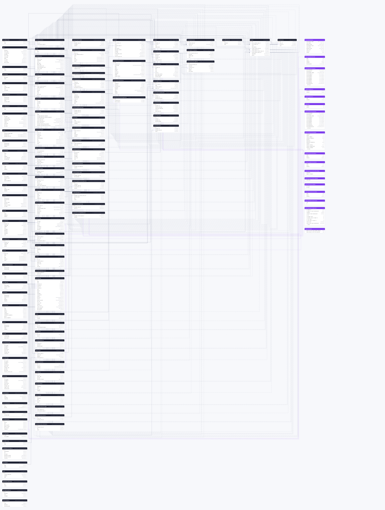

[StoredEventType](#storedeventtype) · [EventSubscription](#eventsubscription) · [Notification](#notification) · [ObjectEventSubscription](#objecteventsubscription) · [UserSetting](#usersetting) · [Permission](#permission) · [Group](#group) · [User](#user) · [ContentType](#contenttype) · [Session](#session) · [Follow](#follow) · [Action](#action) · [AccessFailureLog](#accessfailurelog) · [AccessAttempt](#accessattempt) · [AccessAttemptExpiration](#accessattemptexpiration) · [AccessLog](#accesslog) · [SolarSchedule](#solarschedule) · [IntervalSchedule](#intervalschedule) · [ClockedSchedule](#clockedschedule) · [CrontabSchedule](#crontabschedule) · [PeriodicTasks](#periodictasks) · [PeriodicTask](#periodictask) · [Token](#token) · [StoredErrorLog](#storederrorlog) · [ErrorLogPartition](#errorlogpartition) · [ErrorLogPartitionEntry](#errorlogpartitionentry) · [TaskDeduplicationEntry](#taskdeduplicationentry) · [AccessControlList](#accesscontrollist) · [UserOptions](#useroptions) · [LoginAttempt](#loginattempt) · [UserOTPData](#userotpdata) · [AutoAdminSingleton](#autoadminsingleton) · [Asset](#asset) · [StoredLayer](#storedlayer) · [ObjectLayer](#objectlayer) · [LayerTransformation](#layertransformation) · [StoredCredential](#storedcredential) · [StoredDashboard](#storeddashboard) · [Key](#key) · [SavedResultset](#savedresultset) · [SavedResultsetEntry](#savedresultsetentry) · [Cache](#cache) · [CachePartition](#cachepartition) · [CachePartitionFile](#cachepartitionfile) · [UserLocaleProfile](#userlocaleprofile) · [Lock](#lock) · [Message](#message) · [Role](#role) · [StoredPermission](#storedpermission) · [Quota](#quota) · [StreamEvent](#streamevent) · [UpdatedStoredSetting](#updatedstoredsetting) · [DownloadFile](#downloadfile) · [SharedUploadedFile](#shareduploadedfile) · [UserConfirmView](#userconfirmview) · [UserViewMode](#userviewmode) · [Announcement](#announcement) · [DocumentType](#documenttype) · [DocumentTypeFilename](#documenttypefilename) · [Document](#document) · [DocumentFile](#documentfile) · [DocumentVersion](#documentversion) · [DocumentVersionPage](#documentversionpage) · [DocumentFilePage](#documentfilepage) · [RecentlyAccessedDocument](#recentlyaccesseddocument) · [Cabinet](#cabinet) · [DocumentCheckout](#documentcheckout) · [Comment](#comment) · [FavoriteDocument](#favoritedocument) · [IndexTemplate](#indextemplate) · [IndexTemplateEventTrigger](#indextemplateeventtrigger) · [IndexTemplateNode](#indextemplatenode) · [IndexInstanceNode](#indexinstancenode) · [DocumentFilePageContent](#documentfilepagecontent) · [DocumentTypeSettings](#documenttypesettings) · [SignatureBaseModel](#signaturebasemodel) · [DetachedSignature](#detachedsignature) · [EmbeddedSignature](#embeddedsignature) · [Workflow](#workflow) · [WorkflowState](#workflowstate) · [WorkflowTransition](#workflowtransition) · [WorkflowTransitionField](#workflowtransitionfield) · [WorkflowInstance](#workflowinstance) · [WorkflowInstanceLogEntry](#workflowinstancelogentry) · [WorkflowStateAction](#workflowstateaction) · [WorkflowStateEscalation](#workflowstateescalation) · [WorkflowTransitionTriggerEvent](#workflowtransitiontriggerevent) · [StoredDuplicateBackend](#storedduplicatebackend) · [DuplicateBackendEntry](#duplicatebackendentry) · [DocumentFileDriverEntry](#documentfiledriverentry) · [DocumentTypeDriverConfiguration](#documenttypedriverconfiguration) · [FileMetadataEntry](#filemetadataentry) · [StoredDriver](#storeddriver) · [SmartLink](#smartlink) · [SmartLinkCondition](#smartlinkcondition) · [UserMailer](#usermailer) · [StatisticResult](#statisticresult) · [MetadataType](#metadatatype) · [DocumentTypeMetadataType](#documenttypemetadatatype) · [DocumentMetadata](#documentmetadata) · [DocumentTypeOCRSettings](#documenttypeocrsettings) · [DocumentVersionPageOCRContent](#documentversionpageocrcontent) · [Sequence](#sequence) · [SignatureCapture](#signaturecapture) · [DocumentFileSourceMetadata](#documentfilesourcemetadata) · [Source](#source) · [Tag](#tag) · [WebLink](#weblink)

<details>
<summary>The whole schema as SQL</summary>

```sql
CREATE TABLE "events_storedeventtype" ("id" integer NOT NULL PRIMARY KEY AUTOINCREMENT, "name" varchar(64) NOT NULL UNIQUE);

CREATE TABLE "events_eventsubscription" ("id" integer NOT NULL PRIMARY KEY AUTOINCREMENT, "user_id" integer NOT NULL REFERENCES "auth_user" ("id") DEFERRABLE INITIALLY DEFERRED, "stored_event_type_id" integer NOT NULL REFERENCES "events_storedeventtype" ("id") DEFERRABLE INITIALLY DEFERRED);

CREATE TABLE "events_notification" ("id" integer NOT NULL PRIMARY KEY AUTOINCREMENT, "user_id" integer NOT NULL REFERENCES "auth_user" ("id") DEFERRABLE INITIALLY DEFERRED, "action_id" integer NOT NULL REFERENCES "actstream_action" ("id") DEFERRABLE INITIALLY DEFERRED, "read" bool NOT NULL);

CREATE TABLE "events_objecteventsubscription" ("id" integer NOT NULL PRIMARY KEY AUTOINCREMENT, "content_type_id" integer NOT NULL REFERENCES "django_content_type" ("id") DEFERRABLE INITIALLY DEFERRED, "object_id" integer unsigned NOT NULL CHECK ("object_id" >= 0), "user_id" integer NOT NULL REFERENCES "auth_user" ("id") DEFERRABLE INITIALLY DEFERRED, "stored_event_type_id" integer NOT NULL REFERENCES "events_storedeventtype" ("id") DEFERRABLE INITIALLY DEFERRED);

CREATE TABLE "appearance_usersetting" ("id" integer NOT NULL PRIMARY KEY AUTOINCREMENT, "user_id" integer NOT NULL REFERENCES "auth_user" ("id") DEFERRABLE INITIALLY DEFERRED, "namespace" varchar(64) NOT NULL, "key" varchar(64) NOT NULL, "value" text NOT NULL);

CREATE TABLE "auth_permission" ("id" integer NOT NULL PRIMARY KEY AUTOINCREMENT, "name" varchar(255) NOT NULL, "content_type_id" integer NOT NULL REFERENCES "django_content_type" ("id") DEFERRABLE INITIALLY DEFERRED, "codename" varchar(100) NOT NULL);

CREATE TABLE "auth_group" ("id" integer NOT NULL PRIMARY KEY AUTOINCREMENT, "name" varchar(150) NOT NULL UNIQUE);

CREATE TABLE "auth_group_permissions" ("id" integer NOT NULL PRIMARY KEY AUTOINCREMENT, "group_id" integer NOT NULL REFERENCES "auth_group" ("id") DEFERRABLE INITIALLY DEFERRED, "permission_id" integer NOT NULL REFERENCES "auth_permission" ("id") DEFERRABLE INITIALLY DEFERRED);

CREATE TABLE "auth_user" ("id" integer NOT NULL PRIMARY KEY AUTOINCREMENT, "password" varchar(128) NOT NULL, "last_login" datetime NULL, "is_superuser" bool NOT NULL, "username" varchar(150) NOT NULL UNIQUE, "first_name" varchar(150) NOT NULL, "last_name" varchar(150) NOT NULL, "email" varchar(254) NOT NULL, "is_staff" bool NOT NULL, "is_active" bool NOT NULL, "date_joined" datetime NOT NULL);

CREATE TABLE "auth_user_groups" ("id" integer NOT NULL PRIMARY KEY AUTOINCREMENT, "user_id" integer NOT NULL REFERENCES "auth_user" ("id") DEFERRABLE INITIALLY DEFERRED, "group_id" integer NOT NULL REFERENCES "auth_group" ("id") DEFERRABLE INITIALLY DEFERRED);

CREATE TABLE "auth_user_user_permissions" ("id" integer NOT NULL PRIMARY KEY AUTOINCREMENT, "user_id" integer NOT NULL REFERENCES "auth_user" ("id") DEFERRABLE INITIALLY DEFERRED, "permission_id" integer NOT NULL REFERENCES "auth_permission" ("id") DEFERRABLE INITIALLY DEFERRED);

CREATE TABLE "django_content_type" ("id" integer NOT NULL PRIMARY KEY AUTOINCREMENT, "app_label" varchar(100) NOT NULL, "model" varchar(100) NOT NULL);

CREATE TABLE "django_session" ("session_key" varchar(40) NOT NULL PRIMARY KEY, "session_data" text NOT NULL, "expire_date" datetime NOT NULL);

CREATE TABLE "actstream_follow" ("id" integer NOT NULL PRIMARY KEY AUTOINCREMENT, "user_id" integer NOT NULL REFERENCES "auth_user" ("id") DEFERRABLE INITIALLY DEFERRED, "content_type_id" integer NOT NULL REFERENCES "django_content_type" ("id") DEFERRABLE INITIALLY DEFERRED, "object_id" varchar(255) NOT NULL, "actor_only" bool NOT NULL, "flag" varchar(255) NOT NULL, "started" datetime NOT NULL);

CREATE TABLE "actstream_action" ("id" integer NOT NULL PRIMARY KEY AUTOINCREMENT, "actor_content_type_id" integer NOT NULL REFERENCES "django_content_type" ("id") DEFERRABLE INITIALLY DEFERRED, "actor_object_id" varchar(255) NOT NULL, "verb" varchar(255) NOT NULL, "description" text NULL, "target_content_type_id" integer NULL REFERENCES "django_content_type" ("id") DEFERRABLE INITIALLY DEFERRED, "target_object_id" varchar(255) NULL, "action_object_content_type_id" integer NULL REFERENCES "django_content_type" ("id") DEFERRABLE INITIALLY DEFERRED, "action_object_object_id" varchar(255) NULL, "timestamp" datetime NOT NULL, "public" bool NOT NULL);

CREATE TABLE "axes_accessfailurelog" ("id" integer NOT NULL PRIMARY KEY AUTOINCREMENT, "user_agent" varchar(255) NOT NULL, "ip_address" char(39) NULL, "username" varchar(255) NULL, "http_accept" varchar(1025) NOT NULL, "path_info" varchar(255) NOT NULL, "attempt_time" datetime NOT NULL, "locked_out" bool NOT NULL);

CREATE TABLE "axes_accessattempt" ("id" integer NOT NULL PRIMARY KEY AUTOINCREMENT, "user_agent" varchar(255) NOT NULL, "ip_address" char(39) NULL, "username" varchar(255) NULL, "http_accept" varchar(1025) NOT NULL, "path_info" varchar(255) NOT NULL, "attempt_time" datetime NOT NULL, "get_data" text NOT NULL, "post_data" text NOT NULL, "failures_since_start" integer unsigned NOT NULL CHECK ("failures_since_start" >= 0));

CREATE TABLE "axes_accessattemptexpiration" ("access_attempt_id" integer NOT NULL PRIMARY KEY REFERENCES "axes_accessattempt" ("id") DEFERRABLE INITIALLY DEFERRED, "expires_at" datetime NOT NULL);

CREATE TABLE "axes_accesslog" ("id" integer NOT NULL PRIMARY KEY AUTOINCREMENT, "user_agent" varchar(255) NOT NULL, "ip_address" char(39) NULL, "username" varchar(255) NULL, "http_accept" varchar(1025) NOT NULL, "path_info" varchar(255) NOT NULL, "attempt_time" datetime NOT NULL, "logout_time" datetime NULL, "session_hash" varchar(64) NOT NULL);

CREATE TABLE "django_celery_beat_solarschedule" ("id" integer NOT NULL PRIMARY KEY AUTOINCREMENT, "event" varchar(24) NOT NULL, "latitude" decimal NOT NULL, "longitude" decimal NOT NULL);

CREATE TABLE "django_celery_beat_intervalschedule" ("id" integer NOT NULL PRIMARY KEY AUTOINCREMENT, "every" integer NOT NULL, "period" varchar(24) NOT NULL);

CREATE TABLE "django_celery_beat_clockedschedule" ("id" integer NOT NULL PRIMARY KEY AUTOINCREMENT, "clocked_time" datetime NOT NULL);

CREATE TABLE "django_celery_beat_crontabschedule" ("id" integer NOT NULL PRIMARY KEY AUTOINCREMENT, "minute" varchar(240) NOT NULL, "hour" varchar(96) NOT NULL, "day_of_month" varchar(124) NOT NULL, "month_of_year" varchar(64) NOT NULL, "day_of_week" varchar(64) NOT NULL, "timezone" varchar(63) NOT NULL);

CREATE TABLE "django_celery_beat_periodictasks" ("ident" smallint NOT NULL PRIMARY KEY, "last_update" datetime NOT NULL);

CREATE TABLE "django_celery_beat_periodictask" ("id" integer NOT NULL PRIMARY KEY AUTOINCREMENT, "name" varchar(200) NOT NULL UNIQUE, "task" varchar(200) NOT NULL, "interval_id" integer NULL REFERENCES "django_celery_beat_intervalschedule" ("id") DEFERRABLE INITIALLY DEFERRED, "crontab_id" integer NULL REFERENCES "django_celery_beat_crontabschedule" ("id") DEFERRABLE INITIALLY DEFERRED, "solar_id" integer NULL REFERENCES "django_celery_beat_solarschedule" ("id") DEFERRABLE INITIALLY DEFERRED, "clocked_id" integer NULL REFERENCES "django_celery_beat_clockedschedule" ("id") DEFERRABLE INITIALLY DEFERRED, "args" text NOT NULL, "kwargs" text NOT NULL, "queue" varchar(200) NULL, "exchange" varchar(200) NULL, "routing_key" varchar(200) NULL, "headers" text NOT NULL, "priority" integer unsigned NULL CHECK ("priority" >= 0), "expires" datetime NULL, "expire_seconds" integer unsigned NULL CHECK ("expire_seconds" >= 0), "one_off" bool NOT NULL, "start_time" datetime NULL, "enabled" bool NOT NULL, "last_run_at" datetime NULL, "total_run_count" integer unsigned NOT NULL CHECK ("total_run_count" >= 0), "date_changed" datetime NOT NULL, "description" text NOT NULL);

CREATE TABLE "authtoken_token" ("key" varchar(40) NOT NULL PRIMARY KEY, "user_id" integer NOT NULL UNIQUE REFERENCES "auth_user" ("id") DEFERRABLE INITIALLY DEFERRED, "created" datetime NOT NULL);

CREATE TABLE "logging_storederrorlog" ("id" integer NOT NULL PRIMARY KEY AUTOINCREMENT, "name" varchar(128) NOT NULL UNIQUE);

CREATE TABLE "logging_errorlogpartition" ("id" integer NOT NULL PRIMARY KEY AUTOINCREMENT, "error_log_id" integer NOT NULL REFERENCES "logging_storederrorlog" ("id") DEFERRABLE INITIALLY DEFERRED, "name" varchar(128) NOT NULL, "content_type_id" integer NOT NULL REFERENCES "django_content_type" ("id") DEFERRABLE INITIALLY DEFERRED, "object_id" integer unsigned NOT NULL CHECK ("object_id" >= 0));

CREATE TABLE "logging_errorlogpartitionentry" ("id" integer NOT NULL PRIMARY KEY AUTOINCREMENT, "error_log_partition_id" integer NOT NULL REFERENCES "logging_errorlogpartition" ("id") DEFERRABLE INITIALLY DEFERRED, "datetime" datetime NOT NULL, "domain_name" varchar(128) NOT NULL, "text" text NULL);

CREATE TABLE "task_manager_taskdeduplicationentry" ("id" integer NOT NULL PRIMARY KEY AUTOINCREMENT, "dotted_path" varchar(255) NOT NULL, "key" text NOT NULL, "key_hash" varchar(64) NOT NULL, "datetime_created" datetime NOT NULL, "datetime_started" datetime NULL, "is_dirty" bool NOT NULL, CONSTRAINT "task_manager_taskdeduplicationentry_unique_key" UNIQUE ("dotted_path", "key_hash"));

CREATE TABLE "acls_accesscontrollist" ("id" integer NOT NULL PRIMARY KEY AUTOINCREMENT, "content_type_id" integer NOT NULL REFERENCES "django_content_type" ("id") DEFERRABLE INITIALLY DEFERRED, "object_id" integer unsigned NOT NULL CHECK ("object_id" >= 0), "role_id" integer NOT NULL REFERENCES "permissions_role" ("id") DEFERRABLE INITIALLY DEFERRED);

CREATE TABLE "acls_accesscontrollist_permissions" ("id" integer NOT NULL PRIMARY KEY AUTOINCREMENT, "accesscontrollist_id" integer NOT NULL REFERENCES "acls_accesscontrollist" ("id") DEFERRABLE INITIALLY DEFERRED, "storedpermission_id" integer NOT NULL REFERENCES "permissions_storedpermission" ("id") DEFERRABLE INITIALLY DEFERRED);

CREATE TABLE "user_management_useroptions" ("id" integer NOT NULL PRIMARY KEY AUTOINCREMENT, "user_id" integer NOT NULL UNIQUE REFERENCES "auth_user" ("id") DEFERRABLE INITIALLY DEFERRED, "block_password_change" bool NOT NULL);

CREATE TABLE "authentication_attempts_loginattempt" ("id" integer NOT NULL PRIMARY KEY AUTOINCREMENT, "username" varchar(254) NOT NULL, "user_id" integer NULL REFERENCES "auth_user" ("id") DEFERRABLE INITIALLY DEFERRED, "result" varchar(32) NOT NULL, "source" varchar(32) NOT NULL, "ip_address" char(39) NULL, "user_agent" text NOT NULL, "datetime" datetime NOT NULL);

CREATE TABLE "authentication_otp_userotpdata" ("id" integer NOT NULL PRIMARY KEY AUTOINCREMENT, "user_id" integer NOT NULL UNIQUE REFERENCES "auth_user" ("id") DEFERRABLE INITIALLY DEFERRED, "secret" varchar(96) NOT NULL);

CREATE TABLE "autoadmin_autoadminsingleton" ("id" integer NOT NULL PRIMARY KEY AUTOINCREMENT, "account_id" integer NULL REFERENCES "auth_user" ("id") DEFERRABLE INITIALLY DEFERRED, "password" varchar(128) NULL, "password_hash" varchar(128) NULL);

CREATE TABLE "converter_asset" ("id" integer NOT NULL PRIMARY KEY AUTOINCREMENT, "label" varchar(96) NOT NULL UNIQUE, "internal_name" varchar(255) NOT NULL UNIQUE, "file" varchar(100) NOT NULL, "file_hash" varchar(64) NULL);

CREATE TABLE "converter_storedlayer" ("id" integer NOT NULL PRIMARY KEY AUTOINCREMENT, "name" varchar(64) NOT NULL UNIQUE, "order" integer unsigned NOT NULL UNIQUE CHECK ("order" >= 0));

CREATE TABLE "converter_objectlayer" ("id" integer NOT NULL PRIMARY KEY AUTOINCREMENT, "content_type_id" integer NOT NULL REFERENCES "django_content_type" ("id") DEFERRABLE INITIALLY DEFERRED, "object_id" integer unsigned NOT NULL CHECK ("object_id" >= 0), "enabled" bool NOT NULL, "stored_layer_id" integer NOT NULL REFERENCES "converter_storedlayer" ("id") DEFERRABLE INITIALLY DEFERRED);

CREATE TABLE "converter_layertransformation" ("id" integer NOT NULL PRIMARY KEY AUTOINCREMENT, "object_layer_id" integer NOT NULL REFERENCES "converter_objectlayer" ("id") DEFERRABLE INITIALLY DEFERRED, "order" integer unsigned NOT NULL CHECK ("order" >= 0), "name" varchar(128) NOT NULL, "arguments" text NOT NULL, "enabled" bool NOT NULL);

CREATE TABLE "credentials_storedcredential" ("id" integer NOT NULL PRIMARY KEY AUTOINCREMENT, "backend_path" varchar(128) NOT NULL, "backend_data" text NOT NULL, "label" varchar(128) NOT NULL UNIQUE, "internal_name" varchar(255) NOT NULL UNIQUE);

CREATE TABLE "dashboards_storeddashboard" ("id" integer NOT NULL PRIMARY KEY AUTOINCREMENT, "name" varchar(128) NOT NULL UNIQUE);

CREATE TABLE "django_gpg_key" ("id" integer NOT NULL PRIMARY KEY AUTOINCREMENT, "key_data" text NOT NULL, "creation_date" datetime NOT NULL, "expiration_date" datetime NULL, "fingerprint" varchar(40) NOT NULL UNIQUE, "length" integer unsigned NOT NULL CHECK ("length" >= 0), "algorithm" integer unsigned NOT NULL CHECK ("algorithm" >= 0), "user_id" text NOT NULL, "key_type" varchar(3) NOT NULL);

CREATE TABLE "dynamic_search_savedresultset" ("id" integer NOT NULL PRIMARY KEY AUTOINCREMENT, "time_to_live" integer unsigned NOT NULL CHECK ("time_to_live" >= 0), "timestamp" datetime NOT NULL, "epoch" bigint unsigned NOT NULL CHECK ("epoch" >= 0), "app_label" varchar(64) NOT NULL, "model_name" varchar(64) NOT NULL, "search_query_text" text NOT NULL, "search_explainer_text" text NOT NULL, "result_count" integer unsigned NOT NULL CHECK ("result_count" >= 0), "user_id" integer NOT NULL REFERENCES "auth_user" ("id") DEFERRABLE INITIALLY DEFERRED);

CREATE TABLE "dynamic_search_savedresultsetentry" ("id" integer NOT NULL PRIMARY KEY AUTOINCREMENT, "saved_resultset_id" integer NOT NULL REFERENCES "dynamic_search_savedresultset" ("id") DEFERRABLE INITIALLY DEFERRED, "object_id" bigint NOT NULL);

CREATE TABLE "file_caching_cache" ("id" integer NOT NULL PRIMARY KEY AUTOINCREMENT, "defined_storage_name" varchar(96) NOT NULL UNIQUE, "maximum_size" bigint unsigned NOT NULL CHECK ("maximum_size" >= 0), "maximum_size_old" bigint unsigned NOT NULL CHECK ("maximum_size_old" >= 0));

CREATE TABLE "file_caching_cachepartition" ("id" integer NOT NULL PRIMARY KEY AUTOINCREMENT, "cache_id" integer NOT NULL REFERENCES "file_caching_cache" ("id") DEFERRABLE INITIALLY DEFERRED, "name" varchar(128) NOT NULL);

CREATE TABLE "file_caching_cachepartitionfile" ("id" integer NOT NULL PRIMARY KEY AUTOINCREMENT, "partition_id" integer NOT NULL REFERENCES "file_caching_cachepartition" ("id") DEFERRABLE INITIALLY DEFERRED, "datetime" datetime NOT NULL, "accessed" datetime NOT NULL, "filename" varchar(255) NOT NULL, "file_size" integer unsigned NOT NULL CHECK ("file_size" >= 0), "hits" integer unsigned NOT NULL CHECK ("hits" >= 0));

CREATE TABLE "locales_userlocaleprofile" ("id" integer NOT NULL PRIMARY KEY AUTOINCREMENT, "user_id" integer NOT NULL UNIQUE REFERENCES "auth_user" ("id") DEFERRABLE INITIALLY DEFERRED, "timezone" varchar(48) NOT NULL, "language" varchar(8) NOT NULL);

CREATE TABLE "lock_manager_lock" ("id" integer NOT NULL PRIMARY KEY AUTOINCREMENT, "creation_datetime" datetime NOT NULL, "timeout" integer NOT NULL, "name" varchar(255) NOT NULL UNIQUE);

CREATE TABLE "messaging_message" ("id" integer NOT NULL PRIMARY KEY AUTOINCREMENT, "sender_content_type_id" integer NULL REFERENCES "django_content_type" ("id") DEFERRABLE INITIALLY DEFERRED, "sender_object_id" integer unsigned NULL CHECK ("sender_object_id" >= 0), "user_id" integer NOT NULL REFERENCES "auth_user" ("id") DEFERRABLE INITIALLY DEFERRED, "subject" varchar(255) NOT NULL, "body" text NOT NULL, "read" bool NOT NULL, "date_time" datetime NOT NULL);

CREATE TABLE "permissions_role" ("id" integer NOT NULL PRIMARY KEY AUTOINCREMENT, "label" varchar(128) NOT NULL UNIQUE);

CREATE TABLE "permissions_role_permissions" ("id" integer NOT NULL PRIMARY KEY AUTOINCREMENT, "role_id" integer NOT NULL REFERENCES "permissions_role" ("id") DEFERRABLE INITIALLY DEFERRED, "storedpermission_id" integer NOT NULL REFERENCES "permissions_storedpermission" ("id") DEFERRABLE INITIALLY DEFERRED);

CREATE TABLE "permissions_role_groups" ("id" integer NOT NULL PRIMARY KEY AUTOINCREMENT, "role_id" integer NOT NULL REFERENCES "permissions_role" ("id") DEFERRABLE INITIALLY DEFERRED, "group_id" integer NOT NULL REFERENCES "auth_group" ("id") DEFERRABLE INITIALLY DEFERRED);

CREATE TABLE "permissions_storedpermission" ("id" integer NOT NULL PRIMARY KEY AUTOINCREMENT, "namespace" varchar(64) NOT NULL, "name" varchar(64) NOT NULL);

CREATE TABLE "quotas_quota" ("id" integer NOT NULL PRIMARY KEY AUTOINCREMENT, "backend_path" varchar(255) NOT NULL, "backend_data" text NOT NULL, "enabled" bool NOT NULL);

CREATE TABLE "server_side_events_streamevent" ("id" integer NOT NULL PRIMARY KEY AUTOINCREMENT, "user_id" integer NOT NULL REFERENCES "auth_user" ("id") DEFERRABLE INITIALLY DEFERRED, "event_type" varchar(128) NOT NULL, "payload" text NOT NULL, "datetime_created" datetime NOT NULL);

CREATE TABLE "smart_settings_updatedstoredsetting" ("id" integer NOT NULL PRIMARY KEY AUTOINCREMENT, "key" varchar(255) NOT NULL UNIQUE, "value" text NULL);

CREATE TABLE "storage_downloadfile" ("id" integer NOT NULL PRIMARY KEY AUTOINCREMENT, "filename" varchar(255) NOT NULL, "datetime" datetime NOT NULL, "file" varchar(100) NOT NULL, "label" varchar(192) NOT NULL, "user_id" integer NOT NULL REFERENCES "auth_user" ("id") DEFERRABLE INITIALLY DEFERRED);

CREATE TABLE "storage_shareduploadedfile" ("id" integer NOT NULL PRIMARY KEY AUTOINCREMENT, "datetime" datetime NOT NULL, "file" varchar(100) NOT NULL, "filename" varchar(255) NOT NULL);

CREATE TABLE "views_userconfirmview" ("id" integer NOT NULL PRIMARY KEY AUTOINCREMENT, "namespace" varchar(200) NOT NULL, "name" varchar(200) NOT NULL, "user_id" integer NOT NULL REFERENCES "auth_user" ("id") DEFERRABLE INITIALLY DEFERRED, "remember" bool NOT NULL);

CREATE TABLE "views_userviewmode" ("id" integer NOT NULL PRIMARY KEY AUTOINCREMENT, "namespace" varchar(200) NOT NULL, "name" varchar(200) NOT NULL, "user_id" integer NOT NULL REFERENCES "auth_user" ("id") DEFERRABLE INITIALLY DEFERRED, "value" varchar(5) NOT NULL);

CREATE TABLE "announcements_announcement" ("id" integer NOT NULL PRIMARY KEY AUTOINCREMENT, "label" varchar(32) NOT NULL, "text" text NOT NULL, "enabled" bool NOT NULL, "start_datetime" datetime NULL, "end_datetime" datetime NULL);

CREATE TABLE "documents_documenttype" ("id" integer NOT NULL PRIMARY KEY AUTOINCREMENT, "label" varchar(196) NOT NULL UNIQUE, "filename_generator_backend" varchar(224) NOT NULL, "filename_generator_backend_arguments" text NOT NULL, "trash_time_period" integer unsigned NULL CHECK ("trash_time_period" >= 0), "trash_time_unit" varchar(12) NULL, "delete_time_period" integer unsigned NULL CHECK ("delete_time_period" >= 0), "delete_time_unit" varchar(12) NULL, "document_stub_pruning_enabled" bool NOT NULL, "document_stub_expiration_interval" bigint unsigned NOT NULL CHECK ("document_stub_expiration_interval" >= 0));

CREATE TABLE "documents_documenttypefilename" ("id" integer NOT NULL PRIMARY KEY AUTOINCREMENT, "document_type_id" integer NOT NULL REFERENCES "documents_documenttype" ("id") DEFERRABLE INITIALLY DEFERRED, "filename" varchar(128) NOT NULL, "enabled" bool NOT NULL);

CREATE TABLE "documents_document" ("id" integer NOT NULL PRIMARY KEY AUTOINCREMENT, "file_latest_id" integer NULL UNIQUE REFERENCES "documents_documentfile" ("id") DEFERRABLE INITIALLY DEFERRED, "uuid" char(32) NOT NULL, "document_type_id" integer NOT NULL REFERENCES "documents_documenttype" ("id") DEFERRABLE INITIALLY DEFERRED, "label" varchar(255) NOT NULL, "description" text NOT NULL, "datetime_created" datetime NOT NULL, "language" varchar(8) NOT NULL, "in_trash" bool NOT NULL, "trashed_date_time" datetime NULL, "is_stub" bool NOT NULL, "version_active_id" integer NULL UNIQUE REFERENCES "documents_documentversion" ("id") DEFERRABLE INITIALLY DEFERRED);

CREATE TABLE "documents_documentfile" ("id" integer NOT NULL PRIMARY KEY AUTOINCREMENT, "document_id" integer NOT NULL REFERENCES "documents_document" ("id") DEFERRABLE INITIALLY DEFERRED, "timestamp" datetime NOT NULL, "comment" text NOT NULL, "file" varchar(100) NOT NULL, "filename" varchar(255) NOT NULL, "mimetype" varchar(255) NULL, "encoding" varchar(64) NULL, "checksum" varchar(64) NULL, "size" bigint unsigned NULL CHECK ("size" >= 0));

CREATE TABLE "documents_documentversion" ("id" integer NOT NULL PRIMARY KEY AUTOINCREMENT, "document_id" integer NOT NULL REFERENCES "documents_document" ("id") DEFERRABLE INITIALLY DEFERRED, "timestamp" datetime NOT NULL, "comment" text NOT NULL, "active" bool NOT NULL);

CREATE TABLE "documents_documentversionpage" ("id" integer NOT NULL PRIMARY KEY AUTOINCREMENT, "document_version_id" integer NOT NULL REFERENCES "documents_documentversion" ("id") DEFERRABLE INITIALLY DEFERRED, "page_number" integer unsigned NOT NULL CHECK ("page_number" >= 0), "content_type_id" integer NOT NULL REFERENCES "django_content_type" ("id") DEFERRABLE INITIALLY DEFERRED, "object_id" integer unsigned NOT NULL CHECK ("object_id" >= 0));

CREATE TABLE "documents_documentfilepage" ("id" integer NOT NULL PRIMARY KEY AUTOINCREMENT, "document_file_id" integer NOT NULL REFERENCES "documents_documentfile" ("id") DEFERRABLE INITIALLY DEFERRED, "page_number" integer unsigned NOT NULL CHECK ("page_number" >= 0));

CREATE TABLE "documents_recentlyaccesseddocument" ("id" integer NOT NULL PRIMARY KEY AUTOINCREMENT, "user_id" integer NOT NULL REFERENCES "auth_user" ("id") DEFERRABLE INITIALLY DEFERRED, "document_id" integer NOT NULL REFERENCES "documents_document" ("id") DEFERRABLE INITIALLY DEFERRED, "datetime_accessed" datetime NOT NULL);

CREATE TABLE "cabinets_cabinet" ("id" integer NOT NULL PRIMARY KEY AUTOINCREMENT, "parent_id" integer NULL REFERENCES "cabinets_cabinet" ("id") DEFERRABLE INITIALLY DEFERRED, "label" varchar(128) NOT NULL, "lft" integer unsigned NOT NULL CHECK ("lft" >= 0), "rght" integer unsigned NOT NULL CHECK ("rght" >= 0), "tree_id" integer unsigned NOT NULL CHECK ("tree_id" >= 0), "level" integer unsigned NOT NULL CHECK ("level" >= 0));

CREATE TABLE "cabinets_cabinet_documents" ("id" integer NOT NULL PRIMARY KEY AUTOINCREMENT, "cabinet_id" integer NOT NULL REFERENCES "cabinets_cabinet" ("id") DEFERRABLE INITIALLY DEFERRED, "document_id" integer NOT NULL REFERENCES "documents_document" ("id") DEFERRABLE INITIALLY DEFERRED);

CREATE TABLE "checkouts_documentcheckout" ("id" integer NOT NULL PRIMARY KEY AUTOINCREMENT, "document_id" integer NOT NULL UNIQUE REFERENCES "documents_document" ("id") DEFERRABLE INITIALLY DEFERRED, "checkout_datetime" datetime NOT NULL, "expiration_datetime" datetime NOT NULL, "user_id" integer NOT NULL REFERENCES "auth_user" ("id") DEFERRABLE INITIALLY DEFERRED, "block_new_file" bool NOT NULL);

CREATE TABLE "document_comments_comment" ("id" integer NOT NULL PRIMARY KEY AUTOINCREMENT, "document_id" integer NOT NULL REFERENCES "documents_document" ("id") DEFERRABLE INITIALLY DEFERRED, "user_id" integer NOT NULL REFERENCES "auth_user" ("id") DEFERRABLE INITIALLY DEFERRED, "text" text NOT NULL, "submit_date" datetime NOT NULL);

CREATE TABLE "documents_favoritedocument" ("id" integer NOT NULL PRIMARY KEY AUTOINCREMENT, "user_id" integer NOT NULL REFERENCES "auth_user" ("id") DEFERRABLE INITIALLY DEFERRED, "document_id" integer NOT NULL REFERENCES "documents_document" ("id") DEFERRABLE INITIALLY DEFERRED, "datetime_added" datetime NOT NULL);

CREATE TABLE "document_indexing_indextemplate" ("id" integer NOT NULL PRIMARY KEY AUTOINCREMENT, "label" varchar(128) NOT NULL UNIQUE, "slug" varchar(128) NOT NULL UNIQUE, "enabled" bool NOT NULL);

CREATE TABLE "document_indexing_indextemplate_document_types" ("id" integer NOT NULL PRIMARY KEY AUTOINCREMENT, "indextemplate_id" integer NOT NULL REFERENCES "document_indexing_indextemplate" ("id") DEFERRABLE INITIALLY DEFERRED, "documenttype_id" integer NOT NULL REFERENCES "documents_documenttype" ("id") DEFERRABLE INITIALLY DEFERRED);

CREATE TABLE "document_indexing_indextemplateeventtrigger" ("id" integer NOT NULL PRIMARY KEY AUTOINCREMENT, "index_template_id" integer NOT NULL REFERENCES "document_indexing_indextemplate" ("id") DEFERRABLE INITIALLY DEFERRED, "stored_event_type_id" integer NOT NULL REFERENCES "events_storedeventtype" ("id") DEFERRABLE INITIALLY DEFERRED);

CREATE TABLE "document_indexing_indextemplatenode" ("id" integer NOT NULL PRIMARY KEY AUTOINCREMENT, "parent_id" integer NULL REFERENCES "document_indexing_indextemplatenode" ("id") DEFERRABLE INITIALLY DEFERRED, "index_id" integer NOT NULL REFERENCES "document_indexing_indextemplate" ("id") DEFERRABLE INITIALLY DEFERRED, "expression" text NOT NULL, "enabled" bool NOT NULL, "link_documents" bool NOT NULL, "lft" integer unsigned NOT NULL CHECK ("lft" >= 0), "rght" integer unsigned NOT NULL CHECK ("rght" >= 0), "tree_id" integer unsigned NOT NULL CHECK ("tree_id" >= 0), "level" integer unsigned NOT NULL CHECK ("level" >= 0));

CREATE TABLE "document_indexing_indexinstancenode" ("id" integer NOT NULL PRIMARY KEY AUTOINCREMENT, "parent_id" integer NULL REFERENCES "document_indexing_indexinstancenode" ("id") DEFERRABLE INITIALLY DEFERRED, "index_template_node_id" integer NOT NULL REFERENCES "document_indexing_indextemplatenode" ("id") DEFERRABLE INITIALLY DEFERRED, "value" varchar(255) NOT NULL, "lft" integer unsigned NOT NULL CHECK ("lft" >= 0), "rght" integer unsigned NOT NULL CHECK ("rght" >= 0), "tree_id" integer unsigned NOT NULL CHECK ("tree_id" >= 0), "level" integer unsigned NOT NULL CHECK ("level" >= 0));

CREATE TABLE "document_indexing_indexinstancenode_documents" ("id" integer NOT NULL PRIMARY KEY AUTOINCREMENT, "indexinstancenode_id" integer NOT NULL REFERENCES "document_indexing_indexinstancenode" ("id") DEFERRABLE INITIALLY DEFERRED, "document_id" integer NOT NULL REFERENCES "documents_document" ("id") DEFERRABLE INITIALLY DEFERRED);

CREATE TABLE "document_parsing_documentfilepagecontent" ("id" integer NOT NULL PRIMARY KEY AUTOINCREMENT, "document_file_page_id" integer NOT NULL UNIQUE REFERENCES "documents_documentfilepage" ("id") DEFERRABLE INITIALLY DEFERRED, "content" text NOT NULL);

CREATE TABLE "document_parsing_documenttypesettings" ("id" integer NOT NULL PRIMARY KEY AUTOINCREMENT, "document_type_id" integer NOT NULL UNIQUE REFERENCES "documents_documenttype" ("id") DEFERRABLE INITIALLY DEFERRED, "auto_parsing" bool NOT NULL);

CREATE TABLE "document_signatures_signaturebasemodel" ("id" integer NOT NULL PRIMARY KEY AUTOINCREMENT, "document_file_id" integer NOT NULL REFERENCES "documents_documentfile" ("id") DEFERRABLE INITIALLY DEFERRED, "date_time" datetime NULL, "key_id" varchar(40) NOT NULL, "signature_id" varchar(64) NULL, "public_key_fingerprint" varchar(40) NULL);

CREATE TABLE "document_signatures_detachedsignature" ("signaturebasemodel_ptr_id" integer NOT NULL PRIMARY KEY REFERENCES "document_signatures_signaturebasemodel" ("id") DEFERRABLE INITIALLY DEFERRED, "signature_file" varchar(100) NULL);

CREATE TABLE "document_signatures_embeddedsignature" ("signaturebasemodel_ptr_id" integer NOT NULL PRIMARY KEY REFERENCES "document_signatures_signaturebasemodel" ("id") DEFERRABLE INITIALLY DEFERRED);

CREATE TABLE "document_states_workflow" ("id" integer NOT NULL PRIMARY KEY AUTOINCREMENT, "auto_launch" bool NOT NULL, "internal_name" varchar(255) NOT NULL UNIQUE, "label" varchar(255) NOT NULL UNIQUE, "ignore_completed" bool NOT NULL);

CREATE TABLE "document_states_workflow_document_types" ("id" integer NOT NULL PRIMARY KEY AUTOINCREMENT, "workflow_id" integer NOT NULL REFERENCES "document_states_workflow" ("id") DEFERRABLE INITIALLY DEFERRED, "documenttype_id" integer NOT NULL REFERENCES "documents_documenttype" ("id") DEFERRABLE INITIALLY DEFERRED);

CREATE TABLE "document_states_workflowstate" ("id" integer NOT NULL PRIMARY KEY AUTOINCREMENT, "workflow_id" integer NOT NULL REFERENCES "document_states_workflow" ("id") DEFERRABLE INITIALLY DEFERRED, "label" varchar(255) NOT NULL, "initial" bool NOT NULL, "final" bool NOT NULL, "completion" integer NOT NULL);

CREATE TABLE "document_states_workflowtransition" ("id" integer NOT NULL PRIMARY KEY AUTOINCREMENT, "condition" text NOT NULL, "workflow_id" integer NOT NULL REFERENCES "document_states_workflow" ("id") DEFERRABLE INITIALLY DEFERRED, "label" varchar(255) NOT NULL, "origin_state_id" integer NOT NULL REFERENCES "document_states_workflowstate" ("id") DEFERRABLE INITIALLY DEFERRED, "destination_state_id" integer NOT NULL REFERENCES "document_states_workflowstate" ("id") DEFERRABLE INITIALLY DEFERRED);

CREATE TABLE "document_states_workflowtransitionfield" ("id" integer NOT NULL PRIMARY KEY AUTOINCREMENT, "transition_id" integer NOT NULL REFERENCES "document_states_workflowtransition" ("id") DEFERRABLE INITIALLY DEFERRED, "field_type" integer unsigned NOT NULL CHECK ("field_type" >= 0), "name" varchar(128) NOT NULL, "label" varchar(128) NOT NULL, "default" text NULL, "lookup" text NULL, "help_text" text NOT NULL, "required" bool NOT NULL, "widget" integer unsigned NULL CHECK ("widget" >= 0), "widget_kwargs" text NOT NULL);

CREATE TABLE "document_states_workflowinstance" ("id" integer NOT NULL PRIMARY KEY AUTOINCREMENT, "workflow_id" integer NOT NULL REFERENCES "document_states_workflow" ("id") DEFERRABLE INITIALLY DEFERRED, "datetime" datetime NOT NULL, "document_id" integer NOT NULL REFERENCES "documents_document" ("id") DEFERRABLE INITIALLY DEFERRED, "context" text NOT NULL, "state_active_id" integer NOT NULL REFERENCES "document_states_workflowstate" ("id") DEFERRABLE INITIALLY DEFERRED);

CREATE TABLE "document_states_workflowinstancelogentry" ("id" integer NOT NULL PRIMARY KEY AUTOINCREMENT, "workflow_instance_id" integer NOT NULL REFERENCES "document_states_workflowinstance" ("id") DEFERRABLE INITIALLY DEFERRED, "datetime" datetime NOT NULL, "transition_id" integer NULL REFERENCES "document_states_workflowtransition" ("id") DEFERRABLE INITIALLY DEFERRED, "user_id" integer NULL REFERENCES "auth_user" ("id") DEFERRABLE INITIALLY DEFERRED, "comment" text NOT NULL, "extra_data" text NOT NULL);

CREATE TABLE "document_states_workflowstateaction" ("id" integer NOT NULL PRIMARY KEY AUTOINCREMENT, "condition" text NOT NULL, "backend_path" varchar(128) NOT NULL, "backend_data" text NOT NULL, "state_id" integer NOT NULL REFERENCES "document_states_workflowstate" ("id") DEFERRABLE INITIALLY DEFERRED, "label" varchar(255) NOT NULL, "enabled" bool NOT NULL, "when" integer unsigned NOT NULL CHECK ("when" >= 0));

CREATE TABLE "document_states_workflowstateescalation" ("id" integer NOT NULL PRIMARY KEY AUTOINCREMENT, "condition" text NOT NULL, "state_id" integer NOT NULL REFERENCES "document_states_workflowstate" ("id") DEFERRABLE INITIALLY DEFERRED, "transition_id" integer NOT NULL REFERENCES "document_states_workflowtransition" ("id") DEFERRABLE INITIALLY DEFERRED, "priority" integer NOT NULL, "enabled" bool NOT NULL, "unit" varchar(32) NOT NULL, "amount" integer unsigned NOT NULL CHECK ("amount" >= 0), "comment" text NOT NULL);

CREATE TABLE "document_states_workflowtransitiontriggerevent" ("id" integer NOT NULL PRIMARY KEY AUTOINCREMENT, "transition_id" integer NOT NULL REFERENCES "document_states_workflowtransition" ("id") DEFERRABLE INITIALLY DEFERRED, "event_type_id" integer NOT NULL REFERENCES "events_storedeventtype" ("id") DEFERRABLE INITIALLY DEFERRED);

CREATE TABLE "duplicates_storedduplicatebackend" ("id" integer NOT NULL PRIMARY KEY AUTOINCREMENT, "backend_path" varchar(128) NOT NULL, "backend_data" text NOT NULL);

CREATE TABLE "duplicates_duplicatebackendentry" ("id" integer NOT NULL PRIMARY KEY AUTOINCREMENT, "stored_backend_id" integer NOT NULL REFERENCES "duplicates_storedduplicatebackend" ("id") DEFERRABLE INITIALLY DEFERRED, "document_id" integer NOT NULL REFERENCES "documents_document" ("id") DEFERRABLE INITIALLY DEFERRED);

CREATE TABLE "duplicates_duplicatebackendentry_documents" ("id" integer NOT NULL PRIMARY KEY AUTOINCREMENT, "duplicatebackendentry_id" integer NOT NULL REFERENCES "duplicates_duplicatebackendentry" ("id") DEFERRABLE INITIALLY DEFERRED, "document_id" integer NOT NULL REFERENCES "documents_document" ("id") DEFERRABLE INITIALLY DEFERRED);

CREATE TABLE "file_metadata_documentfiledriverentry" ("id" integer NOT NULL PRIMARY KEY AUTOINCREMENT, "driver_id" integer NOT NULL REFERENCES "file_metadata_storeddriver" ("id") DEFERRABLE INITIALLY DEFERRED, "document_file_id" integer NOT NULL REFERENCES "documents_documentfile" ("id") DEFERRABLE INITIALLY DEFERRED);

CREATE TABLE "file_metadata_documenttypedriverconfiguration" ("id" integer NOT NULL PRIMARY KEY AUTOINCREMENT, "arguments" text NOT NULL, "document_type_id" integer NOT NULL REFERENCES "documents_documenttype" ("id") DEFERRABLE INITIALLY DEFERRED, "stored_driver_id" integer NOT NULL REFERENCES "file_metadata_storeddriver" ("id") DEFERRABLE INITIALLY DEFERRED, "enabled" bool NOT NULL);

CREATE TABLE "file_metadata_filemetadataentry" ("id" integer NOT NULL PRIMARY KEY AUTOINCREMENT, "document_file_driver_entry_id" integer NOT NULL REFERENCES "file_metadata_documentfiledriverentry" ("id") DEFERRABLE INITIALLY DEFERRED, "internal_name" varchar(255) NOT NULL, "key" varchar(255) NOT NULL, "value" text NOT NULL);

CREATE TABLE "file_metadata_storeddriver" ("id" integer NOT NULL PRIMARY KEY AUTOINCREMENT, "driver_path" varchar(255) NOT NULL UNIQUE, "internal_name" varchar(128) NOT NULL UNIQUE, "exists" bool NOT NULL);

CREATE TABLE "linking_smartlink" ("id" integer NOT NULL PRIMARY KEY AUTOINCREMENT, "label" varchar(128) NOT NULL, "dynamic_label" varchar(96) NOT NULL, "enabled" bool NOT NULL);

CREATE TABLE "linking_smartlink_document_types" ("id" integer NOT NULL PRIMARY KEY AUTOINCREMENT, "smartlink_id" integer NOT NULL REFERENCES "linking_smartlink" ("id") DEFERRABLE INITIALLY DEFERRED, "documenttype_id" integer NOT NULL REFERENCES "documents_documenttype" ("id") DEFERRABLE INITIALLY DEFERRED);

CREATE TABLE "linking_smartlinkcondition" ("id" integer NOT NULL PRIMARY KEY AUTOINCREMENT, "smart_link_id" integer NOT NULL REFERENCES "linking_smartlink" ("id") DEFERRABLE INITIALLY DEFERRED, "inclusion" varchar(16) NOT NULL, "foreign_document_data" varchar(128) NOT NULL, "operator" varchar(16) NOT NULL, "expression" text NOT NULL, "negated" bool NOT NULL, "enabled" bool NOT NULL);

CREATE TABLE "mailer_usermailer" ("id" integer NOT NULL PRIMARY KEY AUTOINCREMENT, "backend_path" varchar(128) NOT NULL, "backend_data" text NOT NULL, "label" varchar(128) NOT NULL UNIQUE, "default" bool NOT NULL, "enabled" bool NOT NULL);

CREATE TABLE "mayan_statistics_statisticresult" ("id" integer NOT NULL PRIMARY KEY AUTOINCREMENT, "slug" varchar(50) NOT NULL UNIQUE, "datetime" datetime NOT NULL, "serialize_data" text NOT NULL);

CREATE TABLE "metadata_metadatatype" ("id" integer NOT NULL PRIMARY KEY AUTOINCREMENT, "name" varchar(48) NOT NULL UNIQUE, "label" varchar(48) NOT NULL, "default" varchar(128) NULL, "lookup" text NULL, "validation" varchar(224) NOT NULL, "validation_arguments" text NOT NULL, "parser" varchar(224) NOT NULL, "parser_arguments" text NOT NULL);

CREATE TABLE "metadata_documenttypemetadatatype" ("id" integer NOT NULL PRIMARY KEY AUTOINCREMENT, "document_type_id" integer NOT NULL REFERENCES "documents_documenttype" ("id") DEFERRABLE INITIALLY DEFERRED, "metadata_type_id" integer NOT NULL REFERENCES "metadata_metadatatype" ("id") DEFERRABLE INITIALLY DEFERRED, "required" bool NOT NULL);

CREATE TABLE "metadata_documentmetadata" ("id" integer NOT NULL PRIMARY KEY AUTOINCREMENT, "document_id" integer NOT NULL REFERENCES "documents_document" ("id") DEFERRABLE INITIALLY DEFERRED, "metadata_type_id" integer NOT NULL REFERENCES "metadata_metadatatype" ("id") DEFERRABLE INITIALLY DEFERRED, "value" text NULL);

CREATE TABLE "ocr_documenttypeocrsettings" ("id" integer NOT NULL PRIMARY KEY AUTOINCREMENT, "document_type_id" integer NOT NULL UNIQUE REFERENCES "documents_documenttype" ("id") DEFERRABLE INITIALLY DEFERRED, "auto_ocr" bool NOT NULL);

CREATE TABLE "ocr_documentversionpageocrcontent" ("id" integer NOT NULL PRIMARY KEY AUTOINCREMENT, "document_version_page_id" integer NOT NULL UNIQUE REFERENCES "documents_documentversionpage" ("id") DEFERRABLE INITIALLY DEFERRED, "content" text NOT NULL);

CREATE TABLE "sequences_sequence" ("id" integer NOT NULL PRIMARY KEY AUTOINCREMENT, "backend_path" varchar(128) NOT NULL, "backend_data" text NOT NULL, "label" varchar(128) NOT NULL UNIQUE, "internal_name" varchar(255) NOT NULL UNIQUE, "position" bigint NOT NULL, "value_is_unique" bool NULL, "on_limit" varchar(16) NOT NULL);

CREATE TABLE "sequences_sequence_document_types" ("id" integer NOT NULL PRIMARY KEY AUTOINCREMENT, "sequence_id" integer NOT NULL REFERENCES "sequences_sequence" ("id") DEFERRABLE INITIALLY DEFERRED, "documenttype_id" integer NOT NULL REFERENCES "documents_documenttype" ("id") DEFERRABLE INITIALLY DEFERRED);

CREATE TABLE "signature_captures_signaturecapture" ("id" integer NOT NULL PRIMARY KEY AUTOINCREMENT, "document_id" integer NOT NULL REFERENCES "documents_document" ("id") DEFERRABLE INITIALLY DEFERRED, "data" text NOT NULL, "svg" text NOT NULL, "text" varchar(224) NOT NULL, "user_id" integer NOT NULL REFERENCES "auth_user" ("id") DEFERRABLE INITIALLY DEFERRED, "date_time_created" datetime NOT NULL, "date_time_edited" datetime NOT NULL, "internal_name" varchar(255) NOT NULL);

CREATE TABLE "sources_documentfilesourcemetadata" ("id" integer NOT NULL PRIMARY KEY AUTOINCREMENT, "document_file_id" integer NOT NULL REFERENCES "documents_documentfile" ("id") DEFERRABLE INITIALLY DEFERRED, "key" varchar(255) NOT NULL, "value" text NULL);

CREATE TABLE "sources_source" ("id" integer NOT NULL PRIMARY KEY AUTOINCREMENT, "backend_path" varchar(128) NOT NULL, "backend_data" text NOT NULL, "label" varchar(128) NOT NULL UNIQUE, "enabled" bool NOT NULL);

CREATE TABLE "tags_tag" ("id" integer NOT NULL PRIMARY KEY AUTOINCREMENT, "label" varchar(128) NOT NULL UNIQUE, "color" varchar(7) NOT NULL);

CREATE TABLE "tags_tag_documents" ("id" integer NOT NULL PRIMARY KEY AUTOINCREMENT, "tag_id" integer NOT NULL REFERENCES "tags_tag" ("id") DEFERRABLE INITIALLY DEFERRED, "document_id" integer NOT NULL REFERENCES "documents_document" ("id") DEFERRABLE INITIALLY DEFERRED);

CREATE TABLE "web_links_weblink" ("id" integer NOT NULL PRIMARY KEY AUTOINCREMENT, "label" varchar(96) NOT NULL UNIQUE, "template" text NOT NULL, "enabled" bool NOT NULL);

CREATE TABLE "web_links_weblink_document_types" ("id" integer NOT NULL PRIMARY KEY AUTOINCREMENT, "weblink_id" integer NOT NULL REFERENCES "web_links_weblink" ("id") DEFERRABLE INITIALLY DEFERRED, "documenttype_id" integer NOT NULL REFERENCES "documents_documenttype" ("id") DEFERRABLE INITIALLY DEFERRED);

CREATE INDEX "events_eventsubscription_user_id_9394816f" ON "events_eventsubscription" ("user_id");

CREATE INDEX "events_eventsubscription_stored_event_type_id_ba59355c" ON "events_eventsubscription" ("stored_event_type_id");

CREATE INDEX "events_notification_user_id_4644c4f1" ON "events_notification" ("user_id");

CREATE INDEX "events_notification_action_id_d4f1ce8c" ON "events_notification" ("action_id");

CREATE INDEX "events_objecteventsubscription_content_type_id_4f27d971" ON "events_objecteventsubscription" ("content_type_id");

CREATE INDEX "events_objecteventsubscription_user_id_87c8d5cc" ON "events_objecteventsubscription" ("user_id");

CREATE INDEX "events_objecteventsubscription_stored_event_type_id_a545d6e2" ON "events_objecteventsubscription" ("stored_event_type_id");

CREATE UNIQUE INDEX "appearance_usersetting_user_id_namespace_key_628aab5d_uniq" ON "appearance_usersetting" ("user_id", "namespace", "key");

CREATE INDEX "appearance_usersetting_user_id_a5b51332" ON "appearance_usersetting" ("user_id");

CREATE INDEX "appearance_usersetting_namespace_b2ac44d1" ON "appearance_usersetting" ("namespace");

CREATE INDEX "appearance_usersetting_key_18a101fa" ON "appearance_usersetting" ("key");

CREATE UNIQUE INDEX "auth_permission_content_type_id_codename_01ab375a_uniq" ON "auth_permission" ("content_type_id", "codename");

CREATE INDEX "auth_permission_content_type_id_2f476e4b" ON "auth_permission" ("content_type_id");

CREATE UNIQUE INDEX "auth_group_permissions_group_id_permission_id_0cd325b0_uniq" ON "auth_group_permissions" ("group_id", "permission_id");

CREATE INDEX "auth_group_permissions_group_id_b120cbf9" ON "auth_group_permissions" ("group_id");

CREATE INDEX "auth_group_permissions_permission_id_84c5c92e" ON "auth_group_permissions" ("permission_id");

CREATE UNIQUE INDEX "auth_user_groups_user_id_group_id_94350c0c_uniq" ON "auth_user_groups" ("user_id", "group_id");

CREATE INDEX "auth_user_groups_user_id_6a12ed8b" ON "auth_user_groups" ("user_id");

CREATE INDEX "auth_user_groups_group_id_97559544" ON "auth_user_groups" ("group_id");

CREATE UNIQUE INDEX "auth_user_user_permissions_user_id_permission_id_14a6b632_uniq" ON "auth_user_user_permissions" ("user_id", "permission_id");

CREATE INDEX "auth_user_user_permissions_user_id_a95ead1b" ON "auth_user_user_permissions" ("user_id");

CREATE INDEX "auth_user_user_permissions_permission_id_1fbb5f2c" ON "auth_user_user_permissions" ("permission_id");

CREATE UNIQUE INDEX "django_content_type_app_label_model_76bd3d3b_uniq" ON "django_content_type" ("app_label", "model");

CREATE INDEX "django_session_expire_date_a5c62663" ON "django_session" ("expire_date");

CREATE UNIQUE INDEX "actstream_follow_user_id_content_type_id_object_id_flag_b3632d76_uniq" ON "actstream_follow" ("user_id", "content_type_id", "object_id", "flag");

CREATE INDEX "actstream_follow_user_id_e9d4e1ff" ON "actstream_follow" ("user_id");

CREATE INDEX "actstream_follow_content_type_id_ba287eb9" ON "actstream_follow" ("content_type_id");

CREATE INDEX "actstream_follow_object_id_d790e00d" ON "actstream_follow" ("object_id");

CREATE INDEX "actstream_follow_flag_0e741c24" ON "actstream_follow" ("flag");

CREATE INDEX "actstream_follow_started_254c63bd" ON "actstream_follow" ("started");

CREATE INDEX "actstream_action_actor_content_type_id_d5e5ec2a" ON "actstream_action" ("actor_content_type_id");

CREATE INDEX "actstream_action_actor_object_id_72ef0cfa" ON "actstream_action" ("actor_object_id");

CREATE INDEX "actstream_action_verb_83f768b7" ON "actstream_action" ("verb");

CREATE INDEX "actstream_action_target_content_type_id_187fa164" ON "actstream_action" ("target_content_type_id");

CREATE INDEX "actstream_action_target_object_id_e080d801" ON "actstream_action" ("target_object_id");

CREATE INDEX "actstream_action_action_object_content_type_id_ee623c15" ON "actstream_action" ("action_object_content_type_id");

CREATE INDEX "actstream_action_action_object_object_id_6433bdf7" ON "actstream_action" ("action_object_object_id");

CREATE INDEX "actstream_action_timestamp_a23fe3ae" ON "actstream_action" ("timestamp");

CREATE INDEX "actstream_action_public_ac0653e9" ON "actstream_action" ("public");

CREATE INDEX "axes_accessfailurelog_user_agent_ea145dda" ON "axes_accessfailurelog" ("user_agent");

CREATE INDEX "axes_accessfailurelog_ip_address_2e9f5a7f" ON "axes_accessfailurelog" ("ip_address");

CREATE INDEX "axes_accessfailurelog_username_a8b7e8a4" ON "axes_accessfailurelog" ("username");

CREATE UNIQUE INDEX "axes_accessattempt_username_ip_address_user_agent_8ea22282_uniq" ON "axes_accessattempt" ("username", "ip_address", "user_agent");

CREATE INDEX "axes_accessattempt_user_agent_ad89678b" ON "axes_accessattempt" ("user_agent");

CREATE INDEX "axes_accessattempt_ip_address_10922d9c" ON "axes_accessattempt" ("ip_address");

CREATE INDEX "axes_accessattempt_username_3f2d4ca0" ON "axes_accessattempt" ("username");

CREATE INDEX "axes_accesslog_user_agent_0e659004" ON "axes_accesslog" ("user_agent");

CREATE INDEX "axes_accesslog_ip_address_86b417e5" ON "axes_accesslog" ("ip_address");

CREATE INDEX "axes_accesslog_username_df93064b" ON "axes_accesslog" ("username");

CREATE UNIQUE INDEX "django_celery_beat_solarschedule_event_latitude_longitude_ba64999a_uniq" ON "django_celery_beat_solarschedule" ("event", "latitude", "longitude");

CREATE INDEX "django_celery_beat_periodictask_interval_id_a8ca27da" ON "django_celery_beat_periodictask" ("interval_id");

CREATE INDEX "django_celery_beat_periodictask_crontab_id_d3cba168" ON "django_celery_beat_periodictask" ("crontab_id");

CREATE INDEX "django_celery_beat_periodictask_solar_id_a87ce72c" ON "django_celery_beat_periodictask" ("solar_id");

CREATE INDEX "django_celery_beat_periodictask_clocked_id_47a69f82" ON "django_celery_beat_periodictask" ("clocked_id");

CREATE UNIQUE INDEX "logging_errorlogpartition_error_log_id_name_aaba9828_uniq" ON "logging_errorlogpartition" ("error_log_id", "name");

CREATE UNIQUE INDEX "logging_errorlogpartition_error_log_id_content_type_id_object_id_6d7187b4_uniq" ON "logging_errorlogpartition" ("error_log_id", "content_type_id", "object_id");

CREATE INDEX "logging_errorlogpartition_error_log_id_b2d3d59f" ON "logging_errorlogpartition" ("error_log_id");

CREATE INDEX "logging_errorlogpartition_name_67ff5750" ON "logging_errorlogpartition" ("name");

CREATE INDEX "logging_errorlogpartition_content_type_id_d67b36e9" ON "logging_errorlogpartition" ("content_type_id");

CREATE INDEX "logging_errorlogpartitionentry_error_log_partition_id_7531a31d" ON "logging_errorlogpartitionentry" ("error_log_partition_id");

CREATE INDEX "logging_errorlogpartitionentry_datetime_51490d5a" ON "logging_errorlogpartitionentry" ("datetime");

CREATE INDEX "logging_errorlogpartitionentry_domain_name_9c3d0ff0" ON "logging_errorlogpartitionentry" ("domain_name");

CREATE INDEX "task_manager_taskdeduplicationentry_dotted_path_3a38748b" ON "task_manager_taskdeduplicationentry" ("dotted_path");

CREATE INDEX "task_manager_taskdeduplicationentry_datetime_created_c6213bd3" ON "task_manager_taskdeduplicationentry" ("datetime_created");

CREATE INDEX "task_manager_taskdeduplicationentry_datetime_started_4807565c" ON "task_manager_taskdeduplicationentry" ("datetime_started");

CREATE UNIQUE INDEX "acls_accesscontrollist_content_type_id_object_id_role_id_071de930_uniq" ON "acls_accesscontrollist" ("content_type_id", "object_id", "role_id");

CREATE INDEX "acls_accesscontrollist_content_type_id_324a36ca" ON "acls_accesscontrollist" ("content_type_id");

CREATE INDEX "acls_accesscontrollist_role_id_935b00e2" ON "acls_accesscontrollist" ("role_id");

CREATE UNIQUE INDEX "acls_accesscontrollist_permissions_accesscontrollist_id_storedpermission_id_a6be00ef_uniq" ON "acls_accesscontrollist_permissions" ("accesscontrollist_id", "storedpermission_id");

CREATE INDEX "acls_accesscontrollist_permissions_accesscontrollist_id_c84800e5" ON "acls_accesscontrollist_permissions" ("accesscontrollist_id");

CREATE INDEX "acls_accesscontrollist_permissions_storedpermission_id_342d4fc3" ON "acls_accesscontrollist_permissions" ("storedpermission_id");

CREATE INDEX "authentication_attempts_loginattempt_username_c515de48" ON "authentication_attempts_loginattempt" ("username");

CREATE INDEX "authentication_attempts_loginattempt_user_id_9d4e81b6" ON "authentication_attempts_loginattempt" ("user_id");

CREATE INDEX "authentication_attempts_loginattempt_result_c188bd00" ON "authentication_attempts_loginattempt" ("result");

CREATE INDEX "authentication_attempts_loginattempt_datetime_b4d514e5" ON "authentication_attempts_loginattempt" ("datetime");

CREATE INDEX "autoadmin_autoadminsingleton_account_id_9082b87a" ON "autoadmin_autoadminsingleton" ("account_id");

CREATE UNIQUE INDEX "converter_objectlayer_content_type_id_object_id_stored_layer_id_967137bc_uniq" ON "converter_objectlayer" ("content_type_id", "object_id", "stored_layer_id");

CREATE INDEX "converter_objectlayer_content_type_id_3f77d1c1" ON "converter_objectlayer" ("content_type_id");

CREATE INDEX "converter_objectlayer_stored_layer_id_a23e6eb0" ON "converter_objectlayer" ("stored_layer_id");

CREATE UNIQUE INDEX "converter_layertransformation_object_layer_id_order_ca82a520_uniq" ON "converter_layertransformation" ("object_layer_id", "order");

CREATE INDEX "converter_layertransformation_object_layer_id_9ed104d0" ON "converter_layertransformation" ("object_layer_id");

CREATE INDEX "converter_layertransformation_order_84376246" ON "converter_layertransformation" ("order");

CREATE INDEX "dynamic_search_savedresultset_timestamp_98ee21e2" ON "dynamic_search_savedresultset" ("timestamp");

CREATE INDEX "dynamic_search_savedresultset_user_id_daf15991" ON "dynamic_search_savedresultset" ("user_id");

CREATE INDEX "dynamic_search_savedresultsetentry_saved_resultset_id_28bd6562" ON "dynamic_search_savedresultsetentry" ("saved_resultset_id");

CREATE INDEX "file_caching_cache_maximum_size_852f8b68" ON "file_caching_cache" ("maximum_size");

CREATE UNIQUE INDEX "file_caching_cachepartition_cache_id_name_aa955bb8_uniq" ON "file_caching_cachepartition" ("cache_id", "name");

CREATE INDEX "file_caching_cachepartition_cache_id_07f1f088" ON "file_caching_cachepartition" ("cache_id");

CREATE UNIQUE INDEX "file_caching_cachepartitionfile_partition_id_filename_e553caf0_uniq" ON "file_caching_cachepartitionfile" ("partition_id", "filename");

CREATE INDEX "file_caching_cachepartitionfile_partition_id_252758cf" ON "file_caching_cachepartitionfile" ("partition_id");

CREATE INDEX "file_caching_cachepartitionfile_datetime_2202b95d" ON "file_caching_cachepartitionfile" ("datetime");

CREATE INDEX "file_caching_cachepartitionfile_accessed_7fe95c8d" ON "file_caching_cachepartitionfile" ("accessed");

CREATE INDEX "file_caching_cachepartitionfile_hits_b22c51f7" ON "file_caching_cachepartitionfile" ("hits");

CREATE INDEX "messaging_message_sender_content_type_id_441fbdd2" ON "messaging_message" ("sender_content_type_id");

CREATE INDEX "messaging_message_user_id_d58e6394" ON "messaging_message" ("user_id");

CREATE UNIQUE INDEX "permissions_role_permissions_role_id_storedpermission_id_d9d895c7_uniq" ON "permissions_role_permissions" ("role_id", "storedpermission_id");

CREATE INDEX "permissions_role_permissions_role_id_9313389c" ON "permissions_role_permissions" ("role_id");

CREATE INDEX "permissions_role_permissions_storedpermission_id_8f157086" ON "permissions_role_permissions" ("storedpermission_id");

CREATE UNIQUE INDEX "permissions_role_groups_role_id_group_id_e958b421_uniq" ON "permissions_role_groups" ("role_id", "group_id");

CREATE INDEX "permissions_role_groups_role_id_bd491961" ON "permissions_role_groups" ("role_id");

CREATE INDEX "permissions_role_groups_group_id_cc37ac20" ON "permissions_role_groups" ("group_id");

CREATE UNIQUE INDEX "permissions_storedpermission_namespace_name_fb9a3732_uniq" ON "permissions_storedpermission" ("namespace", "name");

CREATE INDEX "server_side_events_streamevent_user_id_359b0c51" ON "server_side_events_streamevent" ("user_id");

CREATE INDEX "server_side_events_streamevent_event_type_c4137a0e" ON "server_side_events_streamevent" ("event_type");

CREATE INDEX "server_side_events_streamevent_datetime_created_0026bcec" ON "server_side_events_streamevent" ("datetime_created");

CREATE INDEX "storage_downloadfile_filename_639d6892" ON "storage_downloadfile" ("filename");

CREATE INDEX "storage_downloadfile_label_a0b9590b" ON "storage_downloadfile" ("label");

CREATE INDEX "storage_downloadfile_user_id_16c8b643" ON "storage_downloadfile" ("user_id");

CREATE UNIQUE INDEX "views_userconfirmview_user_id_name_acc2168b_uniq" ON "views_userconfirmview" ("user_id", "name");

CREATE INDEX "views_userconfirmview_namespace_ee073ad8" ON "views_userconfirmview" ("namespace");

CREATE INDEX "views_userconfirmview_name_6b65bb7d" ON "views_userconfirmview" ("name");

CREATE INDEX "views_userconfirmview_user_id_294bb79d" ON "views_userconfirmview" ("user_id");

CREATE UNIQUE INDEX "views_userviewmode_user_id_name_48ba57ad_uniq" ON "views_userviewmode" ("user_id", "name");

CREATE INDEX "views_userviewmode_namespace_10d9dcab" ON "views_userviewmode" ("namespace");

CREATE INDEX "views_userviewmode_name_3103c477" ON "views_userviewmode" ("name");

CREATE INDEX "views_userviewmode_user_id_c2870aa8" ON "views_userviewmode" ("user_id");

CREATE INDEX "views_userviewmode_value_f63ba571" ON "views_userviewmode" ("value");

CREATE UNIQUE INDEX "documents_documenttypefilename_document_type_id_filename_cffa5dbb_uniq" ON "documents_documenttypefilename" ("document_type_id", "filename");

CREATE INDEX "documents_documenttypefilename_document_type_id_56f21f7f" ON "documents_documenttypefilename" ("document_type_id");

CREATE INDEX "documents_documenttypefilename_filename_15dfc133" ON "documents_documenttypefilename" ("filename");

CREATE INDEX "documents_document_document_type_id_1f88b50c" ON "documents_document" ("document_type_id");

CREATE INDEX "documents_document_label_556c6583" ON "documents_document" ("label");

CREATE INDEX "documents_document_datetime_created_c0d566d6" ON "documents_document" ("datetime_created");

CREATE INDEX "documents_document_in_trash_99a07799" ON "documents_document" ("in_trash");

CREATE INDEX "documents_document_is_stub_7a1cdd11" ON "documents_document" ("is_stub");

CREATE INDEX "documents_documentfile_document_id_5b31b6f0" ON "documents_documentfile" ("document_id");

CREATE INDEX "documents_documentfile_timestamp_58ec4afb" ON "documents_documentfile" ("timestamp");

CREATE INDEX "documents_documentfile_checksum_0110fee6" ON "documents_documentfile" ("checksum");

CREATE INDEX "documents_documentfile_size_4f23f14b" ON "documents_documentfile" ("size");

CREATE INDEX "documents_documentversion_document_id_42757b7a" ON "documents_documentversion" ("document_id");

CREATE INDEX "documents_documentversion_timestamp_30bada95" ON "documents_documentversion" ("timestamp");

CREATE UNIQUE INDEX "documents_documentversionpage_document_version_id_page_number_a90994fe_uniq" ON "documents_documentversionpage" ("document_version_id", "page_number");

CREATE INDEX "documents_documentversionpage_document_version_id_941cf2d3" ON "documents_documentversionpage" ("document_version_id");

CREATE INDEX "documents_documentversionpage_page_number_15bf5ac0" ON "documents_documentversionpage" ("page_number");

CREATE INDEX "documents_documentversionpage_content_type_id_13b68cd8" ON "documents_documentversionpage" ("content_type_id");

CREATE INDEX "documents_documentfilepage_document_file_id_cc720df4" ON "documents_documentfilepage" ("document_file_id");

CREATE INDEX "documents_documentfilepage_page_number_0e56c261" ON "documents_documentfilepage" ("page_number");

CREATE INDEX "documents_recentlyaccesseddocument_user_id_8c95f526" ON "documents_recentlyaccesseddocument" ("user_id");

CREATE INDEX "documents_recentlyaccesseddocument_document_id_ad334148" ON "documents_recentlyaccesseddocument" ("document_id");

CREATE INDEX "documents_recentlyaccesseddocument_datetime_accessed_853ecc10" ON "documents_recentlyaccesseddocument" ("datetime_accessed");

CREATE UNIQUE INDEX "cabinets_cabinet_parent_id_label_441a7709_uniq" ON "cabinets_cabinet" ("parent_id", "label");

CREATE INDEX "cabinets_cabinet_parent_id_0939a3c3" ON "cabinets_cabinet" ("parent_id");

CREATE INDEX "cabinets_cabinet_tree_id_c9719a3c" ON "cabinets_cabinet" ("tree_id");

CREATE INDEX "cabinets_cabinet_tree_id_l3e14" ON "cabinets_cabinet" ("tree_id", "lft");

CREATE UNIQUE INDEX "cabinets_cabinet_documents_cabinet_id_document_id_fb3935b0_uniq" ON "cabinets_cabinet_documents" ("cabinet_id", "document_id");

CREATE INDEX "cabinets_cabinet_documents_cabinet_id_5f9ca709" ON "cabinets_cabinet_documents" ("cabinet_id");

CREATE INDEX "cabinets_cabinet_documents_document_id_0f2a0f7a" ON "cabinets_cabinet_documents" ("document_id");

CREATE INDEX "checkouts_documentcheckout_user_id_f3ea15e3" ON "checkouts_documentcheckout" ("user_id");

CREATE INDEX "document_comments_comment_document_id_2435cfe5" ON "document_comments_comment" ("document_id");

CREATE INDEX "document_comments_comment_user_id_cfa5a004" ON "document_comments_comment" ("user_id");

CREATE INDEX "document_comments_comment_submit_date_c3c6a9cc" ON "document_comments_comment" ("submit_date");

CREATE UNIQUE INDEX "documents_favoritedocument_document_id_user_id_f621d645_uniq" ON "documents_favoritedocument" ("document_id", "user_id");

CREATE INDEX "documents_favoritedocument_user_id_d10ba5d2" ON "documents_favoritedocument" ("user_id");

CREATE INDEX "documents_favoritedocument_document_id_0ea7eea9" ON "documents_favoritedocument" ("document_id");

CREATE INDEX "documents_favoritedocument_datetime_added_43dd9aba" ON "documents_favoritedocument" ("datetime_added");

CREATE UNIQUE INDEX "document_indexing_indextemplate_document_types_indextemplate_id_documenttype_id_584849fa_uniq" ON "document_indexing_indextemplate_document_types" ("indextemplate_id", "documenttype_id");

CREATE INDEX "document_indexing_indextemplate_document_types_indextemplate_id_67865e15" ON "document_indexing_indextemplate_document_types" ("indextemplate_id");

CREATE INDEX "document_indexing_indextemplate_document_types_documenttype_id_ffba2d3d" ON "document_indexing_indextemplate_document_types" ("documenttype_id");

CREATE UNIQUE INDEX "document_indexing_indextemplateeventtrigger_index_template_id_stored_event_type_id_e0516a83_uniq" ON "document_indexing_indextemplateeventtrigger" ("index_template_id", "stored_event_type_id");

CREATE INDEX "document_indexing_indextemplateeventtrigger_index_template_id_6d620204" ON "document_indexing_indextemplateeventtrigger" ("index_template_id");

CREATE INDEX "document_indexing_indextemplateeventtrigger_stored_event_type_id_301c833e" ON "document_indexing_indextemplateeventtrigger" ("stored_event_type_id");

CREATE INDEX "document_indexing_indextemplatenode_parent_id_27089927" ON "document_indexing_indextemplatenode" ("parent_id");

CREATE INDEX "document_indexing_indextemplatenode_index_id_1a5de5b2" ON "document_indexing_indextemplatenode" ("index_id");

CREATE INDEX "document_indexing_indextemplatenode_tree_id_36218774" ON "document_indexing_indextemplatenode" ("tree_id");

CREATE INDEX "document_indexing_indextema426" ON "document_indexing_indextemplatenode" ("tree_id", "lft");

CREATE UNIQUE INDEX "document_indexing_indexinstancenode_index_template_node_id_parent_id_value_3d01ac7c_uniq" ON "document_indexing_indexinstancenode" ("index_template_node_id", "parent_id", "value");

CREATE INDEX "document_indexing_indexinstancenode_parent_id_3db469f0" ON "document_indexing_indexinstancenode" ("parent_id");

CREATE INDEX "document_indexing_indexinstancenode_index_template_node_id_366c4e5a" ON "document_indexing_indexinstancenode" ("index_template_node_id");

CREATE INDEX "document_indexing_indexinstancenode_value_cf7fc740" ON "document_indexing_indexinstancenode" ("value");

CREATE INDEX "document_indexing_indexinstancenode_tree_id_4b10b72a" ON "document_indexing_indexinstancenode" ("tree_id");

CREATE INDEX "document_indexing_indexins009e" ON "document_indexing_indexinstancenode" ("tree_id", "lft");

CREATE UNIQUE INDEX "document_indexing_indexinstancenode_documents_indexinstancenode_id_document_id_6bb4c624_uniq" ON "document_indexing_indexinstancenode_documents" ("indexinstancenode_id", "document_id");

CREATE INDEX "document_indexing_indexinstancenode_documents_indexinstancenode_id_9f4e413e" ON "document_indexing_indexinstancenode_documents" ("indexinstancenode_id");

CREATE INDEX "document_indexing_indexinstancenode_documents_document_id_01ea67cd" ON "document_indexing_indexinstancenode_documents" ("document_id");

CREATE INDEX "document_signatures_signaturebasemodel_document_file_id_91187afc" ON "document_signatures_signaturebasemodel" ("document_file_id");

CREATE UNIQUE INDEX "document_states_workflow_document_types_workflow_id_documenttype_id_1ae46739_uniq" ON "document_states_workflow_document_types" ("workflow_id", "documenttype_id");

CREATE INDEX "document_states_workflow_document_types_workflow_id_b1dfb20a" ON "document_states_workflow_document_types" ("workflow_id");

CREATE INDEX "document_states_workflow_document_types_documenttype_id_d68c08bd" ON "document_states_workflow_document_types" ("documenttype_id");

CREATE UNIQUE INDEX "document_states_workflowstate_workflow_id_label_3bfff872_uniq" ON "document_states_workflowstate" ("workflow_id", "label");

CREATE INDEX "document_states_workflowstate_workflow_id_83e30228" ON "document_states_workflowstate" ("workflow_id");

CREATE UNIQUE INDEX "document_states_workflowtransition_workflow_id_label_origin_state_id_destination_state_id_b75b400d_uniq" ON "document_states_workflowtransition" ("workflow_id", "label", "origin_state_id", "destination_state_id");

CREATE INDEX "document_states_workflowtransition_workflow_id_76c0f75a" ON "document_states_workflowtransition" ("workflow_id");

CREATE INDEX "document_states_workflowtransition_origin_state_id_7f22d544" ON "document_states_workflowtransition" ("origin_state_id");

CREATE INDEX "document_states_workflowtransition_destination_state_id_3dfa519e" ON "document_states_workflowtransition" ("destination_state_id");

CREATE UNIQUE INDEX "document_states_workflowtransitionfield_transition_id_name_14d6756b_uniq" ON "document_states_workflowtransitionfield" ("transition_id", "name");

CREATE INDEX "document_states_workflowtransitionfield_transition_id_78a123d7" ON "document_states_workflowtransitionfield" ("transition_id");

CREATE UNIQUE INDEX "document_states_workflowinstance_document_id_workflow_id_e7ebd6de_uniq" ON "document_states_workflowinstance" ("document_id", "workflow_id");

CREATE INDEX "document_states_workflowinstance_workflow_id_41b3b62c" ON "document_states_workflowinstance" ("workflow_id");

CREATE INDEX "document_states_workflowinstance_datetime_c7071dde" ON "document_states_workflowinstance" ("datetime");

CREATE INDEX "document_states_workflowinstance_document_id_61923007" ON "document_states_workflowinstance" ("document_id");

CREATE INDEX "document_states_workflowinstance_state_active_id_355df488" ON "document_states_workflowinstance" ("state_active_id");

CREATE INDEX "document_states_workflowinstancelogentry_workflow_instance_id_33bbb3e4" ON "document_states_workflowinstancelogentry" ("workflow_instance_id");

CREATE INDEX "document_states_workflowinstancelogentry_datetime_71aa06ef" ON "document_states_workflowinstancelogentry" ("datetime");

CREATE INDEX "document_states_workflowinstancelogentry_transition_id_dbc22ff8" ON "document_states_workflowinstancelogentry" ("transition_id");

CREATE INDEX "document_states_workflowinstancelogentry_user_id_a4e95628" ON "document_states_workflowinstancelogentry" ("user_id");

CREATE UNIQUE INDEX "document_states_workflowstateaction_state_id_label_f489b938_uniq" ON "document_states_workflowstateaction" ("state_id", "label");

CREATE INDEX "document_states_workflowstateaction_state_id_0a0fa8cf" ON "document_states_workflowstateaction" ("state_id");

CREATE UNIQUE INDEX "document_states_workflowstateescalation_state_id_transition_id_0e172780_uniq" ON "document_states_workflowstateescalation" ("state_id", "transition_id");

CREATE INDEX "document_states_workflowstateescalation_state_id_7bc35dd0" ON "document_states_workflowstateescalation" ("state_id");

CREATE INDEX "document_states_workflowstateescalation_transition_id_92490b8a" ON "document_states_workflowstateescalation" ("transition_id");

CREATE INDEX "document_states_workflowstateescalation_priority_e2277477" ON "document_states_workflowstateescalation" ("priority");

CREATE UNIQUE INDEX "document_states_workflowtransitiontriggerevent_transition_id_event_type_id_c68d4949_uniq" ON "document_states_workflowtransitiontriggerevent" ("transition_id", "event_type_id");

CREATE INDEX "document_states_workflowtransitiontriggerevent_transition_id_a56afcf3" ON "document_states_workflowtransitiontriggerevent" ("transition_id");

CREATE INDEX "document_states_workflowtransitiontriggerevent_event_type_id_5a1f23db" ON "document_states_workflowtransitiontriggerevent" ("event_type_id");

CREATE UNIQUE INDEX "duplicates_duplicatebackendentry_stored_backend_id_document_id_91fc4fe1_uniq" ON "duplicates_duplicatebackendentry" ("stored_backend_id", "document_id");

CREATE INDEX "duplicates_duplicatebackendentry_stored_backend_id_1619c3c0" ON "duplicates_duplicatebackendentry" ("stored_backend_id");

CREATE INDEX "duplicates_duplicatebackendentry_document_id_7eaff110" ON "duplicates_duplicatebackendentry" ("document_id");

CREATE UNIQUE INDEX "duplicates_duplicatebackendentry_documents_duplicatebackendentry_id_document_id_030fe7f1_uniq" ON "duplicates_duplicatebackendentry_documents" ("duplicatebackendentry_id", "document_id");

CREATE INDEX "duplicates_duplicatebackendentry_documents_duplicatebackendentry_id_d9460182" ON "duplicates_duplicatebackendentry_documents" ("duplicatebackendentry_id");

CREATE INDEX "duplicates_duplicatebackendentry_documents_document_id_0df5b22b" ON "duplicates_duplicatebackendentry_documents" ("document_id");

CREATE UNIQUE INDEX "file_metadata_documentfiledriverentry_driver_id_document_file_id_4a64e3bf_uniq" ON "file_metadata_documentfiledriverentry" ("driver_id", "document_file_id");

CREATE INDEX "file_metadata_documentfiledriverentry_driver_id_5a57e171" ON "file_metadata_documentfiledriverentry" ("driver_id");

CREATE INDEX "file_metadata_documentfiledriverentry_document_file_id_65f84183" ON "file_metadata_documentfiledriverentry" ("document_file_id");

CREATE UNIQUE INDEX "file_metadata_documenttypedriverconfiguration_document_type_id_stored_driver_id_7a6f5ba6_uniq" ON "file_metadata_documenttypedriverconfiguration" ("document_type_id", "stored_driver_id");

CREATE INDEX "file_metadata_documenttypedriverconfiguration_document_type_id_e2fe4340" ON "file_metadata_documenttypedriverconfiguration" ("document_type_id");

CREATE INDEX "file_metadata_documenttypedriverconfiguration_stored_driver_id_229ea4e4" ON "file_metadata_documenttypedriverconfiguration" ("stored_driver_id");

CREATE UNIQUE INDEX "file_metadata_filemetadataentry_document_file_driver_entry_id_internal_name_223f9656_uniq" ON "file_metadata_filemetadataentry" ("document_file_driver_entry_id", "internal_name");

CREATE INDEX "file_metadata_filemetadataentry_document_file_driver_entry_id_1aa867c7" ON "file_metadata_filemetadataentry" ("document_file_driver_entry_id");

CREATE INDEX "file_metadata_filemetadataentry_internal_name_6cc03004" ON "file_metadata_filemetadataentry" ("internal_name");

CREATE INDEX "linking_smartlink_label_3321a5d9" ON "linking_smartlink" ("label");

CREATE UNIQUE INDEX "linking_smartlink_document_types_smartlink_id_documenttype_id_962d0f83_uniq" ON "linking_smartlink_document_types" ("smartlink_id", "documenttype_id");

CREATE INDEX "linking_smartlink_document_types_smartlink_id_a8c9443b" ON "linking_smartlink_document_types" ("smartlink_id");

CREATE INDEX "linking_smartlink_document_types_documenttype_id_4dba045b" ON "linking_smartlink_document_types" ("documenttype_id");

CREATE INDEX "linking_smartlinkcondition_smart_link_id_0b7e5753" ON "linking_smartlinkcondition" ("smart_link_id");

CREATE UNIQUE INDEX "metadata_documenttypemetadatatype_document_type_id_metadata_type_id_c88d1cb7_uniq" ON "metadata_documenttypemetadatatype" ("document_type_id", "metadata_type_id");

CREATE INDEX "metadata_documenttypemetadatatype_document_type_id_3cd67d88" ON "metadata_documenttypemetadatatype" ("document_type_id");

CREATE INDEX "metadata_documenttypemetadatatype_metadata_type_id_3590987f" ON "metadata_documenttypemetadatatype" ("metadata_type_id");

CREATE UNIQUE INDEX "metadata_documentmetadata_document_id_metadata_type_id_34933d91_uniq" ON "metadata_documentmetadata" ("document_id", "metadata_type_id");

CREATE INDEX "metadata_documentmetadata_document_id_b0b10479" ON "metadata_documentmetadata" ("document_id");

CREATE INDEX "metadata_documentmetadata_metadata_type_id_b3eee3ed" ON "metadata_documentmetadata" ("metadata_type_id");

CREATE INDEX "sequences_sequence_position_e4f13f60" ON "sequences_sequence" ("position");

CREATE UNIQUE INDEX "sequences_sequence_document_types_sequence_id_documenttype_id_58ccc952_uniq" ON "sequences_sequence_document_types" ("sequence_id", "documenttype_id");

CREATE INDEX "sequences_sequence_document_types_sequence_id_e8b8d240" ON "sequences_sequence_document_types" ("sequence_id");

CREATE INDEX "sequences_sequence_document_types_documenttype_id_ac1f991a" ON "sequences_sequence_document_types" ("documenttype_id");

CREATE UNIQUE INDEX "signature_captures_signaturecapture_document_id_internal_name_e9027790_uniq" ON "signature_captures_signaturecapture" ("document_id", "internal_name");

CREATE INDEX "signature_captures_signaturecapture_document_id_529330b3" ON "signature_captures_signaturecapture" ("document_id");

CREATE INDEX "signature_captures_signaturecapture_user_id_84504446" ON "signature_captures_signaturecapture" ("user_id");

CREATE INDEX "signature_captures_signaturecapture_date_time_created_cfc23864" ON "signature_captures_signaturecapture" ("date_time_created");

CREATE INDEX "signature_captures_signaturecapture_date_time_edited_d7d1c32d" ON "signature_captures_signaturecapture" ("date_time_edited");

CREATE INDEX "signature_captures_signaturecapture_internal_name_7736e98f" ON "signature_captures_signaturecapture" ("internal_name");

CREATE UNIQUE INDEX "sources_documentfilesourcemetadata_document_file_id_key_d359a46d_uniq" ON "sources_documentfilesourcemetadata" ("document_file_id", "key");

CREATE INDEX "sources_documentfilesourcemetadata_document_file_id_aa02ac84" ON "sources_documentfilesourcemetadata" ("document_file_id");

CREATE INDEX "sources_documentfilesourcemetadata_key_c7a46275" ON "sources_documentfilesourcemetadata" ("key");

CREATE UNIQUE INDEX "tags_tag_documents_tag_id_document_id_7698ad5e_uniq" ON "tags_tag_documents" ("tag_id", "document_id");

CREATE INDEX "tags_tag_documents_tag_id_2fe342c7" ON "tags_tag_documents" ("tag_id");

CREATE INDEX "tags_tag_documents_document_id_cbf643eb" ON "tags_tag_documents" ("document_id");

CREATE UNIQUE INDEX "web_links_weblink_document_types_weblink_id_documenttype_id_bb0577ad_uniq" ON "web_links_weblink_document_types" ("weblink_id", "documenttype_id");

CREATE INDEX "web_links_weblink_document_types_weblink_id_3ed180df" ON "web_links_weblink_document_types" ("weblink_id");

CREATE INDEX "web_links_weblink_document_types_documenttype_id_310c1b1e" ON "web_links_weblink_document_types" ("documenttype_id");
```

</details>

## StoredEventType

Table `events_storedeventtype`, app `events`.

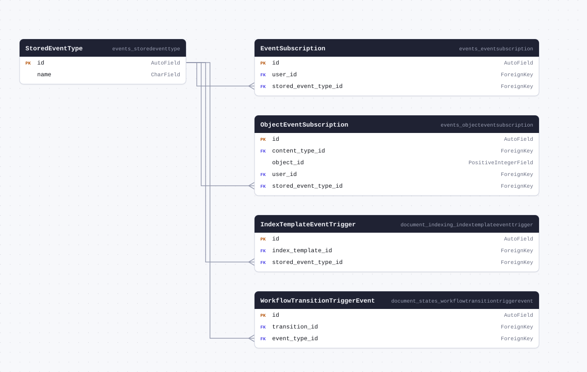

| Column | Field | Type | Null | Key | Default | Description |
| --- | --- | --- | --- | --- | --- | --- |
| `id` | `AutoField` | `integer` |  | PK | `autoincrement()` |  |
| `name` | `CharField` | `varchar(64)` |  | unique |  |  |

Relations:

- [EventSubscription](#eventsubscription).`stored_event_type_id` → `id`, on delete cascade
- [ObjectEventSubscription](#objecteventsubscription).`stored_event_type_id` → `id`, on delete cascade
- [IndexTemplateEventTrigger](#indextemplateeventtrigger).`stored_event_type_id` → `id`, on delete cascade
- [WorkflowTransitionTriggerEvent](#workflowtransitiontriggerevent).`event_type_id` → `id`, on delete cascade

## EventSubscription

Table `events_eventsubscription`, app `events`.

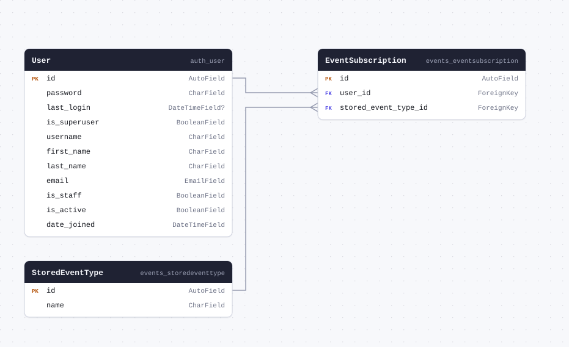

| Column | Field | Type | Null | Key | Default | Description |
| --- | --- | --- | --- | --- | --- | --- |
| `id` | `AutoField` | `integer` |  | PK | `autoincrement()` |  |
| `user_id` | `ForeignKey` | `integer` |  | FK |  |  |
| `stored_event_type_id` | `ForeignKey` | `integer` |  | FK |  |  |

Indexes:

- index `events_eventsubscription_user_id_9394816f` on `user_id`
- index `events_eventsubscription_stored_event_type_id_ba59355c` on `stored_event_type_id`

Relations:

- `user_id` → [User](#user).`id`, on delete cascade
- `stored_event_type_id` → [StoredEventType](#storedeventtype).`id`, on delete cascade

## Notification

Table `events_notification`, app `events`.

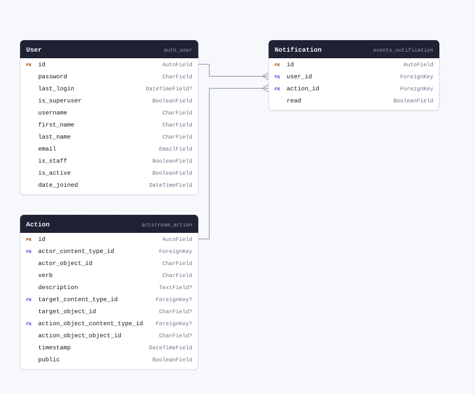

| Column | Field | Type | Null | Key | Default | Description |
| --- | --- | --- | --- | --- | --- | --- |
| `id` | `AutoField` | `integer` |  | PK | `autoincrement()` |  |
| `user_id` | `ForeignKey` | `integer` |  | FK |  |  |
| `action_id` | `ForeignKey` | `integer` |  | FK |  |  |
| `read` | `BooleanField` | `bool` |  |  | `False` |  |

Indexes:

- index `events_notification_user_id_4644c4f1` on `user_id`
- index `events_notification_action_id_d4f1ce8c` on `action_id`

Relations:

- `user_id` → [User](#user).`id`, on delete cascade
- `action_id` → [Action](#action).`id`, on delete cascade

## ObjectEventSubscription

Table `events_objecteventsubscription`, app `events`.

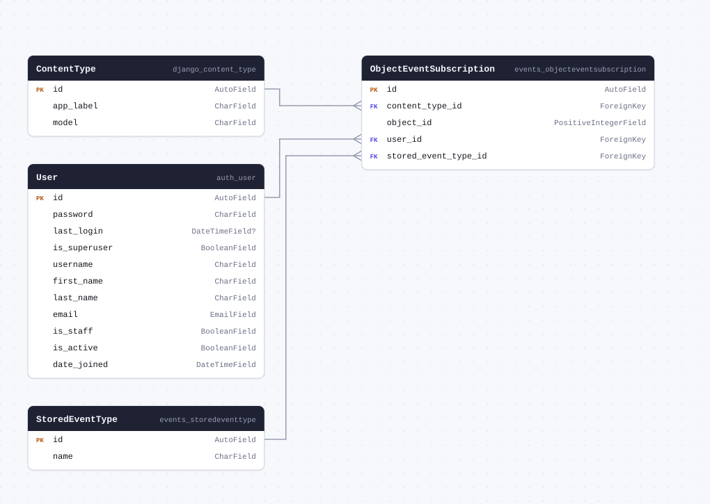

| Column | Field | Type | Null | Key | Default | Description |
| --- | --- | --- | --- | --- | --- | --- |
| `id` | `AutoField` | `integer` |  | PK | `autoincrement()` |  |
| `content_type_id` | `ForeignKey` | `integer` |  | FK |  |  |
| `object_id` | `PositiveIntegerField` | `integer unsigned` |  |  |  |  |
| `user_id` | `ForeignKey` | `integer` |  | FK |  |  |
| `stored_event_type_id` | `ForeignKey` | `integer` |  | FK |  |  |

Indexes:

- index `events_objecteventsubscription_content_type_id_4f27d971` on `content_type_id`
- index `events_objecteventsubscription_user_id_87c8d5cc` on `user_id`
- index `events_objecteventsubscription_stored_event_type_id_a545d6e2` on `stored_event_type_id`

Relations:

- `content_object` → any model, by `content_type_id` + `object_id` (generic foreign key)
- `content_type_id` → [ContentType](#contenttype).`id`, on delete cascade
- `user_id` → [User](#user).`id`, on delete cascade
- `stored_event_type_id` → [StoredEventType](#storedeventtype).`id`, on delete cascade

## UserSetting

Table `appearance_usersetting`, app `appearance`.

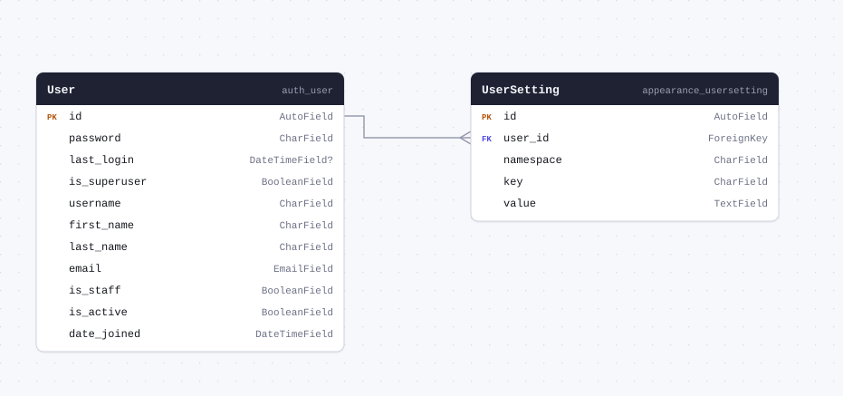

| Column | Field | Type | Null | Key | Default | Description |
| --- | --- | --- | --- | --- | --- | --- |
| `id` | `AutoField` | `integer` |  | PK | `autoincrement()` |  |
| `user_id` | `ForeignKey` | `integer` |  | FK |  |  |
| `namespace` | `CharField` | `varchar(64)` |  |  |  | Axis or frontend that owns this setting. |
| `key` | `CharField` | `varchar(64)` |  |  |  |  |
| `value` | `TextField` | `text` |  |  |  |  |

Indexes:

- index `appearance_usersetting_user_id_a5b51332` on `user_id`
- index `appearance_usersetting_namespace_b2ac44d1` on `namespace`
- index `appearance_usersetting_key_18a101fa` on `key`
- unique `appearance_usersetting_user_id_namespace_key_628aab5d_uniq` on `user_id`, `namespace`, `key`

Relations:

- `user_id` → [User](#user).`id`, on delete cascade

## Permission

Table `auth_permission`, app `auth`.

The permissions system provides a way to assign permissions to specific
users and groups of users.

The permission system is used by the Django admin site, but may also be
useful in your own code. The Django admin site uses permissions as follows:

    - The "add" permission limits the user's ability to view the "add" form
      and add an object.
    - The "change" permission limits a user's ability to view the change
      list, view the "change" form and change an object.
    - The "delete" permission limits the ability to delete an object.
    - The "view" permission limits the ability to view an object.

Permissions are set globally per type of object, not per specific object
instance. It is possible to say "Mary may change news stories," but it's
not currently possible to say "Mary may change news stories, but only the
ones she created herself" or "Mary may only change news stories that have a
certain status or publication date."

The permissions listed above are automatically created for each model.


| Column | Field | Type | Null | Key | Default | Description |
| --- | --- | --- | --- | --- | --- | --- |
| `id` | `AutoField` | `integer` |  | PK | `autoincrement()` |  |
| `name` | `CharField` | `varchar(255)` |  |  |  |  |
| `content_type_id` | `ForeignKey` | `integer` |  | FK |  |  |
| `codename` | `CharField` | `varchar(100)` |  |  |  |  |

Indexes:

- index `auth_permission_content_type_id_2f476e4b` on `content_type_id`
- unique `auth_permission_content_type_id_codename_01ab375a_uniq` on `content_type_id`, `codename`

Relations:

- `content_type_id` → [ContentType](#contenttype).`id`, on delete cascade
- `group_set` — many to many with [Group](#group)
- `user_set` — many to many with [User](#user)

## Group

Table `auth_group`, app `auth`.

Groups are a generic way of categorizing users to apply permissions, or
some other label, to those users. A user can belong to any number of
groups.

A user in a group automatically has all the permissions granted to that
group. For example, if the group 'Site editors' has the permission
can_edit_home_page, any user in that group will have that permission.

Beyond permissions, groups are a convenient way to categorize users to
apply some label, or extended functionality, to them. For example, you
could create a group 'Special users', and you could write code that would
do special things to those users -- such as giving them access to a
members-only portion of your site, or sending them members-only email
messages.

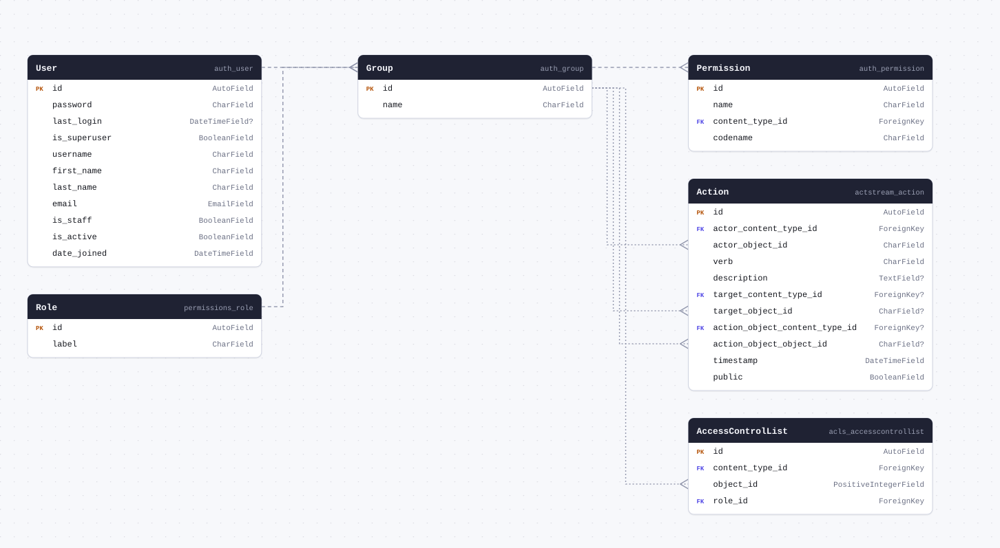

| Column | Field | Type | Null | Key | Default | Description |
| --- | --- | --- | --- | --- | --- | --- |
| `id` | `AutoField` | `integer` |  | PK | `autoincrement()` |  |
| `name` | `CharField` | `varchar(150)` |  | unique |  |  |

Relations:

- `permissions` — many to many with [Permission](#permission)
- `actor_actions` ← [Action](#action), by `actor_content_type_id` + `actor_object_id` (generic relation)
- `target_actions` ← [Action](#action), by `target_content_type_id` + `target_object_id` (generic relation)
- `action_object_actions` ← [Action](#action), by `action_object_content_type_id` + `action_object_object_id` (generic relation)
- `acls` ← [AccessControlList](#accesscontrollist), by `content_type_id` + `object_id` (generic relation)
- `user_set` — many to many with [User](#user)
- `roles` — many to many with [Role](#role)

## User

Table `auth_user`, app `auth`.

Columns from `AbstractUser` (abstract): `username`, `first_name`, `last_name`, `email`, `is_staff`, `is_active`, `date_joined`.

Columns from `AbstractBaseUser` (abstract): `password`, `last_login`.

Columns from `PermissionsMixin` (abstract): `is_superuser`.

Users within the Django authentication system are represented by this
model.

Username and password are required. Other fields are optional.

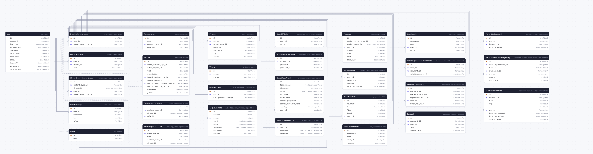

| Column | Field | Type | Null | Key | Default | Description |
| --- | --- | --- | --- | --- | --- | --- |
| `id` | `AutoField` | `integer` |  | PK | `autoincrement()` |  |
| `password` | `CharField` | `varchar(128)` |  |  |  |  |
| `last_login` | `DateTimeField` | `datetime` | yes |  |  |  |
| `is_superuser` | `BooleanField` | `bool` |  |  | `False` | Designates that this user has all permissions without explicitly assigning them. |
| `username` | `CharField` | `varchar(150)` |  | unique |  | Required. 150 characters or fewer. Letters, digits and @/./+/-/_ only. |
| `first_name` | `CharField` | `varchar(150)` |  |  |  | The given name of the user. |
| `last_name` | `CharField` | `varchar(150)` |  |  |  | The family name of the user. |
| `email` | `EmailField` | `varchar(254)` |  |  |  |  |
| `is_staff` | `BooleanField` | `bool` |  |  | `False` | Designates whether the user can log into this admin site. |
| `is_active` | `BooleanField` | `bool` |  |  | `True` | Designates whether this user should be treated as active. Unselect this instead of deleting accounts. |
| `date_joined` | `DateTimeField` | `datetime` |  |  | `now()` |  |

Relations:

- [EventSubscription](#eventsubscription).`user_id` → `id`, on delete cascade
- [Notification](#notification).`user_id` → `id`, on delete cascade
- [ObjectEventSubscription](#objecteventsubscription).`user_id` → `id`, on delete cascade
- [UserSetting](#usersetting).`user_id` → `id`, on delete cascade
- `groups` — many to many with [Group](#group)
- `user_permissions` — many to many with [Permission](#permission)
- `actor_actions` ← [Action](#action), by `actor_content_type_id` + `actor_object_id` (generic relation)
- `target_actions` ← [Action](#action), by `target_content_type_id` + `target_object_id` (generic relation)
- `action_object_actions` ← [Action](#action), by `action_object_content_type_id` + `action_object_object_id` (generic relation)
- `acls` ← [AccessControlList](#accesscontrollist), by `content_type_id` + `object_id` (generic relation)
- `error_log_partitions` ← [ErrorLogPartition](#errorlogpartition), by `content_type_id` + `object_id` (generic relation)
- [Follow](#follow).`user_id` → `id`, on delete cascade
- [Token](#token).`user_id` → `id`, on delete cascade
- [UserOptions](#useroptions).`user_id` → `id`, on delete cascade
- [LoginAttempt](#loginattempt).`user_id` → `id`, on delete set null
- [UserOTPData](#userotpdata).`user_id` → `id`, on delete cascade
- [AutoAdminSingleton](#autoadminsingleton).`account_id` → `id`, on delete cascade
- [SavedResultset](#savedresultset).`user_id` → `id`, on delete cascade
- [UserLocaleProfile](#userlocaleprofile).`user_id` → `id`, on delete cascade
- [Message](#message).`user_id` → `id`, on delete cascade
- [StreamEvent](#streamevent).`user_id` → `id`, on delete cascade
- [DownloadFile](#downloadfile).`user_id` → `id`, on delete cascade
- [UserConfirmView](#userconfirmview).`user_id` → `id`, on delete cascade
- [UserViewMode](#userviewmode).`user_id` → `id`, on delete cascade
- [RecentlyAccessedDocument](#recentlyaccesseddocument).`user_id` → `id`, on delete cascade
- [DocumentCheckout](#documentcheckout).`user_id` → `id`, on delete cascade
- [Comment](#comment).`user_id` → `id`, on delete cascade
- [FavoriteDocument](#favoritedocument).`user_id` → `id`, on delete cascade
- [WorkflowInstanceLogEntry](#workflowinstancelogentry).`user_id` → `id`, on delete cascade
- [SignatureCapture](#signaturecapture).`user_id` → `id`, on delete cascade

## ContentType

Table `django_content_type`, app `contenttypes`.

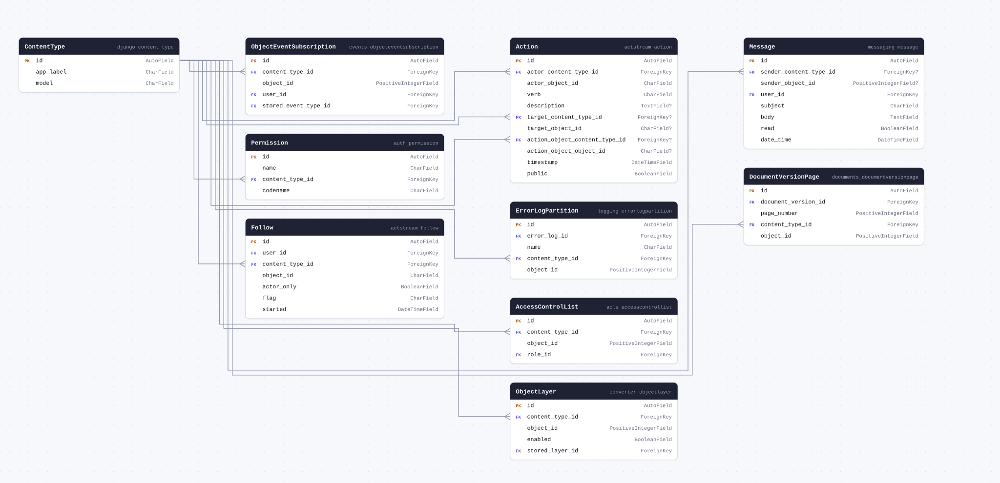

| Column | Field | Type | Null | Key | Default | Description |
| --- | --- | --- | --- | --- | --- | --- |
| `id` | `AutoField` | `integer` |  | PK | `autoincrement()` |  |
| `app_label` | `CharField` | `varchar(100)` |  |  |  |  |
| `model` | `CharField` | `varchar(100)` |  |  |  |  |

Indexes:

- unique `django_content_type_app_label_model_76bd3d3b_uniq` on `app_label`, `model`

Relations:

- [ObjectEventSubscription](#objecteventsubscription).`content_type_id` → `id`, on delete cascade
- [Permission](#permission).`content_type_id` → `id`, on delete cascade
- [Follow](#follow).`content_type_id` → `id`, on delete cascade
- [Action](#action).`actor_content_type_id` → `id`, on delete cascade
- [Action](#action).`target_content_type_id` → `id`, on delete cascade
- [Action](#action).`action_object_content_type_id` → `id`, on delete cascade
- [ErrorLogPartition](#errorlogpartition).`content_type_id` → `id`, on delete cascade
- [AccessControlList](#accesscontrollist).`content_type_id` → `id`, on delete cascade
- [ObjectLayer](#objectlayer).`content_type_id` → `id`, on delete cascade
- [Message](#message).`sender_content_type_id` → `id`, on delete cascade
- [DocumentVersionPage](#documentversionpage).`content_type_id` → `id`, on delete cascade

## Session

Table `django_session`, app `sessions`.

Columns from `AbstractBaseSession` (abstract): `session_key`, `session_data`, `expire_date`.

Django provides full support for anonymous sessions. The session
framework lets you store and retrieve arbitrary data on a
per-site-visitor basis. It stores data on the server side and
abstracts the sending and receiving of cookies. Cookies contain a
session ID -- not the data itself.

The Django sessions framework is entirely cookie-based. It does
not fall back to putting session IDs in URLs. This is an intentional
design decision. Not only does that behavior make URLs ugly, it makes
your site vulnerable to session-ID theft via the "Referer" header.

For complete documentation on using Sessions in your code, consult
the sessions documentation that is shipped with Django (also available
on the Django web site).

| Column | Field | Type | Null | Key | Default | Description |
| --- | --- | --- | --- | --- | --- | --- |
| `session_key` | `CharField` | `varchar(40)` |  | PK |  |  |
| `session_data` | `TextField` | `text` |  |  |  |  |
| `expire_date` | `DateTimeField` | `datetime` |  |  |  |  |

Indexes:

- index `django_session_expire_date_a5c62663` on `expire_date`

## Follow

Table `actstream_follow`, app `actstream`.

Lets a user follow the activities of any specific actor

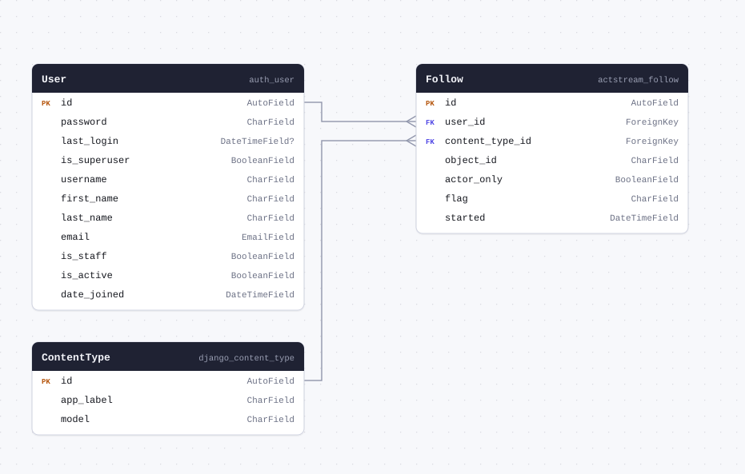

| Column | Field | Type | Null | Key | Default | Description |
| --- | --- | --- | --- | --- | --- | --- |
| `id` | `AutoField` | `integer` |  | PK | `autoincrement()` |  |
| `user_id` | `ForeignKey` | `integer` |  | FK |  |  |
| `content_type_id` | `ForeignKey` | `integer` |  | FK |  |  |
| `object_id` | `CharField` | `varchar(255)` |  |  |  |  |
| `actor_only` | `BooleanField` | `bool` |  |  | `True` |  |
| `flag` | `CharField` | `varchar(255)` |  |  | `''` |  |
| `started` | `DateTimeField` | `datetime` |  |  | `now()` |  |

Indexes:

- index `actstream_follow_user_id_e9d4e1ff` on `user_id`
- index `actstream_follow_content_type_id_ba287eb9` on `content_type_id`
- index `actstream_follow_object_id_d790e00d` on `object_id`
- index `actstream_follow_flag_0e741c24` on `flag`
- index `actstream_follow_started_254c63bd` on `started`
- unique `actstream_follow_user_id_content_type_id_object_id_flag_b3632d76_uniq` on `user_id`, `content_type_id`, `object_id`, `flag`

Relations:

- `follow_object` → any model, by `content_type_id` + `object_id` (generic foreign key)
- `user_id` → [User](#user).`id`, on delete cascade
- `content_type_id` → [ContentType](#contenttype).`id`, on delete cascade

## Action

Table `actstream_action`, app `actstream`.

Action model describing the actor acting out a verb (on an optional
target).
Nomenclature based on http://activitystrea.ms/specs/atom/1.0/

Generalized Format::

    <actor> <verb> <time>
    <actor> <verb> <target> <time>
    <actor> <verb> <action_object> <target> <time>

Examples::

    <justquick> <reached level 60> <1 minute ago>
    <brosner> <commented on> <pinax/pinax> <2 hours ago>
    <washingtontimes> <started follow> <justquick> <8 minutes ago>
    <mitsuhiko> <closed> <issue 70> on <mitsuhiko/flask> <about 2 hours ago>

Unicode Representation::

    justquick reached level 60 1 minute ago
    mitsuhiko closed issue 70 on mitsuhiko/flask 3 hours ago

HTML Representation::

    <a href="http://oebfare.com/">brosner</a> commented on <a href="http://github.com/pinax/pinax">pinax/pinax</a> 2 hours ago

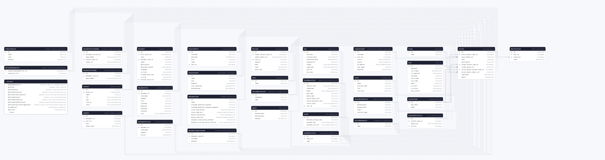

| Column | Field | Type | Null | Key | Default | Description |
| --- | --- | --- | --- | --- | --- | --- |
| `id` | `AutoField` | `integer` |  | PK | `autoincrement()` |  |
| `actor_content_type_id` | `ForeignKey` | `integer` |  | FK |  |  |
| `actor_object_id` | `CharField` | `varchar(255)` |  |  |  |  |
| `verb` | `CharField` | `varchar(255)` |  |  |  |  |
| `description` | `TextField` | `text` | yes |  |  |  |
| `target_content_type_id` | `ForeignKey` | `integer` | yes | FK |  |  |
| `target_object_id` | `CharField` | `varchar(255)` | yes |  |  |  |
| `action_object_content_type_id` | `ForeignKey` | `integer` | yes | FK |  |  |
| `action_object_object_id` | `CharField` | `varchar(255)` | yes |  |  |  |
| `timestamp` | `DateTimeField` | `datetime` |  |  | `now()` |  |
| `public` | `BooleanField` | `bool` |  |  | `True` |  |

Indexes:

- index `actstream_action_actor_content_type_id_d5e5ec2a` on `actor_content_type_id`
- index `actstream_action_actor_object_id_72ef0cfa` on `actor_object_id`
- index `actstream_action_verb_83f768b7` on `verb`
- index `actstream_action_target_content_type_id_187fa164` on `target_content_type_id`
- index `actstream_action_target_object_id_e080d801` on `target_object_id`
- index `actstream_action_action_object_content_type_id_ee623c15` on `action_object_content_type_id`
- index `actstream_action_action_object_object_id_6433bdf7` on `action_object_object_id`
- index `actstream_action_timestamp_a23fe3ae` on `timestamp`
- index `actstream_action_public_ac0653e9` on `public`

Relations:

- `actor` → any model, by `actor_content_type_id` + `actor_object_id` (generic foreign key)
- `target` → any model, by `target_content_type_id` + `target_object_id` (generic foreign key)
- `action_object` → any model, by `action_object_content_type_id` + `action_object_object_id` (generic foreign key)
- [Notification](#notification).`action_id` → `id`, on delete cascade
- `actor_object_id` → [Group](#group).`id` where `actor_content_type_id` is Group (generic, `Group.actor_actions`)
- `target_object_id` → [Group](#group).`id` where `target_content_type_id` is Group (generic, `Group.target_actions`)
- `action_object_object_id` → [Group](#group).`id` where `action_object_content_type_id` is Group (generic, `Group.action_object_actions`)
- `actor_object_id` → [User](#user).`id` where `actor_content_type_id` is User (generic, `User.actor_actions`)
- `target_object_id` → [User](#user).`id` where `target_content_type_id` is User (generic, `User.target_actions`)
- `action_object_object_id` → [User](#user).`id` where `action_object_content_type_id` is User (generic, `User.action_object_actions`)
- `actor_content_type_id` → [ContentType](#contenttype).`id`, on delete cascade
- `target_content_type_id` → [ContentType](#contenttype).`id`, on delete cascade
- `action_object_content_type_id` → [ContentType](#contenttype).`id`, on delete cascade
- `actor_object_id` → [AccessControlList](#accesscontrollist).`id` where `actor_content_type_id` is AccessControlList (generic, `AccessControlList.actor_actions`)
- `target_object_id` → [AccessControlList](#accesscontrollist).`id` where `target_content_type_id` is AccessControlList (generic, `AccessControlList.target_actions`)
- `action_object_object_id` → [AccessControlList](#accesscontrollist).`id` where `action_object_content_type_id` is AccessControlList (generic, `AccessControlList.action_object_actions`)
- `actor_object_id` → [LoginAttempt](#loginattempt).`id` where `actor_content_type_id` is LoginAttempt (generic, `LoginAttempt.actor_actions`)
- `target_object_id` → [LoginAttempt](#loginattempt).`id` where `target_content_type_id` is LoginAttempt (generic, `LoginAttempt.target_actions`)
- `action_object_object_id` → [LoginAttempt](#loginattempt).`id` where `action_object_content_type_id` is LoginAttempt (generic, `LoginAttempt.action_object_actions`)
- `actor_object_id` → [Asset](#asset).`id` where `actor_content_type_id` is Asset (generic, `Asset.actor_actions`)
- `target_object_id` → [Asset](#asset).`id` where `target_content_type_id` is Asset (generic, `Asset.target_actions`)
- `action_object_object_id` → [Asset](#asset).`id` where `action_object_content_type_id` is Asset (generic, `Asset.action_object_actions`)
- `actor_object_id` → [StoredCredential](#storedcredential).`id` where `actor_content_type_id` is StoredCredential (generic, `StoredCredential.actor_actions`)
- `target_object_id` → [StoredCredential](#storedcredential).`id` where `target_content_type_id` is StoredCredential (generic, `StoredCredential.target_actions`)
- `action_object_object_id` → [StoredCredential](#storedcredential).`id` where `action_object_content_type_id` is StoredCredential (generic, `StoredCredential.action_object_actions`)
- `actor_object_id` → [StoredDashboard](#storeddashboard).`id` where `actor_content_type_id` is StoredDashboard (generic, `StoredDashboard.actor_actions`)
- `target_object_id` → [StoredDashboard](#storeddashboard).`id` where `target_content_type_id` is StoredDashboard (generic, `StoredDashboard.target_actions`)
- `action_object_object_id` → [StoredDashboard](#storeddashboard).`id` where `action_object_content_type_id` is StoredDashboard (generic, `StoredDashboard.action_object_actions`)
- `actor_object_id` → [Key](#key).`id` where `actor_content_type_id` is Key (generic, `Key.actor_actions`)
- `target_object_id` → [Key](#key).`id` where `target_content_type_id` is Key (generic, `Key.target_actions`)
- `action_object_object_id` → [Key](#key).`id` where `action_object_content_type_id` is Key (generic, `Key.action_object_actions`)
- `actor_object_id` → [SavedResultset](#savedresultset).`id` where `actor_content_type_id` is SavedResultset (generic, `SavedResultset.actor_actions`)
- `target_object_id` → [SavedResultset](#savedresultset).`id` where `target_content_type_id` is SavedResultset (generic, `SavedResultset.target_actions`)
- `action_object_object_id` → [SavedResultset](#savedresultset).`id` where `action_object_content_type_id` is SavedResultset (generic, `SavedResultset.action_object_actions`)
- `actor_object_id` → [Cache](#cache).`id` where `actor_content_type_id` is Cache (generic, `Cache.actor_actions`)
- `target_object_id` → [Cache](#cache).`id` where `target_content_type_id` is Cache (generic, `Cache.target_actions`)
- `action_object_object_id` → [Cache](#cache).`id` where `action_object_content_type_id` is Cache (generic, `Cache.action_object_actions`)
- `actor_object_id` → [CachePartition](#cachepartition).`id` where `actor_content_type_id` is CachePartition (generic, `CachePartition.actor_actions`)
- `target_object_id` → [CachePartition](#cachepartition).`id` where `target_content_type_id` is CachePartition (generic, `CachePartition.target_actions`)
- `action_object_object_id` → [CachePartition](#cachepartition).`id` where `action_object_content_type_id` is CachePartition (generic, `CachePartition.action_object_actions`)
- `actor_object_id` → [Message](#message).`id` where `actor_content_type_id` is Message (generic, `Message.actor_actions`)
- `target_object_id` → [Message](#message).`id` where `target_content_type_id` is Message (generic, `Message.target_actions`)
- `action_object_object_id` → [Message](#message).`id` where `action_object_content_type_id` is Message (generic, `Message.action_object_actions`)
- `actor_object_id` → [Role](#role).`id` where `actor_content_type_id` is Role (generic, `Role.actor_actions`)
- `target_object_id` → [Role](#role).`id` where `target_content_type_id` is Role (generic, `Role.target_actions`)
- `action_object_object_id` → [Role](#role).`id` where `action_object_content_type_id` is Role (generic, `Role.action_object_actions`)
- `actor_object_id` → [StoredPermission](#storedpermission).`id` where `actor_content_type_id` is StoredPermission (generic, `StoredPermission.actor_actions`)
- `target_object_id` → [StoredPermission](#storedpermission).`id` where `target_content_type_id` is StoredPermission (generic, `StoredPermission.target_actions`)
- `action_object_object_id` → [StoredPermission](#storedpermission).`id` where `action_object_content_type_id` is StoredPermission (generic, `StoredPermission.action_object_actions`)
- `actor_object_id` → [Quota](#quota).`id` where `actor_content_type_id` is Quota (generic, `Quota.actor_actions`)
- `target_object_id` → [Quota](#quota).`id` where `target_content_type_id` is Quota (generic, `Quota.target_actions`)
- `action_object_object_id` → [Quota](#quota).`id` where `action_object_content_type_id` is Quota (generic, `Quota.action_object_actions`)
- `actor_object_id` → [DownloadFile](#downloadfile).`id` where `actor_content_type_id` is DownloadFile (generic, `DownloadFile.actor_actions`)
- `target_object_id` → [DownloadFile](#downloadfile).`id` where `target_content_type_id` is DownloadFile (generic, `DownloadFile.target_actions`)
- `action_object_object_id` → [DownloadFile](#downloadfile).`id` where `action_object_content_type_id` is DownloadFile (generic, `DownloadFile.action_object_actions`)
- `actor_object_id` → [Announcement](#announcement).`id` where `actor_content_type_id` is Announcement (generic, `Announcement.actor_actions`)
- `target_object_id` → [Announcement](#announcement).`id` where `target_content_type_id` is Announcement (generic, `Announcement.target_actions`)
- `action_object_object_id` → [Announcement](#announcement).`id` where `action_object_content_type_id` is Announcement (generic, `Announcement.action_object_actions`)
- `actor_object_id` → [DocumentType](#documenttype).`id` where `actor_content_type_id` is DocumentType (generic, `DocumentType.actor_actions`)
- `target_object_id` → [DocumentType](#documenttype).`id` where `target_content_type_id` is DocumentType (generic, `DocumentType.target_actions`)
- `action_object_object_id` → [DocumentType](#documenttype).`id` where `action_object_content_type_id` is DocumentType (generic, `DocumentType.action_object_actions`)
- `actor_object_id` → [DocumentTypeFilename](#documenttypefilename).`id` where `actor_content_type_id` is DocumentTypeFilename (generic, `DocumentTypeFilename.actor_actions`)
- `target_object_id` → [DocumentTypeFilename](#documenttypefilename).`id` where `target_content_type_id` is DocumentTypeFilename (generic, `DocumentTypeFilename.target_actions`)
- `action_object_object_id` → [DocumentTypeFilename](#documenttypefilename).`id` where `action_object_content_type_id` is DocumentTypeFilename (generic, `DocumentTypeFilename.action_object_actions`)
- `actor_object_id` → [Document](#document).`id` where `actor_content_type_id` is Document (generic, `Document.actor_actions`)
- `target_object_id` → [Document](#document).`id` where `target_content_type_id` is Document (generic, `Document.target_actions`)
- `action_object_object_id` → [Document](#document).`id` where `action_object_content_type_id` is Document (generic, `Document.action_object_actions`)
- `actor_object_id` → [DocumentFile](#documentfile).`id` where `actor_content_type_id` is DocumentFile (generic, `DocumentFile.actor_actions`)
- `target_object_id` → [DocumentFile](#documentfile).`id` where `target_content_type_id` is DocumentFile (generic, `DocumentFile.target_actions`)
- `action_object_object_id` → [DocumentFile](#documentfile).`id` where `action_object_content_type_id` is DocumentFile (generic, `DocumentFile.action_object_actions`)
- `actor_object_id` → [DocumentVersion](#documentversion).`id` where `actor_content_type_id` is DocumentVersion (generic, `DocumentVersion.actor_actions`)
- `target_object_id` → [DocumentVersion](#documentversion).`id` where `target_content_type_id` is DocumentVersion (generic, `DocumentVersion.target_actions`)
- `action_object_object_id` → [DocumentVersion](#documentversion).`id` where `action_object_content_type_id` is DocumentVersion (generic, `DocumentVersion.action_object_actions`)
- `actor_object_id` → [DocumentVersionPage](#documentversionpage).`id` where `actor_content_type_id` is DocumentVersionPage (generic, `DocumentVersionPage.actor_actions`)
- `target_object_id` → [DocumentVersionPage](#documentversionpage).`id` where `target_content_type_id` is DocumentVersionPage (generic, `DocumentVersionPage.target_actions`)
- `action_object_object_id` → [DocumentVersionPage](#documentversionpage).`id` where `action_object_content_type_id` is DocumentVersionPage (generic, `DocumentVersionPage.action_object_actions`)
- `actor_object_id` → [DocumentFilePage](#documentfilepage).`id` where `actor_content_type_id` is DocumentFilePage (generic, `DocumentFilePage.actor_actions`)
- `target_object_id` → [DocumentFilePage](#documentfilepage).`id` where `target_content_type_id` is DocumentFilePage (generic, `DocumentFilePage.target_actions`)
- `action_object_object_id` → [DocumentFilePage](#documentfilepage).`id` where `action_object_content_type_id` is DocumentFilePage (generic, `DocumentFilePage.action_object_actions`)
- `actor_object_id` → [Cabinet](#cabinet).`id` where `actor_content_type_id` is Cabinet (generic, `Cabinet.actor_actions`)
- `target_object_id` → [Cabinet](#cabinet).`id` where `target_content_type_id` is Cabinet (generic, `Cabinet.target_actions`)
- `action_object_object_id` → [Cabinet](#cabinet).`id` where `action_object_content_type_id` is Cabinet (generic, `Cabinet.action_object_actions`)
- `actor_object_id` → [Comment](#comment).`id` where `actor_content_type_id` is Comment (generic, `Comment.actor_actions`)
- `target_object_id` → [Comment](#comment).`id` where `target_content_type_id` is Comment (generic, `Comment.target_actions`)
- `action_object_object_id` → [Comment](#comment).`id` where `action_object_content_type_id` is Comment (generic, `Comment.action_object_actions`)
- `actor_object_id` → [IndexTemplate](#indextemplate).`id` where `actor_content_type_id` is IndexTemplate (generic, `IndexTemplate.actor_actions`)
- `target_object_id` → [IndexTemplate](#indextemplate).`id` where `target_content_type_id` is IndexTemplate (generic, `IndexTemplate.target_actions`)
- `action_object_object_id` → [IndexTemplate](#indextemplate).`id` where `action_object_content_type_id` is IndexTemplate (generic, `IndexTemplate.action_object_actions`)
- `actor_object_id` → [DetachedSignature](#detachedsignature).`signaturebasemodel_ptr_id` where `actor_content_type_id` is DetachedSignature (generic, `DetachedSignature.actor_actions`)
- `target_object_id` → [DetachedSignature](#detachedsignature).`signaturebasemodel_ptr_id` where `target_content_type_id` is DetachedSignature (generic, `DetachedSignature.target_actions`)
- `action_object_object_id` → [DetachedSignature](#detachedsignature).`signaturebasemodel_ptr_id` where `action_object_content_type_id` is DetachedSignature (generic, `DetachedSignature.action_object_actions`)
- `actor_object_id` → [EmbeddedSignature](#embeddedsignature).`signaturebasemodel_ptr_id` where `actor_content_type_id` is EmbeddedSignature (generic, `EmbeddedSignature.actor_actions`)
- `target_object_id` → [EmbeddedSignature](#embeddedsignature).`signaturebasemodel_ptr_id` where `target_content_type_id` is EmbeddedSignature (generic, `EmbeddedSignature.target_actions`)
- `action_object_object_id` → [EmbeddedSignature](#embeddedsignature).`signaturebasemodel_ptr_id` where `action_object_content_type_id` is EmbeddedSignature (generic, `EmbeddedSignature.action_object_actions`)
- `actor_object_id` → [Workflow](#workflow).`id` where `actor_content_type_id` is Workflow (generic, `Workflow.actor_actions`)
- `target_object_id` → [Workflow](#workflow).`id` where `target_content_type_id` is Workflow (generic, `Workflow.target_actions`)
- `action_object_object_id` → [Workflow](#workflow).`id` where `action_object_content_type_id` is Workflow (generic, `Workflow.action_object_actions`)
- `actor_object_id` → [WorkflowState](#workflowstate).`id` where `actor_content_type_id` is WorkflowState (generic, `WorkflowState.actor_actions`)
- `target_object_id` → [WorkflowState](#workflowstate).`id` where `target_content_type_id` is WorkflowState (generic, `WorkflowState.target_actions`)
- `action_object_object_id` → [WorkflowState](#workflowstate).`id` where `action_object_content_type_id` is WorkflowState (generic, `WorkflowState.action_object_actions`)
- `actor_object_id` → [WorkflowTransition](#workflowtransition).`id` where `actor_content_type_id` is WorkflowTransition (generic, `WorkflowTransition.actor_actions`)
- `target_object_id` → [WorkflowTransition](#workflowtransition).`id` where `target_content_type_id` is WorkflowTransition (generic, `WorkflowTransition.target_actions`)
- `action_object_object_id` → [WorkflowTransition](#workflowtransition).`id` where `action_object_content_type_id` is WorkflowTransition (generic, `WorkflowTransition.action_object_actions`)
- `actor_object_id` → [WorkflowTransitionField](#workflowtransitionfield).`id` where `actor_content_type_id` is WorkflowTransitionField (generic, `WorkflowTransitionField.actor_actions`)
- `target_object_id` → [WorkflowTransitionField](#workflowtransitionfield).`id` where `target_content_type_id` is WorkflowTransitionField (generic, `WorkflowTransitionField.target_actions`)
- `action_object_object_id` → [WorkflowTransitionField](#workflowtransitionfield).`id` where `action_object_content_type_id` is WorkflowTransitionField (generic, `WorkflowTransitionField.action_object_actions`)
- `actor_object_id` → [WorkflowInstance](#workflowinstance).`id` where `actor_content_type_id` is WorkflowInstance (generic, `WorkflowInstance.actor_actions`)
- `target_object_id` → [WorkflowInstance](#workflowinstance).`id` where `target_content_type_id` is WorkflowInstance (generic, `WorkflowInstance.target_actions`)
- `action_object_object_id` → [WorkflowInstance](#workflowinstance).`id` where `action_object_content_type_id` is WorkflowInstance (generic, `WorkflowInstance.action_object_actions`)
- `actor_object_id` → [WorkflowStateAction](#workflowstateaction).`id` where `actor_content_type_id` is WorkflowStateAction (generic, `WorkflowStateAction.actor_actions`)
- `target_object_id` → [WorkflowStateAction](#workflowstateaction).`id` where `target_content_type_id` is WorkflowStateAction (generic, `WorkflowStateAction.target_actions`)
- `action_object_object_id` → [WorkflowStateAction](#workflowstateaction).`id` where `action_object_content_type_id` is WorkflowStateAction (generic, `WorkflowStateAction.action_object_actions`)
- `actor_object_id` → [WorkflowStateEscalation](#workflowstateescalation).`id` where `actor_content_type_id` is WorkflowStateEscalation (generic, `WorkflowStateEscalation.actor_actions`)
- `target_object_id` → [WorkflowStateEscalation](#workflowstateescalation).`id` where `target_content_type_id` is WorkflowStateEscalation (generic, `WorkflowStateEscalation.target_actions`)
- `action_object_object_id` → [WorkflowStateEscalation](#workflowstateescalation).`id` where `action_object_content_type_id` is WorkflowStateEscalation (generic, `WorkflowStateEscalation.action_object_actions`)
- `actor_object_id` → [WorkflowTransitionTriggerEvent](#workflowtransitiontriggerevent).`id` where `actor_content_type_id` is WorkflowTransitionTriggerEvent (generic, `WorkflowTransitionTriggerEvent.actor_actions`)
- `target_object_id` → [WorkflowTransitionTriggerEvent](#workflowtransitiontriggerevent).`id` where `target_content_type_id` is WorkflowTransitionTriggerEvent (generic, `WorkflowTransitionTriggerEvent.target_actions`)
- `action_object_object_id` → [WorkflowTransitionTriggerEvent](#workflowtransitiontriggerevent).`id` where `action_object_content_type_id` is WorkflowTransitionTriggerEvent (generic, `WorkflowTransitionTriggerEvent.action_object_actions`)
- `actor_object_id` → [StoredDriver](#storeddriver).`id` where `actor_content_type_id` is StoredDriver (generic, `StoredDriver.actor_actions`)
- `target_object_id` → [StoredDriver](#storeddriver).`id` where `target_content_type_id` is StoredDriver (generic, `StoredDriver.target_actions`)
- `action_object_object_id` → [StoredDriver](#storeddriver).`id` where `action_object_content_type_id` is StoredDriver (generic, `StoredDriver.action_object_actions`)
- `actor_object_id` → [SmartLink](#smartlink).`id` where `actor_content_type_id` is SmartLink (generic, `SmartLink.actor_actions`)
- `target_object_id` → [SmartLink](#smartlink).`id` where `target_content_type_id` is SmartLink (generic, `SmartLink.target_actions`)
- `action_object_object_id` → [SmartLink](#smartlink).`id` where `action_object_content_type_id` is SmartLink (generic, `SmartLink.action_object_actions`)
- `actor_object_id` → [SmartLinkCondition](#smartlinkcondition).`id` where `actor_content_type_id` is SmartLinkCondition (generic, `SmartLinkCondition.actor_actions`)
- `target_object_id` → [SmartLinkCondition](#smartlinkcondition).`id` where `target_content_type_id` is SmartLinkCondition (generic, `SmartLinkCondition.target_actions`)
- `action_object_object_id` → [SmartLinkCondition](#smartlinkcondition).`id` where `action_object_content_type_id` is SmartLinkCondition (generic, `SmartLinkCondition.action_object_actions`)
- `actor_object_id` → [UserMailer](#usermailer).`id` where `actor_content_type_id` is UserMailer (generic, `UserMailer.actor_actions`)
- `target_object_id` → [UserMailer](#usermailer).`id` where `target_content_type_id` is UserMailer (generic, `UserMailer.target_actions`)
- `action_object_object_id` → [UserMailer](#usermailer).`id` where `action_object_content_type_id` is UserMailer (generic, `UserMailer.action_object_actions`)
- `actor_object_id` → [MetadataType](#metadatatype).`id` where `actor_content_type_id` is MetadataType (generic, `MetadataType.actor_actions`)
- `target_object_id` → [MetadataType](#metadatatype).`id` where `target_content_type_id` is MetadataType (generic, `MetadataType.target_actions`)
- `action_object_object_id` → [MetadataType](#metadatatype).`id` where `action_object_content_type_id` is MetadataType (generic, `MetadataType.action_object_actions`)
- `actor_object_id` → [DocumentTypeMetadataType](#documenttypemetadatatype).`id` where `actor_content_type_id` is DocumentTypeMetadataType (generic, `DocumentTypeMetadataType.actor_actions`)
- `target_object_id` → [DocumentTypeMetadataType](#documenttypemetadatatype).`id` where `target_content_type_id` is DocumentTypeMetadataType (generic, `DocumentTypeMetadataType.target_actions`)
- `action_object_object_id` → [DocumentTypeMetadataType](#documenttypemetadatatype).`id` where `action_object_content_type_id` is DocumentTypeMetadataType (generic, `DocumentTypeMetadataType.action_object_actions`)
- `actor_object_id` → [Sequence](#sequence).`id` where `actor_content_type_id` is Sequence (generic, `Sequence.actor_actions`)
- `target_object_id` → [Sequence](#sequence).`id` where `target_content_type_id` is Sequence (generic, `Sequence.target_actions`)
- `action_object_object_id` → [Sequence](#sequence).`id` where `action_object_content_type_id` is Sequence (generic, `Sequence.action_object_actions`)
- `actor_object_id` → [SignatureCapture](#signaturecapture).`id` where `actor_content_type_id` is SignatureCapture (generic, `SignatureCapture.actor_actions`)
- `target_object_id` → [SignatureCapture](#signaturecapture).`id` where `target_content_type_id` is SignatureCapture (generic, `SignatureCapture.target_actions`)
- `action_object_object_id` → [SignatureCapture](#signaturecapture).`id` where `action_object_content_type_id` is SignatureCapture (generic, `SignatureCapture.action_object_actions`)
- `actor_object_id` → [Source](#source).`id` where `actor_content_type_id` is Source (generic, `Source.actor_actions`)
- `target_object_id` → [Source](#source).`id` where `target_content_type_id` is Source (generic, `Source.target_actions`)
- `action_object_object_id` → [Source](#source).`id` where `action_object_content_type_id` is Source (generic, `Source.action_object_actions`)
- `actor_object_id` → [Tag](#tag).`id` where `actor_content_type_id` is Tag (generic, `Tag.actor_actions`)
- `target_object_id` → [Tag](#tag).`id` where `target_content_type_id` is Tag (generic, `Tag.target_actions`)
- `action_object_object_id` → [Tag](#tag).`id` where `action_object_content_type_id` is Tag (generic, `Tag.action_object_actions`)
- `actor_object_id` → [WebLink](#weblink).`id` where `actor_content_type_id` is WebLink (generic, `WebLink.actor_actions`)
- `target_object_id` → [WebLink](#weblink).`id` where `target_content_type_id` is WebLink (generic, `WebLink.target_actions`)
- `action_object_object_id` → [WebLink](#weblink).`id` where `action_object_content_type_id` is WebLink (generic, `WebLink.action_object_actions`)

## AccessFailureLog

Table `axes_accessfailurelog`, app `axes`.

Columns from `AccessBase` (abstract): `user_agent`, `ip_address`, `username`, `http_accept`, `path_info`, `attempt_time`.

| Column | Field | Type | Null | Key | Default | Description |
| --- | --- | --- | --- | --- | --- | --- |
| `id` | `AutoField` | `integer` |  | PK | `autoincrement()` |  |
| `user_agent` | `CharField` | `varchar(255)` |  |  |  |  |
| `ip_address` | `GenericIPAddressField` | `char(39)` | yes |  |  |  |
| `username` | `CharField` | `varchar(255)` | yes |  |  |  |
| `http_accept` | `CharField` | `varchar(1025)` |  |  |  |  |
| `path_info` | `CharField` | `varchar(255)` |  |  |  |  |
| `attempt_time` | `DateTimeField` | `datetime` |  |  | `now()` |  |
| `locked_out` | `BooleanField` | `bool` |  |  | `False` |  |

Indexes:

- index `axes_accessfailurelog_user_agent_ea145dda` on `user_agent`
- index `axes_accessfailurelog_ip_address_2e9f5a7f` on `ip_address`
- index `axes_accessfailurelog_username_a8b7e8a4` on `username`

## AccessAttempt

Table `axes_accessattempt`, app `axes`.

Columns from `AccessBase` (abstract): `user_agent`, `ip_address`, `username`, `http_accept`, `path_info`, `attempt_time`.

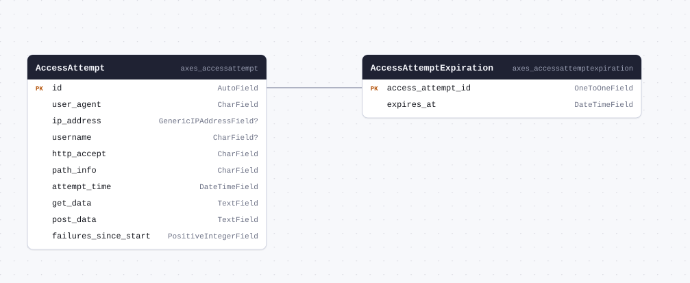

| Column | Field | Type | Null | Key | Default | Description |
| --- | --- | --- | --- | --- | --- | --- |
| `id` | `AutoField` | `integer` |  | PK | `autoincrement()` |  |
| `user_agent` | `CharField` | `varchar(255)` |  |  |  |  |
| `ip_address` | `GenericIPAddressField` | `char(39)` | yes |  |  |  |
| `username` | `CharField` | `varchar(255)` | yes |  |  |  |
| `http_accept` | `CharField` | `varchar(1025)` |  |  |  |  |
| `path_info` | `CharField` | `varchar(255)` |  |  |  |  |
| `attempt_time` | `DateTimeField` | `datetime` |  |  | `now()` |  |
| `get_data` | `TextField` | `text` |  |  |  |  |
| `post_data` | `TextField` | `text` |  |  |  |  |
| `failures_since_start` | `PositiveIntegerField` | `integer unsigned` |  |  |  |  |

Indexes:

- index `axes_accessattempt_user_agent_ad89678b` on `user_agent`
- index `axes_accessattempt_ip_address_10922d9c` on `ip_address`
- index `axes_accessattempt_username_3f2d4ca0` on `username`
- unique `axes_accessattempt_username_ip_address_user_agent_8ea22282_uniq` on `username`, `ip_address`, `user_agent`

Relations:

- [AccessAttemptExpiration](#accessattemptexpiration).`access_attempt_id` → `id`, on delete cascade

## AccessAttemptExpiration

Table `axes_accessattemptexpiration`, app `axes`.


| Column | Field | Type | Null | Key | Default | Description |
| --- | --- | --- | --- | --- | --- | --- |
| `access_attempt_id` | `OneToOneField` | `integer` |  | PK, FK |  |  |
| `expires_at` | `DateTimeField` | `datetime` |  |  |  | The time when access attempt expires and is no longer valid. |

Relations:

- `access_attempt_id` → [AccessAttempt](#accessattempt).`id`, on delete cascade

## AccessLog

Table `axes_accesslog`, app `axes`.

Columns from `AccessBase` (abstract): `user_agent`, `ip_address`, `username`, `http_accept`, `path_info`, `attempt_time`.

| Column | Field | Type | Null | Key | Default | Description |
| --- | --- | --- | --- | --- | --- | --- |
| `id` | `AutoField` | `integer` |  | PK | `autoincrement()` |  |
| `user_agent` | `CharField` | `varchar(255)` |  |  |  |  |
| `ip_address` | `GenericIPAddressField` | `char(39)` | yes |  |  |  |
| `username` | `CharField` | `varchar(255)` | yes |  |  |  |
| `http_accept` | `CharField` | `varchar(1025)` |  |  |  |  |
| `path_info` | `CharField` | `varchar(255)` |  |  |  |  |
| `attempt_time` | `DateTimeField` | `datetime` |  |  | `now()` |  |
| `logout_time` | `DateTimeField` | `datetime` | yes |  |  |  |
| `session_hash` | `CharField` | `varchar(64)` |  |  | `''` |  |

Indexes:

- index `axes_accesslog_user_agent_0e659004` on `user_agent`
- index `axes_accesslog_ip_address_86b417e5` on `ip_address`
- index `axes_accesslog_username_df93064b` on `username`

## SolarSchedule

Table `django_celery_beat_solarschedule`, app `django_celery_beat`.

Schedule following astronomical patterns.

Example: to run every sunrise in New York City:

>>> event='sunrise', latitude=40.7128, longitude=74.0060

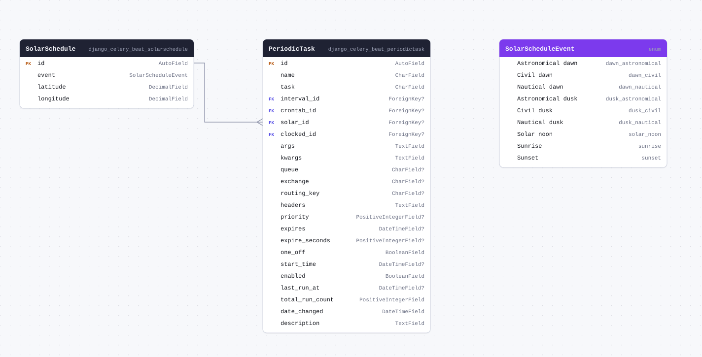

| Column | Field | Type | Null | Key | Default | Description |
| --- | --- | --- | --- | --- | --- | --- |
| `id` | `AutoField` | `integer` |  | PK | `autoincrement()` |  |
| `event` | `SolarScheduleEvent` | `varchar(24)` |  |  |  | The type of solar event when the job should run |
| `latitude` | `DecimalField(9, 6)` | `decimal` |  |  |  | Run the task when the event happens at this latitude |
| `longitude` | `DecimalField(9, 6)` | `decimal` |  |  |  | Run the task when the event happens at this longitude |

Indexes:

- unique `django_celery_beat_solarschedule_event_latitude_longitude_ba64999a_uniq` on `event`, `latitude`, `longitude`

Relations:

- [PeriodicTask](#periodictask).`solar_id` → `id`, on delete cascade

## IntervalSchedule

Table `django_celery_beat_intervalschedule`, app `django_celery_beat`.

Schedule executing on a regular interval.

Example: execute every 2 days:

>>> every=2, period=DAYS

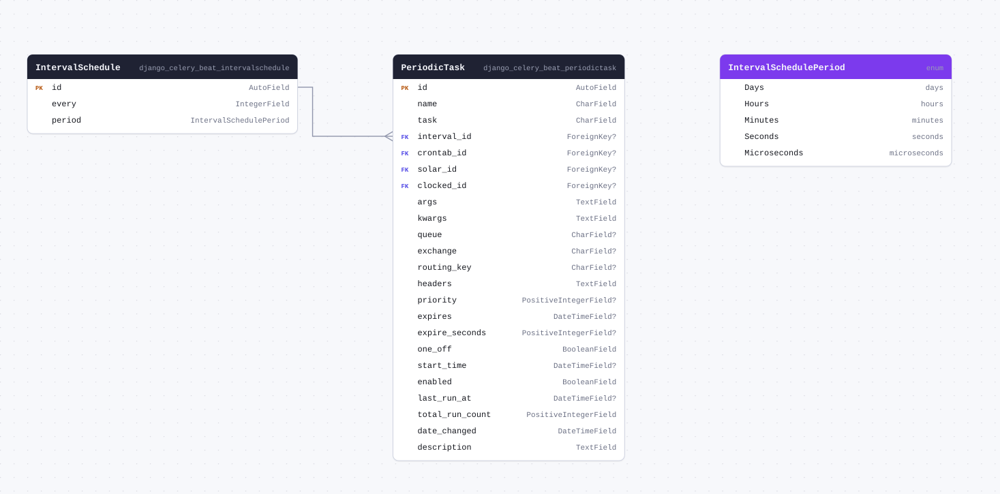

| Column | Field | Type | Null | Key | Default | Description |
| --- | --- | --- | --- | --- | --- | --- |
| `id` | `AutoField` | `integer` |  | PK | `autoincrement()` |  |
| `every` | `IntegerField` | `integer` |  |  |  | Number of interval periods to wait before running the task again |
| `period` | `IntervalSchedulePeriod` | `varchar(24)` |  |  |  | The type of period between task runs (Example: days) |

Relations:

- [PeriodicTask](#periodictask).`interval_id` → `id`, on delete cascade

## ClockedSchedule

Table `django_celery_beat_clockedschedule`, app `django_celery_beat`.

clocked schedule.

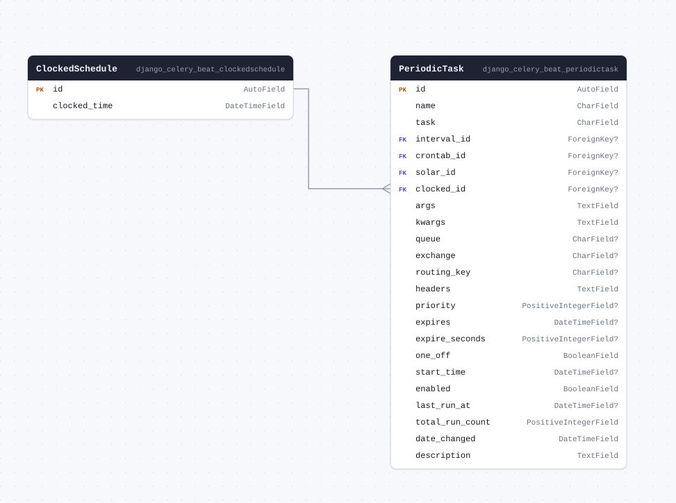

| Column | Field | Type | Null | Key | Default | Description |
| --- | --- | --- | --- | --- | --- | --- |
| `id` | `AutoField` | `integer` |  | PK | `autoincrement()` |  |
| `clocked_time` | `DateTimeField` | `datetime` |  |  |  | Run the task at clocked time |

Relations:

- [PeriodicTask](#periodictask).`clocked_id` → `id`, on delete cascade

## CrontabSchedule

Table `django_celery_beat_crontabschedule`, app `django_celery_beat`.

Timezone Aware Crontab-like schedule.

Example:  Run every hour at 0 minutes for days of month 10-15:

>>> minute="0", hour="*", day_of_week="*",
... day_of_month="10-15", month_of_year="*"

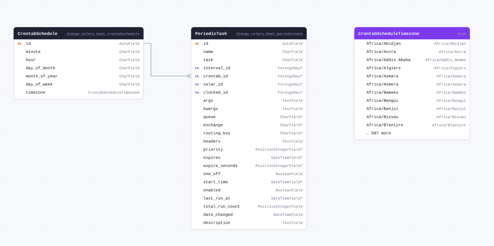

| Column | Field | Type | Null | Key | Default | Description |
| --- | --- | --- | --- | --- | --- | --- |
| `id` | `AutoField` | `integer` |  | PK | `autoincrement()` |  |
| `minute` | `CharField` | `varchar(240)` |  |  | `'*'` | Cron Minutes to Run. Use "*" for "all". (Example: "0,30") |
| `hour` | `CharField` | `varchar(96)` |  |  | `'*'` | Cron Hours to Run. Use "*" for "all". (Example: "8,20") |
| `day_of_month` | `CharField` | `varchar(124)` |  |  | `'*'` | Cron Days Of The Month to Run. Use "*" for "all". (Example: "1,15") |
| `month_of_year` | `CharField` | `varchar(64)` |  |  | `'*'` | Cron Months (1-12) Of The Year to Run. Use "*" for "all". (Example: "1,12") |
| `day_of_week` | `CharField` | `varchar(64)` |  |  | `'*'` | Cron Days Of The Week to Run. Use "*" for "all", Sunday is 0 or 7, Monday is 1. (Example: "0,5") |
| `timezone` | `CrontabScheduleTimezone` | `varchar(63)` |  |  | `crontab_schedule_celery_timezone()` | Timezone to Run the Cron Schedule on. Default is UTC. |

Relations:

- [PeriodicTask](#periodictask).`crontab_id` → `id`, on delete cascade

## PeriodicTasks

Table `django_celery_beat_periodictasks`, app `django_celery_beat`.

Helper table for tracking updates to periodic tasks.

This stores a single row with ``ident=1``. ``last_update`` is updated via
signals whenever anything changes in the :class:`~.PeriodicTask` model.
Basically this acts like a DB data audit trigger.
Doing this so we also track deletions, and not just insert/update.

| Column | Field | Type | Null | Key | Default | Description |
| --- | --- | --- | --- | --- | --- | --- |
| `ident` | `SmallIntegerField` | `smallint` |  | PK | `1` |  |
| `last_update` | `DateTimeField` | `datetime` |  |  |  |  |

## PeriodicTask

Table `django_celery_beat_periodictask`, app `django_celery_beat`.

Model representing a periodic task.

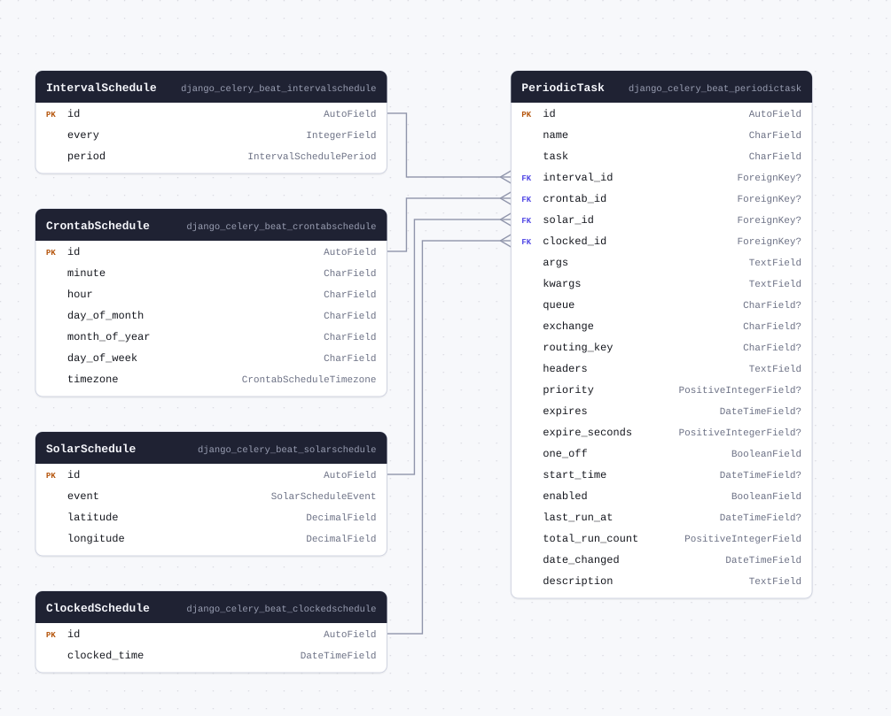

| Column | Field | Type | Null | Key | Default | Description |
| --- | --- | --- | --- | --- | --- | --- |
| `id` | `AutoField` | `integer` |  | PK | `autoincrement()` |  |
| `name` | `CharField` | `varchar(200)` |  | unique |  | Short Description For This Task |
| `task` | `CharField` | `varchar(200)` |  |  |  | The Name of the Celery Task that Should be Run.  (Example: "proj.tasks.import_contacts") |
| `interval_id` | `ForeignKey` | `integer` | yes | FK |  | Interval Schedule to run the task on.  Set only one schedule type, leave the others null. |
| `crontab_id` | `ForeignKey` | `integer` | yes | FK |  | Crontab Schedule to run the task on.  Set only one schedule type, leave the others null. |
| `solar_id` | `ForeignKey` | `integer` | yes | FK |  | Solar Schedule to run the task on.  Set only one schedule type, leave the others null. |
| `clocked_id` | `ForeignKey` | `integer` | yes | FK |  | Clocked Schedule to run the task on.  Set only one schedule type, leave the others null. |
| `args` | `TextField` | `text` |  |  | `'[]'` | JSON encoded positional arguments (Example: ["arg1", "arg2"]) |
| `kwargs` | `TextField` | `text` |  |  | `'{}'` | JSON encoded keyword arguments (Example: {"argument": "value"}) |
| `queue` | `CharField` | `varchar(200)` | yes |  | `None` | Queue defined in CELERY_TASK_QUEUES. Leave None for default queuing. |
| `exchange` | `CharField` | `varchar(200)` | yes |  | `None` | Override Exchange for low-level AMQP routing |
| `routing_key` | `CharField` | `varchar(200)` | yes |  | `None` | Override Routing Key for low-level AMQP routing |
| `headers` | `TextField` | `text` |  |  | `'{}'` | JSON encoded message headers for the AMQP message. |
| `priority` | `PositiveIntegerField` | `integer unsigned` | yes |  | `None` | Priority Number between 0 and 255. Supported by: RabbitMQ, Redis (priority reversed, 0 is highest). |
| `expires` | `DateTimeField` | `datetime` | yes |  |  | Datetime after which the schedule will no longer trigger the task to run |
| `expire_seconds` | `PositiveIntegerField` | `integer unsigned` | yes |  |  | Timedelta with seconds which the schedule will no longer trigger the task to run |
| `one_off` | `BooleanField` | `bool` |  |  | `False` | If True, the schedule will only run the task a single time |
| `start_time` | `DateTimeField` | `datetime` | yes |  |  | Datetime when the schedule should begin triggering the task to run |
| `enabled` | `BooleanField` | `bool` |  |  | `True` | Set to False to disable the schedule |
| `last_run_at` | `DateTimeField` | `datetime` | yes |  |  | Datetime that the schedule last triggered the task to run. Reset to None if enabled is set to False. |
| `total_run_count` | `PositiveIntegerField` | `integer unsigned` |  |  | `0` | Running count of how many times the schedule has triggered the task |
| `date_changed` | `DateTimeField` | `datetime` |  |  | `now()` | Datetime that this PeriodicTask was last modified |
| `description` | `TextField` | `text` |  |  |  | Detailed description about the details of this Periodic Task |

Indexes:

- index `django_celery_beat_periodictask_interval_id_a8ca27da` on `interval_id`
- index `django_celery_beat_periodictask_crontab_id_d3cba168` on `crontab_id`
- index `django_celery_beat_periodictask_solar_id_a87ce72c` on `solar_id`
- index `django_celery_beat_periodictask_clocked_id_47a69f82` on `clocked_id`

Relations:

- `interval_id` → [IntervalSchedule](#intervalschedule).`id`, on delete cascade
- `crontab_id` → [CrontabSchedule](#crontabschedule).`id`, on delete cascade
- `solar_id` → [SolarSchedule](#solarschedule).`id`, on delete cascade
- `clocked_id` → [ClockedSchedule](#clockedschedule).`id`, on delete cascade

## Token

Table `authtoken_token`, app `authtoken`.

Proxy models, on this table: `TokenProxy`.

The default authorization token model.

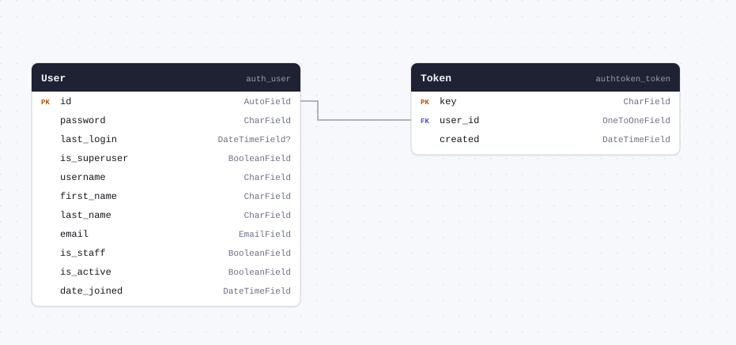

| Column | Field | Type | Null | Key | Default | Description |
| --- | --- | --- | --- | --- | --- | --- |
| `key` | `CharField` | `varchar(40)` |  | PK |  |  |
| `user_id` | `OneToOneField` | `integer` |  | FK, unique |  |  |
| `created` | `DateTimeField` | `datetime` |  |  | `now()` |  |

Relations:

- `user_id` → [User](#user).`id`, on delete cascade

## StoredErrorLog

Table `logging_storederrorlog`, app `logging`.

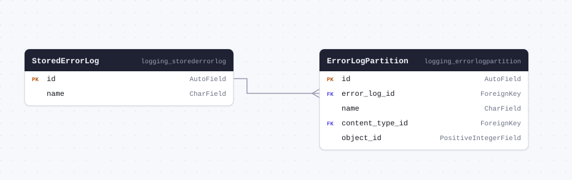

| Column | Field | Type | Null | Key | Default | Description |
| --- | --- | --- | --- | --- | --- | --- |
| `id` | `AutoField` | `integer` |  | PK | `autoincrement()` |  |
| `name` | `CharField` | `varchar(128)` |  | unique |  |  |

Relations:

- [ErrorLogPartition](#errorlogpartition).`error_log_id` → `id`, on delete cascade

## ErrorLogPartition

Table `logging_errorlogpartition`, app `logging`.

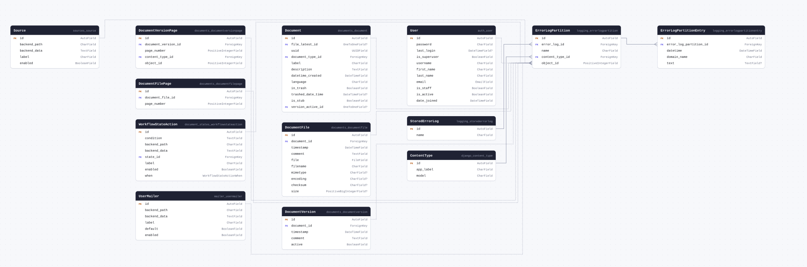

| Column | Field | Type | Null | Key | Default | Description |
| --- | --- | --- | --- | --- | --- | --- |
| `id` | `AutoField` | `integer` |  | PK | `autoincrement()` |  |
| `error_log_id` | `ForeignKey` | `integer` |  | FK |  |  |
| `name` | `CharField` | `varchar(128)` |  |  |  |  |
| `content_type_id` | `ForeignKey` | `integer` |  | FK |  |  |
| `object_id` | `PositiveIntegerField` | `integer unsigned` |  |  |  |  |

Indexes:

- index `logging_errorlogpartition_error_log_id_b2d3d59f` on `error_log_id`
- index `logging_errorlogpartition_name_67ff5750` on `name`
- index `logging_errorlogpartition_content_type_id_d67b36e9` on `content_type_id`
- unique `logging_errorlogpartition_error_log_id_name_aaba9828_uniq` on `error_log_id`, `name`
- unique `logging_errorlogpartition_error_log_id_content_type_id_object_id_6d7187b4_uniq` on `error_log_id`, `content_type_id`, `object_id`

Relations:

- `content_object` → any model, by `content_type_id` + `object_id` (generic foreign key)
- `object_id` → [User](#user).`id` where `content_type_id` is User (generic, `User.error_log_partitions`)
- `error_log_id` → [StoredErrorLog](#storederrorlog).`id`, on delete cascade
- `content_type_id` → [ContentType](#contenttype).`id`, on delete cascade
- [ErrorLogPartitionEntry](#errorlogpartitionentry).`error_log_partition_id` → `id`, on delete cascade
- `object_id` → [Document](#document).`id` where `content_type_id` is Document (generic, `Document.error_log_partitions`)
- `object_id` → [DocumentFile](#documentfile).`id` where `content_type_id` is DocumentFile (generic, `DocumentFile.error_log_partitions`)
- `object_id` → [DocumentVersion](#documentversion).`id` where `content_type_id` is DocumentVersion (generic, `DocumentVersion.error_log_partitions`)
- `object_id` → [DocumentVersionPage](#documentversionpage).`id` where `content_type_id` is DocumentVersionPage (generic, `DocumentVersionPage.error_log_partitions`)
- `object_id` → [DocumentFilePage](#documentfilepage).`id` where `content_type_id` is DocumentFilePage (generic, `DocumentFilePage.error_log_partitions`)
- `object_id` → [WorkflowStateAction](#workflowstateaction).`id` where `content_type_id` is WorkflowStateAction (generic, `WorkflowStateAction.error_log_partitions`)
- `object_id` → [UserMailer](#usermailer).`id` where `content_type_id` is UserMailer (generic, `UserMailer.error_log_partitions`)
- `object_id` → [Source](#source).`id` where `content_type_id` is Source (generic, `Source.error_log_partitions`)

## ErrorLogPartitionEntry

Table `logging_errorlogpartitionentry`, app `logging`.

Proxy models, on this table: `GlobalErrorLogPartitionEntry`.

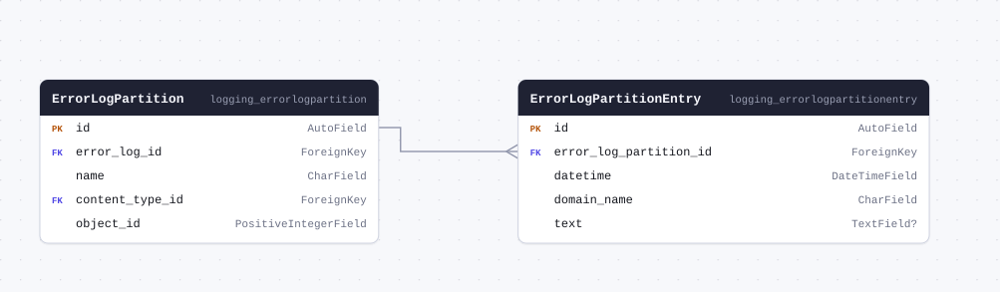

| Column | Field | Type | Null | Key | Default | Description |
| --- | --- | --- | --- | --- | --- | --- |
| `id` | `AutoField` | `integer` |  | PK | `autoincrement()` |  |
| `error_log_partition_id` | `ForeignKey` | `integer` |  | FK |  |  |
| `datetime` | `DateTimeField` | `datetime` |  |  | `now()` |  |
| `domain_name` | `CharField` | `varchar(128)` |  |  | `'logging'` |  |
| `text` | `TextField` | `text` | yes |  |  |  |

Indexes:

- index `logging_errorlogpartitionentry_error_log_partition_id_7531a31d` on `error_log_partition_id`
- index `logging_errorlogpartitionentry_datetime_51490d5a` on `datetime`
- index `logging_errorlogpartitionentry_domain_name_9c3d0ff0` on `domain_name`

Relations:

- `error_log_partition_id` → [ErrorLogPartition](#errorlogpartition).`id`, on delete cascade

## TaskDeduplicationEntry

Table `task_manager_taskdeduplicationentry`, app `task_manager`.

| Column | Field | Type | Null | Key | Default | Description |
| --- | --- | --- | --- | --- | --- | --- |
| `id` | `AutoField` | `integer` |  | PK | `autoincrement()` |  |
| `dotted_path` | `CharField` | `varchar(255)` |  |  |  | Python path of the task type the marker suppresses. |
| `key` | `TextField` | `text` |  |  |  | Serialized keyword arguments identifying the unit of work requested. |
| `key_hash` | `CharField` | `varchar(64)` |  |  |  | Hash of the key. The unique constraint is applied to this field and not to the key itself because the length of a key is decided by the task requesting the work, and an index over an unbounded column exceeds the size limit of some database managers. |
| `datetime_created` | `DateTimeField` | `datetime` |  |  | `now()` | Date and time the work was requested or last re-dispatched. A marker whose work has not begun stops suppressing requests once this is older than the queued interval, which is what allows a worker that ended before publishing its task to recover without intervention. |
| `datetime_started` | `DateTimeField` | `datetime` | yes |  |  | Date and time a worker began performing the work. Until it is set, the task the marker stands for is still waiting in the queue and has not read the object it will act on, so a request arriving in that period asks for work the queued task is already going to perform. |
| `is_dirty` | `BooleanField` | `bool` |  |  | `False` | A new request for the same unit of work arrived after the task began performing it, therefore too late for the task to take it into account. The work is dispatched once more when the task completes. |

Indexes:

- index `task_manager_taskdeduplicationentry_dotted_path_3a38748b` on `dotted_path`
- index `task_manager_taskdeduplicationentry_datetime_created_c6213bd3` on `datetime_created`
- index `task_manager_taskdeduplicationentry_datetime_started_4807565c` on `datetime_started`
- unique `task_manager_taskdeduplicationentry_unique_key` on `dotted_path`, `key_hash`

## AccessControlList

Table `acls_accesscontrollist`, app `acls`.

Proxy models, on this table: `GlobalAccessControlListProxy`.

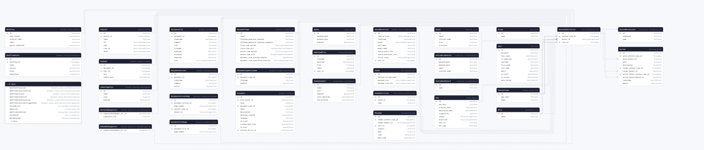

| Column | Field | Type | Null | Key | Default | Description |
| --- | --- | --- | --- | --- | --- | --- |
| `id` | `AutoField` | `integer` |  | PK | `autoincrement()` |  |
| `content_type_id` | `ForeignKey` | `integer` |  | FK |  |  |
| `object_id` | `PositiveIntegerField` | `integer unsigned` |  |  |  |  |
| `role_id` | `ForeignKey` | `integer` |  | FK |  | Role to which the access is granted for the specified object. |

Indexes:

- index `acls_accesscontrollist_content_type_id_324a36ca` on `content_type_id`
- index `acls_accesscontrollist_role_id_935b00e2` on `role_id`
- unique `acls_accesscontrollist_content_type_id_object_id_role_id_071de930_uniq` on `content_type_id`, `object_id`, `role_id`

Relations:

- `content_object` → any model, by `content_type_id` + `object_id` (generic foreign key)
- `object_id` → [Group](#group).`id` where `content_type_id` is Group (generic, `Group.acls`)
- `object_id` → [User](#user).`id` where `content_type_id` is User (generic, `User.acls`)
- `content_type_id` → [ContentType](#contenttype).`id`, on delete cascade
- `role_id` → [Role](#role).`id`, on delete cascade
- `permissions` — many to many with [StoredPermission](#storedpermission)
- `actor_actions` ← [Action](#action), by `actor_content_type_id` + `actor_object_id` (generic relation)
- `target_actions` ← [Action](#action), by `target_content_type_id` + `target_object_id` (generic relation)
- `action_object_actions` ← [Action](#action), by `action_object_content_type_id` + `action_object_object_id` (generic relation)
- `object_id` → [Asset](#asset).`id` where `content_type_id` is Asset (generic, `Asset.acls`)
- `object_id` → [StoredCredential](#storedcredential).`id` where `content_type_id` is StoredCredential (generic, `StoredCredential.acls`)
- `object_id` → [StoredDashboard](#storeddashboard).`id` where `content_type_id` is StoredDashboard (generic, `StoredDashboard.acls`)
- `object_id` → [Key](#key).`id` where `content_type_id` is Key (generic, `Key.acls`)
- `object_id` → [SavedResultset](#savedresultset).`id` where `content_type_id` is SavedResultset (generic, `SavedResultset.acls`)
- `object_id` → [Cache](#cache).`id` where `content_type_id` is Cache (generic, `Cache.acls`)
- `object_id` → [CachePartition](#cachepartition).`id` where `content_type_id` is CachePartition (generic, `CachePartition.acls`)
- `object_id` → [Message](#message).`id` where `content_type_id` is Message (generic, `Message.acls`)
- `object_id` → [Role](#role).`id` where `content_type_id` is Role (generic, `Role.acls`)
- `object_id` → [Quota](#quota).`id` where `content_type_id` is Quota (generic, `Quota.acls`)
- `object_id` → [DownloadFile](#downloadfile).`id` where `content_type_id` is DownloadFile (generic, `DownloadFile.acls`)
- `object_id` → [Announcement](#announcement).`id` where `content_type_id` is Announcement (generic, `Announcement.acls`)
- `object_id` → [DocumentType](#documenttype).`id` where `content_type_id` is DocumentType (generic, `DocumentType.acls`)
- `object_id` → [DocumentTypeFilename](#documenttypefilename).`id` where `content_type_id` is DocumentTypeFilename (generic, `DocumentTypeFilename.acls`)
- `object_id` → [Document](#document).`id` where `content_type_id` is Document (generic, `Document.acls`)
- `object_id` → [DocumentFile](#documentfile).`id` where `content_type_id` is DocumentFile (generic, `DocumentFile.acls`)
- `object_id` → [DocumentVersion](#documentversion).`id` where `content_type_id` is DocumentVersion (generic, `DocumentVersion.acls`)
- `object_id` → [DocumentVersionPage](#documentversionpage).`id` where `content_type_id` is DocumentVersionPage (generic, `DocumentVersionPage.acls`)
- `object_id` → [DocumentFilePage](#documentfilepage).`id` where `content_type_id` is DocumentFilePage (generic, `DocumentFilePage.acls`)
- `object_id` → [Cabinet](#cabinet).`id` where `content_type_id` is Cabinet (generic, `Cabinet.acls`)
- `object_id` → [Comment](#comment).`id` where `content_type_id` is Comment (generic, `Comment.acls`)
- `object_id` → [IndexTemplate](#indextemplate).`id` where `content_type_id` is IndexTemplate (generic, `IndexTemplate.acls`)
- `object_id` → [DetachedSignature](#detachedsignature).`signaturebasemodel_ptr_id` where `content_type_id` is DetachedSignature (generic, `DetachedSignature.acls`)
- `object_id` → [EmbeddedSignature](#embeddedsignature).`signaturebasemodel_ptr_id` where `content_type_id` is EmbeddedSignature (generic, `EmbeddedSignature.acls`)
- `object_id` → [Workflow](#workflow).`id` where `content_type_id` is Workflow (generic, `Workflow.acls`)
- `object_id` → [WorkflowState](#workflowstate).`id` where `content_type_id` is WorkflowState (generic, `WorkflowState.acls`)
- `object_id` → [WorkflowTransition](#workflowtransition).`id` where `content_type_id` is WorkflowTransition (generic, `WorkflowTransition.acls`)
- `object_id` → [WorkflowTransitionField](#workflowtransitionfield).`id` where `content_type_id` is WorkflowTransitionField (generic, `WorkflowTransitionField.acls`)
- `object_id` → [WorkflowInstance](#workflowinstance).`id` where `content_type_id` is WorkflowInstance (generic, `WorkflowInstance.acls`)
- `object_id` → [WorkflowStateAction](#workflowstateaction).`id` where `content_type_id` is WorkflowStateAction (generic, `WorkflowStateAction.acls`)
- `object_id` → [WorkflowStateEscalation](#workflowstateescalation).`id` where `content_type_id` is WorkflowStateEscalation (generic, `WorkflowStateEscalation.acls`)
- `object_id` → [WorkflowTransitionTriggerEvent](#workflowtransitiontriggerevent).`id` where `content_type_id` is WorkflowTransitionTriggerEvent (generic, `WorkflowTransitionTriggerEvent.acls`)
- `object_id` → [StoredDriver](#storeddriver).`id` where `content_type_id` is StoredDriver (generic, `StoredDriver.acls`)
- `object_id` → [SmartLink](#smartlink).`id` where `content_type_id` is SmartLink (generic, `SmartLink.acls`)
- `object_id` → [SmartLinkCondition](#smartlinkcondition).`id` where `content_type_id` is SmartLinkCondition (generic, `SmartLinkCondition.acls`)
- `object_id` → [UserMailer](#usermailer).`id` where `content_type_id` is UserMailer (generic, `UserMailer.acls`)
- `object_id` → [MetadataType](#metadatatype).`id` where `content_type_id` is MetadataType (generic, `MetadataType.acls`)
- `object_id` → [DocumentTypeMetadataType](#documenttypemetadatatype).`id` where `content_type_id` is DocumentTypeMetadataType (generic, `DocumentTypeMetadataType.acls`)
- `object_id` → [Sequence](#sequence).`id` where `content_type_id` is Sequence (generic, `Sequence.acls`)
- `object_id` → [SignatureCapture](#signaturecapture).`id` where `content_type_id` is SignatureCapture (generic, `SignatureCapture.acls`)
- `object_id` → [Source](#source).`id` where `content_type_id` is Source (generic, `Source.acls`)
- `object_id` → [Tag](#tag).`id` where `content_type_id` is Tag (generic, `Tag.acls`)
- `object_id` → [WebLink](#weblink).`id` where `content_type_id` is WebLink (generic, `WebLink.acls`)

## UserOptions

Table `user_management_useroptions`, app `user_management`.

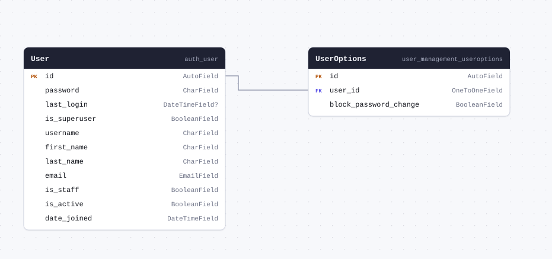

| Column | Field | Type | Null | Key | Default | Description |
| --- | --- | --- | --- | --- | --- | --- |
| `id` | `AutoField` | `integer` |  | PK | `autoincrement()` |  |
| `user_id` | `OneToOneField` | `integer` |  | FK, unique |  |  |
| `block_password_change` | `BooleanField` | `bool` |  |  | `False` |  |

Relations:

- `user_id` → [User](#user).`id`, on delete cascade

## LoginAttempt

Table `authentication_attempts_loginattempt`, app `authentication_attempts`.

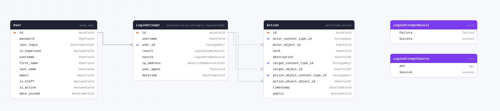

| Column | Field | Type | Null | Key | Default | Description |
| --- | --- | --- | --- | --- | --- | --- |
| `id` | `AutoField` | `integer` |  | PK | `autoincrement()` |  |
| `username` | `CharField` | `varchar(254)` |  |  |  | The username exactly as it was supplied for the authentication attempt. For failed attempts this may not match any existing account. |
| `user_id` | `ForeignKey` | `integer` | yes | FK |  | The existing account that the supplied username resolved to, if any. |
| `result` | `LoginAttemptResult` | `varchar(32)` |  |  |  | Whether the authentication attempt succeeded or failed. |
| `source` | `LoginAttemptSource` | `varchar(32)` |  |  | `'session'` | The subsystem through which the authentication was attempted, such as the interactive session or the API. |
| `ip_address` | `GenericIPAddressField` | `char(39)` | yes |  |  | The client address as resolved by the lockout layer. Behind a reverse proxy this is only meaningful when the proxy trust is configured; treat it as best effort. |
| `user_agent` | `TextField` | `text` |  |  |  | Information about the web browser or application used to make the login attempt. |
| `datetime` | `DateTimeField` | `datetime` |  |  | `now()` |  |

Indexes:

- index `authentication_attempts_loginattempt_username_c515de48` on `username`
- index `authentication_attempts_loginattempt_user_id_9d4e81b6` on `user_id`
- index `authentication_attempts_loginattempt_result_c188bd00` on `result`
- index `authentication_attempts_loginattempt_datetime_b4d514e5` on `datetime`

Relations:

- `user_id` → [User](#user).`id`, on delete set null
- `actor_actions` ← [Action](#action), by `actor_content_type_id` + `actor_object_id` (generic relation)
- `target_actions` ← [Action](#action), by `target_content_type_id` + `target_object_id` (generic relation)
- `action_object_actions` ← [Action](#action), by `action_object_content_type_id` + `action_object_object_id` (generic relation)

## UserOTPData

Table `authentication_otp_userotpdata`, app `authentication_otp`.


| Column | Field | Type | Null | Key | Default | Description |
| --- | --- | --- | --- | --- | --- | --- |
| `id` | `AutoField` | `integer` |  | PK | `autoincrement()` |  |
| `user_id` | `OneToOneField` | `integer` |  | FK, unique |  |  |
| `secret` | `CharField` | `varchar(96)` |  |  |  |  |

Relations:

- `user_id` → [User](#user).`id`, on delete cascade

## AutoAdminSingleton

Table `autoadmin_autoadminsingleton`, app `autoadmin`.

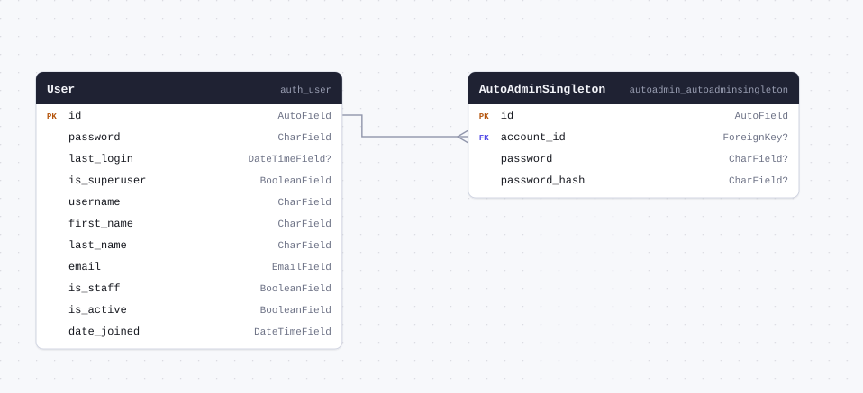

| Column | Field | Type | Null | Key | Default | Description |
| --- | --- | --- | --- | --- | --- | --- |
| `id` | `AutoField` | `integer` |  | PK | `autoincrement()` |  |
| `account_id` | `ForeignKey` | `integer` | yes | FK |  |  |
| `password` | `CharField` | `varchar(128)` | yes |  |  |  |
| `password_hash` | `CharField` | `varchar(128)` | yes |  |  |  |

Indexes:

- index `autoadmin_autoadminsingleton_account_id_9082b87a` on `account_id`

Relations:

- `account_id` → [User](#user).`id`, on delete cascade

## Asset

Table `converter_asset`, app `converter`.


| Column | Field | Type | Null | Key | Default | Description |
| --- | --- | --- | --- | --- | --- | --- |
| `id` | `AutoField` | `integer` |  | PK | `autoincrement()` |  |
| `label` | `CharField` | `varchar(96)` |  | unique |  |  |
| `internal_name` | `CharField` | `varchar(255)` |  | unique |  | This value will be used when referencing this asset. Can only contain letters, numbers, and underscores. |
| `file` | `FileField` | `varchar(100)` |  |  |  |  |
| `file_hash` | `CharField` | `varchar(64)` | yes |  |  | A hash/checksum generated from the asset file. Used to invalidate cached images that use the asset when the asset file changes. |

Relations:

- `actor_actions` ← [Action](#action), by `actor_content_type_id` + `actor_object_id` (generic relation)
- `target_actions` ← [Action](#action), by `target_content_type_id` + `target_object_id` (generic relation)
- `action_object_actions` ← [Action](#action), by `action_object_content_type_id` + `action_object_object_id` (generic relation)
- `acls` ← [AccessControlList](#accesscontrollist), by `content_type_id` + `object_id` (generic relation)

## StoredLayer

Table `converter_storedlayer`, app `converter`.

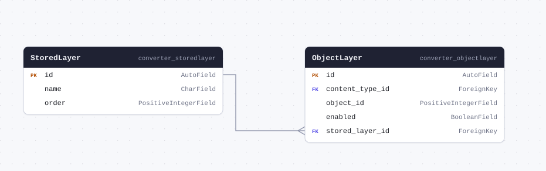

| Column | Field | Type | Null | Key | Default | Description |
| --- | --- | --- | --- | --- | --- | --- |
| `id` | `AutoField` | `integer` |  | PK | `autoincrement()` |  |
| `name` | `CharField` | `varchar(64)` |  | unique |  |  |
| `order` | `PositiveIntegerField` | `integer unsigned` |  | unique |  |  |

Relations:

- [ObjectLayer](#objectlayer).`stored_layer_id` → `id`, on delete cascade

## ObjectLayer

Table `converter_objectlayer`, app `converter`.

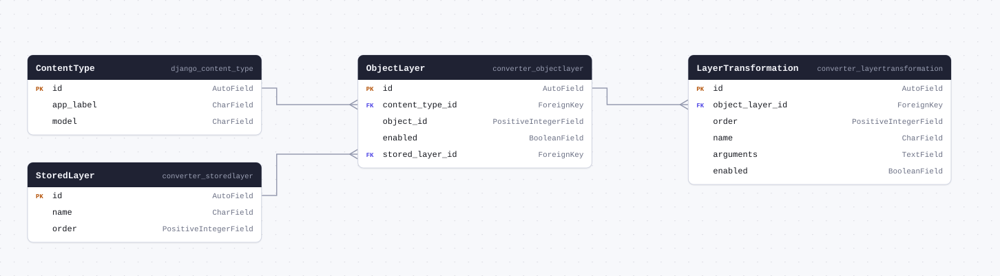

| Column | Field | Type | Null | Key | Default | Description |
| --- | --- | --- | --- | --- | --- | --- |
| `id` | `AutoField` | `integer` |  | PK | `autoincrement()` |  |
| `content_type_id` | `ForeignKey` | `integer` |  | FK |  |  |
| `object_id` | `PositiveIntegerField` | `integer unsigned` |  |  |  |  |
| `enabled` | `BooleanField` | `bool` |  |  | `True` |  |
| `stored_layer_id` | `ForeignKey` | `integer` |  | FK |  |  |

Indexes:

- index `converter_objectlayer_content_type_id_3f77d1c1` on `content_type_id`
- index `converter_objectlayer_stored_layer_id_a23e6eb0` on `stored_layer_id`
- unique `converter_objectlayer_content_type_id_object_id_stored_layer_id_967137bc_uniq` on `content_type_id`, `object_id`, `stored_layer_id`

Relations:

- `content_object` → any model, by `content_type_id` + `object_id` (generic foreign key)
- `content_type_id` → [ContentType](#contenttype).`id`, on delete cascade
- `stored_layer_id` → [StoredLayer](#storedlayer).`id`, on delete cascade
- [LayerTransformation](#layertransformation).`object_layer_id` → `id`, on delete cascade

## LayerTransformation

Table `converter_layertransformation`, app `converter`.

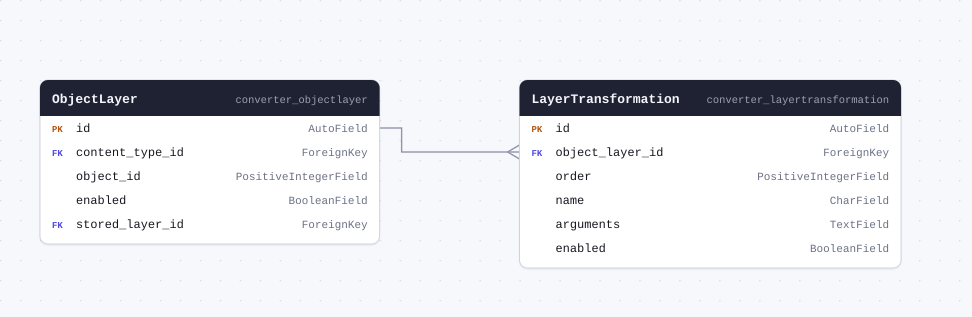

| Column | Field | Type | Null | Key | Default | Description |
| --- | --- | --- | --- | --- | --- | --- |
| `id` | `AutoField` | `integer` |  | PK | `autoincrement()` |  |
| `object_layer_id` | `ForeignKey` | `integer` |  | FK |  |  |
| `order` | `PositiveIntegerField` | `integer unsigned` |  |  | `0` | Order in which the transformations will be executed. If left unchanged, an automatic order value will be assigned. |
| `name` | `CharField` | `varchar(128)` |  |  |  |  |
| `arguments` | `TextField` | `text` |  |  |  | Enter the arguments for the transformation as a YAML dictionary. ie: {"degrees": 180} |
| `enabled` | `BooleanField` | `bool` |  |  | `True` |  |

Indexes:

- index `converter_layertransformation_object_layer_id_9ed104d0` on `object_layer_id`
- index `converter_layertransformation_order_84376246` on `order`
- unique `converter_layertransformation_object_layer_id_order_ca82a520_uniq` on `object_layer_id`, `order`

Relations:

- `object_layer_id` → [ObjectLayer](#objectlayer).`id`, on delete cascade

## StoredCredential

Table `credentials_storedcredential`, app `credentials`.

Columns from `BackendModelMixin` (abstract): `backend_path`, `backend_data`.

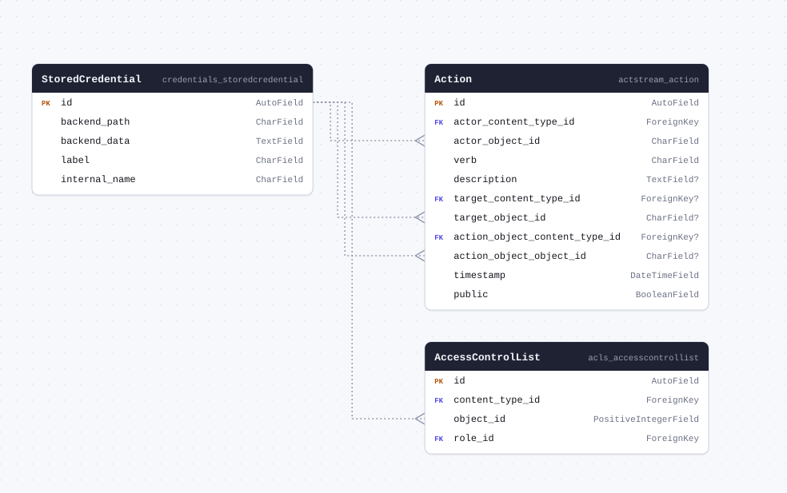

| Column | Field | Type | Null | Key | Default | Description |
| --- | --- | --- | --- | --- | --- | --- |
| `id` | `AutoField` | `integer` |  | PK | `autoincrement()` |  |
| `backend_path` | `CharField` | `varchar(128)` |  |  |  | The dotted Python path to the backend class. |
| `backend_data` | `TextField` | `text` |  |  |  | JSON encoded data for the backend class. |
| `label` | `CharField` | `varchar(128)` |  | unique |  | Short description of this credential. |
| `internal_name` | `CharField` | `varchar(255)` |  | unique |  | This value will be used by other apps to reference this credential. Can only contain letters, numbers, and underscores. |

Relations:

- `actor_actions` ← [Action](#action), by `actor_content_type_id` + `actor_object_id` (generic relation)
- `target_actions` ← [Action](#action), by `target_content_type_id` + `target_object_id` (generic relation)
- `action_object_actions` ← [Action](#action), by `action_object_content_type_id` + `action_object_object_id` (generic relation)
- `acls` ← [AccessControlList](#accesscontrollist), by `content_type_id` + `object_id` (generic relation)

## StoredDashboard

Table `dashboards_storeddashboard`, app `dashboards`.

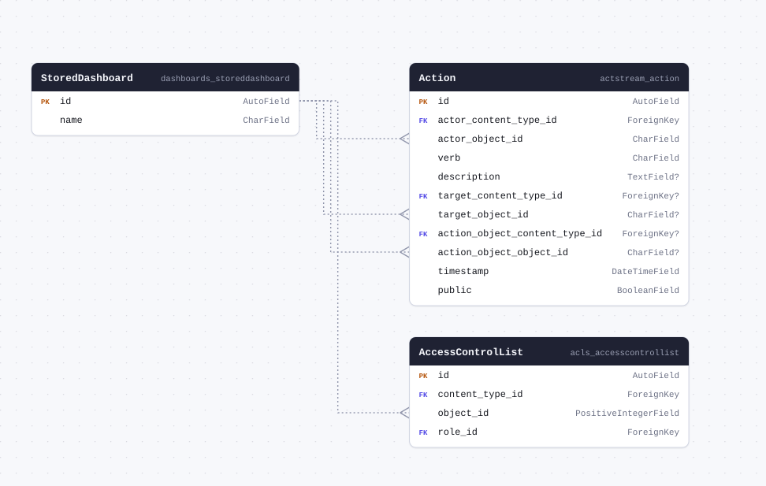

| Column | Field | Type | Null | Key | Default | Description |
| --- | --- | --- | --- | --- | --- | --- |
| `id` | `AutoField` | `integer` |  | PK | `autoincrement()` |  |
| `name` | `CharField` | `varchar(128)` |  | unique |  |  |

Relations:

- `actor_actions` ← [Action](#action), by `actor_content_type_id` + `actor_object_id` (generic relation)
- `target_actions` ← [Action](#action), by `target_content_type_id` + `target_object_id` (generic relation)
- `action_object_actions` ← [Action](#action), by `action_object_content_type_id` + `action_object_object_id` (generic relation)
- `acls` ← [AccessControlList](#accesscontrollist), by `content_type_id` + `object_id` (generic relation)

## Key

Table `django_gpg_key`, app `django_gpg`.

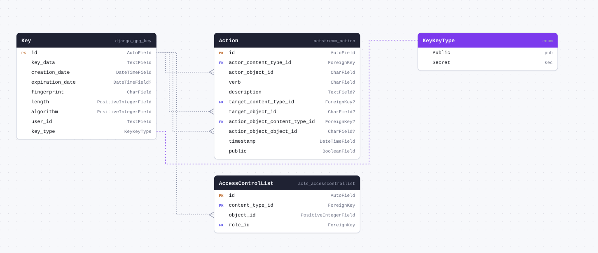

| Column | Field | Type | Null | Key | Default | Description |
| --- | --- | --- | --- | --- | --- | --- |
| `id` | `AutoField` | `integer` |  | PK | `autoincrement()` |  |
| `key_data` | `TextField` | `text` |  |  |  | ASCII armored version of the key. |
| `creation_date` | `DateTimeField` | `datetime` |  |  |  |  |
| `expiration_date` | `DateTimeField` | `datetime` | yes |  |  |  |
| `fingerprint` | `CharField` | `varchar(40)` |  | unique |  |  |
| `length` | `PositiveIntegerField` | `integer unsigned` |  |  |  |  |
| `algorithm` | `PositiveIntegerField` | `integer unsigned` |  |  |  |  |
| `user_id` | `TextField` | `text` |  |  |  |  |
| `key_type` | `KeyKeyType` | `varchar(3)` |  |  |  |  |

Relations:

- `actor_actions` ← [Action](#action), by `actor_content_type_id` + `actor_object_id` (generic relation)
- `target_actions` ← [Action](#action), by `target_content_type_id` + `target_object_id` (generic relation)
- `action_object_actions` ← [Action](#action), by `action_object_content_type_id` + `action_object_object_id` (generic relation)
- `acls` ← [AccessControlList](#accesscontrollist), by `content_type_id` + `object_id` (generic relation)

## SavedResultset

Table `dynamic_search_savedresultset`, app `dynamic_search`.

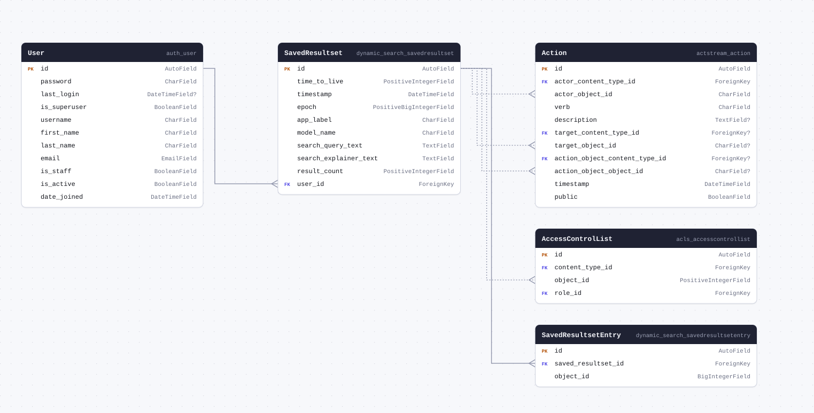

| Column | Field | Type | Null | Key | Default | Description |
| --- | --- | --- | --- | --- | --- | --- |
| `id` | `AutoField` | `integer` |  | PK | `autoincrement()` |  |
| `time_to_live` | `PositiveIntegerField` | `integer unsigned` |  |  |  | Time to keep the resultset in seconds. This value is increased every time the resultset is accessed. |
| `timestamp` | `DateTimeField` | `datetime` |  |  |  | The server date and time when the resultset was created. |
| `epoch` | `PositiveBigIntegerField` | `bigint unsigned` |  |  |  |  |
| `app_label` | `CharField` | `varchar(64)` |  |  |  |  |
| `model_name` | `CharField` | `varchar(64)` |  |  |  |  |
| `search_query_text` | `TextField` | `text` |  |  |  |  |
| `search_explainer_text` | `TextField` | `text` |  |  |  |  |
| `result_count` | `PositiveIntegerField` | `integer unsigned` |  |  |  | Number of results stored in the resultset. |
| `user_id` | `ForeignKey` | `integer` |  | FK |  | User for which the resultset was created. |

Indexes:

- index `dynamic_search_savedresultset_timestamp_98ee21e2` on `timestamp`
- index `dynamic_search_savedresultset_user_id_daf15991` on `user_id`

Relations:

- `user_id` → [User](#user).`id`, on delete cascade
- `actor_actions` ← [Action](#action), by `actor_content_type_id` + `actor_object_id` (generic relation)
- `target_actions` ← [Action](#action), by `target_content_type_id` + `target_object_id` (generic relation)
- `action_object_actions` ← [Action](#action), by `action_object_content_type_id` + `action_object_object_id` (generic relation)
- `acls` ← [AccessControlList](#accesscontrollist), by `content_type_id` + `object_id` (generic relation)
- [SavedResultsetEntry](#savedresultsetentry).`saved_resultset_id` → `id`, on delete cascade

## SavedResultsetEntry

Table `dynamic_search_savedresultsetentry`, app `dynamic_search`.

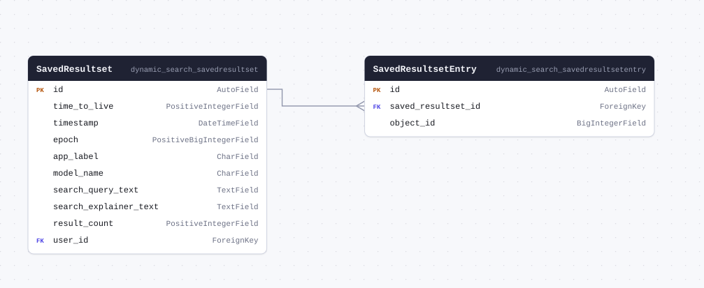

| Column | Field | Type | Null | Key | Default | Description |
| --- | --- | --- | --- | --- | --- | --- |
| `id` | `AutoField` | `integer` |  | PK | `autoincrement()` |  |
| `saved_resultset_id` | `ForeignKey` | `integer` |  | FK |  |  |
| `object_id` | `BigIntegerField` | `bigint` |  |  |  |  |

Indexes:

- index `dynamic_search_savedresultsetentry_saved_resultset_id_28bd6562` on `saved_resultset_id`

Relations:

- `saved_resultset_id` → [SavedResultset](#savedresultset).`id`, on delete cascade

## Cache

Table `file_caching_cache`, app `file_caching`.

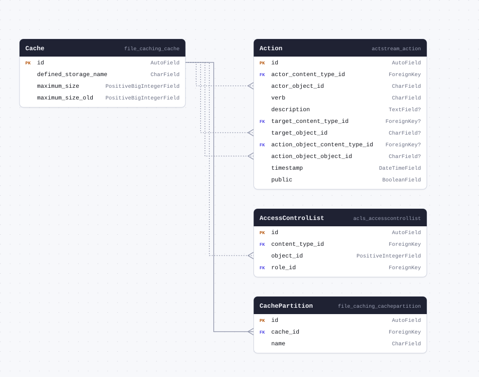

| Column | Field | Type | Null | Key | Default | Description |
| --- | --- | --- | --- | --- | --- | --- |
| `id` | `AutoField` | `integer` |  | PK | `autoincrement()` |  |
| `defined_storage_name` | `CharField` | `varchar(96)` |  | unique |  | Internal name of the defined storage for this cache. |
| `maximum_size` | `PositiveBigIntegerField` | `bigint unsigned` |  |  |  | Maximum size of the cache in bytes. |
| `maximum_size_old` | `PositiveBigIntegerField` | `bigint unsigned` |  |  |  | Previous maximum size of the cache in bytes. |

Indexes:

- index `file_caching_cache_maximum_size_852f8b68` on `maximum_size`

Relations:

- `actor_actions` ← [Action](#action), by `actor_content_type_id` + `actor_object_id` (generic relation)
- `target_actions` ← [Action](#action), by `target_content_type_id` + `target_object_id` (generic relation)
- `action_object_actions` ← [Action](#action), by `action_object_content_type_id` + `action_object_object_id` (generic relation)
- `acls` ← [AccessControlList](#accesscontrollist), by `content_type_id` + `object_id` (generic relation)
- [CachePartition](#cachepartition).`cache_id` → `id`, on delete cascade

## CachePartition

Table `file_caching_cachepartition`, app `file_caching`.

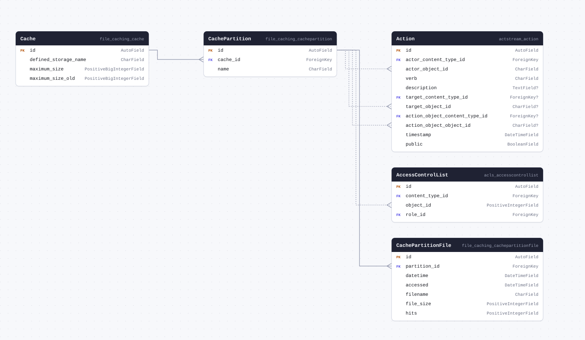

| Column | Field | Type | Null | Key | Default | Description |
| --- | --- | --- | --- | --- | --- | --- |
| `id` | `AutoField` | `integer` |  | PK | `autoincrement()` |  |
| `cache_id` | `ForeignKey` | `integer` |  | FK |  |  |
| `name` | `CharField` | `varchar(128)` |  |  |  |  |

Indexes:

- index `file_caching_cachepartition_cache_id_07f1f088` on `cache_id`
- unique `file_caching_cachepartition_cache_id_name_aa955bb8_uniq` on `cache_id`, `name`

Relations:

- `cache_id` → [Cache](#cache).`id`, on delete cascade
- `actor_actions` ← [Action](#action), by `actor_content_type_id` + `actor_object_id` (generic relation)
- `target_actions` ← [Action](#action), by `target_content_type_id` + `target_object_id` (generic relation)
- `action_object_actions` ← [Action](#action), by `action_object_content_type_id` + `action_object_object_id` (generic relation)
- `acls` ← [AccessControlList](#accesscontrollist), by `content_type_id` + `object_id` (generic relation)
- [CachePartitionFile](#cachepartitionfile).`partition_id` → `id`, on delete cascade

## CachePartitionFile

Table `file_caching_cachepartitionfile`, app `file_caching`.

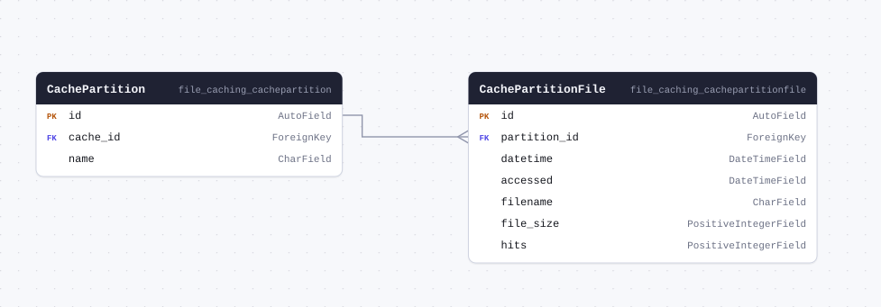

| Column | Field | Type | Null | Key | Default | Description |
| --- | --- | --- | --- | --- | --- | --- |
| `id` | `AutoField` | `integer` |  | PK | `autoincrement()` |  |
| `partition_id` | `ForeignKey` | `integer` |  | FK |  |  |
| `datetime` | `DateTimeField` | `datetime` |  |  | `now()` |  |
| `accessed` | `DateTimeField` | `datetime` |  |  | `now()` | Last date and time this cache partition file was read. Used to evict the least recently used files first. |
| `filename` | `CharField` | `varchar(255)` |  |  |  |  |
| `file_size` | `PositiveIntegerField` | `integer unsigned` |  |  | `0` |  |
| `hits` | `PositiveIntegerField` | `integer unsigned` |  |  | `0` | Times this cache partition file has been accessed. |

Indexes:

- index `file_caching_cachepartitionfile_partition_id_252758cf` on `partition_id`
- index `file_caching_cachepartitionfile_datetime_2202b95d` on `datetime`
- index `file_caching_cachepartitionfile_accessed_7fe95c8d` on `accessed`
- index `file_caching_cachepartitionfile_hits_b22c51f7` on `hits`
- unique `file_caching_cachepartitionfile_partition_id_filename_e553caf0_uniq` on `partition_id`, `filename`

Relations:

- `partition_id` → [CachePartition](#cachepartition).`id`, on delete cascade

## UserLocaleProfile

Table `locales_userlocaleprofile`, app `locales`.

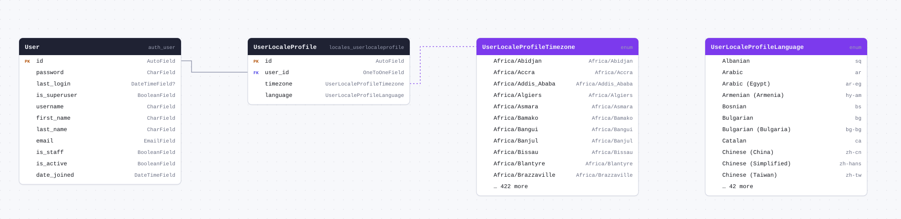

| Column | Field | Type | Null | Key | Default | Description |
| --- | --- | --- | --- | --- | --- | --- |
| `id` | `AutoField` | `integer` |  | PK | `autoincrement()` |  |
| `user_id` | `OneToOneField` | `integer` |  | FK, unique |  |  |
| `timezone` | `UserLocaleProfileTimezone` | `varchar(48)` |  |  |  |  |
| `language` | `UserLocaleProfileLanguage` | `varchar(8)` |  |  |  |  |

Relations:

- `user_id` → [User](#user).`id`, on delete cascade

## Lock

Table `lock_manager_lock`, app `lock_manager`.

| Column | Field | Type | Null | Key | Default | Description |
| --- | --- | --- | --- | --- | --- | --- |
| `id` | `AutoField` | `integer` |  | PK | `autoincrement()` |  |
| `creation_datetime` | `DateTimeField` | `datetime` |  |  | `now()` |  |
| `timeout` | `IntegerField` | `integer` |  |  | `30` |  |
| `name` | `CharField` | `varchar(255)` |  | unique |  |  |

## Message

Table `messaging_message`, app `messaging`.

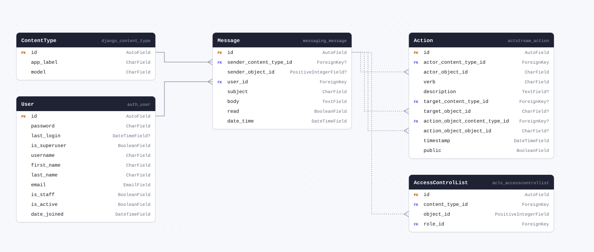

| Column | Field | Type | Null | Key | Default | Description |
| --- | --- | --- | --- | --- | --- | --- |
| `id` | `AutoField` | `integer` |  | PK | `autoincrement()` |  |
| `sender_content_type_id` | `ForeignKey` | `integer` | yes | FK |  |  |
| `sender_object_id` | `PositiveIntegerField` | `integer unsigned` | yes |  |  |  |
| `user_id` | `ForeignKey` | `integer` |  | FK |  |  |
| `subject` | `CharField` | `varchar(255)` |  |  |  | Short description of this message. |
| `body` | `TextField` | `text` |  |  |  | The actual content of the message. |
| `read` | `BooleanField` | `bool` |  |  | `False` | This field determines if the message has been read or not. |
| `date_time` | `DateTimeField` | `datetime` |  |  | `now()` | Date and time of the message creation. |

Indexes:

- index `messaging_message_sender_content_type_id_441fbdd2` on `sender_content_type_id`
- index `messaging_message_user_id_d58e6394` on `user_id`

Relations:

- `sender_object` → any model, by `sender_content_type_id` + `sender_object_id` (generic foreign key)
- `sender_content_type_id` → [ContentType](#contenttype).`id`, on delete cascade
- `user_id` → [User](#user).`id`, on delete cascade
- `actor_actions` ← [Action](#action), by `actor_content_type_id` + `actor_object_id` (generic relation)
- `target_actions` ← [Action](#action), by `target_content_type_id` + `target_object_id` (generic relation)
- `action_object_actions` ← [Action](#action), by `action_object_content_type_id` + `action_object_object_id` (generic relation)
- `acls` ← [AccessControlList](#accesscontrollist), by `content_type_id` + `object_id` (generic relation)

## Role

Table `permissions_role`, app `permissions`.

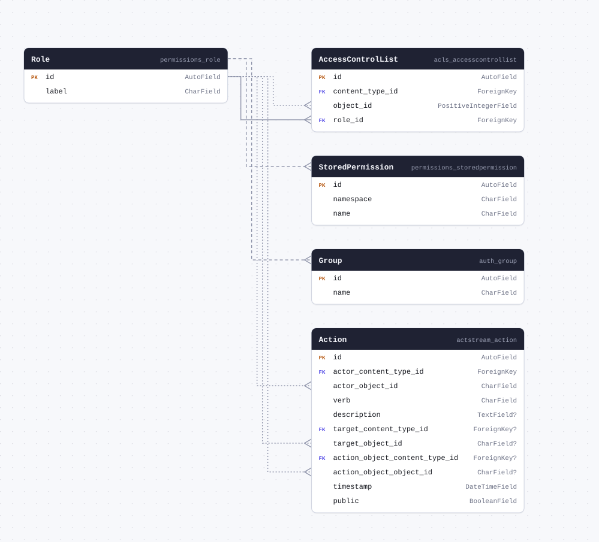

| Column | Field | Type | Null | Key | Default | Description |
| --- | --- | --- | --- | --- | --- | --- |
| `id` | `AutoField` | `integer` |  | PK | `autoincrement()` |  |
| `label` | `CharField` | `varchar(128)` |  | unique |  | A short text describing the role. |

Relations:

- [AccessControlList](#accesscontrollist).`role_id` → `id`, on delete cascade
- `permissions` — many to many with [StoredPermission](#storedpermission)
- `groups` — many to many with [Group](#group)
- `actor_actions` ← [Action](#action), by `actor_content_type_id` + `actor_object_id` (generic relation)
- `target_actions` ← [Action](#action), by `target_content_type_id` + `target_object_id` (generic relation)
- `action_object_actions` ← [Action](#action), by `action_object_content_type_id` + `action_object_object_id` (generic relation)
- `acls` ← [AccessControlList](#accesscontrollist), by `content_type_id` + `object_id` (generic relation)

## StoredPermission

Table `permissions_storedpermission`, app `permissions`.

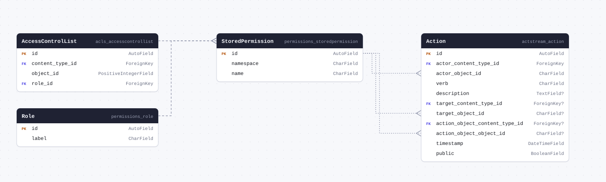

| Column | Field | Type | Null | Key | Default | Description |
| --- | --- | --- | --- | --- | --- | --- |
| `id` | `AutoField` | `integer` |  | PK | `autoincrement()` |  |
| `namespace` | `CharField` | `varchar(64)` |  |  |  |  |
| `name` | `CharField` | `varchar(64)` |  |  |  |  |

Indexes:

- unique `permissions_storedpermission_namespace_name_fb9a3732_uniq` on `namespace`, `name`

Relations:

- `acls` — many to many with [AccessControlList](#accesscontrollist)
- `roles` — many to many with [Role](#role)
- `actor_actions` ← [Action](#action), by `actor_content_type_id` + `actor_object_id` (generic relation)
- `target_actions` ← [Action](#action), by `target_content_type_id` + `target_object_id` (generic relation)
- `action_object_actions` ← [Action](#action), by `action_object_content_type_id` + `action_object_object_id` (generic relation)

## Quota

Table `quotas_quota`, app `quotas`.


| Column | Field | Type | Null | Key | Default | Description |
| --- | --- | --- | --- | --- | --- | --- |
| `id` | `AutoField` | `integer` |  | PK | `autoincrement()` |  |
| `backend_path` | `CharField` | `varchar(255)` |  |  |  | The dotted Python path to the backend class. |
| `backend_data` | `TextField` | `text` |  |  |  |  |
| `enabled` | `BooleanField` | `bool` |  |  | `True` | Allow quick disable or enable of the quota. |

Relations:

- `actor_actions` ← [Action](#action), by `actor_content_type_id` + `actor_object_id` (generic relation)
- `target_actions` ← [Action](#action), by `target_content_type_id` + `target_object_id` (generic relation)
- `action_object_actions` ← [Action](#action), by `action_object_content_type_id` + `action_object_object_id` (generic relation)
- `acls` ← [AccessControlList](#accesscontrollist), by `content_type_id` + `object_id` (generic relation)

## StreamEvent

Table `server_side_events_streamevent`, app `server_side_events`.

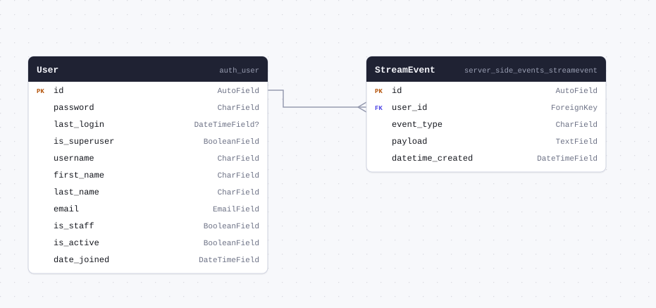

| Column | Field | Type | Null | Key | Default | Description |
| --- | --- | --- | --- | --- | --- | --- |
| `id` | `AutoField` | `integer` |  | PK | `autoincrement()` |  |
| `user_id` | `ForeignKey` | `integer` |  | FK |  |  |
| `event_type` | `CharField` | `varchar(128)` |  |  |  |  |
| `payload` | `TextField` | `text` |  |  |  |  |
| `datetime_created` | `DateTimeField` | `datetime` |  |  | `now()` |  |

Indexes:

- index `server_side_events_streamevent_user_id_359b0c51` on `user_id`
- index `server_side_events_streamevent_event_type_c4137a0e` on `event_type`
- index `server_side_events_streamevent_datetime_created_0026bcec` on `datetime_created`

Relations:

- `user_id` → [User](#user).`id`, on delete cascade

## UpdatedStoredSetting

Table `smart_settings_updatedstoredsetting`, app `smart_settings`.

| Column | Field | Type | Null | Key | Default | Description |
| --- | --- | --- | --- | --- | --- | --- |
| `id` | `AutoField` | `integer` |  | PK | `autoincrement()` |  |
| `key` | `CharField` | `varchar(255)` |  | unique |  | A unique identifier. |
| `value` | `TextField` | `text` | yes |  |  |  |

## DownloadFile

Table `storage_downloadfile`, app `storage`.

Columns from `DatabaseFileModelMixin` (abstract): `filename`, `datetime`.

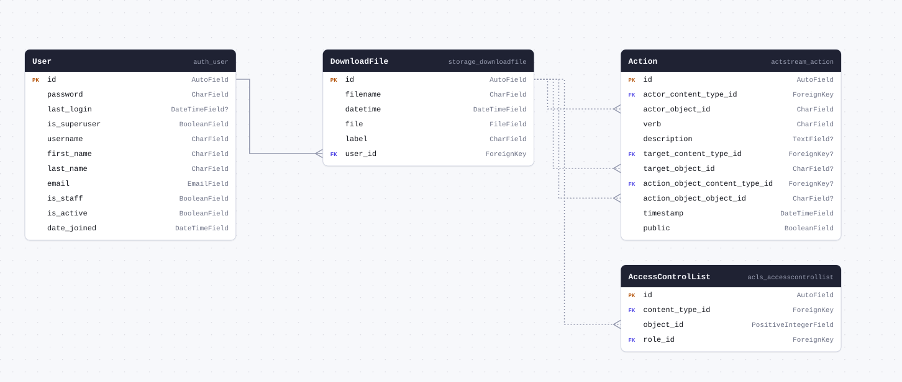

| Column | Field | Type | Null | Key | Default | Description |
| --- | --- | --- | --- | --- | --- | --- |
| `id` | `AutoField` | `integer` |  | PK | `autoincrement()` |  |
| `filename` | `CharField` | `varchar(255)` |  |  |  |  |
| `datetime` | `DateTimeField` | `datetime` |  |  | `now()` |  |
| `file` | `FileField` | `varchar(100)` |  |  |  |  |
| `label` | `CharField` | `varchar(192)` |  |  |  |  |
| `user_id` | `ForeignKey` | `integer` |  | FK |  |  |

Indexes:

- index `storage_downloadfile_filename_639d6892` on `filename`
- index `storage_downloadfile_label_a0b9590b` on `label`
- index `storage_downloadfile_user_id_16c8b643` on `user_id`

Relations:

- `user_id` → [User](#user).`id`, on delete cascade
- `actor_actions` ← [Action](#action), by `actor_content_type_id` + `actor_object_id` (generic relation)
- `target_actions` ← [Action](#action), by `target_content_type_id` + `target_object_id` (generic relation)
- `action_object_actions` ← [Action](#action), by `action_object_content_type_id` + `action_object_object_id` (generic relation)
- `acls` ← [AccessControlList](#accesscontrollist), by `content_type_id` + `object_id` (generic relation)

## SharedUploadedFile

Table `storage_shareduploadedfile`, app `storage`.

Columns from `DatabaseFileModelMixin` (abstract): `filename`, `datetime`.

| Column | Field | Type | Null | Key | Default | Description |
| --- | --- | --- | --- | --- | --- | --- |
| `id` | `AutoField` | `integer` |  | PK | `autoincrement()` |  |
| `datetime` | `DateTimeField` | `datetime` |  |  | `now()` |  |
| `file` | `FileField` | `varchar(100)` |  |  |  |  |
| `filename` | `CharField` | `varchar(255)` |  |  |  |  |

## UserConfirmView

Table `views_userconfirmview`, app `views`.

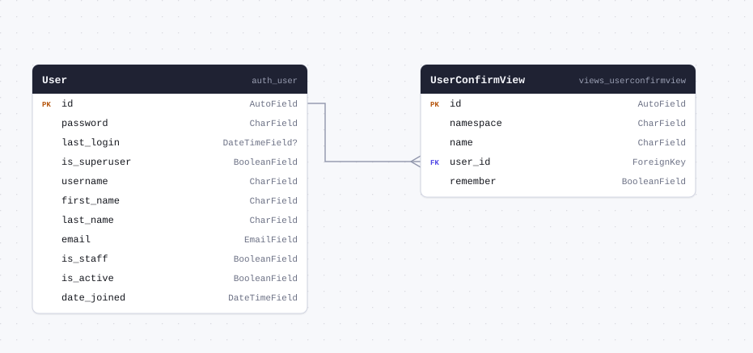

| Column | Field | Type | Null | Key | Default | Description |
| --- | --- | --- | --- | --- | --- | --- |
| `id` | `AutoField` | `integer` |  | PK | `autoincrement()` |  |
| `namespace` | `CharField` | `varchar(200)` |  |  |  |  |
| `name` | `CharField` | `varchar(200)` |  |  |  | Full name of the view including the namespace. |
| `user_id` | `ForeignKey` | `integer` |  | FK |  |  |
| `remember` | `BooleanField` | `bool` |  |  | `False` | Remember the last confirmation of the view. |

Indexes:

- index `views_userconfirmview_namespace_ee073ad8` on `namespace`
- index `views_userconfirmview_name_6b65bb7d` on `name`
- index `views_userconfirmview_user_id_294bb79d` on `user_id`
- unique `views_userconfirmview_user_id_name_acc2168b_uniq` on `user_id`, `name`

Relations:

- `user_id` → [User](#user).`id`, on delete cascade

## UserViewMode

Table `views_userviewmode`, app `views`.

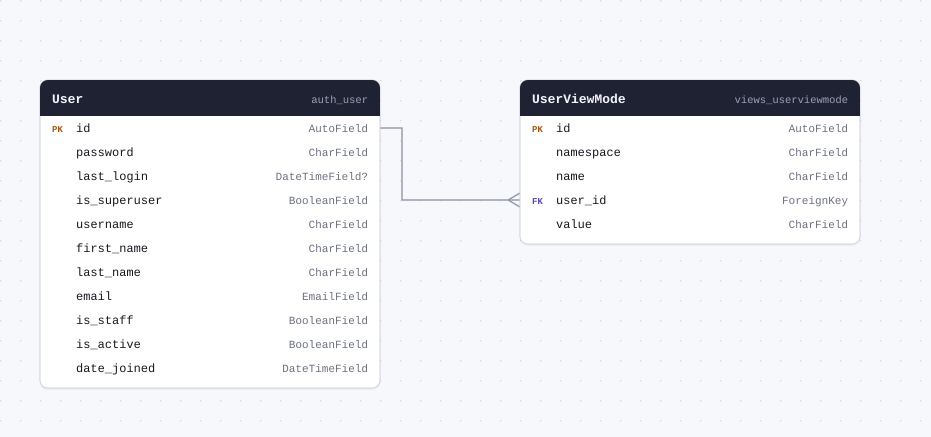

| Column | Field | Type | Null | Key | Default | Description |
| --- | --- | --- | --- | --- | --- | --- |
| `id` | `AutoField` | `integer` |  | PK | `autoincrement()` |  |
| `namespace` | `CharField` | `varchar(200)` |  |  |  |  |
| `name` | `CharField` | `varchar(200)` |  |  |  | Full name of the view including the namespace. |
| `user_id` | `ForeignKey` | `integer` |  | FK |  |  |
| `value` | `CharField` | `varchar(5)` |  |  |  | Stored value used to identify the display mode of the view. |

Indexes:

- index `views_userviewmode_namespace_10d9dcab` on `namespace`
- index `views_userviewmode_name_3103c477` on `name`
- index `views_userviewmode_user_id_c2870aa8` on `user_id`
- index `views_userviewmode_value_f63ba571` on `value`
- unique `views_userviewmode_user_id_name_48ba57ad_uniq` on `user_id`, `name`

Relations:

- `user_id` → [User](#user).`id`, on delete cascade

## Announcement

Table `announcements_announcement`, app `announcements`.

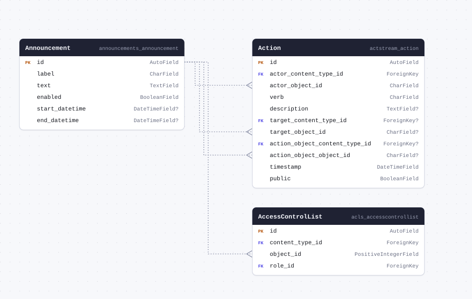

| Column | Field | Type | Null | Key | Default | Description |
| --- | --- | --- | --- | --- | --- | --- |
| `id` | `AutoField` | `integer` |  | PK | `autoincrement()` |  |
| `label` | `CharField` | `varchar(32)` |  |  |  | Short description of this announcement. |
| `text` | `TextField` | `text` |  |  |  | The actual text to be displayed. |
| `enabled` | `BooleanField` | `bool` |  |  | `True` |  |
| `start_datetime` | `DateTimeField` | `datetime` | yes |  |  | Date and time after which this announcement will be displayed. |
| `end_datetime` | `DateTimeField` | `datetime` | yes |  |  | Date and time until when this announcement is to be displayed. |

Relations:

- `actor_actions` ← [Action](#action), by `actor_content_type_id` + `actor_object_id` (generic relation)
- `target_actions` ← [Action](#action), by `target_content_type_id` + `target_object_id` (generic relation)
- `action_object_actions` ← [Action](#action), by `action_object_content_type_id` + `action_object_object_id` (generic relation)
- `acls` ← [AccessControlList](#accesscontrollist), by `content_type_id` + `object_id` (generic relation)

## DocumentType

Table `documents_documenttype`, app `documents`.

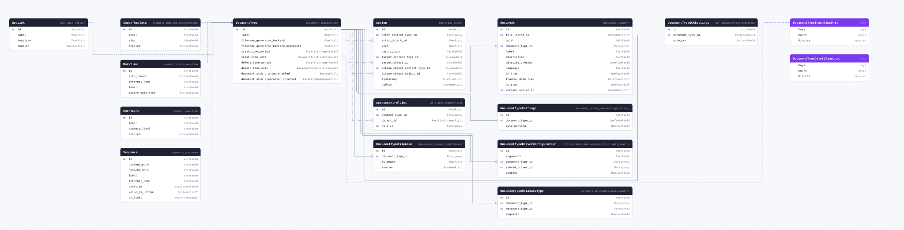

| Column | Field | Type | Null | Key | Default | Description |
| --- | --- | --- | --- | --- | --- | --- |
| `id` | `AutoField` | `integer` |  | PK | `autoincrement()` |  |
| `label` | `CharField` | `varchar(196)` |  | unique |  | A short text identifying the document type. |
| `filename_generator_backend` | `CharField` | `varchar(224)` |  |  | `'uuid'` | The class responsible for producing the actual filename used to store the uploaded documents. |
| `filename_generator_backend_arguments` | `TextField` | `text` |  |  |  | The arguments for the filename generator backend as a YAML dictionary. |
| `trash_time_period` | `PositiveIntegerField` | `integer unsigned` | yes |  |  | Amount of time after which documents of this type will be moved to the trash. |
| `trash_time_unit` | `DocumentTypeTrashTimeUnit` | `varchar(12)` | yes |  |  |  |
| `delete_time_period` | `PositiveIntegerField` | `integer unsigned` | yes |  | `30` | Amount of time after which documents of this type in the trash will be deleted. |
| `delete_time_unit` | `DocumentTypeDeleteTimeUnit` | `varchar(12)` | yes |  | `'days'` |  |
| `document_stub_pruning_enabled` | `BooleanField` | `bool` |  |  | `True` | Delete documents that do not contain any files after a configured expiration interval. |
| `document_stub_expiration_interval` | `PositiveBigIntegerField` | `bigint unsigned` |  |  | `86400` | Time (in seconds) after which a document stub will be considered invalid and deleted, if pruning is enabled. This an optimization setting and should only be changed for specific circumstances. |

Relations:

- `actor_actions` ← [Action](#action), by `actor_content_type_id` + `actor_object_id` (generic relation)
- `target_actions` ← [Action](#action), by `target_content_type_id` + `target_object_id` (generic relation)
- `action_object_actions` ← [Action](#action), by `action_object_content_type_id` + `action_object_object_id` (generic relation)
- `acls` ← [AccessControlList](#accesscontrollist), by `content_type_id` + `object_id` (generic relation)
- [DocumentTypeFilename](#documenttypefilename).`document_type_id` → `id`, on delete cascade
- [Document](#document).`document_type_id` → `id`, on delete cascade
- `index_templates` — many to many with [IndexTemplate](#indextemplate)
- [DocumentTypeSettings](#documenttypesettings).`document_type_id` → `id`, on delete cascade
- `workflows` — many to many with [Workflow](#workflow)
- [DocumentTypeDriverConfiguration](#documenttypedriverconfiguration).`document_type_id` → `id`, on delete cascade
- `smart_links` — many to many with [SmartLink](#smartlink)
- [DocumentTypeMetadataType](#documenttypemetadatatype).`document_type_id` → `id`, on delete cascade
- [DocumentTypeOCRSettings](#documenttypeocrsettings).`document_type_id` → `id`, on delete cascade
- `sequences` — many to many with [Sequence](#sequence)
- `web_links` — many to many with [WebLink](#weblink)

## DocumentTypeFilename

Table `documents_documenttypefilename`, app `documents`.

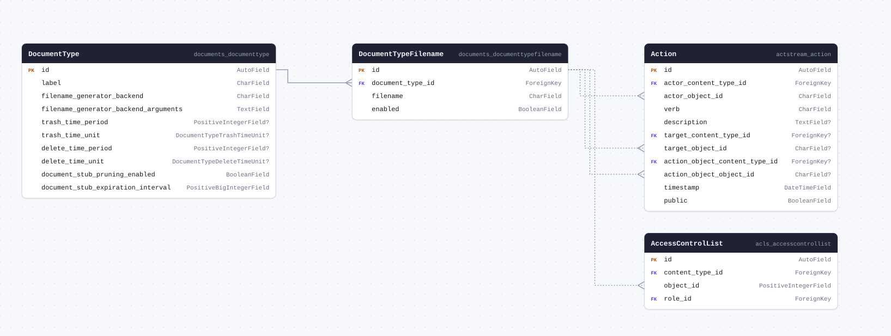

| Column | Field | Type | Null | Key | Default | Description |
| --- | --- | --- | --- | --- | --- | --- |
| `id` | `AutoField` | `integer` |  | PK | `autoincrement()` |  |
| `document_type_id` | `ForeignKey` | `integer` |  | FK |  |  |
| `filename` | `CharField` | `varchar(128)` |  |  |  |  |
| `enabled` | `BooleanField` | `bool` |  |  | `True` |  |

Indexes:

- index `documents_documenttypefilename_document_type_id_56f21f7f` on `document_type_id`
- index `documents_documenttypefilename_filename_15dfc133` on `filename`
- unique `documents_documenttypefilename_document_type_id_filename_cffa5dbb_uniq` on `document_type_id`, `filename`

Relations:

- `document_type_id` → [DocumentType](#documenttype).`id`, on delete cascade
- `actor_actions` ← [Action](#action), by `actor_content_type_id` + `actor_object_id` (generic relation)
- `target_actions` ← [Action](#action), by `target_content_type_id` + `target_object_id` (generic relation)
- `action_object_actions` ← [Action](#action), by `action_object_content_type_id` + `action_object_object_id` (generic relation)
- `acls` ← [AccessControlList](#accesscontrollist), by `content_type_id` + `object_id` (generic relation)

## Document

Table `documents_document`, app `documents`.

Proxy models, on this table: `DocumentSearchResult`, `RecentlyCreatedDocument`, `RecentlyAccessedDocumentProxy`, `TrashedDocument`, `CheckedOutDocument`, `FavoriteDocumentProxy`, `DuplicateSourceDocument`, `DuplicateTargetDocument`.

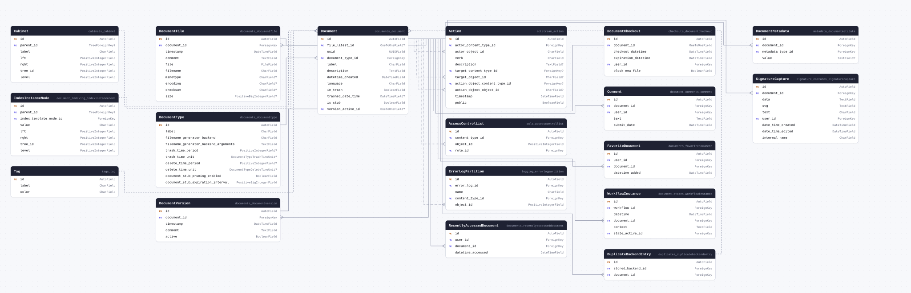

| Column | Field | Type | Null | Key | Default | Description |
| --- | --- | --- | --- | --- | --- | --- |
| `id` | `AutoField` | `integer` |  | PK | `autoincrement()` |  |
| `file_latest_id` | `OneToOneField` | `integer` | yes | FK, unique |  |  |
| `uuid` | `UUIDField` | `char(32)` |  |  | `uuid4()` | UUID of a document, universally Unique ID. An unique identifier generated for each document. |
| `document_type_id` | `ForeignKey` | `integer` |  | FK |  | The document type of the document. |
| `label` | `CharField` | `varchar(255)` |  |  | `''` | A short text identifying the document. By default, will be set to the filename of the first file uploaded to the document. |
| `description` | `TextField` | `text` |  |  | `''` | An optional short text describing a document. |
| `datetime_created` | `DateTimeField` | `datetime` |  |  | `now()` | The date and time of the document creation. |
| `language` | `CharField` | `varchar(8)` |  |  | `'eng'` | The primary language in the document. |
| `in_trash` | `BooleanField` | `bool` |  |  | `False` | Whether or not this document is in the trash. |
| `trashed_date_time` | `DateTimeField` | `datetime` | yes |  |  | The server date and time when the document was moved to the trash. |
| `is_stub` | `BooleanField` | `bool` |  |  | `True` | A document stub is a document with an entry on the database but no file uploaded. This could be an interrupted upload or a deferred upload via the API. |
| `version_active_id` | `OneToOneField` | `integer` | yes | FK, unique |  |  |

Indexes:

- index `documents_document_document_type_id_1f88b50c` on `document_type_id`
- index `documents_document_label_556c6583` on `label`
- index `documents_document_datetime_created_c0d566d6` on `datetime_created`
- index `documents_document_in_trash_99a07799` on `in_trash`
- index `documents_document_is_stub_7a1cdd11` on `is_stub`

Relations:

- `file_latest_id` → [DocumentFile](#documentfile).`id`, on delete set null
- `document_type_id` → [DocumentType](#documenttype).`id`, on delete cascade
- `version_active_id` → [DocumentVersion](#documentversion).`id`, on delete set null
- `actor_actions` ← [Action](#action), by `actor_content_type_id` + `actor_object_id` (generic relation)
- `target_actions` ← [Action](#action), by `target_content_type_id` + `target_object_id` (generic relation)
- `action_object_actions` ← [Action](#action), by `action_object_content_type_id` + `action_object_object_id` (generic relation)
- `acls` ← [AccessControlList](#accesscontrollist), by `content_type_id` + `object_id` (generic relation)
- `error_log_partitions` ← [ErrorLogPartition](#errorlogpartition), by `content_type_id` + `object_id` (generic relation)
- [DocumentFile](#documentfile).`document_id` → `id`, on delete cascade
- [DocumentVersion](#documentversion).`document_id` → `id`, on delete cascade
- [RecentlyAccessedDocument](#recentlyaccesseddocument).`document_id` → `id`, on delete cascade
- `cabinets` — many to many with [Cabinet](#cabinet)
- [DocumentCheckout](#documentcheckout).`document_id` → `id`, on delete cascade
- [Comment](#comment).`document_id` → `id`, on delete cascade
- [FavoriteDocument](#favoritedocument).`document_id` → `id`, on delete cascade
- `index_instance_nodes` — many to many with [IndexInstanceNode](#indexinstancenode)
- [WorkflowInstance](#workflowinstance).`document_id` → `id`, on delete cascade
- [DuplicateBackendEntry](#duplicatebackendentry).`document_id` → `id`, on delete cascade
- `as_duplicate` — many to many with [DuplicateBackendEntry](#duplicatebackendentry)
- [DocumentMetadata](#documentmetadata).`document_id` → `id`, on delete cascade
- [SignatureCapture](#signaturecapture).`document_id` → `id`, on delete cascade
- `tags` — many to many with [Tag](#tag)

## DocumentFile

Table `documents_documentfile`, app `documents`.

Proxy models, on this table: `DocumentFileSearchResult`.

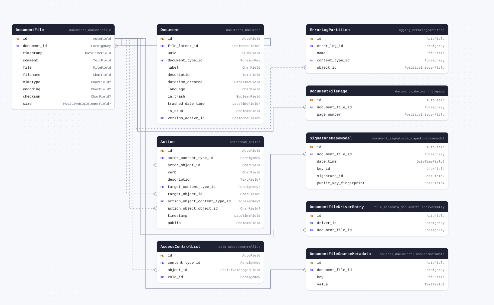

| Column | Field | Type | Null | Key | Default | Description |
| --- | --- | --- | --- | --- | --- | --- |
| `id` | `AutoField` | `integer` |  | PK | `autoincrement()` |  |
| `document_id` | `ForeignKey` | `integer` |  | FK |  |  |
| `timestamp` | `DateTimeField` | `datetime` |  |  | `now()` | The server date and time when the document file was processed. |
| `comment` | `TextField` | `text` |  |  | `''` | An optional short text describing the document file. |
| `file` | `FileField` | `varchar(100)` |  |  |  |  |
| `filename` | `CharField` | `varchar(255)` |  |  |  |  |
| `mimetype` | `CharField` | `varchar(255)` | yes |  |  | The document file's file mimetype. MIME types are a standard way to describe the format of a file, in this case the file format of the document. Some examples: "text/plain" or "image/jpeg". |
| `encoding` | `CharField` | `varchar(64)` | yes |  |  | The document file file encoding. binary 7-bit, binary 8-bit, text, base64, etc. |
| `checksum` | `CharField` | `varchar(64)` | yes |  |  | A hash/checkdigit/fingerprint generated from the document's binary data. Only identical documents will have the same checksum. |
| `size` | `PositiveBigIntegerField` | `bigint unsigned` | yes |  |  | The size of the file in bytes. |

Indexes:

- index `documents_documentfile_document_id_5b31b6f0` on `document_id`
- index `documents_documentfile_timestamp_58ec4afb` on `timestamp`
- index `documents_documentfile_checksum_0110fee6` on `checksum`
- index `documents_documentfile_size_4f23f14b` on `size`

Relations:

- [Document](#document).`file_latest_id` → `id`, on delete set null
- `document_id` → [Document](#document).`id`, on delete cascade
- `actor_actions` ← [Action](#action), by `actor_content_type_id` + `actor_object_id` (generic relation)
- `target_actions` ← [Action](#action), by `target_content_type_id` + `target_object_id` (generic relation)
- `action_object_actions` ← [Action](#action), by `action_object_content_type_id` + `action_object_object_id` (generic relation)
- `acls` ← [AccessControlList](#accesscontrollist), by `content_type_id` + `object_id` (generic relation)
- `error_log_partitions` ← [ErrorLogPartition](#errorlogpartition), by `content_type_id` + `object_id` (generic relation)
- [DocumentFilePage](#documentfilepage).`document_file_id` → `id`, on delete cascade
- [SignatureBaseModel](#signaturebasemodel).`document_file_id` → `id`, on delete cascade
- [DocumentFileDriverEntry](#documentfiledriverentry).`document_file_id` → `id`, on delete cascade
- [DocumentFileSourceMetadata](#documentfilesourcemetadata).`document_file_id` → `id`, on delete cascade

## DocumentVersion

Table `documents_documentversion`, app `documents`.

Proxy models, on this table: `DocumentVersionSearchResult`.

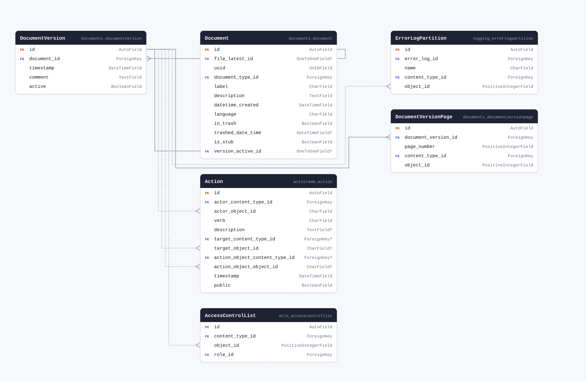

| Column | Field | Type | Null | Key | Default | Description |
| --- | --- | --- | --- | --- | --- | --- |
| `id` | `AutoField` | `integer` |  | PK | `autoincrement()` |  |
| `document_id` | `ForeignKey` | `integer` |  | FK |  |  |
| `timestamp` | `DateTimeField` | `datetime` |  |  | `now()` | The server date and time when the document version was created. |
| `comment` | `TextField` | `text` |  |  | `''` | An optional short text describing the document version. |
| `active` | `BooleanField` | `bool` |  |  | `False` | Determines the active version of the document. |

Indexes:

- index `documents_documentversion_document_id_42757b7a` on `document_id`
- index `documents_documentversion_timestamp_30bada95` on `timestamp`

Relations:

- [Document](#document).`version_active_id` → `id`, on delete set null
- `document_id` → [Document](#document).`id`, on delete cascade
- `actor_actions` ← [Action](#action), by `actor_content_type_id` + `actor_object_id` (generic relation)
- `target_actions` ← [Action](#action), by `target_content_type_id` + `target_object_id` (generic relation)
- `action_object_actions` ← [Action](#action), by `action_object_content_type_id` + `action_object_object_id` (generic relation)
- `acls` ← [AccessControlList](#accesscontrollist), by `content_type_id` + `object_id` (generic relation)
- `error_log_partitions` ← [ErrorLogPartition](#errorlogpartition), by `content_type_id` + `object_id` (generic relation)
- [DocumentVersionPage](#documentversionpage).`document_version_id` → `id`, on delete cascade

## DocumentVersionPage

Table `documents_documentversionpage`, app `documents`.

Proxy models, on this table: `DocumentVersionPageSearchResult`.


| Column | Field | Type | Null | Key | Default | Description |
| --- | --- | --- | --- | --- | --- | --- |
| `id` | `AutoField` | `integer` |  | PK | `autoincrement()` |  |
| `document_version_id` | `ForeignKey` | `integer` |  | FK |  |  |
| `page_number` | `PositiveIntegerField` | `integer unsigned` |  |  | `1` | Unique integer number for the page. Pages are ordered by this number. |
| `content_type_id` | `ForeignKey` | `integer` |  | FK |  | Content type for the source object of the page. |
| `object_id` | `PositiveIntegerField` | `integer unsigned` |  |  |  | ID for the source object of the page. |

Indexes:

- index `documents_documentversionpage_document_version_id_941cf2d3` on `document_version_id`
- index `documents_documentversionpage_page_number_15bf5ac0` on `page_number`
- index `documents_documentversionpage_content_type_id_13b68cd8` on `content_type_id`
- unique `documents_documentversionpage_document_version_id_page_number_a90994fe_uniq` on `document_version_id`, `page_number`

Relations:

- `content_object` → any model, by `content_type_id` + `object_id` (generic foreign key)
- `document_version_id` → [DocumentVersion](#documentversion).`id`, on delete cascade
- `content_type_id` → [ContentType](#contenttype).`id`, on delete cascade
- `actor_actions` ← [Action](#action), by `actor_content_type_id` + `actor_object_id` (generic relation)
- `target_actions` ← [Action](#action), by `target_content_type_id` + `target_object_id` (generic relation)
- `action_object_actions` ← [Action](#action), by `action_object_content_type_id` + `action_object_object_id` (generic relation)
- `acls` ← [AccessControlList](#accesscontrollist), by `content_type_id` + `object_id` (generic relation)
- `error_log_partitions` ← [ErrorLogPartition](#errorlogpartition), by `content_type_id` + `object_id` (generic relation)
- [DocumentVersionPageOCRContent](#documentversionpageocrcontent).`document_version_page_id` → `id`, on delete cascade

## DocumentFilePage

Table `documents_documentfilepage`, app `documents`.

Proxy models, on this table: `DocumentFilePageSearchResult`.


| Column | Field | Type | Null | Key | Default | Description |
| --- | --- | --- | --- | --- | --- | --- |
| `id` | `AutoField` | `integer` |  | PK | `autoincrement()` |  |
| `document_file_id` | `ForeignKey` | `integer` |  | FK |  |  |
| `page_number` | `PositiveIntegerField` | `integer unsigned` |  |  | `1` |  |

Indexes:

- index `documents_documentfilepage_document_file_id_cc720df4` on `document_file_id`
- index `documents_documentfilepage_page_number_0e56c261` on `page_number`

Relations:

- `document_file_id` → [DocumentFile](#documentfile).`id`, on delete cascade
- `actor_actions` ← [Action](#action), by `actor_content_type_id` + `actor_object_id` (generic relation)
- `target_actions` ← [Action](#action), by `target_content_type_id` + `target_object_id` (generic relation)
- `action_object_actions` ← [Action](#action), by `action_object_content_type_id` + `action_object_object_id` (generic relation)
- `acls` ← [AccessControlList](#accesscontrollist), by `content_type_id` + `object_id` (generic relation)
- `error_log_partitions` ← [ErrorLogPartition](#errorlogpartition), by `content_type_id` + `object_id` (generic relation)
- [DocumentFilePageContent](#documentfilepagecontent).`document_file_page_id` → `id`, on delete cascade

## RecentlyAccessedDocument

Table `documents_recentlyaccesseddocument`, app `documents`.


| Column | Field | Type | Null | Key | Default | Description |
| --- | --- | --- | --- | --- | --- | --- |
| `id` | `AutoField` | `integer` |  | PK | `autoincrement()` |  |
| `user_id` | `ForeignKey` | `integer` |  | FK |  |  |
| `document_id` | `ForeignKey` | `integer` |  | FK |  |  |
| `datetime_accessed` | `DateTimeField` | `datetime` |  |  | `now()` |  |

Indexes:

- index `documents_recentlyaccesseddocument_user_id_8c95f526` on `user_id`
- index `documents_recentlyaccesseddocument_document_id_ad334148` on `document_id`
- index `documents_recentlyaccesseddocument_datetime_accessed_853ecc10` on `datetime_accessed`

Relations:

- `user_id` → [User](#user).`id`, on delete cascade
- `document_id` → [Document](#document).`id`, on delete cascade

## Cabinet

Table `cabinets_cabinet`, app `cabinets`.

Proxy models, on this table: `CabinetSearchResult`, `DocumentCabinet`.


| Column | Field | Type | Null | Key | Default | Description |
| --- | --- | --- | --- | --- | --- | --- |
| `id` | `AutoField` | `integer` |  | PK | `autoincrement()` |  |
| `parent_id` | `TreeForeignKey` | `integer` | yes | FK |  |  |
| `label` | `CharField` | `varchar(128)` |  |  |  | A short text used to identify the cabinet. |
| `lft` | `PositiveIntegerField` | `integer unsigned` |  |  |  |  |
| `rght` | `PositiveIntegerField` | `integer unsigned` |  |  |  |  |
| `tree_id` | `PositiveIntegerField` | `integer unsigned` |  |  |  |  |
| `level` | `PositiveIntegerField` | `integer unsigned` |  |  |  |  |

Indexes:

- index `cabinets_cabinet_parent_id_0939a3c3` on `parent_id`
- index `cabinets_cabinet_tree_id_c9719a3c` on `tree_id`
- unique `cabinets_cabinet_parent_id_label_441a7709_uniq` on `parent_id`, `label`
- index `cabinets_cabinet_tree_id_l3e14` on `tree_id`, `lft`

Relations:

- `parent_id` → [Cabinet](#cabinet).`id`, on delete cascade
- `documents` — many to many with [Document](#document)
- `actor_actions` ← [Action](#action), by `actor_content_type_id` + `actor_object_id` (generic relation)
- `target_actions` ← [Action](#action), by `target_content_type_id` + `target_object_id` (generic relation)
- `action_object_actions` ← [Action](#action), by `action_object_content_type_id` + `action_object_object_id` (generic relation)
- `acls` ← [AccessControlList](#accesscontrollist), by `content_type_id` + `object_id` (generic relation)

## DocumentCheckout

Table `checkouts_documentcheckout`, app `checkouts`.


| Column | Field | Type | Null | Key | Default | Description |
| --- | --- | --- | --- | --- | --- | --- |
| `id` | `AutoField` | `integer` |  | PK | `autoincrement()` |  |
| `document_id` | `OneToOneField` | `integer` |  | FK, unique |  |  |
| `checkout_datetime` | `DateTimeField` | `datetime` |  |  | `now()` |  |
| `expiration_datetime` | `DateTimeField` | `datetime` |  |  |  | Amount of time to hold the document checked out in minutes. |
| `user_id` | `ForeignKey` | `integer` |  | FK |  |  |
| `block_new_file` | `BooleanField` | `bool` |  |  | `True` | Do not allow new file of this document to be uploaded. |

Indexes:

- index `checkouts_documentcheckout_user_id_f3ea15e3` on `user_id`

Relations:

- `document_id` → [Document](#document).`id`, on delete cascade
- `user_id` → [User](#user).`id`, on delete cascade

## Comment

Table `document_comments_comment`, app `document_comments`.


| Column | Field | Type | Null | Key | Default | Description |
| --- | --- | --- | --- | --- | --- | --- |
| `id` | `AutoField` | `integer` |  | PK | `autoincrement()` |  |
| `document_id` | `ForeignKey` | `integer` |  | FK |  |  |
| `user_id` | `ForeignKey` | `integer` |  | FK |  | The user account that made the comment. |
| `text` | `TextField` | `text` |  |  |  | Actual text content of the comment. |
| `submit_date` | `DateTimeField` | `datetime` |  |  | `now()` |  |

Indexes:

- index `document_comments_comment_document_id_2435cfe5` on `document_id`
- index `document_comments_comment_user_id_cfa5a004` on `user_id`
- index `document_comments_comment_submit_date_c3c6a9cc` on `submit_date`

Relations:

- `document_id` → [Document](#document).`id`, on delete cascade
- `user_id` → [User](#user).`id`, on delete cascade
- `actor_actions` ← [Action](#action), by `actor_content_type_id` + `actor_object_id` (generic relation)
- `target_actions` ← [Action](#action), by `target_content_type_id` + `target_object_id` (generic relation)
- `action_object_actions` ← [Action](#action), by `action_object_content_type_id` + `action_object_object_id` (generic relation)
- `acls` ← [AccessControlList](#accesscontrollist), by `content_type_id` + `object_id` (generic relation)

## FavoriteDocument

Table `documents_favoritedocument`, app `document_favorites`.


| Column | Field | Type | Null | Key | Default | Description |
| --- | --- | --- | --- | --- | --- | --- |
| `id` | `AutoField` | `integer` |  | PK | `autoincrement()` |  |
| `user_id` | `ForeignKey` | `integer` |  | FK |  |  |
| `document_id` | `ForeignKey` | `integer` |  | FK |  |  |
| `datetime_added` | `DateTimeField` | `datetime` |  |  | `now()` |  |

Indexes:

- index `documents_favoritedocument_user_id_d10ba5d2` on `user_id`
- index `documents_favoritedocument_document_id_0ea7eea9` on `document_id`
- index `documents_favoritedocument_datetime_added_43dd9aba` on `datetime_added`
- unique `documents_favoritedocument_document_id_user_id_f621d645_uniq` on `document_id`, `user_id`

Relations:

- `user_id` → [User](#user).`id`, on delete cascade
- `document_id` → [Document](#document).`id`, on delete cascade

## IndexTemplate

Table `document_indexing_indextemplate`, app `document_indexing`.

Proxy models, on this table: `IndexInstance`.


| Column | Field | Type | Null | Key | Default | Description |
| --- | --- | --- | --- | --- | --- | --- |
| `id` | `AutoField` | `integer` |  | PK | `autoincrement()` |  |
| `label` | `CharField` | `varchar(128)` |  | unique |  | Short description of this index. |
| `slug` | `SlugField` | `varchar(128)` |  | unique |  | This value will be used by other apps to reference this index. |
| `enabled` | `BooleanField` | `bool` |  |  | `True` | Causes this index to be visible and updated when document data changes. |

Relations:

- `document_types` — many to many with [DocumentType](#documenttype)
- `actor_actions` ← [Action](#action), by `actor_content_type_id` + `actor_object_id` (generic relation)
- `target_actions` ← [Action](#action), by `target_content_type_id` + `target_object_id` (generic relation)
- `action_object_actions` ← [Action](#action), by `action_object_content_type_id` + `action_object_object_id` (generic relation)
- `acls` ← [AccessControlList](#accesscontrollist), by `content_type_id` + `object_id` (generic relation)
- [IndexTemplateEventTrigger](#indextemplateeventtrigger).`index_template_id` → `id`, on delete cascade
- [IndexTemplateNode](#indextemplatenode).`index_id` → `id`, on delete cascade

## IndexTemplateEventTrigger

Table `document_indexing_indextemplateeventtrigger`, app `document_indexing`.


| Column | Field | Type | Null | Key | Default | Description |
| --- | --- | --- | --- | --- | --- | --- |
| `id` | `AutoField` | `integer` |  | PK | `autoincrement()` |  |
| `index_template_id` | `ForeignKey` | `integer` |  | FK |  |  |
| `stored_event_type_id` | `ForeignKey` | `integer` |  | FK |  |  |

Indexes:

- index `document_indexing_indextemplateeventtrigger_index_template_id_6d620204` on `index_template_id`
- index `document_indexing_indextemplateeventtrigger_stored_event_type_id_301c833e` on `stored_event_type_id`
- unique `document_indexing_indextemplateeventtrigger_index_template_id_stored_event_type_id_e0516a83_uniq` on `index_template_id`, `stored_event_type_id`

Relations:

- `index_template_id` → [IndexTemplate](#indextemplate).`id`, on delete cascade
- `stored_event_type_id` → [StoredEventType](#storedeventtype).`id`, on delete cascade

## IndexTemplateNode

Table `document_indexing_indextemplatenode`, app `document_indexing`.


| Column | Field | Type | Null | Key | Default | Description |
| --- | --- | --- | --- | --- | --- | --- |
| `id` | `AutoField` | `integer` |  | PK | `autoincrement()` |  |
| `parent_id` | `TreeForeignKey` | `integer` | yes | FK |  | Parent index template node of this node. |
| `index_id` | `ForeignKey` | `integer` |  | FK |  |  |
| `expression` | `TextField` | `text` |  |  |  | Enter a template to render. Use Django's default templating language. |
| `enabled` | `BooleanField` | `bool` |  |  | `True` | Causes this node to be visible and updated when document data changes. |
| `link_documents` | `BooleanField` | `bool` |  |  | `False` | Check this option to have this node act as a container for documents and not as a parent for further nodes. |
| `lft` | `PositiveIntegerField` | `integer unsigned` |  |  |  |  |
| `rght` | `PositiveIntegerField` | `integer unsigned` |  |  |  |  |
| `tree_id` | `PositiveIntegerField` | `integer unsigned` |  |  |  |  |
| `level` | `PositiveIntegerField` | `integer unsigned` |  |  |  |  |

Indexes:

- index `document_indexing_indextemplatenode_parent_id_27089927` on `parent_id`
- index `document_indexing_indextemplatenode_index_id_1a5de5b2` on `index_id`
- index `document_indexing_indextemplatenode_tree_id_36218774` on `tree_id`
- index `document_indexing_indextema426` on `tree_id`, `lft`

Relations:

- `parent_id` → [IndexTemplateNode](#indextemplatenode).`id`, on delete cascade
- `index_id` → [IndexTemplate](#indextemplate).`id`, on delete cascade
- [IndexInstanceNode](#indexinstancenode).`index_template_node_id` → `id`, on delete cascade

## IndexInstanceNode

Table `document_indexing_indexinstancenode`, app `document_indexing`.

Proxy models, on this table: `DocumentIndexInstanceNode`, `IndexInstanceNodeSearchResult`.


| Column | Field | Type | Null | Key | Default | Description |
| --- | --- | --- | --- | --- | --- | --- |
| `id` | `AutoField` | `integer` |  | PK | `autoincrement()` |  |
| `parent_id` | `TreeForeignKey` | `integer` | yes | FK |  |  |
| `index_template_node_id` | `ForeignKey` | `integer` |  | FK |  |  |
| `value` | `CharField` | `varchar(255)` |  |  |  |  |
| `lft` | `PositiveIntegerField` | `integer unsigned` |  |  |  |  |
| `rght` | `PositiveIntegerField` | `integer unsigned` |  |  |  |  |
| `tree_id` | `PositiveIntegerField` | `integer unsigned` |  |  |  |  |
| `level` | `PositiveIntegerField` | `integer unsigned` |  |  |  |  |

Indexes:

- index `document_indexing_indexinstancenode_parent_id_3db469f0` on `parent_id`
- index `document_indexing_indexinstancenode_index_template_node_id_366c4e5a` on `index_template_node_id`
- index `document_indexing_indexinstancenode_value_cf7fc740` on `value`
- index `document_indexing_indexinstancenode_tree_id_4b10b72a` on `tree_id`
- unique `document_indexing_indexinstancenode_index_template_node_id_parent_id_value_3d01ac7c_uniq` on `index_template_node_id`, `parent_id`, `value`
- index `document_indexing_indexins009e` on `tree_id`, `lft`

Relations:

- `parent_id` → [IndexInstanceNode](#indexinstancenode).`id`, on delete cascade
- `index_template_node_id` → [IndexTemplateNode](#indextemplatenode).`id`, on delete cascade
- `documents` — many to many with [Document](#document)

## DocumentFilePageContent

Table `document_parsing_documentfilepagecontent`, app `document_parsing`.


| Column | Field | Type | Null | Key | Default | Description |
| --- | --- | --- | --- | --- | --- | --- |
| `id` | `AutoField` | `integer` |  | PK | `autoincrement()` |  |
| `document_file_page_id` | `OneToOneField` | `integer` |  | FK, unique |  |  |
| `content` | `TextField` | `text` |  |  |  | The actual text content as extracted by the document parsing backend. |

Relations:

- `document_file_page_id` → [DocumentFilePage](#documentfilepage).`id`, on delete cascade

## DocumentTypeSettings

Table `document_parsing_documenttypesettings`, app `document_parsing`.


| Column | Field | Type | Null | Key | Default | Description |
| --- | --- | --- | --- | --- | --- | --- |
| `id` | `AutoField` | `integer` |  | PK | `autoincrement()` |  |
| `document_type_id` | `OneToOneField` | `integer` |  | FK, unique |  |  |
| `auto_parsing` | `BooleanField` | `bool` |  |  | `True` | Automatically queue newly created documents for parsing. |

Relations:

- `document_type_id` → [DocumentType](#documenttype).`id`, on delete cascade

## SignatureBaseModel

Table `document_signatures_signaturebasemodel`, app `document_signatures`.

Subclasses (multi-table): [DetachedSignature](#detachedsignature), [EmbeddedSignature](#embeddedsignature).


| Column | Field | Type | Null | Key | Default | Description |
| --- | --- | --- | --- | --- | --- | --- |
| `id` | `AutoField` | `integer` |  | PK | `autoincrement()` |  |
| `document_file_id` | `ForeignKey` | `integer` |  | FK |  |  |
| `date_time` | `DateTimeField` | `datetime` | yes |  |  |  |
| `key_id` | `CharField` | `varchar(40)` |  |  |  | ID of the key that will be used to sign the document. |
| `signature_id` | `CharField` | `varchar(64)` | yes |  |  |  |
| `public_key_fingerprint` | `CharField` | `varchar(40)` | yes |  |  |  |

Indexes:

- index `document_signatures_signaturebasemodel_document_file_id_91187afc` on `document_file_id`

Relations:

- `document_file_id` → [DocumentFile](#documentfile).`id`, on delete cascade
- [DetachedSignature](#detachedsignature).`signaturebasemodel_ptr_id` → `id`, parent link, on delete cascade
- [EmbeddedSignature](#embeddedsignature).`signaturebasemodel_ptr_id` → `id`, parent link, on delete cascade

## DetachedSignature

Table `document_signatures_detachedsignature`, app `document_signatures`.

Inherits from [SignatureBaseModel](#signaturebasemodel) (multi-table): its rows are joined on `signaturebasemodel_ptr_id`.


| Column | Field | Type | Null | Key | Default | Description |
| --- | --- | --- | --- | --- | --- | --- |
| `signaturebasemodel_ptr_id` | `OneToOneField` | `integer` |  | PK, FK |  |  |
| `signature_file` | `FileField` | `varchar(100)` | yes |  |  | Signature file previously generated. |

Relations:

- `signaturebasemodel_ptr_id` → [SignatureBaseModel](#signaturebasemodel).`id`, parent link, on delete cascade
- `actor_actions` ← [Action](#action), by `actor_content_type_id` + `actor_object_id` (generic relation)
- `target_actions` ← [Action](#action), by `target_content_type_id` + `target_object_id` (generic relation)
- `action_object_actions` ← [Action](#action), by `action_object_content_type_id` + `action_object_object_id` (generic relation)
- `acls` ← [AccessControlList](#accesscontrollist), by `content_type_id` + `object_id` (generic relation)

## EmbeddedSignature

Table `document_signatures_embeddedsignature`, app `document_signatures`.

Inherits from [SignatureBaseModel](#signaturebasemodel) (multi-table): its rows are joined on `signaturebasemodel_ptr_id`.


| Column | Field | Type | Null | Key | Default | Description |
| --- | --- | --- | --- | --- | --- | --- |
| `signaturebasemodel_ptr_id` | `OneToOneField` | `integer` |  | PK, FK |  |  |

Relations:

- `signaturebasemodel_ptr_id` → [SignatureBaseModel](#signaturebasemodel).`id`, parent link, on delete cascade
- `actor_actions` ← [Action](#action), by `actor_content_type_id` + `actor_object_id` (generic relation)
- `target_actions` ← [Action](#action), by `target_content_type_id` + `target_object_id` (generic relation)
- `action_object_actions` ← [Action](#action), by `action_object_content_type_id` + `action_object_object_id` (generic relation)
- `acls` ← [AccessControlList](#accesscontrollist), by `content_type_id` + `object_id` (generic relation)

## Workflow

Table `document_states_workflow`, app `document_states`.

Proxy models, on this table: `WorkflowRuntimeProxy`.


| Column | Field | Type | Null | Key | Default | Description |
| --- | --- | --- | --- | --- | --- | --- |
| `id` | `AutoField` | `integer` |  | PK | `autoincrement()` |  |
| `auto_launch` | `BooleanField` | `bool` |  |  | `True` | Launch workflow when document is created. |
| `internal_name` | `CharField` | `varchar(255)` |  | unique |  | This value will be used by other apps to reference this workflow. Can only contain letters, numbers, and underscores. |
| `label` | `CharField` | `varchar(255)` |  | unique |  | A short text to describe the workflow. |
| `ignore_completed` | `BooleanField` | `bool` |  |  | `False` | Ignore workflow instances if they are in their final state. |

Relations:

- `document_types` — many to many with [DocumentType](#documenttype)
- `actor_actions` ← [Action](#action), by `actor_content_type_id` + `actor_object_id` (generic relation)
- `target_actions` ← [Action](#action), by `target_content_type_id` + `target_object_id` (generic relation)
- `action_object_actions` ← [Action](#action), by `action_object_content_type_id` + `action_object_object_id` (generic relation)
- `acls` ← [AccessControlList](#accesscontrollist), by `content_type_id` + `object_id` (generic relation)
- [WorkflowState](#workflowstate).`workflow_id` → `id`, on delete cascade
- [WorkflowTransition](#workflowtransition).`workflow_id` → `id`, on delete cascade
- [WorkflowInstance](#workflowinstance).`workflow_id` → `id`, on delete cascade

## WorkflowState

Table `document_states_workflowstate`, app `document_states`.

Proxy models, on this table: `WorkflowStateRuntimeProxy`.


| Column | Field | Type | Null | Key | Default | Description |
| --- | --- | --- | --- | --- | --- | --- |
| `id` | `AutoField` | `integer` |  | PK | `autoincrement()` |  |
| `workflow_id` | `ForeignKey` | `integer` |  | FK |  |  |
| `label` | `CharField` | `varchar(255)` |  |  |  | A short text to describe the workflow state. |
| `initial` | `BooleanField` | `bool` |  |  | `False` | The state at which the workflow will start in. Only one state can be the initial state. |
| `final` | `BooleanField` | `bool` |  |  | `False` | The state at which the workflow will stop. Only one state can be the final state. |
| `completion` | `IntegerField` | `integer` |  |  | `0` | The percent of completion that this state represents in relation to the workflow. Use numbers without the percent sign. |

Indexes:

- index `document_states_workflowstate_workflow_id_83e30228` on `workflow_id`
- unique `document_states_workflowstate_workflow_id_label_3bfff872_uniq` on `workflow_id`, `label`

Relations:

- `workflow_id` → [Workflow](#workflow).`id`, on delete cascade
- `actor_actions` ← [Action](#action), by `actor_content_type_id` + `actor_object_id` (generic relation)
- `target_actions` ← [Action](#action), by `target_content_type_id` + `target_object_id` (generic relation)
- `action_object_actions` ← [Action](#action), by `action_object_content_type_id` + `action_object_object_id` (generic relation)
- `acls` ← [AccessControlList](#accesscontrollist), by `content_type_id` + `object_id` (generic relation)
- [WorkflowTransition](#workflowtransition).`origin_state_id` → `id`, on delete cascade
- [WorkflowTransition](#workflowtransition).`destination_state_id` → `id`, on delete cascade
- [WorkflowInstance](#workflowinstance).`state_active_id` → `id`, on delete cascade
- [WorkflowStateAction](#workflowstateaction).`state_id` → `id`, on delete cascade
- [WorkflowStateEscalation](#workflowstateescalation).`state_id` → `id`, on delete cascade

## WorkflowTransition

Table `document_states_workflowtransition`, app `document_states`.

Columns from `ModelMixinConditionField` (abstract): `condition`.


| Column | Field | Type | Null | Key | Default | Description |
| --- | --- | --- | --- | --- | --- | --- |
| `id` | `AutoField` | `integer` |  | PK | `autoincrement()` |  |
| `condition` | `TextField` | `text` |  |  |  | The condition that will determine if this transition is enabled or not. The condition is evaluated against the workflow instance. Conditions that do not return any value, that return the Python logical None, or an empty string ('') are considered to be logical false, any other value is considered to be the logical true. |
| `workflow_id` | `ForeignKey` | `integer` |  | FK |  |  |
| `label` | `CharField` | `varchar(255)` |  |  |  | A short text to describe the transition. |
| `origin_state_id` | `ForeignKey` | `integer` |  | FK |  |  |
| `destination_state_id` | `ForeignKey` | `integer` |  | FK |  |  |

Indexes:

- index `document_states_workflowtransition_workflow_id_76c0f75a` on `workflow_id`
- index `document_states_workflowtransition_origin_state_id_7f22d544` on `origin_state_id`
- index `document_states_workflowtransition_destination_state_id_3dfa519e` on `destination_state_id`
- unique `document_states_workflowtransition_workflow_id_label_origin_state_id_destination_state_id_b75b400d_uniq` on `workflow_id`, `label`, `origin_state_id`, `destination_state_id`

Relations:

- `workflow_id` → [Workflow](#workflow).`id`, on delete cascade
- `origin_state_id` → [WorkflowState](#workflowstate).`id`, on delete cascade
- `destination_state_id` → [WorkflowState](#workflowstate).`id`, on delete cascade
- `actor_actions` ← [Action](#action), by `actor_content_type_id` + `actor_object_id` (generic relation)
- `target_actions` ← [Action](#action), by `target_content_type_id` + `target_object_id` (generic relation)
- `action_object_actions` ← [Action](#action), by `action_object_content_type_id` + `action_object_object_id` (generic relation)
- `acls` ← [AccessControlList](#accesscontrollist), by `content_type_id` + `object_id` (generic relation)
- [WorkflowTransitionField](#workflowtransitionfield).`transition_id` → `id`, on delete cascade
- [WorkflowInstanceLogEntry](#workflowinstancelogentry).`transition_id` → `id`, on delete cascade
- [WorkflowStateEscalation](#workflowstateescalation).`transition_id` → `id`, on delete cascade
- [WorkflowTransitionTriggerEvent](#workflowtransitiontriggerevent).`transition_id` → `id`, on delete cascade

## WorkflowTransitionField

Table `document_states_workflowtransitionfield`, app `document_states`.


| Column | Field | Type | Null | Key | Default | Description |
| --- | --- | --- | --- | --- | --- | --- |
| `id` | `AutoField` | `integer` |  | PK | `autoincrement()` |  |
| `transition_id` | `ForeignKey` | `integer` |  | FK |  |  |
| `field_type` | `WorkflowTransitionFieldFieldType` | `integer unsigned` |  |  |  |  |
| `name` | `CharField` | `varchar(128)` |  |  |  | The name that will be used to identify this field in other parts of the workflow system. |
| `label` | `CharField` | `varchar(128)` |  |  |  | The field name that will be shown on the user interface. |
| `default` | `TextField` | `text` | yes |  |  | Optional default value for the field. Can be a template. |
| `lookup` | `TextField` | `text` | yes |  |  | Enter a template to render. Must result in a comma delimited string. |
| `help_text` | `TextField` | `text` |  |  |  | An optional message that will help users better understand the purpose of the field and data to provide. |
| `required` | `BooleanField` | `bool` |  |  | `False` | Whether this field needs to be filled out or not to proceed. |
| `widget` | `WorkflowTransitionFieldWidget` | `integer unsigned` | yes |  |  | An optional class to change the default presentation of the field. |
| `widget_kwargs` | `TextField` | `text` |  |  |  | A group of keyword arguments to customize the widget. Use YAML format. |

Indexes:

- index `document_states_workflowtransitionfield_transition_id_78a123d7` on `transition_id`
- unique `document_states_workflowtransitionfield_transition_id_name_14d6756b_uniq` on `transition_id`, `name`

Relations:

- `transition_id` → [WorkflowTransition](#workflowtransition).`id`, on delete cascade
- `actor_actions` ← [Action](#action), by `actor_content_type_id` + `actor_object_id` (generic relation)
- `target_actions` ← [Action](#action), by `target_content_type_id` + `target_object_id` (generic relation)
- `action_object_actions` ← [Action](#action), by `action_object_content_type_id` + `action_object_object_id` (generic relation)
- `acls` ← [AccessControlList](#accesscontrollist), by `content_type_id` + `object_id` (generic relation)

## WorkflowInstance

Table `document_states_workflowinstance`, app `document_states`.


| Column | Field | Type | Null | Key | Default | Description |
| --- | --- | --- | --- | --- | --- | --- |
| `id` | `AutoField` | `integer` |  | PK | `autoincrement()` |  |
| `workflow_id` | `ForeignKey` | `integer` |  | FK |  | The workflow template. |
| `datetime` | `DateTimeField` | `datetime` |  |  | `now()` | Workflow instance creation date time. |
| `document_id` | `ForeignKey` | `integer` |  | FK |  | The document to which the workflow instance is attached. |
| `context` | `TextField` | `text` |  |  |  |  |
| `state_active_id` | `ForeignKey` | `integer` |  | FK |  | The currently active state of the workflow instance. |

Indexes:

- index `document_states_workflowinstance_workflow_id_41b3b62c` on `workflow_id`
- index `document_states_workflowinstance_datetime_c7071dde` on `datetime`
- index `document_states_workflowinstance_document_id_61923007` on `document_id`
- index `document_states_workflowinstance_state_active_id_355df488` on `state_active_id`
- unique `document_states_workflowinstance_document_id_workflow_id_e7ebd6de_uniq` on `document_id`, `workflow_id`

Relations:

- `workflow_id` → [Workflow](#workflow).`id`, on delete cascade
- `document_id` → [Document](#document).`id`, on delete cascade
- `state_active_id` → [WorkflowState](#workflowstate).`id`, on delete cascade
- `actor_actions` ← [Action](#action), by `actor_content_type_id` + `actor_object_id` (generic relation)
- `target_actions` ← [Action](#action), by `target_content_type_id` + `target_object_id` (generic relation)
- `action_object_actions` ← [Action](#action), by `action_object_content_type_id` + `action_object_object_id` (generic relation)
- `acls` ← [AccessControlList](#accesscontrollist), by `content_type_id` + `object_id` (generic relation)
- [WorkflowInstanceLogEntry](#workflowinstancelogentry).`workflow_instance_id` → `id`, on delete cascade

## WorkflowInstanceLogEntry

Table `document_states_workflowinstancelogentry`, app `document_states`.


| Column | Field | Type | Null | Key | Default | Description |
| --- | --- | --- | --- | --- | --- | --- |
| `id` | `AutoField` | `integer` |  | PK | `autoincrement()` |  |
| `workflow_instance_id` | `ForeignKey` | `integer` |  | FK |  |  |
| `datetime` | `DateTimeField` | `datetime` |  |  | `now()` |  |
| `transition_id` | `ForeignKey` | `integer` | yes | FK |  |  |
| `user_id` | `ForeignKey` | `integer` | yes | FK |  |  |
| `comment` | `TextField` | `text` |  |  |  |  |
| `extra_data` | `TextField` | `text` |  |  |  |  |

Indexes:

- index `document_states_workflowinstancelogentry_workflow_instance_id_33bbb3e4` on `workflow_instance_id`
- index `document_states_workflowinstancelogentry_datetime_71aa06ef` on `datetime`
- index `document_states_workflowinstancelogentry_transition_id_dbc22ff8` on `transition_id`
- index `document_states_workflowinstancelogentry_user_id_a4e95628` on `user_id`

Relations:

- `workflow_instance_id` → [WorkflowInstance](#workflowinstance).`id`, on delete cascade
- `transition_id` → [WorkflowTransition](#workflowtransition).`id`, on delete cascade
- `user_id` → [User](#user).`id`, on delete cascade

## WorkflowStateAction

Table `document_states_workflowstateaction`, app `document_states`.

Columns from `ModelMixinConditionField` (abstract): `condition`.

Columns from `BackendModelMixin` (abstract): `backend_path`, `backend_data`.


| Column | Field | Type | Null | Key | Default | Description |
| --- | --- | --- | --- | --- | --- | --- |
| `id` | `AutoField` | `integer` |  | PK | `autoincrement()` |  |
| `condition` | `TextField` | `text` |  |  |  | The condition that will determine if this state action is executed or not. The condition is evaluated against the workflow instance. Conditions that do not return any value, that return the Python logical None, or an empty string ('') are considered to be logical false, any other value is considered to be the logical true. |
| `backend_path` | `CharField` | `varchar(128)` |  |  |  | The dotted Python path to the backend class. |
| `backend_data` | `TextField` | `text` |  |  |  | JSON encoded data for the backend class. |
| `state_id` | `ForeignKey` | `integer` |  | FK |  |  |
| `label` | `CharField` | `varchar(255)` |  |  |  | A short text describing the action. Actions are execute by alphabetical order. |
| `enabled` | `BooleanField` | `bool` |  |  | `True` |  |
| `when` | `WorkflowStateActionWhen` | `integer unsigned` |  |  | `1` | At which moment of the state this action will execute. |

Indexes:

- index `document_states_workflowstateaction_state_id_0a0fa8cf` on `state_id`
- unique `document_states_workflowstateaction_state_id_label_f489b938_uniq` on `state_id`, `label`

Relations:

- `state_id` → [WorkflowState](#workflowstate).`id`, on delete cascade
- `actor_actions` ← [Action](#action), by `actor_content_type_id` + `actor_object_id` (generic relation)
- `target_actions` ← [Action](#action), by `target_content_type_id` + `target_object_id` (generic relation)
- `action_object_actions` ← [Action](#action), by `action_object_content_type_id` + `action_object_object_id` (generic relation)
- `acls` ← [AccessControlList](#accesscontrollist), by `content_type_id` + `object_id` (generic relation)
- `error_log_partitions` ← [ErrorLogPartition](#errorlogpartition), by `content_type_id` + `object_id` (generic relation)

## WorkflowStateEscalation

Table `document_states_workflowstateescalation`, app `document_states`.

Columns from `ModelMixinConditionField` (abstract): `condition`.


| Column | Field | Type | Null | Key | Default | Description |
| --- | --- | --- | --- | --- | --- | --- |
| `id` | `AutoField` | `integer` |  | PK | `autoincrement()` |  |
| `condition` | `TextField` | `text` |  |  |  | The condition that will determine if this object is executed or not. Conditions that do not return any value, that return the Python logical None, or an empty string ('') are considered to be logical false, any other value is considered to be the logical true. |
| `state_id` | `ForeignKey` | `integer` |  | FK |  |  |
| `transition_id` | `ForeignKey` | `integer` |  | FK |  |  |
| `priority` | `IntegerField` | `integer` |  |  | `0` | Determine the order in which the escalations will be evaluated. Escalations with a lower priority number are executed before escalations with a higher priority number. |
| `enabled` | `BooleanField` | `bool` |  |  | `True` | Enable automatic transition the workflow after a specified amount of time has elapsed in the state without change. |
| `unit` | `WorkflowStateEscalationUnit` | `varchar(32)` |  |  | `'days'` |  |
| `amount` | `PositiveIntegerField` | `integer unsigned` |  |  | `1` | Amount of the selected escalation units of time. |
| `comment` | `TextField` | `text` |  |  |  | Comment to save to the workflow instance when the escalation is executed. |

Indexes:

- index `document_states_workflowstateescalation_state_id_7bc35dd0` on `state_id`
- index `document_states_workflowstateescalation_transition_id_92490b8a` on `transition_id`
- index `document_states_workflowstateescalation_priority_e2277477` on `priority`
- unique `document_states_workflowstateescalation_state_id_transition_id_0e172780_uniq` on `state_id`, `transition_id`

Relations:

- `state_id` → [WorkflowState](#workflowstate).`id`, on delete cascade
- `transition_id` → [WorkflowTransition](#workflowtransition).`id`, on delete cascade
- `actor_actions` ← [Action](#action), by `actor_content_type_id` + `actor_object_id` (generic relation)
- `target_actions` ← [Action](#action), by `target_content_type_id` + `target_object_id` (generic relation)
- `action_object_actions` ← [Action](#action), by `action_object_content_type_id` + `action_object_object_id` (generic relation)
- `acls` ← [AccessControlList](#accesscontrollist), by `content_type_id` + `object_id` (generic relation)

## WorkflowTransitionTriggerEvent

Table `document_states_workflowtransitiontriggerevent`, app `document_states`.


| Column | Field | Type | Null | Key | Default | Description |
| --- | --- | --- | --- | --- | --- | --- |
| `id` | `AutoField` | `integer` |  | PK | `autoincrement()` |  |
| `transition_id` | `ForeignKey` | `integer` |  | FK |  |  |
| `event_type_id` | `ForeignKey` | `integer` |  | FK |  |  |

Indexes:

- index `document_states_workflowtransitiontriggerevent_transition_id_a56afcf3` on `transition_id`
- index `document_states_workflowtransitiontriggerevent_event_type_id_5a1f23db` on `event_type_id`
- unique `document_states_workflowtransitiontriggerevent_transition_id_event_type_id_c68d4949_uniq` on `transition_id`, `event_type_id`

Relations:

- `transition_id` → [WorkflowTransition](#workflowtransition).`id`, on delete cascade
- `event_type_id` → [StoredEventType](#storedeventtype).`id`, on delete cascade
- `actor_actions` ← [Action](#action), by `actor_content_type_id` + `actor_object_id` (generic relation)
- `target_actions` ← [Action](#action), by `target_content_type_id` + `target_object_id` (generic relation)
- `action_object_actions` ← [Action](#action), by `action_object_content_type_id` + `action_object_object_id` (generic relation)
- `acls` ← [AccessControlList](#accesscontrollist), by `content_type_id` + `object_id` (generic relation)

## StoredDuplicateBackend

Table `duplicates_storedduplicatebackend`, app `duplicates`.

Columns from `BackendModelMixin` (abstract): `backend_path`, `backend_data`.


| Column | Field | Type | Null | Key | Default | Description |
| --- | --- | --- | --- | --- | --- | --- |
| `id` | `AutoField` | `integer` |  | PK | `autoincrement()` |  |
| `backend_path` | `CharField` | `varchar(128)` |  |  |  | The dotted Python path to the backend class. |
| `backend_data` | `TextField` | `text` |  |  |  | JSON encoded data for the backend class. |

Relations:

- [DuplicateBackendEntry](#duplicatebackendentry).`stored_backend_id` → `id`, on delete cascade

## DuplicateBackendEntry

Table `duplicates_duplicatebackendentry`, app `duplicates`.


| Column | Field | Type | Null | Key | Default | Description |
| --- | --- | --- | --- | --- | --- | --- |
| `id` | `AutoField` | `integer` |  | PK | `autoincrement()` |  |
| `stored_backend_id` | `ForeignKey` | `integer` |  | FK |  |  |
| `document_id` | `ForeignKey` | `integer` |  | FK |  |  |

Indexes:

- index `duplicates_duplicatebackendentry_stored_backend_id_1619c3c0` on `stored_backend_id`
- index `duplicates_duplicatebackendentry_document_id_7eaff110` on `document_id`
- unique `duplicates_duplicatebackendentry_stored_backend_id_document_id_91fc4fe1_uniq` on `stored_backend_id`, `document_id`

Relations:

- `stored_backend_id` → [StoredDuplicateBackend](#storedduplicatebackend).`id`, on delete cascade
- `document_id` → [Document](#document).`id`, on delete cascade
- `documents` — many to many with [Document](#document)

## DocumentFileDriverEntry

Table `file_metadata_documentfiledriverentry`, app `file_metadata`.


| Column | Field | Type | Null | Key | Default | Description |
| --- | --- | --- | --- | --- | --- | --- |
| `id` | `AutoField` | `integer` |  | PK | `autoincrement()` |  |
| `driver_id` | `ForeignKey` | `integer` |  | FK |  |  |
| `document_file_id` | `ForeignKey` | `integer` |  | FK |  |  |

Indexes:

- index `file_metadata_documentfiledriverentry_driver_id_5a57e171` on `driver_id`
- index `file_metadata_documentfiledriverentry_document_file_id_65f84183` on `document_file_id`
- unique `file_metadata_documentfiledriverentry_driver_id_document_file_id_4a64e3bf_uniq` on `driver_id`, `document_file_id`

Relations:

- `driver_id` → [StoredDriver](#storeddriver).`id`, on delete cascade
- `document_file_id` → [DocumentFile](#documentfile).`id`, on delete cascade
- [FileMetadataEntry](#filemetadataentry).`document_file_driver_entry_id` → `id`, on delete cascade

## DocumentTypeDriverConfiguration

Table `file_metadata_documenttypedriverconfiguration`, app `file_metadata`.


| Column | Field | Type | Null | Key | Default | Description |
| --- | --- | --- | --- | --- | --- | --- |
| `id` | `AutoField` | `integer` |  | PK | `autoincrement()` |  |
| `arguments` | `TextField` | `text` |  |  |  | Enter the arguments for the drive for the specific document type as a YAML dictionary. ie: {"degrees": 180} |
| `document_type_id` | `ForeignKey` | `integer` |  | FK |  |  |
| `stored_driver_id` | `ForeignKey` | `integer` |  | FK |  |  |
| `enabled` | `BooleanField` | `bool` |  |  | `True` | Enable this driver to process document files of the selected document type. |

Indexes:

- index `file_metadata_documenttypedriverconfiguration_document_type_id_e2fe4340` on `document_type_id`
- index `file_metadata_documenttypedriverconfiguration_stored_driver_id_229ea4e4` on `stored_driver_id`
- unique `file_metadata_documenttypedriverconfiguration_document_type_id_stored_driver_id_7a6f5ba6_uniq` on `document_type_id`, `stored_driver_id`

Relations:

- `document_type_id` → [DocumentType](#documenttype).`id`, on delete cascade
- `stored_driver_id` → [StoredDriver](#storeddriver).`id`, on delete cascade

## FileMetadataEntry

Table `file_metadata_filemetadataentry`, app `file_metadata`.


| Column | Field | Type | Null | Key | Default | Description |
| --- | --- | --- | --- | --- | --- | --- |
| `id` | `AutoField` | `integer` |  | PK | `autoincrement()` |  |
| `document_file_driver_entry_id` | `ForeignKey` | `integer` |  | FK |  |  |
| `internal_name` | `CharField` | `varchar(255)` |  |  |  | Normalized name of the file metadata entry. |
| `key` | `CharField` | `varchar(255)` |  |  |  | Name of the file metadata entry as provided by the driver. |
| `value` | `TextField` | `text` |  |  |  | Value of the file metadata entry. |

Indexes:

- index `file_metadata_filemetadataentry_document_file_driver_entry_id_1aa867c7` on `document_file_driver_entry_id`
- index `file_metadata_filemetadataentry_internal_name_6cc03004` on `internal_name`
- unique `file_metadata_filemetadataentry_document_file_driver_entry_id_internal_name_223f9656_uniq` on `document_file_driver_entry_id`, `internal_name`

Relations:

- `document_file_driver_entry_id` → [DocumentFileDriverEntry](#documentfiledriverentry).`id`, on delete cascade

## StoredDriver

Table `file_metadata_storeddriver`, app `file_metadata`.


| Column | Field | Type | Null | Key | Default | Description |
| --- | --- | --- | --- | --- | --- | --- |
| `id` | `AutoField` | `integer` |  | PK | `autoincrement()` |  |
| `driver_path` | `CharField` | `varchar(255)` |  | unique |  |  |
| `internal_name` | `CharField` | `varchar(128)` |  | unique |  |  |
| `exists` | `BooleanField` | `bool` |  |  | `True` | The class defined by this instance is valid and active. |

Relations:

- [DocumentFileDriverEntry](#documentfiledriverentry).`driver_id` → `id`, on delete cascade
- [DocumentTypeDriverConfiguration](#documenttypedriverconfiguration).`stored_driver_id` → `id`, on delete cascade
- `actor_actions` ← [Action](#action), by `actor_content_type_id` + `actor_object_id` (generic relation)
- `target_actions` ← [Action](#action), by `target_content_type_id` + `target_object_id` (generic relation)
- `action_object_actions` ← [Action](#action), by `action_object_content_type_id` + `action_object_object_id` (generic relation)
- `acls` ← [AccessControlList](#accesscontrollist), by `content_type_id` + `object_id` (generic relation)

## SmartLink

Table `linking_smartlink`, app `linking`.

Proxy models, on this table: `ResolvedSmartLink`.


| Column | Field | Type | Null | Key | Default | Description |
| --- | --- | --- | --- | --- | --- | --- |
| `id` | `AutoField` | `integer` |  | PK | `autoincrement()` |  |
| `label` | `CharField` | `varchar(128)` |  |  |  | A short text describing the smart link. |
| `dynamic_label` | `CharField` | `varchar(96)` |  |  |  | Use this field to show a unique label depending on the document from which the smart link is being accessed. |
| `enabled` | `BooleanField` | `bool` |  |  | `True` |  |

Indexes:

- index `linking_smartlink_label_3321a5d9` on `label`

Relations:

- `document_types` — many to many with [DocumentType](#documenttype)
- `actor_actions` ← [Action](#action), by `actor_content_type_id` + `actor_object_id` (generic relation)
- `target_actions` ← [Action](#action), by `target_content_type_id` + `target_object_id` (generic relation)
- `action_object_actions` ← [Action](#action), by `action_object_content_type_id` + `action_object_object_id` (generic relation)
- `acls` ← [AccessControlList](#accesscontrollist), by `content_type_id` + `object_id` (generic relation)
- [SmartLinkCondition](#smartlinkcondition).`smart_link_id` → `id`, on delete cascade

## SmartLinkCondition

Table `linking_smartlinkcondition`, app `linking`.


| Column | Field | Type | Null | Key | Default | Description |
| --- | --- | --- | --- | --- | --- | --- |
| `id` | `AutoField` | `integer` |  | PK | `autoincrement()` |  |
| `smart_link_id` | `ForeignKey` | `integer` |  | FK |  |  |
| `inclusion` | `SmartLinkConditionInclusion` | `varchar(16)` |  |  | `'&'` | The inclusion is ignored for the first item. |
| `foreign_document_data` | `CharField` | `varchar(128)` |  |  |  | This represents the metadata of all other documents. |
| `operator` | `SmartLinkConditionOperator` | `varchar(16)` |  |  |  |  |
| `expression` | `TextField` | `text` |  |  |  | The expression using document properties to be evaluated against the foreign document field. |
| `negated` | `BooleanField` | `bool` |  |  | `False` | Inverts the logic of the operator. |
| `enabled` | `BooleanField` | `bool` |  |  | `True` |  |

Indexes:

- index `linking_smartlinkcondition_smart_link_id_0b7e5753` on `smart_link_id`

Relations:

- `smart_link_id` → [SmartLink](#smartlink).`id`, on delete cascade
- `actor_actions` ← [Action](#action), by `actor_content_type_id` + `actor_object_id` (generic relation)
- `target_actions` ← [Action](#action), by `target_content_type_id` + `target_object_id` (generic relation)
- `action_object_actions` ← [Action](#action), by `action_object_content_type_id` + `action_object_object_id` (generic relation)
- `acls` ← [AccessControlList](#accesscontrollist), by `content_type_id` + `object_id` (generic relation)

## UserMailer

Table `mailer_usermailer`, app `mailer`.

Columns from `BackendModelMixin` (abstract): `backend_path`, `backend_data`.


| Column | Field | Type | Null | Key | Default | Description |
| --- | --- | --- | --- | --- | --- | --- |
| `id` | `AutoField` | `integer` |  | PK | `autoincrement()` |  |
| `backend_path` | `CharField` | `varchar(128)` |  |  |  | The dotted Python path to the backend class. |
| `backend_data` | `TextField` | `text` |  |  |  | JSON encoded data for the backend class. |
| `label` | `CharField` | `varchar(128)` |  | unique |  | A short text describing the mailing profile. |
| `default` | `BooleanField` | `bool` |  |  | `True` | If default, this mailing profile will be pre-selected on the document mailing form. |
| `enabled` | `BooleanField` | `bool` |  |  | `True` |  |

Relations:

- `actor_actions` ← [Action](#action), by `actor_content_type_id` + `actor_object_id` (generic relation)
- `target_actions` ← [Action](#action), by `target_content_type_id` + `target_object_id` (generic relation)
- `action_object_actions` ← [Action](#action), by `action_object_content_type_id` + `action_object_object_id` (generic relation)
- `acls` ← [AccessControlList](#accesscontrollist), by `content_type_id` + `object_id` (generic relation)
- `error_log_partitions` ← [ErrorLogPartition](#errorlogpartition), by `content_type_id` + `object_id` (generic relation)

## StatisticResult

Table `mayan_statistics_statisticresult`, app `mayan_statistics`.

| Column | Field | Type | Null | Key | Default | Description |
| --- | --- | --- | --- | --- | --- | --- |
| `id` | `AutoField` | `integer` |  | PK | `autoincrement()` |  |
| `slug` | `SlugField` | `varchar(50)` |  | unique |  |  |
| `datetime` | `DateTimeField` | `datetime` |  |  | `now()` |  |
| `serialize_data` | `TextField` | `text` |  |  |  |  |

## MetadataType

Table `metadata_metadatatype`, app `metadata`.


| Column | Field | Type | Null | Key | Default | Description |
| --- | --- | --- | --- | --- | --- | --- |
| `id` | `AutoField` | `integer` |  | PK | `autoincrement()` |  |
| `name` | `CharField` | `varchar(48)` |  | unique |  | Name used by other apps to reference this metadata type. Do not use python reserved words, or spaces. |
| `label` | `CharField` | `varchar(48)` |  |  |  | Short description of this metadata type. |
| `default` | `CharField` | `varchar(128)` | yes |  |  | Enter a template to render. |
| `lookup` | `TextField` | `text` | yes |  |  | Enter a template to render. Must result in a comma delimited string. |
| `validation` | `CharField` | `varchar(224)` |  |  |  | The validator will reject data entry if the value entered does not conform to the expected format. |
| `validation_arguments` | `TextField` | `text` |  |  |  | Enter the arguments for the validator in YAML format. |
| `parser` | `CharField` | `varchar(224)` |  |  |  | The parser will reformat the value entered to conform to the expected format. |
| `parser_arguments` | `TextField` | `text` |  |  |  | Enter the arguments for the parser in YAML format. |

Relations:

- `actor_actions` ← [Action](#action), by `actor_content_type_id` + `actor_object_id` (generic relation)
- `target_actions` ← [Action](#action), by `target_content_type_id` + `target_object_id` (generic relation)
- `action_object_actions` ← [Action](#action), by `action_object_content_type_id` + `action_object_object_id` (generic relation)
- `acls` ← [AccessControlList](#accesscontrollist), by `content_type_id` + `object_id` (generic relation)
- [DocumentTypeMetadataType](#documenttypemetadatatype).`metadata_type_id` → `id`, on delete cascade
- [DocumentMetadata](#documentmetadata).`metadata_type_id` → `id`, on delete cascade

## DocumentTypeMetadataType

Table `metadata_documenttypemetadatatype`, app `metadata`.


| Column | Field | Type | Null | Key | Default | Description |
| --- | --- | --- | --- | --- | --- | --- |
| `id` | `AutoField` | `integer` |  | PK | `autoincrement()` |  |
| `document_type_id` | `ForeignKey` | `integer` |  | FK |  |  |
| `metadata_type_id` | `ForeignKey` | `integer` |  | FK |  |  |
| `required` | `BooleanField` | `bool` |  |  | `False` |  |

Indexes:

- index `metadata_documenttypemetadatatype_document_type_id_3cd67d88` on `document_type_id`
- index `metadata_documenttypemetadatatype_metadata_type_id_3590987f` on `metadata_type_id`
- unique `metadata_documenttypemetadatatype_document_type_id_metadata_type_id_c88d1cb7_uniq` on `document_type_id`, `metadata_type_id`

Relations:

- `document_type_id` → [DocumentType](#documenttype).`id`, on delete cascade
- `metadata_type_id` → [MetadataType](#metadatatype).`id`, on delete cascade
- `actor_actions` ← [Action](#action), by `actor_content_type_id` + `actor_object_id` (generic relation)
- `target_actions` ← [Action](#action), by `target_content_type_id` + `target_object_id` (generic relation)
- `action_object_actions` ← [Action](#action), by `action_object_content_type_id` + `action_object_object_id` (generic relation)
- `acls` ← [AccessControlList](#accesscontrollist), by `content_type_id` + `object_id` (generic relation)

## DocumentMetadata

Table `metadata_documentmetadata`, app `metadata`.

Proxy models, on this table: `DocumentMetadataSearchResult`.


| Column | Field | Type | Null | Key | Default | Description |
| --- | --- | --- | --- | --- | --- | --- |
| `id` | `AutoField` | `integer` |  | PK | `autoincrement()` |  |
| `document_id` | `ForeignKey` | `integer` |  | FK |  |  |
| `metadata_type_id` | `ForeignKey` | `integer` |  | FK |  |  |
| `value` | `TextField` | `text` | yes |  |  | The actual value stored in the metadata type field for the document. |

Indexes:

- index `metadata_documentmetadata_document_id_b0b10479` on `document_id`
- index `metadata_documentmetadata_metadata_type_id_b3eee3ed` on `metadata_type_id`
- unique `metadata_documentmetadata_document_id_metadata_type_id_34933d91_uniq` on `document_id`, `metadata_type_id`

Relations:

- `document_id` → [Document](#document).`id`, on delete cascade
- `metadata_type_id` → [MetadataType](#metadatatype).`id`, on delete cascade

## DocumentTypeOCRSettings

Table `ocr_documenttypeocrsettings`, app `ocr`.


| Column | Field | Type | Null | Key | Default | Description |
| --- | --- | --- | --- | --- | --- | --- |
| `id` | `AutoField` | `integer` |  | PK | `autoincrement()` |  |
| `document_type_id` | `OneToOneField` | `integer` |  | FK, unique |  |  |
| `auto_ocr` | `BooleanField` | `bool` |  |  | `True` | Automatically queue newly created documents for OCR. |

Relations:

- `document_type_id` → [DocumentType](#documenttype).`id`, on delete cascade

## DocumentVersionPageOCRContent

Table `ocr_documentversionpageocrcontent`, app `ocr`.


| Column | Field | Type | Null | Key | Default | Description |
| --- | --- | --- | --- | --- | --- | --- |
| `id` | `AutoField` | `integer` |  | PK | `autoincrement()` |  |
| `document_version_page_id` | `OneToOneField` | `integer` |  | FK, unique |  |  |
| `content` | `TextField` | `text` |  |  |  | The actual text content extracted by the OCR backend. |

Relations:

- `document_version_page_id` → [DocumentVersionPage](#documentversionpage).`id`, on delete cascade

## Sequence

Table `sequences_sequence`, app `sequences`.

Columns from `BackendModelMixin` (abstract): `backend_path`, `backend_data`.


| Column | Field | Type | Null | Key | Default | Description |
| --- | --- | --- | --- | --- | --- | --- |
| `id` | `AutoField` | `integer` |  | PK | `autoincrement()` |  |
| `backend_path` | `CharField` | `varchar(128)` |  |  |  | The dotted Python path to the backend class. |
| `backend_data` | `TextField` | `text` |  |  |  | JSON encoded data for the backend class. |
| `label` | `CharField` | `varchar(128)` |  | unique |  | Short description of this sequence. |
| `internal_name` | `CharField` | `varchar(255)` |  | unique |  | This value will be used by other apps to reference this sequence. Can only contain letters, numbers, and underscores. |
| `position` | `BigIntegerField` | `bigint` |  |  | `0` | Zero based counter of how many values have been consumed. Set this to continue the numbering of a system being replaced. |
| `value_is_unique` | `BooleanField` | `bool` | yes |  | `True` | Whether a value of this sequence identifies a single position. Recorded when the sequence is saved and not entered by hand. |
| `on_limit` | `SequenceOnLimit` | `varchar(16)` |  |  | `'raise'` | What to do when the sequence reaches the last position its backend is able to represent. |

Indexes:

- index `sequences_sequence_position_e4f13f60` on `position`

Relations:

- `document_types` — many to many with [DocumentType](#documenttype)
- `actor_actions` ← [Action](#action), by `actor_content_type_id` + `actor_object_id` (generic relation)
- `target_actions` ← [Action](#action), by `target_content_type_id` + `target_object_id` (generic relation)
- `action_object_actions` ← [Action](#action), by `action_object_content_type_id` + `action_object_object_id` (generic relation)
- `acls` ← [AccessControlList](#accesscontrollist), by `content_type_id` + `object_id` (generic relation)

## SignatureCapture

Table `signature_captures_signaturecapture`, app `signature_captures`.


| Column | Field | Type | Null | Key | Default | Description |
| --- | --- | --- | --- | --- | --- | --- |
| `id` | `AutoField` | `integer` |  | PK | `autoincrement()` |  |
| `document_id` | `ForeignKey` | `integer` |  | FK |  |  |
| `data` | `TextField` | `text` |  |  |  | Data representing the handwritten signature. |
| `svg` | `TextField` | `text` |  |  |  | Vector representation of the handwritten signature. |
| `text` | `CharField` | `varchar(224)` |  |  |  | Print version of the captured signature. |
| `user_id` | `ForeignKey` | `integer` |  | FK |  |  |
| `date_time_created` | `DateTimeField` | `datetime` |  |  | `now()` |  |
| `date_time_edited` | `DateTimeField` | `datetime` |  |  | `now()` |  |
| `internal_name` | `CharField` | `varchar(255)` |  |  |  | This value will be used when referencing this signature capture in relationship to the document. Can only contain letters, numbers, and underscores. |

Indexes:

- index `signature_captures_signaturecapture_document_id_529330b3` on `document_id`
- index `signature_captures_signaturecapture_user_id_84504446` on `user_id`
- index `signature_captures_signaturecapture_date_time_created_cfc23864` on `date_time_created`
- index `signature_captures_signaturecapture_date_time_edited_d7d1c32d` on `date_time_edited`
- index `signature_captures_signaturecapture_internal_name_7736e98f` on `internal_name`
- unique `signature_captures_signaturecapture_document_id_internal_name_e9027790_uniq` on `document_id`, `internal_name`

Relations:

- `document_id` → [Document](#document).`id`, on delete cascade
- `user_id` → [User](#user).`id`, on delete cascade
- `actor_actions` ← [Action](#action), by `actor_content_type_id` + `actor_object_id` (generic relation)
- `target_actions` ← [Action](#action), by `target_content_type_id` + `target_object_id` (generic relation)
- `action_object_actions` ← [Action](#action), by `action_object_content_type_id` + `action_object_object_id` (generic relation)
- `acls` ← [AccessControlList](#accesscontrollist), by `content_type_id` + `object_id` (generic relation)

## DocumentFileSourceMetadata

Table `sources_documentfilesourcemetadata`, app `sources`.


| Column | Field | Type | Null | Key | Default | Description |
| --- | --- | --- | --- | --- | --- | --- |
| `id` | `AutoField` | `integer` |  | PK | `autoincrement()` |  |
| `document_file_id` | `ForeignKey` | `integer` |  | FK |  |  |
| `key` | `CharField` | `varchar(255)` |  |  |  | Name of the source metadata entry. |
| `value` | `TextField` | `text` | yes |  |  | The actual value stored in the source metadata for the document file. |

Indexes:

- index `sources_documentfilesourcemetadata_document_file_id_aa02ac84` on `document_file_id`
- index `sources_documentfilesourcemetadata_key_c7a46275` on `key`
- unique `sources_documentfilesourcemetadata_document_file_id_key_d359a46d_uniq` on `document_file_id`, `key`

Relations:

- `document_file_id` → [DocumentFile](#documentfile).`id`, on delete cascade

## Source

Table `sources_source`, app `sources`.

Columns from `BackendModelMixin` (abstract): `backend_path`, `backend_data`.


| Column | Field | Type | Null | Key | Default | Description |
| --- | --- | --- | --- | --- | --- | --- |
| `id` | `AutoField` | `integer` |  | PK | `autoincrement()` |  |
| `backend_path` | `CharField` | `varchar(128)` |  |  |  | The dotted Python path to the backend class. |
| `backend_data` | `TextField` | `text` |  |  |  | JSON encoded data for the backend class. |
| `label` | `CharField` | `varchar(128)` |  | unique |  | A short text to describe this source. |
| `enabled` | `BooleanField` | `bool` |  |  | `True` |  |

Relations:

- `actor_actions` ← [Action](#action), by `actor_content_type_id` + `actor_object_id` (generic relation)
- `target_actions` ← [Action](#action), by `target_content_type_id` + `target_object_id` (generic relation)
- `action_object_actions` ← [Action](#action), by `action_object_content_type_id` + `action_object_object_id` (generic relation)
- `acls` ← [AccessControlList](#accesscontrollist), by `content_type_id` + `object_id` (generic relation)
- `error_log_partitions` ← [ErrorLogPartition](#errorlogpartition), by `content_type_id` + `object_id` (generic relation)

## Tag

Table `tags_tag`, app `tags`.

Proxy models, on this table: `DocumentTag`.


| Column | Field | Type | Null | Key | Default | Description |
| --- | --- | --- | --- | --- | --- | --- |
| `id` | `AutoField` | `integer` |  | PK | `autoincrement()` |  |
| `label` | `CharField` | `varchar(128)` |  | unique |  | A short text used as the tag name. |
| `color` | `CharField` | `varchar(7)` |  |  |  | The RGB color values for the tag. |

Relations:

- `documents` — many to many with [Document](#document)
- `actor_actions` ← [Action](#action), by `actor_content_type_id` + `actor_object_id` (generic relation)
- `target_actions` ← [Action](#action), by `target_content_type_id` + `target_object_id` (generic relation)
- `action_object_actions` ← [Action](#action), by `action_object_content_type_id` + `action_object_object_id` (generic relation)
- `acls` ← [AccessControlList](#accesscontrollist), by `content_type_id` + `object_id` (generic relation)

## WebLink

Table `web_links_weblink`, app `web_links`.

Proxy models, on this table: `ResolvedWebLink`.


| Column | Field | Type | Null | Key | Default | Description |
| --- | --- | --- | --- | --- | --- | --- |
| `id` | `AutoField` | `integer` |  | PK | `autoincrement()` |  |
| `label` | `CharField` | `varchar(96)` |  | unique |  | A short text describing the web link. |
| `template` | `TextField` | `text` |  |  |  | Template that will be used to craft the final URL of the web link. |
| `enabled` | `BooleanField` | `bool` |  |  | `True` |  |

Relations:

- `document_types` — many to many with [DocumentType](#documenttype)
- `actor_actions` ← [Action](#action), by `actor_content_type_id` + `actor_object_id` (generic relation)
- `target_actions` ← [Action](#action), by `target_content_type_id` + `target_object_id` (generic relation)
- `action_object_actions` ← [Action](#action), by `action_object_content_type_id` + `action_object_object_id` (generic relation)
- `acls` ← [AccessControlList](#accesscontrollist), by `content_type_id` + `object_id` (generic relation)

# Enums

## SolarScheduleEvent

| Name | Stored as |
| --- | --- |
| `Astronomical dawn` | `dawn_astronomical` |
| `Civil dawn` | `dawn_civil` |
| `Nautical dawn` | `dawn_nautical` |
| `Astronomical dusk` | `dusk_astronomical` |
| `Civil dusk` | `dusk_civil` |
| `Nautical dusk` | `dusk_nautical` |
| `Solar noon` | `solar_noon` |
| `Sunrise` | `sunrise` |
| `Sunset` | `sunset` |

## IntervalSchedulePeriod

| Name | Stored as |
| --- | --- |
| `Days` | `days` |
| `Hours` | `hours` |
| `Minutes` | `minutes` |
| `Seconds` | `seconds` |
| `Microseconds` | `microseconds` |

## CrontabScheduleTimezone

| Name | Stored as |
| --- | --- |
| `Africa/Abidjan` | `Africa/Abidjan` |
| `Africa/Accra` | `Africa/Accra` |
| `Africa/Addis Ababa` | `Africa/Addis_Ababa` |
| `Africa/Algiers` | `Africa/Algiers` |
| `Africa/Asmara` | `Africa/Asmara` |
| `Africa/Asmera` | `Africa/Asmera` |
| `Africa/Bamako` | `Africa/Bamako` |
| `Africa/Bangui` | `Africa/Bangui` |
| `Africa/Banjul` | `Africa/Banjul` |
| `Africa/Bissau` | `Africa/Bissau` |
| `Africa/Blantyre` | `Africa/Blantyre` |
| `Africa/Brazzaville` | `Africa/Brazzaville` |
| `Africa/Bujumbura` | `Africa/Bujumbura` |
| `Africa/Cairo` | `Africa/Cairo` |
| `Africa/Casablanca` | `Africa/Casablanca` |
| `Africa/Ceuta` | `Africa/Ceuta` |
| `Africa/Conakry` | `Africa/Conakry` |
| `Africa/Dakar` | `Africa/Dakar` |
| `Africa/Dar es Salaam` | `Africa/Dar_es_Salaam` |
| `Africa/Djibouti` | `Africa/Djibouti` |
| `Africa/Douala` | `Africa/Douala` |
| `Africa/El Aaiun` | `Africa/El_Aaiun` |
| `Africa/Freetown` | `Africa/Freetown` |
| `Africa/Gaborone` | `Africa/Gaborone` |
| `Africa/Harare` | `Africa/Harare` |
| `Africa/Johannesburg` | `Africa/Johannesburg` |
| `Africa/Juba` | `Africa/Juba` |
| `Africa/Kampala` | `Africa/Kampala` |
| `Africa/Khartoum` | `Africa/Khartoum` |
| `Africa/Kigali` | `Africa/Kigali` |
| `Africa/Kinshasa` | `Africa/Kinshasa` |
| `Africa/Lagos` | `Africa/Lagos` |
| `Africa/Libreville` | `Africa/Libreville` |
| `Africa/Lome` | `Africa/Lome` |
| `Africa/Luanda` | `Africa/Luanda` |
| `Africa/Lubumbashi` | `Africa/Lubumbashi` |
| `Africa/Lusaka` | `Africa/Lusaka` |
| `Africa/Malabo` | `Africa/Malabo` |
| `Africa/Maputo` | `Africa/Maputo` |
| `Africa/Maseru` | `Africa/Maseru` |
| `Africa/Mbabane` | `Africa/Mbabane` |
| `Africa/Mogadishu` | `Africa/Mogadishu` |
| `Africa/Monrovia` | `Africa/Monrovia` |
| `Africa/Nairobi` | `Africa/Nairobi` |
| `Africa/Ndjamena` | `Africa/Ndjamena` |
| `Africa/Niamey` | `Africa/Niamey` |
| `Africa/Nouakchott` | `Africa/Nouakchott` |
| `Africa/Ouagadougou` | `Africa/Ouagadougou` |
| `Africa/Porto-Novo` | `Africa/Porto-Novo` |
| `Africa/Sao Tome` | `Africa/Sao_Tome` |
| `Africa/Timbuktu` | `Africa/Timbuktu` |
| `Africa/Tripoli` | `Africa/Tripoli` |
| `Africa/Tunis` | `Africa/Tunis` |
| `Africa/Windhoek` | `Africa/Windhoek` |
| `America/Adak` | `America/Adak` |
| `America/Anchorage` | `America/Anchorage` |
| `America/Anguilla` | `America/Anguilla` |
| `America/Antigua` | `America/Antigua` |
| `America/Araguaina` | `America/Araguaina` |
| `America/Argentina/Buenos Aires` | `America/Argentina/Buenos_Aires` |
| `America/Argentina/Catamarca` | `America/Argentina/Catamarca` |
| `America/Argentina/ComodRivadavia` | `America/Argentina/ComodRivadavia` |
| `America/Argentina/Cordoba` | `America/Argentina/Cordoba` |
| `America/Argentina/Jujuy` | `America/Argentina/Jujuy` |
| `America/Argentina/La Rioja` | `America/Argentina/La_Rioja` |
| `America/Argentina/Mendoza` | `America/Argentina/Mendoza` |
| `America/Argentina/Rio Gallegos` | `America/Argentina/Rio_Gallegos` |
| `America/Argentina/Salta` | `America/Argentina/Salta` |
| `America/Argentina/San Juan` | `America/Argentina/San_Juan` |
| `America/Argentina/San Luis` | `America/Argentina/San_Luis` |
| `America/Argentina/Tucuman` | `America/Argentina/Tucuman` |
| `America/Argentina/Ushuaia` | `America/Argentina/Ushuaia` |
| `America/Aruba` | `America/Aruba` |
| `America/Asuncion` | `America/Asuncion` |
| `America/Atikokan` | `America/Atikokan` |
| `America/Atka` | `America/Atka` |
| `America/Bahia` | `America/Bahia` |
| `America/Bahia Banderas` | `America/Bahia_Banderas` |
| `America/Barbados` | `America/Barbados` |
| `America/Belem` | `America/Belem` |
| `America/Belize` | `America/Belize` |
| `America/Blanc-Sablon` | `America/Blanc-Sablon` |
| `America/Boa Vista` | `America/Boa_Vista` |
| `America/Bogota` | `America/Bogota` |
| `America/Boise` | `America/Boise` |
| `America/Buenos Aires` | `America/Buenos_Aires` |
| `America/Cambridge Bay` | `America/Cambridge_Bay` |
| `America/Campo Grande` | `America/Campo_Grande` |
| `America/Cancun` | `America/Cancun` |
| `America/Caracas` | `America/Caracas` |
| `America/Catamarca` | `America/Catamarca` |
| `America/Cayenne` | `America/Cayenne` |
| `America/Cayman` | `America/Cayman` |
| `America/Chicago` | `America/Chicago` |
| `America/Chihuahua` | `America/Chihuahua` |
| `America/Ciudad Juarez` | `America/Ciudad_Juarez` |
| `America/Coral Harbour` | `America/Coral_Harbour` |
| `America/Cordoba` | `America/Cordoba` |
| `America/Costa Rica` | `America/Costa_Rica` |
| `America/Coyhaique` | `America/Coyhaique` |
| `America/Creston` | `America/Creston` |
| `America/Cuiaba` | `America/Cuiaba` |
| `America/Curacao` | `America/Curacao` |
| `America/Danmarkshavn` | `America/Danmarkshavn` |
| `America/Dawson` | `America/Dawson` |
| `America/Dawson Creek` | `America/Dawson_Creek` |
| `America/Denver` | `America/Denver` |
| `America/Detroit` | `America/Detroit` |
| `America/Dominica` | `America/Dominica` |
| `America/Edmonton` | `America/Edmonton` |
| `America/Eirunepe` | `America/Eirunepe` |
| `America/El Salvador` | `America/El_Salvador` |
| `America/Ensenada` | `America/Ensenada` |
| `America/Fort Nelson` | `America/Fort_Nelson` |
| `America/Fort Wayne` | `America/Fort_Wayne` |
| `America/Fortaleza` | `America/Fortaleza` |
| `America/Glace Bay` | `America/Glace_Bay` |
| `America/Godthab` | `America/Godthab` |
| `America/Goose Bay` | `America/Goose_Bay` |
| `America/Grand Turk` | `America/Grand_Turk` |
| `America/Grenada` | `America/Grenada` |
| `America/Guadeloupe` | `America/Guadeloupe` |
| `America/Guatemala` | `America/Guatemala` |
| `America/Guayaquil` | `America/Guayaquil` |
| `America/Guyana` | `America/Guyana` |
| `America/Halifax` | `America/Halifax` |
| `America/Havana` | `America/Havana` |
| `America/Hermosillo` | `America/Hermosillo` |
| `America/Indiana/Indianapolis` | `America/Indiana/Indianapolis` |
| `America/Indiana/Knox` | `America/Indiana/Knox` |
| `America/Indiana/Marengo` | `America/Indiana/Marengo` |
| `America/Indiana/Petersburg` | `America/Indiana/Petersburg` |
| `America/Indiana/Tell City` | `America/Indiana/Tell_City` |
| `America/Indiana/Vevay` | `America/Indiana/Vevay` |
| `America/Indiana/Vincennes` | `America/Indiana/Vincennes` |
| `America/Indiana/Winamac` | `America/Indiana/Winamac` |
| `America/Indianapolis` | `America/Indianapolis` |
| `America/Inuvik` | `America/Inuvik` |
| `America/Iqaluit` | `America/Iqaluit` |
| `America/Jamaica` | `America/Jamaica` |
| `America/Jujuy` | `America/Jujuy` |
| `America/Juneau` | `America/Juneau` |
| `America/Kentucky/Louisville` | `America/Kentucky/Louisville` |
| `America/Kentucky/Monticello` | `America/Kentucky/Monticello` |
| `America/Knox IN` | `America/Knox_IN` |
| `America/Kralendijk` | `America/Kralendijk` |
| `America/La Paz` | `America/La_Paz` |
| `America/Lima` | `America/Lima` |
| `America/Los Angeles` | `America/Los_Angeles` |
| `America/Louisville` | `America/Louisville` |
| `America/Lower Princes` | `America/Lower_Princes` |
| `America/Maceio` | `America/Maceio` |
| `America/Managua` | `America/Managua` |
| `America/Manaus` | `America/Manaus` |
| `America/Marigot` | `America/Marigot` |
| `America/Martinique` | `America/Martinique` |
| `America/Matamoros` | `America/Matamoros` |
| `America/Mazatlan` | `America/Mazatlan` |
| `America/Mendoza` | `America/Mendoza` |
| `America/Menominee` | `America/Menominee` |
| `America/Merida` | `America/Merida` |
| `America/Metlakatla` | `America/Metlakatla` |
| `America/Mexico City` | `America/Mexico_City` |
| `America/Miquelon` | `America/Miquelon` |
| `America/Moncton` | `America/Moncton` |
| `America/Monterrey` | `America/Monterrey` |
| `America/Montevideo` | `America/Montevideo` |
| `America/Montreal` | `America/Montreal` |
| `America/Montserrat` | `America/Montserrat` |
| `America/Nassau` | `America/Nassau` |
| `America/New York` | `America/New_York` |
| `America/Nipigon` | `America/Nipigon` |
| `America/Nome` | `America/Nome` |
| `America/Noronha` | `America/Noronha` |
| `America/North Dakota/Beulah` | `America/North_Dakota/Beulah` |
| `America/North Dakota/Center` | `America/North_Dakota/Center` |
| `America/North Dakota/New Salem` | `America/North_Dakota/New_Salem` |
| `America/Nuuk` | `America/Nuuk` |
| `America/Ojinaga` | `America/Ojinaga` |
| `America/Panama` | `America/Panama` |
| `America/Pangnirtung` | `America/Pangnirtung` |
| `America/Paramaribo` | `America/Paramaribo` |
| `America/Phoenix` | `America/Phoenix` |
| `America/Port-au-Prince` | `America/Port-au-Prince` |
| `America/Port of Spain` | `America/Port_of_Spain` |
| `America/Porto Acre` | `America/Porto_Acre` |
| `America/Porto Velho` | `America/Porto_Velho` |
| `America/Puerto Rico` | `America/Puerto_Rico` |
| `America/Punta Arenas` | `America/Punta_Arenas` |
| `America/Rainy River` | `America/Rainy_River` |
| `America/Rankin Inlet` | `America/Rankin_Inlet` |
| `America/Recife` | `America/Recife` |
| `America/Regina` | `America/Regina` |
| `America/Resolute` | `America/Resolute` |
| `America/Rio Branco` | `America/Rio_Branco` |
| `America/Rosario` | `America/Rosario` |
| `America/Santa Isabel` | `America/Santa_Isabel` |
| `America/Santarem` | `America/Santarem` |
| `America/Santiago` | `America/Santiago` |
| `America/Santo Domingo` | `America/Santo_Domingo` |
| `America/Sao Paulo` | `America/Sao_Paulo` |
| `America/Scoresbysund` | `America/Scoresbysund` |
| `America/Shiprock` | `America/Shiprock` |
| `America/Sitka` | `America/Sitka` |
| `America/St Barthelemy` | `America/St_Barthelemy` |
| `America/St Johns` | `America/St_Johns` |
| `America/St Kitts` | `America/St_Kitts` |
| `America/St Lucia` | `America/St_Lucia` |
| `America/St Thomas` | `America/St_Thomas` |
| `America/St Vincent` | `America/St_Vincent` |
| `America/Swift Current` | `America/Swift_Current` |
| `America/Tegucigalpa` | `America/Tegucigalpa` |
| `America/Thule` | `America/Thule` |
| `America/Thunder Bay` | `America/Thunder_Bay` |
| `America/Tijuana` | `America/Tijuana` |
| `America/Toronto` | `America/Toronto` |
| `America/Tortola` | `America/Tortola` |
| `America/Vancouver` | `America/Vancouver` |
| `America/Virgin` | `America/Virgin` |
| `America/Whitehorse` | `America/Whitehorse` |
| `America/Winnipeg` | `America/Winnipeg` |
| `America/Yakutat` | `America/Yakutat` |
| `America/Yellowknife` | `America/Yellowknife` |
| `Antarctica/Casey` | `Antarctica/Casey` |
| `Antarctica/Davis` | `Antarctica/Davis` |
| `Antarctica/DumontDUrville` | `Antarctica/DumontDUrville` |
| `Antarctica/Macquarie` | `Antarctica/Macquarie` |
| `Antarctica/Mawson` | `Antarctica/Mawson` |
| `Antarctica/McMurdo` | `Antarctica/McMurdo` |
| `Antarctica/Palmer` | `Antarctica/Palmer` |
| `Antarctica/Rothera` | `Antarctica/Rothera` |
| `Antarctica/South Pole` | `Antarctica/South_Pole` |
| `Antarctica/Syowa` | `Antarctica/Syowa` |
| `Antarctica/Troll` | `Antarctica/Troll` |
| `Antarctica/Vostok` | `Antarctica/Vostok` |
| `Arctic/Longyearbyen` | `Arctic/Longyearbyen` |
| `Asia/Aden` | `Asia/Aden` |
| `Asia/Almaty` | `Asia/Almaty` |
| `Asia/Amman` | `Asia/Amman` |
| `Asia/Anadyr` | `Asia/Anadyr` |
| `Asia/Aqtau` | `Asia/Aqtau` |
| `Asia/Aqtobe` | `Asia/Aqtobe` |
| `Asia/Ashgabat` | `Asia/Ashgabat` |
| `Asia/Ashkhabad` | `Asia/Ashkhabad` |
| `Asia/Atyrau` | `Asia/Atyrau` |
| `Asia/Baghdad` | `Asia/Baghdad` |
| `Asia/Bahrain` | `Asia/Bahrain` |
| `Asia/Baku` | `Asia/Baku` |
| `Asia/Bangkok` | `Asia/Bangkok` |
| `Asia/Barnaul` | `Asia/Barnaul` |
| `Asia/Beirut` | `Asia/Beirut` |
| `Asia/Bishkek` | `Asia/Bishkek` |
| `Asia/Brunei` | `Asia/Brunei` |
| `Asia/Calcutta` | `Asia/Calcutta` |
| `Asia/Chita` | `Asia/Chita` |
| `Asia/Choibalsan` | `Asia/Choibalsan` |
| `Asia/Chongqing` | `Asia/Chongqing` |
| `Asia/Chungking` | `Asia/Chungking` |
| `Asia/Colombo` | `Asia/Colombo` |
| `Asia/Dacca` | `Asia/Dacca` |
| `Asia/Damascus` | `Asia/Damascus` |
| `Asia/Dhaka` | `Asia/Dhaka` |
| `Asia/Dili` | `Asia/Dili` |
| `Asia/Dubai` | `Asia/Dubai` |
| `Asia/Dushanbe` | `Asia/Dushanbe` |
| `Asia/Famagusta` | `Asia/Famagusta` |
| `Asia/Gaza` | `Asia/Gaza` |
| `Asia/Harbin` | `Asia/Harbin` |
| `Asia/Hebron` | `Asia/Hebron` |
| `Asia/Ho Chi Minh` | `Asia/Ho_Chi_Minh` |
| `Asia/Hong Kong` | `Asia/Hong_Kong` |
| `Asia/Hovd` | `Asia/Hovd` |
| `Asia/Irkutsk` | `Asia/Irkutsk` |
| `Asia/Istanbul` | `Asia/Istanbul` |
| `Asia/Jakarta` | `Asia/Jakarta` |
| `Asia/Jayapura` | `Asia/Jayapura` |
| `Asia/Jerusalem` | `Asia/Jerusalem` |
| `Asia/Kabul` | `Asia/Kabul` |
| `Asia/Kamchatka` | `Asia/Kamchatka` |
| `Asia/Karachi` | `Asia/Karachi` |
| `Asia/Kashgar` | `Asia/Kashgar` |
| `Asia/Kathmandu` | `Asia/Kathmandu` |
| `Asia/Katmandu` | `Asia/Katmandu` |
| `Asia/Khandyga` | `Asia/Khandyga` |
| `Asia/Kolkata` | `Asia/Kolkata` |
| `Asia/Krasnoyarsk` | `Asia/Krasnoyarsk` |
| `Asia/Kuala Lumpur` | `Asia/Kuala_Lumpur` |
| `Asia/Kuching` | `Asia/Kuching` |
| `Asia/Kuwait` | `Asia/Kuwait` |
| `Asia/Macao` | `Asia/Macao` |
| `Asia/Macau` | `Asia/Macau` |
| `Asia/Magadan` | `Asia/Magadan` |
| `Asia/Makassar` | `Asia/Makassar` |
| `Asia/Manila` | `Asia/Manila` |
| `Asia/Muscat` | `Asia/Muscat` |
| `Asia/Nicosia` | `Asia/Nicosia` |
| `Asia/Novokuznetsk` | `Asia/Novokuznetsk` |
| `Asia/Novosibirsk` | `Asia/Novosibirsk` |
| `Asia/Omsk` | `Asia/Omsk` |
| `Asia/Oral` | `Asia/Oral` |
| `Asia/Phnom Penh` | `Asia/Phnom_Penh` |
| `Asia/Pontianak` | `Asia/Pontianak` |
| `Asia/Pyongyang` | `Asia/Pyongyang` |
| `Asia/Qatar` | `Asia/Qatar` |
| `Asia/Qostanay` | `Asia/Qostanay` |
| `Asia/Qyzylorda` | `Asia/Qyzylorda` |
| `Asia/Rangoon` | `Asia/Rangoon` |
| `Asia/Riyadh` | `Asia/Riyadh` |
| `Asia/Saigon` | `Asia/Saigon` |
| `Asia/Sakhalin` | `Asia/Sakhalin` |
| `Asia/Samarkand` | `Asia/Samarkand` |
| `Asia/Seoul` | `Asia/Seoul` |
| `Asia/Shanghai` | `Asia/Shanghai` |
| `Asia/Singapore` | `Asia/Singapore` |
| `Asia/Srednekolymsk` | `Asia/Srednekolymsk` |
| `Asia/Taipei` | `Asia/Taipei` |
| `Asia/Tashkent` | `Asia/Tashkent` |
| `Asia/Tbilisi` | `Asia/Tbilisi` |
| `Asia/Tehran` | `Asia/Tehran` |
| `Asia/Tel Aviv` | `Asia/Tel_Aviv` |
| `Asia/Thimbu` | `Asia/Thimbu` |
| `Asia/Thimphu` | `Asia/Thimphu` |
| `Asia/Tokyo` | `Asia/Tokyo` |
| `Asia/Tomsk` | `Asia/Tomsk` |
| `Asia/Ujung Pandang` | `Asia/Ujung_Pandang` |
| `Asia/Ulaanbaatar` | `Asia/Ulaanbaatar` |
| `Asia/Ulan Bator` | `Asia/Ulan_Bator` |
| `Asia/Urumqi` | `Asia/Urumqi` |
| `Asia/Ust-Nera` | `Asia/Ust-Nera` |
| `Asia/Vientiane` | `Asia/Vientiane` |
| `Asia/Vladivostok` | `Asia/Vladivostok` |
| `Asia/Yakutsk` | `Asia/Yakutsk` |
| `Asia/Yangon` | `Asia/Yangon` |
| `Asia/Yekaterinburg` | `Asia/Yekaterinburg` |
| `Asia/Yerevan` | `Asia/Yerevan` |
| `Atlantic/Azores` | `Atlantic/Azores` |
| `Atlantic/Bermuda` | `Atlantic/Bermuda` |
| `Atlantic/Canary` | `Atlantic/Canary` |
| `Atlantic/Cape Verde` | `Atlantic/Cape_Verde` |
| `Atlantic/Faeroe` | `Atlantic/Faeroe` |
| `Atlantic/Faroe` | `Atlantic/Faroe` |
| `Atlantic/Jan Mayen` | `Atlantic/Jan_Mayen` |
| `Atlantic/Madeira` | `Atlantic/Madeira` |
| `Atlantic/Reykjavik` | `Atlantic/Reykjavik` |
| `Atlantic/South Georgia` | `Atlantic/South_Georgia` |
| `Atlantic/St Helena` | `Atlantic/St_Helena` |
| `Atlantic/Stanley` | `Atlantic/Stanley` |
| `Australia/ACT` | `Australia/ACT` |
| `Australia/Adelaide` | `Australia/Adelaide` |
| `Australia/Brisbane` | `Australia/Brisbane` |
| `Australia/Broken Hill` | `Australia/Broken_Hill` |
| `Australia/Canberra` | `Australia/Canberra` |
| `Australia/Currie` | `Australia/Currie` |
| `Australia/Darwin` | `Australia/Darwin` |
| `Australia/Eucla` | `Australia/Eucla` |
| `Australia/Hobart` | `Australia/Hobart` |
| `Australia/LHI` | `Australia/LHI` |
| `Australia/Lindeman` | `Australia/Lindeman` |
| `Australia/Lord Howe` | `Australia/Lord_Howe` |
| `Australia/Melbourne` | `Australia/Melbourne` |
| `Australia/NSW` | `Australia/NSW` |
| `Australia/North` | `Australia/North` |
| `Australia/Perth` | `Australia/Perth` |
| `Australia/Queensland` | `Australia/Queensland` |
| `Australia/South` | `Australia/South` |
| `Australia/Sydney` | `Australia/Sydney` |
| `Australia/Tasmania` | `Australia/Tasmania` |
| `Australia/Victoria` | `Australia/Victoria` |
| `Australia/West` | `Australia/West` |
| `Australia/Yancowinna` | `Australia/Yancowinna` |
| `Brazil/Acre` | `Brazil/Acre` |
| `Brazil/DeNoronha` | `Brazil/DeNoronha` |
| `Brazil/East` | `Brazil/East` |
| `Brazil/West` | `Brazil/West` |
| `CET` | `CET` |
| `CST6CDT` | `CST6CDT` |
| `Canada/Atlantic` | `Canada/Atlantic` |
| `Canada/Central` | `Canada/Central` |
| `Canada/Eastern` | `Canada/Eastern` |
| `Canada/Mountain` | `Canada/Mountain` |
| `Canada/Newfoundland` | `Canada/Newfoundland` |
| `Canada/Pacific` | `Canada/Pacific` |
| `Canada/Saskatchewan` | `Canada/Saskatchewan` |
| `Canada/Yukon` | `Canada/Yukon` |
| `Chile/Continental` | `Chile/Continental` |
| `Chile/EasterIsland` | `Chile/EasterIsland` |
| `Cuba` | `Cuba` |
| `EET` | `EET` |
| `EST` | `EST` |
| `EST5EDT` | `EST5EDT` |
| `Egypt` | `Egypt` |
| `Eire` | `Eire` |
| `Etc/GMT` | `Etc/GMT` |
| `Etc/GMT-0` | `Etc/GMT-0` |
| `Etc/GMT-1` | `Etc/GMT-1` |
| `Etc/GMT-10` | `Etc/GMT-10` |
| `Etc/GMT-11` | `Etc/GMT-11` |
| `Etc/GMT-12` | `Etc/GMT-12` |
| `Etc/GMT-13` | `Etc/GMT-13` |
| `Etc/GMT-14` | `Etc/GMT-14` |
| `Etc/GMT-2` | `Etc/GMT-2` |
| `Etc/GMT-3` | `Etc/GMT-3` |
| `Etc/GMT-4` | `Etc/GMT-4` |
| `Etc/GMT-5` | `Etc/GMT-5` |
| `Etc/GMT-6` | `Etc/GMT-6` |
| `Etc/GMT-7` | `Etc/GMT-7` |
| `Etc/GMT-8` | `Etc/GMT-8` |
| `Etc/GMT-9` | `Etc/GMT-9` |
| `Etc/GMT+0` | `Etc/GMT+0` |
| `Etc/GMT+1` | `Etc/GMT+1` |
| `Etc/GMT+10` | `Etc/GMT+10` |
| `Etc/GMT+11` | `Etc/GMT+11` |
| `Etc/GMT+12` | `Etc/GMT+12` |
| `Etc/GMT+2` | `Etc/GMT+2` |
| `Etc/GMT+3` | `Etc/GMT+3` |
| `Etc/GMT+4` | `Etc/GMT+4` |
| `Etc/GMT+5` | `Etc/GMT+5` |
| `Etc/GMT+6` | `Etc/GMT+6` |
| `Etc/GMT+7` | `Etc/GMT+7` |
| `Etc/GMT+8` | `Etc/GMT+8` |
| `Etc/GMT+9` | `Etc/GMT+9` |
| `Etc/GMT0` | `Etc/GMT0` |
| `Etc/Greenwich` | `Etc/Greenwich` |
| `Etc/UCT` | `Etc/UCT` |
| `Etc/UTC` | `Etc/UTC` |
| `Etc/Universal` | `Etc/Universal` |
| `Etc/Zulu` | `Etc/Zulu` |
| `Europe/Amsterdam` | `Europe/Amsterdam` |
| `Europe/Andorra` | `Europe/Andorra` |
| `Europe/Astrakhan` | `Europe/Astrakhan` |
| `Europe/Athens` | `Europe/Athens` |
| `Europe/Belfast` | `Europe/Belfast` |
| `Europe/Belgrade` | `Europe/Belgrade` |
| `Europe/Berlin` | `Europe/Berlin` |
| `Europe/Bratislava` | `Europe/Bratislava` |
| `Europe/Brussels` | `Europe/Brussels` |
| `Europe/Bucharest` | `Europe/Bucharest` |
| `Europe/Budapest` | `Europe/Budapest` |
| `Europe/Busingen` | `Europe/Busingen` |
| `Europe/Chisinau` | `Europe/Chisinau` |
| `Europe/Copenhagen` | `Europe/Copenhagen` |
| `Europe/Dublin` | `Europe/Dublin` |
| `Europe/Gibraltar` | `Europe/Gibraltar` |
| `Europe/Guernsey` | `Europe/Guernsey` |
| `Europe/Helsinki` | `Europe/Helsinki` |
| `Europe/Isle of Man` | `Europe/Isle_of_Man` |
| `Europe/Istanbul` | `Europe/Istanbul` |
| `Europe/Jersey` | `Europe/Jersey` |
| `Europe/Kaliningrad` | `Europe/Kaliningrad` |
| `Europe/Kiev` | `Europe/Kiev` |
| `Europe/Kirov` | `Europe/Kirov` |
| `Europe/Kyiv` | `Europe/Kyiv` |
| `Europe/Lisbon` | `Europe/Lisbon` |
| `Europe/Ljubljana` | `Europe/Ljubljana` |
| `Europe/London` | `Europe/London` |
| `Europe/Luxembourg` | `Europe/Luxembourg` |
| `Europe/Madrid` | `Europe/Madrid` |
| `Europe/Malta` | `Europe/Malta` |
| `Europe/Mariehamn` | `Europe/Mariehamn` |
| `Europe/Minsk` | `Europe/Minsk` |
| `Europe/Monaco` | `Europe/Monaco` |
| `Europe/Moscow` | `Europe/Moscow` |
| `Europe/Nicosia` | `Europe/Nicosia` |
| `Europe/Oslo` | `Europe/Oslo` |
| `Europe/Paris` | `Europe/Paris` |
| `Europe/Podgorica` | `Europe/Podgorica` |
| `Europe/Prague` | `Europe/Prague` |
| `Europe/Riga` | `Europe/Riga` |
| `Europe/Rome` | `Europe/Rome` |
| `Europe/Samara` | `Europe/Samara` |
| `Europe/San Marino` | `Europe/San_Marino` |
| `Europe/Sarajevo` | `Europe/Sarajevo` |
| `Europe/Saratov` | `Europe/Saratov` |
| `Europe/Simferopol` | `Europe/Simferopol` |
| `Europe/Skopje` | `Europe/Skopje` |
| `Europe/Sofia` | `Europe/Sofia` |
| `Europe/Stockholm` | `Europe/Stockholm` |
| `Europe/Tallinn` | `Europe/Tallinn` |
| `Europe/Tirane` | `Europe/Tirane` |
| `Europe/Tiraspol` | `Europe/Tiraspol` |
| `Europe/Ulyanovsk` | `Europe/Ulyanovsk` |
| `Europe/Uzhgorod` | `Europe/Uzhgorod` |
| `Europe/Vaduz` | `Europe/Vaduz` |
| `Europe/Vatican` | `Europe/Vatican` |
| `Europe/Vienna` | `Europe/Vienna` |
| `Europe/Vilnius` | `Europe/Vilnius` |
| `Europe/Volgograd` | `Europe/Volgograd` |
| `Europe/Warsaw` | `Europe/Warsaw` |
| `Europe/Zagreb` | `Europe/Zagreb` |
| `Europe/Zaporozhye` | `Europe/Zaporozhye` |
| `Europe/Zurich` | `Europe/Zurich` |
| `GB` | `GB` |
| `GB-Eire` | `GB-Eire` |
| `GMT` | `GMT` |
| `GMT-0` | `GMT-0` |
| `GMT+0` | `GMT+0` |
| `GMT0` | `GMT0` |
| `Greenwich` | `Greenwich` |
| `HST` | `HST` |
| `Hongkong` | `Hongkong` |
| `Iceland` | `Iceland` |
| `Indian/Antananarivo` | `Indian/Antananarivo` |
| `Indian/Chagos` | `Indian/Chagos` |
| `Indian/Christmas` | `Indian/Christmas` |
| `Indian/Cocos` | `Indian/Cocos` |
| `Indian/Comoro` | `Indian/Comoro` |
| `Indian/Kerguelen` | `Indian/Kerguelen` |
| `Indian/Mahe` | `Indian/Mahe` |
| `Indian/Maldives` | `Indian/Maldives` |
| `Indian/Mauritius` | `Indian/Mauritius` |
| `Indian/Mayotte` | `Indian/Mayotte` |
| `Indian/Reunion` | `Indian/Reunion` |
| `Iran` | `Iran` |
| `Israel` | `Israel` |
| `Jamaica` | `Jamaica` |
| `Japan` | `Japan` |
| `Kwajalein` | `Kwajalein` |
| `Libya` | `Libya` |
| `MET` | `MET` |
| `MST` | `MST` |
| `MST7MDT` | `MST7MDT` |
| `Mexico/BajaNorte` | `Mexico/BajaNorte` |
| `Mexico/BajaSur` | `Mexico/BajaSur` |
| `Mexico/General` | `Mexico/General` |
| `NZ` | `NZ` |
| `NZ-CHAT` | `NZ-CHAT` |
| `Navajo` | `Navajo` |
| `PRC` | `PRC` |
| `PST8PDT` | `PST8PDT` |
| `Pacific/Apia` | `Pacific/Apia` |
| `Pacific/Auckland` | `Pacific/Auckland` |
| `Pacific/Bougainville` | `Pacific/Bougainville` |
| `Pacific/Chatham` | `Pacific/Chatham` |
| `Pacific/Chuuk` | `Pacific/Chuuk` |
| `Pacific/Easter` | `Pacific/Easter` |
| `Pacific/Efate` | `Pacific/Efate` |
| `Pacific/Enderbury` | `Pacific/Enderbury` |
| `Pacific/Fakaofo` | `Pacific/Fakaofo` |
| `Pacific/Fiji` | `Pacific/Fiji` |
| `Pacific/Funafuti` | `Pacific/Funafuti` |
| `Pacific/Galapagos` | `Pacific/Galapagos` |
| `Pacific/Gambier` | `Pacific/Gambier` |
| `Pacific/Guadalcanal` | `Pacific/Guadalcanal` |
| `Pacific/Guam` | `Pacific/Guam` |
| `Pacific/Honolulu` | `Pacific/Honolulu` |
| `Pacific/Johnston` | `Pacific/Johnston` |
| `Pacific/Kanton` | `Pacific/Kanton` |
| `Pacific/Kiritimati` | `Pacific/Kiritimati` |
| `Pacific/Kosrae` | `Pacific/Kosrae` |
| `Pacific/Kwajalein` | `Pacific/Kwajalein` |
| `Pacific/Majuro` | `Pacific/Majuro` |
| `Pacific/Marquesas` | `Pacific/Marquesas` |
| `Pacific/Midway` | `Pacific/Midway` |
| `Pacific/Nauru` | `Pacific/Nauru` |
| `Pacific/Niue` | `Pacific/Niue` |
| `Pacific/Norfolk` | `Pacific/Norfolk` |
| `Pacific/Noumea` | `Pacific/Noumea` |
| `Pacific/Pago Pago` | `Pacific/Pago_Pago` |
| `Pacific/Palau` | `Pacific/Palau` |
| `Pacific/Pitcairn` | `Pacific/Pitcairn` |
| `Pacific/Pohnpei` | `Pacific/Pohnpei` |
| `Pacific/Ponape` | `Pacific/Ponape` |
| `Pacific/Port Moresby` | `Pacific/Port_Moresby` |
| `Pacific/Rarotonga` | `Pacific/Rarotonga` |
| `Pacific/Saipan` | `Pacific/Saipan` |
| `Pacific/Samoa` | `Pacific/Samoa` |
| `Pacific/Tahiti` | `Pacific/Tahiti` |
| `Pacific/Tarawa` | `Pacific/Tarawa` |
| `Pacific/Tongatapu` | `Pacific/Tongatapu` |
| `Pacific/Truk` | `Pacific/Truk` |
| `Pacific/Wake` | `Pacific/Wake` |
| `Pacific/Wallis` | `Pacific/Wallis` |
| `Pacific/Yap` | `Pacific/Yap` |
| `Poland` | `Poland` |
| `Portugal` | `Portugal` |
| `ROC` | `ROC` |
| `ROK` | `ROK` |
| `Singapore` | `Singapore` |
| `Turkey` | `Turkey` |
| `UCT` | `UCT` |
| `US/Alaska` | `US/Alaska` |
| `US/Aleutian` | `US/Aleutian` |
| `US/Arizona` | `US/Arizona` |
| `US/Central` | `US/Central` |
| `US/East-Indiana` | `US/East-Indiana` |
| `US/Eastern` | `US/Eastern` |
| `US/Hawaii` | `US/Hawaii` |
| `US/Indiana-Starke` | `US/Indiana-Starke` |
| `US/Michigan` | `US/Michigan` |
| `US/Mountain` | `US/Mountain` |
| `US/Pacific` | `US/Pacific` |
| `US/Samoa` | `US/Samoa` |
| `UTC` | `UTC` |
| `Universal` | `Universal` |
| `W-SU` | `W-SU` |
| `WET` | `WET` |
| `Zulu` | `Zulu` |
| `localtime` | `localtime` |

## LoginAttemptResult

| Name | Stored as |
| --- | --- |
| `Failure` | `failure` |
| `Success` | `success` |

## LoginAttemptSource

| Name | Stored as |
| --- | --- |
| `API` | `api` |
| `Session` | `session` |

## KeyKeyType

| Name | Stored as |
| --- | --- |
| `Public` | `pub` |
| `Secret` | `sec` |

## UserLocaleProfileTimezone

| Name | Stored as |
| --- | --- |
| `Africa/Abidjan` | `Africa/Abidjan` |
| `Africa/Accra` | `Africa/Accra` |
| `Africa/Addis_Ababa` | `Africa/Addis_Ababa` |
| `Africa/Algiers` | `Africa/Algiers` |
| `Africa/Asmara` | `Africa/Asmara` |
| `Africa/Bamako` | `Africa/Bamako` |
| `Africa/Bangui` | `Africa/Bangui` |
| `Africa/Banjul` | `Africa/Banjul` |
| `Africa/Bissau` | `Africa/Bissau` |
| `Africa/Blantyre` | `Africa/Blantyre` |
| `Africa/Brazzaville` | `Africa/Brazzaville` |
| `Africa/Bujumbura` | `Africa/Bujumbura` |
| `Africa/Cairo` | `Africa/Cairo` |
| `Africa/Casablanca` | `Africa/Casablanca` |
| `Africa/Ceuta` | `Africa/Ceuta` |
| `Africa/Conakry` | `Africa/Conakry` |
| `Africa/Dakar` | `Africa/Dakar` |
| `Africa/Dar_es_Salaam` | `Africa/Dar_es_Salaam` |
| `Africa/Djibouti` | `Africa/Djibouti` |
| `Africa/Douala` | `Africa/Douala` |
| `Africa/El_Aaiun` | `Africa/El_Aaiun` |
| `Africa/Freetown` | `Africa/Freetown` |
| `Africa/Gaborone` | `Africa/Gaborone` |
| `Africa/Harare` | `Africa/Harare` |
| `Africa/Johannesburg` | `Africa/Johannesburg` |
| `Africa/Juba` | `Africa/Juba` |
| `Africa/Kampala` | `Africa/Kampala` |
| `Africa/Khartoum` | `Africa/Khartoum` |
| `Africa/Kigali` | `Africa/Kigali` |
| `Africa/Kinshasa` | `Africa/Kinshasa` |
| `Africa/Lagos` | `Africa/Lagos` |
| `Africa/Libreville` | `Africa/Libreville` |
| `Africa/Lome` | `Africa/Lome` |
| `Africa/Luanda` | `Africa/Luanda` |
| `Africa/Lubumbashi` | `Africa/Lubumbashi` |
| `Africa/Lusaka` | `Africa/Lusaka` |
| `Africa/Malabo` | `Africa/Malabo` |
| `Africa/Maputo` | `Africa/Maputo` |
| `Africa/Maseru` | `Africa/Maseru` |
| `Africa/Mbabane` | `Africa/Mbabane` |
| `Africa/Mogadishu` | `Africa/Mogadishu` |
| `Africa/Monrovia` | `Africa/Monrovia` |
| `Africa/Nairobi` | `Africa/Nairobi` |
| `Africa/Ndjamena` | `Africa/Ndjamena` |
| `Africa/Niamey` | `Africa/Niamey` |
| `Africa/Nouakchott` | `Africa/Nouakchott` |
| `Africa/Ouagadougou` | `Africa/Ouagadougou` |
| `Africa/Porto-Novo` | `Africa/Porto-Novo` |
| `Africa/Sao_Tome` | `Africa/Sao_Tome` |
| `Africa/Tripoli` | `Africa/Tripoli` |
| `Africa/Tunis` | `Africa/Tunis` |
| `Africa/Windhoek` | `Africa/Windhoek` |
| `America/Adak` | `America/Adak` |
| `America/Anchorage` | `America/Anchorage` |
| `America/Anguilla` | `America/Anguilla` |
| `America/Antigua` | `America/Antigua` |
| `America/Araguaina` | `America/Araguaina` |
| `America/Argentina/Buenos_Aires` | `America/Argentina/Buenos_Aires` |
| `America/Argentina/Catamarca` | `America/Argentina/Catamarca` |
| `America/Argentina/Cordoba` | `America/Argentina/Cordoba` |
| `America/Argentina/Jujuy` | `America/Argentina/Jujuy` |
| `America/Argentina/La_Rioja` | `America/Argentina/La_Rioja` |
| `America/Argentina/Mendoza` | `America/Argentina/Mendoza` |
| `America/Argentina/Rio_Gallegos` | `America/Argentina/Rio_Gallegos` |
| `America/Argentina/Salta` | `America/Argentina/Salta` |
| `America/Argentina/San_Juan` | `America/Argentina/San_Juan` |
| `America/Argentina/San_Luis` | `America/Argentina/San_Luis` |
| `America/Argentina/Tucuman` | `America/Argentina/Tucuman` |
| `America/Argentina/Ushuaia` | `America/Argentina/Ushuaia` |
| `America/Aruba` | `America/Aruba` |
| `America/Asuncion` | `America/Asuncion` |
| `America/Atikokan` | `America/Atikokan` |
| `America/Bahia` | `America/Bahia` |
| `America/Bahia_Banderas` | `America/Bahia_Banderas` |
| `America/Barbados` | `America/Barbados` |
| `America/Belem` | `America/Belem` |
| `America/Belize` | `America/Belize` |
| `America/Blanc-Sablon` | `America/Blanc-Sablon` |
| `America/Boa_Vista` | `America/Boa_Vista` |
| `America/Bogota` | `America/Bogota` |
| `America/Boise` | `America/Boise` |
| `America/Cambridge_Bay` | `America/Cambridge_Bay` |
| `America/Campo_Grande` | `America/Campo_Grande` |
| `America/Cancun` | `America/Cancun` |
| `America/Caracas` | `America/Caracas` |
| `America/Cayenne` | `America/Cayenne` |
| `America/Cayman` | `America/Cayman` |
| `America/Chicago` | `America/Chicago` |
| `America/Chihuahua` | `America/Chihuahua` |
| `America/Ciudad_Juarez` | `America/Ciudad_Juarez` |
| `America/Costa_Rica` | `America/Costa_Rica` |
| `America/Coyhaique` | `America/Coyhaique` |
| `America/Creston` | `America/Creston` |
| `America/Cuiaba` | `America/Cuiaba` |
| `America/Curacao` | `America/Curacao` |
| `America/Danmarkshavn` | `America/Danmarkshavn` |
| `America/Dawson` | `America/Dawson` |
| `America/Dawson_Creek` | `America/Dawson_Creek` |
| `America/Denver` | `America/Denver` |
| `America/Detroit` | `America/Detroit` |
| `America/Dominica` | `America/Dominica` |
| `America/Edmonton` | `America/Edmonton` |
| `America/Eirunepe` | `America/Eirunepe` |
| `America/El_Salvador` | `America/El_Salvador` |
| `America/Fort_Nelson` | `America/Fort_Nelson` |
| `America/Fortaleza` | `America/Fortaleza` |
| `America/Glace_Bay` | `America/Glace_Bay` |
| `America/Goose_Bay` | `America/Goose_Bay` |
| `America/Grand_Turk` | `America/Grand_Turk` |
| `America/Grenada` | `America/Grenada` |
| `America/Guadeloupe` | `America/Guadeloupe` |
| `America/Guatemala` | `America/Guatemala` |
| `America/Guayaquil` | `America/Guayaquil` |
| `America/Guyana` | `America/Guyana` |
| `America/Halifax` | `America/Halifax` |
| `America/Havana` | `America/Havana` |
| `America/Hermosillo` | `America/Hermosillo` |
| `America/Indiana/Indianapolis` | `America/Indiana/Indianapolis` |
| `America/Indiana/Knox` | `America/Indiana/Knox` |
| `America/Indiana/Marengo` | `America/Indiana/Marengo` |
| `America/Indiana/Petersburg` | `America/Indiana/Petersburg` |
| `America/Indiana/Tell_City` | `America/Indiana/Tell_City` |
| `America/Indiana/Vevay` | `America/Indiana/Vevay` |
| `America/Indiana/Vincennes` | `America/Indiana/Vincennes` |
| `America/Indiana/Winamac` | `America/Indiana/Winamac` |
| `America/Inuvik` | `America/Inuvik` |
| `America/Iqaluit` | `America/Iqaluit` |
| `America/Jamaica` | `America/Jamaica` |
| `America/Juneau` | `America/Juneau` |
| `America/Kentucky/Louisville` | `America/Kentucky/Louisville` |
| `America/Kentucky/Monticello` | `America/Kentucky/Monticello` |
| `America/Kralendijk` | `America/Kralendijk` |
| `America/La_Paz` | `America/La_Paz` |
| `America/Lima` | `America/Lima` |
| `America/Los_Angeles` | `America/Los_Angeles` |
| `America/Lower_Princes` | `America/Lower_Princes` |
| `America/Maceio` | `America/Maceio` |
| `America/Managua` | `America/Managua` |
| `America/Manaus` | `America/Manaus` |
| `America/Marigot` | `America/Marigot` |
| `America/Martinique` | `America/Martinique` |
| `America/Matamoros` | `America/Matamoros` |
| `America/Mazatlan` | `America/Mazatlan` |
| `America/Menominee` | `America/Menominee` |
| `America/Merida` | `America/Merida` |
| `America/Metlakatla` | `America/Metlakatla` |
| `America/Mexico_City` | `America/Mexico_City` |
| `America/Miquelon` | `America/Miquelon` |
| `America/Moncton` | `America/Moncton` |
| `America/Monterrey` | `America/Monterrey` |
| `America/Montevideo` | `America/Montevideo` |
| `America/Montserrat` | `America/Montserrat` |
| `America/Nassau` | `America/Nassau` |
| `America/New_York` | `America/New_York` |
| `America/Nome` | `America/Nome` |
| `America/Noronha` | `America/Noronha` |
| `America/North_Dakota/Beulah` | `America/North_Dakota/Beulah` |
| `America/North_Dakota/Center` | `America/North_Dakota/Center` |
| `America/North_Dakota/New_Salem` | `America/North_Dakota/New_Salem` |
| `America/Nuuk` | `America/Nuuk` |
| `America/Ojinaga` | `America/Ojinaga` |
| `America/Panama` | `America/Panama` |
| `America/Paramaribo` | `America/Paramaribo` |
| `America/Phoenix` | `America/Phoenix` |
| `America/Port-au-Prince` | `America/Port-au-Prince` |
| `America/Port_of_Spain` | `America/Port_of_Spain` |
| `America/Porto_Velho` | `America/Porto_Velho` |
| `America/Puerto_Rico` | `America/Puerto_Rico` |
| `America/Punta_Arenas` | `America/Punta_Arenas` |
| `America/Rankin_Inlet` | `America/Rankin_Inlet` |
| `America/Recife` | `America/Recife` |
| `America/Regina` | `America/Regina` |
| `America/Resolute` | `America/Resolute` |
| `America/Rio_Branco` | `America/Rio_Branco` |
| `America/Santarem` | `America/Santarem` |
| `America/Santiago` | `America/Santiago` |
| `America/Santo_Domingo` | `America/Santo_Domingo` |
| `America/Sao_Paulo` | `America/Sao_Paulo` |
| `America/Scoresbysund` | `America/Scoresbysund` |
| `America/Sitka` | `America/Sitka` |
| `America/St_Barthelemy` | `America/St_Barthelemy` |
| `America/St_Johns` | `America/St_Johns` |
| `America/St_Kitts` | `America/St_Kitts` |
| `America/St_Lucia` | `America/St_Lucia` |
| `America/St_Thomas` | `America/St_Thomas` |
| `America/St_Vincent` | `America/St_Vincent` |
| `America/Swift_Current` | `America/Swift_Current` |
| `America/Tegucigalpa` | `America/Tegucigalpa` |
| `America/Thule` | `America/Thule` |
| `America/Tijuana` | `America/Tijuana` |
| `America/Toronto` | `America/Toronto` |
| `America/Tortola` | `America/Tortola` |
| `America/Vancouver` | `America/Vancouver` |
| `America/Whitehorse` | `America/Whitehorse` |
| `America/Winnipeg` | `America/Winnipeg` |
| `America/Yakutat` | `America/Yakutat` |
| `Antarctica/Casey` | `Antarctica/Casey` |
| `Antarctica/Davis` | `Antarctica/Davis` |
| `Antarctica/DumontDUrville` | `Antarctica/DumontDUrville` |
| `Antarctica/Macquarie` | `Antarctica/Macquarie` |
| `Antarctica/Mawson` | `Antarctica/Mawson` |
| `Antarctica/McMurdo` | `Antarctica/McMurdo` |
| `Antarctica/Palmer` | `Antarctica/Palmer` |
| `Antarctica/Rothera` | `Antarctica/Rothera` |
| `Antarctica/Syowa` | `Antarctica/Syowa` |
| `Antarctica/Troll` | `Antarctica/Troll` |
| `Antarctica/Vostok` | `Antarctica/Vostok` |
| `Arctic/Longyearbyen` | `Arctic/Longyearbyen` |
| `Asia/Aden` | `Asia/Aden` |
| `Asia/Almaty` | `Asia/Almaty` |
| `Asia/Amman` | `Asia/Amman` |
| `Asia/Anadyr` | `Asia/Anadyr` |
| `Asia/Aqtau` | `Asia/Aqtau` |
| `Asia/Aqtobe` | `Asia/Aqtobe` |
| `Asia/Ashgabat` | `Asia/Ashgabat` |
| `Asia/Atyrau` | `Asia/Atyrau` |
| `Asia/Baghdad` | `Asia/Baghdad` |
| `Asia/Bahrain` | `Asia/Bahrain` |
| `Asia/Baku` | `Asia/Baku` |
| `Asia/Bangkok` | `Asia/Bangkok` |
| `Asia/Barnaul` | `Asia/Barnaul` |
| `Asia/Beirut` | `Asia/Beirut` |
| `Asia/Bishkek` | `Asia/Bishkek` |
| `Asia/Brunei` | `Asia/Brunei` |
| `Asia/Chita` | `Asia/Chita` |
| `Asia/Colombo` | `Asia/Colombo` |
| `Asia/Damascus` | `Asia/Damascus` |
| `Asia/Dhaka` | `Asia/Dhaka` |
| `Asia/Dili` | `Asia/Dili` |
| `Asia/Dubai` | `Asia/Dubai` |
| `Asia/Dushanbe` | `Asia/Dushanbe` |
| `Asia/Famagusta` | `Asia/Famagusta` |
| `Asia/Gaza` | `Asia/Gaza` |
| `Asia/Hebron` | `Asia/Hebron` |
| `Asia/Ho_Chi_Minh` | `Asia/Ho_Chi_Minh` |
| `Asia/Hong_Kong` | `Asia/Hong_Kong` |
| `Asia/Hovd` | `Asia/Hovd` |
| `Asia/Irkutsk` | `Asia/Irkutsk` |
| `Asia/Jakarta` | `Asia/Jakarta` |
| `Asia/Jayapura` | `Asia/Jayapura` |
| `Asia/Jerusalem` | `Asia/Jerusalem` |
| `Asia/Kabul` | `Asia/Kabul` |
| `Asia/Kamchatka` | `Asia/Kamchatka` |
| `Asia/Karachi` | `Asia/Karachi` |
| `Asia/Kathmandu` | `Asia/Kathmandu` |
| `Asia/Khandyga` | `Asia/Khandyga` |
| `Asia/Kolkata` | `Asia/Kolkata` |
| `Asia/Krasnoyarsk` | `Asia/Krasnoyarsk` |
| `Asia/Kuala_Lumpur` | `Asia/Kuala_Lumpur` |
| `Asia/Kuching` | `Asia/Kuching` |
| `Asia/Kuwait` | `Asia/Kuwait` |
| `Asia/Macau` | `Asia/Macau` |
| `Asia/Magadan` | `Asia/Magadan` |
| `Asia/Makassar` | `Asia/Makassar` |
| `Asia/Manila` | `Asia/Manila` |
| `Asia/Muscat` | `Asia/Muscat` |
| `Asia/Nicosia` | `Asia/Nicosia` |
| `Asia/Novokuznetsk` | `Asia/Novokuznetsk` |
| `Asia/Novosibirsk` | `Asia/Novosibirsk` |
| `Asia/Omsk` | `Asia/Omsk` |
| `Asia/Oral` | `Asia/Oral` |
| `Asia/Phnom_Penh` | `Asia/Phnom_Penh` |
| `Asia/Pontianak` | `Asia/Pontianak` |
| `Asia/Pyongyang` | `Asia/Pyongyang` |
| `Asia/Qatar` | `Asia/Qatar` |
| `Asia/Qostanay` | `Asia/Qostanay` |
| `Asia/Qyzylorda` | `Asia/Qyzylorda` |
| `Asia/Riyadh` | `Asia/Riyadh` |
| `Asia/Sakhalin` | `Asia/Sakhalin` |
| `Asia/Samarkand` | `Asia/Samarkand` |
| `Asia/Seoul` | `Asia/Seoul` |
| `Asia/Shanghai` | `Asia/Shanghai` |
| `Asia/Singapore` | `Asia/Singapore` |
| `Asia/Srednekolymsk` | `Asia/Srednekolymsk` |
| `Asia/Taipei` | `Asia/Taipei` |
| `Asia/Tashkent` | `Asia/Tashkent` |
| `Asia/Tbilisi` | `Asia/Tbilisi` |
| `Asia/Tehran` | `Asia/Tehran` |
| `Asia/Thimphu` | `Asia/Thimphu` |
| `Asia/Tokyo` | `Asia/Tokyo` |
| `Asia/Tomsk` | `Asia/Tomsk` |
| `Asia/Ulaanbaatar` | `Asia/Ulaanbaatar` |
| `Asia/Urumqi` | `Asia/Urumqi` |
| `Asia/Ust-Nera` | `Asia/Ust-Nera` |
| `Asia/Vientiane` | `Asia/Vientiane` |
| `Asia/Vladivostok` | `Asia/Vladivostok` |
| `Asia/Yakutsk` | `Asia/Yakutsk` |
| `Asia/Yangon` | `Asia/Yangon` |
| `Asia/Yekaterinburg` | `Asia/Yekaterinburg` |
| `Asia/Yerevan` | `Asia/Yerevan` |
| `Atlantic/Azores` | `Atlantic/Azores` |
| `Atlantic/Bermuda` | `Atlantic/Bermuda` |
| `Atlantic/Canary` | `Atlantic/Canary` |
| `Atlantic/Cape_Verde` | `Atlantic/Cape_Verde` |
| `Atlantic/Faroe` | `Atlantic/Faroe` |
| `Atlantic/Madeira` | `Atlantic/Madeira` |
| `Atlantic/Reykjavik` | `Atlantic/Reykjavik` |
| `Atlantic/South_Georgia` | `Atlantic/South_Georgia` |
| `Atlantic/St_Helena` | `Atlantic/St_Helena` |
| `Atlantic/Stanley` | `Atlantic/Stanley` |
| `Australia/Adelaide` | `Australia/Adelaide` |
| `Australia/Brisbane` | `Australia/Brisbane` |
| `Australia/Broken_Hill` | `Australia/Broken_Hill` |
| `Australia/Darwin` | `Australia/Darwin` |
| `Australia/Eucla` | `Australia/Eucla` |
| `Australia/Hobart` | `Australia/Hobart` |
| `Australia/Lindeman` | `Australia/Lindeman` |
| `Australia/Lord_Howe` | `Australia/Lord_Howe` |
| `Australia/Melbourne` | `Australia/Melbourne` |
| `Australia/Perth` | `Australia/Perth` |
| `Australia/Sydney` | `Australia/Sydney` |
| `Canada/Atlantic` | `Canada/Atlantic` |
| `Canada/Central` | `Canada/Central` |
| `Canada/Eastern` | `Canada/Eastern` |
| `Canada/Mountain` | `Canada/Mountain` |
| `Canada/Newfoundland` | `Canada/Newfoundland` |
| `Canada/Pacific` | `Canada/Pacific` |
| `Europe/Amsterdam` | `Europe/Amsterdam` |
| `Europe/Andorra` | `Europe/Andorra` |
| `Europe/Astrakhan` | `Europe/Astrakhan` |
| `Europe/Athens` | `Europe/Athens` |
| `Europe/Belgrade` | `Europe/Belgrade` |
| `Europe/Berlin` | `Europe/Berlin` |
| `Europe/Bratislava` | `Europe/Bratislava` |
| `Europe/Brussels` | `Europe/Brussels` |
| `Europe/Bucharest` | `Europe/Bucharest` |
| `Europe/Budapest` | `Europe/Budapest` |
| `Europe/Busingen` | `Europe/Busingen` |
| `Europe/Chisinau` | `Europe/Chisinau` |
| `Europe/Copenhagen` | `Europe/Copenhagen` |
| `Europe/Dublin` | `Europe/Dublin` |
| `Europe/Gibraltar` | `Europe/Gibraltar` |
| `Europe/Guernsey` | `Europe/Guernsey` |
| `Europe/Helsinki` | `Europe/Helsinki` |
| `Europe/Isle_of_Man` | `Europe/Isle_of_Man` |
| `Europe/Istanbul` | `Europe/Istanbul` |
| `Europe/Jersey` | `Europe/Jersey` |
| `Europe/Kaliningrad` | `Europe/Kaliningrad` |
| `Europe/Kirov` | `Europe/Kirov` |
| `Europe/Kyiv` | `Europe/Kyiv` |
| `Europe/Lisbon` | `Europe/Lisbon` |
| `Europe/Ljubljana` | `Europe/Ljubljana` |
| `Europe/London` | `Europe/London` |
| `Europe/Luxembourg` | `Europe/Luxembourg` |
| `Europe/Madrid` | `Europe/Madrid` |
| `Europe/Malta` | `Europe/Malta` |
| `Europe/Mariehamn` | `Europe/Mariehamn` |
| `Europe/Minsk` | `Europe/Minsk` |
| `Europe/Monaco` | `Europe/Monaco` |
| `Europe/Moscow` | `Europe/Moscow` |
| `Europe/Oslo` | `Europe/Oslo` |
| `Europe/Paris` | `Europe/Paris` |
| `Europe/Podgorica` | `Europe/Podgorica` |
| `Europe/Prague` | `Europe/Prague` |
| `Europe/Riga` | `Europe/Riga` |
| `Europe/Rome` | `Europe/Rome` |
| `Europe/Samara` | `Europe/Samara` |
| `Europe/San_Marino` | `Europe/San_Marino` |
| `Europe/Sarajevo` | `Europe/Sarajevo` |
| `Europe/Saratov` | `Europe/Saratov` |
| `Europe/Simferopol` | `Europe/Simferopol` |
| `Europe/Skopje` | `Europe/Skopje` |
| `Europe/Sofia` | `Europe/Sofia` |
| `Europe/Stockholm` | `Europe/Stockholm` |
| `Europe/Tallinn` | `Europe/Tallinn` |
| `Europe/Tirane` | `Europe/Tirane` |
| `Europe/Ulyanovsk` | `Europe/Ulyanovsk` |
| `Europe/Vaduz` | `Europe/Vaduz` |
| `Europe/Vatican` | `Europe/Vatican` |
| `Europe/Vienna` | `Europe/Vienna` |
| `Europe/Vilnius` | `Europe/Vilnius` |
| `Europe/Volgograd` | `Europe/Volgograd` |
| `Europe/Warsaw` | `Europe/Warsaw` |
| `Europe/Zagreb` | `Europe/Zagreb` |
| `Europe/Zurich` | `Europe/Zurich` |
| `GMT` | `GMT` |
| `Indian/Antananarivo` | `Indian/Antananarivo` |
| `Indian/Chagos` | `Indian/Chagos` |
| `Indian/Christmas` | `Indian/Christmas` |
| `Indian/Cocos` | `Indian/Cocos` |
| `Indian/Comoro` | `Indian/Comoro` |
| `Indian/Kerguelen` | `Indian/Kerguelen` |
| `Indian/Mahe` | `Indian/Mahe` |
| `Indian/Maldives` | `Indian/Maldives` |
| `Indian/Mauritius` | `Indian/Mauritius` |
| `Indian/Mayotte` | `Indian/Mayotte` |
| `Indian/Reunion` | `Indian/Reunion` |
| `Pacific/Apia` | `Pacific/Apia` |
| `Pacific/Auckland` | `Pacific/Auckland` |
| `Pacific/Bougainville` | `Pacific/Bougainville` |
| `Pacific/Chatham` | `Pacific/Chatham` |
| `Pacific/Chuuk` | `Pacific/Chuuk` |
| `Pacific/Easter` | `Pacific/Easter` |
| `Pacific/Efate` | `Pacific/Efate` |
| `Pacific/Fakaofo` | `Pacific/Fakaofo` |
| `Pacific/Fiji` | `Pacific/Fiji` |
| `Pacific/Funafuti` | `Pacific/Funafuti` |
| `Pacific/Galapagos` | `Pacific/Galapagos` |
| `Pacific/Gambier` | `Pacific/Gambier` |
| `Pacific/Guadalcanal` | `Pacific/Guadalcanal` |
| `Pacific/Guam` | `Pacific/Guam` |
| `Pacific/Honolulu` | `Pacific/Honolulu` |
| `Pacific/Kanton` | `Pacific/Kanton` |
| `Pacific/Kiritimati` | `Pacific/Kiritimati` |
| `Pacific/Kosrae` | `Pacific/Kosrae` |
| `Pacific/Kwajalein` | `Pacific/Kwajalein` |
| `Pacific/Majuro` | `Pacific/Majuro` |
| `Pacific/Marquesas` | `Pacific/Marquesas` |
| `Pacific/Midway` | `Pacific/Midway` |
| `Pacific/Nauru` | `Pacific/Nauru` |
| `Pacific/Niue` | `Pacific/Niue` |
| `Pacific/Norfolk` | `Pacific/Norfolk` |
| `Pacific/Noumea` | `Pacific/Noumea` |
| `Pacific/Pago_Pago` | `Pacific/Pago_Pago` |
| `Pacific/Palau` | `Pacific/Palau` |
| `Pacific/Pitcairn` | `Pacific/Pitcairn` |
| `Pacific/Pohnpei` | `Pacific/Pohnpei` |
| `Pacific/Port_Moresby` | `Pacific/Port_Moresby` |
| `Pacific/Rarotonga` | `Pacific/Rarotonga` |
| `Pacific/Saipan` | `Pacific/Saipan` |
| `Pacific/Tahiti` | `Pacific/Tahiti` |
| `Pacific/Tarawa` | `Pacific/Tarawa` |
| `Pacific/Tongatapu` | `Pacific/Tongatapu` |
| `Pacific/Wake` | `Pacific/Wake` |
| `Pacific/Wallis` | `Pacific/Wallis` |
| `US/Alaska` | `US/Alaska` |
| `US/Arizona` | `US/Arizona` |
| `US/Central` | `US/Central` |
| `US/Eastern` | `US/Eastern` |
| `US/Hawaii` | `US/Hawaii` |
| `US/Mountain` | `US/Mountain` |
| `US/Pacific` | `US/Pacific` |
| `UTC` | `UTC` |

## UserLocaleProfileLanguage

| Name | Stored as |
| --- | --- |
| `Albanian` | `sq` |
| `Arabic` | `ar` |
| `Arabic (Egypt)` | `ar-eg` |
| `Armenian (Armenia)` | `hy-am` |
| `Bosnian` | `bs` |
| `Bulgarian` | `bg` |
| `Bulgarian (Bulgaria)` | `bg-bg` |
| `Catalan` | `ca` |
| `Chinese (China)` | `zh-cn` |
| `Chinese (Simplified)` | `zh-hans` |
| `Chinese (Taiwan)` | `zh-tw` |
| `Croatian` | `hr` |
| `Czech` | `cs` |
| `Danish` | `da` |
| `Dutch` | `nl` |
| `English` | `en` |
| `French` | `fr` |
| `French (France)` | `fr-fr` |
| `German` | `de` |
| `German (Austria)` | `de-at` |
| `German (Germany)` | `de-de` |
| `Greek` | `el` |
| `Greek (Greece)` | `el-gr` |
| `Hebrew (Israel)` | `he-il` |
| `Hungarian` | `hu` |
| `Hungarian (Hungary)` | `hu-hu` |
| `Hungarian (Slovakia)` | `hu-sk` |
| `Indonesian` | `id` |
| `Italian` | `it` |
| `Japanese` | `ja` |
| `Latvian` | `lv` |
| `Mongolian (Mongolia)` | `mn-mn` |
| `Persian` | `fa` |
| `Persian (Iran)` | `fa-ir` |
| `Polish` | `pl` |
| `Portuguese` | `pt` |
| `Portuguese (Brazil)` | `pt-br` |
| `Romanian (Romania)` | `ro-ro` |
| `Russian` | `ru` |
| `Russian (Russia)` | `ru-ru` |
| `Slovenian` | `sl` |
| `Spanish` | `es` |
| `Spanish (Ecuador)` | `es-ec` |
| `Spanish (Mexico)` | `es-mx` |
| `Spanish (Puerto Rico)` | `es-pr` |
| `Spanish (Spain)` | `es-es` |
| `Thai` | `th` |
| `Tibetan` | `bo` |
| `Turkish` | `tr` |
| `Turkish (Turkey)` | `tr-tr` |
| `Ukrainian` | `uk` |
| `Ukrainian (Ukraine)` | `uk-ua` |
| `Vietnamese` | `vi` |

## DocumentTypeTrashTimeUnit

| Name | Stored as |
| --- | --- |
| `Days` | `days` |
| `Hours` | `hours` |
| `Minutes` | `minutes` |

## DocumentTypeDeleteTimeUnit

| Name | Stored as |
| --- | --- |
| `Days` | `days` |
| `Hours` | `hours` |
| `Minutes` | `minutes` |

## WorkflowTransitionFieldFieldType

| Name | Stored as |
| --- | --- |
| `Character` | `1` |
| `Number (Integer)` | `2` |

## WorkflowTransitionFieldWidget

| Name | Stored as |
| --- | --- |
| `Text area` | `1` |

## WorkflowStateActionWhen

| Name | Stored as |
| --- | --- |
| `On entry` | `1` |
| `On exit` | `2` |

## WorkflowStateEscalationUnit

| Name | Stored as |
| --- | --- |
| `Days` | `days` |
| `Hours` | `hours` |
| `Minutes` | `minutes` |

## SmartLinkConditionInclusion

| Name | Stored as |
| --- | --- |
| `and` | `&` |
| `or` | `\|` |

## SmartLinkConditionOperator

| Name | Stored as |
| --- | --- |
| `is equal to` | `exact` |
| `is equal to (case insensitive)` | `iexact` |
| `contains` | `contains` |
| `contains (case insensitive)` | `icontains` |
| `is in` | `in` |
| `is greater than` | `gt` |
| `is greater than or equal to` | `gte` |
| `is less than` | `lt` |
| `is less than or equal to` | `lte` |
| `starts with` | `startswith` |
| `starts with (case insensitive)` | `istartswith` |
| `ends with` | `endswith` |
| `ends with (case insensitive)` | `iendswith` |
| `is in regular expression` | `regex` |
| `is in regular expression (case insensitive)` | `iregex` |

## SequenceOnLimit

| Name | Stored as |
| --- | --- |
| `Raise an error and consume nothing` | `raise` |
| `Wrap around to the first position` | `wrap` |
