# Schema docs

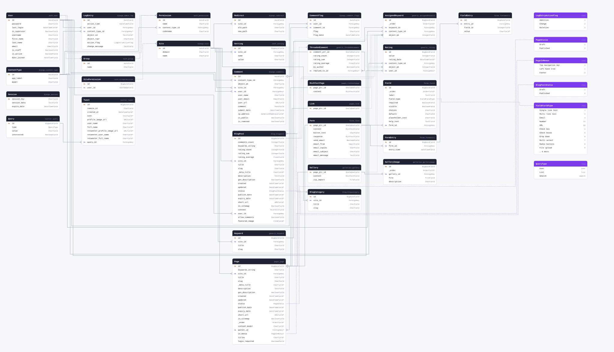

[LogEntry](#logentry) · [Permission](#permission) · [Group](#group) · [User](#user) · [ContentType](#contenttype) · [Session](#session) · [Redirect](#redirect) · [Site](#site) · [Setting](#setting) · [SitePermission](#sitepermission) · [Comment](#comment) · [CommentFlag](#commentflag) · [ThreadedComment](#threadedcomment) · [Keyword](#keyword) · [AssignedKeyword](#assignedkeyword) · [Rating](#rating) · [Page](#page) · [RichTextPage](#richtextpage) · [Link](#link) · [BlogPost](#blogpost) · [BlogCategory](#blogcategory) · [Form](#form) · [Field](#field) · [FormEntry](#formentry) · [FieldEntry](#fieldentry) · [Gallery](#gallery) · [GalleryImage](#galleryimage) · [Query](#query) · [Tweet](#tweet)

<details>
<summary>The whole schema as SQL</summary>

```sql
CREATE TABLE "django_admin_log" ("id" integer NOT NULL PRIMARY KEY AUTOINCREMENT, "action_time" datetime NOT NULL, "user_id" integer NOT NULL REFERENCES "auth_user" ("id") DEFERRABLE INITIALLY DEFERRED, "content_type_id" integer NULL REFERENCES "django_content_type" ("id") DEFERRABLE INITIALLY DEFERRED, "object_id" text NULL, "object_repr" varchar(200) NOT NULL, "action_flag" smallint unsigned NOT NULL CHECK ("action_flag" >= 0), "change_message" text NOT NULL);

CREATE TABLE "auth_permission" ("id" integer NOT NULL PRIMARY KEY AUTOINCREMENT, "name" varchar(255) NOT NULL, "content_type_id" integer NOT NULL REFERENCES "django_content_type" ("id") DEFERRABLE INITIALLY DEFERRED, "codename" varchar(100) NOT NULL);

CREATE TABLE "auth_group" ("id" integer NOT NULL PRIMARY KEY AUTOINCREMENT, "name" varchar(150) NOT NULL UNIQUE);

CREATE TABLE "auth_group_permissions" ("id" integer NOT NULL PRIMARY KEY AUTOINCREMENT, "group_id" integer NOT NULL REFERENCES "auth_group" ("id") DEFERRABLE INITIALLY DEFERRED, "permission_id" integer NOT NULL REFERENCES "auth_permission" ("id") DEFERRABLE INITIALLY DEFERRED);

CREATE TABLE "auth_user" ("id" integer NOT NULL PRIMARY KEY AUTOINCREMENT, "password" varchar(128) NOT NULL, "last_login" datetime NULL, "is_superuser" bool NOT NULL, "username" varchar(150) NOT NULL UNIQUE, "first_name" varchar(150) NOT NULL, "last_name" varchar(150) NOT NULL, "email" varchar(254) NOT NULL, "is_staff" bool NOT NULL, "is_active" bool NOT NULL, "date_joined" datetime NOT NULL);

CREATE TABLE "auth_user_groups" ("id" integer NOT NULL PRIMARY KEY AUTOINCREMENT, "user_id" integer NOT NULL REFERENCES "auth_user" ("id") DEFERRABLE INITIALLY DEFERRED, "group_id" integer NOT NULL REFERENCES "auth_group" ("id") DEFERRABLE INITIALLY DEFERRED);

CREATE TABLE "auth_user_user_permissions" ("id" integer NOT NULL PRIMARY KEY AUTOINCREMENT, "user_id" integer NOT NULL REFERENCES "auth_user" ("id") DEFERRABLE INITIALLY DEFERRED, "permission_id" integer NOT NULL REFERENCES "auth_permission" ("id") DEFERRABLE INITIALLY DEFERRED);

CREATE TABLE "django_content_type" ("id" integer NOT NULL PRIMARY KEY AUTOINCREMENT, "app_label" varchar(100) NOT NULL, "model" varchar(100) NOT NULL);

CREATE TABLE "django_session" ("session_key" varchar(40) NOT NULL PRIMARY KEY, "session_data" text NOT NULL, "expire_date" datetime NOT NULL);

CREATE TABLE "django_redirect" ("id" integer NOT NULL PRIMARY KEY AUTOINCREMENT, "site_id" integer NOT NULL REFERENCES "django_site" ("id") DEFERRABLE INITIALLY DEFERRED, "old_path" varchar(200) NOT NULL, "new_path" varchar(200) NOT NULL);

CREATE TABLE "django_site" ("id" integer NOT NULL PRIMARY KEY AUTOINCREMENT, "domain" varchar(100) NOT NULL UNIQUE, "name" varchar(50) NOT NULL);

CREATE TABLE "conf_setting" ("id" integer NOT NULL PRIMARY KEY AUTOINCREMENT, "site_id" integer NOT NULL REFERENCES "django_site" ("id") DEFERRABLE INITIALLY DEFERRED, "name" varchar(50) NOT NULL, "value" varchar(2000) NOT NULL);

CREATE TABLE "core_sitepermission" ("id" integer NOT NULL PRIMARY KEY AUTOINCREMENT, "user_id" integer NOT NULL UNIQUE REFERENCES "auth_user" ("id") DEFERRABLE INITIALLY DEFERRED);

CREATE TABLE "core_sitepermission_sites" ("id" integer NOT NULL PRIMARY KEY AUTOINCREMENT, "sitepermission_id" bigint NOT NULL REFERENCES "core_sitepermission" ("id") DEFERRABLE INITIALLY DEFERRED, "site_id" integer NOT NULL REFERENCES "django_site" ("id") DEFERRABLE INITIALLY DEFERRED);

CREATE TABLE "django_comments" ("id" integer NOT NULL PRIMARY KEY AUTOINCREMENT, "content_type_id" integer NOT NULL REFERENCES "django_content_type" ("id") DEFERRABLE INITIALLY DEFERRED, "object_pk" varchar(64) NOT NULL, "site_id" integer NOT NULL REFERENCES "django_site" ("id") DEFERRABLE INITIALLY DEFERRED, "user_id" integer NULL REFERENCES "auth_user" ("id") DEFERRABLE INITIALLY DEFERRED, "user_name" varchar(50) NOT NULL, "user_email" varchar(254) NOT NULL, "user_url" varchar(200) NOT NULL, "comment" text NOT NULL, "submit_date" datetime NOT NULL, "ip_address" char(39) NULL, "is_public" bool NOT NULL, "is_removed" bool NOT NULL);

CREATE TABLE "django_comment_flags" ("id" integer NOT NULL PRIMARY KEY AUTOINCREMENT, "user_id" integer NOT NULL REFERENCES "auth_user" ("id") DEFERRABLE INITIALLY DEFERRED, "comment_id" integer NOT NULL REFERENCES "django_comments" ("id") DEFERRABLE INITIALLY DEFERRED, "flag" varchar(30) NOT NULL, "flag_date" datetime NOT NULL);

CREATE TABLE "generic_threadedcomment" ("comment_ptr_id" integer NOT NULL PRIMARY KEY REFERENCES "django_comments" ("id") DEFERRABLE INITIALLY DEFERRED, "rating_count" integer NOT NULL, "rating_sum" integer NOT NULL, "rating_average" real NOT NULL, "by_author" bool NOT NULL, "replied_to_id" integer NULL REFERENCES "generic_threadedcomment" ("comment_ptr_id") DEFERRABLE INITIALLY DEFERRED);

CREATE TABLE "generic_keyword" ("id" integer NOT NULL PRIMARY KEY AUTOINCREMENT, "site_id" integer NOT NULL REFERENCES "django_site" ("id") DEFERRABLE INITIALLY DEFERRED, "title" varchar(500) NOT NULL, "slug" varchar(2000) NOT NULL);

CREATE TABLE "generic_assignedkeyword" ("id" integer NOT NULL PRIMARY KEY AUTOINCREMENT, "_order" integer NULL, "keyword_id" bigint NOT NULL REFERENCES "generic_keyword" ("id") DEFERRABLE INITIALLY DEFERRED, "content_type_id" integer NOT NULL REFERENCES "django_content_type" ("id") DEFERRABLE INITIALLY DEFERRED, "object_pk" integer NOT NULL);

CREATE TABLE "generic_rating" ("id" integer NOT NULL PRIMARY KEY AUTOINCREMENT, "value" integer NOT NULL, "rating_date" datetime NULL, "content_type_id" integer NOT NULL REFERENCES "django_content_type" ("id") DEFERRABLE INITIALLY DEFERRED, "object_pk" integer NOT NULL, "user_id" integer NULL REFERENCES "auth_user" ("id") DEFERRABLE INITIALLY DEFERRED);

CREATE TABLE "pages_page" ("id" integer NOT NULL PRIMARY KEY AUTOINCREMENT, "keywords_string" varchar(500) NOT NULL, "site_id" integer NOT NULL REFERENCES "django_site" ("id") DEFERRABLE INITIALLY DEFERRED, "title" varchar(500) NOT NULL, "slug" varchar(2000) NOT NULL, "_meta_title" varchar(500) NULL, "description" text NOT NULL, "gen_description" bool NOT NULL, "created" datetime NULL, "updated" datetime NULL, "status" integer NOT NULL, "publish_date" datetime NULL, "expiry_date" datetime NULL, "short_url" varchar(200) NULL, "in_sitemap" bool NOT NULL, "_order" integer NULL, "content_model" varchar(50) NULL, "parent_id" bigint NULL REFERENCES "pages_page" ("id") DEFERRABLE INITIALLY DEFERRED, "in_menus" varchar(100) NULL, "titles" varchar(1000) NULL, "login_required" bool NOT NULL);

CREATE TABLE "pages_richtextpage" ("page_ptr_id" bigint NOT NULL PRIMARY KEY REFERENCES "pages_page" ("id") DEFERRABLE INITIALLY DEFERRED, "content" text NOT NULL);

CREATE TABLE "pages_link" ("page_ptr_id" bigint NOT NULL PRIMARY KEY REFERENCES "pages_page" ("id") DEFERRABLE INITIALLY DEFERRED);

CREATE TABLE "blog_blogpost" ("id" integer NOT NULL PRIMARY KEY AUTOINCREMENT, "comments_count" integer NOT NULL, "keywords_string" varchar(500) NOT NULL, "rating_count" integer NOT NULL, "rating_sum" integer NOT NULL, "rating_average" real NOT NULL, "site_id" integer NOT NULL REFERENCES "django_site" ("id") DEFERRABLE INITIALLY DEFERRED, "title" varchar(500) NOT NULL, "slug" varchar(2000) NOT NULL, "_meta_title" varchar(500) NULL, "description" text NOT NULL, "gen_description" bool NOT NULL, "created" datetime NULL, "updated" datetime NULL, "status" integer NOT NULL, "publish_date" datetime NULL, "expiry_date" datetime NULL, "short_url" varchar(200) NULL, "in_sitemap" bool NOT NULL, "content" text NOT NULL, "user_id" integer NOT NULL REFERENCES "auth_user" ("id") DEFERRABLE INITIALLY DEFERRED, "allow_comments" bool NOT NULL, "featured_image" varchar(255) NULL);

CREATE TABLE "blog_blogpost_categories" ("id" integer NOT NULL PRIMARY KEY AUTOINCREMENT, "blogpost_id" bigint NOT NULL REFERENCES "blog_blogpost" ("id") DEFERRABLE INITIALLY DEFERRED, "blogcategory_id" bigint NOT NULL REFERENCES "blog_blogcategory" ("id") DEFERRABLE INITIALLY DEFERRED);

CREATE TABLE "blog_blogpost_related_posts" ("id" integer NOT NULL PRIMARY KEY AUTOINCREMENT, "from_blogpost_id" bigint NOT NULL REFERENCES "blog_blogpost" ("id") DEFERRABLE INITIALLY DEFERRED, "to_blogpost_id" bigint NOT NULL REFERENCES "blog_blogpost" ("id") DEFERRABLE INITIALLY DEFERRED);

CREATE TABLE "blog_blogcategory" ("id" integer NOT NULL PRIMARY KEY AUTOINCREMENT, "site_id" integer NOT NULL REFERENCES "django_site" ("id") DEFERRABLE INITIALLY DEFERRED, "title" varchar(500) NOT NULL, "slug" varchar(2000) NOT NULL);

CREATE TABLE "forms_form" ("page_ptr_id" bigint NOT NULL PRIMARY KEY REFERENCES "pages_page" ("id") DEFERRABLE INITIALLY DEFERRED, "content" text NOT NULL, "button_text" varchar(50) NOT NULL, "response" text NOT NULL, "send_email" bool NOT NULL, "email_from" varchar(254) NOT NULL, "email_copies" varchar(200) NOT NULL, "email_subject" varchar(200) NOT NULL, "email_message" text NOT NULL);

CREATE TABLE "forms_field" ("id" integer NOT NULL PRIMARY KEY AUTOINCREMENT, "_order" integer NULL, "label" text NOT NULL, "field_type" integer NOT NULL, "required" bool NOT NULL, "visible" bool NOT NULL, "choices" varchar(1000) NOT NULL, "default" varchar(2000) NOT NULL, "placeholder_text" varchar(100) NOT NULL, "help_text" text NOT NULL, "form_id" bigint NOT NULL REFERENCES "forms_form" ("page_ptr_id") DEFERRABLE INITIALLY DEFERRED);

CREATE TABLE "forms_formentry" ("id" integer NOT NULL PRIMARY KEY AUTOINCREMENT, "form_id" bigint NOT NULL REFERENCES "forms_form" ("page_ptr_id") DEFERRABLE INITIALLY DEFERRED, "entry_time" datetime NOT NULL);

CREATE TABLE "forms_fieldentry" ("id" integer NOT NULL PRIMARY KEY AUTOINCREMENT, "entry_id" bigint NOT NULL REFERENCES "forms_formentry" ("id") DEFERRABLE INITIALLY DEFERRED, "field_id" integer NOT NULL, "value" varchar(2000) NULL);

CREATE TABLE "galleries_gallery" ("page_ptr_id" bigint NOT NULL PRIMARY KEY REFERENCES "pages_page" ("id") DEFERRABLE INITIALLY DEFERRED, "content" text NOT NULL, "zip_import" varchar(100) NOT NULL);

CREATE TABLE "galleries_galleryimage" ("id" integer NOT NULL PRIMARY KEY AUTOINCREMENT, "_order" integer NULL, "gallery_id" bigint NOT NULL REFERENCES "galleries_gallery" ("page_ptr_id") DEFERRABLE INITIALLY DEFERRED, "file" varchar(200) NOT NULL, "description" varchar(1000) NOT NULL);

CREATE TABLE "twitter_query" ("id" integer NOT NULL PRIMARY KEY AUTOINCREMENT, "type" varchar(10) NOT NULL, "value" varchar(140) NOT NULL, "interested" bool NOT NULL);

CREATE TABLE "twitter_tweet" ("id" integer NOT NULL PRIMARY KEY AUTOINCREMENT, "remote_id" varchar(50) NOT NULL, "created_at" datetime NULL, "text" text NULL, "profile_image_url" varchar(200) NULL, "user_name" varchar(100) NULL, "full_name" varchar(100) NULL, "retweeter_profile_image_url" varchar(200) NULL, "retweeter_user_name" varchar(100) NULL, "retweeter_full_name" varchar(100) NULL, "query_id" bigint NOT NULL REFERENCES "twitter_query" ("id") DEFERRABLE INITIALLY DEFERRED);

CREATE INDEX "django_admin_log_user_id_c564eba6" ON "django_admin_log" ("user_id");

CREATE INDEX "django_admin_log_content_type_id_c4bce8eb" ON "django_admin_log" ("content_type_id");

CREATE UNIQUE INDEX "auth_permission_content_type_id_codename_01ab375a_uniq" ON "auth_permission" ("content_type_id", "codename");

CREATE INDEX "auth_permission_content_type_id_2f476e4b" ON "auth_permission" ("content_type_id");

CREATE UNIQUE INDEX "auth_group_permissions_group_id_permission_id_0cd325b0_uniq" ON "auth_group_permissions" ("group_id", "permission_id");

CREATE INDEX "auth_group_permissions_group_id_b120cbf9" ON "auth_group_permissions" ("group_id");

CREATE INDEX "auth_group_permissions_permission_id_84c5c92e" ON "auth_group_permissions" ("permission_id");

CREATE UNIQUE INDEX "auth_user_groups_user_id_group_id_94350c0c_uniq" ON "auth_user_groups" ("user_id", "group_id");

CREATE INDEX "auth_user_groups_user_id_6a12ed8b" ON "auth_user_groups" ("user_id");

CREATE INDEX "auth_user_groups_group_id_97559544" ON "auth_user_groups" ("group_id");

CREATE UNIQUE INDEX "auth_user_user_permissions_user_id_permission_id_14a6b632_uniq" ON "auth_user_user_permissions" ("user_id", "permission_id");

CREATE INDEX "auth_user_user_permissions_user_id_a95ead1b" ON "auth_user_user_permissions" ("user_id");

CREATE INDEX "auth_user_user_permissions_permission_id_1fbb5f2c" ON "auth_user_user_permissions" ("permission_id");

CREATE UNIQUE INDEX "django_content_type_app_label_model_76bd3d3b_uniq" ON "django_content_type" ("app_label", "model");

CREATE INDEX "django_session_expire_date_a5c62663" ON "django_session" ("expire_date");

CREATE UNIQUE INDEX "django_redirect_site_id_old_path_ac5dd16b_uniq" ON "django_redirect" ("site_id", "old_path");

CREATE INDEX "django_redirect_site_id_c3e37341" ON "django_redirect" ("site_id");

CREATE INDEX "django_redirect_old_path_c6cc94d3" ON "django_redirect" ("old_path");

CREATE INDEX "conf_setting_site_id_b235f7ed" ON "conf_setting" ("site_id");

CREATE UNIQUE INDEX "core_sitepermission_sites_sitepermission_id_site_id_e3e7353a_uniq" ON "core_sitepermission_sites" ("sitepermission_id", "site_id");

CREATE INDEX "core_sitepermission_sites_sitepermission_id_d33bc79e" ON "core_sitepermission_sites" ("sitepermission_id");

CREATE INDEX "core_sitepermission_sites_site_id_38038b76" ON "core_sitepermission_sites" ("site_id");

CREATE INDEX "django_comments_content_type_id_c4afe962" ON "django_comments" ("content_type_id");

CREATE INDEX "django_comments_object_pk_7fc98e83" ON "django_comments" ("object_pk");

CREATE INDEX "django_comments_site_id_9dcf666e" ON "django_comments" ("site_id");

CREATE INDEX "django_comments_user_id_a0a440a1" ON "django_comments" ("user_id");

CREATE INDEX "django_comments_submit_date_514ed2d9" ON "django_comments" ("submit_date");

CREATE INDEX "django_comments_is_removed_52a03ae3" ON "django_comments" ("is_removed");

CREATE UNIQUE INDEX "django_comment_flags_user_id_comment_id_flag_537f77a7_uniq" ON "django_comment_flags" ("user_id", "comment_id", "flag");

CREATE INDEX "django_comment_flags_user_id_f3f81f0a" ON "django_comment_flags" ("user_id");

CREATE INDEX "django_comment_flags_comment_id_d8054933" ON "django_comment_flags" ("comment_id");

CREATE INDEX "django_comment_flags_flag_8b141fcb" ON "django_comment_flags" ("flag");

CREATE INDEX "generic_threadedcomment_replied_to_id_d0a08d73" ON "generic_threadedcomment" ("replied_to_id");

CREATE INDEX "generic_keyword_site_id_c5be0acc" ON "generic_keyword" ("site_id");

CREATE INDEX "generic_assignedkeyword_keyword_id_44c17f9d" ON "generic_assignedkeyword" ("keyword_id");

CREATE INDEX "generic_assignedkeyword_content_type_id_3dd89a7f" ON "generic_assignedkeyword" ("content_type_id");

CREATE INDEX "generic_rating_content_type_id_eaf475fa" ON "generic_rating" ("content_type_id");

CREATE INDEX "generic_rating_user_id_60020469" ON "generic_rating" ("user_id");

CREATE INDEX "pages_page_site_id_47a43e5b" ON "pages_page" ("site_id");

CREATE INDEX "pages_page_publish_date_eb7c8d46" ON "pages_page" ("publish_date");

CREATE INDEX "pages_page_parent_id_133fa4d3" ON "pages_page" ("parent_id");

CREATE INDEX "blog_blogpost_site_id_7995688f" ON "blog_blogpost" ("site_id");

CREATE INDEX "blog_blogpost_publish_date_703abc16" ON "blog_blogpost" ("publish_date");

CREATE INDEX "blog_blogpost_user_id_12ed6b16" ON "blog_blogpost" ("user_id");

CREATE UNIQUE INDEX "blog_blogpost_categories_blogpost_id_blogcategory_id_a64d32c5_uniq" ON "blog_blogpost_categories" ("blogpost_id", "blogcategory_id");

CREATE INDEX "blog_blogpost_categories_blogpost_id_daeea608" ON "blog_blogpost_categories" ("blogpost_id");

CREATE INDEX "blog_blogpost_categories_blogcategory_id_f6695246" ON "blog_blogpost_categories" ("blogcategory_id");

CREATE UNIQUE INDEX "blog_blogpost_related_posts_from_blogpost_id_to_blogpost_id_3bd0f49f_uniq" ON "blog_blogpost_related_posts" ("from_blogpost_id", "to_blogpost_id");

CREATE INDEX "blog_blogpost_related_posts_from_blogpost_id_27ea4c18" ON "blog_blogpost_related_posts" ("from_blogpost_id");

CREATE INDEX "blog_blogpost_related_posts_to_blogpost_id_35f7acdd" ON "blog_blogpost_related_posts" ("to_blogpost_id");

CREATE INDEX "blog_blogcategory_site_id_42b9c96d" ON "blog_blogcategory" ("site_id");

CREATE INDEX "forms_field_form_id_9ca5dc7e" ON "forms_field" ("form_id");

CREATE INDEX "forms_formentry_form_id_d0f23912" ON "forms_formentry" ("form_id");

CREATE INDEX "forms_fieldentry_entry_id_c4fdc570" ON "forms_fieldentry" ("entry_id");

CREATE INDEX "galleries_galleryimage_gallery_id_af12d3f5" ON "galleries_galleryimage" ("gallery_id");

CREATE INDEX "twitter_tweet_query_id_bd42b699" ON "twitter_tweet" ("query_id");
```

</details>

## LogEntry

Table `django_admin_log`, app `admin`.


| Column | Field | Type | Null | Key | Default | Description |
| --- | --- | --- | --- | --- | --- | --- |
| `id` | `AutoField` | `integer` |  | PK | `autoincrement()` |  |
| `action_time` | `DateTimeField` | `datetime` |  |  | `now()` |  |
| `user_id` | `ForeignKey` | `integer` |  | FK |  |  |
| `content_type_id` | `ForeignKey` | `integer` | yes | FK |  |  |
| `object_id` | `TextField` | `text` | yes |  |  |  |
| `object_repr` | `CharField` | `varchar(200)` |  |  |  |  |
| `action_flag` | `LogEntryActionFlag` | `smallint unsigned` |  |  |  |  |
| `change_message` | `TextField` | `text` |  |  |  |  |

Indexes:

- index `django_admin_log_user_id_c564eba6` on `user_id`
- index `django_admin_log_content_type_id_c4bce8eb` on `content_type_id`

Relations:

- `user_id` → [User](#user).`id`, on delete cascade
- `content_type_id` → [ContentType](#contenttype).`id`, on delete set null

## Permission

Table `auth_permission`, app `auth`.

The permissions system provides a way to assign permissions to specific
users and groups of users.

The permission system is used by the Django admin site, but may also be
useful in your own code. The Django admin site uses permissions as follows:

    - The "add" permission limits the user's ability to view the "add" form
      and add an object.
    - The "change" permission limits a user's ability to view the change
      list, view the "change" form and change an object.
    - The "delete" permission limits the ability to delete an object.
    - The "view" permission limits the ability to view an object.

Permissions are set globally per type of object, not per specific object
instance. It is possible to say "Mary may change news stories," but it's
not currently possible to say "Mary may change news stories, but only the
ones she created herself" or "Mary may only change news stories that have a
certain status or publication date."

The permissions listed above are automatically created for each model.


| Column | Field | Type | Null | Key | Default | Description |
| --- | --- | --- | --- | --- | --- | --- |
| `id` | `AutoField` | `integer` |  | PK | `autoincrement()` |  |
| `name` | `CharField` | `varchar(255)` |  |  |  |  |
| `content_type_id` | `ForeignKey` | `integer` |  | FK |  |  |
| `codename` | `CharField` | `varchar(100)` |  |  |  |  |

Indexes:

- index `auth_permission_content_type_id_2f476e4b` on `content_type_id`
- unique `auth_permission_content_type_id_codename_01ab375a_uniq` on `content_type_id`, `codename`

Relations:

- `content_type_id` → [ContentType](#contenttype).`id`, on delete cascade
- `group_set` — many to many with [Group](#group)
- `user_set` — many to many with [User](#user)

## Group

Table `auth_group`, app `auth`.

Groups are a generic way of categorizing users to apply permissions, or
some other label, to those users. A user can belong to any number of
groups.

A user in a group automatically has all the permissions granted to that
group. For example, if the group 'Site editors' has the permission
can_edit_home_page, any user in that group will have that permission.

Beyond permissions, groups are a convenient way to categorize users to
apply some label, or extended functionality, to them. For example, you
could create a group 'Special users', and you could write code that would
do special things to those users -- such as giving them access to a
members-only portion of your site, or sending them members-only email
messages.


| Column | Field | Type | Null | Key | Default | Description |
| --- | --- | --- | --- | --- | --- | --- |
| `id` | `AutoField` | `integer` |  | PK | `autoincrement()` |  |
| `name` | `CharField` | `varchar(150)` |  | unique |  |  |

Relations:

- `permissions` — many to many with [Permission](#permission)
- `user_set` — many to many with [User](#user)

## User

Table `auth_user`, app `auth`.

Columns from `AbstractUser` (abstract): `username`, `first_name`, `last_name`, `email`, `is_staff`, `is_active`, `date_joined`.

Columns from `AbstractBaseUser` (abstract): `password`, `last_login`.

Columns from `PermissionsMixin` (abstract): `is_superuser`.

Users within the Django authentication system are represented by this
model.

Username and password are required. Other fields are optional.

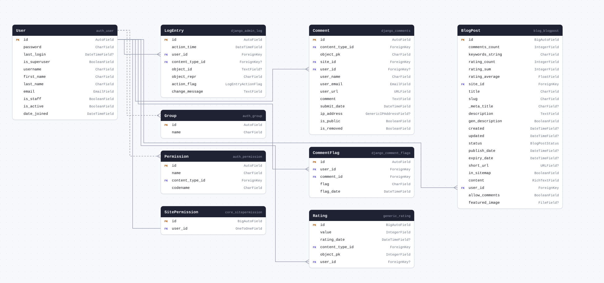

| Column | Field | Type | Null | Key | Default | Description |
| --- | --- | --- | --- | --- | --- | --- |
| `id` | `AutoField` | `integer` |  | PK | `autoincrement()` |  |
| `password` | `CharField` | `varchar(128)` |  |  |  |  |
| `last_login` | `DateTimeField` | `datetime` | yes |  |  |  |
| `is_superuser` | `BooleanField` | `bool` |  |  | `False` | Designates that this user has all permissions without explicitly assigning them. |
| `username` | `CharField` | `varchar(150)` |  | unique |  | Required. 150 characters or fewer. Letters, digits and @/./+/-/_ only. |
| `first_name` | `CharField` | `varchar(150)` |  |  |  |  |
| `last_name` | `CharField` | `varchar(150)` |  |  |  |  |
| `email` | `EmailField` | `varchar(254)` |  |  |  |  |
| `is_staff` | `BooleanField` | `bool` |  |  | `False` | Designates whether the user can log into this admin site. |
| `is_active` | `BooleanField` | `bool` |  |  | `True` | Designates whether this user should be treated as active. Unselect this instead of deleting accounts. |
| `date_joined` | `DateTimeField` | `datetime` |  |  | `now()` |  |

Relations:

- [LogEntry](#logentry).`user_id` → `id`, on delete cascade
- `groups` — many to many with [Group](#group)
- `user_permissions` — many to many with [Permission](#permission)
- [SitePermission](#sitepermission).`user_id` → `id`, on delete cascade
- [Comment](#comment).`user_id` → `id`, on delete set null
- [CommentFlag](#commentflag).`user_id` → `id`, on delete cascade
- [Rating](#rating).`user_id` → `id`, on delete cascade
- [BlogPost](#blogpost).`user_id` → `id`, on delete cascade

## ContentType

Table `django_content_type`, app `contenttypes`.

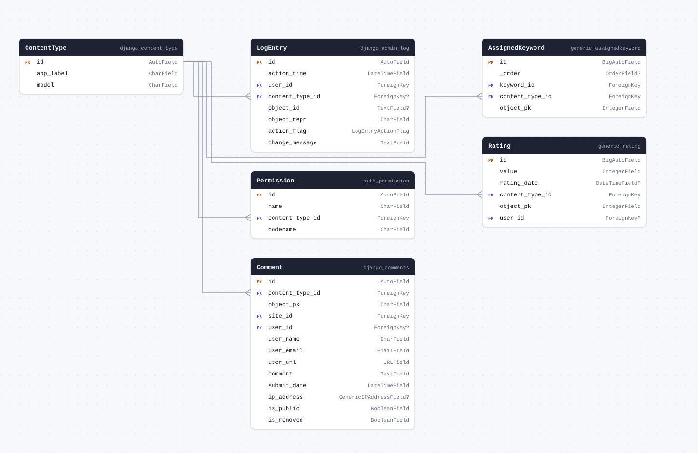

| Column | Field | Type | Null | Key | Default | Description |
| --- | --- | --- | --- | --- | --- | --- |
| `id` | `AutoField` | `integer` |  | PK | `autoincrement()` |  |
| `app_label` | `CharField` | `varchar(100)` |  |  |  |  |
| `model` | `CharField` | `varchar(100)` |  |  |  |  |

Indexes:

- unique `django_content_type_app_label_model_76bd3d3b_uniq` on `app_label`, `model`

Relations:

- [LogEntry](#logentry).`content_type_id` → `id`, on delete set null
- [Permission](#permission).`content_type_id` → `id`, on delete cascade
- [Comment](#comment).`content_type_id` → `id`, on delete cascade
- [AssignedKeyword](#assignedkeyword).`content_type_id` → `id`, on delete cascade
- [Rating](#rating).`content_type_id` → `id`, on delete cascade

## Session

Table `django_session`, app `sessions`.

Columns from `AbstractBaseSession` (abstract): `session_key`, `session_data`, `expire_date`.

Django provides full support for anonymous sessions. The session
framework lets you store and retrieve arbitrary data on a
per-site-visitor basis. It stores data on the server side and
abstracts the sending and receiving of cookies. Cookies contain a
session ID -- not the data itself.

The Django sessions framework is entirely cookie-based. It does
not fall back to putting session IDs in URLs. This is an intentional
design decision. Not only does that behavior make URLs ugly, it makes
your site vulnerable to session-ID theft via the "Referer" header.

For complete documentation on using Sessions in your code, consult
the sessions documentation that is shipped with Django (also available
on the Django web site).

| Column | Field | Type | Null | Key | Default | Description |
| --- | --- | --- | --- | --- | --- | --- |
| `session_key` | `CharField` | `varchar(40)` |  | PK |  |  |
| `session_data` | `TextField` | `text` |  |  |  |  |
| `expire_date` | `DateTimeField` | `datetime` |  |  |  |  |

Indexes:

- index `django_session_expire_date_a5c62663` on `expire_date`

## Redirect

Table `django_redirect`, app `redirects`.

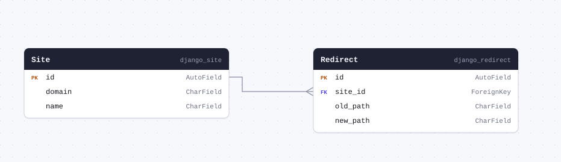

| Column | Field | Type | Null | Key | Default | Description |
| --- | --- | --- | --- | --- | --- | --- |
| `id` | `AutoField` | `integer` |  | PK | `autoincrement()` |  |
| `site_id` | `ForeignKey` | `integer` |  | FK |  |  |
| `old_path` | `CharField` | `varchar(200)` |  |  |  | This should be an absolute path, excluding the domain name. Example: “/events/search/”. |
| `new_path` | `CharField` | `varchar(200)` |  |  |  | This can be either an absolute path (as above) or a full URL starting with a scheme such as “https://”. |

Indexes:

- index `django_redirect_site_id_c3e37341` on `site_id`
- index `django_redirect_old_path_c6cc94d3` on `old_path`
- unique `django_redirect_site_id_old_path_ac5dd16b_uniq` on `site_id`, `old_path`

Relations:

- `site_id` → [Site](#site).`id`, on delete cascade

## Site

Table `django_site`, app `sites`.

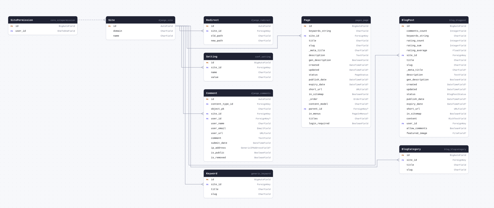

| Column | Field | Type | Null | Key | Default | Description |
| --- | --- | --- | --- | --- | --- | --- |
| `id` | `AutoField` | `integer` |  | PK | `autoincrement()` |  |
| `domain` | `CharField` | `varchar(100)` |  | unique |  |  |
| `name` | `CharField` | `varchar(50)` |  |  |  |  |

Relations:

- [Redirect](#redirect).`site_id` → `id`, on delete cascade
- [Setting](#setting).`site_id` → `id`, on delete cascade
- `sitepermission_set` — many to many with [SitePermission](#sitepermission)
- [Comment](#comment).`site_id` → `id`, on delete cascade
- [Keyword](#keyword).`site_id` → `id`, on delete cascade
- [Page](#page).`site_id` → `id`, on delete cascade
- [BlogPost](#blogpost).`site_id` → `id`, on delete cascade
- [BlogCategory](#blogcategory).`site_id` → `id`, on delete cascade

## Setting

Table `conf_setting`, app `conf`.

Columns from `SiteRelated` (abstract): `site_id`.

Stores values for ``mezzanine.conf`` that can be edited via the admin.

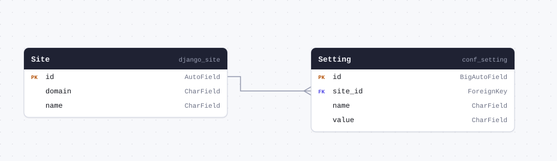

| Column | Field | Type | Null | Key | Default | Description |
| --- | --- | --- | --- | --- | --- | --- |
| `id` | `BigAutoField` | `integer` |  | PK | `autoincrement()` |  |
| `site_id` | `ForeignKey` | `integer` |  | FK |  |  |
| `name` | `CharField` | `varchar(50)` |  |  |  |  |
| `value` | `CharField` | `varchar(2000)` |  |  |  |  |

Indexes:

- index `conf_setting_site_id_b235f7ed` on `site_id`

Relations:

- `site_id` → [Site](#site).`id`, on delete cascade

## SitePermission

Table `core_sitepermission`, app `core`.

Permission relationship between a user and a site that's
used instead of ``User.is_staff``, for admin and inline-editing
access.

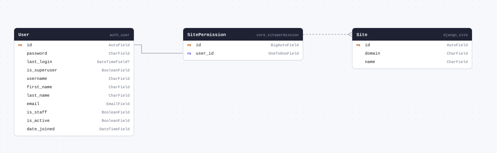

| Column | Field | Type | Null | Key | Default | Description |
| --- | --- | --- | --- | --- | --- | --- |
| `id` | `BigAutoField` | `integer` |  | PK | `autoincrement()` |  |
| `user_id` | `OneToOneField` | `integer` |  | FK, unique |  |  |

Relations:

- `user_id` → [User](#user).`id`, on delete cascade
- `sites` — many to many with [Site](#site)

## Comment

Table `django_comments`, app `django_comments`.

Subclasses (multi-table): [ThreadedComment](#threadedcomment).

Columns from `CommentAbstractModel` (abstract): `user_id`, `user_name`, `user_email`, `user_url`, `comment`, `submit_date`, `ip_address`, `is_public`, `is_removed`.

Columns from `BaseCommentAbstractModel` (abstract): `content_type_id`, `object_pk`, `site_id`.

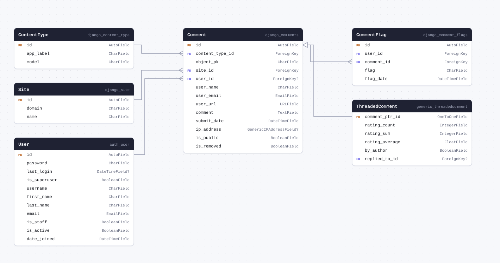

| Column | Field | Type | Null | Key | Default | Description |
| --- | --- | --- | --- | --- | --- | --- |
| `id` | `AutoField` | `integer` |  | PK | `autoincrement()` |  |
| `content_type_id` | `ForeignKey` | `integer` |  | FK |  |  |
| `object_pk` | `CharField` | `varchar(64)` |  |  |  |  |
| `site_id` | `ForeignKey` | `integer` |  | FK |  |  |
| `user_id` | `ForeignKey` | `integer` | yes | FK |  |  |
| `user_name` | `CharField` | `varchar(50)` |  |  |  |  |
| `user_email` | `EmailField` | `varchar(254)` |  |  |  |  |
| `user_url` | `URLField` | `varchar(200)` |  |  |  |  |
| `comment` | `TextField` | `text` |  |  |  |  |
| `submit_date` | `DateTimeField` | `datetime` |  |  | `None` |  |
| `ip_address` | `GenericIPAddressField` | `char(39)` | yes |  |  |  |
| `is_public` | `BooleanField` | `bool` |  |  | `True` | Uncheck this box to make the comment effectively disappear from the site. |
| `is_removed` | `BooleanField` | `bool` |  |  | `False` | Check this box if the comment is inappropriate. A "This comment has been removed" message will be displayed instead. |

Indexes:

- index `django_comments_content_type_id_c4afe962` on `content_type_id`
- index `django_comments_object_pk_7fc98e83` on `object_pk`
- index `django_comments_site_id_9dcf666e` on `site_id`
- index `django_comments_user_id_a0a440a1` on `user_id`
- index `django_comments_submit_date_514ed2d9` on `submit_date`
- index `django_comments_is_removed_52a03ae3` on `is_removed`

Relations:

- `content_object` → any model, by `content_type_id` + `object_pk` (generic foreign key)
- `content_type_id` → [ContentType](#contenttype).`id`, on delete cascade
- `site_id` → [Site](#site).`id`, on delete cascade
- `user_id` → [User](#user).`id`, on delete set null
- [CommentFlag](#commentflag).`comment_id` → `id`, on delete cascade
- [ThreadedComment](#threadedcomment).`comment_ptr_id` → `id`, parent link, on delete cascade

## CommentFlag

Table `django_comment_flags`, app `django_comments`.

Records a flag on a comment. This is intentionally flexible; right now, a
flag could be:

    * A "removal suggestion" -- where a user suggests a comment for (potential) removal.

    * A "moderator deletion" -- used when a moderator deletes a comment.

You can (ab)use this model to add other flags, if needed. However, by
design users are only allowed to flag a comment with a given flag once;
if you want rating look elsewhere.

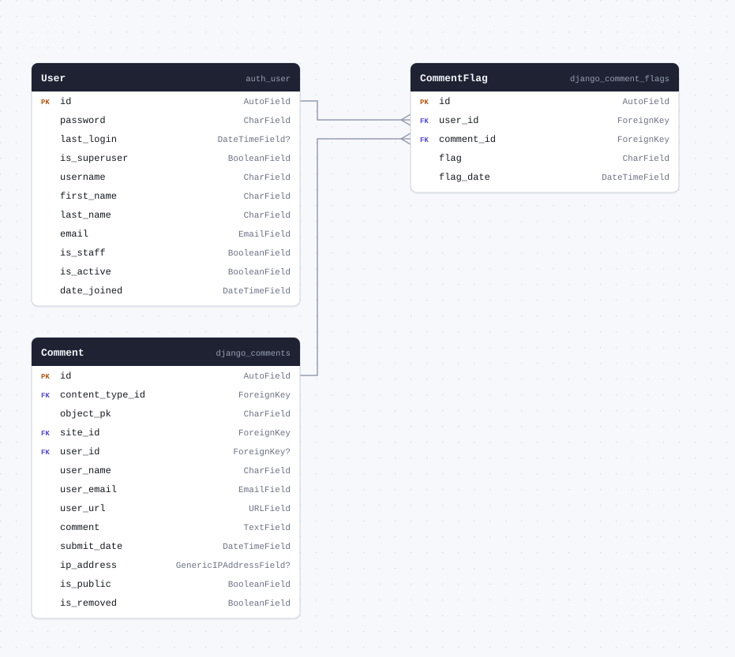

| Column | Field | Type | Null | Key | Default | Description |
| --- | --- | --- | --- | --- | --- | --- |
| `id` | `AutoField` | `integer` |  | PK | `autoincrement()` |  |
| `user_id` | `ForeignKey` | `integer` |  | FK |  |  |
| `comment_id` | `ForeignKey` | `integer` |  | FK |  |  |
| `flag` | `CharField` | `varchar(30)` |  |  |  |  |
| `flag_date` | `DateTimeField` | `datetime` |  |  | `None` |  |

Indexes:

- index `django_comment_flags_user_id_f3f81f0a` on `user_id`
- index `django_comment_flags_comment_id_d8054933` on `comment_id`
- index `django_comment_flags_flag_8b141fcb` on `flag`
- unique `django_comment_flags_user_id_comment_id_flag_537f77a7_uniq` on `user_id`, `comment_id`, `flag`

Relations:

- `user_id` → [User](#user).`id`, on delete cascade
- `comment_id` → [Comment](#comment).`id`, on delete cascade

## ThreadedComment

Table `generic_threadedcomment`, app `generic`.

Inherits from [Comment](#comment) (multi-table): its rows are joined on `comment_ptr_id`.

Extend the ``Comment`` model from ``django_comments`` to
add comment threading. ``Comment`` provides its own site foreign key,
so we can't inherit from ``SiteRelated`` in ``mezzanine.core``, and
therefore need to set the site on ``save``. ``CommentManager``
inherits from Mezzanine's ``CurrentSiteManager``, so everything else
site related is already provided.

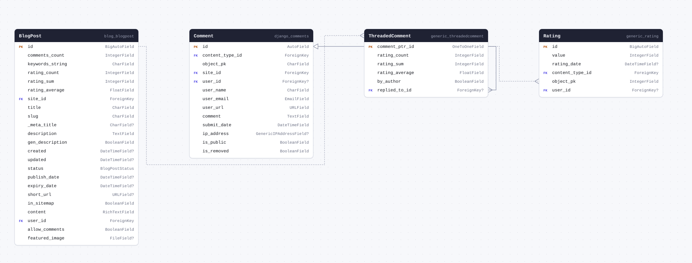

| Column | Field | Type | Null | Key | Default | Description |
| --- | --- | --- | --- | --- | --- | --- |
| `comment_ptr_id` | `OneToOneField` | `integer` |  | PK, FK |  |  |
| `rating_count` | `IntegerField` | `integer` |  |  | `0` |  |
| `rating_sum` | `IntegerField` | `integer` |  |  | `0` |  |
| `rating_average` | `FloatField` | `real` |  |  | `0` |  |
| `by_author` | `BooleanField` | `bool` |  |  | `False` |  |
| `replied_to_id` | `ForeignKey` | `integer` | yes | FK |  |  |

Indexes:

- index `generic_threadedcomment_replied_to_id_d0a08d73` on `replied_to_id`

Relations:

- `content_object` → any model, by `content_type_id` + `object_pk` (generic foreign key)
- `comment_ptr_id` → [Comment](#comment).`id`, parent link, on delete cascade
- `replied_to_id` → [ThreadedComment](#threadedcomment).`comment_ptr_id`, on delete cascade
- `rating` ← [Rating](#rating), by `content_type_id` + `object_pk` (generic relation)
- `object_pk` → [BlogPost](#blogpost).`id` where `content_type_id` is BlogPost (generic, `BlogPost.comments`)

## Keyword

Table `generic_keyword`, app `generic`.

Columns from `Slugged` (abstract): `title`, `slug`.

Columns from `SiteRelated` (abstract): `site_id`.

Keywords/tags which are managed via a custom JavaScript based
widget in the admin.

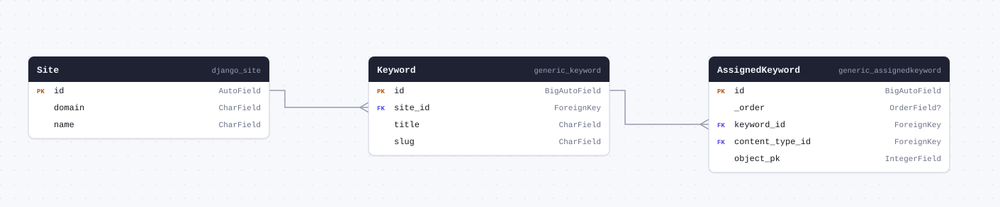

| Column | Field | Type | Null | Key | Default | Description |
| --- | --- | --- | --- | --- | --- | --- |
| `id` | `BigAutoField` | `integer` |  | PK | `autoincrement()` |  |
| `site_id` | `ForeignKey` | `integer` |  | FK |  |  |
| `title` | `CharField` | `varchar(500)` |  |  |  |  |
| `slug` | `CharField` | `varchar(2000)` |  |  |  | Leave blank to have the URL auto-generated from the title. |

Indexes:

- index `generic_keyword_site_id_c5be0acc` on `site_id`

Relations:

- `site_id` → [Site](#site).`id`, on delete cascade
- [AssignedKeyword](#assignedkeyword).`keyword_id` → `id`, on delete cascade

## AssignedKeyword

Table `generic_assignedkeyword`, app `generic`.

Columns from `Orderable` (abstract): `_order`.

A ``Keyword`` assigned to a model instance.

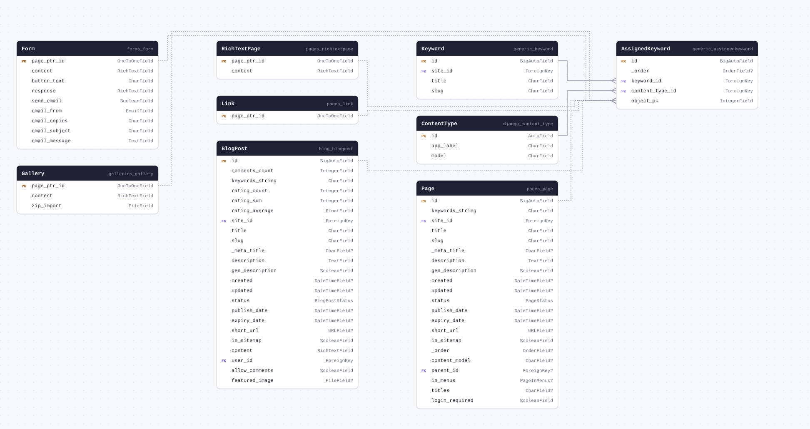

| Column | Field | Type | Null | Key | Default | Description |
| --- | --- | --- | --- | --- | --- | --- |
| `id` | `BigAutoField` | `integer` |  | PK | `autoincrement()` |  |
| `_order` | `OrderField` | `integer` | yes |  |  |  |
| `keyword_id` | `ForeignKey` | `bigint` |  | FK |  |  |
| `content_type_id` | `ForeignKey` | `integer` |  | FK |  |  |
| `object_pk` | `IntegerField` | `integer` |  |  |  |  |

Indexes:

- index `generic_assignedkeyword_keyword_id_44c17f9d` on `keyword_id`
- index `generic_assignedkeyword_content_type_id_3dd89a7f` on `content_type_id`

Relations:

- `content_object` → any model, by `content_type_id` + `object_pk` (generic foreign key)
- `keyword_id` → [Keyword](#keyword).`id`, on delete cascade
- `content_type_id` → [ContentType](#contenttype).`id`, on delete cascade
- `object_pk` → [Page](#page).`id` where `content_type_id` is Page (generic, `Page.keywords`)
- `object_pk` → [RichTextPage](#richtextpage).`page_ptr_id` where `content_type_id` is RichTextPage (generic, `RichTextPage.keywords`)
- `object_pk` → [Link](#link).`page_ptr_id` where `content_type_id` is Link (generic, `Link.keywords`)
- `object_pk` → [BlogPost](#blogpost).`id` where `content_type_id` is BlogPost (generic, `BlogPost.keywords`)
- `object_pk` → [Form](#form).`page_ptr_id` where `content_type_id` is Form (generic, `Form.keywords`)
- `object_pk` → [Gallery](#gallery).`page_ptr_id` where `content_type_id` is Gallery (generic, `Gallery.keywords`)

## Rating

Table `generic_rating`, app `generic`.

A rating that can be given to a piece of content.

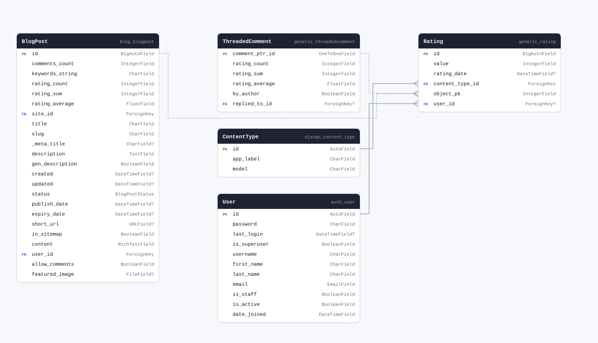

| Column | Field | Type | Null | Key | Default | Description |
| --- | --- | --- | --- | --- | --- | --- |
| `id` | `BigAutoField` | `integer` |  | PK | `autoincrement()` |  |
| `value` | `IntegerField` | `integer` |  |  |  |  |
| `rating_date` | `DateTimeField` | `datetime` | yes |  | `now()` |  |
| `content_type_id` | `ForeignKey` | `integer` |  | FK |  |  |
| `object_pk` | `IntegerField` | `integer` |  |  |  |  |
| `user_id` | `ForeignKey` | `integer` | yes | FK |  |  |

Indexes:

- index `generic_rating_content_type_id_eaf475fa` on `content_type_id`
- index `generic_rating_user_id_60020469` on `user_id`

Relations:

- `content_object` → any model, by `content_type_id` + `object_pk` (generic foreign key)
- `object_pk` → [ThreadedComment](#threadedcomment).`comment_ptr_id` where `content_type_id` is ThreadedComment (generic, `ThreadedComment.rating`)
- `content_type_id` → [ContentType](#contenttype).`id`, on delete cascade
- `user_id` → [User](#user).`id`, on delete cascade
- `object_pk` → [BlogPost](#blogpost).`id` where `content_type_id` is BlogPost (generic, `BlogPost.rating`)

## Page

Table `pages_page`, app `pages`.

Subclasses (multi-table): [RichTextPage](#richtextpage), [Link](#link), [Form](#form), [Gallery](#gallery).

Columns from `Orderable` (abstract): `_order`.

Columns from `Displayable` (abstract): `status`, `publish_date`, `expiry_date`, `short_url`, `in_sitemap`.

Columns from `Slugged` (abstract): `title`, `slug`.

Columns from `SiteRelated` (abstract): `site_id`.

Columns from `MetaData` (abstract): `_meta_title`, `description`, `gen_description`.

Columns from `TimeStamped` (abstract): `created`, `updated`.

Columns from `ContentTyped` (abstract): `content_model`.

A page in the page tree. This is the base class that custom content types
need to subclass.

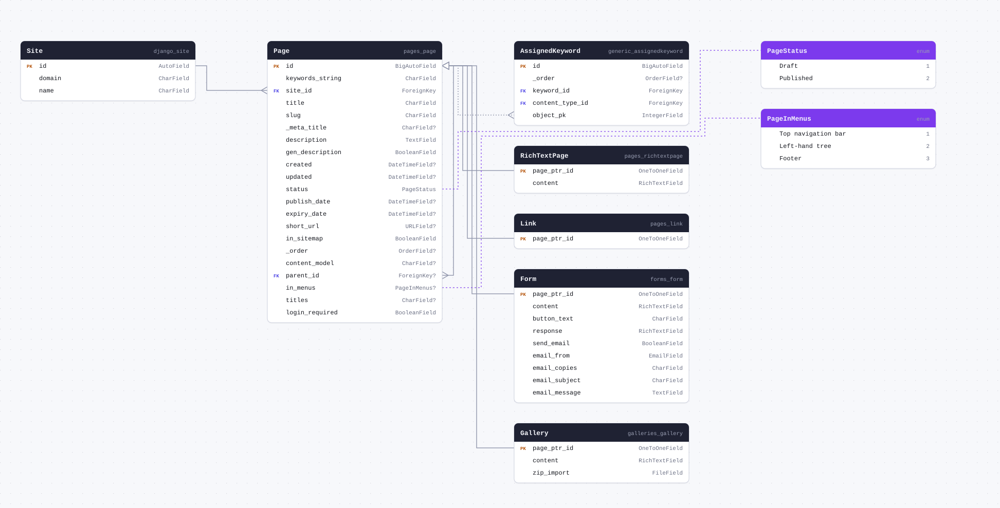

| Column | Field | Type | Null | Key | Default | Description |
| --- | --- | --- | --- | --- | --- | --- |
| `id` | `BigAutoField` | `integer` |  | PK | `autoincrement()` |  |
| `keywords_string` | `CharField` | `varchar(500)` |  |  |  |  |
| `site_id` | `ForeignKey` | `integer` |  | FK |  |  |
| `title` | `CharField` | `varchar(500)` |  |  |  |  |
| `slug` | `CharField` | `varchar(2000)` |  |  |  | Leave blank to have the URL auto-generated from the title. |
| `_meta_title` | `CharField` | `varchar(500)` | yes |  |  | Optional title to be used in the HTML title tag. If left blank, the main title field will be used. |
| `description` | `TextField` | `text` |  |  |  |  |
| `gen_description` | `BooleanField` | `bool` |  |  | `True` | If checked, the description will be automatically generated from content. Uncheck if you want to manually set a custom description. |
| `created` | `DateTimeField` | `datetime` | yes |  |  |  |
| `updated` | `DateTimeField` | `datetime` | yes |  |  |  |
| `status` | `PageStatus` | `integer` |  |  | `2` | With Draft chosen, will only be shown for admin users on the site. |
| `publish_date` | `DateTimeField` | `datetime` | yes |  |  | With Published chosen, won't be shown until this time |
| `expiry_date` | `DateTimeField` | `datetime` | yes |  |  | With Published chosen, won't be shown after this time |
| `short_url` | `URLField` | `varchar(200)` | yes |  |  |  |
| `in_sitemap` | `BooleanField` | `bool` |  |  | `True` |  |
| `_order` | `OrderField` | `integer` | yes |  |  |  |
| `content_model` | `CharField` | `varchar(50)` | yes |  |  |  |
| `parent_id` | `ForeignKey` | `bigint` | yes | FK |  |  |
| `in_menus` | `PageInMenus` | `varchar(100)` | yes |  |  |  |
| `titles` | `CharField` | `varchar(1000)` | yes |  |  |  |
| `login_required` | `BooleanField` | `bool` |  |  | `False` | If checked, only logged in users can view this page |

Indexes:

- index `pages_page_site_id_47a43e5b` on `site_id`
- index `pages_page_publish_date_eb7c8d46` on `publish_date`
- index `pages_page_parent_id_133fa4d3` on `parent_id`

Relations:

- `site_id` → [Site](#site).`id`, on delete cascade
- `parent_id` → [Page](#page).`id`, on delete cascade
- `keywords` ← [AssignedKeyword](#assignedkeyword), by `content_type_id` + `object_pk` (generic relation)
- [RichTextPage](#richtextpage).`page_ptr_id` → `id`, parent link, on delete cascade
- [Link](#link).`page_ptr_id` → `id`, parent link, on delete cascade
- [Form](#form).`page_ptr_id` → `id`, parent link, on delete cascade
- [Gallery](#gallery).`page_ptr_id` → `id`, parent link, on delete cascade

## RichTextPage

Table `pages_richtextpage`, app `pages`.

Inherits from [Page](#page) (multi-table): its rows are joined on `page_ptr_id`.

Columns from `RichText` (abstract): `content`.

Implements the default type of page with a single Rich Text
content field.

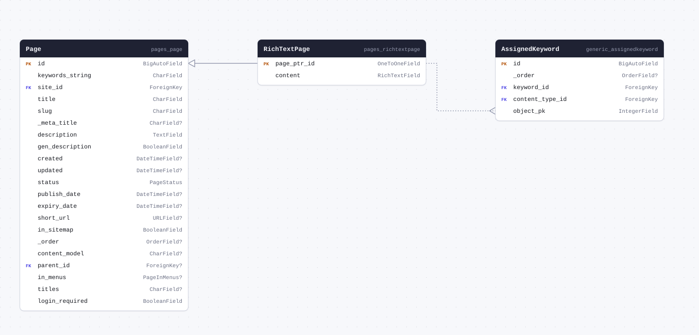

| Column | Field | Type | Null | Key | Default | Description |
| --- | --- | --- | --- | --- | --- | --- |
| `page_ptr_id` | `OneToOneField` | `bigint` |  | PK, FK |  |  |
| `content` | `RichTextField` | `text` |  |  |  |  |

Relations:

- `page_ptr_id` → [Page](#page).`id`, parent link, on delete cascade
- `keywords` ← [AssignedKeyword](#assignedkeyword), by `content_type_id` + `object_pk` (generic relation)

## Link

Table `pages_link`, app `pages`.

Inherits from [Page](#page) (multi-table): its rows are joined on `page_ptr_id`.

A general content type for creating external links in the page
menu.

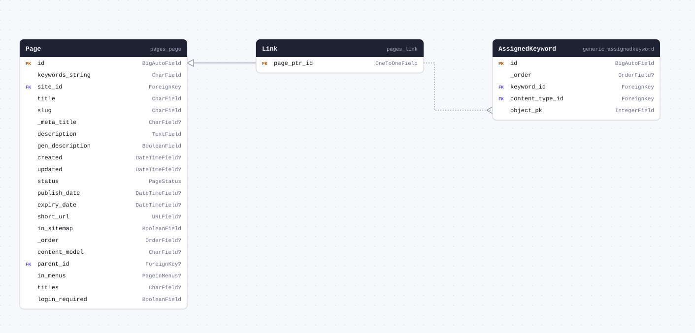

| Column | Field | Type | Null | Key | Default | Description |
| --- | --- | --- | --- | --- | --- | --- |
| `page_ptr_id` | `OneToOneField` | `bigint` |  | PK, FK |  |  |

Relations:

- `page_ptr_id` → [Page](#page).`id`, parent link, on delete cascade
- `keywords` ← [AssignedKeyword](#assignedkeyword), by `content_type_id` + `object_pk` (generic relation)

## BlogPost

Table `blog_blogpost`, app `blog`.

Columns from `Displayable` (abstract): `status`, `publish_date`, `expiry_date`, `short_url`, `in_sitemap`.

Columns from `Slugged` (abstract): `title`, `slug`.

Columns from `SiteRelated` (abstract): `site_id`.

Columns from `MetaData` (abstract): `_meta_title`, `description`, `gen_description`.

Columns from `TimeStamped` (abstract): `created`, `updated`.

Columns from `Ownable` (abstract): `user_id`.

Columns from `RichText` (abstract): `content`.

A blog post.

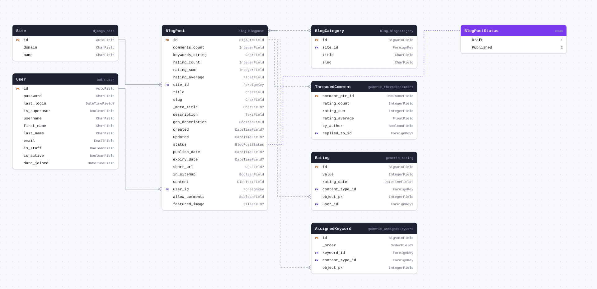

| Column | Field | Type | Null | Key | Default | Description |
| --- | --- | --- | --- | --- | --- | --- |
| `id` | `BigAutoField` | `integer` |  | PK | `autoincrement()` |  |
| `comments_count` | `IntegerField` | `integer` |  |  | `0` |  |
| `keywords_string` | `CharField` | `varchar(500)` |  |  |  |  |
| `rating_count` | `IntegerField` | `integer` |  |  | `0` |  |
| `rating_sum` | `IntegerField` | `integer` |  |  | `0` |  |
| `rating_average` | `FloatField` | `real` |  |  | `0` |  |
| `site_id` | `ForeignKey` | `integer` |  | FK |  |  |
| `title` | `CharField` | `varchar(500)` |  |  |  |  |
| `slug` | `CharField` | `varchar(2000)` |  |  |  | Leave blank to have the URL auto-generated from the title. |
| `_meta_title` | `CharField` | `varchar(500)` | yes |  |  | Optional title to be used in the HTML title tag. If left blank, the main title field will be used. |
| `description` | `TextField` | `text` |  |  |  |  |
| `gen_description` | `BooleanField` | `bool` |  |  | `True` | If checked, the description will be automatically generated from content. Uncheck if you want to manually set a custom description. |
| `created` | `DateTimeField` | `datetime` | yes |  |  |  |
| `updated` | `DateTimeField` | `datetime` | yes |  |  |  |
| `status` | `BlogPostStatus` | `integer` |  |  | `2` | With Draft chosen, will only be shown for admin users on the site. |
| `publish_date` | `DateTimeField` | `datetime` | yes |  |  | With Published chosen, won't be shown until this time |
| `expiry_date` | `DateTimeField` | `datetime` | yes |  |  | With Published chosen, won't be shown after this time |
| `short_url` | `URLField` | `varchar(200)` | yes |  |  |  |
| `in_sitemap` | `BooleanField` | `bool` |  |  | `True` |  |
| `content` | `RichTextField` | `text` |  |  |  |  |
| `user_id` | `ForeignKey` | `integer` |  | FK |  |  |
| `allow_comments` | `BooleanField` | `bool` |  |  | `True` |  |
| `featured_image` | `FileField` | `varchar(255)` | yes |  |  |  |

Indexes:

- index `blog_blogpost_site_id_7995688f` on `site_id`
- index `blog_blogpost_publish_date_703abc16` on `publish_date`
- index `blog_blogpost_user_id_12ed6b16` on `user_id`

Relations:

- `site_id` → [Site](#site).`id`, on delete cascade
- `user_id` → [User](#user).`id`, on delete cascade
- `categories` — many to many with [BlogCategory](#blogcategory)
- `related_posts` — many to many with [BlogPost](#blogpost)
- `comments` ← [ThreadedComment](#threadedcomment), by `content_type_id` + `object_pk` (generic relation)
- `rating` ← [Rating](#rating), by `content_type_id` + `object_pk` (generic relation)
- `keywords` ← [AssignedKeyword](#assignedkeyword), by `content_type_id` + `object_pk` (generic relation)

## BlogCategory

Table `blog_blogcategory`, app `blog`.

Columns from `Slugged` (abstract): `title`, `slug`.

Columns from `SiteRelated` (abstract): `site_id`.

A category for grouping blog posts into a series.

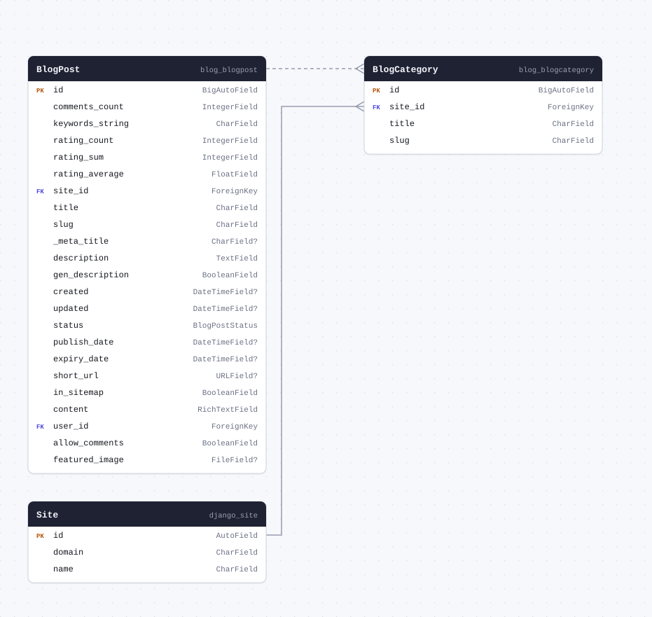

| Column | Field | Type | Null | Key | Default | Description |
| --- | --- | --- | --- | --- | --- | --- |
| `id` | `BigAutoField` | `integer` |  | PK | `autoincrement()` |  |
| `site_id` | `ForeignKey` | `integer` |  | FK |  |  |
| `title` | `CharField` | `varchar(500)` |  |  |  |  |
| `slug` | `CharField` | `varchar(2000)` |  |  |  | Leave blank to have the URL auto-generated from the title. |

Indexes:

- index `blog_blogcategory_site_id_42b9c96d` on `site_id`

Relations:

- `blogposts` — many to many with [BlogPost](#blogpost)
- `site_id` → [Site](#site).`id`, on delete cascade

## Form

Table `forms_form`, app `forms`.

Inherits from [Page](#page) (multi-table): its rows are joined on `page_ptr_id`.

Columns from `RichText` (abstract): `content`.

A user-built form.

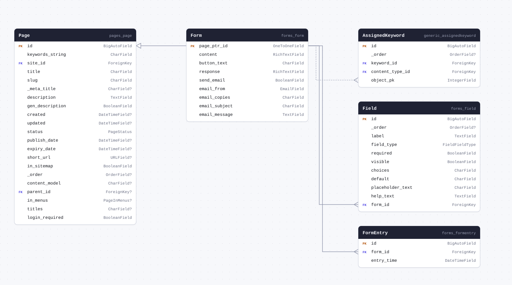

| Column | Field | Type | Null | Key | Default | Description |
| --- | --- | --- | --- | --- | --- | --- |
| `page_ptr_id` | `OneToOneField` | `bigint` |  | PK, FK |  |  |
| `content` | `RichTextField` | `text` |  |  |  |  |
| `button_text` | `CharField` | `varchar(50)` |  |  |  |  |
| `response` | `RichTextField` | `text` |  |  |  |  |
| `send_email` | `BooleanField` | `bool` |  |  | `True` | To send an email to the email address supplied in the form upon submission, check this box. |
| `email_from` | `EmailField` | `varchar(254)` |  |  |  | The address the email will be sent from |
| `email_copies` | `CharField` | `varchar(200)` |  |  |  | Provide a comma separated list of email addresses to be notified upon form submission. Leave blank to disable notifications. |
| `email_subject` | `CharField` | `varchar(200)` |  |  |  |  |
| `email_message` | `TextField` | `text` |  |  |  | Emails sent based on the above options will contain each of the form fields entered. You can also enter a message here that will be included in the email. |

Relations:

- `page_ptr_id` → [Page](#page).`id`, parent link, on delete cascade
- `keywords` ← [AssignedKeyword](#assignedkeyword), by `content_type_id` + `object_pk` (generic relation)
- [Field](#field).`form_id` → `page_ptr_id`, on delete cascade
- [FormEntry](#formentry).`form_id` → `page_ptr_id`, on delete cascade

## Field

Table `forms_field`, app `forms`.

Columns from `AbstractBaseField` (abstract): `label`, `field_type`, `required`, `visible`, `choices`, `default`, `placeholder_text`, `help_text`.

Columns from `Orderable` (abstract): `_order`.

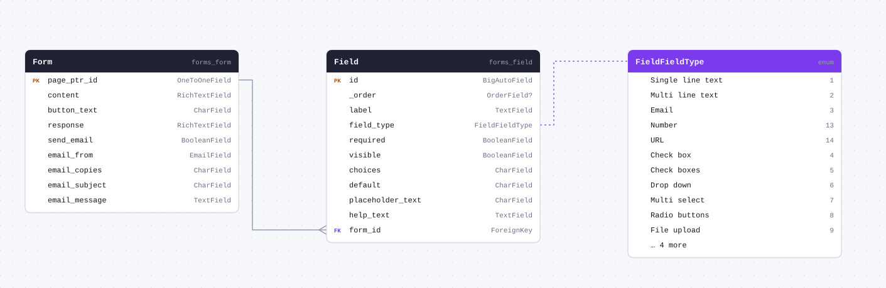

| Column | Field | Type | Null | Key | Default | Description |
| --- | --- | --- | --- | --- | --- | --- |
| `id` | `BigAutoField` | `integer` |  | PK | `autoincrement()` |  |
| `_order` | `OrderField` | `integer` | yes |  |  |  |
| `label` | `TextField` | `text` |  |  |  |  |
| `field_type` | `FieldFieldType` | `integer` |  |  |  |  |
| `required` | `BooleanField` | `bool` |  |  | `True` |  |
| `visible` | `BooleanField` | `bool` |  |  | `True` |  |
| `choices` | `CharField` | `varchar(1000)` |  |  |  | Comma separated options where applicable. If an option itself contains commas, surround the option with `backticks`. |
| `default` | `CharField` | `varchar(2000)` |  |  |  |  |
| `placeholder_text` | `CharField` | `varchar(100)` |  |  |  |  |
| `help_text` | `TextField` | `text` |  |  |  |  |
| `form_id` | `ForeignKey` | `bigint` |  | FK |  |  |

Indexes:

- index `forms_field_form_id_9ca5dc7e` on `form_id`

Relations:

- `form_id` → [Form](#form).`page_ptr_id`, on delete cascade

## FormEntry

Table `forms_formentry`, app `forms`.

An entry submitted via a user-built form.

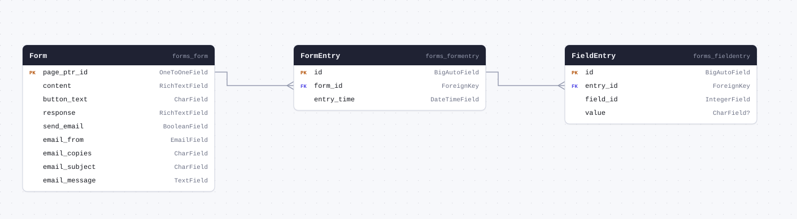

| Column | Field | Type | Null | Key | Default | Description |
| --- | --- | --- | --- | --- | --- | --- |
| `id` | `BigAutoField` | `integer` |  | PK | `autoincrement()` |  |
| `form_id` | `ForeignKey` | `bigint` |  | FK |  |  |
| `entry_time` | `DateTimeField` | `datetime` |  |  |  |  |

Indexes:

- index `forms_formentry_form_id_d0f23912` on `form_id`

Relations:

- `form_id` → [Form](#form).`page_ptr_id`, on delete cascade
- [FieldEntry](#fieldentry).`entry_id` → `id`, on delete cascade

## FieldEntry

Table `forms_fieldentry`, app `forms`.

A single field value for a form entry submitted via a user-built form.

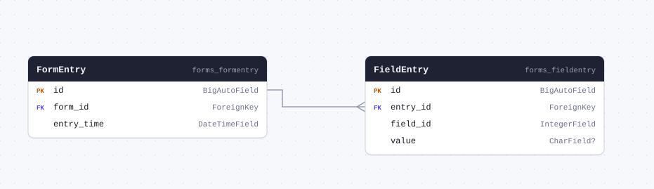

| Column | Field | Type | Null | Key | Default | Description |
| --- | --- | --- | --- | --- | --- | --- |
| `id` | `BigAutoField` | `integer` |  | PK | `autoincrement()` |  |
| `entry_id` | `ForeignKey` | `bigint` |  | FK |  |  |
| `field_id` | `IntegerField` | `integer` |  |  |  |  |
| `value` | `CharField` | `varchar(2000)` | yes |  |  |  |

Indexes:

- index `forms_fieldentry_entry_id_c4fdc570` on `entry_id`

Relations:

- `entry_id` → [FormEntry](#formentry).`id`, on delete cascade

## Gallery

Table `galleries_gallery`, app `galleries`.

Inherits from [Page](#page) (multi-table): its rows are joined on `page_ptr_id`.

Columns from `RichText` (abstract): `content`.

Columns from `BaseGallery` (abstract): `zip_import`.

Page bucket for gallery photos.

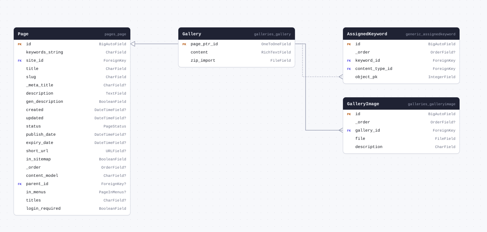

| Column | Field | Type | Null | Key | Default | Description |
| --- | --- | --- | --- | --- | --- | --- |
| `page_ptr_id` | `OneToOneField` | `bigint` |  | PK, FK |  |  |
| `content` | `RichTextField` | `text` |  |  |  |  |
| `zip_import` | `FileField` | `varchar(100)` |  |  |  | Upload a zip file containing images, and they'll be imported into this gallery. |

Relations:

- `page_ptr_id` → [Page](#page).`id`, parent link, on delete cascade
- `keywords` ← [AssignedKeyword](#assignedkeyword), by `content_type_id` + `object_pk` (generic relation)
- [GalleryImage](#galleryimage).`gallery_id` → `page_ptr_id`, on delete cascade

## GalleryImage

Table `galleries_galleryimage`, app `galleries`.

Columns from `Orderable` (abstract): `_order`.

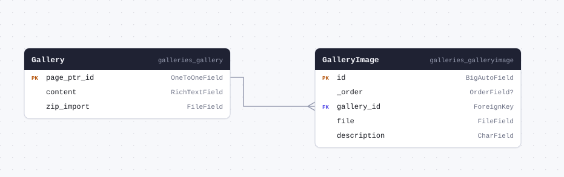

| Column | Field | Type | Null | Key | Default | Description |
| --- | --- | --- | --- | --- | --- | --- |
| `id` | `BigAutoField` | `integer` |  | PK | `autoincrement()` |  |
| `_order` | `OrderField` | `integer` | yes |  |  |  |
| `gallery_id` | `ForeignKey` | `bigint` |  | FK |  |  |
| `file` | `FileField` | `varchar(200)` |  |  |  |  |
| `description` | `CharField` | `varchar(1000)` |  |  |  |  |

Indexes:

- index `galleries_galleryimage_gallery_id_af12d3f5` on `gallery_id`

Relations:

- `gallery_id` → [Gallery](#gallery).`page_ptr_id`, on delete cascade

## Query

Table `twitter_query`, app `twitter`.

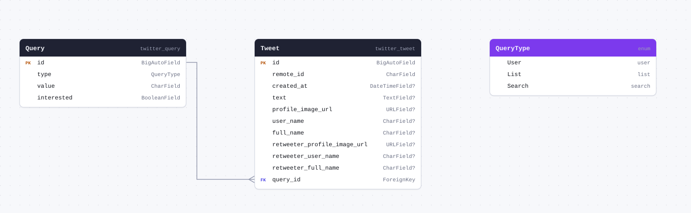

| Column | Field | Type | Null | Key | Default | Description |
| --- | --- | --- | --- | --- | --- | --- |
| `id` | `BigAutoField` | `integer` |  | PK | `autoincrement()` |  |
| `type` | `QueryType` | `varchar(10)` |  |  |  |  |
| `value` | `CharField` | `varchar(140)` |  |  |  |  |
| `interested` | `BooleanField` | `bool` |  |  | `True` |  |

Relations:

- [Tweet](#tweet).`query_id` → `id`, on delete cascade

## Tweet

Table `twitter_tweet`, app `twitter`.

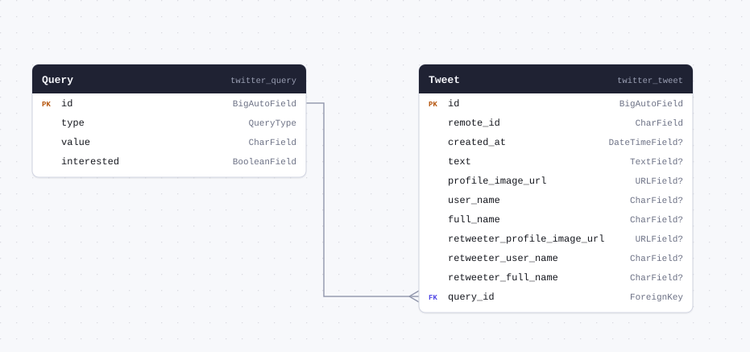

| Column | Field | Type | Null | Key | Default | Description |
| --- | --- | --- | --- | --- | --- | --- |
| `id` | `BigAutoField` | `integer` |  | PK | `autoincrement()` |  |
| `remote_id` | `CharField` | `varchar(50)` |  |  |  |  |
| `created_at` | `DateTimeField` | `datetime` | yes |  |  |  |
| `text` | `TextField` | `text` | yes |  |  |  |
| `profile_image_url` | `URLField` | `varchar(200)` | yes |  |  |  |
| `user_name` | `CharField` | `varchar(100)` | yes |  |  |  |
| `full_name` | `CharField` | `varchar(100)` | yes |  |  |  |
| `retweeter_profile_image_url` | `URLField` | `varchar(200)` | yes |  |  |  |
| `retweeter_user_name` | `CharField` | `varchar(100)` | yes |  |  |  |
| `retweeter_full_name` | `CharField` | `varchar(100)` | yes |  |  |  |
| `query_id` | `ForeignKey` | `bigint` |  | FK |  |  |

Indexes:

- index `twitter_tweet_query_id_bd42b699` on `query_id`

Relations:

- `query_id` → [Query](#query).`id`, on delete cascade

# Enums

## LogEntryActionFlag

| Name | Stored as |
| --- | --- |
| `Addition` | `1` |
| `Change` | `2` |
| `Deletion` | `3` |

## PageStatus

| Name | Stored as |
| --- | --- |
| `Draft` | `1` |
| `Published` | `2` |

## PageInMenus

| Name | Stored as |
| --- | --- |
| `Top navigation bar` | `1` |
| `Left-hand tree` | `2` |
| `Footer` | `3` |

## BlogPostStatus

| Name | Stored as |
| --- | --- |
| `Draft` | `1` |
| `Published` | `2` |

## FieldFieldType

| Name | Stored as |
| --- | --- |
| `Single line text` | `1` |
| `Multi line text` | `2` |
| `Email` | `3` |
| `Number` | `13` |
| `URL` | `14` |
| `Check box` | `4` |
| `Check boxes` | `5` |
| `Drop down` | `6` |
| `Multi select` | `7` |
| `Radio buttons` | `8` |
| `File upload` | `9` |
| `Date` | `10` |
| `Date/time` | `11` |
| `Date of birth` | `15` |
| `Hidden` | `12` |

## QueryType

| Name | Stored as |
| --- | --- |
| `User` | `user` |
| `List` | `list` |
| `Search` | `search` |
