# Schema docs

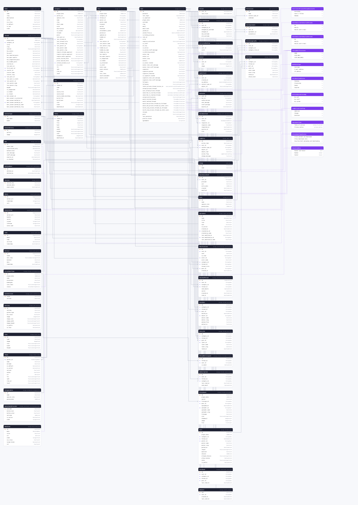

[Rank](#rank) · [Online](#online) · [User](#user) · [UsernameChange](#usernamechange) · [ActivityRanking](#activityranking) · [Avatar](#avatar) · [AuditTrail](#audittrail) · [AvatarGallery](#avatargallery) · [Ban](#ban) · [BanCache](#bancache) · [DataDownload](#datadownload) · [DeletedUser](#deleteduser) · [LogEntry](#logentry) · [Permission](#permission) · [Group](#group) · [ContentType](#contenttype) · [Session](#session) · [UserSocialAuth](#usersocialauth) · [Nonce](#nonce) · [Association](#association) · [Code](#code) · [Partial](#partial) · [Role](#role) · [CacheVersion](#cacheversion) · [Setting](#setting) · [Icon](#icon) · [Theme](#theme) · [Css](#css) · [Media](#media) · [Agreement](#agreement) · [UserAgreement](#useragreement) · [Notification](#notification) · [WatchedThread](#watchedthread) · [Category](#category) · [CategoryRole](#categoryrole) · [RoleCategoryACL](#rolecategoryacl) · [Post](#post) · [PostEdit](#postedit) · [PostLike](#postlike) · [Thread](#thread) · [ThreadParticipant](#threadparticipant) · [Subscription](#subscription) · [AttachmentType](#attachmenttype) · [Attachment](#attachment) · [Poll](#poll) · [PollVote](#pollvote) · [PostRead](#postread) · [Subject](#subject) · [SocialAuthProvider](#socialauthprovider) · [MenuItem](#menuitem)

<details>
<summary>The whole schema as SQL</summary>

```sql
CREATE TABLE "misago_users_rank" ("id" integer NOT NULL PRIMARY KEY GENERATED BY DEFAULT AS IDENTITY, "name" varchar(255) NOT NULL, "slug" varchar(255) NOT NULL UNIQUE, "description" text NULL, "title" varchar(255) NULL, "css_class" varchar(255) NULL, "is_default" boolean NOT NULL, "is_tab" boolean NOT NULL, "order" integer NOT NULL);

CREATE TABLE "misago_users_rank_roles" ("id" integer NOT NULL PRIMARY KEY GENERATED BY DEFAULT AS IDENTITY, "rank_id" integer NOT NULL, "role_id" integer NOT NULL);

CREATE TABLE "misago_users_online" ("user_id" integer NOT NULL PRIMARY KEY, "last_click" timestamp with time zone NOT NULL);

CREATE TABLE "misago_users_user" ("id" integer NOT NULL PRIMARY KEY GENERATED BY DEFAULT AS IDENTITY, "password" varchar(128) NOT NULL, "last_login" timestamp with time zone NULL, "is_superuser" boolean NOT NULL, "plugin_data" jsonb NOT NULL, "username" varchar(30) NOT NULL, "slug" varchar(30) NOT NULL UNIQUE, "email" varchar(255) NOT NULL, "email_hash" varchar(32) NOT NULL UNIQUE, "joined_on" timestamp with time zone NOT NULL, "joined_from_ip" inet NULL, "is_hiding_presence" boolean NOT NULL, "rank_id" integer NULL, "title" varchar(255) NULL, "requires_activation" integer NOT NULL CHECK ("requires_activation" >= 0), "is_staff" boolean NOT NULL, "acl_key" varchar(12) NULL, "is_active" boolean NOT NULL, "is_active_staff_message" text NULL, "is_deleting_account" boolean NOT NULL, "avatar_tmp" varchar(255) NULL, "avatar_src" varchar(255) NULL, "avatar_crop" varchar(255) NULL, "avatars" jsonb NULL, "is_avatar_locked" boolean NOT NULL, "avatar_lock_user_message" text NULL, "avatar_lock_staff_message" text NULL, "signature" text NULL, "signature_parsed" text NULL, "signature_checksum" varchar(64) NULL, "is_signature_locked" boolean NOT NULL, "signature_lock_user_message" text NULL, "signature_lock_staff_message" text NULL, "followers" integer NOT NULL CHECK ("followers" >= 0), "following" integer NOT NULL CHECK ("following" >= 0), "limits_private_thread_invites_to" integer NOT NULL CHECK ("limits_private_thread_invites_to" >= 0), "unread_private_threads" integer NOT NULL CHECK ("unread_private_threads" >= 0), "sync_unread_private_threads" boolean NOT NULL, "subscribe_to_started_threads" integer NOT NULL CHECK ("subscribe_to_started_threads" >= 0), "subscribe_to_replied_threads" integer NOT NULL CHECK ("subscribe_to_replied_threads" >= 0), "unread_notifications" integer NOT NULL CHECK ("unread_notifications" >= 0), "watch_started_threads" integer NOT NULL CHECK ("watch_started_threads" >= 0), "watch_replied_threads" integer NOT NULL CHECK ("watch_replied_threads" >= 0), "watch_new_private_threads_by_followed" integer NOT NULL CHECK ("watch_new_private_threads_by_followed" >= 0), "watch_new_private_threads_by_other_users" integer NOT NULL CHECK ("watch_new_private_threads_by_other_users" >= 0), "notify_new_private_threads_by_followed" integer NOT NULL CHECK ("notify_new_private_threads_by_followed" >= 0), "notify_new_private_threads_by_other_users" integer NOT NULL CHECK ("notify_new_private_threads_by_other_users" >= 0), "threads" integer NOT NULL CHECK ("threads" >= 0), "posts" integer NOT NULL CHECK ("posts" >= 0), "last_posted_on" timestamp with time zone NULL, "profile_fields" hstore NOT NULL, "agreements" integer[] NOT NULL);

CREATE TABLE "misago_users_user_groups" ("id" integer NOT NULL PRIMARY KEY GENERATED BY DEFAULT AS IDENTITY, "user_id" integer NOT NULL, "group_id" integer NOT NULL);

CREATE TABLE "misago_users_user_user_permissions" ("id" integer NOT NULL PRIMARY KEY GENERATED BY DEFAULT AS IDENTITY, "user_id" integer NOT NULL, "permission_id" integer NOT NULL);

CREATE TABLE "misago_users_user_roles" ("id" integer NOT NULL PRIMARY KEY GENERATED BY DEFAULT AS IDENTITY, "user_id" integer NOT NULL, "role_id" integer NOT NULL);

CREATE TABLE "misago_users_user_follows" ("id" integer NOT NULL PRIMARY KEY GENERATED BY DEFAULT AS IDENTITY, "from_user_id" integer NOT NULL, "to_user_id" integer NOT NULL);

CREATE TABLE "misago_users_user_blocks" ("id" integer NOT NULL PRIMARY KEY GENERATED BY DEFAULT AS IDENTITY, "from_user_id" integer NOT NULL, "to_user_id" integer NOT NULL);

CREATE TABLE "misago_users_usernamechange" ("id" integer NOT NULL PRIMARY KEY GENERATED BY DEFAULT AS IDENTITY, "user_id" integer NOT NULL, "changed_by_id" integer NULL, "changed_by_username" varchar(30) NOT NULL, "changed_on" timestamp with time zone NOT NULL, "new_username" varchar(255) NOT NULL, "old_username" varchar(255) NOT NULL);

CREATE TABLE "misago_users_activityranking" ("id" integer NOT NULL PRIMARY KEY GENERATED BY DEFAULT AS IDENTITY, "user_id" integer NOT NULL, "score" integer NOT NULL CHECK ("score" >= 0));

CREATE TABLE "misago_users_avatar" ("id" integer NOT NULL PRIMARY KEY GENERATED BY DEFAULT AS IDENTITY, "user_id" integer NOT NULL, "size" integer NOT NULL CHECK ("size" >= 0), "image" varchar(255) NOT NULL);

CREATE TABLE "misago_users_audittrail" ("id" integer NOT NULL PRIMARY KEY GENERATED BY DEFAULT AS IDENTITY, "user_id" integer NOT NULL, "created_on" timestamp with time zone NOT NULL, "ip_address" inet NOT NULL, "content_type_id" integer NOT NULL, "object_id" integer NOT NULL CHECK ("object_id" >= 0));

CREATE TABLE "misago_users_avatargallery" ("id" integer NOT NULL PRIMARY KEY GENERATED BY DEFAULT AS IDENTITY, "gallery" varchar(255) NOT NULL, "image" varchar(255) NOT NULL);

CREATE TABLE "misago_users_ban" ("id" integer NOT NULL PRIMARY KEY GENERATED BY DEFAULT AS IDENTITY, "check_type" integer NOT NULL CHECK ("check_type" >= 0), "registration_only" boolean NOT NULL, "banned_value" varchar(255) NOT NULL, "user_message" text NULL, "staff_message" text NULL, "expires_on" timestamp with time zone NULL, "is_checked" boolean NOT NULL);

CREATE TABLE "misago_users_bancache" ("user_id" integer NOT NULL PRIMARY KEY, "ban_id" integer NULL, "cache_version" varchar(8) NOT NULL, "user_message" text NULL, "staff_message" text NULL, "expires_on" timestamp with time zone NULL);

CREATE TABLE "misago_users_datadownload" ("id" integer NOT NULL PRIMARY KEY GENERATED BY DEFAULT AS IDENTITY, "user_id" integer NOT NULL, "status" integer NOT NULL CHECK ("status" >= 0), "requester_id" integer NULL, "requester_name" varchar(255) NOT NULL, "requested_on" timestamp with time zone NOT NULL, "expires_on" timestamp with time zone NOT NULL, "file" varchar(255) NULL);

CREATE TABLE "misago_users_deleteduser" ("id" integer NOT NULL PRIMARY KEY GENERATED BY DEFAULT AS IDENTITY, "deleted_on" timestamp with time zone NOT NULL, "deleted_by" integer NOT NULL CHECK ("deleted_by" >= 0));

CREATE TABLE "django_admin_log" ("id" integer NOT NULL PRIMARY KEY GENERATED BY DEFAULT AS IDENTITY, "action_time" timestamp with time zone NOT NULL, "user_id" integer NOT NULL, "content_type_id" integer NULL, "object_id" text NULL, "object_repr" varchar(200) NOT NULL, "action_flag" smallint NOT NULL CHECK ("action_flag" >= 0), "change_message" text NOT NULL);

CREATE TABLE "auth_permission" ("id" integer NOT NULL PRIMARY KEY GENERATED BY DEFAULT AS IDENTITY, "name" varchar(255) NOT NULL, "content_type_id" integer NOT NULL, "codename" varchar(100) NOT NULL);

CREATE TABLE "auth_group" ("id" integer NOT NULL PRIMARY KEY GENERATED BY DEFAULT AS IDENTITY, "name" varchar(150) NOT NULL UNIQUE);

CREATE TABLE "auth_group_permissions" ("id" integer NOT NULL PRIMARY KEY GENERATED BY DEFAULT AS IDENTITY, "group_id" integer NOT NULL, "permission_id" integer NOT NULL);

CREATE TABLE "django_content_type" ("id" integer NOT NULL PRIMARY KEY GENERATED BY DEFAULT AS IDENTITY, "app_label" varchar(100) NOT NULL, "model" varchar(100) NOT NULL);

CREATE TABLE "django_session" ("session_key" varchar(40) NOT NULL PRIMARY KEY, "session_data" text NOT NULL, "expire_date" timestamp with time zone NOT NULL);

CREATE TABLE "social_auth_usersocialauth" ("id" bigint NOT NULL PRIMARY KEY GENERATED BY DEFAULT AS IDENTITY, "user_id" integer NOT NULL, "provider" varchar(32) NOT NULL, "uid" varchar(255) NOT NULL, "extra_data" jsonb NOT NULL, "created" timestamp with time zone NOT NULL, "modified" timestamp with time zone NOT NULL);

CREATE TABLE "social_auth_nonce" ("id" bigint NOT NULL PRIMARY KEY GENERATED BY DEFAULT AS IDENTITY, "server_url" varchar(255) NOT NULL, "timestamp" integer NOT NULL, "salt" varchar(65) NOT NULL);

CREATE TABLE "social_auth_association" ("id" bigint NOT NULL PRIMARY KEY GENERATED BY DEFAULT AS IDENTITY, "server_url" varchar(255) NOT NULL, "handle" varchar(255) NOT NULL, "secret" varchar(255) NOT NULL, "issued" integer NOT NULL, "lifetime" integer NOT NULL, "assoc_type" varchar(64) NOT NULL);

CREATE TABLE "social_auth_code" ("id" bigint NOT NULL PRIMARY KEY GENERATED BY DEFAULT AS IDENTITY, "email" varchar(254) NOT NULL, "code" varchar(32) NOT NULL, "verified" boolean NOT NULL, "timestamp" timestamp with time zone NOT NULL);

CREATE TABLE "social_auth_partial" ("id" bigint NOT NULL PRIMARY KEY GENERATED BY DEFAULT AS IDENTITY, "token" varchar(32) NOT NULL, "next_step" smallint NOT NULL CHECK ("next_step" >= 0), "backend" varchar(32) NOT NULL, "data" jsonb NOT NULL, "timestamp" timestamp with time zone NOT NULL);

CREATE TABLE "misago_acl_role" ("id" integer NOT NULL PRIMARY KEY GENERATED BY DEFAULT AS IDENTITY, "name" varchar(255) NOT NULL, "special_role" varchar(255) NULL, "permissions" jsonb NOT NULL);

CREATE TABLE "misago_cache_cacheversion" ("cache" varchar(128) NOT NULL PRIMARY KEY, "version" varchar(8) NOT NULL);

CREATE TABLE "misago_conf_setting" ("id" integer NOT NULL PRIMARY KEY GENERATED BY DEFAULT AS IDENTITY, "setting" varchar(255) NOT NULL UNIQUE, "python_type" varchar(255) NOT NULL, "dry_value" text NULL, "image" varchar(100) NULL, "image_size" integer NULL CHECK ("image_size" >= 0), "image_width" integer NULL CHECK ("image_width" >= 0), "image_height" integer NULL CHECK ("image_height" >= 0), "is_public" boolean NOT NULL, "is_lazy" boolean NOT NULL);

CREATE TABLE "misago_icons_icon" ("id" integer NOT NULL PRIMARY KEY GENERATED BY DEFAULT AS IDENTITY, "type" varchar(255) NOT NULL, "image" varchar(100) NOT NULL, "size" integer NOT NULL CHECK ("size" >= 0), "width" integer NOT NULL CHECK ("width" >= 0), "height" integer NOT NULL CHECK ("height" >= 0));

CREATE TABLE "misago_themes_theme" ("id" integer NOT NULL PRIMARY KEY GENERATED BY DEFAULT AS IDENTITY, "parent_id" integer NULL, "name" varchar(255) NOT NULL, "dirname" varchar(8) NOT NULL, "is_default" boolean NOT NULL, "is_active" boolean NOT NULL, "version" varchar(255) NULL, "author" varchar(255) NULL, "url" varchar(255) NULL, "lft" integer NOT NULL CHECK ("lft" >= 0), "rght" integer NOT NULL CHECK ("rght" >= 0), "tree_id" integer NOT NULL CHECK ("tree_id" >= 0), "level" integer NOT NULL CHECK ("level" >= 0));

CREATE TABLE "misago_themes_css" ("id" integer NOT NULL PRIMARY KEY GENERATED BY DEFAULT AS IDENTITY, "theme_id" integer NOT NULL, "name" varchar(255) NOT NULL, "url" varchar(255) NULL, "source_file" varchar(255) NULL, "source_hash" varchar(8) NULL, "source_needs_building" boolean NOT NULL, "build_file" varchar(255) NULL, "build_hash" varchar(8) NULL, "size" integer NOT NULL CHECK ("size" >= 0), "order" integer NOT NULL, "modified_on" timestamp with time zone NOT NULL);

CREATE TABLE "misago_themes_media" ("id" integer NOT NULL PRIMARY KEY GENERATED BY DEFAULT AS IDENTITY, "theme_id" integer NOT NULL, "name" varchar(255) NOT NULL, "file" varchar(255) NOT NULL, "hash" varchar(8) NOT NULL, "type" varchar(255) NOT NULL, "width" integer NOT NULL CHECK ("width" >= 0), "height" integer NOT NULL CHECK ("height" >= 0), "size" integer NOT NULL CHECK ("size" >= 0), "thumbnail" varchar(255) NULL, "modified_on" timestamp with time zone NOT NULL);

CREATE TABLE "misago_legal_agreement" ("id" integer NOT NULL PRIMARY KEY GENERATED BY DEFAULT AS IDENTITY, "type" varchar(20) NOT NULL, "title" varchar(255) NULL, "link" varchar(255) NULL, "text" text NULL, "is_active" boolean NOT NULL, "created_on" timestamp with time zone NOT NULL, "created_by_id" integer NULL, "created_by_name" varchar(255) NULL, "last_modified_on" timestamp with time zone NULL, "last_modified_by_id" integer NULL, "last_modified_by_name" varchar(255) NULL);

CREATE TABLE "misago_legal_useragreement" ("id" integer NOT NULL PRIMARY KEY GENERATED BY DEFAULT AS IDENTITY, "user_id" integer NOT NULL, "agreement_id" integer NOT NULL, "accepted_on" timestamp with time zone NOT NULL);

CREATE TABLE "misago_notifications_notification" ("id" bigint NOT NULL PRIMARY KEY GENERATED BY DEFAULT AS IDENTITY, "user_id" integer NOT NULL, "verb" varchar(32) NOT NULL, "is_read" boolean NOT NULL, "actor_id" integer NULL, "actor_name" varchar(255) NULL, "category_id" integer NULL, "thread_id" integer NULL, "thread_title" varchar(255) NULL, "post_id" integer NULL, "created_at" timestamp with time zone NOT NULL);

CREATE TABLE "misago_notifications_watchedthread" ("id" bigint NOT NULL PRIMARY KEY GENERATED BY DEFAULT AS IDENTITY, "user_id" integer NOT NULL, "category_id" integer NOT NULL, "thread_id" integer NOT NULL, "send_emails" boolean NOT NULL, "secret" varchar(32) NOT NULL, "created_at" timestamp with time zone NOT NULL, "read_at" timestamp with time zone NOT NULL);

CREATE TABLE "misago_categories_category" ("id" integer NOT NULL PRIMARY KEY GENERATED BY DEFAULT AS IDENTITY, "plugin_data" jsonb NOT NULL, "parent_id" integer NULL, "special_role" varchar(255) NULL, "name" varchar(255) NOT NULL, "slug" varchar(255) NOT NULL, "short_name" varchar(255) NULL, "color" varchar(7) NULL, "description" text NULL, "is_closed" boolean NOT NULL, "threads" integer NOT NULL CHECK ("threads" >= 0), "posts" integer NOT NULL CHECK ("posts" >= 0), "last_post_on" timestamp with time zone NULL, "last_thread_id" integer NULL, "last_thread_title" varchar(255) NULL, "last_thread_slug" varchar(255) NULL, "last_poster_id" integer NULL, "last_poster_name" varchar(255) NULL, "last_poster_slug" varchar(255) NULL, "require_threads_approval" boolean NOT NULL, "require_replies_approval" boolean NOT NULL, "require_edits_approval" boolean NOT NULL, "prune_started_after" integer NOT NULL CHECK ("prune_started_after" >= 0), "prune_replied_after" integer NOT NULL CHECK ("prune_replied_after" >= 0), "archive_pruned_in_id" integer NULL, "css_class" varchar(255) NULL, "lft" integer NOT NULL CHECK ("lft" >= 0), "rght" integer NOT NULL CHECK ("rght" >= 0), "tree_id" integer NOT NULL CHECK ("tree_id" >= 0), "level" integer NOT NULL CHECK ("level" >= 0));

CREATE TABLE "misago_categories_categoryrole" ("id" integer NOT NULL PRIMARY KEY GENERATED BY DEFAULT AS IDENTITY, "name" varchar(255) NOT NULL, "special_role" varchar(255) NULL, "permissions" jsonb NOT NULL);

CREATE TABLE "misago_categories_rolecategoryacl" ("id" integer NOT NULL PRIMARY KEY GENERATED BY DEFAULT AS IDENTITY, "role_id" integer NOT NULL, "category_id" integer NOT NULL, "category_role_id" integer NOT NULL);

CREATE TABLE "misago_threads_post" ("id" integer NOT NULL PRIMARY KEY GENERATED BY DEFAULT AS IDENTITY, "plugin_data" jsonb NOT NULL, "category_id" integer NOT NULL, "thread_id" integer NOT NULL, "poster_id" integer NULL, "poster_name" varchar(255) NOT NULL, "original" text NOT NULL, "parsed" text NOT NULL, "checksum" varchar(64) NOT NULL, "attachments_cache" jsonb NULL, "posted_on" timestamp with time zone NOT NULL, "updated_on" timestamp with time zone NOT NULL, "hidden_on" timestamp with time zone NOT NULL, "edits" integer NOT NULL CHECK ("edits" >= 0), "last_editor_id" integer NULL, "last_editor_name" varchar(255) NULL, "last_editor_slug" varchar(255) NULL, "hidden_by_id" integer NULL, "hidden_by_name" varchar(255) NULL, "hidden_by_slug" varchar(255) NULL, "has_reports" boolean NOT NULL, "has_open_reports" boolean NOT NULL, "is_unapproved" boolean NOT NULL, "is_hidden" boolean NOT NULL, "is_protected" boolean NOT NULL, "is_event" boolean NOT NULL, "event_type" varchar(255) NULL, "event_context" jsonb NULL, "likes" integer NOT NULL CHECK ("likes" >= 0), "last_likes" jsonb NULL, "search_document" text NULL, "search_vector" tsvector NOT NULL);

CREATE TABLE "misago_threads_post_mentions" ("id" integer NOT NULL PRIMARY KEY GENERATED BY DEFAULT AS IDENTITY, "post_id" integer NOT NULL, "user_id" integer NOT NULL);

CREATE TABLE "misago_threads_postedit" ("id" integer NOT NULL PRIMARY KEY GENERATED BY DEFAULT AS IDENTITY, "category_id" integer NOT NULL, "thread_id" integer NOT NULL, "post_id" integer NOT NULL, "edited_on" timestamp with time zone NOT NULL, "editor_id" integer NULL, "editor_name" varchar(255) NOT NULL, "editor_slug" varchar(255) NOT NULL, "edited_from" text NOT NULL, "edited_to" text NOT NULL);

CREATE TABLE "misago_threads_postlike" ("id" integer NOT NULL PRIMARY KEY GENERATED BY DEFAULT AS IDENTITY, "category_id" integer NOT NULL, "thread_id" integer NOT NULL, "post_id" integer NOT NULL, "liker_id" integer NULL, "liker_name" varchar(255) NOT NULL, "liker_slug" varchar(255) NOT NULL, "liked_on" timestamp with time zone NOT NULL);

CREATE TABLE "misago_threads_thread" ("id" integer NOT NULL PRIMARY KEY GENERATED BY DEFAULT AS IDENTITY, "plugin_data" jsonb NOT NULL, "category_id" integer NOT NULL, "title" varchar(255) NOT NULL, "slug" varchar(255) NOT NULL, "replies" integer NOT NULL CHECK ("replies" >= 0), "has_events" boolean NOT NULL, "has_poll" boolean NOT NULL, "has_reported_posts" boolean NOT NULL, "has_open_reports" boolean NOT NULL, "has_unapproved_posts" boolean NOT NULL, "has_hidden_posts" boolean NOT NULL, "started_on" timestamp with time zone NOT NULL, "last_post_on" timestamp with time zone NOT NULL, "first_post_id" integer NULL, "starter_id" integer NULL, "starter_name" varchar(255) NOT NULL, "starter_slug" varchar(255) NOT NULL, "last_post_id" integer NULL, "last_post_is_event" boolean NOT NULL, "last_poster_id" integer NULL, "last_poster_name" varchar(255) NULL, "last_poster_slug" varchar(255) NULL, "weight" integer NOT NULL CHECK ("weight" >= 0), "is_unapproved" boolean NOT NULL, "is_hidden" boolean NOT NULL, "is_closed" boolean NOT NULL, "best_answer_id" integer NULL, "best_answer_is_protected" boolean NOT NULL, "best_answer_marked_on" timestamp with time zone NULL, "best_answer_marked_by_id" integer NULL, "best_answer_marked_by_name" varchar(255) NULL, "best_answer_marked_by_slug" varchar(255) NULL);

CREATE TABLE "misago_threads_threadparticipant" ("id" integer NOT NULL PRIMARY KEY GENERATED BY DEFAULT AS IDENTITY, "thread_id" integer NOT NULL, "user_id" integer NOT NULL, "is_owner" boolean NOT NULL);

CREATE TABLE "misago_threads_subscription" ("id" integer NOT NULL PRIMARY KEY GENERATED BY DEFAULT AS IDENTITY, "user_id" integer NOT NULL, "thread_id" integer NOT NULL, "category_id" integer NOT NULL, "last_read_on" timestamp with time zone NOT NULL, "send_email" boolean NOT NULL);

CREATE TABLE "misago_threads_attachmenttype" ("id" integer NOT NULL PRIMARY KEY GENERATED BY DEFAULT AS IDENTITY, "plugin_data" jsonb NOT NULL, "name" varchar(255) NOT NULL, "extensions" varchar(255) NOT NULL, "mimetypes" varchar(255) NULL, "size_limit" integer NOT NULL CHECK ("size_limit" >= 0), "status" integer NOT NULL CHECK ("status" >= 0));

CREATE TABLE "misago_threads_attachmenttype_limit_uploads_to" ("id" integer NOT NULL PRIMARY KEY GENERATED BY DEFAULT AS IDENTITY, "attachmenttype_id" integer NOT NULL, "role_id" integer NOT NULL);

CREATE TABLE "misago_threads_attachmenttype_limit_downloads_to" ("id" integer NOT NULL PRIMARY KEY GENERATED BY DEFAULT AS IDENTITY, "attachmenttype_id" integer NOT NULL, "role_id" integer NOT NULL);

CREATE TABLE "misago_threads_attachment" ("id" integer NOT NULL PRIMARY KEY GENERATED BY DEFAULT AS IDENTITY, "plugin_data" jsonb NOT NULL, "secret" varchar(64) NOT NULL, "filetype_id" integer NOT NULL, "post_id" integer NULL, "uploaded_on" timestamp with time zone NOT NULL, "uploader_id" integer NULL, "uploader_name" varchar(255) NOT NULL, "uploader_slug" varchar(255) NOT NULL, "filename" varchar(255) NOT NULL, "size" integer NOT NULL CHECK ("size" >= 0), "thumbnail" varchar(255) NULL, "image" varchar(255) NULL, "file" varchar(255) NULL);

CREATE TABLE "misago_threads_poll" ("id" integer NOT NULL PRIMARY KEY GENERATED BY DEFAULT AS IDENTITY, "plugin_data" jsonb NOT NULL, "category_id" integer NOT NULL, "thread_id" integer NOT NULL UNIQUE, "poster_id" integer NULL, "poster_name" varchar(255) NOT NULL, "poster_slug" varchar(255) NOT NULL, "posted_on" timestamp with time zone NOT NULL, "length" integer NOT NULL CHECK ("length" >= 0), "question" varchar(255) NOT NULL, "choices" jsonb NOT NULL, "allowed_choices" integer NOT NULL CHECK ("allowed_choices" >= 0), "allow_revotes" boolean NOT NULL, "votes" integer NOT NULL CHECK ("votes" >= 0), "is_public" boolean NOT NULL);

CREATE TABLE "misago_threads_pollvote" ("id" integer NOT NULL PRIMARY KEY GENERATED BY DEFAULT AS IDENTITY, "category_id" integer NOT NULL, "thread_id" integer NOT NULL, "poll_id" integer NOT NULL, "voter_id" integer NULL, "voter_name" varchar(255) NOT NULL, "voter_slug" varchar(255) NOT NULL, "voted_on" timestamp with time zone NOT NULL, "choice_hash" varchar(12) NOT NULL);

CREATE TABLE "misago_readtracker_postread" ("id" integer NOT NULL PRIMARY KEY GENERATED BY DEFAULT AS IDENTITY, "user_id" integer NOT NULL, "category_id" integer NOT NULL, "thread_id" integer NOT NULL, "post_id" integer NOT NULL, "last_read_on" timestamp with time zone NOT NULL);

CREATE TABLE "misago_oauth2_subject" ("sub" varchar(36) NOT NULL PRIMARY KEY, "user_id" integer NOT NULL, "created_on" timestamp with time zone NOT NULL, "last_used_on" timestamp with time zone NOT NULL);

CREATE TABLE "misago_socialauth_socialauthprovider" ("provider" varchar(30) NOT NULL PRIMARY KEY, "button_text" varchar(255) NULL, "button_color" varchar(7) NULL, "settings" jsonb NOT NULL, "is_active" boolean NOT NULL, "order" integer NOT NULL);

CREATE TABLE "misago_menus_menuitem" ("id" integer NOT NULL PRIMARY KEY GENERATED BY DEFAULT AS IDENTITY, "menu" varchar(6) NOT NULL, "title" varchar(255) NOT NULL, "url" varchar(200) NOT NULL, "order" integer NOT NULL, "css_class" varchar(255) NULL, "target_blank" boolean NOT NULL, "rel" varchar(255) NULL);

CREATE INDEX "misago_users_rank_slug_80e8f022_like" ON "misago_users_rank" ("slug" varchar_pattern_ops);

ALTER TABLE "misago_users_rank_roles" ADD CONSTRAINT "misago_users_rank_roles_rank_id_role_id_81914683_uniq" UNIQUE ("rank_id", "role_id");

ALTER TABLE "misago_users_rank_roles" ADD CONSTRAINT "misago_users_rank_ro_rank_id_662c3ee7_fk_misago_us" FOREIGN KEY ("rank_id") REFERENCES "misago_users_rank" ("id") DEFERRABLE INITIALLY DEFERRED;

ALTER TABLE "misago_users_rank_roles" ADD CONSTRAINT "misago_users_rank_roles_role_id_e0236d53_fk_misago_acl_role_id" FOREIGN KEY ("role_id") REFERENCES "misago_acl_role" ("id") DEFERRABLE INITIALLY DEFERRED;

CREATE INDEX "misago_users_rank_roles_rank_id_662c3ee7" ON "misago_users_rank_roles" ("rank_id");

CREATE INDEX "misago_users_rank_roles_role_id_e0236d53" ON "misago_users_rank_roles" ("role_id");

ALTER TABLE "misago_users_online" ADD CONSTRAINT "misago_users_online_user_id_a38e83e3_fk_misago_users_user_id" FOREIGN KEY ("user_id") REFERENCES "misago_users_user" ("id") DEFERRABLE INITIALLY DEFERRED;

ALTER TABLE "misago_users_user" ADD CONSTRAINT "misago_users_user_rank_id_25883ca9_fk_misago_users_rank_id" FOREIGN KEY ("rank_id") REFERENCES "misago_users_rank" ("id") DEFERRABLE INITIALLY DEFERRED;

CREATE INDEX "misago_users_user_slug_87d70f62_like" ON "misago_users_user" ("slug" varchar_pattern_ops);

CREATE INDEX "misago_users_user_email_1cdb37a6" ON "misago_users_user" ("email");

CREATE INDEX "misago_users_user_email_1cdb37a6_like" ON "misago_users_user" ("email" varchar_pattern_ops);

CREATE INDEX "misago_users_user_email_hash_55ddd5b1_like" ON "misago_users_user" ("email_hash" varchar_pattern_ops);

CREATE INDEX "misago_users_user_joined_on_2171a24f" ON "misago_users_user" ("joined_on");

CREATE INDEX "misago_users_user_rank_id_25883ca9" ON "misago_users_user" ("rank_id");

CREATE INDEX "misago_users_user_is_active_fc628eb4" ON "misago_users_user" ("is_active");

CREATE INDEX "misago_users_user_posts_79cba5f0" ON "misago_users_user" ("posts");

CREATE INDEX "misago_user_plugin__c45a32_gin" ON "misago_users_user" USING gin ("plugin_data");

CREATE INDEX "misago_user_is_staff_part" ON "misago_users_user" ("is_staff") WHERE "is_staff";

CREATE INDEX "misago_user_requires_acti_part" ON "misago_users_user" ("requires_activation") WHERE "requires_activation" > 0;

CREATE INDEX "misago_user_is_deleting_a_part" ON "misago_users_user" ("is_deleting_account") WHERE "is_deleting_account";

ALTER TABLE "misago_users_user_groups" ADD CONSTRAINT "misago_users_user_groups_user_id_group_id_12611fe8_uniq" UNIQUE ("user_id", "group_id");

ALTER TABLE "misago_users_user_groups" ADD CONSTRAINT "misago_users_user_gr_user_id_ddeac4e6_fk_misago_us" FOREIGN KEY ("user_id") REFERENCES "misago_users_user" ("id") DEFERRABLE INITIALLY DEFERRED;

ALTER TABLE "misago_users_user_groups" ADD CONSTRAINT "misago_users_user_groups_group_id_0b7c0680_fk_auth_group_id" FOREIGN KEY ("group_id") REFERENCES "auth_group" ("id") DEFERRABLE INITIALLY DEFERRED;

CREATE INDEX "misago_users_user_groups_user_id_ddeac4e6" ON "misago_users_user_groups" ("user_id");

CREATE INDEX "misago_users_user_groups_group_id_0b7c0680" ON "misago_users_user_groups" ("group_id");

ALTER TABLE "misago_users_user_user_permissions" ADD CONSTRAINT "misago_users_user_user_p_user_id_permission_id_dc758b0b_uniq" UNIQUE ("user_id", "permission_id");

ALTER TABLE "misago_users_user_user_permissions" ADD CONSTRAINT "misago_users_user_us_user_id_264f5b9d_fk_misago_us" FOREIGN KEY ("user_id") REFERENCES "misago_users_user" ("id") DEFERRABLE INITIALLY DEFERRED;

ALTER TABLE "misago_users_user_user_permissions" ADD CONSTRAINT "misago_users_user_us_permission_id_bd44102a_fk_auth_perm" FOREIGN KEY ("permission_id") REFERENCES "auth_permission" ("id") DEFERRABLE INITIALLY DEFERRED;

CREATE INDEX "misago_users_user_user_permissions_user_id_264f5b9d" ON "misago_users_user_user_permissions" ("user_id");

CREATE INDEX "misago_users_user_user_permissions_permission_id_bd44102a" ON "misago_users_user_user_permissions" ("permission_id");

ALTER TABLE "misago_users_user_roles" ADD CONSTRAINT "misago_users_user_roles_user_id_role_id_1cbe8d01_uniq" UNIQUE ("user_id", "role_id");

ALTER TABLE "misago_users_user_roles" ADD CONSTRAINT "misago_users_user_ro_user_id_af2be819_fk_misago_us" FOREIGN KEY ("user_id") REFERENCES "misago_users_user" ("id") DEFERRABLE INITIALLY DEFERRED;

ALTER TABLE "misago_users_user_roles" ADD CONSTRAINT "misago_users_user_roles_role_id_58d36725_fk_misago_acl_role_id" FOREIGN KEY ("role_id") REFERENCES "misago_acl_role" ("id") DEFERRABLE INITIALLY DEFERRED;

CREATE INDEX "misago_users_user_roles_user_id_af2be819" ON "misago_users_user_roles" ("user_id");

CREATE INDEX "misago_users_user_roles_role_id_58d36725" ON "misago_users_user_roles" ("role_id");

ALTER TABLE "misago_users_user_follows" ADD CONSTRAINT "misago_users_user_follows_from_user_id_to_user_id_92296f5c_uniq" UNIQUE ("from_user_id", "to_user_id");

ALTER TABLE "misago_users_user_follows" ADD CONSTRAINT "misago_users_user_fo_from_user_id_9575602d_fk_misago_us" FOREIGN KEY ("from_user_id") REFERENCES "misago_users_user" ("id") DEFERRABLE INITIALLY DEFERRED;

ALTER TABLE "misago_users_user_follows" ADD CONSTRAINT "misago_users_user_fo_to_user_id_8cc8eb10_fk_misago_us" FOREIGN KEY ("to_user_id") REFERENCES "misago_users_user" ("id") DEFERRABLE INITIALLY DEFERRED;

CREATE INDEX "misago_users_user_follows_from_user_id_9575602d" ON "misago_users_user_follows" ("from_user_id");

CREATE INDEX "misago_users_user_follows_to_user_id_8cc8eb10" ON "misago_users_user_follows" ("to_user_id");

ALTER TABLE "misago_users_user_blocks" ADD CONSTRAINT "misago_users_user_blocks_from_user_id_to_user_id_cc1691d3_uniq" UNIQUE ("from_user_id", "to_user_id");

ALTER TABLE "misago_users_user_blocks" ADD CONSTRAINT "misago_users_user_bl_from_user_id_a1352891_fk_misago_us" FOREIGN KEY ("from_user_id") REFERENCES "misago_users_user" ("id") DEFERRABLE INITIALLY DEFERRED;

ALTER TABLE "misago_users_user_blocks" ADD CONSTRAINT "misago_users_user_bl_to_user_id_b919ce82_fk_misago_us" FOREIGN KEY ("to_user_id") REFERENCES "misago_users_user" ("id") DEFERRABLE INITIALLY DEFERRED;

CREATE INDEX "misago_users_user_blocks_from_user_id_a1352891" ON "misago_users_user_blocks" ("from_user_id");

CREATE INDEX "misago_users_user_blocks_to_user_id_b919ce82" ON "misago_users_user_blocks" ("to_user_id");

ALTER TABLE "misago_users_usernamechange" ADD CONSTRAINT "misago_users_usernam_user_id_ef2d9164_fk_misago_us" FOREIGN KEY ("user_id") REFERENCES "misago_users_user" ("id") DEFERRABLE INITIALLY DEFERRED;

ALTER TABLE "misago_users_usernamechange" ADD CONSTRAINT "misago_users_usernam_changed_by_id_bd7f6309_fk_misago_us" FOREIGN KEY ("changed_by_id") REFERENCES "misago_users_user" ("id") DEFERRABLE INITIALLY DEFERRED;

CREATE INDEX "misago_users_usernamechange_user_id_ef2d9164" ON "misago_users_usernamechange" ("user_id");

CREATE INDEX "misago_users_usernamechange_changed_by_id_bd7f6309" ON "misago_users_usernamechange" ("changed_by_id");

ALTER TABLE "misago_users_activityranking" ADD CONSTRAINT "misago_users_activit_user_id_a962add9_fk_misago_us" FOREIGN KEY ("user_id") REFERENCES "misago_users_user" ("id") DEFERRABLE INITIALLY DEFERRED;

CREATE INDEX "misago_users_activityranking_user_id_a962add9" ON "misago_users_activityranking" ("user_id");

CREATE INDEX "misago_users_activityranking_score_3e0a18df" ON "misago_users_activityranking" ("score");

ALTER TABLE "misago_users_avatar" ADD CONSTRAINT "misago_users_avatar_user_id_c3763aa1_fk_misago_users_user_id" FOREIGN KEY ("user_id") REFERENCES "misago_users_user" ("id") DEFERRABLE INITIALLY DEFERRED;

CREATE INDEX "misago_users_avatar_user_id_c3763aa1" ON "misago_users_avatar" ("user_id");

ALTER TABLE "misago_users_audittrail" ADD CONSTRAINT "misago_users_audittr_user_id_237c9b7f_fk_misago_us" FOREIGN KEY ("user_id") REFERENCES "misago_users_user" ("id") DEFERRABLE INITIALLY DEFERRED;

ALTER TABLE "misago_users_audittrail" ADD CONSTRAINT "misago_users_audittr_content_type_id_23bfb917_fk_django_co" FOREIGN KEY ("content_type_id") REFERENCES "django_content_type" ("id") DEFERRABLE INITIALLY DEFERRED;

CREATE INDEX "misago_users_audittrail_user_id_237c9b7f" ON "misago_users_audittrail" ("user_id");

CREATE INDEX "misago_users_audittrail_created_on_70cfb6cf" ON "misago_users_audittrail" ("created_on");

CREATE INDEX "misago_users_audittrail_content_type_id_23bfb917" ON "misago_users_audittrail" ("content_type_id");

CREATE INDEX "misago_users_ban_check_type_06e115d1" ON "misago_users_ban" ("check_type");

CREATE INDEX "misago_users_ban_registration_only_867b54d4" ON "misago_users_ban" ("registration_only");

CREATE INDEX "misago_users_ban_banned_value_bd43b7e9" ON "misago_users_ban" ("banned_value");

CREATE INDEX "misago_users_ban_banned_value_bd43b7e9_like" ON "misago_users_ban" ("banned_value" varchar_pattern_ops);

CREATE INDEX "misago_users_ban_expires_on_62433cd5" ON "misago_users_ban" ("expires_on");

CREATE INDEX "misago_users_ban_is_checked_e23bc0a6" ON "misago_users_ban" ("is_checked");

ALTER TABLE "misago_users_bancache" ADD CONSTRAINT "misago_users_bancache_user_id_8ce1ac71_fk_misago_users_user_id" FOREIGN KEY ("user_id") REFERENCES "misago_users_user" ("id") DEFERRABLE INITIALLY DEFERRED;

ALTER TABLE "misago_users_bancache" ADD CONSTRAINT "misago_users_bancache_ban_id_2766ed56_fk_misago_users_ban_id" FOREIGN KEY ("ban_id") REFERENCES "misago_users_ban" ("id") DEFERRABLE INITIALLY DEFERRED;

CREATE INDEX "misago_users_bancache_ban_id_2766ed56" ON "misago_users_bancache" ("ban_id");

ALTER TABLE "misago_users_datadownload" ADD CONSTRAINT "misago_users_datadow_user_id_f234398b_fk_misago_us" FOREIGN KEY ("user_id") REFERENCES "misago_users_user" ("id") DEFERRABLE INITIALLY DEFERRED;

ALTER TABLE "misago_users_datadownload" ADD CONSTRAINT "misago_users_datadow_requester_id_5c85eef3_fk_misago_us" FOREIGN KEY ("requester_id") REFERENCES "misago_users_user" ("id") DEFERRABLE INITIALLY DEFERRED;

CREATE INDEX "misago_users_datadownload_user_id_f234398b" ON "misago_users_datadownload" ("user_id");

CREATE INDEX "misago_users_datadownload_status_3bb15bd8" ON "misago_users_datadownload" ("status");

CREATE INDEX "misago_users_datadownload_requester_id_5c85eef3" ON "misago_users_datadownload" ("requester_id");

CREATE INDEX "misago_users_datadownload_requested_on_c594e8c1" ON "misago_users_datadownload" ("requested_on");

CREATE INDEX "misago_users_deleteduser_deleted_on_c5363ce6" ON "misago_users_deleteduser" ("deleted_on");

CREATE INDEX "misago_users_deleteduser_deleted_by_c29f7874" ON "misago_users_deleteduser" ("deleted_by");

ALTER TABLE "django_admin_log" ADD CONSTRAINT "django_admin_log_user_id_c564eba6_fk_misago_users_user_id" FOREIGN KEY ("user_id") REFERENCES "misago_users_user" ("id") DEFERRABLE INITIALLY DEFERRED;

ALTER TABLE "django_admin_log" ADD CONSTRAINT "django_admin_log_content_type_id_c4bce8eb_fk_django_co" FOREIGN KEY ("content_type_id") REFERENCES "django_content_type" ("id") DEFERRABLE INITIALLY DEFERRED;

CREATE INDEX "django_admin_log_user_id_c564eba6" ON "django_admin_log" ("user_id");

CREATE INDEX "django_admin_log_content_type_id_c4bce8eb" ON "django_admin_log" ("content_type_id");

ALTER TABLE "auth_permission" ADD CONSTRAINT "auth_permission_content_type_id_codename_01ab375a_uniq" UNIQUE ("content_type_id", "codename");

ALTER TABLE "auth_permission" ADD CONSTRAINT "auth_permission_content_type_id_2f476e4b_fk_django_co" FOREIGN KEY ("content_type_id") REFERENCES "django_content_type" ("id") DEFERRABLE INITIALLY DEFERRED;

CREATE INDEX "auth_permission_content_type_id_2f476e4b" ON "auth_permission" ("content_type_id");

CREATE INDEX "auth_group_name_a6ea08ec_like" ON "auth_group" ("name" varchar_pattern_ops);

ALTER TABLE "auth_group_permissions" ADD CONSTRAINT "auth_group_permissions_group_id_permission_id_0cd325b0_uniq" UNIQUE ("group_id", "permission_id");

ALTER TABLE "auth_group_permissions" ADD CONSTRAINT "auth_group_permissions_group_id_b120cbf9_fk_auth_group_id" FOREIGN KEY ("group_id") REFERENCES "auth_group" ("id") DEFERRABLE INITIALLY DEFERRED;

ALTER TABLE "auth_group_permissions" ADD CONSTRAINT "auth_group_permissio_permission_id_84c5c92e_fk_auth_perm" FOREIGN KEY ("permission_id") REFERENCES "auth_permission" ("id") DEFERRABLE INITIALLY DEFERRED;

CREATE INDEX "auth_group_permissions_group_id_b120cbf9" ON "auth_group_permissions" ("group_id");

CREATE INDEX "auth_group_permissions_permission_id_84c5c92e" ON "auth_group_permissions" ("permission_id");

ALTER TABLE "django_content_type" ADD CONSTRAINT "django_content_type_app_label_model_76bd3d3b_uniq" UNIQUE ("app_label", "model");

CREATE INDEX "django_session_session_key_c0390e0f_like" ON "django_session" ("session_key" varchar_pattern_ops);

CREATE INDEX "django_session_expire_date_a5c62663" ON "django_session" ("expire_date");

ALTER TABLE "social_auth_usersocialauth" ADD CONSTRAINT "social_auth_usersocialauth_provider_uid_e6b5e668_uniq" UNIQUE ("provider", "uid");

ALTER TABLE "social_auth_usersocialauth" ADD CONSTRAINT "social_auth_usersoci_user_id_17d28448_fk_misago_us" FOREIGN KEY ("user_id") REFERENCES "misago_users_user" ("id") DEFERRABLE INITIALLY DEFERRED;

CREATE INDEX "social_auth_usersocialauth_user_id_17d28448" ON "social_auth_usersocialauth" ("user_id");

CREATE INDEX "social_auth_usersocialauth_uid_796e51dc" ON "social_auth_usersocialauth" ("uid");

CREATE INDEX "social_auth_usersocialauth_uid_796e51dc_like" ON "social_auth_usersocialauth" ("uid" varchar_pattern_ops);

ALTER TABLE "social_auth_nonce" ADD CONSTRAINT "social_auth_nonce_server_url_timestamp_salt_f6284463_uniq" UNIQUE ("server_url", "timestamp", "salt");

ALTER TABLE "social_auth_association" ADD CONSTRAINT "social_auth_association_server_url_handle_078befa2_uniq" UNIQUE ("server_url", "handle");

ALTER TABLE "social_auth_code" ADD CONSTRAINT "social_auth_code_email_code_801b2d02_uniq" UNIQUE ("email", "code");

CREATE INDEX "social_auth_code_code_a2393167" ON "social_auth_code" ("code");

CREATE INDEX "social_auth_code_code_a2393167_like" ON "social_auth_code" ("code" varchar_pattern_ops);

CREATE INDEX "social_auth_code_timestamp_176b341f" ON "social_auth_code" ("timestamp");

CREATE INDEX "social_auth_partial_token_3017fea3" ON "social_auth_partial" ("token");

CREATE INDEX "social_auth_partial_token_3017fea3_like" ON "social_auth_partial" ("token" varchar_pattern_ops);

CREATE INDEX "social_auth_partial_timestamp_50f2119f" ON "social_auth_partial" ("timestamp");

CREATE INDEX "misago_cache_cacheversion_cache_568b3f84_like" ON "misago_cache_cacheversion" ("cache" varchar_pattern_ops);

CREATE INDEX "misago_conf_setting_setting_d5ff9d28_like" ON "misago_conf_setting" ("setting" varchar_pattern_ops);

ALTER TABLE "misago_themes_theme" ADD CONSTRAINT "misago_themes_theme_parent_id_c4ef9886_fk_misago_th" FOREIGN KEY ("parent_id") REFERENCES "misago_themes_theme" ("id") DEFERRABLE INITIALLY DEFERRED;

CREATE INDEX "misago_themes_theme_parent_id_c4ef9886" ON "misago_themes_theme" ("parent_id");

CREATE INDEX "misago_themes_theme_tree_id_1c41cf31" ON "misago_themes_theme" ("tree_id");

CREATE INDEX "misago_themes_theme_tree_id_lft_3e2155c9_idx" ON "misago_themes_theme" ("tree_id", "lft");

ALTER TABLE "misago_themes_css" ADD CONSTRAINT "misago_themes_css_theme_id_2b465b12_fk_misago_themes_theme_id" FOREIGN KEY ("theme_id") REFERENCES "misago_themes_theme" ("id") DEFERRABLE INITIALLY DEFERRED;

CREATE INDEX "misago_themes_css_theme_id_2b465b12" ON "misago_themes_css" ("theme_id");

ALTER TABLE "misago_themes_media" ADD CONSTRAINT "misago_themes_media_theme_id_e8a06c10_fk_misago_themes_theme_id" FOREIGN KEY ("theme_id") REFERENCES "misago_themes_theme" ("id") DEFERRABLE INITIALLY DEFERRED;

CREATE INDEX "misago_themes_media_theme_id_e8a06c10" ON "misago_themes_media" ("theme_id");

ALTER TABLE "misago_legal_agreement" ADD CONSTRAINT "misago_legal_agreeme_created_by_id_0c1cd0f5_fk_misago_us" FOREIGN KEY ("created_by_id") REFERENCES "misago_users_user" ("id") DEFERRABLE INITIALLY DEFERRED;

ALTER TABLE "misago_legal_agreement" ADD CONSTRAINT "misago_legal_agreeme_last_modified_by_id_a300296b_fk_misago_us" FOREIGN KEY ("last_modified_by_id") REFERENCES "misago_users_user" ("id") DEFERRABLE INITIALLY DEFERRED;

CREATE INDEX "misago_legal_agreement_type_e9552242" ON "misago_legal_agreement" ("type");

CREATE INDEX "misago_legal_agreement_type_e9552242_like" ON "misago_legal_agreement" ("type" varchar_pattern_ops);

CREATE INDEX "misago_legal_agreement_created_by_id_0c1cd0f5" ON "misago_legal_agreement" ("created_by_id");

CREATE INDEX "misago_legal_agreement_last_modified_by_id_a300296b" ON "misago_legal_agreement" ("last_modified_by_id");

ALTER TABLE "misago_legal_useragreement" ADD CONSTRAINT "misago_legal_useragr_user_id_89d96747_fk_misago_us" FOREIGN KEY ("user_id") REFERENCES "misago_users_user" ("id") DEFERRABLE INITIALLY DEFERRED;

ALTER TABLE "misago_legal_useragreement" ADD CONSTRAINT "misago_legal_useragr_agreement_id_654abb8d_fk_misago_le" FOREIGN KEY ("agreement_id") REFERENCES "misago_legal_agreement" ("id") DEFERRABLE INITIALLY DEFERRED;

CREATE INDEX "misago_legal_useragreement_user_id_89d96747" ON "misago_legal_useragreement" ("user_id");

CREATE INDEX "misago_legal_useragreement_agreement_id_654abb8d" ON "misago_legal_useragreement" ("agreement_id");

ALTER TABLE "misago_notifications_notification" ADD CONSTRAINT "misago_notifications_user_id_6cfe613d_fk_misago_us" FOREIGN KEY ("user_id") REFERENCES "misago_users_user" ("id") DEFERRABLE INITIALLY DEFERRED;

ALTER TABLE "misago_notifications_notification" ADD CONSTRAINT "misago_notifications_actor_id_3cf6f64f_fk_misago_us" FOREIGN KEY ("actor_id") REFERENCES "misago_users_user" ("id") DEFERRABLE INITIALLY DEFERRED;

ALTER TABLE "misago_notifications_notification" ADD CONSTRAINT "misago_notifications_category_id_a925de97_fk_misago_ca" FOREIGN KEY ("category_id") REFERENCES "misago_categories_category" ("id") DEFERRABLE INITIALLY DEFERRED;

ALTER TABLE "misago_notifications_notification" ADD CONSTRAINT "misago_notifications_thread_id_4c9beb15_fk_misago_th" FOREIGN KEY ("thread_id") REFERENCES "misago_threads_thread" ("id") DEFERRABLE INITIALLY DEFERRED;

ALTER TABLE "misago_notifications_notification" ADD CONSTRAINT "misago_notifications_post_id_6e79511b_fk_misago_th" FOREIGN KEY ("post_id") REFERENCES "misago_threads_post" ("id") DEFERRABLE INITIALLY DEFERRED;

CREATE INDEX "misago_notifications_notification_user_id_6cfe613d" ON "misago_notifications_notification" ("user_id");

CREATE INDEX "misago_notifications_notification_actor_id_3cf6f64f" ON "misago_notifications_notification" ("actor_id");

CREATE INDEX "misago_notifications_notification_category_id_a925de97" ON "misago_notifications_notification" ("category_id");

CREATE INDEX "misago_notifications_notification_thread_id_4c9beb15" ON "misago_notifications_notification" ("thread_id");

CREATE INDEX "misago_notifications_notification_post_id_6e79511b" ON "misago_notifications_notification" ("post_id");

CREATE INDEX "misago_notifications_notification_created_at_5c473587" ON "misago_notifications_notification" ("created_at");

CREATE INDEX "misago_noti_id_5a01fa_idx" ON "misago_notifications_notification" ("id" DESC, "user_id");

CREATE INDEX "misago_noti_id_7b4a20_idx" ON "misago_notifications_notification" ("id" DESC, "user_id", "is_read");

CREATE INDEX "misago_noti_user_unread" ON "misago_notifications_notification" ("user_id", "is_read") WHERE NOT "is_read";

CREATE INDEX "misago_noti_user_id_9b98fb_idx" ON "misago_notifications_notification" ("user_id", "post_id", "is_read");

ALTER TABLE "misago_notifications_watchedthread" ADD CONSTRAINT "misago_notifications_user_id_9f3b65ea_fk_misago_us" FOREIGN KEY ("user_id") REFERENCES "misago_users_user" ("id") DEFERRABLE INITIALLY DEFERRED;

ALTER TABLE "misago_notifications_watchedthread" ADD CONSTRAINT "misago_notifications_category_id_fb4801f2_fk_misago_ca" FOREIGN KEY ("category_id") REFERENCES "misago_categories_category" ("id") DEFERRABLE INITIALLY DEFERRED;

ALTER TABLE "misago_notifications_watchedthread" ADD CONSTRAINT "misago_notifications_thread_id_1b969b89_fk_misago_th" FOREIGN KEY ("thread_id") REFERENCES "misago_threads_thread" ("id") DEFERRABLE INITIALLY DEFERRED;

CREATE INDEX "misago_notifications_watchedthread_user_id_9f3b65ea" ON "misago_notifications_watchedthread" ("user_id");

CREATE INDEX "misago_notifications_watchedthread_category_id_fb4801f2" ON "misago_notifications_watchedthread" ("category_id");

CREATE INDEX "misago_notifications_watchedthread_thread_id_1b969b89" ON "misago_notifications_watchedthread" ("thread_id");

CREATE INDEX "misago_noti_user_id_9cde34_idx" ON "misago_notifications_watchedthread" ("user_id", "thread_id" DESC);

ALTER TABLE "misago_categories_category" ADD CONSTRAINT "misago_categories_ca_parent_id_1d85cfdc_fk_misago_ca" FOREIGN KEY ("parent_id") REFERENCES "misago_categories_category" ("id") DEFERRABLE INITIALLY DEFERRED;

ALTER TABLE "misago_categories_category" ADD CONSTRAINT "misago_categories_ca_last_thread_id_44625647_fk_misago_th" FOREIGN KEY ("last_thread_id") REFERENCES "misago_threads_thread" ("id") DEFERRABLE INITIALLY DEFERRED;

ALTER TABLE "misago_categories_category" ADD CONSTRAINT "misago_categories_ca_last_poster_id_96db3f03_fk_misago_us" FOREIGN KEY ("last_poster_id") REFERENCES "misago_users_user" ("id") DEFERRABLE INITIALLY DEFERRED;

ALTER TABLE "misago_categories_category" ADD CONSTRAINT "misago_categories_ca_archive_pruned_in_id_e8c49844_fk_misago_ca" FOREIGN KEY ("archive_pruned_in_id") REFERENCES "misago_categories_category" ("id") DEFERRABLE INITIALLY DEFERRED;

CREATE INDEX "misago_categories_category_parent_id_1d85cfdc" ON "misago_categories_category" ("parent_id");

CREATE INDEX "misago_categories_category_last_thread_id_44625647" ON "misago_categories_category" ("last_thread_id");

CREATE INDEX "misago_categories_category_last_poster_id_96db3f03" ON "misago_categories_category" ("last_poster_id");

CREATE INDEX "misago_categories_category_archive_pruned_in_id_e8c49844" ON "misago_categories_category" ("archive_pruned_in_id");

CREATE INDEX "misago_categories_category_tree_id_69f3b1ee" ON "misago_categories_category" ("tree_id");

CREATE INDEX "misago_categories_category_tree_id_lft_3703a530_idx" ON "misago_categories_category" ("tree_id", "lft");

CREATE INDEX "misago_cate_plugin__15709c_gin" ON "misago_categories_category" USING gin ("plugin_data");

ALTER TABLE "misago_categories_rolecategoryacl" ADD CONSTRAINT "misago_categories_ro_role_id_9e172a55_fk_misago_ac" FOREIGN KEY ("role_id") REFERENCES "misago_acl_role" ("id") DEFERRABLE INITIALLY DEFERRED;

ALTER TABLE "misago_categories_rolecategoryacl" ADD CONSTRAINT "misago_categories_ro_category_id_99c2a9bb_fk_misago_ca" FOREIGN KEY ("category_id") REFERENCES "misago_categories_category" ("id") DEFERRABLE INITIALLY DEFERRED;

ALTER TABLE "misago_categories_rolecategoryacl" ADD CONSTRAINT "misago_categories_ro_category_role_id_d3558bd9_fk_misago_ca" FOREIGN KEY ("category_role_id") REFERENCES "misago_categories_categoryrole" ("id") DEFERRABLE INITIALLY DEFERRED;

CREATE INDEX "misago_categories_rolecategoryacl_role_id_9e172a55" ON "misago_categories_rolecategoryacl" ("role_id");

CREATE INDEX "misago_categories_rolecategoryacl_category_id_99c2a9bb" ON "misago_categories_rolecategoryacl" ("category_id");

CREATE INDEX "misago_categories_rolecategoryacl_category_role_id_d3558bd9" ON "misago_categories_rolecategoryacl" ("category_role_id");

ALTER TABLE "misago_threads_post" ADD CONSTRAINT "misago_threads_post_category_id_79f7f0ef_fk_misago_ca" FOREIGN KEY ("category_id") REFERENCES "misago_categories_category" ("id") DEFERRABLE INITIALLY DEFERRED;

ALTER TABLE "misago_threads_post" ADD CONSTRAINT "misago_threads_post_thread_id_8083899e_fk_misago_th" FOREIGN KEY ("thread_id") REFERENCES "misago_threads_thread" ("id") DEFERRABLE INITIALLY DEFERRED;

ALTER TABLE "misago_threads_post" ADD CONSTRAINT "misago_threads_post_poster_id_b3163b03_fk_misago_users_user_id" FOREIGN KEY ("poster_id") REFERENCES "misago_users_user" ("id") DEFERRABLE INITIALLY DEFERRED;

ALTER TABLE "misago_threads_post" ADD CONSTRAINT "misago_threads_post_last_editor_id_56e47ea4_fk_misago_us" FOREIGN KEY ("last_editor_id") REFERENCES "misago_users_user" ("id") DEFERRABLE INITIALLY DEFERRED;

ALTER TABLE "misago_threads_post" ADD CONSTRAINT "misago_threads_post_hidden_by_id_452f0812_fk_misago_us" FOREIGN KEY ("hidden_by_id") REFERENCES "misago_users_user" ("id") DEFERRABLE INITIALLY DEFERRED;

CREATE INDEX "misago_threads_post_category_id_79f7f0ef" ON "misago_threads_post" ("category_id");

CREATE INDEX "misago_threads_post_thread_id_8083899e" ON "misago_threads_post" ("thread_id");

CREATE INDEX "misago_threads_post_poster_id_b3163b03" ON "misago_threads_post" ("poster_id");

CREATE INDEX "misago_threads_post_posted_on_00c20f4c" ON "misago_threads_post" ("posted_on");

CREATE INDEX "misago_threads_post_last_editor_id_56e47ea4" ON "misago_threads_post" ("last_editor_id");

CREATE INDEX "misago_threads_post_last_editor_slug_a28b663a" ON "misago_threads_post" ("last_editor_slug");

CREATE INDEX "misago_threads_post_last_editor_slug_a28b663a_like" ON "misago_threads_post" ("last_editor_slug" varchar_pattern_ops);

CREATE INDEX "misago_threads_post_hidden_by_id_452f0812" ON "misago_threads_post" ("hidden_by_id");

CREATE INDEX "misago_threads_post_hidden_by_slug_df670716" ON "misago_threads_post" ("hidden_by_slug");

CREATE INDEX "misago_threads_post_hidden_by_slug_df670716_like" ON "misago_threads_post" ("hidden_by_slug" varchar_pattern_ops);

CREATE INDEX "misago_threads_post_is_unapproved_9240a4cc" ON "misago_threads_post" ("is_unapproved");

CREATE INDEX "misago_threads_post_is_event_ba70bc13" ON "misago_threads_post" ("is_event");

CREATE INDEX "misago_thre_plugin__91da06_gin" ON "misago_threads_post" USING gin ("plugin_data");

CREATE INDEX "misago_post_has_open_repo_part" ON "misago_threads_post" ("has_open_reports") WHERE "has_open_reports";

CREATE INDEX "misago_post_is_hidden_part" ON "misago_threads_post" ("is_hidden") WHERE NOT "is_hidden";

CREATE INDEX "misago_post_is_event_part" ON "misago_threads_post" ("is_event", "event_type") WHERE "is_event";

CREATE INDEX "misago_thre_search__b472a2_gin" ON "misago_threads_post" USING gin ("search_vector");

CREATE INDEX "misago_thre_thread__4e5114_idx" ON "misago_threads_post" ("thread_id", "id");

CREATE INDEX "misago_thre_is_even_d29c90_idx" ON "misago_threads_post" ("is_event", "is_hidden");

CREATE INDEX "misago_thre_poster__eefeb2_idx" ON "misago_threads_post" ("poster_id", "posted_on");

ALTER TABLE "misago_threads_post_mentions" ADD CONSTRAINT "misago_threads_post_mentions_post_id_user_id_f96b558b_uniq" UNIQUE ("post_id", "user_id");

ALTER TABLE "misago_threads_post_mentions" ADD CONSTRAINT "misago_threads_post__post_id_8d3c8c76_fk_misago_th" FOREIGN KEY ("post_id") REFERENCES "misago_threads_post" ("id") DEFERRABLE INITIALLY DEFERRED;

ALTER TABLE "misago_threads_post_mentions" ADD CONSTRAINT "misago_threads_post__user_id_515d18c5_fk_misago_us" FOREIGN KEY ("user_id") REFERENCES "misago_users_user" ("id") DEFERRABLE INITIALLY DEFERRED;

CREATE INDEX "misago_threads_post_mentions_post_id_8d3c8c76" ON "misago_threads_post_mentions" ("post_id");

CREATE INDEX "misago_threads_post_mentions_user_id_515d18c5" ON "misago_threads_post_mentions" ("user_id");

ALTER TABLE "misago_threads_postedit" ADD CONSTRAINT "misago_threads_poste_category_id_14762498_fk_misago_ca" FOREIGN KEY ("category_id") REFERENCES "misago_categories_category" ("id") DEFERRABLE INITIALLY DEFERRED;

ALTER TABLE "misago_threads_postedit" ADD CONSTRAINT "misago_threads_poste_thread_id_a71149fd_fk_misago_th" FOREIGN KEY ("thread_id") REFERENCES "misago_threads_thread" ("id") DEFERRABLE INITIALLY DEFERRED;

ALTER TABLE "misago_threads_postedit" ADD CONSTRAINT "misago_threads_poste_post_id_831e29bb_fk_misago_th" FOREIGN KEY ("post_id") REFERENCES "misago_threads_post" ("id") DEFERRABLE INITIALLY DEFERRED;

ALTER TABLE "misago_threads_postedit" ADD CONSTRAINT "misago_threads_poste_editor_id_3c099285_fk_misago_us" FOREIGN KEY ("editor_id") REFERENCES "misago_users_user" ("id") DEFERRABLE INITIALLY DEFERRED;

CREATE INDEX "misago_threads_postedit_category_id_14762498" ON "misago_threads_postedit" ("category_id");

CREATE INDEX "misago_threads_postedit_thread_id_a71149fd" ON "misago_threads_postedit" ("thread_id");

CREATE INDEX "misago_threads_postedit_post_id_831e29bb" ON "misago_threads_postedit" ("post_id");

CREATE INDEX "misago_threads_postedit_editor_id_3c099285" ON "misago_threads_postedit" ("editor_id");

ALTER TABLE "misago_threads_postlike" ADD CONSTRAINT "misago_threads_postl_category_id_21e0c8ce_fk_misago_ca" FOREIGN KEY ("category_id") REFERENCES "misago_categories_category" ("id") DEFERRABLE INITIALLY DEFERRED;

ALTER TABLE "misago_threads_postlike" ADD CONSTRAINT "misago_threads_postl_thread_id_38e33d41_fk_misago_th" FOREIGN KEY ("thread_id") REFERENCES "misago_threads_thread" ("id") DEFERRABLE INITIALLY DEFERRED;

ALTER TABLE "misago_threads_postlike" ADD CONSTRAINT "misago_threads_postl_post_id_7ec34c1c_fk_misago_th" FOREIGN KEY ("post_id") REFERENCES "misago_threads_post" ("id") DEFERRABLE INITIALLY DEFERRED;

ALTER TABLE "misago_threads_postlike" ADD CONSTRAINT "misago_threads_postl_liker_id_e9fbb1c9_fk_misago_us" FOREIGN KEY ("liker_id") REFERENCES "misago_users_user" ("id") DEFERRABLE INITIALLY DEFERRED;

CREATE INDEX "misago_threads_postlike_category_id_21e0c8ce" ON "misago_threads_postlike" ("category_id");

CREATE INDEX "misago_threads_postlike_thread_id_38e33d41" ON "misago_threads_postlike" ("thread_id");

CREATE INDEX "misago_threads_postlike_post_id_7ec34c1c" ON "misago_threads_postlike" ("post_id");

CREATE INDEX "misago_threads_postlike_liker_id_e9fbb1c9" ON "misago_threads_postlike" ("liker_id");

CREATE INDEX "misago_threads_postlike_liker_name_1ead3b48" ON "misago_threads_postlike" ("liker_name");

CREATE INDEX "misago_threads_postlike_liker_name_1ead3b48_like" ON "misago_threads_postlike" ("liker_name" varchar_pattern_ops);

ALTER TABLE "misago_threads_thread" ADD CONSTRAINT "misago_threads_threa_category_id_e3266490_fk_misago_ca" FOREIGN KEY ("category_id") REFERENCES "misago_categories_category" ("id") DEFERRABLE INITIALLY DEFERRED;

ALTER TABLE "misago_threads_thread" ADD CONSTRAINT "misago_threads_threa_first_post_id_b8139d81_fk_misago_th" FOREIGN KEY ("first_post_id") REFERENCES "misago_threads_post" ("id") DEFERRABLE INITIALLY DEFERRED;

ALTER TABLE "misago_threads_thread" ADD CONSTRAINT "misago_threads_threa_starter_id_7974db8c_fk_misago_us" FOREIGN KEY ("starter_id") REFERENCES "misago_users_user" ("id") DEFERRABLE INITIALLY DEFERRED;

ALTER TABLE "misago_threads_thread" ADD CONSTRAINT "misago_threads_threa_last_post_id_c638dfb4_fk_misago_th" FOREIGN KEY ("last_post_id") REFERENCES "misago_threads_post" ("id") DEFERRABLE INITIALLY DEFERRED;

ALTER TABLE "misago_threads_thread" ADD CONSTRAINT "misago_threads_threa_last_poster_id_4fa32da6_fk_misago_us" FOREIGN KEY ("last_poster_id") REFERENCES "misago_users_user" ("id") DEFERRABLE INITIALLY DEFERRED;

ALTER TABLE "misago_threads_thread" ADD CONSTRAINT "misago_threads_threa_best_answer_id_1d0866b5_fk_misago_th" FOREIGN KEY ("best_answer_id") REFERENCES "misago_threads_post" ("id") DEFERRABLE INITIALLY DEFERRED;

ALTER TABLE "misago_threads_thread" ADD CONSTRAINT "misago_threads_threa_best_answer_marked_b_68c446a1_fk_misago_us" FOREIGN KEY ("best_answer_marked_by_id") REFERENCES "misago_users_user" ("id") DEFERRABLE INITIALLY DEFERRED;

CREATE INDEX "misago_threads_thread_category_id_e3266490" ON "misago_threads_thread" ("category_id");

CREATE INDEX "misago_threads_thread_replies_1617266c" ON "misago_threads_thread" ("replies");

CREATE INDEX "misago_threads_thread_started_on_10445c64" ON "misago_threads_thread" ("started_on");

CREATE INDEX "misago_threads_thread_last_post_on_10841b1c" ON "misago_threads_thread" ("last_post_on");

CREATE INDEX "misago_threads_thread_first_post_id_b8139d81" ON "misago_threads_thread" ("first_post_id");

CREATE INDEX "misago_threads_thread_starter_id_7974db8c" ON "misago_threads_thread" ("starter_id");

CREATE INDEX "misago_threads_thread_last_post_id_c638dfb4" ON "misago_threads_thread" ("last_post_id");

CREATE INDEX "misago_threads_thread_last_poster_id_4fa32da6" ON "misago_threads_thread" ("last_poster_id");

CREATE INDEX "misago_threads_thread_is_unapproved_a55fb408" ON "misago_threads_thread" ("is_unapproved");

CREATE INDEX "misago_threads_thread_best_answer_id_1d0866b5" ON "misago_threads_thread" ("best_answer_id");

CREATE INDEX "misago_threads_thread_best_answer_marked_by_id_68c446a1" ON "misago_threads_thread" ("best_answer_marked_by_id");

CREATE INDEX "misago_thre_plugin__e6e836_gin" ON "misago_threads_thread" USING gin ("plugin_data");

CREATE INDEX "misago_thread_pinned_glob_part" ON "misago_threads_thread" ("weight") WHERE "weight" = 2;

CREATE INDEX "misago_thread_pinned_loca_part" ON "misago_threads_thread" ("weight") WHERE "weight" = 1;

CREATE INDEX "misago_thread_not_pinned_part" ON "misago_threads_thread" ("weight") WHERE "weight" = 0;

CREATE INDEX "misago_thread_not_global_part" ON "misago_threads_thread" ("weight") WHERE "weight" < 2;

CREATE INDEX "misago_thread_has_reporte_part" ON "misago_threads_thread" ("has_reported_posts") WHERE "has_reported_posts";

CREATE INDEX "misago_thread_has_unappro_part" ON "misago_threads_thread" ("has_unapproved_posts") WHERE "has_unapproved_posts";

CREATE INDEX "misago_thread_is_visible_part" ON "misago_threads_thread" ("is_hidden") WHERE NOT "is_hidden";

CREATE INDEX "misago_thre_categor_6cb52c_idx" ON "misago_threads_thread" ("category_id", "id");

CREATE INDEX "misago_thre_categor_7ec8b0_idx" ON "misago_threads_thread" ("category_id", "last_post_on");

CREATE INDEX "misago_thre_categor_c5eaf1_idx" ON "misago_threads_thread" ("category_id", "replies");

ALTER TABLE "misago_threads_threadparticipant" ADD CONSTRAINT "misago_threads_threa_thread_id_d468a2cb_fk_misago_th" FOREIGN KEY ("thread_id") REFERENCES "misago_threads_thread" ("id") DEFERRABLE INITIALLY DEFERRED;

ALTER TABLE "misago_threads_threadparticipant" ADD CONSTRAINT "misago_threads_threa_user_id_efbeaf80_fk_misago_us" FOREIGN KEY ("user_id") REFERENCES "misago_users_user" ("id") DEFERRABLE INITIALLY DEFERRED;

CREATE INDEX "misago_threads_threadparticipant_thread_id_d468a2cb" ON "misago_threads_threadparticipant" ("thread_id");

CREATE INDEX "misago_threads_threadparticipant_user_id_efbeaf80" ON "misago_threads_threadparticipant" ("user_id");

ALTER TABLE "misago_threads_subscription" ADD CONSTRAINT "misago_threads_subsc_user_id_daf28105_fk_misago_us" FOREIGN KEY ("user_id") REFERENCES "misago_users_user" ("id") DEFERRABLE INITIALLY DEFERRED;

ALTER TABLE "misago_threads_subscription" ADD CONSTRAINT "misago_threads_subsc_thread_id_f97c9a3b_fk_misago_th" FOREIGN KEY ("thread_id") REFERENCES "misago_threads_thread" ("id") DEFERRABLE INITIALLY DEFERRED;

ALTER TABLE "misago_threads_subscription" ADD CONSTRAINT "misago_threads_subsc_category_id_f5854673_fk_misago_ca" FOREIGN KEY ("category_id") REFERENCES "misago_categories_category" ("id") DEFERRABLE INITIALLY DEFERRED;

CREATE INDEX "misago_threads_subscription_user_id_daf28105" ON "misago_threads_subscription" ("user_id");

CREATE INDEX "misago_threads_subscription_thread_id_f97c9a3b" ON "misago_threads_subscription" ("thread_id");

CREATE INDEX "misago_threads_subscription_category_id_f5854673" ON "misago_threads_subscription" ("category_id");

CREATE INDEX "misago_thre_send_em_da8b99_idx" ON "misago_threads_subscription" ("send_email", "last_read_on");

CREATE INDEX "misago_thre_plugin__236db5_gin" ON "misago_threads_attachmenttype" USING gin ("plugin_data");

ALTER TABLE "misago_threads_attachmenttype_limit_uploads_to" ADD CONSTRAINT "misago_threads_attachmen_attachmenttype_id_role_i_b9d45256_uniq" UNIQUE ("attachmenttype_id", "role_id");

ALTER TABLE "misago_threads_attachmenttype_limit_uploads_to" ADD CONSTRAINT "misago_threads_attac_attachmenttype_id_6996d5c4_fk_misago_th" FOREIGN KEY ("attachmenttype_id") REFERENCES "misago_threads_attachmenttype" ("id") DEFERRABLE INITIALLY DEFERRED;

ALTER TABLE "misago_threads_attachmenttype_limit_uploads_to" ADD CONSTRAINT "misago_threads_attac_role_id_65cc8efd_fk_misago_ac" FOREIGN KEY ("role_id") REFERENCES "misago_acl_role" ("id") DEFERRABLE INITIALLY DEFERRED;

CREATE INDEX "misago_threads_attachmentt_attachmenttype_id_6996d5c4" ON "misago_threads_attachmenttype_limit_uploads_to" ("attachmenttype_id");

CREATE INDEX "misago_threads_attachmenttype_limit_uploads_to_role_id_65cc8efd" ON "misago_threads_attachmenttype_limit_uploads_to" ("role_id");

ALTER TABLE "misago_threads_attachmenttype_limit_downloads_to" ADD CONSTRAINT "misago_threads_attachmen_attachmenttype_id_role_i_d18213ae_uniq" UNIQUE ("attachmenttype_id", "role_id");

ALTER TABLE "misago_threads_attachmenttype_limit_downloads_to" ADD CONSTRAINT "misago_threads_attac_attachmenttype_id_7e25aa42_fk_misago_th" FOREIGN KEY ("attachmenttype_id") REFERENCES "misago_threads_attachmenttype" ("id") DEFERRABLE INITIALLY DEFERRED;

ALTER TABLE "misago_threads_attachmenttype_limit_downloads_to" ADD CONSTRAINT "misago_threads_attac_role_id_cc342315_fk_misago_ac" FOREIGN KEY ("role_id") REFERENCES "misago_acl_role" ("id") DEFERRABLE INITIALLY DEFERRED;

CREATE INDEX "misago_threads_attachmentt_attachmenttype_id_7e25aa42" ON "misago_threads_attachmenttype_limit_downloads_to" ("attachmenttype_id");

CREATE INDEX "misago_threads_attachmentt_role_id_cc342315" ON "misago_threads_attachmenttype_limit_downloads_to" ("role_id");

ALTER TABLE "misago_threads_attachment" ADD CONSTRAINT "misago_threads_attac_filetype_id_d1e5d86e_fk_misago_th" FOREIGN KEY ("filetype_id") REFERENCES "misago_threads_attachmenttype" ("id") DEFERRABLE INITIALLY DEFERRED;

ALTER TABLE "misago_threads_attachment" ADD CONSTRAINT "misago_threads_attac_post_id_68447b47_fk_misago_th" FOREIGN KEY ("post_id") REFERENCES "misago_threads_post" ("id") DEFERRABLE INITIALLY DEFERRED;

ALTER TABLE "misago_threads_attachment" ADD CONSTRAINT "misago_threads_attac_uploader_id_9f21e391_fk_misago_us" FOREIGN KEY ("uploader_id") REFERENCES "misago_users_user" ("id") DEFERRABLE INITIALLY DEFERRED;

CREATE INDEX "misago_threads_attachment_filetype_id_d1e5d86e" ON "misago_threads_attachment" ("filetype_id");

CREATE INDEX "misago_threads_attachment_post_id_68447b47" ON "misago_threads_attachment" ("post_id");

CREATE INDEX "misago_threads_attachment_uploaded_on_08369cf7" ON "misago_threads_attachment" ("uploaded_on");

CREATE INDEX "misago_threads_attachment_uploader_id_9f21e391" ON "misago_threads_attachment" ("uploader_id");

CREATE INDEX "misago_threads_attachment_uploader_slug_383b098d" ON "misago_threads_attachment" ("uploader_slug");

CREATE INDEX "misago_threads_attachment_uploader_slug_383b098d_like" ON "misago_threads_attachment" ("uploader_slug" varchar_pattern_ops);

CREATE INDEX "misago_threads_attachment_filename_4160d232" ON "misago_threads_attachment" ("filename");

CREATE INDEX "misago_threads_attachment_filename_4160d232_like" ON "misago_threads_attachment" ("filename" varchar_pattern_ops);

CREATE INDEX "misago_threads_attachment_size_b8dd6dfd" ON "misago_threads_attachment" ("size");

CREATE INDEX "misago_thre_plugin__46d25a_gin" ON "misago_threads_attachment" USING gin ("plugin_data");

ALTER TABLE "misago_threads_poll" ADD CONSTRAINT "misago_threads_poll_category_id_29fa5f5d_fk_misago_ca" FOREIGN KEY ("category_id") REFERENCES "misago_categories_category" ("id") DEFERRABLE INITIALLY DEFERRED;

ALTER TABLE "misago_threads_poll" ADD CONSTRAINT "misago_threads_poll_thread_id_f200f01c_fk_misago_th" FOREIGN KEY ("thread_id") REFERENCES "misago_threads_thread" ("id") DEFERRABLE INITIALLY DEFERRED;

ALTER TABLE "misago_threads_poll" ADD CONSTRAINT "misago_threads_poll_poster_id_49715f68_fk_misago_users_user_id" FOREIGN KEY ("poster_id") REFERENCES "misago_users_user" ("id") DEFERRABLE INITIALLY DEFERRED;

CREATE INDEX "misago_threads_poll_category_id_29fa5f5d" ON "misago_threads_poll" ("category_id");

CREATE INDEX "misago_threads_poll_poster_id_49715f68" ON "misago_threads_poll" ("poster_id");

CREATE INDEX "misago_thre_plugin__5e1be7_gin" ON "misago_threads_poll" USING gin ("plugin_data");

ALTER TABLE "misago_threads_pollvote" ADD CONSTRAINT "misago_threads_pollv_category_id_92abdceb_fk_misago_ca" FOREIGN KEY ("category_id") REFERENCES "misago_categories_category" ("id") DEFERRABLE INITIALLY DEFERRED;

ALTER TABLE "misago_threads_pollvote" ADD CONSTRAINT "misago_threads_pollv_thread_id_ef78c2ad_fk_misago_th" FOREIGN KEY ("thread_id") REFERENCES "misago_threads_thread" ("id") DEFERRABLE INITIALLY DEFERRED;

ALTER TABLE "misago_threads_pollvote" ADD CONSTRAINT "misago_threads_pollv_poll_id_d3fbfddf_fk_misago_th" FOREIGN KEY ("poll_id") REFERENCES "misago_threads_poll" ("id") DEFERRABLE INITIALLY DEFERRED;

ALTER TABLE "misago_threads_pollvote" ADD CONSTRAINT "misago_threads_pollv_voter_id_979ff29f_fk_misago_us" FOREIGN KEY ("voter_id") REFERENCES "misago_users_user" ("id") DEFERRABLE INITIALLY DEFERRED;

CREATE INDEX "misago_threads_pollvote_category_id_92abdceb" ON "misago_threads_pollvote" ("category_id");

CREATE INDEX "misago_threads_pollvote_thread_id_ef78c2ad" ON "misago_threads_pollvote" ("thread_id");

CREATE INDEX "misago_threads_pollvote_poll_id_d3fbfddf" ON "misago_threads_pollvote" ("poll_id");

CREATE INDEX "misago_threads_pollvote_voter_id_979ff29f" ON "misago_threads_pollvote" ("voter_id");

CREATE INDEX "misago_threads_pollvote_choice_hash_98c31747" ON "misago_threads_pollvote" ("choice_hash");

CREATE INDEX "misago_threads_pollvote_choice_hash_98c31747_like" ON "misago_threads_pollvote" ("choice_hash" varchar_pattern_ops);

CREATE INDEX "misago_thre_poll_id_c3e8fe_idx" ON "misago_threads_pollvote" ("poll_id", "voter_name");

ALTER TABLE "misago_readtracker_postread" ADD CONSTRAINT "misago_readtracker_p_user_id_4a764d0f_fk_misago_us" FOREIGN KEY ("user_id") REFERENCES "misago_users_user" ("id") DEFERRABLE INITIALLY DEFERRED;

ALTER TABLE "misago_readtracker_postread" ADD CONSTRAINT "misago_readtracker_p_category_id_bb74f821_fk_misago_ca" FOREIGN KEY ("category_id") REFERENCES "misago_categories_category" ("id") DEFERRABLE INITIALLY DEFERRED;

ALTER TABLE "misago_readtracker_postread" ADD CONSTRAINT "misago_readtracker_p_thread_id_7121201f_fk_misago_th" FOREIGN KEY ("thread_id") REFERENCES "misago_threads_thread" ("id") DEFERRABLE INITIALLY DEFERRED;

ALTER TABLE "misago_readtracker_postread" ADD CONSTRAINT "misago_readtracker_p_post_id_2be75383_fk_misago_th" FOREIGN KEY ("post_id") REFERENCES "misago_threads_post" ("id") DEFERRABLE INITIALLY DEFERRED;

CREATE INDEX "misago_readtracker_postread_user_id_4a764d0f" ON "misago_readtracker_postread" ("user_id");

CREATE INDEX "misago_readtracker_postread_category_id_bb74f821" ON "misago_readtracker_postread" ("category_id");

CREATE INDEX "misago_readtracker_postread_thread_id_7121201f" ON "misago_readtracker_postread" ("thread_id");

CREATE INDEX "misago_readtracker_postread_post_id_2be75383" ON "misago_readtracker_postread" ("post_id");

ALTER TABLE "misago_oauth2_subject" ADD CONSTRAINT "misago_oauth2_subject_user_id_a623087c_fk_misago_users_user_id" FOREIGN KEY ("user_id") REFERENCES "misago_users_user" ("id") DEFERRABLE INITIALLY DEFERRED;

CREATE INDEX "misago_oauth2_subject_sub_2d35d38c_like" ON "misago_oauth2_subject" ("sub" varchar_pattern_ops);

CREATE INDEX "misago_oauth2_subject_user_id_a623087c" ON "misago_oauth2_subject" ("user_id");

CREATE INDEX "misago_socialauth_socialauthprovider_provider_dccd89f3_like" ON "misago_socialauth_socialauthprovider" ("provider" varchar_pattern_ops);
```

</details>

## Rank

Table `misago_users_rank`, app `misago_users`.

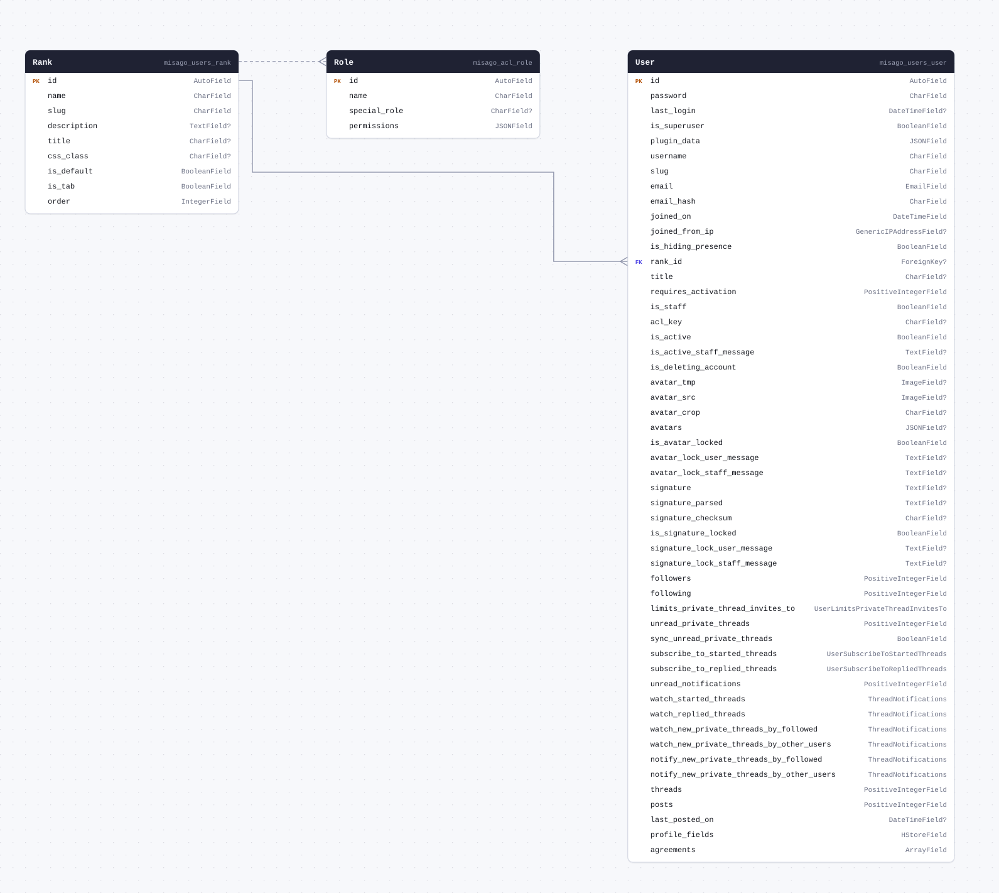

| Column | Field | Type | Null | Key | Default | Description |
| --- | --- | --- | --- | --- | --- | --- |
| `id` | `AutoField` | `integer` |  | PK | `autoincrement()` |  |
| `name` | `CharField` | `varchar(255)` |  |  |  |  |
| `slug` | `CharField` | `varchar(255)` |  | unique |  |  |
| `description` | `TextField` | `text` | yes |  |  |  |
| `title` | `CharField` | `varchar(255)` | yes |  |  |  |
| `css_class` | `CharField` | `varchar(255)` | yes |  |  |  |
| `is_default` | `BooleanField` | `boolean` |  |  | `False` |  |
| `is_tab` | `BooleanField` | `boolean` |  |  | `False` |  |
| `order` | `IntegerField` | `integer` |  |  | `0` |  |

Indexes:

- index `misago_users_rank_slug_80e8f022_like` on `slug` (`varchar_pattern_ops`)

Relations:

- `roles` — many to many with [Role](#role)
- [User](#user).`rank_id` → `id`, on delete protect

## Online

Table `misago_users_online`, app `misago_users`.


| Column | Field | Type | Null | Key | Default | Description |
| --- | --- | --- | --- | --- | --- | --- |
| `user_id` | `OneToOneField` | `integer` |  | PK, FK |  |  |
| `last_click` | `DateTimeField` | `timestamp with time zone` |  |  | `now()` |  |

Relations:

- `user_id` → [User](#user).`id`, on delete cascade

## User

Table `misago_users_user`, app `misago_users`.

Columns from `AbstractBaseUser` (abstract): `password`, `last_login`.

Columns from `PluginDataModel` (abstract): `plugin_data`.

Columns from `PermissionsMixin` (abstract): `is_superuser`.

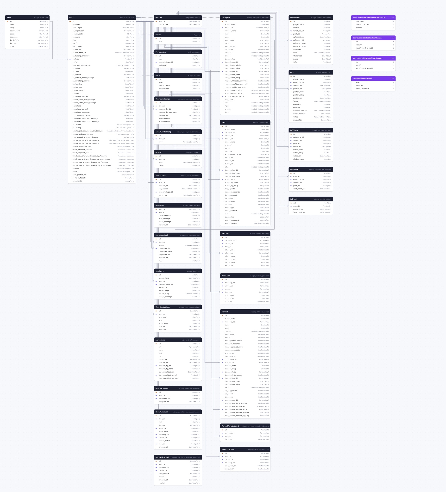

| Column | Field | Type | Null | Key | Default | Description |
| --- | --- | --- | --- | --- | --- | --- |
| `id` | `AutoField` | `integer` |  | PK | `autoincrement()` |  |
| `password` | `CharField` | `varchar(128)` |  |  |  |  |
| `last_login` | `DateTimeField` | `timestamp with time zone` | yes |  |  |  |
| `is_superuser` | `BooleanField` | `boolean` |  |  | `False` | Designates that this user has all permissions without explicitly assigning them. |
| `plugin_data` | `JSONField` | `jsonb` |  |  | `dict()` |  |
| `username` | `CharField` | `varchar(30)` |  |  |  |  |
| `slug` | `CharField` | `varchar(30)` |  | unique |  |  |
| `email` | `EmailField` | `varchar(255)` |  |  |  |  |
| `email_hash` | `CharField` | `varchar(32)` |  | unique |  |  |
| `joined_on` | `DateTimeField` | `timestamp with time zone` |  |  | `now()` |  |
| `joined_from_ip` | `GenericIPAddressField` | `inet` | yes |  |  |  |
| `is_hiding_presence` | `BooleanField` | `boolean` |  |  | `False` |  |
| `rank_id` | `ForeignKey` | `integer` | yes | FK |  |  |
| `title` | `CharField` | `varchar(255)` | yes |  |  |  |
| `requires_activation` | `PositiveIntegerField` | `integer` |  |  | `0` |  |
| `is_staff` | `BooleanField` | `boolean` |  |  | `False` | Designates whether the user can log into admin sites. |
| `acl_key` | `CharField` | `varchar(12)` | yes |  |  |  |
| `is_active` | `BooleanField` | `boolean` |  |  | `True` | Designates whether this user should be treated as active. Unselect this instead of deleting accounts. |
| `is_active_staff_message` | `TextField` | `text` | yes |  |  |  |
| `is_deleting_account` | `BooleanField` | `boolean` |  |  | `False` |  |
| `avatar_tmp` | `ImageField` | `varchar(255)` | yes |  |  |  |
| `avatar_src` | `ImageField` | `varchar(255)` | yes |  |  |  |
| `avatar_crop` | `CharField` | `varchar(255)` | yes |  |  |  |
| `avatars` | `JSONField` | `jsonb` | yes |  |  |  |
| `is_avatar_locked` | `BooleanField` | `boolean` |  |  | `False` |  |
| `avatar_lock_user_message` | `TextField` | `text` | yes |  |  |  |
| `avatar_lock_staff_message` | `TextField` | `text` | yes |  |  |  |
| `signature` | `TextField` | `text` | yes |  |  |  |
| `signature_parsed` | `TextField` | `text` | yes |  |  |  |
| `signature_checksum` | `CharField` | `varchar(64)` | yes |  |  |  |
| `is_signature_locked` | `BooleanField` | `boolean` |  |  | `False` |  |
| `signature_lock_user_message` | `TextField` | `text` | yes |  |  |  |
| `signature_lock_staff_message` | `TextField` | `text` | yes |  |  |  |
| `followers` | `PositiveIntegerField` | `integer` |  |  | `0` |  |
| `following` | `PositiveIntegerField` | `integer` |  |  | `0` |  |
| `limits_private_thread_invites_to` | `UserLimitsPrivateThreadInvitesTo` | `integer` |  |  | `0` |  |
| `unread_private_threads` | `PositiveIntegerField` | `integer` |  |  | `0` |  |
| `sync_unread_private_threads` | `BooleanField` | `boolean` |  |  | `False` |  |
| `subscribe_to_started_threads` | `UserSubscribeToStartedThreads` | `integer` |  |  | `0` |  |
| `subscribe_to_replied_threads` | `UserSubscribeToRepliedThreads` | `integer` |  |  | `0` |  |
| `unread_notifications` | `PositiveIntegerField` | `integer` |  |  | `0` |  |
| `watch_started_threads` | `ThreadNotifications` | `integer` |  |  | `2` |  |
| `watch_replied_threads` | `ThreadNotifications` | `integer` |  |  | `2` |  |
| `watch_new_private_threads_by_followed` | `ThreadNotifications` | `integer` |  |  | `2` |  |
| `watch_new_private_threads_by_other_users` | `ThreadNotifications` | `integer` |  |  | `2` |  |
| `notify_new_private_threads_by_followed` | `ThreadNotifications` | `integer` |  |  | `2` |  |
| `notify_new_private_threads_by_other_users` | `ThreadNotifications` | `integer` |  |  | `2` |  |
| `threads` | `PositiveIntegerField` | `integer` |  |  | `0` |  |
| `posts` | `PositiveIntegerField` | `integer` |  |  | `0` |  |
| `last_posted_on` | `DateTimeField` | `timestamp with time zone` | yes |  |  |  |
| `profile_fields` | `HStoreField` | `hstore` |  |  | `dict()` |  |
| `agreements` | `ArrayField` | `integer[]` |  |  | `list()` |  |

Indexes:

- index `misago_users_user_slug_87d70f62_like` on `slug` (`varchar_pattern_ops`)
- index `misago_users_user_email_1cdb37a6` on `email`
- index `misago_users_user_email_1cdb37a6_like` on `email` (`varchar_pattern_ops`)
- index `misago_users_user_email_hash_55ddd5b1_like` on `email_hash` (`varchar_pattern_ops`)
- index `misago_users_user_joined_on_2171a24f` on `joined_on`
- index `misago_users_user_rank_id_25883ca9` on `rank_id`
- index `misago_users_user_is_active_fc628eb4` on `is_active`
- index `misago_users_user_posts_79cba5f0` on `posts`
- gin index `misago_user_plugin__c45a32_gin` on `plugin_data`
- index `misago_user_is_staff_part` on `is_staff` where `"is_staff"`
- index `misago_user_requires_acti_part` on `requires_activation` where `"requires_activation" > 0`
- index `misago_user_is_deleting_a_part` on `is_deleting_account` where `"is_deleting_account"`

Relations:

- `liked_post_set` — many to many with [Post](#post), through [PostLike](#postlike)
- `privatethread_set` — many to many with [Thread](#thread), through [ThreadParticipant](#threadparticipant)
- [Online](#online).`user_id` → `id`, on delete cascade
- `rank_id` → [Rank](#rank).`id`, on delete protect
- `groups` — many to many with [Group](#group)
- `user_permissions` — many to many with [Permission](#permission)
- `roles` — many to many with [Role](#role)
- `follows` — many to many with [User](#user)
- `blocks` — many to many with [User](#user)
- [UsernameChange](#usernamechange).`user_id` → `id`, on delete cascade
- [UsernameChange](#usernamechange).`changed_by_id` → `id`, on delete set null
- [ActivityRanking](#activityranking).`user_id` → `id`, on delete cascade
- [Avatar](#avatar).`user_id` → `id`, on delete cascade
- [AuditTrail](#audittrail).`user_id` → `id`, on delete cascade
- [BanCache](#bancache).`user_id` → `id`, on delete cascade
- [DataDownload](#datadownload).`user_id` → `id`, on delete protect
- [DataDownload](#datadownload).`requester_id` → `id`, on delete set null
- [LogEntry](#logentry).`user_id` → `id`, on delete cascade
- [UserSocialAuth](#usersocialauth).`user_id` → `id`, on delete cascade
- [Agreement](#agreement).`created_by_id` → `id`, on delete set null
- [Agreement](#agreement).`last_modified_by_id` → `id`, on delete set null
- [UserAgreement](#useragreement).`user_id` → `id`, on delete cascade
- [Notification](#notification).`user_id` → `id`, on delete cascade
- [Notification](#notification).`actor_id` → `id`, on delete set null
- [WatchedThread](#watchedthread).`user_id` → `id`, on delete cascade
- [Category](#category).`last_poster_id` → `id`, on delete set null
- [Post](#post).`poster_id` → `id`, on delete set null
- [Post](#post).`last_editor_id` → `id`, on delete set null
- [Post](#post).`hidden_by_id` → `id`, on delete set null
- `mention_set` — many to many with [Post](#post)
- [PostEdit](#postedit).`editor_id` → `id`, on delete set null
- [PostLike](#postlike).`liker_id` → `id`, on delete set null
- [Thread](#thread).`starter_id` → `id`, on delete set null
- [Thread](#thread).`last_poster_id` → `id`, on delete set null
- [Thread](#thread).`best_answer_marked_by_id` → `id`, on delete set null
- [ThreadParticipant](#threadparticipant).`user_id` → `id`, on delete cascade
- [Subscription](#subscription).`user_id` → `id`, on delete cascade
- [Attachment](#attachment).`uploader_id` → `id`, on delete set null
- [Poll](#poll).`poster_id` → `id`, on delete set null
- [PollVote](#pollvote).`voter_id` → `id`, on delete set null
- [PostRead](#postread).`user_id` → `id`, on delete cascade
- [Subject](#subject).`user_id` → `id`, on delete cascade

## UsernameChange

Table `misago_users_usernamechange`, app `misago_users`.

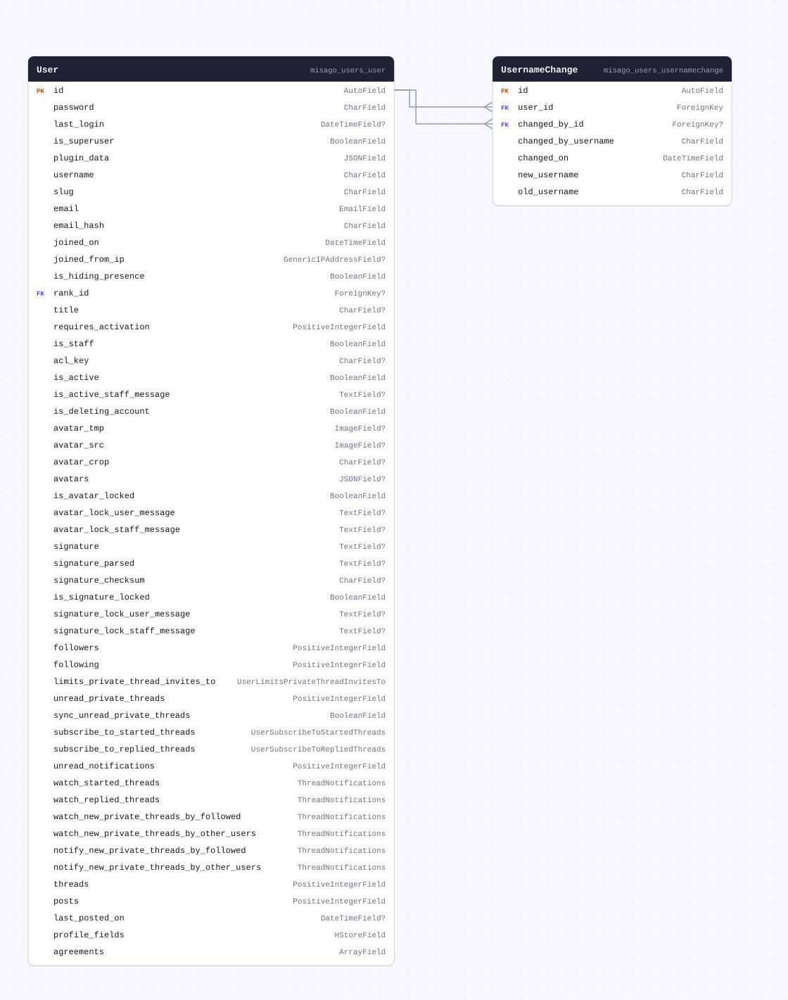

| Column | Field | Type | Null | Key | Default | Description |
| --- | --- | --- | --- | --- | --- | --- |
| `id` | `AutoField` | `integer` |  | PK | `autoincrement()` |  |
| `user_id` | `ForeignKey` | `integer` |  | FK |  |  |
| `changed_by_id` | `ForeignKey` | `integer` | yes | FK |  |  |
| `changed_by_username` | `CharField` | `varchar(30)` |  |  |  |  |
| `changed_on` | `DateTimeField` | `timestamp with time zone` |  |  | `now()` |  |
| `new_username` | `CharField` | `varchar(255)` |  |  |  |  |
| `old_username` | `CharField` | `varchar(255)` |  |  |  |  |

Indexes:

- index `misago_users_usernamechange_user_id_ef2d9164` on `user_id`
- index `misago_users_usernamechange_changed_by_id_bd7f6309` on `changed_by_id`

Relations:

- `user_id` → [User](#user).`id`, on delete cascade
- `changed_by_id` → [User](#user).`id`, on delete set null

## ActivityRanking

Table `misago_users_activityranking`, app `misago_users`.

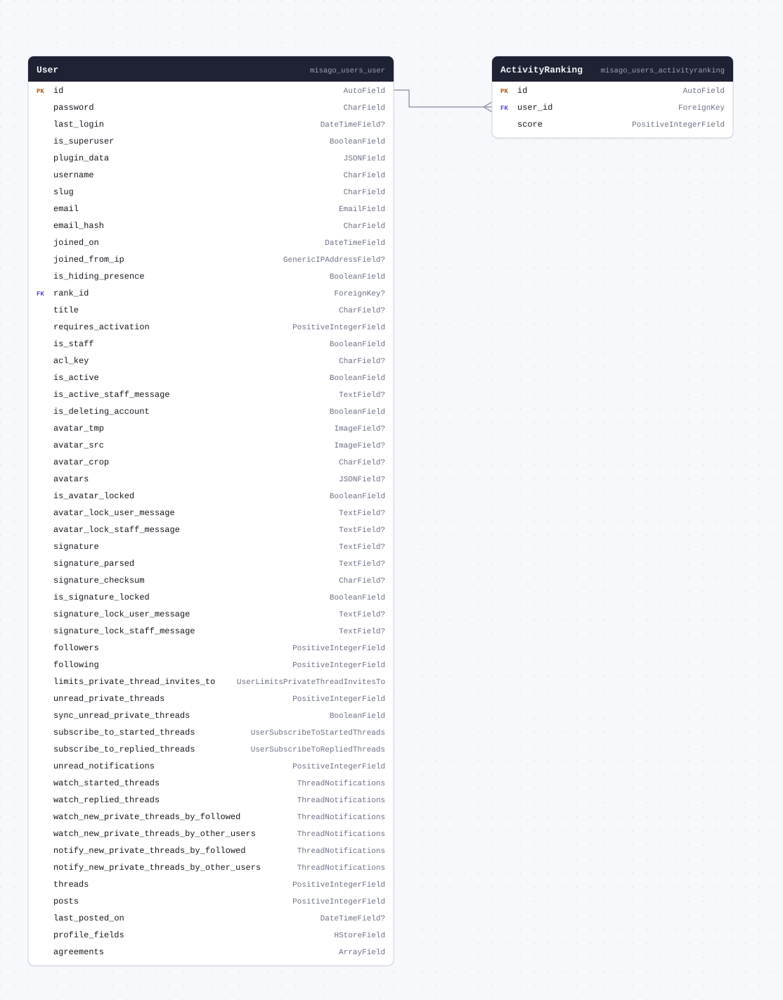

| Column | Field | Type | Null | Key | Default | Description |
| --- | --- | --- | --- | --- | --- | --- |
| `id` | `AutoField` | `integer` |  | PK | `autoincrement()` |  |
| `user_id` | `ForeignKey` | `integer` |  | FK |  |  |
| `score` | `PositiveIntegerField` | `integer` |  |  | `0` |  |

Indexes:

- index `misago_users_activityranking_user_id_a962add9` on `user_id`
- index `misago_users_activityranking_score_3e0a18df` on `score`

Relations:

- `user_id` → [User](#user).`id`, on delete cascade

## Avatar

Table `misago_users_avatar`, app `misago_users`.


| Column | Field | Type | Null | Key | Default | Description |
| --- | --- | --- | --- | --- | --- | --- |
| `id` | `AutoField` | `integer` |  | PK | `autoincrement()` |  |
| `user_id` | `ForeignKey` | `integer` |  | FK |  |  |
| `size` | `PositiveIntegerField` | `integer` |  |  | `0` |  |
| `image` | `ImageField` | `varchar(255)` |  |  |  |  |

Indexes:

- index `misago_users_avatar_user_id_c3763aa1` on `user_id`

Relations:

- `user_id` → [User](#user).`id`, on delete cascade

## AuditTrail

Table `misago_users_audittrail`, app `misago_users`.

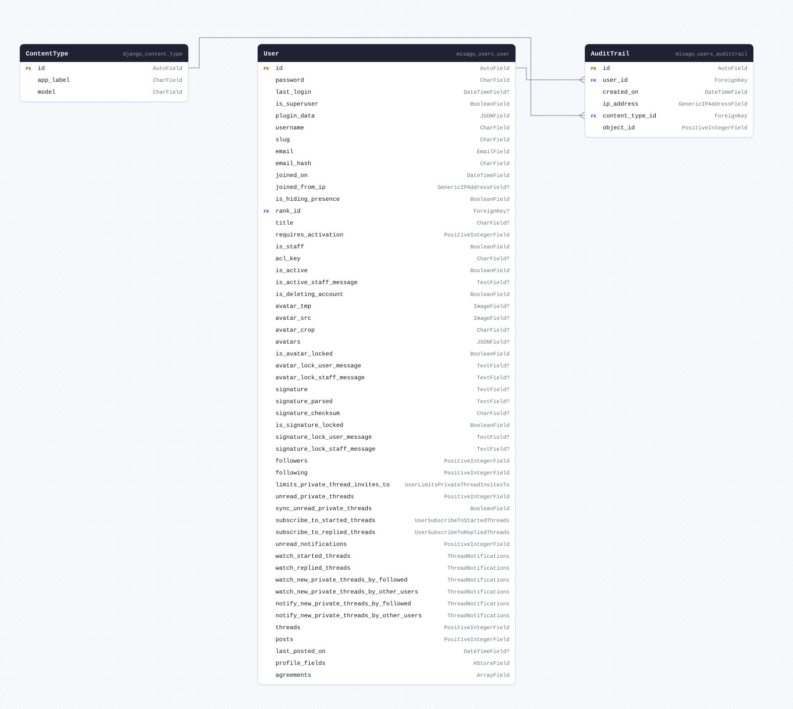

| Column | Field | Type | Null | Key | Default | Description |
| --- | --- | --- | --- | --- | --- | --- |
| `id` | `AutoField` | `integer` |  | PK | `autoincrement()` |  |
| `user_id` | `ForeignKey` | `integer` |  | FK |  |  |
| `created_on` | `DateTimeField` | `timestamp with time zone` |  |  | `now()` |  |
| `ip_address` | `GenericIPAddressField` | `inet` |  |  |  |  |
| `content_type_id` | `ForeignKey` | `integer` |  | FK |  |  |
| `object_id` | `PositiveIntegerField` | `integer` |  |  |  |  |

Indexes:

- index `misago_users_audittrail_user_id_237c9b7f` on `user_id`
- index `misago_users_audittrail_created_on_70cfb6cf` on `created_on`
- index `misago_users_audittrail_content_type_id_23bfb917` on `content_type_id`

Relations:

- `content_object` → any model, by `content_type_id` + `object_id` (generic foreign key)
- `user_id` → [User](#user).`id`, on delete cascade
- `content_type_id` → [ContentType](#contenttype).`id`, on delete cascade

## AvatarGallery

Table `misago_users_avatargallery`, app `misago_users`.

| Column | Field | Type | Null | Key | Default | Description |
| --- | --- | --- | --- | --- | --- | --- |
| `id` | `AutoField` | `integer` |  | PK | `autoincrement()` |  |
| `gallery` | `CharField` | `varchar(255)` |  |  |  |  |
| `image` | `ImageField` | `varchar(255)` |  |  |  |  |

## Ban

Table `misago_users_ban`, app `misago_users`.

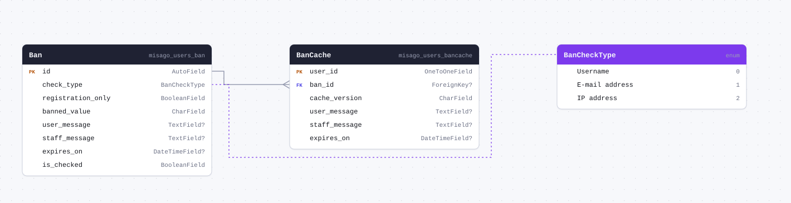

| Column | Field | Type | Null | Key | Default | Description |
| --- | --- | --- | --- | --- | --- | --- |
| `id` | `AutoField` | `integer` |  | PK | `autoincrement()` |  |
| `check_type` | `BanCheckType` | `integer` |  |  | `0` |  |
| `registration_only` | `BooleanField` | `boolean` |  |  | `False` |  |
| `banned_value` | `CharField` | `varchar(255)` |  |  |  |  |
| `user_message` | `TextField` | `text` | yes |  |  |  |
| `staff_message` | `TextField` | `text` | yes |  |  |  |
| `expires_on` | `DateTimeField` | `timestamp with time zone` | yes |  |  |  |
| `is_checked` | `BooleanField` | `boolean` |  |  | `True` |  |

Indexes:

- index `misago_users_ban_check_type_06e115d1` on `check_type`
- index `misago_users_ban_registration_only_867b54d4` on `registration_only`
- index `misago_users_ban_banned_value_bd43b7e9` on `banned_value`
- index `misago_users_ban_banned_value_bd43b7e9_like` on `banned_value` (`varchar_pattern_ops`)
- index `misago_users_ban_expires_on_62433cd5` on `expires_on`
- index `misago_users_ban_is_checked_e23bc0a6` on `is_checked`

Relations:

- [BanCache](#bancache).`ban_id` → `id`, on delete set null

## BanCache

Table `misago_users_bancache`, app `misago_users`.

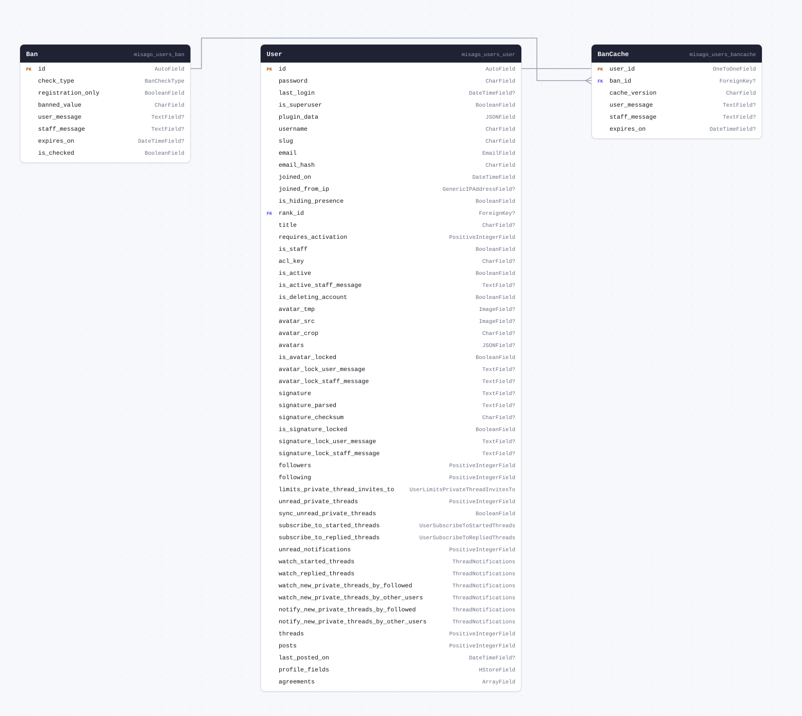

| Column | Field | Type | Null | Key | Default | Description |
| --- | --- | --- | --- | --- | --- | --- |
| `user_id` | `OneToOneField` | `integer` |  | PK, FK |  |  |
| `ban_id` | `ForeignKey` | `integer` | yes | FK |  |  |
| `cache_version` | `CharField` | `varchar(8)` |  |  |  |  |
| `user_message` | `TextField` | `text` | yes |  |  |  |
| `staff_message` | `TextField` | `text` | yes |  |  |  |
| `expires_on` | `DateTimeField` | `timestamp with time zone` | yes |  |  |  |

Indexes:

- index `misago_users_bancache_ban_id_2766ed56` on `ban_id`

Relations:

- `user_id` → [User](#user).`id`, on delete cascade
- `ban_id` → [Ban](#ban).`id`, on delete set null

## DataDownload

Table `misago_users_datadownload`, app `misago_users`.

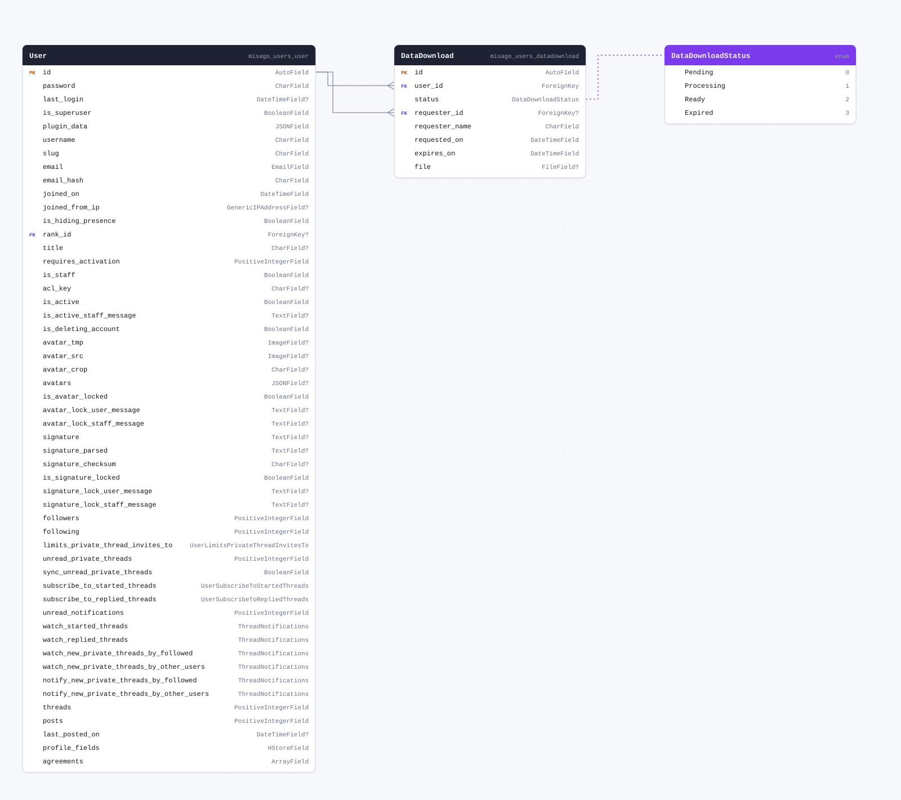

| Column | Field | Type | Null | Key | Default | Description |
| --- | --- | --- | --- | --- | --- | --- |
| `id` | `AutoField` | `integer` |  | PK | `autoincrement()` |  |
| `user_id` | `ForeignKey` | `integer` |  | FK |  |  |
| `status` | `DataDownloadStatus` | `integer` |  |  | `0` |  |
| `requester_id` | `ForeignKey` | `integer` | yes | FK |  |  |
| `requester_name` | `CharField` | `varchar(255)` |  |  |  |  |
| `requested_on` | `DateTimeField` | `timestamp with time zone` |  |  | `now()` |  |
| `expires_on` | `DateTimeField` | `timestamp with time zone` |  |  | `now()` |  |
| `file` | `FileField` | `varchar(255)` | yes |  |  |  |

Indexes:

- index `misago_users_datadownload_user_id_f234398b` on `user_id`
- index `misago_users_datadownload_status_3bb15bd8` on `status`
- index `misago_users_datadownload_requester_id_5c85eef3` on `requester_id`
- index `misago_users_datadownload_requested_on_c594e8c1` on `requested_on`

Relations:

- `user_id` → [User](#user).`id`, on delete protect
- `requester_id` → [User](#user).`id`, on delete set null

## DeletedUser

Table `misago_users_deleteduser`, app `misago_users`.

| Column | Field | Type | Null | Key | Default | Description |
| --- | --- | --- | --- | --- | --- | --- |
| `id` | `AutoField` | `integer` |  | PK | `autoincrement()` |  |
| `deleted_on` | `DateTimeField` | `timestamp with time zone` |  |  | `now()` |  |
| `deleted_by` | `DeletedUserDeletedBy` | `integer` |  |  |  |  |

Indexes:

- index `misago_users_deleteduser_deleted_on_c5363ce6` on `deleted_on`
- index `misago_users_deleteduser_deleted_by_c29f7874` on `deleted_by`

## LogEntry

Table `django_admin_log`, app `admin`.

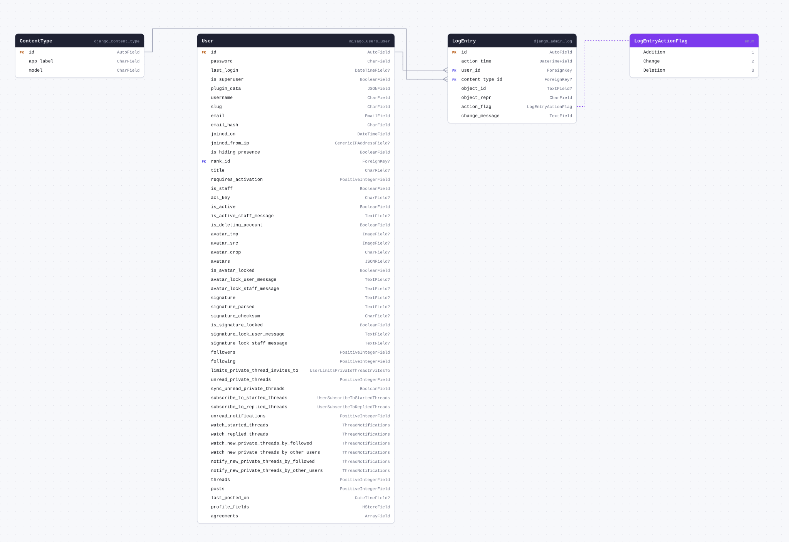

| Column | Field | Type | Null | Key | Default | Description |
| --- | --- | --- | --- | --- | --- | --- |
| `id` | `AutoField` | `integer` |  | PK | `autoincrement()` |  |
| `action_time` | `DateTimeField` | `timestamp with time zone` |  |  | `now()` |  |
| `user_id` | `ForeignKey` | `integer` |  | FK |  |  |
| `content_type_id` | `ForeignKey` | `integer` | yes | FK |  |  |
| `object_id` | `TextField` | `text` | yes |  |  |  |
| `object_repr` | `CharField` | `varchar(200)` |  |  |  |  |
| `action_flag` | `LogEntryActionFlag` | `smallint` |  |  |  |  |
| `change_message` | `TextField` | `text` |  |  |  |  |

Indexes:

- index `django_admin_log_user_id_c564eba6` on `user_id`
- index `django_admin_log_content_type_id_c4bce8eb` on `content_type_id`

Relations:

- `user_id` → [User](#user).`id`, on delete cascade
- `content_type_id` → [ContentType](#contenttype).`id`, on delete set null

## Permission

Table `auth_permission`, app `auth`.

The permissions system provides a way to assign permissions to specific
users and groups of users.

The permission system is used by the Django admin site, but may also be
useful in your own code. The Django admin site uses permissions as follows:

    - The "add" permission limits the user's ability to view the "add" form
      and add an object.
    - The "change" permission limits a user's ability to view the change
      list, view the "change" form and change an object.
    - The "delete" permission limits the ability to delete an object.
    - The "view" permission limits the ability to view an object.

Permissions are set globally per type of object, not per specific object
instance. It is possible to say "Mary may change news stories," but it's
not currently possible to say "Mary may change news stories, but only the
ones she created herself" or "Mary may only change news stories that have a
certain status or publication date."

The permissions listed above are automatically created for each model.

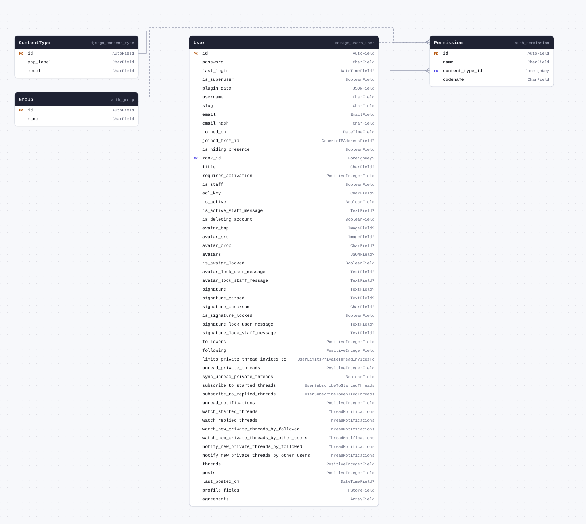

| Column | Field | Type | Null | Key | Default | Description |
| --- | --- | --- | --- | --- | --- | --- |
| `id` | `AutoField` | `integer` |  | PK | `autoincrement()` |  |
| `name` | `CharField` | `varchar(255)` |  |  |  |  |
| `content_type_id` | `ForeignKey` | `integer` |  | FK |  |  |
| `codename` | `CharField` | `varchar(100)` |  |  |  |  |

Indexes:

- index `auth_permission_content_type_id_2f476e4b` on `content_type_id`
- unique `auth_permission_content_type_id_codename_01ab375a_uniq` on `content_type_id`, `codename`

Relations:

- `user_set` — many to many with [User](#user)
- `content_type_id` → [ContentType](#contenttype).`id`, on delete cascade
- `group_set` — many to many with [Group](#group)

## Group

Table `auth_group`, app `auth`.

Groups are a generic way of categorizing users to apply permissions, or
some other label, to those users. A user can belong to any number of
groups.

A user in a group automatically has all the permissions granted to that
group. For example, if the group 'Site editors' has the permission
can_edit_home_page, any user in that group will have that permission.

Beyond permissions, groups are a convenient way to categorize users to
apply some label, or extended functionality, to them. For example, you
could create a group 'Special users', and you could write code that would
do special things to those users -- such as giving them access to a
members-only portion of your site, or sending them members-only email
messages.

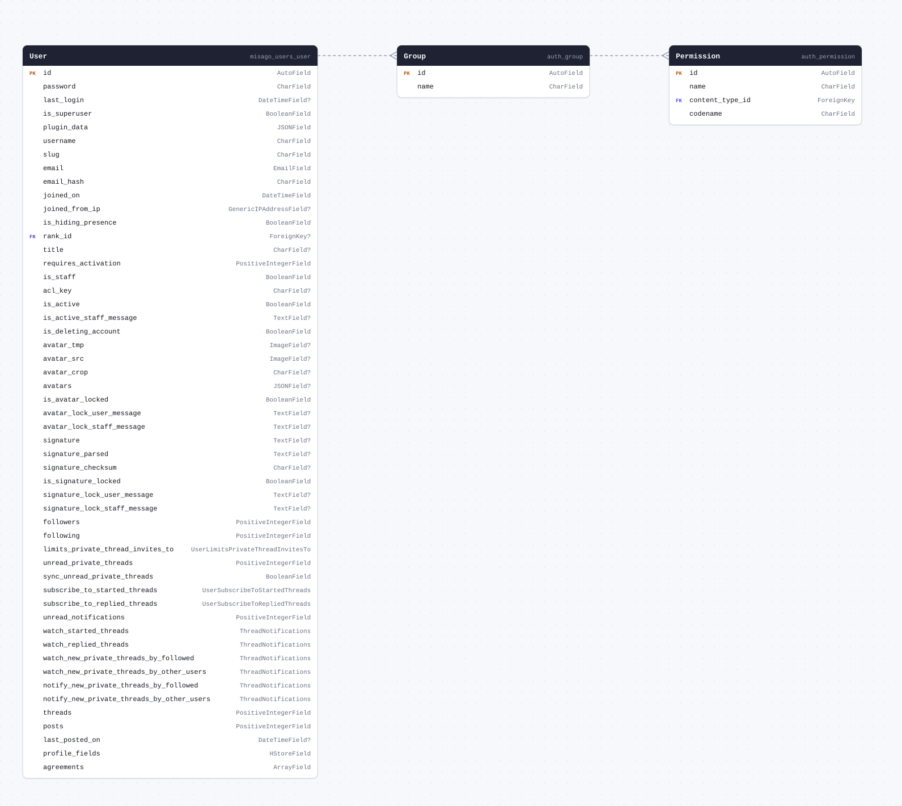

| Column | Field | Type | Null | Key | Default | Description |
| --- | --- | --- | --- | --- | --- | --- |
| `id` | `AutoField` | `integer` |  | PK | `autoincrement()` |  |
| `name` | `CharField` | `varchar(150)` |  | unique |  |  |

Indexes:

- index `auth_group_name_a6ea08ec_like` on `name` (`varchar_pattern_ops`)

Relations:

- `user_set` — many to many with [User](#user)
- `permissions` — many to many with [Permission](#permission)

## ContentType

Table `django_content_type`, app `contenttypes`.

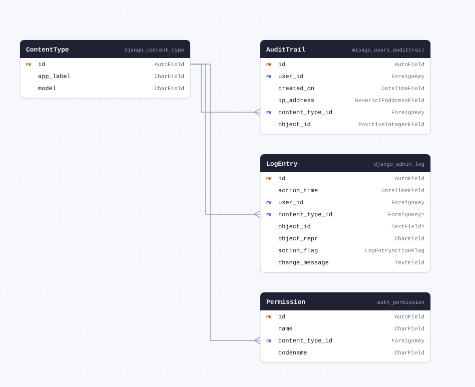

| Column | Field | Type | Null | Key | Default | Description |
| --- | --- | --- | --- | --- | --- | --- |
| `id` | `AutoField` | `integer` |  | PK | `autoincrement()` |  |
| `app_label` | `CharField` | `varchar(100)` |  |  |  |  |
| `model` | `CharField` | `varchar(100)` |  |  |  |  |

Indexes:

- unique `django_content_type_app_label_model_76bd3d3b_uniq` on `app_label`, `model`

Relations:

- [AuditTrail](#audittrail).`content_type_id` → `id`, on delete cascade
- [LogEntry](#logentry).`content_type_id` → `id`, on delete set null
- [Permission](#permission).`content_type_id` → `id`, on delete cascade

## Session

Table `django_session`, app `sessions`.

Columns from `AbstractBaseSession` (abstract): `session_key`, `session_data`, `expire_date`.

Django provides full support for anonymous sessions. The session
framework lets you store and retrieve arbitrary data on a
per-site-visitor basis. It stores data on the server side and
abstracts the sending and receiving of cookies. Cookies contain a
session ID -- not the data itself.

The Django sessions framework is entirely cookie-based. It does
not fall back to putting session IDs in URLs. This is an intentional
design decision. Not only does that behavior make URLs ugly, it makes
your site vulnerable to session-ID theft via the "Referer" header.

For complete documentation on using Sessions in your code, consult
the sessions documentation that is shipped with Django (also available
on the Django web site).

| Column | Field | Type | Null | Key | Default | Description |
| --- | --- | --- | --- | --- | --- | --- |
| `session_key` | `CharField` | `varchar(40)` |  | PK |  |  |
| `session_data` | `TextField` | `text` |  |  |  |  |
| `expire_date` | `DateTimeField` | `timestamp with time zone` |  |  |  |  |

Indexes:

- index `django_session_session_key_c0390e0f_like` on `session_key` (`varchar_pattern_ops`)
- index `django_session_expire_date_a5c62663` on `expire_date`

## UserSocialAuth

Table `social_auth_usersocialauth`, app `social_django`.

Columns from `AbstractUserSocialAuth` (abstract): `user_id`, `provider`, `uid`, `extra_data`, `created`, `modified`.

Social Auth association model


| Column | Field | Type | Null | Key | Default | Description |
| --- | --- | --- | --- | --- | --- | --- |
| `id` | `BigAutoField` | `bigint` |  | PK | `autoincrement()` |  |
| `user_id` | `ForeignKey` | `integer` |  | FK |  |  |
| `provider` | `CharField` | `varchar(32)` |  |  |  |  |
| `uid` | `CharField` | `varchar(255)` |  |  |  |  |
| `extra_data` | `JSONField` | `jsonb` |  |  | `dict()` |  |
| `created` | `DateTimeField` | `timestamp with time zone` |  |  | `now()` |  |
| `modified` | `DateTimeField` | `timestamp with time zone` |  |  | `now()` |  |

Indexes:

- index `social_auth_usersocialauth_user_id_17d28448` on `user_id`
- index `social_auth_usersocialauth_uid_796e51dc` on `uid`
- index `social_auth_usersocialauth_uid_796e51dc_like` on `uid` (`varchar_pattern_ops`)
- unique `social_auth_usersocialauth_provider_uid_e6b5e668_uniq` on `provider`, `uid`

Relations:

- `user_id` → [User](#user).`id`, on delete cascade

## Nonce

Table `social_auth_nonce`, app `social_django`.

One use numbers

| Column | Field | Type | Null | Key | Default | Description |
| --- | --- | --- | --- | --- | --- | --- |
| `id` | `BigAutoField` | `bigint` |  | PK | `autoincrement()` |  |
| `server_url` | `CharField` | `varchar(255)` |  |  |  |  |
| `timestamp` | `IntegerField` | `integer` |  |  |  |  |
| `salt` | `CharField` | `varchar(65)` |  |  |  |  |

Indexes:

- unique `social_auth_nonce_server_url_timestamp_salt_f6284463_uniq` on `server_url`, `timestamp`, `salt`

## Association

Table `social_auth_association`, app `social_django`.

OpenId account association

| Column | Field | Type | Null | Key | Default | Description |
| --- | --- | --- | --- | --- | --- | --- |
| `id` | `BigAutoField` | `bigint` |  | PK | `autoincrement()` |  |
| `server_url` | `CharField` | `varchar(255)` |  |  |  |  |
| `handle` | `CharField` | `varchar(255)` |  |  |  |  |
| `secret` | `CharField` | `varchar(255)` |  |  |  |  |
| `issued` | `IntegerField` | `integer` |  |  |  |  |
| `lifetime` | `IntegerField` | `integer` |  |  |  |  |
| `assoc_type` | `CharField` | `varchar(64)` |  |  |  |  |

Indexes:

- unique `social_auth_association_server_url_handle_078befa2_uniq` on `server_url`, `handle`

## Code

Table `social_auth_code`, app `social_django`.

| Column | Field | Type | Null | Key | Default | Description |
| --- | --- | --- | --- | --- | --- | --- |
| `id` | `BigAutoField` | `bigint` |  | PK | `autoincrement()` |  |
| `email` | `EmailField` | `varchar(254)` |  |  |  |  |
| `code` | `CharField` | `varchar(32)` |  |  |  |  |
| `verified` | `BooleanField` | `boolean` |  |  | `False` |  |
| `timestamp` | `DateTimeField` | `timestamp with time zone` |  |  | `now()` |  |

Indexes:

- index `social_auth_code_code_a2393167` on `code`
- index `social_auth_code_code_a2393167_like` on `code` (`varchar_pattern_ops`)
- index `social_auth_code_timestamp_176b341f` on `timestamp`
- unique `social_auth_code_email_code_801b2d02_uniq` on `email`, `code`

## Partial

Table `social_auth_partial`, app `social_django`.

| Column | Field | Type | Null | Key | Default | Description |
| --- | --- | --- | --- | --- | --- | --- |
| `id` | `BigAutoField` | `bigint` |  | PK | `autoincrement()` |  |
| `token` | `CharField` | `varchar(32)` |  |  |  |  |
| `next_step` | `PositiveSmallIntegerField` | `smallint` |  |  | `0` |  |
| `backend` | `CharField` | `varchar(32)` |  |  |  |  |
| `data` | `JSONField` | `jsonb` |  |  | `dict()` |  |
| `timestamp` | `DateTimeField` | `timestamp with time zone` |  |  | `now()` |  |

Indexes:

- index `social_auth_partial_token_3017fea3` on `token`
- index `social_auth_partial_token_3017fea3_like` on `token` (`varchar_pattern_ops`)
- index `social_auth_partial_timestamp_50f2119f` on `timestamp`

## Role

Table `misago_acl_role`, app `misago_acl`.

Columns from `BaseRole` (abstract): `name`, `special_role`, `permissions`.

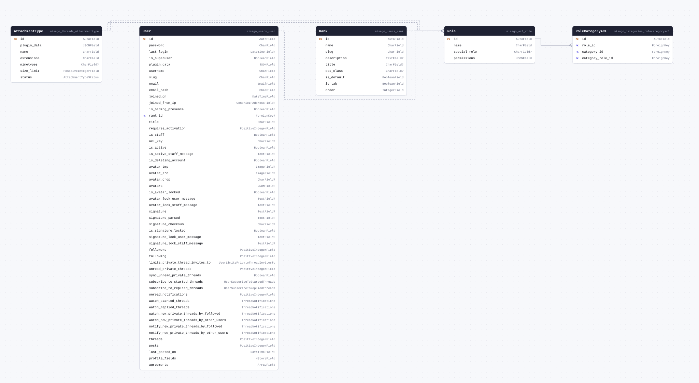

| Column | Field | Type | Null | Key | Default | Description |
| --- | --- | --- | --- | --- | --- | --- |
| `id` | `AutoField` | `integer` |  | PK | `autoincrement()` |  |
| `name` | `CharField` | `varchar(255)` |  |  |  |  |
| `special_role` | `CharField` | `varchar(255)` | yes |  |  |  |
| `permissions` | `JSONField` | `jsonb` |  |  | `permissions_default()` |  |

Relations:

- `rank_set` — many to many with [Rank](#rank)
- `user_set` — many to many with [User](#user)
- [RoleCategoryACL](#rolecategoryacl).`role_id` → `id`, on delete cascade
- `_misago_threads_attachmenttype_limit_uploads_to_+` — many to many with [AttachmentType](#attachmenttype)
- `_misago_threads_attachmenttype_limit_downloads_to_+` — many to many with [AttachmentType](#attachmenttype)

## CacheVersion

Table `misago_cache_cacheversion`, app `misago_cache`.

| Column | Field | Type | Null | Key | Default | Description |
| --- | --- | --- | --- | --- | --- | --- |
| `cache` | `CharField` | `varchar(128)` |  | PK |  |  |
| `version` | `CharField` | `varchar(8)` |  |  | `generate_version_string()` |  |

Indexes:

- index `misago_cache_cacheversion_cache_568b3f84_like` on `cache` (`varchar_pattern_ops`)

## Setting

Table `misago_conf_setting`, app `misago_conf`.

| Column | Field | Type | Null | Key | Default | Description |
| --- | --- | --- | --- | --- | --- | --- |
| `id` | `AutoField` | `integer` |  | PK | `autoincrement()` |  |
| `setting` | `CharField` | `varchar(255)` |  | unique |  |  |
| `python_type` | `CharField` | `varchar(255)` |  |  | `'string'` |  |
| `dry_value` | `TextField` | `text` | yes |  |  |  |
| `image` | `ImageField` | `varchar(100)` | yes |  |  |  |
| `image_size` | `PositiveIntegerField` | `integer` | yes |  |  |  |
| `image_width` | `PositiveIntegerField` | `integer` | yes |  |  |  |
| `image_height` | `PositiveIntegerField` | `integer` | yes |  |  |  |
| `is_public` | `BooleanField` | `boolean` |  |  | `False` |  |
| `is_lazy` | `BooleanField` | `boolean` |  |  | `False` |  |

Indexes:

- index `misago_conf_setting_setting_d5ff9d28_like` on `setting` (`varchar_pattern_ops`)

## Icon

Table `misago_icons_icon`, app `misago_icons`.

| Column | Field | Type | Null | Key | Default | Description |
| --- | --- | --- | --- | --- | --- | --- |
| `id` | `AutoField` | `integer` |  | PK | `autoincrement()` |  |
| `type` | `CharField` | `varchar(255)` |  |  |  |  |
| `image` | `ImageField` | `varchar(100)` |  |  |  |  |
| `size` | `PositiveIntegerField` | `integer` |  |  | `0` |  |
| `width` | `PositiveIntegerField` | `integer` |  |  | `0` |  |
| `height` | `PositiveIntegerField` | `integer` |  |  | `0` |  |

## Theme

Table `misago_themes_theme`, app `misago_themes`.

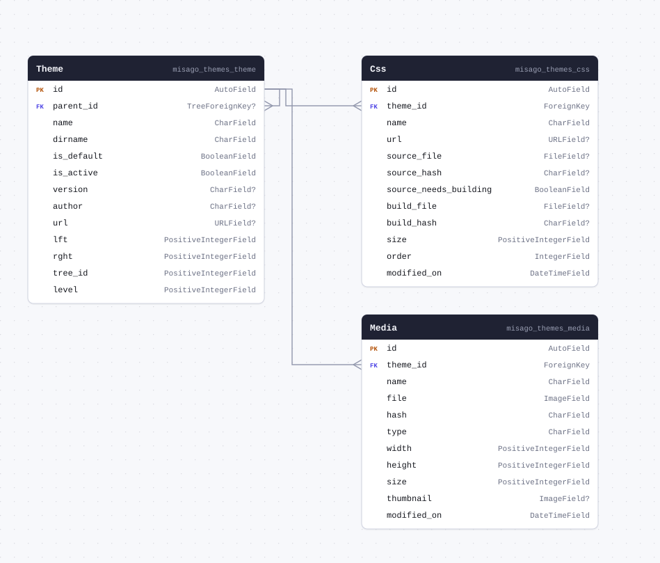

| Column | Field | Type | Null | Key | Default | Description |
| --- | --- | --- | --- | --- | --- | --- |
| `id` | `AutoField` | `integer` |  | PK | `autoincrement()` |  |
| `parent_id` | `TreeForeignKey` | `integer` | yes | FK |  |  |
| `name` | `CharField` | `varchar(255)` |  |  |  |  |
| `dirname` | `CharField` | `varchar(8)` |  |  | `generate_theme_dirname()` |  |
| `is_default` | `BooleanField` | `boolean` |  |  | `False` |  |
| `is_active` | `BooleanField` | `boolean` |  |  | `False` |  |
| `version` | `CharField` | `varchar(255)` | yes |  |  |  |
| `author` | `CharField` | `varchar(255)` | yes |  |  |  |
| `url` | `URLField` | `varchar(255)` | yes |  |  |  |
| `lft` | `PositiveIntegerField` | `integer` |  |  |  |  |
| `rght` | `PositiveIntegerField` | `integer` |  |  |  |  |
| `tree_id` | `PositiveIntegerField` | `integer` |  |  |  |  |
| `level` | `PositiveIntegerField` | `integer` |  |  |  |  |

Indexes:

- index `misago_themes_theme_parent_id_c4ef9886` on `parent_id`
- index `misago_themes_theme_tree_id_1c41cf31` on `tree_id`

Relations:

- `parent_id` → [Theme](#theme).`id`, on delete protect
- [Css](#css).`theme_id` → `id`, on delete protect
- [Media](#media).`theme_id` → `id`, on delete protect

## Css

Table `misago_themes_css`, app `misago_themes`.

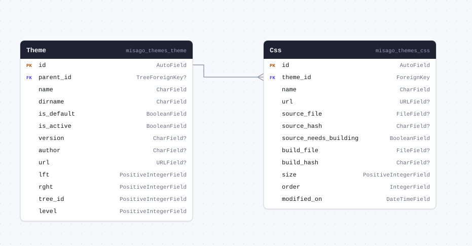

| Column | Field | Type | Null | Key | Default | Description |
| --- | --- | --- | --- | --- | --- | --- |
| `id` | `AutoField` | `integer` |  | PK | `autoincrement()` |  |
| `theme_id` | `ForeignKey` | `integer` |  | FK |  |  |
| `name` | `CharField` | `varchar(255)` |  |  |  |  |
| `url` | `URLField` | `varchar(255)` | yes |  |  |  |
| `source_file` | `FileField` | `varchar(255)` | yes |  |  |  |
| `source_hash` | `CharField` | `varchar(8)` | yes |  |  |  |
| `source_needs_building` | `BooleanField` | `boolean` |  |  | `False` |  |
| `build_file` | `FileField` | `varchar(255)` | yes |  |  |  |
| `build_hash` | `CharField` | `varchar(8)` | yes |  |  |  |
| `size` | `PositiveIntegerField` | `integer` |  |  | `0` |  |
| `order` | `IntegerField` | `integer` |  |  | `0` |  |
| `modified_on` | `DateTimeField` | `timestamp with time zone` |  |  | `now()` |  |

Indexes:

- index `misago_themes_css_theme_id_2b465b12` on `theme_id`

Relations:

- `theme_id` → [Theme](#theme).`id`, on delete protect

## Media

Table `misago_themes_media`, app `misago_themes`.

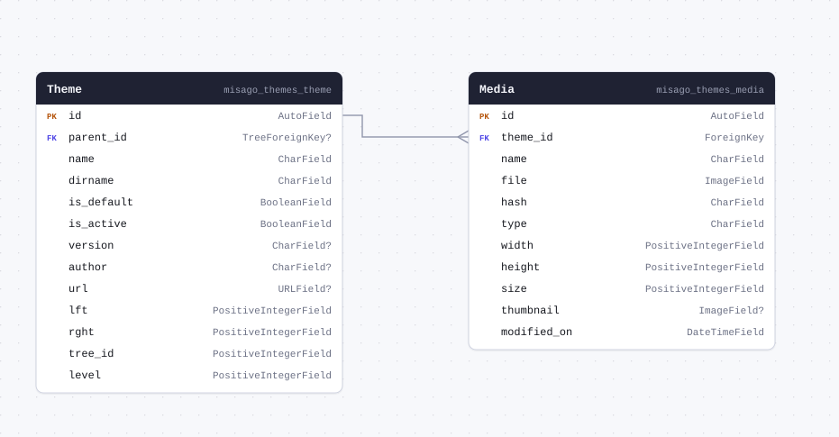

| Column | Field | Type | Null | Key | Default | Description |
| --- | --- | --- | --- | --- | --- | --- |
| `id` | `AutoField` | `integer` |  | PK | `autoincrement()` |  |
| `theme_id` | `ForeignKey` | `integer` |  | FK |  |  |
| `name` | `CharField` | `varchar(255)` |  |  |  |  |
| `file` | `ImageField` | `varchar(255)` |  |  |  |  |
| `hash` | `CharField` | `varchar(8)` |  |  |  |  |
| `type` | `CharField` | `varchar(255)` |  |  |  |  |
| `width` | `PositiveIntegerField` | `integer` |  |  | `0` |  |
| `height` | `PositiveIntegerField` | `integer` |  |  | `0` |  |
| `size` | `PositiveIntegerField` | `integer` |  |  |  |  |
| `thumbnail` | `ImageField` | `varchar(255)` | yes |  |  |  |
| `modified_on` | `DateTimeField` | `timestamp with time zone` |  |  | `now()` |  |

Indexes:

- index `misago_themes_media_theme_id_e8a06c10` on `theme_id`

Relations:

- `theme_id` → [Theme](#theme).`id`, on delete protect

## Agreement

Table `misago_legal_agreement`, app `misago_legal`.

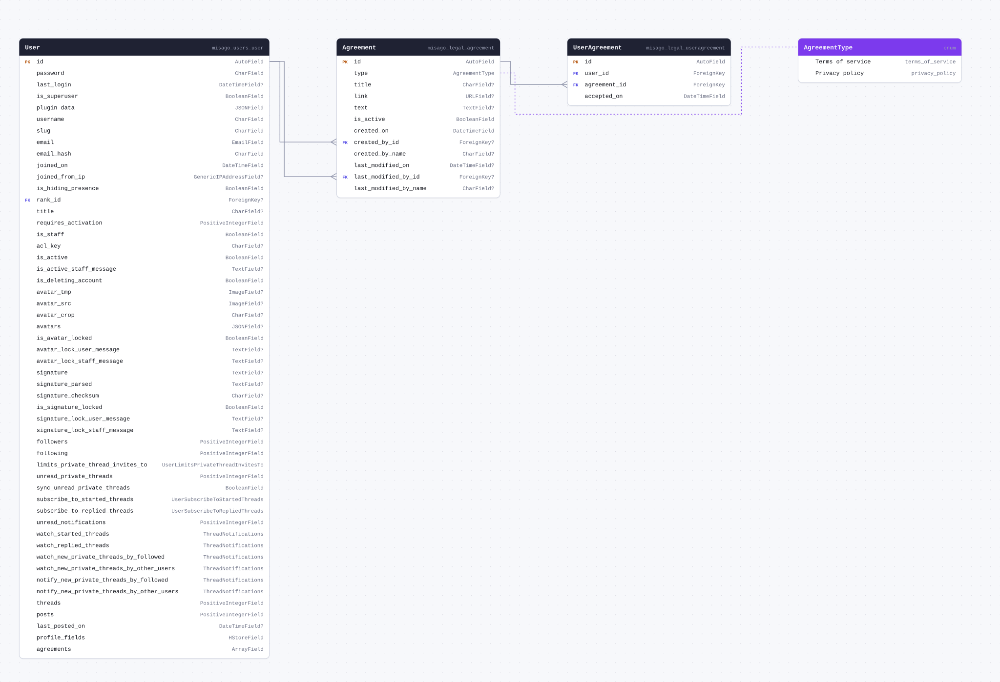

| Column | Field | Type | Null | Key | Default | Description |
| --- | --- | --- | --- | --- | --- | --- |
| `id` | `AutoField` | `integer` |  | PK | `autoincrement()` |  |
| `type` | `AgreementType` | `varchar(20)` |  |  | `'terms_of_service'` |  |
| `title` | `CharField` | `varchar(255)` | yes |  |  |  |
| `link` | `URLField` | `varchar(255)` | yes |  |  |  |
| `text` | `TextField` | `text` | yes |  |  |  |
| `is_active` | `BooleanField` | `boolean` |  |  | `False` |  |
| `created_on` | `DateTimeField` | `timestamp with time zone` |  |  | `now()` |  |
| `created_by_id` | `ForeignKey` | `integer` | yes | FK |  |  |
| `created_by_name` | `CharField` | `varchar(255)` | yes |  |  |  |
| `last_modified_on` | `DateTimeField` | `timestamp with time zone` | yes |  |  |  |
| `last_modified_by_id` | `ForeignKey` | `integer` | yes | FK |  |  |
| `last_modified_by_name` | `CharField` | `varchar(255)` | yes |  |  |  |

Indexes:

- index `misago_legal_agreement_type_e9552242` on `type`
- index `misago_legal_agreement_type_e9552242_like` on `type` (`varchar_pattern_ops`)
- index `misago_legal_agreement_created_by_id_0c1cd0f5` on `created_by_id`
- index `misago_legal_agreement_last_modified_by_id_a300296b` on `last_modified_by_id`

Relations:

- `created_by_id` → [User](#user).`id`, on delete set null
- `last_modified_by_id` → [User](#user).`id`, on delete set null
- [UserAgreement](#useragreement).`agreement_id` → `id`, on delete cascade

## UserAgreement

Table `misago_legal_useragreement`, app `misago_legal`.

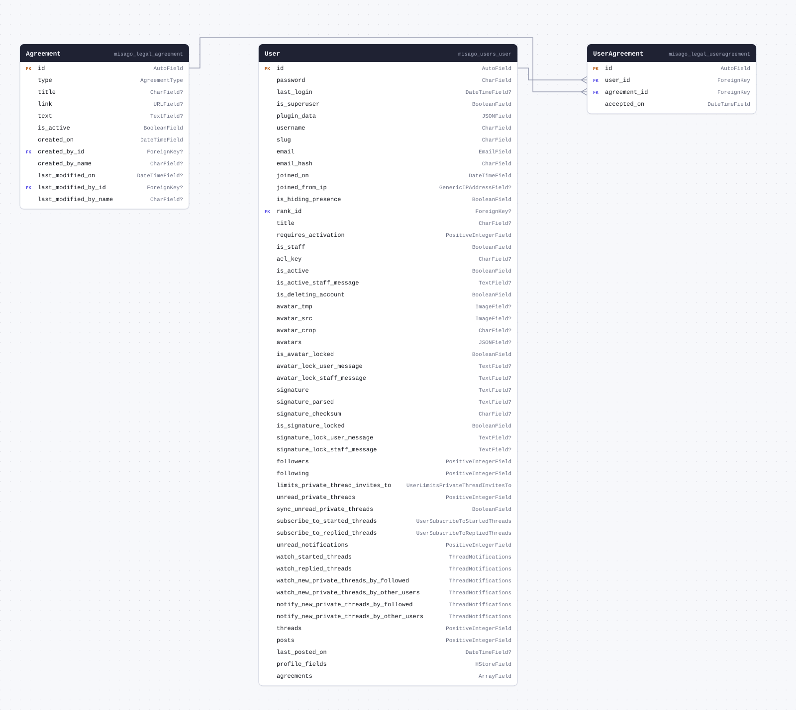

| Column | Field | Type | Null | Key | Default | Description |
| --- | --- | --- | --- | --- | --- | --- |
| `id` | `AutoField` | `integer` |  | PK | `autoincrement()` |  |
| `user_id` | `ForeignKey` | `integer` |  | FK |  |  |
| `agreement_id` | `ForeignKey` | `integer` |  | FK |  |  |
| `accepted_on` | `DateTimeField` | `timestamp with time zone` |  |  | `now()` |  |

Indexes:

- index `misago_legal_useragreement_user_id_89d96747` on `user_id`
- index `misago_legal_useragreement_agreement_id_654abb8d` on `agreement_id`

Relations:

- `user_id` → [User](#user).`id`, on delete cascade
- `agreement_id` → [Agreement](#agreement).`id`, on delete cascade

## Notification

Table `misago_notifications_notification`, app `misago_notifications`.

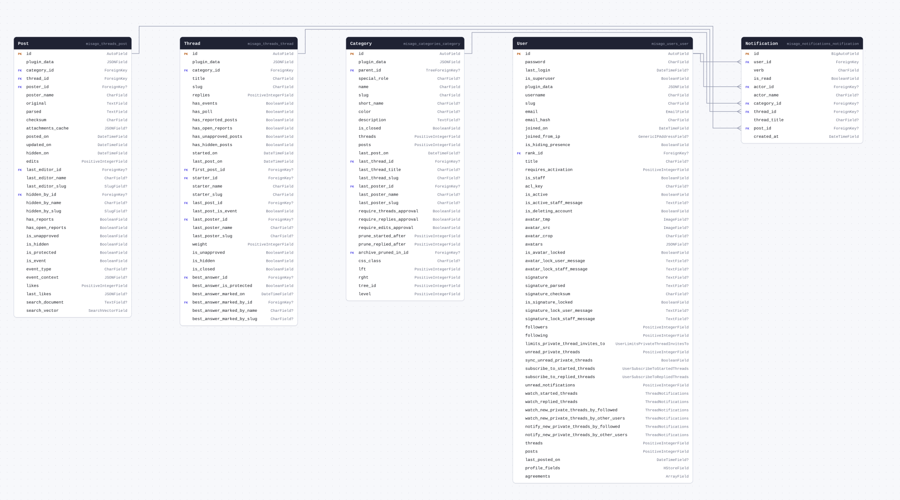

| Column | Field | Type | Null | Key | Default | Description |
| --- | --- | --- | --- | --- | --- | --- |
| `id` | `BigAutoField` | `bigint` |  | PK | `autoincrement()` |  |
| `user_id` | `ForeignKey` | `integer` |  | FK |  |  |
| `verb` | `CharField` | `varchar(32)` |  |  |  |  |
| `is_read` | `BooleanField` | `boolean` |  |  | `False` |  |
| `actor_id` | `ForeignKey` | `integer` | yes | FK |  |  |
| `actor_name` | `CharField` | `varchar(255)` | yes |  |  |  |
| `category_id` | `ForeignKey` | `integer` | yes | FK |  |  |
| `thread_id` | `ForeignKey` | `integer` | yes | FK |  |  |
| `thread_title` | `CharField` | `varchar(255)` | yes |  |  |  |
| `post_id` | `ForeignKey` | `integer` | yes | FK |  |  |
| `created_at` | `DateTimeField` | `timestamp with time zone` |  |  | `now()` |  |

Indexes:

- index `misago_notifications_notification_user_id_6cfe613d` on `user_id`
- index `misago_notifications_notification_actor_id_3cf6f64f` on `actor_id`
- index `misago_notifications_notification_category_id_a925de97` on `category_id`
- index `misago_notifications_notification_thread_id_4c9beb15` on `thread_id`
- index `misago_notifications_notification_post_id_6e79511b` on `post_id`
- index `misago_notifications_notification_created_at_5c473587` on `created_at`
- index `misago_noti_id_5a01fa_idx` on `id` desc, `user_id`
- index `misago_noti_id_7b4a20_idx` on `id` desc, `user_id`, `is_read`
- index `misago_noti_user_unread` on `user_id`, `is_read` where `NOT "is_read"`
- index `misago_noti_user_id_9b98fb_idx` on `user_id`, `post_id`, `is_read`

Relations:

- `user_id` → [User](#user).`id`, on delete cascade
- `actor_id` → [User](#user).`id`, on delete set null
- `category_id` → [Category](#category).`id`, on delete cascade
- `thread_id` → [Thread](#thread).`id`, on delete cascade
- `post_id` → [Post](#post).`id`, on delete cascade

## WatchedThread

Table `misago_notifications_watchedthread`, app `misago_notifications`.

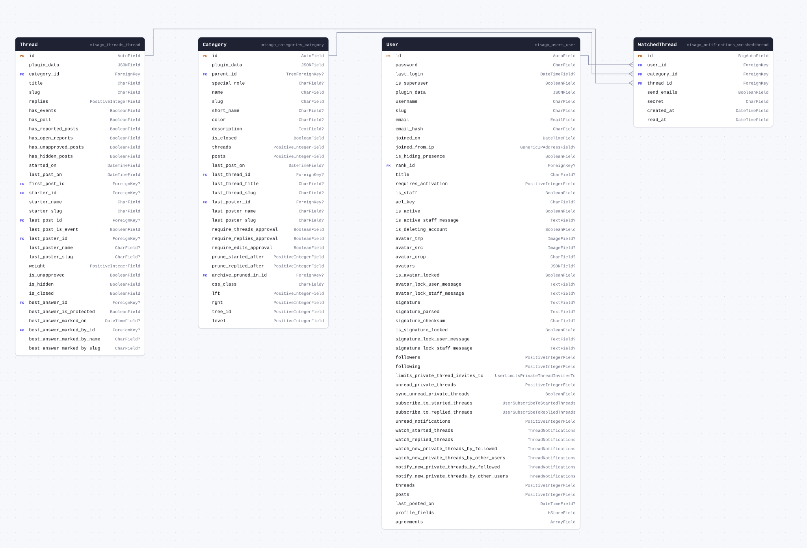

| Column | Field | Type | Null | Key | Default | Description |
| --- | --- | --- | --- | --- | --- | --- |
| `id` | `BigAutoField` | `bigint` |  | PK | `autoincrement()` |  |
| `user_id` | `ForeignKey` | `integer` |  | FK |  |  |
| `category_id` | `ForeignKey` | `integer` |  | FK |  |  |
| `thread_id` | `ForeignKey` | `integer` |  | FK |  |  |
| `send_emails` | `BooleanField` | `boolean` |  |  | `True` |  |
| `secret` | `CharField` | `varchar(32)` |  |  | `get_watched_thread_secret()` |  |
| `created_at` | `DateTimeField` | `timestamp with time zone` |  |  | `now()` |  |
| `read_at` | `DateTimeField` | `timestamp with time zone` |  |  | `now()` |  |

Indexes:

- index `misago_notifications_watchedthread_user_id_9f3b65ea` on `user_id`
- index `misago_notifications_watchedthread_category_id_fb4801f2` on `category_id`
- index `misago_notifications_watchedthread_thread_id_1b969b89` on `thread_id`
- index `misago_noti_user_id_9cde34_idx` on `user_id`, `thread_id` desc

Relations:

- `user_id` → [User](#user).`id`, on delete cascade
- `category_id` → [Category](#category).`id`, on delete cascade
- `thread_id` → [Thread](#thread).`id`, on delete cascade

## Category

Table `misago_categories_category`, app `misago_categories`.

Columns from `PluginDataModel` (abstract): `plugin_data`.

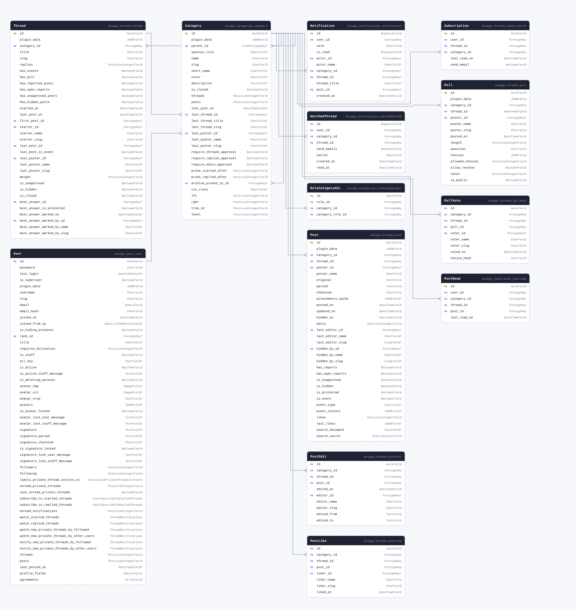

| Column | Field | Type | Null | Key | Default | Description |
| --- | --- | --- | --- | --- | --- | --- |
| `id` | `AutoField` | `integer` |  | PK | `autoincrement()` |  |
| `plugin_data` | `JSONField` | `jsonb` |  |  | `dict()` |  |
| `parent_id` | `TreeForeignKey` | `integer` | yes | FK |  |  |
| `special_role` | `CharField` | `varchar(255)` | yes |  |  |  |
| `name` | `CharField` | `varchar(255)` |  |  |  |  |
| `slug` | `CharField` | `varchar(255)` |  |  |  |  |
| `short_name` | `CharField` | `varchar(255)` | yes |  |  |  |
| `color` | `CharField` | `varchar(7)` | yes |  |  |  |
| `description` | `TextField` | `text` | yes |  |  |  |
| `is_closed` | `BooleanField` | `boolean` |  |  | `False` |  |
| `threads` | `PositiveIntegerField` | `integer` |  |  | `0` |  |
| `posts` | `PositiveIntegerField` | `integer` |  |  | `0` |  |
| `last_post_on` | `DateTimeField` | `timestamp with time zone` | yes |  |  |  |
| `last_thread_id` | `ForeignKey` | `integer` | yes | FK |  |  |
| `last_thread_title` | `CharField` | `varchar(255)` | yes |  |  |  |
| `last_thread_slug` | `CharField` | `varchar(255)` | yes |  |  |  |
| `last_poster_id` | `ForeignKey` | `integer` | yes | FK |  |  |
| `last_poster_name` | `CharField` | `varchar(255)` | yes |  |  |  |
| `last_poster_slug` | `CharField` | `varchar(255)` | yes |  |  |  |
| `require_threads_approval` | `BooleanField` | `boolean` |  |  | `False` |  |
| `require_replies_approval` | `BooleanField` | `boolean` |  |  | `False` |  |
| `require_edits_approval` | `BooleanField` | `boolean` |  |  | `False` |  |
| `prune_started_after` | `PositiveIntegerField` | `integer` |  |  | `0` |  |
| `prune_replied_after` | `PositiveIntegerField` | `integer` |  |  | `0` |  |
| `archive_pruned_in_id` | `ForeignKey` | `integer` | yes | FK |  |  |
| `css_class` | `CharField` | `varchar(255)` | yes |  |  |  |
| `lft` | `PositiveIntegerField` | `integer` |  |  |  |  |
| `rght` | `PositiveIntegerField` | `integer` |  |  |  |  |
| `tree_id` | `PositiveIntegerField` | `integer` |  |  |  |  |
| `level` | `PositiveIntegerField` | `integer` |  |  |  |  |

Indexes:

- index `misago_categories_category_parent_id_1d85cfdc` on `parent_id`
- index `misago_categories_category_last_thread_id_44625647` on `last_thread_id`
- index `misago_categories_category_last_poster_id_96db3f03` on `last_poster_id`
- index `misago_categories_category_archive_pruned_in_id_e8c49844` on `archive_pruned_in_id`
- index `misago_categories_category_tree_id_69f3b1ee` on `tree_id`
- gin index `misago_cate_plugin__15709c_gin` on `plugin_data`

Relations:

- [Notification](#notification).`category_id` → `id`, on delete cascade
- [WatchedThread](#watchedthread).`category_id` → `id`, on delete cascade
- `parent_id` → [Category](#category).`id`, on delete cascade
- `last_thread_id` → [Thread](#thread).`id`, on delete set null
- `last_poster_id` → [User](#user).`id`, on delete set null
- `archive_pruned_in_id` → [Category](#category).`id`, on delete set null
- [RoleCategoryACL](#rolecategoryacl).`category_id` → `id`, on delete cascade
- [Post](#post).`category_id` → `id`, on delete cascade
- [PostEdit](#postedit).`category_id` → `id`, on delete cascade
- [PostLike](#postlike).`category_id` → `id`, on delete cascade
- [Thread](#thread).`category_id` → `id`, on delete cascade
- [Subscription](#subscription).`category_id` → `id`, on delete cascade
- [Poll](#poll).`category_id` → `id`, on delete cascade
- [PollVote](#pollvote).`category_id` → `id`, on delete cascade
- [PostRead](#postread).`category_id` → `id`, on delete cascade

## CategoryRole

Table `misago_categories_categoryrole`, app `misago_categories`.

Columns from `BaseRole` (abstract): `name`, `special_role`, `permissions`.

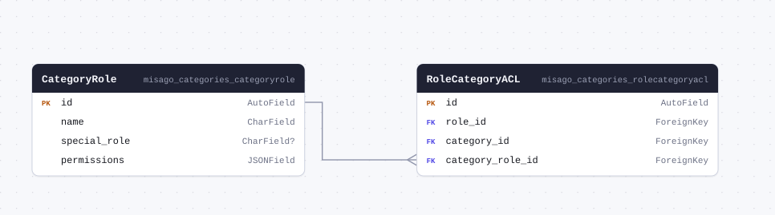

| Column | Field | Type | Null | Key | Default | Description |
| --- | --- | --- | --- | --- | --- | --- |
| `id` | `AutoField` | `integer` |  | PK | `autoincrement()` |  |
| `name` | `CharField` | `varchar(255)` |  |  |  |  |
| `special_role` | `CharField` | `varchar(255)` | yes |  |  |  |
| `permissions` | `JSONField` | `jsonb` |  |  | `permissions_default()` |  |

Relations:

- [RoleCategoryACL](#rolecategoryacl).`category_role_id` → `id`, on delete cascade

## RoleCategoryACL

Table `misago_categories_rolecategoryacl`, app `misago_categories`.

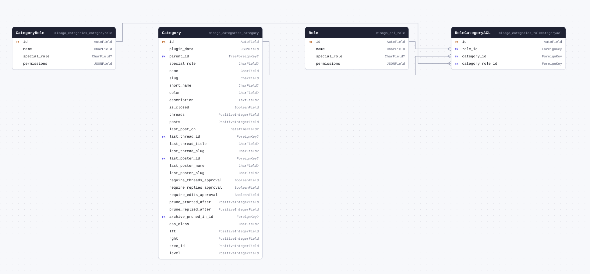

| Column | Field | Type | Null | Key | Default | Description |
| --- | --- | --- | --- | --- | --- | --- |
| `id` | `AutoField` | `integer` |  | PK | `autoincrement()` |  |
| `role_id` | `ForeignKey` | `integer` |  | FK |  |  |
| `category_id` | `ForeignKey` | `integer` |  | FK |  |  |
| `category_role_id` | `ForeignKey` | `integer` |  | FK |  |  |

Indexes:

- index `misago_categories_rolecategoryacl_role_id_9e172a55` on `role_id`
- index `misago_categories_rolecategoryacl_category_id_99c2a9bb` on `category_id`
- index `misago_categories_rolecategoryacl_category_role_id_d3558bd9` on `category_role_id`

Relations:

- `role_id` → [Role](#role).`id`, on delete cascade
- `category_id` → [Category](#category).`id`, on delete cascade
- `category_role_id` → [CategoryRole](#categoryrole).`id`, on delete cascade

## Post

Table `misago_threads_post`, app `misago_threads`.

Columns from `PluginDataModel` (abstract): `plugin_data`.

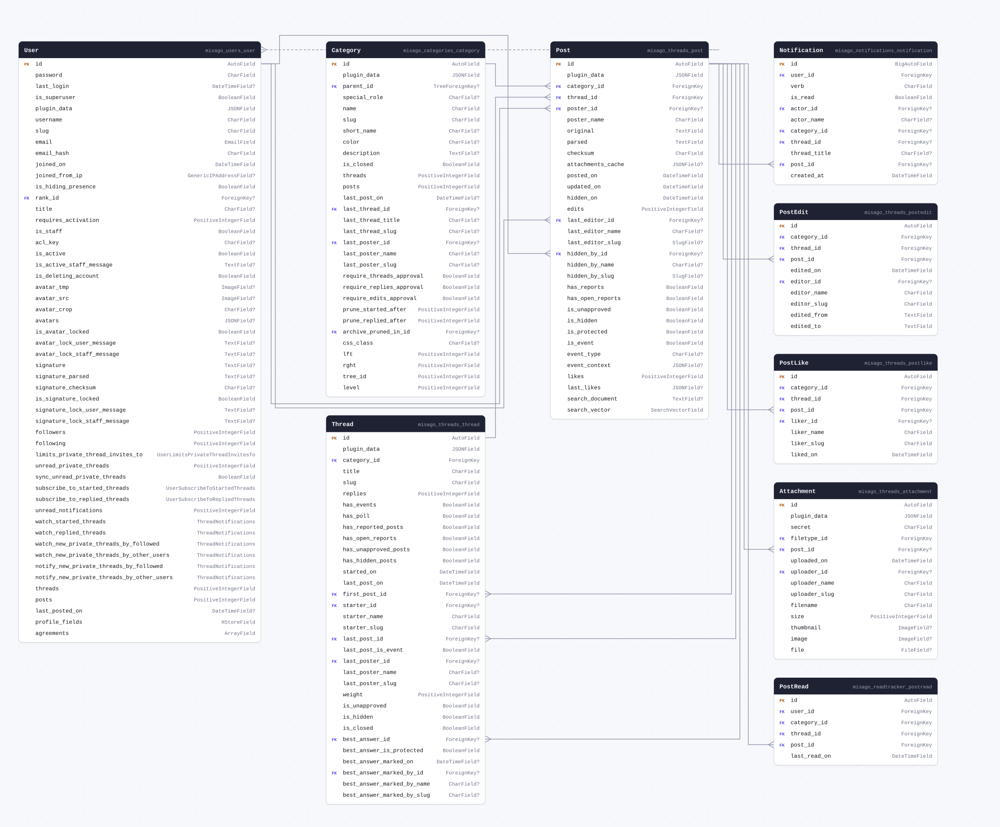

| Column | Field | Type | Null | Key | Default | Description |
| --- | --- | --- | --- | --- | --- | --- |
| `id` | `AutoField` | `integer` |  | PK | `autoincrement()` |  |
| `plugin_data` | `JSONField` | `jsonb` |  |  | `dict()` |  |
| `category_id` | `ForeignKey` | `integer` |  | FK |  |  |
| `thread_id` | `ForeignKey` | `integer` |  | FK |  |  |
| `poster_id` | `ForeignKey` | `integer` | yes | FK |  |  |
| `poster_name` | `CharField` | `varchar(255)` |  |  |  |  |
| `original` | `TextField` | `text` |  |  |  |  |
| `parsed` | `TextField` | `text` |  |  |  |  |
| `checksum` | `CharField` | `varchar(64)` |  |  | `'-'` |  |
| `attachments_cache` | `JSONField` | `jsonb` | yes |  |  |  |
| `posted_on` | `DateTimeField` | `timestamp with time zone` |  |  |  |  |
| `updated_on` | `DateTimeField` | `timestamp with time zone` |  |  |  |  |
| `hidden_on` | `DateTimeField` | `timestamp with time zone` |  |  | `now()` |  |
| `edits` | `PositiveIntegerField` | `integer` |  |  | `0` |  |
| `last_editor_id` | `ForeignKey` | `integer` | yes | FK |  |  |
| `last_editor_name` | `CharField` | `varchar(255)` | yes |  |  |  |
| `last_editor_slug` | `SlugField` | `varchar(255)` | yes |  |  |  |
| `hidden_by_id` | `ForeignKey` | `integer` | yes | FK |  |  |
| `hidden_by_name` | `CharField` | `varchar(255)` | yes |  |  |  |
| `hidden_by_slug` | `SlugField` | `varchar(255)` | yes |  |  |  |
| `has_reports` | `BooleanField` | `boolean` |  |  | `False` |  |
| `has_open_reports` | `BooleanField` | `boolean` |  |  | `False` |  |
| `is_unapproved` | `BooleanField` | `boolean` |  |  | `False` |  |
| `is_hidden` | `BooleanField` | `boolean` |  |  | `False` |  |
| `is_protected` | `BooleanField` | `boolean` |  |  | `False` |  |
| `is_event` | `BooleanField` | `boolean` |  |  | `False` |  |
| `event_type` | `CharField` | `varchar(255)` | yes |  |  |  |
| `event_context` | `JSONField` | `jsonb` | yes |  |  |  |
| `likes` | `PositiveIntegerField` | `integer` |  |  | `0` |  |
| `last_likes` | `JSONField` | `jsonb` | yes |  |  |  |
| `search_document` | `TextField` | `text` | yes |  |  |  |
| `search_vector` | `SearchVectorField` | `tsvector` |  |  |  |  |

Indexes:

- index `misago_threads_post_category_id_79f7f0ef` on `category_id`
- index `misago_threads_post_thread_id_8083899e` on `thread_id`
- index `misago_threads_post_poster_id_b3163b03` on `poster_id`
- index `misago_threads_post_posted_on_00c20f4c` on `posted_on`
- index `misago_threads_post_last_editor_id_56e47ea4` on `last_editor_id`
- index `misago_threads_post_last_editor_slug_a28b663a` on `last_editor_slug`
- index `misago_threads_post_last_editor_slug_a28b663a_like` on `last_editor_slug` (`varchar_pattern_ops`)
- index `misago_threads_post_hidden_by_id_452f0812` on `hidden_by_id`
- index `misago_threads_post_hidden_by_slug_df670716` on `hidden_by_slug`
- index `misago_threads_post_hidden_by_slug_df670716_like` on `hidden_by_slug` (`varchar_pattern_ops`)
- index `misago_threads_post_is_unapproved_9240a4cc` on `is_unapproved`
- index `misago_threads_post_is_event_ba70bc13` on `is_event`
- gin index `misago_thre_plugin__91da06_gin` on `plugin_data`
- index `misago_post_has_open_repo_part` on `has_open_reports` where `"has_open_reports"`
- index `misago_post_is_hidden_part` on `is_hidden` where `NOT "is_hidden"`
- index `misago_post_is_event_part` on `is_event`, `event_type` where `"is_event"`
- gin index `misago_thre_search__b472a2_gin` on `search_vector`
- index `misago_thre_thread__4e5114_idx` on `thread_id`, `id`
- index `misago_thre_is_even_d29c90_idx` on `is_event`, `is_hidden`
- index `misago_thre_poster__eefeb2_idx` on `poster_id`, `posted_on`

Relations:

- `liked_by` — many to many with [User](#user), through [PostLike](#postlike)
- [Notification](#notification).`post_id` → `id`, on delete cascade
- `category_id` → [Category](#category).`id`, on delete cascade
- `thread_id` → [Thread](#thread).`id`, on delete cascade
- `poster_id` → [User](#user).`id`, on delete set null
- `last_editor_id` → [User](#user).`id`, on delete set null
- `hidden_by_id` → [User](#user).`id`, on delete set null
- `mentions` — many to many with [User](#user)
- [PostEdit](#postedit).`post_id` → `id`, on delete cascade
- [PostLike](#postlike).`post_id` → `id`, on delete cascade
- [Thread](#thread).`first_post_id` → `id`, on delete set null
- [Thread](#thread).`last_post_id` → `id`, on delete set null
- [Thread](#thread).`best_answer_id` → `id`, on delete set null
- [Attachment](#attachment).`post_id` → `id`, on delete set null
- [PostRead](#postread).`post_id` → `id`, on delete cascade

## PostEdit

Table `misago_threads_postedit`, app `misago_threads`.


| Column | Field | Type | Null | Key | Default | Description |
| --- | --- | --- | --- | --- | --- | --- |
| `id` | `AutoField` | `integer` |  | PK | `autoincrement()` |  |
| `category_id` | `ForeignKey` | `integer` |  | FK |  |  |
| `thread_id` | `ForeignKey` | `integer` |  | FK |  |  |
| `post_id` | `ForeignKey` | `integer` |  | FK |  |  |
| `edited_on` | `DateTimeField` | `timestamp with time zone` |  |  | `now()` |  |
| `editor_id` | `ForeignKey` | `integer` | yes | FK |  |  |
| `editor_name` | `CharField` | `varchar(255)` |  |  |  |  |
| `editor_slug` | `CharField` | `varchar(255)` |  |  |  |  |
| `edited_from` | `TextField` | `text` |  |  |  |  |
| `edited_to` | `TextField` | `text` |  |  |  |  |

Indexes:

- index `misago_threads_postedit_category_id_14762498` on `category_id`
- index `misago_threads_postedit_thread_id_a71149fd` on `thread_id`
- index `misago_threads_postedit_post_id_831e29bb` on `post_id`
- index `misago_threads_postedit_editor_id_3c099285` on `editor_id`

Relations:

- `category_id` → [Category](#category).`id`, on delete cascade
- `thread_id` → [Thread](#thread).`id`, on delete cascade
- `post_id` → [Post](#post).`id`, on delete cascade
- `editor_id` → [User](#user).`id`, on delete set null

## PostLike

Table `misago_threads_postlike`, app `misago_threads`.

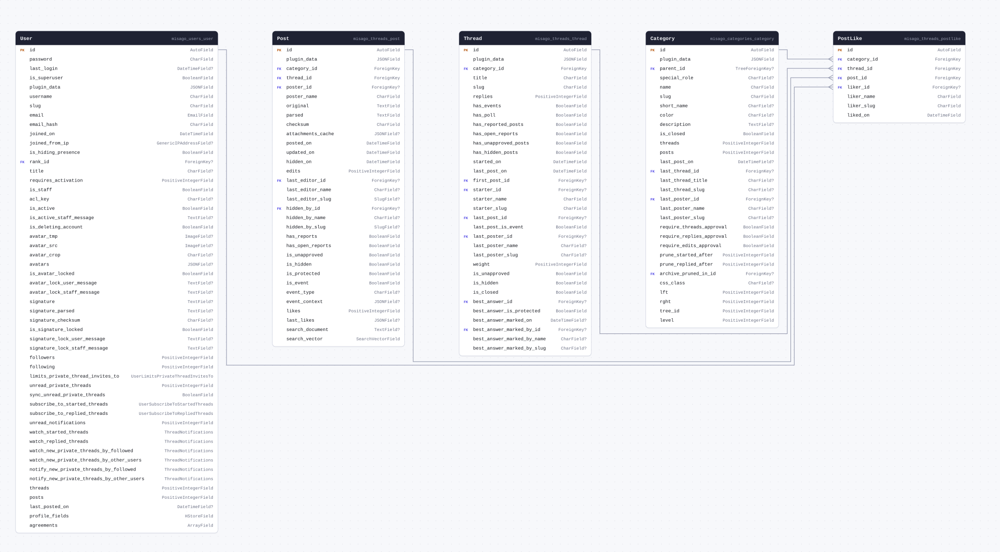

| Column | Field | Type | Null | Key | Default | Description |
| --- | --- | --- | --- | --- | --- | --- |
| `id` | `AutoField` | `integer` |  | PK | `autoincrement()` |  |
| `category_id` | `ForeignKey` | `integer` |  | FK |  |  |
| `thread_id` | `ForeignKey` | `integer` |  | FK |  |  |
| `post_id` | `ForeignKey` | `integer` |  | FK |  |  |
| `liker_id` | `ForeignKey` | `integer` | yes | FK |  |  |
| `liker_name` | `CharField` | `varchar(255)` |  |  |  |  |
| `liker_slug` | `CharField` | `varchar(255)` |  |  |  |  |
| `liked_on` | `DateTimeField` | `timestamp with time zone` |  |  | `now()` |  |

Indexes:

- index `misago_threads_postlike_category_id_21e0c8ce` on `category_id`
- index `misago_threads_postlike_thread_id_38e33d41` on `thread_id`
- index `misago_threads_postlike_post_id_7ec34c1c` on `post_id`
- index `misago_threads_postlike_liker_id_e9fbb1c9` on `liker_id`
- index `misago_threads_postlike_liker_name_1ead3b48` on `liker_name`
- index `misago_threads_postlike_liker_name_1ead3b48_like` on `liker_name` (`varchar_pattern_ops`)

Relations:

- `category_id` → [Category](#category).`id`, on delete cascade
- `thread_id` → [Thread](#thread).`id`, on delete cascade
- `post_id` → [Post](#post).`id`, on delete cascade
- `liker_id` → [User](#user).`id`, on delete set null

## Thread

Table `misago_threads_thread`, app `misago_threads`.

Columns from `PluginDataModel` (abstract): `plugin_data`.

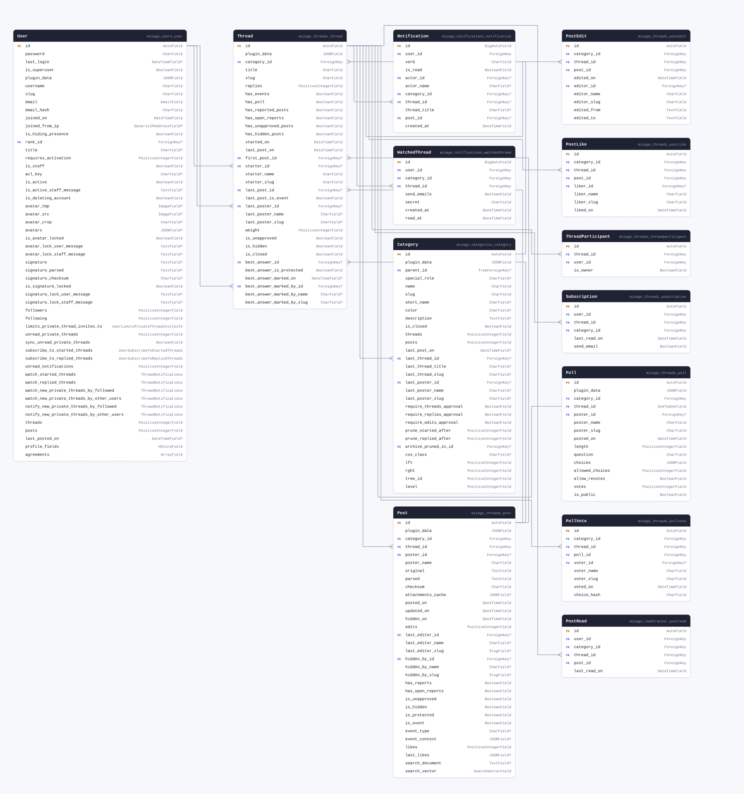

| Column | Field | Type | Null | Key | Default | Description |
| --- | --- | --- | --- | --- | --- | --- |
| `id` | `AutoField` | `integer` |  | PK | `autoincrement()` |  |
| `plugin_data` | `JSONField` | `jsonb` |  |  | `dict()` |  |
| `category_id` | `ForeignKey` | `integer` |  | FK |  |  |
| `title` | `CharField` | `varchar(255)` |  |  |  |  |
| `slug` | `CharField` | `varchar(255)` |  |  |  |  |
| `replies` | `PositiveIntegerField` | `integer` |  |  | `0` |  |
| `has_events` | `BooleanField` | `boolean` |  |  | `False` |  |
| `has_poll` | `BooleanField` | `boolean` |  |  | `False` |  |
| `has_reported_posts` | `BooleanField` | `boolean` |  |  | `False` |  |
| `has_open_reports` | `BooleanField` | `boolean` |  |  | `False` |  |
| `has_unapproved_posts` | `BooleanField` | `boolean` |  |  | `False` |  |
| `has_hidden_posts` | `BooleanField` | `boolean` |  |  | `False` |  |
| `started_on` | `DateTimeField` | `timestamp with time zone` |  |  |  |  |
| `last_post_on` | `DateTimeField` | `timestamp with time zone` |  |  |  |  |
| `first_post_id` | `ForeignKey` | `integer` | yes | FK |  |  |
| `starter_id` | `ForeignKey` | `integer` | yes | FK |  |  |
| `starter_name` | `CharField` | `varchar(255)` |  |  |  |  |
| `starter_slug` | `CharField` | `varchar(255)` |  |  |  |  |
| `last_post_id` | `ForeignKey` | `integer` | yes | FK |  |  |
| `last_post_is_event` | `BooleanField` | `boolean` |  |  | `False` |  |
| `last_poster_id` | `ForeignKey` | `integer` | yes | FK |  |  |
| `last_poster_name` | `CharField` | `varchar(255)` | yes |  |  |  |
| `last_poster_slug` | `CharField` | `varchar(255)` | yes |  |  |  |
| `weight` | `PositiveIntegerField` | `integer` |  |  | `0` |  |
| `is_unapproved` | `BooleanField` | `boolean` |  |  | `False` |  |
| `is_hidden` | `BooleanField` | `boolean` |  |  | `False` |  |
| `is_closed` | `BooleanField` | `boolean` |  |  | `False` |  |
| `best_answer_id` | `ForeignKey` | `integer` | yes | FK |  |  |
| `best_answer_is_protected` | `BooleanField` | `boolean` |  |  | `False` |  |
| `best_answer_marked_on` | `DateTimeField` | `timestamp with time zone` | yes |  |  |  |
| `best_answer_marked_by_id` | `ForeignKey` | `integer` | yes | FK |  |  |
| `best_answer_marked_by_name` | `CharField` | `varchar(255)` | yes |  |  |  |
| `best_answer_marked_by_slug` | `CharField` | `varchar(255)` | yes |  |  |  |

Indexes:

- index `misago_threads_thread_category_id_e3266490` on `category_id`
- index `misago_threads_thread_replies_1617266c` on `replies`
- index `misago_threads_thread_started_on_10445c64` on `started_on`
- index `misago_threads_thread_last_post_on_10841b1c` on `last_post_on`
- index `misago_threads_thread_first_post_id_b8139d81` on `first_post_id`
- index `misago_threads_thread_starter_id_7974db8c` on `starter_id`
- index `misago_threads_thread_last_post_id_c638dfb4` on `last_post_id`
- index `misago_threads_thread_last_poster_id_4fa32da6` on `last_poster_id`
- index `misago_threads_thread_is_unapproved_a55fb408` on `is_unapproved`
- index `misago_threads_thread_best_answer_id_1d0866b5` on `best_answer_id`
- index `misago_threads_thread_best_answer_marked_by_id_68c446a1` on `best_answer_marked_by_id`
- gin index `misago_thre_plugin__e6e836_gin` on `plugin_data`
- index `misago_thread_pinned_glob_part` on `weight` where `"weight" = 2`
- index `misago_thread_pinned_loca_part` on `weight` where `"weight" = 1`
- index `misago_thread_not_pinned_part` on `weight` where `"weight" = 0`
- index `misago_thread_not_global_part` on `weight` where `"weight" < 2`
- index `misago_thread_has_reporte_part` on `has_reported_posts` where `"has_reported_posts"`
- index `misago_thread_has_unappro_part` on `has_unapproved_posts` where `"has_unapproved_posts"`
- index `misago_thread_is_visible_part` on `is_hidden` where `NOT "is_hidden"`
- index `misago_thre_categor_6cb52c_idx` on `category_id`, `id`
- index `misago_thre_categor_7ec8b0_idx` on `category_id`, `last_post_on`
- index `misago_thre_categor_c5eaf1_idx` on `category_id`, `replies`

Relations:

- `participants` — many to many with [User](#user), through [ThreadParticipant](#threadparticipant)
- [Notification](#notification).`thread_id` → `id`, on delete cascade
- [WatchedThread](#watchedthread).`thread_id` → `id`, on delete cascade
- [Category](#category).`last_thread_id` → `id`, on delete set null
- [Post](#post).`thread_id` → `id`, on delete cascade
- [PostEdit](#postedit).`thread_id` → `id`, on delete cascade
- [PostLike](#postlike).`thread_id` → `id`, on delete cascade
- `category_id` → [Category](#category).`id`, on delete cascade
- `first_post_id` → [Post](#post).`id`, on delete set null
- `starter_id` → [User](#user).`id`, on delete set null
- `last_post_id` → [Post](#post).`id`, on delete set null
- `last_poster_id` → [User](#user).`id`, on delete set null
- `best_answer_id` → [Post](#post).`id`, on delete set null
- `best_answer_marked_by_id` → [User](#user).`id`, on delete set null
- [ThreadParticipant](#threadparticipant).`thread_id` → `id`, on delete cascade
- [Subscription](#subscription).`thread_id` → `id`, on delete cascade
- [Poll](#poll).`thread_id` → `id`, on delete cascade
- [PollVote](#pollvote).`thread_id` → `id`, on delete cascade
- [PostRead](#postread).`thread_id` → `id`, on delete cascade

## ThreadParticipant

Table `misago_threads_threadparticipant`, app `misago_threads`.

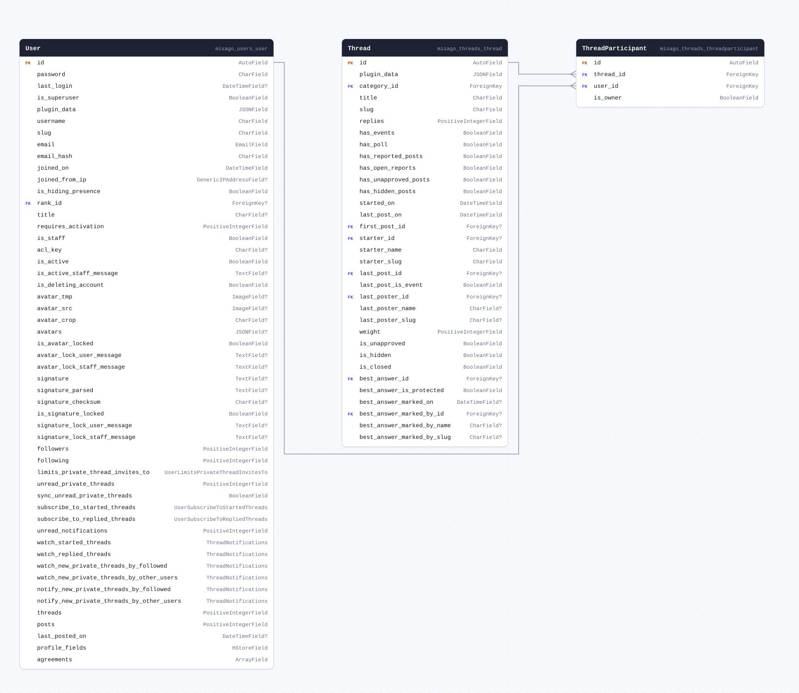

| Column | Field | Type | Null | Key | Default | Description |
| --- | --- | --- | --- | --- | --- | --- |
| `id` | `AutoField` | `integer` |  | PK | `autoincrement()` |  |
| `thread_id` | `ForeignKey` | `integer` |  | FK |  |  |
| `user_id` | `ForeignKey` | `integer` |  | FK |  |  |
| `is_owner` | `BooleanField` | `boolean` |  |  | `False` |  |

Indexes:

- index `misago_threads_threadparticipant_thread_id_d468a2cb` on `thread_id`
- index `misago_threads_threadparticipant_user_id_efbeaf80` on `user_id`

Relations:

- `thread_id` → [Thread](#thread).`id`, on delete cascade
- `user_id` → [User](#user).`id`, on delete cascade

## Subscription

Table `misago_threads_subscription`, app `misago_threads`.

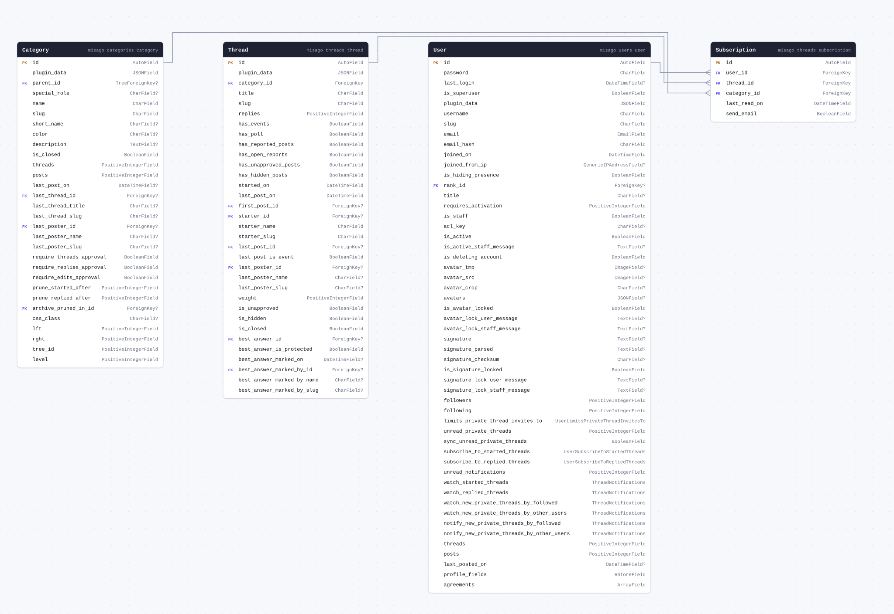

| Column | Field | Type | Null | Key | Default | Description |
| --- | --- | --- | --- | --- | --- | --- |
| `id` | `AutoField` | `integer` |  | PK | `autoincrement()` |  |
| `user_id` | `ForeignKey` | `integer` |  | FK |  |  |
| `thread_id` | `ForeignKey` | `integer` |  | FK |  |  |
| `category_id` | `ForeignKey` | `integer` |  | FK |  |  |
| `last_read_on` | `DateTimeField` | `timestamp with time zone` |  |  | `now()` |  |
| `send_email` | `BooleanField` | `boolean` |  |  | `False` |  |

Indexes:

- index `misago_threads_subscription_user_id_daf28105` on `user_id`
- index `misago_threads_subscription_thread_id_f97c9a3b` on `thread_id`
- index `misago_threads_subscription_category_id_f5854673` on `category_id`
- index `misago_thre_send_em_da8b99_idx` on `send_email`, `last_read_on`

Relations:

- `user_id` → [User](#user).`id`, on delete cascade
- `thread_id` → [Thread](#thread).`id`, on delete cascade
- `category_id` → [Category](#category).`id`, on delete cascade

## AttachmentType

Table `misago_threads_attachmenttype`, app `misago_threads`.

Columns from `PluginDataModel` (abstract): `plugin_data`.

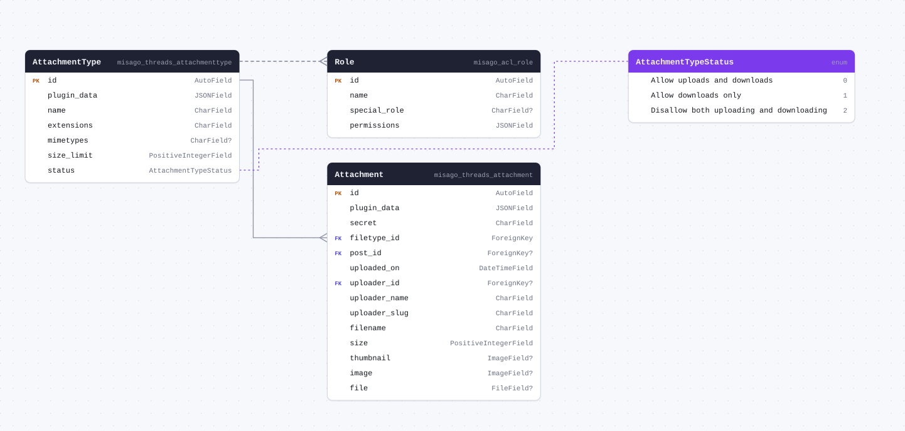

| Column | Field | Type | Null | Key | Default | Description |
| --- | --- | --- | --- | --- | --- | --- |
| `id` | `AutoField` | `integer` |  | PK | `autoincrement()` |  |
| `plugin_data` | `JSONField` | `jsonb` |  |  | `dict()` |  |
| `name` | `CharField` | `varchar(255)` |  |  |  |  |
| `extensions` | `CharField` | `varchar(255)` |  |  |  |  |
| `mimetypes` | `CharField` | `varchar(255)` | yes |  |  |  |
| `size_limit` | `PositiveIntegerField` | `integer` |  |  | `1024` |  |
| `status` | `AttachmentTypeStatus` | `integer` |  |  | `0` |  |

Indexes:

- gin index `misago_thre_plugin__236db5_gin` on `plugin_data`

Relations:

- `limit_uploads_to` — many to many with [Role](#role)
- `limit_downloads_to` — many to many with [Role](#role)
- [Attachment](#attachment).`filetype_id` → `id`, on delete cascade

## Attachment

Table `misago_threads_attachment`, app `misago_threads`.

Columns from `PluginDataModel` (abstract): `plugin_data`.

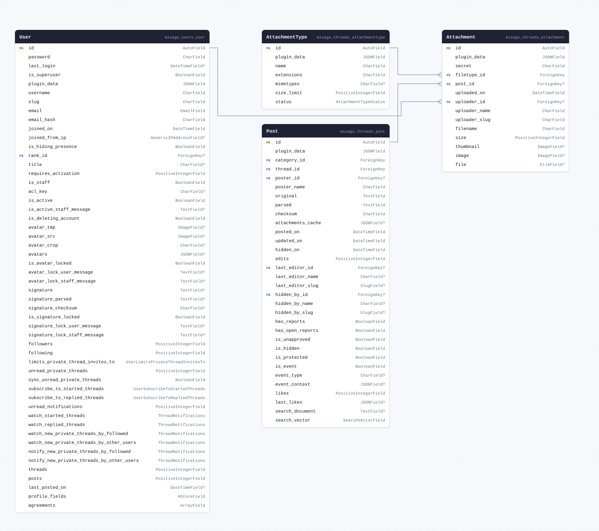

| Column | Field | Type | Null | Key | Default | Description |
| --- | --- | --- | --- | --- | --- | --- |
| `id` | `AutoField` | `integer` |  | PK | `autoincrement()` |  |
| `plugin_data` | `JSONField` | `jsonb` |  |  | `dict()` |  |
| `secret` | `CharField` | `varchar(64)` |  |  |  |  |
| `filetype_id` | `ForeignKey` | `integer` |  | FK |  |  |
| `post_id` | `ForeignKey` | `integer` | yes | FK |  |  |
| `uploaded_on` | `DateTimeField` | `timestamp with time zone` |  |  | `now()` |  |
| `uploader_id` | `ForeignKey` | `integer` | yes | FK |  |  |
| `uploader_name` | `CharField` | `varchar(255)` |  |  |  |  |
| `uploader_slug` | `CharField` | `varchar(255)` |  |  |  |  |
| `filename` | `CharField` | `varchar(255)` |  |  |  |  |
| `size` | `PositiveIntegerField` | `integer` |  |  | `0` |  |
| `thumbnail` | `ImageField` | `varchar(255)` | yes |  |  |  |
| `image` | `ImageField` | `varchar(255)` | yes |  |  |  |
| `file` | `FileField` | `varchar(255)` | yes |  |  |  |

Indexes:

- index `misago_threads_attachment_filetype_id_d1e5d86e` on `filetype_id`
- index `misago_threads_attachment_post_id_68447b47` on `post_id`
- index `misago_threads_attachment_uploaded_on_08369cf7` on `uploaded_on`
- index `misago_threads_attachment_uploader_id_9f21e391` on `uploader_id`
- index `misago_threads_attachment_uploader_slug_383b098d` on `uploader_slug`
- index `misago_threads_attachment_uploader_slug_383b098d_like` on `uploader_slug` (`varchar_pattern_ops`)
- index `misago_threads_attachment_filename_4160d232` on `filename`
- index `misago_threads_attachment_filename_4160d232_like` on `filename` (`varchar_pattern_ops`)
- index `misago_threads_attachment_size_b8dd6dfd` on `size`
- gin index `misago_thre_plugin__46d25a_gin` on `plugin_data`

Relations:

- `filetype_id` → [AttachmentType](#attachmenttype).`id`, on delete cascade
- `post_id` → [Post](#post).`id`, on delete set null
- `uploader_id` → [User](#user).`id`, on delete set null

## Poll

Table `misago_threads_poll`, app `misago_threads`.

Columns from `PluginDataModel` (abstract): `plugin_data`.

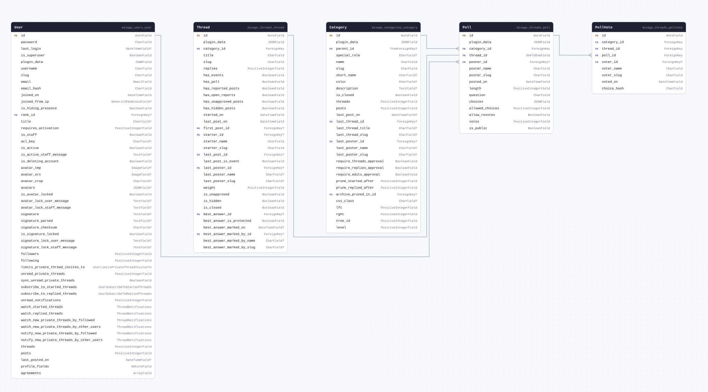

| Column | Field | Type | Null | Key | Default | Description |
| --- | --- | --- | --- | --- | --- | --- |
| `id` | `AutoField` | `integer` |  | PK | `autoincrement()` |  |
| `plugin_data` | `JSONField` | `jsonb` |  |  | `dict()` |  |
| `category_id` | `ForeignKey` | `integer` |  | FK |  |  |
| `thread_id` | `OneToOneField` | `integer` |  | FK, unique |  |  |
| `poster_id` | `ForeignKey` | `integer` | yes | FK |  |  |
| `poster_name` | `CharField` | `varchar(255)` |  |  |  |  |
| `poster_slug` | `CharField` | `varchar(255)` |  |  |  |  |
| `posted_on` | `DateTimeField` | `timestamp with time zone` |  |  | `now()` |  |
| `length` | `PositiveIntegerField` | `integer` |  |  | `0` |  |
| `question` | `CharField` | `varchar(255)` |  |  |  |  |
| `choices` | `JSONField` | `jsonb` |  |  |  |  |
| `allowed_choices` | `PositiveIntegerField` | `integer` |  |  | `1` |  |
| `allow_revotes` | `BooleanField` | `boolean` |  |  | `False` |  |
| `votes` | `PositiveIntegerField` | `integer` |  |  | `0` |  |
| `is_public` | `BooleanField` | `boolean` |  |  | `False` |  |

Indexes:

- index `misago_threads_poll_category_id_29fa5f5d` on `category_id`
- index `misago_threads_poll_poster_id_49715f68` on `poster_id`
- gin index `misago_thre_plugin__5e1be7_gin` on `plugin_data`

Relations:

- `category_id` → [Category](#category).`id`, on delete cascade
- `thread_id` → [Thread](#thread).`id`, on delete cascade
- `poster_id` → [User](#user).`id`, on delete set null
- [PollVote](#pollvote).`poll_id` → `id`, on delete cascade

## PollVote

Table `misago_threads_pollvote`, app `misago_threads`.

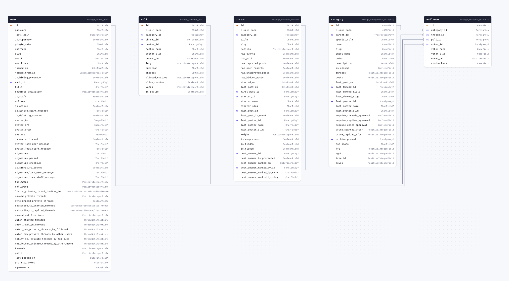

| Column | Field | Type | Null | Key | Default | Description |
| --- | --- | --- | --- | --- | --- | --- |
| `id` | `AutoField` | `integer` |  | PK | `autoincrement()` |  |
| `category_id` | `ForeignKey` | `integer` |  | FK |  |  |
| `thread_id` | `ForeignKey` | `integer` |  | FK |  |  |
| `poll_id` | `ForeignKey` | `integer` |  | FK |  |  |
| `voter_id` | `ForeignKey` | `integer` | yes | FK |  |  |
| `voter_name` | `CharField` | `varchar(255)` |  |  |  |  |
| `voter_slug` | `CharField` | `varchar(255)` |  |  |  |  |
| `voted_on` | `DateTimeField` | `timestamp with time zone` |  |  | `now()` |  |
| `choice_hash` | `CharField` | `varchar(12)` |  |  |  |  |

Indexes:

- index `misago_threads_pollvote_category_id_92abdceb` on `category_id`
- index `misago_threads_pollvote_thread_id_ef78c2ad` on `thread_id`
- index `misago_threads_pollvote_poll_id_d3fbfddf` on `poll_id`
- index `misago_threads_pollvote_voter_id_979ff29f` on `voter_id`
- index `misago_threads_pollvote_choice_hash_98c31747` on `choice_hash`
- index `misago_threads_pollvote_choice_hash_98c31747_like` on `choice_hash` (`varchar_pattern_ops`)
- index `misago_thre_poll_id_c3e8fe_idx` on `poll_id`, `voter_name`

Relations:

- `category_id` → [Category](#category).`id`, on delete cascade
- `thread_id` → [Thread](#thread).`id`, on delete cascade
- `poll_id` → [Poll](#poll).`id`, on delete cascade
- `voter_id` → [User](#user).`id`, on delete set null

## PostRead

Table `misago_readtracker_postread`, app `misago_readtracker`.

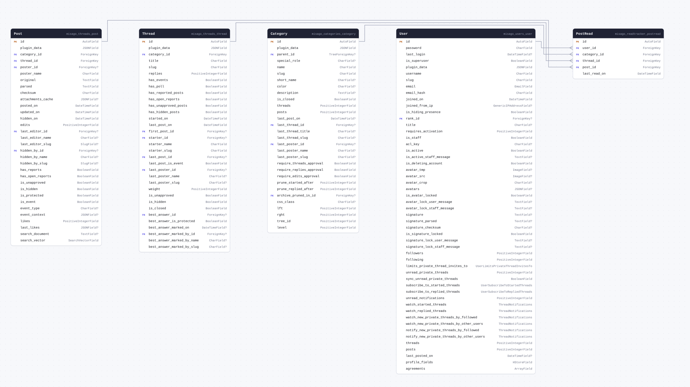

| Column | Field | Type | Null | Key | Default | Description |
| --- | --- | --- | --- | --- | --- | --- |
| `id` | `AutoField` | `integer` |  | PK | `autoincrement()` |  |
| `user_id` | `ForeignKey` | `integer` |  | FK |  |  |
| `category_id` | `ForeignKey` | `integer` |  | FK |  |  |
| `thread_id` | `ForeignKey` | `integer` |  | FK |  |  |
| `post_id` | `ForeignKey` | `integer` |  | FK |  |  |
| `last_read_on` | `DateTimeField` | `timestamp with time zone` |  |  | `now()` |  |

Indexes:

- index `misago_readtracker_postread_user_id_4a764d0f` on `user_id`
- index `misago_readtracker_postread_category_id_bb74f821` on `category_id`
- index `misago_readtracker_postread_thread_id_7121201f` on `thread_id`
- index `misago_readtracker_postread_post_id_2be75383` on `post_id`

Relations:

- `user_id` → [User](#user).`id`, on delete cascade
- `category_id` → [Category](#category).`id`, on delete cascade
- `thread_id` → [Thread](#thread).`id`, on delete cascade
- `post_id` → [Post](#post).`id`, on delete cascade

## Subject

Table `misago_oauth2_subject`, app `misago_oauth2`.

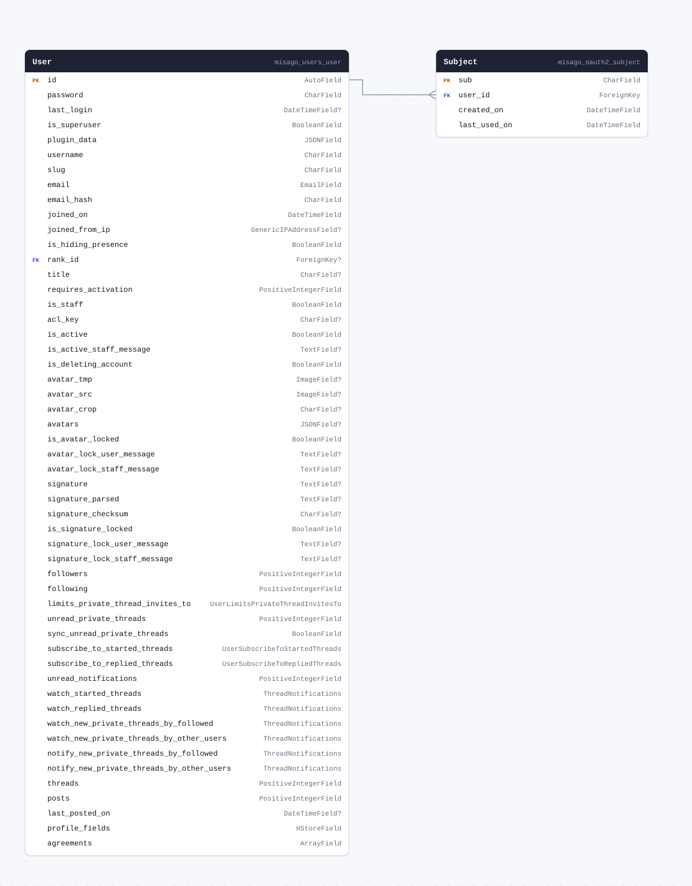

| Column | Field | Type | Null | Key | Default | Description |
| --- | --- | --- | --- | --- | --- | --- |
| `sub` | `CharField` | `varchar(36)` |  | PK |  |  |
| `user_id` | `ForeignKey` | `integer` |  | FK |  |  |
| `created_on` | `DateTimeField` | `timestamp with time zone` |  |  | `now()` |  |
| `last_used_on` | `DateTimeField` | `timestamp with time zone` |  |  | `now()` |  |

Indexes:

- index `misago_oauth2_subject_sub_2d35d38c_like` on `sub` (`varchar_pattern_ops`)
- index `misago_oauth2_subject_user_id_a623087c` on `user_id`

Relations:

- `user_id` → [User](#user).`id`, on delete cascade

## SocialAuthProvider

Table `misago_socialauth_socialauthprovider`, app `misago_socialauth`.

| Column | Field | Type | Null | Key | Default | Description |
| --- | --- | --- | --- | --- | --- | --- |
| `provider` | `CharField` | `varchar(30)` |  | PK |  |  |
| `button_text` | `CharField` | `varchar(255)` | yes |  |  |  |
| `button_color` | `CharField` | `varchar(7)` | yes |  |  |  |
| `settings` | `JSONField` | `jsonb` |  |  | `dict()` |  |
| `is_active` | `BooleanField` | `boolean` |  |  | `False` |  |
| `order` | `IntegerField` | `integer` |  |  | `0` |  |

Indexes:

- index `misago_socialauth_socialauthprovider_provider_dccd89f3_like` on `provider` (`varchar_pattern_ops`)

## MenuItem

Table `misago_menus_menuitem`, app `misago_menus`.

| Column | Field | Type | Null | Key | Default | Description |
| --- | --- | --- | --- | --- | --- | --- |
| `id` | `AutoField` | `integer` |  | PK | `autoincrement()` |  |
| `menu` | `MenuItemMenu` | `varchar(6)` |  |  |  |  |
| `title` | `CharField` | `varchar(255)` |  |  |  |  |
| `url` | `URLField` | `varchar(200)` |  |  |  |  |
| `order` | `IntegerField` | `integer` |  |  | `0` |  |
| `css_class` | `CharField` | `varchar(255)` | yes |  |  |  |
| `target_blank` | `BooleanField` | `boolean` |  |  | `False` |  |
| `rel` | `CharField` | `varchar(255)` | yes |  |  |  |

# Enums

## UserLimitsPrivateThreadInvitesTo

| Name | Stored as |
| --- | --- |
| `Everybody` | `0` |
| `Users I follow` | `1` |
| `Nobody` | `2` |

## UserSubscribeToStartedThreads

| Name | Stored as |
| --- | --- |
| `No` | `0` |
| `Notify` | `1` |
| `Notify with e-mail` | `2` |

## UserSubscribeToRepliedThreads

| Name | Stored as |
| --- | --- |
| `No` | `0` |
| `Notify` | `1` |
| `Notify with e-mail` | `2` |

## ThreadNotifications

| Name | Stored as |
| --- | --- |
| `NONE` | `0` |
| `SITE_ONLY` | `1` |
| `SITE_AND_EMAIL` | `2` |

## BanCheckType

| Name | Stored as |
| --- | --- |
| `Username` | `0` |
| `E-mail address` | `1` |
| `IP address` | `2` |

## DataDownloadStatus

| Name | Stored as |
| --- | --- |
| `Pending` | `0` |
| `Processing` | `1` |
| `Ready` | `2` |
| `Expired` | `3` |

## DeletedUserDeletedBy

| Name | Stored as |
| --- | --- |
| `By self` | `1` |
| `By staff` | `2` |
| `By system` | `3` |

## LogEntryActionFlag

| Name | Stored as |
| --- | --- |
| `Addition` | `1` |
| `Change` | `2` |
| `Deletion` | `3` |

## AgreementType

| Name | Stored as |
| --- | --- |
| `Terms of service` | `terms_of_service` |
| `Privacy policy` | `privacy_policy` |

## AttachmentTypeStatus

| Name | Stored as |
| --- | --- |
| `Allow uploads and downloads` | `0` |
| `Allow downloads only` | `1` |
| `Disallow both uploading and downloading` | `2` |

## MenuItemMenu

| Name | Stored as |
| --- | --- |
| `Navbar and footer` | `both` |
| `Navbar` | `navbar` |
| `Footer` | `footer` |
