# Schema docs


[Permission](#permission) · [Group](#group) · [ContentType](#contenttype) · [Session](#session) · [UserSocialAuth](#usersocialauth) · [Nonce](#nonce) · [Association](#association) · [Code](#code) · [Partial](#partial) · [taggit.Tag](#taggittag) · [taggit.TaggedItem](#taggittaggeditem) · [Constance](#constance) · [LogEntry](#logentry) · [SolarSchedule](#solarschedule) · [IntervalSchedule](#intervalschedule) · [ClockedSchedule](#clockedschedule) · [CrontabSchedule](#crontabschedule) · [PeriodicTasks](#periodictasks) · [PeriodicTask](#periodictask) · [TaskResult](#taskresult) · [ChordCounter](#chordcounter) · [GroupResult](#groupresult) · [ProviderNetwork](#providernetwork) · [Provider](#provider) · [CircuitType](#circuittype) · [Circuit](#circuit) · [CircuitTermination](#circuittermination) · [CloudAccount](#cloudaccount) · [CloudResourceType](#cloudresourcetype) · [CloudNetwork](#cloudnetwork) · [CloudNetworkPrefixAssignment](#cloudnetworkprefixassignment) · [CloudService](#cloudservice) · [CloudServiceNetworkAssignment](#cloudservicenetworkassignment) · [RegularExpressionValidationRule](#regularexpressionvalidationrule) · [MinMaxValidationRule](#minmaxvalidationrule) · [RequiredValidationRule](#requiredvalidationrule) · [UniqueValidationRule](#uniquevalidationrule) · [DataCompliance](#datacompliance) · [ConsolePort](#consoleport) · [ConsoleServerPort](#consoleserverport) · [PowerPort](#powerport) · [PowerOutlet](#poweroutlet) · [Interface](#interface) · [InterfaceRedundancyGroup](#interfaceredundancygroup) · [InterfaceRedundancyGroupAssociation](#interfaceredundancygroupassociation) · [FrontPort](#frontport) · [RearPort](#rearport) · [DeviceBay](#devicebay) · [InventoryItem](#inventoryitem) · [ModuleBay](#modulebay) · [CableType](#cabletype) · [Cable](#cable) · [CableToCableTermination](#cabletocabletermination) · [CablePath](#cablepath) · [ConsolePortTemplate](#consoleporttemplate) · [ConsoleServerPortTemplate](#consoleserverporttemplate) · [PowerPortTemplate](#powerporttemplate) · [PowerOutletTemplate](#poweroutlettemplate) · [InterfaceTemplate](#interfacetemplate) · [FrontPortTemplate](#frontporttemplate) · [RearPortTemplate](#rearporttemplate) · [DeviceBayTemplate](#devicebaytemplate) · [ModuleBayTemplate](#modulebaytemplate) · [Manufacturer](#manufacturer) · [DeviceFamily](#devicefamily) · [DeviceTypeToSoftwareImageFile](#devicetypetosoftwareimagefile) · [DeviceType](#devicetype) · [Platform](#platform) · [Device](#device) · [DeviceClusterAssignment](#deviceclusterassignment) · [VirtualChassis](#virtualchassis) · [DeviceRedundancyGroup](#deviceredundancygroup) · [SoftwareImageFile](#softwareimagefile) · [SoftwareVersion](#softwareversion) · [Controller](#controller) · [ControllerManagedDeviceGroup](#controllermanageddevicegroup) · [ModuleFamily](#modulefamily) · [ModuleType](#moduletype) · [Module](#module) · [VirtualDeviceContext](#virtualdevicecontext) · [InterfaceVDCAssignment](#interfacevdcassignment) · [LocationType](#locationtype) · [Location](#location) · [PowerPanel](#powerpanel) · [PowerFeed](#powerfeed) · [RackGroup](#rackgroup) · [Rack](#rack) · [RackReservation](#rackreservation) · [ObjectChange](#objectchange) · [ComputedField](#computedfield) · [CustomField](#customfield) · [CustomFieldChoice](#customfieldchoice) · [Relationship](#relationship) · [RelationshipAssociation](#relationshipassociation) · [extras.Tag](#extrastag) · [extras.TaggedItem](#extrastaggeditem) · [ApprovalWorkflowDefinition](#approvalworkflowdefinition) · [ApprovalWorkflowStageDefinition](#approvalworkflowstagedefinition) · [ApprovalWorkflow](#approvalworkflow) · [ApprovalWorkflowStage](#approvalworkflowstage) · [ApprovalWorkflowStageResponse](#approvalworkflowstageresponse) · [Role](#role) · [Status](#status) · [Contact](#contact) · [Team](#team) · [ContactAssociation](#contactassociation) · [GitRepository](#gitrepository) · [DynamicGroup](#dynamicgroup) · [DynamicGroupMembership](#dynamicgroupmembership) · [StaticGroupAssociation](#staticgroupassociation) · [Job](#job) · [JobHook](#jobhook) · [JobLogEntry](#joblogentry) · [JobQueue](#jobqueue) · [JobQueueAssignment](#jobqueueassignment) · [JobResult](#jobresult) · [JobConsoleEntry](#jobconsoleentry) · [JobButton](#jobbutton) · [ScheduledJobs](#scheduledjobs) · [ScheduledJob](#scheduledjob) · [MetadataType](#metadatatype) · [MetadataChoice](#metadatachoice) · [ObjectMetadata](#objectmetadata) · [ConfigContext](#configcontext) · [ConfigContextSchema](#configcontextschema) · [CustomLink](#customlink) · [ExportTemplate](#exporttemplate) · [ExternalIntegration](#externalintegration) · [FileAttachment](#fileattachment) · [FileProxy](#fileproxy) · [GraphQLQuery](#graphqlquery) · [HealthCheckTestModel](#healthchecktestmodel) · [ImageAttachment](#imageattachment) · [Note](#note) · [SavedView](#savedview) · [UserSavedViewAssociation](#usersavedviewassociation) · [Webhook](#webhook) · [Secret](#secret) · [SecretsGroup](#secretsgroup) · [SecretsGroupAssociation](#secretsgroupassociation) · [Namespace](#namespace) · [VRF](#vrf) · [VRFDeviceAssignment](#vrfdeviceassignment) · [VRFPrefixAssignment](#vrfprefixassignment) · [RouteTarget](#routetarget) · [RIR](#rir) · [Prefix](#prefix) · [PrefixLocationAssignment](#prefixlocationassignment) · [IPAddress](#ipaddress) · [IPAddressToInterface](#ipaddresstointerface) · [IPAddressRange](#ipaddressrange) · [VLANGroup](#vlangroup) · [VLAN](#vlan) · [VLANLocationAssignment](#vlanlocationassignment) · [Service](#service) · [VirtualServer](#virtualserver) · [LoadBalancerPool](#loadbalancerpool) · [LoadBalancerPoolMember](#loadbalancerpoolmember) · [HealthCheckMonitor](#healthcheckmonitor) · [CertificateProfile](#certificateprofile) · [VirtualServerCertificateProfileAssignment](#virtualservercertificateprofileassignment) · [LoadBalancerPoolMemberCertificateProfileAssignment](#loadbalancerpoolmembercertificateprofileassignment) · [TenantGroup](#tenantgroup) · [Tenant](#tenant) · [User](#user) · [Token](#token) · [ObjectPermission](#objectpermission) · [ClusterType](#clustertype) · [ClusterGroup](#clustergroup) · [Cluster](#cluster) · [VirtualMachine](#virtualmachine) · [VMInterface](#vminterface) · [VPNProfile](#vpnprofile) · [VPNPhase1Policy](#vpnphase1policy) · [VPNPhase2Policy](#vpnphase2policy) · [VPNProfilePhase1PolicyAssignment](#vpnprofilephase1policyassignment) · [VPNProfilePhase2PolicyAssignment](#vpnprofilephase2policyassignment) · [VPN](#vpn) · [VPNTunnel](#vpntunnel) · [VPNTunnelEndpoint](#vpntunnelendpoint) · [VPNTermination](#vpntermination) · [SupportedDataRate](#supporteddatarate) · [RadioProfile](#radioprofile) · [WirelessNetwork](#wirelessnetwork) · [ControllerManagedDeviceGroupWirelessNetworkAssignment](#controllermanageddevicegroupwirelessnetworkassignment) · [ControllerManagedDeviceGroupRadioProfileAssignment](#controllermanageddevicegroupradioprofileassignment) · [Request](#request) · [Response](#response) · [SQLQuery](#sqlquery) · [Profile](#profile)

<details>
<summary>The whole schema as SQL</summary>

```sql
CREATE TABLE "auth_permission" ("id" integer NOT NULL PRIMARY KEY GENERATED BY DEFAULT AS IDENTITY, "name" varchar(255) NOT NULL, "content_type_id" integer NOT NULL, "codename" varchar(100) NOT NULL);

CREATE TABLE "auth_group" ("id" integer NOT NULL PRIMARY KEY GENERATED BY DEFAULT AS IDENTITY, "name" varchar(150) NOT NULL UNIQUE);

CREATE TABLE "auth_group_permissions" ("id" integer NOT NULL PRIMARY KEY GENERATED BY DEFAULT AS IDENTITY, "group_id" integer NOT NULL, "permission_id" integer NOT NULL);

CREATE TABLE "django_content_type" ("id" integer NOT NULL PRIMARY KEY GENERATED BY DEFAULT AS IDENTITY, "app_label" varchar(100) NOT NULL, "model" varchar(100) NOT NULL);

CREATE TABLE "django_session" ("session_key" varchar(40) NOT NULL PRIMARY KEY, "session_data" text NOT NULL, "expire_date" timestamp with time zone NOT NULL);

CREATE TABLE "social_auth_usersocialauth" ("id" bigint NOT NULL PRIMARY KEY GENERATED BY DEFAULT AS IDENTITY, "user_id" uuid NOT NULL, "provider" varchar(32) NOT NULL, "id_key" varchar(255) NOT NULL, "uid" varchar(255) NOT NULL, "extra_data" jsonb NOT NULL, "created" timestamp with time zone NOT NULL, "modified" timestamp with time zone NOT NULL, CONSTRAINT "user_social_auth_uid_required" CHECK (NOT ("uid" = '')));

CREATE TABLE "social_auth_nonce" ("id" bigint NOT NULL PRIMARY KEY GENERATED BY DEFAULT AS IDENTITY, "server_url" varchar(255) NOT NULL, "timestamp" integer NOT NULL, "salt" varchar(65) NOT NULL);

CREATE TABLE "social_auth_association" ("id" bigint NOT NULL PRIMARY KEY GENERATED BY DEFAULT AS IDENTITY, "server_url" varchar(255) NOT NULL, "handle" varchar(255) NOT NULL, "secret" varchar(255) NOT NULL, "issued" integer NOT NULL, "lifetime" integer NOT NULL, "assoc_type" varchar(64) NOT NULL);

CREATE TABLE "social_auth_code" ("id" bigint NOT NULL PRIMARY KEY GENERATED BY DEFAULT AS IDENTITY, "email" varchar(254) NOT NULL, "code" varchar(32) NOT NULL, "verified" boolean NOT NULL, "timestamp" timestamp with time zone NOT NULL);

CREATE TABLE "social_auth_partial" ("id" bigint NOT NULL PRIMARY KEY GENERATED BY DEFAULT AS IDENTITY, "token" varchar(32) NOT NULL, "next_step" smallint NOT NULL CHECK ("next_step" >= 0), "backend" varchar(32) NOT NULL, "data" jsonb NOT NULL, "timestamp" timestamp with time zone NOT NULL);

CREATE TABLE "taggit_tag" ("id" integer NOT NULL PRIMARY KEY GENERATED BY DEFAULT AS IDENTITY, "name" varchar(100) NOT NULL UNIQUE, "slug" varchar(100) NOT NULL UNIQUE);

CREATE TABLE "taggit_taggeditem" ("id" integer NOT NULL PRIMARY KEY GENERATED BY DEFAULT AS IDENTITY, "tag_id" integer NOT NULL, "content_type_id" integer NOT NULL, "object_id" integer NOT NULL, CONSTRAINT "taggit_taggeditem_content_type_id_object_id_tag_id_4bb97a8e_uniq" UNIQUE ("content_type_id", "object_id", "tag_id"));

CREATE TABLE "constance_constance" ("id" integer NOT NULL PRIMARY KEY GENERATED BY DEFAULT AS IDENTITY, "key" varchar(255) NOT NULL UNIQUE, "value" text NULL);

CREATE TABLE "django_admin_log" ("id" integer NOT NULL PRIMARY KEY GENERATED BY DEFAULT AS IDENTITY, "action_time" timestamp with time zone NOT NULL, "user_id" uuid NOT NULL, "content_type_id" integer NULL, "object_id" text NULL, "object_repr" varchar(200) NOT NULL, "action_flag" smallint NOT NULL CHECK ("action_flag" >= 0), "change_message" text NOT NULL);

CREATE TABLE "django_celery_beat_solarschedule" ("id" integer NOT NULL PRIMARY KEY GENERATED BY DEFAULT AS IDENTITY, "event" varchar(24) NOT NULL, "latitude" numeric(9, 6) NOT NULL, "longitude" numeric(9, 6) NOT NULL);

CREATE TABLE "django_celery_beat_intervalschedule" ("id" integer NOT NULL PRIMARY KEY GENERATED BY DEFAULT AS IDENTITY, "every" integer NOT NULL, "period" varchar(24) NOT NULL);

CREATE TABLE "django_celery_beat_clockedschedule" ("id" integer NOT NULL PRIMARY KEY GENERATED BY DEFAULT AS IDENTITY, "clocked_time" timestamp with time zone NOT NULL);

CREATE TABLE "django_celery_beat_crontabschedule" ("id" integer NOT NULL PRIMARY KEY GENERATED BY DEFAULT AS IDENTITY, "minute" varchar(240) NOT NULL, "hour" varchar(96) NOT NULL, "day_of_month" varchar(124) NOT NULL, "month_of_year" varchar(64) NOT NULL, "day_of_week" varchar(64) NOT NULL, "timezone" varchar(63) NOT NULL);

CREATE TABLE "django_celery_beat_periodictasks" ("ident" smallint NOT NULL PRIMARY KEY, "last_update" timestamp with time zone NOT NULL);

CREATE TABLE "django_celery_beat_periodictask" ("id" integer NOT NULL PRIMARY KEY GENERATED BY DEFAULT AS IDENTITY, "name" varchar(200) NOT NULL UNIQUE, "task" varchar(200) NOT NULL, "interval_id" integer NULL, "crontab_id" integer NULL, "solar_id" integer NULL, "clocked_id" integer NULL, "args" text NOT NULL, "kwargs" text NOT NULL, "queue" varchar(200) NULL, "exchange" varchar(200) NULL, "routing_key" varchar(200) NULL, "headers" text NOT NULL, "priority" integer NULL CHECK ("priority" >= 0), "expires" timestamp with time zone NULL, "expire_seconds" integer NULL CHECK ("expire_seconds" >= 0), "one_off" boolean NOT NULL, "start_time" timestamp with time zone NULL, "enabled" boolean NOT NULL, "last_run_at" timestamp with time zone NULL, "total_run_count" integer NOT NULL CHECK ("total_run_count" >= 0), "date_changed" timestamp with time zone NOT NULL, "description" text NOT NULL);

CREATE TABLE "django_celery_results_taskresult" ("id" integer NOT NULL PRIMARY KEY GENERATED BY DEFAULT AS IDENTITY, "task_id" varchar(255) NOT NULL UNIQUE, "periodic_task_name" varchar(255) NULL, "task_name" varchar(255) NULL, "task_args" text NULL, "task_kwargs" text NULL, "status" varchar(50) NOT NULL, "worker" varchar(100) NULL, "content_type" varchar(128) NOT NULL, "content_encoding" varchar(64) NOT NULL, "result" text NULL, "date_created" timestamp with time zone NOT NULL, "date_started" timestamp with time zone NULL, "date_done" timestamp with time zone NOT NULL, "traceback" text NULL, "meta" text NULL);

CREATE TABLE "django_celery_results_chordcounter" ("id" integer NOT NULL PRIMARY KEY GENERATED BY DEFAULT AS IDENTITY, "group_id" varchar(255) NOT NULL UNIQUE, "sub_tasks" text NOT NULL, "count" integer NOT NULL CHECK ("count" >= 0));

CREATE TABLE "django_celery_results_groupresult" ("id" integer NOT NULL PRIMARY KEY GENERATED BY DEFAULT AS IDENTITY, "group_id" varchar(255) NOT NULL UNIQUE, "date_created" timestamp with time zone NOT NULL, "date_done" timestamp with time zone NOT NULL, "content_type" varchar(128) NOT NULL, "content_encoding" varchar(64) NOT NULL, "result" text NULL);

CREATE TABLE "circuits_providernetwork" ("id" uuid NOT NULL PRIMARY KEY, "created" timestamp with time zone NULL, "last_updated" timestamp with time zone NULL, "_custom_field_data" jsonb NOT NULL, "name" varchar(255) NOT NULL, "provider_id" uuid NOT NULL, "description" varchar(255) NOT NULL, "comments" text NOT NULL, CONSTRAINT "circuits_providernetwork_provider_name" UNIQUE ("provider_id", "name"));

CREATE TABLE "circuits_provider" ("id" uuid NOT NULL PRIMARY KEY, "created" timestamp with time zone NULL, "last_updated" timestamp with time zone NULL, "_custom_field_data" jsonb NOT NULL, "name" varchar(255) NOT NULL UNIQUE, "asn" bigint NULL, "account" varchar(255) NOT NULL, "portal_url" varchar(200) NOT NULL, "noc_contact" text NOT NULL, "admin_contact" text NOT NULL, "comments" text NOT NULL);

CREATE TABLE "circuits_circuittype" ("id" uuid NOT NULL PRIMARY KEY, "created" timestamp with time zone NULL, "last_updated" timestamp with time zone NULL, "_custom_field_data" jsonb NOT NULL, "name" varchar(255) NOT NULL UNIQUE, "description" varchar(255) NOT NULL);

CREATE TABLE "circuits_circuit" ("id" uuid NOT NULL PRIMARY KEY, "created" timestamp with time zone NULL, "last_updated" timestamp with time zone NULL, "_custom_field_data" jsonb NOT NULL, "cid" varchar(255) NOT NULL, "status_id" uuid NOT NULL, "provider_id" uuid NOT NULL, "circuit_type_id" uuid NOT NULL, "tenant_id" uuid NULL, "install_date" date NULL, "commit_rate" integer NULL CHECK ("commit_rate" >= 0), "description" varchar(255) NOT NULL, "comments" text NOT NULL, "circuit_termination_a_id" uuid NULL, "circuit_termination_z_id" uuid NULL);

CREATE TABLE "circuits_circuittermination" ("id" uuid NOT NULL PRIMARY KEY, "created" timestamp with time zone NULL, "last_updated" timestamp with time zone NULL, "_custom_field_data" jsonb NOT NULL, "circuit_id" uuid NOT NULL, "term_side" varchar(1) NOT NULL, "location_id" uuid NULL, "provider_network_id" uuid NULL, "cloud_network_id" uuid NULL, "port_speed" integer NULL CHECK ("port_speed" >= 0), "upstream_speed" integer NULL CHECK ("upstream_speed" >= 0), "xconnect_id" varchar(255) NOT NULL, "pp_info" varchar(255) NOT NULL, "description" varchar(255) NOT NULL);

CREATE TABLE "cloud_cloudaccount" ("id" uuid NOT NULL PRIMARY KEY, "created" timestamp with time zone NULL, "last_updated" timestamp with time zone NULL, "_custom_field_data" jsonb NOT NULL, "name" varchar(255) NOT NULL UNIQUE, "description" varchar(255) NOT NULL, "account_number" varchar(255) NOT NULL, "provider_id" uuid NOT NULL, "secrets_group_id" uuid NULL);

CREATE TABLE "cloud_cloudresourcetype" ("id" uuid NOT NULL PRIMARY KEY, "created" timestamp with time zone NULL, "last_updated" timestamp with time zone NULL, "_custom_field_data" jsonb NOT NULL, "name" varchar(255) NOT NULL UNIQUE, "description" varchar(255) NOT NULL, "provider_id" uuid NOT NULL, "config_schema" jsonb NULL);

CREATE TABLE "cloud_cloudresourcetype_content_types" ("id" bigint NOT NULL PRIMARY KEY GENERATED BY DEFAULT AS IDENTITY, "cloudresourcetype_id" uuid NOT NULL, "contenttype_id" integer NOT NULL);

CREATE TABLE "cloud_cloudnetwork" ("id" uuid NOT NULL PRIMARY KEY, "created" timestamp with time zone NULL, "last_updated" timestamp with time zone NULL, "_custom_field_data" jsonb NOT NULL, "cloud_resource_type_id" uuid NOT NULL, "extra_config" jsonb NULL, "name" varchar(255) NOT NULL UNIQUE, "description" varchar(255) NOT NULL, "cloud_account_id" uuid NOT NULL, "parent_id" uuid NULL);

CREATE TABLE "cloud_cloudnetworkprefixassignment" ("id" uuid NOT NULL PRIMARY KEY, "cloud_network_id" uuid NOT NULL, "prefix_id" uuid NOT NULL);

CREATE TABLE "cloud_cloudservice" ("id" uuid NOT NULL PRIMARY KEY, "created" timestamp with time zone NULL, "last_updated" timestamp with time zone NULL, "_custom_field_data" jsonb NOT NULL, "cloud_resource_type_id" uuid NOT NULL, "extra_config" jsonb NULL, "name" varchar(255) NOT NULL UNIQUE, "description" varchar(255) NOT NULL, "cloud_account_id" uuid NULL);

CREATE TABLE "cloud_cloudservicenetworkassignment" ("id" uuid NOT NULL PRIMARY KEY, "cloud_network_id" uuid NOT NULL, "cloud_service_id" uuid NOT NULL);

CREATE TABLE "data_validation_regexrule" ("id" uuid NOT NULL PRIMARY KEY, "created" timestamp with time zone NULL, "last_updated" timestamp with time zone NULL, "_custom_field_data" jsonb NOT NULL, "name" varchar(255) NOT NULL UNIQUE, "field" varchar(255) NOT NULL, "content_type_id" integer NOT NULL, "enabled" boolean NOT NULL, "error_message" varchar(255) NOT NULL, "regular_expression" text NOT NULL, "context_processing" boolean NOT NULL);

CREATE TABLE "data_validation_minmaxrule" ("id" uuid NOT NULL PRIMARY KEY, "created" timestamp with time zone NULL, "last_updated" timestamp with time zone NULL, "_custom_field_data" jsonb NOT NULL, "name" varchar(255) NOT NULL UNIQUE, "field" varchar(255) NOT NULL, "content_type_id" integer NOT NULL, "enabled" boolean NOT NULL, "error_message" varchar(255) NOT NULL, "min" double precision NULL, "max" double precision NULL);

CREATE TABLE "data_validation_requiredrule" ("id" uuid NOT NULL PRIMARY KEY, "created" timestamp with time zone NULL, "last_updated" timestamp with time zone NULL, "_custom_field_data" jsonb NOT NULL, "name" varchar(255) NOT NULL UNIQUE, "field" varchar(255) NOT NULL, "content_type_id" integer NOT NULL, "enabled" boolean NOT NULL, "error_message" varchar(255) NOT NULL);

CREATE TABLE "data_validation_uniquerule" ("id" uuid NOT NULL PRIMARY KEY, "created" timestamp with time zone NULL, "last_updated" timestamp with time zone NULL, "_custom_field_data" jsonb NOT NULL, "name" varchar(255) NOT NULL UNIQUE, "field" varchar(255) NOT NULL, "content_type_id" integer NOT NULL, "enabled" boolean NOT NULL, "error_message" varchar(255) NOT NULL, "max_instances" integer NOT NULL CHECK ("max_instances" >= 0));

CREATE TABLE "data_validation_datacompliance" ("id" uuid NOT NULL PRIMARY KEY, "compliance_class_name" varchar(255) NOT NULL, "last_validation_date" timestamp with time zone NOT NULL, "content_type_id" integer NOT NULL, "object_id" uuid NOT NULL, "validated_object_str" varchar(255) NOT NULL, "validated_attribute" varchar(255) NOT NULL, "validated_attribute_value" varchar(255) NOT NULL, "valid" boolean NOT NULL, "message" text NOT NULL);

CREATE TABLE "dcim_consoleport" ("id" uuid NOT NULL PRIMARY KEY, "created" timestamp with time zone NULL, "last_updated" timestamp with time zone NULL, "_custom_field_data" jsonb NOT NULL, "name" varchar(255) NOT NULL, "_name" varchar(255) NOT NULL, "label" varchar(255) NOT NULL, "description" varchar(255) NOT NULL, "device_id" uuid NULL, "module_id" uuid NULL, "type" varchar(50) NOT NULL, CONSTRAINT "dcim_consoleport_module_name_unique" UNIQUE ("module_id", "name"));

CREATE TABLE "dcim_consoleserverport" ("id" uuid NOT NULL PRIMARY KEY, "created" timestamp with time zone NULL, "last_updated" timestamp with time zone NULL, "_custom_field_data" jsonb NOT NULL, "name" varchar(255) NOT NULL, "_name" varchar(255) NOT NULL, "label" varchar(255) NOT NULL, "description" varchar(255) NOT NULL, "device_id" uuid NULL, "module_id" uuid NULL, "type" varchar(50) NOT NULL, CONSTRAINT "dcim_consoleserverport_module_name_unique" UNIQUE ("module_id", "name"));

CREATE TABLE "dcim_powerport" ("id" uuid NOT NULL PRIMARY KEY, "created" timestamp with time zone NULL, "last_updated" timestamp with time zone NULL, "_custom_field_data" jsonb NOT NULL, "name" varchar(255) NOT NULL, "_name" varchar(255) NOT NULL, "label" varchar(255) NOT NULL, "description" varchar(255) NOT NULL, "device_id" uuid NULL, "module_id" uuid NULL, "type" varchar(50) NOT NULL, "maximum_draw" smallint NULL CHECK ("maximum_draw" >= 0), "allocated_draw" smallint NULL CHECK ("allocated_draw" >= 0), "power_factor" numeric(4, 2) NOT NULL, CONSTRAINT "dcim_powerport_module_name_unique" UNIQUE ("module_id", "name"));

CREATE TABLE "dcim_poweroutlet" ("id" uuid NOT NULL PRIMARY KEY, "created" timestamp with time zone NULL, "last_updated" timestamp with time zone NULL, "_custom_field_data" jsonb NOT NULL, "name" varchar(255) NOT NULL, "_name" varchar(255) NOT NULL, "label" varchar(255) NOT NULL, "description" varchar(255) NOT NULL, "device_id" uuid NULL, "module_id" uuid NULL, "type" varchar(50) NOT NULL, "power_port_id" uuid NULL, "feed_leg" varchar(50) NOT NULL, CONSTRAINT "dcim_poweroutlet_module_name_unique" UNIQUE ("module_id", "name"));

CREATE TABLE "dcim_interface" ("id" uuid NOT NULL PRIMARY KEY, "created" timestamp with time zone NULL, "last_updated" timestamp with time zone NULL, "_custom_field_data" jsonb NOT NULL, "name" varchar(255) NOT NULL, "label" varchar(255) NOT NULL, "description" varchar(255) NOT NULL, "device_id" uuid NULL, "module_id" uuid NULL, "status_id" uuid NOT NULL, "enabled" boolean NOT NULL, "mac_address" varchar(18) NOT NULL, "mtu" integer NULL CHECK ("mtu" >= 0), "role_id" uuid NULL, "mode" varchar(50) NOT NULL, "parent_interface_id" uuid NULL, "bridge_id" uuid NULL, "_name" varchar(255) NOT NULL, "lag_id" uuid NULL, "type" varchar(50) NOT NULL, "port_type" varchar(50) NOT NULL, "mgmt_only" boolean NOT NULL, "untagged_vlan_id" uuid NULL, "vrf_id" uuid NULL, "speed" integer NULL CHECK ("speed" >= 0), "duplex" varchar(10) NOT NULL, "breakout_position" smallint NULL CHECK ("breakout_position" >= 0), CONSTRAINT "dcim_interface_module_name_unique" UNIQUE ("module_id", "name"), CONSTRAINT "dcim_interface_unique_parent_breakout_position" UNIQUE ("parent_interface_id", "breakout_position"));

CREATE TABLE "dcim_interface_tagged_vlans" ("id" bigint NOT NULL PRIMARY KEY GENERATED BY DEFAULT AS IDENTITY, "interface_id" uuid NOT NULL, "vlan_id" uuid NOT NULL);

CREATE TABLE "dcim_interfaceredundancygroup" ("id" uuid NOT NULL PRIMARY KEY, "last_updated" timestamp with time zone NULL, "_custom_field_data" jsonb NOT NULL, "name" varchar(255) NOT NULL UNIQUE, "status_id" uuid NOT NULL, "created" timestamp with time zone NOT NULL, "description" varchar(255) NOT NULL, "protocol" varchar(50) NOT NULL, "protocol_group_id" varchar(255) NOT NULL, "secrets_group_id" uuid NULL, "virtual_ip_id" uuid NULL);

CREATE TABLE "dcim_interfaceredundancygroupassociation" ("id" uuid NOT NULL PRIMARY KEY, "created" timestamp with time zone NULL, "last_updated" timestamp with time zone NULL, "interface_redundancy_group_id" uuid NOT NULL, "interface_id" uuid NOT NULL, "priority" integer NOT NULL CHECK ("priority" >= 0));

CREATE TABLE "dcim_frontport" ("id" uuid NOT NULL PRIMARY KEY, "created" timestamp with time zone NULL, "last_updated" timestamp with time zone NULL, "_custom_field_data" jsonb NOT NULL, "name" varchar(255) NOT NULL, "_name" varchar(255) NOT NULL, "label" varchar(255) NOT NULL, "description" varchar(255) NOT NULL, "device_id" uuid NULL, "module_id" uuid NULL, "type" varchar(50) NOT NULL, "rear_port_id" uuid NOT NULL, "rear_port_position" smallint NOT NULL CHECK ("rear_port_position" >= 0), CONSTRAINT "dcim_frontport_module_name_unique" UNIQUE ("module_id", "name"), CONSTRAINT "dcim_frontport_rear_port_position_unique" UNIQUE ("rear_port_id", "rear_port_position"));

CREATE TABLE "dcim_rearport" ("id" uuid NOT NULL PRIMARY KEY, "created" timestamp with time zone NULL, "last_updated" timestamp with time zone NULL, "_custom_field_data" jsonb NOT NULL, "name" varchar(255) NOT NULL, "_name" varchar(255) NOT NULL, "label" varchar(255) NOT NULL, "description" varchar(255) NOT NULL, "device_id" uuid NULL, "module_id" uuid NULL, "type" varchar(50) NOT NULL, "positions" smallint NOT NULL CHECK ("positions" >= 0), CONSTRAINT "dcim_rearport_module_name_unique" UNIQUE ("module_id", "name"));

CREATE TABLE "dcim_devicebay" ("id" uuid NOT NULL PRIMARY KEY, "created" timestamp with time zone NULL, "last_updated" timestamp with time zone NULL, "_custom_field_data" jsonb NOT NULL, "device_id" uuid NOT NULL, "name" varchar(255) NOT NULL, "_name" varchar(255) NOT NULL, "label" varchar(255) NOT NULL, "description" varchar(255) NOT NULL, "installed_device_id" uuid NULL UNIQUE);

CREATE TABLE "dcim_inventoryitem" ("id" uuid NOT NULL PRIMARY KEY, "parent_id" uuid NULL, "created" timestamp with time zone NULL, "last_updated" timestamp with time zone NULL, "_custom_field_data" jsonb NOT NULL, "device_id" uuid NOT NULL, "name" varchar(255) NOT NULL, "_name" varchar(255) NOT NULL, "label" varchar(255) NOT NULL, "description" varchar(255) NOT NULL, "manufacturer_id" uuid NULL, "part_id" varchar(255) NOT NULL, "serial" varchar(255) NOT NULL, "asset_tag" varchar(255) NULL UNIQUE, "discovered" boolean NOT NULL, "software_version_id" uuid NULL);

CREATE TABLE "dcim_inventoryitem_software_image_files" ("id" bigint NOT NULL PRIMARY KEY GENERATED BY DEFAULT AS IDENTITY, "inventoryitem_id" uuid NOT NULL, "softwareimagefile_id" uuid NOT NULL);

CREATE TABLE "dcim_modulebay" ("id" uuid NOT NULL PRIMARY KEY, "created" timestamp with time zone NULL, "last_updated" timestamp with time zone NULL, "_custom_field_data" jsonb NOT NULL, "parent_device_id" uuid NULL, "parent_module_id" uuid NULL, "module_family_id" uuid NULL, "requires_first_party_modules" boolean NOT NULL, "name" varchar(255) NOT NULL, "_name" varchar(255) NOT NULL, "position" varchar(255) NOT NULL, "label" varchar(255) NOT NULL, "description" varchar(255) NOT NULL, CONSTRAINT "dcim_modulebay_parent_module_name_unique" UNIQUE ("parent_module_id", "name"));

CREATE TABLE "dcim_cabletype" ("id" uuid NOT NULL PRIMARY KEY, "created" timestamp with time zone NULL, "last_updated" timestamp with time zone NULL, "_custom_field_data" jsonb NOT NULL, "name" varchar(255) NOT NULL UNIQUE, "description" varchar(255) NOT NULL, "manufacturer_id" uuid NULL, "part_number" varchar(255) NOT NULL, "has_embedded_transceivers" boolean NOT NULL, "a_connectors" smallint NOT NULL CHECK ("a_connectors" >= 0), "b_connectors" smallint NOT NULL CHECK ("b_connectors" >= 0), "total_lanes" smallint NOT NULL CHECK ("total_lanes" >= 0), "mapping" jsonb NOT NULL, "is_shuffle" boolean NOT NULL, "strands_per_lane" smallint NOT NULL CHECK ("strands_per_lane" >= 0), "polarity_method" varchar(50) NOT NULL);

CREATE TABLE "dcim_cable" ("id" uuid NOT NULL PRIMARY KEY, "created" timestamp with time zone NULL, "last_updated" timestamp with time zone NULL, "_custom_field_data" jsonb NOT NULL, "cable_type_id" uuid NULL, "type" varchar(50) NOT NULL, "status_id" uuid NOT NULL, "label" varchar(255) NOT NULL, "color" varchar(6) NOT NULL, "length" smallint NULL CHECK ("length" >= 0), "length_unit" varchar(50) NOT NULL, "_abs_length" numeric(13, 4) NULL);

CREATE TABLE "dcim_cabletocabletermination" ("id" uuid NOT NULL PRIMARY KEY, "cable_id" uuid NOT NULL, "cable_end" varchar(1) NOT NULL, "circuit_termination_id" uuid NULL UNIQUE, "console_port_id" uuid NULL UNIQUE, "console_server_port_id" uuid NULL UNIQUE, "front_port_id" uuid NULL UNIQUE, "interface_id" uuid NULL UNIQUE, "power_feed_id" uuid NULL UNIQUE, "power_outlet_id" uuid NULL UNIQUE, "power_port_id" uuid NULL UNIQUE, "rear_port_id" uuid NULL UNIQUE, "connector" smallint NOT NULL CHECK ("connector" >= 0), CONSTRAINT "dcim_cabletocabletermination_unique_connector" UNIQUE ("cable_id", "cable_end", "connector"), CONSTRAINT "dcim_cabletocabletermination_at_most_one_termination" CHECK ((("circuit_termination_id" IS NULL AND "console_port_id" IS NULL AND "console_server_port_id" IS NULL AND "front_port_id" IS NULL AND "interface_id" IS NULL AND "power_feed_id" IS NULL AND "power_outlet_id" IS NULL AND "power_port_id" IS NULL AND "rear_port_id" IS NULL) OR ("circuit_termination_id" IS NOT NULL AND "console_port_id" IS NULL AND "console_server_port_id" IS NULL AND "front_port_id" IS NULL AND "interface_id" IS NULL AND "power_feed_id" IS NULL AND "power_outlet_id" IS NULL AND "power_port_id" IS NULL AND "rear_port_id" IS NULL) OR ("console_port_id" IS NOT NULL AND "circuit_termination_id" IS NULL AND "console_server_port_id" IS NULL AND "front_port_id" IS NULL AND "interface_id" IS NULL AND "power_feed_id" IS NULL AND "power_outlet_id" IS NULL AND "power_port_id" IS NULL AND "rear_port_id" IS NULL) OR ("console_server_port_id" IS NOT NULL AND "circuit_termination_id" IS NULL AND "console_port_id" IS NULL AND "front_port_id" IS NULL AND "interface_id" IS NULL AND "power_feed_id" IS NULL AND "power_outlet_id" IS NULL AND "power_port_id" IS NULL AND "rear_port_id" IS NULL) OR ("front_port_id" IS NOT NULL AND "circuit_termination_id" IS NULL AND "console_port_id" IS NULL AND "console_server_port_id" IS NULL AND "interface_id" IS NULL AND "power_feed_id" IS NULL AND "power_outlet_id" IS NULL AND "power_port_id" IS NULL AND "rear_port_id" IS NULL) OR ("interface_id" IS NOT NULL AND "circuit_termination_id" IS NULL AND "console_port_id" IS NULL AND "console_server_port_id" IS NULL AND "front_port_id" IS NULL AND "power_feed_id" IS NULL AND "power_outlet_id" IS NULL AND "power_port_id" IS NULL AND "rear_port_id" IS NULL) OR ("power_feed_id" IS NOT NULL AND "circuit_termination_id" IS NULL AND "console_port_id" IS NULL AND "console_server_port_id" IS NULL AND "front_port_id" IS NULL AND "interface_id" IS NULL AND "power_outlet_id" IS NULL AND "power_port_id" IS NULL AND "rear_port_id" IS NULL) OR ("power_outlet_id" IS NOT NULL AND "circuit_termination_id" IS NULL AND "console_port_id" IS NULL AND "console_server_port_id" IS NULL AND "front_port_id" IS NULL AND "interface_id" IS NULL AND "power_feed_id" IS NULL AND "power_port_id" IS NULL AND "rear_port_id" IS NULL) OR ("power_port_id" IS NOT NULL AND "circuit_termination_id" IS NULL AND "console_port_id" IS NULL AND "console_server_port_id" IS NULL AND "front_port_id" IS NULL AND "interface_id" IS NULL AND "power_feed_id" IS NULL AND "power_outlet_id" IS NULL AND "rear_port_id" IS NULL) OR ("rear_port_id" IS NOT NULL AND "circuit_termination_id" IS NULL AND "console_port_id" IS NULL AND "console_server_port_id" IS NULL AND "front_port_id" IS NULL AND "interface_id" IS NULL AND "power_feed_id" IS NULL AND "power_outlet_id" IS NULL AND "power_port_id" IS NULL))));

CREATE TABLE "dcim_cablepath" ("id" uuid NOT NULL PRIMARY KEY, "origin_type_id" integer NOT NULL, "origin_id" uuid NOT NULL, "destination_type_id" integer NULL, "destination_id" uuid NULL, "path" jsonb NOT NULL, "is_active" boolean NOT NULL, "is_split" boolean NOT NULL, "peer_connector" smallint NOT NULL CHECK ("peer_connector" >= 0), "origin_fans_out" boolean NOT NULL, "destination_fans_out" boolean NOT NULL);

CREATE TABLE "dcim_consoleporttemplate" ("id" uuid NOT NULL PRIMARY KEY, "created" timestamp with time zone NULL, "last_updated" timestamp with time zone NULL, "_custom_field_data" jsonb NOT NULL, "name" varchar(255) NOT NULL, "_name" varchar(255) NOT NULL, "label" varchar(255) NOT NULL, "description" varchar(255) NOT NULL, "device_type_id" uuid NULL, "module_type_id" uuid NULL, "type" varchar(50) NOT NULL, CONSTRAINT "dcim_consoleporttemplate_device_type_name_unique" UNIQUE ("device_type_id", "name"), CONSTRAINT "dcim_consoleporttemplate_module_type_name_unique" UNIQUE ("module_type_id", "name"));

CREATE TABLE "dcim_consoleserverporttemplate" ("id" uuid NOT NULL PRIMARY KEY, "created" timestamp with time zone NULL, "last_updated" timestamp with time zone NULL, "_custom_field_data" jsonb NOT NULL, "name" varchar(255) NOT NULL, "_name" varchar(255) NOT NULL, "label" varchar(255) NOT NULL, "description" varchar(255) NOT NULL, "device_type_id" uuid NULL, "module_type_id" uuid NULL, "type" varchar(50) NOT NULL, CONSTRAINT "dcim_consoleserverporttemplate_device_type_name_unique" UNIQUE ("device_type_id", "name"), CONSTRAINT "dcim_consoleserverporttemplate_module_type_name_unique" UNIQUE ("module_type_id", "name"));

CREATE TABLE "dcim_powerporttemplate" ("id" uuid NOT NULL PRIMARY KEY, "created" timestamp with time zone NULL, "last_updated" timestamp with time zone NULL, "_custom_field_data" jsonb NOT NULL, "name" varchar(255) NOT NULL, "_name" varchar(255) NOT NULL, "label" varchar(255) NOT NULL, "description" varchar(255) NOT NULL, "device_type_id" uuid NULL, "module_type_id" uuid NULL, "type" varchar(50) NOT NULL, "maximum_draw" smallint NULL CHECK ("maximum_draw" >= 0), "allocated_draw" smallint NULL CHECK ("allocated_draw" >= 0), "power_factor" numeric(4, 2) NOT NULL, CONSTRAINT "dcim_powerporttemplate_device_type_name_unique" UNIQUE ("device_type_id", "name"), CONSTRAINT "dcim_powerporttemplate_module_type_name_unique" UNIQUE ("module_type_id", "name"));

CREATE TABLE "dcim_poweroutlettemplate" ("id" uuid NOT NULL PRIMARY KEY, "created" timestamp with time zone NULL, "last_updated" timestamp with time zone NULL, "_custom_field_data" jsonb NOT NULL, "name" varchar(255) NOT NULL, "_name" varchar(255) NOT NULL, "label" varchar(255) NOT NULL, "description" varchar(255) NOT NULL, "device_type_id" uuid NULL, "module_type_id" uuid NULL, "type" varchar(50) NOT NULL, "power_port_template_id" uuid NULL, "feed_leg" varchar(50) NOT NULL, CONSTRAINT "dcim_poweroutlettemplate_device_type_name_unique" UNIQUE ("device_type_id", "name"), CONSTRAINT "dcim_poweroutlettemplate_module_type_name_unique" UNIQUE ("module_type_id", "name"));

CREATE TABLE "dcim_interfacetemplate" ("id" uuid NOT NULL PRIMARY KEY, "created" timestamp with time zone NULL, "last_updated" timestamp with time zone NULL, "_custom_field_data" jsonb NOT NULL, "name" varchar(255) NOT NULL, "label" varchar(255) NOT NULL, "description" varchar(255) NOT NULL, "device_type_id" uuid NULL, "module_type_id" uuid NULL, "_name" varchar(255) NOT NULL, "type" varchar(50) NOT NULL, "port_type" varchar(50) NOT NULL, "mgmt_only" boolean NOT NULL, "speed" integer NULL CHECK ("speed" >= 0), "duplex" varchar(10) NOT NULL, CONSTRAINT "dcim_interfacetemplate_device_type_name_unique" UNIQUE ("device_type_id", "name"), CONSTRAINT "dcim_interfacetemplate_module_type_name_unique" UNIQUE ("module_type_id", "name"));

CREATE TABLE "dcim_frontporttemplate" ("id" uuid NOT NULL PRIMARY KEY, "created" timestamp with time zone NULL, "last_updated" timestamp with time zone NULL, "_custom_field_data" jsonb NOT NULL, "name" varchar(255) NOT NULL, "_name" varchar(255) NOT NULL, "label" varchar(255) NOT NULL, "description" varchar(255) NOT NULL, "device_type_id" uuid NULL, "module_type_id" uuid NULL, "type" varchar(50) NOT NULL, "rear_port_template_id" uuid NOT NULL, "rear_port_position" smallint NOT NULL CHECK ("rear_port_position" >= 0), CONSTRAINT "dcim_frontporttemplate_device_type_name_unique" UNIQUE ("device_type_id", "name"), CONSTRAINT "dcim_frontporttemplate_module_type_name_unique" UNIQUE ("module_type_id", "name"), CONSTRAINT "dcim_frontporttemplate_rear_port_template_position_unique" UNIQUE ("rear_port_template_id", "rear_port_position"));

CREATE TABLE "dcim_rearporttemplate" ("id" uuid NOT NULL PRIMARY KEY, "created" timestamp with time zone NULL, "last_updated" timestamp with time zone NULL, "_custom_field_data" jsonb NOT NULL, "name" varchar(255) NOT NULL, "_name" varchar(255) NOT NULL, "label" varchar(255) NOT NULL, "description" varchar(255) NOT NULL, "device_type_id" uuid NULL, "module_type_id" uuid NULL, "type" varchar(50) NOT NULL, "positions" smallint NOT NULL CHECK ("positions" >= 0), CONSTRAINT "dcim_rearporttemplate_device_type_name_unique" UNIQUE ("device_type_id", "name"), CONSTRAINT "dcim_rearporttemplate_module_type_name_unique" UNIQUE ("module_type_id", "name"));

CREATE TABLE "dcim_devicebaytemplate" ("id" uuid NOT NULL PRIMARY KEY, "created" timestamp with time zone NULL, "last_updated" timestamp with time zone NULL, "_custom_field_data" jsonb NOT NULL, "device_type_id" uuid NOT NULL, "name" varchar(255) NOT NULL, "_name" varchar(255) NOT NULL, "label" varchar(255) NOT NULL, "description" varchar(255) NOT NULL);

CREATE TABLE "dcim_modulebaytemplate" ("id" uuid NOT NULL PRIMARY KEY, "created" timestamp with time zone NULL, "last_updated" timestamp with time zone NULL, "_custom_field_data" jsonb NOT NULL, "name" varchar(255) NOT NULL, "_name" varchar(255) NOT NULL, "device_type_id" uuid NULL, "module_type_id" uuid NULL, "position" varchar(255) NOT NULL, "label" varchar(255) NOT NULL, "description" varchar(255) NOT NULL, "module_family_id" uuid NULL, "requires_first_party_modules" boolean NOT NULL, CONSTRAINT "dcim_modulebaytemplate_device_type_name_unique" UNIQUE ("device_type_id", "name"), CONSTRAINT "dcim_modulebaytemplate_module_type_name_unique" UNIQUE ("module_type_id", "name"));

CREATE TABLE "dcim_manufacturer" ("id" uuid NOT NULL PRIMARY KEY, "created" timestamp with time zone NULL, "last_updated" timestamp with time zone NULL, "_custom_field_data" jsonb NOT NULL, "name" varchar(255) NOT NULL UNIQUE, "description" varchar(255) NOT NULL);

CREATE TABLE "dcim_devicefamily" ("id" uuid NOT NULL PRIMARY KEY, "created" timestamp with time zone NULL, "last_updated" timestamp with time zone NULL, "_custom_field_data" jsonb NOT NULL, "name" varchar(255) NOT NULL UNIQUE, "description" varchar(255) NOT NULL);

CREATE TABLE "dcim_devicetypetosoftwareimagefile" ("id" uuid NOT NULL PRIMARY KEY, "created" timestamp with time zone NULL, "last_updated" timestamp with time zone NULL, "device_type_id" uuid NOT NULL, "software_image_file_id" uuid NOT NULL);

CREATE TABLE "dcim_devicetype" ("id" uuid NOT NULL PRIMARY KEY, "created" timestamp with time zone NULL, "last_updated" timestamp with time zone NULL, "_custom_field_data" jsonb NOT NULL, "manufacturer_id" uuid NOT NULL, "device_family_id" uuid NULL, "model" varchar(255) NOT NULL, "part_number" varchar(255) NOT NULL, "u_height" smallint NOT NULL CHECK ("u_height" >= 0), "is_full_depth" boolean NOT NULL, "subdevice_role" varchar(50) NOT NULL, "front_image" varchar(100) NOT NULL, "rear_image" varchar(100) NOT NULL, "comments" text NOT NULL);

CREATE TABLE "dcim_platform" ("id" uuid NOT NULL PRIMARY KEY, "created" timestamp with time zone NULL, "last_updated" timestamp with time zone NULL, "_custom_field_data" jsonb NOT NULL, "name" varchar(255) NOT NULL UNIQUE, "manufacturer_id" uuid NULL, "network_driver" varchar(255) NOT NULL, "napalm_driver" varchar(255) NOT NULL, "napalm_args" jsonb NULL, "description" varchar(255) NOT NULL);

CREATE TABLE "dcim_device" ("id" uuid NOT NULL PRIMARY KEY, "created" timestamp with time zone NULL, "last_updated" timestamp with time zone NULL, "_custom_field_data" jsonb NOT NULL, "local_config_context_data" jsonb NULL, "local_config_context_schema_id" uuid NULL, "local_config_context_data_owner_content_type_id" integer NULL, "local_config_context_data_owner_object_id" uuid NULL, "device_type_id" uuid NOT NULL, "status_id" uuid NOT NULL, "role_id" uuid NOT NULL, "tenant_id" uuid NULL, "platform_id" uuid NULL, "name" varchar(255) NULL, "_name" varchar(255) NULL, "serial" varchar(255) NOT NULL, "asset_tag" varchar(255) NULL UNIQUE, "location_id" uuid NOT NULL, "rack_id" uuid NULL, "position" smallint NULL CHECK ("position" >= 0), "face" varchar(50) NOT NULL, "primary_ip4_id" uuid NULL, "primary_ip6_id" uuid NULL, "virtual_chassis_id" uuid NULL, "device_redundancy_group_id" uuid NULL, "device_redundancy_group_priority" integer NULL CHECK ("device_redundancy_group_priority" >= 0), "software_version_id" uuid NULL, "vc_position" smallint NULL CHECK ("vc_position" >= 0), "vc_priority" smallint NULL CHECK ("vc_priority" >= 0), "comments" text NOT NULL, "secrets_group_id" uuid NULL, "controller_managed_device_group_id" uuid NULL);

CREATE TABLE "dcim_device_software_image_files" ("id" bigint NOT NULL PRIMARY KEY GENERATED BY DEFAULT AS IDENTITY, "device_id" uuid NOT NULL, "softwareimagefile_id" uuid NOT NULL);

CREATE TABLE "dcim_deviceclusterassignment" ("id" uuid NOT NULL PRIMARY KEY, "device_id" uuid NOT NULL, "cluster_id" uuid NOT NULL);

CREATE TABLE "dcim_virtualchassis" ("id" uuid NOT NULL PRIMARY KEY, "created" timestamp with time zone NULL, "last_updated" timestamp with time zone NULL, "_custom_field_data" jsonb NOT NULL, "master_id" uuid NULL UNIQUE, "name" varchar(255) NOT NULL UNIQUE, "domain" varchar(255) NOT NULL);

CREATE TABLE "dcim_deviceredundancygroup" ("id" uuid NOT NULL PRIMARY KEY, "created" timestamp with time zone NULL, "last_updated" timestamp with time zone NULL, "_custom_field_data" jsonb NOT NULL, "name" varchar(255) NOT NULL UNIQUE, "status_id" uuid NOT NULL, "description" varchar(255) NOT NULL, "failover_strategy" varchar(50) NOT NULL, "comments" text NOT NULL, "secrets_group_id" uuid NULL);

CREATE TABLE "dcim_softwareimagefile" ("id" uuid NOT NULL PRIMARY KEY, "created" timestamp with time zone NULL, "last_updated" timestamp with time zone NULL, "_custom_field_data" jsonb NOT NULL, "software_version_id" uuid NOT NULL, "image_file_name" varchar(255) NOT NULL, "image_file_checksum" varchar(256) NOT NULL, "hashing_algorithm" varchar(255) NOT NULL, "image_file_size" bigint NULL CHECK ("image_file_size" >= 0), "download_url" varchar(200) NOT NULL, "external_integration_id" uuid NULL, "default_image" boolean NOT NULL, "status_id" uuid NOT NULL);

CREATE TABLE "dcim_softwareversion" ("id" uuid NOT NULL PRIMARY KEY, "created" timestamp with time zone NULL, "last_updated" timestamp with time zone NULL, "_custom_field_data" jsonb NOT NULL, "platform_id" uuid NOT NULL, "version" varchar(255) NOT NULL, "alias" varchar(255) NOT NULL, "release_date" date NULL, "end_of_support_date" date NULL, "documentation_url" varchar(200) NOT NULL, "long_term_support" boolean NOT NULL, "pre_release" boolean NOT NULL, "status_id" uuid NOT NULL);

CREATE TABLE "dcim_controller" ("id" uuid NOT NULL PRIMARY KEY, "created" timestamp with time zone NULL, "last_updated" timestamp with time zone NULL, "_custom_field_data" jsonb NOT NULL, "name" varchar(255) NOT NULL UNIQUE, "status_id" uuid NOT NULL, "description" varchar(255) NOT NULL, "location_id" uuid NOT NULL, "platform_id" uuid NULL, "role_id" uuid NULL, "capabilities" jsonb NULL, "tenant_id" uuid NULL, "external_integration_id" uuid NULL, "controller_device_id" uuid NULL, "controller_device_redundancy_group_id" uuid NULL);

CREATE TABLE "dcim_controllermanageddevicegroup" ("id" uuid NOT NULL PRIMARY KEY, "parent_id" uuid NULL, "created" timestamp with time zone NULL, "last_updated" timestamp with time zone NULL, "_custom_field_data" jsonb NOT NULL, "name" varchar(255) NOT NULL UNIQUE, "description" varchar(255) NOT NULL, "weight" integer NOT NULL CHECK ("weight" >= 0), "controller_id" uuid NOT NULL, "capabilities" jsonb NULL, "tenant_id" uuid NULL);

CREATE TABLE "dcim_modulefamily" ("id" uuid NOT NULL PRIMARY KEY, "created" timestamp with time zone NULL, "last_updated" timestamp with time zone NULL, "_custom_field_data" jsonb NOT NULL, "name" varchar(255) NOT NULL UNIQUE, "description" varchar(255) NOT NULL);

CREATE TABLE "dcim_moduletype" ("id" uuid NOT NULL PRIMARY KEY, "created" timestamp with time zone NULL, "last_updated" timestamp with time zone NULL, "_custom_field_data" jsonb NOT NULL, "manufacturer_id" uuid NOT NULL, "module_family_id" uuid NULL, "model" varchar(255) NOT NULL, "part_number" varchar(255) NOT NULL, "front_image" varchar(100) NOT NULL, "rear_image" varchar(100) NOT NULL, "comments" text NOT NULL);

CREATE TABLE "dcim_module" ("id" uuid NOT NULL PRIMARY KEY, "created" timestamp with time zone NULL, "last_updated" timestamp with time zone NULL, "_custom_field_data" jsonb NOT NULL, "module_type_id" uuid NOT NULL, "parent_module_bay_id" uuid NULL UNIQUE, "status_id" uuid NOT NULL, "role_id" uuid NULL, "tenant_id" uuid NULL, "serial" varchar(255) NULL, "asset_tag" varchar(255) NULL UNIQUE, "location_id" uuid NULL, CONSTRAINT "dcim_module_module_type_serial_unique" UNIQUE ("module_type_id", "serial"));

CREATE TABLE "dcim_virtualdevicecontext" ("id" uuid NOT NULL PRIMARY KEY, "created" timestamp with time zone NULL, "last_updated" timestamp with time zone NULL, "_custom_field_data" jsonb NOT NULL, "name" varchar(255) NOT NULL, "device_id" uuid NOT NULL, "identifier" smallint NULL CHECK ("identifier" >= 0), "status_id" uuid NOT NULL, "role_id" uuid NULL, "primary_ip4_id" uuid NULL, "primary_ip6_id" uuid NULL, "tenant_id" uuid NULL, "description" varchar(255) NOT NULL, "controller_managed_device_group_id" uuid NULL);

CREATE TABLE "dcim_interfacevdcassignment" ("id" uuid NOT NULL PRIMARY KEY, "virtual_device_context_id" uuid NOT NULL, "interface_id" uuid NOT NULL);

CREATE TABLE "dcim_locationtype" ("id" uuid NOT NULL PRIMARY KEY, "parent_id" uuid NULL, "created" timestamp with time zone NULL, "last_updated" timestamp with time zone NULL, "_custom_field_data" jsonb NOT NULL, "name" varchar(255) NOT NULL UNIQUE, "description" varchar(255) NOT NULL, "nestable" boolean NOT NULL);

CREATE TABLE "dcim_locationtype_content_types" ("id" bigint NOT NULL PRIMARY KEY GENERATED BY DEFAULT AS IDENTITY, "locationtype_id" uuid NOT NULL, "contenttype_id" integer NOT NULL);

CREATE TABLE "dcim_location" ("id" uuid NOT NULL PRIMARY KEY, "parent_id" uuid NULL, "created" timestamp with time zone NULL, "last_updated" timestamp with time zone NULL, "_custom_field_data" jsonb NOT NULL, "name" varchar(255) NOT NULL, "_name" varchar(255) NOT NULL, "location_type_id" uuid NOT NULL, "status_id" uuid NOT NULL, "tenant_id" uuid NULL, "description" varchar(255) NOT NULL, "facility" varchar(255) NOT NULL, "asn" bigint NULL, "time_zone" varchar(63) NOT NULL, "physical_address" text NOT NULL, "shipping_address" text NOT NULL, "latitude" numeric(8, 6) NULL, "longitude" numeric(9, 6) NULL, "contact_name" varchar(255) NOT NULL, "contact_phone" varchar(255) NOT NULL, "contact_email" varchar(254) NOT NULL, "comments" text NOT NULL);

CREATE TABLE "dcim_powerpanel" ("id" uuid NOT NULL PRIMARY KEY, "created" timestamp with time zone NULL, "last_updated" timestamp with time zone NULL, "_custom_field_data" jsonb NOT NULL, "location_id" uuid NOT NULL, "rack_group_id" uuid NULL, "name" varchar(255) NOT NULL, "panel_type" varchar(30) NOT NULL, "breaker_position_count" integer NULL CHECK ("breaker_position_count" >= 0), "power_path" varchar(20) NOT NULL);

CREATE TABLE "dcim_powerfeed" ("id" uuid NOT NULL PRIMARY KEY, "created" timestamp with time zone NULL, "last_updated" timestamp with time zone NULL, "_custom_field_data" jsonb NOT NULL, "power_panel_id" uuid NOT NULL, "destination_panel_id" uuid NULL, "rack_id" uuid NULL, "name" varchar(255) NOT NULL, "status_id" uuid NOT NULL, "type" varchar(50) NOT NULL, "power_path" varchar(20) NOT NULL, "supply" varchar(50) NOT NULL, "phase" varchar(50) NOT NULL, "voltage" smallint NOT NULL, "amperage" smallint NOT NULL CHECK ("amperage" >= 0), "max_utilization" smallint NOT NULL CHECK ("max_utilization" >= 0), "breaker_position" integer NULL CHECK ("breaker_position" >= 0), "breaker_pole_count" smallint NULL CHECK ("breaker_pole_count" >= 0), "available_power" integer NOT NULL CHECK ("available_power" >= 0), "comments" text NOT NULL);

CREATE TABLE "dcim_rackgroup" ("id" uuid NOT NULL PRIMARY KEY, "parent_id" uuid NULL, "created" timestamp with time zone NULL, "last_updated" timestamp with time zone NULL, "_custom_field_data" jsonb NOT NULL, "name" varchar(255) NOT NULL, "location_id" uuid NOT NULL, "description" varchar(255) NOT NULL);

CREATE TABLE "dcim_rack" ("id" uuid NOT NULL PRIMARY KEY, "created" timestamp with time zone NULL, "last_updated" timestamp with time zone NULL, "_custom_field_data" jsonb NOT NULL, "name" varchar(255) NOT NULL, "_name" varchar(255) NOT NULL, "status_id" uuid NOT NULL, "role_id" uuid NULL, "facility_id" varchar(50) NULL, "location_id" uuid NOT NULL, "rack_group_id" uuid NULL, "tenant_id" uuid NULL, "serial" varchar(255) NOT NULL, "asset_tag" varchar(255) NULL UNIQUE, "type" varchar(50) NOT NULL, "width" smallint NOT NULL CHECK ("width" >= 0), "u_height" smallint NOT NULL CHECK ("u_height" >= 0), "desc_units" boolean NOT NULL, "outer_width" smallint NULL CHECK ("outer_width" >= 0), "outer_depth" smallint NULL CHECK ("outer_depth" >= 0), "outer_unit" varchar(50) NOT NULL, "comments" text NOT NULL);

CREATE TABLE "dcim_rackreservation" ("id" uuid NOT NULL PRIMARY KEY, "created" timestamp with time zone NULL, "last_updated" timestamp with time zone NULL, "_custom_field_data" jsonb NOT NULL, "rack_id" uuid NOT NULL, "units" jsonb NOT NULL, "tenant_id" uuid NULL, "user_id" uuid NOT NULL, "description" varchar(255) NOT NULL);

CREATE TABLE "extras_objectchange" ("id" uuid NOT NULL PRIMARY KEY, "time" timestamp with time zone NOT NULL, "user_id" uuid NULL, "user_name" varchar(150) NOT NULL, "request_id" uuid NOT NULL, "action" varchar(50) NOT NULL, "changed_object_type_id" integer NULL, "changed_object_id" uuid NOT NULL, "change_context" varchar(50) NOT NULL, "change_context_detail" varchar(400) NOT NULL, "related_object_type_id" integer NULL, "related_object_id" uuid NULL, "object_repr" varchar(200) NOT NULL, "object_data" jsonb NOT NULL, "object_data_v2" jsonb NULL);

CREATE TABLE "extras_computedfield" ("id" uuid NOT NULL PRIMARY KEY, "created" timestamp with time zone NULL, "last_updated" timestamp with time zone NULL, "content_type_id" integer NOT NULL, "key" varchar(255) NOT NULL UNIQUE, "output_type" varchar(50) NOT NULL, "grouping" varchar(255) NOT NULL, "label" varchar(255) NOT NULL, "description" varchar(255) NOT NULL, "template" text NOT NULL, "fallback_value" varchar(500) NOT NULL, "weight" smallint NOT NULL CHECK ("weight" >= 0), "advanced_ui" boolean NOT NULL);

CREATE TABLE "extras_customfield" ("id" uuid NOT NULL PRIMARY KEY, "created" timestamp with time zone NULL, "last_updated" timestamp with time zone NULL, "grouping" varchar(255) NOT NULL, "type" varchar(50) NOT NULL, "label" varchar(255) NOT NULL, "key" varchar(255) NOT NULL UNIQUE, "description" varchar(255) NOT NULL, "required" boolean NOT NULL, "filter_logic" varchar(50) NOT NULL, "default" jsonb NULL, "weight" smallint NOT NULL CHECK ("weight" >= 0), "validation_minimum" bigint NULL, "validation_maximum" bigint NULL, "validation_regex" varchar(500) NOT NULL, "advanced_ui" boolean NOT NULL, "scope_filter" jsonb NOT NULL);

CREATE TABLE "extras_customfield_content_types" ("id" bigint NOT NULL PRIMARY KEY GENERATED BY DEFAULT AS IDENTITY, "customfield_id" uuid NOT NULL, "contenttype_id" integer NOT NULL);

CREATE TABLE "extras_customfieldchoice" ("id" uuid NOT NULL PRIMARY KEY, "created" timestamp with time zone NULL, "last_updated" timestamp with time zone NULL, "custom_field_id" uuid NOT NULL, "value" varchar(255) NOT NULL, "weight" smallint NOT NULL CHECK ("weight" >= 0));

CREATE TABLE "extras_relationship" ("id" uuid NOT NULL PRIMARY KEY, "created" timestamp with time zone NULL, "last_updated" timestamp with time zone NULL, "label" varchar(255) NOT NULL UNIQUE, "key" varchar(255) NOT NULL UNIQUE, "description" varchar(255) NOT NULL, "type" varchar(50) NOT NULL, "required_on" varchar(12) NOT NULL, "source_type_id" integer NOT NULL, "source_label" varchar(255) NOT NULL, "source_hidden" boolean NOT NULL, "source_filter" jsonb NULL, "destination_type_id" integer NOT NULL, "destination_label" varchar(255) NOT NULL, "destination_hidden" boolean NOT NULL, "destination_filter" jsonb NULL, "advanced_ui" boolean NOT NULL);

CREATE TABLE "extras_relationshipassociation" ("id" uuid NOT NULL PRIMARY KEY, "relationship_id" uuid NOT NULL, "source_type_id" integer NOT NULL, "source_id" uuid NOT NULL, "destination_type_id" integer NOT NULL, "destination_id" uuid NOT NULL);

CREATE TABLE "extras_tag" ("id" uuid NOT NULL PRIMARY KEY, "created" timestamp with time zone NULL, "last_updated" timestamp with time zone NULL, "_custom_field_data" jsonb NOT NULL, "name" varchar(255) NOT NULL UNIQUE, "color" varchar(6) NOT NULL, "description" varchar(255) NOT NULL);

CREATE TABLE "extras_tag_content_types" ("id" bigint NOT NULL PRIMARY KEY GENERATED BY DEFAULT AS IDENTITY, "tag_id" uuid NOT NULL, "contenttype_id" integer NOT NULL);

CREATE TABLE "extras_taggeditem" ("content_type_id" integer NOT NULL, "object_id" uuid NOT NULL, "id" uuid NOT NULL PRIMARY KEY, "tag_id" uuid NOT NULL);

CREATE TABLE "extras_approvalworkflowdefinition" ("id" uuid NOT NULL PRIMARY KEY, "created" timestamp with time zone NULL, "last_updated" timestamp with time zone NULL, "_custom_field_data" jsonb NOT NULL, "name" varchar(255) NOT NULL UNIQUE, "model_content_type_id" integer NOT NULL, "model_constraints" jsonb NOT NULL, "weight" integer NOT NULL);

CREATE TABLE "extras_approvalworkflowstagedefinition" ("id" uuid NOT NULL PRIMARY KEY, "created" timestamp with time zone NULL, "last_updated" timestamp with time zone NULL, "_custom_field_data" jsonb NOT NULL, "approval_workflow_definition_id" uuid NOT NULL, "sequence" integer NOT NULL CHECK ("sequence" >= 0), "name" varchar(255) NOT NULL, "min_approvers" integer NOT NULL CHECK ("min_approvers" >= 0), "denial_message" varchar(255) NOT NULL, "approver_group_id" integer NOT NULL);

CREATE TABLE "extras_approvalworkflow" ("id" uuid NOT NULL PRIMARY KEY, "created" timestamp with time zone NULL, "last_updated" timestamp with time zone NULL, "_custom_field_data" jsonb NOT NULL, "approval_workflow_definition_id" uuid NULL, "object_under_review_content_type_id" integer NOT NULL, "object_under_review_object_id" uuid NOT NULL, "current_state" varchar(255) NOT NULL, "decision_date" timestamp with time zone NULL, "user_id" uuid NULL, "user_name" varchar(150) NOT NULL);

CREATE TABLE "extras_approvalworkflowstage" ("id" uuid NOT NULL PRIMARY KEY, "created" timestamp with time zone NULL, "last_updated" timestamp with time zone NULL, "_custom_field_data" jsonb NOT NULL, "approval_workflow_id" uuid NOT NULL, "approval_workflow_stage_definition_id" uuid NULL, "state" varchar(255) NOT NULL, "decision_date" timestamp with time zone NULL);

CREATE TABLE "extras_approvaluserresponse" ("id" uuid NOT NULL PRIMARY KEY, "approval_workflow_stage_id" uuid NOT NULL, "user_id" uuid NOT NULL, "comments" varchar(255) NOT NULL, "state" varchar(255) NOT NULL, "last_updated" timestamp with time zone NULL);

CREATE TABLE "extras_role" ("id" uuid NOT NULL PRIMARY KEY, "created" timestamp with time zone NULL, "last_updated" timestamp with time zone NULL, "_custom_field_data" jsonb NOT NULL, "name" varchar(255) NOT NULL UNIQUE, "color" varchar(6) NOT NULL, "description" varchar(255) NOT NULL, "weight" smallint NULL CHECK ("weight" >= 0));

CREATE TABLE "extras_role_content_types" ("id" bigint NOT NULL PRIMARY KEY GENERATED BY DEFAULT AS IDENTITY, "role_id" uuid NOT NULL, "contenttype_id" integer NOT NULL);

CREATE TABLE "extras_status" ("id" uuid NOT NULL PRIMARY KEY, "created" timestamp with time zone NULL, "last_updated" timestamp with time zone NULL, "_custom_field_data" jsonb NOT NULL, "name" varchar(255) NOT NULL UNIQUE, "color" varchar(6) NOT NULL, "description" varchar(255) NOT NULL);

CREATE TABLE "extras_status_content_types" ("id" bigint NOT NULL PRIMARY KEY GENERATED BY DEFAULT AS IDENTITY, "status_id" uuid NOT NULL, "contenttype_id" integer NOT NULL);

CREATE TABLE "extras_contact" ("id" uuid NOT NULL PRIMARY KEY, "created" timestamp with time zone NULL, "last_updated" timestamp with time zone NULL, "_custom_field_data" jsonb NOT NULL, "name" varchar(255) NOT NULL, "phone" varchar(255) NOT NULL, "email" varchar(254) NOT NULL, "address" text NOT NULL, "comments" text NOT NULL);

CREATE TABLE "extras_team" ("id" uuid NOT NULL PRIMARY KEY, "created" timestamp with time zone NULL, "last_updated" timestamp with time zone NULL, "_custom_field_data" jsonb NOT NULL, "name" varchar(255) NOT NULL, "phone" varchar(255) NOT NULL, "email" varchar(254) NOT NULL, "address" text NOT NULL, "comments" text NOT NULL);

CREATE TABLE "extras_team_contacts" ("id" bigint NOT NULL PRIMARY KEY GENERATED BY DEFAULT AS IDENTITY, "team_id" uuid NOT NULL, "contact_id" uuid NOT NULL);

CREATE TABLE "extras_contactassociation" ("id" uuid NOT NULL PRIMARY KEY, "created" timestamp with time zone NULL, "last_updated" timestamp with time zone NULL, "_custom_field_data" jsonb NOT NULL, "contact_id" uuid NULL, "team_id" uuid NULL, "associated_object_type_id" integer NULL, "associated_object_id" uuid NOT NULL, "role_id" uuid NOT NULL, "status_id" uuid NOT NULL);

CREATE TABLE "extras_gitrepository" ("id" uuid NOT NULL PRIMARY KEY, "created" timestamp with time zone NULL, "last_updated" timestamp with time zone NULL, "_custom_field_data" jsonb NOT NULL, "name" varchar(255) NOT NULL UNIQUE, "slug" varchar(255) NOT NULL UNIQUE, "remote_url" varchar(255) NOT NULL, "branch" varchar(255) NOT NULL, "current_head" varchar(48) NOT NULL, "secrets_group_id" uuid NULL, "provided_contents" jsonb NOT NULL);

CREATE TABLE "extras_dynamicgroup" ("id" uuid NOT NULL PRIMARY KEY, "created" timestamp with time zone NULL, "last_updated" timestamp with time zone NULL, "_custom_field_data" jsonb NOT NULL, "name" varchar(255) NOT NULL UNIQUE, "description" varchar(255) NOT NULL, "group_type" varchar(16) NOT NULL, "content_type_id" integer NOT NULL, "tenant_id" uuid NULL, "filter" jsonb NOT NULL);

CREATE TABLE "extras_dynamicgroupmembership" ("id" uuid NOT NULL PRIMARY KEY, "group_id" uuid NOT NULL, "parent_group_id" uuid NOT NULL, "operator" varchar(12) NOT NULL, "weight" smallint NOT NULL CHECK ("weight" >= 0));

CREATE TABLE "extras_staticgroupassociation" ("id" uuid NOT NULL PRIMARY KEY, "created" timestamp with time zone NULL, "last_updated" timestamp with time zone NULL, "_custom_field_data" jsonb NOT NULL, "dynamic_group_id" uuid NOT NULL, "associated_object_type_id" integer NOT NULL, "associated_object_id" uuid NOT NULL);

CREATE TABLE "extras_job" ("id" uuid NOT NULL PRIMARY KEY, "created" timestamp with time zone NULL, "last_updated" timestamp with time zone NULL, "_custom_field_data" jsonb NOT NULL, "module_name" varchar(100) NOT NULL, "job_class_name" varchar(100) NOT NULL, "grouping" varchar(255) NOT NULL, "name" varchar(100) NOT NULL UNIQUE, "description" text NOT NULL, "installed" boolean NOT NULL, "enabled" boolean NOT NULL, "is_job_hook_receiver" boolean NOT NULL, "is_job_button_receiver" boolean NOT NULL, "has_sensitive_variables" boolean NOT NULL, "is_singleton" boolean NOT NULL, "console_log_default" boolean NOT NULL, "hidden" boolean NOT NULL, "dryrun_default" boolean NOT NULL, "read_only" boolean NOT NULL, "soft_time_limit" double precision NOT NULL, "time_limit" double precision NOT NULL, "supports_dryrun" boolean NOT NULL, "default_job_queue_id" uuid NOT NULL, "grouping_override" boolean NOT NULL, "name_override" boolean NOT NULL, "console_log_default_override" boolean NOT NULL, "description_override" boolean NOT NULL, "dryrun_default_override" boolean NOT NULL, "hidden_override" boolean NOT NULL, "soft_time_limit_override" boolean NOT NULL, "time_limit_override" boolean NOT NULL, "has_sensitive_variables_override" boolean NOT NULL, "job_queues_override" boolean NOT NULL, "default_job_queue_override" boolean NOT NULL, "is_singleton_override" boolean NOT NULL);

CREATE TABLE "extras_jobhook" ("id" uuid NOT NULL PRIMARY KEY, "created" timestamp with time zone NULL, "last_updated" timestamp with time zone NULL, "_custom_field_data" jsonb NOT NULL, "enabled" boolean NOT NULL, "job_id" uuid NOT NULL, "name" varchar(255) NOT NULL UNIQUE, "type_create" boolean NOT NULL, "type_delete" boolean NOT NULL, "type_update" boolean NOT NULL);

CREATE TABLE "extras_jobhook_content_types" ("id" bigint NOT NULL PRIMARY KEY GENERATED BY DEFAULT AS IDENTITY, "jobhook_id" uuid NOT NULL, "contenttype_id" integer NOT NULL);

CREATE TABLE "extras_joblogentry" ("id" uuid NOT NULL PRIMARY KEY, "job_result_id" uuid NOT NULL, "log_level" varchar(32) NOT NULL, "grouping" varchar(100) NOT NULL, "message" text NOT NULL, "created" timestamp with time zone NOT NULL, "log_object" varchar(200) NOT NULL, "absolute_url" varchar(255) NOT NULL);

CREATE TABLE "extras_jobqueue" ("id" uuid NOT NULL PRIMARY KEY, "created" timestamp with time zone NULL, "last_updated" timestamp with time zone NULL, "_custom_field_data" jsonb NOT NULL, "name" varchar(255) NOT NULL UNIQUE, "description" varchar(255) NOT NULL, "queue_type" varchar(50) NOT NULL, "tenant_id" uuid NULL);

CREATE TABLE "extras_jobqueueassignment" ("id" uuid NOT NULL PRIMARY KEY, "job_id" uuid NOT NULL, "job_queue_id" uuid NOT NULL);

CREATE TABLE "extras_jobresult" ("id" uuid NOT NULL PRIMARY KEY, "_custom_field_data" jsonb NOT NULL, "job_model_id" uuid NULL, "name" varchar(255) NOT NULL, "task_name" varchar(255) NULL, "date_created" timestamp with time zone NOT NULL, "date_started" timestamp with time zone NULL, "date_done" timestamp with time zone NULL, "user_id" uuid NULL, "status" varchar(30) NOT NULL, "result" jsonb NULL, "worker" varchar(100) NULL, "task_args" jsonb NOT NULL, "task_kwargs" jsonb NOT NULL, "celery_kwargs" jsonb NOT NULL, "traceback" text NULL, "meta" jsonb NULL, "scheduled_job_id" uuid NULL, "debug_log_count" integer NULL CHECK ("debug_log_count" >= 0), "success_log_count" integer NULL CHECK ("success_log_count" >= 0), "info_log_count" integer NULL CHECK ("info_log_count" >= 0), "warning_log_count" integer NULL CHECK ("warning_log_count" >= 0), "error_log_count" integer NULL CHECK ("error_log_count" >= 0), "canceled_by_id" uuid NULL, "canceled_by_user_name" varchar(150) NOT NULL, "cancel_type" varchar(30) NOT NULL, "date_canceled" timestamp with time zone NULL);

CREATE TABLE "extras_jobconsoleentry" ("id" uuid NOT NULL PRIMARY KEY, "job_result_id" uuid NOT NULL, "timestamp" timestamp with time zone NOT NULL, "output_type" varchar(10) NOT NULL, "text" text NOT NULL);

CREATE TABLE "extras_jobbutton" ("id" uuid NOT NULL PRIMARY KEY, "created" timestamp with time zone NULL, "last_updated" timestamp with time zone NULL, "name" varchar(255) NOT NULL UNIQUE, "enabled" boolean NOT NULL, "text" varchar(500) NOT NULL, "job_id" uuid NOT NULL, "weight" smallint NOT NULL CHECK ("weight" >= 0), "group_name" varchar(255) NOT NULL, "button_class" varchar(30) NOT NULL, "confirmation" boolean NOT NULL);

CREATE TABLE "extras_jobbutton_content_types" ("id" bigint NOT NULL PRIMARY KEY GENERATED BY DEFAULT AS IDENTITY, "jobbutton_id" uuid NOT NULL, "contenttype_id" integer NOT NULL);

CREATE TABLE "extras_scheduledjobs" ("ident" smallint NOT NULL PRIMARY KEY, "last_update" timestamp with time zone NOT NULL);

CREATE TABLE "extras_scheduledjob" ("id" uuid NOT NULL PRIMARY KEY, "name" varchar(255) NOT NULL UNIQUE, "task" varchar(201) NOT NULL, "interval" varchar(255) NOT NULL, "crontab" varchar(255) NOT NULL, "solar_id" integer NULL, "clocked_id" integer NULL, "args" jsonb NOT NULL, "kwargs" jsonb NOT NULL, "exchange" varchar(255) NULL, "routing_key" varchar(255) NULL, "headers" text NOT NULL, "priority" integer NULL CHECK ("priority" >= 0), "expires" timestamp with time zone NULL, "expire_seconds" integer NULL CHECK ("expire_seconds" >= 0), "one_off" boolean NOT NULL, "start_time" timestamp with time zone NOT NULL, "state" varchar(30) NOT NULL, "enabled" boolean NOT NULL, "last_run_at" timestamp with time zone NULL, "total_run_count" integer NOT NULL CHECK ("total_run_count" >= 0), "date_changed" timestamp with time zone NOT NULL, "description" text NOT NULL, "celery_kwargs" jsonb NOT NULL, "job_model_id" uuid NULL, "job_queue_id" uuid NULL, "time_zone" varchar(63) NOT NULL, "user_id" uuid NULL, "decision_date" timestamp with time zone NULL);

CREATE TABLE "extras_metadatatype" ("id" uuid NOT NULL PRIMARY KEY, "created" timestamp with time zone NULL, "last_updated" timestamp with time zone NULL, "_custom_field_data" jsonb NOT NULL, "name" varchar(255) NOT NULL UNIQUE, "description" varchar(255) NOT NULL, "data_type" varchar(50) NOT NULL);

CREATE TABLE "extras_metadatatype_content_types" ("id" bigint NOT NULL PRIMARY KEY GENERATED BY DEFAULT AS IDENTITY, "metadatatype_id" uuid NOT NULL, "contenttype_id" integer NOT NULL);

CREATE TABLE "extras_metadatachoice" ("id" uuid NOT NULL PRIMARY KEY, "created" timestamp with time zone NULL, "last_updated" timestamp with time zone NULL, "metadata_type_id" uuid NOT NULL, "value" varchar(255) NOT NULL, "weight" smallint NOT NULL CHECK ("weight" >= 0));

CREATE TABLE "extras_objectmetadata" ("id" uuid NOT NULL PRIMARY KEY, "created" timestamp with time zone NULL, "last_updated" timestamp with time zone NULL, "metadata_type_id" uuid NOT NULL, "contact_id" uuid NULL, "team_id" uuid NULL, "scoped_fields" jsonb NOT NULL, "_value" jsonb NULL, "assigned_object_type_id" integer NOT NULL, "assigned_object_id" uuid NOT NULL);

CREATE TABLE "extras_configcontext" ("id" uuid NOT NULL PRIMARY KEY, "created" timestamp with time zone NULL, "last_updated" timestamp with time zone NULL, "name" varchar(255) NOT NULL UNIQUE, "owner_content_type_id" integer NULL, "owner_object_id" uuid NULL, "weight" smallint NOT NULL CHECK ("weight" >= 0), "description" varchar(255) NOT NULL, "is_active" boolean NOT NULL, "config_context_schema_id" uuid NULL, "data" jsonb NOT NULL);

CREATE TABLE "extras_configcontext_locations" ("id" bigint NOT NULL PRIMARY KEY GENERATED BY DEFAULT AS IDENTITY, "configcontext_id" uuid NOT NULL, "location_id" uuid NOT NULL);

CREATE TABLE "extras_configcontext_roles" ("id" bigint NOT NULL PRIMARY KEY GENERATED BY DEFAULT AS IDENTITY, "configcontext_id" uuid NOT NULL, "role_id" uuid NOT NULL);

CREATE TABLE "extras_configcontext_device_types" ("id" bigint NOT NULL PRIMARY KEY GENERATED BY DEFAULT AS IDENTITY, "configcontext_id" uuid NOT NULL, "devicetype_id" uuid NOT NULL);

CREATE TABLE "extras_configcontext_device_redundancy_groups" ("id" bigint NOT NULL PRIMARY KEY GENERATED BY DEFAULT AS IDENTITY, "configcontext_id" uuid NOT NULL, "deviceredundancygroup_id" uuid NOT NULL);

CREATE TABLE "extras_configcontext_platforms" ("id" bigint NOT NULL PRIMARY KEY GENERATED BY DEFAULT AS IDENTITY, "configcontext_id" uuid NOT NULL, "platform_id" uuid NOT NULL);

CREATE TABLE "extras_configcontext_cluster_groups" ("id" bigint NOT NULL PRIMARY KEY GENERATED BY DEFAULT AS IDENTITY, "configcontext_id" uuid NOT NULL, "clustergroup_id" uuid NOT NULL);

CREATE TABLE "extras_configcontext_clusters" ("id" bigint NOT NULL PRIMARY KEY GENERATED BY DEFAULT AS IDENTITY, "configcontext_id" uuid NOT NULL, "cluster_id" uuid NOT NULL);

CREATE TABLE "extras_configcontext_tenant_groups" ("id" bigint NOT NULL PRIMARY KEY GENERATED BY DEFAULT AS IDENTITY, "configcontext_id" uuid NOT NULL, "tenantgroup_id" uuid NOT NULL);

CREATE TABLE "extras_configcontext_tenants" ("id" bigint NOT NULL PRIMARY KEY GENERATED BY DEFAULT AS IDENTITY, "configcontext_id" uuid NOT NULL, "tenant_id" uuid NOT NULL);

CREATE TABLE "extras_configcontext_tags" ("id" bigint NOT NULL PRIMARY KEY GENERATED BY DEFAULT AS IDENTITY, "configcontext_id" uuid NOT NULL, "tag_id" uuid NOT NULL);

CREATE TABLE "extras_configcontext_device_families" ("id" bigint NOT NULL PRIMARY KEY GENERATED BY DEFAULT AS IDENTITY, "configcontext_id" uuid NOT NULL, "devicefamily_id" uuid NOT NULL);

CREATE TABLE "extras_configcontext_dynamic_groups" ("id" bigint NOT NULL PRIMARY KEY GENERATED BY DEFAULT AS IDENTITY, "configcontext_id" uuid NOT NULL, "dynamicgroup_id" uuid NOT NULL);

CREATE TABLE "extras_configcontextschema" ("id" uuid NOT NULL PRIMARY KEY, "created" timestamp with time zone NULL, "last_updated" timestamp with time zone NULL, "_custom_field_data" jsonb NOT NULL, "name" varchar(255) NOT NULL UNIQUE, "description" varchar(255) NOT NULL, "data_schema" jsonb NOT NULL, "owner_content_type_id" integer NULL, "owner_object_id" uuid NULL);

CREATE TABLE "extras_customlink" ("id" uuid NOT NULL PRIMARY KEY, "created" timestamp with time zone NULL, "last_updated" timestamp with time zone NULL, "content_type_id" integer NOT NULL, "name" varchar(255) NOT NULL UNIQUE, "text" varchar(500) NOT NULL, "target_url" varchar(500) NOT NULL, "weight" smallint NOT NULL CHECK ("weight" >= 0), "group_name" varchar(255) NOT NULL, "button_class" varchar(30) NOT NULL, "new_window" boolean NOT NULL);

CREATE TABLE "extras_exporttemplate" ("id" uuid NOT NULL PRIMARY KEY, "created" timestamp with time zone NULL, "last_updated" timestamp with time zone NULL, "owner_content_type_id" integer NULL, "owner_object_id" uuid NULL, "content_type_id" integer NOT NULL, "name" varchar(255) NOT NULL, "description" varchar(255) NOT NULL, "template_code" text NOT NULL, "mime_type" varchar(255) NOT NULL, "file_extension" varchar(255) NOT NULL);

CREATE TABLE "extras_externalintegration" ("id" uuid NOT NULL PRIMARY KEY, "created" timestamp with time zone NULL, "last_updated" timestamp with time zone NULL, "_custom_field_data" jsonb NOT NULL, "name" varchar(255) NOT NULL UNIQUE, "remote_url" varchar(500) NOT NULL, "secrets_group_id" uuid NULL, "verify_ssl" boolean NOT NULL, "timeout" integer NOT NULL, "extra_config" jsonb NULL, "http_method" varchar(10) NOT NULL, "headers" jsonb NULL, "ca_file_path" varchar(255) NOT NULL);

CREATE TABLE "extras_fileattachment" ("id" uuid NOT NULL PRIMARY KEY, "bytes" bytea NOT NULL, "filename" varchar(255) NOT NULL, "mimetype" varchar(255) NOT NULL);

CREATE TABLE "extras_fileproxy" ("id" uuid NOT NULL PRIMARY KEY, "name" varchar(255) NOT NULL, "file" varchar(100) NOT NULL, "uploaded_at" timestamp with time zone NOT NULL, "job_result_id" uuid NULL);

CREATE TABLE "extras_graphqlquery" ("id" uuid NOT NULL PRIMARY KEY, "created" timestamp with time zone NULL, "last_updated" timestamp with time zone NULL, "owner_content_type_id" integer NULL, "owner_object_id" uuid NULL, "name" varchar(255) NOT NULL UNIQUE, "query" text NOT NULL, "variables" jsonb NOT NULL);

CREATE TABLE "extras_healthchecktestmodel" ("id" uuid NOT NULL PRIMARY KEY, "title" varchar(255) NOT NULL);

CREATE TABLE "extras_imageattachment" ("id" uuid NOT NULL PRIMARY KEY, "content_type_id" integer NOT NULL, "object_id" uuid NOT NULL, "image" varchar(100) NOT NULL, "image_height" smallint NOT NULL CHECK ("image_height" >= 0), "image_width" smallint NOT NULL CHECK ("image_width" >= 0), "name" varchar(255) NOT NULL, "created" timestamp with time zone NOT NULL);

CREATE TABLE "extras_note" ("id" uuid NOT NULL PRIMARY KEY, "created" timestamp with time zone NULL, "last_updated" timestamp with time zone NULL, "assigned_object_type_id" integer NOT NULL, "assigned_object_id" uuid NOT NULL, "user_id" uuid NULL, "user_name" varchar(150) NOT NULL, "note" text NOT NULL);

CREATE TABLE "extras_savedview" ("id" uuid NOT NULL PRIMARY KEY, "created" timestamp with time zone NULL, "last_updated" timestamp with time zone NULL, "owner_id" uuid NOT NULL, "name" varchar(255) NOT NULL, "view" varchar(255) NOT NULL, "config" jsonb NOT NULL, "is_global_default" boolean NOT NULL, "is_shared" boolean NOT NULL);

CREATE TABLE "extras_usersavedviewassociation" ("id" uuid NOT NULL PRIMARY KEY, "saved_view_id" uuid NOT NULL, "user_id" uuid NOT NULL, "view_name" varchar(255) NOT NULL);

CREATE TABLE "extras_webhook" ("id" uuid NOT NULL PRIMARY KEY, "created" timestamp with time zone NULL, "last_updated" timestamp with time zone NULL, "name" varchar(255) NOT NULL UNIQUE, "type_create" boolean NOT NULL, "type_update" boolean NOT NULL, "type_delete" boolean NOT NULL, "payload_url" varchar(500) NOT NULL, "enabled" boolean NOT NULL, "http_method" varchar(30) NOT NULL, "http_content_type" varchar(255) NOT NULL, "additional_headers" text NOT NULL, "body_template" text NOT NULL, "secret" varchar(255) NOT NULL, "ssl_verification" boolean NOT NULL, "ca_file_path" varchar(4096) NOT NULL);

CREATE TABLE "extras_webhook_content_types" ("id" bigint NOT NULL PRIMARY KEY GENERATED BY DEFAULT AS IDENTITY, "webhook_id" uuid NOT NULL, "contenttype_id" integer NOT NULL);

CREATE TABLE "extras_secret" ("id" uuid NOT NULL PRIMARY KEY, "created" timestamp with time zone NULL, "last_updated" timestamp with time zone NULL, "_custom_field_data" jsonb NOT NULL, "name" varchar(255) NOT NULL UNIQUE, "description" varchar(255) NOT NULL, "provider" varchar(255) NOT NULL, "parameters" jsonb NOT NULL);

CREATE TABLE "extras_secretsgroup" ("id" uuid NOT NULL PRIMARY KEY, "created" timestamp with time zone NULL, "last_updated" timestamp with time zone NULL, "_custom_field_data" jsonb NOT NULL, "name" varchar(255) NOT NULL UNIQUE, "description" varchar(255) NOT NULL);

CREATE TABLE "extras_secretsgroupassociation" ("id" uuid NOT NULL PRIMARY KEY, "secrets_group_id" uuid NOT NULL, "secret_id" uuid NOT NULL, "access_type" varchar(32) NOT NULL, "secret_type" varchar(32) NOT NULL);

CREATE TABLE "ipam_namespace" ("id" uuid NOT NULL PRIMARY KEY, "created" timestamp with time zone NULL, "last_updated" timestamp with time zone NULL, "_custom_field_data" jsonb NOT NULL, "name" varchar(255) NOT NULL UNIQUE, "description" varchar(255) NOT NULL, "location_id" uuid NULL, "tenant_id" uuid NULL);

CREATE TABLE "ipam_vrf" ("id" uuid NOT NULL PRIMARY KEY, "created" timestamp with time zone NULL, "last_updated" timestamp with time zone NULL, "_custom_field_data" jsonb NOT NULL, "name" varchar(255) NOT NULL, "rd" varchar(21) NULL, "status_id" uuid NULL, "namespace_id" uuid NOT NULL, "tenant_id" uuid NULL, "description" varchar(255) NOT NULL);

CREATE TABLE "ipam_vrf_import_targets" ("id" bigint NOT NULL PRIMARY KEY GENERATED BY DEFAULT AS IDENTITY, "vrf_id" uuid NOT NULL, "routetarget_id" uuid NOT NULL);

CREATE TABLE "ipam_vrf_export_targets" ("id" bigint NOT NULL PRIMARY KEY GENERATED BY DEFAULT AS IDENTITY, "vrf_id" uuid NOT NULL, "routetarget_id" uuid NOT NULL);

CREATE TABLE "ipam_vrfdeviceassignment" ("id" uuid NOT NULL PRIMARY KEY, "vrf_id" uuid NOT NULL, "device_id" uuid NULL, "virtual_machine_id" uuid NULL, "virtual_device_context_id" uuid NULL, "rd" varchar(21) NULL, "name" varchar(255) NOT NULL);

CREATE TABLE "ipam_vrfprefixassignment" ("id" uuid NOT NULL PRIMARY KEY, "vrf_id" uuid NOT NULL, "prefix_id" uuid NOT NULL);

CREATE TABLE "ipam_routetarget" ("id" uuid NOT NULL PRIMARY KEY, "created" timestamp with time zone NULL, "last_updated" timestamp with time zone NULL, "_custom_field_data" jsonb NOT NULL, "name" varchar(21) NOT NULL UNIQUE, "description" varchar(255) NOT NULL, "tenant_id" uuid NULL);

CREATE TABLE "ipam_rir" ("id" uuid NOT NULL PRIMARY KEY, "created" timestamp with time zone NULL, "last_updated" timestamp with time zone NULL, "_custom_field_data" jsonb NOT NULL, "name" varchar(255) NOT NULL UNIQUE, "is_private" boolean NOT NULL, "description" varchar(255) NOT NULL);

CREATE TABLE "ipam_prefix" ("id" uuid NOT NULL PRIMARY KEY, "created" timestamp with time zone NULL, "last_updated" timestamp with time zone NULL, "_custom_field_data" jsonb NOT NULL, "network" bytea NOT NULL, "broadcast" bytea NOT NULL, "prefix_length" integer NOT NULL, "type" varchar(50) NOT NULL, "status_id" uuid NOT NULL, "role_id" uuid NULL, "parent_id" uuid NULL, "ip_version" integer NOT NULL, "namespace_id" uuid NOT NULL, "tenant_id" uuid NULL, "vlan_id" uuid NULL, "rir_id" uuid NULL, "date_allocated" timestamp with time zone NULL, "description" varchar(255) NOT NULL);

CREATE TABLE "ipam_prefixlocationassignment" ("id" uuid NOT NULL PRIMARY KEY, "prefix_id" uuid NOT NULL, "location_id" uuid NOT NULL);

CREATE TABLE "ipam_ipaddress" ("id" uuid NOT NULL PRIMARY KEY, "created" timestamp with time zone NULL, "last_updated" timestamp with time zone NULL, "_custom_field_data" jsonb NOT NULL, "host" bytea NOT NULL, "mask_length" integer NOT NULL, "type" varchar(50) NOT NULL, "status_id" uuid NOT NULL, "role_id" uuid NULL, "parent_id" uuid NULL, "ip_version" integer NOT NULL, "tenant_id" uuid NULL, "nat_inside_id" uuid NULL, "dns_name" varchar(255) NOT NULL, "description" varchar(255) NOT NULL);

CREATE TABLE "ipam_ipaddresstointerface" ("id" uuid NOT NULL PRIMARY KEY, "ip_address_id" uuid NOT NULL, "interface_id" uuid NULL, "vm_interface_id" uuid NULL, "is_source" boolean NOT NULL, "is_destination" boolean NOT NULL, "is_default" boolean NOT NULL, "is_preferred" boolean NOT NULL, "is_primary" boolean NOT NULL, "is_secondary" boolean NOT NULL, "is_standby" boolean NOT NULL);

CREATE TABLE "ipam_ipaddressrange" ("id" uuid NOT NULL PRIMARY KEY, "created" timestamp with time zone NULL, "last_updated" timestamp with time zone NULL, "_custom_field_data" jsonb NOT NULL, "name" varchar(255) NOT NULL, "start_host" bytea NOT NULL, "end_host" bytea NOT NULL, "ip_version" integer NOT NULL, "parent_id" uuid NOT NULL, "status_id" uuid NOT NULL, "role_id" uuid NULL, "tenant_id" uuid NULL, "description" varchar(255) NOT NULL, "count_as_utilized" boolean NOT NULL, "is_exclusive" boolean NOT NULL, CONSTRAINT "unique_iprange_parent_start" UNIQUE ("parent_id", "start_host"));

CREATE TABLE "ipam_vlangroup" ("id" uuid NOT NULL PRIMARY KEY, "created" timestamp with time zone NULL, "last_updated" timestamp with time zone NULL, "_custom_field_data" jsonb NOT NULL, "name" varchar(255) NOT NULL UNIQUE, "location_id" uuid NULL, "description" varchar(255) NOT NULL, "range" text NOT NULL);

CREATE TABLE "ipam_vlan" ("id" uuid NOT NULL PRIMARY KEY, "created" timestamp with time zone NULL, "last_updated" timestamp with time zone NULL, "_custom_field_data" jsonb NOT NULL, "vlan_group_id" uuid NULL, "vid" smallint NOT NULL CHECK ("vid" >= 0), "name" varchar(255) NOT NULL, "status_id" uuid NOT NULL, "role_id" uuid NULL, "tenant_id" uuid NULL, "description" varchar(255) NOT NULL);

CREATE TABLE "ipam_vlanlocationassignment" ("id" uuid NOT NULL PRIMARY KEY, "vlan_id" uuid NOT NULL, "location_id" uuid NOT NULL);

CREATE TABLE "ipam_service" ("id" uuid NOT NULL PRIMARY KEY, "created" timestamp with time zone NULL, "last_updated" timestamp with time zone NULL, "_custom_field_data" jsonb NOT NULL, "device_id" uuid NULL, "virtual_machine_id" uuid NULL, "name" varchar(255) NOT NULL, "protocol" varchar(50) NOT NULL, "ports" jsonb NOT NULL, "description" varchar(255) NOT NULL, CONSTRAINT "unique_device_service_name" UNIQUE ("name", "device_id"), CONSTRAINT "unique_virtual_machine_service_name" UNIQUE ("name", "virtual_machine_id"));

CREATE TABLE "ipam_service_ip_addresses" ("id" bigint NOT NULL PRIMARY KEY GENERATED BY DEFAULT AS IDENTITY, "service_id" uuid NOT NULL, "ipaddress_id" uuid NOT NULL);

CREATE TABLE "load_balancers_virtualserver" ("id" uuid NOT NULL PRIMARY KEY, "created" timestamp with time zone NULL, "last_updated" timestamp with time zone NULL, "_custom_field_data" jsonb NOT NULL, "vip_id" uuid NOT NULL, "name" varchar(255) NOT NULL, "port" integer NULL CHECK ("port" >= 0), "protocol" varchar(255) NOT NULL, "source_nat_pool_id" uuid NULL, "source_nat_type" varchar(255) NOT NULL, "load_balancer_type" varchar(255) NOT NULL, "enabled" boolean NOT NULL, "ssl_offload" boolean NOT NULL, "device_id" uuid NULL, "device_redundancy_group_id" uuid NULL, "cloud_service_id" uuid NULL, "virtual_chassis_id" uuid NULL, "tenant_id" uuid NULL, "load_balancer_pool_id" uuid NULL, "health_check_monitor_id" uuid NULL);

CREATE TABLE "load_balancers_loadbalancerpool" ("id" uuid NOT NULL PRIMARY KEY, "created" timestamp with time zone NULL, "last_updated" timestamp with time zone NULL, "_custom_field_data" jsonb NOT NULL, "name" varchar(255) NOT NULL, "load_balancing_algorithm" varchar(255) NOT NULL, "health_check_monitor_id" uuid NULL, "tenant_id" uuid NULL);

CREATE TABLE "load_balancers_loadbalancerpoolmember" ("id" uuid NOT NULL PRIMARY KEY, "created" timestamp with time zone NULL, "last_updated" timestamp with time zone NULL, "_custom_field_data" jsonb NOT NULL, "label" varchar(255) NOT NULL, "ip_address_id" uuid NOT NULL, "load_balancer_pool_id" uuid NOT NULL, "port" integer NOT NULL CHECK ("port" >= 0), "ssl_offload" boolean NOT NULL, "health_check_monitor_id" uuid NULL, "tenant_id" uuid NULL, "status_id" uuid NOT NULL);

CREATE TABLE "load_balancers_healthcheckmonitor" ("id" uuid NOT NULL PRIMARY KEY, "created" timestamp with time zone NULL, "last_updated" timestamp with time zone NULL, "_custom_field_data" jsonb NOT NULL, "name" varchar(255) NOT NULL UNIQUE, "interval" integer NULL CHECK ("interval" >= 0), "retry" integer NULL CHECK ("retry" >= 0), "timeout" integer NULL CHECK ("timeout" >= 0), "port" integer NULL CHECK ("port" >= 0), "health_check_type" varchar(255) NOT NULL, "tenant_id" uuid NULL);

CREATE TABLE "load_balancers_certificateprofile" ("id" uuid NOT NULL PRIMARY KEY, "created" timestamp with time zone NULL, "last_updated" timestamp with time zone NULL, "_custom_field_data" jsonb NOT NULL, "name" varchar(255) NOT NULL UNIQUE, "certificate_type" varchar(255) NOT NULL, "certificate_file_path" varchar(255) NOT NULL, "chain_file_path" varchar(255) NOT NULL, "key_file_path" varchar(255) NOT NULL, "expiration_date" timestamp with time zone NULL, "cipher" varchar(255) NOT NULL, "tenant_id" uuid NULL);

CREATE TABLE "load_balancers_virtualservercertificateprofileassignment" ("id" uuid NOT NULL PRIMARY KEY, "virtual_server_id" uuid NOT NULL, "certificate_profile_id" uuid NOT NULL);

CREATE TABLE "load_balancers_loadbalancerpoolmembercertificateprofileassi0862" ("id" uuid NOT NULL PRIMARY KEY, "load_balancer_pool_member_id" uuid NOT NULL, "certificate_profile_id" uuid NOT NULL);

CREATE TABLE "tenancy_tenantgroup" ("id" uuid NOT NULL PRIMARY KEY, "parent_id" uuid NULL, "created" timestamp with time zone NULL, "last_updated" timestamp with time zone NULL, "_custom_field_data" jsonb NOT NULL, "name" varchar(255) NOT NULL UNIQUE, "description" varchar(255) NOT NULL);

CREATE TABLE "tenancy_tenant" ("id" uuid NOT NULL PRIMARY KEY, "created" timestamp with time zone NULL, "last_updated" timestamp with time zone NULL, "_custom_field_data" jsonb NOT NULL, "name" varchar(255) NOT NULL UNIQUE, "tenant_group_id" uuid NULL, "description" varchar(255) NOT NULL, "comments" text NOT NULL);

CREATE TABLE "auth_user" ("password" varchar(128) NOT NULL, "last_login" timestamp with time zone NULL, "is_superuser" boolean NOT NULL, "username" varchar(150) NOT NULL UNIQUE, "first_name" varchar(150) NOT NULL, "last_name" varchar(150) NOT NULL, "email" varchar(254) NOT NULL, "is_staff" boolean NOT NULL, "is_active" boolean NOT NULL, "date_joined" timestamp with time zone NOT NULL, "id" uuid NOT NULL PRIMARY KEY, "config_data" jsonb NOT NULL);

CREATE TABLE "auth_user_groups" ("id" bigint NOT NULL PRIMARY KEY GENERATED BY DEFAULT AS IDENTITY, "user_id" uuid NOT NULL, "group_id" integer NOT NULL);

CREATE TABLE "auth_user_user_permissions" ("id" bigint NOT NULL PRIMARY KEY GENERATED BY DEFAULT AS IDENTITY, "user_id" uuid NOT NULL, "permission_id" integer NOT NULL);

CREATE TABLE "users_token" ("id" uuid NOT NULL PRIMARY KEY, "user_id" uuid NOT NULL, "created" timestamp with time zone NOT NULL, "expires" timestamp with time zone NULL, "key" varchar(40) NOT NULL UNIQUE, "write_enabled" boolean NOT NULL, "description" varchar(255) NOT NULL);

CREATE TABLE "users_objectpermission" ("id" uuid NOT NULL PRIMARY KEY, "created" timestamp with time zone NULL, "last_updated" timestamp with time zone NULL, "name" varchar(255) NOT NULL UNIQUE, "description" varchar(255) NOT NULL, "enabled" boolean NOT NULL, "actions" jsonb NOT NULL, "constraints" jsonb NULL);

CREATE TABLE "users_objectpermission_object_types" ("id" bigint NOT NULL PRIMARY KEY GENERATED BY DEFAULT AS IDENTITY, "objectpermission_id" uuid NOT NULL, "contenttype_id" integer NOT NULL);

CREATE TABLE "users_objectpermission_groups" ("id" bigint NOT NULL PRIMARY KEY GENERATED BY DEFAULT AS IDENTITY, "objectpermission_id" uuid NOT NULL, "group_id" integer NOT NULL);

CREATE TABLE "users_objectpermission_users" ("id" bigint NOT NULL PRIMARY KEY GENERATED BY DEFAULT AS IDENTITY, "objectpermission_id" uuid NOT NULL, "user_id" uuid NOT NULL);

CREATE TABLE "virtualization_clustertype" ("id" uuid NOT NULL PRIMARY KEY, "created" timestamp with time zone NULL, "last_updated" timestamp with time zone NULL, "_custom_field_data" jsonb NOT NULL, "name" varchar(255) NOT NULL UNIQUE, "description" varchar(255) NOT NULL);

CREATE TABLE "virtualization_clustergroup" ("id" uuid NOT NULL PRIMARY KEY, "created" timestamp with time zone NULL, "last_updated" timestamp with time zone NULL, "_custom_field_data" jsonb NOT NULL, "name" varchar(255) NOT NULL UNIQUE, "description" varchar(255) NOT NULL);

CREATE TABLE "virtualization_cluster" ("id" uuid NOT NULL PRIMARY KEY, "created" timestamp with time zone NULL, "last_updated" timestamp with time zone NULL, "_custom_field_data" jsonb NOT NULL, "name" varchar(255) NOT NULL UNIQUE, "cluster_type_id" uuid NOT NULL, "cluster_group_id" uuid NULL, "tenant_id" uuid NULL, "location_id" uuid NULL, "comments" text NOT NULL);

CREATE TABLE "virtualization_virtualmachine" ("id" uuid NOT NULL PRIMARY KEY, "created" timestamp with time zone NULL, "last_updated" timestamp with time zone NULL, "_custom_field_data" jsonb NOT NULL, "local_config_context_data" jsonb NULL, "local_config_context_schema_id" uuid NULL, "local_config_context_data_owner_content_type_id" integer NULL, "local_config_context_data_owner_object_id" uuid NULL, "cluster_id" uuid NOT NULL, "tenant_id" uuid NULL, "platform_id" uuid NULL, "name" varchar(255) NOT NULL, "status_id" uuid NOT NULL, "role_id" uuid NULL, "primary_ip4_id" uuid NULL, "primary_ip6_id" uuid NULL, "vcpus" smallint NULL CHECK ("vcpus" >= 0), "memory" integer NULL CHECK ("memory" >= 0), "disk" integer NULL CHECK ("disk" >= 0), "comments" text NOT NULL, "software_version_id" uuid NULL);

CREATE TABLE "virtualization_virtualmachine_software_image_files" ("id" bigint NOT NULL PRIMARY KEY GENERATED BY DEFAULT AS IDENTITY, "virtualmachine_id" uuid NOT NULL, "softwareimagefile_id" uuid NOT NULL);

CREATE TABLE "virtualization_vminterface" ("id" uuid NOT NULL PRIMARY KEY, "created" timestamp with time zone NULL, "last_updated" timestamp with time zone NULL, "_custom_field_data" jsonb NOT NULL, "status_id" uuid NOT NULL, "enabled" boolean NOT NULL, "mac_address" varchar(18) NOT NULL, "mtu" integer NULL CHECK ("mtu" >= 0), "role_id" uuid NULL, "mode" varchar(50) NOT NULL, "parent_interface_id" uuid NULL, "bridge_id" uuid NULL, "virtual_machine_id" uuid NOT NULL, "name" varchar(255) NOT NULL, "_name" varchar(255) NOT NULL, "description" varchar(255) NOT NULL, "untagged_vlan_id" uuid NULL, "vrf_id" uuid NULL);

CREATE TABLE "virtualization_vminterface_tagged_vlans" ("id" bigint NOT NULL PRIMARY KEY GENERATED BY DEFAULT AS IDENTITY, "vminterface_id" uuid NOT NULL, "vlan_id" uuid NOT NULL);

CREATE TABLE "vpn_vpnprofile" ("id" uuid NOT NULL PRIMARY KEY, "created" timestamp with time zone NULL, "last_updated" timestamp with time zone NULL, "_custom_field_data" jsonb NOT NULL, "name" varchar(255) NOT NULL UNIQUE, "description" varchar(255) NOT NULL, "role_id" uuid NULL, "secrets_group_id" uuid NULL, "keepalive_enabled" boolean NOT NULL, "keepalive_interval" integer NULL CHECK ("keepalive_interval" >= 0), "keepalive_retries" integer NULL CHECK ("keepalive_retries" >= 0), "nat_traversal" boolean NOT NULL, "extra_options" jsonb NULL, "tenant_id" uuid NULL);

CREATE TABLE "vpn_vpnphase1policy" ("id" uuid NOT NULL PRIMARY KEY, "created" timestamp with time zone NULL, "last_updated" timestamp with time zone NULL, "_custom_field_data" jsonb NOT NULL, "name" varchar(255) NOT NULL UNIQUE, "description" varchar(255) NOT NULL, "ike_version" varchar(255) NOT NULL, "aggressive_mode" boolean NOT NULL, "encryption_algorithm" jsonb NULL, "integrity_algorithm" jsonb NULL, "dh_group" jsonb NULL, "lifetime_seconds" integer NULL CHECK ("lifetime_seconds" >= 0), "lifetime_kb" integer NULL CHECK ("lifetime_kb" >= 0), "authentication_method" varchar(255) NOT NULL, "tenant_id" uuid NULL);

CREATE TABLE "vpn_vpnphase2policy" ("id" uuid NOT NULL PRIMARY KEY, "created" timestamp with time zone NULL, "last_updated" timestamp with time zone NULL, "_custom_field_data" jsonb NOT NULL, "name" varchar(255) NOT NULL UNIQUE, "description" varchar(255) NOT NULL, "encryption_algorithm" jsonb NULL, "integrity_algorithm" jsonb NULL, "pfs_group" jsonb NULL, "lifetime" integer NULL CHECK ("lifetime" >= 0), "tenant_id" uuid NULL);

CREATE TABLE "vpn_vpnprofilephase1policyassignment" ("id" uuid NOT NULL PRIMARY KEY, "vpn_profile_id" uuid NOT NULL, "vpn_phase1_policy_id" uuid NOT NULL, "weight" integer NOT NULL CHECK ("weight" >= 0));

CREATE TABLE "vpn_vpnprofilephase2policyassignment" ("id" uuid NOT NULL PRIMARY KEY, "vpn_profile_id" uuid NOT NULL, "vpn_phase2_policy_id" uuid NOT NULL, "weight" integer NOT NULL CHECK ("weight" >= 0));

CREATE TABLE "vpn_vpn" ("id" uuid NOT NULL PRIMARY KEY, "created" timestamp with time zone NULL, "last_updated" timestamp with time zone NULL, "_custom_field_data" jsonb NOT NULL, "name" varchar(255) NOT NULL UNIQUE, "description" varchar(255) NOT NULL, "vpn_id" varchar(255) NOT NULL, "vpn_profile_id" uuid NULL, "role_id" uuid NULL, "tenant_id" uuid NULL, "service_type" varchar(255) NOT NULL, "status_id" uuid NULL, "extra_attributes" jsonb NOT NULL);

CREATE TABLE "vpn_vpntunnel" ("id" uuid NOT NULL PRIMARY KEY, "created" timestamp with time zone NULL, "last_updated" timestamp with time zone NULL, "_custom_field_data" jsonb NOT NULL, "name" varchar(255) NOT NULL UNIQUE, "description" varchar(255) NOT NULL, "tunnel_id" varchar(255) NOT NULL, "vpn_profile_id" uuid NULL, "vpn_id" uuid NULL, "role_id" uuid NULL, "status_id" uuid NOT NULL, "secrets_group_id" uuid NULL, "encapsulation" varchar(255) NOT NULL, "endpoint_a_id" uuid NULL, "endpoint_z_id" uuid NULL, "tenant_id" uuid NULL);

CREATE TABLE "vpn_vpntunnelendpoint" ("id" uuid NOT NULL PRIMARY KEY, "created" timestamp with time zone NULL, "last_updated" timestamp with time zone NULL, "_custom_field_data" jsonb NOT NULL, "name" varchar(255) NOT NULL, "device_id" uuid NULL, "source_interface_id" uuid NULL UNIQUE, "source_ipaddress_id" uuid NULL, "source_fqdn" varchar(255) NOT NULL, "tunnel_interface_id" uuid NULL UNIQUE, "vpn_profile_id" uuid NULL, "role_id" uuid NULL, "tenant_id" uuid NULL);

CREATE TABLE "vpn_vpntunnelendpoint_protected_prefixes" ("id" bigint NOT NULL PRIMARY KEY GENERATED BY DEFAULT AS IDENTITY, "vpntunnelendpoint_id" uuid NOT NULL, "prefix_id" uuid NOT NULL);

CREATE TABLE "vpn_vpntunnelendpoint_protected_prefixes_dg" ("id" bigint NOT NULL PRIMARY KEY GENERATED BY DEFAULT AS IDENTITY, "vpntunnelendpoint_id" uuid NOT NULL, "dynamicgroup_id" uuid NOT NULL);

CREATE TABLE "vpn_vpntermination" ("id" uuid NOT NULL PRIMARY KEY, "created" timestamp with time zone NULL, "last_updated" timestamp with time zone NULL, "_custom_field_data" jsonb NOT NULL, "vpn_id" uuid NOT NULL, "vlan_id" uuid NULL, "interface_id" uuid NULL, "vm_interface_id" uuid NULL, CONSTRAINT "vpn_vpntermination_unique_vlan" UNIQUE ("vlan_id"), CONSTRAINT "vpn_vpntermination_unique_interface" UNIQUE ("interface_id"), CONSTRAINT "vpn_vpntermination_unique_vm_interface" UNIQUE ("vm_interface_id"));

CREATE TABLE "wireless_supporteddatarate" ("id" uuid NOT NULL PRIMARY KEY, "created" timestamp with time zone NULL, "last_updated" timestamp with time zone NULL, "_custom_field_data" jsonb NOT NULL, "standard" varchar(255) NOT NULL, "rate" integer NOT NULL CHECK ("rate" >= 0), "mcs_index" integer NULL);

CREATE TABLE "wireless_radioprofile" ("id" uuid NOT NULL PRIMARY KEY, "created" timestamp with time zone NULL, "last_updated" timestamp with time zone NULL, "_custom_field_data" jsonb NOT NULL, "name" varchar(255) NOT NULL UNIQUE, "frequency" varchar(255) NOT NULL, "tx_power_min" integer NULL, "tx_power_max" integer NULL, "channel_width" jsonb NULL, "allowed_channel_list" jsonb NULL, "regulatory_domain" varchar(255) NOT NULL, "rx_power_min" integer NULL);

CREATE TABLE "wireless_radioprofile_supported_data_rates" ("id" bigint NOT NULL PRIMARY KEY GENERATED BY DEFAULT AS IDENTITY, "radioprofile_id" uuid NOT NULL, "supporteddatarate_id" uuid NOT NULL);

CREATE TABLE "wireless_wirelessnetwork" ("id" uuid NOT NULL PRIMARY KEY, "created" timestamp with time zone NULL, "last_updated" timestamp with time zone NULL, "_custom_field_data" jsonb NOT NULL, "name" varchar(255) NOT NULL UNIQUE, "description" varchar(255) NOT NULL, "ssid" varchar(255) NOT NULL, "mode" varchar(255) NOT NULL, "enabled" boolean NOT NULL, "authentication" varchar(255) NOT NULL, "secrets_group_id" uuid NULL, "hidden" boolean NOT NULL, "tenant_id" uuid NULL);

CREATE TABLE "wireless_controllermanageddevicegroupwirelessnetworkassignment" ("id" uuid NOT NULL PRIMARY KEY, "controller_managed_device_group_id" uuid NOT NULL, "wireless_network_id" uuid NOT NULL, "vlan_id" uuid NULL);

CREATE TABLE "wireless_controllermanageddevicegroupradioprofileassignment" ("id" uuid NOT NULL PRIMARY KEY, "controller_managed_device_group_id" uuid NOT NULL, "radio_profile_id" uuid NOT NULL);

CREATE TABLE "silk_request" ("id" varchar(36) NOT NULL PRIMARY KEY, "path" varchar(190) NOT NULL, "query_params" text NOT NULL, "raw_body" text NOT NULL, "body" text NOT NULL, "method" varchar(10) NOT NULL, "start_time" timestamp with time zone NOT NULL, "view_name" varchar(190) NULL, "end_time" timestamp with time zone NULL, "time_taken" double precision NULL, "encoded_headers" text NOT NULL, "meta_time" double precision NULL, "meta_num_queries" integer NULL, "meta_time_spent_queries" double precision NULL, "pyprofile" text NOT NULL, "prof_file" varchar(300) NOT NULL, "num_sql_queries" integer NOT NULL);

CREATE TABLE "silk_response" ("id" varchar(36) NOT NULL PRIMARY KEY, "request_id" varchar(36) NOT NULL UNIQUE, "status_code" integer NOT NULL, "raw_body" text NOT NULL, "body" text NOT NULL, "encoded_headers" text NOT NULL);

CREATE TABLE "silk_sqlquery" ("id" integer NOT NULL PRIMARY KEY GENERATED BY DEFAULT AS IDENTITY, "query" text NOT NULL, "start_time" timestamp with time zone NULL, "end_time" timestamp with time zone NULL, "time_taken" double precision NULL, "identifier" integer NOT NULL, "request_id" varchar(36) NULL, "traceback" text NOT NULL, "analysis" text NULL);

CREATE TABLE "silk_profile" ("id" integer NOT NULL PRIMARY KEY GENERATED BY DEFAULT AS IDENTITY, "name" varchar(300) NOT NULL, "start_time" timestamp with time zone NOT NULL, "end_time" timestamp with time zone NULL, "request_id" varchar(36) NULL, "time_taken" double precision NULL, "file_path" varchar(300) NOT NULL, "line_num" integer NULL, "end_line_num" integer NULL, "func_name" varchar(300) NOT NULL, "exception_raised" boolean NOT NULL, "dynamic" boolean NOT NULL);

CREATE TABLE "silk_profile_queries" ("id" integer NOT NULL PRIMARY KEY GENERATED BY DEFAULT AS IDENTITY, "profile_id" integer NOT NULL, "sqlquery_id" integer NOT NULL);

ALTER TABLE "auth_permission" ADD CONSTRAINT "auth_permission_content_type_id_codename_01ab375a_uniq" UNIQUE ("content_type_id", "codename");

ALTER TABLE "auth_permission" ADD CONSTRAINT "auth_permission_content_type_id_2f476e4b_fk_django_co" FOREIGN KEY ("content_type_id") REFERENCES "django_content_type" ("id") DEFERRABLE INITIALLY DEFERRED;

CREATE INDEX "auth_permission_content_type_id_2f476e4b" ON "auth_permission" ("content_type_id");

CREATE INDEX "auth_group_name_a6ea08ec_like" ON "auth_group" ("name" varchar_pattern_ops);

ALTER TABLE "auth_group_permissions" ADD CONSTRAINT "auth_group_permissions_group_id_permission_id_0cd325b0_uniq" UNIQUE ("group_id", "permission_id");

ALTER TABLE "auth_group_permissions" ADD CONSTRAINT "auth_group_permissions_group_id_b120cbf9_fk_auth_group_id" FOREIGN KEY ("group_id") REFERENCES "auth_group" ("id") DEFERRABLE INITIALLY DEFERRED;

ALTER TABLE "auth_group_permissions" ADD CONSTRAINT "auth_group_permissio_permission_id_84c5c92e_fk_auth_perm" FOREIGN KEY ("permission_id") REFERENCES "auth_permission" ("id") DEFERRABLE INITIALLY DEFERRED;

CREATE INDEX "auth_group_permissions_group_id_b120cbf9" ON "auth_group_permissions" ("group_id");

CREATE INDEX "auth_group_permissions_permission_id_84c5c92e" ON "auth_group_permissions" ("permission_id");

ALTER TABLE "django_content_type" ADD CONSTRAINT "django_content_type_app_label_model_76bd3d3b_uniq" UNIQUE ("app_label", "model");

CREATE INDEX "django_session_session_key_c0390e0f_like" ON "django_session" ("session_key" varchar_pattern_ops);

CREATE INDEX "django_session_expire_date_a5c62663" ON "django_session" ("expire_date");

ALTER TABLE "social_auth_usersocialauth" ADD CONSTRAINT "social_auth_usersocialauth_provider_uid_e6b5e668_uniq" UNIQUE ("provider", "uid");

ALTER TABLE "social_auth_usersocialauth" ADD CONSTRAINT "social_auth_usersocialauth_user_id_17d28448_fk_auth_user_id" FOREIGN KEY ("user_id") REFERENCES "auth_user" ("id") DEFERRABLE INITIALLY DEFERRED;

CREATE INDEX "social_auth_usersocialauth_user_id_17d28448" ON "social_auth_usersocialauth" ("user_id");

CREATE INDEX "social_auth_usersocialauth_uid_796e51dc" ON "social_auth_usersocialauth" ("uid");

CREATE INDEX "social_auth_usersocialauth_uid_796e51dc_like" ON "social_auth_usersocialauth" ("uid" varchar_pattern_ops);

ALTER TABLE "social_auth_nonce" ADD CONSTRAINT "social_auth_nonce_server_url_timestamp_salt_f6284463_uniq" UNIQUE ("server_url", "timestamp", "salt");

CREATE INDEX "social_auth_nonce_timestamp_bc4d078a" ON "social_auth_nonce" ("timestamp");

ALTER TABLE "social_auth_association" ADD CONSTRAINT "social_auth_association_server_url_handle_078befa2_uniq" UNIQUE ("server_url", "handle");

ALTER TABLE "social_auth_code" ADD CONSTRAINT "social_auth_code_email_code_801b2d02_uniq" UNIQUE ("email", "code");

CREATE INDEX "social_auth_code_code_a2393167" ON "social_auth_code" ("code");

CREATE INDEX "social_auth_code_code_a2393167_like" ON "social_auth_code" ("code" varchar_pattern_ops);

CREATE INDEX "social_auth_code_timestamp_176b341f" ON "social_auth_code" ("timestamp");

CREATE INDEX "social_auth_partial_token_3017fea3" ON "social_auth_partial" ("token");

CREATE INDEX "social_auth_partial_token_3017fea3_like" ON "social_auth_partial" ("token" varchar_pattern_ops);

CREATE INDEX "social_auth_partial_timestamp_50f2119f" ON "social_auth_partial" ("timestamp");

CREATE INDEX "taggit_tag_name_58eb2ed9_like" ON "taggit_tag" ("name" varchar_pattern_ops);

CREATE INDEX "taggit_tag_slug_6be58b2c_like" ON "taggit_tag" ("slug" varchar_pattern_ops);

ALTER TABLE "taggit_taggeditem" ADD CONSTRAINT "taggit_taggeditem_tag_id_f4f5b767_fk_taggit_tag_id" FOREIGN KEY ("tag_id") REFERENCES "taggit_tag" ("id") DEFERRABLE INITIALLY DEFERRED;

ALTER TABLE "taggit_taggeditem" ADD CONSTRAINT "taggit_taggeditem_content_type_id_9957a03c_fk_django_co" FOREIGN KEY ("content_type_id") REFERENCES "django_content_type" ("id") DEFERRABLE INITIALLY DEFERRED;

CREATE INDEX "taggit_taggeditem_tag_id_f4f5b767" ON "taggit_taggeditem" ("tag_id");

CREATE INDEX "taggit_taggeditem_content_type_id_9957a03c" ON "taggit_taggeditem" ("content_type_id");

CREATE INDEX "taggit_taggeditem_object_id_e2d7d1df" ON "taggit_taggeditem" ("object_id");

CREATE INDEX "taggit_tagg_content_8fc721_idx" ON "taggit_taggeditem" ("content_type_id", "object_id");

CREATE INDEX "constance_constance_key_c43474b0_like" ON "constance_constance" ("key" varchar_pattern_ops);

ALTER TABLE "django_admin_log" ADD CONSTRAINT "django_admin_log_user_id_c564eba6_fk_auth_user_id" FOREIGN KEY ("user_id") REFERENCES "auth_user" ("id") DEFERRABLE INITIALLY DEFERRED;

ALTER TABLE "django_admin_log" ADD CONSTRAINT "django_admin_log_content_type_id_c4bce8eb_fk_django_co" FOREIGN KEY ("content_type_id") REFERENCES "django_content_type" ("id") DEFERRABLE INITIALLY DEFERRED;

CREATE INDEX "django_admin_log_user_id_c564eba6" ON "django_admin_log" ("user_id");

CREATE INDEX "django_admin_log_content_type_id_c4bce8eb" ON "django_admin_log" ("content_type_id");

ALTER TABLE "django_celery_beat_solarschedule" ADD CONSTRAINT "django_celery_beat_solar_event_latitude_longitude_ba64999a_uniq" UNIQUE ("event", "latitude", "longitude");

ALTER TABLE "django_celery_beat_periodictask" ADD CONSTRAINT "django_celery_beat_p_interval_id_a8ca27da_fk_django_ce" FOREIGN KEY ("interval_id") REFERENCES "django_celery_beat_intervalschedule" ("id") DEFERRABLE INITIALLY DEFERRED;

ALTER TABLE "django_celery_beat_periodictask" ADD CONSTRAINT "django_celery_beat_p_crontab_id_d3cba168_fk_django_ce" FOREIGN KEY ("crontab_id") REFERENCES "django_celery_beat_crontabschedule" ("id") DEFERRABLE INITIALLY DEFERRED;

ALTER TABLE "django_celery_beat_periodictask" ADD CONSTRAINT "django_celery_beat_p_solar_id_a87ce72c_fk_django_ce" FOREIGN KEY ("solar_id") REFERENCES "django_celery_beat_solarschedule" ("id") DEFERRABLE INITIALLY DEFERRED;

ALTER TABLE "django_celery_beat_periodictask" ADD CONSTRAINT "django_celery_beat_p_clocked_id_47a69f82_fk_django_ce" FOREIGN KEY ("clocked_id") REFERENCES "django_celery_beat_clockedschedule" ("id") DEFERRABLE INITIALLY DEFERRED;

CREATE INDEX "django_celery_beat_periodictask_name_265a36b7_like" ON "django_celery_beat_periodictask" ("name" varchar_pattern_ops);

CREATE INDEX "django_celery_beat_periodictask_interval_id_a8ca27da" ON "django_celery_beat_periodictask" ("interval_id");

CREATE INDEX "django_celery_beat_periodictask_crontab_id_d3cba168" ON "django_celery_beat_periodictask" ("crontab_id");

CREATE INDEX "django_celery_beat_periodictask_solar_id_a87ce72c" ON "django_celery_beat_periodictask" ("solar_id");

CREATE INDEX "django_celery_beat_periodictask_clocked_id_47a69f82" ON "django_celery_beat_periodictask" ("clocked_id");

CREATE INDEX "django_celery_results_taskresult_task_id_de0d95bf_like" ON "django_celery_results_taskresult" ("task_id" varchar_pattern_ops);

CREATE INDEX "django_cele_task_na_08aec9_idx" ON "django_celery_results_taskresult" ("task_name");

CREATE INDEX "django_cele_status_9b6201_idx" ON "django_celery_results_taskresult" ("status");

CREATE INDEX "django_cele_worker_d54dd8_idx" ON "django_celery_results_taskresult" ("worker");

CREATE INDEX "django_cele_date_cr_f04a50_idx" ON "django_celery_results_taskresult" ("date_created");

CREATE INDEX "django_cele_date_do_f59aad_idx" ON "django_celery_results_taskresult" ("date_done");

CREATE INDEX "django_cele_periodi_1993cf_idx" ON "django_celery_results_taskresult" ("periodic_task_name");

CREATE INDEX "django_celery_results_chordcounter_group_id_1f70858c_like" ON "django_celery_results_chordcounter" ("group_id" varchar_pattern_ops);

CREATE INDEX "django_celery_results_groupresult_group_id_a085f1a9_like" ON "django_celery_results_groupresult" ("group_id" varchar_pattern_ops);

CREATE INDEX "django_cele_date_cr_bd6c1d_idx" ON "django_celery_results_groupresult" ("date_created");

CREATE INDEX "django_cele_date_do_caae0e_idx" ON "django_celery_results_groupresult" ("date_done");

ALTER TABLE "circuits_providernetwork" ADD CONSTRAINT "circuits_providernetwork_provider_id_name_6f6610a0_uniq" UNIQUE ("provider_id", "name");

ALTER TABLE "circuits_providernetwork" ADD CONSTRAINT "circuits_providernet_provider_id_7992236c_fk_circuits_" FOREIGN KEY ("provider_id") REFERENCES "circuits_provider" ("id") DEFERRABLE INITIALLY DEFERRED;

CREATE INDEX "circuits_providernetwork_name_9d69fb4d" ON "circuits_providernetwork" ("name");

CREATE INDEX "circuits_providernetwork_name_9d69fb4d_like" ON "circuits_providernetwork" ("name" varchar_pattern_ops);

CREATE INDEX "circuits_providernetwork_provider_id_7992236c" ON "circuits_providernetwork" ("provider_id");

CREATE INDEX "circuits_provider_name_8f2514f5_like" ON "circuits_provider" ("name" varchar_pattern_ops);

CREATE INDEX "circuits_circuittype_name_8256ea9a_like" ON "circuits_circuittype" ("name" varchar_pattern_ops);

ALTER TABLE "circuits_circuit" ADD CONSTRAINT "circuits_circuit_provider_id_cid_b6f29862_uniq" UNIQUE ("provider_id", "cid");

ALTER TABLE "circuits_circuit" ADD CONSTRAINT "circuits_circuit_status_id_6433793f_fk_extras_status_id" FOREIGN KEY ("status_id") REFERENCES "extras_status" ("id") DEFERRABLE INITIALLY DEFERRED;

ALTER TABLE "circuits_circuit" ADD CONSTRAINT "circuits_circuit_provider_id_d9195418_fk_circuits_provider_id" FOREIGN KEY ("provider_id") REFERENCES "circuits_provider" ("id") DEFERRABLE INITIALLY DEFERRED;

ALTER TABLE "circuits_circuit" ADD CONSTRAINT "circuits_circuit_circuit_type_id_8b659c7a_fk_circuits_" FOREIGN KEY ("circuit_type_id") REFERENCES "circuits_circuittype" ("id") DEFERRABLE INITIALLY DEFERRED;

ALTER TABLE "circuits_circuit" ADD CONSTRAINT "circuits_circuit_tenant_id_812508a5_fk_tenancy_tenant_id" FOREIGN KEY ("tenant_id") REFERENCES "tenancy_tenant" ("id") DEFERRABLE INITIALLY DEFERRED;

ALTER TABLE "circuits_circuit" ADD CONSTRAINT "circuits_circuit_circuit_termination__ef74b54e_fk_circuits_" FOREIGN KEY ("circuit_termination_a_id") REFERENCES "circuits_circuittermination" ("id") DEFERRABLE INITIALLY DEFERRED;

ALTER TABLE "circuits_circuit" ADD CONSTRAINT "circuits_circuit_circuit_termination__498b110c_fk_circuits_" FOREIGN KEY ("circuit_termination_z_id") REFERENCES "circuits_circuittermination" ("id") DEFERRABLE INITIALLY DEFERRED;

CREATE INDEX "circuits_circuit_status_id_6433793f" ON "circuits_circuit" ("status_id");

CREATE INDEX "circuits_circuit_provider_id_d9195418" ON "circuits_circuit" ("provider_id");

CREATE INDEX "circuits_circuit_circuit_type_id_8b659c7a" ON "circuits_circuit" ("circuit_type_id");

CREATE INDEX "circuits_circuit_tenant_id_812508a5" ON "circuits_circuit" ("tenant_id");

CREATE INDEX "circuits_circuit_circuit_termination_a_id_ef74b54e" ON "circuits_circuit" ("circuit_termination_a_id");

CREATE INDEX "circuits_circuit_circuit_termination_z_id_498b110c" ON "circuits_circuit" ("circuit_termination_z_id");

ALTER TABLE "circuits_circuittermination" ADD CONSTRAINT "circuits_circuittermination_circuit_id_term_side_b13efd0e_uniq" UNIQUE ("circuit_id", "term_side");

ALTER TABLE "circuits_circuittermination" ADD CONSTRAINT "circuits_circuitterm_circuit_id_257e87e7_fk_circuits_" FOREIGN KEY ("circuit_id") REFERENCES "circuits_circuit" ("id") DEFERRABLE INITIALLY DEFERRED;

ALTER TABLE "circuits_circuittermination" ADD CONSTRAINT "circuits_circuitterm_location_id_9896bd96_fk_dcim_loca" FOREIGN KEY ("location_id") REFERENCES "dcim_location" ("id") DEFERRABLE INITIALLY DEFERRED;

ALTER TABLE "circuits_circuittermination" ADD CONSTRAINT "circuits_circuitterm_provider_network_id_b0c660f1_fk_circuits_" FOREIGN KEY ("provider_network_id") REFERENCES "circuits_providernetwork" ("id") DEFERRABLE INITIALLY DEFERRED;

ALTER TABLE "circuits_circuittermination" ADD CONSTRAINT "circuits_circuitterm_cloud_network_id_47b1bd20_fk_cloud_clo" FOREIGN KEY ("cloud_network_id") REFERENCES "cloud_cloudnetwork" ("id") DEFERRABLE INITIALLY DEFERRED;

CREATE INDEX "circuits_circuittermination_circuit_id_257e87e7" ON "circuits_circuittermination" ("circuit_id");

CREATE INDEX "circuits_circuittermination_location_id_9896bd96" ON "circuits_circuittermination" ("location_id");

CREATE INDEX "circuits_circuittermination_provider_network_id_b0c660f1" ON "circuits_circuittermination" ("provider_network_id");

CREATE INDEX "circuits_circuittermination_cloud_network_id_47b1bd20" ON "circuits_circuittermination" ("cloud_network_id");

ALTER TABLE "cloud_cloudaccount" ADD CONSTRAINT "cloud_cloudaccount_provider_id_d092fa49_fk_dcim_manufacturer_id" FOREIGN KEY ("provider_id") REFERENCES "dcim_manufacturer" ("id") DEFERRABLE INITIALLY DEFERRED;

ALTER TABLE "cloud_cloudaccount" ADD CONSTRAINT "cloud_cloudaccount_secrets_group_id_bfbea030_fk_extras_se" FOREIGN KEY ("secrets_group_id") REFERENCES "extras_secretsgroup" ("id") DEFERRABLE INITIALLY DEFERRED;

CREATE INDEX "cloud_cloudaccount_name_fba65583_like" ON "cloud_cloudaccount" ("name" varchar_pattern_ops);

CREATE INDEX "cloud_cloudaccount_provider_id_d092fa49" ON "cloud_cloudaccount" ("provider_id");

CREATE INDEX "cloud_cloudaccount_secrets_group_id_bfbea030" ON "cloud_cloudaccount" ("secrets_group_id");

ALTER TABLE "cloud_cloudresourcetype" ADD CONSTRAINT "cloud_cloudresourcet_provider_id_ab3a3edb_fk_dcim_manu" FOREIGN KEY ("provider_id") REFERENCES "dcim_manufacturer" ("id") DEFERRABLE INITIALLY DEFERRED;

CREATE INDEX "cloud_cloudresourcetype_name_a9ef1cf1_like" ON "cloud_cloudresourcetype" ("name" varchar_pattern_ops);

CREATE INDEX "cloud_cloudresourcetype_provider_id_ab3a3edb" ON "cloud_cloudresourcetype" ("provider_id");

ALTER TABLE "cloud_cloudresourcetype_content_types" ADD CONSTRAINT "cloud_cloudresourcetype__cloudresourcetype_id_con_b84e6ea0_uniq" UNIQUE ("cloudresourcetype_id", "contenttype_id");

ALTER TABLE "cloud_cloudresourcetype_content_types" ADD CONSTRAINT "cloud_cloudresourcet_cloudresourcetype_id_366afc0c_fk_cloud_clo" FOREIGN KEY ("cloudresourcetype_id") REFERENCES "cloud_cloudresourcetype" ("id") DEFERRABLE INITIALLY DEFERRED;

ALTER TABLE "cloud_cloudresourcetype_content_types" ADD CONSTRAINT "cloud_cloudresourcet_contenttype_id_22bc7c1c_fk_django_co" FOREIGN KEY ("contenttype_id") REFERENCES "django_content_type" ("id") DEFERRABLE INITIALLY DEFERRED;

CREATE INDEX "cloud_cloudresourcetype_co_cloudresourcetype_id_366afc0c" ON "cloud_cloudresourcetype_content_types" ("cloudresourcetype_id");

CREATE INDEX "cloud_cloudresourcetype_content_types_contenttype_id_22bc7c1c" ON "cloud_cloudresourcetype_content_types" ("contenttype_id");

ALTER TABLE "cloud_cloudnetwork" ADD CONSTRAINT "cloud_cloudnetwork_cloud_resource_type__afa3409e_fk_cloud_clo" FOREIGN KEY ("cloud_resource_type_id") REFERENCES "cloud_cloudresourcetype" ("id") DEFERRABLE INITIALLY DEFERRED;

ALTER TABLE "cloud_cloudnetwork" ADD CONSTRAINT "cloud_cloudnetwork_cloud_account_id_3936df5b_fk_cloud_clo" FOREIGN KEY ("cloud_account_id") REFERENCES "cloud_cloudaccount" ("id") DEFERRABLE INITIALLY DEFERRED;

ALTER TABLE "cloud_cloudnetwork" ADD CONSTRAINT "cloud_cloudnetwork_parent_id_c3415beb_fk_cloud_cloudnetwork_id" FOREIGN KEY ("parent_id") REFERENCES "cloud_cloudnetwork" ("id") DEFERRABLE INITIALLY DEFERRED;

CREATE INDEX "cloud_cloudnetwork_cloud_resource_type_id_afa3409e" ON "cloud_cloudnetwork" ("cloud_resource_type_id");

CREATE INDEX "cloud_cloudnetwork_name_e5bd3eae_like" ON "cloud_cloudnetwork" ("name" varchar_pattern_ops);

CREATE INDEX "cloud_cloudnetwork_cloud_account_id_3936df5b" ON "cloud_cloudnetwork" ("cloud_account_id");

CREATE INDEX "cloud_cloudnetwork_parent_id_c3415beb" ON "cloud_cloudnetwork" ("parent_id");

ALTER TABLE "cloud_cloudnetworkprefixassignment" ADD CONSTRAINT "cloud_cloudnetworkprefix_cloud_network_id_prefix__887a4919_uniq" UNIQUE ("cloud_network_id", "prefix_id");

ALTER TABLE "cloud_cloudnetworkprefixassignment" ADD CONSTRAINT "cloud_cloudnetworkpr_cloud_network_id_bf71122d_fk_cloud_clo" FOREIGN KEY ("cloud_network_id") REFERENCES "cloud_cloudnetwork" ("id") DEFERRABLE INITIALLY DEFERRED;

ALTER TABLE "cloud_cloudnetworkprefixassignment" ADD CONSTRAINT "cloud_cloudnetworkpr_prefix_id_81356785_fk_ipam_pref" FOREIGN KEY ("prefix_id") REFERENCES "ipam_prefix" ("id") DEFERRABLE INITIALLY DEFERRED;

CREATE INDEX "cloud_cloudnetworkprefixassignment_cloud_network_id_bf71122d" ON "cloud_cloudnetworkprefixassignment" ("cloud_network_id");

CREATE INDEX "cloud_cloudnetworkprefixassignment_prefix_id_81356785" ON "cloud_cloudnetworkprefixassignment" ("prefix_id");

ALTER TABLE "cloud_cloudservice" ADD CONSTRAINT "cloud_cloudservice_cloud_resource_type__46a3d193_fk_cloud_clo" FOREIGN KEY ("cloud_resource_type_id") REFERENCES "cloud_cloudresourcetype" ("id") DEFERRABLE INITIALLY DEFERRED;

ALTER TABLE "cloud_cloudservice" ADD CONSTRAINT "cloud_cloudservice_cloud_account_id_60c91048_fk_cloud_clo" FOREIGN KEY ("cloud_account_id") REFERENCES "cloud_cloudaccount" ("id") DEFERRABLE INITIALLY DEFERRED;

CREATE INDEX "cloud_cloudservice_cloud_resource_type_id_46a3d193" ON "cloud_cloudservice" ("cloud_resource_type_id");

CREATE INDEX "cloud_cloudservice_name_e456627e_like" ON "cloud_cloudservice" ("name" varchar_pattern_ops);

CREATE INDEX "cloud_cloudservice_cloud_account_id_60c91048" ON "cloud_cloudservice" ("cloud_account_id");

ALTER TABLE "cloud_cloudservicenetworkassignment" ADD CONSTRAINT "cloud_cloudservicenetwor_cloud_network_id_cloud_s_0bc84b88_uniq" UNIQUE ("cloud_network_id", "cloud_service_id");

ALTER TABLE "cloud_cloudservicenetworkassignment" ADD CONSTRAINT "cloud_cloudservicene_cloud_network_id_e9bffd99_fk_cloud_clo" FOREIGN KEY ("cloud_network_id") REFERENCES "cloud_cloudnetwork" ("id") DEFERRABLE INITIALLY DEFERRED;

ALTER TABLE "cloud_cloudservicenetworkassignment" ADD CONSTRAINT "cloud_cloudservicene_cloud_service_id_6c953e3a_fk_cloud_clo" FOREIGN KEY ("cloud_service_id") REFERENCES "cloud_cloudservice" ("id") DEFERRABLE INITIALLY DEFERRED;

CREATE INDEX "cloud_cloudservicenetworkassignment_cloud_network_id_e9bffd99" ON "cloud_cloudservicenetworkassignment" ("cloud_network_id");

CREATE INDEX "cloud_cloudservicenetworkassignment_cloud_service_id_6c953e3a" ON "cloud_cloudservicenetworkassignment" ("cloud_service_id");

ALTER TABLE "data_validation_regexrule" ADD CONSTRAINT "data_validation_regexrule_content_type_id_field_6b19bc08_uniq" UNIQUE ("content_type_id", "field");

ALTER TABLE "data_validation_regexrule" ADD CONSTRAINT "data_validation_rege_content_type_id_87ed748b_fk_django_co" FOREIGN KEY ("content_type_id") REFERENCES "django_content_type" ("id") DEFERRABLE INITIALLY DEFERRED;

CREATE INDEX "data_validation_regexrule_name_a523029c_like" ON "data_validation_regexrule" ("name" varchar_pattern_ops);

CREATE INDEX "data_validation_regexrule_content_type_id_87ed748b" ON "data_validation_regexrule" ("content_type_id");

ALTER TABLE "data_validation_minmaxrule" ADD CONSTRAINT "data_validation_minmaxrule_content_type_id_field_a0d64d51_uniq" UNIQUE ("content_type_id", "field");

ALTER TABLE "data_validation_minmaxrule" ADD CONSTRAINT "data_validation_minm_content_type_id_669cb2ce_fk_django_co" FOREIGN KEY ("content_type_id") REFERENCES "django_content_type" ("id") DEFERRABLE INITIALLY DEFERRED;

CREATE INDEX "data_validation_minmaxrule_name_bceae023_like" ON "data_validation_minmaxrule" ("name" varchar_pattern_ops);

CREATE INDEX "data_validation_minmaxrule_content_type_id_669cb2ce" ON "data_validation_minmaxrule" ("content_type_id");

ALTER TABLE "data_validation_requiredrule" ADD CONSTRAINT "data_validation_required_content_type_id_field_fccaa1c1_uniq" UNIQUE ("content_type_id", "field");

ALTER TABLE "data_validation_requiredrule" ADD CONSTRAINT "data_validation_requ_content_type_id_1eea2be4_fk_django_co" FOREIGN KEY ("content_type_id") REFERENCES "django_content_type" ("id") DEFERRABLE INITIALLY DEFERRED;

CREATE INDEX "data_validation_requiredrule_name_997726ef_like" ON "data_validation_requiredrule" ("name" varchar_pattern_ops);

CREATE INDEX "data_validation_requiredrule_content_type_id_1eea2be4" ON "data_validation_requiredrule" ("content_type_id");

ALTER TABLE "data_validation_uniquerule" ADD CONSTRAINT "data_validation_uniquerule_content_type_id_field_02db8a56_uniq" UNIQUE ("content_type_id", "field");

ALTER TABLE "data_validation_uniquerule" ADD CONSTRAINT "data_validation_uniq_content_type_id_0c0249fc_fk_django_co" FOREIGN KEY ("content_type_id") REFERENCES "django_content_type" ("id") DEFERRABLE INITIALLY DEFERRED;

CREATE INDEX "data_validation_uniquerule_name_32d3756b_like" ON "data_validation_uniquerule" ("name" varchar_pattern_ops);

CREATE INDEX "data_validation_uniquerule_content_type_id_0c0249fc" ON "data_validation_uniquerule" ("content_type_id");

ALTER TABLE "data_validation_datacompliance" ADD CONSTRAINT "data_validation_datacomp_compliance_class_name_co_b0e38158_uniq" UNIQUE ("compliance_class_name", "content_type_id", "object_id", "validated_attribute");

ALTER TABLE "data_validation_datacompliance" ADD CONSTRAINT "data_validation_data_content_type_id_26bf587e_fk_django_co" FOREIGN KEY ("content_type_id") REFERENCES "django_content_type" ("id") DEFERRABLE INITIALLY DEFERRED;

CREATE INDEX "data_validation_datacompliance_content_type_id_26bf587e" ON "data_validation_datacompliance" ("content_type_id");

ALTER TABLE "dcim_consoleport" ADD CONSTRAINT "dcim_consoleport_device_id_f2d90d3c_fk_dcim_device_id" FOREIGN KEY ("device_id") REFERENCES "dcim_device" ("id") DEFERRABLE INITIALLY DEFERRED;

ALTER TABLE "dcim_consoleport" ADD CONSTRAINT "dcim_consoleport_module_id_d17b2519_fk_dcim_module_id" FOREIGN KEY ("module_id") REFERENCES "dcim_module" ("id") DEFERRABLE INITIALLY DEFERRED;

CREATE INDEX "dcim_consoleport_name_ef94d0d1" ON "dcim_consoleport" ("name");

CREATE INDEX "dcim_consoleport_name_ef94d0d1_like" ON "dcim_consoleport" ("name" varchar_pattern_ops);

CREATE INDEX "dcim_consoleport__name_6ac60d99" ON "dcim_consoleport" ("_name");

CREATE INDEX "dcim_consoleport__name_6ac60d99_like" ON "dcim_consoleport" ("_name" varchar_pattern_ops);

CREATE INDEX "dcim_consoleport_device_id_f2d90d3c" ON "dcim_consoleport" ("device_id");

CREATE INDEX "dcim_consoleport_module_id_d17b2519" ON "dcim_consoleport" ("module_id");

ALTER TABLE "dcim_consoleserverport" ADD CONSTRAINT "dcim_consoleserverport_device_id_d9866581_fk_dcim_device_id" FOREIGN KEY ("device_id") REFERENCES "dcim_device" ("id") DEFERRABLE INITIALLY DEFERRED;

ALTER TABLE "dcim_consoleserverport" ADD CONSTRAINT "dcim_consoleserverport_module_id_d060cfc8_fk_dcim_module_id" FOREIGN KEY ("module_id") REFERENCES "dcim_module" ("id") DEFERRABLE INITIALLY DEFERRED;

CREATE INDEX "dcim_consoleserverport_name_2319aaf4" ON "dcim_consoleserverport" ("name");

CREATE INDEX "dcim_consoleserverport_name_2319aaf4_like" ON "dcim_consoleserverport" ("name" varchar_pattern_ops);

CREATE INDEX "dcim_consoleserverport__name_70f9317c" ON "dcim_consoleserverport" ("_name");

CREATE INDEX "dcim_consoleserverport__name_70f9317c_like" ON "dcim_consoleserverport" ("_name" varchar_pattern_ops);

CREATE INDEX "dcim_consoleserverport_device_id_d9866581" ON "dcim_consoleserverport" ("device_id");

CREATE INDEX "dcim_consoleserverport_module_id_d060cfc8" ON "dcim_consoleserverport" ("module_id");

ALTER TABLE "dcim_powerport" ADD CONSTRAINT "dcim_powerport_device_id_ef7185ae_fk_dcim_device_id" FOREIGN KEY ("device_id") REFERENCES "dcim_device" ("id") DEFERRABLE INITIALLY DEFERRED;

ALTER TABLE "dcim_powerport" ADD CONSTRAINT "dcim_powerport_module_id_d0c27534_fk_dcim_module_id" FOREIGN KEY ("module_id") REFERENCES "dcim_module" ("id") DEFERRABLE INITIALLY DEFERRED;

CREATE INDEX "dcim_powerport_name_8b95aa68" ON "dcim_powerport" ("name");

CREATE INDEX "dcim_powerport_name_8b95aa68_like" ON "dcim_powerport" ("name" varchar_pattern_ops);

CREATE INDEX "dcim_powerport__name_cd2ccdac" ON "dcim_powerport" ("_name");

CREATE INDEX "dcim_powerport__name_cd2ccdac_like" ON "dcim_powerport" ("_name" varchar_pattern_ops);

CREATE INDEX "dcim_powerport_device_id_ef7185ae" ON "dcim_powerport" ("device_id");

CREATE INDEX "dcim_powerport_module_id_d0c27534" ON "dcim_powerport" ("module_id");

ALTER TABLE "dcim_poweroutlet" ADD CONSTRAINT "dcim_poweroutlet_device_id_286351d7_fk_dcim_device_id" FOREIGN KEY ("device_id") REFERENCES "dcim_device" ("id") DEFERRABLE INITIALLY DEFERRED;

ALTER TABLE "dcim_poweroutlet" ADD CONSTRAINT "dcim_poweroutlet_module_id_032f5af2_fk_dcim_module_id" FOREIGN KEY ("module_id") REFERENCES "dcim_module" ("id") DEFERRABLE INITIALLY DEFERRED;

ALTER TABLE "dcim_poweroutlet" ADD CONSTRAINT "dcim_poweroutlet_power_port_id_9bdf4163_fk_dcim_powerport_id" FOREIGN KEY ("power_port_id") REFERENCES "dcim_powerport" ("id") DEFERRABLE INITIALLY DEFERRED;

CREATE INDEX "dcim_poweroutlet_name_98c8e7a2" ON "dcim_poweroutlet" ("name");

CREATE INDEX "dcim_poweroutlet_name_98c8e7a2_like" ON "dcim_poweroutlet" ("name" varchar_pattern_ops);

CREATE INDEX "dcim_poweroutlet__name_0ecdd374" ON "dcim_poweroutlet" ("_name");

CREATE INDEX "dcim_poweroutlet__name_0ecdd374_like" ON "dcim_poweroutlet" ("_name" varchar_pattern_ops);

CREATE INDEX "dcim_poweroutlet_device_id_286351d7" ON "dcim_poweroutlet" ("device_id");

CREATE INDEX "dcim_poweroutlet_module_id_032f5af2" ON "dcim_poweroutlet" ("module_id");

CREATE INDEX "dcim_poweroutlet_power_port_id_9bdf4163" ON "dcim_poweroutlet" ("power_port_id");

ALTER TABLE "dcim_interface" ADD CONSTRAINT "dcim_interface_device_id_359c6115_fk_dcim_device_id" FOREIGN KEY ("device_id") REFERENCES "dcim_device" ("id") DEFERRABLE INITIALLY DEFERRED;

ALTER TABLE "dcim_interface" ADD CONSTRAINT "dcim_interface_module_id_05ca2da5_fk_dcim_module_id" FOREIGN KEY ("module_id") REFERENCES "dcim_module" ("id") DEFERRABLE INITIALLY DEFERRED;

ALTER TABLE "dcim_interface" ADD CONSTRAINT "dcim_interface_status_id_5d68d3d6_fk_extras_status_id" FOREIGN KEY ("status_id") REFERENCES "extras_status" ("id") DEFERRABLE INITIALLY DEFERRED;

ALTER TABLE "dcim_interface" ADD CONSTRAINT "dcim_interface_role_id_0c0a2a5d_fk_extras_role_id" FOREIGN KEY ("role_id") REFERENCES "extras_role" ("id") DEFERRABLE INITIALLY DEFERRED;

ALTER TABLE "dcim_interface" ADD CONSTRAINT "dcim_interface_parent_interface_id_dc46b61a_fk_dcim_inte" FOREIGN KEY ("parent_interface_id") REFERENCES "dcim_interface" ("id") DEFERRABLE INITIALLY DEFERRED;

ALTER TABLE "dcim_interface" ADD CONSTRAINT "dcim_interface_bridge_id_f2a8df85_fk_dcim_interface_id" FOREIGN KEY ("bridge_id") REFERENCES "dcim_interface" ("id") DEFERRABLE INITIALLY DEFERRED;

ALTER TABLE "dcim_interface" ADD CONSTRAINT "dcim_interface_lag_id_ea1a1d12_fk_dcim_interface_id" FOREIGN KEY ("lag_id") REFERENCES "dcim_interface" ("id") DEFERRABLE INITIALLY DEFERRED;

ALTER TABLE "dcim_interface" ADD CONSTRAINT "dcim_interface_untagged_vlan_id_838dc7be_fk_ipam_vlan_id" FOREIGN KEY ("untagged_vlan_id") REFERENCES "ipam_vlan" ("id") DEFERRABLE INITIALLY DEFERRED;

ALTER TABLE "dcim_interface" ADD CONSTRAINT "dcim_interface_vrf_id_a92e59b2_fk_ipam_vrf_id" FOREIGN KEY ("vrf_id") REFERENCES "ipam_vrf" ("id") DEFERRABLE INITIALLY DEFERRED;

CREATE INDEX "dcim_interface_name_bc4e48ab" ON "dcim_interface" ("name");

CREATE INDEX "dcim_interface_name_bc4e48ab_like" ON "dcim_interface" ("name" varchar_pattern_ops);

CREATE INDEX "dcim_interface_device_id_359c6115" ON "dcim_interface" ("device_id");

CREATE INDEX "dcim_interface_module_id_05ca2da5" ON "dcim_interface" ("module_id");

CREATE INDEX "dcim_interface_status_id_5d68d3d6" ON "dcim_interface" ("status_id");

CREATE INDEX "dcim_interface_role_id_0c0a2a5d" ON "dcim_interface" ("role_id");

CREATE INDEX "dcim_interface_parent_interface_id_dc46b61a" ON "dcim_interface" ("parent_interface_id");

CREATE INDEX "dcim_interface_bridge_id_f2a8df85" ON "dcim_interface" ("bridge_id");

CREATE INDEX "dcim_interface__name_8796fa61" ON "dcim_interface" ("_name");

CREATE INDEX "dcim_interface__name_8796fa61_like" ON "dcim_interface" ("_name" varchar_pattern_ops);

CREATE INDEX "dcim_interface_lag_id_ea1a1d12" ON "dcim_interface" ("lag_id");

CREATE INDEX "dcim_interface_untagged_vlan_id_838dc7be" ON "dcim_interface" ("untagged_vlan_id");

CREATE INDEX "dcim_interface_vrf_id_a92e59b2" ON "dcim_interface" ("vrf_id");

ALTER TABLE "dcim_interface_tagged_vlans" ADD CONSTRAINT "dcim_interface_tagged_vlans_interface_id_vlan_id_0d55c576_uniq" UNIQUE ("interface_id", "vlan_id");

ALTER TABLE "dcim_interface_tagged_vlans" ADD CONSTRAINT "dcim_interface_tagge_interface_id_5870c9e9_fk_dcim_inte" FOREIGN KEY ("interface_id") REFERENCES "dcim_interface" ("id") DEFERRABLE INITIALLY DEFERRED;

ALTER TABLE "dcim_interface_tagged_vlans" ADD CONSTRAINT "dcim_interface_tagged_vlans_vlan_id_e027005c_fk_ipam_vlan_id" FOREIGN KEY ("vlan_id") REFERENCES "ipam_vlan" ("id") DEFERRABLE INITIALLY DEFERRED;

CREATE INDEX "dcim_interface_tagged_vlans_interface_id_5870c9e9" ON "dcim_interface_tagged_vlans" ("interface_id");

CREATE INDEX "dcim_interface_tagged_vlans_vlan_id_e027005c" ON "dcim_interface_tagged_vlans" ("vlan_id");

ALTER TABLE "dcim_interfaceredundancygroup" ADD CONSTRAINT "dcim_interfaceredund_status_id_751f2043_fk_extras_st" FOREIGN KEY ("status_id") REFERENCES "extras_status" ("id") DEFERRABLE INITIALLY DEFERRED;

ALTER TABLE "dcim_interfaceredundancygroup" ADD CONSTRAINT "dcim_interfaceredund_secrets_group_id_e31c9631_fk_extras_se" FOREIGN KEY ("secrets_group_id") REFERENCES "extras_secretsgroup" ("id") DEFERRABLE INITIALLY DEFERRED;

ALTER TABLE "dcim_interfaceredundancygroup" ADD CONSTRAINT "dcim_interfaceredund_virtual_ip_id_14cbd633_fk_ipam_ipad" FOREIGN KEY ("virtual_ip_id") REFERENCES "ipam_ipaddress" ("id") DEFERRABLE INITIALLY DEFERRED;

CREATE INDEX "dcim_interfaceredundancygroup_name_908bfaee_like" ON "dcim_interfaceredundancygroup" ("name" varchar_pattern_ops);

CREATE INDEX "dcim_interfaceredundancygroup_status_id_751f2043" ON "dcim_interfaceredundancygroup" ("status_id");

CREATE INDEX "dcim_interfaceredundancygroup_secrets_group_id_e31c9631" ON "dcim_interfaceredundancygroup" ("secrets_group_id");

CREATE INDEX "dcim_interfaceredundancygroup_virtual_ip_id_14cbd633" ON "dcim_interfaceredundancygroup" ("virtual_ip_id");

ALTER TABLE "dcim_interfaceredundancygroupassociation" ADD CONSTRAINT "dcim_interfaceredundancy_interface_redundancy_gro_5aece630_uniq" UNIQUE ("interface_redundancy_group_id", "interface_id");

ALTER TABLE "dcim_interfaceredundancygroupassociation" ADD CONSTRAINT "dcim_interfaceredund_interface_redundancy_a12adcaa_fk_dcim_inte" FOREIGN KEY ("interface_redundancy_group_id") REFERENCES "dcim_interfaceredundancygroup" ("id") DEFERRABLE INITIALLY DEFERRED;

ALTER TABLE "dcim_interfaceredundancygroupassociation" ADD CONSTRAINT "dcim_interfaceredund_interface_id_a2cd97e8_fk_dcim_inte" FOREIGN KEY ("interface_id") REFERENCES "dcim_interface" ("id") DEFERRABLE INITIALLY DEFERRED;

CREATE INDEX "dcim_interfaceredundancygr_interface_redundancy_group_a12adcaa" ON "dcim_interfaceredundancygroupassociation" ("interface_redundancy_group_id");

CREATE INDEX "dcim_interfaceredundancygroupassociation_interface_id_a2cd97e8" ON "dcim_interfaceredundancygroupassociation" ("interface_id");

ALTER TABLE "dcim_frontport" ADD CONSTRAINT "dcim_frontport_device_id_950557b5_fk_dcim_device_id" FOREIGN KEY ("device_id") REFERENCES "dcim_device" ("id") DEFERRABLE INITIALLY DEFERRED;

ALTER TABLE "dcim_frontport" ADD CONSTRAINT "dcim_frontport_module_id_952c3f9a_fk_dcim_module_id" FOREIGN KEY ("module_id") REFERENCES "dcim_module" ("id") DEFERRABLE INITIALLY DEFERRED;

ALTER TABLE "dcim_frontport" ADD CONSTRAINT "dcim_frontport_rear_port_id_78df2532_fk_dcim_rearport_id" FOREIGN KEY ("rear_port_id") REFERENCES "dcim_rearport" ("id") DEFERRABLE INITIALLY DEFERRED;

CREATE INDEX "dcim_frontport_name_8972111f" ON "dcim_frontport" ("name");

CREATE INDEX "dcim_frontport_name_8972111f_like" ON "dcim_frontport" ("name" varchar_pattern_ops);

CREATE INDEX "dcim_frontport__name_273b2ca3" ON "dcim_frontport" ("_name");

CREATE INDEX "dcim_frontport__name_273b2ca3_like" ON "dcim_frontport" ("_name" varchar_pattern_ops);

CREATE INDEX "dcim_frontport_device_id_950557b5" ON "dcim_frontport" ("device_id");

CREATE INDEX "dcim_frontport_module_id_952c3f9a" ON "dcim_frontport" ("module_id");

CREATE INDEX "dcim_frontport_rear_port_id_78df2532" ON "dcim_frontport" ("rear_port_id");

ALTER TABLE "dcim_rearport" ADD CONSTRAINT "dcim_rearport_device_id_0bdfe9c0_fk_dcim_device_id" FOREIGN KEY ("device_id") REFERENCES "dcim_device" ("id") DEFERRABLE INITIALLY DEFERRED;

ALTER TABLE "dcim_rearport" ADD CONSTRAINT "dcim_rearport_module_id_9a7b7e91_fk_dcim_module_id" FOREIGN KEY ("module_id") REFERENCES "dcim_module" ("id") DEFERRABLE INITIALLY DEFERRED;

CREATE INDEX "dcim_rearport_name_2300a129" ON "dcim_rearport" ("name");

CREATE INDEX "dcim_rearport_name_2300a129_like" ON "dcim_rearport" ("name" varchar_pattern_ops);

CREATE INDEX "dcim_rearport__name_50f20c9e" ON "dcim_rearport" ("_name");

CREATE INDEX "dcim_rearport__name_50f20c9e_like" ON "dcim_rearport" ("_name" varchar_pattern_ops);

CREATE INDEX "dcim_rearport_device_id_0bdfe9c0" ON "dcim_rearport" ("device_id");

CREATE INDEX "dcim_rearport_module_id_9a7b7e91" ON "dcim_rearport" ("module_id");

ALTER TABLE "dcim_devicebay" ADD CONSTRAINT "dcim_devicebay_device_id_name_2475a67b_uniq" UNIQUE ("device_id", "name");

ALTER TABLE "dcim_devicebay" ADD CONSTRAINT "dcim_devicebay_device_id_0c8a1218_fk_dcim_device_id" FOREIGN KEY ("device_id") REFERENCES "dcim_device" ("id") DEFERRABLE INITIALLY DEFERRED;

ALTER TABLE "dcim_devicebay" ADD CONSTRAINT "dcim_devicebay_installed_device_id_04618112_fk_dcim_device_id" FOREIGN KEY ("installed_device_id") REFERENCES "dcim_device" ("id") DEFERRABLE INITIALLY DEFERRED;

CREATE INDEX "dcim_devicebay_device_id_0c8a1218" ON "dcim_devicebay" ("device_id");

CREATE INDEX "dcim_devicebay_name_ee470978" ON "dcim_devicebay" ("name");

CREATE INDEX "dcim_devicebay_name_ee470978_like" ON "dcim_devicebay" ("name" varchar_pattern_ops);

CREATE INDEX "dcim_devicebay__name_d9f2bdd3" ON "dcim_devicebay" ("_name");

CREATE INDEX "dcim_devicebay__name_d9f2bdd3_like" ON "dcim_devicebay" ("_name" varchar_pattern_ops);

ALTER TABLE "dcim_inventoryitem" ADD CONSTRAINT "dcim_inventoryitem_device_id_parent_id_name_bb84bd2b_uniq" UNIQUE ("device_id", "parent_id", "name");

ALTER TABLE "dcim_inventoryitem" ADD CONSTRAINT "dcim_inventoryitem_parent_id_7ebcd457_fk_dcim_inventoryitem_id" FOREIGN KEY ("parent_id") REFERENCES "dcim_inventoryitem" ("id") DEFERRABLE INITIALLY DEFERRED;

ALTER TABLE "dcim_inventoryitem" ADD CONSTRAINT "dcim_inventoryitem_device_id_033d83f8_fk_dcim_device_id" FOREIGN KEY ("device_id") REFERENCES "dcim_device" ("id") DEFERRABLE INITIALLY DEFERRED;

ALTER TABLE "dcim_inventoryitem" ADD CONSTRAINT "dcim_inventoryitem_manufacturer_id_dcd1b78a_fk_dcim_manu" FOREIGN KEY ("manufacturer_id") REFERENCES "dcim_manufacturer" ("id") DEFERRABLE INITIALLY DEFERRED;

ALTER TABLE "dcim_inventoryitem" ADD CONSTRAINT "dcim_inventoryitem_software_version_id_0e33b2f2_fk_dcim_soft" FOREIGN KEY ("software_version_id") REFERENCES "dcim_softwareversion" ("id") DEFERRABLE INITIALLY DEFERRED;

CREATE INDEX "dcim_inventoryitem_parent_id_7ebcd457" ON "dcim_inventoryitem" ("parent_id");

CREATE INDEX "dcim_inventoryitem_device_id_033d83f8" ON "dcim_inventoryitem" ("device_id");

CREATE INDEX "dcim_inventoryitem_name_3e415949" ON "dcim_inventoryitem" ("name");

CREATE INDEX "dcim_inventoryitem_name_3e415949_like" ON "dcim_inventoryitem" ("name" varchar_pattern_ops);

CREATE INDEX "dcim_inventoryitem__name_959f73cc" ON "dcim_inventoryitem" ("_name");

CREATE INDEX "dcim_inventoryitem__name_959f73cc_like" ON "dcim_inventoryitem" ("_name" varchar_pattern_ops);

CREATE INDEX "dcim_inventoryitem_manufacturer_id_dcd1b78a" ON "dcim_inventoryitem" ("manufacturer_id");

CREATE INDEX "dcim_inventoryitem_serial_9f53019e" ON "dcim_inventoryitem" ("serial");

CREATE INDEX "dcim_inventoryitem_serial_9f53019e_like" ON "dcim_inventoryitem" ("serial" varchar_pattern_ops);

CREATE INDEX "dcim_inventoryitem_asset_tag_d3289273_like" ON "dcim_inventoryitem" ("asset_tag" varchar_pattern_ops);

CREATE INDEX "dcim_inventoryitem_software_version_id_0e33b2f2" ON "dcim_inventoryitem" ("software_version_id");

ALTER TABLE "dcim_inventoryitem_software_image_files" ADD CONSTRAINT "dcim_inventoryitem_softw_inventoryitem_id_softwar_1e7b0b5c_uniq" UNIQUE ("inventoryitem_id", "softwareimagefile_id");

ALTER TABLE "dcim_inventoryitem_software_image_files" ADD CONSTRAINT "dcim_inventoryitem_s_inventoryitem_id_f580bb3c_fk_dcim_inve" FOREIGN KEY ("inventoryitem_id") REFERENCES "dcim_inventoryitem" ("id") DEFERRABLE INITIALLY DEFERRED;

ALTER TABLE "dcim_inventoryitem_software_image_files" ADD CONSTRAINT "dcim_inventoryitem_s_softwareimagefile_id_6c5e374d_fk_dcim_soft" FOREIGN KEY ("softwareimagefile_id") REFERENCES "dcim_softwareimagefile" ("id") DEFERRABLE INITIALLY DEFERRED;

CREATE INDEX "dcim_inventoryitem_softwar_inventoryitem_id_f580bb3c" ON "dcim_inventoryitem_software_image_files" ("inventoryitem_id");

CREATE INDEX "dcim_inventoryitem_softwar_softwareimagefile_id_6c5e374d" ON "dcim_inventoryitem_software_image_files" ("softwareimagefile_id");

ALTER TABLE "dcim_modulebay" ADD CONSTRAINT "dcim_modulebay_parent_device_id_38ff7f03_fk_dcim_device_id" FOREIGN KEY ("parent_device_id") REFERENCES "dcim_device" ("id") DEFERRABLE INITIALLY DEFERRED;

ALTER TABLE "dcim_modulebay" ADD CONSTRAINT "dcim_modulebay_parent_module_id_d76b681b_fk_dcim_module_id" FOREIGN KEY ("parent_module_id") REFERENCES "dcim_module" ("id") DEFERRABLE INITIALLY DEFERRED;

ALTER TABLE "dcim_modulebay" ADD CONSTRAINT "dcim_modulebay_module_family_id_c5964e05_fk_dcim_modu" FOREIGN KEY ("module_family_id") REFERENCES "dcim_modulefamily" ("id") DEFERRABLE INITIALLY DEFERRED;

CREATE INDEX "dcim_modulebay_parent_device_id_38ff7f03" ON "dcim_modulebay" ("parent_device_id");

CREATE INDEX "dcim_modulebay_parent_module_id_d76b681b" ON "dcim_modulebay" ("parent_module_id");

CREATE INDEX "dcim_modulebay_module_family_id_c5964e05" ON "dcim_modulebay" ("module_family_id");

CREATE INDEX "dcim_modulebay_name_7b5cb727" ON "dcim_modulebay" ("name");

CREATE INDEX "dcim_modulebay_name_7b5cb727_like" ON "dcim_modulebay" ("name" varchar_pattern_ops);

CREATE INDEX "dcim_modulebay__name_92226737" ON "dcim_modulebay" ("_name");

CREATE INDEX "dcim_modulebay__name_92226737_like" ON "dcim_modulebay" ("_name" varchar_pattern_ops);

ALTER TABLE "dcim_cabletype" ADD CONSTRAINT "dcim_cabletype_manufacturer_id_49e6bbe2_fk_dcim_manufacturer_id" FOREIGN KEY ("manufacturer_id") REFERENCES "dcim_manufacturer" ("id") DEFERRABLE INITIALLY DEFERRED;

CREATE INDEX "dcim_cabletype_name_2d321d6d_like" ON "dcim_cabletype" ("name" varchar_pattern_ops);

CREATE INDEX "dcim_cabletype_manufacturer_id_49e6bbe2" ON "dcim_cabletype" ("manufacturer_id");

ALTER TABLE "dcim_cable" ADD CONSTRAINT "dcim_cable_cable_type_id_476b3754_fk_dcim_cabletype_id" FOREIGN KEY ("cable_type_id") REFERENCES "dcim_cabletype" ("id") DEFERRABLE INITIALLY DEFERRED;

ALTER TABLE "dcim_cable" ADD CONSTRAINT "dcim_cable_status_id_6a580869_fk_extras_status_id" FOREIGN KEY ("status_id") REFERENCES "extras_status" ("id") DEFERRABLE INITIALLY DEFERRED;

CREATE INDEX "dcim_cable_cable_type_id_476b3754" ON "dcim_cable" ("cable_type_id");

CREATE INDEX "dcim_cable_status_id_6a580869" ON "dcim_cable" ("status_id");

ALTER TABLE "dcim_cabletocabletermination" ADD CONSTRAINT "dcim_cabletocabletermination_cable_id_21aad480_fk_dcim_cable_id" FOREIGN KEY ("cable_id") REFERENCES "dcim_cable" ("id") DEFERRABLE INITIALLY DEFERRED;

ALTER TABLE "dcim_cabletocabletermination" ADD CONSTRAINT "dcim_cabletocableter_circuit_termination__c55de3d4_fk_circuits_" FOREIGN KEY ("circuit_termination_id") REFERENCES "circuits_circuittermination" ("id") DEFERRABLE INITIALLY DEFERRED;

ALTER TABLE "dcim_cabletocabletermination" ADD CONSTRAINT "dcim_cabletocableter_console_port_id_e23ae225_fk_dcim_cons" FOREIGN KEY ("console_port_id") REFERENCES "dcim_consoleport" ("id") DEFERRABLE INITIALLY DEFERRED;

ALTER TABLE "dcim_cabletocabletermination" ADD CONSTRAINT "dcim_cabletocableter_console_server_port__288571bb_fk_dcim_cons" FOREIGN KEY ("console_server_port_id") REFERENCES "dcim_consoleserverport" ("id") DEFERRABLE INITIALLY DEFERRED;

ALTER TABLE "dcim_cabletocabletermination" ADD CONSTRAINT "dcim_cabletocableter_front_port_id_dc4aad9c_fk_dcim_fron" FOREIGN KEY ("front_port_id") REFERENCES "dcim_frontport" ("id") DEFERRABLE INITIALLY DEFERRED;

ALTER TABLE "dcim_cabletocabletermination" ADD CONSTRAINT "dcim_cabletocableter_interface_id_1a299e3f_fk_dcim_inte" FOREIGN KEY ("interface_id") REFERENCES "dcim_interface" ("id") DEFERRABLE INITIALLY DEFERRED;

ALTER TABLE "dcim_cabletocabletermination" ADD CONSTRAINT "dcim_cabletocableter_power_feed_id_a60ab629_fk_dcim_powe" FOREIGN KEY ("power_feed_id") REFERENCES "dcim_powerfeed" ("id") DEFERRABLE INITIALLY DEFERRED;

ALTER TABLE "dcim_cabletocabletermination" ADD CONSTRAINT "dcim_cabletocableter_power_outlet_id_88e97bdb_fk_dcim_powe" FOREIGN KEY ("power_outlet_id") REFERENCES "dcim_poweroutlet" ("id") DEFERRABLE INITIALLY DEFERRED;

ALTER TABLE "dcim_cabletocabletermination" ADD CONSTRAINT "dcim_cabletocableter_power_port_id_7c3e336a_fk_dcim_powe" FOREIGN KEY ("power_port_id") REFERENCES "dcim_powerport" ("id") DEFERRABLE INITIALLY DEFERRED;

ALTER TABLE "dcim_cabletocabletermination" ADD CONSTRAINT "dcim_cabletocableter_rear_port_id_83277674_fk_dcim_rear" FOREIGN KEY ("rear_port_id") REFERENCES "dcim_rearport" ("id") DEFERRABLE INITIALLY DEFERRED;

CREATE INDEX "dcim_cabletocabletermination_cable_id_21aad480" ON "dcim_cabletocabletermination" ("cable_id");

ALTER TABLE "dcim_cablepath" ADD CONSTRAINT "dcim_cablepath_origin_type_id_origin_id_93b779d6_uniq" UNIQUE ("origin_type_id", "origin_id", "peer_connector");

ALTER TABLE "dcim_cablepath" ADD CONSTRAINT "dcim_cablepath_origin_type_id_6de54f6d_fk_django_co" FOREIGN KEY ("origin_type_id") REFERENCES "django_content_type" ("id") DEFERRABLE INITIALLY DEFERRED;

ALTER TABLE "dcim_cablepath" ADD CONSTRAINT "dcim_cablepath_destination_type_id_a8c1654b_fk_django_co" FOREIGN KEY ("destination_type_id") REFERENCES "django_content_type" ("id") DEFERRABLE INITIALLY DEFERRED;

CREATE INDEX "dcim_cablepath_origin_type_id_6de54f6d" ON "dcim_cablepath" ("origin_type_id");

CREATE INDEX "dcim_cablepath_destination_type_id_a8c1654b" ON "dcim_cablepath" ("destination_type_id");

ALTER TABLE "dcim_consoleporttemplate" ADD CONSTRAINT "dcim_consoleporttemp_device_type_id_075d4015_fk_dcim_devi" FOREIGN KEY ("device_type_id") REFERENCES "dcim_devicetype" ("id") DEFERRABLE INITIALLY DEFERRED;

ALTER TABLE "dcim_consoleporttemplate" ADD CONSTRAINT "dcim_consoleporttemp_module_type_id_c0f35d97_fk_dcim_modu" FOREIGN KEY ("module_type_id") REFERENCES "dcim_moduletype" ("id") DEFERRABLE INITIALLY DEFERRED;

CREATE INDEX "dcim_consoleporttemplate_device_type_id_075d4015" ON "dcim_consoleporttemplate" ("device_type_id");

CREATE INDEX "dcim_consoleporttemplate_module_type_id_c0f35d97" ON "dcim_consoleporttemplate" ("module_type_id");

ALTER TABLE "dcim_consoleserverporttemplate" ADD CONSTRAINT "dcim_consoleserverpo_device_type_id_579bdc86_fk_dcim_devi" FOREIGN KEY ("device_type_id") REFERENCES "dcim_devicetype" ("id") DEFERRABLE INITIALLY DEFERRED;

ALTER TABLE "dcim_consoleserverporttemplate" ADD CONSTRAINT "dcim_consoleserverpo_module_type_id_4abf751a_fk_dcim_modu" FOREIGN KEY ("module_type_id") REFERENCES "dcim_moduletype" ("id") DEFERRABLE INITIALLY DEFERRED;

CREATE INDEX "dcim_consoleserverporttemplate_device_type_id_579bdc86" ON "dcim_consoleserverporttemplate" ("device_type_id");

CREATE INDEX "dcim_consoleserverporttemplate_module_type_id_4abf751a" ON "dcim_consoleserverporttemplate" ("module_type_id");

ALTER TABLE "dcim_powerporttemplate" ADD CONSTRAINT "dcim_powerporttempla_device_type_id_1ddfbfcc_fk_dcim_devi" FOREIGN KEY ("device_type_id") REFERENCES "dcim_devicetype" ("id") DEFERRABLE INITIALLY DEFERRED;

ALTER TABLE "dcim_powerporttemplate" ADD CONSTRAINT "dcim_powerporttempla_module_type_id_93e26849_fk_dcim_modu" FOREIGN KEY ("module_type_id") REFERENCES "dcim_moduletype" ("id") DEFERRABLE INITIALLY DEFERRED;

CREATE INDEX "dcim_powerporttemplate_device_type_id_1ddfbfcc" ON "dcim_powerporttemplate" ("device_type_id");

CREATE INDEX "dcim_powerporttemplate_module_type_id_93e26849" ON "dcim_powerporttemplate" ("module_type_id");

ALTER TABLE "dcim_poweroutlettemplate" ADD CONSTRAINT "dcim_poweroutlettemp_device_type_id_26b2316c_fk_dcim_devi" FOREIGN KEY ("device_type_id") REFERENCES "dcim_devicetype" ("id") DEFERRABLE INITIALLY DEFERRED;

ALTER TABLE "dcim_poweroutlettemplate" ADD CONSTRAINT "dcim_poweroutlettemp_module_type_id_6142b416_fk_dcim_modu" FOREIGN KEY ("module_type_id") REFERENCES "dcim_moduletype" ("id") DEFERRABLE INITIALLY DEFERRED;

ALTER TABLE "dcim_poweroutlettemplate" ADD CONSTRAINT "dcim_poweroutlettemp_power_port_template__fd11e222_fk_dcim_powe" FOREIGN KEY ("power_port_template_id") REFERENCES "dcim_powerporttemplate" ("id") DEFERRABLE INITIALLY DEFERRED;

CREATE INDEX "dcim_poweroutlettemplate_device_type_id_26b2316c" ON "dcim_poweroutlettemplate" ("device_type_id");

CREATE INDEX "dcim_poweroutlettemplate_module_type_id_6142b416" ON "dcim_poweroutlettemplate" ("module_type_id");

CREATE INDEX "dcim_poweroutlettemplate_power_port_template_id_fd11e222" ON "dcim_poweroutlettemplate" ("power_port_template_id");

ALTER TABLE "dcim_interfacetemplate" ADD CONSTRAINT "dcim_interfacetempla_device_type_id_4bfcbfab_fk_dcim_devi" FOREIGN KEY ("device_type_id") REFERENCES "dcim_devicetype" ("id") DEFERRABLE INITIALLY DEFERRED;

ALTER TABLE "dcim_interfacetemplate" ADD CONSTRAINT "dcim_interfacetempla_module_type_id_f941f180_fk_dcim_modu" FOREIGN KEY ("module_type_id") REFERENCES "dcim_moduletype" ("id") DEFERRABLE INITIALLY DEFERRED;

CREATE INDEX "dcim_interfacetemplate_device_type_id_4bfcbfab" ON "dcim_interfacetemplate" ("device_type_id");

CREATE INDEX "dcim_interfacetemplate_module_type_id_f941f180" ON "dcim_interfacetemplate" ("module_type_id");

ALTER TABLE "dcim_frontporttemplate" ADD CONSTRAINT "dcim_frontporttempla_device_type_id_f088b952_fk_dcim_devi" FOREIGN KEY ("device_type_id") REFERENCES "dcim_devicetype" ("id") DEFERRABLE INITIALLY DEFERRED;

ALTER TABLE "dcim_frontporttemplate" ADD CONSTRAINT "dcim_frontporttempla_module_type_id_66851ff9_fk_dcim_modu" FOREIGN KEY ("module_type_id") REFERENCES "dcim_moduletype" ("id") DEFERRABLE INITIALLY DEFERRED;

ALTER TABLE "dcim_frontporttemplate" ADD CONSTRAINT "dcim_frontporttempla_rear_port_template_i_d6a910d0_fk_dcim_rear" FOREIGN KEY ("rear_port_template_id") REFERENCES "dcim_rearporttemplate" ("id") DEFERRABLE INITIALLY DEFERRED;

CREATE INDEX "dcim_frontporttemplate_device_type_id_f088b952" ON "dcim_frontporttemplate" ("device_type_id");

CREATE INDEX "dcim_frontporttemplate_module_type_id_66851ff9" ON "dcim_frontporttemplate" ("module_type_id");

CREATE INDEX "dcim_frontporttemplate_rear_port_template_id_d6a910d0" ON "dcim_frontporttemplate" ("rear_port_template_id");

ALTER TABLE "dcim_rearporttemplate" ADD CONSTRAINT "dcim_rearporttemplat_device_type_id_6a02fd01_fk_dcim_devi" FOREIGN KEY ("device_type_id") REFERENCES "dcim_devicetype" ("id") DEFERRABLE INITIALLY DEFERRED;

ALTER TABLE "dcim_rearporttemplate" ADD CONSTRAINT "dcim_rearporttemplat_module_type_id_4d970e5b_fk_dcim_modu" FOREIGN KEY ("module_type_id") REFERENCES "dcim_moduletype" ("id") DEFERRABLE INITIALLY DEFERRED;

CREATE INDEX "dcim_rearporttemplate_device_type_id_6a02fd01" ON "dcim_rearporttemplate" ("device_type_id");

CREATE INDEX "dcim_rearporttemplate_module_type_id_4d970e5b" ON "dcim_rearporttemplate" ("module_type_id");

ALTER TABLE "dcim_devicebaytemplate" ADD CONSTRAINT "dcim_devicebaytemplate_device_type_id_name_8f4899fe_uniq" UNIQUE ("device_type_id", "name");

ALTER TABLE "dcim_devicebaytemplate" ADD CONSTRAINT "dcim_devicebaytempla_device_type_id_f4b24a29_fk_dcim_devi" FOREIGN KEY ("device_type_id") REFERENCES "dcim_devicetype" ("id") DEFERRABLE INITIALLY DEFERRED;

CREATE INDEX "dcim_devicebaytemplate_device_type_id_f4b24a29" ON "dcim_devicebaytemplate" ("device_type_id");

ALTER TABLE "dcim_modulebaytemplate" ADD CONSTRAINT "dcim_modulebaytempla_device_type_id_9eaf9bd3_fk_dcim_devi" FOREIGN KEY ("device_type_id") REFERENCES "dcim_devicetype" ("id") DEFERRABLE INITIALLY DEFERRED;

ALTER TABLE "dcim_modulebaytemplate" ADD CONSTRAINT "dcim_modulebaytempla_module_type_id_2fdfb491_fk_dcim_modu" FOREIGN KEY ("module_type_id") REFERENCES "dcim_moduletype" ("id") DEFERRABLE INITIALLY DEFERRED;

ALTER TABLE "dcim_modulebaytemplate" ADD CONSTRAINT "dcim_modulebaytempla_module_family_id_b0d298c7_fk_dcim_modu" FOREIGN KEY ("module_family_id") REFERENCES "dcim_modulefamily" ("id") DEFERRABLE INITIALLY DEFERRED;

CREATE INDEX "dcim_modulebaytemplate_device_type_id_9eaf9bd3" ON "dcim_modulebaytemplate" ("device_type_id");

CREATE INDEX "dcim_modulebaytemplate_module_type_id_2fdfb491" ON "dcim_modulebaytemplate" ("module_type_id");

CREATE INDEX "dcim_modulebaytemplate_module_family_id_b0d298c7" ON "dcim_modulebaytemplate" ("module_family_id");

CREATE INDEX "dcim_manufacturer_name_841fcd92_like" ON "dcim_manufacturer" ("name" varchar_pattern_ops);

CREATE INDEX "dcim_devicefamily_name_80adb85c_like" ON "dcim_devicefamily" ("name" varchar_pattern_ops);

ALTER TABLE "dcim_devicetypetosoftwareimagefile" ADD CONSTRAINT "dcim_devicetypetosoftwar_device_type_id_software__35e2e1a8_uniq" UNIQUE ("device_type_id", "software_image_file_id");

ALTER TABLE "dcim_devicetypetosoftwareimagefile" ADD CONSTRAINT "dcim_devicetypetosof_device_type_id_74d7511c_fk_dcim_devi" FOREIGN KEY ("device_type_id") REFERENCES "dcim_devicetype" ("id") DEFERRABLE INITIALLY DEFERRED;

ALTER TABLE "dcim_devicetypetosoftwareimagefile" ADD CONSTRAINT "dcim_devicetypetosof_software_image_file__ce1ed3c6_fk_dcim_soft" FOREIGN KEY ("software_image_file_id") REFERENCES "dcim_softwareimagefile" ("id") DEFERRABLE INITIALLY DEFERRED;

CREATE INDEX "dcim_devicetypetosoftwareimagefile_device_type_id_74d7511c" ON "dcim_devicetypetosoftwareimagefile" ("device_type_id");

CREATE INDEX "dcim_devicetypetosoftwarei_software_image_file_id_ce1ed3c6" ON "dcim_devicetypetosoftwareimagefile" ("software_image_file_id");

ALTER TABLE "dcim_devicetype" ADD CONSTRAINT "dcim_devicetype_manufacturer_id_model_17948c0c_uniq" UNIQUE ("manufacturer_id", "model");

ALTER TABLE "dcim_devicetype" ADD CONSTRAINT "dcim_devicetype_manufacturer_id_a3e8029e_fk_dcim_manu" FOREIGN KEY ("manufacturer_id") REFERENCES "dcim_manufacturer" ("id") DEFERRABLE INITIALLY DEFERRED;

ALTER TABLE "dcim_devicetype" ADD CONSTRAINT "dcim_devicetype_device_family_id_e02e7c53_fk_dcim_devi" FOREIGN KEY ("device_family_id") REFERENCES "dcim_devicefamily" ("id") DEFERRABLE INITIALLY DEFERRED;

CREATE INDEX "dcim_devicetype_manufacturer_id_a3e8029e" ON "dcim_devicetype" ("manufacturer_id");

CREATE INDEX "dcim_devicetype_device_family_id_e02e7c53" ON "dcim_devicetype" ("device_family_id");

ALTER TABLE "dcim_platform" ADD CONSTRAINT "dcim_platform_manufacturer_id_83f72d3d_fk_dcim_manufacturer_id" FOREIGN KEY ("manufacturer_id") REFERENCES "dcim_manufacturer" ("id") DEFERRABLE INITIALLY DEFERRED;

CREATE INDEX "dcim_platform_name_c2f04255_like" ON "dcim_platform" ("name" varchar_pattern_ops);

CREATE INDEX "dcim_platform_manufacturer_id_83f72d3d" ON "dcim_platform" ("manufacturer_id");

ALTER TABLE "dcim_device" ADD CONSTRAINT "dcim_device_rack_id_position_face_43208a79_uniq" UNIQUE ("rack_id", "position", "face");

ALTER TABLE "dcim_device" ADD CONSTRAINT "dcim_device_virtual_chassis_id_vc_position_efea7133_uniq" UNIQUE ("virtual_chassis_id", "vc_position");

ALTER TABLE "dcim_device" ADD CONSTRAINT "dcim_device_local_config_context_a4c083a4_fk_extras_co" FOREIGN KEY ("local_config_context_schema_id") REFERENCES "extras_configcontextschema" ("id") DEFERRABLE INITIALLY DEFERRED;

ALTER TABLE "dcim_device" ADD CONSTRAINT "dcim_device_local_config_context_433299af_fk_django_co" FOREIGN KEY ("local_config_context_data_owner_content_type_id") REFERENCES "django_content_type" ("id") DEFERRABLE INITIALLY DEFERRED;

ALTER TABLE "dcim_device" ADD CONSTRAINT "dcim_device_device_type_id_d61b4086_fk_dcim_devicetype_id" FOREIGN KEY ("device_type_id") REFERENCES "dcim_devicetype" ("id") DEFERRABLE INITIALLY DEFERRED;

ALTER TABLE "dcim_device" ADD CONSTRAINT "dcim_device_status_id_96d2fc6f_fk_extras_status_id" FOREIGN KEY ("status_id") REFERENCES "extras_status" ("id") DEFERRABLE INITIALLY DEFERRED;

ALTER TABLE "dcim_device" ADD CONSTRAINT "dcim_device_role_id_61edcc33_fk_extras_role_id" FOREIGN KEY ("role_id") REFERENCES "extras_role" ("id") DEFERRABLE INITIALLY DEFERRED;

ALTER TABLE "dcim_device" ADD CONSTRAINT "dcim_device_tenant_id_dcea7969_fk_tenancy_tenant_id" FOREIGN KEY ("tenant_id") REFERENCES "tenancy_tenant" ("id") DEFERRABLE INITIALLY DEFERRED;

ALTER TABLE "dcim_device" ADD CONSTRAINT "dcim_device_platform_id_468138f1_fk_dcim_platform_id" FOREIGN KEY ("platform_id") REFERENCES "dcim_platform" ("id") DEFERRABLE INITIALLY DEFERRED;

ALTER TABLE "dcim_device" ADD CONSTRAINT "dcim_device_location_id_11a7bedb_fk_dcim_location_id" FOREIGN KEY ("location_id") REFERENCES "dcim_location" ("id") DEFERRABLE INITIALLY DEFERRED;

ALTER TABLE "dcim_device" ADD CONSTRAINT "dcim_device_rack_id_23bde71f_fk_dcim_rack_id" FOREIGN KEY ("rack_id") REFERENCES "dcim_rack" ("id") DEFERRABLE INITIALLY DEFERRED;

ALTER TABLE "dcim_device" ADD CONSTRAINT "dcim_device_primary_ip4_id_2ccd943a_fk_ipam_ipaddress_id" FOREIGN KEY ("primary_ip4_id") REFERENCES "ipam_ipaddress" ("id") DEFERRABLE INITIALLY DEFERRED;

ALTER TABLE "dcim_device" ADD CONSTRAINT "dcim_device_primary_ip6_id_d180fe91_fk_ipam_ipaddress_id" FOREIGN KEY ("primary_ip6_id") REFERENCES "ipam_ipaddress" ("id") DEFERRABLE INITIALLY DEFERRED;

ALTER TABLE "dcim_device" ADD CONSTRAINT "dcim_device_virtual_chassis_id_aed51693_fk_dcim_virt" FOREIGN KEY ("virtual_chassis_id") REFERENCES "dcim_virtualchassis" ("id") DEFERRABLE INITIALLY DEFERRED;

ALTER TABLE "dcim_device" ADD CONSTRAINT "dcim_device_device_redundancy_gr_ca97f1fc_fk_dcim_devi" FOREIGN KEY ("device_redundancy_group_id") REFERENCES "dcim_deviceredundancygroup" ("id") DEFERRABLE INITIALLY DEFERRED;

ALTER TABLE "dcim_device" ADD CONSTRAINT "dcim_device_software_version_id_5bc284cc_fk_dcim_soft" FOREIGN KEY ("software_version_id") REFERENCES "dcim_softwareversion" ("id") DEFERRABLE INITIALLY DEFERRED;

ALTER TABLE "dcim_device" ADD CONSTRAINT "dcim_device_secrets_group_id_52d75f4a_fk_extras_secretsgroup_id" FOREIGN KEY ("secrets_group_id") REFERENCES "extras_secretsgroup" ("id") DEFERRABLE INITIALLY DEFERRED;

ALTER TABLE "dcim_device" ADD CONSTRAINT "dcim_device_controller_managed_d_81d03712_fk_dcim_cont" FOREIGN KEY ("controller_managed_device_group_id") REFERENCES "dcim_controllermanageddevicegroup" ("id") DEFERRABLE INITIALLY DEFERRED;

CREATE INDEX "dcim_device_local_config_context_schema_id_a4c083a4" ON "dcim_device" ("local_config_context_schema_id");

CREATE INDEX "dcim_device_local_config_context_data__433299af" ON "dcim_device" ("local_config_context_data_owner_content_type_id");

CREATE INDEX "dcim_device_device_type_id_d61b4086" ON "dcim_device" ("device_type_id");

CREATE INDEX "dcim_device_status_id_96d2fc6f" ON "dcim_device" ("status_id");

CREATE INDEX "dcim_device_role_id_61edcc33" ON "dcim_device" ("role_id");

CREATE INDEX "dcim_device_tenant_id_dcea7969" ON "dcim_device" ("tenant_id");

CREATE INDEX "dcim_device_platform_id_468138f1" ON "dcim_device" ("platform_id");

CREATE INDEX "dcim_device_name_cfa61dd8" ON "dcim_device" ("name");

CREATE INDEX "dcim_device_name_cfa61dd8_like" ON "dcim_device" ("name" varchar_pattern_ops);

CREATE INDEX "dcim_device__name_a8ed2cdf" ON "dcim_device" ("_name");

CREATE INDEX "dcim_device__name_a8ed2cdf_like" ON "dcim_device" ("_name" varchar_pattern_ops);

CREATE INDEX "dcim_device_serial_9170722b" ON "dcim_device" ("serial");

CREATE INDEX "dcim_device_serial_9170722b_like" ON "dcim_device" ("serial" varchar_pattern_ops);

CREATE INDEX "dcim_device_asset_tag_8dac1079_like" ON "dcim_device" ("asset_tag" varchar_pattern_ops);

CREATE INDEX "dcim_device_location_id_11a7bedb" ON "dcim_device" ("location_id");

CREATE INDEX "dcim_device_rack_id_23bde71f" ON "dcim_device" ("rack_id");

CREATE INDEX "dcim_device_primary_ip4_id_2ccd943a" ON "dcim_device" ("primary_ip4_id");

CREATE INDEX "dcim_device_primary_ip6_id_d180fe91" ON "dcim_device" ("primary_ip6_id");

CREATE INDEX "dcim_device_virtual_chassis_id_aed51693" ON "dcim_device" ("virtual_chassis_id");

CREATE INDEX "dcim_device_device_redundancy_group_id_ca97f1fc" ON "dcim_device" ("device_redundancy_group_id");

CREATE INDEX "dcim_device_software_version_id_5bc284cc" ON "dcim_device" ("software_version_id");

CREATE INDEX "dcim_device_secrets_group_id_52d75f4a" ON "dcim_device" ("secrets_group_id");

CREATE INDEX "dcim_device_controller_managed_device_group_id_81d03712" ON "dcim_device" ("controller_managed_device_group_id");

ALTER TABLE "dcim_device_software_image_files" ADD CONSTRAINT "dcim_device_software_ima_device_id_softwareimagef_70442b46_uniq" UNIQUE ("device_id", "softwareimagefile_id");

ALTER TABLE "dcim_device_software_image_files" ADD CONSTRAINT "dcim_device_software_device_id_54aaa8f9_fk_dcim_devi" FOREIGN KEY ("device_id") REFERENCES "dcim_device" ("id") DEFERRABLE INITIALLY DEFERRED;

ALTER TABLE "dcim_device_software_image_files" ADD CONSTRAINT "dcim_device_software_softwareimagefile_id_41a541f0_fk_dcim_soft" FOREIGN KEY ("softwareimagefile_id") REFERENCES "dcim_softwareimagefile" ("id") DEFERRABLE INITIALLY DEFERRED;

CREATE INDEX "dcim_device_software_image_files_device_id_54aaa8f9" ON "dcim_device_software_image_files" ("device_id");

CREATE INDEX "dcim_device_software_image_files_softwareimagefile_id_41a541f0" ON "dcim_device_software_image_files" ("softwareimagefile_id");

ALTER TABLE "dcim_deviceclusterassignment" ADD CONSTRAINT "dcim_deviceclusterassignment_device_id_cluster_id_a7029fa6_uniq" UNIQUE ("device_id", "cluster_id");

ALTER TABLE "dcim_deviceclusterassignment" ADD CONSTRAINT "dcim_deviceclusteras_device_id_8b6ac12e_fk_dcim_devi" FOREIGN KEY ("device_id") REFERENCES "dcim_device" ("id") DEFERRABLE INITIALLY DEFERRED;

ALTER TABLE "dcim_deviceclusterassignment" ADD CONSTRAINT "dcim_deviceclusteras_cluster_id_1d7e167c_fk_virtualiz" FOREIGN KEY ("cluster_id") REFERENCES "virtualization_cluster" ("id") DEFERRABLE INITIALLY DEFERRED;

CREATE INDEX "dcim_deviceclusterassignment_device_id_8b6ac12e" ON "dcim_deviceclusterassignment" ("device_id");

CREATE INDEX "dcim_deviceclusterassignment_cluster_id_1d7e167c" ON "dcim_deviceclusterassignment" ("cluster_id");

ALTER TABLE "dcim_virtualchassis" ADD CONSTRAINT "dcim_virtualchassis_master_id_ab54cfc6_fk_dcim_device_id" FOREIGN KEY ("master_id") REFERENCES "dcim_device" ("id") DEFERRABLE INITIALLY DEFERRED;

CREATE INDEX "dcim_virtualchassis_name_7dcc237d_like" ON "dcim_virtualchassis" ("name" varchar_pattern_ops);

ALTER TABLE "dcim_deviceredundancygroup" ADD CONSTRAINT "dcim_deviceredundanc_status_id_de1ca6f3_fk_extras_st" FOREIGN KEY ("status_id") REFERENCES "extras_status" ("id") DEFERRABLE INITIALLY DEFERRED;

ALTER TABLE "dcim_deviceredundancygroup" ADD CONSTRAINT "dcim_deviceredundanc_secrets_group_id_19061ee9_fk_extras_se" FOREIGN KEY ("secrets_group_id") REFERENCES "extras_secretsgroup" ("id") DEFERRABLE INITIALLY DEFERRED;

CREATE INDEX "dcim_deviceredundancygroup_name_54930246_like" ON "dcim_deviceredundancygroup" ("name" varchar_pattern_ops);

CREATE INDEX "dcim_deviceredundancygroup_status_id_de1ca6f3" ON "dcim_deviceredundancygroup" ("status_id");

CREATE INDEX "dcim_deviceredundancygroup_secrets_group_id_19061ee9" ON "dcim_deviceredundancygroup" ("secrets_group_id");

ALTER TABLE "dcim_softwareimagefile" ADD CONSTRAINT "dcim_softwareimagefile_image_file_name_software_9887bb4c_uniq" UNIQUE ("image_file_name", "software_version_id");

ALTER TABLE "dcim_softwareimagefile" ADD CONSTRAINT "dcim_softwareimagefi_software_version_id_a143fbd3_fk_dcim_soft" FOREIGN KEY ("software_version_id") REFERENCES "dcim_softwareversion" ("id") DEFERRABLE INITIALLY DEFERRED;

ALTER TABLE "dcim_softwareimagefile" ADD CONSTRAINT "dcim_softwareimagefi_external_integration_2d211aee_fk_extras_ex" FOREIGN KEY ("external_integration_id") REFERENCES "extras_externalintegration" ("id") DEFERRABLE INITIALLY DEFERRED;

ALTER TABLE "dcim_softwareimagefile" ADD CONSTRAINT "dcim_softwareimagefile_status_id_5288600b_fk_extras_status_id" FOREIGN KEY ("status_id") REFERENCES "extras_status" ("id") DEFERRABLE INITIALLY DEFERRED;

CREATE INDEX "dcim_softwareimagefile_software_version_id_a143fbd3" ON "dcim_softwareimagefile" ("software_version_id");

CREATE INDEX "dcim_softwareimagefile_external_integration_id_2d211aee" ON "dcim_softwareimagefile" ("external_integration_id");

CREATE INDEX "dcim_softwareimagefile_status_id_5288600b" ON "dcim_softwareimagefile" ("status_id");

ALTER TABLE "dcim_softwareversion" ADD CONSTRAINT "dcim_softwareversion_platform_id_version_34b58c7b_uniq" UNIQUE ("platform_id", "version");

ALTER TABLE "dcim_softwareversion" ADD CONSTRAINT "dcim_softwareversion_platform_id_dcac6ff8_fk_dcim_platform_id" FOREIGN KEY ("platform_id") REFERENCES "dcim_platform" ("id") DEFERRABLE INITIALLY DEFERRED;

ALTER TABLE "dcim_softwareversion" ADD CONSTRAINT "dcim_softwareversion_status_id_e167dc1f_fk_extras_status_id" FOREIGN KEY ("status_id") REFERENCES "extras_status" ("id") DEFERRABLE INITIALLY DEFERRED;

CREATE INDEX "dcim_softwareversion_platform_id_dcac6ff8" ON "dcim_softwareversion" ("platform_id");

CREATE INDEX "dcim_softwareversion_status_id_e167dc1f" ON "dcim_softwareversion" ("status_id");

ALTER TABLE "dcim_controller" ADD CONSTRAINT "dcim_controller_status_id_d9fb93f5_fk_extras_status_id" FOREIGN KEY ("status_id") REFERENCES "extras_status" ("id") DEFERRABLE INITIALLY DEFERRED;

ALTER TABLE "dcim_controller" ADD CONSTRAINT "dcim_controller_location_id_e3518103_fk_dcim_location_id" FOREIGN KEY ("location_id") REFERENCES "dcim_location" ("id") DEFERRABLE INITIALLY DEFERRED;

ALTER TABLE "dcim_controller" ADD CONSTRAINT "dcim_controller_platform_id_86f63411_fk_dcim_platform_id" FOREIGN KEY ("platform_id") REFERENCES "dcim_platform" ("id") DEFERRABLE INITIALLY DEFERRED;

ALTER TABLE "dcim_controller" ADD CONSTRAINT "dcim_controller_role_id_0593bbde_fk_extras_role_id" FOREIGN KEY ("role_id") REFERENCES "extras_role" ("id") DEFERRABLE INITIALLY DEFERRED;

ALTER TABLE "dcim_controller" ADD CONSTRAINT "dcim_controller_tenant_id_5cc9817a_fk_tenancy_tenant_id" FOREIGN KEY ("tenant_id") REFERENCES "tenancy_tenant" ("id") DEFERRABLE INITIALLY DEFERRED;

ALTER TABLE "dcim_controller" ADD CONSTRAINT "dcim_controller_external_integration_656fb857_fk_extras_ex" FOREIGN KEY ("external_integration_id") REFERENCES "extras_externalintegration" ("id") DEFERRABLE INITIALLY DEFERRED;

ALTER TABLE "dcim_controller" ADD CONSTRAINT "dcim_controller_controller_device_id_ac4051d9_fk_dcim_device_id" FOREIGN KEY ("controller_device_id") REFERENCES "dcim_device" ("id") DEFERRABLE INITIALLY DEFERRED;

ALTER TABLE "dcim_controller" ADD CONSTRAINT "dcim_controller_controller_device_re_1689f27b_fk_dcim_devi" FOREIGN KEY ("controller_device_redundancy_group_id") REFERENCES "dcim_deviceredundancygroup" ("id") DEFERRABLE INITIALLY DEFERRED;

CREATE INDEX "dcim_controller_name_5a5a3a60_like" ON "dcim_controller" ("name" varchar_pattern_ops);

CREATE INDEX "dcim_controller_status_id_d9fb93f5" ON "dcim_controller" ("status_id");

CREATE INDEX "dcim_controller_location_id_e3518103" ON "dcim_controller" ("location_id");

CREATE INDEX "dcim_controller_platform_id_86f63411" ON "dcim_controller" ("platform_id");

CREATE INDEX "dcim_controller_role_id_0593bbde" ON "dcim_controller" ("role_id");

CREATE INDEX "dcim_controller_tenant_id_5cc9817a" ON "dcim_controller" ("tenant_id");

CREATE INDEX "dcim_controller_external_integration_id_656fb857" ON "dcim_controller" ("external_integration_id");

CREATE INDEX "dcim_controller_controller_device_id_ac4051d9" ON "dcim_controller" ("controller_device_id");

CREATE INDEX "dcim_controller_controller_device_redundancy_group_id_1689f27b" ON "dcim_controller" ("controller_device_redundancy_group_id");

ALTER TABLE "dcim_controllermanageddevicegroup" ADD CONSTRAINT "dcim_controllermanag_parent_id_567b18e0_fk_dcim_cont" FOREIGN KEY ("parent_id") REFERENCES "dcim_controllermanageddevicegroup" ("id") DEFERRABLE INITIALLY DEFERRED;

ALTER TABLE "dcim_controllermanageddevicegroup" ADD CONSTRAINT "dcim_controllermanag_controller_id_ca2df71d_fk_dcim_cont" FOREIGN KEY ("controller_id") REFERENCES "dcim_controller" ("id") DEFERRABLE INITIALLY DEFERRED;

ALTER TABLE "dcim_controllermanageddevicegroup" ADD CONSTRAINT "dcim_controllermanag_tenant_id_aa76d6c9_fk_tenancy_t" FOREIGN KEY ("tenant_id") REFERENCES "tenancy_tenant" ("id") DEFERRABLE INITIALLY DEFERRED;

CREATE INDEX "dcim_controllermanageddevicegroup_parent_id_567b18e0" ON "dcim_controllermanageddevicegroup" ("parent_id");

CREATE INDEX "dcim_controllermanageddevicegroup_name_750978a6_like" ON "dcim_controllermanageddevicegroup" ("name" varchar_pattern_ops);

CREATE INDEX "dcim_controllermanageddevicegroup_controller_id_ca2df71d" ON "dcim_controllermanageddevicegroup" ("controller_id");

CREATE INDEX "dcim_controllermanageddevicegroup_tenant_id_aa76d6c9" ON "dcim_controllermanageddevicegroup" ("tenant_id");

CREATE INDEX "dcim_modulefamily_name_e8453a8f_like" ON "dcim_modulefamily" ("name" varchar_pattern_ops);

ALTER TABLE "dcim_moduletype" ADD CONSTRAINT "dcim_moduletype_manufacturer_id_model_bd40def7_uniq" UNIQUE ("manufacturer_id", "model");

ALTER TABLE "dcim_moduletype" ADD CONSTRAINT "dcim_moduletype_manufacturer_id_7347392e_fk_dcim_manu" FOREIGN KEY ("manufacturer_id") REFERENCES "dcim_manufacturer" ("id") DEFERRABLE INITIALLY DEFERRED;

ALTER TABLE "dcim_moduletype" ADD CONSTRAINT "dcim_moduletype_module_family_id_07bf5351_fk_dcim_modu" FOREIGN KEY ("module_family_id") REFERENCES "dcim_modulefamily" ("id") DEFERRABLE INITIALLY DEFERRED;

CREATE INDEX "dcim_moduletype_manufacturer_id_7347392e" ON "dcim_moduletype" ("manufacturer_id");

CREATE INDEX "dcim_moduletype_module_family_id_07bf5351" ON "dcim_moduletype" ("module_family_id");

ALTER TABLE "dcim_module" ADD CONSTRAINT "dcim_module_module_type_id_a50b39fc_fk_dcim_moduletype_id" FOREIGN KEY ("module_type_id") REFERENCES "dcim_moduletype" ("id") DEFERRABLE INITIALLY DEFERRED;

ALTER TABLE "dcim_module" ADD CONSTRAINT "dcim_module_parent_module_bay_id_43d98869_fk_dcim_modulebay_id" FOREIGN KEY ("parent_module_bay_id") REFERENCES "dcim_modulebay" ("id") DEFERRABLE INITIALLY DEFERRED;

ALTER TABLE "dcim_module" ADD CONSTRAINT "dcim_module_status_id_aa4a1ce4_fk_extras_status_id" FOREIGN KEY ("status_id") REFERENCES "extras_status" ("id") DEFERRABLE INITIALLY DEFERRED;

ALTER TABLE "dcim_module" ADD CONSTRAINT "dcim_module_role_id_cd7e97ed_fk_extras_role_id" FOREIGN KEY ("role_id") REFERENCES "extras_role" ("id") DEFERRABLE INITIALLY DEFERRED;

ALTER TABLE "dcim_module" ADD CONSTRAINT "dcim_module_tenant_id_16f147cb_fk_tenancy_tenant_id" FOREIGN KEY ("tenant_id") REFERENCES "tenancy_tenant" ("id") DEFERRABLE INITIALLY DEFERRED;

ALTER TABLE "dcim_module" ADD CONSTRAINT "dcim_module_location_id_e5fb18b4_fk_dcim_location_id" FOREIGN KEY ("location_id") REFERENCES "dcim_location" ("id") DEFERRABLE INITIALLY DEFERRED;

CREATE INDEX "dcim_module_module_type_id_a50b39fc" ON "dcim_module" ("module_type_id");

CREATE INDEX "dcim_module_status_id_aa4a1ce4" ON "dcim_module" ("status_id");

CREATE INDEX "dcim_module_role_id_cd7e97ed" ON "dcim_module" ("role_id");

CREATE INDEX "dcim_module_tenant_id_16f147cb" ON "dcim_module" ("tenant_id");

CREATE INDEX "dcim_module_serial_45693f90" ON "dcim_module" ("serial");

CREATE INDEX "dcim_module_serial_45693f90_like" ON "dcim_module" ("serial" varchar_pattern_ops);

CREATE INDEX "dcim_module_asset_tag_2fd91eed_like" ON "dcim_module" ("asset_tag" varchar_pattern_ops);

CREATE INDEX "dcim_module_location_id_e5fb18b4" ON "dcim_module" ("location_id");

ALTER TABLE "dcim_virtualdevicecontext" ADD CONSTRAINT "dcim_virtualdevicecontext_device_id_identifier_a871cba8_uniq" UNIQUE ("device_id", "identifier");

ALTER TABLE "dcim_virtualdevicecontext" ADD CONSTRAINT "dcim_virtualdevicecontext_device_id_name_6eec71ab_uniq" UNIQUE ("device_id", "name");

ALTER TABLE "dcim_virtualdevicecontext" ADD CONSTRAINT "dcim_virtualdevicecontext_device_id_4f39274b_fk_dcim_device_id" FOREIGN KEY ("device_id") REFERENCES "dcim_device" ("id") DEFERRABLE INITIALLY DEFERRED;

ALTER TABLE "dcim_virtualdevicecontext" ADD CONSTRAINT "dcim_virtualdeviceco_status_id_6df019d2_fk_extras_st" FOREIGN KEY ("status_id") REFERENCES "extras_status" ("id") DEFERRABLE INITIALLY DEFERRED;

ALTER TABLE "dcim_virtualdevicecontext" ADD CONSTRAINT "dcim_virtualdevicecontext_role_id_9e434101_fk_extras_role_id" FOREIGN KEY ("role_id") REFERENCES "extras_role" ("id") DEFERRABLE INITIALLY DEFERRED;

ALTER TABLE "dcim_virtualdevicecontext" ADD CONSTRAINT "dcim_virtualdeviceco_primary_ip4_id_6bd0605b_fk_ipam_ipad" FOREIGN KEY ("primary_ip4_id") REFERENCES "ipam_ipaddress" ("id") DEFERRABLE INITIALLY DEFERRED;

ALTER TABLE "dcim_virtualdevicecontext" ADD CONSTRAINT "dcim_virtualdeviceco_primary_ip6_id_ed3b81bd_fk_ipam_ipad" FOREIGN KEY ("primary_ip6_id") REFERENCES "ipam_ipaddress" ("id") DEFERRABLE INITIALLY DEFERRED;

ALTER TABLE "dcim_virtualdevicecontext" ADD CONSTRAINT "dcim_virtualdeviceco_tenant_id_b6a21753_fk_tenancy_t" FOREIGN KEY ("tenant_id") REFERENCES "tenancy_tenant" ("id") DEFERRABLE INITIALLY DEFERRED;

ALTER TABLE "dcim_virtualdevicecontext" ADD CONSTRAINT "dcim_virtualdeviceco_controller_managed_d_d65d0532_fk_dcim_cont" FOREIGN KEY ("controller_managed_device_group_id") REFERENCES "dcim_controllermanageddevicegroup" ("id") DEFERRABLE INITIALLY DEFERRED;

CREATE INDEX "dcim_virtualdevicecontext_device_id_4f39274b" ON "dcim_virtualdevicecontext" ("device_id");

CREATE INDEX "dcim_virtualdevicecontext_status_id_6df019d2" ON "dcim_virtualdevicecontext" ("status_id");

CREATE INDEX "dcim_virtualdevicecontext_role_id_9e434101" ON "dcim_virtualdevicecontext" ("role_id");

CREATE INDEX "dcim_virtualdevicecontext_primary_ip4_id_6bd0605b" ON "dcim_virtualdevicecontext" ("primary_ip4_id");

CREATE INDEX "dcim_virtualdevicecontext_primary_ip6_id_ed3b81bd" ON "dcim_virtualdevicecontext" ("primary_ip6_id");

CREATE INDEX "dcim_virtualdevicecontext_tenant_id_b6a21753" ON "dcim_virtualdevicecontext" ("tenant_id");

CREATE INDEX "dcim_virtualdevicecontext_controller_managed_device__d65d0532" ON "dcim_virtualdevicecontext" ("controller_managed_device_group_id");

ALTER TABLE "dcim_interfacevdcassignment" ADD CONSTRAINT "dcim_interfacevdcassignm_virtual_device_context_i_66758687_uniq" UNIQUE ("virtual_device_context_id", "interface_id");

ALTER TABLE "dcim_interfacevdcassignment" ADD CONSTRAINT "dcim_interfacevdcass_virtual_device_conte_9aa240e5_fk_dcim_virt" FOREIGN KEY ("virtual_device_context_id") REFERENCES "dcim_virtualdevicecontext" ("id") DEFERRABLE INITIALLY DEFERRED;

ALTER TABLE "dcim_interfacevdcassignment" ADD CONSTRAINT "dcim_interfacevdcass_interface_id_eb9f75eb_fk_dcim_inte" FOREIGN KEY ("interface_id") REFERENCES "dcim_interface" ("id") DEFERRABLE INITIALLY DEFERRED;

CREATE INDEX "dcim_interfacevdcassignment_virtual_device_context_id_9aa240e5" ON "dcim_interfacevdcassignment" ("virtual_device_context_id");

CREATE INDEX "dcim_interfacevdcassignment_interface_id_eb9f75eb" ON "dcim_interfacevdcassignment" ("interface_id");

ALTER TABLE "dcim_locationtype" ADD CONSTRAINT "dcim_locationtype_parent_id_023ca1c8_fk_dcim_locationtype_id" FOREIGN KEY ("parent_id") REFERENCES "dcim_locationtype" ("id") DEFERRABLE INITIALLY DEFERRED;

CREATE INDEX "dcim_locationtype_parent_id_023ca1c8" ON "dcim_locationtype" ("parent_id");

CREATE INDEX "dcim_locationtype_name_1eab0ffa_like" ON "dcim_locationtype" ("name" varchar_pattern_ops);

ALTER TABLE "dcim_locationtype_content_types" ADD CONSTRAINT "dcim_locationtype_conten_locationtype_id_contentt_58938a25_uniq" UNIQUE ("locationtype_id", "contenttype_id");

ALTER TABLE "dcim_locationtype_content_types" ADD CONSTRAINT "dcim_locationtype_co_locationtype_id_daa2005b_fk_dcim_loca" FOREIGN KEY ("locationtype_id") REFERENCES "dcim_locationtype" ("id") DEFERRABLE INITIALLY DEFERRED;

ALTER TABLE "dcim_locationtype_content_types" ADD CONSTRAINT "dcim_locationtype_co_contenttype_id_806c318e_fk_django_co" FOREIGN KEY ("contenttype_id") REFERENCES "django_content_type" ("id") DEFERRABLE INITIALLY DEFERRED;

CREATE INDEX "dcim_locationtype_content_types_locationtype_id_daa2005b" ON "dcim_locationtype_content_types" ("locationtype_id");

CREATE INDEX "dcim_locationtype_content_types_contenttype_id_806c318e" ON "dcim_locationtype_content_types" ("contenttype_id");

ALTER TABLE "dcim_location" ADD CONSTRAINT "dcim_location_parent_id_name_1e7c6218_uniq" UNIQUE ("parent_id", "name");

ALTER TABLE "dcim_location" ADD CONSTRAINT "dcim_location_parent_id_d77f3318_fk_dcim_location_id" FOREIGN KEY ("parent_id") REFERENCES "dcim_location" ("id") DEFERRABLE INITIALLY DEFERRED;

ALTER TABLE "dcim_location" ADD CONSTRAINT "dcim_location_location_type_id_511a9421_fk_dcim_locationtype_id" FOREIGN KEY ("location_type_id") REFERENCES "dcim_locationtype" ("id") DEFERRABLE INITIALLY DEFERRED;

ALTER TABLE "dcim_location" ADD CONSTRAINT "dcim_location_status_id_3d74f10a_fk_extras_status_id" FOREIGN KEY ("status_id") REFERENCES "extras_status" ("id") DEFERRABLE INITIALLY DEFERRED;

ALTER TABLE "dcim_location" ADD CONSTRAINT "dcim_location_tenant_id_2c4df974_fk_tenancy_tenant_id" FOREIGN KEY ("tenant_id") REFERENCES "tenancy_tenant" ("id") DEFERRABLE INITIALLY DEFERRED;

CREATE INDEX "dcim_location_parent_id_d77f3318" ON "dcim_location" ("parent_id");

CREATE INDEX "dcim_location_name_da208275" ON "dcim_location" ("name");

CREATE INDEX "dcim_location_name_da208275_like" ON "dcim_location" ("name" varchar_pattern_ops);

CREATE INDEX "dcim_location__name_09ea12a5" ON "dcim_location" ("_name");

CREATE INDEX "dcim_location__name_09ea12a5_like" ON "dcim_location" ("_name" varchar_pattern_ops);

CREATE INDEX "dcim_location_location_type_id_511a9421" ON "dcim_location" ("location_type_id");

CREATE INDEX "dcim_location_status_id_3d74f10a" ON "dcim_location" ("status_id");

CREATE INDEX "dcim_location_tenant_id_2c4df974" ON "dcim_location" ("tenant_id");

ALTER TABLE "dcim_powerpanel" ADD CONSTRAINT "dcim_powerpanel_location_id_name_682403ca_uniq" UNIQUE ("location_id", "name");

ALTER TABLE "dcim_powerpanel" ADD CONSTRAINT "dcim_powerpanel_location_id_474b60f8_fk_dcim_location_id" FOREIGN KEY ("location_id") REFERENCES "dcim_location" ("id") DEFERRABLE INITIALLY DEFERRED;

ALTER TABLE "dcim_powerpanel" ADD CONSTRAINT "dcim_powerpanel_rack_group_id_76467cc9_fk_dcim_rackgroup_id" FOREIGN KEY ("rack_group_id") REFERENCES "dcim_rackgroup" ("id") DEFERRABLE INITIALLY DEFERRED;

CREATE INDEX "dcim_powerpanel_location_id_474b60f8" ON "dcim_powerpanel" ("location_id");

CREATE INDEX "dcim_powerpanel_rack_group_id_76467cc9" ON "dcim_powerpanel" ("rack_group_id");

CREATE INDEX "dcim_powerpanel_name_09946067" ON "dcim_powerpanel" ("name");

CREATE INDEX "dcim_powerpanel_name_09946067_like" ON "dcim_powerpanel" ("name" varchar_pattern_ops);

ALTER TABLE "dcim_powerfeed" ADD CONSTRAINT "dcim_powerfeed_power_panel_id_name_0fbaae9f_uniq" UNIQUE ("power_panel_id", "name");

ALTER TABLE "dcim_powerfeed" ADD CONSTRAINT "dcim_powerfeed_power_panel_id_breaker_position_9a88b2a3_uniq" UNIQUE ("power_panel_id", "breaker_position");

ALTER TABLE "dcim_powerfeed" ADD CONSTRAINT "dcim_powerfeed_power_panel_id_32bde3be_fk_dcim_powerpanel_id" FOREIGN KEY ("power_panel_id") REFERENCES "dcim_powerpanel" ("id") DEFERRABLE INITIALLY DEFERRED;

ALTER TABLE "dcim_powerfeed" ADD CONSTRAINT "dcim_powerfeed_destination_panel_id_7f6d6103_fk_dcim_powe" FOREIGN KEY ("destination_panel_id") REFERENCES "dcim_powerpanel" ("id") DEFERRABLE INITIALLY DEFERRED;

ALTER TABLE "dcim_powerfeed" ADD CONSTRAINT "dcim_powerfeed_rack_id_7abba090_fk_dcim_rack_id" FOREIGN KEY ("rack_id") REFERENCES "dcim_rack" ("id") DEFERRABLE INITIALLY DEFERRED;

ALTER TABLE "dcim_powerfeed" ADD CONSTRAINT "dcim_powerfeed_status_id_8c424cc3_fk_extras_status_id" FOREIGN KEY ("status_id") REFERENCES "extras_status" ("id") DEFERRABLE INITIALLY DEFERRED;

CREATE INDEX "dcim_powerfeed_power_panel_id_32bde3be" ON "dcim_powerfeed" ("power_panel_id");

CREATE INDEX "dcim_powerfeed_destination_panel_id_7f6d6103" ON "dcim_powerfeed" ("destination_panel_id");

CREATE INDEX "dcim_powerfeed_rack_id_7abba090" ON "dcim_powerfeed" ("rack_id");

CREATE INDEX "dcim_powerfeed_status_id_8c424cc3" ON "dcim_powerfeed" ("status_id");

CREATE INDEX "dcim_powerf_power_p_b4d96d_idx" ON "dcim_powerfeed" ("power_panel_id", "breaker_position");

ALTER TABLE "dcim_rackgroup" ADD CONSTRAINT "dcim_rackgroup_location_id_name_8555e7b1_uniq" UNIQUE ("location_id", "name");

ALTER TABLE "dcim_rackgroup" ADD CONSTRAINT "dcim_rackgroup_parent_id_cc315105_fk_dcim_rackgroup_id" FOREIGN KEY ("parent_id") REFERENCES "dcim_rackgroup" ("id") DEFERRABLE INITIALLY DEFERRED;

ALTER TABLE "dcim_rackgroup" ADD CONSTRAINT "dcim_rackgroup_location_id_5a6fdeac_fk_dcim_location_id" FOREIGN KEY ("location_id") REFERENCES "dcim_location" ("id") DEFERRABLE INITIALLY DEFERRED;

CREATE INDEX "dcim_rackgroup_parent_id_cc315105" ON "dcim_rackgroup" ("parent_id");

CREATE INDEX "dcim_rackgroup_name_6a84593a" ON "dcim_rackgroup" ("name");

CREATE INDEX "dcim_rackgroup_name_6a84593a_like" ON "dcim_rackgroup" ("name" varchar_pattern_ops);

CREATE INDEX "dcim_rackgroup_location_id_5a6fdeac" ON "dcim_rackgroup" ("location_id");

ALTER TABLE "dcim_rack" ADD CONSTRAINT "dcim_rack_rack_group_id_name_fa9f826f_uniq" UNIQUE ("rack_group_id", "name");

ALTER TABLE "dcim_rack" ADD CONSTRAINT "dcim_rack_rack_group_id_facility_id_126557c9_uniq" UNIQUE ("rack_group_id", "facility_id");

ALTER TABLE "dcim_rack" ADD CONSTRAINT "dcim_rack_status_id_ee3dee3e_fk_extras_status_id" FOREIGN KEY ("status_id") REFERENCES "extras_status" ("id") DEFERRABLE INITIALLY DEFERRED;

ALTER TABLE "dcim_rack" ADD CONSTRAINT "dcim_rack_role_id_62d6919e_fk_extras_role_id" FOREIGN KEY ("role_id") REFERENCES "extras_role" ("id") DEFERRABLE INITIALLY DEFERRED;

ALTER TABLE "dcim_rack" ADD CONSTRAINT "dcim_rack_location_id_5f63ec31_fk_dcim_location_id" FOREIGN KEY ("location_id") REFERENCES "dcim_location" ("id") DEFERRABLE INITIALLY DEFERRED;

ALTER TABLE "dcim_rack" ADD CONSTRAINT "dcim_rack_rack_group_id_70309130_fk_dcim_rackgroup_id" FOREIGN KEY ("rack_group_id") REFERENCES "dcim_rackgroup" ("id") DEFERRABLE INITIALLY DEFERRED;

ALTER TABLE "dcim_rack" ADD CONSTRAINT "dcim_rack_tenant_id_7cdf3725_fk_tenancy_tenant_id" FOREIGN KEY ("tenant_id") REFERENCES "tenancy_tenant" ("id") DEFERRABLE INITIALLY DEFERRED;

CREATE INDEX "dcim_rack_name_b74aa0b4" ON "dcim_rack" ("name");

CREATE INDEX "dcim_rack_name_b74aa0b4_like" ON "dcim_rack" ("name" varchar_pattern_ops);

CREATE INDEX "dcim_rack__name_e3323581" ON "dcim_rack" ("_name");

CREATE INDEX "dcim_rack__name_e3323581_like" ON "dcim_rack" ("_name" varchar_pattern_ops);

CREATE INDEX "dcim_rack_status_id_ee3dee3e" ON "dcim_rack" ("status_id");

CREATE INDEX "dcim_rack_role_id_62d6919e" ON "dcim_rack" ("role_id");

CREATE INDEX "dcim_rack_location_id_5f63ec31" ON "dcim_rack" ("location_id");

CREATE INDEX "dcim_rack_rack_group_id_70309130" ON "dcim_rack" ("rack_group_id");

CREATE INDEX "dcim_rack_tenant_id_7cdf3725" ON "dcim_rack" ("tenant_id");

CREATE INDEX "dcim_rack_serial_d9cd7ac4" ON "dcim_rack" ("serial");

CREATE INDEX "dcim_rack_serial_d9cd7ac4_like" ON "dcim_rack" ("serial" varchar_pattern_ops);

CREATE INDEX "dcim_rack_asset_tag_f88408e5_like" ON "dcim_rack" ("asset_tag" varchar_pattern_ops);

ALTER TABLE "dcim_rackreservation" ADD CONSTRAINT "dcim_rackreservation_rack_id_1ebbaa9b_fk_dcim_rack_id" FOREIGN KEY ("rack_id") REFERENCES "dcim_rack" ("id") DEFERRABLE INITIALLY DEFERRED;

ALTER TABLE "dcim_rackreservation" ADD CONSTRAINT "dcim_rackreservation_tenant_id_eb5e045f_fk_tenancy_tenant_id" FOREIGN KEY ("tenant_id") REFERENCES "tenancy_tenant" ("id") DEFERRABLE INITIALLY DEFERRED;

ALTER TABLE "dcim_rackreservation" ADD CONSTRAINT "dcim_rackreservation_user_id_0785a527_fk_auth_user_id" FOREIGN KEY ("user_id") REFERENCES "auth_user" ("id") DEFERRABLE INITIALLY DEFERRED;

CREATE INDEX "dcim_rackreservation_rack_id_1ebbaa9b" ON "dcim_rackreservation" ("rack_id");

CREATE INDEX "dcim_rackreservation_tenant_id_eb5e045f" ON "dcim_rackreservation" ("tenant_id");

CREATE INDEX "dcim_rackreservation_user_id_0785a527" ON "dcim_rackreservation" ("user_id");

ALTER TABLE "extras_objectchange" ADD CONSTRAINT "extras_objectchange_time_request_id_changed__f5f870cc_uniq" UNIQUE ("time", "request_id", "changed_object_type_id", "changed_object_id");

ALTER TABLE "extras_objectchange" ADD CONSTRAINT "extras_objectchange_user_id_7fdf8186_fk_auth_user_id" FOREIGN KEY ("user_id") REFERENCES "auth_user" ("id") DEFERRABLE INITIALLY DEFERRED;

ALTER TABLE "extras_objectchange" ADD CONSTRAINT "extras_objectchange_changed_object_type__b755bb60_fk_django_co" FOREIGN KEY ("changed_object_type_id") REFERENCES "django_content_type" ("id") DEFERRABLE INITIALLY DEFERRED;

ALTER TABLE "extras_objectchange" ADD CONSTRAINT "extras_objectchange_related_object_type__fe6e521f_fk_django_co" FOREIGN KEY ("related_object_type_id") REFERENCES "django_content_type" ("id") DEFERRABLE INITIALLY DEFERRED;

CREATE INDEX "extras_objectchange_time_224380ea" ON "extras_objectchange" ("time");

CREATE INDEX "extras_objectchange_user_id_7fdf8186" ON "extras_objectchange" ("user_id");

CREATE INDEX "extras_objectchange_user_name_4ef4fac7" ON "extras_objectchange" ("user_name");

CREATE INDEX "extras_objectchange_user_name_4ef4fac7_like" ON "extras_objectchange" ("user_name" varchar_pattern_ops);

CREATE INDEX "extras_objectchange_request_id_4ae21e90" ON "extras_objectchange" ("request_id");

CREATE INDEX "extras_objectchange_changed_object_type_id_b755bb60" ON "extras_objectchange" ("changed_object_type_id");

CREATE INDEX "extras_objectchange_changed_object_id_efb1a943" ON "extras_objectchange" ("changed_object_id");

CREATE INDEX "extras_objectchange_change_context_8e03ae30" ON "extras_objectchange" ("change_context");

CREATE INDEX "extras_objectchange_change_context_8e03ae30_like" ON "extras_objectchange" ("change_context" varchar_pattern_ops);

CREATE INDEX "extras_objectchange_related_object_type_id_fe6e521f" ON "extras_objectchange" ("related_object_type_id");

CREATE INDEX "extras_objectchange_triple_idx" ON "extras_objectchange" ("request_id", "changed_object_type_id", "changed_object_id");

CREATE INDEX "extras_objectchange_double_idx" ON "extras_objectchange" ("request_id", "changed_object_type_id");

CREATE INDEX "extras_objectchange_rtime_idx" ON "extras_objectchange" ("time" DESC);

CREATE INDEX "changed_object_idx" ON "extras_objectchange" ("changed_object_type_id", "changed_object_id");

CREATE INDEX "related_object_idx" ON "extras_objectchange" ("related_object_type_id", "related_object_id");

CREATE INDEX "user_changed_object_idx" ON "extras_objectchange" ("user_id", "changed_object_type_id", "changed_object_id");

CREATE INDEX "user_name_changed_object_idx" ON "extras_objectchange" ("user_name", "changed_object_type_id", "changed_object_id");

ALTER TABLE "extras_computedfield" ADD CONSTRAINT "extras_computedfield_content_type_id_label_021486c8_uniq" UNIQUE ("content_type_id", "label");

ALTER TABLE "extras_computedfield" ADD CONSTRAINT "extras_computedfield_content_type_id_def6603f_fk_django_co" FOREIGN KEY ("content_type_id") REFERENCES "django_content_type" ("id") DEFERRABLE INITIALLY DEFERRED;

CREATE INDEX "extras_computedfield_content_type_id_def6603f" ON "extras_computedfield" ("content_type_id");

CREATE INDEX "extras_computedfield_key_bfffcdb4_like" ON "extras_computedfield" ("key" varchar_pattern_ops);

CREATE INDEX "extras_customfield_key_ecae00f4_like" ON "extras_customfield" ("key" varchar_pattern_ops);

ALTER TABLE "extras_customfield_content_types" ADD CONSTRAINT "extras_customfield_conte_customfield_id_contentty_51136c2b_uniq" UNIQUE ("customfield_id", "contenttype_id");

ALTER TABLE "extras_customfield_content_types" ADD CONSTRAINT "extras_customfield_c_customfield_id_3842aaf3_fk_extras_cu" FOREIGN KEY ("customfield_id") REFERENCES "extras_customfield" ("id") DEFERRABLE INITIALLY DEFERRED;

ALTER TABLE "extras_customfield_content_types" ADD CONSTRAINT "extras_customfield_c_contenttype_id_2997ba90_fk_django_co" FOREIGN KEY ("contenttype_id") REFERENCES "django_content_type" ("id") DEFERRABLE INITIALLY DEFERRED;

CREATE INDEX "extras_customfield_content_types_customfield_id_3842aaf3" ON "extras_customfield_content_types" ("customfield_id");

CREATE INDEX "extras_customfield_content_types_contenttype_id_2997ba90" ON "extras_customfield_content_types" ("contenttype_id");

ALTER TABLE "extras_customfieldchoice" ADD CONSTRAINT "extras_customfieldchoice_custom_field_id_value_f4af7cc6_uniq" UNIQUE ("custom_field_id", "value");

ALTER TABLE "extras_customfieldchoice" ADD CONSTRAINT "extras_customfieldch_custom_field_id_d57e0f43_fk_extras_cu" FOREIGN KEY ("custom_field_id") REFERENCES "extras_customfield" ("id") DEFERRABLE INITIALLY DEFERRED;

CREATE INDEX "extras_customfieldchoice_custom_field_id_d57e0f43" ON "extras_customfieldchoice" ("custom_field_id");

ALTER TABLE "extras_relationship" ADD CONSTRAINT "extras_relationship_source_type_id_21183ad6_fk_django_co" FOREIGN KEY ("source_type_id") REFERENCES "django_content_type" ("id") DEFERRABLE INITIALLY DEFERRED;

ALTER TABLE "extras_relationship" ADD CONSTRAINT "extras_relationship_destination_type_id_fb7387c3_fk_django_co" FOREIGN KEY ("destination_type_id") REFERENCES "django_content_type" ("id") DEFERRABLE INITIALLY DEFERRED;

CREATE INDEX "extras_relationship_label_2e5d14bd_like" ON "extras_relationship" ("label" varchar_pattern_ops);

CREATE INDEX "extras_relationship_key_6adf97c4_like" ON "extras_relationship" ("key" varchar_pattern_ops);

CREATE INDEX "extras_relationship_source_type_id_21183ad6" ON "extras_relationship" ("source_type_id");

CREATE INDEX "extras_relationship_destination_type_id_fb7387c3" ON "extras_relationship" ("destination_type_id");

ALTER TABLE "extras_relationshipassociation" ADD CONSTRAINT "extras_relationshipassoc_relationship_id_source_t_6826a98b_uniq" UNIQUE ("relationship_id", "source_type_id", "source_id", "destination_type_id", "destination_id");

ALTER TABLE "extras_relationshipassociation" ADD CONSTRAINT "extras_relationshipa_relationship_id_9a65ccc8_fk_extras_re" FOREIGN KEY ("relationship_id") REFERENCES "extras_relationship" ("id") DEFERRABLE INITIALLY DEFERRED;

ALTER TABLE "extras_relationshipassociation" ADD CONSTRAINT "extras_relationshipa_source_type_id_28c8df60_fk_django_co" FOREIGN KEY ("source_type_id") REFERENCES "django_content_type" ("id") DEFERRABLE INITIALLY DEFERRED;

ALTER TABLE "extras_relationshipassociation" ADD CONSTRAINT "extras_relationshipa_destination_type_id_5ccb6728_fk_django_co" FOREIGN KEY ("destination_type_id") REFERENCES "django_content_type" ("id") DEFERRABLE INITIALLY DEFERRED;

CREATE INDEX "extras_relationshipassociation_relationship_id_9a65ccc8" ON "extras_relationshipassociation" ("relationship_id");

CREATE INDEX "extras_relationshipassociation_source_type_id_28c8df60" ON "extras_relationshipassociation" ("source_type_id");

CREATE INDEX "extras_relationshipassociation_source_id_cb8931c1" ON "extras_relationshipassociation" ("source_id");

CREATE INDEX "extras_relationshipassociation_destination_type_id_5ccb6728" ON "extras_relationshipassociation" ("destination_type_id");

CREATE INDEX "extras_relationshipassociation_destination_id_83f811cb" ON "extras_relationshipassociation" ("destination_id");

CREATE INDEX "extras_tag_name_9550b3d9_like" ON "extras_tag" ("name" varchar_pattern_ops);

ALTER TABLE "extras_tag_content_types" ADD CONSTRAINT "extras_tag_content_types_tag_id_contenttype_id_726a20d6_uniq" UNIQUE ("tag_id", "contenttype_id");

ALTER TABLE "extras_tag_content_types" ADD CONSTRAINT "extras_tag_content_types_tag_id_34a8ca46_fk_extras_tag_id" FOREIGN KEY ("tag_id") REFERENCES "extras_tag" ("id") DEFERRABLE INITIALLY DEFERRED;

ALTER TABLE "extras_tag_content_types" ADD CONSTRAINT "extras_tag_content_t_contenttype_id_5baa3bb5_fk_django_co" FOREIGN KEY ("contenttype_id") REFERENCES "django_content_type" ("id") DEFERRABLE INITIALLY DEFERRED;

CREATE INDEX "extras_tag_content_types_tag_id_34a8ca46" ON "extras_tag_content_types" ("tag_id");

CREATE INDEX "extras_tag_content_types_contenttype_id_5baa3bb5" ON "extras_tag_content_types" ("contenttype_id");

ALTER TABLE "extras_taggeditem" ADD CONSTRAINT "extras_taggeditem_content_type_id_object_i_fb5205e9_uniq" UNIQUE ("content_type_id", "object_id", "tag_id");

ALTER TABLE "extras_taggeditem" ADD CONSTRAINT "extras_taggeditem_content_type_id_ba5562ed_fk_django_co" FOREIGN KEY ("content_type_id") REFERENCES "django_content_type" ("id") DEFERRABLE INITIALLY DEFERRED;

ALTER TABLE "extras_taggeditem" ADD CONSTRAINT "extras_taggeditem_tag_id_d48af7c7_fk_extras_tag_id" FOREIGN KEY ("tag_id") REFERENCES "extras_tag" ("id") DEFERRABLE INITIALLY DEFERRED;

CREATE INDEX "extras_taggeditem_content_type_id_ba5562ed" ON "extras_taggeditem" ("content_type_id");

CREATE INDEX "extras_taggeditem_object_id_31b2aa77" ON "extras_taggeditem" ("object_id");

CREATE INDEX "extras_taggeditem_tag_id_d48af7c7" ON "extras_taggeditem" ("tag_id");

CREATE INDEX "extras_tagg_content_717743_idx" ON "extras_taggeditem" ("content_type_id", "object_id");

ALTER TABLE "extras_approvalworkflowdefinition" ADD CONSTRAINT "extras_approvalworkflowd_model_content_type_id_we_a7156a7e_uniq" UNIQUE ("model_content_type_id", "weight");

ALTER TABLE "extras_approvalworkflowdefinition" ADD CONSTRAINT "extras_approvalworkf_model_content_type_i_3a0eb629_fk_django_co" FOREIGN KEY ("model_content_type_id") REFERENCES "django_content_type" ("id") DEFERRABLE INITIALLY DEFERRED;

CREATE INDEX "extras_approvalworkflowdefinition_name_7a8ccee3_like" ON "extras_approvalworkflowdefinition" ("name" varchar_pattern_ops);

CREATE INDEX "extras_approvalworkflowdef_model_content_type_id_3a0eb629" ON "extras_approvalworkflowdefinition" ("model_content_type_id");

ALTER TABLE "extras_approvalworkflowstagedefinition" ADD CONSTRAINT "extras_approvalworkflows_approval_workflow_defini_4ca372ff_uniq" UNIQUE ("approval_workflow_definition_id", "name");

ALTER TABLE "extras_approvalworkflowstagedefinition" ADD CONSTRAINT "extras_approvalworkflows_approval_workflow_defini_83c5e3bf_uniq" UNIQUE ("approval_workflow_definition_id", "sequence");

ALTER TABLE "extras_approvalworkflowstagedefinition" ADD CONSTRAINT "extras_approvalworkf_approval_workflow_de_f2706272_fk_extras_ap" FOREIGN KEY ("approval_workflow_definition_id") REFERENCES "extras_approvalworkflowdefinition" ("id") DEFERRABLE INITIALLY DEFERRED;

ALTER TABLE "extras_approvalworkflowstagedefinition" ADD CONSTRAINT "extras_approvalworkf_approver_group_id_150265c8_fk_auth_grou" FOREIGN KEY ("approver_group_id") REFERENCES "auth_group" ("id") DEFERRABLE INITIALLY DEFERRED;

CREATE INDEX "extras_approvalworkflowsta_approval_workflow_definiti_f2706272" ON "extras_approvalworkflowstagedefinition" ("approval_workflow_definition_id");

CREATE INDEX "extras_approvalworkflowsta_approver_group_id_150265c8" ON "extras_approvalworkflowstagedefinition" ("approver_group_id");

ALTER TABLE "extras_approvalworkflow" ADD CONSTRAINT "extras_approvalworkflow_approval_workflow_defini_1ab9fae5_uniq" UNIQUE ("approval_workflow_definition_id", "object_under_review_content_type_id", "object_under_review_object_id");

ALTER TABLE "extras_approvalworkflow" ADD CONSTRAINT "extras_approvalworkf_approval_workflow_de_d39a7459_fk_extras_ap" FOREIGN KEY ("approval_workflow_definition_id") REFERENCES "extras_approvalworkflowdefinition" ("id") DEFERRABLE INITIALLY DEFERRED;

ALTER TABLE "extras_approvalworkflow" ADD CONSTRAINT "extras_approvalworkf_object_under_review__99ff4617_fk_django_co" FOREIGN KEY ("object_under_review_content_type_id") REFERENCES "django_content_type" ("id") DEFERRABLE INITIALLY DEFERRED;

ALTER TABLE "extras_approvalworkflow" ADD CONSTRAINT "extras_approvalworkflow_user_id_f2506f51_fk_auth_user_id" FOREIGN KEY ("user_id") REFERENCES "auth_user" ("id") DEFERRABLE INITIALLY DEFERRED;

CREATE INDEX "extras_approvalworkflow_approval_workflow_definiti_d39a7459" ON "extras_approvalworkflow" ("approval_workflow_definition_id");

CREATE INDEX "extras_approvalworkflow_object_under_review_conten_99ff4617" ON "extras_approvalworkflow" ("object_under_review_content_type_id");

CREATE INDEX "extras_approvalworkflow_object_under_review_object_id_2d64d1d5" ON "extras_approvalworkflow" ("object_under_review_object_id");

CREATE INDEX "extras_approvalworkflow_user_id_f2506f51" ON "extras_approvalworkflow" ("user_id");

CREATE INDEX "extras_approvalworkflow_user_name_adc14745" ON "extras_approvalworkflow" ("user_name");

CREATE INDEX "extras_approvalworkflow_user_name_adc14745_like" ON "extras_approvalworkflow" ("user_name" varchar_pattern_ops);

ALTER TABLE "extras_approvalworkflowstage" ADD CONSTRAINT "extras_approvalworkflows_approval_workflow_id_app_42233e40_uniq" UNIQUE ("approval_workflow_id", "approval_workflow_stage_definition_id");

ALTER TABLE "extras_approvalworkflowstage" ADD CONSTRAINT "extras_approvalworkf_approval_workflow_id_fb35e65a_fk_extras_ap" FOREIGN KEY ("approval_workflow_id") REFERENCES "extras_approvalworkflow" ("id") DEFERRABLE INITIALLY DEFERRED;

ALTER TABLE "extras_approvalworkflowstage" ADD CONSTRAINT "extras_approvalworkf_approval_workflow_st_e96ca568_fk_extras_ap" FOREIGN KEY ("approval_workflow_stage_definition_id") REFERENCES "extras_approvalworkflowstagedefinition" ("id") DEFERRABLE INITIALLY DEFERRED;

CREATE INDEX "extras_approvalworkflowstage_approval_workflow_id_fb35e65a" ON "extras_approvalworkflowstage" ("approval_workflow_id");

CREATE INDEX "extras_approvalworkflowsta_approval_workflow_stage_de_e96ca568" ON "extras_approvalworkflowstage" ("approval_workflow_stage_definition_id");

ALTER TABLE "extras_approvaluserresponse" ADD CONSTRAINT "extras_approvaluserr_approval_workflow_st_ee56bc0c_fk_extras_ap" FOREIGN KEY ("approval_workflow_stage_id") REFERENCES "extras_approvalworkflowstage" ("id") DEFERRABLE INITIALLY DEFERRED;

ALTER TABLE "extras_approvaluserresponse" ADD CONSTRAINT "extras_approvaluserresponse_user_id_13bb9039_fk_auth_user_id" FOREIGN KEY ("user_id") REFERENCES "auth_user" ("id") DEFERRABLE INITIALLY DEFERRED;

CREATE INDEX "extras_approvaluserresponse_approval_workflow_stage_id_ee56bc0c" ON "extras_approvaluserresponse" ("approval_workflow_stage_id");

CREATE INDEX "extras_approvaluserresponse_user_id_13bb9039" ON "extras_approvaluserresponse" ("user_id");

CREATE INDEX "extras_role_name_fa7c1d4b_like" ON "extras_role" ("name" varchar_pattern_ops);

ALTER TABLE "extras_role_content_types" ADD CONSTRAINT "extras_role_content_types_role_id_contenttype_id_ff2e3d23_uniq" UNIQUE ("role_id", "contenttype_id");

ALTER TABLE "extras_role_content_types" ADD CONSTRAINT "extras_role_content_types_role_id_1db5d29d_fk_extras_role_id" FOREIGN KEY ("role_id") REFERENCES "extras_role" ("id") DEFERRABLE INITIALLY DEFERRED;

ALTER TABLE "extras_role_content_types" ADD CONSTRAINT "extras_role_content__contenttype_id_b8004814_fk_django_co" FOREIGN KEY ("contenttype_id") REFERENCES "django_content_type" ("id") DEFERRABLE INITIALLY DEFERRED;

CREATE INDEX "extras_role_content_types_role_id_1db5d29d" ON "extras_role_content_types" ("role_id");

CREATE INDEX "extras_role_content_types_contenttype_id_b8004814" ON "extras_role_content_types" ("contenttype_id");

CREATE INDEX "extras_status_name_d8897514_like" ON "extras_status" ("name" varchar_pattern_ops);

ALTER TABLE "extras_status_content_types" ADD CONSTRAINT "extras_status_content_ty_status_id_contenttype_id_423e142c_uniq" UNIQUE ("status_id", "contenttype_id");

ALTER TABLE "extras_status_content_types" ADD CONSTRAINT "extras_status_conten_status_id_27c665c7_fk_extras_st" FOREIGN KEY ("status_id") REFERENCES "extras_status" ("id") DEFERRABLE INITIALLY DEFERRED;

ALTER TABLE "extras_status_content_types" ADD CONSTRAINT "extras_status_conten_contenttype_id_38503e74_fk_django_co" FOREIGN KEY ("contenttype_id") REFERENCES "django_content_type" ("id") DEFERRABLE INITIALLY DEFERRED;

CREATE INDEX "extras_status_content_types_status_id_27c665c7" ON "extras_status_content_types" ("status_id");

CREATE INDEX "extras_status_content_types_contenttype_id_38503e74" ON "extras_status_content_types" ("contenttype_id");

ALTER TABLE "extras_contact" ADD CONSTRAINT "extras_contact_name_phone_email_aba1cb5c_uniq" UNIQUE ("name", "phone", "email");

CREATE INDEX "extras_contact_name_93e7728d" ON "extras_contact" ("name");

CREATE INDEX "extras_contact_name_93e7728d_like" ON "extras_contact" ("name" varchar_pattern_ops);

CREATE INDEX "extras_contact_phone_17e0a2f8" ON "extras_contact" ("phone");

CREATE INDEX "extras_contact_phone_17e0a2f8_like" ON "extras_contact" ("phone" varchar_pattern_ops);

CREATE INDEX "extras_contact_email_cda6017a" ON "extras_contact" ("email");

CREATE INDEX "extras_contact_email_cda6017a_like" ON "extras_contact" ("email" varchar_pattern_ops);

ALTER TABLE "extras_team" ADD CONSTRAINT "extras_team_name_phone_email_943ce106_uniq" UNIQUE ("name", "phone", "email");

CREATE INDEX "extras_team_name_1e27beab" ON "extras_team" ("name");

CREATE INDEX "extras_team_name_1e27beab_like" ON "extras_team" ("name" varchar_pattern_ops);

CREATE INDEX "extras_team_phone_f55ffc6f" ON "extras_team" ("phone");

CREATE INDEX "extras_team_phone_f55ffc6f_like" ON "extras_team" ("phone" varchar_pattern_ops);

CREATE INDEX "extras_team_email_f8003440" ON "extras_team" ("email");

CREATE INDEX "extras_team_email_f8003440_like" ON "extras_team" ("email" varchar_pattern_ops);

ALTER TABLE "extras_team_contacts" ADD CONSTRAINT "extras_team_contacts_team_id_contact_id_6e32675e_uniq" UNIQUE ("team_id", "contact_id");

ALTER TABLE "extras_team_contacts" ADD CONSTRAINT "extras_team_contacts_team_id_4696917a_fk_extras_team_id" FOREIGN KEY ("team_id") REFERENCES "extras_team" ("id") DEFERRABLE INITIALLY DEFERRED;

ALTER TABLE "extras_team_contacts" ADD CONSTRAINT "extras_team_contacts_contact_id_98c0e1d5_fk_extras_contact_id" FOREIGN KEY ("contact_id") REFERENCES "extras_contact" ("id") DEFERRABLE INITIALLY DEFERRED;

CREATE INDEX "extras_team_contacts_team_id_4696917a" ON "extras_team_contacts" ("team_id");

CREATE INDEX "extras_team_contacts_contact_id_98c0e1d5" ON "extras_team_contacts" ("contact_id");

ALTER TABLE "extras_contactassociation" ADD CONSTRAINT "extras_contactassociatio_contact_id_associated_ob_e743dc3a_uniq" UNIQUE ("contact_id", "associated_object_type_id", "associated_object_id", "role_id");

ALTER TABLE "extras_contactassociation" ADD CONSTRAINT "extras_contactassociatio_team_id_associated_objec_e8ebb4d5_uniq" UNIQUE ("team_id", "associated_object_type_id", "associated_object_id", "role_id");

ALTER TABLE "extras_contactassociation" ADD CONSTRAINT "extras_contactassoci_contact_id_1aa5b58c_fk_extras_co" FOREIGN KEY ("contact_id") REFERENCES "extras_contact" ("id") DEFERRABLE INITIALLY DEFERRED;

ALTER TABLE "extras_contactassociation" ADD CONSTRAINT "extras_contactassociation_team_id_23dabd4a_fk_extras_team_id" FOREIGN KEY ("team_id") REFERENCES "extras_team" ("id") DEFERRABLE INITIALLY DEFERRED;

ALTER TABLE "extras_contactassociation" ADD CONSTRAINT "extras_contactassoci_associated_object_ty_b9f32adb_fk_django_co" FOREIGN KEY ("associated_object_type_id") REFERENCES "django_content_type" ("id") DEFERRABLE INITIALLY DEFERRED;

ALTER TABLE "extras_contactassociation" ADD CONSTRAINT "extras_contactassociation_role_id_64bf7e21_fk_extras_role_id" FOREIGN KEY ("role_id") REFERENCES "extras_role" ("id") DEFERRABLE INITIALLY DEFERRED;

ALTER TABLE "extras_contactassociation" ADD CONSTRAINT "extras_contactassoci_status_id_8678ca28_fk_extras_st" FOREIGN KEY ("status_id") REFERENCES "extras_status" ("id") DEFERRABLE INITIALLY DEFERRED;

CREATE INDEX "extras_contactassociation_contact_id_1aa5b58c" ON "extras_contactassociation" ("contact_id");

CREATE INDEX "extras_contactassociation_team_id_23dabd4a" ON "extras_contactassociation" ("team_id");

CREATE INDEX "extras_contactassociation_associated_object_type_id_b9f32adb" ON "extras_contactassociation" ("associated_object_type_id");

CREATE INDEX "extras_contactassociation_associated_object_id_e117d769" ON "extras_contactassociation" ("associated_object_id");

CREATE INDEX "extras_contactassociation_role_id_64bf7e21" ON "extras_contactassociation" ("role_id");

CREATE INDEX "extras_contactassociation_status_id_8678ca28" ON "extras_contactassociation" ("status_id");

ALTER TABLE "extras_gitrepository" ADD CONSTRAINT "extras_gitrepository_secrets_group_id_fd1fdceb_fk_extras_se" FOREIGN KEY ("secrets_group_id") REFERENCES "extras_secretsgroup" ("id") DEFERRABLE INITIALLY DEFERRED;

CREATE INDEX "extras_gitrepository_name_b85445c9_like" ON "extras_gitrepository" ("name" varchar_pattern_ops);

CREATE INDEX "extras_gitrepository_slug_a71da0ac_like" ON "extras_gitrepository" ("slug" varchar_pattern_ops);

CREATE INDEX "extras_gitrepository_secrets_group_id_fd1fdceb" ON "extras_gitrepository" ("secrets_group_id");

ALTER TABLE "extras_dynamicgroup" ADD CONSTRAINT "extras_dynamicgroup_content_type_id_1bed5de5_fk_django_co" FOREIGN KEY ("content_type_id") REFERENCES "django_content_type" ("id") DEFERRABLE INITIALLY DEFERRED;

ALTER TABLE "extras_dynamicgroup" ADD CONSTRAINT "extras_dynamicgroup_tenant_id_1de7fb41_fk_tenancy_tenant_id" FOREIGN KEY ("tenant_id") REFERENCES "tenancy_tenant" ("id") DEFERRABLE INITIALLY DEFERRED;

CREATE INDEX "extras_dynamicgroup_name_46a8d891_like" ON "extras_dynamicgroup" ("name" varchar_pattern_ops);

CREATE INDEX "extras_dynamicgroup_content_type_id_1bed5de5" ON "extras_dynamicgroup" ("content_type_id");

CREATE INDEX "extras_dynamicgroup_tenant_id_1de7fb41" ON "extras_dynamicgroup" ("tenant_id");

ALTER TABLE "extras_dynamicgroupmembership" ADD CONSTRAINT "extras_dynamicgroupmembe_group_id_parent_group_id_0011d94d_uniq" UNIQUE ("group_id", "parent_group_id", "operator", "weight");

ALTER TABLE "extras_dynamicgroupmembership" ADD CONSTRAINT "extras_dynamicgroupm_group_id_1616d7d6_fk_extras_dy" FOREIGN KEY ("group_id") REFERENCES "extras_dynamicgroup" ("id") DEFERRABLE INITIALLY DEFERRED;

ALTER TABLE "extras_dynamicgroupmembership" ADD CONSTRAINT "extras_dynamicgroupm_parent_group_id_f09f9b01_fk_extras_dy" FOREIGN KEY ("parent_group_id") REFERENCES "extras_dynamicgroup" ("id") DEFERRABLE INITIALLY DEFERRED;

CREATE INDEX "extras_dynamicgroupmembership_group_id_1616d7d6" ON "extras_dynamicgroupmembership" ("group_id");

CREATE INDEX "extras_dynamicgroupmembership_parent_group_id_f09f9b01" ON "extras_dynamicgroupmembership" ("parent_group_id");

ALTER TABLE "extras_staticgroupassociation" ADD CONSTRAINT "extras_staticgroupassoci_dynamic_group_id_associa_086dca7c_uniq" UNIQUE ("dynamic_group_id", "associated_object_type_id", "associated_object_id");

ALTER TABLE "extras_staticgroupassociation" ADD CONSTRAINT "extras_staticgroupas_dynamic_group_id_a1f081df_fk_extras_dy" FOREIGN KEY ("dynamic_group_id") REFERENCES "extras_dynamicgroup" ("id") DEFERRABLE INITIALLY DEFERRED;

ALTER TABLE "extras_staticgroupassociation" ADD CONSTRAINT "extras_staticgroupas_associated_object_ty_d3db04b2_fk_django_co" FOREIGN KEY ("associated_object_type_id") REFERENCES "django_content_type" ("id") DEFERRABLE INITIALLY DEFERRED;

CREATE INDEX "extras_staticgroupassociation_dynamic_group_id_a1f081df" ON "extras_staticgroupassociation" ("dynamic_group_id");

CREATE INDEX "extras_staticgroupassociat_associated_object_type_id_d3db04b2" ON "extras_staticgroupassociation" ("associated_object_type_id");

CREATE INDEX "extras_staticgroupassociation_associated_object_id_81e97e16" ON "extras_staticgroupassociation" ("associated_object_id");

CREATE INDEX "extras_sga_double" ON "extras_staticgroupassociation" ("dynamic_group_id", "associated_object_id");

CREATE INDEX "extras_sga_associated_object" ON "extras_staticgroupassociation" ("associated_object_type_id", "associated_object_id");

ALTER TABLE "extras_job" ADD CONSTRAINT "extras_job_module_name_job_class_name_b531472b_uniq" UNIQUE ("module_name", "job_class_name");

ALTER TABLE "extras_job" ADD CONSTRAINT "extras_job_default_job_queue_id_12ff4ebf_fk_extras_jobqueue_id" FOREIGN KEY ("default_job_queue_id") REFERENCES "extras_jobqueue" ("id") DEFERRABLE INITIALLY DEFERRED;

CREATE INDEX "extras_job_module_name_912a3dda" ON "extras_job" ("module_name");

CREATE INDEX "extras_job_module_name_912a3dda_like" ON "extras_job" ("module_name" varchar_pattern_ops);

CREATE INDEX "extras_job_job_class_name_d9c82b93" ON "extras_job" ("job_class_name");

CREATE INDEX "extras_job_job_class_name_d9c82b93_like" ON "extras_job" ("job_class_name" varchar_pattern_ops);

CREATE INDEX "extras_job_grouping_692d2dc2" ON "extras_job" ("grouping");

CREATE INDEX "extras_job_grouping_692d2dc2_like" ON "extras_job" ("grouping" varchar_pattern_ops);

CREATE INDEX "extras_job_name_34d98c40_like" ON "extras_job" ("name" varchar_pattern_ops);

CREATE INDEX "extras_job_installed_9b043061" ON "extras_job" ("installed");

CREATE INDEX "extras_job_hidden_f4b1d9d5" ON "extras_job" ("hidden");

CREATE INDEX "extras_job_default_job_queue_id_12ff4ebf" ON "extras_job" ("default_job_queue_id");

ALTER TABLE "extras_jobhook" ADD CONSTRAINT "extras_jobhook_job_id_cfcdb972_fk_extras_job_id" FOREIGN KEY ("job_id") REFERENCES "extras_job" ("id") DEFERRABLE INITIALLY DEFERRED;

CREATE INDEX "extras_jobhook_job_id_cfcdb972" ON "extras_jobhook" ("job_id");

CREATE INDEX "extras_jobhook_name_1d539c95_like" ON "extras_jobhook" ("name" varchar_pattern_ops);

ALTER TABLE "extras_jobhook_content_types" ADD CONSTRAINT "extras_jobhook_content_t_jobhook_id_contenttype_i_c21a50f9_uniq" UNIQUE ("jobhook_id", "contenttype_id");

ALTER TABLE "extras_jobhook_content_types" ADD CONSTRAINT "extras_jobhook_conte_jobhook_id_d994e51b_fk_extras_jo" FOREIGN KEY ("jobhook_id") REFERENCES "extras_jobhook" ("id") DEFERRABLE INITIALLY DEFERRED;

ALTER TABLE "extras_jobhook_content_types" ADD CONSTRAINT "extras_jobhook_conte_contenttype_id_42d2bda1_fk_django_co" FOREIGN KEY ("contenttype_id") REFERENCES "django_content_type" ("id") DEFERRABLE INITIALLY DEFERRED;

CREATE INDEX "extras_jobhook_content_types_jobhook_id_d994e51b" ON "extras_jobhook_content_types" ("jobhook_id");

CREATE INDEX "extras_jobhook_content_types_contenttype_id_42d2bda1" ON "extras_jobhook_content_types" ("contenttype_id");

ALTER TABLE "extras_joblogentry" ADD CONSTRAINT "extras_joblogentry_job_result_id_91e10d1a_fk_extras_jo" FOREIGN KEY ("job_result_id") REFERENCES "extras_jobresult" ("id") DEFERRABLE INITIALLY DEFERRED;

CREATE INDEX "extras_joblogentry_job_result_id_91e10d1a" ON "extras_joblogentry" ("job_result_id");

CREATE INDEX "extras_joblogentry_log_level_f8cfe898" ON "extras_joblogentry" ("log_level");

CREATE INDEX "extras_joblogentry_log_level_f8cfe898_like" ON "extras_joblogentry" ("log_level" varchar_pattern_ops);

CREATE INDEX "extras_joblogentry_created_ef6e01c5" ON "extras_joblogentry" ("created");

CREATE INDEX "extras_joblog_jr_created_idx" ON "extras_joblogentry" ("job_result_id", "created");

ALTER TABLE "extras_jobqueue" ADD CONSTRAINT "extras_jobqueue_tenant_id_042f9066_fk_tenancy_tenant_id" FOREIGN KEY ("tenant_id") REFERENCES "tenancy_tenant" ("id") DEFERRABLE INITIALLY DEFERRED;

CREATE INDEX "extras_jobqueue_name_56ff27e0_like" ON "extras_jobqueue" ("name" varchar_pattern_ops);

CREATE INDEX "extras_jobqueue_tenant_id_042f9066" ON "extras_jobqueue" ("tenant_id");

ALTER TABLE "extras_jobqueueassignment" ADD CONSTRAINT "extras_jobqueueassignment_job_id_job_queue_id_1c36e3d3_uniq" UNIQUE ("job_id", "job_queue_id");

ALTER TABLE "extras_jobqueueassignment" ADD CONSTRAINT "extras_jobqueueassignment_job_id_5c6d0ffc_fk_extras_job_id" FOREIGN KEY ("job_id") REFERENCES "extras_job" ("id") DEFERRABLE INITIALLY DEFERRED;

ALTER TABLE "extras_jobqueueassignment" ADD CONSTRAINT "extras_jobqueueassig_job_queue_id_94e2147b_fk_extras_jo" FOREIGN KEY ("job_queue_id") REFERENCES "extras_jobqueue" ("id") DEFERRABLE INITIALLY DEFERRED;

CREATE INDEX "extras_jobqueueassignment_job_id_5c6d0ffc" ON "extras_jobqueueassignment" ("job_id");

CREATE INDEX "extras_jobqueueassignment_job_queue_id_94e2147b" ON "extras_jobqueueassignment" ("job_queue_id");

ALTER TABLE "extras_jobresult" ADD CONSTRAINT "extras_jobresult_job_model_id_d581ec7e_fk_extras_job_id" FOREIGN KEY ("job_model_id") REFERENCES "extras_job" ("id") DEFERRABLE INITIALLY DEFERRED;

ALTER TABLE "extras_jobresult" ADD CONSTRAINT "extras_jobresult_user_id_d35285ab_fk_auth_user_id" FOREIGN KEY ("user_id") REFERENCES "auth_user" ("id") DEFERRABLE INITIALLY DEFERRED;

ALTER TABLE "extras_jobresult" ADD CONSTRAINT "extras_jobresult_scheduled_job_id_0921f94c_fk_extras_sc" FOREIGN KEY ("scheduled_job_id") REFERENCES "extras_scheduledjob" ("id") DEFERRABLE INITIALLY DEFERRED;

ALTER TABLE "extras_jobresult" ADD CONSTRAINT "extras_jobresult_canceled_by_id_9bd0780e_fk_auth_user_id" FOREIGN KEY ("canceled_by_id") REFERENCES "auth_user" ("id") DEFERRABLE INITIALLY DEFERRED;

CREATE INDEX "extras_jobresult_job_model_id_d581ec7e" ON "extras_jobresult" ("job_model_id");

CREATE INDEX "extras_jobresult_name_3f143125" ON "extras_jobresult" ("name");

CREATE INDEX "extras_jobresult_name_3f143125_like" ON "extras_jobresult" ("name" varchar_pattern_ops);

CREATE INDEX "extras_jobresult_task_name_05e4b9b2" ON "extras_jobresult" ("task_name");

CREATE INDEX "extras_jobresult_task_name_05e4b9b2_like" ON "extras_jobresult" ("task_name" varchar_pattern_ops);

CREATE INDEX "extras_jobresult_date_created_83d36401" ON "extras_jobresult" ("date_created");

CREATE INDEX "extras_jobresult_date_started_6992234b" ON "extras_jobresult" ("date_started");

CREATE INDEX "extras_jobresult_date_done_db074032" ON "extras_jobresult" ("date_done");

CREATE INDEX "extras_jobresult_user_id_d35285ab" ON "extras_jobresult" ("user_id");

CREATE INDEX "extras_jobresult_status_2659cbae" ON "extras_jobresult" ("status");

CREATE INDEX "extras_jobresult_status_2659cbae_like" ON "extras_jobresult" ("status" varchar_pattern_ops);

CREATE INDEX "extras_jobresult_scheduled_job_id_0921f94c" ON "extras_jobresult" ("scheduled_job_id");

CREATE INDEX "extras_jobresult_canceled_by_id_9bd0780e" ON "extras_jobresult" ("canceled_by_id");

CREATE INDEX "extras_jobresult_rcreated_idx" ON "extras_jobresult" ("date_created" DESC);

CREATE INDEX "extras_jr_rdone_idx" ON "extras_jobresult" ("date_done" DESC);

CREATE INDEX "extras_jr_statrcreate_idx" ON "extras_jobresult" ("status", "date_created" DESC);

CREATE INDEX "extras_jr_statrdone_idx" ON "extras_jobresult" ("status", "date_done" DESC);

ALTER TABLE "extras_jobconsoleentry" ADD CONSTRAINT "extras_jobconsoleent_job_result_id_5c27d716_fk_extras_jo" FOREIGN KEY ("job_result_id") REFERENCES "extras_jobresult" ("id") DEFERRABLE INITIALLY DEFERRED;

CREATE INDEX "extras_jobconsoleentry_job_result_id_5c27d716" ON "extras_jobconsoleentry" ("job_result_id");

ALTER TABLE "extras_jobbutton" ADD CONSTRAINT "extras_jobbutton_job_id_710e013a_fk_extras_job_id" FOREIGN KEY ("job_id") REFERENCES "extras_job" ("id") DEFERRABLE INITIALLY DEFERRED;

CREATE INDEX "extras_jobbutton_name_c1a7d587_like" ON "extras_jobbutton" ("name" varchar_pattern_ops);

CREATE INDEX "extras_jobbutton_job_id_710e013a" ON "extras_jobbutton" ("job_id");

ALTER TABLE "extras_jobbutton_content_types" ADD CONSTRAINT "extras_jobbutton_content_jobbutton_id_contenttype_058baab2_uniq" UNIQUE ("jobbutton_id", "contenttype_id");

ALTER TABLE "extras_jobbutton_content_types" ADD CONSTRAINT "extras_jobbutton_con_jobbutton_id_72bd14bf_fk_extras_jo" FOREIGN KEY ("jobbutton_id") REFERENCES "extras_jobbutton" ("id") DEFERRABLE INITIALLY DEFERRED;

ALTER TABLE "extras_jobbutton_content_types" ADD CONSTRAINT "extras_jobbutton_con_contenttype_id_b0c6bbc4_fk_django_co" FOREIGN KEY ("contenttype_id") REFERENCES "django_content_type" ("id") DEFERRABLE INITIALLY DEFERRED;

CREATE INDEX "extras_jobbutton_content_types_jobbutton_id_72bd14bf" ON "extras_jobbutton_content_types" ("jobbutton_id");

CREATE INDEX "extras_jobbutton_content_types_contenttype_id_b0c6bbc4" ON "extras_jobbutton_content_types" ("contenttype_id");

ALTER TABLE "extras_scheduledjob" ADD CONSTRAINT "extras_scheduledjob_solar_id_07789418_fk_django_ce" FOREIGN KEY ("solar_id") REFERENCES "django_celery_beat_solarschedule" ("id") DEFERRABLE INITIALLY DEFERRED;

ALTER TABLE "extras_scheduledjob" ADD CONSTRAINT "extras_scheduledjob_clocked_id_7521f2a5_fk_django_ce" FOREIGN KEY ("clocked_id") REFERENCES "django_celery_beat_clockedschedule" ("id") DEFERRABLE INITIALLY DEFERRED;

ALTER TABLE "extras_scheduledjob" ADD CONSTRAINT "extras_scheduledjob_job_model_id_d4c0711e_fk_extras_job_id" FOREIGN KEY ("job_model_id") REFERENCES "extras_job" ("id") DEFERRABLE INITIALLY DEFERRED;

ALTER TABLE "extras_scheduledjob" ADD CONSTRAINT "extras_scheduledjob_job_queue_id_d238dd34_fk_extras_jobqueue_id" FOREIGN KEY ("job_queue_id") REFERENCES "extras_jobqueue" ("id") DEFERRABLE INITIALLY DEFERRED;

ALTER TABLE "extras_scheduledjob" ADD CONSTRAINT "extras_scheduledjob_user_id_4d8034ff_fk_auth_user_id" FOREIGN KEY ("user_id") REFERENCES "auth_user" ("id") DEFERRABLE INITIALLY DEFERRED;

CREATE INDEX "extras_scheduledjob_name_fcea52d7_like" ON "extras_scheduledjob" ("name" varchar_pattern_ops);

CREATE INDEX "extras_scheduledjob_task_7eaf2d6d" ON "extras_scheduledjob" ("task");

CREATE INDEX "extras_scheduledjob_task_7eaf2d6d_like" ON "extras_scheduledjob" ("task" varchar_pattern_ops);

CREATE INDEX "extras_scheduledjob_solar_id_07789418" ON "extras_scheduledjob" ("solar_id");

CREATE INDEX "extras_scheduledjob_clocked_id_7521f2a5" ON "extras_scheduledjob" ("clocked_id");

CREATE INDEX "extras_scheduledjob_state_a164d56f" ON "extras_scheduledjob" ("state");

CREATE INDEX "extras_scheduledjob_state_a164d56f_like" ON "extras_scheduledjob" ("state" varchar_pattern_ops);

CREATE INDEX "extras_scheduledjob_job_model_id_d4c0711e" ON "extras_scheduledjob" ("job_model_id");

CREATE INDEX "extras_scheduledjob_job_queue_id_d238dd34" ON "extras_scheduledjob" ("job_queue_id");

CREATE INDEX "extras_scheduledjob_user_id_4d8034ff" ON "extras_scheduledjob" ("user_id");

CREATE INDEX "extras_metadatatype_name_35262511_like" ON "extras_metadatatype" ("name" varchar_pattern_ops);

ALTER TABLE "extras_metadatatype_content_types" ADD CONSTRAINT "extras_metadatatype_cont_metadatatype_id_contentt_630db2b4_uniq" UNIQUE ("metadatatype_id", "contenttype_id");

ALTER TABLE "extras_metadatatype_content_types" ADD CONSTRAINT "extras_metadatatype__metadatatype_id_a01f54b4_fk_extras_me" FOREIGN KEY ("metadatatype_id") REFERENCES "extras_metadatatype" ("id") DEFERRABLE INITIALLY DEFERRED;

ALTER TABLE "extras_metadatatype_content_types" ADD CONSTRAINT "extras_metadatatype__contenttype_id_ff6bdd1a_fk_django_co" FOREIGN KEY ("contenttype_id") REFERENCES "django_content_type" ("id") DEFERRABLE INITIALLY DEFERRED;

CREATE INDEX "extras_metadatatype_content_types_metadatatype_id_a01f54b4" ON "extras_metadatatype_content_types" ("metadatatype_id");

CREATE INDEX "extras_metadatatype_content_types_contenttype_id_ff6bdd1a" ON "extras_metadatatype_content_types" ("contenttype_id");

ALTER TABLE "extras_metadatachoice" ADD CONSTRAINT "extras_metadatachoice_metadata_type_id_value_654f2a93_uniq" UNIQUE ("metadata_type_id", "value");

ALTER TABLE "extras_metadatachoice" ADD CONSTRAINT "extras_metadatachoic_metadata_type_id_a926f087_fk_extras_me" FOREIGN KEY ("metadata_type_id") REFERENCES "extras_metadatatype" ("id") DEFERRABLE INITIALLY DEFERRED;

CREATE INDEX "extras_metadatachoice_metadata_type_id_a926f087" ON "extras_metadatachoice" ("metadata_type_id");

ALTER TABLE "extras_objectmetadata" ADD CONSTRAINT "extras_objectmetadat_metadata_type_id_2d962b1c_fk_extras_me" FOREIGN KEY ("metadata_type_id") REFERENCES "extras_metadatatype" ("id") DEFERRABLE INITIALLY DEFERRED;

ALTER TABLE "extras_objectmetadata" ADD CONSTRAINT "extras_objectmetadata_contact_id_6677d391_fk_extras_contact_id" FOREIGN KEY ("contact_id") REFERENCES "extras_contact" ("id") DEFERRABLE INITIALLY DEFERRED;

ALTER TABLE "extras_objectmetadata" ADD CONSTRAINT "extras_objectmetadata_team_id_01c93a83_fk_extras_team_id" FOREIGN KEY ("team_id") REFERENCES "extras_team" ("id") DEFERRABLE INITIALLY DEFERRED;

ALTER TABLE "extras_objectmetadata" ADD CONSTRAINT "extras_objectmetadat_assigned_object_type_d5a5f952_fk_django_co" FOREIGN KEY ("assigned_object_type_id") REFERENCES "django_content_type" ("id") DEFERRABLE INITIALLY DEFERRED;

CREATE INDEX "extras_objectmetadata_metadata_type_id_2d962b1c" ON "extras_objectmetadata" ("metadata_type_id");

CREATE INDEX "extras_objectmetadata_contact_id_6677d391" ON "extras_objectmetadata" ("contact_id");

CREATE INDEX "extras_objectmetadata_team_id_01c93a83" ON "extras_objectmetadata" ("team_id");

CREATE INDEX "extras_objectmetadata_assigned_object_type_id_d5a5f952" ON "extras_objectmetadata" ("assigned_object_type_id");

CREATE INDEX "extras_objectmetadata_assigned_object_id_979c3856" ON "extras_objectmetadata" ("assigned_object_id");

CREATE INDEX "assigned_object" ON "extras_objectmetadata" ("assigned_object_type_id", "assigned_object_id");

CREATE INDEX "assigned_object_contact" ON "extras_objectmetadata" ("assigned_object_type_id", "assigned_object_id", "contact_id");

CREATE INDEX "assigned_object_team" ON "extras_objectmetadata" ("assigned_object_type_id", "assigned_object_id", "team_id");

ALTER TABLE "extras_configcontext" ADD CONSTRAINT "extras_configcontext_owner_content_type_i_af30e837_fk_django_co" FOREIGN KEY ("owner_content_type_id") REFERENCES "django_content_type" ("id") DEFERRABLE INITIALLY DEFERRED;

ALTER TABLE "extras_configcontext" ADD CONSTRAINT "extras_configcontext_config_context_schem_1e242da5_fk_extras_co" FOREIGN KEY ("config_context_schema_id") REFERENCES "extras_configcontextschema" ("id") DEFERRABLE INITIALLY DEFERRED;

CREATE INDEX "extras_configcontext_name_4bbfe25d_like" ON "extras_configcontext" ("name" varchar_pattern_ops);

CREATE INDEX "extras_configcontext_owner_content_type_id_af30e837" ON "extras_configcontext" ("owner_content_type_id");

CREATE INDEX "extras_configcontext_config_context_schema_id_1e242da5" ON "extras_configcontext" ("config_context_schema_id");

ALTER TABLE "extras_configcontext_locations" ADD CONSTRAINT "extras_configcontext_loc_configcontext_id_locatio_15d9b342_uniq" UNIQUE ("configcontext_id", "location_id");

ALTER TABLE "extras_configcontext_locations" ADD CONSTRAINT "extras_configcontext_configcontext_id_cc629ec1_fk_extras_co" FOREIGN KEY ("configcontext_id") REFERENCES "extras_configcontext" ("id") DEFERRABLE INITIALLY DEFERRED;

ALTER TABLE "extras_configcontext_locations" ADD CONSTRAINT "extras_configcontext_location_id_9e19eac9_fk_dcim_loca" FOREIGN KEY ("location_id") REFERENCES "dcim_location" ("id") DEFERRABLE INITIALLY DEFERRED;

CREATE INDEX "extras_configcontext_locations_configcontext_id_cc629ec1" ON "extras_configcontext_locations" ("configcontext_id");

CREATE INDEX "extras_configcontext_locations_location_id_9e19eac9" ON "extras_configcontext_locations" ("location_id");

ALTER TABLE "extras_configcontext_roles" ADD CONSTRAINT "extras_configcontext_rol_configcontext_id_role_id_b80341e9_uniq" UNIQUE ("configcontext_id", "role_id");

ALTER TABLE "extras_configcontext_roles" ADD CONSTRAINT "extras_configcontext_configcontext_id_59b67386_fk_extras_co" FOREIGN KEY ("configcontext_id") REFERENCES "extras_configcontext" ("id") DEFERRABLE INITIALLY DEFERRED;

ALTER TABLE "extras_configcontext_roles" ADD CONSTRAINT "extras_configcontext_roles_role_id_8d754643_fk_extras_role_id" FOREIGN KEY ("role_id") REFERENCES "extras_role" ("id") DEFERRABLE INITIALLY DEFERRED;

CREATE INDEX "extras_configcontext_roles_configcontext_id_59b67386" ON "extras_configcontext_roles" ("configcontext_id");

CREATE INDEX "extras_configcontext_roles_role_id_8d754643" ON "extras_configcontext_roles" ("role_id");

ALTER TABLE "extras_configcontext_device_types" ADD CONSTRAINT "extras_configcontext_dev_configcontext_id_devicet_a0aaba6f_uniq" UNIQUE ("configcontext_id", "devicetype_id");

ALTER TABLE "extras_configcontext_device_types" ADD CONSTRAINT "extras_configcontext_configcontext_id_55632923_fk_extras_co" FOREIGN KEY ("configcontext_id") REFERENCES "extras_configcontext" ("id") DEFERRABLE INITIALLY DEFERRED;

ALTER TABLE "extras_configcontext_device_types" ADD CONSTRAINT "extras_configcontext_devicetype_id_b8788c2d_fk_dcim_devi" FOREIGN KEY ("devicetype_id") REFERENCES "dcim_devicetype" ("id") DEFERRABLE INITIALLY DEFERRED;

CREATE INDEX "extras_configcontext_device_types_configcontext_id_55632923" ON "extras_configcontext_device_types" ("configcontext_id");

CREATE INDEX "extras_configcontext_device_types_devicetype_id_b8788c2d" ON "extras_configcontext_device_types" ("devicetype_id");

ALTER TABLE "extras_configcontext_device_redundancy_groups" ADD CONSTRAINT "extras_configcontext_dev_configcontext_id_devicer_80f1d0b0_uniq" UNIQUE ("configcontext_id", "deviceredundancygroup_id");

ALTER TABLE "extras_configcontext_device_redundancy_groups" ADD CONSTRAINT "extras_configcontext_configcontext_id_72bfff9d_fk_extras_co" FOREIGN KEY ("configcontext_id") REFERENCES "extras_configcontext" ("id") DEFERRABLE INITIALLY DEFERRED;

ALTER TABLE "extras_configcontext_device_redundancy_groups" ADD CONSTRAINT "extras_configcontext_deviceredundancygrou_d30c185c_fk_dcim_devi" FOREIGN KEY ("deviceredundancygroup_id") REFERENCES "dcim_deviceredundancygroup" ("id") DEFERRABLE INITIALLY DEFERRED;

CREATE INDEX "extras_configcontext_devic_configcontext_id_72bfff9d" ON "extras_configcontext_device_redundancy_groups" ("configcontext_id");

CREATE INDEX "extras_configcontext_devic_deviceredundancygroup_id_d30c185c" ON "extras_configcontext_device_redundancy_groups" ("deviceredundancygroup_id");

ALTER TABLE "extras_configcontext_platforms" ADD CONSTRAINT "extras_configcontext_pla_configcontext_id_platfor_3c67c104_uniq" UNIQUE ("configcontext_id", "platform_id");

ALTER TABLE "extras_configcontext_platforms" ADD CONSTRAINT "extras_configcontext_configcontext_id_2a516699_fk_extras_co" FOREIGN KEY ("configcontext_id") REFERENCES "extras_configcontext" ("id") DEFERRABLE INITIALLY DEFERRED;

ALTER TABLE "extras_configcontext_platforms" ADD CONSTRAINT "extras_configcontext_platform_id_3fdfedc0_fk_dcim_plat" FOREIGN KEY ("platform_id") REFERENCES "dcim_platform" ("id") DEFERRABLE INITIALLY DEFERRED;

CREATE INDEX "extras_configcontext_platforms_configcontext_id_2a516699" ON "extras_configcontext_platforms" ("configcontext_id");

CREATE INDEX "extras_configcontext_platforms_platform_id_3fdfedc0" ON "extras_configcontext_platforms" ("platform_id");

ALTER TABLE "extras_configcontext_cluster_groups" ADD CONSTRAINT "extras_configcontext_clu_configcontext_id_cluster_bc530192_uniq" UNIQUE ("configcontext_id", "clustergroup_id");

ALTER TABLE "extras_configcontext_cluster_groups" ADD CONSTRAINT "extras_configcontext_configcontext_id_8f50b794_fk_extras_co" FOREIGN KEY ("configcontext_id") REFERENCES "extras_configcontext" ("id") DEFERRABLE INITIALLY DEFERRED;

ALTER TABLE "extras_configcontext_cluster_groups" ADD CONSTRAINT "extras_configcontext_clustergroup_id_f4322ce8_fk_virtualiz" FOREIGN KEY ("clustergroup_id") REFERENCES "virtualization_clustergroup" ("id") DEFERRABLE INITIALLY DEFERRED;

CREATE INDEX "extras_configcontext_cluster_groups_configcontext_id_8f50b794" ON "extras_configcontext_cluster_groups" ("configcontext_id");

CREATE INDEX "extras_configcontext_cluster_groups_clustergroup_id_f4322ce8" ON "extras_configcontext_cluster_groups" ("clustergroup_id");

ALTER TABLE "extras_configcontext_clusters" ADD CONSTRAINT "extras_configcontext_clu_configcontext_id_cluster_0c7e5d20_uniq" UNIQUE ("configcontext_id", "cluster_id");

ALTER TABLE "extras_configcontext_clusters" ADD CONSTRAINT "extras_configcontext_configcontext_id_ed579a40_fk_extras_co" FOREIGN KEY ("configcontext_id") REFERENCES "extras_configcontext" ("id") DEFERRABLE INITIALLY DEFERRED;

ALTER TABLE "extras_configcontext_clusters" ADD CONSTRAINT "extras_configcontext_cluster_id_6abd47a1_fk_virtualiz" FOREIGN KEY ("cluster_id") REFERENCES "virtualization_cluster" ("id") DEFERRABLE INITIALLY DEFERRED;

CREATE INDEX "extras_configcontext_clusters_configcontext_id_ed579a40" ON "extras_configcontext_clusters" ("configcontext_id");

CREATE INDEX "extras_configcontext_clusters_cluster_id_6abd47a1" ON "extras_configcontext_clusters" ("cluster_id");

ALTER TABLE "extras_configcontext_tenant_groups" ADD CONSTRAINT "extras_configcontext_ten_configcontext_id_tenantg_d6afc6f5_uniq" UNIQUE ("configcontext_id", "tenantgroup_id");

ALTER TABLE "extras_configcontext_tenant_groups" ADD CONSTRAINT "extras_configcontext_configcontext_id_92f68345_fk_extras_co" FOREIGN KEY ("configcontext_id") REFERENCES "extras_configcontext" ("id") DEFERRABLE INITIALLY DEFERRED;

ALTER TABLE "extras_configcontext_tenant_groups" ADD CONSTRAINT "extras_configcontext_tenantgroup_id_0909688d_fk_tenancy_t" FOREIGN KEY ("tenantgroup_id") REFERENCES "tenancy_tenantgroup" ("id") DEFERRABLE INITIALLY DEFERRED;

CREATE INDEX "extras_configcontext_tenant_groups_configcontext_id_92f68345" ON "extras_configcontext_tenant_groups" ("configcontext_id");

CREATE INDEX "extras_configcontext_tenant_groups_tenantgroup_id_0909688d" ON "extras_configcontext_tenant_groups" ("tenantgroup_id");

ALTER TABLE "extras_configcontext_tenants" ADD CONSTRAINT "extras_configcontext_ten_configcontext_id_tenant__aefb257d_uniq" UNIQUE ("configcontext_id", "tenant_id");

ALTER TABLE "extras_configcontext_tenants" ADD CONSTRAINT "extras_configcontext_configcontext_id_b53552a6_fk_extras_co" FOREIGN KEY ("configcontext_id") REFERENCES "extras_configcontext" ("id") DEFERRABLE INITIALLY DEFERRED;

ALTER TABLE "extras_configcontext_tenants" ADD CONSTRAINT "extras_configcontext_tenant_id_8d0aa28e_fk_tenancy_t" FOREIGN KEY ("tenant_id") REFERENCES "tenancy_tenant" ("id") DEFERRABLE INITIALLY DEFERRED;

CREATE INDEX "extras_configcontext_tenants_configcontext_id_b53552a6" ON "extras_configcontext_tenants" ("configcontext_id");

CREATE INDEX "extras_configcontext_tenants_tenant_id_8d0aa28e" ON "extras_configcontext_tenants" ("tenant_id");

ALTER TABLE "extras_configcontext_tags" ADD CONSTRAINT "extras_configcontext_tags_configcontext_id_tag_id_f6c53016_uniq" UNIQUE ("configcontext_id", "tag_id");

ALTER TABLE "extras_configcontext_tags" ADD CONSTRAINT "extras_configcontext_configcontext_id_64a392b1_fk_extras_co" FOREIGN KEY ("configcontext_id") REFERENCES "extras_configcontext" ("id") DEFERRABLE INITIALLY DEFERRED;

ALTER TABLE "extras_configcontext_tags" ADD CONSTRAINT "extras_configcontext_tags_tag_id_129a5d87_fk_extras_tag_id" FOREIGN KEY ("tag_id") REFERENCES "extras_tag" ("id") DEFERRABLE INITIALLY DEFERRED;

CREATE INDEX "extras_configcontext_tags_configcontext_id_64a392b1" ON "extras_configcontext_tags" ("configcontext_id");

CREATE INDEX "extras_configcontext_tags_tag_id_129a5d87" ON "extras_configcontext_tags" ("tag_id");

ALTER TABLE "extras_configcontext_device_families" ADD CONSTRAINT "extras_configcontext_dev_configcontext_id_devicef_97bff8b9_uniq" UNIQUE ("configcontext_id", "devicefamily_id");

ALTER TABLE "extras_configcontext_device_families" ADD CONSTRAINT "extras_configcontext_configcontext_id_e1adebb5_fk_extras_co" FOREIGN KEY ("configcontext_id") REFERENCES "extras_configcontext" ("id") DEFERRABLE INITIALLY DEFERRED;

ALTER TABLE "extras_configcontext_device_families" ADD CONSTRAINT "extras_configcontext_devicefamily_id_5f12186f_fk_dcim_devi" FOREIGN KEY ("devicefamily_id") REFERENCES "dcim_devicefamily" ("id") DEFERRABLE INITIALLY DEFERRED;

CREATE INDEX "extras_configcontext_device_families_configcontext_id_e1adebb5" ON "extras_configcontext_device_families" ("configcontext_id");

CREATE INDEX "extras_configcontext_device_families_devicefamily_id_5f12186f" ON "extras_configcontext_device_families" ("devicefamily_id");

ALTER TABLE "extras_configcontext_dynamic_groups" ADD CONSTRAINT "extras_configcontext_dyn_configcontext_id_dynamic_2eea3817_uniq" UNIQUE ("configcontext_id", "dynamicgroup_id");

ALTER TABLE "extras_configcontext_dynamic_groups" ADD CONSTRAINT "extras_configcontext_configcontext_id_3cdbc95f_fk_extras_co" FOREIGN KEY ("configcontext_id") REFERENCES "extras_configcontext" ("id") DEFERRABLE INITIALLY DEFERRED;

ALTER TABLE "extras_configcontext_dynamic_groups" ADD CONSTRAINT "extras_configcontext_dynamicgroup_id_05854998_fk_extras_dy" FOREIGN KEY ("dynamicgroup_id") REFERENCES "extras_dynamicgroup" ("id") DEFERRABLE INITIALLY DEFERRED;

CREATE INDEX "extras_configcontext_dynamic_groups_configcontext_id_3cdbc95f" ON "extras_configcontext_dynamic_groups" ("configcontext_id");

CREATE INDEX "extras_configcontext_dynamic_groups_dynamicgroup_id_05854998" ON "extras_configcontext_dynamic_groups" ("dynamicgroup_id");

ALTER TABLE "extras_configcontextschema" ADD CONSTRAINT "extras_configcontext_owner_content_type_i_0a0756bc_fk_django_co" FOREIGN KEY ("owner_content_type_id") REFERENCES "django_content_type" ("id") DEFERRABLE INITIALLY DEFERRED;

CREATE INDEX "extras_configcontextschema_name_e2a3ef7b_like" ON "extras_configcontextschema" ("name" varchar_pattern_ops);

CREATE INDEX "extras_configcontextschema_owner_content_type_id_0a0756bc" ON "extras_configcontextschema" ("owner_content_type_id");

ALTER TABLE "extras_customlink" ADD CONSTRAINT "extras_customlink_content_type_id_4d35b063_fk_django_co" FOREIGN KEY ("content_type_id") REFERENCES "django_content_type" ("id") DEFERRABLE INITIALLY DEFERRED;

CREATE INDEX "extras_customlink_content_type_id_4d35b063" ON "extras_customlink" ("content_type_id");

CREATE INDEX "extras_customlink_name_daed2d18_like" ON "extras_customlink" ("name" varchar_pattern_ops);

ALTER TABLE "extras_exporttemplate" ADD CONSTRAINT "extras_exporttemplate_content_type_id_name_edca9b9b_uniq" UNIQUE ("content_type_id", "name");

ALTER TABLE "extras_exporttemplate" ADD CONSTRAINT "extras_exporttemplat_owner_content_type_i_6bb67821_fk_django_co" FOREIGN KEY ("owner_content_type_id") REFERENCES "django_content_type" ("id") DEFERRABLE INITIALLY DEFERRED;

ALTER TABLE "extras_exporttemplate" ADD CONSTRAINT "extras_exporttemplat_content_type_id_59737e21_fk_django_co" FOREIGN KEY ("content_type_id") REFERENCES "django_content_type" ("id") DEFERRABLE INITIALLY DEFERRED;

CREATE INDEX "extras_exporttemplate_owner_content_type_id_6bb67821" ON "extras_exporttemplate" ("owner_content_type_id");

CREATE INDEX "extras_exporttemplate_content_type_id_59737e21" ON "extras_exporttemplate" ("content_type_id");

ALTER TABLE "extras_externalintegration" ADD CONSTRAINT "extras_externalinteg_secrets_group_id_2f744e5c_fk_extras_se" FOREIGN KEY ("secrets_group_id") REFERENCES "extras_secretsgroup" ("id") DEFERRABLE INITIALLY DEFERRED;

CREATE INDEX "extras_externalintegration_name_07b45240_like" ON "extras_externalintegration" ("name" varchar_pattern_ops);

CREATE INDEX "extras_externalintegration_secrets_group_id_2f744e5c" ON "extras_externalintegration" ("secrets_group_id");

ALTER TABLE "extras_fileproxy" ADD CONSTRAINT "extras_fileproxy_job_result_id_dfce512c_fk_extras_jobresult_id" FOREIGN KEY ("job_result_id") REFERENCES "extras_jobresult" ("id") DEFERRABLE INITIALLY DEFERRED;

CREATE INDEX "extras_fileproxy_job_result_id_dfce512c" ON "extras_fileproxy" ("job_result_id");

ALTER TABLE "extras_graphqlquery" ADD CONSTRAINT "extras_graphqlquery_owner_content_type_i_87bf6bd4_fk_django_co" FOREIGN KEY ("owner_content_type_id") REFERENCES "django_content_type" ("id") DEFERRABLE INITIALLY DEFERRED;

CREATE INDEX "extras_graphqlquery_owner_content_type_id_87bf6bd4" ON "extras_graphqlquery" ("owner_content_type_id");

CREATE INDEX "extras_graphqlquery_name_53899a98_like" ON "extras_graphqlquery" ("name" varchar_pattern_ops);

ALTER TABLE "extras_imageattachment" ADD CONSTRAINT "extras_imageattachme_content_type_id_90e0643d_fk_django_co" FOREIGN KEY ("content_type_id") REFERENCES "django_content_type" ("id") DEFERRABLE INITIALLY DEFERRED;

CREATE INDEX "extras_imageattachment_content_type_id_90e0643d" ON "extras_imageattachment" ("content_type_id");

CREATE INDEX "extras_imageattachment_object_id_f5308bf7" ON "extras_imageattachment" ("object_id");

CREATE INDEX "extras_imageattachment_name_04f9d9dd" ON "extras_imageattachment" ("name");

CREATE INDEX "extras_imageattachment_name_04f9d9dd_like" ON "extras_imageattachment" ("name" varchar_pattern_ops);

ALTER TABLE "extras_note" ADD CONSTRAINT "extras_note_assigned_object_type_id__e1504524_uniq" UNIQUE ("assigned_object_type_id", "assigned_object_id", "user_name", "created");

ALTER TABLE "extras_note" ADD CONSTRAINT "extras_note_assigned_object_type_e15d3cda_fk_django_co" FOREIGN KEY ("assigned_object_type_id") REFERENCES "django_content_type" ("id") DEFERRABLE INITIALLY DEFERRED;

ALTER TABLE "extras_note" ADD CONSTRAINT "extras_note_user_id_f11ab655_fk_auth_user_id" FOREIGN KEY ("user_id") REFERENCES "auth_user" ("id") DEFERRABLE INITIALLY DEFERRED;

CREATE INDEX "extras_note_assigned_object_type_id_e15d3cda" ON "extras_note" ("assigned_object_type_id");

CREATE INDEX "extras_note_assigned_object_id_af6ced75" ON "extras_note" ("assigned_object_id");

CREATE INDEX "extras_note_user_id_f11ab655" ON "extras_note" ("user_id");

ALTER TABLE "extras_savedview" ADD CONSTRAINT "extras_savedview_owner_id_name_view_2fe994b2_uniq" UNIQUE ("owner_id", "name", "view");

ALTER TABLE "extras_savedview" ADD CONSTRAINT "extras_savedview_owner_id_c976ba29_fk_auth_user_id" FOREIGN KEY ("owner_id") REFERENCES "auth_user" ("id") DEFERRABLE INITIALLY DEFERRED;

CREATE INDEX "extras_savedview_owner_id_c976ba29" ON "extras_savedview" ("owner_id");

ALTER TABLE "extras_usersavedviewassociation" ADD CONSTRAINT "extras_usersavedviewassociation_user_id_view_name_720f0e3d_uniq" UNIQUE ("user_id", "view_name");

ALTER TABLE "extras_usersavedviewassociation" ADD CONSTRAINT "extras_usersavedview_saved_view_id_0b7e08c0_fk_extras_sa" FOREIGN KEY ("saved_view_id") REFERENCES "extras_savedview" ("id") DEFERRABLE INITIALLY DEFERRED;

ALTER TABLE "extras_usersavedviewassociation" ADD CONSTRAINT "extras_usersavedview_user_id_fdd15bc4_fk_auth_user" FOREIGN KEY ("user_id") REFERENCES "auth_user" ("id") DEFERRABLE INITIALLY DEFERRED;

CREATE INDEX "extras_usersavedviewassociation_saved_view_id_0b7e08c0" ON "extras_usersavedviewassociation" ("saved_view_id");

CREATE INDEX "extras_usersavedviewassociation_user_id_fdd15bc4" ON "extras_usersavedviewassociation" ("user_id");

CREATE INDEX "extras_webhook_name_82cf60b5_like" ON "extras_webhook" ("name" varchar_pattern_ops);

ALTER TABLE "extras_webhook_content_types" ADD CONSTRAINT "extras_webhook_content_t_webhook_id_contenttype_i_485b9e93_uniq" UNIQUE ("webhook_id", "contenttype_id");

ALTER TABLE "extras_webhook_content_types" ADD CONSTRAINT "extras_webhook_conte_webhook_id_0c169800_fk_extras_we" FOREIGN KEY ("webhook_id") REFERENCES "extras_webhook" ("id") DEFERRABLE INITIALLY DEFERRED;

ALTER TABLE "extras_webhook_content_types" ADD CONSTRAINT "extras_webhook_conte_contenttype_id_3fc2c4d3_fk_django_co" FOREIGN KEY ("contenttype_id") REFERENCES "django_content_type" ("id") DEFERRABLE INITIALLY DEFERRED;

CREATE INDEX "extras_webhook_content_types_webhook_id_0c169800" ON "extras_webhook_content_types" ("webhook_id");

CREATE INDEX "extras_webhook_content_types_contenttype_id_3fc2c4d3" ON "extras_webhook_content_types" ("contenttype_id");

CREATE INDEX "extras_secret_name_5e2de97e_like" ON "extras_secret" ("name" varchar_pattern_ops);

CREATE INDEX "extras_secretsgroup_name_626cec38_like" ON "extras_secretsgroup" ("name" varchar_pattern_ops);

ALTER TABLE "extras_secretsgroupassociation" ADD CONSTRAINT "extras_secretsgroupassoc_secrets_group_id_access__f23760e7_uniq" UNIQUE ("secrets_group_id", "access_type", "secret_type");

ALTER TABLE "extras_secretsgroupassociation" ADD CONSTRAINT "extras_secretsgroupa_secrets_group_id_cf96162e_fk_extras_se" FOREIGN KEY ("secrets_group_id") REFERENCES "extras_secretsgroup" ("id") DEFERRABLE INITIALLY DEFERRED;

ALTER TABLE "extras_secretsgroupassociation" ADD CONSTRAINT "extras_secretsgroupa_secret_id_14d43d7e_fk_extras_se" FOREIGN KEY ("secret_id") REFERENCES "extras_secret" ("id") DEFERRABLE INITIALLY DEFERRED;

CREATE INDEX "extras_secretsgroupassociation_secrets_group_id_cf96162e" ON "extras_secretsgroupassociation" ("secrets_group_id");

CREATE INDEX "extras_secretsgroupassociation_secret_id_14d43d7e" ON "extras_secretsgroupassociation" ("secret_id");

ALTER TABLE "ipam_namespace" ADD CONSTRAINT "ipam_namespace_location_id_0ee18237_fk_dcim_location_id" FOREIGN KEY ("location_id") REFERENCES "dcim_location" ("id") DEFERRABLE INITIALLY DEFERRED;

ALTER TABLE "ipam_namespace" ADD CONSTRAINT "ipam_namespace_tenant_id_7f42e7b1_fk_tenancy_tenant_id" FOREIGN KEY ("tenant_id") REFERENCES "tenancy_tenant" ("id") DEFERRABLE INITIALLY DEFERRED;

CREATE INDEX "ipam_namespace_name_63ca21f2_like" ON "ipam_namespace" ("name" varchar_pattern_ops);

CREATE INDEX "ipam_namespace_location_id_0ee18237" ON "ipam_namespace" ("location_id");

CREATE INDEX "ipam_namespace_tenant_id_7f42e7b1" ON "ipam_namespace" ("tenant_id");

ALTER TABLE "ipam_vrf" ADD CONSTRAINT "ipam_vrf_namespace_id_rd_ddfc14fc_uniq" UNIQUE ("namespace_id", "rd");

ALTER TABLE "ipam_vrf" ADD CONSTRAINT "ipam_vrf_status_id_d8f28917_fk_extras_status_id" FOREIGN KEY ("status_id") REFERENCES "extras_status" ("id") DEFERRABLE INITIALLY DEFERRED;

ALTER TABLE "ipam_vrf" ADD CONSTRAINT "ipam_vrf_namespace_id_8835a4df_fk_ipam_namespace_id" FOREIGN KEY ("namespace_id") REFERENCES "ipam_namespace" ("id") DEFERRABLE INITIALLY DEFERRED;

ALTER TABLE "ipam_vrf" ADD CONSTRAINT "ipam_vrf_tenant_id_498b0051_fk_tenancy_tenant_id" FOREIGN KEY ("tenant_id") REFERENCES "tenancy_tenant" ("id") DEFERRABLE INITIALLY DEFERRED;

CREATE INDEX "ipam_vrf_name_bf7146b0" ON "ipam_vrf" ("name");

CREATE INDEX "ipam_vrf_name_bf7146b0_like" ON "ipam_vrf" ("name" varchar_pattern_ops);

CREATE INDEX "ipam_vrf_status_id_d8f28917" ON "ipam_vrf" ("status_id");

CREATE INDEX "ipam_vrf_namespace_id_8835a4df" ON "ipam_vrf" ("namespace_id");

CREATE INDEX "ipam_vrf_tenant_id_498b0051" ON "ipam_vrf" ("tenant_id");

CREATE INDEX "ipam_vrf_namespa_3a222d_idx" ON "ipam_vrf" ("namespace_id", "name", "rd");

ALTER TABLE "ipam_vrf_import_targets" ADD CONSTRAINT "ipam_vrf_import_targets_vrf_id_routetarget_id_399b155f_uniq" UNIQUE ("vrf_id", "routetarget_id");

ALTER TABLE "ipam_vrf_import_targets" ADD CONSTRAINT "ipam_vrf_import_targets_vrf_id_ed491b19_fk_ipam_vrf_id" FOREIGN KEY ("vrf_id") REFERENCES "ipam_vrf" ("id") DEFERRABLE INITIALLY DEFERRED;

ALTER TABLE "ipam_vrf_import_targets" ADD CONSTRAINT "ipam_vrf_import_targ_routetarget_id_0e05b144_fk_ipam_rout" FOREIGN KEY ("routetarget_id") REFERENCES "ipam_routetarget" ("id") DEFERRABLE INITIALLY DEFERRED;

CREATE INDEX "ipam_vrf_import_targets_vrf_id_ed491b19" ON "ipam_vrf_import_targets" ("vrf_id");

CREATE INDEX "ipam_vrf_import_targets_routetarget_id_0e05b144" ON "ipam_vrf_import_targets" ("routetarget_id");

ALTER TABLE "ipam_vrf_export_targets" ADD CONSTRAINT "ipam_vrf_export_targets_vrf_id_routetarget_id_63ba8c62_uniq" UNIQUE ("vrf_id", "routetarget_id");

ALTER TABLE "ipam_vrf_export_targets" ADD CONSTRAINT "ipam_vrf_export_targets_vrf_id_6f4875c4_fk_ipam_vrf_id" FOREIGN KEY ("vrf_id") REFERENCES "ipam_vrf" ("id") DEFERRABLE INITIALLY DEFERRED;

ALTER TABLE "ipam_vrf_export_targets" ADD CONSTRAINT "ipam_vrf_export_targ_routetarget_id_8d9319f7_fk_ipam_rout" FOREIGN KEY ("routetarget_id") REFERENCES "ipam_routetarget" ("id") DEFERRABLE INITIALLY DEFERRED;

CREATE INDEX "ipam_vrf_export_targets_vrf_id_6f4875c4" ON "ipam_vrf_export_targets" ("vrf_id");

CREATE INDEX "ipam_vrf_export_targets_routetarget_id_8d9319f7" ON "ipam_vrf_export_targets" ("routetarget_id");

ALTER TABLE "ipam_vrfdeviceassignment" ADD CONSTRAINT "ipam_vrfdeviceassignment_vrf_id_device_id_6c9f7b7d_uniq" UNIQUE ("vrf_id", "device_id");

ALTER TABLE "ipam_vrfdeviceassignment" ADD CONSTRAINT "ipam_vrfdeviceassignment_vrf_id_virtual_machine_i_0799c2cc_uniq" UNIQUE ("vrf_id", "virtual_machine_id");

ALTER TABLE "ipam_vrfdeviceassignment" ADD CONSTRAINT "ipam_vrfdeviceassignment_vrf_id_virtual_device_co_788fcb46_uniq" UNIQUE ("vrf_id", "virtual_device_context_id");

ALTER TABLE "ipam_vrfdeviceassignment" ADD CONSTRAINT "ipam_vrfdeviceassignment_vrf_id_de560201_fk_ipam_vrf_id" FOREIGN KEY ("vrf_id") REFERENCES "ipam_vrf" ("id") DEFERRABLE INITIALLY DEFERRED;

ALTER TABLE "ipam_vrfdeviceassignment" ADD CONSTRAINT "ipam_vrfdeviceassignment_device_id_b79a12ce_fk_dcim_device_id" FOREIGN KEY ("device_id") REFERENCES "dcim_device" ("id") DEFERRABLE INITIALLY DEFERRED;

ALTER TABLE "ipam_vrfdeviceassignment" ADD CONSTRAINT "ipam_vrfdeviceassign_virtual_machine_id_2b9c3e80_fk_virtualiz" FOREIGN KEY ("virtual_machine_id") REFERENCES "virtualization_virtualmachine" ("id") DEFERRABLE INITIALLY DEFERRED;

ALTER TABLE "ipam_vrfdeviceassignment" ADD CONSTRAINT "ipam_vrfdeviceassign_virtual_device_conte_8d0d4e0b_fk_dcim_virt" FOREIGN KEY ("virtual_device_context_id") REFERENCES "dcim_virtualdevicecontext" ("id") DEFERRABLE INITIALLY DEFERRED;

CREATE INDEX "ipam_vrfdeviceassignment_vrf_id_de560201" ON "ipam_vrfdeviceassignment" ("vrf_id");

CREATE INDEX "ipam_vrfdeviceassignment_device_id_b79a12ce" ON "ipam_vrfdeviceassignment" ("device_id");

CREATE INDEX "ipam_vrfdeviceassignment_virtual_machine_id_2b9c3e80" ON "ipam_vrfdeviceassignment" ("virtual_machine_id");

CREATE INDEX "ipam_vrfdeviceassignment_virtual_device_context_id_8d0d4e0b" ON "ipam_vrfdeviceassignment" ("virtual_device_context_id");

ALTER TABLE "ipam_vrfprefixassignment" ADD CONSTRAINT "ipam_vrfprefixassignment_vrf_id_prefix_id_8123b1c4_uniq" UNIQUE ("vrf_id", "prefix_id");

ALTER TABLE "ipam_vrfprefixassignment" ADD CONSTRAINT "ipam_vrfprefixassignment_vrf_id_d9496635_fk_ipam_vrf_id" FOREIGN KEY ("vrf_id") REFERENCES "ipam_vrf" ("id") DEFERRABLE INITIALLY DEFERRED;

ALTER TABLE "ipam_vrfprefixassignment" ADD CONSTRAINT "ipam_vrfprefixassignment_prefix_id_808d8301_fk_ipam_prefix_id" FOREIGN KEY ("prefix_id") REFERENCES "ipam_prefix" ("id") DEFERRABLE INITIALLY DEFERRED;

CREATE INDEX "ipam_vrfprefixassignment_vrf_id_d9496635" ON "ipam_vrfprefixassignment" ("vrf_id");

CREATE INDEX "ipam_vrfprefixassignment_prefix_id_808d8301" ON "ipam_vrfprefixassignment" ("prefix_id");

ALTER TABLE "ipam_routetarget" ADD CONSTRAINT "ipam_routetarget_tenant_id_5a0b35e8_fk_tenancy_tenant_id" FOREIGN KEY ("tenant_id") REFERENCES "tenancy_tenant" ("id") DEFERRABLE INITIALLY DEFERRED;

CREATE INDEX "ipam_routetarget_name_212be79f_like" ON "ipam_routetarget" ("name" varchar_pattern_ops);

CREATE INDEX "ipam_routetarget_tenant_id_5a0b35e8" ON "ipam_routetarget" ("tenant_id");

CREATE INDEX "ipam_rir_name_64a71982_like" ON "ipam_rir" ("name" varchar_pattern_ops);

ALTER TABLE "ipam_prefix" ADD CONSTRAINT "ipam_prefix_namespace_id_network_prefix_length_b2dd8b57_uniq" UNIQUE ("namespace_id", "network", "prefix_length");

ALTER TABLE "ipam_prefix" ADD CONSTRAINT "ipam_prefix_status_id_cffa56c0_fk_extras_status_id" FOREIGN KEY ("status_id") REFERENCES "extras_status" ("id") DEFERRABLE INITIALLY DEFERRED;

ALTER TABLE "ipam_prefix" ADD CONSTRAINT "ipam_prefix_role_id_0a98d415_fk_extras_role_id" FOREIGN KEY ("role_id") REFERENCES "extras_role" ("id") DEFERRABLE INITIALLY DEFERRED;

ALTER TABLE "ipam_prefix" ADD CONSTRAINT "ipam_prefix_parent_id_93c2aef8_fk_ipam_prefix_id" FOREIGN KEY ("parent_id") REFERENCES "ipam_prefix" ("id") DEFERRABLE INITIALLY DEFERRED;

ALTER TABLE "ipam_prefix" ADD CONSTRAINT "ipam_prefix_namespace_id_aaf034e9_fk_ipam_namespace_id" FOREIGN KEY ("namespace_id") REFERENCES "ipam_namespace" ("id") DEFERRABLE INITIALLY DEFERRED;

ALTER TABLE "ipam_prefix" ADD CONSTRAINT "ipam_prefix_tenant_id_7ba1fcc4_fk_tenancy_tenant_id" FOREIGN KEY ("tenant_id") REFERENCES "tenancy_tenant" ("id") DEFERRABLE INITIALLY DEFERRED;

ALTER TABLE "ipam_prefix" ADD CONSTRAINT "ipam_prefix_vlan_id_1db91bff_fk_ipam_vlan_id" FOREIGN KEY ("vlan_id") REFERENCES "ipam_vlan" ("id") DEFERRABLE INITIALLY DEFERRED;

ALTER TABLE "ipam_prefix" ADD CONSTRAINT "ipam_prefix_rir_id_a009797a_fk_ipam_rir_id" FOREIGN KEY ("rir_id") REFERENCES "ipam_rir" ("id") DEFERRABLE INITIALLY DEFERRED;

CREATE INDEX "ipam_prefix_network_f7bac882" ON "ipam_prefix" ("network");

CREATE INDEX "ipam_prefix_broadcast_8e623832" ON "ipam_prefix" ("broadcast");

CREATE INDEX "ipam_prefix_prefix_length_84660485" ON "ipam_prefix" ("prefix_length");

CREATE INDEX "ipam_prefix_status_id_cffa56c0" ON "ipam_prefix" ("status_id");

CREATE INDEX "ipam_prefix_role_id_0a98d415" ON "ipam_prefix" ("role_id");

CREATE INDEX "ipam_prefix_parent_id_93c2aef8" ON "ipam_prefix" ("parent_id");

CREATE INDEX "ipam_prefix_ip_version_85fe83ba" ON "ipam_prefix" ("ip_version");

CREATE INDEX "ipam_prefix_namespace_id_aaf034e9" ON "ipam_prefix" ("namespace_id");

CREATE INDEX "ipam_prefix_tenant_id_7ba1fcc4" ON "ipam_prefix" ("tenant_id");

CREATE INDEX "ipam_prefix_vlan_id_1db91bff" ON "ipam_prefix" ("vlan_id");

CREATE INDEX "ipam_prefix_rir_id_a009797a" ON "ipam_prefix" ("rir_id");

CREATE INDEX "ipam_prefix_network_e89faf_idx" ON "ipam_prefix" ("network", "broadcast", "prefix_length");

CREATE INDEX "ipam_prefix_namespa_ec3758_idx" ON "ipam_prefix" ("namespace_id", "network", "broadcast", "prefix_length");

CREATE INDEX "ipam_prefix_namespa_34fd7d_idx" ON "ipam_prefix" ("namespace_id", "ip_version", "network", "prefix_length");

ALTER TABLE "ipam_prefixlocationassignment" ADD CONSTRAINT "ipam_prefixlocationassig_prefix_id_location_id_66100e12_uniq" UNIQUE ("prefix_id", "location_id");

ALTER TABLE "ipam_prefixlocationassignment" ADD CONSTRAINT "ipam_prefixlocationa_prefix_id_93a70640_fk_ipam_pref" FOREIGN KEY ("prefix_id") REFERENCES "ipam_prefix" ("id") DEFERRABLE INITIALLY DEFERRED;

ALTER TABLE "ipam_prefixlocationassignment" ADD CONSTRAINT "ipam_prefixlocationa_location_id_49531b36_fk_dcim_loca" FOREIGN KEY ("location_id") REFERENCES "dcim_location" ("id") DEFERRABLE INITIALLY DEFERRED;

CREATE INDEX "ipam_prefixlocationassignment_prefix_id_93a70640" ON "ipam_prefixlocationassignment" ("prefix_id");

CREATE INDEX "ipam_prefixlocationassignment_location_id_49531b36" ON "ipam_prefixlocationassignment" ("location_id");

ALTER TABLE "ipam_ipaddress" ADD CONSTRAINT "ipam_ipaddress_parent_id_host_89330d7e_uniq" UNIQUE ("parent_id", "host");

ALTER TABLE "ipam_ipaddress" ADD CONSTRAINT "ipam_ipaddress_status_id_942778b7_fk_extras_status_id" FOREIGN KEY ("status_id") REFERENCES "extras_status" ("id") DEFERRABLE INITIALLY DEFERRED;

ALTER TABLE "ipam_ipaddress" ADD CONSTRAINT "ipam_ipaddress_role_id_719761b6_fk_extras_role_id" FOREIGN KEY ("role_id") REFERENCES "extras_role" ("id") DEFERRABLE INITIALLY DEFERRED;

ALTER TABLE "ipam_ipaddress" ADD CONSTRAINT "ipam_ipaddress_parent_id_085a7a43_fk_ipam_prefix_id" FOREIGN KEY ("parent_id") REFERENCES "ipam_prefix" ("id") DEFERRABLE INITIALLY DEFERRED;

ALTER TABLE "ipam_ipaddress" ADD CONSTRAINT "ipam_ipaddress_tenant_id_ac55acfd_fk_tenancy_tenant_id" FOREIGN KEY ("tenant_id") REFERENCES "tenancy_tenant" ("id") DEFERRABLE INITIALLY DEFERRED;

ALTER TABLE "ipam_ipaddress" ADD CONSTRAINT "ipam_ipaddress_nat_inside_id_a45fb7c5_fk_ipam_ipaddress_id" FOREIGN KEY ("nat_inside_id") REFERENCES "ipam_ipaddress" ("id") DEFERRABLE INITIALLY DEFERRED;

CREATE INDEX "ipam_ipaddress_host_c1f8ad3e" ON "ipam_ipaddress" ("host");

CREATE INDEX "ipam_ipaddress_mask_length_90da9680" ON "ipam_ipaddress" ("mask_length");

CREATE INDEX "ipam_ipaddress_status_id_942778b7" ON "ipam_ipaddress" ("status_id");

CREATE INDEX "ipam_ipaddress_role_id_719761b6" ON "ipam_ipaddress" ("role_id");

CREATE INDEX "ipam_ipaddress_parent_id_085a7a43" ON "ipam_ipaddress" ("parent_id");

CREATE INDEX "ipam_ipaddress_ip_version_ce3b626f" ON "ipam_ipaddress" ("ip_version");

CREATE INDEX "ipam_ipaddress_tenant_id_ac55acfd" ON "ipam_ipaddress" ("tenant_id");

CREATE INDEX "ipam_ipaddress_nat_inside_id_a45fb7c5" ON "ipam_ipaddress" ("nat_inside_id");

CREATE INDEX "ipam_ipaddress_dns_name_d5c4f5d8" ON "ipam_ipaddress" ("dns_name");

CREATE INDEX "ipam_ipaddress_dns_name_d5c4f5d8_like" ON "ipam_ipaddress" ("dns_name" varchar_pattern_ops);

CREATE INDEX "ipam_ipaddr_ip_vers_d82ba5_idx" ON "ipam_ipaddress" ("ip_version", "host", "mask_length");

ALTER TABLE "ipam_ipaddresstointerface" ADD CONSTRAINT "ipam_ipaddresstointerfac_ip_address_id_interface__b15a8b31_uniq" UNIQUE ("ip_address_id", "interface_id");

ALTER TABLE "ipam_ipaddresstointerface" ADD CONSTRAINT "ipam_ipaddresstointerfac_ip_address_id_vm_interfa_be84a621_uniq" UNIQUE ("ip_address_id", "vm_interface_id");

ALTER TABLE "ipam_ipaddresstointerface" ADD CONSTRAINT "ipam_ipaddresstointe_ip_address_id_7437efa0_fk_ipam_ipad" FOREIGN KEY ("ip_address_id") REFERENCES "ipam_ipaddress" ("id") DEFERRABLE INITIALLY DEFERRED;

ALTER TABLE "ipam_ipaddresstointerface" ADD CONSTRAINT "ipam_ipaddresstointe_interface_id_035d6540_fk_dcim_inte" FOREIGN KEY ("interface_id") REFERENCES "dcim_interface" ("id") DEFERRABLE INITIALLY DEFERRED;

ALTER TABLE "ipam_ipaddresstointerface" ADD CONSTRAINT "ipam_ipaddresstointe_vm_interface_id_9ffb75a8_fk_virtualiz" FOREIGN KEY ("vm_interface_id") REFERENCES "virtualization_vminterface" ("id") DEFERRABLE INITIALLY DEFERRED;

CREATE INDEX "ipam_ipaddresstointerface_ip_address_id_7437efa0" ON "ipam_ipaddresstointerface" ("ip_address_id");

CREATE INDEX "ipam_ipaddresstointerface_interface_id_035d6540" ON "ipam_ipaddresstointerface" ("interface_id");

CREATE INDEX "ipam_ipaddresstointerface_vm_interface_id_9ffb75a8" ON "ipam_ipaddresstointerface" ("vm_interface_id");

ALTER TABLE "ipam_ipaddressrange" ADD CONSTRAINT "ipam_ipaddressrange_parent_id_f5b3accd_fk_ipam_prefix_id" FOREIGN KEY ("parent_id") REFERENCES "ipam_prefix" ("id") DEFERRABLE INITIALLY DEFERRED;

ALTER TABLE "ipam_ipaddressrange" ADD CONSTRAINT "ipam_ipaddressrange_status_id_cba43d64_fk_extras_status_id" FOREIGN KEY ("status_id") REFERENCES "extras_status" ("id") DEFERRABLE INITIALLY DEFERRED;

ALTER TABLE "ipam_ipaddressrange" ADD CONSTRAINT "ipam_ipaddressrange_role_id_453551db_fk_extras_role_id" FOREIGN KEY ("role_id") REFERENCES "extras_role" ("id") DEFERRABLE INITIALLY DEFERRED;

ALTER TABLE "ipam_ipaddressrange" ADD CONSTRAINT "ipam_ipaddressrange_tenant_id_4bfe4e16_fk_tenancy_tenant_id" FOREIGN KEY ("tenant_id") REFERENCES "tenancy_tenant" ("id") DEFERRABLE INITIALLY DEFERRED;

CREATE INDEX "ipam_ipaddressrange_name_230d1b53" ON "ipam_ipaddressrange" ("name");

CREATE INDEX "ipam_ipaddressrange_name_230d1b53_like" ON "ipam_ipaddressrange" ("name" varchar_pattern_ops);

CREATE INDEX "ipam_ipaddressrange_start_host_2337a950" ON "ipam_ipaddressrange" ("start_host");

CREATE INDEX "ipam_ipaddressrange_end_host_6810d1b3" ON "ipam_ipaddressrange" ("end_host");

CREATE INDEX "ipam_ipaddressrange_ip_version_baf7a76d" ON "ipam_ipaddressrange" ("ip_version");

CREATE INDEX "ipam_ipaddressrange_parent_id_f5b3accd" ON "ipam_ipaddressrange" ("parent_id");

CREATE INDEX "ipam_ipaddressrange_status_id_cba43d64" ON "ipam_ipaddressrange" ("status_id");

CREATE INDEX "ipam_ipaddressrange_role_id_453551db" ON "ipam_ipaddressrange" ("role_id");

CREATE INDEX "ipam_ipaddressrange_tenant_id_4bfe4e16" ON "ipam_ipaddressrange" ("tenant_id");

CREATE INDEX "ipam_ipaddr_parent__859c12_idx" ON "ipam_ipaddressrange" ("parent_id", "ip_version", "start_host", "end_host");

ALTER TABLE "ipam_vlangroup" ADD CONSTRAINT "ipam_vlangroup_location_id_f239af79_fk_dcim_location_id" FOREIGN KEY ("location_id") REFERENCES "dcim_location" ("id") DEFERRABLE INITIALLY DEFERRED;

CREATE INDEX "ipam_vlangroup_name_46bf02a4_like" ON "ipam_vlangroup" ("name" varchar_pattern_ops);

CREATE INDEX "ipam_vlangroup_location_id_f239af79" ON "ipam_vlangroup" ("location_id");

ALTER TABLE "ipam_vlan" ADD CONSTRAINT "ipam_vlan_vlan_group_id_vid_fbed115d_uniq" UNIQUE ("vlan_group_id", "vid");

ALTER TABLE "ipam_vlan" ADD CONSTRAINT "ipam_vlan_vlan_group_id_name_8cb753d5_uniq" UNIQUE ("vlan_group_id", "name");

ALTER TABLE "ipam_vlan" ADD CONSTRAINT "ipam_vlan_vlan_group_id_a59c4d3f_fk_ipam_vlangroup_id" FOREIGN KEY ("vlan_group_id") REFERENCES "ipam_vlangroup" ("id") DEFERRABLE INITIALLY DEFERRED;

ALTER TABLE "ipam_vlan" ADD CONSTRAINT "ipam_vlan_status_id_898aa317_fk_extras_status_id" FOREIGN KEY ("status_id") REFERENCES "extras_status" ("id") DEFERRABLE INITIALLY DEFERRED;

ALTER TABLE "ipam_vlan" ADD CONSTRAINT "ipam_vlan_role_id_f5015962_fk_extras_role_id" FOREIGN KEY ("role_id") REFERENCES "extras_role" ("id") DEFERRABLE INITIALLY DEFERRED;

ALTER TABLE "ipam_vlan" ADD CONSTRAINT "ipam_vlan_tenant_id_71a8290d_fk_tenancy_tenant_id" FOREIGN KEY ("tenant_id") REFERENCES "tenancy_tenant" ("id") DEFERRABLE INITIALLY DEFERRED;

CREATE INDEX "ipam_vlan_vlan_group_id_a59c4d3f" ON "ipam_vlan" ("vlan_group_id");

CREATE INDEX "ipam_vlan_name_a7671201" ON "ipam_vlan" ("name");

CREATE INDEX "ipam_vlan_name_a7671201_like" ON "ipam_vlan" ("name" varchar_pattern_ops);

CREATE INDEX "ipam_vlan_status_id_898aa317" ON "ipam_vlan" ("status_id");

CREATE INDEX "ipam_vlan_role_id_f5015962" ON "ipam_vlan" ("role_id");

CREATE INDEX "ipam_vlan_tenant_id_71a8290d" ON "ipam_vlan" ("tenant_id");

ALTER TABLE "ipam_vlanlocationassignment" ADD CONSTRAINT "ipam_vlanlocationassignment_vlan_id_location_id_847361ab_uniq" UNIQUE ("vlan_id", "location_id");

ALTER TABLE "ipam_vlanlocationassignment" ADD CONSTRAINT "ipam_vlanlocationassignment_vlan_id_9591c78f_fk_ipam_vlan_id" FOREIGN KEY ("vlan_id") REFERENCES "ipam_vlan" ("id") DEFERRABLE INITIALLY DEFERRED;

ALTER TABLE "ipam_vlanlocationassignment" ADD CONSTRAINT "ipam_vlanlocationass_location_id_452fe170_fk_dcim_loca" FOREIGN KEY ("location_id") REFERENCES "dcim_location" ("id") DEFERRABLE INITIALLY DEFERRED;

CREATE INDEX "ipam_vlanlocationassignment_vlan_id_9591c78f" ON "ipam_vlanlocationassignment" ("vlan_id");

CREATE INDEX "ipam_vlanlocationassignment_location_id_452fe170" ON "ipam_vlanlocationassignment" ("location_id");

ALTER TABLE "ipam_service" ADD CONSTRAINT "ipam_service_device_id_b4d2bb9c_fk_dcim_device_id" FOREIGN KEY ("device_id") REFERENCES "dcim_device" ("id") DEFERRABLE INITIALLY DEFERRED;

ALTER TABLE "ipam_service" ADD CONSTRAINT "ipam_service_virtual_machine_id_e8b53562_fk_virtualiz" FOREIGN KEY ("virtual_machine_id") REFERENCES "virtualization_virtualmachine" ("id") DEFERRABLE INITIALLY DEFERRED;

CREATE INDEX "ipam_service_device_id_b4d2bb9c" ON "ipam_service" ("device_id");

CREATE INDEX "ipam_service_virtual_machine_id_e8b53562" ON "ipam_service" ("virtual_machine_id");

CREATE INDEX "ipam_service_name_7e839153" ON "ipam_service" ("name");

CREATE INDEX "ipam_service_name_7e839153_like" ON "ipam_service" ("name" varchar_pattern_ops);

ALTER TABLE "ipam_service_ip_addresses" ADD CONSTRAINT "ipam_service_ip_addresses_service_id_ipaddress_id_bc0a987b_uniq" UNIQUE ("service_id", "ipaddress_id");

ALTER TABLE "ipam_service_ip_addresses" ADD CONSTRAINT "ipam_service_ip_addr_service_id_46c5ca4c_fk_ipam_serv" FOREIGN KEY ("service_id") REFERENCES "ipam_service" ("id") DEFERRABLE INITIALLY DEFERRED;

ALTER TABLE "ipam_service_ip_addresses" ADD CONSTRAINT "ipam_service_ip_addr_ipaddress_id_0b8d5ff8_fk_ipam_ipad" FOREIGN KEY ("ipaddress_id") REFERENCES "ipam_ipaddress" ("id") DEFERRABLE INITIALLY DEFERRED;

CREATE INDEX "ipam_service_ip_addresses_service_id_46c5ca4c" ON "ipam_service_ip_addresses" ("service_id");

CREATE INDEX "ipam_service_ip_addresses_ipaddress_id_0b8d5ff8" ON "ipam_service_ip_addresses" ("ipaddress_id");

ALTER TABLE "load_balancers_virtualserver" ADD CONSTRAINT "load_balancers_virtualserver_vip_id_port_protocol_26aef8c7_uniq" UNIQUE ("vip_id", "port", "protocol");

ALTER TABLE "load_balancers_virtualserver" ADD CONSTRAINT "load_balancers_virtu_vip_id_44d6cf83_fk_ipam_ipad" FOREIGN KEY ("vip_id") REFERENCES "ipam_ipaddress" ("id") DEFERRABLE INITIALLY DEFERRED;

ALTER TABLE "load_balancers_virtualserver" ADD CONSTRAINT "load_balancers_virtu_source_nat_pool_id_d076d96c_fk_ipam_pref" FOREIGN KEY ("source_nat_pool_id") REFERENCES "ipam_prefix" ("id") DEFERRABLE INITIALLY DEFERRED;

ALTER TABLE "load_balancers_virtualserver" ADD CONSTRAINT "load_balancers_virtu_device_id_ed6bd403_fk_dcim_devi" FOREIGN KEY ("device_id") REFERENCES "dcim_device" ("id") DEFERRABLE INITIALLY DEFERRED;

ALTER TABLE "load_balancers_virtualserver" ADD CONSTRAINT "load_balancers_virtu_device_redundancy_gr_dacbdcdb_fk_dcim_devi" FOREIGN KEY ("device_redundancy_group_id") REFERENCES "dcim_deviceredundancygroup" ("id") DEFERRABLE INITIALLY DEFERRED;

ALTER TABLE "load_balancers_virtualserver" ADD CONSTRAINT "load_balancers_virtu_cloud_service_id_55f55b13_fk_cloud_clo" FOREIGN KEY ("cloud_service_id") REFERENCES "cloud_cloudservice" ("id") DEFERRABLE INITIALLY DEFERRED;

ALTER TABLE "load_balancers_virtualserver" ADD CONSTRAINT "load_balancers_virtu_virtual_chassis_id_71f0a8e0_fk_dcim_virt" FOREIGN KEY ("virtual_chassis_id") REFERENCES "dcim_virtualchassis" ("id") DEFERRABLE INITIALLY DEFERRED;

ALTER TABLE "load_balancers_virtualserver" ADD CONSTRAINT "load_balancers_virtu_tenant_id_49a13904_fk_tenancy_t" FOREIGN KEY ("tenant_id") REFERENCES "tenancy_tenant" ("id") DEFERRABLE INITIALLY DEFERRED;

ALTER TABLE "load_balancers_virtualserver" ADD CONSTRAINT "load_balancers_virtu_load_balancer_pool_i_1991938e_fk_load_bala" FOREIGN KEY ("load_balancer_pool_id") REFERENCES "load_balancers_loadbalancerpool" ("id") DEFERRABLE INITIALLY DEFERRED;

ALTER TABLE "load_balancers_virtualserver" ADD CONSTRAINT "load_balancers_virtu_health_check_monitor_df8d80e4_fk_load_bala" FOREIGN KEY ("health_check_monitor_id") REFERENCES "load_balancers_healthcheckmonitor" ("id") DEFERRABLE INITIALLY DEFERRED;

CREATE INDEX "load_balancers_virtualserver_vip_id_44d6cf83" ON "load_balancers_virtualserver" ("vip_id");

CREATE INDEX "load_balancers_virtualserver_source_nat_pool_id_d076d96c" ON "load_balancers_virtualserver" ("source_nat_pool_id");

CREATE INDEX "load_balancers_virtualserver_device_id_ed6bd403" ON "load_balancers_virtualserver" ("device_id");

CREATE INDEX "load_balancers_virtualserv_device_redundancy_group_id_dacbdcdb" ON "load_balancers_virtualserver" ("device_redundancy_group_id");

CREATE INDEX "load_balancers_virtualserver_cloud_service_id_55f55b13" ON "load_balancers_virtualserver" ("cloud_service_id");

CREATE INDEX "load_balancers_virtualserver_virtual_chassis_id_71f0a8e0" ON "load_balancers_virtualserver" ("virtual_chassis_id");

CREATE INDEX "load_balancers_virtualserver_tenant_id_49a13904" ON "load_balancers_virtualserver" ("tenant_id");

CREATE INDEX "load_balancers_virtualserver_load_balancer_pool_id_1991938e" ON "load_balancers_virtualserver" ("load_balancer_pool_id");

CREATE INDEX "load_balancers_virtualserver_health_check_monitor_id_df8d80e4" ON "load_balancers_virtualserver" ("health_check_monitor_id");

ALTER TABLE "load_balancers_loadbalancerpool" ADD CONSTRAINT "load_balancers_loadb_health_check_monitor_2b05fb98_fk_load_bala" FOREIGN KEY ("health_check_monitor_id") REFERENCES "load_balancers_healthcheckmonitor" ("id") DEFERRABLE INITIALLY DEFERRED;

ALTER TABLE "load_balancers_loadbalancerpool" ADD CONSTRAINT "load_balancers_loadb_tenant_id_96eafb33_fk_tenancy_t" FOREIGN KEY ("tenant_id") REFERENCES "tenancy_tenant" ("id") DEFERRABLE INITIALLY DEFERRED;

CREATE INDEX "load_balancers_loadbalance_health_check_monitor_id_2b05fb98" ON "load_balancers_loadbalancerpool" ("health_check_monitor_id");

CREATE INDEX "load_balancers_loadbalancerpool_tenant_id_96eafb33" ON "load_balancers_loadbalancerpool" ("tenant_id");

ALTER TABLE "load_balancers_loadbalancerpoolmember" ADD CONSTRAINT "load_balancers_loadbalan_ip_address_id_port_load__d0a951a0_uniq" UNIQUE ("ip_address_id", "port", "load_balancer_pool_id");

ALTER TABLE "load_balancers_loadbalancerpoolmember" ADD CONSTRAINT "load_balancers_loadb_ip_address_id_22e710ab_fk_ipam_ipad" FOREIGN KEY ("ip_address_id") REFERENCES "ipam_ipaddress" ("id") DEFERRABLE INITIALLY DEFERRED;

ALTER TABLE "load_balancers_loadbalancerpoolmember" ADD CONSTRAINT "load_balancers_loadb_load_balancer_pool_i_c7debc4f_fk_load_bala" FOREIGN KEY ("load_balancer_pool_id") REFERENCES "load_balancers_loadbalancerpool" ("id") DEFERRABLE INITIALLY DEFERRED;

ALTER TABLE "load_balancers_loadbalancerpoolmember" ADD CONSTRAINT "load_balancers_loadb_health_check_monitor_54bb32d4_fk_load_bala" FOREIGN KEY ("health_check_monitor_id") REFERENCES "load_balancers_healthcheckmonitor" ("id") DEFERRABLE INITIALLY DEFERRED;

ALTER TABLE "load_balancers_loadbalancerpoolmember" ADD CONSTRAINT "load_balancers_loadb_tenant_id_96310c18_fk_tenancy_t" FOREIGN KEY ("tenant_id") REFERENCES "tenancy_tenant" ("id") DEFERRABLE INITIALLY DEFERRED;

ALTER TABLE "load_balancers_loadbalancerpoolmember" ADD CONSTRAINT "load_balancers_loadb_status_id_ed8abf82_fk_extras_st" FOREIGN KEY ("status_id") REFERENCES "extras_status" ("id") DEFERRABLE INITIALLY DEFERRED;

CREATE INDEX "load_balancers_loadbalancerpoolmember_ip_address_id_22e710ab" ON "load_balancers_loadbalancerpoolmember" ("ip_address_id");

CREATE INDEX "load_balancers_loadbalance_load_balancer_pool_id_c7debc4f" ON "load_balancers_loadbalancerpoolmember" ("load_balancer_pool_id");

CREATE INDEX "load_balancers_loadbalance_health_check_monitor_id_54bb32d4" ON "load_balancers_loadbalancerpoolmember" ("health_check_monitor_id");

CREATE INDEX "load_balancers_loadbalancerpoolmember_tenant_id_96310c18" ON "load_balancers_loadbalancerpoolmember" ("tenant_id");

CREATE INDEX "load_balancers_loadbalancerpoolmember_status_id_ed8abf82" ON "load_balancers_loadbalancerpoolmember" ("status_id");

ALTER TABLE "load_balancers_healthcheckmonitor" ADD CONSTRAINT "load_balancers_healt_tenant_id_8c216871_fk_tenancy_t" FOREIGN KEY ("tenant_id") REFERENCES "tenancy_tenant" ("id") DEFERRABLE INITIALLY DEFERRED;

CREATE INDEX "load_balancers_healthcheckmonitor_name_879b177b_like" ON "load_balancers_healthcheckmonitor" ("name" varchar_pattern_ops);

CREATE INDEX "load_balancers_healthcheckmonitor_tenant_id_8c216871" ON "load_balancers_healthcheckmonitor" ("tenant_id");

ALTER TABLE "load_balancers_certificateprofile" ADD CONSTRAINT "load_balancers_certi_tenant_id_335ccfca_fk_tenancy_t" FOREIGN KEY ("tenant_id") REFERENCES "tenancy_tenant" ("id") DEFERRABLE INITIALLY DEFERRED;

CREATE INDEX "load_balancers_certificateprofile_name_43595493_like" ON "load_balancers_certificateprofile" ("name" varchar_pattern_ops);

CREATE INDEX "load_balancers_certificateprofile_tenant_id_335ccfca" ON "load_balancers_certificateprofile" ("tenant_id");

ALTER TABLE "load_balancers_virtualservercertificateprofileassignment" ADD CONSTRAINT "load_balancers_virtualse_virtual_server_id_certif_46f4c3f7_uniq" UNIQUE ("virtual_server_id", "certificate_profile_id");

ALTER TABLE "load_balancers_virtualservercertificateprofileassignment" ADD CONSTRAINT "load_balancers_virtu_virtual_server_id_8c14d276_fk_load_bala" FOREIGN KEY ("virtual_server_id") REFERENCES "load_balancers_virtualserver" ("id") DEFERRABLE INITIALLY DEFERRED;

ALTER TABLE "load_balancers_virtualservercertificateprofileassignment" ADD CONSTRAINT "load_balancers_virtu_certificate_profile__ce33b9bb_fk_load_bala" FOREIGN KEY ("certificate_profile_id") REFERENCES "load_balancers_certificateprofile" ("id") DEFERRABLE INITIALLY DEFERRED;

CREATE INDEX "load_balancers_virtualserv_virtual_server_id_8c14d276" ON "load_balancers_virtualservercertificateprofileassignment" ("virtual_server_id");

CREATE INDEX "load_balancers_virtualserv_certificate_profile_id_ce33b9bb" ON "load_balancers_virtualservercertificateprofileassignment" ("certificate_profile_id");

ALTER TABLE "load_balancers_loadbalancerpoolmembercertificateprofileassi0862" ADD CONSTRAINT "load_balancers_loadbalan_load_balancer_pool_membe_6713da45_uniq" UNIQUE ("load_balancer_pool_member_id", "certificate_profile_id");

ALTER TABLE "load_balancers_loadbalancerpoolmembercertificateprofileassi0862" ADD CONSTRAINT "load_balancers_loadb_load_balancer_pool_m_956997e0_fk_load_bala" FOREIGN KEY ("load_balancer_pool_member_id") REFERENCES "load_balancers_loadbalancerpoolmember" ("id") DEFERRABLE INITIALLY DEFERRED;

ALTER TABLE "load_balancers_loadbalancerpoolmembercertificateprofileassi0862" ADD CONSTRAINT "load_balancers_loadb_certificate_profile__87e7534c_fk_load_bala" FOREIGN KEY ("certificate_profile_id") REFERENCES "load_balancers_certificateprofile" ("id") DEFERRABLE INITIALLY DEFERRED;

CREATE INDEX "load_balancers_loadbalance_load_balancer_pool_member__956997e0" ON "load_balancers_loadbalancerpoolmembercertificateprofileassi0862" ("load_balancer_pool_member_id");

CREATE INDEX "load_balancers_loadbalance_certificate_profile_id_87e7534c" ON "load_balancers_loadbalancerpoolmembercertificateprofileassi0862" ("certificate_profile_id");

ALTER TABLE "tenancy_tenantgroup" ADD CONSTRAINT "tenancy_tenantgroup_parent_id_2542fc18_fk_tenancy_t" FOREIGN KEY ("parent_id") REFERENCES "tenancy_tenantgroup" ("id") DEFERRABLE INITIALLY DEFERRED;

CREATE INDEX "tenancy_tenantgroup_parent_id_2542fc18" ON "tenancy_tenantgroup" ("parent_id");

CREATE INDEX "tenancy_tenantgroup_name_53363199_like" ON "tenancy_tenantgroup" ("name" varchar_pattern_ops);

ALTER TABLE "tenancy_tenant" ADD CONSTRAINT "tenancy_tenant_tenant_group_id_bb4557b9_fk_tenancy_t" FOREIGN KEY ("tenant_group_id") REFERENCES "tenancy_tenantgroup" ("id") DEFERRABLE INITIALLY DEFERRED;

CREATE INDEX "tenancy_tenant_name_f6e5b2f5_like" ON "tenancy_tenant" ("name" varchar_pattern_ops);

CREATE INDEX "tenancy_tenant_tenant_group_id_bb4557b9" ON "tenancy_tenant" ("tenant_group_id");

CREATE INDEX "auth_user_username_6821ab7c_like" ON "auth_user" ("username" varchar_pattern_ops);

ALTER TABLE "auth_user_groups" ADD CONSTRAINT "auth_user_groups_user_id_group_id_94350c0c_uniq" UNIQUE ("user_id", "group_id");

ALTER TABLE "auth_user_groups" ADD CONSTRAINT "auth_user_groups_user_id_6a12ed8b_fk_auth_user_id" FOREIGN KEY ("user_id") REFERENCES "auth_user" ("id") DEFERRABLE INITIALLY DEFERRED;

ALTER TABLE "auth_user_groups" ADD CONSTRAINT "auth_user_groups_group_id_97559544_fk_auth_group_id" FOREIGN KEY ("group_id") REFERENCES "auth_group" ("id") DEFERRABLE INITIALLY DEFERRED;

CREATE INDEX "auth_user_groups_user_id_6a12ed8b" ON "auth_user_groups" ("user_id");

CREATE INDEX "auth_user_groups_group_id_97559544" ON "auth_user_groups" ("group_id");

ALTER TABLE "auth_user_user_permissions" ADD CONSTRAINT "auth_user_user_permissions_user_id_permission_id_14a6b632_uniq" UNIQUE ("user_id", "permission_id");

ALTER TABLE "auth_user_user_permissions" ADD CONSTRAINT "auth_user_user_permissions_user_id_a95ead1b_fk_auth_user_id" FOREIGN KEY ("user_id") REFERENCES "auth_user" ("id") DEFERRABLE INITIALLY DEFERRED;

ALTER TABLE "auth_user_user_permissions" ADD CONSTRAINT "auth_user_user_permi_permission_id_1fbb5f2c_fk_auth_perm" FOREIGN KEY ("permission_id") REFERENCES "auth_permission" ("id") DEFERRABLE INITIALLY DEFERRED;

CREATE INDEX "auth_user_user_permissions_user_id_a95ead1b" ON "auth_user_user_permissions" ("user_id");

CREATE INDEX "auth_user_user_permissions_permission_id_1fbb5f2c" ON "auth_user_user_permissions" ("permission_id");

ALTER TABLE "users_token" ADD CONSTRAINT "users_token_user_id_af964690_fk_auth_user_id" FOREIGN KEY ("user_id") REFERENCES "auth_user" ("id") DEFERRABLE INITIALLY DEFERRED;

CREATE INDEX "users_token_user_id_af964690" ON "users_token" ("user_id");

CREATE INDEX "users_token_key_820deccd_like" ON "users_token" ("key" varchar_pattern_ops);

CREATE INDEX "users_objectpermission_name_8d7a5900_like" ON "users_objectpermission" ("name" varchar_pattern_ops);

ALTER TABLE "users_objectpermission_object_types" ADD CONSTRAINT "users_objectpermission_o_objectpermission_id_cont_7c40d31a_uniq" UNIQUE ("objectpermission_id", "contenttype_id");

ALTER TABLE "users_objectpermission_object_types" ADD CONSTRAINT "users_objectpermissi_objectpermission_id_38c7d8f5_fk_users_obj" FOREIGN KEY ("objectpermission_id") REFERENCES "users_objectpermission" ("id") DEFERRABLE INITIALLY DEFERRED;

ALTER TABLE "users_objectpermission_object_types" ADD CONSTRAINT "users_objectpermissi_contenttype_id_594b1cc7_fk_django_co" FOREIGN KEY ("contenttype_id") REFERENCES "django_content_type" ("id") DEFERRABLE INITIALLY DEFERRED;

CREATE INDEX "users_objectpermission_obj_objectpermission_id_38c7d8f5" ON "users_objectpermission_object_types" ("objectpermission_id");

CREATE INDEX "users_objectpermission_object_types_contenttype_id_594b1cc7" ON "users_objectpermission_object_types" ("contenttype_id");

ALTER TABLE "users_objectpermission_groups" ADD CONSTRAINT "users_objectpermission_g_objectpermission_id_grou_3b62a39c_uniq" UNIQUE ("objectpermission_id", "group_id");

ALTER TABLE "users_objectpermission_groups" ADD CONSTRAINT "users_objectpermissi_objectpermission_id_2f7cc117_fk_users_obj" FOREIGN KEY ("objectpermission_id") REFERENCES "users_objectpermission" ("id") DEFERRABLE INITIALLY DEFERRED;

ALTER TABLE "users_objectpermission_groups" ADD CONSTRAINT "users_objectpermissi_group_id_fb7ba6e0_fk_auth_grou" FOREIGN KEY ("group_id") REFERENCES "auth_group" ("id") DEFERRABLE INITIALLY DEFERRED;

CREATE INDEX "users_objectpermission_groups_objectpermission_id_2f7cc117" ON "users_objectpermission_groups" ("objectpermission_id");

CREATE INDEX "users_objectpermission_groups_group_id_fb7ba6e0" ON "users_objectpermission_groups" ("group_id");

ALTER TABLE "users_objectpermission_users" ADD CONSTRAINT "users_objectpermission_u_objectpermission_id_user_3a7db108_uniq" UNIQUE ("objectpermission_id", "user_id");

ALTER TABLE "users_objectpermission_users" ADD CONSTRAINT "users_objectpermissi_objectpermission_id_78a9c2e6_fk_users_obj" FOREIGN KEY ("objectpermission_id") REFERENCES "users_objectpermission" ("id") DEFERRABLE INITIALLY DEFERRED;

ALTER TABLE "users_objectpermission_users" ADD CONSTRAINT "users_objectpermission_users_user_id_16c0905d_fk_auth_user_id" FOREIGN KEY ("user_id") REFERENCES "auth_user" ("id") DEFERRABLE INITIALLY DEFERRED;

CREATE INDEX "users_objectpermission_users_objectpermission_id_78a9c2e6" ON "users_objectpermission_users" ("objectpermission_id");

CREATE INDEX "users_objectpermission_users_user_id_16c0905d" ON "users_objectpermission_users" ("user_id");

CREATE INDEX "virtualization_clustertype_name_ea854d3d_like" ON "virtualization_clustertype" ("name" varchar_pattern_ops);

CREATE INDEX "virtualization_clustergroup_name_4fcd26b4_like" ON "virtualization_clustergroup" ("name" varchar_pattern_ops);

ALTER TABLE "virtualization_cluster" ADD CONSTRAINT "virtualization_clust_cluster_type_id_d4889bbe_fk_virtualiz" FOREIGN KEY ("cluster_type_id") REFERENCES "virtualization_clustertype" ("id") DEFERRABLE INITIALLY DEFERRED;

ALTER TABLE "virtualization_cluster" ADD CONSTRAINT "virtualization_clust_cluster_group_id_fec59c40_fk_virtualiz" FOREIGN KEY ("cluster_group_id") REFERENCES "virtualization_clustergroup" ("id") DEFERRABLE INITIALLY DEFERRED;

ALTER TABLE "virtualization_cluster" ADD CONSTRAINT "virtualization_cluster_tenant_id_bc2868d0_fk_tenancy_tenant_id" FOREIGN KEY ("tenant_id") REFERENCES "tenancy_tenant" ("id") DEFERRABLE INITIALLY DEFERRED;

ALTER TABLE "virtualization_cluster" ADD CONSTRAINT "virtualization_cluster_location_id_fdcab7e6_fk_dcim_location_id" FOREIGN KEY ("location_id") REFERENCES "dcim_location" ("id") DEFERRABLE INITIALLY DEFERRED;

CREATE INDEX "virtualization_cluster_name_1b59a61b_like" ON "virtualization_cluster" ("name" varchar_pattern_ops);

CREATE INDEX "virtualization_cluster_cluster_type_id_d4889bbe" ON "virtualization_cluster" ("cluster_type_id");

CREATE INDEX "virtualization_cluster_cluster_group_id_fec59c40" ON "virtualization_cluster" ("cluster_group_id");

CREATE INDEX "virtualization_cluster_tenant_id_bc2868d0" ON "virtualization_cluster" ("tenant_id");

CREATE INDEX "virtualization_cluster_location_id_fdcab7e6" ON "virtualization_cluster" ("location_id");

ALTER TABLE "virtualization_virtualmachine" ADD CONSTRAINT "virtualization_virtualma_cluster_id_tenant_id_nam_56c69afb_uniq" UNIQUE ("cluster_id", "tenant_id", "name");

ALTER TABLE "virtualization_virtualmachine" ADD CONSTRAINT "virtualization_virtu_local_config_context_bec5cdf8_fk_extras_co" FOREIGN KEY ("local_config_context_schema_id") REFERENCES "extras_configcontextschema" ("id") DEFERRABLE INITIALLY DEFERRED;

ALTER TABLE "virtualization_virtualmachine" ADD CONSTRAINT "virtualization_virtu_local_config_context_a233267f_fk_django_co" FOREIGN KEY ("local_config_context_data_owner_content_type_id") REFERENCES "django_content_type" ("id") DEFERRABLE INITIALLY DEFERRED;

ALTER TABLE "virtualization_virtualmachine" ADD CONSTRAINT "virtualization_virtu_cluster_id_6c9f9047_fk_virtualiz" FOREIGN KEY ("cluster_id") REFERENCES "virtualization_cluster" ("id") DEFERRABLE INITIALLY DEFERRED;

ALTER TABLE "virtualization_virtualmachine" ADD CONSTRAINT "virtualization_virtu_tenant_id_d00d1d77_fk_tenancy_t" FOREIGN KEY ("tenant_id") REFERENCES "tenancy_tenant" ("id") DEFERRABLE INITIALLY DEFERRED;

ALTER TABLE "virtualization_virtualmachine" ADD CONSTRAINT "virtualization_virtu_platform_id_a6c5ccb2_fk_dcim_plat" FOREIGN KEY ("platform_id") REFERENCES "dcim_platform" ("id") DEFERRABLE INITIALLY DEFERRED;

ALTER TABLE "virtualization_virtualmachine" ADD CONSTRAINT "virtualization_virtu_status_id_ff17be20_fk_extras_st" FOREIGN KEY ("status_id") REFERENCES "extras_status" ("id") DEFERRABLE INITIALLY DEFERRED;

ALTER TABLE "virtualization_virtualmachine" ADD CONSTRAINT "virtualization_virtu_role_id_0cc898f9_fk_extras_ro" FOREIGN KEY ("role_id") REFERENCES "extras_role" ("id") DEFERRABLE INITIALLY DEFERRED;

ALTER TABLE "virtualization_virtualmachine" ADD CONSTRAINT "virtualization_virtu_primary_ip4_id_942e42ae_fk_ipam_ipad" FOREIGN KEY ("primary_ip4_id") REFERENCES "ipam_ipaddress" ("id") DEFERRABLE INITIALLY DEFERRED;

ALTER TABLE "virtualization_virtualmachine" ADD CONSTRAINT "virtualization_virtu_primary_ip6_id_b7904e73_fk_ipam_ipad" FOREIGN KEY ("primary_ip6_id") REFERENCES "ipam_ipaddress" ("id") DEFERRABLE INITIALLY DEFERRED;

ALTER TABLE "virtualization_virtualmachine" ADD CONSTRAINT "virtualization_virtu_software_version_id_44a299cb_fk_dcim_soft" FOREIGN KEY ("software_version_id") REFERENCES "dcim_softwareversion" ("id") DEFERRABLE INITIALLY DEFERRED;

CREATE INDEX "virtualization_virtualmach_local_config_context_schem_bec5cdf8" ON "virtualization_virtualmachine" ("local_config_context_schema_id");

CREATE INDEX "virtualization_virtualmach_local_config_context_data__a233267f" ON "virtualization_virtualmachine" ("local_config_context_data_owner_content_type_id");

CREATE INDEX "virtualization_virtualmachine_cluster_id_6c9f9047" ON "virtualization_virtualmachine" ("cluster_id");

CREATE INDEX "virtualization_virtualmachine_tenant_id_d00d1d77" ON "virtualization_virtualmachine" ("tenant_id");

CREATE INDEX "virtualization_virtualmachine_platform_id_a6c5ccb2" ON "virtualization_virtualmachine" ("platform_id");

CREATE INDEX "virtualization_virtualmachine_name_266f6cdc" ON "virtualization_virtualmachine" ("name");

CREATE INDEX "virtualization_virtualmachine_name_266f6cdc_like" ON "virtualization_virtualmachine" ("name" varchar_pattern_ops);

CREATE INDEX "virtualization_virtualmachine_status_id_ff17be20" ON "virtualization_virtualmachine" ("status_id");

CREATE INDEX "virtualization_virtualmachine_role_id_0cc898f9" ON "virtualization_virtualmachine" ("role_id");

CREATE INDEX "virtualization_virtualmachine_primary_ip4_id_942e42ae" ON "virtualization_virtualmachine" ("primary_ip4_id");

CREATE INDEX "virtualization_virtualmachine_primary_ip6_id_b7904e73" ON "virtualization_virtualmachine" ("primary_ip6_id");

CREATE INDEX "virtualization_virtualmachine_software_version_id_44a299cb" ON "virtualization_virtualmachine" ("software_version_id");

ALTER TABLE "virtualization_virtualmachine_software_image_files" ADD CONSTRAINT "virtualization_virtualma_virtualmachine_id_softwa_98924fb6_uniq" UNIQUE ("virtualmachine_id", "softwareimagefile_id");

ALTER TABLE "virtualization_virtualmachine_software_image_files" ADD CONSTRAINT "virtualization_virtu_virtualmachine_id_6722bc07_fk_virtualiz" FOREIGN KEY ("virtualmachine_id") REFERENCES "virtualization_virtualmachine" ("id") DEFERRABLE INITIALLY DEFERRED;

ALTER TABLE "virtualization_virtualmachine_software_image_files" ADD CONSTRAINT "virtualization_virtu_softwareimagefile_id_cf541719_fk_dcim_soft" FOREIGN KEY ("softwareimagefile_id") REFERENCES "dcim_softwareimagefile" ("id") DEFERRABLE INITIALLY DEFERRED;

CREATE INDEX "virtualization_virtualmach_virtualmachine_id_6722bc07" ON "virtualization_virtualmachine_software_image_files" ("virtualmachine_id");

CREATE INDEX "virtualization_virtualmach_softwareimagefile_id_cf541719" ON "virtualization_virtualmachine_software_image_files" ("softwareimagefile_id");

ALTER TABLE "virtualization_vminterface" ADD CONSTRAINT "virtualization_vminterfa_virtual_machine_id_name_cfb9c423_uniq" UNIQUE ("virtual_machine_id", "name");

ALTER TABLE "virtualization_vminterface" ADD CONSTRAINT "virtualization_vmint_status_id_5f9104d8_fk_extras_st" FOREIGN KEY ("status_id") REFERENCES "extras_status" ("id") DEFERRABLE INITIALLY DEFERRED;

ALTER TABLE "virtualization_vminterface" ADD CONSTRAINT "virtualization_vminterface_role_id_63af4a58_fk_extras_role_id" FOREIGN KEY ("role_id") REFERENCES "extras_role" ("id") DEFERRABLE INITIALLY DEFERRED;

ALTER TABLE "virtualization_vminterface" ADD CONSTRAINT "virtualization_vmint_parent_interface_id_3532b142_fk_virtualiz" FOREIGN KEY ("parent_interface_id") REFERENCES "virtualization_vminterface" ("id") DEFERRABLE INITIALLY DEFERRED;

ALTER TABLE "virtualization_vminterface" ADD CONSTRAINT "virtualization_vmint_bridge_id_7462b91e_fk_virtualiz" FOREIGN KEY ("bridge_id") REFERENCES "virtualization_vminterface" ("id") DEFERRABLE INITIALLY DEFERRED;

ALTER TABLE "virtualization_vminterface" ADD CONSTRAINT "virtualization_vmint_virtual_machine_id_e9f89829_fk_virtualiz" FOREIGN KEY ("virtual_machine_id") REFERENCES "virtualization_virtualmachine" ("id") DEFERRABLE INITIALLY DEFERRED;

ALTER TABLE "virtualization_vminterface" ADD CONSTRAINT "virtualization_vmint_untagged_vlan_id_aea4fc69_fk_ipam_vlan" FOREIGN KEY ("untagged_vlan_id") REFERENCES "ipam_vlan" ("id") DEFERRABLE INITIALLY DEFERRED;

ALTER TABLE "virtualization_vminterface" ADD CONSTRAINT "virtualization_vminterface_vrf_id_4b570a8c_fk_ipam_vrf_id" FOREIGN KEY ("vrf_id") REFERENCES "ipam_vrf" ("id") DEFERRABLE INITIALLY DEFERRED;

CREATE INDEX "virtualization_vminterface_status_id_5f9104d8" ON "virtualization_vminterface" ("status_id");

CREATE INDEX "virtualization_vminterface_role_id_63af4a58" ON "virtualization_vminterface" ("role_id");

CREATE INDEX "virtualization_vminterface_parent_interface_id_3532b142" ON "virtualization_vminterface" ("parent_interface_id");

CREATE INDEX "virtualization_vminterface_bridge_id_7462b91e" ON "virtualization_vminterface" ("bridge_id");

CREATE INDEX "virtualization_vminterface_virtual_machine_id_e9f89829" ON "virtualization_vminterface" ("virtual_machine_id");

CREATE INDEX "virtualization_vminterface_name_8b75a799" ON "virtualization_vminterface" ("name");

CREATE INDEX "virtualization_vminterface_name_8b75a799_like" ON "virtualization_vminterface" ("name" varchar_pattern_ops);

CREATE INDEX "virtualization_vminterface__name_0052e83a" ON "virtualization_vminterface" ("_name");

CREATE INDEX "virtualization_vminterface__name_0052e83a_like" ON "virtualization_vminterface" ("_name" varchar_pattern_ops);

CREATE INDEX "virtualization_vminterface_untagged_vlan_id_aea4fc69" ON "virtualization_vminterface" ("untagged_vlan_id");

CREATE INDEX "virtualization_vminterface_vrf_id_4b570a8c" ON "virtualization_vminterface" ("vrf_id");

ALTER TABLE "virtualization_vminterface_tagged_vlans" ADD CONSTRAINT "virtualization_vminterfa_vminterface_id_vlan_id_27e907db_uniq" UNIQUE ("vminterface_id", "vlan_id");

ALTER TABLE "virtualization_vminterface_tagged_vlans" ADD CONSTRAINT "virtualization_vmint_vminterface_id_904b12de_fk_virtualiz" FOREIGN KEY ("vminterface_id") REFERENCES "virtualization_vminterface" ("id") DEFERRABLE INITIALLY DEFERRED;

ALTER TABLE "virtualization_vminterface_tagged_vlans" ADD CONSTRAINT "virtualization_vmint_vlan_id_4e77411e_fk_ipam_vlan" FOREIGN KEY ("vlan_id") REFERENCES "ipam_vlan" ("id") DEFERRABLE INITIALLY DEFERRED;

CREATE INDEX "virtualization_vminterface_tagged_vlans_vminterface_id_904b12de" ON "virtualization_vminterface_tagged_vlans" ("vminterface_id");

CREATE INDEX "virtualization_vminterface_tagged_vlans_vlan_id_4e77411e" ON "virtualization_vminterface_tagged_vlans" ("vlan_id");

ALTER TABLE "vpn_vpnprofile" ADD CONSTRAINT "vpn_vpnprofile_role_id_0aca02b3_fk_extras_role_id" FOREIGN KEY ("role_id") REFERENCES "extras_role" ("id") DEFERRABLE INITIALLY DEFERRED;

ALTER TABLE "vpn_vpnprofile" ADD CONSTRAINT "vpn_vpnprofile_secrets_group_id_ab204c2a_fk_extras_se" FOREIGN KEY ("secrets_group_id") REFERENCES "extras_secretsgroup" ("id") DEFERRABLE INITIALLY DEFERRED;

ALTER TABLE "vpn_vpnprofile" ADD CONSTRAINT "vpn_vpnprofile_tenant_id_0217ddf4_fk_tenancy_tenant_id" FOREIGN KEY ("tenant_id") REFERENCES "tenancy_tenant" ("id") DEFERRABLE INITIALLY DEFERRED;

CREATE INDEX "vpn_vpnprofile_name_06325b23_like" ON "vpn_vpnprofile" ("name" varchar_pattern_ops);

CREATE INDEX "vpn_vpnprofile_role_id_0aca02b3" ON "vpn_vpnprofile" ("role_id");

CREATE INDEX "vpn_vpnprofile_secrets_group_id_ab204c2a" ON "vpn_vpnprofile" ("secrets_group_id");

CREATE INDEX "vpn_vpnprofile_tenant_id_0217ddf4" ON "vpn_vpnprofile" ("tenant_id");

ALTER TABLE "vpn_vpnphase1policy" ADD CONSTRAINT "vpn_vpnphase1policy_tenant_id_8c24077c_fk_tenancy_tenant_id" FOREIGN KEY ("tenant_id") REFERENCES "tenancy_tenant" ("id") DEFERRABLE INITIALLY DEFERRED;

CREATE INDEX "vpn_vpnphase1policy_name_b9bfd488_like" ON "vpn_vpnphase1policy" ("name" varchar_pattern_ops);

CREATE INDEX "vpn_vpnphase1policy_tenant_id_8c24077c" ON "vpn_vpnphase1policy" ("tenant_id");

ALTER TABLE "vpn_vpnphase2policy" ADD CONSTRAINT "vpn_vpnphase2policy_tenant_id_7869b5cd_fk_tenancy_tenant_id" FOREIGN KEY ("tenant_id") REFERENCES "tenancy_tenant" ("id") DEFERRABLE INITIALLY DEFERRED;

CREATE INDEX "vpn_vpnphase2policy_name_5b82a673_like" ON "vpn_vpnphase2policy" ("name" varchar_pattern_ops);

CREATE INDEX "vpn_vpnphase2policy_tenant_id_7869b5cd" ON "vpn_vpnphase2policy" ("tenant_id");

ALTER TABLE "vpn_vpnprofilephase1policyassignment" ADD CONSTRAINT "vpn_vpnprofilephase1poli_vpn_profile_id_vpn_phase_b2f97cd9_uniq" UNIQUE ("vpn_profile_id", "vpn_phase1_policy_id");

ALTER TABLE "vpn_vpnprofilephase1policyassignment" ADD CONSTRAINT "vpn_vpnprofilephase1_vpn_profile_id_dc2e1220_fk_vpn_vpnpr" FOREIGN KEY ("vpn_profile_id") REFERENCES "vpn_vpnprofile" ("id") DEFERRABLE INITIALLY DEFERRED;

ALTER TABLE "vpn_vpnprofilephase1policyassignment" ADD CONSTRAINT "vpn_vpnprofilephase1_vpn_phase1_policy_id_d346ff83_fk_vpn_vpnph" FOREIGN KEY ("vpn_phase1_policy_id") REFERENCES "vpn_vpnphase1policy" ("id") DEFERRABLE INITIALLY DEFERRED;

CREATE INDEX "vpn_vpnprofilephase1policyassignment_vpn_profile_id_dc2e1220" ON "vpn_vpnprofilephase1policyassignment" ("vpn_profile_id");

CREATE INDEX "vpn_vpnprofilephase1policy_vpn_phase1_policy_id_d346ff83" ON "vpn_vpnprofilephase1policyassignment" ("vpn_phase1_policy_id");

ALTER TABLE "vpn_vpnprofilephase2policyassignment" ADD CONSTRAINT "vpn_vpnprofilephase2poli_vpn_profile_id_vpn_phase_3868c393_uniq" UNIQUE ("vpn_profile_id", "vpn_phase2_policy_id");

ALTER TABLE "vpn_vpnprofilephase2policyassignment" ADD CONSTRAINT "vpn_vpnprofilephase2_vpn_profile_id_a4ca60d0_fk_vpn_vpnpr" FOREIGN KEY ("vpn_profile_id") REFERENCES "vpn_vpnprofile" ("id") DEFERRABLE INITIALLY DEFERRED;

ALTER TABLE "vpn_vpnprofilephase2policyassignment" ADD CONSTRAINT "vpn_vpnprofilephase2_vpn_phase2_policy_id_7e2a8157_fk_vpn_vpnph" FOREIGN KEY ("vpn_phase2_policy_id") REFERENCES "vpn_vpnphase2policy" ("id") DEFERRABLE INITIALLY DEFERRED;

CREATE INDEX "vpn_vpnprofilephase2policyassignment_vpn_profile_id_a4ca60d0" ON "vpn_vpnprofilephase2policyassignment" ("vpn_profile_id");

CREATE INDEX "vpn_vpnprofilephase2policy_vpn_phase2_policy_id_7e2a8157" ON "vpn_vpnprofilephase2policyassignment" ("vpn_phase2_policy_id");

ALTER TABLE "vpn_vpn" ADD CONSTRAINT "vpn_vpn_vpn_profile_id_3227205a_fk_vpn_vpnprofile_id" FOREIGN KEY ("vpn_profile_id") REFERENCES "vpn_vpnprofile" ("id") DEFERRABLE INITIALLY DEFERRED;

ALTER TABLE "vpn_vpn" ADD CONSTRAINT "vpn_vpn_role_id_fe533e76_fk_extras_role_id" FOREIGN KEY ("role_id") REFERENCES "extras_role" ("id") DEFERRABLE INITIALLY DEFERRED;

ALTER TABLE "vpn_vpn" ADD CONSTRAINT "vpn_vpn_tenant_id_0facb2dc_fk_tenancy_tenant_id" FOREIGN KEY ("tenant_id") REFERENCES "tenancy_tenant" ("id") DEFERRABLE INITIALLY DEFERRED;

ALTER TABLE "vpn_vpn" ADD CONSTRAINT "vpn_vpn_status_id_e7106010_fk_extras_status_id" FOREIGN KEY ("status_id") REFERENCES "extras_status" ("id") DEFERRABLE INITIALLY DEFERRED;

CREATE INDEX "vpn_vpn_name_a9c3a886_like" ON "vpn_vpn" ("name" varchar_pattern_ops);

CREATE INDEX "vpn_vpn_vpn_profile_id_3227205a" ON "vpn_vpn" ("vpn_profile_id");

CREATE INDEX "vpn_vpn_role_id_fe533e76" ON "vpn_vpn" ("role_id");

CREATE INDEX "vpn_vpn_tenant_id_0facb2dc" ON "vpn_vpn" ("tenant_id");

CREATE INDEX "vpn_vpn_status_id_e7106010" ON "vpn_vpn" ("status_id");

ALTER TABLE "vpn_vpntunnel" ADD CONSTRAINT "vpn_vpntunnel_vpn_profile_id_4719feb0_fk_vpn_vpnprofile_id" FOREIGN KEY ("vpn_profile_id") REFERENCES "vpn_vpnprofile" ("id") DEFERRABLE INITIALLY DEFERRED;

ALTER TABLE "vpn_vpntunnel" ADD CONSTRAINT "vpn_vpntunnel_vpn_id_f0853583_fk_vpn_vpn_id" FOREIGN KEY ("vpn_id") REFERENCES "vpn_vpn" ("id") DEFERRABLE INITIALLY DEFERRED;

ALTER TABLE "vpn_vpntunnel" ADD CONSTRAINT "vpn_vpntunnel_role_id_bb259bff_fk_extras_role_id" FOREIGN KEY ("role_id") REFERENCES "extras_role" ("id") DEFERRABLE INITIALLY DEFERRED;

ALTER TABLE "vpn_vpntunnel" ADD CONSTRAINT "vpn_vpntunnel_status_id_b26b610e_fk_extras_status_id" FOREIGN KEY ("status_id") REFERENCES "extras_status" ("id") DEFERRABLE INITIALLY DEFERRED;

ALTER TABLE "vpn_vpntunnel" ADD CONSTRAINT "vpn_vpntunnel_secrets_group_id_575a3360_fk_extras_se" FOREIGN KEY ("secrets_group_id") REFERENCES "extras_secretsgroup" ("id") DEFERRABLE INITIALLY DEFERRED;

ALTER TABLE "vpn_vpntunnel" ADD CONSTRAINT "vpn_vpntunnel_endpoint_a_id_267e0323_fk_vpn_vpntu" FOREIGN KEY ("endpoint_a_id") REFERENCES "vpn_vpntunnelendpoint" ("id") DEFERRABLE INITIALLY DEFERRED;

ALTER TABLE "vpn_vpntunnel" ADD CONSTRAINT "vpn_vpntunnel_endpoint_z_id_5b5e9784_fk_vpn_vpntu" FOREIGN KEY ("endpoint_z_id") REFERENCES "vpn_vpntunnelendpoint" ("id") DEFERRABLE INITIALLY DEFERRED;

ALTER TABLE "vpn_vpntunnel" ADD CONSTRAINT "vpn_vpntunnel_tenant_id_c06d4a64_fk_tenancy_tenant_id" FOREIGN KEY ("tenant_id") REFERENCES "tenancy_tenant" ("id") DEFERRABLE INITIALLY DEFERRED;

CREATE INDEX "vpn_vpntunnel_name_4634c67d_like" ON "vpn_vpntunnel" ("name" varchar_pattern_ops);

CREATE INDEX "vpn_vpntunnel_vpn_profile_id_4719feb0" ON "vpn_vpntunnel" ("vpn_profile_id");

CREATE INDEX "vpn_vpntunnel_vpn_id_f0853583" ON "vpn_vpntunnel" ("vpn_id");

CREATE INDEX "vpn_vpntunnel_role_id_bb259bff" ON "vpn_vpntunnel" ("role_id");

CREATE INDEX "vpn_vpntunnel_status_id_b26b610e" ON "vpn_vpntunnel" ("status_id");

CREATE INDEX "vpn_vpntunnel_secrets_group_id_575a3360" ON "vpn_vpntunnel" ("secrets_group_id");

CREATE INDEX "vpn_vpntunnel_endpoint_a_id_267e0323" ON "vpn_vpntunnel" ("endpoint_a_id");

CREATE INDEX "vpn_vpntunnel_endpoint_z_id_5b5e9784" ON "vpn_vpntunnel" ("endpoint_z_id");

CREATE INDEX "vpn_vpntunnel_tenant_id_c06d4a64" ON "vpn_vpntunnel" ("tenant_id");

ALTER TABLE "vpn_vpntunnelendpoint" ADD CONSTRAINT "vpn_vpntunnelendpoint_device_id_2cdc3904_fk_dcim_device_id" FOREIGN KEY ("device_id") REFERENCES "dcim_device" ("id") DEFERRABLE INITIALLY DEFERRED;

ALTER TABLE "vpn_vpntunnelendpoint" ADD CONSTRAINT "vpn_vpntunnelendpoin_source_interface_id_81358fc8_fk_dcim_inte" FOREIGN KEY ("source_interface_id") REFERENCES "dcim_interface" ("id") DEFERRABLE INITIALLY DEFERRED;

ALTER TABLE "vpn_vpntunnelendpoint" ADD CONSTRAINT "vpn_vpntunnelendpoin_source_ipaddress_id_f04d428d_fk_ipam_ipad" FOREIGN KEY ("source_ipaddress_id") REFERENCES "ipam_ipaddress" ("id") DEFERRABLE INITIALLY DEFERRED;

ALTER TABLE "vpn_vpntunnelendpoint" ADD CONSTRAINT "vpn_vpntunnelendpoin_tunnel_interface_id_1d658d75_fk_dcim_inte" FOREIGN KEY ("tunnel_interface_id") REFERENCES "dcim_interface" ("id") DEFERRABLE INITIALLY DEFERRED;

ALTER TABLE "vpn_vpntunnelendpoint" ADD CONSTRAINT "vpn_vpntunnelendpoin_vpn_profile_id_86a7fbbf_fk_vpn_vpnpr" FOREIGN KEY ("vpn_profile_id") REFERENCES "vpn_vpnprofile" ("id") DEFERRABLE INITIALLY DEFERRED;

ALTER TABLE "vpn_vpntunnelendpoint" ADD CONSTRAINT "vpn_vpntunnelendpoint_role_id_4dc5896c_fk_extras_role_id" FOREIGN KEY ("role_id") REFERENCES "extras_role" ("id") DEFERRABLE INITIALLY DEFERRED;

ALTER TABLE "vpn_vpntunnelendpoint" ADD CONSTRAINT "vpn_vpntunnelendpoint_tenant_id_fa61b98a_fk_tenancy_tenant_id" FOREIGN KEY ("tenant_id") REFERENCES "tenancy_tenant" ("id") DEFERRABLE INITIALLY DEFERRED;

CREATE INDEX "vpn_vpntunnelendpoint_device_id_2cdc3904" ON "vpn_vpntunnelendpoint" ("device_id");

CREATE INDEX "vpn_vpntunnelendpoint_source_ipaddress_id_f04d428d" ON "vpn_vpntunnelendpoint" ("source_ipaddress_id");

CREATE INDEX "vpn_vpntunnelendpoint_vpn_profile_id_86a7fbbf" ON "vpn_vpntunnelendpoint" ("vpn_profile_id");

CREATE INDEX "vpn_vpntunnelendpoint_role_id_4dc5896c" ON "vpn_vpntunnelendpoint" ("role_id");

CREATE INDEX "vpn_vpntunnelendpoint_tenant_id_fa61b98a" ON "vpn_vpntunnelendpoint" ("tenant_id");

ALTER TABLE "vpn_vpntunnelendpoint_protected_prefixes" ADD CONSTRAINT "vpn_vpntunnelendpoint_pr_vpntunnelendpoint_id_pre_ba6c2165_uniq" UNIQUE ("vpntunnelendpoint_id", "prefix_id");

ALTER TABLE "vpn_vpntunnelendpoint_protected_prefixes" ADD CONSTRAINT "vpn_vpntunnelendpoin_vpntunnelendpoint_id_0fd7ff77_fk_vpn_vpntu" FOREIGN KEY ("vpntunnelendpoint_id") REFERENCES "vpn_vpntunnelendpoint" ("id") DEFERRABLE INITIALLY DEFERRED;

ALTER TABLE "vpn_vpntunnelendpoint_protected_prefixes" ADD CONSTRAINT "vpn_vpntunnelendpoin_prefix_id_33d5d3f8_fk_ipam_pref" FOREIGN KEY ("prefix_id") REFERENCES "ipam_prefix" ("id") DEFERRABLE INITIALLY DEFERRED;

CREATE INDEX "vpn_vpntunnelendpoint_prot_vpntunnelendpoint_id_0fd7ff77" ON "vpn_vpntunnelendpoint_protected_prefixes" ("vpntunnelendpoint_id");

CREATE INDEX "vpn_vpntunnelendpoint_protected_prefixes_prefix_id_33d5d3f8" ON "vpn_vpntunnelendpoint_protected_prefixes" ("prefix_id");

ALTER TABLE "vpn_vpntunnelendpoint_protected_prefixes_dg" ADD CONSTRAINT "vpn_vpntunnelendpoint_pr_vpntunnelendpoint_id_dyn_6a094019_uniq" UNIQUE ("vpntunnelendpoint_id", "dynamicgroup_id");

ALTER TABLE "vpn_vpntunnelendpoint_protected_prefixes_dg" ADD CONSTRAINT "vpn_vpntunnelendpoin_vpntunnelendpoint_id_2d286f58_fk_vpn_vpntu" FOREIGN KEY ("vpntunnelendpoint_id") REFERENCES "vpn_vpntunnelendpoint" ("id") DEFERRABLE INITIALLY DEFERRED;

ALTER TABLE "vpn_vpntunnelendpoint_protected_prefixes_dg" ADD CONSTRAINT "vpn_vpntunnelendpoin_dynamicgroup_id_16f7dcdc_fk_extras_dy" FOREIGN KEY ("dynamicgroup_id") REFERENCES "extras_dynamicgroup" ("id") DEFERRABLE INITIALLY DEFERRED;

CREATE INDEX "vpn_vpntunnelendpoint_prot_vpntunnelendpoint_id_2d286f58" ON "vpn_vpntunnelendpoint_protected_prefixes_dg" ("vpntunnelendpoint_id");

CREATE INDEX "vpn_vpntunnelendpoint_prot_dynamicgroup_id_16f7dcdc" ON "vpn_vpntunnelendpoint_protected_prefixes_dg" ("dynamicgroup_id");

ALTER TABLE "vpn_vpntermination" ADD CONSTRAINT "vpn_vpntermination_vpn_id_abd295d5_fk_vpn_vpn_id" FOREIGN KEY ("vpn_id") REFERENCES "vpn_vpn" ("id") DEFERRABLE INITIALLY DEFERRED;

ALTER TABLE "vpn_vpntermination" ADD CONSTRAINT "vpn_vpntermination_vlan_id_9b1ae536_fk_ipam_vlan_id" FOREIGN KEY ("vlan_id") REFERENCES "ipam_vlan" ("id") DEFERRABLE INITIALLY DEFERRED;

ALTER TABLE "vpn_vpntermination" ADD CONSTRAINT "vpn_vpntermination_interface_id_6012e1f2_fk_dcim_interface_id" FOREIGN KEY ("interface_id") REFERENCES "dcim_interface" ("id") DEFERRABLE INITIALLY DEFERRED;

ALTER TABLE "vpn_vpntermination" ADD CONSTRAINT "vpn_vpntermination_vm_interface_id_e1d881e0_fk_virtualiz" FOREIGN KEY ("vm_interface_id") REFERENCES "virtualization_vminterface" ("id") DEFERRABLE INITIALLY DEFERRED;

CREATE INDEX "vpn_vpntermination_vpn_id_abd295d5" ON "vpn_vpntermination" ("vpn_id");

CREATE INDEX "vpn_vpntermination_vlan_id_9b1ae536" ON "vpn_vpntermination" ("vlan_id");

CREATE INDEX "vpn_vpntermination_interface_id_6012e1f2" ON "vpn_vpntermination" ("interface_id");

CREATE INDEX "vpn_vpntermination_vm_interface_id_e1d881e0" ON "vpn_vpntermination" ("vm_interface_id");

ALTER TABLE "wireless_supporteddatarate" ADD CONSTRAINT "wireless_supporteddatarate_standard_rate_5f25aaf0_uniq" UNIQUE ("standard", "rate");

CREATE INDEX "wireless_radioprofile_name_a0276951_like" ON "wireless_radioprofile" ("name" varchar_pattern_ops);

ALTER TABLE "wireless_radioprofile_supported_data_rates" ADD CONSTRAINT "wireless_radioprofile_su_radioprofile_id_supporte_75c406e0_uniq" UNIQUE ("radioprofile_id", "supporteddatarate_id");

ALTER TABLE "wireless_radioprofile_supported_data_rates" ADD CONSTRAINT "wireless_radioprofil_radioprofile_id_4e43ed37_fk_wireless_" FOREIGN KEY ("radioprofile_id") REFERENCES "wireless_radioprofile" ("id") DEFERRABLE INITIALLY DEFERRED;

ALTER TABLE "wireless_radioprofile_supported_data_rates" ADD CONSTRAINT "wireless_radioprofil_supporteddatarate_id_e736d83f_fk_wireless_" FOREIGN KEY ("supporteddatarate_id") REFERENCES "wireless_supporteddatarate" ("id") DEFERRABLE INITIALLY DEFERRED;

CREATE INDEX "wireless_radioprofile_supp_radioprofile_id_4e43ed37" ON "wireless_radioprofile_supported_data_rates" ("radioprofile_id");

CREATE INDEX "wireless_radioprofile_supp_supporteddatarate_id_e736d83f" ON "wireless_radioprofile_supported_data_rates" ("supporteddatarate_id");

ALTER TABLE "wireless_wirelessnetwork" ADD CONSTRAINT "wireless_wirelessnet_secrets_group_id_e64d44e5_fk_extras_se" FOREIGN KEY ("secrets_group_id") REFERENCES "extras_secretsgroup" ("id") DEFERRABLE INITIALLY DEFERRED;

ALTER TABLE "wireless_wirelessnetwork" ADD CONSTRAINT "wireless_wirelessnet_tenant_id_d410d4f0_fk_tenancy_t" FOREIGN KEY ("tenant_id") REFERENCES "tenancy_tenant" ("id") DEFERRABLE INITIALLY DEFERRED;

CREATE INDEX "wireless_wirelessnetwork_name_c2d1ecd5_like" ON "wireless_wirelessnetwork" ("name" varchar_pattern_ops);

CREATE INDEX "wireless_wirelessnetwork_secrets_group_id_e64d44e5" ON "wireless_wirelessnetwork" ("secrets_group_id");

CREATE INDEX "wireless_wirelessnetwork_tenant_id_d410d4f0" ON "wireless_wirelessnetwork" ("tenant_id");

ALTER TABLE "wireless_controllermanageddevicegroupwirelessnetworkassignment" ADD CONSTRAINT "wireless_controllermanag_controller_managed_devic_a0db3014_uniq" UNIQUE ("controller_managed_device_group_id", "wireless_network_id");

ALTER TABLE "wireless_controllermanageddevicegroupwirelessnetworkassignment" ADD CONSTRAINT "wireless_controllerm_controller_managed_d_50ac51fd_fk_dcim_cont" FOREIGN KEY ("controller_managed_device_group_id") REFERENCES "dcim_controllermanageddevicegroup" ("id") DEFERRABLE INITIALLY DEFERRED;

ALTER TABLE "wireless_controllermanageddevicegroupwirelessnetworkassignment" ADD CONSTRAINT "wireless_controllerm_wireless_network_id_2b73121d_fk_wireless_" FOREIGN KEY ("wireless_network_id") REFERENCES "wireless_wirelessnetwork" ("id") DEFERRABLE INITIALLY DEFERRED;

ALTER TABLE "wireless_controllermanageddevicegroupwirelessnetworkassignment" ADD CONSTRAINT "wireless_controllerm_vlan_id_bafbd3ce_fk_ipam_vlan" FOREIGN KEY ("vlan_id") REFERENCES "ipam_vlan" ("id") DEFERRABLE INITIALLY DEFERRED;

CREATE INDEX "wireless_controllermanaged_controller_managed_device__50ac51fd" ON "wireless_controllermanageddevicegroupwirelessnetworkassignment" ("controller_managed_device_group_id");

CREATE INDEX "wireless_controllermanaged_wireless_network_id_2b73121d" ON "wireless_controllermanageddevicegroupwirelessnetworkassignment" ("wireless_network_id");

CREATE INDEX "wireless_controllermanaged_vlan_id_bafbd3ce" ON "wireless_controllermanageddevicegroupwirelessnetworkassignment" ("vlan_id");

ALTER TABLE "wireless_controllermanageddevicegroupradioprofileassignment" ADD CONSTRAINT "wireless_controllermanag_controller_managed_devic_2621aa60_uniq" UNIQUE ("controller_managed_device_group_id", "radio_profile_id");

ALTER TABLE "wireless_controllermanageddevicegroupradioprofileassignment" ADD CONSTRAINT "wireless_controllerm_controller_managed_d_95e252a1_fk_dcim_cont" FOREIGN KEY ("controller_managed_device_group_id") REFERENCES "dcim_controllermanageddevicegroup" ("id") DEFERRABLE INITIALLY DEFERRED;

ALTER TABLE "wireless_controllermanageddevicegroupradioprofileassignment" ADD CONSTRAINT "wireless_controllerm_radio_profile_id_d14c9110_fk_wireless_" FOREIGN KEY ("radio_profile_id") REFERENCES "wireless_radioprofile" ("id") DEFERRABLE INITIALLY DEFERRED;

CREATE INDEX "wireless_controllermanaged_controller_managed_device__95e252a1" ON "wireless_controllermanageddevicegroupradioprofileassignment" ("controller_managed_device_group_id");

CREATE INDEX "wireless_controllermanaged_radio_profile_id_d14c9110" ON "wireless_controllermanageddevicegroupradioprofileassignment" ("radio_profile_id");

CREATE INDEX "silk_request_id_5a356c4f_like" ON "silk_request" ("id" varchar_pattern_ops);

CREATE INDEX "silk_request_path_9f3d798e" ON "silk_request" ("path");

CREATE INDEX "silk_request_path_9f3d798e_like" ON "silk_request" ("path" varchar_pattern_ops);

CREATE INDEX "silk_request_start_time_1300bc58" ON "silk_request" ("start_time");

CREATE INDEX "silk_request_view_name_68559f7b" ON "silk_request" ("view_name");

CREATE INDEX "silk_request_view_name_68559f7b_like" ON "silk_request" ("view_name" varchar_pattern_ops);

ALTER TABLE "silk_response" ADD CONSTRAINT "silk_response_request_id_1e8e2776_fk_silk_request_id" FOREIGN KEY ("request_id") REFERENCES "silk_request" ("id") DEFERRABLE INITIALLY DEFERRED;

CREATE INDEX "silk_response_id_dda88710_like" ON "silk_response" ("id" varchar_pattern_ops);

CREATE INDEX "silk_response_request_id_1e8e2776_like" ON "silk_response" ("request_id" varchar_pattern_ops);

ALTER TABLE "silk_sqlquery" ADD CONSTRAINT "silk_sqlquery_request_id_6f8f0527_fk_silk_request_id" FOREIGN KEY ("request_id") REFERENCES "silk_request" ("id") DEFERRABLE INITIALLY DEFERRED;

CREATE INDEX "silk_sqlquery_request_id_6f8f0527" ON "silk_sqlquery" ("request_id");

CREATE INDEX "silk_sqlquery_request_id_6f8f0527_like" ON "silk_sqlquery" ("request_id" varchar_pattern_ops);

ALTER TABLE "silk_profile" ADD CONSTRAINT "silk_profile_request_id_7b81bd69_fk_silk_request_id" FOREIGN KEY ("request_id") REFERENCES "silk_request" ("id") DEFERRABLE INITIALLY DEFERRED;

CREATE INDEX "silk_profile_request_id_7b81bd69" ON "silk_profile" ("request_id");

CREATE INDEX "silk_profile_request_id_7b81bd69_like" ON "silk_profile" ("request_id" varchar_pattern_ops);

ALTER TABLE "silk_profile_queries" ADD CONSTRAINT "silk_profile_queries_profile_id_sqlquery_id_b2403d9b_uniq" UNIQUE ("profile_id", "sqlquery_id");

ALTER TABLE "silk_profile_queries" ADD CONSTRAINT "silk_profile_queries_profile_id_a3d76db8_fk_silk_profile_id" FOREIGN KEY ("profile_id") REFERENCES "silk_profile" ("id") DEFERRABLE INITIALLY DEFERRED;

ALTER TABLE "silk_profile_queries" ADD CONSTRAINT "silk_profile_queries_sqlquery_id_155df455_fk_silk_sqlquery_id" FOREIGN KEY ("sqlquery_id") REFERENCES "silk_sqlquery" ("id") DEFERRABLE INITIALLY DEFERRED;

CREATE INDEX "silk_profile_queries_profile_id_a3d76db8" ON "silk_profile_queries" ("profile_id");

CREATE INDEX "silk_profile_queries_sqlquery_id_155df455" ON "silk_profile_queries" ("sqlquery_id");
```

</details>

## Permission

Table `auth_permission`, app `auth`.

The permissions system provides a way to assign permissions to specific
users and groups of users.

The permission system is used by the Django admin site, but may also be
useful in your own code. The Django admin site uses permissions as follows:

    - The "add" permission limits the user's ability to view the "add" form
      and add an object.
    - The "change" permission limits a user's ability to view the change
      list, view the "change" form and change an object.
    - The "delete" permission limits the ability to delete an object.
    - The "view" permission limits the ability to view an object.

Permissions are set globally per type of object, not per specific object
instance. It is possible to say "Mary may change news stories," but it's
not currently possible to say "Mary may change news stories, but only the
ones she created herself" or "Mary may only change news stories that have a
certain status or publication date."

The permissions listed above are automatically created for each model.

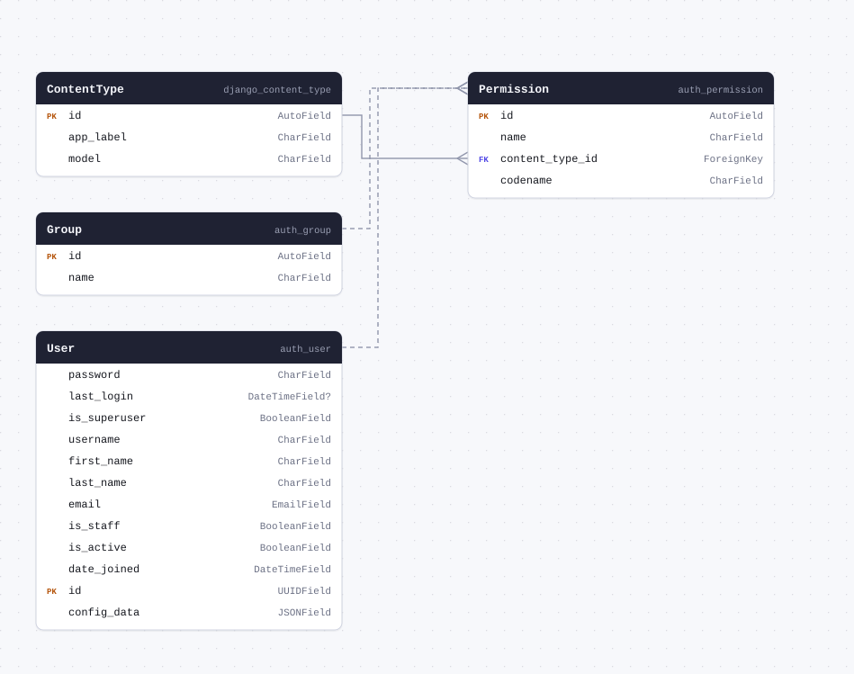

| Column | Field | Type | Null | Key | Default | Description |
| --- | --- | --- | --- | --- | --- | --- |
| `id` | `AutoField` | `integer` |  | PK | `autoincrement()` |  |
| `name` | `CharField` | `varchar(255)` |  |  |  |  |
| `content_type_id` | `ForeignKey` | `integer` |  | FK |  |  |
| `codename` | `CharField` | `varchar(100)` |  |  |  |  |

Indexes:

- index `auth_permission_content_type_id_2f476e4b` on `content_type_id`
- unique `auth_permission_content_type_id_codename_01ab375a_uniq` on `content_type_id`, `codename`

Relations:

- `content_type_id` → [ContentType](#contenttype).`id`, on delete cascade
- `group_set` — many to many with [Group](#group)
- `user_set` — many to many with [User](#user)

## Group

Table `auth_group`, app `auth`.

Proxy models, on this table: `AdminGroup`.

Groups are a generic way of categorizing users to apply permissions, or
some other label, to those users. A user can belong to any number of
groups.

A user in a group automatically has all the permissions granted to that
group. For example, if the group 'Site editors' has the permission
can_edit_home_page, any user in that group will have that permission.

Beyond permissions, groups are a convenient way to categorize users to
apply some label, or extended functionality, to them. For example, you
could create a group 'Special users', and you could write code that would
do special things to those users -- such as giving them access to a
members-only portion of your site, or sending them members-only email
messages.

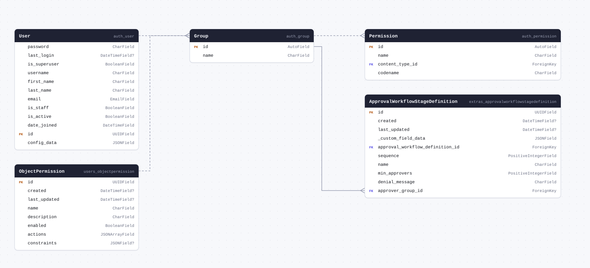

| Column | Field | Type | Null | Key | Default | Description |
| --- | --- | --- | --- | --- | --- | --- |
| `id` | `AutoField` | `integer` |  | PK | `autoincrement()` |  |
| `name` | `CharField` | `varchar(150)` |  | unique |  |  |

Indexes:

- index `auth_group_name_a6ea08ec_like` on `name` (`varchar_pattern_ops`)

Relations:

- `permissions` — many to many with [Permission](#permission)
- [ApprovalWorkflowStageDefinition](#approvalworkflowstagedefinition).`approver_group_id` → `id`, on delete protect
- `user_set` — many to many with [User](#user)
- `object_permissions` — many to many with [ObjectPermission](#objectpermission)

## ContentType

Table `django_content_type`, app `contenttypes`.

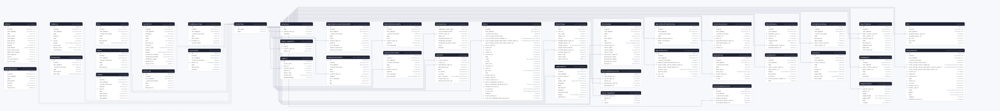

| Column | Field | Type | Null | Key | Default | Description |
| --- | --- | --- | --- | --- | --- | --- |
| `id` | `AutoField` | `integer` |  | PK | `autoincrement()` |  |
| `app_label` | `CharField` | `varchar(100)` |  |  |  |  |
| `model` | `CharField` | `varchar(100)` |  |  |  |  |

Indexes:

- unique `django_content_type_app_label_model_76bd3d3b_uniq` on `app_label`, `model`

Relations:

- [Permission](#permission).`content_type_id` → `id`, on delete cascade
- [taggit.TaggedItem](#taggittaggeditem).`content_type_id` → `id`, on delete cascade
- [LogEntry](#logentry).`content_type_id` → `id`, on delete set null
- `cloud_resource_types` — many to many with [CloudResourceType](#cloudresourcetype)
- [RegularExpressionValidationRule](#regularexpressionvalidationrule).`content_type_id` → `id`, on delete cascade
- [MinMaxValidationRule](#minmaxvalidationrule).`content_type_id` → `id`, on delete cascade
- [RequiredValidationRule](#requiredvalidationrule).`content_type_id` → `id`, on delete cascade
- [UniqueValidationRule](#uniquevalidationrule).`content_type_id` → `id`, on delete cascade
- [DataCompliance](#datacompliance).`content_type_id` → `id`, on delete protect
- [CablePath](#cablepath).`origin_type_id` → `id`, on delete cascade
- [CablePath](#cablepath).`destination_type_id` → `id`, on delete cascade
- [Device](#device).`local_config_context_data_owner_content_type_id` → `id`, on delete cascade
- `location_types` — many to many with [LocationType](#locationtype)
- [ObjectChange](#objectchange).`changed_object_type_id` → `id`, on delete set null
- [ObjectChange](#objectchange).`related_object_type_id` → `id`, on delete set null
- [ComputedField](#computedfield).`content_type_id` → `id`, on delete cascade
- `custom_fields` — many to many with [CustomField](#customfield)
- [Relationship](#relationship).`source_type_id` → `id`, on delete cascade
- [Relationship](#relationship).`destination_type_id` → `id`, on delete cascade
- [RelationshipAssociation](#relationshipassociation).`source_type_id` → `id`, on delete cascade
- [RelationshipAssociation](#relationshipassociation).`destination_type_id` → `id`, on delete cascade
- `tags` — many to many with [extras.Tag](#extrastag)
- [extras.TaggedItem](#extrastaggeditem).`content_type_id` → `id`, on delete cascade
- [ApprovalWorkflowDefinition](#approvalworkflowdefinition).`model_content_type_id` → `id`, on delete protect
- [ApprovalWorkflow](#approvalworkflow).`object_under_review_content_type_id` → `id`, on delete protect
- `roles` — many to many with [Role](#role)
- `statuses` — many to many with [Status](#status)
- [ContactAssociation](#contactassociation).`associated_object_type_id` → `id`, on delete set null
- [DynamicGroup](#dynamicgroup).`content_type_id` → `id`, on delete cascade
- [StaticGroupAssociation](#staticgroupassociation).`associated_object_type_id` → `id`, on delete cascade
- `job_hooks` — many to many with [JobHook](#jobhook)
- `job_buttons` — many to many with [JobButton](#jobbutton)
- `metadata_types` — many to many with [MetadataType](#metadatatype)
- [ObjectMetadata](#objectmetadata).`assigned_object_type_id` → `id`, on delete cascade
- [ConfigContext](#configcontext).`owner_content_type_id` → `id`, on delete cascade
- [ConfigContextSchema](#configcontextschema).`owner_content_type_id` → `id`, on delete cascade
- [CustomLink](#customlink).`content_type_id` → `id`, on delete cascade
- [ExportTemplate](#exporttemplate).`owner_content_type_id` → `id`, on delete cascade
- [ExportTemplate](#exporttemplate).`content_type_id` → `id`, on delete cascade
- [GraphQLQuery](#graphqlquery).`owner_content_type_id` → `id`, on delete cascade
- [ImageAttachment](#imageattachment).`content_type_id` → `id`, on delete cascade
- [Note](#note).`assigned_object_type_id` → `id`, on delete cascade
- `webhooks` — many to many with [Webhook](#webhook)
- `object_permissions` — many to many with [ObjectPermission](#objectpermission)
- [VirtualMachine](#virtualmachine).`local_config_context_data_owner_content_type_id` → `id`, on delete cascade

## Session

Table `django_session`, app `sessions`.

Columns from `AbstractBaseSession` (abstract): `session_key`, `session_data`, `expire_date`.

Django provides full support for anonymous sessions. The session
framework lets you store and retrieve arbitrary data on a
per-site-visitor basis. It stores data on the server side and
abstracts the sending and receiving of cookies. Cookies contain a
session ID -- not the data itself.

The Django sessions framework is entirely cookie-based. It does
not fall back to putting session IDs in URLs. This is an intentional
design decision. Not only does that behavior make URLs ugly, it makes
your site vulnerable to session-ID theft via the "Referer" header.

For complete documentation on using Sessions in your code, consult
the sessions documentation that is shipped with Django (also available
on the Django web site).

| Column | Field | Type | Null | Key | Default | Description |
| --- | --- | --- | --- | --- | --- | --- |
| `session_key` | `CharField` | `varchar(40)` |  | PK |  |  |
| `session_data` | `TextField` | `text` |  |  |  |  |
| `expire_date` | `DateTimeField` | `timestamp with time zone` |  |  |  |  |

Indexes:

- index `django_session_session_key_c0390e0f_like` on `session_key` (`varchar_pattern_ops`)
- index `django_session_expire_date_a5c62663` on `expire_date`

## UserSocialAuth

Table `social_auth_usersocialauth`, app `social_django`.

Columns from `AbstractUserSocialAuth` (abstract): `user_id`, `provider`, `id_key`, `uid`, `extra_data`, `created`, `modified`.

Social Auth association model

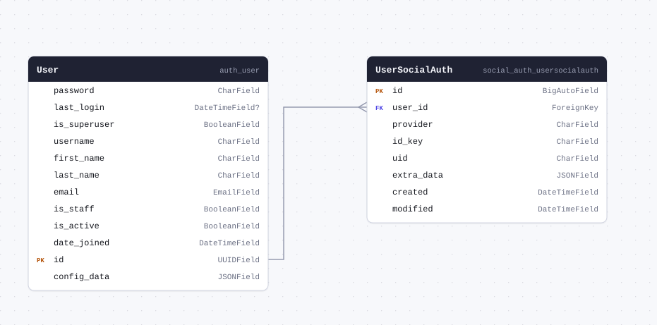

| Column | Field | Type | Null | Key | Default | Description |
| --- | --- | --- | --- | --- | --- | --- |
| `id` | `BigAutoField` | `bigint` |  | PK | `autoincrement()` |  |
| `user_id` | `ForeignKey` | `uuid` |  | FK |  |  |
| `provider` | `CharField` | `varchar(32)` |  |  |  |  |
| `id_key` | `CharField` | `varchar(255)` |  |  | `''` |  |
| `uid` | `CharField` | `varchar(255)` |  |  |  |  |
| `extra_data` | `JSONField` | `jsonb` |  |  | `dict()` |  |
| `created` | `DateTimeField` | `timestamp with time zone` |  |  | `now()` |  |
| `modified` | `DateTimeField` | `timestamp with time zone` |  |  | `now()` |  |

Indexes:

- index `social_auth_usersocialauth_user_id_17d28448` on `user_id`
- index `social_auth_usersocialauth_uid_796e51dc` on `uid`
- index `social_auth_usersocialauth_uid_796e51dc_like` on `uid` (`varchar_pattern_ops`)
- unique `social_auth_usersocialauth_provider_uid_e6b5e668_uniq` on `provider`, `uid`

Checks:

- `user_social_auth_uid_required`: `NOT ("uid" = '')`

Relations:

- `user_id` → [User](#user).`id`, on delete cascade

## Nonce

Table `social_auth_nonce`, app `social_django`.

One use numbers

| Column | Field | Type | Null | Key | Default | Description |
| --- | --- | --- | --- | --- | --- | --- |
| `id` | `BigAutoField` | `bigint` |  | PK | `autoincrement()` |  |
| `server_url` | `CharField` | `varchar(255)` |  |  |  |  |
| `timestamp` | `IntegerField` | `integer` |  |  |  |  |
| `salt` | `CharField` | `varchar(65)` |  |  |  |  |

Indexes:

- index `social_auth_nonce_timestamp_bc4d078a` on `timestamp`
- unique `social_auth_nonce_server_url_timestamp_salt_f6284463_uniq` on `server_url`, `timestamp`, `salt`

## Association

Table `social_auth_association`, app `social_django`.

OpenId account association

| Column | Field | Type | Null | Key | Default | Description |
| --- | --- | --- | --- | --- | --- | --- |
| `id` | `BigAutoField` | `bigint` |  | PK | `autoincrement()` |  |
| `server_url` | `CharField` | `varchar(255)` |  |  |  |  |
| `handle` | `CharField` | `varchar(255)` |  |  |  |  |
| `secret` | `CharField` | `varchar(255)` |  |  |  |  |
| `issued` | `IntegerField` | `integer` |  |  |  |  |
| `lifetime` | `IntegerField` | `integer` |  |  |  |  |
| `assoc_type` | `CharField` | `varchar(64)` |  |  |  |  |

Indexes:

- unique `social_auth_association_server_url_handle_078befa2_uniq` on `server_url`, `handle`

## Code

Table `social_auth_code`, app `social_django`.

| Column | Field | Type | Null | Key | Default | Description |
| --- | --- | --- | --- | --- | --- | --- |
| `id` | `BigAutoField` | `bigint` |  | PK | `autoincrement()` |  |
| `email` | `EmailField` | `varchar(254)` |  |  |  |  |
| `code` | `CharField` | `varchar(32)` |  |  |  |  |
| `verified` | `BooleanField` | `boolean` |  |  | `False` |  |
| `timestamp` | `DateTimeField` | `timestamp with time zone` |  |  | `now()` |  |

Indexes:

- index `social_auth_code_code_a2393167` on `code`
- index `social_auth_code_code_a2393167_like` on `code` (`varchar_pattern_ops`)
- index `social_auth_code_timestamp_176b341f` on `timestamp`
- unique `social_auth_code_email_code_801b2d02_uniq` on `email`, `code`

## Partial

Table `social_auth_partial`, app `social_django`.

| Column | Field | Type | Null | Key | Default | Description |
| --- | --- | --- | --- | --- | --- | --- |
| `id` | `BigAutoField` | `bigint` |  | PK | `autoincrement()` |  |
| `token` | `CharField` | `varchar(32)` |  |  |  |  |
| `next_step` | `PositiveSmallIntegerField` | `smallint` |  |  | `0` |  |
| `backend` | `CharField` | `varchar(32)` |  |  |  |  |
| `data` | `JSONField` | `jsonb` |  |  | `dict()` |  |
| `timestamp` | `DateTimeField` | `timestamp with time zone` |  |  | `now()` |  |

Indexes:

- index `social_auth_partial_token_3017fea3` on `token`
- index `social_auth_partial_token_3017fea3_like` on `token` (`varchar_pattern_ops`)
- index `social_auth_partial_timestamp_50f2119f` on `timestamp`

## taggit.Tag

Table `taggit_tag`, app `taggit`.

Columns from `TagBase` (abstract): `name`, `slug`.

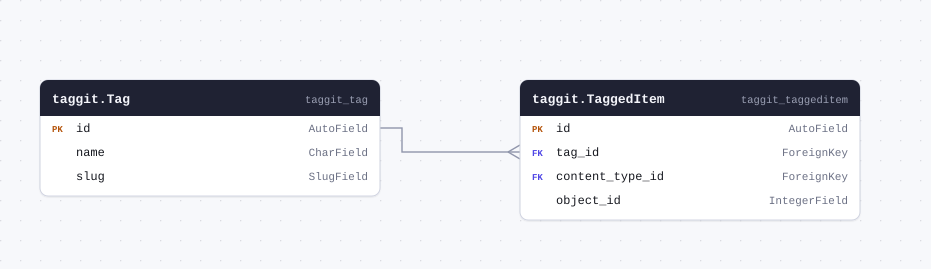

| Column | Field | Type | Null | Key | Default | Description |
| --- | --- | --- | --- | --- | --- | --- |
| `id` | `AutoField` | `integer` |  | PK | `autoincrement()` |  |
| `name` | `CharField` | `varchar(100)` |  | unique |  |  |
| `slug` | `SlugField` | `varchar(100)` |  | unique |  |  |

Indexes:

- index `taggit_tag_name_58eb2ed9_like` on `name` (`varchar_pattern_ops`)
- index `taggit_tag_slug_6be58b2c_like` on `slug` (`varchar_pattern_ops`)

Relations:

- [taggit.TaggedItem](#taggittaggeditem).`tag_id` → `id`, on delete cascade

## taggit.TaggedItem

Table `taggit_taggeditem`, app `taggit`.

Columns from `GenericTaggedItemBase` (abstract): `object_id`.

Columns from `CommonGenericTaggedItemBase` (abstract): `content_type_id`.

Columns from `TaggedItemBase` (abstract): `tag_id`.

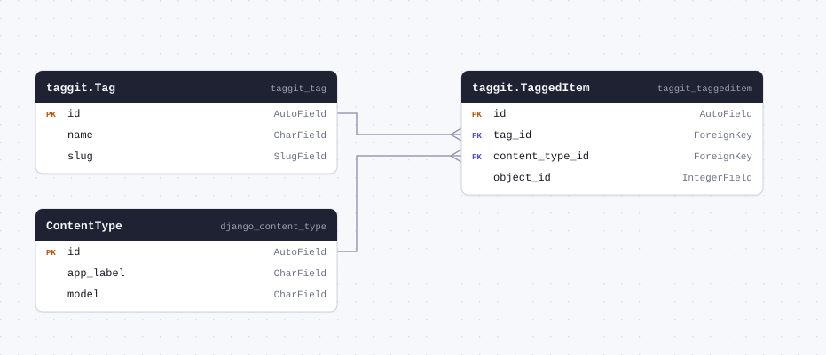

| Column | Field | Type | Null | Key | Default | Description |
| --- | --- | --- | --- | --- | --- | --- |
| `id` | `AutoField` | `integer` |  | PK | `autoincrement()` |  |
| `tag_id` | `ForeignKey` | `integer` |  | FK |  |  |
| `content_type_id` | `ForeignKey` | `integer` |  | FK |  |  |
| `object_id` | `IntegerField` | `integer` |  |  |  |  |

Indexes:

- index `taggit_taggeditem_tag_id_f4f5b767` on `tag_id`
- index `taggit_taggeditem_content_type_id_9957a03c` on `content_type_id`
- index `taggit_taggeditem_object_id_e2d7d1df` on `object_id`
- unique `taggit_taggeditem_content_type_id_object_id_tag_id_4bb97a8e_uniq` on `content_type_id`, `object_id`, `tag_id`
- index `taggit_tagg_content_8fc721_idx` on `content_type_id`, `object_id`

Relations:

- `content_object` → any model, by `content_type_id` + `object_id` (generic foreign key)
- `tag_id` → [taggit.Tag](#taggittag).`id`, on delete cascade
- `content_type_id` → [ContentType](#contenttype).`id`, on delete cascade

## Constance

Table `constance_constance`, app `constance`.

| Column | Field | Type | Null | Key | Default | Description |
| --- | --- | --- | --- | --- | --- | --- |
| `id` | `AutoField` | `integer` |  | PK | `autoincrement()` |  |
| `key` | `CharField` | `varchar(255)` |  | unique |  |  |
| `value` | `TextField` | `text` | yes |  |  |  |

Indexes:

- index `constance_constance_key_c43474b0_like` on `key` (`varchar_pattern_ops`)

## LogEntry

Table `django_admin_log`, app `admin`.

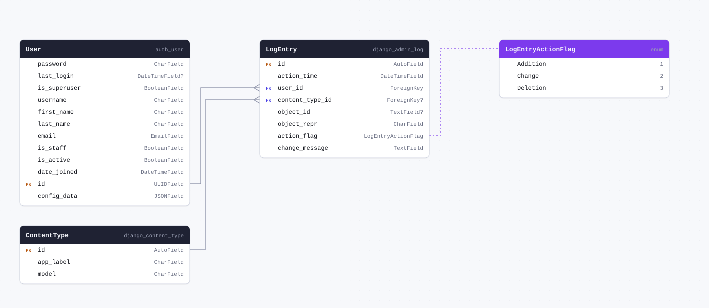

| Column | Field | Type | Null | Key | Default | Description |
| --- | --- | --- | --- | --- | --- | --- |
| `id` | `AutoField` | `integer` |  | PK | `autoincrement()` |  |
| `action_time` | `DateTimeField` | `timestamp with time zone` |  |  | `now()` |  |
| `user_id` | `ForeignKey` | `uuid` |  | FK |  |  |
| `content_type_id` | `ForeignKey` | `integer` | yes | FK |  |  |
| `object_id` | `TextField` | `text` | yes |  |  |  |
| `object_repr` | `CharField` | `varchar(200)` |  |  |  |  |
| `action_flag` | `LogEntryActionFlag` | `smallint` |  |  |  |  |
| `change_message` | `TextField` | `text` |  |  |  |  |

Indexes:

- index `django_admin_log_user_id_c564eba6` on `user_id`
- index `django_admin_log_content_type_id_c4bce8eb` on `content_type_id`

Relations:

- `user_id` → [User](#user).`id`, on delete cascade
- `content_type_id` → [ContentType](#contenttype).`id`, on delete set null

## SolarSchedule

Table `django_celery_beat_solarschedule`, app `django_celery_beat`.

Schedule following astronomical patterns.

Example: to run every sunrise in New York City:

>>> event='sunrise', latitude=40.7128, longitude=74.0060

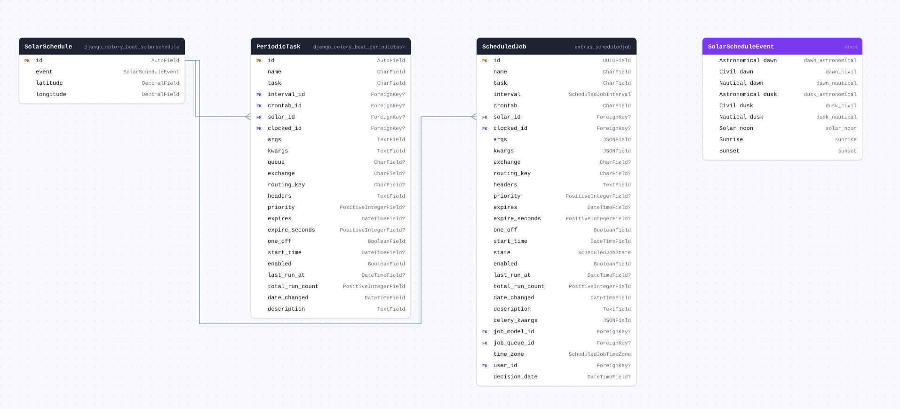

| Column | Field | Type | Null | Key | Default | Description |
| --- | --- | --- | --- | --- | --- | --- |
| `id` | `AutoField` | `integer` |  | PK | `autoincrement()` |  |
| `event` | `SolarScheduleEvent` | `varchar(24)` |  |  |  | The type of solar event when the job should run |
| `latitude` | `DecimalField(9, 6)` | `numeric(9, 6)` |  |  |  | Run the task when the event happens at this latitude |
| `longitude` | `DecimalField(9, 6)` | `numeric(9, 6)` |  |  |  | Run the task when the event happens at this longitude |

Indexes:

- unique `django_celery_beat_solar_event_latitude_longitude_ba64999a_uniq` on `event`, `latitude`, `longitude`

Relations:

- [PeriodicTask](#periodictask).`solar_id` → `id`, on delete cascade
- [ScheduledJob](#scheduledjob).`solar_id` → `id`, on delete cascade

## IntervalSchedule

Table `django_celery_beat_intervalschedule`, app `django_celery_beat`.

Schedule executing on a regular interval.

Example: execute every 2 days:

>>> every=2, period=DAYS

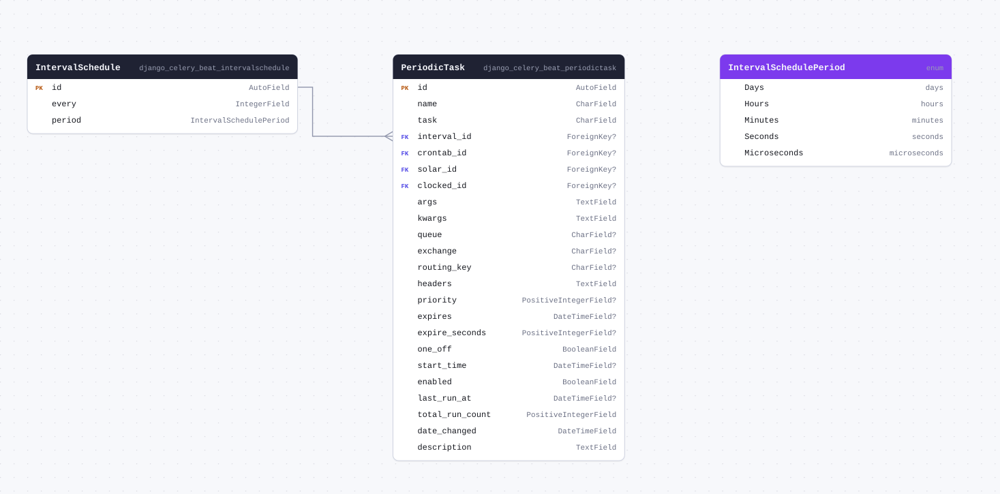

| Column | Field | Type | Null | Key | Default | Description |
| --- | --- | --- | --- | --- | --- | --- |
| `id` | `AutoField` | `integer` |  | PK | `autoincrement()` |  |
| `every` | `IntegerField` | `integer` |  |  |  | Number of interval periods to wait before running the task again |
| `period` | `IntervalSchedulePeriod` | `varchar(24)` |  |  |  | The type of period between task runs (Example: days) |

Relations:

- [PeriodicTask](#periodictask).`interval_id` → `id`, on delete cascade

## ClockedSchedule

Table `django_celery_beat_clockedschedule`, app `django_celery_beat`.

clocked schedule.

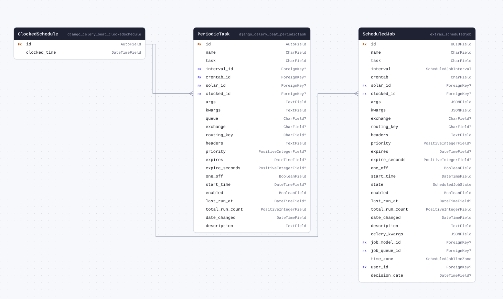

| Column | Field | Type | Null | Key | Default | Description |
| --- | --- | --- | --- | --- | --- | --- |
| `id` | `AutoField` | `integer` |  | PK | `autoincrement()` |  |
| `clocked_time` | `DateTimeField` | `timestamp with time zone` |  |  |  | Run the task at clocked time |

Relations:

- [PeriodicTask](#periodictask).`clocked_id` → `id`, on delete cascade
- [ScheduledJob](#scheduledjob).`clocked_id` → `id`, on delete cascade

## CrontabSchedule

Table `django_celery_beat_crontabschedule`, app `django_celery_beat`.

Timezone Aware Crontab-like schedule.

Example:  Run every hour at 0 minutes for days of month 10-15:

>>> minute="0", hour="*", day_of_week="*",
... day_of_month="10-15", month_of_year="*"

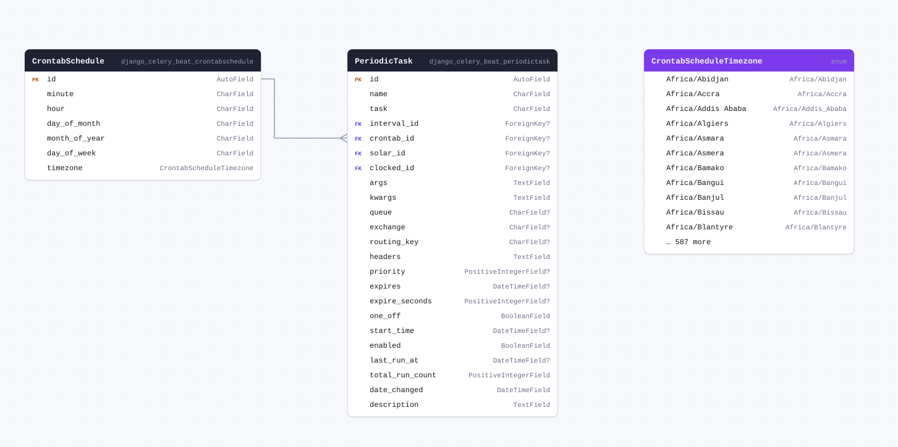

| Column | Field | Type | Null | Key | Default | Description |
| --- | --- | --- | --- | --- | --- | --- |
| `id` | `AutoField` | `integer` |  | PK | `autoincrement()` |  |
| `minute` | `CharField` | `varchar(240)` |  |  | `'*'` | Cron Minutes to Run. Use "*" for "all". (Example: "0,30") |
| `hour` | `CharField` | `varchar(96)` |  |  | `'*'` | Cron Hours to Run. Use "*" for "all". (Example: "8,20") |
| `day_of_month` | `CharField` | `varchar(124)` |  |  | `'*'` | Cron Days Of The Month to Run. Use "*" for "all". (Example: "1,15") |
| `month_of_year` | `CharField` | `varchar(64)` |  |  | `'*'` | Cron Months (1-12) Of The Year to Run. Use "*" for "all". (Example: "1,12") |
| `day_of_week` | `CharField` | `varchar(64)` |  |  | `'*'` | Cron Days Of The Week to Run. Use "*" for "all", Sunday is 0 or 7, Monday is 1. (Example: "0,5") |
| `timezone` | `CrontabScheduleTimezone` | `varchar(63)` |  |  | `crontab_schedule_celery_timezone()` | Timezone to Run the Cron Schedule on. Default is UTC. |

Relations:

- [PeriodicTask](#periodictask).`crontab_id` → `id`, on delete cascade

## PeriodicTasks

Table `django_celery_beat_periodictasks`, app `django_celery_beat`.

Helper table for tracking updates to periodic tasks.

This stores a single row with ``ident=1``. ``last_update`` is updated via
signals whenever anything changes in the :class:`~.PeriodicTask` model.
Basically this acts like a DB data audit trigger.
Doing this so we also track deletions, and not just insert/update.

| Column | Field | Type | Null | Key | Default | Description |
| --- | --- | --- | --- | --- | --- | --- |
| `ident` | `SmallIntegerField` | `smallint` |  | PK | `1` |  |
| `last_update` | `DateTimeField` | `timestamp with time zone` |  |  |  |  |

## PeriodicTask

Table `django_celery_beat_periodictask`, app `django_celery_beat`.

Model representing a periodic task.

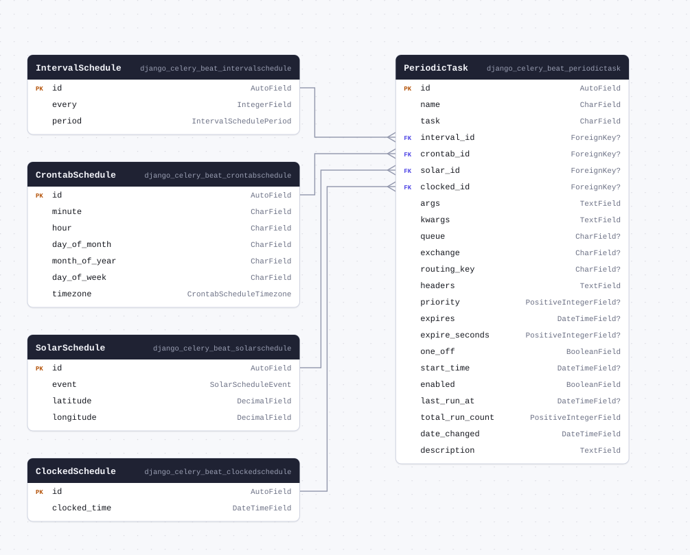

| Column | Field | Type | Null | Key | Default | Description |
| --- | --- | --- | --- | --- | --- | --- |
| `id` | `AutoField` | `integer` |  | PK | `autoincrement()` |  |
| `name` | `CharField` | `varchar(200)` |  | unique |  | Short Description For This Task |
| `task` | `CharField` | `varchar(200)` |  |  |  | The Name of the Celery Task that Should be Run.  (Example: "proj.tasks.import_contacts") |
| `interval_id` | `ForeignKey` | `integer` | yes | FK |  | Interval Schedule to run the task on.  Set only one schedule type, leave the others null. |
| `crontab_id` | `ForeignKey` | `integer` | yes | FK |  | Crontab Schedule to run the task on.  Set only one schedule type, leave the others null. |
| `solar_id` | `ForeignKey` | `integer` | yes | FK |  | Solar Schedule to run the task on.  Set only one schedule type, leave the others null. |
| `clocked_id` | `ForeignKey` | `integer` | yes | FK |  | Clocked Schedule to run the task on.  Set only one schedule type, leave the others null. |
| `args` | `TextField` | `text` |  |  | `'[]'` | JSON encoded positional arguments (Example: ["arg1", "arg2"]) |
| `kwargs` | `TextField` | `text` |  |  | `'{}'` | JSON encoded keyword arguments (Example: {"argument": "value"}) |
| `queue` | `CharField` | `varchar(200)` | yes |  | `None` | Queue defined in CELERY_TASK_QUEUES. Leave None for default queuing. |
| `exchange` | `CharField` | `varchar(200)` | yes |  | `None` | Override Exchange for low-level AMQP routing |
| `routing_key` | `CharField` | `varchar(200)` | yes |  | `None` | Override Routing Key for low-level AMQP routing |
| `headers` | `TextField` | `text` |  |  | `'{}'` | JSON encoded message headers for the AMQP message. |
| `priority` | `PositiveIntegerField` | `integer` | yes |  | `None` | Priority Number between 0 and 255. Supported by: RabbitMQ, Redis (priority reversed, 0 is highest). |
| `expires` | `DateTimeField` | `timestamp with time zone` | yes |  |  | Datetime after which the schedule will no longer trigger the task to run |
| `expire_seconds` | `PositiveIntegerField` | `integer` | yes |  |  | Timedelta with seconds which the schedule will no longer trigger the task to run |
| `one_off` | `BooleanField` | `boolean` |  |  | `False` | If True, the schedule will only run the task a single time |
| `start_time` | `DateTimeField` | `timestamp with time zone` | yes |  |  | Datetime when the schedule should begin triggering the task to run |
| `enabled` | `BooleanField` | `boolean` |  |  | `True` | Set to False to disable the schedule |
| `last_run_at` | `DateTimeField` | `timestamp with time zone` | yes |  |  | Datetime that the schedule last triggered the task to run. Reset to None if enabled is set to False. |
| `total_run_count` | `PositiveIntegerField` | `integer` |  |  | `0` | Running count of how many times the schedule has triggered the task |
| `date_changed` | `DateTimeField` | `timestamp with time zone` |  |  | `now()` | Datetime that this PeriodicTask was last modified |
| `description` | `TextField` | `text` |  |  |  | Detailed description about the details of this Periodic Task |

Indexes:

- index `django_celery_beat_periodictask_name_265a36b7_like` on `name` (`varchar_pattern_ops`)
- index `django_celery_beat_periodictask_interval_id_a8ca27da` on `interval_id`
- index `django_celery_beat_periodictask_crontab_id_d3cba168` on `crontab_id`
- index `django_celery_beat_periodictask_solar_id_a87ce72c` on `solar_id`
- index `django_celery_beat_periodictask_clocked_id_47a69f82` on `clocked_id`

Relations:

- `interval_id` → [IntervalSchedule](#intervalschedule).`id`, on delete cascade
- `crontab_id` → [CrontabSchedule](#crontabschedule).`id`, on delete cascade
- `solar_id` → [SolarSchedule](#solarschedule).`id`, on delete cascade
- `clocked_id` → [ClockedSchedule](#clockedschedule).`id`, on delete cascade

## TaskResult

Table `django_celery_results_taskresult`, app `django_celery_results`.

Task result/status.

| Column | Field | Type | Null | Key | Default | Description |
| --- | --- | --- | --- | --- | --- | --- |
| `id` | `AutoField` | `integer` |  | PK | `autoincrement()` |  |
| `task_id` | `CharField` | `varchar(255)` |  | unique |  | Celery ID for the Task that was run |
| `periodic_task_name` | `CharField` | `varchar(255)` | yes |  |  | Name of the Periodic Task which was run |
| `task_name` | `CharField` | `varchar(255)` | yes |  |  | Name of the Task which was run |
| `task_args` | `TextField` | `text` | yes |  |  | JSON representation of the positional arguments used with the task |
| `task_kwargs` | `TextField` | `text` | yes |  |  | JSON representation of the named arguments used with the task |
| `status` | `CharField` | `varchar(50)` |  |  | `'PENDING'` | Current state of the task being run |
| `worker` | `CharField` | `varchar(100)` | yes |  | `None` | Worker that executes the task |
| `content_type` | `CharField` | `varchar(128)` |  |  |  | Content type of the result data |
| `content_encoding` | `CharField` | `varchar(64)` |  |  |  | The encoding used to save the task result data |
| `result` | `TextField` | `text` | yes |  | `None` | The data returned by the task.  Use content_encoding and content_type fields to read. |
| `date_created` | `DateTimeField` | `timestamp with time zone` |  |  | `now()` | Datetime field when the task result was created in UTC |
| `date_started` | `DateTimeField` | `timestamp with time zone` | yes |  | `None` | Datetime field when the task was started in UTC |
| `date_done` | `DateTimeField` | `timestamp with time zone` |  |  | `now()` | Datetime field when the task was completed in UTC |
| `traceback` | `TextField` | `text` | yes |  |  | Text of the traceback if the task generated one |
| `meta` | `TextField` | `text` | yes |  | `None` | JSON meta information about the task, such as information on child tasks |

Indexes:

- index `django_celery_results_taskresult_task_id_de0d95bf_like` on `task_id` (`varchar_pattern_ops`)
- index `django_cele_task_na_08aec9_idx` on `task_name`
- index `django_cele_status_9b6201_idx` on `status`
- index `django_cele_worker_d54dd8_idx` on `worker`
- index `django_cele_date_cr_f04a50_idx` on `date_created`
- index `django_cele_date_do_f59aad_idx` on `date_done`
- index `django_cele_periodi_1993cf_idx` on `periodic_task_name`

## ChordCounter

Table `django_celery_results_chordcounter`, app `django_celery_results`.

Chord synchronisation.

| Column | Field | Type | Null | Key | Default | Description |
| --- | --- | --- | --- | --- | --- | --- |
| `id` | `AutoField` | `integer` |  | PK | `autoincrement()` |  |
| `group_id` | `CharField` | `varchar(255)` |  | unique |  | Celery ID for the Chord header group |
| `sub_tasks` | `TextField` | `text` |  |  |  | JSON serialized list of task result tuples. use .group_result() to decode |
| `count` | `PositiveIntegerField` | `integer` |  |  |  | Starts at len(chord header) and decrements after each task is finished |

Indexes:

- index `django_celery_results_chordcounter_group_id_1f70858c_like` on `group_id` (`varchar_pattern_ops`)

## GroupResult

Table `django_celery_results_groupresult`, app `django_celery_results`.

Task Group result/status.

| Column | Field | Type | Null | Key | Default | Description |
| --- | --- | --- | --- | --- | --- | --- |
| `id` | `AutoField` | `integer` |  | PK | `autoincrement()` |  |
| `group_id` | `CharField` | `varchar(255)` |  | unique |  | Celery ID for the Group that was run |
| `date_created` | `DateTimeField` | `timestamp with time zone` |  |  | `now()` | Datetime field when the group result was created in UTC |
| `date_done` | `DateTimeField` | `timestamp with time zone` |  |  | `now()` | Datetime field when the group was completed in UTC |
| `content_type` | `CharField` | `varchar(128)` |  |  |  | Content type of the result data |
| `content_encoding` | `CharField` | `varchar(64)` |  |  |  | The encoding used to save the task result data |
| `result` | `TextField` | `text` | yes |  | `None` | The data returned by the task.  Use content_encoding and content_type fields to read. |

Indexes:

- index `django_celery_results_groupresult_group_id_a085f1a9_like` on `group_id` (`varchar_pattern_ops`)
- index `django_cele_date_cr_bd6c1d_idx` on `date_created`
- index `django_cele_date_do_caae0e_idx` on `date_done`

## ProviderNetwork

Table `circuits_providernetwork`, app `circuits`.

Columns from `ChangeLoggedModel` (abstract): `created`, `last_updated`.

Columns from `CustomFieldModel` (abstract): `_custom_field_data`.

Columns from `BaseModel` (abstract): `id`.

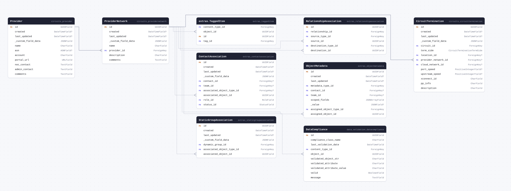

| Column | Field | Type | Null | Key | Default | Description |
| --- | --- | --- | --- | --- | --- | --- |
| `id` | `UUIDField` | `uuid` |  | PK | `uuid4()` |  |
| `created` | `DateTimeField` | `timestamp with time zone` | yes |  | `now()` |  |
| `last_updated` | `DateTimeField` | `timestamp with time zone` | yes |  | `now()` |  |
| `_custom_field_data` | `JSONField` | `jsonb` |  |  | `dict()` |  |
| `name` | `CharField` | `varchar(255)` |  |  |  |  |
| `provider_id` | `ForeignKey` | `uuid` |  | FK |  |  |
| `description` | `CharField` | `varchar(255)` |  |  |  |  |
| `comments` | `TextField` | `text` |  |  |  |  |

Indexes:

- index `circuits_providernetwork_name_9d69fb4d` on `name`
- index `circuits_providernetwork_name_9d69fb4d_like` on `name` (`varchar_pattern_ops`)
- index `circuits_providernetwork_provider_id_7992236c` on `provider_id`
- unique `circuits_providernetwork_provider_id_name_6f6610a0_uniq` on `provider_id`, `name`
- unique `circuits_providernetwork_provider_name` on `provider_id`, `name`

Relations:

- `tags` — many to many with [extras.Tag](#extrastag), through [extras.TaggedItem](#extrastaggeditem)
- `provider_id` → [Provider](#provider).`id`, on delete protect
- `tagged_items` ← [extras.TaggedItem](#extrastaggeditem), by `content_type_id` + `object_id` (generic relation)
- `associated_contacts` ← [ContactAssociation](#contactassociation), by `associated_object_type_id` + `associated_object_id` (generic relation)
- `static_group_association_set` ← [StaticGroupAssociation](#staticgroupassociation), by `associated_object_type_id` + `associated_object_id` (generic relation)
- `source_for_associations` ← [RelationshipAssociation](#relationshipassociation), by `source_type_id` + `source_id` (generic relation)
- `destination_for_associations` ← [RelationshipAssociation](#relationshipassociation), by `destination_type_id` + `destination_id` (generic relation)
- `associated_object_metadata` ← [ObjectMetadata](#objectmetadata), by `assigned_object_type_id` + `assigned_object_id` (generic relation)
- `associated_data_compliance` ← [DataCompliance](#datacompliance), by `content_type_id` + `object_id` (generic relation)
- [CircuitTermination](#circuittermination).`provider_network_id` → `id`, on delete protect

## Provider

Table `circuits_provider`, app `circuits`.

Columns from `ChangeLoggedModel` (abstract): `created`, `last_updated`.

Columns from `CustomFieldModel` (abstract): `_custom_field_data`.

Columns from `BaseModel` (abstract): `id`.

Each Circuit belongs to a Provider. This is usually a telecommunications company or similar organization. This model
stores information pertinent to the user's relationship with the Provider.

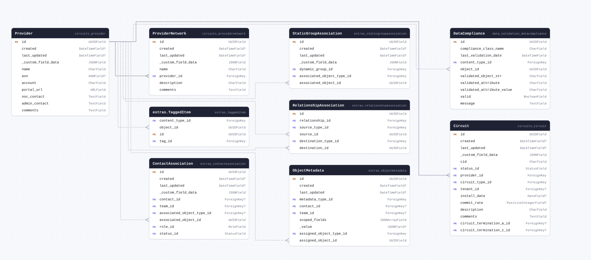

| Column | Field | Type | Null | Key | Default | Description |
| --- | --- | --- | --- | --- | --- | --- |
| `id` | `UUIDField` | `uuid` |  | PK | `uuid4()` |  |
| `created` | `DateTimeField` | `timestamp with time zone` | yes |  | `now()` |  |
| `last_updated` | `DateTimeField` | `timestamp with time zone` | yes |  | `now()` |  |
| `_custom_field_data` | `JSONField` | `jsonb` |  |  | `dict()` |  |
| `name` | `CharField` | `varchar(255)` |  | unique |  |  |
| `asn` | `ASNField` | `bigint` | yes |  |  | 32-bit autonomous system number |
| `account` | `CharField` | `varchar(255)` |  |  |  |  |
| `portal_url` | `URLField` | `varchar(200)` |  |  |  |  |
| `noc_contact` | `TextField` | `text` |  |  |  |  |
| `admin_contact` | `TextField` | `text` |  |  |  |  |
| `comments` | `TextField` | `text` |  |  |  |  |

Indexes:

- index `circuits_provider_name_8f2514f5_like` on `name` (`varchar_pattern_ops`)

Relations:

- `tags` — many to many with [extras.Tag](#extrastag), through [extras.TaggedItem](#extrastaggeditem)
- [ProviderNetwork](#providernetwork).`provider_id` → `id`, on delete protect
- `tagged_items` ← [extras.TaggedItem](#extrastaggeditem), by `content_type_id` + `object_id` (generic relation)
- `associated_contacts` ← [ContactAssociation](#contactassociation), by `associated_object_type_id` + `associated_object_id` (generic relation)
- `static_group_association_set` ← [StaticGroupAssociation](#staticgroupassociation), by `associated_object_type_id` + `associated_object_id` (generic relation)
- `source_for_associations` ← [RelationshipAssociation](#relationshipassociation), by `source_type_id` + `source_id` (generic relation)
- `destination_for_associations` ← [RelationshipAssociation](#relationshipassociation), by `destination_type_id` + `destination_id` (generic relation)
- `associated_object_metadata` ← [ObjectMetadata](#objectmetadata), by `assigned_object_type_id` + `assigned_object_id` (generic relation)
- `associated_data_compliance` ← [DataCompliance](#datacompliance), by `content_type_id` + `object_id` (generic relation)
- [Circuit](#circuit).`provider_id` → `id`, on delete protect

## CircuitType

Table `circuits_circuittype`, app `circuits`.

Columns from `ChangeLoggedModel` (abstract): `created`, `last_updated`.

Columns from `CustomFieldModel` (abstract): `_custom_field_data`.

Columns from `BaseModel` (abstract): `id`.

Circuits can be organized by their functional role. For example, a user might wish to define CircuitTypes named
"Long Haul," "Metro," or "Out-of-Band".

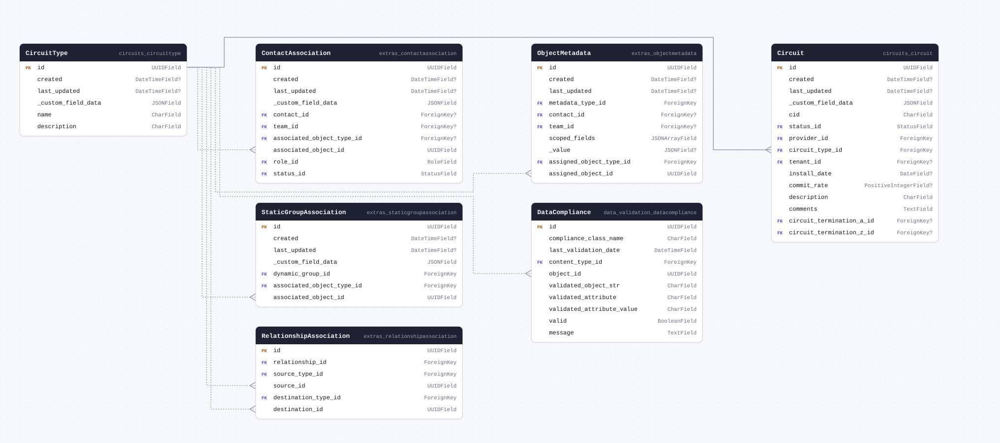

| Column | Field | Type | Null | Key | Default | Description |
| --- | --- | --- | --- | --- | --- | --- |
| `id` | `UUIDField` | `uuid` |  | PK | `uuid4()` |  |
| `created` | `DateTimeField` | `timestamp with time zone` | yes |  | `now()` |  |
| `last_updated` | `DateTimeField` | `timestamp with time zone` | yes |  | `now()` |  |
| `_custom_field_data` | `JSONField` | `jsonb` |  |  | `dict()` |  |
| `name` | `CharField` | `varchar(255)` |  | unique |  |  |
| `description` | `CharField` | `varchar(255)` |  |  |  |  |

Indexes:

- index `circuits_circuittype_name_8256ea9a_like` on `name` (`varchar_pattern_ops`)

Relations:

- `associated_contacts` ← [ContactAssociation](#contactassociation), by `associated_object_type_id` + `associated_object_id` (generic relation)
- `static_group_association_set` ← [StaticGroupAssociation](#staticgroupassociation), by `associated_object_type_id` + `associated_object_id` (generic relation)
- `source_for_associations` ← [RelationshipAssociation](#relationshipassociation), by `source_type_id` + `source_id` (generic relation)
- `destination_for_associations` ← [RelationshipAssociation](#relationshipassociation), by `destination_type_id` + `destination_id` (generic relation)
- `associated_object_metadata` ← [ObjectMetadata](#objectmetadata), by `assigned_object_type_id` + `assigned_object_id` (generic relation)
- `associated_data_compliance` ← [DataCompliance](#datacompliance), by `content_type_id` + `object_id` (generic relation)
- [Circuit](#circuit).`circuit_type_id` → `id`, on delete protect

## Circuit

Table `circuits_circuit`, app `circuits`.

Columns from `ChangeLoggedModel` (abstract): `created`, `last_updated`.

Columns from `CustomFieldModel` (abstract): `_custom_field_data`.

Columns from `BaseModel` (abstract): `id`.

A communications circuit connects two points.
Each Circuit belongs to a Provider; Providers may have multiple circuits.
Each circuit is also assigned a CircuitType.
Circuit port speed and commit rate are measured in Kbps.

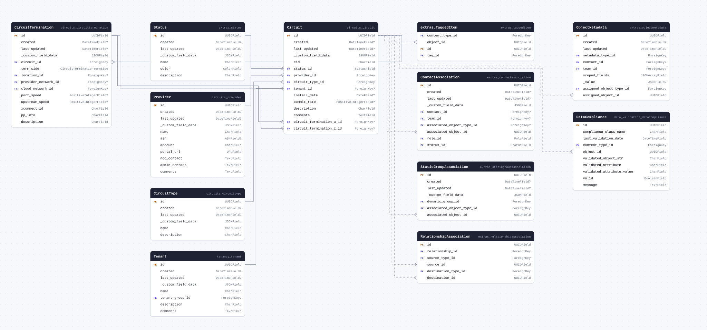

| Column | Field | Type | Null | Key | Default | Description |
| --- | --- | --- | --- | --- | --- | --- |
| `id` | `UUIDField` | `uuid` |  | PK | `uuid4()` |  |
| `created` | `DateTimeField` | `timestamp with time zone` | yes |  | `now()` |  |
| `last_updated` | `DateTimeField` | `timestamp with time zone` | yes |  | `now()` |  |
| `_custom_field_data` | `JSONField` | `jsonb` |  |  | `dict()` |  |
| `cid` | `CharField` | `varchar(255)` |  |  |  |  |
| `status_id` | `StatusField` | `uuid` |  | FK |  |  |
| `provider_id` | `ForeignKey` | `uuid` |  | FK |  |  |
| `circuit_type_id` | `ForeignKey` | `uuid` |  | FK |  |  |
| `tenant_id` | `ForeignKey` | `uuid` | yes | FK |  |  |
| `install_date` | `DateField` | `date` | yes |  |  |  |
| `commit_rate` | `PositiveIntegerField` | `integer` | yes |  |  |  |
| `description` | `CharField` | `varchar(255)` |  |  |  |  |
| `comments` | `TextField` | `text` |  |  |  |  |
| `circuit_termination_a_id` | `ForeignKey` | `uuid` | yes | FK |  |  |
| `circuit_termination_z_id` | `ForeignKey` | `uuid` | yes | FK |  |  |

Indexes:

- index `circuits_circuit_status_id_6433793f` on `status_id`
- index `circuits_circuit_provider_id_d9195418` on `provider_id`
- index `circuits_circuit_circuit_type_id_8b659c7a` on `circuit_type_id`
- index `circuits_circuit_tenant_id_812508a5` on `tenant_id`
- index `circuits_circuit_circuit_termination_a_id_ef74b54e` on `circuit_termination_a_id`
- index `circuits_circuit_circuit_termination_z_id_498b110c` on `circuit_termination_z_id`
- unique `circuits_circuit_provider_id_cid_b6f29862_uniq` on `provider_id`, `cid`

Relations:

- `tags` — many to many with [extras.Tag](#extrastag), through [extras.TaggedItem](#extrastaggeditem)
- `status_id` → [Status](#status).`id`, on delete protect
- `provider_id` → [Provider](#provider).`id`, on delete protect
- `circuit_type_id` → [CircuitType](#circuittype).`id`, on delete protect
- `tenant_id` → [Tenant](#tenant).`id`, on delete protect
- `circuit_termination_a_id` → [CircuitTermination](#circuittermination).`id`, on delete set null
- `circuit_termination_z_id` → [CircuitTermination](#circuittermination).`id`, on delete set null
- `tagged_items` ← [extras.TaggedItem](#extrastaggeditem), by `content_type_id` + `object_id` (generic relation)
- `associated_contacts` ← [ContactAssociation](#contactassociation), by `associated_object_type_id` + `associated_object_id` (generic relation)
- `static_group_association_set` ← [StaticGroupAssociation](#staticgroupassociation), by `associated_object_type_id` + `associated_object_id` (generic relation)
- `source_for_associations` ← [RelationshipAssociation](#relationshipassociation), by `source_type_id` + `source_id` (generic relation)
- `destination_for_associations` ← [RelationshipAssociation](#relationshipassociation), by `destination_type_id` + `destination_id` (generic relation)
- `associated_object_metadata` ← [ObjectMetadata](#objectmetadata), by `assigned_object_type_id` + `assigned_object_id` (generic relation)
- `associated_data_compliance` ← [DataCompliance](#datacompliance), by `content_type_id` + `object_id` (generic relation)
- [CircuitTermination](#circuittermination).`circuit_id` → `id`, on delete cascade

## CircuitTermination

Table `circuits_circuittermination`, app `circuits`.

Columns from `ChangeLoggedModel` (abstract): `created`, `last_updated`.

Columns from `CustomFieldModel` (abstract): `_custom_field_data`.

Columns from `BaseModel` (abstract): `id`.

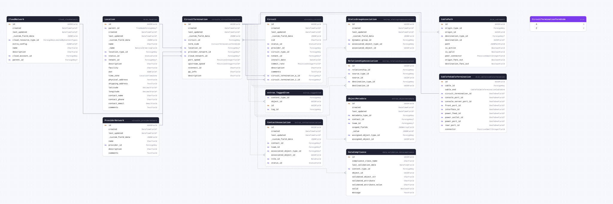

| Column | Field | Type | Null | Key | Default | Description |
| --- | --- | --- | --- | --- | --- | --- |
| `id` | `UUIDField` | `uuid` |  | PK | `uuid4()` |  |
| `created` | `DateTimeField` | `timestamp with time zone` | yes |  | `now()` |  |
| `last_updated` | `DateTimeField` | `timestamp with time zone` | yes |  | `now()` |  |
| `_custom_field_data` | `JSONField` | `jsonb` |  |  | `dict()` |  |
| `circuit_id` | `ForeignKey` | `uuid` |  | FK |  |  |
| `term_side` | `CircuitTerminationTermSide` | `varchar(1)` |  |  |  |  |
| `location_id` | `ForeignKey` | `uuid` | yes | FK |  |  |
| `provider_network_id` | `ForeignKey` | `uuid` | yes | FK |  |  |
| `cloud_network_id` | `ForeignKey` | `uuid` | yes | FK |  |  |
| `port_speed` | `PositiveIntegerField` | `integer` | yes |  |  |  |
| `upstream_speed` | `PositiveIntegerField` | `integer` | yes |  |  | Upstream speed, if different from port speed |
| `xconnect_id` | `CharField` | `varchar(255)` |  |  |  |  |
| `pp_info` | `CharField` | `varchar(255)` |  |  |  |  |
| `description` | `CharField` | `varchar(255)` |  |  |  |  |

Indexes:

- index `circuits_circuittermination_circuit_id_257e87e7` on `circuit_id`
- index `circuits_circuittermination_location_id_9896bd96` on `location_id`
- index `circuits_circuittermination_provider_network_id_b0c660f1` on `provider_network_id`
- index `circuits_circuittermination_cloud_network_id_47b1bd20` on `cloud_network_id`
- unique `circuits_circuittermination_circuit_id_term_side_b13efd0e_uniq` on `circuit_id`, `term_side`

Relations:

- `tags` — many to many with [extras.Tag](#extrastag), through [extras.TaggedItem](#extrastaggeditem)
- [Circuit](#circuit).`circuit_termination_a_id` → `id`, on delete set null
- [Circuit](#circuit).`circuit_termination_z_id` → `id`, on delete set null
- `circuit_id` → [Circuit](#circuit).`id`, on delete cascade
- `location_id` → [Location](#location).`id`, on delete protect
- `provider_network_id` → [ProviderNetwork](#providernetwork).`id`, on delete protect
- `cloud_network_id` → [CloudNetwork](#cloudnetwork).`id`, on delete protect
- `tagged_items` ← [extras.TaggedItem](#extrastaggeditem), by `content_type_id` + `object_id` (generic relation)
- `associated_contacts` ← [ContactAssociation](#contactassociation), by `associated_object_type_id` + `associated_object_id` (generic relation)
- `static_group_association_set` ← [StaticGroupAssociation](#staticgroupassociation), by `associated_object_type_id` + `associated_object_id` (generic relation)
- `source_for_associations` ← [RelationshipAssociation](#relationshipassociation), by `source_type_id` + `source_id` (generic relation)
- `destination_for_associations` ← [RelationshipAssociation](#relationshipassociation), by `destination_type_id` + `destination_id` (generic relation)
- `associated_object_metadata` ← [ObjectMetadata](#objectmetadata), by `assigned_object_type_id` + `assigned_object_id` (generic relation)
- `associated_data_compliance` ← [DataCompliance](#datacompliance), by `content_type_id` + `object_id` (generic relation)
- `cable_paths` ← [CablePath](#cablepath), by `origin_type_id` + `origin_id` (generic relation)
- [CableToCableTermination](#cabletocabletermination).`circuit_termination_id` → `id`, on delete cascade

## CloudAccount

Table `cloud_cloudaccount`, app `cloud`.

Columns from `ChangeLoggedModel` (abstract): `created`, `last_updated`.

Columns from `CustomFieldModel` (abstract): `_custom_field_data`.

Columns from `BaseModel` (abstract): `id`.

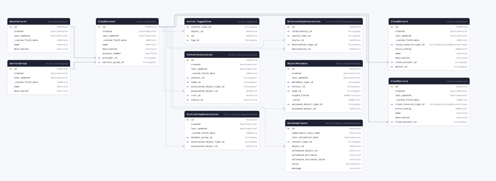

| Column | Field | Type | Null | Key | Default | Description |
| --- | --- | --- | --- | --- | --- | --- |
| `id` | `UUIDField` | `uuid` |  | PK | `uuid4()` |  |
| `created` | `DateTimeField` | `timestamp with time zone` | yes |  | `now()` |  |
| `last_updated` | `DateTimeField` | `timestamp with time zone` | yes |  | `now()` |  |
| `_custom_field_data` | `JSONField` | `jsonb` |  |  | `dict()` |  |
| `name` | `CharField` | `varchar(255)` |  | unique |  | The name of this Cloud Account. |
| `description` | `CharField` | `varchar(255)` |  |  |  |  |
| `account_number` | `CharField` | `varchar(255)` |  |  |  | The account identifier of this Cloud Account. |
| `provider_id` | `ForeignKey` | `uuid` |  | FK |  | The Manufacturer instance which represents the Cloud Provider |
| `secrets_group_id` | `ForeignKey` | `uuid` | yes | FK | `None` |  |

Indexes:

- index `cloud_cloudaccount_name_fba65583_like` on `name` (`varchar_pattern_ops`)
- index `cloud_cloudaccount_provider_id_d092fa49` on `provider_id`
- index `cloud_cloudaccount_secrets_group_id_bfbea030` on `secrets_group_id`

Relations:

- `tags` — many to many with [extras.Tag](#extrastag), through [extras.TaggedItem](#extrastaggeditem)
- `provider_id` → [Manufacturer](#manufacturer).`id`, on delete protect
- `secrets_group_id` → [SecretsGroup](#secretsgroup).`id`, on delete set null
- `tagged_items` ← [extras.TaggedItem](#extrastaggeditem), by `content_type_id` + `object_id` (generic relation)
- `associated_contacts` ← [ContactAssociation](#contactassociation), by `associated_object_type_id` + `associated_object_id` (generic relation)
- `static_group_association_set` ← [StaticGroupAssociation](#staticgroupassociation), by `associated_object_type_id` + `associated_object_id` (generic relation)
- `source_for_associations` ← [RelationshipAssociation](#relationshipassociation), by `source_type_id` + `source_id` (generic relation)
- `destination_for_associations` ← [RelationshipAssociation](#relationshipassociation), by `destination_type_id` + `destination_id` (generic relation)
- `associated_object_metadata` ← [ObjectMetadata](#objectmetadata), by `assigned_object_type_id` + `assigned_object_id` (generic relation)
- `associated_data_compliance` ← [DataCompliance](#datacompliance), by `content_type_id` + `object_id` (generic relation)
- [CloudNetwork](#cloudnetwork).`cloud_account_id` → `id`, on delete protect
- [CloudService](#cloudservice).`cloud_account_id` → `id`, on delete set null

## CloudResourceType

Table `cloud_cloudresourcetype`, app `cloud`.

Columns from `ChangeLoggedModel` (abstract): `created`, `last_updated`.

Columns from `CustomFieldModel` (abstract): `_custom_field_data`.

Columns from `BaseModel` (abstract): `id`.

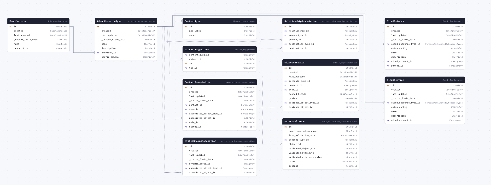

| Column | Field | Type | Null | Key | Default | Description |
| --- | --- | --- | --- | --- | --- | --- |
| `id` | `UUIDField` | `uuid` |  | PK | `uuid4()` |  |
| `created` | `DateTimeField` | `timestamp with time zone` | yes |  | `now()` |  |
| `last_updated` | `DateTimeField` | `timestamp with time zone` | yes |  | `now()` |  |
| `_custom_field_data` | `JSONField` | `jsonb` |  |  | `dict()` |  |
| `name` | `CharField` | `varchar(255)` |  | unique |  | Type of cloud objects |
| `description` | `CharField` | `varchar(255)` |  |  |  |  |
| `provider_id` | `ForeignKey` | `uuid` |  | FK |  | The Manufacturer instance which represents the Cloud Provider |
| `config_schema` | `JSONField` | `jsonb` | yes |  |  |  |

Indexes:

- index `cloud_cloudresourcetype_name_a9ef1cf1_like` on `name` (`varchar_pattern_ops`)
- index `cloud_cloudresourcetype_provider_id_ab3a3edb` on `provider_id`

Relations:

- `tags` — many to many with [extras.Tag](#extrastag), through [extras.TaggedItem](#extrastaggeditem)
- `provider_id` → [Manufacturer](#manufacturer).`id`, on delete protect
- `content_types` — many to many with [ContentType](#contenttype)
- `tagged_items` ← [extras.TaggedItem](#extrastaggeditem), by `content_type_id` + `object_id` (generic relation)
- `associated_contacts` ← [ContactAssociation](#contactassociation), by `associated_object_type_id` + `associated_object_id` (generic relation)
- `static_group_association_set` ← [StaticGroupAssociation](#staticgroupassociation), by `associated_object_type_id` + `associated_object_id` (generic relation)
- `source_for_associations` ← [RelationshipAssociation](#relationshipassociation), by `source_type_id` + `source_id` (generic relation)
- `destination_for_associations` ← [RelationshipAssociation](#relationshipassociation), by `destination_type_id` + `destination_id` (generic relation)
- `associated_object_metadata` ← [ObjectMetadata](#objectmetadata), by `assigned_object_type_id` + `assigned_object_id` (generic relation)
- `associated_data_compliance` ← [DataCompliance](#datacompliance), by `content_type_id` + `object_id` (generic relation)
- [CloudNetwork](#cloudnetwork).`cloud_resource_type_id` → `id`, on delete protect
- [CloudService](#cloudservice).`cloud_resource_type_id` → `id`, on delete protect

## CloudNetwork

Table `cloud_cloudnetwork`, app `cloud`.

Columns from `CloudResourceTypeMixin` (abstract): `cloud_resource_type_id`, `extra_config`.

Columns from `ChangeLoggedModel` (abstract): `created`, `last_updated`.

Columns from `CustomFieldModel` (abstract): `_custom_field_data`.

Columns from `BaseModel` (abstract): `id`.

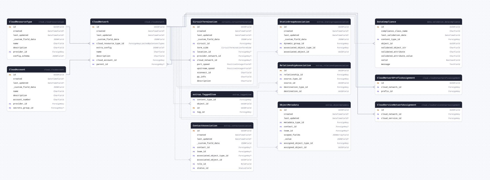

| Column | Field | Type | Null | Key | Default | Description |
| --- | --- | --- | --- | --- | --- | --- |
| `id` | `UUIDField` | `uuid` |  | PK | `uuid4()` |  |
| `created` | `DateTimeField` | `timestamp with time zone` | yes |  | `now()` |  |
| `last_updated` | `DateTimeField` | `timestamp with time zone` | yes |  | `now()` |  |
| `_custom_field_data` | `JSONField` | `jsonb` |  |  | `dict()` |  |
| `cloud_resource_type_id` | `ForeignKeyLimitedByContentTypes` | `uuid` |  | FK |  |  |
| `extra_config` | `JSONField` | `jsonb` | yes |  |  |  |
| `name` | `CharField` | `varchar(255)` |  | unique |  |  |
| `description` | `CharField` | `varchar(255)` |  |  |  |  |
| `cloud_account_id` | `ForeignKey` | `uuid` |  | FK |  |  |
| `parent_id` | `ForeignKey` | `uuid` | yes | FK |  |  |

Indexes:

- index `cloud_cloudnetwork_cloud_resource_type_id_afa3409e` on `cloud_resource_type_id`
- index `cloud_cloudnetwork_name_e5bd3eae_like` on `name` (`varchar_pattern_ops`)
- index `cloud_cloudnetwork_cloud_account_id_3936df5b` on `cloud_account_id`
- index `cloud_cloudnetwork_parent_id_c3415beb` on `parent_id`

Relations:

- `tags` — many to many with [extras.Tag](#extrastag), through [extras.TaggedItem](#extrastaggeditem)
- `prefixes` — many to many with [Prefix](#prefix), through [CloudNetworkPrefixAssignment](#cloudnetworkprefixassignment)
- `cloud_services` — many to many with [CloudService](#cloudservice), through [CloudServiceNetworkAssignment](#cloudservicenetworkassignment)
- [CircuitTermination](#circuittermination).`cloud_network_id` → `id`, on delete protect
- `cloud_resource_type_id` → [CloudResourceType](#cloudresourcetype).`id`, on delete protect
- `cloud_account_id` → [CloudAccount](#cloudaccount).`id`, on delete protect
- `parent_id` → [CloudNetwork](#cloudnetwork).`id`, on delete protect
- `tagged_items` ← [extras.TaggedItem](#extrastaggeditem), by `content_type_id` + `object_id` (generic relation)
- `associated_contacts` ← [ContactAssociation](#contactassociation), by `associated_object_type_id` + `associated_object_id` (generic relation)
- `static_group_association_set` ← [StaticGroupAssociation](#staticgroupassociation), by `associated_object_type_id` + `associated_object_id` (generic relation)
- `source_for_associations` ← [RelationshipAssociation](#relationshipassociation), by `source_type_id` + `source_id` (generic relation)
- `destination_for_associations` ← [RelationshipAssociation](#relationshipassociation), by `destination_type_id` + `destination_id` (generic relation)
- `associated_object_metadata` ← [ObjectMetadata](#objectmetadata), by `assigned_object_type_id` + `assigned_object_id` (generic relation)
- `associated_data_compliance` ← [DataCompliance](#datacompliance), by `content_type_id` + `object_id` (generic relation)
- [CloudNetworkPrefixAssignment](#cloudnetworkprefixassignment).`cloud_network_id` → `id`, on delete cascade
- [CloudServiceNetworkAssignment](#cloudservicenetworkassignment).`cloud_network_id` → `id`, on delete cascade

## CloudNetworkPrefixAssignment

Table `cloud_cloudnetworkprefixassignment`, app `cloud`.

Columns from `BaseModel` (abstract): `id`.

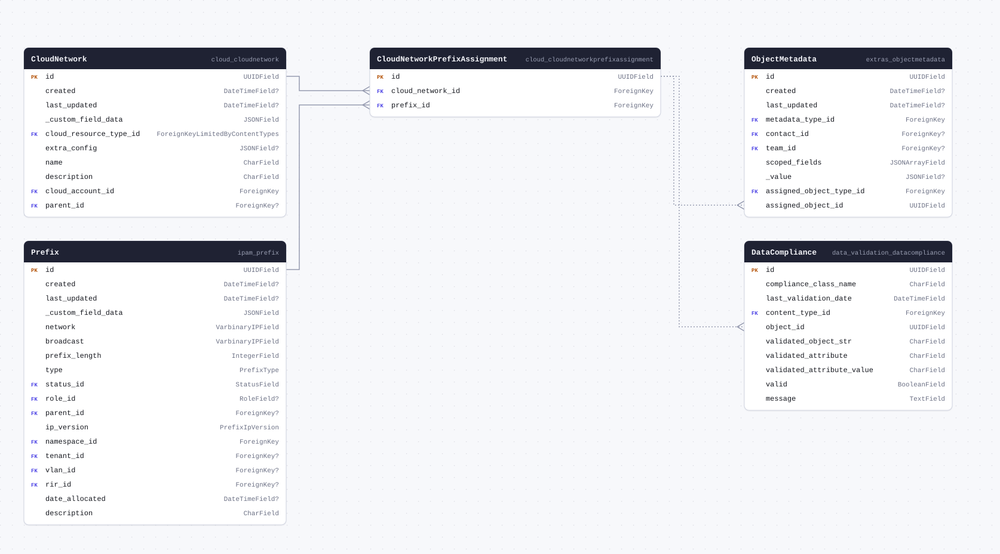

| Column | Field | Type | Null | Key | Default | Description |
| --- | --- | --- | --- | --- | --- | --- |
| `id` | `UUIDField` | `uuid` |  | PK | `uuid4()` |  |
| `cloud_network_id` | `ForeignKey` | `uuid` |  | FK |  |  |
| `prefix_id` | `ForeignKey` | `uuid` |  | FK |  |  |

Indexes:

- index `cloud_cloudnetworkprefixassignment_cloud_network_id_bf71122d` on `cloud_network_id`
- index `cloud_cloudnetworkprefixassignment_prefix_id_81356785` on `prefix_id`
- unique `cloud_cloudnetworkprefix_cloud_network_id_prefix__887a4919_uniq` on `cloud_network_id`, `prefix_id`

Relations:

- `cloud_network_id` → [CloudNetwork](#cloudnetwork).`id`, on delete cascade
- `prefix_id` → [Prefix](#prefix).`id`, on delete cascade
- `associated_object_metadata` ← [ObjectMetadata](#objectmetadata), by `assigned_object_type_id` + `assigned_object_id` (generic relation)
- `associated_data_compliance` ← [DataCompliance](#datacompliance), by `content_type_id` + `object_id` (generic relation)

## CloudService

Table `cloud_cloudservice`, app `cloud`.

Columns from `CloudResourceTypeMixin` (abstract): `cloud_resource_type_id`, `extra_config`.

Columns from `ChangeLoggedModel` (abstract): `created`, `last_updated`.

Columns from `CustomFieldModel` (abstract): `_custom_field_data`.

Columns from `BaseModel` (abstract): `id`.

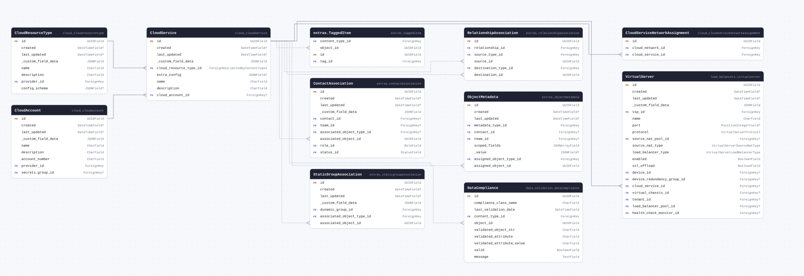

| Column | Field | Type | Null | Key | Default | Description |
| --- | --- | --- | --- | --- | --- | --- |
| `id` | `UUIDField` | `uuid` |  | PK | `uuid4()` |  |
| `created` | `DateTimeField` | `timestamp with time zone` | yes |  | `now()` |  |
| `last_updated` | `DateTimeField` | `timestamp with time zone` | yes |  | `now()` |  |
| `_custom_field_data` | `JSONField` | `jsonb` |  |  | `dict()` |  |
| `cloud_resource_type_id` | `ForeignKeyLimitedByContentTypes` | `uuid` |  | FK |  |  |
| `extra_config` | `JSONField` | `jsonb` | yes |  |  |  |
| `name` | `CharField` | `varchar(255)` |  | unique |  |  |
| `description` | `CharField` | `varchar(255)` |  |  |  |  |
| `cloud_account_id` | `ForeignKey` | `uuid` | yes | FK | `None` |  |

Indexes:

- index `cloud_cloudservice_cloud_resource_type_id_46a3d193` on `cloud_resource_type_id`
- index `cloud_cloudservice_name_e456627e_like` on `name` (`varchar_pattern_ops`)
- index `cloud_cloudservice_cloud_account_id_60c91048` on `cloud_account_id`

Relations:

- `tags` — many to many with [extras.Tag](#extrastag), through [extras.TaggedItem](#extrastaggeditem)
- `cloud_networks` — many to many with [CloudNetwork](#cloudnetwork), through [CloudServiceNetworkAssignment](#cloudservicenetworkassignment)
- `cloud_resource_type_id` → [CloudResourceType](#cloudresourcetype).`id`, on delete protect
- `cloud_account_id` → [CloudAccount](#cloudaccount).`id`, on delete set null
- `tagged_items` ← [extras.TaggedItem](#extrastaggeditem), by `content_type_id` + `object_id` (generic relation)
- `associated_contacts` ← [ContactAssociation](#contactassociation), by `associated_object_type_id` + `associated_object_id` (generic relation)
- `static_group_association_set` ← [StaticGroupAssociation](#staticgroupassociation), by `associated_object_type_id` + `associated_object_id` (generic relation)
- `source_for_associations` ← [RelationshipAssociation](#relationshipassociation), by `source_type_id` + `source_id` (generic relation)
- `destination_for_associations` ← [RelationshipAssociation](#relationshipassociation), by `destination_type_id` + `destination_id` (generic relation)
- `associated_object_metadata` ← [ObjectMetadata](#objectmetadata), by `assigned_object_type_id` + `assigned_object_id` (generic relation)
- `associated_data_compliance` ← [DataCompliance](#datacompliance), by `content_type_id` + `object_id` (generic relation)
- [CloudServiceNetworkAssignment](#cloudservicenetworkassignment).`cloud_service_id` → `id`, on delete cascade
- [VirtualServer](#virtualserver).`cloud_service_id` → `id`, on delete protect

## CloudServiceNetworkAssignment

Table `cloud_cloudservicenetworkassignment`, app `cloud`.

Columns from `BaseModel` (abstract): `id`.

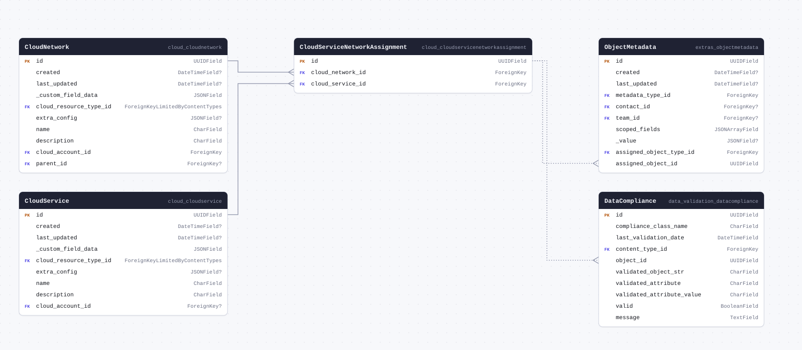

| Column | Field | Type | Null | Key | Default | Description |
| --- | --- | --- | --- | --- | --- | --- |
| `id` | `UUIDField` | `uuid` |  | PK | `uuid4()` |  |
| `cloud_network_id` | `ForeignKey` | `uuid` |  | FK |  |  |
| `cloud_service_id` | `ForeignKey` | `uuid` |  | FK |  |  |

Indexes:

- index `cloud_cloudservicenetworkassignment_cloud_network_id_e9bffd99` on `cloud_network_id`
- index `cloud_cloudservicenetworkassignment_cloud_service_id_6c953e3a` on `cloud_service_id`
- unique `cloud_cloudservicenetwor_cloud_network_id_cloud_s_0bc84b88_uniq` on `cloud_network_id`, `cloud_service_id`

Relations:

- `cloud_network_id` → [CloudNetwork](#cloudnetwork).`id`, on delete cascade
- `cloud_service_id` → [CloudService](#cloudservice).`id`, on delete cascade
- `associated_object_metadata` ← [ObjectMetadata](#objectmetadata), by `assigned_object_type_id` + `assigned_object_id` (generic relation)
- `associated_data_compliance` ← [DataCompliance](#datacompliance), by `content_type_id` + `object_id` (generic relation)

## RegularExpressionValidationRule

Table `data_validation_regexrule`, app `data_validation`.

Columns from `ValidationRuleModelMixin` (abstract): `name`, `field`, `content_type_id`, `enabled`, `error_message`.

Columns from `ChangeLoggedModel` (abstract): `created`, `last_updated`.

Columns from `CustomFieldModel` (abstract): `_custom_field_data`.

Columns from `BaseModel` (abstract): `id`.

A type of validation rule that applies a regular expression to a given model field.

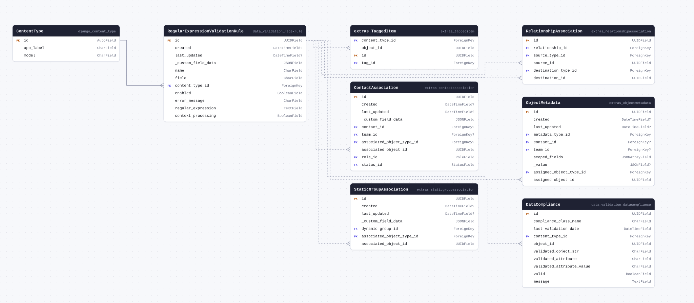

| Column | Field | Type | Null | Key | Default | Description |
| --- | --- | --- | --- | --- | --- | --- |
| `id` | `UUIDField` | `uuid` |  | PK | `uuid4()` |  |
| `created` | `DateTimeField` | `timestamp with time zone` | yes |  | `now()` |  |
| `last_updated` | `DateTimeField` | `timestamp with time zone` | yes |  | `now()` |  |
| `_custom_field_data` | `JSONField` | `jsonb` |  |  | `dict()` |  |
| `name` | `CharField` | `varchar(255)` |  | unique |  |  |
| `field` | `CharField` | `varchar(255)` |  |  |  |  |
| `content_type_id` | `ForeignKey` | `integer` |  | FK |  |  |
| `enabled` | `BooleanField` | `boolean` |  |  | `True` |  |
| `error_message` | `CharField` | `varchar(255)` |  |  | `''` | Optional error message to display when validation fails. |
| `regular_expression` | `TextField` | `text` |  |  |  |  |
| `context_processing` | `BooleanField` | `boolean` |  |  | `False` | When enabled, the regular expression value is first processed as a Jinja2 template with access to the object being validated in a variable named <code>obj</code>. |

Indexes:

- index `data_validation_regexrule_name_a523029c_like` on `name` (`varchar_pattern_ops`)
- index `data_validation_regexrule_content_type_id_87ed748b` on `content_type_id`
- unique `data_validation_regexrule_content_type_id_field_6b19bc08_uniq` on `content_type_id`, `field`

Relations:

- `tags` — many to many with [extras.Tag](#extrastag), through [extras.TaggedItem](#extrastaggeditem)
- `content_type_id` → [ContentType](#contenttype).`id`, on delete cascade
- `tagged_items` ← [extras.TaggedItem](#extrastaggeditem), by `content_type_id` + `object_id` (generic relation)
- `associated_contacts` ← [ContactAssociation](#contactassociation), by `associated_object_type_id` + `associated_object_id` (generic relation)
- `static_group_association_set` ← [StaticGroupAssociation](#staticgroupassociation), by `associated_object_type_id` + `associated_object_id` (generic relation)
- `source_for_associations` ← [RelationshipAssociation](#relationshipassociation), by `source_type_id` + `source_id` (generic relation)
- `destination_for_associations` ← [RelationshipAssociation](#relationshipassociation), by `destination_type_id` + `destination_id` (generic relation)
- `associated_object_metadata` ← [ObjectMetadata](#objectmetadata), by `assigned_object_type_id` + `assigned_object_id` (generic relation)
- `associated_data_compliance` ← [DataCompliance](#datacompliance), by `content_type_id` + `object_id` (generic relation)

## MinMaxValidationRule

Table `data_validation_minmaxrule`, app `data_validation`.

Columns from `ValidationRuleModelMixin` (abstract): `name`, `field`, `content_type_id`, `enabled`, `error_message`.

Columns from `ChangeLoggedModel` (abstract): `created`, `last_updated`.

Columns from `CustomFieldModel` (abstract): `_custom_field_data`.

Columns from `BaseModel` (abstract): `id`.

A type of validation rule that applies min/max constraints to a given numeric model field.

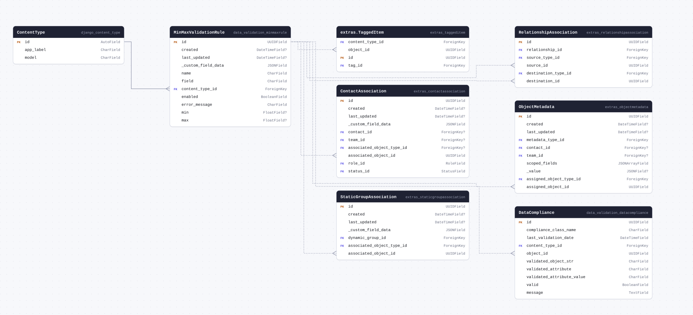

| Column | Field | Type | Null | Key | Default | Description |
| --- | --- | --- | --- | --- | --- | --- |
| `id` | `UUIDField` | `uuid` |  | PK | `uuid4()` |  |
| `created` | `DateTimeField` | `timestamp with time zone` | yes |  | `now()` |  |
| `last_updated` | `DateTimeField` | `timestamp with time zone` | yes |  | `now()` |  |
| `_custom_field_data` | `JSONField` | `jsonb` |  |  | `dict()` |  |
| `name` | `CharField` | `varchar(255)` |  | unique |  |  |
| `field` | `CharField` | `varchar(255)` |  |  |  |  |
| `content_type_id` | `ForeignKey` | `integer` |  | FK |  |  |
| `enabled` | `BooleanField` | `boolean` |  |  | `True` |  |
| `error_message` | `CharField` | `varchar(255)` |  |  | `''` | Optional error message to display when validation fails. |
| `min` | `FloatField` | `double precision` | yes |  |  | When set, apply a minimum value contraint to the value of the model field. |
| `max` | `FloatField` | `double precision` | yes |  |  | When set, apply a maximum value contraint to the value of the model field. |

Indexes:

- index `data_validation_minmaxrule_name_bceae023_like` on `name` (`varchar_pattern_ops`)
- index `data_validation_minmaxrule_content_type_id_669cb2ce` on `content_type_id`
- unique `data_validation_minmaxrule_content_type_id_field_a0d64d51_uniq` on `content_type_id`, `field`

Relations:

- `tags` — many to many with [extras.Tag](#extrastag), through [extras.TaggedItem](#extrastaggeditem)
- `content_type_id` → [ContentType](#contenttype).`id`, on delete cascade
- `tagged_items` ← [extras.TaggedItem](#extrastaggeditem), by `content_type_id` + `object_id` (generic relation)
- `associated_contacts` ← [ContactAssociation](#contactassociation), by `associated_object_type_id` + `associated_object_id` (generic relation)
- `static_group_association_set` ← [StaticGroupAssociation](#staticgroupassociation), by `associated_object_type_id` + `associated_object_id` (generic relation)
- `source_for_associations` ← [RelationshipAssociation](#relationshipassociation), by `source_type_id` + `source_id` (generic relation)
- `destination_for_associations` ← [RelationshipAssociation](#relationshipassociation), by `destination_type_id` + `destination_id` (generic relation)
- `associated_object_metadata` ← [ObjectMetadata](#objectmetadata), by `assigned_object_type_id` + `assigned_object_id` (generic relation)
- `associated_data_compliance` ← [DataCompliance](#datacompliance), by `content_type_id` + `object_id` (generic relation)

## RequiredValidationRule

Table `data_validation_requiredrule`, app `data_validation`.

Columns from `ValidationRuleModelMixin` (abstract): `name`, `field`, `content_type_id`, `enabled`, `error_message`.

Columns from `ChangeLoggedModel` (abstract): `created`, `last_updated`.

Columns from `CustomFieldModel` (abstract): `_custom_field_data`.

Columns from `BaseModel` (abstract): `id`.

A type of validation rule that applies a required constraint to a given model field.

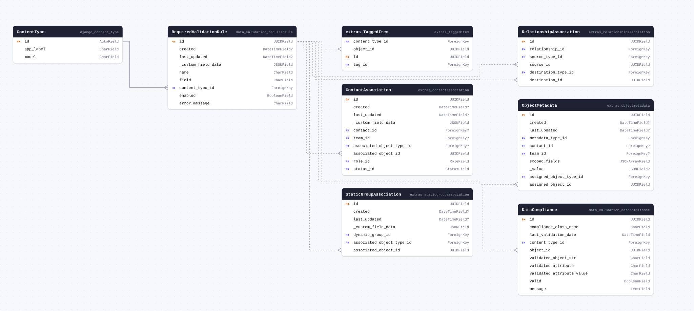

| Column | Field | Type | Null | Key | Default | Description |
| --- | --- | --- | --- | --- | --- | --- |
| `id` | `UUIDField` | `uuid` |  | PK | `uuid4()` |  |
| `created` | `DateTimeField` | `timestamp with time zone` | yes |  | `now()` |  |
| `last_updated` | `DateTimeField` | `timestamp with time zone` | yes |  | `now()` |  |
| `_custom_field_data` | `JSONField` | `jsonb` |  |  | `dict()` |  |
| `name` | `CharField` | `varchar(255)` |  | unique |  |  |
| `field` | `CharField` | `varchar(255)` |  |  |  |  |
| `content_type_id` | `ForeignKey` | `integer` |  | FK |  |  |
| `enabled` | `BooleanField` | `boolean` |  |  | `True` |  |
| `error_message` | `CharField` | `varchar(255)` |  |  | `''` | Optional error message to display when validation fails. |

Indexes:

- index `data_validation_requiredrule_name_997726ef_like` on `name` (`varchar_pattern_ops`)
- index `data_validation_requiredrule_content_type_id_1eea2be4` on `content_type_id`
- unique `data_validation_required_content_type_id_field_fccaa1c1_uniq` on `content_type_id`, `field`

Relations:

- `tags` — many to many with [extras.Tag](#extrastag), through [extras.TaggedItem](#extrastaggeditem)
- `content_type_id` → [ContentType](#contenttype).`id`, on delete cascade
- `tagged_items` ← [extras.TaggedItem](#extrastaggeditem), by `content_type_id` + `object_id` (generic relation)
- `associated_contacts` ← [ContactAssociation](#contactassociation), by `associated_object_type_id` + `associated_object_id` (generic relation)
- `static_group_association_set` ← [StaticGroupAssociation](#staticgroupassociation), by `associated_object_type_id` + `associated_object_id` (generic relation)
- `source_for_associations` ← [RelationshipAssociation](#relationshipassociation), by `source_type_id` + `source_id` (generic relation)
- `destination_for_associations` ← [RelationshipAssociation](#relationshipassociation), by `destination_type_id` + `destination_id` (generic relation)
- `associated_object_metadata` ← [ObjectMetadata](#objectmetadata), by `assigned_object_type_id` + `assigned_object_id` (generic relation)
- `associated_data_compliance` ← [DataCompliance](#datacompliance), by `content_type_id` + `object_id` (generic relation)

## UniqueValidationRule

Table `data_validation_uniquerule`, app `data_validation`.

Columns from `ValidationRuleModelMixin` (abstract): `name`, `field`, `content_type_id`, `enabled`, `error_message`.

Columns from `ChangeLoggedModel` (abstract): `created`, `last_updated`.

Columns from `CustomFieldModel` (abstract): `_custom_field_data`.

Columns from `BaseModel` (abstract): `id`.

A type of validation rule that applies a unique constraint to a given model field.

Optionally specify the max number of similar values for the field accross all model instances. Default of 1.

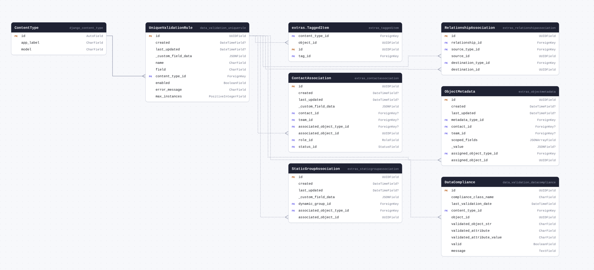

| Column | Field | Type | Null | Key | Default | Description |
| --- | --- | --- | --- | --- | --- | --- |
| `id` | `UUIDField` | `uuid` |  | PK | `uuid4()` |  |
| `created` | `DateTimeField` | `timestamp with time zone` | yes |  | `now()` |  |
| `last_updated` | `DateTimeField` | `timestamp with time zone` | yes |  | `now()` |  |
| `_custom_field_data` | `JSONField` | `jsonb` |  |  | `dict()` |  |
| `name` | `CharField` | `varchar(255)` |  | unique |  |  |
| `field` | `CharField` | `varchar(255)` |  |  |  |  |
| `content_type_id` | `ForeignKey` | `integer` |  | FK |  |  |
| `enabled` | `BooleanField` | `boolean` |  |  | `True` |  |
| `error_message` | `CharField` | `varchar(255)` |  |  | `''` | Optional error message to display when validation fails. |
| `max_instances` | `PositiveIntegerField` | `integer` |  |  | `1` |  |

Indexes:

- index `data_validation_uniquerule_name_32d3756b_like` on `name` (`varchar_pattern_ops`)
- index `data_validation_uniquerule_content_type_id_0c0249fc` on `content_type_id`
- unique `data_validation_uniquerule_content_type_id_field_02db8a56_uniq` on `content_type_id`, `field`

Relations:

- `tags` — many to many with [extras.Tag](#extrastag), through [extras.TaggedItem](#extrastaggeditem)
- `content_type_id` → [ContentType](#contenttype).`id`, on delete cascade
- `tagged_items` ← [extras.TaggedItem](#extrastaggeditem), by `content_type_id` + `object_id` (generic relation)
- `associated_contacts` ← [ContactAssociation](#contactassociation), by `associated_object_type_id` + `associated_object_id` (generic relation)
- `static_group_association_set` ← [StaticGroupAssociation](#staticgroupassociation), by `associated_object_type_id` + `associated_object_id` (generic relation)
- `source_for_associations` ← [RelationshipAssociation](#relationshipassociation), by `source_type_id` + `source_id` (generic relation)
- `destination_for_associations` ← [RelationshipAssociation](#relationshipassociation), by `destination_type_id` + `destination_id` (generic relation)
- `associated_object_metadata` ← [ObjectMetadata](#objectmetadata), by `assigned_object_type_id` + `assigned_object_id` (generic relation)
- `associated_data_compliance` ← [DataCompliance](#datacompliance), by `content_type_id` + `object_id` (generic relation)

## DataCompliance

Table `data_validation_datacompliance`, app `data_validation`.

Columns from `BaseModel` (abstract): `id`.

Model to represent the results of an audit method.

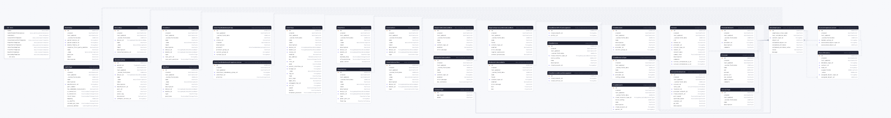

| Column | Field | Type | Null | Key | Default | Description |
| --- | --- | --- | --- | --- | --- | --- |
| `id` | `UUIDField` | `uuid` |  | PK | `uuid4()` |  |
| `compliance_class_name` | `CharField` | `varchar(255)` |  |  |  |  |
| `last_validation_date` | `DateTimeField` | `timestamp with time zone` |  |  | `now()` |  |
| `content_type_id` | `ForeignKey` | `integer` |  | FK |  |  |
| `object_id` | `UUIDField` | `uuid` |  |  |  |  |
| `validated_object_str` | `CharField` | `varchar(255)` |  |  | `''` |  |
| `validated_attribute` | `CharField` | `varchar(255)` |  |  | `''` |  |
| `validated_attribute_value` | `CharField` | `varchar(255)` |  |  | `''` |  |
| `valid` | `BooleanField` | `boolean` |  |  |  |  |
| `message` | `TextField` | `text` |  |  | `''` |  |

Indexes:

- index `data_validation_datacompliance_content_type_id_26bf587e` on `content_type_id`
- unique `data_validation_datacomp_compliance_class_name_co_b0e38158_uniq` on `compliance_class_name`, `content_type_id`, `object_id`, `validated_attribute`

Relations:

- `validated_object` → any model, by `content_type_id` + `object_id` (generic foreign key)
- `object_id` → [ProviderNetwork](#providernetwork).`id` where `content_type_id` is ProviderNetwork (generic, `ProviderNetwork.associated_data_compliance`)
- `object_id` → [Provider](#provider).`id` where `content_type_id` is Provider (generic, `Provider.associated_data_compliance`)
- `object_id` → [CircuitType](#circuittype).`id` where `content_type_id` is CircuitType (generic, `CircuitType.associated_data_compliance`)
- `object_id` → [Circuit](#circuit).`id` where `content_type_id` is Circuit (generic, `Circuit.associated_data_compliance`)
- `object_id` → [CircuitTermination](#circuittermination).`id` where `content_type_id` is CircuitTermination (generic, `CircuitTermination.associated_data_compliance`)
- `object_id` → [CloudAccount](#cloudaccount).`id` where `content_type_id` is CloudAccount (generic, `CloudAccount.associated_data_compliance`)
- `object_id` → [CloudResourceType](#cloudresourcetype).`id` where `content_type_id` is CloudResourceType (generic, `CloudResourceType.associated_data_compliance`)
- `object_id` → [CloudNetwork](#cloudnetwork).`id` where `content_type_id` is CloudNetwork (generic, `CloudNetwork.associated_data_compliance`)
- `object_id` → [CloudNetworkPrefixAssignment](#cloudnetworkprefixassignment).`id` where `content_type_id` is CloudNetworkPrefixAssignment (generic, `CloudNetworkPrefixAssignment.associated_data_compliance`)
- `object_id` → [CloudService](#cloudservice).`id` where `content_type_id` is CloudService (generic, `CloudService.associated_data_compliance`)
- `object_id` → [CloudServiceNetworkAssignment](#cloudservicenetworkassignment).`id` where `content_type_id` is CloudServiceNetworkAssignment (generic, `CloudServiceNetworkAssignment.associated_data_compliance`)
- `object_id` → [RegularExpressionValidationRule](#regularexpressionvalidationrule).`id` where `content_type_id` is RegularExpressionValidationRule (generic, `RegularExpressionValidationRule.associated_data_compliance`)
- `object_id` → [MinMaxValidationRule](#minmaxvalidationrule).`id` where `content_type_id` is MinMaxValidationRule (generic, `MinMaxValidationRule.associated_data_compliance`)
- `object_id` → [RequiredValidationRule](#requiredvalidationrule).`id` where `content_type_id` is RequiredValidationRule (generic, `RequiredValidationRule.associated_data_compliance`)
- `object_id` → [UniqueValidationRule](#uniquevalidationrule).`id` where `content_type_id` is UniqueValidationRule (generic, `UniqueValidationRule.associated_data_compliance`)
- `content_type_id` → [ContentType](#contenttype).`id`, on delete protect
- `static_group_association_set` ← [StaticGroupAssociation](#staticgroupassociation), by `associated_object_type_id` + `associated_object_id` (generic relation)
- `associated_object_metadata` ← [ObjectMetadata](#objectmetadata), by `assigned_object_type_id` + `assigned_object_id` (generic relation)
- `associated_data_compliance` ← [DataCompliance](#datacompliance), by `content_type_id` + `object_id` (generic relation)
- `object_id` → [DataCompliance](#datacompliance).`id` where `content_type_id` is DataCompliance (generic, `DataCompliance.associated_data_compliance`)
- `object_id` → [ConsolePort](#consoleport).`id` where `content_type_id` is ConsolePort (generic, `ConsolePort.associated_data_compliance`)
- `object_id` → [ConsoleServerPort](#consoleserverport).`id` where `content_type_id` is ConsoleServerPort (generic, `ConsoleServerPort.associated_data_compliance`)
- `object_id` → [PowerPort](#powerport).`id` where `content_type_id` is PowerPort (generic, `PowerPort.associated_data_compliance`)
- `object_id` → [PowerOutlet](#poweroutlet).`id` where `content_type_id` is PowerOutlet (generic, `PowerOutlet.associated_data_compliance`)
- `object_id` → [Interface](#interface).`id` where `content_type_id` is Interface (generic, `Interface.associated_data_compliance`)
- `object_id` → [InterfaceRedundancyGroup](#interfaceredundancygroup).`id` where `content_type_id` is InterfaceRedundancyGroup (generic, `InterfaceRedundancyGroup.associated_data_compliance`)
- `object_id` → [InterfaceRedundancyGroupAssociation](#interfaceredundancygroupassociation).`id` where `content_type_id` is InterfaceRedundancyGroupAssociation (generic, `InterfaceRedundancyGroupAssociation.associated_data_compliance`)
- `object_id` → [FrontPort](#frontport).`id` where `content_type_id` is FrontPort (generic, `FrontPort.associated_data_compliance`)
- `object_id` → [RearPort](#rearport).`id` where `content_type_id` is RearPort (generic, `RearPort.associated_data_compliance`)
- `object_id` → [DeviceBay](#devicebay).`id` where `content_type_id` is DeviceBay (generic, `DeviceBay.associated_data_compliance`)
- `object_id` → [InventoryItem](#inventoryitem).`id` where `content_type_id` is InventoryItem (generic, `InventoryItem.associated_data_compliance`)
- `object_id` → [ModuleBay](#modulebay).`id` where `content_type_id` is ModuleBay (generic, `ModuleBay.associated_data_compliance`)
- `object_id` → [CableType](#cabletype).`id` where `content_type_id` is CableType (generic, `CableType.associated_data_compliance`)
- `object_id` → [Cable](#cable).`id` where `content_type_id` is Cable (generic, `Cable.associated_data_compliance`)
- `object_id` → [CableToCableTermination](#cabletocabletermination).`id` where `content_type_id` is CableToCableTermination (generic, `CableToCableTermination.associated_data_compliance`)
- `object_id` → [CablePath](#cablepath).`id` where `content_type_id` is CablePath (generic, `CablePath.associated_data_compliance`)
- `object_id` → [ConsolePortTemplate](#consoleporttemplate).`id` where `content_type_id` is ConsolePortTemplate (generic, `ConsolePortTemplate.associated_data_compliance`)
- `object_id` → [ConsoleServerPortTemplate](#consoleserverporttemplate).`id` where `content_type_id` is ConsoleServerPortTemplate (generic, `ConsoleServerPortTemplate.associated_data_compliance`)
- `object_id` → [PowerPortTemplate](#powerporttemplate).`id` where `content_type_id` is PowerPortTemplate (generic, `PowerPortTemplate.associated_data_compliance`)
- `object_id` → [PowerOutletTemplate](#poweroutlettemplate).`id` where `content_type_id` is PowerOutletTemplate (generic, `PowerOutletTemplate.associated_data_compliance`)
- `object_id` → [InterfaceTemplate](#interfacetemplate).`id` where `content_type_id` is InterfaceTemplate (generic, `InterfaceTemplate.associated_data_compliance`)
- `object_id` → [FrontPortTemplate](#frontporttemplate).`id` where `content_type_id` is FrontPortTemplate (generic, `FrontPortTemplate.associated_data_compliance`)
- `object_id` → [RearPortTemplate](#rearporttemplate).`id` where `content_type_id` is RearPortTemplate (generic, `RearPortTemplate.associated_data_compliance`)
- `object_id` → [DeviceBayTemplate](#devicebaytemplate).`id` where `content_type_id` is DeviceBayTemplate (generic, `DeviceBayTemplate.associated_data_compliance`)
- `object_id` → [ModuleBayTemplate](#modulebaytemplate).`id` where `content_type_id` is ModuleBayTemplate (generic, `ModuleBayTemplate.associated_data_compliance`)
- `object_id` → [Manufacturer](#manufacturer).`id` where `content_type_id` is Manufacturer (generic, `Manufacturer.associated_data_compliance`)
- `object_id` → [DeviceFamily](#devicefamily).`id` where `content_type_id` is DeviceFamily (generic, `DeviceFamily.associated_data_compliance`)
- `object_id` → [DeviceTypeToSoftwareImageFile](#devicetypetosoftwareimagefile).`id` where `content_type_id` is DeviceTypeToSoftwareImageFile (generic, `DeviceTypeToSoftwareImageFile.associated_data_compliance`)
- `object_id` → [DeviceType](#devicetype).`id` where `content_type_id` is DeviceType (generic, `DeviceType.associated_data_compliance`)
- `object_id` → [Platform](#platform).`id` where `content_type_id` is Platform (generic, `Platform.associated_data_compliance`)
- `object_id` → [Device](#device).`id` where `content_type_id` is Device (generic, `Device.associated_data_compliance`)
- `object_id` → [DeviceClusterAssignment](#deviceclusterassignment).`id` where `content_type_id` is DeviceClusterAssignment (generic, `DeviceClusterAssignment.associated_data_compliance`)
- `object_id` → [VirtualChassis](#virtualchassis).`id` where `content_type_id` is VirtualChassis (generic, `VirtualChassis.associated_data_compliance`)
- `object_id` → [DeviceRedundancyGroup](#deviceredundancygroup).`id` where `content_type_id` is DeviceRedundancyGroup (generic, `DeviceRedundancyGroup.associated_data_compliance`)
- `object_id` → [SoftwareImageFile](#softwareimagefile).`id` where `content_type_id` is SoftwareImageFile (generic, `SoftwareImageFile.associated_data_compliance`)
- `object_id` → [SoftwareVersion](#softwareversion).`id` where `content_type_id` is SoftwareVersion (generic, `SoftwareVersion.associated_data_compliance`)
- `object_id` → [Controller](#controller).`id` where `content_type_id` is Controller (generic, `Controller.associated_data_compliance`)
- `object_id` → [ControllerManagedDeviceGroup](#controllermanageddevicegroup).`id` where `content_type_id` is ControllerManagedDeviceGroup (generic, `ControllerManagedDeviceGroup.associated_data_compliance`)
- `object_id` → [ModuleFamily](#modulefamily).`id` where `content_type_id` is ModuleFamily (generic, `ModuleFamily.associated_data_compliance`)
- `object_id` → [ModuleType](#moduletype).`id` where `content_type_id` is ModuleType (generic, `ModuleType.associated_data_compliance`)
- `object_id` → [Module](#module).`id` where `content_type_id` is Module (generic, `Module.associated_data_compliance`)
- `object_id` → [VirtualDeviceContext](#virtualdevicecontext).`id` where `content_type_id` is VirtualDeviceContext (generic, `VirtualDeviceContext.associated_data_compliance`)
- `object_id` → [InterfaceVDCAssignment](#interfacevdcassignment).`id` where `content_type_id` is InterfaceVDCAssignment (generic, `InterfaceVDCAssignment.associated_data_compliance`)
- `object_id` → [LocationType](#locationtype).`id` where `content_type_id` is LocationType (generic, `LocationType.associated_data_compliance`)
- `object_id` → [Location](#location).`id` where `content_type_id` is Location (generic, `Location.associated_data_compliance`)
- `object_id` → [PowerPanel](#powerpanel).`id` where `content_type_id` is PowerPanel (generic, `PowerPanel.associated_data_compliance`)
- `object_id` → [PowerFeed](#powerfeed).`id` where `content_type_id` is PowerFeed (generic, `PowerFeed.associated_data_compliance`)
- `object_id` → [RackGroup](#rackgroup).`id` where `content_type_id` is RackGroup (generic, `RackGroup.associated_data_compliance`)
- `object_id` → [Rack](#rack).`id` where `content_type_id` is Rack (generic, `Rack.associated_data_compliance`)
- `object_id` → [RackReservation](#rackreservation).`id` where `content_type_id` is RackReservation (generic, `RackReservation.associated_data_compliance`)
- `object_id` → [ObjectChange](#objectchange).`id` where `content_type_id` is ObjectChange (generic, `ObjectChange.associated_data_compliance`)
- `object_id` → [ComputedField](#computedfield).`id` where `content_type_id` is ComputedField (generic, `ComputedField.associated_data_compliance`)
- `object_id` → [CustomField](#customfield).`id` where `content_type_id` is CustomField (generic, `CustomField.associated_data_compliance`)
- `object_id` → [CustomFieldChoice](#customfieldchoice).`id` where `content_type_id` is CustomFieldChoice (generic, `CustomFieldChoice.associated_data_compliance`)
- `object_id` → [Relationship](#relationship).`id` where `content_type_id` is Relationship (generic, `Relationship.associated_data_compliance`)
- `object_id` → [RelationshipAssociation](#relationshipassociation).`id` where `content_type_id` is RelationshipAssociation (generic, `RelationshipAssociation.associated_data_compliance`)
- `object_id` → [extras.Tag](#extrastag).`id` where `content_type_id` is extras.Tag (generic, `extras.Tag.associated_data_compliance`)
- `object_id` → [extras.TaggedItem](#extrastaggeditem).`id` where `content_type_id` is extras.TaggedItem (generic, `extras.TaggedItem.associated_data_compliance`)
- `object_id` → [ApprovalWorkflowDefinition](#approvalworkflowdefinition).`id` where `content_type_id` is ApprovalWorkflowDefinition (generic, `ApprovalWorkflowDefinition.associated_data_compliance`)
- `object_id` → [ApprovalWorkflowStageDefinition](#approvalworkflowstagedefinition).`id` where `content_type_id` is ApprovalWorkflowStageDefinition (generic, `ApprovalWorkflowStageDefinition.associated_data_compliance`)
- `object_id` → [ApprovalWorkflow](#approvalworkflow).`id` where `content_type_id` is ApprovalWorkflow (generic, `ApprovalWorkflow.associated_data_compliance`)
- `object_id` → [ApprovalWorkflowStage](#approvalworkflowstage).`id` where `content_type_id` is ApprovalWorkflowStage (generic, `ApprovalWorkflowStage.associated_data_compliance`)
- `object_id` → [ApprovalWorkflowStageResponse](#approvalworkflowstageresponse).`id` where `content_type_id` is ApprovalWorkflowStageResponse (generic, `ApprovalWorkflowStageResponse.associated_data_compliance`)
- `object_id` → [Role](#role).`id` where `content_type_id` is Role (generic, `Role.associated_data_compliance`)
- `object_id` → [Status](#status).`id` where `content_type_id` is Status (generic, `Status.associated_data_compliance`)
- `object_id` → [Contact](#contact).`id` where `content_type_id` is Contact (generic, `Contact.associated_data_compliance`)
- `object_id` → [Team](#team).`id` where `content_type_id` is Team (generic, `Team.associated_data_compliance`)
- `object_id` → [ContactAssociation](#contactassociation).`id` where `content_type_id` is ContactAssociation (generic, `ContactAssociation.associated_data_compliance`)
- `object_id` → [GitRepository](#gitrepository).`id` where `content_type_id` is GitRepository (generic, `GitRepository.associated_data_compliance`)
- `object_id` → [DynamicGroup](#dynamicgroup).`id` where `content_type_id` is DynamicGroup (generic, `DynamicGroup.associated_data_compliance`)
- `object_id` → [DynamicGroupMembership](#dynamicgroupmembership).`id` where `content_type_id` is DynamicGroupMembership (generic, `DynamicGroupMembership.associated_data_compliance`)
- `object_id` → [StaticGroupAssociation](#staticgroupassociation).`id` where `content_type_id` is StaticGroupAssociation (generic, `StaticGroupAssociation.associated_data_compliance`)
- `object_id` → [Job](#job).`id` where `content_type_id` is Job (generic, `Job.associated_data_compliance`)
- `object_id` → [JobHook](#jobhook).`id` where `content_type_id` is JobHook (generic, `JobHook.associated_data_compliance`)
- `object_id` → [JobLogEntry](#joblogentry).`id` where `content_type_id` is JobLogEntry (generic, `JobLogEntry.associated_data_compliance`)
- `object_id` → [JobQueue](#jobqueue).`id` where `content_type_id` is JobQueue (generic, `JobQueue.associated_data_compliance`)
- `object_id` → [JobQueueAssignment](#jobqueueassignment).`id` where `content_type_id` is JobQueueAssignment (generic, `JobQueueAssignment.associated_data_compliance`)
- `object_id` → [JobResult](#jobresult).`id` where `content_type_id` is JobResult (generic, `JobResult.associated_data_compliance`)
- `object_id` → [JobConsoleEntry](#jobconsoleentry).`id` where `content_type_id` is JobConsoleEntry (generic, `JobConsoleEntry.associated_data_compliance`)
- `object_id` → [JobButton](#jobbutton).`id` where `content_type_id` is JobButton (generic, `JobButton.associated_data_compliance`)
- `object_id` → [ScheduledJob](#scheduledjob).`id` where `content_type_id` is ScheduledJob (generic, `ScheduledJob.associated_data_compliance`)
- `object_id` → [MetadataType](#metadatatype).`id` where `content_type_id` is MetadataType (generic, `MetadataType.associated_data_compliance`)
- `object_id` → [MetadataChoice](#metadatachoice).`id` where `content_type_id` is MetadataChoice (generic, `MetadataChoice.associated_data_compliance`)
- `object_id` → [ObjectMetadata](#objectmetadata).`id` where `content_type_id` is ObjectMetadata (generic, `ObjectMetadata.associated_data_compliance`)
- `object_id` → [ConfigContext](#configcontext).`id` where `content_type_id` is ConfigContext (generic, `ConfigContext.associated_data_compliance`)
- `object_id` → [ConfigContextSchema](#configcontextschema).`id` where `content_type_id` is ConfigContextSchema (generic, `ConfigContextSchema.associated_data_compliance`)
- `object_id` → [CustomLink](#customlink).`id` where `content_type_id` is CustomLink (generic, `CustomLink.associated_data_compliance`)
- `object_id` → [ExportTemplate](#exporttemplate).`id` where `content_type_id` is ExportTemplate (generic, `ExportTemplate.associated_data_compliance`)
- `object_id` → [ExternalIntegration](#externalintegration).`id` where `content_type_id` is ExternalIntegration (generic, `ExternalIntegration.associated_data_compliance`)
- `object_id` → [FileAttachment](#fileattachment).`id` where `content_type_id` is FileAttachment (generic, `FileAttachment.associated_data_compliance`)
- `object_id` → [FileProxy](#fileproxy).`id` where `content_type_id` is FileProxy (generic, `FileProxy.associated_data_compliance`)
- `object_id` → [GraphQLQuery](#graphqlquery).`id` where `content_type_id` is GraphQLQuery (generic, `GraphQLQuery.associated_data_compliance`)
- `object_id` → [HealthCheckTestModel](#healthchecktestmodel).`id` where `content_type_id` is HealthCheckTestModel (generic, `HealthCheckTestModel.associated_data_compliance`)
- `object_id` → [ImageAttachment](#imageattachment).`id` where `content_type_id` is ImageAttachment (generic, `ImageAttachment.associated_data_compliance`)
- `object_id` → [Note](#note).`id` where `content_type_id` is Note (generic, `Note.associated_data_compliance`)
- `object_id` → [SavedView](#savedview).`id` where `content_type_id` is SavedView (generic, `SavedView.associated_data_compliance`)
- `object_id` → [UserSavedViewAssociation](#usersavedviewassociation).`id` where `content_type_id` is UserSavedViewAssociation (generic, `UserSavedViewAssociation.associated_data_compliance`)
- `object_id` → [Webhook](#webhook).`id` where `content_type_id` is Webhook (generic, `Webhook.associated_data_compliance`)
- `object_id` → [Secret](#secret).`id` where `content_type_id` is Secret (generic, `Secret.associated_data_compliance`)
- `object_id` → [SecretsGroup](#secretsgroup).`id` where `content_type_id` is SecretsGroup (generic, `SecretsGroup.associated_data_compliance`)
- `object_id` → [SecretsGroupAssociation](#secretsgroupassociation).`id` where `content_type_id` is SecretsGroupAssociation (generic, `SecretsGroupAssociation.associated_data_compliance`)
- `object_id` → [Namespace](#namespace).`id` where `content_type_id` is Namespace (generic, `Namespace.associated_data_compliance`)
- `object_id` → [VRF](#vrf).`id` where `content_type_id` is VRF (generic, `VRF.associated_data_compliance`)
- `object_id` → [VRFDeviceAssignment](#vrfdeviceassignment).`id` where `content_type_id` is VRFDeviceAssignment (generic, `VRFDeviceAssignment.associated_data_compliance`)
- `object_id` → [VRFPrefixAssignment](#vrfprefixassignment).`id` where `content_type_id` is VRFPrefixAssignment (generic, `VRFPrefixAssignment.associated_data_compliance`)
- `object_id` → [RouteTarget](#routetarget).`id` where `content_type_id` is RouteTarget (generic, `RouteTarget.associated_data_compliance`)
- `object_id` → [RIR](#rir).`id` where `content_type_id` is RIR (generic, `RIR.associated_data_compliance`)
- `object_id` → [Prefix](#prefix).`id` where `content_type_id` is Prefix (generic, `Prefix.associated_data_compliance`)
- `object_id` → [PrefixLocationAssignment](#prefixlocationassignment).`id` where `content_type_id` is PrefixLocationAssignment (generic, `PrefixLocationAssignment.associated_data_compliance`)
- `object_id` → [IPAddress](#ipaddress).`id` where `content_type_id` is IPAddress (generic, `IPAddress.associated_data_compliance`)
- `object_id` → [IPAddressToInterface](#ipaddresstointerface).`id` where `content_type_id` is IPAddressToInterface (generic, `IPAddressToInterface.associated_data_compliance`)
- `object_id` → [IPAddressRange](#ipaddressrange).`id` where `content_type_id` is IPAddressRange (generic, `IPAddressRange.associated_data_compliance`)
- `object_id` → [VLANGroup](#vlangroup).`id` where `content_type_id` is VLANGroup (generic, `VLANGroup.associated_data_compliance`)
- `object_id` → [VLAN](#vlan).`id` where `content_type_id` is VLAN (generic, `VLAN.associated_data_compliance`)
- `object_id` → [VLANLocationAssignment](#vlanlocationassignment).`id` where `content_type_id` is VLANLocationAssignment (generic, `VLANLocationAssignment.associated_data_compliance`)
- `object_id` → [Service](#service).`id` where `content_type_id` is Service (generic, `Service.associated_data_compliance`)
- `object_id` → [VirtualServer](#virtualserver).`id` where `content_type_id` is VirtualServer (generic, `VirtualServer.associated_data_compliance`)
- `object_id` → [LoadBalancerPool](#loadbalancerpool).`id` where `content_type_id` is LoadBalancerPool (generic, `LoadBalancerPool.associated_data_compliance`)
- `object_id` → [LoadBalancerPoolMember](#loadbalancerpoolmember).`id` where `content_type_id` is LoadBalancerPoolMember (generic, `LoadBalancerPoolMember.associated_data_compliance`)
- `object_id` → [HealthCheckMonitor](#healthcheckmonitor).`id` where `content_type_id` is HealthCheckMonitor (generic, `HealthCheckMonitor.associated_data_compliance`)
- `object_id` → [CertificateProfile](#certificateprofile).`id` where `content_type_id` is CertificateProfile (generic, `CertificateProfile.associated_data_compliance`)
- `object_id` → [VirtualServerCertificateProfileAssignment](#virtualservercertificateprofileassignment).`id` where `content_type_id` is VirtualServerCertificateProfileAssignment (generic, `VirtualServerCertificateProfileAssignment.associated_data_compliance`)
- `object_id` → [LoadBalancerPoolMemberCertificateProfileAssignment](#loadbalancerpoolmembercertificateprofileassignment).`id` where `content_type_id` is LoadBalancerPoolMemberCertificateProfileAssignment (generic, `LoadBalancerPoolMemberCertificateProfileAssignment.associated_data_compliance`)
- `object_id` → [TenantGroup](#tenantgroup).`id` where `content_type_id` is TenantGroup (generic, `TenantGroup.associated_data_compliance`)
- `object_id` → [Tenant](#tenant).`id` where `content_type_id` is Tenant (generic, `Tenant.associated_data_compliance`)
- `object_id` → [User](#user).`id` where `content_type_id` is User (generic, `User.associated_data_compliance`)
- `object_id` → [Token](#token).`id` where `content_type_id` is Token (generic, `Token.associated_data_compliance`)
- `object_id` → [ObjectPermission](#objectpermission).`id` where `content_type_id` is ObjectPermission (generic, `ObjectPermission.associated_data_compliance`)
- `object_id` → [ClusterType](#clustertype).`id` where `content_type_id` is ClusterType (generic, `ClusterType.associated_data_compliance`)
- `object_id` → [ClusterGroup](#clustergroup).`id` where `content_type_id` is ClusterGroup (generic, `ClusterGroup.associated_data_compliance`)
- `object_id` → [Cluster](#cluster).`id` where `content_type_id` is Cluster (generic, `Cluster.associated_data_compliance`)
- `object_id` → [VirtualMachine](#virtualmachine).`id` where `content_type_id` is VirtualMachine (generic, `VirtualMachine.associated_data_compliance`)
- `object_id` → [VMInterface](#vminterface).`id` where `content_type_id` is VMInterface (generic, `VMInterface.associated_data_compliance`)
- `object_id` → [VPNProfile](#vpnprofile).`id` where `content_type_id` is VPNProfile (generic, `VPNProfile.associated_data_compliance`)
- `object_id` → [VPNPhase1Policy](#vpnphase1policy).`id` where `content_type_id` is VPNPhase1Policy (generic, `VPNPhase1Policy.associated_data_compliance`)
- `object_id` → [VPNPhase2Policy](#vpnphase2policy).`id` where `content_type_id` is VPNPhase2Policy (generic, `VPNPhase2Policy.associated_data_compliance`)
- `object_id` → [VPNProfilePhase1PolicyAssignment](#vpnprofilephase1policyassignment).`id` where `content_type_id` is VPNProfilePhase1PolicyAssignment (generic, `VPNProfilePhase1PolicyAssignment.associated_data_compliance`)
- `object_id` → [VPNProfilePhase2PolicyAssignment](#vpnprofilephase2policyassignment).`id` where `content_type_id` is VPNProfilePhase2PolicyAssignment (generic, `VPNProfilePhase2PolicyAssignment.associated_data_compliance`)
- `object_id` → [VPN](#vpn).`id` where `content_type_id` is VPN (generic, `VPN.associated_data_compliance`)
- `object_id` → [VPNTunnel](#vpntunnel).`id` where `content_type_id` is VPNTunnel (generic, `VPNTunnel.associated_data_compliance`)
- `object_id` → [VPNTunnelEndpoint](#vpntunnelendpoint).`id` where `content_type_id` is VPNTunnelEndpoint (generic, `VPNTunnelEndpoint.associated_data_compliance`)
- `object_id` → [VPNTermination](#vpntermination).`id` where `content_type_id` is VPNTermination (generic, `VPNTermination.associated_data_compliance`)
- `object_id` → [SupportedDataRate](#supporteddatarate).`id` where `content_type_id` is SupportedDataRate (generic, `SupportedDataRate.associated_data_compliance`)
- `object_id` → [RadioProfile](#radioprofile).`id` where `content_type_id` is RadioProfile (generic, `RadioProfile.associated_data_compliance`)
- `object_id` → [WirelessNetwork](#wirelessnetwork).`id` where `content_type_id` is WirelessNetwork (generic, `WirelessNetwork.associated_data_compliance`)
- `object_id` → [ControllerManagedDeviceGroupWirelessNetworkAssignment](#controllermanageddevicegroupwirelessnetworkassignment).`id` where `content_type_id` is ControllerManagedDeviceGroupWirelessNetworkAssignment (generic, `ControllerManagedDeviceGroupWirelessNetworkAssignment.associated_data_compliance`)
- `object_id` → [ControllerManagedDeviceGroupRadioProfileAssignment](#controllermanageddevicegroupradioprofileassignment).`id` where `content_type_id` is ControllerManagedDeviceGroupRadioProfileAssignment (generic, `ControllerManagedDeviceGroupRadioProfileAssignment.associated_data_compliance`)

## ConsolePort

Table `dcim_consoleport`, app `dcim`.

Columns from `ModularComponentModel` (abstract): `module_id`.

Columns from `ComponentModel` (abstract): `device_id`, `name`, `_name`, `label`, `description`.

Columns from `ChangeLoggedModel` (abstract): `created`, `last_updated`.

Columns from `CustomFieldModel` (abstract): `_custom_field_data`.

Columns from `BaseModel` (abstract): `id`.

A physical console port within a Device or Module. ConsolePorts connect to ConsoleServerPorts.

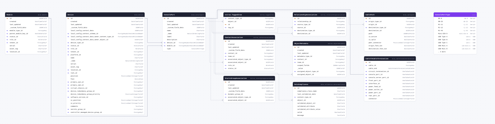

| Column | Field | Type | Null | Key | Default | Description |
| --- | --- | --- | --- | --- | --- | --- |
| `id` | `UUIDField` | `uuid` |  | PK | `uuid4()` |  |
| `created` | `DateTimeField` | `timestamp with time zone` | yes |  | `now()` |  |
| `last_updated` | `DateTimeField` | `timestamp with time zone` | yes |  | `now()` |  |
| `_custom_field_data` | `JSONField` | `jsonb` |  |  | `dict()` |  |
| `name` | `CharField` | `varchar(255)` |  |  |  |  |
| `_name` | `NaturalOrderingField` | `varchar(255)` |  |  |  |  |
| `label` | `CharField` | `varchar(255)` |  |  |  | Physical label |
| `description` | `CharField` | `varchar(255)` |  |  |  |  |
| `device_id` | `ForeignKeyWithAutoRelatedName` | `uuid` | yes | FK |  |  |
| `module_id` | `ForeignKeyWithAutoRelatedName` | `uuid` | yes | FK |  |  |
| `type` | `ConsolePortType` | `varchar(50)` |  |  |  | Physical port type |

Indexes:

- index `dcim_consoleport_name_ef94d0d1` on `name`
- index `dcim_consoleport_name_ef94d0d1_like` on `name` (`varchar_pattern_ops`)
- index `dcim_consoleport__name_6ac60d99` on `_name`
- index `dcim_consoleport__name_6ac60d99_like` on `_name` (`varchar_pattern_ops`)
- index `dcim_consoleport_device_id_f2d90d3c` on `device_id`
- index `dcim_consoleport_module_id_d17b2519` on `module_id`
- unique `dcim_consoleport_module_name_unique` on `module_id`, `name`

Relations:

- `tags` — many to many with [extras.Tag](#extrastag), through [extras.TaggedItem](#extrastaggeditem)
- `device_id` → [Device](#device).`id`, on delete cascade
- `module_id` → [Module](#module).`id`, on delete cascade
- `tagged_items` ← [extras.TaggedItem](#extrastaggeditem), by `content_type_id` + `object_id` (generic relation)
- `associated_contacts` ← [ContactAssociation](#contactassociation), by `associated_object_type_id` + `associated_object_id` (generic relation)
- `static_group_association_set` ← [StaticGroupAssociation](#staticgroupassociation), by `associated_object_type_id` + `associated_object_id` (generic relation)
- `source_for_associations` ← [RelationshipAssociation](#relationshipassociation), by `source_type_id` + `source_id` (generic relation)
- `destination_for_associations` ← [RelationshipAssociation](#relationshipassociation), by `destination_type_id` + `destination_id` (generic relation)
- `associated_object_metadata` ← [ObjectMetadata](#objectmetadata), by `assigned_object_type_id` + `assigned_object_id` (generic relation)
- `associated_data_compliance` ← [DataCompliance](#datacompliance), by `content_type_id` + `object_id` (generic relation)
- `cable_paths` ← [CablePath](#cablepath), by `origin_type_id` + `origin_id` (generic relation)
- [CableToCableTermination](#cabletocabletermination).`console_port_id` → `id`, on delete cascade

## ConsoleServerPort

Table `dcim_consoleserverport`, app `dcim`.

Columns from `ModularComponentModel` (abstract): `module_id`.

Columns from `ComponentModel` (abstract): `device_id`, `name`, `_name`, `label`, `description`.

Columns from `ChangeLoggedModel` (abstract): `created`, `last_updated`.

Columns from `CustomFieldModel` (abstract): `_custom_field_data`.

Columns from `BaseModel` (abstract): `id`.

A physical port within a Device or Module (typically a designated console server) which provides access to ConsolePorts.


| Column | Field | Type | Null | Key | Default | Description |
| --- | --- | --- | --- | --- | --- | --- |
| `id` | `UUIDField` | `uuid` |  | PK | `uuid4()` |  |
| `created` | `DateTimeField` | `timestamp with time zone` | yes |  | `now()` |  |
| `last_updated` | `DateTimeField` | `timestamp with time zone` | yes |  | `now()` |  |
| `_custom_field_data` | `JSONField` | `jsonb` |  |  | `dict()` |  |
| `name` | `CharField` | `varchar(255)` |  |  |  |  |
| `_name` | `NaturalOrderingField` | `varchar(255)` |  |  |  |  |
| `label` | `CharField` | `varchar(255)` |  |  |  | Physical label |
| `description` | `CharField` | `varchar(255)` |  |  |  |  |
| `device_id` | `ForeignKeyWithAutoRelatedName` | `uuid` | yes | FK |  |  |
| `module_id` | `ForeignKeyWithAutoRelatedName` | `uuid` | yes | FK |  |  |
| `type` | `ConsoleServerPortType` | `varchar(50)` |  |  |  | Physical port type |

Indexes:

- index `dcim_consoleserverport_name_2319aaf4` on `name`
- index `dcim_consoleserverport_name_2319aaf4_like` on `name` (`varchar_pattern_ops`)
- index `dcim_consoleserverport__name_70f9317c` on `_name`
- index `dcim_consoleserverport__name_70f9317c_like` on `_name` (`varchar_pattern_ops`)
- index `dcim_consoleserverport_device_id_d9866581` on `device_id`
- index `dcim_consoleserverport_module_id_d060cfc8` on `module_id`
- unique `dcim_consoleserverport_module_name_unique` on `module_id`, `name`

Relations:

- `tags` — many to many with [extras.Tag](#extrastag), through [extras.TaggedItem](#extrastaggeditem)
- `device_id` → [Device](#device).`id`, on delete cascade
- `module_id` → [Module](#module).`id`, on delete cascade
- `tagged_items` ← [extras.TaggedItem](#extrastaggeditem), by `content_type_id` + `object_id` (generic relation)
- `associated_contacts` ← [ContactAssociation](#contactassociation), by `associated_object_type_id` + `associated_object_id` (generic relation)
- `static_group_association_set` ← [StaticGroupAssociation](#staticgroupassociation), by `associated_object_type_id` + `associated_object_id` (generic relation)
- `source_for_associations` ← [RelationshipAssociation](#relationshipassociation), by `source_type_id` + `source_id` (generic relation)
- `destination_for_associations` ← [RelationshipAssociation](#relationshipassociation), by `destination_type_id` + `destination_id` (generic relation)
- `associated_object_metadata` ← [ObjectMetadata](#objectmetadata), by `assigned_object_type_id` + `assigned_object_id` (generic relation)
- `associated_data_compliance` ← [DataCompliance](#datacompliance), by `content_type_id` + `object_id` (generic relation)
- `cable_paths` ← [CablePath](#cablepath), by `origin_type_id` + `origin_id` (generic relation)
- [CableToCableTermination](#cabletocabletermination).`console_server_port_id` → `id`, on delete cascade

## PowerPort

Table `dcim_powerport`, app `dcim`.

Columns from `ModularComponentModel` (abstract): `module_id`.

Columns from `ComponentModel` (abstract): `device_id`, `name`, `_name`, `label`, `description`.

Columns from `ChangeLoggedModel` (abstract): `created`, `last_updated`.

Columns from `CustomFieldModel` (abstract): `_custom_field_data`.

Columns from `BaseModel` (abstract): `id`.

A physical power supply (intake) port within a Device or Module. PowerPorts connect to PowerOutlets.

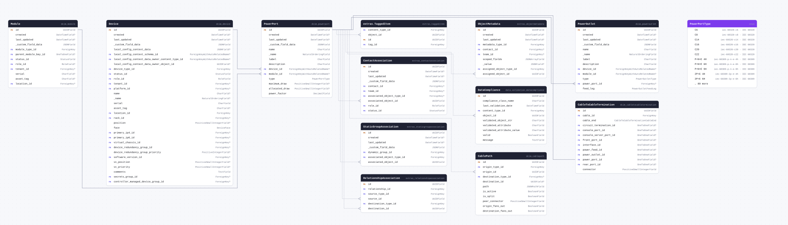

| Column | Field | Type | Null | Key | Default | Description |
| --- | --- | --- | --- | --- | --- | --- |
| `id` | `UUIDField` | `uuid` |  | PK | `uuid4()` |  |
| `created` | `DateTimeField` | `timestamp with time zone` | yes |  | `now()` |  |
| `last_updated` | `DateTimeField` | `timestamp with time zone` | yes |  | `now()` |  |
| `_custom_field_data` | `JSONField` | `jsonb` |  |  | `dict()` |  |
| `name` | `CharField` | `varchar(255)` |  |  |  |  |
| `_name` | `NaturalOrderingField` | `varchar(255)` |  |  |  |  |
| `label` | `CharField` | `varchar(255)` |  |  |  | Physical label |
| `description` | `CharField` | `varchar(255)` |  |  |  |  |
| `device_id` | `ForeignKeyWithAutoRelatedName` | `uuid` | yes | FK |  |  |
| `module_id` | `ForeignKeyWithAutoRelatedName` | `uuid` | yes | FK |  |  |
| `type` | `PowerPortType` | `varchar(50)` |  |  |  | Physical port type |
| `maximum_draw` | `PositiveSmallIntegerField` | `smallint` | yes |  |  | Maximum power draw (watts) |
| `allocated_draw` | `PositiveSmallIntegerField` | `smallint` | yes |  |  | Allocated power draw (watts) |
| `power_factor` | `DecimalField(4, 2)` | `numeric(4, 2)` |  |  | `Decimal('0.95')` | Power factor (0.01-1.00) for converting between watts (W) and volt-amps (VA). Defaults to 0.95. |

Indexes:

- index `dcim_powerport_name_8b95aa68` on `name`
- index `dcim_powerport_name_8b95aa68_like` on `name` (`varchar_pattern_ops`)
- index `dcim_powerport__name_cd2ccdac` on `_name`
- index `dcim_powerport__name_cd2ccdac_like` on `_name` (`varchar_pattern_ops`)
- index `dcim_powerport_device_id_ef7185ae` on `device_id`
- index `dcim_powerport_module_id_d0c27534` on `module_id`
- unique `dcim_powerport_module_name_unique` on `module_id`, `name`

Relations:

- `tags` — many to many with [extras.Tag](#extrastag), through [extras.TaggedItem](#extrastaggeditem)
- `device_id` → [Device](#device).`id`, on delete cascade
- `module_id` → [Module](#module).`id`, on delete cascade
- `tagged_items` ← [extras.TaggedItem](#extrastaggeditem), by `content_type_id` + `object_id` (generic relation)
- `associated_contacts` ← [ContactAssociation](#contactassociation), by `associated_object_type_id` + `associated_object_id` (generic relation)
- `static_group_association_set` ← [StaticGroupAssociation](#staticgroupassociation), by `associated_object_type_id` + `associated_object_id` (generic relation)
- `source_for_associations` ← [RelationshipAssociation](#relationshipassociation), by `source_type_id` + `source_id` (generic relation)
- `destination_for_associations` ← [RelationshipAssociation](#relationshipassociation), by `destination_type_id` + `destination_id` (generic relation)
- `associated_object_metadata` ← [ObjectMetadata](#objectmetadata), by `assigned_object_type_id` + `assigned_object_id` (generic relation)
- `associated_data_compliance` ← [DataCompliance](#datacompliance), by `content_type_id` + `object_id` (generic relation)
- `cable_paths` ← [CablePath](#cablepath), by `origin_type_id` + `origin_id` (generic relation)
- [PowerOutlet](#poweroutlet).`power_port_id` → `id`, on delete set null
- [CableToCableTermination](#cabletocabletermination).`power_port_id` → `id`, on delete cascade

## PowerOutlet

Table `dcim_poweroutlet`, app `dcim`.

Columns from `ModularComponentModel` (abstract): `module_id`.

Columns from `ComponentModel` (abstract): `device_id`, `name`, `_name`, `label`, `description`.

Columns from `ChangeLoggedModel` (abstract): `created`, `last_updated`.

Columns from `CustomFieldModel` (abstract): `_custom_field_data`.

Columns from `BaseModel` (abstract): `id`.

A physical power outlet (output) within a Device or Module which provides power to a PowerPort.

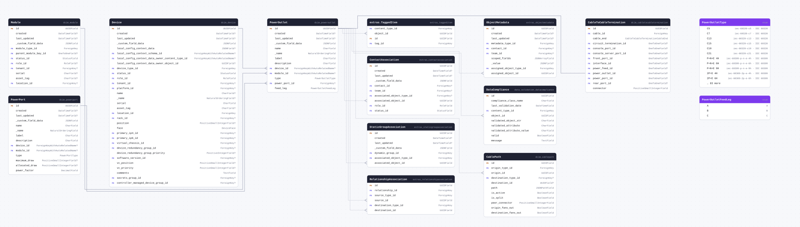

| Column | Field | Type | Null | Key | Default | Description |
| --- | --- | --- | --- | --- | --- | --- |
| `id` | `UUIDField` | `uuid` |  | PK | `uuid4()` |  |
| `created` | `DateTimeField` | `timestamp with time zone` | yes |  | `now()` |  |
| `last_updated` | `DateTimeField` | `timestamp with time zone` | yes |  | `now()` |  |
| `_custom_field_data` | `JSONField` | `jsonb` |  |  | `dict()` |  |
| `name` | `CharField` | `varchar(255)` |  |  |  |  |
| `_name` | `NaturalOrderingField` | `varchar(255)` |  |  |  |  |
| `label` | `CharField` | `varchar(255)` |  |  |  | Physical label |
| `description` | `CharField` | `varchar(255)` |  |  |  |  |
| `device_id` | `ForeignKeyWithAutoRelatedName` | `uuid` | yes | FK |  |  |
| `module_id` | `ForeignKeyWithAutoRelatedName` | `uuid` | yes | FK |  |  |
| `type` | `PowerOutletType` | `varchar(50)` |  |  |  | Physical port type |
| `power_port_id` | `ForeignKey` | `uuid` | yes | FK |  |  |
| `feed_leg` | `PowerOutletFeedLeg` | `varchar(50)` |  |  |  | Phase (for three-phase feeds) |

Indexes:

- index `dcim_poweroutlet_name_98c8e7a2` on `name`
- index `dcim_poweroutlet_name_98c8e7a2_like` on `name` (`varchar_pattern_ops`)
- index `dcim_poweroutlet__name_0ecdd374` on `_name`
- index `dcim_poweroutlet__name_0ecdd374_like` on `_name` (`varchar_pattern_ops`)
- index `dcim_poweroutlet_device_id_286351d7` on `device_id`
- index `dcim_poweroutlet_module_id_032f5af2` on `module_id`
- index `dcim_poweroutlet_power_port_id_9bdf4163` on `power_port_id`
- unique `dcim_poweroutlet_module_name_unique` on `module_id`, `name`

Relations:

- `tags` — many to many with [extras.Tag](#extrastag), through [extras.TaggedItem](#extrastaggeditem)
- `device_id` → [Device](#device).`id`, on delete cascade
- `module_id` → [Module](#module).`id`, on delete cascade
- `power_port_id` → [PowerPort](#powerport).`id`, on delete set null
- `tagged_items` ← [extras.TaggedItem](#extrastaggeditem), by `content_type_id` + `object_id` (generic relation)
- `associated_contacts` ← [ContactAssociation](#contactassociation), by `associated_object_type_id` + `associated_object_id` (generic relation)
- `static_group_association_set` ← [StaticGroupAssociation](#staticgroupassociation), by `associated_object_type_id` + `associated_object_id` (generic relation)
- `source_for_associations` ← [RelationshipAssociation](#relationshipassociation), by `source_type_id` + `source_id` (generic relation)
- `destination_for_associations` ← [RelationshipAssociation](#relationshipassociation), by `destination_type_id` + `destination_id` (generic relation)
- `associated_object_metadata` ← [ObjectMetadata](#objectmetadata), by `assigned_object_type_id` + `assigned_object_id` (generic relation)
- `associated_data_compliance` ← [DataCompliance](#datacompliance), by `content_type_id` + `object_id` (generic relation)
- `cable_paths` ← [CablePath](#cablepath), by `origin_type_id` + `origin_id` (generic relation)
- [CableToCableTermination](#cabletocabletermination).`power_outlet_id` → `id`, on delete cascade

## Interface

Table `dcim_interface`, app `dcim`.

Columns from `ModularComponentModel` (abstract): `module_id`.

Columns from `ComponentModel` (abstract): `device_id`, `name`, `_name`, `label`, `description`.

Columns from `ChangeLoggedModel` (abstract): `created`, `last_updated`.

Columns from `CustomFieldModel` (abstract): `_custom_field_data`.

Columns from `BaseInterface` (abstract): `status_id`, `enabled`, `mac_address`, `mtu`, `role_id`, `mode`, `parent_interface_id`, `bridge_id`.

Columns from `BaseModel` (abstract): `id`.

A network interface within a Device or Module. A physical Interface can connect to exactly one other Interface.

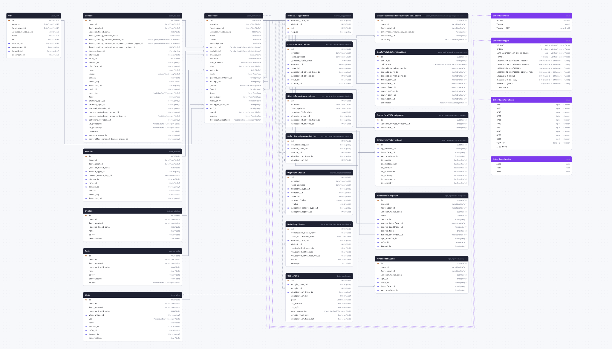

| Column | Field | Type | Null | Key | Default | Description |
| --- | --- | --- | --- | --- | --- | --- |
| `id` | `UUIDField` | `uuid` |  | PK | `uuid4()` |  |
| `created` | `DateTimeField` | `timestamp with time zone` | yes |  | `now()` |  |
| `last_updated` | `DateTimeField` | `timestamp with time zone` | yes |  | `now()` |  |
| `_custom_field_data` | `JSONField` | `jsonb` |  |  | `dict()` |  |
| `name` | `CharField` | `varchar(255)` |  |  |  |  |
| `label` | `CharField` | `varchar(255)` |  |  |  | Physical label |
| `description` | `CharField` | `varchar(255)` |  |  |  |  |
| `device_id` | `ForeignKeyWithAutoRelatedName` | `uuid` | yes | FK |  |  |
| `module_id` | `ForeignKeyWithAutoRelatedName` | `uuid` | yes | FK |  |  |
| `status_id` | `StatusField` | `uuid` |  | FK |  |  |
| `enabled` | `BooleanField` | `boolean` |  |  | `True` |  |
| `mac_address` | `MACAddressCharField` | `varchar(18)` |  |  | `''` |  |
| `mtu` | `PositiveIntegerField` | `integer` | yes |  |  |  |
| `role_id` | `RoleField` | `uuid` | yes | FK |  |  |
| `mode` | `InterfaceMode` | `varchar(50)` |  |  |  |  |
| `parent_interface_id` | `ForeignKey` | `uuid` | yes | FK |  | Assigned parent interface |
| `bridge_id` | `ForeignKey` | `uuid` | yes | FK |  | Assigned bridge interface |
| `_name` | `NaturalOrderingField` | `varchar(255)` |  |  |  |  |
| `lag_id` | `ForeignKey` | `uuid` | yes | FK |  | Assigned LAG interface |
| `type` | `InterfaceType` | `varchar(50)` |  |  |  |  |
| `port_type` | `InterfacePortType` | `varchar(50)` |  |  |  | Physical connector type |
| `mgmt_only` | `BooleanField` | `boolean` |  |  | `False` | This interface is used only for out-of-band management |
| `untagged_vlan_id` | `ForeignKey` | `uuid` | yes | FK |  |  |
| `vrf_id` | `ForeignKey` | `uuid` | yes | FK |  |  |
| `speed` | `PositiveIntegerField` | `integer` | yes |  |  |  |
| `duplex` | `InterfaceDuplex` | `varchar(10)` |  |  | `''` |  |
| `breakout_position` | `PositiveSmallIntegerField` | `smallint` | yes |  |  | For a child interface of a breakout-cable trunk, the position on the parent interface's trunk connector that this child interface maps to. |

Indexes:

- index `dcim_interface_name_bc4e48ab` on `name`
- index `dcim_interface_name_bc4e48ab_like` on `name` (`varchar_pattern_ops`)
- index `dcim_interface_device_id_359c6115` on `device_id`
- index `dcim_interface_module_id_05ca2da5` on `module_id`
- index `dcim_interface_status_id_5d68d3d6` on `status_id`
- index `dcim_interface_role_id_0c0a2a5d` on `role_id`
- index `dcim_interface_parent_interface_id_dc46b61a` on `parent_interface_id`
- index `dcim_interface_bridge_id_f2a8df85` on `bridge_id`
- index `dcim_interface__name_8796fa61` on `_name`
- index `dcim_interface__name_8796fa61_like` on `_name` (`varchar_pattern_ops`)
- index `dcim_interface_lag_id_ea1a1d12` on `lag_id`
- index `dcim_interface_untagged_vlan_id_838dc7be` on `untagged_vlan_id`
- index `dcim_interface_vrf_id_a92e59b2` on `vrf_id`
- unique `dcim_interface_module_name_unique` on `module_id`, `name`
- unique `dcim_interface_unique_parent_breakout_position` on `parent_interface_id`, `breakout_position`

Relations:

- `tags` — many to many with [extras.Tag](#extrastag), through [extras.TaggedItem](#extrastaggeditem)
- `ip_addresses` — many to many with [IPAddress](#ipaddress), through [IPAddressToInterface](#ipaddresstointerface)
- `interface_redundancy_groups` — many to many with [InterfaceRedundancyGroup](#interfaceredundancygroup), through [InterfaceRedundancyGroupAssociation](#interfaceredundancygroupassociation)
- `virtual_device_contexts` — many to many with [VirtualDeviceContext](#virtualdevicecontext), through [InterfaceVDCAssignment](#interfacevdcassignment)
- `device_id` → [Device](#device).`id`, on delete cascade
- `module_id` → [Module](#module).`id`, on delete cascade
- `status_id` → [Status](#status).`id`, on delete protect
- `role_id` → [Role](#role).`id`, on delete protect
- `parent_interface_id` → [Interface](#interface).`id`, on delete cascade
- `bridge_id` → [Interface](#interface).`id`, on delete set null
- `lag_id` → [Interface](#interface).`id`, on delete set null
- `untagged_vlan_id` → [VLAN](#vlan).`id`, on delete set null
- `vrf_id` → [VRF](#vrf).`id`, on delete set null
- `tagged_vlans` — many to many with [VLAN](#vlan)
- `tagged_items` ← [extras.TaggedItem](#extrastaggeditem), by `content_type_id` + `object_id` (generic relation)
- `associated_contacts` ← [ContactAssociation](#contactassociation), by `associated_object_type_id` + `associated_object_id` (generic relation)
- `static_group_association_set` ← [StaticGroupAssociation](#staticgroupassociation), by `associated_object_type_id` + `associated_object_id` (generic relation)
- `source_for_associations` ← [RelationshipAssociation](#relationshipassociation), by `source_type_id` + `source_id` (generic relation)
- `destination_for_associations` ← [RelationshipAssociation](#relationshipassociation), by `destination_type_id` + `destination_id` (generic relation)
- `associated_object_metadata` ← [ObjectMetadata](#objectmetadata), by `assigned_object_type_id` + `assigned_object_id` (generic relation)
- `associated_data_compliance` ← [DataCompliance](#datacompliance), by `content_type_id` + `object_id` (generic relation)
- `cable_paths` ← [CablePath](#cablepath), by `origin_type_id` + `origin_id` (generic relation)
- `source_for_associations` ← [RelationshipAssociation](#relationshipassociation), by `source_type_id` + `source_id` (generic relation)
- `destination_for_associations` ← [RelationshipAssociation](#relationshipassociation), by `destination_type_id` + `destination_id` (generic relation)
- [InterfaceRedundancyGroupAssociation](#interfaceredundancygroupassociation).`interface_id` → `id`, on delete cascade
- [CableToCableTermination](#cabletocabletermination).`interface_id` → `id`, on delete cascade
- [InterfaceVDCAssignment](#interfacevdcassignment).`interface_id` → `id`, on delete cascade
- [IPAddressToInterface](#ipaddresstointerface).`interface_id` → `id`, on delete cascade
- [VPNTunnelEndpoint](#vpntunnelendpoint).`source_interface_id` → `id`, on delete cascade
- [VPNTunnelEndpoint](#vpntunnelendpoint).`tunnel_interface_id` → `id`, on delete set null
- [VPNTermination](#vpntermination).`interface_id` → `id`, on delete cascade

## InterfaceRedundancyGroup

Table `dcim_interfaceredundancygroup`, app `dcim`.

Columns from `ChangeLoggedModel` (abstract): `created`, `last_updated`.

Columns from `CustomFieldModel` (abstract): `_custom_field_data`.

Columns from `BaseModel` (abstract): `id`.

A collection of Interfaces that supply a redundancy group for protocols like HSRP/VRRP.

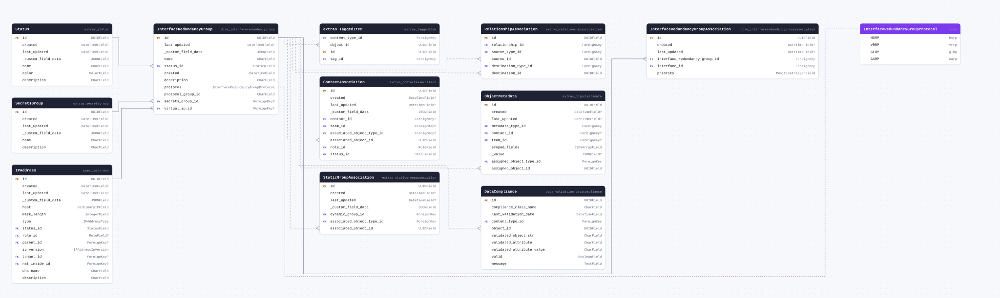

| Column | Field | Type | Null | Key | Default | Description |
| --- | --- | --- | --- | --- | --- | --- |
| `id` | `UUIDField` | `uuid` |  | PK | `uuid4()` |  |
| `last_updated` | `DateTimeField` | `timestamp with time zone` | yes |  | `now()` |  |
| `_custom_field_data` | `JSONField` | `jsonb` |  |  | `dict()` |  |
| `name` | `CharField` | `varchar(255)` |  | unique |  |  |
| `status_id` | `StatusField` | `uuid` |  | FK |  |  |
| `created` | `DateTimeField` | `timestamp with time zone` |  |  | `now()` |  |
| `description` | `CharField` | `varchar(255)` |  |  |  |  |
| `protocol` | `InterfaceRedundancyGroupProtocol` | `varchar(50)` |  |  |  |  |
| `protocol_group_id` | `CharField` | `varchar(255)` |  |  |  |  |
| `secrets_group_id` | `ForeignKey` | `uuid` | yes | FK | `None` |  |
| `virtual_ip_id` | `ForeignKey` | `uuid` | yes | FK |  |  |

Indexes:

- index `dcim_interfaceredundancygroup_name_908bfaee_like` on `name` (`varchar_pattern_ops`)
- index `dcim_interfaceredundancygroup_status_id_751f2043` on `status_id`
- index `dcim_interfaceredundancygroup_secrets_group_id_e31c9631` on `secrets_group_id`
- index `dcim_interfaceredundancygroup_virtual_ip_id_14cbd633` on `virtual_ip_id`

Relations:

- `tags` — many to many with [extras.Tag](#extrastag), through [extras.TaggedItem](#extrastaggeditem)
- `interfaces` — many to many with [Interface](#interface), through [InterfaceRedundancyGroupAssociation](#interfaceredundancygroupassociation)
- `status_id` → [Status](#status).`id`, on delete protect
- `secrets_group_id` → [SecretsGroup](#secretsgroup).`id`, on delete set null
- `virtual_ip_id` → [IPAddress](#ipaddress).`id`, on delete cascade
- `tagged_items` ← [extras.TaggedItem](#extrastaggeditem), by `content_type_id` + `object_id` (generic relation)
- `associated_contacts` ← [ContactAssociation](#contactassociation), by `associated_object_type_id` + `associated_object_id` (generic relation)
- `static_group_association_set` ← [StaticGroupAssociation](#staticgroupassociation), by `associated_object_type_id` + `associated_object_id` (generic relation)
- `source_for_associations` ← [RelationshipAssociation](#relationshipassociation), by `source_type_id` + `source_id` (generic relation)
- `destination_for_associations` ← [RelationshipAssociation](#relationshipassociation), by `destination_type_id` + `destination_id` (generic relation)
- `associated_object_metadata` ← [ObjectMetadata](#objectmetadata), by `assigned_object_type_id` + `assigned_object_id` (generic relation)
- `associated_data_compliance` ← [DataCompliance](#datacompliance), by `content_type_id` + `object_id` (generic relation)
- [InterfaceRedundancyGroupAssociation](#interfaceredundancygroupassociation).`interface_redundancy_group_id` → `id`, on delete cascade

## InterfaceRedundancyGroupAssociation

Table `dcim_interfaceredundancygroupassociation`, app `dcim`.

Columns from `BaseModel` (abstract): `id`.

Columns from `ChangeLoggedModel` (abstract): `created`, `last_updated`.

Intermediary model for associating Interface(s) to InterfaceRedundancyGroup(s).

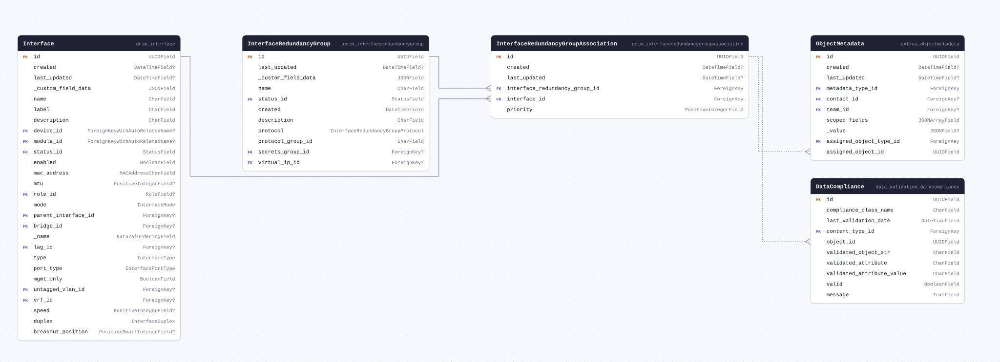

| Column | Field | Type | Null | Key | Default | Description |
| --- | --- | --- | --- | --- | --- | --- |
| `id` | `UUIDField` | `uuid` |  | PK | `uuid4()` |  |
| `created` | `DateTimeField` | `timestamp with time zone` | yes |  | `now()` |  |
| `last_updated` | `DateTimeField` | `timestamp with time zone` | yes |  | `now()` |  |
| `interface_redundancy_group_id` | `ForeignKey` | `uuid` |  | FK |  |  |
| `interface_id` | `ForeignKey` | `uuid` |  | FK |  |  |
| `priority` | `PositiveIntegerField` | `integer` |  |  |  |  |

Indexes:

- index `dcim_interfaceredundancygr_interface_redundancy_group_a12adcaa` on `interface_redundancy_group_id`
- index `dcim_interfaceredundancygroupassociation_interface_id_a2cd97e8` on `interface_id`
- unique `dcim_interfaceredundancy_interface_redundancy_gro_5aece630_uniq` on `interface_redundancy_group_id`, `interface_id`

Relations:

- `interface_redundancy_group_id` → [InterfaceRedundancyGroup](#interfaceredundancygroup).`id`, on delete cascade
- `interface_id` → [Interface](#interface).`id`, on delete cascade
- `associated_object_metadata` ← [ObjectMetadata](#objectmetadata), by `assigned_object_type_id` + `assigned_object_id` (generic relation)
- `associated_data_compliance` ← [DataCompliance](#datacompliance), by `content_type_id` + `object_id` (generic relation)

## FrontPort

Table `dcim_frontport`, app `dcim`.

Columns from `ModularComponentModel` (abstract): `module_id`.

Columns from `ComponentModel` (abstract): `device_id`, `name`, `_name`, `label`, `description`.

Columns from `ChangeLoggedModel` (abstract): `created`, `last_updated`.

Columns from `CustomFieldModel` (abstract): `_custom_field_data`.

Columns from `BaseModel` (abstract): `id`.

A pass-through port on the front of a Device or Module.

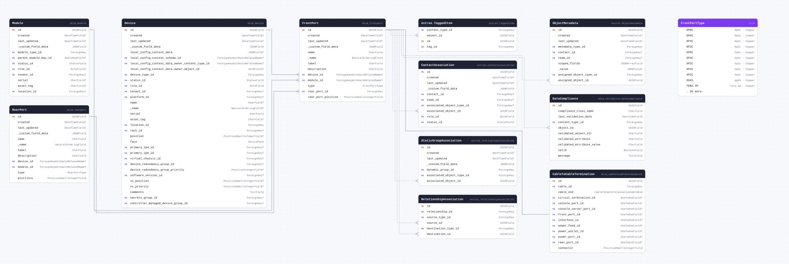

| Column | Field | Type | Null | Key | Default | Description |
| --- | --- | --- | --- | --- | --- | --- |
| `id` | `UUIDField` | `uuid` |  | PK | `uuid4()` |  |
| `created` | `DateTimeField` | `timestamp with time zone` | yes |  | `now()` |  |
| `last_updated` | `DateTimeField` | `timestamp with time zone` | yes |  | `now()` |  |
| `_custom_field_data` | `JSONField` | `jsonb` |  |  | `dict()` |  |
| `name` | `CharField` | `varchar(255)` |  |  |  |  |
| `_name` | `NaturalOrderingField` | `varchar(255)` |  |  |  |  |
| `label` | `CharField` | `varchar(255)` |  |  |  | Physical label |
| `description` | `CharField` | `varchar(255)` |  |  |  |  |
| `device_id` | `ForeignKeyWithAutoRelatedName` | `uuid` | yes | FK |  |  |
| `module_id` | `ForeignKeyWithAutoRelatedName` | `uuid` | yes | FK |  |  |
| `type` | `FrontPortType` | `varchar(50)` |  |  |  |  |
| `rear_port_id` | `ForeignKey` | `uuid` |  | FK |  |  |
| `rear_port_position` | `PositiveSmallIntegerField` | `smallint` |  |  | `1` |  |

Indexes:

- index `dcim_frontport_name_8972111f` on `name`
- index `dcim_frontport_name_8972111f_like` on `name` (`varchar_pattern_ops`)
- index `dcim_frontport__name_273b2ca3` on `_name`
- index `dcim_frontport__name_273b2ca3_like` on `_name` (`varchar_pattern_ops`)
- index `dcim_frontport_device_id_950557b5` on `device_id`
- index `dcim_frontport_module_id_952c3f9a` on `module_id`
- index `dcim_frontport_rear_port_id_78df2532` on `rear_port_id`
- unique `dcim_frontport_module_name_unique` on `module_id`, `name`
- unique `dcim_frontport_rear_port_position_unique` on `rear_port_id`, `rear_port_position`

Relations:

- `tags` — many to many with [extras.Tag](#extrastag), through [extras.TaggedItem](#extrastaggeditem)
- `device_id` → [Device](#device).`id`, on delete cascade
- `module_id` → [Module](#module).`id`, on delete cascade
- `rear_port_id` → [RearPort](#rearport).`id`, on delete cascade
- `tagged_items` ← [extras.TaggedItem](#extrastaggeditem), by `content_type_id` + `object_id` (generic relation)
- `associated_contacts` ← [ContactAssociation](#contactassociation), by `associated_object_type_id` + `associated_object_id` (generic relation)
- `static_group_association_set` ← [StaticGroupAssociation](#staticgroupassociation), by `associated_object_type_id` + `associated_object_id` (generic relation)
- `source_for_associations` ← [RelationshipAssociation](#relationshipassociation), by `source_type_id` + `source_id` (generic relation)
- `destination_for_associations` ← [RelationshipAssociation](#relationshipassociation), by `destination_type_id` + `destination_id` (generic relation)
- `associated_object_metadata` ← [ObjectMetadata](#objectmetadata), by `assigned_object_type_id` + `assigned_object_id` (generic relation)
- `associated_data_compliance` ← [DataCompliance](#datacompliance), by `content_type_id` + `object_id` (generic relation)
- [CableToCableTermination](#cabletocabletermination).`front_port_id` → `id`, on delete cascade

## RearPort

Table `dcim_rearport`, app `dcim`.

Columns from `ModularComponentModel` (abstract): `module_id`.

Columns from `ComponentModel` (abstract): `device_id`, `name`, `_name`, `label`, `description`.

Columns from `ChangeLoggedModel` (abstract): `created`, `last_updated`.

Columns from `CustomFieldModel` (abstract): `_custom_field_data`.

Columns from `BaseModel` (abstract): `id`.

A pass-through port on the rear of a Device or Module.

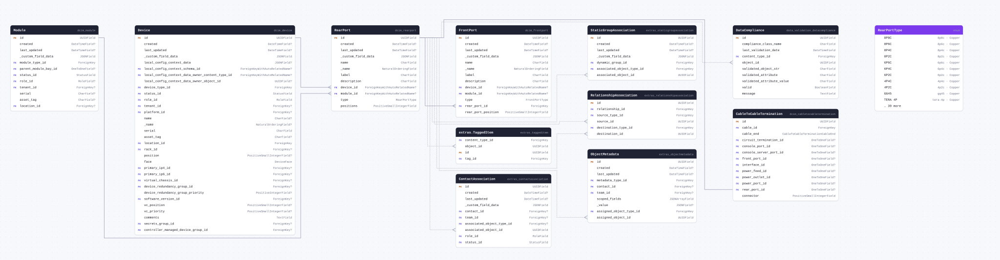

| Column | Field | Type | Null | Key | Default | Description |
| --- | --- | --- | --- | --- | --- | --- |
| `id` | `UUIDField` | `uuid` |  | PK | `uuid4()` |  |
| `created` | `DateTimeField` | `timestamp with time zone` | yes |  | `now()` |  |
| `last_updated` | `DateTimeField` | `timestamp with time zone` | yes |  | `now()` |  |
| `_custom_field_data` | `JSONField` | `jsonb` |  |  | `dict()` |  |
| `name` | `CharField` | `varchar(255)` |  |  |  |  |
| `_name` | `NaturalOrderingField` | `varchar(255)` |  |  |  |  |
| `label` | `CharField` | `varchar(255)` |  |  |  | Physical label |
| `description` | `CharField` | `varchar(255)` |  |  |  |  |
| `device_id` | `ForeignKeyWithAutoRelatedName` | `uuid` | yes | FK |  |  |
| `module_id` | `ForeignKeyWithAutoRelatedName` | `uuid` | yes | FK |  |  |
| `type` | `RearPortType` | `varchar(50)` |  |  |  |  |
| `positions` | `PositiveSmallIntegerField` | `smallint` |  |  | `1` |  |

Indexes:

- index `dcim_rearport_name_2300a129` on `name`
- index `dcim_rearport_name_2300a129_like` on `name` (`varchar_pattern_ops`)
- index `dcim_rearport__name_50f20c9e` on `_name`
- index `dcim_rearport__name_50f20c9e_like` on `_name` (`varchar_pattern_ops`)
- index `dcim_rearport_device_id_0bdfe9c0` on `device_id`
- index `dcim_rearport_module_id_9a7b7e91` on `module_id`
- unique `dcim_rearport_module_name_unique` on `module_id`, `name`

Relations:

- `tags` — many to many with [extras.Tag](#extrastag), through [extras.TaggedItem](#extrastaggeditem)
- [FrontPort](#frontport).`rear_port_id` → `id`, on delete cascade
- `device_id` → [Device](#device).`id`, on delete cascade
- `module_id` → [Module](#module).`id`, on delete cascade
- `tagged_items` ← [extras.TaggedItem](#extrastaggeditem), by `content_type_id` + `object_id` (generic relation)
- `associated_contacts` ← [ContactAssociation](#contactassociation), by `associated_object_type_id` + `associated_object_id` (generic relation)
- `static_group_association_set` ← [StaticGroupAssociation](#staticgroupassociation), by `associated_object_type_id` + `associated_object_id` (generic relation)
- `source_for_associations` ← [RelationshipAssociation](#relationshipassociation), by `source_type_id` + `source_id` (generic relation)
- `destination_for_associations` ← [RelationshipAssociation](#relationshipassociation), by `destination_type_id` + `destination_id` (generic relation)
- `associated_object_metadata` ← [ObjectMetadata](#objectmetadata), by `assigned_object_type_id` + `assigned_object_id` (generic relation)
- `associated_data_compliance` ← [DataCompliance](#datacompliance), by `content_type_id` + `object_id` (generic relation)
- [CableToCableTermination](#cabletocabletermination).`rear_port_id` → `id`, on delete cascade

## DeviceBay

Table `dcim_devicebay`, app `dcim`.

Columns from `ComponentModel` (abstract): `device_id`, `name`, `_name`, `label`, `description`.

Columns from `ChangeLoggedModel` (abstract): `created`, `last_updated`.

Columns from `CustomFieldModel` (abstract): `_custom_field_data`.

Columns from `BaseModel` (abstract): `id`.

An empty space within a Device which can house a child device

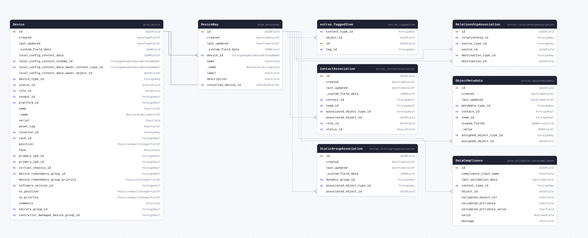

| Column | Field | Type | Null | Key | Default | Description |
| --- | --- | --- | --- | --- | --- | --- |
| `id` | `UUIDField` | `uuid` |  | PK | `uuid4()` |  |
| `created` | `DateTimeField` | `timestamp with time zone` | yes |  | `now()` |  |
| `last_updated` | `DateTimeField` | `timestamp with time zone` | yes |  | `now()` |  |
| `_custom_field_data` | `JSONField` | `jsonb` |  |  | `dict()` |  |
| `device_id` | `ForeignKeyWithAutoRelatedName` | `uuid` |  | FK |  |  |
| `name` | `CharField` | `varchar(255)` |  |  |  |  |
| `_name` | `NaturalOrderingField` | `varchar(255)` |  |  |  |  |
| `label` | `CharField` | `varchar(255)` |  |  |  | Physical label |
| `description` | `CharField` | `varchar(255)` |  |  |  |  |
| `installed_device_id` | `OneToOneField` | `uuid` | yes | FK, unique |  |  |

Indexes:

- index `dcim_devicebay_device_id_0c8a1218` on `device_id`
- index `dcim_devicebay_name_ee470978` on `name`
- index `dcim_devicebay_name_ee470978_like` on `name` (`varchar_pattern_ops`)
- index `dcim_devicebay__name_d9f2bdd3` on `_name`
- index `dcim_devicebay__name_d9f2bdd3_like` on `_name` (`varchar_pattern_ops`)
- unique `dcim_devicebay_device_id_name_2475a67b_uniq` on `device_id`, `name`

Relations:

- `tags` — many to many with [extras.Tag](#extrastag), through [extras.TaggedItem](#extrastaggeditem)
- `device_id` → [Device](#device).`id`, on delete cascade
- `installed_device_id` → [Device](#device).`id`, on delete set null
- `tagged_items` ← [extras.TaggedItem](#extrastaggeditem), by `content_type_id` + `object_id` (generic relation)
- `associated_contacts` ← [ContactAssociation](#contactassociation), by `associated_object_type_id` + `associated_object_id` (generic relation)
- `static_group_association_set` ← [StaticGroupAssociation](#staticgroupassociation), by `associated_object_type_id` + `associated_object_id` (generic relation)
- `source_for_associations` ← [RelationshipAssociation](#relationshipassociation), by `source_type_id` + `source_id` (generic relation)
- `destination_for_associations` ← [RelationshipAssociation](#relationshipassociation), by `destination_type_id` + `destination_id` (generic relation)
- `associated_object_metadata` ← [ObjectMetadata](#objectmetadata), by `assigned_object_type_id` + `assigned_object_id` (generic relation)
- `associated_data_compliance` ← [DataCompliance](#datacompliance), by `content_type_id` + `object_id` (generic relation)

## InventoryItem

Table `dcim_inventoryitem`, app `dcim`.

Columns from `TreeNode` (abstract): `parent_id`.

Columns from `ComponentModel` (abstract): `device_id`, `name`, `_name`, `label`, `description`.

Columns from `ChangeLoggedModel` (abstract): `created`, `last_updated`.

Columns from `CustomFieldModel` (abstract): `_custom_field_data`.

Columns from `BaseModel` (abstract): `id`.

An InventoryItem represents a serialized piece of hardware within a Device, such as a line card or power supply.
InventoryItems are used only for inventory purposes.

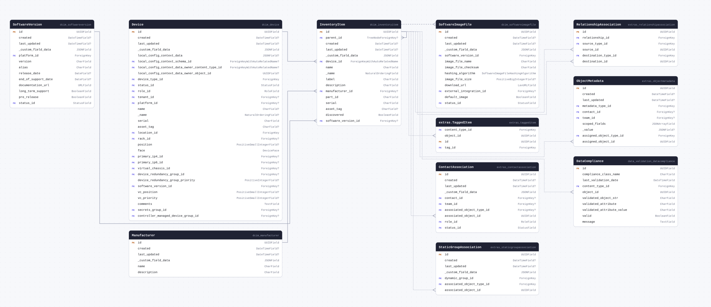

| Column | Field | Type | Null | Key | Default | Description |
| --- | --- | --- | --- | --- | --- | --- |
| `id` | `UUIDField` | `uuid` |  | PK | `uuid4()` |  |
| `parent_id` | `TreeNodeForeignKey` | `uuid` | yes | FK |  |  |
| `created` | `DateTimeField` | `timestamp with time zone` | yes |  | `now()` |  |
| `last_updated` | `DateTimeField` | `timestamp with time zone` | yes |  | `now()` |  |
| `_custom_field_data` | `JSONField` | `jsonb` |  |  | `dict()` |  |
| `device_id` | `ForeignKeyWithAutoRelatedName` | `uuid` |  | FK |  |  |
| `name` | `CharField` | `varchar(255)` |  |  |  |  |
| `_name` | `NaturalOrderingField` | `varchar(255)` |  |  |  |  |
| `label` | `CharField` | `varchar(255)` |  |  |  | Physical label |
| `description` | `CharField` | `varchar(255)` |  |  |  |  |
| `manufacturer_id` | `ForeignKey` | `uuid` | yes | FK |  |  |
| `part_id` | `CharField` | `varchar(255)` |  |  |  | Manufacturer-assigned part identifier |
| `serial` | `CharField` | `varchar(255)` |  |  |  |  |
| `asset_tag` | `CharField` | `varchar(255)` | yes | unique |  | A unique tag used to identify this item |
| `discovered` | `BooleanField` | `boolean` |  |  | `False` | This item was automatically discovered |
| `software_version_id` | `ForeignKey` | `uuid` | yes | FK |  | The software version installed on this inventory item |

Indexes:

- index `dcim_inventoryitem_parent_id_7ebcd457` on `parent_id`
- index `dcim_inventoryitem_device_id_033d83f8` on `device_id`
- index `dcim_inventoryitem_name_3e415949` on `name`
- index `dcim_inventoryitem_name_3e415949_like` on `name` (`varchar_pattern_ops`)
- index `dcim_inventoryitem__name_959f73cc` on `_name`
- index `dcim_inventoryitem__name_959f73cc_like` on `_name` (`varchar_pattern_ops`)
- index `dcim_inventoryitem_manufacturer_id_dcd1b78a` on `manufacturer_id`
- index `dcim_inventoryitem_serial_9f53019e` on `serial`
- index `dcim_inventoryitem_serial_9f53019e_like` on `serial` (`varchar_pattern_ops`)
- index `dcim_inventoryitem_asset_tag_d3289273_like` on `asset_tag` (`varchar_pattern_ops`)
- index `dcim_inventoryitem_software_version_id_0e33b2f2` on `software_version_id`
- unique `dcim_inventoryitem_device_id_parent_id_name_bb84bd2b_uniq` on `device_id`, `parent_id`, `name`

Relations:

- `tags` — many to many with [extras.Tag](#extrastag), through [extras.TaggedItem](#extrastaggeditem)
- `parent_id` → [InventoryItem](#inventoryitem).`id`, on delete cascade
- `device_id` → [Device](#device).`id`, on delete cascade
- `manufacturer_id` → [Manufacturer](#manufacturer).`id`, on delete protect
- `software_version_id` → [SoftwareVersion](#softwareversion).`id`, on delete protect
- `software_image_files` — many to many with [SoftwareImageFile](#softwareimagefile)
- `tagged_items` ← [extras.TaggedItem](#extrastaggeditem), by `content_type_id` + `object_id` (generic relation)
- `associated_contacts` ← [ContactAssociation](#contactassociation), by `associated_object_type_id` + `associated_object_id` (generic relation)
- `static_group_association_set` ← [StaticGroupAssociation](#staticgroupassociation), by `associated_object_type_id` + `associated_object_id` (generic relation)
- `source_for_associations` ← [RelationshipAssociation](#relationshipassociation), by `source_type_id` + `source_id` (generic relation)
- `destination_for_associations` ← [RelationshipAssociation](#relationshipassociation), by `destination_type_id` + `destination_id` (generic relation)
- `associated_object_metadata` ← [ObjectMetadata](#objectmetadata), by `assigned_object_type_id` + `assigned_object_id` (generic relation)
- `associated_data_compliance` ← [DataCompliance](#datacompliance), by `content_type_id` + `object_id` (generic relation)

## ModuleBay

Table `dcim_modulebay`, app `dcim`.

Columns from `ChangeLoggedModel` (abstract): `created`, `last_updated`.

Columns from `CustomFieldModel` (abstract): `_custom_field_data`.

Columns from `BaseModel` (abstract): `id`.

A slot in a Device or Module which can contain Modules.

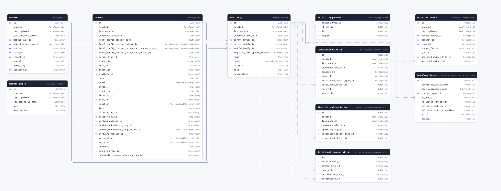

| Column | Field | Type | Null | Key | Default | Description |
| --- | --- | --- | --- | --- | --- | --- |
| `id` | `UUIDField` | `uuid` |  | PK | `uuid4()` |  |
| `created` | `DateTimeField` | `timestamp with time zone` | yes |  | `now()` |  |
| `last_updated` | `DateTimeField` | `timestamp with time zone` | yes |  | `now()` |  |
| `_custom_field_data` | `JSONField` | `jsonb` |  |  | `dict()` |  |
| `parent_device_id` | `ForeignKey` | `uuid` | yes | FK |  |  |
| `parent_module_id` | `ForeignKey` | `uuid` | yes | FK |  |  |
| `module_family_id` | `ForeignKey` | `uuid` | yes | FK |  | Module family that can be installed in this bay |
| `requires_first_party_modules` | `BooleanField` | `boolean` |  |  | `False` | This bay will only accept modules from the same manufacturer as the parent device or module |
| `name` | `CharField` | `varchar(255)` |  |  |  |  |
| `_name` | `NaturalOrderingField` | `varchar(255)` |  |  |  |  |
| `position` | `CharField` | `varchar(255)` |  |  |  | The position of the module bay within the parent device/module |
| `label` | `CharField` | `varchar(255)` |  |  |  | Physical label |
| `description` | `CharField` | `varchar(255)` |  |  |  |  |

Indexes:

- index `dcim_modulebay_parent_device_id_38ff7f03` on `parent_device_id`
- index `dcim_modulebay_parent_module_id_d76b681b` on `parent_module_id`
- index `dcim_modulebay_module_family_id_c5964e05` on `module_family_id`
- index `dcim_modulebay_name_7b5cb727` on `name`
- index `dcim_modulebay_name_7b5cb727_like` on `name` (`varchar_pattern_ops`)
- index `dcim_modulebay__name_92226737` on `_name`
- index `dcim_modulebay__name_92226737_like` on `_name` (`varchar_pattern_ops`)
- unique `dcim_modulebay_parent_module_name_unique` on `parent_module_id`, `name`

Relations:

- `tags` — many to many with [extras.Tag](#extrastag), through [extras.TaggedItem](#extrastaggeditem)
- `parent_device_id` → [Device](#device).`id`, on delete cascade
- `parent_module_id` → [Module](#module).`id`, on delete cascade
- `module_family_id` → [ModuleFamily](#modulefamily).`id`, on delete protect
- `tagged_items` ← [extras.TaggedItem](#extrastaggeditem), by `content_type_id` + `object_id` (generic relation)
- `associated_contacts` ← [ContactAssociation](#contactassociation), by `associated_object_type_id` + `associated_object_id` (generic relation)
- `static_group_association_set` ← [StaticGroupAssociation](#staticgroupassociation), by `associated_object_type_id` + `associated_object_id` (generic relation)
- `source_for_associations` ← [RelationshipAssociation](#relationshipassociation), by `source_type_id` + `source_id` (generic relation)
- `destination_for_associations` ← [RelationshipAssociation](#relationshipassociation), by `destination_type_id` + `destination_id` (generic relation)
- `associated_object_metadata` ← [ObjectMetadata](#objectmetadata), by `assigned_object_type_id` + `assigned_object_id` (generic relation)
- `associated_data_compliance` ← [DataCompliance](#datacompliance), by `content_type_id` + `object_id` (generic relation)
- [Module](#module).`parent_module_bay_id` → `id`, on delete cascade

## CableType

Table `dcim_cabletype`, app `dcim`.

Columns from `ChangeLoggedModel` (abstract): `created`, `last_updated`.

Columns from `CustomFieldModel` (abstract): `_custom_field_data`.

Columns from `BaseModel` (abstract): `id`.

A reusable definition of a kind of cable.

Includes (for breakout cables) internal lane structure, connectors on each side,
the total number of logical lanes, and the A-to-B lane mapping for the breakout.

By convention and by model enforcement, any breakout is A-to-B, not B-to-A; that is, `a_connectors` may never be
greater than `b_connectors`, though they may be equal. `total_lanes` must be evenly divisible by both
`a_connectors` and `b_connectors`; the implied per-side positions per connector are derived from that division.

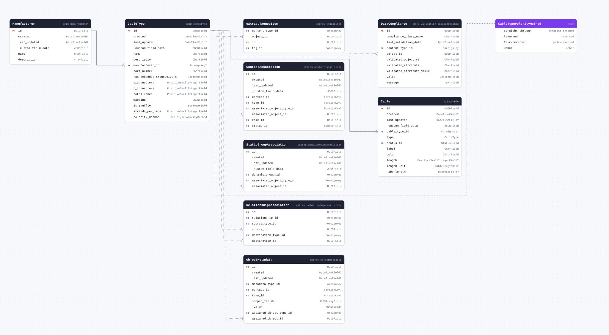

| Column | Field | Type | Null | Key | Default | Description |
| --- | --- | --- | --- | --- | --- | --- |
| `id` | `UUIDField` | `uuid` |  | PK | `uuid4()` |  |
| `created` | `DateTimeField` | `timestamp with time zone` | yes |  | `now()` |  |
| `last_updated` | `DateTimeField` | `timestamp with time zone` | yes |  | `now()` |  |
| `_custom_field_data` | `JSONField` | `jsonb` |  |  | `dict()` |  |
| `name` | `CharField` | `varchar(255)` |  | unique |  |  |
| `description` | `CharField` | `varchar(255)` |  |  |  |  |
| `manufacturer_id` | `ForeignKey` | `uuid` | yes | FK |  |  |
| `part_number` | `CharField` | `varchar(255)` |  |  |  | Discrete part number (optional) |
| `has_embedded_transceivers` | `BooleanField` | `boolean` |  |  | `False` | Indicates that this cable type has transceivers (e.g. SFP) built in. |
| `a_connectors` | `PositiveSmallIntegerField` | `smallint` |  |  | `1` | Number of physical connectors on the A side. |
| `b_connectors` | `PositiveSmallIntegerField` | `smallint` |  |  | `1` | Number of physical connectors on the B side. |
| `total_lanes` | `PositiveSmallIntegerField` | `smallint` |  |  | `1` | Total number of logical lanes in the breakout, distributed evenly across connectors on each side. |
| `mapping` | `JSONField` | `jsonb` |  |  | `list()` | A→B lane mapping as a JSON array of objects with keys: label, a_connector, a_position, b_connector, b_position. If empty, will be auto-populated. |
| `is_shuffle` | `BooleanField` | `boolean` |  |  | `False` | Indicates non-linear (polarity-shuffled) position mapping. Informational only. |
| `strands_per_lane` | `PositiveSmallIntegerField` | `smallint` |  |  | `1` | Number of physical strands per logical lane (e.g. 1 for copper, 2 for duplex fiber). |
| `polarity_method` | `CableTypePolarityMethod` | `varchar(50)` |  |  | `''` | Fiber polarity method. Informational only. |

Indexes:

- index `dcim_cabletype_name_2d321d6d_like` on `name` (`varchar_pattern_ops`)
- index `dcim_cabletype_manufacturer_id_49e6bbe2` on `manufacturer_id`

Relations:

- `tags` — many to many with [extras.Tag](#extrastag), through [extras.TaggedItem](#extrastaggeditem)
- `manufacturer_id` → [Manufacturer](#manufacturer).`id`, on delete protect
- `tagged_items` ← [extras.TaggedItem](#extrastaggeditem), by `content_type_id` + `object_id` (generic relation)
- `associated_contacts` ← [ContactAssociation](#contactassociation), by `associated_object_type_id` + `associated_object_id` (generic relation)
- `static_group_association_set` ← [StaticGroupAssociation](#staticgroupassociation), by `associated_object_type_id` + `associated_object_id` (generic relation)
- `source_for_associations` ← [RelationshipAssociation](#relationshipassociation), by `source_type_id` + `source_id` (generic relation)
- `destination_for_associations` ← [RelationshipAssociation](#relationshipassociation), by `destination_type_id` + `destination_id` (generic relation)
- `associated_object_metadata` ← [ObjectMetadata](#objectmetadata), by `assigned_object_type_id` + `assigned_object_id` (generic relation)
- `associated_data_compliance` ← [DataCompliance](#datacompliance), by `content_type_id` + `object_id` (generic relation)
- [Cable](#cable).`cable_type_id` → `id`, on delete protect

## Cable

Table `dcim_cable`, app `dcim`.

Columns from `ChangeLoggedModel` (abstract): `created`, `last_updated`.

Columns from `CustomFieldModel` (abstract): `_custom_field_data`.

Columns from `BaseModel` (abstract): `id`.

A physical connection between two endpoints.

Terminations are stored in the CableTermination join table. The `termination_a` and `termination_b`
properties retrieve the A-side and B-side termination on connector 1 respectively for backward
compatibility; use `terminations_a` / `terminations_b` to access all terminations on each side.

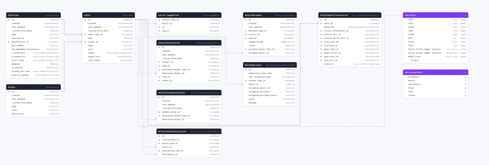

| Column | Field | Type | Null | Key | Default | Description |
| --- | --- | --- | --- | --- | --- | --- |
| `id` | `UUIDField` | `uuid` |  | PK | `uuid4()` |  |
| `created` | `DateTimeField` | `timestamp with time zone` | yes |  | `now()` |  |
| `last_updated` | `DateTimeField` | `timestamp with time zone` | yes |  | `now()` |  |
| `_custom_field_data` | `JSONField` | `jsonb` |  |  | `dict()` |  |
| `cable_type_id` | `ForeignKey` | `uuid` | yes | FK |  | The cable type defining this cable's lane structure and other properties.May be null for standard point-to-point cables. |
| `type` | `CableType` | `varchar(50)` |  |  |  |  |
| `status_id` | `StatusField` | `uuid` |  | FK |  |  |
| `label` | `CharField` | `varchar(255)` |  |  |  |  |
| `color` | `ColorField` | `varchar(6)` |  |  |  |  |
| `length` | `PositiveSmallIntegerField` | `smallint` | yes |  |  |  |
| `length_unit` | `CableLengthUnit` | `varchar(50)` |  |  |  |  |
| `_abs_length` | `DecimalField(13, 4)` | `numeric(13, 4)` | yes |  |  |  |

Indexes:

- index `dcim_cable_cable_type_id_476b3754` on `cable_type_id`
- index `dcim_cable_status_id_6a580869` on `status_id`

Relations:

- `tags` — many to many with [extras.Tag](#extrastag), through [extras.TaggedItem](#extrastaggeditem)
- `circuit_terminations` — many to many with [CircuitTermination](#circuittermination), through [CableToCableTermination](#cabletocabletermination)
- `console_ports` — many to many with [ConsolePort](#consoleport), through [CableToCableTermination](#cabletocabletermination)
- `console_server_ports` — many to many with [ConsoleServerPort](#consoleserverport), through [CableToCableTermination](#cabletocabletermination)
- `front_ports` — many to many with [FrontPort](#frontport), through [CableToCableTermination](#cabletocabletermination)
- `interfaces` — many to many with [Interface](#interface), through [CableToCableTermination](#cabletocabletermination)
- `power_feeds` — many to many with [PowerFeed](#powerfeed), through [CableToCableTermination](#cabletocabletermination)
- `power_outlets` — many to many with [PowerOutlet](#poweroutlet), through [CableToCableTermination](#cabletocabletermination)
- `power_ports` — many to many with [PowerPort](#powerport), through [CableToCableTermination](#cabletocabletermination)
- `rear_ports` — many to many with [RearPort](#rearport), through [CableToCableTermination](#cabletocabletermination)
- `cable_type_id` → [CableType](#cabletype).`id`, on delete protect
- `status_id` → [Status](#status).`id`, on delete protect
- `tagged_items` ← [extras.TaggedItem](#extrastaggeditem), by `content_type_id` + `object_id` (generic relation)
- `associated_contacts` ← [ContactAssociation](#contactassociation), by `associated_object_type_id` + `associated_object_id` (generic relation)
- `static_group_association_set` ← [StaticGroupAssociation](#staticgroupassociation), by `associated_object_type_id` + `associated_object_id` (generic relation)
- `source_for_associations` ← [RelationshipAssociation](#relationshipassociation), by `source_type_id` + `source_id` (generic relation)
- `destination_for_associations` ← [RelationshipAssociation](#relationshipassociation), by `destination_type_id` + `destination_id` (generic relation)
- `associated_object_metadata` ← [ObjectMetadata](#objectmetadata), by `assigned_object_type_id` + `assigned_object_id` (generic relation)
- `associated_data_compliance` ← [DataCompliance](#datacompliance), by `content_type_id` + `object_id` (generic relation)
- [CableToCableTermination](#cabletocabletermination).`cable_id` → `id`, on delete cascade

## CableToCableTermination

Table `dcim_cabletocabletermination`, app `dcim`.

Columns from `BaseModel` (abstract): `id`.

Join model between a Cable and a terminating object (Interface, FrontPort, RearPort, etc.).
Each cable has at least two such rows (one A-side, one B-side); breakout cables have multiple
rows per side, each with a connector identifying the physical port on that cable end. Lane-
level (position-within-connector) routing lives in the cable's `CableType.mapping`, not here:
a single termination occupies a connector, and the mapping describes which logical lanes that
connector carries.

Exactly one of the per-type foreign key fields (`interface`, `console_port`, etc.) is set on each
row, enforced via a CheckConstraint.

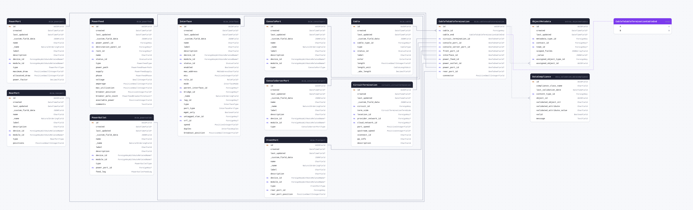

| Column | Field | Type | Null | Key | Default | Description |
| --- | --- | --- | --- | --- | --- | --- |
| `id` | `UUIDField` | `uuid` |  | PK | `uuid4()` |  |
| `cable_id` | `ForeignKey` | `uuid` |  | FK |  |  |
| `cable_end` | `CableToCableTerminationCableEnd` | `varchar(1)` |  |  |  |  |
| `circuit_termination_id` | `OneToOneField` | `uuid` | yes | FK, unique |  |  |
| `console_port_id` | `OneToOneField` | `uuid` | yes | FK, unique |  |  |
| `console_server_port_id` | `OneToOneField` | `uuid` | yes | FK, unique |  |  |
| `front_port_id` | `OneToOneField` | `uuid` | yes | FK, unique |  |  |
| `interface_id` | `OneToOneField` | `uuid` | yes | FK, unique |  |  |
| `power_feed_id` | `OneToOneField` | `uuid` | yes | FK, unique |  |  |
| `power_outlet_id` | `OneToOneField` | `uuid` | yes | FK, unique |  |  |
| `power_port_id` | `OneToOneField` | `uuid` | yes | FK, unique |  |  |
| `rear_port_id` | `OneToOneField` | `uuid` | yes | FK, unique |  |  |
| `connector` | `PositiveSmallIntegerField` | `smallint` |  |  | `1` | The connector number on this cable end. Always 1 for standard cables. |

Indexes:

- index `dcim_cabletocabletermination_cable_id_21aad480` on `cable_id`
- unique `dcim_cabletocabletermination_unique_connector` on `cable_id`, `cable_end`, `connector`

Checks:

- `dcim_cabletocabletermination_at_most_one_termination`: `(("circuit_termination_id" IS NULL AND "console_port_id" IS NULL AND "console_server_port_id" IS NULL AND "front_port_id" IS NULL AND "interface_id" IS NULL AND "power_feed_id" IS NULL AND "power_outlet_id" IS NULL AND "power_port_id" IS NULL AND "rear_port_id" IS NULL) OR ("circuit_termination_id" IS NOT NULL AND "console_port_id" IS NULL AND "console_server_port_id" IS NULL AND "front_port_id" IS NULL AND "interface_id" IS NULL AND "power_feed_id" IS NULL AND "power_outlet_id" IS NULL AND "power_port_id" IS NULL AND "rear_port_id" IS NULL) OR ("console_port_id" IS NOT NULL AND "circuit_termination_id" IS NULL AND "console_server_port_id" IS NULL AND "front_port_id" IS NULL AND "interface_id" IS NULL AND "power_feed_id" IS NULL AND "power_outlet_id" IS NULL AND "power_port_id" IS NULL AND "rear_port_id" IS NULL) OR ("console_server_port_id" IS NOT NULL AND "circuit_termination_id" IS NULL AND "console_port_id" IS NULL AND "front_port_id" IS NULL AND "interface_id" IS NULL AND "power_feed_id" IS NULL AND "power_outlet_id" IS NULL AND "power_port_id" IS NULL AND "rear_port_id" IS NULL) OR ("front_port_id" IS NOT NULL AND "circuit_termination_id" IS NULL AND "console_port_id" IS NULL AND "console_server_port_id" IS NULL AND "interface_id" IS NULL AND "power_feed_id" IS NULL AND "power_outlet_id" IS NULL AND "power_port_id" IS NULL AND "rear_port_id" IS NULL) OR ("interface_id" IS NOT NULL AND "circuit_termination_id" IS NULL AND "console_port_id" IS NULL AND "console_server_port_id" IS NULL AND "front_port_id" IS NULL AND "power_feed_id" IS NULL AND "power_outlet_id" IS NULL AND "power_port_id" IS NULL AND "rear_port_id" IS NULL) OR ("power_feed_id" IS NOT NULL AND "circuit_termination_id" IS NULL AND "console_port_id" IS NULL AND "console_server_port_id" IS NULL AND "front_port_id" IS NULL AND "interface_id" IS NULL AND "power_outlet_id" IS NULL AND "power_port_id" IS NULL AND "rear_port_id" IS NULL) OR ("power_outlet_id" IS NOT NULL AND "circuit_termination_id" IS NULL AND "console_port_id" IS NULL AND "console_server_port_id" IS NULL AND "front_port_id" IS NULL AND "interface_id" IS NULL AND "power_feed_id" IS NULL AND "power_port_id" IS NULL AND "rear_port_id" IS NULL) OR ("power_port_id" IS NOT NULL AND "circuit_termination_id" IS NULL AND "console_port_id" IS NULL AND "console_server_port_id" IS NULL AND "front_port_id" IS NULL AND "interface_id" IS NULL AND "power_feed_id" IS NULL AND "power_outlet_id" IS NULL AND "rear_port_id" IS NULL) OR ("rear_port_id" IS NOT NULL AND "circuit_termination_id" IS NULL AND "console_port_id" IS NULL AND "console_server_port_id" IS NULL AND "front_port_id" IS NULL AND "interface_id" IS NULL AND "power_feed_id" IS NULL AND "power_outlet_id" IS NULL AND "power_port_id" IS NULL))`

Relations:

- `cable_id` → [Cable](#cable).`id`, on delete cascade
- `circuit_termination_id` → [CircuitTermination](#circuittermination).`id`, on delete cascade
- `console_port_id` → [ConsolePort](#consoleport).`id`, on delete cascade
- `console_server_port_id` → [ConsoleServerPort](#consoleserverport).`id`, on delete cascade
- `front_port_id` → [FrontPort](#frontport).`id`, on delete cascade
- `interface_id` → [Interface](#interface).`id`, on delete cascade
- `power_feed_id` → [PowerFeed](#powerfeed).`id`, on delete cascade
- `power_outlet_id` → [PowerOutlet](#poweroutlet).`id`, on delete cascade
- `power_port_id` → [PowerPort](#powerport).`id`, on delete cascade
- `rear_port_id` → [RearPort](#rearport).`id`, on delete cascade
- `associated_object_metadata` ← [ObjectMetadata](#objectmetadata), by `assigned_object_type_id` + `assigned_object_id` (generic relation)
- `associated_data_compliance` ← [DataCompliance](#datacompliance), by `content_type_id` + `object_id` (generic relation)

## CablePath

Table `dcim_cablepath`, app `dcim`.

Columns from `BaseModel` (abstract): `id`.

A CablePath instance represents the physical path from an origin to a destination, including all intermediate
elements in the path. Every instance must specify an `origin`, whereas `destination` may be null (for paths which do
not terminate on a PathEndpoint).

`path` contains a list of nodes within the path, each represented by a tuple of (type, ID). The first element in the
path must be a Cable instance, followed by a pair of pass-through ports. For example, consider the following
topology:

                 1                              2                              3
    Interface A --- Front Port A | Rear Port A --- Rear Port B | Front Port B --- Interface B

This path would be expressed as:

CablePath(
    origin = Interface A
    destination = Interface B
    path = [Cable 1, Front Port A, Rear Port A, Cable 2, Rear Port B, Front Port B, Cable 3]
)

`is_active` is set to True only if 1) `destination` is not null, and 2) every Cable within the path has a status of
"connected".

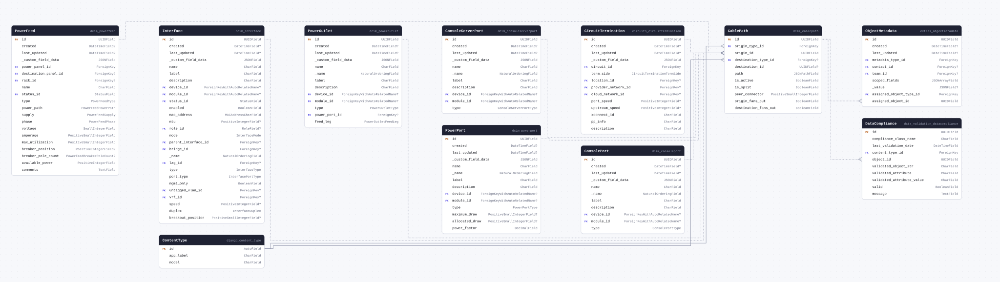

| Column | Field | Type | Null | Key | Default | Description |
| --- | --- | --- | --- | --- | --- | --- |
| `id` | `UUIDField` | `uuid` |  | PK | `uuid4()` |  |
| `origin_type_id` | `ForeignKey` | `integer` |  | FK |  |  |
| `origin_id` | `UUIDField` | `uuid` |  |  |  |  |
| `destination_type_id` | `ForeignKey` | `integer` | yes | FK |  |  |
| `destination_id` | `UUIDField` | `uuid` | yes |  |  |  |
| `path` | `JSONPathField` | `jsonb` |  |  |  |  |
| `is_active` | `BooleanField` | `boolean` |  |  | `False` |  |
| `is_split` | `BooleanField` | `boolean` |  |  | `False` |  |
| `peer_connector` | `PositiveSmallIntegerField` | `smallint` |  |  | `1` |  |
| `origin_fans_out` | `BooleanField` | `boolean` |  |  | `False` |  |
| `destination_fans_out` | `BooleanField` | `boolean` |  |  | `False` |  |

Indexes:

- index `dcim_cablepath_origin_type_id_6de54f6d` on `origin_type_id`
- index `dcim_cablepath_destination_type_id_a8c1654b` on `destination_type_id`
- unique `dcim_cablepath_origin_type_id_origin_id_93b779d6_uniq` on `origin_type_id`, `origin_id`, `peer_connector`

Relations:

- `origin` → any model, by `origin_type_id` + `origin_id` (generic foreign key)
- `destination` → any model, by `destination_type_id` + `destination_id` (generic foreign key)
- `origin_id` → [CircuitTermination](#circuittermination).`id` where `origin_type_id` is CircuitTermination (generic, `CircuitTermination.cable_paths`)
- `origin_id` → [ConsolePort](#consoleport).`id` where `origin_type_id` is ConsolePort (generic, `ConsolePort.cable_paths`)
- `origin_id` → [ConsoleServerPort](#consoleserverport).`id` where `origin_type_id` is ConsoleServerPort (generic, `ConsoleServerPort.cable_paths`)
- `origin_id` → [PowerPort](#powerport).`id` where `origin_type_id` is PowerPort (generic, `PowerPort.cable_paths`)
- `origin_id` → [PowerOutlet](#poweroutlet).`id` where `origin_type_id` is PowerOutlet (generic, `PowerOutlet.cable_paths`)
- `origin_id` → [Interface](#interface).`id` where `origin_type_id` is Interface (generic, `Interface.cable_paths`)
- `origin_type_id` → [ContentType](#contenttype).`id`, on delete cascade
- `destination_type_id` → [ContentType](#contenttype).`id`, on delete cascade
- `associated_object_metadata` ← [ObjectMetadata](#objectmetadata), by `assigned_object_type_id` + `assigned_object_id` (generic relation)
- `associated_data_compliance` ← [DataCompliance](#datacompliance), by `content_type_id` + `object_id` (generic relation)
- `origin_id` → [PowerFeed](#powerfeed).`id` where `origin_type_id` is PowerFeed (generic, `PowerFeed.cable_paths`)

## ConsolePortTemplate

Table `dcim_consoleporttemplate`, app `dcim`.

Columns from `ModularComponentTemplateModel` (abstract): `module_type_id`.

Columns from `ComponentTemplateModel` (abstract): `device_type_id`, `name`, `_name`, `label`, `description`.

Columns from `ChangeLoggedModel` (abstract): `created`, `last_updated`.

Columns from `CustomFieldModel` (abstract): `_custom_field_data`.

Columns from `BaseModel` (abstract): `id`.

A template for a ConsolePort to be created for a new Device.

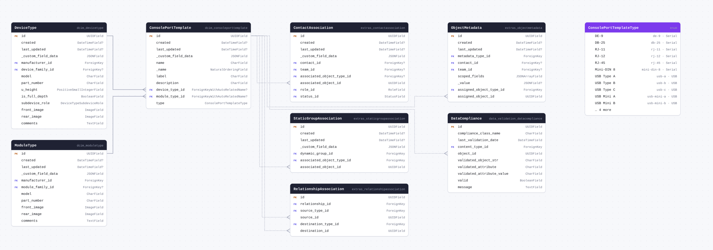

| Column | Field | Type | Null | Key | Default | Description |
| --- | --- | --- | --- | --- | --- | --- |
| `id` | `UUIDField` | `uuid` |  | PK | `uuid4()` |  |
| `created` | `DateTimeField` | `timestamp with time zone` | yes |  | `now()` |  |
| `last_updated` | `DateTimeField` | `timestamp with time zone` | yes |  | `now()` |  |
| `_custom_field_data` | `JSONField` | `jsonb` |  |  | `dict()` |  |
| `name` | `CharField` | `varchar(255)` |  |  |  |  |
| `_name` | `NaturalOrderingField` | `varchar(255)` |  |  |  |  |
| `label` | `CharField` | `varchar(255)` |  |  |  | Physical label |
| `description` | `CharField` | `varchar(255)` |  |  |  |  |
| `device_type_id` | `ForeignKeyWithAutoRelatedName` | `uuid` | yes | FK |  |  |
| `module_type_id` | `ForeignKeyWithAutoRelatedName` | `uuid` | yes | FK |  |  |
| `type` | `ConsolePortTemplateType` | `varchar(50)` |  |  |  |  |

Indexes:

- index `dcim_consoleporttemplate_device_type_id_075d4015` on `device_type_id`
- index `dcim_consoleporttemplate_module_type_id_c0f35d97` on `module_type_id`
- unique `dcim_consoleporttemplate_device_type_name_unique` on `device_type_id`, `name`
- unique `dcim_consoleporttemplate_module_type_name_unique` on `module_type_id`, `name`

Relations:

- `device_type_id` → [DeviceType](#devicetype).`id`, on delete cascade
- `module_type_id` → [ModuleType](#moduletype).`id`, on delete cascade
- `associated_contacts` ← [ContactAssociation](#contactassociation), by `associated_object_type_id` + `associated_object_id` (generic relation)
- `static_group_association_set` ← [StaticGroupAssociation](#staticgroupassociation), by `associated_object_type_id` + `associated_object_id` (generic relation)
- `source_for_associations` ← [RelationshipAssociation](#relationshipassociation), by `source_type_id` + `source_id` (generic relation)
- `destination_for_associations` ← [RelationshipAssociation](#relationshipassociation), by `destination_type_id` + `destination_id` (generic relation)
- `associated_object_metadata` ← [ObjectMetadata](#objectmetadata), by `assigned_object_type_id` + `assigned_object_id` (generic relation)
- `associated_data_compliance` ← [DataCompliance](#datacompliance), by `content_type_id` + `object_id` (generic relation)

## ConsoleServerPortTemplate

Table `dcim_consoleserverporttemplate`, app `dcim`.

Columns from `ModularComponentTemplateModel` (abstract): `module_type_id`.

Columns from `ComponentTemplateModel` (abstract): `device_type_id`, `name`, `_name`, `label`, `description`.

Columns from `ChangeLoggedModel` (abstract): `created`, `last_updated`.

Columns from `CustomFieldModel` (abstract): `_custom_field_data`.

Columns from `BaseModel` (abstract): `id`.

A template for a ConsoleServerPort to be created for a new Device.

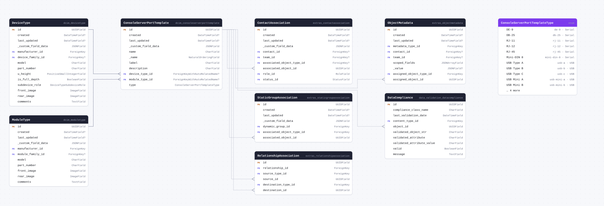

| Column | Field | Type | Null | Key | Default | Description |
| --- | --- | --- | --- | --- | --- | --- |
| `id` | `UUIDField` | `uuid` |  | PK | `uuid4()` |  |
| `created` | `DateTimeField` | `timestamp with time zone` | yes |  | `now()` |  |
| `last_updated` | `DateTimeField` | `timestamp with time zone` | yes |  | `now()` |  |
| `_custom_field_data` | `JSONField` | `jsonb` |  |  | `dict()` |  |
| `name` | `CharField` | `varchar(255)` |  |  |  |  |
| `_name` | `NaturalOrderingField` | `varchar(255)` |  |  |  |  |
| `label` | `CharField` | `varchar(255)` |  |  |  | Physical label |
| `description` | `CharField` | `varchar(255)` |  |  |  |  |
| `device_type_id` | `ForeignKeyWithAutoRelatedName` | `uuid` | yes | FK |  |  |
| `module_type_id` | `ForeignKeyWithAutoRelatedName` | `uuid` | yes | FK |  |  |
| `type` | `ConsoleServerPortTemplateType` | `varchar(50)` |  |  |  |  |

Indexes:

- index `dcim_consoleserverporttemplate_device_type_id_579bdc86` on `device_type_id`
- index `dcim_consoleserverporttemplate_module_type_id_4abf751a` on `module_type_id`
- unique `dcim_consoleserverporttemplate_device_type_name_unique` on `device_type_id`, `name`
- unique `dcim_consoleserverporttemplate_module_type_name_unique` on `module_type_id`, `name`

Relations:

- `device_type_id` → [DeviceType](#devicetype).`id`, on delete cascade
- `module_type_id` → [ModuleType](#moduletype).`id`, on delete cascade
- `associated_contacts` ← [ContactAssociation](#contactassociation), by `associated_object_type_id` + `associated_object_id` (generic relation)
- `static_group_association_set` ← [StaticGroupAssociation](#staticgroupassociation), by `associated_object_type_id` + `associated_object_id` (generic relation)
- `source_for_associations` ← [RelationshipAssociation](#relationshipassociation), by `source_type_id` + `source_id` (generic relation)
- `destination_for_associations` ← [RelationshipAssociation](#relationshipassociation), by `destination_type_id` + `destination_id` (generic relation)
- `associated_object_metadata` ← [ObjectMetadata](#objectmetadata), by `assigned_object_type_id` + `assigned_object_id` (generic relation)
- `associated_data_compliance` ← [DataCompliance](#datacompliance), by `content_type_id` + `object_id` (generic relation)

## PowerPortTemplate

Table `dcim_powerporttemplate`, app `dcim`.

Columns from `ModularComponentTemplateModel` (abstract): `module_type_id`.

Columns from `ComponentTemplateModel` (abstract): `device_type_id`, `name`, `_name`, `label`, `description`.

Columns from `ChangeLoggedModel` (abstract): `created`, `last_updated`.

Columns from `CustomFieldModel` (abstract): `_custom_field_data`.

Columns from `BaseModel` (abstract): `id`.

A template for a PowerPort to be created for a new Device.

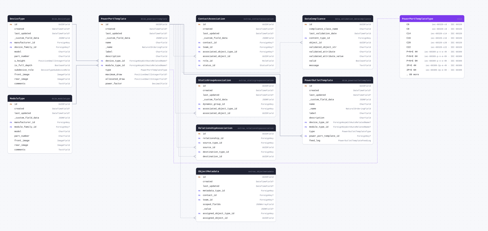

| Column | Field | Type | Null | Key | Default | Description |
| --- | --- | --- | --- | --- | --- | --- |
| `id` | `UUIDField` | `uuid` |  | PK | `uuid4()` |  |
| `created` | `DateTimeField` | `timestamp with time zone` | yes |  | `now()` |  |
| `last_updated` | `DateTimeField` | `timestamp with time zone` | yes |  | `now()` |  |
| `_custom_field_data` | `JSONField` | `jsonb` |  |  | `dict()` |  |
| `name` | `CharField` | `varchar(255)` |  |  |  |  |
| `_name` | `NaturalOrderingField` | `varchar(255)` |  |  |  |  |
| `label` | `CharField` | `varchar(255)` |  |  |  | Physical label |
| `description` | `CharField` | `varchar(255)` |  |  |  |  |
| `device_type_id` | `ForeignKeyWithAutoRelatedName` | `uuid` | yes | FK |  |  |
| `module_type_id` | `ForeignKeyWithAutoRelatedName` | `uuid` | yes | FK |  |  |
| `type` | `PowerPortTemplateType` | `varchar(50)` |  |  |  |  |
| `maximum_draw` | `PositiveSmallIntegerField` | `smallint` | yes |  |  | Maximum power draw (watts) |
| `allocated_draw` | `PositiveSmallIntegerField` | `smallint` | yes |  |  | Allocated power draw (watts) |
| `power_factor` | `DecimalField(4, 2)` | `numeric(4, 2)` |  |  | `Decimal('0.95')` | Power factor (0.01-1.00) for converting between watts (W) and volt-amps (VA). Defaults to 0.95. |

Indexes:

- index `dcim_powerporttemplate_device_type_id_1ddfbfcc` on `device_type_id`
- index `dcim_powerporttemplate_module_type_id_93e26849` on `module_type_id`
- unique `dcim_powerporttemplate_device_type_name_unique` on `device_type_id`, `name`
- unique `dcim_powerporttemplate_module_type_name_unique` on `module_type_id`, `name`

Relations:

- `device_type_id` → [DeviceType](#devicetype).`id`, on delete cascade
- `module_type_id` → [ModuleType](#moduletype).`id`, on delete cascade
- `associated_contacts` ← [ContactAssociation](#contactassociation), by `associated_object_type_id` + `associated_object_id` (generic relation)
- `static_group_association_set` ← [StaticGroupAssociation](#staticgroupassociation), by `associated_object_type_id` + `associated_object_id` (generic relation)
- `source_for_associations` ← [RelationshipAssociation](#relationshipassociation), by `source_type_id` + `source_id` (generic relation)
- `destination_for_associations` ← [RelationshipAssociation](#relationshipassociation), by `destination_type_id` + `destination_id` (generic relation)
- `associated_object_metadata` ← [ObjectMetadata](#objectmetadata), by `assigned_object_type_id` + `assigned_object_id` (generic relation)
- `associated_data_compliance` ← [DataCompliance](#datacompliance), by `content_type_id` + `object_id` (generic relation)
- [PowerOutletTemplate](#poweroutlettemplate).`power_port_template_id` → `id`, on delete set null

## PowerOutletTemplate

Table `dcim_poweroutlettemplate`, app `dcim`.

Columns from `ModularComponentTemplateModel` (abstract): `module_type_id`.

Columns from `ComponentTemplateModel` (abstract): `device_type_id`, `name`, `_name`, `label`, `description`.

Columns from `ChangeLoggedModel` (abstract): `created`, `last_updated`.

Columns from `CustomFieldModel` (abstract): `_custom_field_data`.

Columns from `BaseModel` (abstract): `id`.

A template for a PowerOutlet to be created for a new Device.

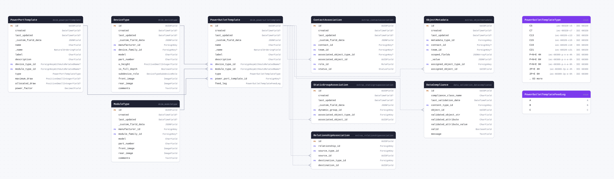

| Column | Field | Type | Null | Key | Default | Description |
| --- | --- | --- | --- | --- | --- | --- |
| `id` | `UUIDField` | `uuid` |  | PK | `uuid4()` |  |
| `created` | `DateTimeField` | `timestamp with time zone` | yes |  | `now()` |  |
| `last_updated` | `DateTimeField` | `timestamp with time zone` | yes |  | `now()` |  |
| `_custom_field_data` | `JSONField` | `jsonb` |  |  | `dict()` |  |
| `name` | `CharField` | `varchar(255)` |  |  |  |  |
| `_name` | `NaturalOrderingField` | `varchar(255)` |  |  |  |  |
| `label` | `CharField` | `varchar(255)` |  |  |  | Physical label |
| `description` | `CharField` | `varchar(255)` |  |  |  |  |
| `device_type_id` | `ForeignKeyWithAutoRelatedName` | `uuid` | yes | FK |  |  |
| `module_type_id` | `ForeignKeyWithAutoRelatedName` | `uuid` | yes | FK |  |  |
| `type` | `PowerOutletTemplateType` | `varchar(50)` |  |  |  |  |
| `power_port_template_id` | `ForeignKey` | `uuid` | yes | FK |  |  |
| `feed_leg` | `PowerOutletTemplateFeedLeg` | `varchar(50)` |  |  |  | Phase (for three-phase feeds) |

Indexes:

- index `dcim_poweroutlettemplate_device_type_id_26b2316c` on `device_type_id`
- index `dcim_poweroutlettemplate_module_type_id_6142b416` on `module_type_id`
- index `dcim_poweroutlettemplate_power_port_template_id_fd11e222` on `power_port_template_id`
- unique `dcim_poweroutlettemplate_device_type_name_unique` on `device_type_id`, `name`
- unique `dcim_poweroutlettemplate_module_type_name_unique` on `module_type_id`, `name`

Relations:

- `device_type_id` → [DeviceType](#devicetype).`id`, on delete cascade
- `module_type_id` → [ModuleType](#moduletype).`id`, on delete cascade
- `power_port_template_id` → [PowerPortTemplate](#powerporttemplate).`id`, on delete set null
- `associated_contacts` ← [ContactAssociation](#contactassociation), by `associated_object_type_id` + `associated_object_id` (generic relation)
- `static_group_association_set` ← [StaticGroupAssociation](#staticgroupassociation), by `associated_object_type_id` + `associated_object_id` (generic relation)
- `source_for_associations` ← [RelationshipAssociation](#relationshipassociation), by `source_type_id` + `source_id` (generic relation)
- `destination_for_associations` ← [RelationshipAssociation](#relationshipassociation), by `destination_type_id` + `destination_id` (generic relation)
- `associated_object_metadata` ← [ObjectMetadata](#objectmetadata), by `assigned_object_type_id` + `assigned_object_id` (generic relation)
- `associated_data_compliance` ← [DataCompliance](#datacompliance), by `content_type_id` + `object_id` (generic relation)

## InterfaceTemplate

Table `dcim_interfacetemplate`, app `dcim`.

Columns from `ModularComponentTemplateModel` (abstract): `module_type_id`.

Columns from `ComponentTemplateModel` (abstract): `device_type_id`, `name`, `_name`, `label`, `description`.

Columns from `ChangeLoggedModel` (abstract): `created`, `last_updated`.

Columns from `CustomFieldModel` (abstract): `_custom_field_data`.

Columns from `BaseModel` (abstract): `id`.

A template for a physical data interface on a new Device.

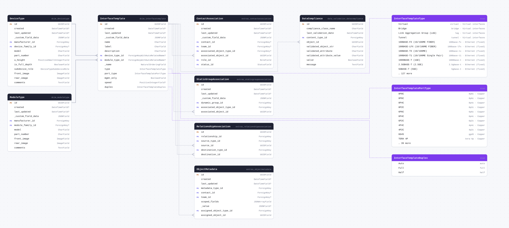

| Column | Field | Type | Null | Key | Default | Description |
| --- | --- | --- | --- | --- | --- | --- |
| `id` | `UUIDField` | `uuid` |  | PK | `uuid4()` |  |
| `created` | `DateTimeField` | `timestamp with time zone` | yes |  | `now()` |  |
| `last_updated` | `DateTimeField` | `timestamp with time zone` | yes |  | `now()` |  |
| `_custom_field_data` | `JSONField` | `jsonb` |  |  | `dict()` |  |
| `name` | `CharField` | `varchar(255)` |  |  |  |  |
| `label` | `CharField` | `varchar(255)` |  |  |  | Physical label |
| `description` | `CharField` | `varchar(255)` |  |  |  |  |
| `device_type_id` | `ForeignKeyWithAutoRelatedName` | `uuid` | yes | FK |  |  |
| `module_type_id` | `ForeignKeyWithAutoRelatedName` | `uuid` | yes | FK |  |  |
| `_name` | `NaturalOrderingField` | `varchar(255)` |  |  |  |  |
| `type` | `InterfaceTemplateType` | `varchar(50)` |  |  |  |  |
| `port_type` | `InterfaceTemplatePortType` | `varchar(50)` |  |  |  | Physical connector type |
| `mgmt_only` | `BooleanField` | `boolean` |  |  | `False` |  |
| `speed` | `PositiveIntegerField` | `integer` | yes |  |  |  |
| `duplex` | `InterfaceTemplateDuplex` | `varchar(10)` |  |  | `''` |  |

Indexes:

- index `dcim_interfacetemplate_device_type_id_4bfcbfab` on `device_type_id`
- index `dcim_interfacetemplate_module_type_id_f941f180` on `module_type_id`
- unique `dcim_interfacetemplate_device_type_name_unique` on `device_type_id`, `name`
- unique `dcim_interfacetemplate_module_type_name_unique` on `module_type_id`, `name`

Relations:

- `device_type_id` → [DeviceType](#devicetype).`id`, on delete cascade
- `module_type_id` → [ModuleType](#moduletype).`id`, on delete cascade
- `associated_contacts` ← [ContactAssociation](#contactassociation), by `associated_object_type_id` + `associated_object_id` (generic relation)
- `static_group_association_set` ← [StaticGroupAssociation](#staticgroupassociation), by `associated_object_type_id` + `associated_object_id` (generic relation)
- `source_for_associations` ← [RelationshipAssociation](#relationshipassociation), by `source_type_id` + `source_id` (generic relation)
- `destination_for_associations` ← [RelationshipAssociation](#relationshipassociation), by `destination_type_id` + `destination_id` (generic relation)
- `associated_object_metadata` ← [ObjectMetadata](#objectmetadata), by `assigned_object_type_id` + `assigned_object_id` (generic relation)
- `associated_data_compliance` ← [DataCompliance](#datacompliance), by `content_type_id` + `object_id` (generic relation)

## FrontPortTemplate

Table `dcim_frontporttemplate`, app `dcim`.

Columns from `ModularComponentTemplateModel` (abstract): `module_type_id`.

Columns from `ComponentTemplateModel` (abstract): `device_type_id`, `name`, `_name`, `label`, `description`.

Columns from `ChangeLoggedModel` (abstract): `created`, `last_updated`.

Columns from `CustomFieldModel` (abstract): `_custom_field_data`.

Columns from `BaseModel` (abstract): `id`.

Template for a pass-through port on the front of a new Device.

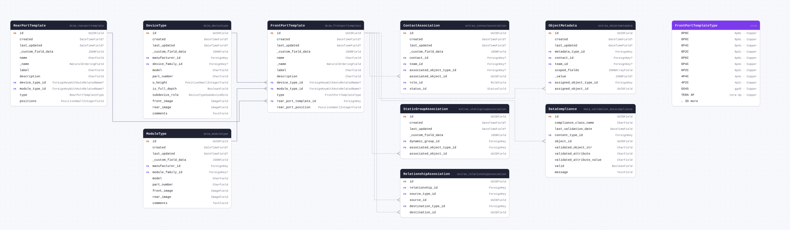

| Column | Field | Type | Null | Key | Default | Description |
| --- | --- | --- | --- | --- | --- | --- |
| `id` | `UUIDField` | `uuid` |  | PK | `uuid4()` |  |
| `created` | `DateTimeField` | `timestamp with time zone` | yes |  | `now()` |  |
| `last_updated` | `DateTimeField` | `timestamp with time zone` | yes |  | `now()` |  |
| `_custom_field_data` | `JSONField` | `jsonb` |  |  | `dict()` |  |
| `name` | `CharField` | `varchar(255)` |  |  |  |  |
| `_name` | `NaturalOrderingField` | `varchar(255)` |  |  |  |  |
| `label` | `CharField` | `varchar(255)` |  |  |  | Physical label |
| `description` | `CharField` | `varchar(255)` |  |  |  |  |
| `device_type_id` | `ForeignKeyWithAutoRelatedName` | `uuid` | yes | FK |  |  |
| `module_type_id` | `ForeignKeyWithAutoRelatedName` | `uuid` | yes | FK |  |  |
| `type` | `FrontPortTemplateType` | `varchar(50)` |  |  |  |  |
| `rear_port_template_id` | `ForeignKey` | `uuid` |  | FK |  |  |
| `rear_port_position` | `PositiveSmallIntegerField` | `smallint` |  |  | `1` |  |

Indexes:

- index `dcim_frontporttemplate_device_type_id_f088b952` on `device_type_id`
- index `dcim_frontporttemplate_module_type_id_66851ff9` on `module_type_id`
- index `dcim_frontporttemplate_rear_port_template_id_d6a910d0` on `rear_port_template_id`
- unique `dcim_frontporttemplate_device_type_name_unique` on `device_type_id`, `name`
- unique `dcim_frontporttemplate_module_type_name_unique` on `module_type_id`, `name`
- unique `dcim_frontporttemplate_rear_port_template_position_unique` on `rear_port_template_id`, `rear_port_position`

Relations:

- `device_type_id` → [DeviceType](#devicetype).`id`, on delete cascade
- `module_type_id` → [ModuleType](#moduletype).`id`, on delete cascade
- `rear_port_template_id` → [RearPortTemplate](#rearporttemplate).`id`, on delete cascade
- `associated_contacts` ← [ContactAssociation](#contactassociation), by `associated_object_type_id` + `associated_object_id` (generic relation)
- `static_group_association_set` ← [StaticGroupAssociation](#staticgroupassociation), by `associated_object_type_id` + `associated_object_id` (generic relation)
- `source_for_associations` ← [RelationshipAssociation](#relationshipassociation), by `source_type_id` + `source_id` (generic relation)
- `destination_for_associations` ← [RelationshipAssociation](#relationshipassociation), by `destination_type_id` + `destination_id` (generic relation)
- `associated_object_metadata` ← [ObjectMetadata](#objectmetadata), by `assigned_object_type_id` + `assigned_object_id` (generic relation)
- `associated_data_compliance` ← [DataCompliance](#datacompliance), by `content_type_id` + `object_id` (generic relation)

## RearPortTemplate

Table `dcim_rearporttemplate`, app `dcim`.

Columns from `ModularComponentTemplateModel` (abstract): `module_type_id`.

Columns from `ComponentTemplateModel` (abstract): `device_type_id`, `name`, `_name`, `label`, `description`.

Columns from `ChangeLoggedModel` (abstract): `created`, `last_updated`.

Columns from `CustomFieldModel` (abstract): `_custom_field_data`.

Columns from `BaseModel` (abstract): `id`.

Template for a pass-through port on the rear of a new Device.

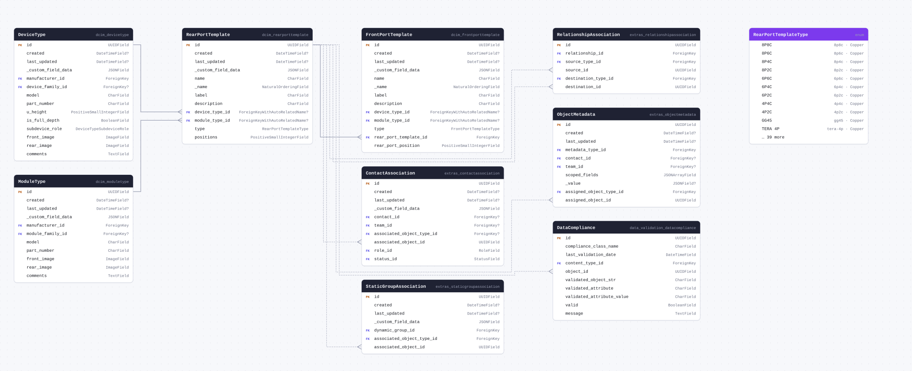

| Column | Field | Type | Null | Key | Default | Description |
| --- | --- | --- | --- | --- | --- | --- |
| `id` | `UUIDField` | `uuid` |  | PK | `uuid4()` |  |
| `created` | `DateTimeField` | `timestamp with time zone` | yes |  | `now()` |  |
| `last_updated` | `DateTimeField` | `timestamp with time zone` | yes |  | `now()` |  |
| `_custom_field_data` | `JSONField` | `jsonb` |  |  | `dict()` |  |
| `name` | `CharField` | `varchar(255)` |  |  |  |  |
| `_name` | `NaturalOrderingField` | `varchar(255)` |  |  |  |  |
| `label` | `CharField` | `varchar(255)` |  |  |  | Physical label |
| `description` | `CharField` | `varchar(255)` |  |  |  |  |
| `device_type_id` | `ForeignKeyWithAutoRelatedName` | `uuid` | yes | FK |  |  |
| `module_type_id` | `ForeignKeyWithAutoRelatedName` | `uuid` | yes | FK |  |  |
| `type` | `RearPortTemplateType` | `varchar(50)` |  |  |  |  |
| `positions` | `PositiveSmallIntegerField` | `smallint` |  |  | `1` |  |

Indexes:

- index `dcim_rearporttemplate_device_type_id_6a02fd01` on `device_type_id`
- index `dcim_rearporttemplate_module_type_id_4d970e5b` on `module_type_id`
- unique `dcim_rearporttemplate_device_type_name_unique` on `device_type_id`, `name`
- unique `dcim_rearporttemplate_module_type_name_unique` on `module_type_id`, `name`

Relations:

- [FrontPortTemplate](#frontporttemplate).`rear_port_template_id` → `id`, on delete cascade
- `device_type_id` → [DeviceType](#devicetype).`id`, on delete cascade
- `module_type_id` → [ModuleType](#moduletype).`id`, on delete cascade
- `associated_contacts` ← [ContactAssociation](#contactassociation), by `associated_object_type_id` + `associated_object_id` (generic relation)
- `static_group_association_set` ← [StaticGroupAssociation](#staticgroupassociation), by `associated_object_type_id` + `associated_object_id` (generic relation)
- `source_for_associations` ← [RelationshipAssociation](#relationshipassociation), by `source_type_id` + `source_id` (generic relation)
- `destination_for_associations` ← [RelationshipAssociation](#relationshipassociation), by `destination_type_id` + `destination_id` (generic relation)
- `associated_object_metadata` ← [ObjectMetadata](#objectmetadata), by `assigned_object_type_id` + `assigned_object_id` (generic relation)
- `associated_data_compliance` ← [DataCompliance](#datacompliance), by `content_type_id` + `object_id` (generic relation)

## DeviceBayTemplate

Table `dcim_devicebaytemplate`, app `dcim`.

Columns from `ComponentTemplateModel` (abstract): `device_type_id`, `name`, `_name`, `label`, `description`.

Columns from `ChangeLoggedModel` (abstract): `created`, `last_updated`.

Columns from `CustomFieldModel` (abstract): `_custom_field_data`.

Columns from `BaseModel` (abstract): `id`.

A template for a DeviceBay to be created for a new parent Device.


| Column | Field | Type | Null | Key | Default | Description |
| --- | --- | --- | --- | --- | --- | --- |
| `id` | `UUIDField` | `uuid` |  | PK | `uuid4()` |  |
| `created` | `DateTimeField` | `timestamp with time zone` | yes |  | `now()` |  |
| `last_updated` | `DateTimeField` | `timestamp with time zone` | yes |  | `now()` |  |
| `_custom_field_data` | `JSONField` | `jsonb` |  |  | `dict()` |  |
| `device_type_id` | `ForeignKeyWithAutoRelatedName` | `uuid` |  | FK |  |  |
| `name` | `CharField` | `varchar(255)` |  |  |  |  |
| `_name` | `NaturalOrderingField` | `varchar(255)` |  |  |  |  |
| `label` | `CharField` | `varchar(255)` |  |  |  | Physical label |
| `description` | `CharField` | `varchar(255)` |  |  |  |  |

Indexes:

- index `dcim_devicebaytemplate_device_type_id_f4b24a29` on `device_type_id`
- unique `dcim_devicebaytemplate_device_type_id_name_8f4899fe_uniq` on `device_type_id`, `name`

Relations:

- `device_type_id` → [DeviceType](#devicetype).`id`, on delete cascade
- `associated_contacts` ← [ContactAssociation](#contactassociation), by `associated_object_type_id` + `associated_object_id` (generic relation)
- `static_group_association_set` ← [StaticGroupAssociation](#staticgroupassociation), by `associated_object_type_id` + `associated_object_id` (generic relation)
- `source_for_associations` ← [RelationshipAssociation](#relationshipassociation), by `source_type_id` + `source_id` (generic relation)
- `destination_for_associations` ← [RelationshipAssociation](#relationshipassociation), by `destination_type_id` + `destination_id` (generic relation)
- `associated_object_metadata` ← [ObjectMetadata](#objectmetadata), by `assigned_object_type_id` + `assigned_object_id` (generic relation)
- `associated_data_compliance` ← [DataCompliance](#datacompliance), by `content_type_id` + `object_id` (generic relation)

## ModuleBayTemplate

Table `dcim_modulebaytemplate`, app `dcim`.

Columns from `ModularComponentTemplateModel` (abstract): `module_type_id`.

Columns from `ComponentTemplateModel` (abstract): `device_type_id`, `name`, `_name`, `label`, `description`.

Columns from `ChangeLoggedModel` (abstract): `created`, `last_updated`.

Columns from `CustomFieldModel` (abstract): `_custom_field_data`.

Columns from `BaseModel` (abstract): `id`.

Template for a slot in a Device or Module which can contain Modules.


| Column | Field | Type | Null | Key | Default | Description |
| --- | --- | --- | --- | --- | --- | --- |
| `id` | `UUIDField` | `uuid` |  | PK | `uuid4()` |  |
| `created` | `DateTimeField` | `timestamp with time zone` | yes |  | `now()` |  |
| `last_updated` | `DateTimeField` | `timestamp with time zone` | yes |  | `now()` |  |
| `_custom_field_data` | `JSONField` | `jsonb` |  |  | `dict()` |  |
| `name` | `CharField` | `varchar(255)` |  |  |  |  |
| `_name` | `NaturalOrderingField` | `varchar(255)` |  |  |  |  |
| `device_type_id` | `ForeignKeyWithAutoRelatedName` | `uuid` | yes | FK |  |  |
| `module_type_id` | `ForeignKeyWithAutoRelatedName` | `uuid` | yes | FK |  |  |
| `position` | `CharField` | `varchar(255)` |  |  |  | The position of the module bay within the device or module |
| `label` | `CharField` | `varchar(255)` |  |  |  | Physical label |
| `description` | `CharField` | `varchar(255)` |  |  |  |  |
| `module_family_id` | `ForeignKey` | `uuid` | yes | FK |  | Module family that can be installed in this bay. Leave blank for no restriction. |
| `requires_first_party_modules` | `BooleanField` | `boolean` |  |  | `False` | This bay will only accept modules from the same manufacturer as the parent device or module |

Indexes:

- index `dcim_modulebaytemplate_device_type_id_9eaf9bd3` on `device_type_id`
- index `dcim_modulebaytemplate_module_type_id_2fdfb491` on `module_type_id`
- index `dcim_modulebaytemplate_module_family_id_b0d298c7` on `module_family_id`
- unique `dcim_modulebaytemplate_device_type_name_unique` on `device_type_id`, `name`
- unique `dcim_modulebaytemplate_module_type_name_unique` on `module_type_id`, `name`

Relations:

- `device_type_id` → [DeviceType](#devicetype).`id`, on delete cascade
- `module_type_id` → [ModuleType](#moduletype).`id`, on delete cascade
- `module_family_id` → [ModuleFamily](#modulefamily).`id`, on delete protect
- `associated_contacts` ← [ContactAssociation](#contactassociation), by `associated_object_type_id` + `associated_object_id` (generic relation)
- `static_group_association_set` ← [StaticGroupAssociation](#staticgroupassociation), by `associated_object_type_id` + `associated_object_id` (generic relation)
- `source_for_associations` ← [RelationshipAssociation](#relationshipassociation), by `source_type_id` + `source_id` (generic relation)
- `destination_for_associations` ← [RelationshipAssociation](#relationshipassociation), by `destination_type_id` + `destination_id` (generic relation)
- `associated_object_metadata` ← [ObjectMetadata](#objectmetadata), by `assigned_object_type_id` + `assigned_object_id` (generic relation)
- `associated_data_compliance` ← [DataCompliance](#datacompliance), by `content_type_id` + `object_id` (generic relation)

## Manufacturer

Table `dcim_manufacturer`, app `dcim`.

Columns from `ChangeLoggedModel` (abstract): `created`, `last_updated`.

Columns from `CustomFieldModel` (abstract): `_custom_field_data`.

Columns from `BaseModel` (abstract): `id`.

A Manufacturer represents a company which produces hardware devices; for example, Juniper or Dell.


| Column | Field | Type | Null | Key | Default | Description |
| --- | --- | --- | --- | --- | --- | --- |
| `id` | `UUIDField` | `uuid` |  | PK | `uuid4()` |  |
| `created` | `DateTimeField` | `timestamp with time zone` | yes |  | `now()` |  |
| `last_updated` | `DateTimeField` | `timestamp with time zone` | yes |  | `now()` |  |
| `_custom_field_data` | `JSONField` | `jsonb` |  |  | `dict()` |  |
| `name` | `CharField` | `varchar(255)` |  | unique |  |  |
| `description` | `CharField` | `varchar(255)` |  |  |  |  |

Indexes:

- index `dcim_manufacturer_name_841fcd92_like` on `name` (`varchar_pattern_ops`)

Relations:

- [CloudAccount](#cloudaccount).`provider_id` → `id`, on delete protect
- [CloudResourceType](#cloudresourcetype).`provider_id` → `id`, on delete protect
- [InventoryItem](#inventoryitem).`manufacturer_id` → `id`, on delete protect
- [CableType](#cabletype).`manufacturer_id` → `id`, on delete protect
- `associated_contacts` ← [ContactAssociation](#contactassociation), by `associated_object_type_id` + `associated_object_id` (generic relation)
- `static_group_association_set` ← [StaticGroupAssociation](#staticgroupassociation), by `associated_object_type_id` + `associated_object_id` (generic relation)
- `source_for_associations` ← [RelationshipAssociation](#relationshipassociation), by `source_type_id` + `source_id` (generic relation)
- `destination_for_associations` ← [RelationshipAssociation](#relationshipassociation), by `destination_type_id` + `destination_id` (generic relation)
- `associated_object_metadata` ← [ObjectMetadata](#objectmetadata), by `assigned_object_type_id` + `assigned_object_id` (generic relation)
- `associated_data_compliance` ← [DataCompliance](#datacompliance), by `content_type_id` + `object_id` (generic relation)
- [DeviceType](#devicetype).`manufacturer_id` → `id`, on delete protect
- [Platform](#platform).`manufacturer_id` → `id`, on delete protect
- [ModuleType](#moduletype).`manufacturer_id` → `id`, on delete protect

## DeviceFamily

Table `dcim_devicefamily`, app `dcim`.

Columns from `ChangeLoggedModel` (abstract): `created`, `last_updated`.

Columns from `CustomFieldModel` (abstract): `_custom_field_data`.

Columns from `BaseModel` (abstract): `id`.

A Device Family is a model that represents a grouping of DeviceTypes.


| Column | Field | Type | Null | Key | Default | Description |
| --- | --- | --- | --- | --- | --- | --- |
| `id` | `UUIDField` | `uuid` |  | PK | `uuid4()` |  |
| `created` | `DateTimeField` | `timestamp with time zone` | yes |  | `now()` |  |
| `last_updated` | `DateTimeField` | `timestamp with time zone` | yes |  | `now()` |  |
| `_custom_field_data` | `JSONField` | `jsonb` |  |  | `dict()` |  |
| `name` | `CharField` | `varchar(255)` |  | unique |  |  |
| `description` | `CharField` | `varchar(255)` |  |  |  |  |

Indexes:

- index `dcim_devicefamily_name_80adb85c_like` on `name` (`varchar_pattern_ops`)

Relations:

- `tags` — many to many with [extras.Tag](#extrastag), through [extras.TaggedItem](#extrastaggeditem)
- `tagged_items` ← [extras.TaggedItem](#extrastaggeditem), by `content_type_id` + `object_id` (generic relation)
- `associated_contacts` ← [ContactAssociation](#contactassociation), by `associated_object_type_id` + `associated_object_id` (generic relation)
- `static_group_association_set` ← [StaticGroupAssociation](#staticgroupassociation), by `associated_object_type_id` + `associated_object_id` (generic relation)
- `source_for_associations` ← [RelationshipAssociation](#relationshipassociation), by `source_type_id` + `source_id` (generic relation)
- `destination_for_associations` ← [RelationshipAssociation](#relationshipassociation), by `destination_type_id` + `destination_id` (generic relation)
- `associated_object_metadata` ← [ObjectMetadata](#objectmetadata), by `assigned_object_type_id` + `assigned_object_id` (generic relation)
- `associated_data_compliance` ← [DataCompliance](#datacompliance), by `content_type_id` + `object_id` (generic relation)
- [DeviceType](#devicetype).`device_family_id` → `id`, on delete protect
- `_extras_configcontext_device_families_+` — many to many with [ConfigContext](#configcontext)

## DeviceTypeToSoftwareImageFile

Table `dcim_devicetypetosoftwareimagefile`, app `dcim`.

Columns from `BaseModel` (abstract): `id`.

Columns from `ChangeLoggedModel` (abstract): `created`, `last_updated`.


| Column | Field | Type | Null | Key | Default | Description |
| --- | --- | --- | --- | --- | --- | --- |
| `id` | `UUIDField` | `uuid` |  | PK | `uuid4()` |  |
| `created` | `DateTimeField` | `timestamp with time zone` | yes |  | `now()` |  |
| `last_updated` | `DateTimeField` | `timestamp with time zone` | yes |  | `now()` |  |
| `device_type_id` | `ForeignKey` | `uuid` |  | FK |  |  |
| `software_image_file_id` | `ForeignKey` | `uuid` |  | FK |  |  |

Indexes:

- index `dcim_devicetypetosoftwareimagefile_device_type_id_74d7511c` on `device_type_id`
- index `dcim_devicetypetosoftwarei_software_image_file_id_ce1ed3c6` on `software_image_file_id`
- unique `dcim_devicetypetosoftwar_device_type_id_software__35e2e1a8_uniq` on `device_type_id`, `software_image_file_id`

Relations:

- `device_type_id` → [DeviceType](#devicetype).`id`, on delete cascade
- `software_image_file_id` → [SoftwareImageFile](#softwareimagefile).`id`, on delete protect
- `associated_object_metadata` ← [ObjectMetadata](#objectmetadata), by `assigned_object_type_id` + `assigned_object_id` (generic relation)
- `associated_data_compliance` ← [DataCompliance](#datacompliance), by `content_type_id` + `object_id` (generic relation)

## DeviceType

Table `dcim_devicetype`, app `dcim`.

Columns from `ChangeLoggedModel` (abstract): `created`, `last_updated`.

Columns from `CustomFieldModel` (abstract): `_custom_field_data`.

Columns from `BaseModel` (abstract): `id`.

A DeviceType represents a particular make (Manufacturer) and model of device. It specifies rack height and depth, as
well as high-level functional role(s).

Each DeviceType can have an arbitrary number of component templates assigned to it, which define console, power, and
interface objects. For example, a Juniper EX4300-48T DeviceType would have:

  * 1 ConsolePortTemplate
  * 2 PowerPortTemplates
  * 48 InterfaceTemplates

When a new Device of this type is created, the appropriate console, power, and interface objects (as defined by the
DeviceType) are automatically created as well.


| Column | Field | Type | Null | Key | Default | Description |
| --- | --- | --- | --- | --- | --- | --- |
| `id` | `UUIDField` | `uuid` |  | PK | `uuid4()` |  |
| `created` | `DateTimeField` | `timestamp with time zone` | yes |  | `now()` |  |
| `last_updated` | `DateTimeField` | `timestamp with time zone` | yes |  | `now()` |  |
| `_custom_field_data` | `JSONField` | `jsonb` |  |  | `dict()` |  |
| `manufacturer_id` | `ForeignKey` | `uuid` |  | FK |  |  |
| `device_family_id` | `ForeignKey` | `uuid` | yes | FK |  |  |
| `model` | `CharField` | `varchar(255)` |  |  |  |  |
| `part_number` | `CharField` | `varchar(255)` |  |  |  | Discrete part number (optional) |
| `u_height` | `PositiveSmallIntegerField` | `smallint` |  |  | `1` |  |
| `is_full_depth` | `BooleanField` | `boolean` |  |  | `True` | Device consumes both front and rear rack faces |
| `subdevice_role` | `DeviceTypeSubdeviceRole` | `varchar(50)` |  |  |  | Parent devices house child devices in device bays. Leave blank if this device type is neither a parent nor a child. |
| `front_image` | `ImageField` | `varchar(100)` |  |  |  |  |
| `rear_image` | `ImageField` | `varchar(100)` |  |  |  |  |
| `comments` | `TextField` | `text` |  |  |  |  |

Indexes:

- index `dcim_devicetype_manufacturer_id_a3e8029e` on `manufacturer_id`
- index `dcim_devicetype_device_family_id_e02e7c53` on `device_family_id`
- unique `dcim_devicetype_manufacturer_id_model_17948c0c_uniq` on `manufacturer_id`, `model`

Relations:

- `tags` — many to many with [extras.Tag](#extrastag), through [extras.TaggedItem](#extrastaggeditem)
- `software_image_files` — many to many with [SoftwareImageFile](#softwareimagefile), through [DeviceTypeToSoftwareImageFile](#devicetypetosoftwareimagefile)
- [ConsolePortTemplate](#consoleporttemplate).`device_type_id` → `id`, on delete cascade
- [ConsoleServerPortTemplate](#consoleserverporttemplate).`device_type_id` → `id`, on delete cascade
- [PowerPortTemplate](#powerporttemplate).`device_type_id` → `id`, on delete cascade
- [PowerOutletTemplate](#poweroutlettemplate).`device_type_id` → `id`, on delete cascade
- [InterfaceTemplate](#interfacetemplate).`device_type_id` → `id`, on delete cascade
- [FrontPortTemplate](#frontporttemplate).`device_type_id` → `id`, on delete cascade
- [RearPortTemplate](#rearporttemplate).`device_type_id` → `id`, on delete cascade
- [DeviceBayTemplate](#devicebaytemplate).`device_type_id` → `id`, on delete cascade
- [ModuleBayTemplate](#modulebaytemplate).`device_type_id` → `id`, on delete cascade
- [DeviceTypeToSoftwareImageFile](#devicetypetosoftwareimagefile).`device_type_id` → `id`, on delete cascade
- `manufacturer_id` → [Manufacturer](#manufacturer).`id`, on delete protect
- `device_family_id` → [DeviceFamily](#devicefamily).`id`, on delete protect
- `tagged_items` ← [extras.TaggedItem](#extrastaggeditem), by `content_type_id` + `object_id` (generic relation)
- `associated_contacts` ← [ContactAssociation](#contactassociation), by `associated_object_type_id` + `associated_object_id` (generic relation)
- `static_group_association_set` ← [StaticGroupAssociation](#staticgroupassociation), by `associated_object_type_id` + `associated_object_id` (generic relation)
- `source_for_associations` ← [RelationshipAssociation](#relationshipassociation), by `source_type_id` + `source_id` (generic relation)
- `destination_for_associations` ← [RelationshipAssociation](#relationshipassociation), by `destination_type_id` + `destination_id` (generic relation)
- `associated_object_metadata` ← [ObjectMetadata](#objectmetadata), by `assigned_object_type_id` + `assigned_object_id` (generic relation)
- `associated_data_compliance` ← [DataCompliance](#datacompliance), by `content_type_id` + `object_id` (generic relation)
- [Device](#device).`device_type_id` → `id`, on delete protect
- `_extras_configcontext_device_types_+` — many to many with [ConfigContext](#configcontext)

## Platform

Table `dcim_platform`, app `dcim`.

Columns from `ChangeLoggedModel` (abstract): `created`, `last_updated`.

Columns from `CustomFieldModel` (abstract): `_custom_field_data`.

Columns from `BaseModel` (abstract): `id`.

Platform refers to the software or firmware running on a Device. For example, "Cisco IOS-XR" or "Juniper Junos".

Nautobot uses Platforms to determine how to interact with devices when pulling inventory data or other information
by specifying a network driver; `netutils` is then used to derive library-specific driver information from this.


| Column | Field | Type | Null | Key | Default | Description |
| --- | --- | --- | --- | --- | --- | --- |
| `id` | `UUIDField` | `uuid` |  | PK | `uuid4()` |  |
| `created` | `DateTimeField` | `timestamp with time zone` | yes |  | `now()` |  |
| `last_updated` | `DateTimeField` | `timestamp with time zone` | yes |  | `now()` |  |
| `_custom_field_data` | `JSONField` | `jsonb` |  |  | `dict()` |  |
| `name` | `CharField` | `varchar(255)` |  | unique |  |  |
| `manufacturer_id` | `ForeignKey` | `uuid` | yes | FK |  | Optionally limit this platform to devices of a certain manufacturer |
| `network_driver` | `CharField` | `varchar(255)` |  |  |  | The normalized network driver to use when interacting with devices, e.g. cisco_ios, arista_eos, etc. Library-specific driver names will be derived from this setting as appropriate |
| `napalm_driver` | `CharField` | `varchar(255)` |  |  |  | The name of the NAPALM driver to use when Nautobot internals interact with devices |
| `napalm_args` | `JSONField` | `jsonb` | yes |  |  | Additional arguments to pass when initiating the NAPALM driver (JSON format) |
| `description` | `CharField` | `varchar(255)` |  |  |  |  |

Indexes:

- index `dcim_platform_name_c2f04255_like` on `name` (`varchar_pattern_ops`)
- index `dcim_platform_manufacturer_id_83f72d3d` on `manufacturer_id`

Relations:

- `manufacturer_id` → [Manufacturer](#manufacturer).`id`, on delete protect
- `associated_contacts` ← [ContactAssociation](#contactassociation), by `associated_object_type_id` + `associated_object_id` (generic relation)
- `static_group_association_set` ← [StaticGroupAssociation](#staticgroupassociation), by `associated_object_type_id` + `associated_object_id` (generic relation)
- `source_for_associations` ← [RelationshipAssociation](#relationshipassociation), by `source_type_id` + `source_id` (generic relation)
- `destination_for_associations` ← [RelationshipAssociation](#relationshipassociation), by `destination_type_id` + `destination_id` (generic relation)
- `associated_object_metadata` ← [ObjectMetadata](#objectmetadata), by `assigned_object_type_id` + `assigned_object_id` (generic relation)
- `associated_data_compliance` ← [DataCompliance](#datacompliance), by `content_type_id` + `object_id` (generic relation)
- [Device](#device).`platform_id` → `id`, on delete set null
- [SoftwareVersion](#softwareversion).`platform_id` → `id`, on delete cascade
- [Controller](#controller).`platform_id` → `id`, on delete set null
- `_extras_configcontext_platforms_+` — many to many with [ConfigContext](#configcontext)
- [VirtualMachine](#virtualmachine).`platform_id` → `id`, on delete set null

## Device

Table `dcim_device`, app `dcim`.

Columns from `ChangeLoggedModel` (abstract): `created`, `last_updated`.

Columns from `CustomFieldModel` (abstract): `_custom_field_data`.

Columns from `BaseModel` (abstract): `id`.

Columns from `ConfigContextModel` (abstract): `local_config_context_data`, `local_config_context_schema_id`, `local_config_context_data_owner_content_type_id`, `local_config_context_data_owner_object_id`.

A Device represents a piece of physical hardware. Each Device is assigned a DeviceType,
Role, and (optionally) a Platform. Device names are not required, however if one is set it must be unique.

Each Device must be assigned to a Location, and optionally to a Rack within that.
Associating a device with a particular rack face or unit is optional (for example, vertically mounted PDUs
do not consume rack units).

When a new Device is created, console/power/interface/device bay components are created along with it as dictated
by the component templates assigned to its DeviceType. Components can also be added, modified, or deleted after the
creation of a Device.


| Column | Field | Type | Null | Key | Default | Description |
| --- | --- | --- | --- | --- | --- | --- |
| `id` | `UUIDField` | `uuid` |  | PK | `uuid4()` |  |
| `created` | `DateTimeField` | `timestamp with time zone` | yes |  | `now()` |  |
| `last_updated` | `DateTimeField` | `timestamp with time zone` | yes |  | `now()` |  |
| `_custom_field_data` | `JSONField` | `jsonb` |  |  | `dict()` |  |
| `local_config_context_data` | `JSONField` | `jsonb` | yes |  |  |  |
| `local_config_context_schema_id` | `ForeignKeyWithAutoRelatedName` | `uuid` | yes | FK |  | Optional schema to validate the structure of the data |
| `local_config_context_data_owner_content_type_id` | `ForeignKeyWithAutoRelatedName` | `integer` | yes | FK | `None` |  |
| `local_config_context_data_owner_object_id` | `UUIDField` | `uuid` | yes |  | `None` |  |
| `device_type_id` | `ForeignKey` | `uuid` |  | FK |  |  |
| `status_id` | `StatusField` | `uuid` |  | FK |  |  |
| `role_id` | `RoleField` | `uuid` |  | FK |  |  |
| `tenant_id` | `ForeignKey` | `uuid` | yes | FK |  |  |
| `platform_id` | `ForeignKey` | `uuid` | yes | FK |  |  |
| `name` | `CharField` | `varchar(255)` | yes |  |  |  |
| `_name` | `NaturalOrderingField` | `varchar(255)` | yes |  |  |  |
| `serial` | `CharField` | `varchar(255)` |  |  |  |  |
| `asset_tag` | `CharField` | `varchar(255)` | yes | unique |  | A unique tag used to identify this device |
| `location_id` | `ForeignKey` | `uuid` |  | FK |  |  |
| `rack_id` | `ForeignKey` | `uuid` | yes | FK |  |  |
| `position` | `PositiveSmallIntegerField` | `smallint` | yes |  |  | The lowest-numbered unit occupied by the device |
| `face` | `DeviceFace` | `varchar(50)` |  |  |  |  |
| `primary_ip4_id` | `ForeignKey` | `uuid` | yes | FK |  |  |
| `primary_ip6_id` | `ForeignKey` | `uuid` | yes | FK |  |  |
| `virtual_chassis_id` | `ForeignKey` | `uuid` | yes | FK |  |  |
| `device_redundancy_group_id` | `ForeignKey` | `uuid` | yes | FK |  |  |
| `device_redundancy_group_priority` | `PositiveIntegerField` | `integer` | yes |  |  | The priority the device has in the device redundancy group. |
| `software_version_id` | `ForeignKey` | `uuid` | yes | FK |  | The software version installed on this device |
| `vc_position` | `PositiveSmallIntegerField` | `smallint` | yes |  |  |  |
| `vc_priority` | `PositiveSmallIntegerField` | `smallint` | yes |  |  |  |
| `comments` | `TextField` | `text` |  |  |  |  |
| `secrets_group_id` | `ForeignKey` | `uuid` | yes | FK | `None` |  |
| `controller_managed_device_group_id` | `ForeignKey` | `uuid` | yes | FK |  |  |

Indexes:

- index `dcim_device_local_config_context_schema_id_a4c083a4` on `local_config_context_schema_id`
- index `dcim_device_local_config_context_data__433299af` on `local_config_context_data_owner_content_type_id`
- index `dcim_device_device_type_id_d61b4086` on `device_type_id`
- index `dcim_device_status_id_96d2fc6f` on `status_id`
- index `dcim_device_role_id_61edcc33` on `role_id`
- index `dcim_device_tenant_id_dcea7969` on `tenant_id`
- index `dcim_device_platform_id_468138f1` on `platform_id`
- index `dcim_device_name_cfa61dd8` on `name`
- index `dcim_device_name_cfa61dd8_like` on `name` (`varchar_pattern_ops`)
- index `dcim_device__name_a8ed2cdf` on `_name`
- index `dcim_device__name_a8ed2cdf_like` on `_name` (`varchar_pattern_ops`)
- index `dcim_device_serial_9170722b` on `serial`
- index `dcim_device_serial_9170722b_like` on `serial` (`varchar_pattern_ops`)
- index `dcim_device_asset_tag_8dac1079_like` on `asset_tag` (`varchar_pattern_ops`)
- index `dcim_device_location_id_11a7bedb` on `location_id`
- index `dcim_device_rack_id_23bde71f` on `rack_id`
- index `dcim_device_primary_ip4_id_2ccd943a` on `primary_ip4_id`
- index `dcim_device_primary_ip6_id_d180fe91` on `primary_ip6_id`
- index `dcim_device_virtual_chassis_id_aed51693` on `virtual_chassis_id`
- index `dcim_device_device_redundancy_group_id_ca97f1fc` on `device_redundancy_group_id`
- index `dcim_device_software_version_id_5bc284cc` on `software_version_id`
- index `dcim_device_secrets_group_id_52d75f4a` on `secrets_group_id`
- index `dcim_device_controller_managed_device_group_id_81d03712` on `controller_managed_device_group_id`
- unique `dcim_device_rack_id_position_face_43208a79_uniq` on `rack_id`, `position`, `face`
- unique `dcim_device_virtual_chassis_id_vc_position_efea7133_uniq` on `virtual_chassis_id`, `vc_position`

Relations:

- `local_config_context_data_owner` → any model, by `local_config_context_data_owner_content_type_id` + `local_config_context_data_owner_object_id` (generic foreign key)
- `tags` — many to many with [extras.Tag](#extrastag), through [extras.TaggedItem](#extrastaggeditem)
- `clusters` — many to many with [Cluster](#cluster), through [DeviceClusterAssignment](#deviceclusterassignment)
- `vrfs` — many to many with [VRF](#vrf), through [VRFDeviceAssignment](#vrfdeviceassignment)
- [ConsolePort](#consoleport).`device_id` → `id`, on delete cascade
- [ConsoleServerPort](#consoleserverport).`device_id` → `id`, on delete cascade
- [PowerPort](#powerport).`device_id` → `id`, on delete cascade
- [PowerOutlet](#poweroutlet).`device_id` → `id`, on delete cascade
- [Interface](#interface).`device_id` → `id`, on delete cascade
- [FrontPort](#frontport).`device_id` → `id`, on delete cascade
- [RearPort](#rearport).`device_id` → `id`, on delete cascade
- [DeviceBay](#devicebay).`device_id` → `id`, on delete cascade
- [DeviceBay](#devicebay).`installed_device_id` → `id`, on delete set null
- [InventoryItem](#inventoryitem).`device_id` → `id`, on delete cascade
- [ModuleBay](#modulebay).`parent_device_id` → `id`, on delete cascade
- `local_config_context_schema_id` → [ConfigContextSchema](#configcontextschema).`id`, on delete set null
- `local_config_context_data_owner_content_type_id` → [ContentType](#contenttype).`id`, on delete cascade
- `device_type_id` → [DeviceType](#devicetype).`id`, on delete protect
- `status_id` → [Status](#status).`id`, on delete protect
- `role_id` → [Role](#role).`id`, on delete protect
- `tenant_id` → [Tenant](#tenant).`id`, on delete protect
- `platform_id` → [Platform](#platform).`id`, on delete set null
- `location_id` → [Location](#location).`id`, on delete protect
- `rack_id` → [Rack](#rack).`id`, on delete protect
- `primary_ip4_id` → [IPAddress](#ipaddress).`id`, on delete set null
- `primary_ip6_id` → [IPAddress](#ipaddress).`id`, on delete set null
- `virtual_chassis_id` → [VirtualChassis](#virtualchassis).`id`, on delete set null
- `device_redundancy_group_id` → [DeviceRedundancyGroup](#deviceredundancygroup).`id`, on delete set null
- `software_version_id` → [SoftwareVersion](#softwareversion).`id`, on delete protect
- `secrets_group_id` → [SecretsGroup](#secretsgroup).`id`, on delete set null
- `controller_managed_device_group_id` → [ControllerManagedDeviceGroup](#controllermanageddevicegroup).`id`, on delete set null
- `software_image_files` — many to many with [SoftwareImageFile](#softwareimagefile)
- `images` ← [ImageAttachment](#imageattachment), by `content_type_id` + `object_id` (generic relation)
- `tagged_items` ← [extras.TaggedItem](#extrastaggeditem), by `content_type_id` + `object_id` (generic relation)
- `associated_contacts` ← [ContactAssociation](#contactassociation), by `associated_object_type_id` + `associated_object_id` (generic relation)
- `static_group_association_set` ← [StaticGroupAssociation](#staticgroupassociation), by `associated_object_type_id` + `associated_object_id` (generic relation)
- `source_for_associations` ← [RelationshipAssociation](#relationshipassociation), by `source_type_id` + `source_id` (generic relation)
- `destination_for_associations` ← [RelationshipAssociation](#relationshipassociation), by `destination_type_id` + `destination_id` (generic relation)
- `associated_object_metadata` ← [ObjectMetadata](#objectmetadata), by `assigned_object_type_id` + `assigned_object_id` (generic relation)
- `associated_data_compliance` ← [DataCompliance](#datacompliance), by `content_type_id` + `object_id` (generic relation)
- [DeviceClusterAssignment](#deviceclusterassignment).`device_id` → `id`, on delete cascade
- [VirtualChassis](#virtualchassis).`master_id` → `id`, on delete protect
- [Controller](#controller).`controller_device_id` → `id`, on delete protect
- [VirtualDeviceContext](#virtualdevicecontext).`device_id` → `id`, on delete cascade
- [VRFDeviceAssignment](#vrfdeviceassignment).`device_id` → `id`, on delete cascade
- [Service](#service).`device_id` → `id`, on delete cascade
- [VirtualServer](#virtualserver).`device_id` → `id`, on delete protect
- [VPNTunnelEndpoint](#vpntunnelendpoint).`device_id` → `id`, on delete cascade

## DeviceClusterAssignment

Table `dcim_deviceclusterassignment`, app `dcim`.

Columns from `BaseModel` (abstract): `id`.


| Column | Field | Type | Null | Key | Default | Description |
| --- | --- | --- | --- | --- | --- | --- |
| `id` | `UUIDField` | `uuid` |  | PK | `uuid4()` |  |
| `device_id` | `ForeignKey` | `uuid` |  | FK |  |  |
| `cluster_id` | `ForeignKey` | `uuid` |  | FK |  |  |

Indexes:

- index `dcim_deviceclusterassignment_device_id_8b6ac12e` on `device_id`
- index `dcim_deviceclusterassignment_cluster_id_1d7e167c` on `cluster_id`
- unique `dcim_deviceclusterassignment_device_id_cluster_id_a7029fa6_uniq` on `device_id`, `cluster_id`

Relations:

- `device_id` → [Device](#device).`id`, on delete cascade
- `cluster_id` → [Cluster](#cluster).`id`, on delete cascade
- `associated_object_metadata` ← [ObjectMetadata](#objectmetadata), by `assigned_object_type_id` + `assigned_object_id` (generic relation)
- `associated_data_compliance` ← [DataCompliance](#datacompliance), by `content_type_id` + `object_id` (generic relation)

## VirtualChassis

Table `dcim_virtualchassis`, app `dcim`.

Columns from `ChangeLoggedModel` (abstract): `created`, `last_updated`.

Columns from `CustomFieldModel` (abstract): `_custom_field_data`.

Columns from `BaseModel` (abstract): `id`.

A collection of Devices which operate with a shared control plane (e.g. a switch stack).


| Column | Field | Type | Null | Key | Default | Description |
| --- | --- | --- | --- | --- | --- | --- |
| `id` | `UUIDField` | `uuid` |  | PK | `uuid4()` |  |
| `created` | `DateTimeField` | `timestamp with time zone` | yes |  | `now()` |  |
| `last_updated` | `DateTimeField` | `timestamp with time zone` | yes |  | `now()` |  |
| `_custom_field_data` | `JSONField` | `jsonb` |  |  | `dict()` |  |
| `master_id` | `OneToOneField` | `uuid` | yes | FK, unique |  |  |
| `name` | `CharField` | `varchar(255)` |  | unique |  |  |
| `domain` | `CharField` | `varchar(255)` |  |  |  |  |

Indexes:

- index `dcim_virtualchassis_name_7dcc237d_like` on `name` (`varchar_pattern_ops`)

Relations:

- `tags` — many to many with [extras.Tag](#extrastag), through [extras.TaggedItem](#extrastaggeditem)
- [Device](#device).`virtual_chassis_id` → `id`, on delete set null
- `master_id` → [Device](#device).`id`, on delete protect
- `tagged_items` ← [extras.TaggedItem](#extrastaggeditem), by `content_type_id` + `object_id` (generic relation)
- `associated_contacts` ← [ContactAssociation](#contactassociation), by `associated_object_type_id` + `associated_object_id` (generic relation)
- `static_group_association_set` ← [StaticGroupAssociation](#staticgroupassociation), by `associated_object_type_id` + `associated_object_id` (generic relation)
- `source_for_associations` ← [RelationshipAssociation](#relationshipassociation), by `source_type_id` + `source_id` (generic relation)
- `destination_for_associations` ← [RelationshipAssociation](#relationshipassociation), by `destination_type_id` + `destination_id` (generic relation)
- `associated_object_metadata` ← [ObjectMetadata](#objectmetadata), by `assigned_object_type_id` + `assigned_object_id` (generic relation)
- `associated_data_compliance` ← [DataCompliance](#datacompliance), by `content_type_id` + `object_id` (generic relation)
- [VirtualServer](#virtualserver).`virtual_chassis_id` → `id`, on delete protect

## DeviceRedundancyGroup

Table `dcim_deviceredundancygroup`, app `dcim`.

Columns from `ChangeLoggedModel` (abstract): `created`, `last_updated`.

Columns from `CustomFieldModel` (abstract): `_custom_field_data`.

Columns from `BaseModel` (abstract): `id`.

A DeviceRedundancyGroup represents a logical grouping of physical hardware for the purposes of high-availability.


| Column | Field | Type | Null | Key | Default | Description |
| --- | --- | --- | --- | --- | --- | --- |
| `id` | `UUIDField` | `uuid` |  | PK | `uuid4()` |  |
| `created` | `DateTimeField` | `timestamp with time zone` | yes |  | `now()` |  |
| `last_updated` | `DateTimeField` | `timestamp with time zone` | yes |  | `now()` |  |
| `_custom_field_data` | `JSONField` | `jsonb` |  |  | `dict()` |  |
| `name` | `CharField` | `varchar(255)` |  | unique |  |  |
| `status_id` | `StatusField` | `uuid` |  | FK |  |  |
| `description` | `CharField` | `varchar(255)` |  |  |  |  |
| `failover_strategy` | `DeviceRedundancyGroupFailoverStrategy` | `varchar(50)` |  |  |  |  |
| `comments` | `TextField` | `text` |  |  |  |  |
| `secrets_group_id` | `ForeignKey` | `uuid` | yes | FK | `None` |  |

Indexes:

- index `dcim_deviceredundancygroup_name_54930246_like` on `name` (`varchar_pattern_ops`)
- index `dcim_deviceredundancygroup_status_id_de1ca6f3` on `status_id`
- index `dcim_deviceredundancygroup_secrets_group_id_19061ee9` on `secrets_group_id`

Relations:

- `tags` — many to many with [extras.Tag](#extrastag), through [extras.TaggedItem](#extrastaggeditem)
- [Device](#device).`device_redundancy_group_id` → `id`, on delete set null
- `status_id` → [Status](#status).`id`, on delete protect
- `secrets_group_id` → [SecretsGroup](#secretsgroup).`id`, on delete set null
- `tagged_items` ← [extras.TaggedItem](#extrastaggeditem), by `content_type_id` + `object_id` (generic relation)
- `associated_contacts` ← [ContactAssociation](#contactassociation), by `associated_object_type_id` + `associated_object_id` (generic relation)
- `static_group_association_set` ← [StaticGroupAssociation](#staticgroupassociation), by `associated_object_type_id` + `associated_object_id` (generic relation)
- `source_for_associations` ← [RelationshipAssociation](#relationshipassociation), by `source_type_id` + `source_id` (generic relation)
- `destination_for_associations` ← [RelationshipAssociation](#relationshipassociation), by `destination_type_id` + `destination_id` (generic relation)
- `associated_object_metadata` ← [ObjectMetadata](#objectmetadata), by `assigned_object_type_id` + `assigned_object_id` (generic relation)
- `associated_data_compliance` ← [DataCompliance](#datacompliance), by `content_type_id` + `object_id` (generic relation)
- [Controller](#controller).`controller_device_redundancy_group_id` → `id`, on delete protect
- `_extras_configcontext_device_redundancy_groups_+` — many to many with [ConfigContext](#configcontext)
- [VirtualServer](#virtualserver).`device_redundancy_group_id` → `id`, on delete protect

## SoftwareImageFile

Table `dcim_softwareimagefile`, app `dcim`.

Columns from `ChangeLoggedModel` (abstract): `created`, `last_updated`.

Columns from `CustomFieldModel` (abstract): `_custom_field_data`.

Columns from `BaseModel` (abstract): `id`.

A software image file for a Device, Virtual Machine or Inventory Item.


| Column | Field | Type | Null | Key | Default | Description |
| --- | --- | --- | --- | --- | --- | --- |
| `id` | `UUIDField` | `uuid` |  | PK | `uuid4()` |  |
| `created` | `DateTimeField` | `timestamp with time zone` | yes |  | `now()` |  |
| `last_updated` | `DateTimeField` | `timestamp with time zone` | yes |  | `now()` |  |
| `_custom_field_data` | `JSONField` | `jsonb` |  |  | `dict()` |  |
| `software_version_id` | `ForeignKey` | `uuid` |  | FK |  |  |
| `image_file_name` | `CharField` | `varchar(255)` |  |  |  |  |
| `image_file_checksum` | `CharField` | `varchar(256)` |  |  |  |  |
| `hashing_algorithm` | `SoftwareImageFileHashingAlgorithm` | `varchar(255)` |  |  |  | Hashing algorithm for image file checksum |
| `image_file_size` | `PositiveBigIntegerField` | `bigint` | yes |  |  | Image file size in bytes |
| `download_url` | `LaxURLField` | `varchar(200)` |  |  |  |  |
| `external_integration_id` | `ForeignKey` | `uuid` | yes | FK |  |  |
| `default_image` | `BooleanField` | `boolean` |  |  | `False` | Is the default image for this software version |
| `status_id` | `StatusField` | `uuid` |  | FK |  |  |

Indexes:

- index `dcim_softwareimagefile_software_version_id_a143fbd3` on `software_version_id`
- index `dcim_softwareimagefile_external_integration_id_2d211aee` on `external_integration_id`
- index `dcim_softwareimagefile_status_id_5288600b` on `status_id`
- unique `dcim_softwareimagefile_image_file_name_software_9887bb4c_uniq` on `image_file_name`, `software_version_id`

Relations:

- `tags` — many to many with [extras.Tag](#extrastag), through [extras.TaggedItem](#extrastaggeditem)
- `device_types` — many to many with [DeviceType](#devicetype), through [DeviceTypeToSoftwareImageFile](#devicetypetosoftwareimagefile)
- `inventory_items` — many to many with [InventoryItem](#inventoryitem)
- [DeviceTypeToSoftwareImageFile](#devicetypetosoftwareimagefile).`software_image_file_id` → `id`, on delete protect
- `devices` — many to many with [Device](#device)
- `software_version_id` → [SoftwareVersion](#softwareversion).`id`, on delete cascade
- `external_integration_id` → [ExternalIntegration](#externalintegration).`id`, on delete protect
- `status_id` → [Status](#status).`id`, on delete protect
- `tagged_items` ← [extras.TaggedItem](#extrastaggeditem), by `content_type_id` + `object_id` (generic relation)
- `associated_contacts` ← [ContactAssociation](#contactassociation), by `associated_object_type_id` + `associated_object_id` (generic relation)
- `static_group_association_set` ← [StaticGroupAssociation](#staticgroupassociation), by `associated_object_type_id` + `associated_object_id` (generic relation)
- `source_for_associations` ← [RelationshipAssociation](#relationshipassociation), by `source_type_id` + `source_id` (generic relation)
- `destination_for_associations` ← [RelationshipAssociation](#relationshipassociation), by `destination_type_id` + `destination_id` (generic relation)
- `associated_object_metadata` ← [ObjectMetadata](#objectmetadata), by `assigned_object_type_id` + `assigned_object_id` (generic relation)
- `associated_data_compliance` ← [DataCompliance](#datacompliance), by `content_type_id` + `object_id` (generic relation)
- `virtual_machines` — many to many with [VirtualMachine](#virtualmachine)

## SoftwareVersion

Table `dcim_softwareversion`, app `dcim`.

Columns from `ChangeLoggedModel` (abstract): `created`, `last_updated`.

Columns from `CustomFieldModel` (abstract): `_custom_field_data`.

Columns from `BaseModel` (abstract): `id`.

A software version for a Device, Virtual Machine or Inventory Item.


| Column | Field | Type | Null | Key | Default | Description |
| --- | --- | --- | --- | --- | --- | --- |
| `id` | `UUIDField` | `uuid` |  | PK | `uuid4()` |  |
| `created` | `DateTimeField` | `timestamp with time zone` | yes |  | `now()` |  |
| `last_updated` | `DateTimeField` | `timestamp with time zone` | yes |  | `now()` |  |
| `_custom_field_data` | `JSONField` | `jsonb` |  |  | `dict()` |  |
| `platform_id` | `ForeignKey` | `uuid` |  | FK |  |  |
| `version` | `CharField` | `varchar(255)` |  |  |  |  |
| `alias` | `CharField` | `varchar(255)` |  |  |  | Optional alternative label for this version |
| `release_date` | `DateField` | `date` | yes |  |  |  |
| `end_of_support_date` | `DateField` | `date` | yes |  |  |  |
| `documentation_url` | `URLField` | `varchar(200)` |  |  |  |  |
| `long_term_support` | `BooleanField` | `boolean` |  |  | `False` | Is a Long Term Support version |
| `pre_release` | `BooleanField` | `boolean` |  |  | `False` | Is a Pre-Release version |
| `status_id` | `StatusField` | `uuid` |  | FK |  |  |

Indexes:

- index `dcim_softwareversion_platform_id_dcac6ff8` on `platform_id`
- index `dcim_softwareversion_status_id_e167dc1f` on `status_id`
- unique `dcim_softwareversion_platform_id_version_34b58c7b_uniq` on `platform_id`, `version`

Relations:

- `tags` — many to many with [extras.Tag](#extrastag), through [extras.TaggedItem](#extrastaggeditem)
- [InventoryItem](#inventoryitem).`software_version_id` → `id`, on delete protect
- [Device](#device).`software_version_id` → `id`, on delete protect
- [SoftwareImageFile](#softwareimagefile).`software_version_id` → `id`, on delete cascade
- `platform_id` → [Platform](#platform).`id`, on delete cascade
- `status_id` → [Status](#status).`id`, on delete protect
- `tagged_items` ← [extras.TaggedItem](#extrastaggeditem), by `content_type_id` + `object_id` (generic relation)
- `associated_contacts` ← [ContactAssociation](#contactassociation), by `associated_object_type_id` + `associated_object_id` (generic relation)
- `static_group_association_set` ← [StaticGroupAssociation](#staticgroupassociation), by `associated_object_type_id` + `associated_object_id` (generic relation)
- `source_for_associations` ← [RelationshipAssociation](#relationshipassociation), by `source_type_id` + `source_id` (generic relation)
- `destination_for_associations` ← [RelationshipAssociation](#relationshipassociation), by `destination_type_id` + `destination_id` (generic relation)
- `associated_object_metadata` ← [ObjectMetadata](#objectmetadata), by `assigned_object_type_id` + `assigned_object_id` (generic relation)
- `associated_data_compliance` ← [DataCompliance](#datacompliance), by `content_type_id` + `object_id` (generic relation)
- [VirtualMachine](#virtualmachine).`software_version_id` → `id`, on delete protect

## Controller

Table `dcim_controller`, app `dcim`.

Columns from `ChangeLoggedModel` (abstract): `created`, `last_updated`.

Columns from `CustomFieldModel` (abstract): `_custom_field_data`.

Columns from `BaseModel` (abstract): `id`.

Represents an entity that manages or controls one or more devices, acting as a central point of control.

A Controller can be deployed to a single device or a group of devices represented by a DeviceRedundancyGroup.


| Column | Field | Type | Null | Key | Default | Description |
| --- | --- | --- | --- | --- | --- | --- |
| `id` | `UUIDField` | `uuid` |  | PK | `uuid4()` |  |
| `created` | `DateTimeField` | `timestamp with time zone` | yes |  | `now()` |  |
| `last_updated` | `DateTimeField` | `timestamp with time zone` | yes |  | `now()` |  |
| `_custom_field_data` | `JSONField` | `jsonb` |  |  | `dict()` |  |
| `name` | `CharField` | `varchar(255)` |  | unique |  |  |
| `status_id` | `StatusField` | `uuid` |  | FK |  |  |
| `description` | `CharField` | `varchar(255)` |  |  |  |  |
| `location_id` | `ForeignKey` | `uuid` |  | FK |  |  |
| `platform_id` | `ForeignKey` | `uuid` | yes | FK |  |  |
| `role_id` | `RoleField` | `uuid` | yes | FK |  |  |
| `capabilities` | `JSONArrayField` | `jsonb` | yes |  |  | List of capabilities supported by the controller, these capabilities are used to enhance views in Nautobot. |
| `tenant_id` | `ForeignKey` | `uuid` | yes | FK |  |  |
| `external_integration_id` | `ForeignKey` | `uuid` | yes | FK |  |  |
| `controller_device_id` | `ForeignKey` | `uuid` | yes | FK |  |  |
| `controller_device_redundancy_group_id` | `ForeignKey` | `uuid` | yes | FK |  |  |

Indexes:

- index `dcim_controller_name_5a5a3a60_like` on `name` (`varchar_pattern_ops`)
- index `dcim_controller_status_id_d9fb93f5` on `status_id`
- index `dcim_controller_location_id_e3518103` on `location_id`
- index `dcim_controller_platform_id_86f63411` on `platform_id`
- index `dcim_controller_role_id_0593bbde` on `role_id`
- index `dcim_controller_tenant_id_5cc9817a` on `tenant_id`
- index `dcim_controller_external_integration_id_656fb857` on `external_integration_id`
- index `dcim_controller_controller_device_id_ac4051d9` on `controller_device_id`
- index `dcim_controller_controller_device_redundancy_group_id_1689f27b` on `controller_device_redundancy_group_id`

Relations:

- `tags` — many to many with [extras.Tag](#extrastag), through [extras.TaggedItem](#extrastaggeditem)
- `status_id` → [Status](#status).`id`, on delete protect
- `location_id` → [Location](#location).`id`, on delete protect
- `platform_id` → [Platform](#platform).`id`, on delete set null
- `role_id` → [Role](#role).`id`, on delete protect
- `tenant_id` → [Tenant](#tenant).`id`, on delete protect
- `external_integration_id` → [ExternalIntegration](#externalintegration).`id`, on delete protect
- `controller_device_id` → [Device](#device).`id`, on delete protect
- `controller_device_redundancy_group_id` → [DeviceRedundancyGroup](#deviceredundancygroup).`id`, on delete protect
- `tagged_items` ← [extras.TaggedItem](#extrastaggeditem), by `content_type_id` + `object_id` (generic relation)
- `associated_contacts` ← [ContactAssociation](#contactassociation), by `associated_object_type_id` + `associated_object_id` (generic relation)
- `static_group_association_set` ← [StaticGroupAssociation](#staticgroupassociation), by `associated_object_type_id` + `associated_object_id` (generic relation)
- `source_for_associations` ← [RelationshipAssociation](#relationshipassociation), by `source_type_id` + `source_id` (generic relation)
- `destination_for_associations` ← [RelationshipAssociation](#relationshipassociation), by `destination_type_id` + `destination_id` (generic relation)
- `associated_object_metadata` ← [ObjectMetadata](#objectmetadata), by `assigned_object_type_id` + `assigned_object_id` (generic relation)
- `associated_data_compliance` ← [DataCompliance](#datacompliance), by `content_type_id` + `object_id` (generic relation)
- [ControllerManagedDeviceGroup](#controllermanageddevicegroup).`controller_id` → `id`, on delete cascade

## ControllerManagedDeviceGroup

Table `dcim_controllermanageddevicegroup`, app `dcim`.

Columns from `TreeNode` (abstract): `parent_id`.

Columns from `ChangeLoggedModel` (abstract): `created`, `last_updated`.

Columns from `CustomFieldModel` (abstract): `_custom_field_data`.

Columns from `BaseModel` (abstract): `id`.

Represents a mapping of controlled devices to a specific controller.

This model allows for the organization of controlled devices into hierarchical groups for structured representation.


| Column | Field | Type | Null | Key | Default | Description |
| --- | --- | --- | --- | --- | --- | --- |
| `id` | `UUIDField` | `uuid` |  | PK | `uuid4()` |  |
| `parent_id` | `TreeNodeForeignKey` | `uuid` | yes | FK |  |  |
| `created` | `DateTimeField` | `timestamp with time zone` | yes |  | `now()` |  |
| `last_updated` | `DateTimeField` | `timestamp with time zone` | yes |  | `now()` |  |
| `_custom_field_data` | `JSONField` | `jsonb` |  |  | `dict()` |  |
| `name` | `CharField` | `varchar(255)` |  | unique |  | Name of the controller device group |
| `description` | `CharField` | `varchar(255)` |  |  |  |  |
| `weight` | `PositiveIntegerField` | `integer` |  |  | `1000` | Weight of the controller device group, used to sort the groups within its parent group |
| `controller_id` | `ForeignKey` | `uuid` |  | FK |  | Controller that manages the devices in this group |
| `capabilities` | `JSONArrayField` | `jsonb` | yes |  |  | List of capabilities supported by the controller device group, these capabilities are used to enhance views in Nautobot. |
| `tenant_id` | `ForeignKey` | `uuid` | yes | FK |  |  |

Indexes:

- index `dcim_controllermanageddevicegroup_parent_id_567b18e0` on `parent_id`
- index `dcim_controllermanageddevicegroup_name_750978a6_like` on `name` (`varchar_pattern_ops`)
- index `dcim_controllermanageddevicegroup_controller_id_ca2df71d` on `controller_id`
- index `dcim_controllermanageddevicegroup_tenant_id_aa76d6c9` on `tenant_id`

Relations:

- `tags` — many to many with [extras.Tag](#extrastag), through [extras.TaggedItem](#extrastaggeditem)
- `radio_profiles` — many to many with [RadioProfile](#radioprofile), through [ControllerManagedDeviceGroupRadioProfileAssignment](#controllermanageddevicegroupradioprofileassignment)
- `wireless_networks` — many to many with [WirelessNetwork](#wirelessnetwork), through [ControllerManagedDeviceGroupWirelessNetworkAssignment](#controllermanageddevicegroupwirelessnetworkassignment)
- [Device](#device).`controller_managed_device_group_id` → `id`, on delete set null
- `parent_id` → [ControllerManagedDeviceGroup](#controllermanageddevicegroup).`id`, on delete cascade
- `controller_id` → [Controller](#controller).`id`, on delete cascade
- `tenant_id` → [Tenant](#tenant).`id`, on delete protect
- `tagged_items` ← [extras.TaggedItem](#extrastaggeditem), by `content_type_id` + `object_id` (generic relation)
- `associated_contacts` ← [ContactAssociation](#contactassociation), by `associated_object_type_id` + `associated_object_id` (generic relation)
- `static_group_association_set` ← [StaticGroupAssociation](#staticgroupassociation), by `associated_object_type_id` + `associated_object_id` (generic relation)
- `source_for_associations` ← [RelationshipAssociation](#relationshipassociation), by `source_type_id` + `source_id` (generic relation)
- `destination_for_associations` ← [RelationshipAssociation](#relationshipassociation), by `destination_type_id` + `destination_id` (generic relation)
- `associated_object_metadata` ← [ObjectMetadata](#objectmetadata), by `assigned_object_type_id` + `assigned_object_id` (generic relation)
- `associated_data_compliance` ← [DataCompliance](#datacompliance), by `content_type_id` + `object_id` (generic relation)
- [VirtualDeviceContext](#virtualdevicecontext).`controller_managed_device_group_id` → `id`, on delete set null
- [ControllerManagedDeviceGroupWirelessNetworkAssignment](#controllermanageddevicegroupwirelessnetworkassignment).`controller_managed_device_group_id` → `id`, on delete cascade
- [ControllerManagedDeviceGroupRadioProfileAssignment](#controllermanageddevicegroupradioprofileassignment).`controller_managed_device_group_id` → `id`, on delete cascade

## ModuleFamily

Table `dcim_modulefamily`, app `dcim`.

Columns from `ChangeLoggedModel` (abstract): `created`, `last_updated`.

Columns from `CustomFieldModel` (abstract): `_custom_field_data`.

Columns from `BaseModel` (abstract): `id`.

A ModuleFamily represents a classification of ModuleTypes.
It is used to enforce compatibility between ModuleBays and Modules.


| Column | Field | Type | Null | Key | Default | Description |
| --- | --- | --- | --- | --- | --- | --- |
| `id` | `UUIDField` | `uuid` |  | PK | `uuid4()` |  |
| `created` | `DateTimeField` | `timestamp with time zone` | yes |  | `now()` |  |
| `last_updated` | `DateTimeField` | `timestamp with time zone` | yes |  | `now()` |  |
| `_custom_field_data` | `JSONField` | `jsonb` |  |  | `dict()` |  |
| `name` | `CharField` | `varchar(255)` |  | unique |  |  |
| `description` | `CharField` | `varchar(255)` |  |  |  |  |

Indexes:

- index `dcim_modulefamily_name_e8453a8f_like` on `name` (`varchar_pattern_ops`)

Relations:

- `tags` — many to many with [extras.Tag](#extrastag), through [extras.TaggedItem](#extrastaggeditem)
- [ModuleBay](#modulebay).`module_family_id` → `id`, on delete protect
- [ModuleBayTemplate](#modulebaytemplate).`module_family_id` → `id`, on delete protect
- `tagged_items` ← [extras.TaggedItem](#extrastaggeditem), by `content_type_id` + `object_id` (generic relation)
- `associated_contacts` ← [ContactAssociation](#contactassociation), by `associated_object_type_id` + `associated_object_id` (generic relation)
- `static_group_association_set` ← [StaticGroupAssociation](#staticgroupassociation), by `associated_object_type_id` + `associated_object_id` (generic relation)
- `source_for_associations` ← [RelationshipAssociation](#relationshipassociation), by `source_type_id` + `source_id` (generic relation)
- `destination_for_associations` ← [RelationshipAssociation](#relationshipassociation), by `destination_type_id` + `destination_id` (generic relation)
- `associated_object_metadata` ← [ObjectMetadata](#objectmetadata), by `assigned_object_type_id` + `assigned_object_id` (generic relation)
- `associated_data_compliance` ← [DataCompliance](#datacompliance), by `content_type_id` + `object_id` (generic relation)
- [ModuleType](#moduletype).`module_family_id` → `id`, on delete protect

## ModuleType

Table `dcim_moduletype`, app `dcim`.

Columns from `ChangeLoggedModel` (abstract): `created`, `last_updated`.

Columns from `CustomFieldModel` (abstract): `_custom_field_data`.

Columns from `BaseModel` (abstract): `id`.

A ModuleType represents a particular make (Manufacturer) and model of Module. A Module can represent
a line card, supervisor, or other interchangeable hardware component within a ModuleBay.

ModuleType implements a subset of the features of DeviceType.

Each ModuleType can have an arbitrary number of component templates assigned to it,
which define console, power, and interface objects. For example, a Cisco WS-SUP720-3B
ModuleType would have:

  * 1 ConsolePortTemplate
  * 2 InterfaceTemplates

When a new Module of this type is created, the appropriate console, power, and interface
objects (as defined by the ModuleType) are automatically created as well.


| Column | Field | Type | Null | Key | Default | Description |
| --- | --- | --- | --- | --- | --- | --- |
| `id` | `UUIDField` | `uuid` |  | PK | `uuid4()` |  |
| `created` | `DateTimeField` | `timestamp with time zone` | yes |  | `now()` |  |
| `last_updated` | `DateTimeField` | `timestamp with time zone` | yes |  | `now()` |  |
| `_custom_field_data` | `JSONField` | `jsonb` |  |  | `dict()` |  |
| `manufacturer_id` | `ForeignKey` | `uuid` |  | FK |  |  |
| `module_family_id` | `ForeignKey` | `uuid` | yes | FK |  |  |
| `model` | `CharField` | `varchar(255)` |  |  |  |  |
| `part_number` | `CharField` | `varchar(255)` |  |  |  | Discrete part number (optional) |
| `front_image` | `ImageField` | `varchar(100)` |  |  |  |  |
| `rear_image` | `ImageField` | `varchar(100)` |  |  |  |  |
| `comments` | `TextField` | `text` |  |  |  |  |

Indexes:

- index `dcim_moduletype_manufacturer_id_7347392e` on `manufacturer_id`
- index `dcim_moduletype_module_family_id_07bf5351` on `module_family_id`
- unique `dcim_moduletype_manufacturer_id_model_bd40def7_uniq` on `manufacturer_id`, `model`

Relations:

- `tags` — many to many with [extras.Tag](#extrastag), through [extras.TaggedItem](#extrastaggeditem)
- [ConsolePortTemplate](#consoleporttemplate).`module_type_id` → `id`, on delete cascade
- [ConsoleServerPortTemplate](#consoleserverporttemplate).`module_type_id` → `id`, on delete cascade
- [PowerPortTemplate](#powerporttemplate).`module_type_id` → `id`, on delete cascade
- [PowerOutletTemplate](#poweroutlettemplate).`module_type_id` → `id`, on delete cascade
- [InterfaceTemplate](#interfacetemplate).`module_type_id` → `id`, on delete cascade
- [FrontPortTemplate](#frontporttemplate).`module_type_id` → `id`, on delete cascade
- [RearPortTemplate](#rearporttemplate).`module_type_id` → `id`, on delete cascade
- [ModuleBayTemplate](#modulebaytemplate).`module_type_id` → `id`, on delete cascade
- `manufacturer_id` → [Manufacturer](#manufacturer).`id`, on delete protect
- `module_family_id` → [ModuleFamily](#modulefamily).`id`, on delete protect
- `tagged_items` ← [extras.TaggedItem](#extrastaggeditem), by `content_type_id` + `object_id` (generic relation)
- `associated_contacts` ← [ContactAssociation](#contactassociation), by `associated_object_type_id` + `associated_object_id` (generic relation)
- `static_group_association_set` ← [StaticGroupAssociation](#staticgroupassociation), by `associated_object_type_id` + `associated_object_id` (generic relation)
- `source_for_associations` ← [RelationshipAssociation](#relationshipassociation), by `source_type_id` + `source_id` (generic relation)
- `destination_for_associations` ← [RelationshipAssociation](#relationshipassociation), by `destination_type_id` + `destination_id` (generic relation)
- `associated_object_metadata` ← [ObjectMetadata](#objectmetadata), by `assigned_object_type_id` + `assigned_object_id` (generic relation)
- `associated_data_compliance` ← [DataCompliance](#datacompliance), by `content_type_id` + `object_id` (generic relation)
- [Module](#module).`module_type_id` → `id`, on delete protect

## Module

Table `dcim_module`, app `dcim`.

Columns from `ChangeLoggedModel` (abstract): `created`, `last_updated`.

Columns from `CustomFieldModel` (abstract): `_custom_field_data`.

Columns from `BaseModel` (abstract): `id`.

A Module represents a line card, supervisor, or other interchangeable hardware component within a ModuleBay.
Each Module is assigned a ModuleType and Status, and optionally a Role and/or Tenant.

Each Module must be assigned to either a ModuleBay or a Location, but not both.

When a new Module is created, console, power and interface components are created along with it as dictated
by the component templates assigned to its ModuleType. Components can also be added, modified, or deleted after
the creation of a Module.


| Column | Field | Type | Null | Key | Default | Description |
| --- | --- | --- | --- | --- | --- | --- |
| `id` | `UUIDField` | `uuid` |  | PK | `uuid4()` |  |
| `created` | `DateTimeField` | `timestamp with time zone` | yes |  | `now()` |  |
| `last_updated` | `DateTimeField` | `timestamp with time zone` | yes |  | `now()` |  |
| `_custom_field_data` | `JSONField` | `jsonb` |  |  | `dict()` |  |
| `module_type_id` | `ForeignKey` | `uuid` |  | FK |  |  |
| `parent_module_bay_id` | `OneToOneField` | `uuid` | yes | FK, unique |  |  |
| `status_id` | `StatusField` | `uuid` |  | FK |  |  |
| `role_id` | `RoleField` | `uuid` | yes | FK |  |  |
| `tenant_id` | `ForeignKey` | `uuid` | yes | FK |  |  |
| `serial` | `CharField` | `varchar(255)` | yes |  |  |  |
| `asset_tag` | `CharField` | `varchar(255)` | yes | unique |  | A unique tag used to identify this module |
| `location_id` | `ForeignKey` | `uuid` | yes | FK |  |  |

Indexes:

- index `dcim_module_module_type_id_a50b39fc` on `module_type_id`
- index `dcim_module_status_id_aa4a1ce4` on `status_id`
- index `dcim_module_role_id_cd7e97ed` on `role_id`
- index `dcim_module_tenant_id_16f147cb` on `tenant_id`
- index `dcim_module_serial_45693f90` on `serial`
- index `dcim_module_serial_45693f90_like` on `serial` (`varchar_pattern_ops`)
- index `dcim_module_asset_tag_2fd91eed_like` on `asset_tag` (`varchar_pattern_ops`)
- index `dcim_module_location_id_e5fb18b4` on `location_id`
- unique `dcim_module_module_type_serial_unique` on `module_type_id`, `serial`

Relations:

- `tags` — many to many with [extras.Tag](#extrastag), through [extras.TaggedItem](#extrastaggeditem)
- [ConsolePort](#consoleport).`module_id` → `id`, on delete cascade
- [ConsoleServerPort](#consoleserverport).`module_id` → `id`, on delete cascade
- [PowerPort](#powerport).`module_id` → `id`, on delete cascade
- [PowerOutlet](#poweroutlet).`module_id` → `id`, on delete cascade
- [Interface](#interface).`module_id` → `id`, on delete cascade
- [FrontPort](#frontport).`module_id` → `id`, on delete cascade
- [RearPort](#rearport).`module_id` → `id`, on delete cascade
- [ModuleBay](#modulebay).`parent_module_id` → `id`, on delete cascade
- `module_type_id` → [ModuleType](#moduletype).`id`, on delete protect
- `parent_module_bay_id` → [ModuleBay](#modulebay).`id`, on delete cascade
- `status_id` → [Status](#status).`id`, on delete protect
- `role_id` → [Role](#role).`id`, on delete protect
- `tenant_id` → [Tenant](#tenant).`id`, on delete protect
- `location_id` → [Location](#location).`id`, on delete protect
- `tagged_items` ← [extras.TaggedItem](#extrastaggeditem), by `content_type_id` + `object_id` (generic relation)
- `associated_contacts` ← [ContactAssociation](#contactassociation), by `associated_object_type_id` + `associated_object_id` (generic relation)
- `static_group_association_set` ← [StaticGroupAssociation](#staticgroupassociation), by `associated_object_type_id` + `associated_object_id` (generic relation)
- `source_for_associations` ← [RelationshipAssociation](#relationshipassociation), by `source_type_id` + `source_id` (generic relation)
- `destination_for_associations` ← [RelationshipAssociation](#relationshipassociation), by `destination_type_id` + `destination_id` (generic relation)
- `associated_object_metadata` ← [ObjectMetadata](#objectmetadata), by `assigned_object_type_id` + `assigned_object_id` (generic relation)
- `associated_data_compliance` ← [DataCompliance](#datacompliance), by `content_type_id` + `object_id` (generic relation)

## VirtualDeviceContext

Table `dcim_virtualdevicecontext`, app `dcim`.

Columns from `ChangeLoggedModel` (abstract): `created`, `last_updated`.

Columns from `CustomFieldModel` (abstract): `_custom_field_data`.

Columns from `BaseModel` (abstract): `id`.


| Column | Field | Type | Null | Key | Default | Description |
| --- | --- | --- | --- | --- | --- | --- |
| `id` | `UUIDField` | `uuid` |  | PK | `uuid4()` |  |
| `created` | `DateTimeField` | `timestamp with time zone` | yes |  | `now()` |  |
| `last_updated` | `DateTimeField` | `timestamp with time zone` | yes |  | `now()` |  |
| `_custom_field_data` | `JSONField` | `jsonb` |  |  | `dict()` |  |
| `name` | `CharField` | `varchar(255)` |  |  |  |  |
| `device_id` | `ForeignKey` | `uuid` |  | FK |  |  |
| `identifier` | `PositiveSmallIntegerField` | `smallint` | yes |  |  | Unique identifier provided by the platform being virtualized (Example: Nexus VDC Identifier) |
| `status_id` | `StatusField` | `uuid` |  | FK |  |  |
| `role_id` | `RoleField` | `uuid` | yes | FK |  |  |
| `primary_ip4_id` | `ForeignKey` | `uuid` | yes | FK |  |  |
| `primary_ip6_id` | `ForeignKey` | `uuid` | yes | FK |  |  |
| `tenant_id` | `ForeignKey` | `uuid` | yes | FK |  |  |
| `description` | `CharField` | `varchar(255)` |  |  |  |  |
| `controller_managed_device_group_id` | `ForeignKey` | `uuid` | yes | FK |  |  |

Indexes:

- index `dcim_virtualdevicecontext_device_id_4f39274b` on `device_id`
- index `dcim_virtualdevicecontext_status_id_6df019d2` on `status_id`
- index `dcim_virtualdevicecontext_role_id_9e434101` on `role_id`
- index `dcim_virtualdevicecontext_primary_ip4_id_6bd0605b` on `primary_ip4_id`
- index `dcim_virtualdevicecontext_primary_ip6_id_ed3b81bd` on `primary_ip6_id`
- index `dcim_virtualdevicecontext_tenant_id_b6a21753` on `tenant_id`
- index `dcim_virtualdevicecontext_controller_managed_device__d65d0532` on `controller_managed_device_group_id`
- unique `dcim_virtualdevicecontext_device_id_identifier_a871cba8_uniq` on `device_id`, `identifier`
- unique `dcim_virtualdevicecontext_device_id_name_6eec71ab_uniq` on `device_id`, `name`

Relations:

- `tags` — many to many with [extras.Tag](#extrastag), through [extras.TaggedItem](#extrastaggeditem)
- `interfaces` — many to many with [Interface](#interface), through [InterfaceVDCAssignment](#interfacevdcassignment)
- `vrfs` — many to many with [VRF](#vrf), through [VRFDeviceAssignment](#vrfdeviceassignment)
- `device_id` → [Device](#device).`id`, on delete cascade
- `status_id` → [Status](#status).`id`, on delete protect
- `role_id` → [Role](#role).`id`, on delete protect
- `primary_ip4_id` → [IPAddress](#ipaddress).`id`, on delete set null
- `primary_ip6_id` → [IPAddress](#ipaddress).`id`, on delete set null
- `tenant_id` → [Tenant](#tenant).`id`, on delete cascade
- `controller_managed_device_group_id` → [ControllerManagedDeviceGroup](#controllermanageddevicegroup).`id`, on delete set null
- `tagged_items` ← [extras.TaggedItem](#extrastaggeditem), by `content_type_id` + `object_id` (generic relation)
- `associated_contacts` ← [ContactAssociation](#contactassociation), by `associated_object_type_id` + `associated_object_id` (generic relation)
- `static_group_association_set` ← [StaticGroupAssociation](#staticgroupassociation), by `associated_object_type_id` + `associated_object_id` (generic relation)
- `source_for_associations` ← [RelationshipAssociation](#relationshipassociation), by `source_type_id` + `source_id` (generic relation)
- `destination_for_associations` ← [RelationshipAssociation](#relationshipassociation), by `destination_type_id` + `destination_id` (generic relation)
- `associated_object_metadata` ← [ObjectMetadata](#objectmetadata), by `assigned_object_type_id` + `assigned_object_id` (generic relation)
- `associated_data_compliance` ← [DataCompliance](#datacompliance), by `content_type_id` + `object_id` (generic relation)
- [InterfaceVDCAssignment](#interfacevdcassignment).`virtual_device_context_id` → `id`, on delete cascade
- [VRFDeviceAssignment](#vrfdeviceassignment).`virtual_device_context_id` → `id`, on delete cascade

## InterfaceVDCAssignment

Table `dcim_interfacevdcassignment`, app `dcim`.

Columns from `BaseModel` (abstract): `id`.


| Column | Field | Type | Null | Key | Default | Description |
| --- | --- | --- | --- | --- | --- | --- |
| `id` | `UUIDField` | `uuid` |  | PK | `uuid4()` |  |
| `virtual_device_context_id` | `ForeignKey` | `uuid` |  | FK |  |  |
| `interface_id` | `ForeignKey` | `uuid` |  | FK |  |  |

Indexes:

- index `dcim_interfacevdcassignment_virtual_device_context_id_9aa240e5` on `virtual_device_context_id`
- index `dcim_interfacevdcassignment_interface_id_eb9f75eb` on `interface_id`
- unique `dcim_interfacevdcassignm_virtual_device_context_i_66758687_uniq` on `virtual_device_context_id`, `interface_id`

Relations:

- `virtual_device_context_id` → [VirtualDeviceContext](#virtualdevicecontext).`id`, on delete cascade
- `interface_id` → [Interface](#interface).`id`, on delete cascade
- `associated_object_metadata` ← [ObjectMetadata](#objectmetadata), by `assigned_object_type_id` + `assigned_object_id` (generic relation)
- `associated_data_compliance` ← [DataCompliance](#datacompliance), by `content_type_id` + `object_id` (generic relation)

## LocationType

Table `dcim_locationtype`, app `dcim`.

Columns from `TreeNode` (abstract): `parent_id`.

Columns from `ChangeLoggedModel` (abstract): `created`, `last_updated`.

Columns from `CustomFieldModel` (abstract): `_custom_field_data`.

Columns from `BaseModel` (abstract): `id`.

Definition of a category of Locations, including its hierarchical relationship to other LocationTypes.

A LocationType also specifies the content types that can be associated to a Location of this category.
For example a "Building" LocationType might allow Prefix and VLANGroup, but not Devices,
while a "Room" LocationType might allow Racks and Devices.


| Column | Field | Type | Null | Key | Default | Description |
| --- | --- | --- | --- | --- | --- | --- |
| `id` | `UUIDField` | `uuid` |  | PK | `uuid4()` |  |
| `parent_id` | `TreeNodeForeignKey` | `uuid` | yes | FK |  |  |
| `created` | `DateTimeField` | `timestamp with time zone` | yes |  | `now()` |  |
| `last_updated` | `DateTimeField` | `timestamp with time zone` | yes |  | `now()` |  |
| `_custom_field_data` | `JSONField` | `jsonb` |  |  | `dict()` |  |
| `name` | `CharField` | `varchar(255)` |  | unique |  |  |
| `description` | `CharField` | `varchar(255)` |  |  |  |  |
| `nestable` | `BooleanField` | `boolean` |  |  | `False` | Allow Locations of this type to be parents/children of other Locations of this same type |

Indexes:

- index `dcim_locationtype_parent_id_023ca1c8` on `parent_id`
- index `dcim_locationtype_name_1eab0ffa_like` on `name` (`varchar_pattern_ops`)

Relations:

- `parent_id` → [LocationType](#locationtype).`id`, on delete cascade
- `content_types` — many to many with [ContentType](#contenttype)
- `associated_contacts` ← [ContactAssociation](#contactassociation), by `associated_object_type_id` + `associated_object_id` (generic relation)
- `static_group_association_set` ← [StaticGroupAssociation](#staticgroupassociation), by `associated_object_type_id` + `associated_object_id` (generic relation)
- `source_for_associations` ← [RelationshipAssociation](#relationshipassociation), by `source_type_id` + `source_id` (generic relation)
- `destination_for_associations` ← [RelationshipAssociation](#relationshipassociation), by `destination_type_id` + `destination_id` (generic relation)
- `associated_object_metadata` ← [ObjectMetadata](#objectmetadata), by `assigned_object_type_id` + `assigned_object_id` (generic relation)
- `associated_data_compliance` ← [DataCompliance](#datacompliance), by `content_type_id` + `object_id` (generic relation)
- [Location](#location).`location_type_id` → `id`, on delete protect

## Location

Table `dcim_location`, app `dcim`.

Columns from `TreeNode` (abstract): `parent_id`.

Columns from `ChangeLoggedModel` (abstract): `created`, `last_updated`.

Columns from `CustomFieldModel` (abstract): `_custom_field_data`.

Columns from `BaseModel` (abstract): `id`.

A Location represents an arbitrarily specific geographic location, such as a campus, building, floor, room, etc.

As presently implemented, Location is a model less specific (and more broadly applicable) than a RackGroup:
Location (location_type="Building")
  Location (location_type="Room")
    RackGroup
      Rack
        Device
    Device
    Prefix
    etc.
  VLANGroup
  Prefix
  etc.

As such, as presently implemented, every Location, depends on its LocationType, do/don't have a parent Location.
In the future, we plan to collapse RackGroup into the Location model.


| Column | Field | Type | Null | Key | Default | Description |
| --- | --- | --- | --- | --- | --- | --- |
| `id` | `UUIDField` | `uuid` |  | PK | `uuid4()` |  |
| `parent_id` | `TreeNodeForeignKey` | `uuid` | yes | FK |  |  |
| `created` | `DateTimeField` | `timestamp with time zone` | yes |  | `now()` |  |
| `last_updated` | `DateTimeField` | `timestamp with time zone` | yes |  | `now()` |  |
| `_custom_field_data` | `JSONField` | `jsonb` |  |  | `dict()` |  |
| `name` | `CharField` | `varchar(255)` |  |  |  |  |
| `_name` | `NaturalOrderingField` | `varchar(255)` |  |  |  |  |
| `location_type_id` | `ForeignKey` | `uuid` |  | FK |  |  |
| `status_id` | `StatusField` | `uuid` |  | FK |  |  |
| `tenant_id` | `ForeignKey` | `uuid` | yes | FK |  |  |
| `description` | `CharField` | `varchar(255)` |  |  |  |  |
| `facility` | `CharField` | `varchar(255)` |  |  |  | Local facility ID or description |
| `asn` | `ASNField` | `bigint` | yes |  |  | 32-bit autonomous system number |
| `time_zone` | `LocationTimeZone` | `varchar(63)` |  |  |  |  |
| `physical_address` | `TextField` | `text` |  |  |  |  |
| `shipping_address` | `TextField` | `text` |  |  |  |  |
| `latitude` | `DecimalField(8, 6)` | `numeric(8, 6)` | yes |  |  | GPS coordinate (latitude) |
| `longitude` | `DecimalField(9, 6)` | `numeric(9, 6)` | yes |  |  | GPS coordinate (longitude) |
| `contact_name` | `CharField` | `varchar(255)` |  |  |  |  |
| `contact_phone` | `CharField` | `varchar(255)` |  |  |  |  |
| `contact_email` | `EmailField` | `varchar(254)` |  |  |  |  |
| `comments` | `TextField` | `text` |  |  |  |  |

Indexes:

- index `dcim_location_parent_id_d77f3318` on `parent_id`
- index `dcim_location_name_da208275` on `name`
- index `dcim_location_name_da208275_like` on `name` (`varchar_pattern_ops`)
- index `dcim_location__name_09ea12a5` on `_name`
- index `dcim_location__name_09ea12a5_like` on `_name` (`varchar_pattern_ops`)
- index `dcim_location_location_type_id_511a9421` on `location_type_id`
- index `dcim_location_status_id_3d74f10a` on `status_id`
- index `dcim_location_tenant_id_2c4df974` on `tenant_id`
- unique `dcim_location_parent_id_name_1e7c6218_uniq` on `parent_id`, `name`

Relations:

- `tags` — many to many with [extras.Tag](#extrastag), through [extras.TaggedItem](#extrastaggeditem)
- `prefixes` — many to many with [Prefix](#prefix), through [PrefixLocationAssignment](#prefixlocationassignment)
- `vlans` — many to many with [VLAN](#vlan), through [VLANLocationAssignment](#vlanlocationassignment)
- [CircuitTermination](#circuittermination).`location_id` → `id`, on delete protect
- [Device](#device).`location_id` → `id`, on delete protect
- [Controller](#controller).`location_id` → `id`, on delete protect
- [Module](#module).`location_id` → `id`, on delete protect
- `parent_id` → [Location](#location).`id`, on delete cascade
- `location_type_id` → [LocationType](#locationtype).`id`, on delete protect
- `status_id` → [Status](#status).`id`, on delete protect
- `tenant_id` → [Tenant](#tenant).`id`, on delete protect
- `images` ← [ImageAttachment](#imageattachment), by `content_type_id` + `object_id` (generic relation)
- `tagged_items` ← [extras.TaggedItem](#extrastaggeditem), by `content_type_id` + `object_id` (generic relation)
- `associated_contacts` ← [ContactAssociation](#contactassociation), by `associated_object_type_id` + `associated_object_id` (generic relation)
- `static_group_association_set` ← [StaticGroupAssociation](#staticgroupassociation), by `associated_object_type_id` + `associated_object_id` (generic relation)
- `source_for_associations` ← [RelationshipAssociation](#relationshipassociation), by `source_type_id` + `source_id` (generic relation)
- `destination_for_associations` ← [RelationshipAssociation](#relationshipassociation), by `destination_type_id` + `destination_id` (generic relation)
- `associated_object_metadata` ← [ObjectMetadata](#objectmetadata), by `assigned_object_type_id` + `assigned_object_id` (generic relation)
- `associated_data_compliance` ← [DataCompliance](#datacompliance), by `content_type_id` + `object_id` (generic relation)
- [PowerPanel](#powerpanel).`location_id` → `id`, on delete protect
- [RackGroup](#rackgroup).`location_id` → `id`, on delete cascade
- [Rack](#rack).`location_id` → `id`, on delete protect
- `_extras_configcontext_locations_+` — many to many with [ConfigContext](#configcontext)
- [Namespace](#namespace).`location_id` → `id`, on delete protect
- [PrefixLocationAssignment](#prefixlocationassignment).`location_id` → `id`, on delete cascade
- [VLANGroup](#vlangroup).`location_id` → `id`, on delete protect
- [VLANLocationAssignment](#vlanlocationassignment).`location_id` → `id`, on delete cascade
- [Cluster](#cluster).`location_id` → `id`, on delete protect

## PowerPanel

Table `dcim_powerpanel`, app `dcim`.

Columns from `ChangeLoggedModel` (abstract): `created`, `last_updated`.

Columns from `CustomFieldModel` (abstract): `_custom_field_data`.

Columns from `BaseModel` (abstract): `id`.

A distribution point for electrical power; e.g. a data center RPP.


| Column | Field | Type | Null | Key | Default | Description |
| --- | --- | --- | --- | --- | --- | --- |
| `id` | `UUIDField` | `uuid` |  | PK | `uuid4()` |  |
| `created` | `DateTimeField` | `timestamp with time zone` | yes |  | `now()` |  |
| `last_updated` | `DateTimeField` | `timestamp with time zone` | yes |  | `now()` |  |
| `_custom_field_data` | `JSONField` | `jsonb` |  |  | `dict()` |  |
| `location_id` | `ForeignKey` | `uuid` |  | FK |  |  |
| `rack_group_id` | `ForeignKey` | `uuid` | yes | FK |  |  |
| `name` | `CharField` | `varchar(255)` |  |  |  |  |
| `panel_type` | `PowerPanelPanelType` | `varchar(30)` |  |  |  |  |
| `breaker_position_count` | `PositiveIntegerField` | `integer` | yes |  |  | Total number of breaker positions in the panel (e.g., 42) |
| `power_path` | `PowerPanelPowerPath` | `varchar(20)` |  |  |  | Physical power distribution redundancy path. |

Indexes:

- index `dcim_powerpanel_location_id_474b60f8` on `location_id`
- index `dcim_powerpanel_rack_group_id_76467cc9` on `rack_group_id`
- index `dcim_powerpanel_name_09946067` on `name`
- index `dcim_powerpanel_name_09946067_like` on `name` (`varchar_pattern_ops`)
- unique `dcim_powerpanel_location_id_name_682403ca_uniq` on `location_id`, `name`

Relations:

- `tags` — many to many with [extras.Tag](#extrastag), through [extras.TaggedItem](#extrastaggeditem)
- `location_id` → [Location](#location).`id`, on delete protect
- `rack_group_id` → [RackGroup](#rackgroup).`id`, on delete protect
- `tagged_items` ← [extras.TaggedItem](#extrastaggeditem), by `content_type_id` + `object_id` (generic relation)
- `associated_contacts` ← [ContactAssociation](#contactassociation), by `associated_object_type_id` + `associated_object_id` (generic relation)
- `static_group_association_set` ← [StaticGroupAssociation](#staticgroupassociation), by `associated_object_type_id` + `associated_object_id` (generic relation)
- `source_for_associations` ← [RelationshipAssociation](#relationshipassociation), by `source_type_id` + `source_id` (generic relation)
- `destination_for_associations` ← [RelationshipAssociation](#relationshipassociation), by `destination_type_id` + `destination_id` (generic relation)
- `associated_object_metadata` ← [ObjectMetadata](#objectmetadata), by `assigned_object_type_id` + `assigned_object_id` (generic relation)
- `associated_data_compliance` ← [DataCompliance](#datacompliance), by `content_type_id` + `object_id` (generic relation)
- [PowerFeed](#powerfeed).`power_panel_id` → `id`, on delete protect
- [PowerFeed](#powerfeed).`destination_panel_id` → `id`, on delete protect

## PowerFeed

Table `dcim_powerfeed`, app `dcim`.

Columns from `ChangeLoggedModel` (abstract): `created`, `last_updated`.

Columns from `CustomFieldModel` (abstract): `_custom_field_data`.

Columns from `BaseModel` (abstract): `id`.

An electrical circuit delivered from a PowerPanel.


| Column | Field | Type | Null | Key | Default | Description |
| --- | --- | --- | --- | --- | --- | --- |
| `id` | `UUIDField` | `uuid` |  | PK | `uuid4()` |  |
| `created` | `DateTimeField` | `timestamp with time zone` | yes |  | `now()` |  |
| `last_updated` | `DateTimeField` | `timestamp with time zone` | yes |  | `now()` |  |
| `_custom_field_data` | `JSONField` | `jsonb` |  |  | `dict()` |  |
| `power_panel_id` | `ForeignKey` | `uuid` |  | FK |  | Source panel that originates this power feed |
| `destination_panel_id` | `ForeignKey` | `uuid` | yes | FK |  | Destination panel that receives power from this feed |
| `rack_id` | `ForeignKey` | `uuid` | yes | FK |  |  |
| `name` | `CharField` | `varchar(255)` |  |  |  |  |
| `status_id` | `StatusField` | `uuid` |  | FK |  |  |
| `type` | `PowerFeedType` | `varchar(50)` |  |  | `'primary'` |  |
| `power_path` | `PowerFeedPowerPath` | `varchar(20)` |  |  |  | Physical power distribution redundancy path. |
| `supply` | `PowerFeedSupply` | `varchar(50)` |  |  | `'ac'` |  |
| `phase` | `PowerFeedPhase` | `varchar(50)` |  |  | `'single-phase'` |  |
| `voltage` | `SmallIntegerField` | `smallint` |  |  | `120` |  |
| `amperage` | `PositiveSmallIntegerField` | `smallint` |  |  | `20` |  |
| `max_utilization` | `PositiveSmallIntegerField` | `smallint` |  |  | `80` | Maximum permissible draw (percentage) |
| `breaker_position` | `PositiveIntegerField` | `integer` | yes |  |  | Starting circuit breaker position in panel |
| `breaker_pole_count` | `PowerFeedBreakerPoleCount` | `smallint` | yes |  |  | Number of breaker poles |
| `available_power` | `PositiveIntegerField` | `integer` |  |  | `0` |  |
| `comments` | `TextField` | `text` |  |  |  |  |

Indexes:

- index `dcim_powerfeed_power_panel_id_32bde3be` on `power_panel_id`
- index `dcim_powerfeed_destination_panel_id_7f6d6103` on `destination_panel_id`
- index `dcim_powerfeed_rack_id_7abba090` on `rack_id`
- index `dcim_powerfeed_status_id_8c424cc3` on `status_id`
- unique `dcim_powerfeed_power_panel_id_name_0fbaae9f_uniq` on `power_panel_id`, `name`
- unique `dcim_powerfeed_power_panel_id_breaker_position_9a88b2a3_uniq` on `power_panel_id`, `breaker_position`
- index `dcim_powerf_power_p_b4d96d_idx` on `power_panel_id`, `breaker_position`

Relations:

- `tags` — many to many with [extras.Tag](#extrastag), through [extras.TaggedItem](#extrastaggeditem)
- [CableToCableTermination](#cabletocabletermination).`power_feed_id` → `id`, on delete cascade
- `power_panel_id` → [PowerPanel](#powerpanel).`id`, on delete protect
- `destination_panel_id` → [PowerPanel](#powerpanel).`id`, on delete protect
- `rack_id` → [Rack](#rack).`id`, on delete protect
- `status_id` → [Status](#status).`id`, on delete protect
- `tagged_items` ← [extras.TaggedItem](#extrastaggeditem), by `content_type_id` + `object_id` (generic relation)
- `associated_contacts` ← [ContactAssociation](#contactassociation), by `associated_object_type_id` + `associated_object_id` (generic relation)
- `static_group_association_set` ← [StaticGroupAssociation](#staticgroupassociation), by `associated_object_type_id` + `associated_object_id` (generic relation)
- `source_for_associations` ← [RelationshipAssociation](#relationshipassociation), by `source_type_id` + `source_id` (generic relation)
- `destination_for_associations` ← [RelationshipAssociation](#relationshipassociation), by `destination_type_id` + `destination_id` (generic relation)
- `associated_object_metadata` ← [ObjectMetadata](#objectmetadata), by `assigned_object_type_id` + `assigned_object_id` (generic relation)
- `associated_data_compliance` ← [DataCompliance](#datacompliance), by `content_type_id` + `object_id` (generic relation)
- `cable_paths` ← [CablePath](#cablepath), by `origin_type_id` + `origin_id` (generic relation)

## RackGroup

Table `dcim_rackgroup`, app `dcim`.

Columns from `TreeNode` (abstract): `parent_id`.

Columns from `ChangeLoggedModel` (abstract): `created`, `last_updated`.

Columns from `CustomFieldModel` (abstract): `_custom_field_data`.

Columns from `BaseModel` (abstract): `id`.

Racks can be grouped as subsets within a Location.


| Column | Field | Type | Null | Key | Default | Description |
| --- | --- | --- | --- | --- | --- | --- |
| `id` | `UUIDField` | `uuid` |  | PK | `uuid4()` |  |
| `parent_id` | `TreeNodeForeignKey` | `uuid` | yes | FK |  |  |
| `created` | `DateTimeField` | `timestamp with time zone` | yes |  | `now()` |  |
| `last_updated` | `DateTimeField` | `timestamp with time zone` | yes |  | `now()` |  |
| `_custom_field_data` | `JSONField` | `jsonb` |  |  | `dict()` |  |
| `name` | `CharField` | `varchar(255)` |  |  |  |  |
| `location_id` | `ForeignKey` | `uuid` |  | FK |  |  |
| `description` | `CharField` | `varchar(255)` |  |  |  |  |

Indexes:

- index `dcim_rackgroup_parent_id_cc315105` on `parent_id`
- index `dcim_rackgroup_name_6a84593a` on `name`
- index `dcim_rackgroup_name_6a84593a_like` on `name` (`varchar_pattern_ops`)
- index `dcim_rackgroup_location_id_5a6fdeac` on `location_id`
- unique `dcim_rackgroup_location_id_name_8555e7b1_uniq` on `location_id`, `name`

Relations:

- [PowerPanel](#powerpanel).`rack_group_id` → `id`, on delete protect
- `parent_id` → [RackGroup](#rackgroup).`id`, on delete cascade
- `location_id` → [Location](#location).`id`, on delete cascade
- `associated_contacts` ← [ContactAssociation](#contactassociation), by `associated_object_type_id` + `associated_object_id` (generic relation)
- `static_group_association_set` ← [StaticGroupAssociation](#staticgroupassociation), by `associated_object_type_id` + `associated_object_id` (generic relation)
- `source_for_associations` ← [RelationshipAssociation](#relationshipassociation), by `source_type_id` + `source_id` (generic relation)
- `destination_for_associations` ← [RelationshipAssociation](#relationshipassociation), by `destination_type_id` + `destination_id` (generic relation)
- `associated_object_metadata` ← [ObjectMetadata](#objectmetadata), by `assigned_object_type_id` + `assigned_object_id` (generic relation)
- `associated_data_compliance` ← [DataCompliance](#datacompliance), by `content_type_id` + `object_id` (generic relation)
- [Rack](#rack).`rack_group_id` → `id`, on delete set null

## Rack

Table `dcim_rack`, app `dcim`.

Columns from `ChangeLoggedModel` (abstract): `created`, `last_updated`.

Columns from `CustomFieldModel` (abstract): `_custom_field_data`.

Columns from `BaseModel` (abstract): `id`.

Devices are housed within Racks. Each rack has a defined height measured in rack units, and a front and rear face.
Each Rack is assigned to a Location and (optionally) a RackGroup.


| Column | Field | Type | Null | Key | Default | Description |
| --- | --- | --- | --- | --- | --- | --- |
| `id` | `UUIDField` | `uuid` |  | PK | `uuid4()` |  |
| `created` | `DateTimeField` | `timestamp with time zone` | yes |  | `now()` |  |
| `last_updated` | `DateTimeField` | `timestamp with time zone` | yes |  | `now()` |  |
| `_custom_field_data` | `JSONField` | `jsonb` |  |  | `dict()` |  |
| `name` | `CharField` | `varchar(255)` |  |  |  |  |
| `_name` | `NaturalOrderingField` | `varchar(255)` |  |  |  |  |
| `status_id` | `StatusField` | `uuid` |  | FK |  |  |
| `role_id` | `RoleField` | `uuid` | yes | FK |  |  |
| `facility_id` | `CharField` | `varchar(50)` | yes |  |  | Locally-assigned identifier |
| `location_id` | `ForeignKey` | `uuid` |  | FK |  |  |
| `rack_group_id` | `ForeignKey` | `uuid` | yes | FK |  | Assigned group |
| `tenant_id` | `ForeignKey` | `uuid` | yes | FK |  |  |
| `serial` | `CharField` | `varchar(255)` |  |  |  |  |
| `asset_tag` | `CharField` | `varchar(255)` | yes | unique |  | A unique tag used to identify this rack |
| `type` | `RackType` | `varchar(50)` |  |  |  |  |
| `width` | `RackWidth` | `smallint` |  |  | `19` | Rail-to-rail width |
| `u_height` | `PositiveSmallIntegerField` | `smallint` |  |  | `42` | Height in rack units |
| `desc_units` | `BooleanField` | `boolean` |  |  | `False` | Units are numbered top-to-bottom |
| `outer_width` | `PositiveSmallIntegerField` | `smallint` | yes |  |  | Outer dimension of rack (width) |
| `outer_depth` | `PositiveSmallIntegerField` | `smallint` | yes |  |  | Outer dimension of rack (depth) |
| `outer_unit` | `RackOuterUnit` | `varchar(50)` |  |  |  |  |
| `comments` | `TextField` | `text` |  |  |  |  |

Indexes:

- index `dcim_rack_name_b74aa0b4` on `name`
- index `dcim_rack_name_b74aa0b4_like` on `name` (`varchar_pattern_ops`)
- index `dcim_rack__name_e3323581` on `_name`
- index `dcim_rack__name_e3323581_like` on `_name` (`varchar_pattern_ops`)
- index `dcim_rack_status_id_ee3dee3e` on `status_id`
- index `dcim_rack_role_id_62d6919e` on `role_id`
- index `dcim_rack_location_id_5f63ec31` on `location_id`
- index `dcim_rack_rack_group_id_70309130` on `rack_group_id`
- index `dcim_rack_tenant_id_7cdf3725` on `tenant_id`
- index `dcim_rack_serial_d9cd7ac4` on `serial`
- index `dcim_rack_serial_d9cd7ac4_like` on `serial` (`varchar_pattern_ops`)
- index `dcim_rack_asset_tag_f88408e5_like` on `asset_tag` (`varchar_pattern_ops`)
- unique `dcim_rack_rack_group_id_name_fa9f826f_uniq` on `rack_group_id`, `name`
- unique `dcim_rack_rack_group_id_facility_id_126557c9_uniq` on `rack_group_id`, `facility_id`

Relations:

- `tags` — many to many with [extras.Tag](#extrastag), through [extras.TaggedItem](#extrastaggeditem)
- [Device](#device).`rack_id` → `id`, on delete protect
- [PowerFeed](#powerfeed).`rack_id` → `id`, on delete protect
- `status_id` → [Status](#status).`id`, on delete protect
- `role_id` → [Role](#role).`id`, on delete protect
- `location_id` → [Location](#location).`id`, on delete protect
- `rack_group_id` → [RackGroup](#rackgroup).`id`, on delete set null
- `tenant_id` → [Tenant](#tenant).`id`, on delete protect
- `images` ← [ImageAttachment](#imageattachment), by `content_type_id` + `object_id` (generic relation)
- `tagged_items` ← [extras.TaggedItem](#extrastaggeditem), by `content_type_id` + `object_id` (generic relation)
- `associated_contacts` ← [ContactAssociation](#contactassociation), by `associated_object_type_id` + `associated_object_id` (generic relation)
- `static_group_association_set` ← [StaticGroupAssociation](#staticgroupassociation), by `associated_object_type_id` + `associated_object_id` (generic relation)
- `source_for_associations` ← [RelationshipAssociation](#relationshipassociation), by `source_type_id` + `source_id` (generic relation)
- `destination_for_associations` ← [RelationshipAssociation](#relationshipassociation), by `destination_type_id` + `destination_id` (generic relation)
- `associated_object_metadata` ← [ObjectMetadata](#objectmetadata), by `assigned_object_type_id` + `assigned_object_id` (generic relation)
- `associated_data_compliance` ← [DataCompliance](#datacompliance), by `content_type_id` + `object_id` (generic relation)
- [RackReservation](#rackreservation).`rack_id` → `id`, on delete cascade

## RackReservation

Table `dcim_rackreservation`, app `dcim`.

Columns from `ChangeLoggedModel` (abstract): `created`, `last_updated`.

Columns from `CustomFieldModel` (abstract): `_custom_field_data`.

Columns from `BaseModel` (abstract): `id`.

One or more reserved units within a Rack.


| Column | Field | Type | Null | Key | Default | Description |
| --- | --- | --- | --- | --- | --- | --- |
| `id` | `UUIDField` | `uuid` |  | PK | `uuid4()` |  |
| `created` | `DateTimeField` | `timestamp with time zone` | yes |  | `now()` |  |
| `last_updated` | `DateTimeField` | `timestamp with time zone` | yes |  | `now()` |  |
| `_custom_field_data` | `JSONField` | `jsonb` |  |  | `dict()` |  |
| `rack_id` | `ForeignKey` | `uuid` |  | FK |  |  |
| `units` | `JSONArrayField` | `jsonb` |  |  |  |  |
| `tenant_id` | `ForeignKey` | `uuid` | yes | FK |  |  |
| `user_id` | `ForeignKey` | `uuid` |  | FK |  |  |
| `description` | `CharField` | `varchar(255)` |  |  |  |  |

Indexes:

- index `dcim_rackreservation_rack_id_1ebbaa9b` on `rack_id`
- index `dcim_rackreservation_tenant_id_eb5e045f` on `tenant_id`
- index `dcim_rackreservation_user_id_0785a527` on `user_id`

Relations:

- `tags` — many to many with [extras.Tag](#extrastag), through [extras.TaggedItem](#extrastaggeditem)
- `rack_id` → [Rack](#rack).`id`, on delete cascade
- `tenant_id` → [Tenant](#tenant).`id`, on delete protect
- `user_id` → [User](#user).`id`, on delete protect
- `tagged_items` ← [extras.TaggedItem](#extrastaggeditem), by `content_type_id` + `object_id` (generic relation)
- `associated_contacts` ← [ContactAssociation](#contactassociation), by `associated_object_type_id` + `associated_object_id` (generic relation)
- `static_group_association_set` ← [StaticGroupAssociation](#staticgroupassociation), by `associated_object_type_id` + `associated_object_id` (generic relation)
- `source_for_associations` ← [RelationshipAssociation](#relationshipassociation), by `source_type_id` + `source_id` (generic relation)
- `destination_for_associations` ← [RelationshipAssociation](#relationshipassociation), by `destination_type_id` + `destination_id` (generic relation)
- `associated_object_metadata` ← [ObjectMetadata](#objectmetadata), by `assigned_object_type_id` + `assigned_object_id` (generic relation)
- `associated_data_compliance` ← [DataCompliance](#datacompliance), by `content_type_id` + `object_id` (generic relation)

## ObjectChange

Table `extras_objectchange`, app `extras`.

Columns from `BaseModel` (abstract): `id`.

Record a change to an object and the user account associated with that change. A change record may optionally
indicate an object related to the one being changed. For example, a change to an interface may also indicate the
parent device. This will ensure changes made to component models appear in the parent model's changelog.


| Column | Field | Type | Null | Key | Default | Description |
| --- | --- | --- | --- | --- | --- | --- |
| `id` | `UUIDField` | `uuid` |  | PK | `uuid4()` |  |
| `time` | `DateTimeField` | `timestamp with time zone` |  |  | `now()` |  |
| `user_id` | `ForeignKey` | `uuid` | yes | FK |  |  |
| `user_name` | `CharField` | `varchar(150)` |  |  |  |  |
| `request_id` | `UUIDField` | `uuid` |  |  |  |  |
| `action` | `ObjectChangeAction` | `varchar(50)` |  |  |  |  |
| `changed_object_type_id` | `ForeignKey` | `integer` | yes | FK |  |  |
| `changed_object_id` | `UUIDField` | `uuid` |  |  |  |  |
| `change_context` | `ObjectChangeChangeContext` | `varchar(50)` |  |  |  |  |
| `change_context_detail` | `CharField` | `varchar(400)` |  |  |  |  |
| `related_object_type_id` | `ForeignKey` | `integer` | yes | FK |  |  |
| `related_object_id` | `UUIDField` | `uuid` | yes |  |  |  |
| `object_repr` | `CharField` | `varchar(200)` |  |  |  |  |
| `object_data` | `JSONField` | `jsonb` |  |  |  |  |
| `object_data_v2` | `JSONField` | `jsonb` | yes |  |  |  |

Indexes:

- index `extras_objectchange_time_224380ea` on `time`
- index `extras_objectchange_user_id_7fdf8186` on `user_id`
- index `extras_objectchange_user_name_4ef4fac7` on `user_name`
- index `extras_objectchange_user_name_4ef4fac7_like` on `user_name` (`varchar_pattern_ops`)
- index `extras_objectchange_request_id_4ae21e90` on `request_id`
- index `extras_objectchange_changed_object_type_id_b755bb60` on `changed_object_type_id`
- index `extras_objectchange_changed_object_id_efb1a943` on `changed_object_id`
- index `extras_objectchange_change_context_8e03ae30` on `change_context`
- index `extras_objectchange_change_context_8e03ae30_like` on `change_context` (`varchar_pattern_ops`)
- index `extras_objectchange_related_object_type_id_fe6e521f` on `related_object_type_id`
- unique `extras_objectchange_time_request_id_changed__f5f870cc_uniq` on `time`, `request_id`, `changed_object_type_id`, `changed_object_id`
- index `extras_objectchange_triple_idx` on `request_id`, `changed_object_type_id`, `changed_object_id`
- index `extras_objectchange_double_idx` on `request_id`, `changed_object_type_id`
- index `extras_objectchange_rtime_idx` on `time` desc
- index `changed_object_idx` on `changed_object_type_id`, `changed_object_id`
- index `related_object_idx` on `related_object_type_id`, `related_object_id`
- index `user_changed_object_idx` on `user_id`, `changed_object_type_id`, `changed_object_id`
- index `user_name_changed_object_idx` on `user_name`, `changed_object_type_id`, `changed_object_id`

Relations:

- `changed_object` → any model, by `changed_object_type_id` + `changed_object_id` (generic foreign key)
- `related_object` → any model, by `related_object_type_id` + `related_object_id` (generic foreign key)
- `user_id` → [User](#user).`id`, on delete set null
- `changed_object_type_id` → [ContentType](#contenttype).`id`, on delete set null
- `related_object_type_id` → [ContentType](#contenttype).`id`, on delete set null
- `associated_object_metadata` ← [ObjectMetadata](#objectmetadata), by `assigned_object_type_id` + `assigned_object_id` (generic relation)
- `associated_data_compliance` ← [DataCompliance](#datacompliance), by `content_type_id` + `object_id` (generic relation)

## ComputedField

Table `extras_computedfield`, app `extras`.

Columns from `ChangeLoggedModel` (abstract): `created`, `last_updated`.

Columns from `BaseModel` (abstract): `id`.

Read-only rendered fields driven by a Jinja2 template that are applied to objects within a ContentType.


| Column | Field | Type | Null | Key | Default | Description |
| --- | --- | --- | --- | --- | --- | --- |
| `id` | `UUIDField` | `uuid` |  | PK | `uuid4()` |  |
| `created` | `DateTimeField` | `timestamp with time zone` | yes |  | `now()` |  |
| `last_updated` | `DateTimeField` | `timestamp with time zone` | yes |  | `now()` |  |
| `content_type_id` | `ForeignKey` | `integer` |  | FK |  |  |
| `key` | `AutoSlugField` | `varchar(255)` |  | unique |  | Internal field name. Please use underscores rather than dashes in this key. |
| `output_type` | `ComputedFieldOutputType` | `varchar(50)` |  |  | `'text'` | How the rendered result is to be output, by default it is as Plain Text |
| `grouping` | `CharField` | `varchar(255)` |  |  |  | Human-readable grouping that this computed field belongs to. |
| `label` | `CharField` | `varchar(255)` |  |  |  | Name of the field as displayed to users |
| `description` | `CharField` | `varchar(255)` |  |  |  |  |
| `template` | `TextField` | `text` |  |  |  | Jinja2 template code for field value |
| `fallback_value` | `CharField` | `varchar(500)` |  |  |  | Fallback value (if any) to be output for the field in the case of a template rendering error. |
| `weight` | `PositiveSmallIntegerField` | `smallint` |  |  | `100` |  |
| `advanced_ui` | `BooleanField` | `boolean` |  |  | `False` | Hide this field from the object's primary information tab. It will appear in the "Advanced" tab instead. |

Indexes:

- index `extras_computedfield_content_type_id_def6603f` on `content_type_id`
- index `extras_computedfield_key_bfffcdb4_like` on `key` (`varchar_pattern_ops`)
- unique `extras_computedfield_content_type_id_label_021486c8_uniq` on `content_type_id`, `label`

Relations:

- `content_type_id` → [ContentType](#contenttype).`id`, on delete cascade
- `associated_contacts` ← [ContactAssociation](#contactassociation), by `associated_object_type_id` + `associated_object_id` (generic relation)
- `static_group_association_set` ← [StaticGroupAssociation](#staticgroupassociation), by `associated_object_type_id` + `associated_object_id` (generic relation)
- `associated_object_metadata` ← [ObjectMetadata](#objectmetadata), by `assigned_object_type_id` + `assigned_object_id` (generic relation)
- `associated_data_compliance` ← [DataCompliance](#datacompliance), by `content_type_id` + `object_id` (generic relation)

## CustomField

Table `extras_customfield`, app `extras`.

Columns from `ChangeLoggedModel` (abstract): `created`, `last_updated`.

Columns from `BaseModel` (abstract): `id`.


| Column | Field | Type | Null | Key | Default | Description |
| --- | --- | --- | --- | --- | --- | --- |
| `id` | `UUIDField` | `uuid` |  | PK | `uuid4()` |  |
| `created` | `DateTimeField` | `timestamp with time zone` | yes |  | `now()` |  |
| `last_updated` | `DateTimeField` | `timestamp with time zone` | yes |  | `now()` |  |
| `grouping` | `CharField` | `varchar(255)` |  |  |  | Human-readable grouping that this custom field belongs to. |
| `type` | `CustomFieldType` | `varchar(50)` |  |  | `'text'` | The type of value(s) allowed for this field. |
| `label` | `CharField` | `varchar(255)` |  |  |  | Name of the field as displayed to users. |
| `key` | `AutoSlugField` | `varchar(255)` |  | unique |  | Internal field name. Please use underscores rather than dashes in this key. |
| `description` | `CharField` | `varchar(255)` |  |  |  | A helpful description for this field. |
| `required` | `BooleanField` | `boolean` |  |  | `False` | If true, this field is required when creating new objects or editing an existing object. |
| `filter_logic` | `CustomFieldFilterLogic` | `varchar(50)` |  |  | `'loose'` | Loose matches any instance of a given string; Exact matches the entire field. |
| `default` | `JSONField` | `jsonb` | yes |  |  | Default value for the field (must be a JSON value). Encapsulate strings with double quotes (e.g. "Foo"). |
| `weight` | `PositiveSmallIntegerField` | `smallint` |  |  | `100` | Fields with higher weights appear lower in a form. |
| `validation_minimum` | `BigIntegerField` | `bigint` | yes |  |  | Minimum allowed value (for numeric fields) or length (for text fields). |
| `validation_maximum` | `BigIntegerField` | `bigint` | yes |  |  | Maximum allowed value (for numeric fields) or length (for text fields). |
| `validation_regex` | `CharField` | `varchar(500)` |  |  |  | Regular expression to enforce on text field values. Use ^ and $ to force matching of entire string. For example, <code>^[A-Z]{3}$</code> will limit values to exactly three uppercase letters. Regular expression on select and multi-select will be applied at <code>Custom Field Choices</code> definition. |
| `advanced_ui` | `BooleanField` | `boolean` |  |  | `False` | Hide this field from the object's primary information tab. It will appear in the "Advanced" tab instead. |
| `scope_filter` | `JSONField` | `jsonb` |  |  | `dict()` | A JSON-encoded dictionary of filter parameters defining possible objects that can use this custom field. |

Indexes:

- index `extras_customfield_key_ecae00f4_like` on `key` (`varchar_pattern_ops`)

Relations:

- `content_types` — many to many with [ContentType](#contenttype)
- `associated_contacts` ← [ContactAssociation](#contactassociation), by `associated_object_type_id` + `associated_object_id` (generic relation)
- `static_group_association_set` ← [StaticGroupAssociation](#staticgroupassociation), by `associated_object_type_id` + `associated_object_id` (generic relation)
- `associated_object_metadata` ← [ObjectMetadata](#objectmetadata), by `assigned_object_type_id` + `assigned_object_id` (generic relation)
- `associated_data_compliance` ← [DataCompliance](#datacompliance), by `content_type_id` + `object_id` (generic relation)
- [CustomFieldChoice](#customfieldchoice).`custom_field_id` → `id`, on delete cascade

## CustomFieldChoice

Table `extras_customfieldchoice`, app `extras`.

Columns from `BaseModel` (abstract): `id`.

Columns from `ChangeLoggedModel` (abstract): `created`, `last_updated`.

The custom field choice is used to store the possible set of values for a selection type custom field


| Column | Field | Type | Null | Key | Default | Description |
| --- | --- | --- | --- | --- | --- | --- |
| `id` | `UUIDField` | `uuid` |  | PK | `uuid4()` |  |
| `created` | `DateTimeField` | `timestamp with time zone` | yes |  | `now()` |  |
| `last_updated` | `DateTimeField` | `timestamp with time zone` | yes |  | `now()` |  |
| `custom_field_id` | `ForeignKey` | `uuid` |  | FK |  |  |
| `value` | `CharField` | `varchar(255)` |  |  |  |  |
| `weight` | `PositiveSmallIntegerField` | `smallint` |  |  | `100` | Higher weights appear later in the list |

Indexes:

- index `extras_customfieldchoice_custom_field_id_d57e0f43` on `custom_field_id`
- unique `extras_customfieldchoice_custom_field_id_value_f4af7cc6_uniq` on `custom_field_id`, `value`

Relations:

- `custom_field_id` → [CustomField](#customfield).`id`, on delete cascade
- `associated_object_metadata` ← [ObjectMetadata](#objectmetadata), by `assigned_object_type_id` + `assigned_object_id` (generic relation)
- `associated_data_compliance` ← [DataCompliance](#datacompliance), by `content_type_id` + `object_id` (generic relation)

## Relationship

Table `extras_relationship`, app `extras`.

Columns from `ChangeLoggedModel` (abstract): `created`, `last_updated`.

Columns from `BaseModel` (abstract): `id`.


| Column | Field | Type | Null | Key | Default | Description |
| --- | --- | --- | --- | --- | --- | --- |
| `id` | `UUIDField` | `uuid` |  | PK | `uuid4()` |  |
| `created` | `DateTimeField` | `timestamp with time zone` | yes |  | `now()` |  |
| `last_updated` | `DateTimeField` | `timestamp with time zone` | yes |  | `now()` |  |
| `label` | `CharField` | `varchar(255)` |  | unique |  | Label of the relationship as displayed to users |
| `key` | `AutoSlugField` | `varchar(255)` |  | unique |  | Internal relationship key. Please use underscores rather than dashes in this key. |
| `description` | `CharField` | `varchar(255)` |  |  |  |  |
| `type` | `RelationshipType` | `varchar(50)` |  |  | `'many-to-many'` | Cardinality of this relationship |
| `required_on` | `RelationshipRequiredOn` | `varchar(12)` |  |  | `''` | Objects on the specified side MUST implement this relationship. Not permitted for symmetric relationships. |
| `source_type_id` | `ForeignKey` | `integer` |  | FK |  | The source object type to which this relationship applies. |
| `source_label` | `CharField` | `varchar(255)` |  |  |  | Label for related destination objects, as displayed on the source object. |
| `source_hidden` | `BooleanField` | `boolean` |  |  | `False` | Hide this relationship on the source object. |
| `source_filter` | `JSONField` | `jsonb` | yes |  |  | Filterset filter matching the applicable source objects of the selected type |
| `destination_type_id` | `ForeignKey` | `integer` |  | FK |  | The destination object type to which this relationship applies. |
| `destination_label` | `CharField` | `varchar(255)` |  |  |  | Label for related source objects, as displayed on the destination object. |
| `destination_hidden` | `BooleanField` | `boolean` |  |  | `False` | Hide this relationship on the destination object. |
| `destination_filter` | `JSONField` | `jsonb` | yes |  |  | Filterset filter matching the applicable destination objects of the selected type |
| `advanced_ui` | `BooleanField` | `boolean` |  |  | `False` | Hide this field from the object's primary information tab. It will appear in the "Advanced" tab instead. |

Indexes:

- index `extras_relationship_label_2e5d14bd_like` on `label` (`varchar_pattern_ops`)
- index `extras_relationship_key_6adf97c4_like` on `key` (`varchar_pattern_ops`)
- index `extras_relationship_source_type_id_21183ad6` on `source_type_id`
- index `extras_relationship_destination_type_id_fb7387c3` on `destination_type_id`

Relations:

- `source_type_id` → [ContentType](#contenttype).`id`, on delete cascade
- `destination_type_id` → [ContentType](#contenttype).`id`, on delete cascade
- `associated_contacts` ← [ContactAssociation](#contactassociation), by `associated_object_type_id` + `associated_object_id` (generic relation)
- `static_group_association_set` ← [StaticGroupAssociation](#staticgroupassociation), by `associated_object_type_id` + `associated_object_id` (generic relation)
- `associated_object_metadata` ← [ObjectMetadata](#objectmetadata), by `assigned_object_type_id` + `assigned_object_id` (generic relation)
- `associated_data_compliance` ← [DataCompliance](#datacompliance), by `content_type_id` + `object_id` (generic relation)
- [RelationshipAssociation](#relationshipassociation).`relationship_id` → `id`, on delete cascade

## RelationshipAssociation

Table `extras_relationshipassociation`, app `extras`.

Columns from `BaseModel` (abstract): `id`.


| Column | Field | Type | Null | Key | Default | Description |
| --- | --- | --- | --- | --- | --- | --- |
| `id` | `UUIDField` | `uuid` |  | PK | `uuid4()` |  |
| `relationship_id` | `ForeignKey` | `uuid` |  | FK |  |  |
| `source_type_id` | `ForeignKey` | `integer` |  | FK |  |  |
| `source_id` | `UUIDField` | `uuid` |  |  |  |  |
| `destination_type_id` | `ForeignKey` | `integer` |  | FK |  |  |
| `destination_id` | `UUIDField` | `uuid` |  |  |  |  |

Indexes:

- index `extras_relationshipassociation_relationship_id_9a65ccc8` on `relationship_id`
- index `extras_relationshipassociation_source_type_id_28c8df60` on `source_type_id`
- index `extras_relationshipassociation_source_id_cb8931c1` on `source_id`
- index `extras_relationshipassociation_destination_type_id_5ccb6728` on `destination_type_id`
- index `extras_relationshipassociation_destination_id_83f811cb` on `destination_id`
- unique `extras_relationshipassoc_relationship_id_source_t_6826a98b_uniq` on `relationship_id`, `source_type_id`, `source_id`, `destination_type_id`, `destination_id`

Relations:

- `source` → any model, by `source_type_id` + `source_id` (generic foreign key)
- `destination` → any model, by `destination_type_id` + `destination_id` (generic foreign key)
- `source_id` → [ProviderNetwork](#providernetwork).`id` where `source_type_id` is ProviderNetwork (generic, `ProviderNetwork.source_for_associations`)
- `destination_id` → [ProviderNetwork](#providernetwork).`id` where `destination_type_id` is ProviderNetwork (generic, `ProviderNetwork.destination_for_associations`)
- `source_id` → [Provider](#provider).`id` where `source_type_id` is Provider (generic, `Provider.source_for_associations`)
- `destination_id` → [Provider](#provider).`id` where `destination_type_id` is Provider (generic, `Provider.destination_for_associations`)
- `source_id` → [CircuitType](#circuittype).`id` where `source_type_id` is CircuitType (generic, `CircuitType.source_for_associations`)
- `destination_id` → [CircuitType](#circuittype).`id` where `destination_type_id` is CircuitType (generic, `CircuitType.destination_for_associations`)
- `source_id` → [Circuit](#circuit).`id` where `source_type_id` is Circuit (generic, `Circuit.source_for_associations`)
- `destination_id` → [Circuit](#circuit).`id` where `destination_type_id` is Circuit (generic, `Circuit.destination_for_associations`)
- `source_id` → [CircuitTermination](#circuittermination).`id` where `source_type_id` is CircuitTermination (generic, `CircuitTermination.source_for_associations`)
- `destination_id` → [CircuitTermination](#circuittermination).`id` where `destination_type_id` is CircuitTermination (generic, `CircuitTermination.destination_for_associations`)
- `source_id` → [CloudAccount](#cloudaccount).`id` where `source_type_id` is CloudAccount (generic, `CloudAccount.source_for_associations`)
- `destination_id` → [CloudAccount](#cloudaccount).`id` where `destination_type_id` is CloudAccount (generic, `CloudAccount.destination_for_associations`)
- `source_id` → [CloudResourceType](#cloudresourcetype).`id` where `source_type_id` is CloudResourceType (generic, `CloudResourceType.source_for_associations`)
- `destination_id` → [CloudResourceType](#cloudresourcetype).`id` where `destination_type_id` is CloudResourceType (generic, `CloudResourceType.destination_for_associations`)
- `source_id` → [CloudNetwork](#cloudnetwork).`id` where `source_type_id` is CloudNetwork (generic, `CloudNetwork.source_for_associations`)
- `destination_id` → [CloudNetwork](#cloudnetwork).`id` where `destination_type_id` is CloudNetwork (generic, `CloudNetwork.destination_for_associations`)
- `source_id` → [CloudService](#cloudservice).`id` where `source_type_id` is CloudService (generic, `CloudService.source_for_associations`)
- `destination_id` → [CloudService](#cloudservice).`id` where `destination_type_id` is CloudService (generic, `CloudService.destination_for_associations`)
- `source_id` → [RegularExpressionValidationRule](#regularexpressionvalidationrule).`id` where `source_type_id` is RegularExpressionValidationRule (generic, `RegularExpressionValidationRule.source_for_associations`)
- `destination_id` → [RegularExpressionValidationRule](#regularexpressionvalidationrule).`id` where `destination_type_id` is RegularExpressionValidationRule (generic, `RegularExpressionValidationRule.destination_for_associations`)
- `source_id` → [MinMaxValidationRule](#minmaxvalidationrule).`id` where `source_type_id` is MinMaxValidationRule (generic, `MinMaxValidationRule.source_for_associations`)
- `destination_id` → [MinMaxValidationRule](#minmaxvalidationrule).`id` where `destination_type_id` is MinMaxValidationRule (generic, `MinMaxValidationRule.destination_for_associations`)
- `source_id` → [RequiredValidationRule](#requiredvalidationrule).`id` where `source_type_id` is RequiredValidationRule (generic, `RequiredValidationRule.source_for_associations`)
- `destination_id` → [RequiredValidationRule](#requiredvalidationrule).`id` where `destination_type_id` is RequiredValidationRule (generic, `RequiredValidationRule.destination_for_associations`)
- `source_id` → [UniqueValidationRule](#uniquevalidationrule).`id` where `source_type_id` is UniqueValidationRule (generic, `UniqueValidationRule.source_for_associations`)
- `destination_id` → [UniqueValidationRule](#uniquevalidationrule).`id` where `destination_type_id` is UniqueValidationRule (generic, `UniqueValidationRule.destination_for_associations`)
- `source_id` → [ConsolePort](#consoleport).`id` where `source_type_id` is ConsolePort (generic, `ConsolePort.source_for_associations`)
- `destination_id` → [ConsolePort](#consoleport).`id` where `destination_type_id` is ConsolePort (generic, `ConsolePort.destination_for_associations`)
- `source_id` → [ConsoleServerPort](#consoleserverport).`id` where `source_type_id` is ConsoleServerPort (generic, `ConsoleServerPort.source_for_associations`)
- `destination_id` → [ConsoleServerPort](#consoleserverport).`id` where `destination_type_id` is ConsoleServerPort (generic, `ConsoleServerPort.destination_for_associations`)
- `source_id` → [PowerPort](#powerport).`id` where `source_type_id` is PowerPort (generic, `PowerPort.source_for_associations`)
- `destination_id` → [PowerPort](#powerport).`id` where `destination_type_id` is PowerPort (generic, `PowerPort.destination_for_associations`)
- `source_id` → [PowerOutlet](#poweroutlet).`id` where `source_type_id` is PowerOutlet (generic, `PowerOutlet.source_for_associations`)
- `destination_id` → [PowerOutlet](#poweroutlet).`id` where `destination_type_id` is PowerOutlet (generic, `PowerOutlet.destination_for_associations`)
- `source_id` → [Interface](#interface).`id` where `source_type_id` is Interface (generic, `Interface.source_for_associations`)
- `destination_id` → [Interface](#interface).`id` where `destination_type_id` is Interface (generic, `Interface.destination_for_associations`)
- `source_id` → [Interface](#interface).`id` where `source_type_id` is Interface (generic, `Interface.source_for_associations`)
- `destination_id` → [Interface](#interface).`id` where `destination_type_id` is Interface (generic, `Interface.destination_for_associations`)
- `source_id` → [InterfaceRedundancyGroup](#interfaceredundancygroup).`id` where `source_type_id` is InterfaceRedundancyGroup (generic, `InterfaceRedundancyGroup.source_for_associations`)
- `destination_id` → [InterfaceRedundancyGroup](#interfaceredundancygroup).`id` where `destination_type_id` is InterfaceRedundancyGroup (generic, `InterfaceRedundancyGroup.destination_for_associations`)
- `source_id` → [FrontPort](#frontport).`id` where `source_type_id` is FrontPort (generic, `FrontPort.source_for_associations`)
- `destination_id` → [FrontPort](#frontport).`id` where `destination_type_id` is FrontPort (generic, `FrontPort.destination_for_associations`)
- `source_id` → [RearPort](#rearport).`id` where `source_type_id` is RearPort (generic, `RearPort.source_for_associations`)
- `destination_id` → [RearPort](#rearport).`id` where `destination_type_id` is RearPort (generic, `RearPort.destination_for_associations`)
- `source_id` → [DeviceBay](#devicebay).`id` where `source_type_id` is DeviceBay (generic, `DeviceBay.source_for_associations`)
- `destination_id` → [DeviceBay](#devicebay).`id` where `destination_type_id` is DeviceBay (generic, `DeviceBay.destination_for_associations`)
- `source_id` → [InventoryItem](#inventoryitem).`id` where `source_type_id` is InventoryItem (generic, `InventoryItem.source_for_associations`)
- `destination_id` → [InventoryItem](#inventoryitem).`id` where `destination_type_id` is InventoryItem (generic, `InventoryItem.destination_for_associations`)
- `source_id` → [ModuleBay](#modulebay).`id` where `source_type_id` is ModuleBay (generic, `ModuleBay.source_for_associations`)
- `destination_id` → [ModuleBay](#modulebay).`id` where `destination_type_id` is ModuleBay (generic, `ModuleBay.destination_for_associations`)
- `source_id` → [CableType](#cabletype).`id` where `source_type_id` is CableType (generic, `CableType.source_for_associations`)
- `destination_id` → [CableType](#cabletype).`id` where `destination_type_id` is CableType (generic, `CableType.destination_for_associations`)
- `source_id` → [Cable](#cable).`id` where `source_type_id` is Cable (generic, `Cable.source_for_associations`)
- `destination_id` → [Cable](#cable).`id` where `destination_type_id` is Cable (generic, `Cable.destination_for_associations`)
- `source_id` → [ConsolePortTemplate](#consoleporttemplate).`id` where `source_type_id` is ConsolePortTemplate (generic, `ConsolePortTemplate.source_for_associations`)
- `destination_id` → [ConsolePortTemplate](#consoleporttemplate).`id` where `destination_type_id` is ConsolePortTemplate (generic, `ConsolePortTemplate.destination_for_associations`)
- `source_id` → [ConsoleServerPortTemplate](#consoleserverporttemplate).`id` where `source_type_id` is ConsoleServerPortTemplate (generic, `ConsoleServerPortTemplate.source_for_associations`)
- `destination_id` → [ConsoleServerPortTemplate](#consoleserverporttemplate).`id` where `destination_type_id` is ConsoleServerPortTemplate (generic, `ConsoleServerPortTemplate.destination_for_associations`)
- `source_id` → [PowerPortTemplate](#powerporttemplate).`id` where `source_type_id` is PowerPortTemplate (generic, `PowerPortTemplate.source_for_associations`)
- `destination_id` → [PowerPortTemplate](#powerporttemplate).`id` where `destination_type_id` is PowerPortTemplate (generic, `PowerPortTemplate.destination_for_associations`)
- `source_id` → [PowerOutletTemplate](#poweroutlettemplate).`id` where `source_type_id` is PowerOutletTemplate (generic, `PowerOutletTemplate.source_for_associations`)
- `destination_id` → [PowerOutletTemplate](#poweroutlettemplate).`id` where `destination_type_id` is PowerOutletTemplate (generic, `PowerOutletTemplate.destination_for_associations`)
- `source_id` → [InterfaceTemplate](#interfacetemplate).`id` where `source_type_id` is InterfaceTemplate (generic, `InterfaceTemplate.source_for_associations`)
- `destination_id` → [InterfaceTemplate](#interfacetemplate).`id` where `destination_type_id` is InterfaceTemplate (generic, `InterfaceTemplate.destination_for_associations`)
- `source_id` → [FrontPortTemplate](#frontporttemplate).`id` where `source_type_id` is FrontPortTemplate (generic, `FrontPortTemplate.source_for_associations`)
- `destination_id` → [FrontPortTemplate](#frontporttemplate).`id` where `destination_type_id` is FrontPortTemplate (generic, `FrontPortTemplate.destination_for_associations`)
- `source_id` → [RearPortTemplate](#rearporttemplate).`id` where `source_type_id` is RearPortTemplate (generic, `RearPortTemplate.source_for_associations`)
- `destination_id` → [RearPortTemplate](#rearporttemplate).`id` where `destination_type_id` is RearPortTemplate (generic, `RearPortTemplate.destination_for_associations`)
- `source_id` → [DeviceBayTemplate](#devicebaytemplate).`id` where `source_type_id` is DeviceBayTemplate (generic, `DeviceBayTemplate.source_for_associations`)
- `destination_id` → [DeviceBayTemplate](#devicebaytemplate).`id` where `destination_type_id` is DeviceBayTemplate (generic, `DeviceBayTemplate.destination_for_associations`)
- `source_id` → [ModuleBayTemplate](#modulebaytemplate).`id` where `source_type_id` is ModuleBayTemplate (generic, `ModuleBayTemplate.source_for_associations`)
- `destination_id` → [ModuleBayTemplate](#modulebaytemplate).`id` where `destination_type_id` is ModuleBayTemplate (generic, `ModuleBayTemplate.destination_for_associations`)
- `source_id` → [Manufacturer](#manufacturer).`id` where `source_type_id` is Manufacturer (generic, `Manufacturer.source_for_associations`)
- `destination_id` → [Manufacturer](#manufacturer).`id` where `destination_type_id` is Manufacturer (generic, `Manufacturer.destination_for_associations`)
- `source_id` → [DeviceFamily](#devicefamily).`id` where `source_type_id` is DeviceFamily (generic, `DeviceFamily.source_for_associations`)
- `destination_id` → [DeviceFamily](#devicefamily).`id` where `destination_type_id` is DeviceFamily (generic, `DeviceFamily.destination_for_associations`)
- `source_id` → [DeviceType](#devicetype).`id` where `source_type_id` is DeviceType (generic, `DeviceType.source_for_associations`)
- `destination_id` → [DeviceType](#devicetype).`id` where `destination_type_id` is DeviceType (generic, `DeviceType.destination_for_associations`)
- `source_id` → [Platform](#platform).`id` where `source_type_id` is Platform (generic, `Platform.source_for_associations`)
- `destination_id` → [Platform](#platform).`id` where `destination_type_id` is Platform (generic, `Platform.destination_for_associations`)
- `source_id` → [Device](#device).`id` where `source_type_id` is Device (generic, `Device.source_for_associations`)
- `destination_id` → [Device](#device).`id` where `destination_type_id` is Device (generic, `Device.destination_for_associations`)
- `source_id` → [VirtualChassis](#virtualchassis).`id` where `source_type_id` is VirtualChassis (generic, `VirtualChassis.source_for_associations`)
- `destination_id` → [VirtualChassis](#virtualchassis).`id` where `destination_type_id` is VirtualChassis (generic, `VirtualChassis.destination_for_associations`)
- `source_id` → [DeviceRedundancyGroup](#deviceredundancygroup).`id` where `source_type_id` is DeviceRedundancyGroup (generic, `DeviceRedundancyGroup.source_for_associations`)
- `destination_id` → [DeviceRedundancyGroup](#deviceredundancygroup).`id` where `destination_type_id` is DeviceRedundancyGroup (generic, `DeviceRedundancyGroup.destination_for_associations`)
- `source_id` → [SoftwareImageFile](#softwareimagefile).`id` where `source_type_id` is SoftwareImageFile (generic, `SoftwareImageFile.source_for_associations`)
- `destination_id` → [SoftwareImageFile](#softwareimagefile).`id` where `destination_type_id` is SoftwareImageFile (generic, `SoftwareImageFile.destination_for_associations`)
- `source_id` → [SoftwareVersion](#softwareversion).`id` where `source_type_id` is SoftwareVersion (generic, `SoftwareVersion.source_for_associations`)
- `destination_id` → [SoftwareVersion](#softwareversion).`id` where `destination_type_id` is SoftwareVersion (generic, `SoftwareVersion.destination_for_associations`)
- `source_id` → [Controller](#controller).`id` where `source_type_id` is Controller (generic, `Controller.source_for_associations`)
- `destination_id` → [Controller](#controller).`id` where `destination_type_id` is Controller (generic, `Controller.destination_for_associations`)
- `source_id` → [ControllerManagedDeviceGroup](#controllermanageddevicegroup).`id` where `source_type_id` is ControllerManagedDeviceGroup (generic, `ControllerManagedDeviceGroup.source_for_associations`)
- `destination_id` → [ControllerManagedDeviceGroup](#controllermanageddevicegroup).`id` where `destination_type_id` is ControllerManagedDeviceGroup (generic, `ControllerManagedDeviceGroup.destination_for_associations`)
- `source_id` → [ModuleFamily](#modulefamily).`id` where `source_type_id` is ModuleFamily (generic, `ModuleFamily.source_for_associations`)
- `destination_id` → [ModuleFamily](#modulefamily).`id` where `destination_type_id` is ModuleFamily (generic, `ModuleFamily.destination_for_associations`)
- `source_id` → [ModuleType](#moduletype).`id` where `source_type_id` is ModuleType (generic, `ModuleType.source_for_associations`)
- `destination_id` → [ModuleType](#moduletype).`id` where `destination_type_id` is ModuleType (generic, `ModuleType.destination_for_associations`)
- `source_id` → [Module](#module).`id` where `source_type_id` is Module (generic, `Module.source_for_associations`)
- `destination_id` → [Module](#module).`id` where `destination_type_id` is Module (generic, `Module.destination_for_associations`)
- `source_id` → [VirtualDeviceContext](#virtualdevicecontext).`id` where `source_type_id` is VirtualDeviceContext (generic, `VirtualDeviceContext.source_for_associations`)
- `destination_id` → [VirtualDeviceContext](#virtualdevicecontext).`id` where `destination_type_id` is VirtualDeviceContext (generic, `VirtualDeviceContext.destination_for_associations`)
- `source_id` → [LocationType](#locationtype).`id` where `source_type_id` is LocationType (generic, `LocationType.source_for_associations`)
- `destination_id` → [LocationType](#locationtype).`id` where `destination_type_id` is LocationType (generic, `LocationType.destination_for_associations`)
- `source_id` → [Location](#location).`id` where `source_type_id` is Location (generic, `Location.source_for_associations`)
- `destination_id` → [Location](#location).`id` where `destination_type_id` is Location (generic, `Location.destination_for_associations`)
- `source_id` → [PowerPanel](#powerpanel).`id` where `source_type_id` is PowerPanel (generic, `PowerPanel.source_for_associations`)
- `destination_id` → [PowerPanel](#powerpanel).`id` where `destination_type_id` is PowerPanel (generic, `PowerPanel.destination_for_associations`)
- `source_id` → [PowerFeed](#powerfeed).`id` where `source_type_id` is PowerFeed (generic, `PowerFeed.source_for_associations`)
- `destination_id` → [PowerFeed](#powerfeed).`id` where `destination_type_id` is PowerFeed (generic, `PowerFeed.destination_for_associations`)
- `source_id` → [RackGroup](#rackgroup).`id` where `source_type_id` is RackGroup (generic, `RackGroup.source_for_associations`)
- `destination_id` → [RackGroup](#rackgroup).`id` where `destination_type_id` is RackGroup (generic, `RackGroup.destination_for_associations`)
- `source_id` → [Rack](#rack).`id` where `source_type_id` is Rack (generic, `Rack.source_for_associations`)
- `destination_id` → [Rack](#rack).`id` where `destination_type_id` is Rack (generic, `Rack.destination_for_associations`)
- `source_id` → [RackReservation](#rackreservation).`id` where `source_type_id` is RackReservation (generic, `RackReservation.source_for_associations`)
- `destination_id` → [RackReservation](#rackreservation).`id` where `destination_type_id` is RackReservation (generic, `RackReservation.destination_for_associations`)
- `relationship_id` → [Relationship](#relationship).`id`, on delete cascade
- `source_type_id` → [ContentType](#contenttype).`id`, on delete cascade
- `destination_type_id` → [ContentType](#contenttype).`id`, on delete cascade
- `associated_object_metadata` ← [ObjectMetadata](#objectmetadata), by `assigned_object_type_id` + `assigned_object_id` (generic relation)
- `associated_data_compliance` ← [DataCompliance](#datacompliance), by `content_type_id` + `object_id` (generic relation)
- `source_id` → [extras.Tag](#extrastag).`id` where `source_type_id` is extras.Tag (generic, `extras.Tag.source_for_associations`)
- `destination_id` → [extras.Tag](#extrastag).`id` where `destination_type_id` is extras.Tag (generic, `extras.Tag.destination_for_associations`)
- `source_id` → [ApprovalWorkflowDefinition](#approvalworkflowdefinition).`id` where `source_type_id` is ApprovalWorkflowDefinition (generic, `ApprovalWorkflowDefinition.source_for_associations`)
- `destination_id` → [ApprovalWorkflowDefinition](#approvalworkflowdefinition).`id` where `destination_type_id` is ApprovalWorkflowDefinition (generic, `ApprovalWorkflowDefinition.destination_for_associations`)
- `source_id` → [ApprovalWorkflowStageDefinition](#approvalworkflowstagedefinition).`id` where `source_type_id` is ApprovalWorkflowStageDefinition (generic, `ApprovalWorkflowStageDefinition.source_for_associations`)
- `destination_id` → [ApprovalWorkflowStageDefinition](#approvalworkflowstagedefinition).`id` where `destination_type_id` is ApprovalWorkflowStageDefinition (generic, `ApprovalWorkflowStageDefinition.destination_for_associations`)
- `source_id` → [ApprovalWorkflow](#approvalworkflow).`id` where `source_type_id` is ApprovalWorkflow (generic, `ApprovalWorkflow.source_for_associations`)
- `destination_id` → [ApprovalWorkflow](#approvalworkflow).`id` where `destination_type_id` is ApprovalWorkflow (generic, `ApprovalWorkflow.destination_for_associations`)
- `source_id` → [ApprovalWorkflowStage](#approvalworkflowstage).`id` where `source_type_id` is ApprovalWorkflowStage (generic, `ApprovalWorkflowStage.source_for_associations`)
- `destination_id` → [ApprovalWorkflowStage](#approvalworkflowstage).`id` where `destination_type_id` is ApprovalWorkflowStage (generic, `ApprovalWorkflowStage.destination_for_associations`)
- `source_id` → [Role](#role).`id` where `source_type_id` is Role (generic, `Role.source_for_associations`)
- `destination_id` → [Role](#role).`id` where `destination_type_id` is Role (generic, `Role.destination_for_associations`)
- `source_id` → [Status](#status).`id` where `source_type_id` is Status (generic, `Status.source_for_associations`)
- `destination_id` → [Status](#status).`id` where `destination_type_id` is Status (generic, `Status.destination_for_associations`)
- `source_id` → [Contact](#contact).`id` where `source_type_id` is Contact (generic, `Contact.source_for_associations`)
- `destination_id` → [Contact](#contact).`id` where `destination_type_id` is Contact (generic, `Contact.destination_for_associations`)
- `source_id` → [Team](#team).`id` where `source_type_id` is Team (generic, `Team.source_for_associations`)
- `destination_id` → [Team](#team).`id` where `destination_type_id` is Team (generic, `Team.destination_for_associations`)
- `source_id` → [ContactAssociation](#contactassociation).`id` where `source_type_id` is ContactAssociation (generic, `ContactAssociation.source_for_associations`)
- `destination_id` → [ContactAssociation](#contactassociation).`id` where `destination_type_id` is ContactAssociation (generic, `ContactAssociation.destination_for_associations`)
- `source_id` → [GitRepository](#gitrepository).`id` where `source_type_id` is GitRepository (generic, `GitRepository.source_for_associations`)
- `destination_id` → [GitRepository](#gitrepository).`id` where `destination_type_id` is GitRepository (generic, `GitRepository.destination_for_associations`)
- `source_id` → [DynamicGroup](#dynamicgroup).`id` where `source_type_id` is DynamicGroup (generic, `DynamicGroup.source_for_associations`)
- `destination_id` → [DynamicGroup](#dynamicgroup).`id` where `destination_type_id` is DynamicGroup (generic, `DynamicGroup.destination_for_associations`)
- `source_id` → [StaticGroupAssociation](#staticgroupassociation).`id` where `source_type_id` is StaticGroupAssociation (generic, `StaticGroupAssociation.source_for_associations`)
- `destination_id` → [StaticGroupAssociation](#staticgroupassociation).`id` where `destination_type_id` is StaticGroupAssociation (generic, `StaticGroupAssociation.destination_for_associations`)
- `source_id` → [Job](#job).`id` where `source_type_id` is Job (generic, `Job.source_for_associations`)
- `destination_id` → [Job](#job).`id` where `destination_type_id` is Job (generic, `Job.destination_for_associations`)
- `source_id` → [JobHook](#jobhook).`id` where `source_type_id` is JobHook (generic, `JobHook.source_for_associations`)
- `destination_id` → [JobHook](#jobhook).`id` where `destination_type_id` is JobHook (generic, `JobHook.destination_for_associations`)
- `source_id` → [JobQueue](#jobqueue).`id` where `source_type_id` is JobQueue (generic, `JobQueue.source_for_associations`)
- `destination_id` → [JobQueue](#jobqueue).`id` where `destination_type_id` is JobQueue (generic, `JobQueue.destination_for_associations`)
- `source_id` → [MetadataType](#metadatatype).`id` where `source_type_id` is MetadataType (generic, `MetadataType.source_for_associations`)
- `destination_id` → [MetadataType](#metadatatype).`id` where `destination_type_id` is MetadataType (generic, `MetadataType.destination_for_associations`)
- `source_id` → [ConfigContextSchema](#configcontextschema).`id` where `source_type_id` is ConfigContextSchema (generic, `ConfigContextSchema.source_for_associations`)
- `destination_id` → [ConfigContextSchema](#configcontextschema).`id` where `destination_type_id` is ConfigContextSchema (generic, `ConfigContextSchema.destination_for_associations`)
- `source_id` → [ExportTemplate](#exporttemplate).`id` where `source_type_id` is ExportTemplate (generic, `ExportTemplate.source_for_associations`)
- `destination_id` → [ExportTemplate](#exporttemplate).`id` where `destination_type_id` is ExportTemplate (generic, `ExportTemplate.destination_for_associations`)
- `source_id` → [ExternalIntegration](#externalintegration).`id` where `source_type_id` is ExternalIntegration (generic, `ExternalIntegration.source_for_associations`)
- `destination_id` → [ExternalIntegration](#externalintegration).`id` where `destination_type_id` is ExternalIntegration (generic, `ExternalIntegration.destination_for_associations`)
- `source_id` → [Secret](#secret).`id` where `source_type_id` is Secret (generic, `Secret.source_for_associations`)
- `destination_id` → [Secret](#secret).`id` where `destination_type_id` is Secret (generic, `Secret.destination_for_associations`)
- `source_id` → [SecretsGroup](#secretsgroup).`id` where `source_type_id` is SecretsGroup (generic, `SecretsGroup.source_for_associations`)
- `destination_id` → [SecretsGroup](#secretsgroup).`id` where `destination_type_id` is SecretsGroup (generic, `SecretsGroup.destination_for_associations`)
- `source_id` → [Namespace](#namespace).`id` where `source_type_id` is Namespace (generic, `Namespace.source_for_associations`)
- `destination_id` → [Namespace](#namespace).`id` where `destination_type_id` is Namespace (generic, `Namespace.destination_for_associations`)
- `source_id` → [VRF](#vrf).`id` where `source_type_id` is VRF (generic, `VRF.source_for_associations`)
- `destination_id` → [VRF](#vrf).`id` where `destination_type_id` is VRF (generic, `VRF.destination_for_associations`)
- `source_id` → [RouteTarget](#routetarget).`id` where `source_type_id` is RouteTarget (generic, `RouteTarget.source_for_associations`)
- `destination_id` → [RouteTarget](#routetarget).`id` where `destination_type_id` is RouteTarget (generic, `RouteTarget.destination_for_associations`)
- `source_id` → [RIR](#rir).`id` where `source_type_id` is RIR (generic, `RIR.source_for_associations`)
- `destination_id` → [RIR](#rir).`id` where `destination_type_id` is RIR (generic, `RIR.destination_for_associations`)
- `source_id` → [Prefix](#prefix).`id` where `source_type_id` is Prefix (generic, `Prefix.source_for_associations`)
- `destination_id` → [Prefix](#prefix).`id` where `destination_type_id` is Prefix (generic, `Prefix.destination_for_associations`)
- `source_id` → [IPAddress](#ipaddress).`id` where `source_type_id` is IPAddress (generic, `IPAddress.source_for_associations`)
- `destination_id` → [IPAddress](#ipaddress).`id` where `destination_type_id` is IPAddress (generic, `IPAddress.destination_for_associations`)
- `source_id` → [IPAddressRange](#ipaddressrange).`id` where `source_type_id` is IPAddressRange (generic, `IPAddressRange.source_for_associations`)
- `destination_id` → [IPAddressRange](#ipaddressrange).`id` where `destination_type_id` is IPAddressRange (generic, `IPAddressRange.destination_for_associations`)
- `source_id` → [VLANGroup](#vlangroup).`id` where `source_type_id` is VLANGroup (generic, `VLANGroup.source_for_associations`)
- `destination_id` → [VLANGroup](#vlangroup).`id` where `destination_type_id` is VLANGroup (generic, `VLANGroup.destination_for_associations`)
- `source_id` → [VLAN](#vlan).`id` where `source_type_id` is VLAN (generic, `VLAN.source_for_associations`)
- `destination_id` → [VLAN](#vlan).`id` where `destination_type_id` is VLAN (generic, `VLAN.destination_for_associations`)
- `source_id` → [Service](#service).`id` where `source_type_id` is Service (generic, `Service.source_for_associations`)
- `destination_id` → [Service](#service).`id` where `destination_type_id` is Service (generic, `Service.destination_for_associations`)
- `source_id` → [VirtualServer](#virtualserver).`id` where `source_type_id` is VirtualServer (generic, `VirtualServer.source_for_associations`)
- `destination_id` → [VirtualServer](#virtualserver).`id` where `destination_type_id` is VirtualServer (generic, `VirtualServer.destination_for_associations`)
- `source_id` → [LoadBalancerPool](#loadbalancerpool).`id` where `source_type_id` is LoadBalancerPool (generic, `LoadBalancerPool.source_for_associations`)
- `destination_id` → [LoadBalancerPool](#loadbalancerpool).`id` where `destination_type_id` is LoadBalancerPool (generic, `LoadBalancerPool.destination_for_associations`)
- `source_id` → [LoadBalancerPoolMember](#loadbalancerpoolmember).`id` where `source_type_id` is LoadBalancerPoolMember (generic, `LoadBalancerPoolMember.source_for_associations`)
- `destination_id` → [LoadBalancerPoolMember](#loadbalancerpoolmember).`id` where `destination_type_id` is LoadBalancerPoolMember (generic, `LoadBalancerPoolMember.destination_for_associations`)
- `source_id` → [HealthCheckMonitor](#healthcheckmonitor).`id` where `source_type_id` is HealthCheckMonitor (generic, `HealthCheckMonitor.source_for_associations`)
- `destination_id` → [HealthCheckMonitor](#healthcheckmonitor).`id` where `destination_type_id` is HealthCheckMonitor (generic, `HealthCheckMonitor.destination_for_associations`)
- `source_id` → [CertificateProfile](#certificateprofile).`id` where `source_type_id` is CertificateProfile (generic, `CertificateProfile.source_for_associations`)
- `destination_id` → [CertificateProfile](#certificateprofile).`id` where `destination_type_id` is CertificateProfile (generic, `CertificateProfile.destination_for_associations`)
- `source_id` → [TenantGroup](#tenantgroup).`id` where `source_type_id` is TenantGroup (generic, `TenantGroup.source_for_associations`)
- `destination_id` → [TenantGroup](#tenantgroup).`id` where `destination_type_id` is TenantGroup (generic, `TenantGroup.destination_for_associations`)
- `source_id` → [Tenant](#tenant).`id` where `source_type_id` is Tenant (generic, `Tenant.source_for_associations`)
- `destination_id` → [Tenant](#tenant).`id` where `destination_type_id` is Tenant (generic, `Tenant.destination_for_associations`)
- `source_id` → [ClusterType](#clustertype).`id` where `source_type_id` is ClusterType (generic, `ClusterType.source_for_associations`)
- `destination_id` → [ClusterType](#clustertype).`id` where `destination_type_id` is ClusterType (generic, `ClusterType.destination_for_associations`)
- `source_id` → [ClusterGroup](#clustergroup).`id` where `source_type_id` is ClusterGroup (generic, `ClusterGroup.source_for_associations`)
- `destination_id` → [ClusterGroup](#clustergroup).`id` where `destination_type_id` is ClusterGroup (generic, `ClusterGroup.destination_for_associations`)
- `source_id` → [Cluster](#cluster).`id` where `source_type_id` is Cluster (generic, `Cluster.source_for_associations`)
- `destination_id` → [Cluster](#cluster).`id` where `destination_type_id` is Cluster (generic, `Cluster.destination_for_associations`)
- `source_id` → [VirtualMachine](#virtualmachine).`id` where `source_type_id` is VirtualMachine (generic, `VirtualMachine.source_for_associations`)
- `destination_id` → [VirtualMachine](#virtualmachine).`id` where `destination_type_id` is VirtualMachine (generic, `VirtualMachine.destination_for_associations`)
- `source_id` → [VMInterface](#vminterface).`id` where `source_type_id` is VMInterface (generic, `VMInterface.source_for_associations`)
- `destination_id` → [VMInterface](#vminterface).`id` where `destination_type_id` is VMInterface (generic, `VMInterface.destination_for_associations`)
- `source_id` → [VMInterface](#vminterface).`id` where `source_type_id` is VMInterface (generic, `VMInterface.source_for_associations`)
- `destination_id` → [VMInterface](#vminterface).`id` where `destination_type_id` is VMInterface (generic, `VMInterface.destination_for_associations`)
- `source_id` → [VPNProfile](#vpnprofile).`id` where `source_type_id` is VPNProfile (generic, `VPNProfile.source_for_associations`)
- `destination_id` → [VPNProfile](#vpnprofile).`id` where `destination_type_id` is VPNProfile (generic, `VPNProfile.destination_for_associations`)
- `source_id` → [VPNPhase1Policy](#vpnphase1policy).`id` where `source_type_id` is VPNPhase1Policy (generic, `VPNPhase1Policy.source_for_associations`)
- `destination_id` → [VPNPhase1Policy](#vpnphase1policy).`id` where `destination_type_id` is VPNPhase1Policy (generic, `VPNPhase1Policy.destination_for_associations`)
- `source_id` → [VPNPhase2Policy](#vpnphase2policy).`id` where `source_type_id` is VPNPhase2Policy (generic, `VPNPhase2Policy.source_for_associations`)
- `destination_id` → [VPNPhase2Policy](#vpnphase2policy).`id` where `destination_type_id` is VPNPhase2Policy (generic, `VPNPhase2Policy.destination_for_associations`)
- `source_id` → [VPN](#vpn).`id` where `source_type_id` is VPN (generic, `VPN.source_for_associations`)
- `destination_id` → [VPN](#vpn).`id` where `destination_type_id` is VPN (generic, `VPN.destination_for_associations`)
- `source_id` → [VPNTunnel](#vpntunnel).`id` where `source_type_id` is VPNTunnel (generic, `VPNTunnel.source_for_associations`)
- `destination_id` → [VPNTunnel](#vpntunnel).`id` where `destination_type_id` is VPNTunnel (generic, `VPNTunnel.destination_for_associations`)
- `source_id` → [VPNTunnelEndpoint](#vpntunnelendpoint).`id` where `source_type_id` is VPNTunnelEndpoint (generic, `VPNTunnelEndpoint.source_for_associations`)
- `destination_id` → [VPNTunnelEndpoint](#vpntunnelendpoint).`id` where `destination_type_id` is VPNTunnelEndpoint (generic, `VPNTunnelEndpoint.destination_for_associations`)
- `source_id` → [VPNTermination](#vpntermination).`id` where `source_type_id` is VPNTermination (generic, `VPNTermination.source_for_associations`)
- `destination_id` → [VPNTermination](#vpntermination).`id` where `destination_type_id` is VPNTermination (generic, `VPNTermination.destination_for_associations`)
- `source_id` → [SupportedDataRate](#supporteddatarate).`id` where `source_type_id` is SupportedDataRate (generic, `SupportedDataRate.source_for_associations`)
- `destination_id` → [SupportedDataRate](#supporteddatarate).`id` where `destination_type_id` is SupportedDataRate (generic, `SupportedDataRate.destination_for_associations`)
- `source_id` → [RadioProfile](#radioprofile).`id` where `source_type_id` is RadioProfile (generic, `RadioProfile.source_for_associations`)
- `destination_id` → [RadioProfile](#radioprofile).`id` where `destination_type_id` is RadioProfile (generic, `RadioProfile.destination_for_associations`)
- `source_id` → [WirelessNetwork](#wirelessnetwork).`id` where `source_type_id` is WirelessNetwork (generic, `WirelessNetwork.source_for_associations`)
- `destination_id` → [WirelessNetwork](#wirelessnetwork).`id` where `destination_type_id` is WirelessNetwork (generic, `WirelessNetwork.destination_for_associations`)

## extras.Tag

Table `extras_tag`, app `extras`.

Columns from `ChangeLoggedModel` (abstract): `created`, `last_updated`.

Columns from `CustomFieldModel` (abstract): `_custom_field_data`.

Columns from `BaseModel` (abstract): `id`.


| Column | Field | Type | Null | Key | Default | Description |
| --- | --- | --- | --- | --- | --- | --- |
| `id` | `UUIDField` | `uuid` |  | PK | `uuid4()` |  |
| `created` | `DateTimeField` | `timestamp with time zone` | yes |  | `now()` |  |
| `last_updated` | `DateTimeField` | `timestamp with time zone` | yes |  | `now()` |  |
| `_custom_field_data` | `JSONField` | `jsonb` |  |  | `dict()` |  |
| `name` | `CharField` | `varchar(255)` |  | unique |  |  |
| `color` | `ColorField` | `varchar(6)` |  |  | `'9e9e9e'` |  |
| `description` | `CharField` | `varchar(255)` |  |  |  |  |

Indexes:

- index `extras_tag_name_9550b3d9_like` on `name` (`varchar_pattern_ops`)

Relations:

- `providernetwork_set` — many to many with [ProviderNetwork](#providernetwork), through [extras.TaggedItem](#extrastaggeditem)
- `provider_set` — many to many with [Provider](#provider), through [extras.TaggedItem](#extrastaggeditem)
- `circuit_set` — many to many with [Circuit](#circuit), through [extras.TaggedItem](#extrastaggeditem)
- `circuittermination_set` — many to many with [CircuitTermination](#circuittermination), through [extras.TaggedItem](#extrastaggeditem)
- `cloudaccount_set` — many to many with [CloudAccount](#cloudaccount), through [extras.TaggedItem](#extrastaggeditem)
- `cloudresourcetype_set` — many to many with [CloudResourceType](#cloudresourcetype), through [extras.TaggedItem](#extrastaggeditem)
- `cloudnetwork_set` — many to many with [CloudNetwork](#cloudnetwork), through [extras.TaggedItem](#extrastaggeditem)
- `cloudservice_set` — many to many with [CloudService](#cloudservice), through [extras.TaggedItem](#extrastaggeditem)
- `regularexpressionvalidationrule_set` — many to many with [RegularExpressionValidationRule](#regularexpressionvalidationrule), through [extras.TaggedItem](#extrastaggeditem)
- `minmaxvalidationrule_set` — many to many with [MinMaxValidationRule](#minmaxvalidationrule), through [extras.TaggedItem](#extrastaggeditem)
- `requiredvalidationrule_set` — many to many with [RequiredValidationRule](#requiredvalidationrule), through [extras.TaggedItem](#extrastaggeditem)
- `uniquevalidationrule_set` — many to many with [UniqueValidationRule](#uniquevalidationrule), through [extras.TaggedItem](#extrastaggeditem)
- `consoleport_set` — many to many with [ConsolePort](#consoleport), through [extras.TaggedItem](#extrastaggeditem)
- `consoleserverport_set` — many to many with [ConsoleServerPort](#consoleserverport), through [extras.TaggedItem](#extrastaggeditem)
- `powerport_set` — many to many with [PowerPort](#powerport), through [extras.TaggedItem](#extrastaggeditem)
- `poweroutlet_set` — many to many with [PowerOutlet](#poweroutlet), through [extras.TaggedItem](#extrastaggeditem)
- `interface_set` — many to many with [Interface](#interface), through [extras.TaggedItem](#extrastaggeditem)
- `interfaceredundancygroup_set` — many to many with [InterfaceRedundancyGroup](#interfaceredundancygroup), through [extras.TaggedItem](#extrastaggeditem)
- `frontport_set` — many to many with [FrontPort](#frontport), through [extras.TaggedItem](#extrastaggeditem)
- `rearport_set` — many to many with [RearPort](#rearport), through [extras.TaggedItem](#extrastaggeditem)
- `devicebay_set` — many to many with [DeviceBay](#devicebay), through [extras.TaggedItem](#extrastaggeditem)
- `inventoryitem_set` — many to many with [InventoryItem](#inventoryitem), through [extras.TaggedItem](#extrastaggeditem)
- `modulebay_set` — many to many with [ModuleBay](#modulebay), through [extras.TaggedItem](#extrastaggeditem)
- `cabletype_set` — many to many with [CableType](#cabletype), through [extras.TaggedItem](#extrastaggeditem)
- `cable_set` — many to many with [Cable](#cable), through [extras.TaggedItem](#extrastaggeditem)
- `devicefamily_set` — many to many with [DeviceFamily](#devicefamily), through [extras.TaggedItem](#extrastaggeditem)
- `devicetype_set` — many to many with [DeviceType](#devicetype), through [extras.TaggedItem](#extrastaggeditem)
- `device_set` — many to many with [Device](#device), through [extras.TaggedItem](#extrastaggeditem)
- `virtualchassis_set` — many to many with [VirtualChassis](#virtualchassis), through [extras.TaggedItem](#extrastaggeditem)
- `deviceredundancygroup_set` — many to many with [DeviceRedundancyGroup](#deviceredundancygroup), through [extras.TaggedItem](#extrastaggeditem)
- `softwareimagefile_set` — many to many with [SoftwareImageFile](#softwareimagefile), through [extras.TaggedItem](#extrastaggeditem)
- `softwareversion_set` — many to many with [SoftwareVersion](#softwareversion), through [extras.TaggedItem](#extrastaggeditem)
- `controller_set` — many to many with [Controller](#controller), through [extras.TaggedItem](#extrastaggeditem)
- `controllermanageddevicegroup_set` — many to many with [ControllerManagedDeviceGroup](#controllermanageddevicegroup), through [extras.TaggedItem](#extrastaggeditem)
- `modulefamily_set` — many to many with [ModuleFamily](#modulefamily), through [extras.TaggedItem](#extrastaggeditem)
- `moduletype_set` — many to many with [ModuleType](#moduletype), through [extras.TaggedItem](#extrastaggeditem)
- `module_set` — many to many with [Module](#module), through [extras.TaggedItem](#extrastaggeditem)
- `virtualdevicecontext_set` — many to many with [VirtualDeviceContext](#virtualdevicecontext), through [extras.TaggedItem](#extrastaggeditem)
- `location_set` — many to many with [Location](#location), through [extras.TaggedItem](#extrastaggeditem)
- `powerpanel_set` — many to many with [PowerPanel](#powerpanel), through [extras.TaggedItem](#extrastaggeditem)
- `powerfeed_set` — many to many with [PowerFeed](#powerfeed), through [extras.TaggedItem](#extrastaggeditem)
- `rack_set` — many to many with [Rack](#rack), through [extras.TaggedItem](#extrastaggeditem)
- `rackreservation_set` — many to many with [RackReservation](#rackreservation), through [extras.TaggedItem](#extrastaggeditem)
- `approvalworkflowdefinition_set` — many to many with [ApprovalWorkflowDefinition](#approvalworkflowdefinition), through [extras.TaggedItem](#extrastaggeditem)
- `contact_set` — many to many with [Contact](#contact), through [extras.TaggedItem](#extrastaggeditem)
- `team_set` — many to many with [Team](#team), through [extras.TaggedItem](#extrastaggeditem)
- `gitrepository_set` — many to many with [GitRepository](#gitrepository), through [extras.TaggedItem](#extrastaggeditem)
- `dynamicgroup_set` — many to many with [DynamicGroup](#dynamicgroup), through [extras.TaggedItem](#extrastaggeditem)
- `job_set` — many to many with [Job](#job), through [extras.TaggedItem](#extrastaggeditem)
- `jobqueue_set` — many to many with [JobQueue](#jobqueue), through [extras.TaggedItem](#extrastaggeditem)
- `metadatatype_set` — many to many with [MetadataType](#metadatatype), through [extras.TaggedItem](#extrastaggeditem)
- `externalintegration_set` — many to many with [ExternalIntegration](#externalintegration), through [extras.TaggedItem](#extrastaggeditem)
- `secret_set` — many to many with [Secret](#secret), through [extras.TaggedItem](#extrastaggeditem)
- `namespace_set` — many to many with [Namespace](#namespace), through [extras.TaggedItem](#extrastaggeditem)
- `vrf_set` — many to many with [VRF](#vrf), through [extras.TaggedItem](#extrastaggeditem)
- `routetarget_set` — many to many with [RouteTarget](#routetarget), through [extras.TaggedItem](#extrastaggeditem)
- `prefix_set` — many to many with [Prefix](#prefix), through [extras.TaggedItem](#extrastaggeditem)
- `ipaddress_set` — many to many with [IPAddress](#ipaddress), through [extras.TaggedItem](#extrastaggeditem)
- `ipaddressrange_set` — many to many with [IPAddressRange](#ipaddressrange), through [extras.TaggedItem](#extrastaggeditem)
- `vlangroup_set` — many to many with [VLANGroup](#vlangroup), through [extras.TaggedItem](#extrastaggeditem)
- `vlan_set` — many to many with [VLAN](#vlan), through [extras.TaggedItem](#extrastaggeditem)
- `service_set` — many to many with [Service](#service), through [extras.TaggedItem](#extrastaggeditem)
- `virtualserver_set` — many to many with [VirtualServer](#virtualserver), through [extras.TaggedItem](#extrastaggeditem)
- `loadbalancerpool_set` — many to many with [LoadBalancerPool](#loadbalancerpool), through [extras.TaggedItem](#extrastaggeditem)
- `loadbalancerpoolmember_set` — many to many with [LoadBalancerPoolMember](#loadbalancerpoolmember), through [extras.TaggedItem](#extrastaggeditem)
- `healthcheckmonitor_set` — many to many with [HealthCheckMonitor](#healthcheckmonitor), through [extras.TaggedItem](#extrastaggeditem)
- `certificateprofile_set` — many to many with [CertificateProfile](#certificateprofile), through [extras.TaggedItem](#extrastaggeditem)
- `tenant_set` — many to many with [Tenant](#tenant), through [extras.TaggedItem](#extrastaggeditem)
- `cluster_set` — many to many with [Cluster](#cluster), through [extras.TaggedItem](#extrastaggeditem)
- `virtualmachine_set` — many to many with [VirtualMachine](#virtualmachine), through [extras.TaggedItem](#extrastaggeditem)
- `vminterface_set` — many to many with [VMInterface](#vminterface), through [extras.TaggedItem](#extrastaggeditem)
- `vpnprofile_set` — many to many with [VPNProfile](#vpnprofile), through [extras.TaggedItem](#extrastaggeditem)
- `vpnphase1policy_set` — many to many with [VPNPhase1Policy](#vpnphase1policy), through [extras.TaggedItem](#extrastaggeditem)
- `vpnphase2policy_set` — many to many with [VPNPhase2Policy](#vpnphase2policy), through [extras.TaggedItem](#extrastaggeditem)
- `vpn_set` — many to many with [VPN](#vpn), through [extras.TaggedItem](#extrastaggeditem)
- `vpntunnel_set` — many to many with [VPNTunnel](#vpntunnel), through [extras.TaggedItem](#extrastaggeditem)
- `vpntunnelendpoint_set` — many to many with [VPNTunnelEndpoint](#vpntunnelendpoint), through [extras.TaggedItem](#extrastaggeditem)
- `vpntermination_set` — many to many with [VPNTermination](#vpntermination), through [extras.TaggedItem](#extrastaggeditem)
- `supporteddatarate_set` — many to many with [SupportedDataRate](#supporteddatarate), through [extras.TaggedItem](#extrastaggeditem)
- `radioprofile_set` — many to many with [RadioProfile](#radioprofile), through [extras.TaggedItem](#extrastaggeditem)
- `wirelessnetwork_set` — many to many with [WirelessNetwork](#wirelessnetwork), through [extras.TaggedItem](#extrastaggeditem)
- `content_types` — many to many with [ContentType](#contenttype)
- `associated_contacts` ← [ContactAssociation](#contactassociation), by `associated_object_type_id` + `associated_object_id` (generic relation)
- `static_group_association_set` ← [StaticGroupAssociation](#staticgroupassociation), by `associated_object_type_id` + `associated_object_id` (generic relation)
- `source_for_associations` ← [RelationshipAssociation](#relationshipassociation), by `source_type_id` + `source_id` (generic relation)
- `destination_for_associations` ← [RelationshipAssociation](#relationshipassociation), by `destination_type_id` + `destination_id` (generic relation)
- `associated_object_metadata` ← [ObjectMetadata](#objectmetadata), by `assigned_object_type_id` + `assigned_object_id` (generic relation)
- `associated_data_compliance` ← [DataCompliance](#datacompliance), by `content_type_id` + `object_id` (generic relation)
- [extras.TaggedItem](#extrastaggeditem).`tag_id` → `id`, on delete cascade
- `_extras_configcontext_tags_+` — many to many with [ConfigContext](#configcontext)

## extras.TaggedItem

Table `extras_taggeditem`, app `extras`.

Columns from `BaseModel` (abstract): `id`.

Columns from `GenericUUIDTaggedItemBase` (abstract): `object_id`.

Columns from `CommonGenericTaggedItemBase` (abstract): `content_type_id`.


| Column | Field | Type | Null | Key | Default | Description |
| --- | --- | --- | --- | --- | --- | --- |
| `content_type_id` | `ForeignKey` | `integer` |  | FK |  |  |
| `object_id` | `UUIDField` | `uuid` |  |  |  |  |
| `id` | `UUIDField` | `uuid` |  | PK | `uuid4()` |  |
| `tag_id` | `ForeignKey` | `uuid` |  | FK |  |  |

Indexes:

- index `extras_taggeditem_content_type_id_ba5562ed` on `content_type_id`
- index `extras_taggeditem_object_id_31b2aa77` on `object_id`
- index `extras_taggeditem_tag_id_d48af7c7` on `tag_id`
- unique `extras_taggeditem_content_type_id_object_i_fb5205e9_uniq` on `content_type_id`, `object_id`, `tag_id`
- index `extras_tagg_content_717743_idx` on `content_type_id`, `object_id`

Relations:

- `content_object` → any model, by `content_type_id` + `object_id` (generic foreign key)
- `object_id` → [ProviderNetwork](#providernetwork).`id` where `content_type_id` is ProviderNetwork (generic, `ProviderNetwork.tagged_items`)
- `object_id` → [Provider](#provider).`id` where `content_type_id` is Provider (generic, `Provider.tagged_items`)
- `object_id` → [Circuit](#circuit).`id` where `content_type_id` is Circuit (generic, `Circuit.tagged_items`)
- `object_id` → [CircuitTermination](#circuittermination).`id` where `content_type_id` is CircuitTermination (generic, `CircuitTermination.tagged_items`)
- `object_id` → [CloudAccount](#cloudaccount).`id` where `content_type_id` is CloudAccount (generic, `CloudAccount.tagged_items`)
- `object_id` → [CloudResourceType](#cloudresourcetype).`id` where `content_type_id` is CloudResourceType (generic, `CloudResourceType.tagged_items`)
- `object_id` → [CloudNetwork](#cloudnetwork).`id` where `content_type_id` is CloudNetwork (generic, `CloudNetwork.tagged_items`)
- `object_id` → [CloudService](#cloudservice).`id` where `content_type_id` is CloudService (generic, `CloudService.tagged_items`)
- `object_id` → [RegularExpressionValidationRule](#regularexpressionvalidationrule).`id` where `content_type_id` is RegularExpressionValidationRule (generic, `RegularExpressionValidationRule.tagged_items`)
- `object_id` → [MinMaxValidationRule](#minmaxvalidationrule).`id` where `content_type_id` is MinMaxValidationRule (generic, `MinMaxValidationRule.tagged_items`)
- `object_id` → [RequiredValidationRule](#requiredvalidationrule).`id` where `content_type_id` is RequiredValidationRule (generic, `RequiredValidationRule.tagged_items`)
- `object_id` → [UniqueValidationRule](#uniquevalidationrule).`id` where `content_type_id` is UniqueValidationRule (generic, `UniqueValidationRule.tagged_items`)
- `object_id` → [ConsolePort](#consoleport).`id` where `content_type_id` is ConsolePort (generic, `ConsolePort.tagged_items`)
- `object_id` → [ConsoleServerPort](#consoleserverport).`id` where `content_type_id` is ConsoleServerPort (generic, `ConsoleServerPort.tagged_items`)
- `object_id` → [PowerPort](#powerport).`id` where `content_type_id` is PowerPort (generic, `PowerPort.tagged_items`)
- `object_id` → [PowerOutlet](#poweroutlet).`id` where `content_type_id` is PowerOutlet (generic, `PowerOutlet.tagged_items`)
- `object_id` → [Interface](#interface).`id` where `content_type_id` is Interface (generic, `Interface.tagged_items`)
- `object_id` → [InterfaceRedundancyGroup](#interfaceredundancygroup).`id` where `content_type_id` is InterfaceRedundancyGroup (generic, `InterfaceRedundancyGroup.tagged_items`)
- `object_id` → [FrontPort](#frontport).`id` where `content_type_id` is FrontPort (generic, `FrontPort.tagged_items`)
- `object_id` → [RearPort](#rearport).`id` where `content_type_id` is RearPort (generic, `RearPort.tagged_items`)
- `object_id` → [DeviceBay](#devicebay).`id` where `content_type_id` is DeviceBay (generic, `DeviceBay.tagged_items`)
- `object_id` → [InventoryItem](#inventoryitem).`id` where `content_type_id` is InventoryItem (generic, `InventoryItem.tagged_items`)
- `object_id` → [ModuleBay](#modulebay).`id` where `content_type_id` is ModuleBay (generic, `ModuleBay.tagged_items`)
- `object_id` → [CableType](#cabletype).`id` where `content_type_id` is CableType (generic, `CableType.tagged_items`)
- `object_id` → [Cable](#cable).`id` where `content_type_id` is Cable (generic, `Cable.tagged_items`)
- `object_id` → [DeviceFamily](#devicefamily).`id` where `content_type_id` is DeviceFamily (generic, `DeviceFamily.tagged_items`)
- `object_id` → [DeviceType](#devicetype).`id` where `content_type_id` is DeviceType (generic, `DeviceType.tagged_items`)
- `object_id` → [Device](#device).`id` where `content_type_id` is Device (generic, `Device.tagged_items`)
- `object_id` → [VirtualChassis](#virtualchassis).`id` where `content_type_id` is VirtualChassis (generic, `VirtualChassis.tagged_items`)
- `object_id` → [DeviceRedundancyGroup](#deviceredundancygroup).`id` where `content_type_id` is DeviceRedundancyGroup (generic, `DeviceRedundancyGroup.tagged_items`)
- `object_id` → [SoftwareImageFile](#softwareimagefile).`id` where `content_type_id` is SoftwareImageFile (generic, `SoftwareImageFile.tagged_items`)
- `object_id` → [SoftwareVersion](#softwareversion).`id` where `content_type_id` is SoftwareVersion (generic, `SoftwareVersion.tagged_items`)
- `object_id` → [Controller](#controller).`id` where `content_type_id` is Controller (generic, `Controller.tagged_items`)
- `object_id` → [ControllerManagedDeviceGroup](#controllermanageddevicegroup).`id` where `content_type_id` is ControllerManagedDeviceGroup (generic, `ControllerManagedDeviceGroup.tagged_items`)
- `object_id` → [ModuleFamily](#modulefamily).`id` where `content_type_id` is ModuleFamily (generic, `ModuleFamily.tagged_items`)
- `object_id` → [ModuleType](#moduletype).`id` where `content_type_id` is ModuleType (generic, `ModuleType.tagged_items`)
- `object_id` → [Module](#module).`id` where `content_type_id` is Module (generic, `Module.tagged_items`)
- `object_id` → [VirtualDeviceContext](#virtualdevicecontext).`id` where `content_type_id` is VirtualDeviceContext (generic, `VirtualDeviceContext.tagged_items`)
- `object_id` → [Location](#location).`id` where `content_type_id` is Location (generic, `Location.tagged_items`)
- `object_id` → [PowerPanel](#powerpanel).`id` where `content_type_id` is PowerPanel (generic, `PowerPanel.tagged_items`)
- `object_id` → [PowerFeed](#powerfeed).`id` where `content_type_id` is PowerFeed (generic, `PowerFeed.tagged_items`)
- `object_id` → [Rack](#rack).`id` where `content_type_id` is Rack (generic, `Rack.tagged_items`)
- `object_id` → [RackReservation](#rackreservation).`id` where `content_type_id` is RackReservation (generic, `RackReservation.tagged_items`)
- `content_type_id` → [ContentType](#contenttype).`id`, on delete cascade
- `tag_id` → [extras.Tag](#extrastag).`id`, on delete cascade
- `associated_object_metadata` ← [ObjectMetadata](#objectmetadata), by `assigned_object_type_id` + `assigned_object_id` (generic relation)
- `associated_data_compliance` ← [DataCompliance](#datacompliance), by `content_type_id` + `object_id` (generic relation)
- `object_id` → [ApprovalWorkflowDefinition](#approvalworkflowdefinition).`id` where `content_type_id` is ApprovalWorkflowDefinition (generic, `ApprovalWorkflowDefinition.tagged_items`)
- `object_id` → [Contact](#contact).`id` where `content_type_id` is Contact (generic, `Contact.tagged_items`)
- `object_id` → [Team](#team).`id` where `content_type_id` is Team (generic, `Team.tagged_items`)
- `object_id` → [GitRepository](#gitrepository).`id` where `content_type_id` is GitRepository (generic, `GitRepository.tagged_items`)
- `object_id` → [DynamicGroup](#dynamicgroup).`id` where `content_type_id` is DynamicGroup (generic, `DynamicGroup.tagged_items`)
- `object_id` → [Job](#job).`id` where `content_type_id` is Job (generic, `Job.tagged_items`)
- `object_id` → [JobQueue](#jobqueue).`id` where `content_type_id` is JobQueue (generic, `JobQueue.tagged_items`)
- `object_id` → [MetadataType](#metadatatype).`id` where `content_type_id` is MetadataType (generic, `MetadataType.tagged_items`)
- `object_id` → [ExternalIntegration](#externalintegration).`id` where `content_type_id` is ExternalIntegration (generic, `ExternalIntegration.tagged_items`)
- `object_id` → [Secret](#secret).`id` where `content_type_id` is Secret (generic, `Secret.tagged_items`)
- `object_id` → [Namespace](#namespace).`id` where `content_type_id` is Namespace (generic, `Namespace.tagged_items`)
- `object_id` → [VRF](#vrf).`id` where `content_type_id` is VRF (generic, `VRF.tagged_items`)
- `object_id` → [RouteTarget](#routetarget).`id` where `content_type_id` is RouteTarget (generic, `RouteTarget.tagged_items`)
- `object_id` → [Prefix](#prefix).`id` where `content_type_id` is Prefix (generic, `Prefix.tagged_items`)
- `object_id` → [IPAddress](#ipaddress).`id` where `content_type_id` is IPAddress (generic, `IPAddress.tagged_items`)
- `object_id` → [IPAddressRange](#ipaddressrange).`id` where `content_type_id` is IPAddressRange (generic, `IPAddressRange.tagged_items`)
- `object_id` → [VLANGroup](#vlangroup).`id` where `content_type_id` is VLANGroup (generic, `VLANGroup.tagged_items`)
- `object_id` → [VLAN](#vlan).`id` where `content_type_id` is VLAN (generic, `VLAN.tagged_items`)
- `object_id` → [Service](#service).`id` where `content_type_id` is Service (generic, `Service.tagged_items`)
- `object_id` → [VirtualServer](#virtualserver).`id` where `content_type_id` is VirtualServer (generic, `VirtualServer.tagged_items`)
- `object_id` → [LoadBalancerPool](#loadbalancerpool).`id` where `content_type_id` is LoadBalancerPool (generic, `LoadBalancerPool.tagged_items`)
- `object_id` → [LoadBalancerPoolMember](#loadbalancerpoolmember).`id` where `content_type_id` is LoadBalancerPoolMember (generic, `LoadBalancerPoolMember.tagged_items`)
- `object_id` → [HealthCheckMonitor](#healthcheckmonitor).`id` where `content_type_id` is HealthCheckMonitor (generic, `HealthCheckMonitor.tagged_items`)
- `object_id` → [CertificateProfile](#certificateprofile).`id` where `content_type_id` is CertificateProfile (generic, `CertificateProfile.tagged_items`)
- `object_id` → [Tenant](#tenant).`id` where `content_type_id` is Tenant (generic, `Tenant.tagged_items`)
- `object_id` → [Cluster](#cluster).`id` where `content_type_id` is Cluster (generic, `Cluster.tagged_items`)
- `object_id` → [VirtualMachine](#virtualmachine).`id` where `content_type_id` is VirtualMachine (generic, `VirtualMachine.tagged_items`)
- `object_id` → [VMInterface](#vminterface).`id` where `content_type_id` is VMInterface (generic, `VMInterface.tagged_items`)
- `object_id` → [VPNProfile](#vpnprofile).`id` where `content_type_id` is VPNProfile (generic, `VPNProfile.tagged_items`)
- `object_id` → [VPNPhase1Policy](#vpnphase1policy).`id` where `content_type_id` is VPNPhase1Policy (generic, `VPNPhase1Policy.tagged_items`)
- `object_id` → [VPNPhase2Policy](#vpnphase2policy).`id` where `content_type_id` is VPNPhase2Policy (generic, `VPNPhase2Policy.tagged_items`)
- `object_id` → [VPN](#vpn).`id` where `content_type_id` is VPN (generic, `VPN.tagged_items`)
- `object_id` → [VPNTunnel](#vpntunnel).`id` where `content_type_id` is VPNTunnel (generic, `VPNTunnel.tagged_items`)
- `object_id` → [VPNTunnelEndpoint](#vpntunnelendpoint).`id` where `content_type_id` is VPNTunnelEndpoint (generic, `VPNTunnelEndpoint.tagged_items`)
- `object_id` → [VPNTermination](#vpntermination).`id` where `content_type_id` is VPNTermination (generic, `VPNTermination.tagged_items`)
- `object_id` → [SupportedDataRate](#supporteddatarate).`id` where `content_type_id` is SupportedDataRate (generic, `SupportedDataRate.tagged_items`)
- `object_id` → [RadioProfile](#radioprofile).`id` where `content_type_id` is RadioProfile (generic, `RadioProfile.tagged_items`)
- `object_id` → [WirelessNetwork](#wirelessnetwork).`id` where `content_type_id` is WirelessNetwork (generic, `WirelessNetwork.tagged_items`)

## ApprovalWorkflowDefinition

Table `extras_approvalworkflowdefinition`, app `extras`.

Columns from `ChangeLoggedModel` (abstract): `created`, `last_updated`.

Columns from `CustomFieldModel` (abstract): `_custom_field_data`.

Columns from `BaseModel` (abstract): `id`.

ApprovalWorkflowDefinition model.


| Column | Field | Type | Null | Key | Default | Description |
| --- | --- | --- | --- | --- | --- | --- |
| `id` | `UUIDField` | `uuid` |  | PK | `uuid4()` |  |
| `created` | `DateTimeField` | `timestamp with time zone` | yes |  | `now()` |  |
| `last_updated` | `DateTimeField` | `timestamp with time zone` | yes |  | `now()` |  |
| `_custom_field_data` | `JSONField` | `jsonb` |  |  | `dict()` |  |
| `name` | `CharField` | `varchar(255)` |  | unique |  |  |
| `model_content_type_id` | `ForeignKey` | `integer` |  | FK |  |  |
| `model_constraints` | `JSONField` | `jsonb` |  |  | `dict()` | Constraints to filter the objects that can be approved using this workflow. |
| `weight` | `IntegerField` | `integer` |  |  | `0` | Determines workflow relevance when multiple apply. Higher weight wins. |

Indexes:

- index `extras_approvalworkflowdefinition_name_7a8ccee3_like` on `name` (`varchar_pattern_ops`)
- index `extras_approvalworkflowdef_model_content_type_id_3a0eb629` on `model_content_type_id`
- unique `extras_approvalworkflowd_model_content_type_id_we_a7156a7e_uniq` on `model_content_type_id`, `weight`

Relations:

- `tags` — many to many with [extras.Tag](#extrastag), through [extras.TaggedItem](#extrastaggeditem)
- `model_content_type_id` → [ContentType](#contenttype).`id`, on delete protect
- `tagged_items` ← [extras.TaggedItem](#extrastaggeditem), by `content_type_id` + `object_id` (generic relation)
- `associated_contacts` ← [ContactAssociation](#contactassociation), by `associated_object_type_id` + `associated_object_id` (generic relation)
- `static_group_association_set` ← [StaticGroupAssociation](#staticgroupassociation), by `associated_object_type_id` + `associated_object_id` (generic relation)
- `source_for_associations` ← [RelationshipAssociation](#relationshipassociation), by `source_type_id` + `source_id` (generic relation)
- `destination_for_associations` ← [RelationshipAssociation](#relationshipassociation), by `destination_type_id` + `destination_id` (generic relation)
- `associated_object_metadata` ← [ObjectMetadata](#objectmetadata), by `assigned_object_type_id` + `assigned_object_id` (generic relation)
- `associated_data_compliance` ← [DataCompliance](#datacompliance), by `content_type_id` + `object_id` (generic relation)
- [ApprovalWorkflowStageDefinition](#approvalworkflowstagedefinition).`approval_workflow_definition_id` → `id`, on delete cascade
- [ApprovalWorkflow](#approvalworkflow).`approval_workflow_definition_id` → `id`, on delete set null

## ApprovalWorkflowStageDefinition

Table `extras_approvalworkflowstagedefinition`, app `extras`.

Columns from `ChangeLoggedModel` (abstract): `created`, `last_updated`.

Columns from `CustomFieldModel` (abstract): `_custom_field_data`.

Columns from `BaseModel` (abstract): `id`.

ApprovalWorkflowStageDefinition model.


| Column | Field | Type | Null | Key | Default | Description |
| --- | --- | --- | --- | --- | --- | --- |
| `id` | `UUIDField` | `uuid` |  | PK | `uuid4()` |  |
| `created` | `DateTimeField` | `timestamp with time zone` | yes |  | `now()` |  |
| `last_updated` | `DateTimeField` | `timestamp with time zone` | yes |  | `now()` |  |
| `_custom_field_data` | `JSONField` | `jsonb` |  |  | `dict()` |  |
| `approval_workflow_definition_id` | `ForeignKey` | `uuid` |  | FK |  | Approval workflow definition to which this stage belongs. |
| `sequence` | `PositiveIntegerField` | `integer` |  |  |  | The sequence dictates the order in which this stage will need to be approved. The lower the number, the earlier it will be. |
| `name` | `CharField` | `varchar(255)` |  |  |  |  |
| `min_approvers` | `PositiveIntegerField` | `integer` |  |  |  | Minimum number of approvers required to approve this stage. |
| `denial_message` | `CharField` | `varchar(255)` |  |  |  | Message to show when the stage is denied. |
| `approver_group_id` | `ForeignKey` | `integer` |  | FK |  | Group of users who are eligible to approve this stage. Only admin users can create new groups. |

Indexes:

- index `extras_approvalworkflowsta_approval_workflow_definiti_f2706272` on `approval_workflow_definition_id`
- index `extras_approvalworkflowsta_approver_group_id_150265c8` on `approver_group_id`
- unique `extras_approvalworkflows_approval_workflow_defini_4ca372ff_uniq` on `approval_workflow_definition_id`, `name`
- unique `extras_approvalworkflows_approval_workflow_defini_83c5e3bf_uniq` on `approval_workflow_definition_id`, `sequence`

Relations:

- `approval_workflow_definition_id` → [ApprovalWorkflowDefinition](#approvalworkflowdefinition).`id`, on delete cascade
- `approver_group_id` → [Group](#group).`id`, on delete protect
- `associated_contacts` ← [ContactAssociation](#contactassociation), by `associated_object_type_id` + `associated_object_id` (generic relation)
- `static_group_association_set` ← [StaticGroupAssociation](#staticgroupassociation), by `associated_object_type_id` + `associated_object_id` (generic relation)
- `source_for_associations` ← [RelationshipAssociation](#relationshipassociation), by `source_type_id` + `source_id` (generic relation)
- `destination_for_associations` ← [RelationshipAssociation](#relationshipassociation), by `destination_type_id` + `destination_id` (generic relation)
- `associated_object_metadata` ← [ObjectMetadata](#objectmetadata), by `assigned_object_type_id` + `assigned_object_id` (generic relation)
- `associated_data_compliance` ← [DataCompliance](#datacompliance), by `content_type_id` + `object_id` (generic relation)
- [ApprovalWorkflowStage](#approvalworkflowstage).`approval_workflow_stage_definition_id` → `id`, on delete set null

## ApprovalWorkflow

Table `extras_approvalworkflow`, app `extras`.

Columns from `ChangeLoggedModel` (abstract): `created`, `last_updated`.

Columns from `CustomFieldModel` (abstract): `_custom_field_data`.

Columns from `BaseModel` (abstract): `id`.

ApprovalWorkflow model.


| Column | Field | Type | Null | Key | Default | Description |
| --- | --- | --- | --- | --- | --- | --- |
| `id` | `UUIDField` | `uuid` |  | PK | `uuid4()` |  |
| `created` | `DateTimeField` | `timestamp with time zone` | yes |  | `now()` |  |
| `last_updated` | `DateTimeField` | `timestamp with time zone` | yes |  | `now()` |  |
| `_custom_field_data` | `JSONField` | `jsonb` |  |  | `dict()` |  |
| `approval_workflow_definition_id` | `ForeignKey` | `uuid` | yes | FK |  | Approval workflow definition to which this approval workflow belongs. |
| `object_under_review_content_type_id` | `ForeignKey` | `integer` |  | FK |  |  |
| `object_under_review_object_id` | `UUIDField` | `uuid` |  |  |  |  |
| `current_state` | `ApprovalWorkflowCurrentState` | `varchar(255)` |  |  | `'Pending'` | Current state of the approval workflow. Eligible values are: Pending, Approved, Denied, Canceled. |
| `decision_date` | `DateTimeField` | `timestamp with time zone` | yes |  |  | Date and time when the decision of approval/denial was made. |
| `user_id` | `ForeignKey` | `uuid` | yes | FK |  |  |
| `user_name` | `CharField` | `varchar(150)` |  |  |  |  |

Indexes:

- index `extras_approvalworkflow_approval_workflow_definiti_d39a7459` on `approval_workflow_definition_id`
- index `extras_approvalworkflow_object_under_review_conten_99ff4617` on `object_under_review_content_type_id`
- index `extras_approvalworkflow_object_under_review_object_id_2d64d1d5` on `object_under_review_object_id`
- index `extras_approvalworkflow_user_id_f2506f51` on `user_id`
- index `extras_approvalworkflow_user_name_adc14745` on `user_name`
- index `extras_approvalworkflow_user_name_adc14745_like` on `user_name` (`varchar_pattern_ops`)
- unique `extras_approvalworkflow_approval_workflow_defini_1ab9fae5_uniq` on `approval_workflow_definition_id`, `object_under_review_content_type_id`, `object_under_review_object_id`

Relations:

- `object_under_review` → any model, by `object_under_review_content_type_id` + `object_under_review_object_id` (generic foreign key)
- `approval_workflow_definition_id` → [ApprovalWorkflowDefinition](#approvalworkflowdefinition).`id`, on delete set null
- `object_under_review_content_type_id` → [ContentType](#contenttype).`id`, on delete protect
- `user_id` → [User](#user).`id`, on delete set null
- `associated_contacts` ← [ContactAssociation](#contactassociation), by `associated_object_type_id` + `associated_object_id` (generic relation)
- `static_group_association_set` ← [StaticGroupAssociation](#staticgroupassociation), by `associated_object_type_id` + `associated_object_id` (generic relation)
- `source_for_associations` ← [RelationshipAssociation](#relationshipassociation), by `source_type_id` + `source_id` (generic relation)
- `destination_for_associations` ← [RelationshipAssociation](#relationshipassociation), by `destination_type_id` + `destination_id` (generic relation)
- `associated_object_metadata` ← [ObjectMetadata](#objectmetadata), by `assigned_object_type_id` + `assigned_object_id` (generic relation)
- `associated_data_compliance` ← [DataCompliance](#datacompliance), by `content_type_id` + `object_id` (generic relation)
- [ApprovalWorkflowStage](#approvalworkflowstage).`approval_workflow_id` → `id`, on delete cascade
- `object_under_review_object_id` → [ScheduledJob](#scheduledjob).`id` where `object_under_review_content_type_id` is ScheduledJob (generic, `ScheduledJob.associated_approval_workflows`)

## ApprovalWorkflowStage

Table `extras_approvalworkflowstage`, app `extras`.

Columns from `ChangeLoggedModel` (abstract): `created`, `last_updated`.

Columns from `CustomFieldModel` (abstract): `_custom_field_data`.

Columns from `BaseModel` (abstract): `id`.

ApprovalWorkflowStage model.


| Column | Field | Type | Null | Key | Default | Description |
| --- | --- | --- | --- | --- | --- | --- |
| `id` | `UUIDField` | `uuid` |  | PK | `uuid4()` |  |
| `created` | `DateTimeField` | `timestamp with time zone` | yes |  | `now()` |  |
| `last_updated` | `DateTimeField` | `timestamp with time zone` | yes |  | `now()` |  |
| `_custom_field_data` | `JSONField` | `jsonb` |  |  | `dict()` |  |
| `approval_workflow_id` | `ForeignKey` | `uuid` |  | FK |  | Approval workflow to which this stage belongs. |
| `approval_workflow_stage_definition_id` | `ForeignKey` | `uuid` | yes | FK |  | Approval workflow stage definition to which this stage belongs. |
| `state` | `ApprovalWorkflowStageState` | `varchar(255)` |  |  | `'Pending'` | State of the approval workflow stage instance. Eligible values are: Pending, Approved, Denied. |
| `decision_date` | `DateTimeField` | `timestamp with time zone` | yes |  |  | Date and time when the decision of approval/denial was made. |

Indexes:

- index `extras_approvalworkflowstage_approval_workflow_id_fb35e65a` on `approval_workflow_id`
- index `extras_approvalworkflowsta_approval_workflow_stage_de_e96ca568` on `approval_workflow_stage_definition_id`
- unique `extras_approvalworkflows_approval_workflow_id_app_42233e40_uniq` on `approval_workflow_id`, `approval_workflow_stage_definition_id`

Relations:

- `approval_workflow_id` → [ApprovalWorkflow](#approvalworkflow).`id`, on delete cascade
- `approval_workflow_stage_definition_id` → [ApprovalWorkflowStageDefinition](#approvalworkflowstagedefinition).`id`, on delete set null
- `associated_contacts` ← [ContactAssociation](#contactassociation), by `associated_object_type_id` + `associated_object_id` (generic relation)
- `static_group_association_set` ← [StaticGroupAssociation](#staticgroupassociation), by `associated_object_type_id` + `associated_object_id` (generic relation)
- `source_for_associations` ← [RelationshipAssociation](#relationshipassociation), by `source_type_id` + `source_id` (generic relation)
- `destination_for_associations` ← [RelationshipAssociation](#relationshipassociation), by `destination_type_id` + `destination_id` (generic relation)
- `associated_object_metadata` ← [ObjectMetadata](#objectmetadata), by `assigned_object_type_id` + `assigned_object_id` (generic relation)
- `associated_data_compliance` ← [DataCompliance](#datacompliance), by `content_type_id` + `object_id` (generic relation)
- [ApprovalWorkflowStageResponse](#approvalworkflowstageresponse).`approval_workflow_stage_id` → `id`, on delete cascade

## ApprovalWorkflowStageResponse

Table `extras_approvaluserresponse`, app `extras`.

Columns from `BaseModel` (abstract): `id`.

ApprovalWorkflowStageResponse model.


| Column | Field | Type | Null | Key | Default | Description |
| --- | --- | --- | --- | --- | --- | --- |
| `id` | `UUIDField` | `uuid` |  | PK | `uuid4()` |  |
| `approval_workflow_stage_id` | `ForeignKey` | `uuid` |  | FK |  |  |
| `user_id` | `ForeignKey` | `uuid` |  | FK |  |  |
| `comments` | `CharField` | `varchar(255)` |  |  |  | User comments to explain the decision that he/she made |
| `state` | `ApprovalWorkflowStageResponseState` | `varchar(255)` |  |  | `'Pending'` | User response to this approval workflow stage instance. Eligible values are: Pending, Comment, Approved, Denied. |
| `last_updated` | `DateTimeField` | `timestamp with time zone` | yes |  | `now()` |  |

Indexes:

- index `extras_approvaluserresponse_approval_workflow_stage_id_ee56bc0c` on `approval_workflow_stage_id`
- index `extras_approvaluserresponse_user_id_13bb9039` on `user_id`

Relations:

- `approval_workflow_stage_id` → [ApprovalWorkflowStage](#approvalworkflowstage).`id`, on delete cascade
- `user_id` → [User](#user).`id`, on delete cascade
- `associated_object_metadata` ← [ObjectMetadata](#objectmetadata), by `assigned_object_type_id` + `assigned_object_id` (generic relation)
- `associated_data_compliance` ← [DataCompliance](#datacompliance), by `content_type_id` + `object_id` (generic relation)

## Role

Table `extras_role`, app `extras`.

Columns from `NameColorContentTypesModel` (abstract): `name`, `color`, `description`.

Columns from `ChangeLoggedModel` (abstract): `created`, `last_updated`.

Columns from `CustomFieldModel` (abstract): `_custom_field_data`.

Columns from `BaseModel` (abstract): `id`.


| Column | Field | Type | Null | Key | Default | Description |
| --- | --- | --- | --- | --- | --- | --- |
| `id` | `UUIDField` | `uuid` |  | PK | `uuid4()` |  |
| `created` | `DateTimeField` | `timestamp with time zone` | yes |  | `now()` |  |
| `last_updated` | `DateTimeField` | `timestamp with time zone` | yes |  | `now()` |  |
| `_custom_field_data` | `JSONField` | `jsonb` |  |  | `dict()` |  |
| `name` | `CharField` | `varchar(255)` |  | unique |  |  |
| `color` | `ColorField` | `varchar(6)` |  |  | `'9e9e9e'` |  |
| `description` | `CharField` | `varchar(255)` |  |  |  |  |
| `weight` | `PositiveSmallIntegerField` | `smallint` | yes |  |  |  |

Indexes:

- index `extras_role_name_fa7c1d4b_like` on `name` (`varchar_pattern_ops`)

Relations:

- [Interface](#interface).`role_id` → `id`, on delete protect
- [Device](#device).`role_id` → `id`, on delete protect
- [Controller](#controller).`role_id` → `id`, on delete protect
- [Module](#module).`role_id` → `id`, on delete protect
- [VirtualDeviceContext](#virtualdevicecontext).`role_id` → `id`, on delete protect
- [Rack](#rack).`role_id` → `id`, on delete protect
- `content_types` — many to many with [ContentType](#contenttype)
- `associated_contacts` ← [ContactAssociation](#contactassociation), by `associated_object_type_id` + `associated_object_id` (generic relation)
- `static_group_association_set` ← [StaticGroupAssociation](#staticgroupassociation), by `associated_object_type_id` + `associated_object_id` (generic relation)
- `source_for_associations` ← [RelationshipAssociation](#relationshipassociation), by `source_type_id` + `source_id` (generic relation)
- `destination_for_associations` ← [RelationshipAssociation](#relationshipassociation), by `destination_type_id` + `destination_id` (generic relation)
- `associated_object_metadata` ← [ObjectMetadata](#objectmetadata), by `assigned_object_type_id` + `assigned_object_id` (generic relation)
- `associated_data_compliance` ← [DataCompliance](#datacompliance), by `content_type_id` + `object_id` (generic relation)
- [ContactAssociation](#contactassociation).`role_id` → `id`, on delete protect
- `_extras_configcontext_roles_+` — many to many with [ConfigContext](#configcontext)
- [Prefix](#prefix).`role_id` → `id`, on delete protect
- [IPAddress](#ipaddress).`role_id` → `id`, on delete protect
- [IPAddressRange](#ipaddressrange).`role_id` → `id`, on delete protect
- [VLAN](#vlan).`role_id` → `id`, on delete protect
- [VirtualMachine](#virtualmachine).`role_id` → `id`, on delete protect
- [VMInterface](#vminterface).`role_id` → `id`, on delete protect
- [VPNProfile](#vpnprofile).`role_id` → `id`, on delete protect
- [VPN](#vpn).`role_id` → `id`, on delete protect
- [VPNTunnel](#vpntunnel).`role_id` → `id`, on delete protect
- [VPNTunnelEndpoint](#vpntunnelendpoint).`role_id` → `id`, on delete protect

## Status

Table `extras_status`, app `extras`.

Columns from `NameColorContentTypesModel` (abstract): `name`, `color`, `description`.

Columns from `ChangeLoggedModel` (abstract): `created`, `last_updated`.

Columns from `CustomFieldModel` (abstract): `_custom_field_data`.

Columns from `BaseModel` (abstract): `id`.

Model for database-backend enum choice objects.


| Column | Field | Type | Null | Key | Default | Description |
| --- | --- | --- | --- | --- | --- | --- |
| `id` | `UUIDField` | `uuid` |  | PK | `uuid4()` |  |
| `created` | `DateTimeField` | `timestamp with time zone` | yes |  | `now()` |  |
| `last_updated` | `DateTimeField` | `timestamp with time zone` | yes |  | `now()` |  |
| `_custom_field_data` | `JSONField` | `jsonb` |  |  | `dict()` |  |
| `name` | `CharField` | `varchar(255)` |  | unique |  |  |
| `color` | `ColorField` | `varchar(6)` |  |  | `'9e9e9e'` |  |
| `description` | `CharField` | `varchar(255)` |  |  |  |  |

Indexes:

- index `extras_status_name_d8897514_like` on `name` (`varchar_pattern_ops`)

Relations:

- [Circuit](#circuit).`status_id` → `id`, on delete protect
- [Interface](#interface).`status_id` → `id`, on delete protect
- [InterfaceRedundancyGroup](#interfaceredundancygroup).`status_id` → `id`, on delete protect
- [Cable](#cable).`status_id` → `id`, on delete protect
- [Device](#device).`status_id` → `id`, on delete protect
- [DeviceRedundancyGroup](#deviceredundancygroup).`status_id` → `id`, on delete protect
- [SoftwareImageFile](#softwareimagefile).`status_id` → `id`, on delete protect
- [SoftwareVersion](#softwareversion).`status_id` → `id`, on delete protect
- [Controller](#controller).`status_id` → `id`, on delete protect
- [Module](#module).`status_id` → `id`, on delete protect
- [VirtualDeviceContext](#virtualdevicecontext).`status_id` → `id`, on delete protect
- [Location](#location).`status_id` → `id`, on delete protect
- [PowerFeed](#powerfeed).`status_id` → `id`, on delete protect
- [Rack](#rack).`status_id` → `id`, on delete protect
- `content_types` — many to many with [ContentType](#contenttype)
- `associated_contacts` ← [ContactAssociation](#contactassociation), by `associated_object_type_id` + `associated_object_id` (generic relation)
- `static_group_association_set` ← [StaticGroupAssociation](#staticgroupassociation), by `associated_object_type_id` + `associated_object_id` (generic relation)
- `source_for_associations` ← [RelationshipAssociation](#relationshipassociation), by `source_type_id` + `source_id` (generic relation)
- `destination_for_associations` ← [RelationshipAssociation](#relationshipassociation), by `destination_type_id` + `destination_id` (generic relation)
- `associated_object_metadata` ← [ObjectMetadata](#objectmetadata), by `assigned_object_type_id` + `assigned_object_id` (generic relation)
- `associated_data_compliance` ← [DataCompliance](#datacompliance), by `content_type_id` + `object_id` (generic relation)
- [ContactAssociation](#contactassociation).`status_id` → `id`, on delete protect
- [VRF](#vrf).`status_id` → `id`, on delete protect
- [Prefix](#prefix).`status_id` → `id`, on delete protect
- [IPAddress](#ipaddress).`status_id` → `id`, on delete protect
- [IPAddressRange](#ipaddressrange).`status_id` → `id`, on delete protect
- [VLAN](#vlan).`status_id` → `id`, on delete protect
- [LoadBalancerPoolMember](#loadbalancerpoolmember).`status_id` → `id`, on delete protect
- [VirtualMachine](#virtualmachine).`status_id` → `id`, on delete protect
- [VMInterface](#vminterface).`status_id` → `id`, on delete protect
- [VPN](#vpn).`status_id` → `id`, on delete protect
- [VPNTunnel](#vpntunnel).`status_id` → `id`, on delete protect

## Contact

Table `extras_contact`, app `extras`.

Columns from `ContactTeamSharedBase` (abstract): `name`, `phone`, `email`, `address`, `comments`.

Columns from `ChangeLoggedModel` (abstract): `created`, `last_updated`.

Columns from `CustomFieldModel` (abstract): `_custom_field_data`.

Columns from `BaseModel` (abstract): `id`.

Contact information for an individual person or other point of contact.


| Column | Field | Type | Null | Key | Default | Description |
| --- | --- | --- | --- | --- | --- | --- |
| `id` | `UUIDField` | `uuid` |  | PK | `uuid4()` |  |
| `created` | `DateTimeField` | `timestamp with time zone` | yes |  | `now()` |  |
| `last_updated` | `DateTimeField` | `timestamp with time zone` | yes |  | `now()` |  |
| `_custom_field_data` | `JSONField` | `jsonb` |  |  | `dict()` |  |
| `name` | `CharField` | `varchar(255)` |  |  |  |  |
| `phone` | `CharField` | `varchar(255)` |  |  |  |  |
| `email` | `EmailField` | `varchar(254)` |  |  |  |  |
| `address` | `TextField` | `text` |  |  |  |  |
| `comments` | `TextField` | `text` |  |  |  |  |

Indexes:

- index `extras_contact_name_93e7728d` on `name`
- index `extras_contact_name_93e7728d_like` on `name` (`varchar_pattern_ops`)
- index `extras_contact_phone_17e0a2f8` on `phone`
- index `extras_contact_phone_17e0a2f8_like` on `phone` (`varchar_pattern_ops`)
- index `extras_contact_email_cda6017a` on `email`
- index `extras_contact_email_cda6017a_like` on `email` (`varchar_pattern_ops`)
- unique `extras_contact_name_phone_email_aba1cb5c_uniq` on `name`, `phone`, `email`

Relations:

- `tags` — many to many with [extras.Tag](#extrastag), through [extras.TaggedItem](#extrastaggeditem)
- `tagged_items` ← [extras.TaggedItem](#extrastaggeditem), by `content_type_id` + `object_id` (generic relation)
- `associated_contacts` ← [ContactAssociation](#contactassociation), by `associated_object_type_id` + `associated_object_id` (generic relation)
- `static_group_association_set` ← [StaticGroupAssociation](#staticgroupassociation), by `associated_object_type_id` + `associated_object_id` (generic relation)
- `source_for_associations` ← [RelationshipAssociation](#relationshipassociation), by `source_type_id` + `source_id` (generic relation)
- `destination_for_associations` ← [RelationshipAssociation](#relationshipassociation), by `destination_type_id` + `destination_id` (generic relation)
- `associated_object_metadata` ← [ObjectMetadata](#objectmetadata), by `assigned_object_type_id` + `assigned_object_id` (generic relation)
- `associated_data_compliance` ← [DataCompliance](#datacompliance), by `content_type_id` + `object_id` (generic relation)
- `teams` — many to many with [Team](#team)
- [ContactAssociation](#contactassociation).`contact_id` → `id`, on delete cascade
- [ObjectMetadata](#objectmetadata).`contact_id` → `id`, on delete protect

## Team

Table `extras_team`, app `extras`.

Columns from `ContactTeamSharedBase` (abstract): `name`, `phone`, `email`, `address`, `comments`.

Columns from `ChangeLoggedModel` (abstract): `created`, `last_updated`.

Columns from `CustomFieldModel` (abstract): `_custom_field_data`.

Columns from `BaseModel` (abstract): `id`.

A group of Contacts, usable interchangeably with a single Contact in most cases.


| Column | Field | Type | Null | Key | Default | Description |
| --- | --- | --- | --- | --- | --- | --- |
| `id` | `UUIDField` | `uuid` |  | PK | `uuid4()` |  |
| `created` | `DateTimeField` | `timestamp with time zone` | yes |  | `now()` |  |
| `last_updated` | `DateTimeField` | `timestamp with time zone` | yes |  | `now()` |  |
| `_custom_field_data` | `JSONField` | `jsonb` |  |  | `dict()` |  |
| `name` | `CharField` | `varchar(255)` |  |  |  |  |
| `phone` | `CharField` | `varchar(255)` |  |  |  |  |
| `email` | `EmailField` | `varchar(254)` |  |  |  |  |
| `address` | `TextField` | `text` |  |  |  |  |
| `comments` | `TextField` | `text` |  |  |  |  |

Indexes:

- index `extras_team_name_1e27beab` on `name`
- index `extras_team_name_1e27beab_like` on `name` (`varchar_pattern_ops`)
- index `extras_team_phone_f55ffc6f` on `phone`
- index `extras_team_phone_f55ffc6f_like` on `phone` (`varchar_pattern_ops`)
- index `extras_team_email_f8003440` on `email`
- index `extras_team_email_f8003440_like` on `email` (`varchar_pattern_ops`)
- unique `extras_team_name_phone_email_943ce106_uniq` on `name`, `phone`, `email`

Relations:

- `tags` — many to many with [extras.Tag](#extrastag), through [extras.TaggedItem](#extrastaggeditem)
- `contacts` — many to many with [Contact](#contact)
- `tagged_items` ← [extras.TaggedItem](#extrastaggeditem), by `content_type_id` + `object_id` (generic relation)
- `associated_contacts` ← [ContactAssociation](#contactassociation), by `associated_object_type_id` + `associated_object_id` (generic relation)
- `static_group_association_set` ← [StaticGroupAssociation](#staticgroupassociation), by `associated_object_type_id` + `associated_object_id` (generic relation)
- `source_for_associations` ← [RelationshipAssociation](#relationshipassociation), by `source_type_id` + `source_id` (generic relation)
- `destination_for_associations` ← [RelationshipAssociation](#relationshipassociation), by `destination_type_id` + `destination_id` (generic relation)
- `associated_object_metadata` ← [ObjectMetadata](#objectmetadata), by `assigned_object_type_id` + `assigned_object_id` (generic relation)
- `associated_data_compliance` ← [DataCompliance](#datacompliance), by `content_type_id` + `object_id` (generic relation)
- [ContactAssociation](#contactassociation).`team_id` → `id`, on delete cascade
- [ObjectMetadata](#objectmetadata).`team_id` → `id`, on delete protect

## ContactAssociation

Table `extras_contactassociation`, app `extras`.

Columns from `ChangeLoggedModel` (abstract): `created`, `last_updated`.

Columns from `CustomFieldModel` (abstract): `_custom_field_data`.

Columns from `BaseModel` (abstract): `id`.

Intermediary model for associating a Contact or Team to any other object.


| Column | Field | Type | Null | Key | Default | Description |
| --- | --- | --- | --- | --- | --- | --- |
| `id` | `UUIDField` | `uuid` |  | PK | `uuid4()` |  |
| `created` | `DateTimeField` | `timestamp with time zone` | yes |  | `now()` |  |
| `last_updated` | `DateTimeField` | `timestamp with time zone` | yes |  | `now()` |  |
| `_custom_field_data` | `JSONField` | `jsonb` |  |  | `dict()` |  |
| `contact_id` | `ForeignKey` | `uuid` | yes | FK |  |  |
| `team_id` | `ForeignKey` | `uuid` | yes | FK |  |  |
| `associated_object_type_id` | `ForeignKey` | `integer` | yes | FK |  |  |
| `associated_object_id` | `UUIDField` | `uuid` |  |  |  |  |
| `role_id` | `RoleField` | `uuid` |  | FK |  |  |
| `status_id` | `StatusField` | `uuid` |  | FK |  |  |

Indexes:

- index `extras_contactassociation_contact_id_1aa5b58c` on `contact_id`
- index `extras_contactassociation_team_id_23dabd4a` on `team_id`
- index `extras_contactassociation_associated_object_type_id_b9f32adb` on `associated_object_type_id`
- index `extras_contactassociation_associated_object_id_e117d769` on `associated_object_id`
- index `extras_contactassociation_role_id_64bf7e21` on `role_id`
- index `extras_contactassociation_status_id_8678ca28` on `status_id`
- unique `extras_contactassociatio_contact_id_associated_ob_e743dc3a_uniq` on `contact_id`, `associated_object_type_id`, `associated_object_id`, `role_id`
- unique `extras_contactassociatio_team_id_associated_objec_e8ebb4d5_uniq` on `team_id`, `associated_object_type_id`, `associated_object_id`, `role_id`

Relations:

- `associated_object` → any model, by `associated_object_type_id` + `associated_object_id` (generic foreign key)
- `associated_object_id` → [ProviderNetwork](#providernetwork).`id` where `associated_object_type_id` is ProviderNetwork (generic, `ProviderNetwork.associated_contacts`)
- `associated_object_id` → [Provider](#provider).`id` where `associated_object_type_id` is Provider (generic, `Provider.associated_contacts`)
- `associated_object_id` → [CircuitType](#circuittype).`id` where `associated_object_type_id` is CircuitType (generic, `CircuitType.associated_contacts`)
- `associated_object_id` → [Circuit](#circuit).`id` where `associated_object_type_id` is Circuit (generic, `Circuit.associated_contacts`)
- `associated_object_id` → [CircuitTermination](#circuittermination).`id` where `associated_object_type_id` is CircuitTermination (generic, `CircuitTermination.associated_contacts`)
- `associated_object_id` → [CloudAccount](#cloudaccount).`id` where `associated_object_type_id` is CloudAccount (generic, `CloudAccount.associated_contacts`)
- `associated_object_id` → [CloudResourceType](#cloudresourcetype).`id` where `associated_object_type_id` is CloudResourceType (generic, `CloudResourceType.associated_contacts`)
- `associated_object_id` → [CloudNetwork](#cloudnetwork).`id` where `associated_object_type_id` is CloudNetwork (generic, `CloudNetwork.associated_contacts`)
- `associated_object_id` → [CloudService](#cloudservice).`id` where `associated_object_type_id` is CloudService (generic, `CloudService.associated_contacts`)
- `associated_object_id` → [RegularExpressionValidationRule](#regularexpressionvalidationrule).`id` where `associated_object_type_id` is RegularExpressionValidationRule (generic, `RegularExpressionValidationRule.associated_contacts`)
- `associated_object_id` → [MinMaxValidationRule](#minmaxvalidationrule).`id` where `associated_object_type_id` is MinMaxValidationRule (generic, `MinMaxValidationRule.associated_contacts`)
- `associated_object_id` → [RequiredValidationRule](#requiredvalidationrule).`id` where `associated_object_type_id` is RequiredValidationRule (generic, `RequiredValidationRule.associated_contacts`)
- `associated_object_id` → [UniqueValidationRule](#uniquevalidationrule).`id` where `associated_object_type_id` is UniqueValidationRule (generic, `UniqueValidationRule.associated_contacts`)
- `associated_object_id` → [ConsolePort](#consoleport).`id` where `associated_object_type_id` is ConsolePort (generic, `ConsolePort.associated_contacts`)
- `associated_object_id` → [ConsoleServerPort](#consoleserverport).`id` where `associated_object_type_id` is ConsoleServerPort (generic, `ConsoleServerPort.associated_contacts`)
- `associated_object_id` → [PowerPort](#powerport).`id` where `associated_object_type_id` is PowerPort (generic, `PowerPort.associated_contacts`)
- `associated_object_id` → [PowerOutlet](#poweroutlet).`id` where `associated_object_type_id` is PowerOutlet (generic, `PowerOutlet.associated_contacts`)
- `associated_object_id` → [Interface](#interface).`id` where `associated_object_type_id` is Interface (generic, `Interface.associated_contacts`)
- `associated_object_id` → [InterfaceRedundancyGroup](#interfaceredundancygroup).`id` where `associated_object_type_id` is InterfaceRedundancyGroup (generic, `InterfaceRedundancyGroup.associated_contacts`)
- `associated_object_id` → [FrontPort](#frontport).`id` where `associated_object_type_id` is FrontPort (generic, `FrontPort.associated_contacts`)
- `associated_object_id` → [RearPort](#rearport).`id` where `associated_object_type_id` is RearPort (generic, `RearPort.associated_contacts`)
- `associated_object_id` → [DeviceBay](#devicebay).`id` where `associated_object_type_id` is DeviceBay (generic, `DeviceBay.associated_contacts`)
- `associated_object_id` → [InventoryItem](#inventoryitem).`id` where `associated_object_type_id` is InventoryItem (generic, `InventoryItem.associated_contacts`)
- `associated_object_id` → [ModuleBay](#modulebay).`id` where `associated_object_type_id` is ModuleBay (generic, `ModuleBay.associated_contacts`)
- `associated_object_id` → [CableType](#cabletype).`id` where `associated_object_type_id` is CableType (generic, `CableType.associated_contacts`)
- `associated_object_id` → [Cable](#cable).`id` where `associated_object_type_id` is Cable (generic, `Cable.associated_contacts`)
- `associated_object_id` → [ConsolePortTemplate](#consoleporttemplate).`id` where `associated_object_type_id` is ConsolePortTemplate (generic, `ConsolePortTemplate.associated_contacts`)
- `associated_object_id` → [ConsoleServerPortTemplate](#consoleserverporttemplate).`id` where `associated_object_type_id` is ConsoleServerPortTemplate (generic, `ConsoleServerPortTemplate.associated_contacts`)
- `associated_object_id` → [PowerPortTemplate](#powerporttemplate).`id` where `associated_object_type_id` is PowerPortTemplate (generic, `PowerPortTemplate.associated_contacts`)
- `associated_object_id` → [PowerOutletTemplate](#poweroutlettemplate).`id` where `associated_object_type_id` is PowerOutletTemplate (generic, `PowerOutletTemplate.associated_contacts`)
- `associated_object_id` → [InterfaceTemplate](#interfacetemplate).`id` where `associated_object_type_id` is InterfaceTemplate (generic, `InterfaceTemplate.associated_contacts`)
- `associated_object_id` → [FrontPortTemplate](#frontporttemplate).`id` where `associated_object_type_id` is FrontPortTemplate (generic, `FrontPortTemplate.associated_contacts`)
- `associated_object_id` → [RearPortTemplate](#rearporttemplate).`id` where `associated_object_type_id` is RearPortTemplate (generic, `RearPortTemplate.associated_contacts`)
- `associated_object_id` → [DeviceBayTemplate](#devicebaytemplate).`id` where `associated_object_type_id` is DeviceBayTemplate (generic, `DeviceBayTemplate.associated_contacts`)
- `associated_object_id` → [ModuleBayTemplate](#modulebaytemplate).`id` where `associated_object_type_id` is ModuleBayTemplate (generic, `ModuleBayTemplate.associated_contacts`)
- `associated_object_id` → [Manufacturer](#manufacturer).`id` where `associated_object_type_id` is Manufacturer (generic, `Manufacturer.associated_contacts`)
- `associated_object_id` → [DeviceFamily](#devicefamily).`id` where `associated_object_type_id` is DeviceFamily (generic, `DeviceFamily.associated_contacts`)
- `associated_object_id` → [DeviceType](#devicetype).`id` where `associated_object_type_id` is DeviceType (generic, `DeviceType.associated_contacts`)
- `associated_object_id` → [Platform](#platform).`id` where `associated_object_type_id` is Platform (generic, `Platform.associated_contacts`)
- `associated_object_id` → [Device](#device).`id` where `associated_object_type_id` is Device (generic, `Device.associated_contacts`)
- `associated_object_id` → [VirtualChassis](#virtualchassis).`id` where `associated_object_type_id` is VirtualChassis (generic, `VirtualChassis.associated_contacts`)
- `associated_object_id` → [DeviceRedundancyGroup](#deviceredundancygroup).`id` where `associated_object_type_id` is DeviceRedundancyGroup (generic, `DeviceRedundancyGroup.associated_contacts`)
- `associated_object_id` → [SoftwareImageFile](#softwareimagefile).`id` where `associated_object_type_id` is SoftwareImageFile (generic, `SoftwareImageFile.associated_contacts`)
- `associated_object_id` → [SoftwareVersion](#softwareversion).`id` where `associated_object_type_id` is SoftwareVersion (generic, `SoftwareVersion.associated_contacts`)
- `associated_object_id` → [Controller](#controller).`id` where `associated_object_type_id` is Controller (generic, `Controller.associated_contacts`)
- `associated_object_id` → [ControllerManagedDeviceGroup](#controllermanageddevicegroup).`id` where `associated_object_type_id` is ControllerManagedDeviceGroup (generic, `ControllerManagedDeviceGroup.associated_contacts`)
- `associated_object_id` → [ModuleFamily](#modulefamily).`id` where `associated_object_type_id` is ModuleFamily (generic, `ModuleFamily.associated_contacts`)
- `associated_object_id` → [ModuleType](#moduletype).`id` where `associated_object_type_id` is ModuleType (generic, `ModuleType.associated_contacts`)
- `associated_object_id` → [Module](#module).`id` where `associated_object_type_id` is Module (generic, `Module.associated_contacts`)
- `associated_object_id` → [VirtualDeviceContext](#virtualdevicecontext).`id` where `associated_object_type_id` is VirtualDeviceContext (generic, `VirtualDeviceContext.associated_contacts`)
- `associated_object_id` → [LocationType](#locationtype).`id` where `associated_object_type_id` is LocationType (generic, `LocationType.associated_contacts`)
- `associated_object_id` → [Location](#location).`id` where `associated_object_type_id` is Location (generic, `Location.associated_contacts`)
- `associated_object_id` → [PowerPanel](#powerpanel).`id` where `associated_object_type_id` is PowerPanel (generic, `PowerPanel.associated_contacts`)
- `associated_object_id` → [PowerFeed](#powerfeed).`id` where `associated_object_type_id` is PowerFeed (generic, `PowerFeed.associated_contacts`)
- `associated_object_id` → [RackGroup](#rackgroup).`id` where `associated_object_type_id` is RackGroup (generic, `RackGroup.associated_contacts`)
- `associated_object_id` → [Rack](#rack).`id` where `associated_object_type_id` is Rack (generic, `Rack.associated_contacts`)
- `associated_object_id` → [RackReservation](#rackreservation).`id` where `associated_object_type_id` is RackReservation (generic, `RackReservation.associated_contacts`)
- `associated_object_id` → [ComputedField](#computedfield).`id` where `associated_object_type_id` is ComputedField (generic, `ComputedField.associated_contacts`)
- `associated_object_id` → [CustomField](#customfield).`id` where `associated_object_type_id` is CustomField (generic, `CustomField.associated_contacts`)
- `associated_object_id` → [Relationship](#relationship).`id` where `associated_object_type_id` is Relationship (generic, `Relationship.associated_contacts`)
- `associated_object_id` → [extras.Tag](#extrastag).`id` where `associated_object_type_id` is extras.Tag (generic, `extras.Tag.associated_contacts`)
- `associated_object_id` → [ApprovalWorkflowDefinition](#approvalworkflowdefinition).`id` where `associated_object_type_id` is ApprovalWorkflowDefinition (generic, `ApprovalWorkflowDefinition.associated_contacts`)
- `associated_object_id` → [ApprovalWorkflowStageDefinition](#approvalworkflowstagedefinition).`id` where `associated_object_type_id` is ApprovalWorkflowStageDefinition (generic, `ApprovalWorkflowStageDefinition.associated_contacts`)
- `associated_object_id` → [ApprovalWorkflow](#approvalworkflow).`id` where `associated_object_type_id` is ApprovalWorkflow (generic, `ApprovalWorkflow.associated_contacts`)
- `associated_object_id` → [ApprovalWorkflowStage](#approvalworkflowstage).`id` where `associated_object_type_id` is ApprovalWorkflowStage (generic, `ApprovalWorkflowStage.associated_contacts`)
- `associated_object_id` → [Role](#role).`id` where `associated_object_type_id` is Role (generic, `Role.associated_contacts`)
- `associated_object_id` → [Status](#status).`id` where `associated_object_type_id` is Status (generic, `Status.associated_contacts`)
- `associated_object_id` → [Contact](#contact).`id` where `associated_object_type_id` is Contact (generic, `Contact.associated_contacts`)
- `associated_object_id` → [Team](#team).`id` where `associated_object_type_id` is Team (generic, `Team.associated_contacts`)
- `contact_id` → [Contact](#contact).`id`, on delete cascade
- `team_id` → [Team](#team).`id`, on delete cascade
- `associated_object_type_id` → [ContentType](#contenttype).`id`, on delete set null
- `role_id` → [Role](#role).`id`, on delete protect
- `status_id` → [Status](#status).`id`, on delete protect
- `associated_contacts` ← [ContactAssociation](#contactassociation), by `associated_object_type_id` + `associated_object_id` (generic relation)
- `associated_object_id` → [ContactAssociation](#contactassociation).`id` where `associated_object_type_id` is ContactAssociation (generic, `ContactAssociation.associated_contacts`)
- `static_group_association_set` ← [StaticGroupAssociation](#staticgroupassociation), by `associated_object_type_id` + `associated_object_id` (generic relation)
- `source_for_associations` ← [RelationshipAssociation](#relationshipassociation), by `source_type_id` + `source_id` (generic relation)
- `destination_for_associations` ← [RelationshipAssociation](#relationshipassociation), by `destination_type_id` + `destination_id` (generic relation)
- `associated_object_metadata` ← [ObjectMetadata](#objectmetadata), by `assigned_object_type_id` + `assigned_object_id` (generic relation)
- `associated_data_compliance` ← [DataCompliance](#datacompliance), by `content_type_id` + `object_id` (generic relation)
- `associated_object_id` → [GitRepository](#gitrepository).`id` where `associated_object_type_id` is GitRepository (generic, `GitRepository.associated_contacts`)
- `associated_object_id` → [DynamicGroup](#dynamicgroup).`id` where `associated_object_type_id` is DynamicGroup (generic, `DynamicGroup.associated_contacts`)
- `associated_object_id` → [StaticGroupAssociation](#staticgroupassociation).`id` where `associated_object_type_id` is StaticGroupAssociation (generic, `StaticGroupAssociation.associated_contacts`)
- `associated_object_id` → [Job](#job).`id` where `associated_object_type_id` is Job (generic, `Job.associated_contacts`)
- `associated_object_id` → [JobHook](#jobhook).`id` where `associated_object_type_id` is JobHook (generic, `JobHook.associated_contacts`)
- `associated_object_id` → [JobQueue](#jobqueue).`id` where `associated_object_type_id` is JobQueue (generic, `JobQueue.associated_contacts`)
- `associated_object_id` → [JobButton](#jobbutton).`id` where `associated_object_type_id` is JobButton (generic, `JobButton.associated_contacts`)
- `associated_object_id` → [MetadataType](#metadatatype).`id` where `associated_object_type_id` is MetadataType (generic, `MetadataType.associated_contacts`)
- `associated_object_id` → [ConfigContext](#configcontext).`id` where `associated_object_type_id` is ConfigContext (generic, `ConfigContext.associated_contacts`)
- `associated_object_id` → [ConfigContextSchema](#configcontextschema).`id` where `associated_object_type_id` is ConfigContextSchema (generic, `ConfigContextSchema.associated_contacts`)
- `associated_object_id` → [CustomLink](#customlink).`id` where `associated_object_type_id` is CustomLink (generic, `CustomLink.associated_contacts`)
- `associated_object_id` → [ExportTemplate](#exporttemplate).`id` where `associated_object_type_id` is ExportTemplate (generic, `ExportTemplate.associated_contacts`)
- `associated_object_id` → [ExternalIntegration](#externalintegration).`id` where `associated_object_type_id` is ExternalIntegration (generic, `ExternalIntegration.associated_contacts`)
- `associated_object_id` → [GraphQLQuery](#graphqlquery).`id` where `associated_object_type_id` is GraphQLQuery (generic, `GraphQLQuery.associated_contacts`)
- `associated_object_id` → [Webhook](#webhook).`id` where `associated_object_type_id` is Webhook (generic, `Webhook.associated_contacts`)
- `associated_object_id` → [Secret](#secret).`id` where `associated_object_type_id` is Secret (generic, `Secret.associated_contacts`)
- `associated_object_id` → [SecretsGroup](#secretsgroup).`id` where `associated_object_type_id` is SecretsGroup (generic, `SecretsGroup.associated_contacts`)
- `associated_object_id` → [Namespace](#namespace).`id` where `associated_object_type_id` is Namespace (generic, `Namespace.associated_contacts`)
- `associated_object_id` → [VRF](#vrf).`id` where `associated_object_type_id` is VRF (generic, `VRF.associated_contacts`)
- `associated_object_id` → [RouteTarget](#routetarget).`id` where `associated_object_type_id` is RouteTarget (generic, `RouteTarget.associated_contacts`)
- `associated_object_id` → [RIR](#rir).`id` where `associated_object_type_id` is RIR (generic, `RIR.associated_contacts`)
- `associated_object_id` → [Prefix](#prefix).`id` where `associated_object_type_id` is Prefix (generic, `Prefix.associated_contacts`)
- `associated_object_id` → [IPAddress](#ipaddress).`id` where `associated_object_type_id` is IPAddress (generic, `IPAddress.associated_contacts`)
- `associated_object_id` → [IPAddressRange](#ipaddressrange).`id` where `associated_object_type_id` is IPAddressRange (generic, `IPAddressRange.associated_contacts`)
- `associated_object_id` → [VLANGroup](#vlangroup).`id` where `associated_object_type_id` is VLANGroup (generic, `VLANGroup.associated_contacts`)
- `associated_object_id` → [VLAN](#vlan).`id` where `associated_object_type_id` is VLAN (generic, `VLAN.associated_contacts`)
- `associated_object_id` → [Service](#service).`id` where `associated_object_type_id` is Service (generic, `Service.associated_contacts`)
- `associated_object_id` → [VirtualServer](#virtualserver).`id` where `associated_object_type_id` is VirtualServer (generic, `VirtualServer.associated_contacts`)
- `associated_object_id` → [LoadBalancerPool](#loadbalancerpool).`id` where `associated_object_type_id` is LoadBalancerPool (generic, `LoadBalancerPool.associated_contacts`)
- `associated_object_id` → [LoadBalancerPoolMember](#loadbalancerpoolmember).`id` where `associated_object_type_id` is LoadBalancerPoolMember (generic, `LoadBalancerPoolMember.associated_contacts`)
- `associated_object_id` → [HealthCheckMonitor](#healthcheckmonitor).`id` where `associated_object_type_id` is HealthCheckMonitor (generic, `HealthCheckMonitor.associated_contacts`)
- `associated_object_id` → [CertificateProfile](#certificateprofile).`id` where `associated_object_type_id` is CertificateProfile (generic, `CertificateProfile.associated_contacts`)
- `associated_object_id` → [TenantGroup](#tenantgroup).`id` where `associated_object_type_id` is TenantGroup (generic, `TenantGroup.associated_contacts`)
- `associated_object_id` → [Tenant](#tenant).`id` where `associated_object_type_id` is Tenant (generic, `Tenant.associated_contacts`)
- `associated_object_id` → [ClusterType](#clustertype).`id` where `associated_object_type_id` is ClusterType (generic, `ClusterType.associated_contacts`)
- `associated_object_id` → [ClusterGroup](#clustergroup).`id` where `associated_object_type_id` is ClusterGroup (generic, `ClusterGroup.associated_contacts`)
- `associated_object_id` → [Cluster](#cluster).`id` where `associated_object_type_id` is Cluster (generic, `Cluster.associated_contacts`)
- `associated_object_id` → [VirtualMachine](#virtualmachine).`id` where `associated_object_type_id` is VirtualMachine (generic, `VirtualMachine.associated_contacts`)
- `associated_object_id` → [VMInterface](#vminterface).`id` where `associated_object_type_id` is VMInterface (generic, `VMInterface.associated_contacts`)
- `associated_object_id` → [VPNProfile](#vpnprofile).`id` where `associated_object_type_id` is VPNProfile (generic, `VPNProfile.associated_contacts`)
- `associated_object_id` → [VPNPhase1Policy](#vpnphase1policy).`id` where `associated_object_type_id` is VPNPhase1Policy (generic, `VPNPhase1Policy.associated_contacts`)
- `associated_object_id` → [VPNPhase2Policy](#vpnphase2policy).`id` where `associated_object_type_id` is VPNPhase2Policy (generic, `VPNPhase2Policy.associated_contacts`)
- `associated_object_id` → [VPN](#vpn).`id` where `associated_object_type_id` is VPN (generic, `VPN.associated_contacts`)
- `associated_object_id` → [VPNTunnel](#vpntunnel).`id` where `associated_object_type_id` is VPNTunnel (generic, `VPNTunnel.associated_contacts`)
- `associated_object_id` → [VPNTunnelEndpoint](#vpntunnelendpoint).`id` where `associated_object_type_id` is VPNTunnelEndpoint (generic, `VPNTunnelEndpoint.associated_contacts`)
- `associated_object_id` → [VPNTermination](#vpntermination).`id` where `associated_object_type_id` is VPNTermination (generic, `VPNTermination.associated_contacts`)
- `associated_object_id` → [SupportedDataRate](#supporteddatarate).`id` where `associated_object_type_id` is SupportedDataRate (generic, `SupportedDataRate.associated_contacts`)
- `associated_object_id` → [RadioProfile](#radioprofile).`id` where `associated_object_type_id` is RadioProfile (generic, `RadioProfile.associated_contacts`)
- `associated_object_id` → [WirelessNetwork](#wirelessnetwork).`id` where `associated_object_type_id` is WirelessNetwork (generic, `WirelessNetwork.associated_contacts`)

## GitRepository

Table `extras_gitrepository`, app `extras`.

Columns from `ChangeLoggedModel` (abstract): `created`, `last_updated`.

Columns from `CustomFieldModel` (abstract): `_custom_field_data`.

Columns from `BaseModel` (abstract): `id`.

Representation of a Git repository used as an external data source.


| Column | Field | Type | Null | Key | Default | Description |
| --- | --- | --- | --- | --- | --- | --- |
| `id` | `UUIDField` | `uuid` |  | PK | `uuid4()` |  |
| `created` | `DateTimeField` | `timestamp with time zone` | yes |  | `now()` |  |
| `last_updated` | `DateTimeField` | `timestamp with time zone` | yes |  | `now()` |  |
| `_custom_field_data` | `JSONField` | `jsonb` |  |  | `dict()` |  |
| `name` | `CharField` | `varchar(255)` |  | unique |  |  |
| `slug` | `AutoSlugField` | `varchar(255)` |  | unique |  | Internal field name. Please use underscores rather than dashes in this key. |
| `remote_url` | `LaxURLField` | `varchar(255)` |  |  |  | Only HTTP and HTTPS URLs are presently supported |
| `branch` | `CharField` | `varchar(255)` |  |  | `'main'` | Branch, tag, or commit |
| `current_head` | `CharField` | `varchar(48)` |  |  | `''` | Commit hash of the most recent fetch from the selected branch. Used for syncing between workers. |
| `secrets_group_id` | `ForeignKey` | `uuid` | yes | FK | `None` |  |
| `provided_contents` | `JSONField` | `jsonb` |  |  | `list()` |  |

Indexes:

- index `extras_gitrepository_name_b85445c9_like` on `name` (`varchar_pattern_ops`)
- index `extras_gitrepository_slug_a71da0ac_like` on `slug` (`varchar_pattern_ops`)
- index `extras_gitrepository_secrets_group_id_fd1fdceb` on `secrets_group_id`

Relations:

- `tags` — many to many with [extras.Tag](#extrastag), through [extras.TaggedItem](#extrastaggeditem)
- `secrets_group_id` → [SecretsGroup](#secretsgroup).`id`, on delete set null
- `tagged_items` ← [extras.TaggedItem](#extrastaggeditem), by `content_type_id` + `object_id` (generic relation)
- `associated_contacts` ← [ContactAssociation](#contactassociation), by `associated_object_type_id` + `associated_object_id` (generic relation)
- `static_group_association_set` ← [StaticGroupAssociation](#staticgroupassociation), by `associated_object_type_id` + `associated_object_id` (generic relation)
- `source_for_associations` ← [RelationshipAssociation](#relationshipassociation), by `source_type_id` + `source_id` (generic relation)
- `destination_for_associations` ← [RelationshipAssociation](#relationshipassociation), by `destination_type_id` + `destination_id` (generic relation)
- `associated_object_metadata` ← [ObjectMetadata](#objectmetadata), by `assigned_object_type_id` + `assigned_object_id` (generic relation)
- `associated_data_compliance` ← [DataCompliance](#datacompliance), by `content_type_id` + `object_id` (generic relation)

## DynamicGroup

Table `extras_dynamicgroup`, app `extras`.

Columns from `ChangeLoggedModel` (abstract): `created`, `last_updated`.

Columns from `CustomFieldModel` (abstract): `_custom_field_data`.

Columns from `BaseModel` (abstract): `id`.

A group of related objects sharing a common content-type.


| Column | Field | Type | Null | Key | Default | Description |
| --- | --- | --- | --- | --- | --- | --- |
| `id` | `UUIDField` | `uuid` |  | PK | `uuid4()` |  |
| `created` | `DateTimeField` | `timestamp with time zone` | yes |  | `now()` |  |
| `last_updated` | `DateTimeField` | `timestamp with time zone` | yes |  | `now()` |  |
| `_custom_field_data` | `JSONField` | `jsonb` |  |  | `dict()` |  |
| `name` | `CharField` | `varchar(255)` |  | unique |  |  |
| `description` | `CharField` | `varchar(255)` |  |  |  |  |
| `group_type` | `DynamicGroupGroupType` | `varchar(16)` |  |  | `'dynamic-filter'` |  |
| `content_type_id` | `ForeignKey` | `integer` |  | FK |  | The type of object contained in this group. |
| `tenant_id` | `ForeignKey` | `uuid` | yes | FK |  |  |
| `filter` | `JSONField` | `jsonb` |  |  | `dict()` | A JSON-encoded dictionary of filter parameters defining membership of this group |

Indexes:

- index `extras_dynamicgroup_name_46a8d891_like` on `name` (`varchar_pattern_ops`)
- index `extras_dynamicgroup_content_type_id_1bed5de5` on `content_type_id`
- index `extras_dynamicgroup_tenant_id_1de7fb41` on `tenant_id`

Relations:

- `tags` — many to many with [extras.Tag](#extrastag), through [extras.TaggedItem](#extrastaggeditem)
- `children` — many to many with [DynamicGroup](#dynamicgroup), through [DynamicGroupMembership](#dynamicgroupmembership)
- `parents` — many to many with [DynamicGroup](#dynamicgroup), through [DynamicGroupMembership](#dynamicgroupmembership)
- `content_type_id` → [ContentType](#contenttype).`id`, on delete cascade
- `tenant_id` → [Tenant](#tenant).`id`, on delete protect
- `tagged_items` ← [extras.TaggedItem](#extrastaggeditem), by `content_type_id` + `object_id` (generic relation)
- `associated_contacts` ← [ContactAssociation](#contactassociation), by `associated_object_type_id` + `associated_object_id` (generic relation)
- `static_group_association_set` ← [StaticGroupAssociation](#staticgroupassociation), by `associated_object_type_id` + `associated_object_id` (generic relation)
- `source_for_associations` ← [RelationshipAssociation](#relationshipassociation), by `source_type_id` + `source_id` (generic relation)
- `destination_for_associations` ← [RelationshipAssociation](#relationshipassociation), by `destination_type_id` + `destination_id` (generic relation)
- `associated_object_metadata` ← [ObjectMetadata](#objectmetadata), by `assigned_object_type_id` + `assigned_object_id` (generic relation)
- `associated_data_compliance` ← [DataCompliance](#datacompliance), by `content_type_id` + `object_id` (generic relation)
- [DynamicGroupMembership](#dynamicgroupmembership).`group_id` → `id`, on delete cascade
- [DynamicGroupMembership](#dynamicgroupmembership).`parent_group_id` → `id`, on delete cascade
- [StaticGroupAssociation](#staticgroupassociation).`dynamic_group_id` → `id`, on delete cascade
- `_extras_configcontext_dynamic_groups_+` — many to many with [ConfigContext](#configcontext)
- `vpn_tunnel_endpoints` — many to many with [VPNTunnelEndpoint](#vpntunnelendpoint)

## DynamicGroupMembership

Table `extras_dynamicgroupmembership`, app `extras`.

Columns from `BaseModel` (abstract): `id`.

Intermediate model for associating filters to groups.


| Column | Field | Type | Null | Key | Default | Description |
| --- | --- | --- | --- | --- | --- | --- |
| `id` | `UUIDField` | `uuid` |  | PK | `uuid4()` |  |
| `group_id` | `ForeignKey` | `uuid` |  | FK |  |  |
| `parent_group_id` | `ForeignKey` | `uuid` |  | FK |  |  |
| `operator` | `DynamicGroupMembershipOperator` | `varchar(12)` |  |  |  |  |
| `weight` | `PositiveSmallIntegerField` | `smallint` |  |  |  |  |

Indexes:

- index `extras_dynamicgroupmembership_group_id_1616d7d6` on `group_id`
- index `extras_dynamicgroupmembership_parent_group_id_f09f9b01` on `parent_group_id`
- unique `extras_dynamicgroupmembe_group_id_parent_group_id_0011d94d_uniq` on `group_id`, `parent_group_id`, `operator`, `weight`

Relations:

- `group_id` → [DynamicGroup](#dynamicgroup).`id`, on delete cascade
- `parent_group_id` → [DynamicGroup](#dynamicgroup).`id`, on delete cascade
- `associated_object_metadata` ← [ObjectMetadata](#objectmetadata), by `assigned_object_type_id` + `assigned_object_id` (generic relation)
- `associated_data_compliance` ← [DataCompliance](#datacompliance), by `content_type_id` + `object_id` (generic relation)

## StaticGroupAssociation

Table `extras_staticgroupassociation`, app `extras`.

Columns from `ChangeLoggedModel` (abstract): `created`, `last_updated`.

Columns from `CustomFieldModel` (abstract): `_custom_field_data`.

Columns from `BaseModel` (abstract): `id`.

Intermediary model for associating an object statically to a DynamicGroup of group_type `static`.


| Column | Field | Type | Null | Key | Default | Description |
| --- | --- | --- | --- | --- | --- | --- |
| `id` | `UUIDField` | `uuid` |  | PK | `uuid4()` |  |
| `created` | `DateTimeField` | `timestamp with time zone` | yes |  | `now()` |  |
| `last_updated` | `DateTimeField` | `timestamp with time zone` | yes |  | `now()` |  |
| `_custom_field_data` | `JSONField` | `jsonb` |  |  | `dict()` |  |
| `dynamic_group_id` | `ForeignKey` | `uuid` |  | FK |  |  |
| `associated_object_type_id` | `ForeignKey` | `integer` |  | FK |  |  |
| `associated_object_id` | `UUIDField` | `uuid` |  |  |  |  |

Indexes:

- index `extras_staticgroupassociation_dynamic_group_id_a1f081df` on `dynamic_group_id`
- index `extras_staticgroupassociat_associated_object_type_id_d3db04b2` on `associated_object_type_id`
- index `extras_staticgroupassociation_associated_object_id_81e97e16` on `associated_object_id`
- unique `extras_staticgroupassoci_dynamic_group_id_associa_086dca7c_uniq` on `dynamic_group_id`, `associated_object_type_id`, `associated_object_id`
- index `extras_sga_double` on `dynamic_group_id`, `associated_object_id`
- index `extras_sga_associated_object` on `associated_object_type_id`, `associated_object_id`

Relations:

- `associated_object` → any model, by `associated_object_type_id` + `associated_object_id` (generic foreign key)
- `associated_object_id` → [ProviderNetwork](#providernetwork).`id` where `associated_object_type_id` is ProviderNetwork (generic, `ProviderNetwork.static_group_association_set`)
- `associated_object_id` → [Provider](#provider).`id` where `associated_object_type_id` is Provider (generic, `Provider.static_group_association_set`)
- `associated_object_id` → [CircuitType](#circuittype).`id` where `associated_object_type_id` is CircuitType (generic, `CircuitType.static_group_association_set`)
- `associated_object_id` → [Circuit](#circuit).`id` where `associated_object_type_id` is Circuit (generic, `Circuit.static_group_association_set`)
- `associated_object_id` → [CircuitTermination](#circuittermination).`id` where `associated_object_type_id` is CircuitTermination (generic, `CircuitTermination.static_group_association_set`)
- `associated_object_id` → [CloudAccount](#cloudaccount).`id` where `associated_object_type_id` is CloudAccount (generic, `CloudAccount.static_group_association_set`)
- `associated_object_id` → [CloudResourceType](#cloudresourcetype).`id` where `associated_object_type_id` is CloudResourceType (generic, `CloudResourceType.static_group_association_set`)
- `associated_object_id` → [CloudNetwork](#cloudnetwork).`id` where `associated_object_type_id` is CloudNetwork (generic, `CloudNetwork.static_group_association_set`)
- `associated_object_id` → [CloudService](#cloudservice).`id` where `associated_object_type_id` is CloudService (generic, `CloudService.static_group_association_set`)
- `associated_object_id` → [RegularExpressionValidationRule](#regularexpressionvalidationrule).`id` where `associated_object_type_id` is RegularExpressionValidationRule (generic, `RegularExpressionValidationRule.static_group_association_set`)
- `associated_object_id` → [MinMaxValidationRule](#minmaxvalidationrule).`id` where `associated_object_type_id` is MinMaxValidationRule (generic, `MinMaxValidationRule.static_group_association_set`)
- `associated_object_id` → [RequiredValidationRule](#requiredvalidationrule).`id` where `associated_object_type_id` is RequiredValidationRule (generic, `RequiredValidationRule.static_group_association_set`)
- `associated_object_id` → [UniqueValidationRule](#uniquevalidationrule).`id` where `associated_object_type_id` is UniqueValidationRule (generic, `UniqueValidationRule.static_group_association_set`)
- `associated_object_id` → [DataCompliance](#datacompliance).`id` where `associated_object_type_id` is DataCompliance (generic, `DataCompliance.static_group_association_set`)
- `associated_object_id` → [ConsolePort](#consoleport).`id` where `associated_object_type_id` is ConsolePort (generic, `ConsolePort.static_group_association_set`)
- `associated_object_id` → [ConsoleServerPort](#consoleserverport).`id` where `associated_object_type_id` is ConsoleServerPort (generic, `ConsoleServerPort.static_group_association_set`)
- `associated_object_id` → [PowerPort](#powerport).`id` where `associated_object_type_id` is PowerPort (generic, `PowerPort.static_group_association_set`)
- `associated_object_id` → [PowerOutlet](#poweroutlet).`id` where `associated_object_type_id` is PowerOutlet (generic, `PowerOutlet.static_group_association_set`)
- `associated_object_id` → [Interface](#interface).`id` where `associated_object_type_id` is Interface (generic, `Interface.static_group_association_set`)
- `associated_object_id` → [InterfaceRedundancyGroup](#interfaceredundancygroup).`id` where `associated_object_type_id` is InterfaceRedundancyGroup (generic, `InterfaceRedundancyGroup.static_group_association_set`)
- `associated_object_id` → [FrontPort](#frontport).`id` where `associated_object_type_id` is FrontPort (generic, `FrontPort.static_group_association_set`)
- `associated_object_id` → [RearPort](#rearport).`id` where `associated_object_type_id` is RearPort (generic, `RearPort.static_group_association_set`)
- `associated_object_id` → [DeviceBay](#devicebay).`id` where `associated_object_type_id` is DeviceBay (generic, `DeviceBay.static_group_association_set`)
- `associated_object_id` → [InventoryItem](#inventoryitem).`id` where `associated_object_type_id` is InventoryItem (generic, `InventoryItem.static_group_association_set`)
- `associated_object_id` → [ModuleBay](#modulebay).`id` where `associated_object_type_id` is ModuleBay (generic, `ModuleBay.static_group_association_set`)
- `associated_object_id` → [CableType](#cabletype).`id` where `associated_object_type_id` is CableType (generic, `CableType.static_group_association_set`)
- `associated_object_id` → [Cable](#cable).`id` where `associated_object_type_id` is Cable (generic, `Cable.static_group_association_set`)
- `associated_object_id` → [ConsolePortTemplate](#consoleporttemplate).`id` where `associated_object_type_id` is ConsolePortTemplate (generic, `ConsolePortTemplate.static_group_association_set`)
- `associated_object_id` → [ConsoleServerPortTemplate](#consoleserverporttemplate).`id` where `associated_object_type_id` is ConsoleServerPortTemplate (generic, `ConsoleServerPortTemplate.static_group_association_set`)
- `associated_object_id` → [PowerPortTemplate](#powerporttemplate).`id` where `associated_object_type_id` is PowerPortTemplate (generic, `PowerPortTemplate.static_group_association_set`)
- `associated_object_id` → [PowerOutletTemplate](#poweroutlettemplate).`id` where `associated_object_type_id` is PowerOutletTemplate (generic, `PowerOutletTemplate.static_group_association_set`)
- `associated_object_id` → [InterfaceTemplate](#interfacetemplate).`id` where `associated_object_type_id` is InterfaceTemplate (generic, `InterfaceTemplate.static_group_association_set`)
- `associated_object_id` → [FrontPortTemplate](#frontporttemplate).`id` where `associated_object_type_id` is FrontPortTemplate (generic, `FrontPortTemplate.static_group_association_set`)
- `associated_object_id` → [RearPortTemplate](#rearporttemplate).`id` where `associated_object_type_id` is RearPortTemplate (generic, `RearPortTemplate.static_group_association_set`)
- `associated_object_id` → [DeviceBayTemplate](#devicebaytemplate).`id` where `associated_object_type_id` is DeviceBayTemplate (generic, `DeviceBayTemplate.static_group_association_set`)
- `associated_object_id` → [ModuleBayTemplate](#modulebaytemplate).`id` where `associated_object_type_id` is ModuleBayTemplate (generic, `ModuleBayTemplate.static_group_association_set`)
- `associated_object_id` → [Manufacturer](#manufacturer).`id` where `associated_object_type_id` is Manufacturer (generic, `Manufacturer.static_group_association_set`)
- `associated_object_id` → [DeviceFamily](#devicefamily).`id` where `associated_object_type_id` is DeviceFamily (generic, `DeviceFamily.static_group_association_set`)
- `associated_object_id` → [DeviceType](#devicetype).`id` where `associated_object_type_id` is DeviceType (generic, `DeviceType.static_group_association_set`)
- `associated_object_id` → [Platform](#platform).`id` where `associated_object_type_id` is Platform (generic, `Platform.static_group_association_set`)
- `associated_object_id` → [Device](#device).`id` where `associated_object_type_id` is Device (generic, `Device.static_group_association_set`)
- `associated_object_id` → [VirtualChassis](#virtualchassis).`id` where `associated_object_type_id` is VirtualChassis (generic, `VirtualChassis.static_group_association_set`)
- `associated_object_id` → [DeviceRedundancyGroup](#deviceredundancygroup).`id` where `associated_object_type_id` is DeviceRedundancyGroup (generic, `DeviceRedundancyGroup.static_group_association_set`)
- `associated_object_id` → [SoftwareImageFile](#softwareimagefile).`id` where `associated_object_type_id` is SoftwareImageFile (generic, `SoftwareImageFile.static_group_association_set`)
- `associated_object_id` → [SoftwareVersion](#softwareversion).`id` where `associated_object_type_id` is SoftwareVersion (generic, `SoftwareVersion.static_group_association_set`)
- `associated_object_id` → [Controller](#controller).`id` where `associated_object_type_id` is Controller (generic, `Controller.static_group_association_set`)
- `associated_object_id` → [ControllerManagedDeviceGroup](#controllermanageddevicegroup).`id` where `associated_object_type_id` is ControllerManagedDeviceGroup (generic, `ControllerManagedDeviceGroup.static_group_association_set`)
- `associated_object_id` → [ModuleFamily](#modulefamily).`id` where `associated_object_type_id` is ModuleFamily (generic, `ModuleFamily.static_group_association_set`)
- `associated_object_id` → [ModuleType](#moduletype).`id` where `associated_object_type_id` is ModuleType (generic, `ModuleType.static_group_association_set`)
- `associated_object_id` → [Module](#module).`id` where `associated_object_type_id` is Module (generic, `Module.static_group_association_set`)
- `associated_object_id` → [VirtualDeviceContext](#virtualdevicecontext).`id` where `associated_object_type_id` is VirtualDeviceContext (generic, `VirtualDeviceContext.static_group_association_set`)
- `associated_object_id` → [LocationType](#locationtype).`id` where `associated_object_type_id` is LocationType (generic, `LocationType.static_group_association_set`)
- `associated_object_id` → [Location](#location).`id` where `associated_object_type_id` is Location (generic, `Location.static_group_association_set`)
- `associated_object_id` → [PowerPanel](#powerpanel).`id` where `associated_object_type_id` is PowerPanel (generic, `PowerPanel.static_group_association_set`)
- `associated_object_id` → [PowerFeed](#powerfeed).`id` where `associated_object_type_id` is PowerFeed (generic, `PowerFeed.static_group_association_set`)
- `associated_object_id` → [RackGroup](#rackgroup).`id` where `associated_object_type_id` is RackGroup (generic, `RackGroup.static_group_association_set`)
- `associated_object_id` → [Rack](#rack).`id` where `associated_object_type_id` is Rack (generic, `Rack.static_group_association_set`)
- `associated_object_id` → [RackReservation](#rackreservation).`id` where `associated_object_type_id` is RackReservation (generic, `RackReservation.static_group_association_set`)
- `associated_object_id` → [ComputedField](#computedfield).`id` where `associated_object_type_id` is ComputedField (generic, `ComputedField.static_group_association_set`)
- `associated_object_id` → [CustomField](#customfield).`id` where `associated_object_type_id` is CustomField (generic, `CustomField.static_group_association_set`)
- `associated_object_id` → [Relationship](#relationship).`id` where `associated_object_type_id` is Relationship (generic, `Relationship.static_group_association_set`)
- `associated_object_id` → [extras.Tag](#extrastag).`id` where `associated_object_type_id` is extras.Tag (generic, `extras.Tag.static_group_association_set`)
- `associated_object_id` → [ApprovalWorkflowDefinition](#approvalworkflowdefinition).`id` where `associated_object_type_id` is ApprovalWorkflowDefinition (generic, `ApprovalWorkflowDefinition.static_group_association_set`)
- `associated_object_id` → [ApprovalWorkflowStageDefinition](#approvalworkflowstagedefinition).`id` where `associated_object_type_id` is ApprovalWorkflowStageDefinition (generic, `ApprovalWorkflowStageDefinition.static_group_association_set`)
- `associated_object_id` → [ApprovalWorkflow](#approvalworkflow).`id` where `associated_object_type_id` is ApprovalWorkflow (generic, `ApprovalWorkflow.static_group_association_set`)
- `associated_object_id` → [ApprovalWorkflowStage](#approvalworkflowstage).`id` where `associated_object_type_id` is ApprovalWorkflowStage (generic, `ApprovalWorkflowStage.static_group_association_set`)
- `associated_object_id` → [Role](#role).`id` where `associated_object_type_id` is Role (generic, `Role.static_group_association_set`)
- `associated_object_id` → [Status](#status).`id` where `associated_object_type_id` is Status (generic, `Status.static_group_association_set`)
- `associated_object_id` → [Contact](#contact).`id` where `associated_object_type_id` is Contact (generic, `Contact.static_group_association_set`)
- `associated_object_id` → [Team](#team).`id` where `associated_object_type_id` is Team (generic, `Team.static_group_association_set`)
- `associated_object_id` → [ContactAssociation](#contactassociation).`id` where `associated_object_type_id` is ContactAssociation (generic, `ContactAssociation.static_group_association_set`)
- `associated_object_id` → [GitRepository](#gitrepository).`id` where `associated_object_type_id` is GitRepository (generic, `GitRepository.static_group_association_set`)
- `associated_object_id` → [DynamicGroup](#dynamicgroup).`id` where `associated_object_type_id` is DynamicGroup (generic, `DynamicGroup.static_group_association_set`)
- `dynamic_group_id` → [DynamicGroup](#dynamicgroup).`id`, on delete cascade
- `associated_object_type_id` → [ContentType](#contenttype).`id`, on delete cascade
- `associated_contacts` ← [ContactAssociation](#contactassociation), by `associated_object_type_id` + `associated_object_id` (generic relation)
- `static_group_association_set` ← [StaticGroupAssociation](#staticgroupassociation), by `associated_object_type_id` + `associated_object_id` (generic relation)
- `associated_object_id` → [StaticGroupAssociation](#staticgroupassociation).`id` where `associated_object_type_id` is StaticGroupAssociation (generic, `StaticGroupAssociation.static_group_association_set`)
- `source_for_associations` ← [RelationshipAssociation](#relationshipassociation), by `source_type_id` + `source_id` (generic relation)
- `destination_for_associations` ← [RelationshipAssociation](#relationshipassociation), by `destination_type_id` + `destination_id` (generic relation)
- `associated_object_metadata` ← [ObjectMetadata](#objectmetadata), by `assigned_object_type_id` + `assigned_object_id` (generic relation)
- `associated_data_compliance` ← [DataCompliance](#datacompliance), by `content_type_id` + `object_id` (generic relation)
- `associated_object_id` → [Job](#job).`id` where `associated_object_type_id` is Job (generic, `Job.static_group_association_set`)
- `associated_object_id` → [JobHook](#jobhook).`id` where `associated_object_type_id` is JobHook (generic, `JobHook.static_group_association_set`)
- `associated_object_id` → [JobQueue](#jobqueue).`id` where `associated_object_type_id` is JobQueue (generic, `JobQueue.static_group_association_set`)
- `associated_object_id` → [JobButton](#jobbutton).`id` where `associated_object_type_id` is JobButton (generic, `JobButton.static_group_association_set`)
- `associated_object_id` → [MetadataType](#metadatatype).`id` where `associated_object_type_id` is MetadataType (generic, `MetadataType.static_group_association_set`)
- `associated_object_id` → [ConfigContextSchema](#configcontextschema).`id` where `associated_object_type_id` is ConfigContextSchema (generic, `ConfigContextSchema.static_group_association_set`)
- `associated_object_id` → [CustomLink](#customlink).`id` where `associated_object_type_id` is CustomLink (generic, `CustomLink.static_group_association_set`)
- `associated_object_id` → [ExportTemplate](#exporttemplate).`id` where `associated_object_type_id` is ExportTemplate (generic, `ExportTemplate.static_group_association_set`)
- `associated_object_id` → [ExternalIntegration](#externalintegration).`id` where `associated_object_type_id` is ExternalIntegration (generic, `ExternalIntegration.static_group_association_set`)
- `associated_object_id` → [GraphQLQuery](#graphqlquery).`id` where `associated_object_type_id` is GraphQLQuery (generic, `GraphQLQuery.static_group_association_set`)
- `associated_object_id` → [Webhook](#webhook).`id` where `associated_object_type_id` is Webhook (generic, `Webhook.static_group_association_set`)
- `associated_object_id` → [Secret](#secret).`id` where `associated_object_type_id` is Secret (generic, `Secret.static_group_association_set`)
- `associated_object_id` → [SecretsGroup](#secretsgroup).`id` where `associated_object_type_id` is SecretsGroup (generic, `SecretsGroup.static_group_association_set`)
- `associated_object_id` → [Namespace](#namespace).`id` where `associated_object_type_id` is Namespace (generic, `Namespace.static_group_association_set`)
- `associated_object_id` → [VRF](#vrf).`id` where `associated_object_type_id` is VRF (generic, `VRF.static_group_association_set`)
- `associated_object_id` → [RouteTarget](#routetarget).`id` where `associated_object_type_id` is RouteTarget (generic, `RouteTarget.static_group_association_set`)
- `associated_object_id` → [RIR](#rir).`id` where `associated_object_type_id` is RIR (generic, `RIR.static_group_association_set`)
- `associated_object_id` → [Prefix](#prefix).`id` where `associated_object_type_id` is Prefix (generic, `Prefix.static_group_association_set`)
- `associated_object_id` → [IPAddress](#ipaddress).`id` where `associated_object_type_id` is IPAddress (generic, `IPAddress.static_group_association_set`)
- `associated_object_id` → [IPAddressRange](#ipaddressrange).`id` where `associated_object_type_id` is IPAddressRange (generic, `IPAddressRange.static_group_association_set`)
- `associated_object_id` → [VLANGroup](#vlangroup).`id` where `associated_object_type_id` is VLANGroup (generic, `VLANGroup.static_group_association_set`)
- `associated_object_id` → [VLAN](#vlan).`id` where `associated_object_type_id` is VLAN (generic, `VLAN.static_group_association_set`)
- `associated_object_id` → [Service](#service).`id` where `associated_object_type_id` is Service (generic, `Service.static_group_association_set`)
- `associated_object_id` → [VirtualServer](#virtualserver).`id` where `associated_object_type_id` is VirtualServer (generic, `VirtualServer.static_group_association_set`)
- `associated_object_id` → [LoadBalancerPool](#loadbalancerpool).`id` where `associated_object_type_id` is LoadBalancerPool (generic, `LoadBalancerPool.static_group_association_set`)
- `associated_object_id` → [LoadBalancerPoolMember](#loadbalancerpoolmember).`id` where `associated_object_type_id` is LoadBalancerPoolMember (generic, `LoadBalancerPoolMember.static_group_association_set`)
- `associated_object_id` → [HealthCheckMonitor](#healthcheckmonitor).`id` where `associated_object_type_id` is HealthCheckMonitor (generic, `HealthCheckMonitor.static_group_association_set`)
- `associated_object_id` → [CertificateProfile](#certificateprofile).`id` where `associated_object_type_id` is CertificateProfile (generic, `CertificateProfile.static_group_association_set`)
- `associated_object_id` → [TenantGroup](#tenantgroup).`id` where `associated_object_type_id` is TenantGroup (generic, `TenantGroup.static_group_association_set`)
- `associated_object_id` → [Tenant](#tenant).`id` where `associated_object_type_id` is Tenant (generic, `Tenant.static_group_association_set`)
- `associated_object_id` → [ClusterType](#clustertype).`id` where `associated_object_type_id` is ClusterType (generic, `ClusterType.static_group_association_set`)
- `associated_object_id` → [ClusterGroup](#clustergroup).`id` where `associated_object_type_id` is ClusterGroup (generic, `ClusterGroup.static_group_association_set`)
- `associated_object_id` → [Cluster](#cluster).`id` where `associated_object_type_id` is Cluster (generic, `Cluster.static_group_association_set`)
- `associated_object_id` → [VirtualMachine](#virtualmachine).`id` where `associated_object_type_id` is VirtualMachine (generic, `VirtualMachine.static_group_association_set`)
- `associated_object_id` → [VMInterface](#vminterface).`id` where `associated_object_type_id` is VMInterface (generic, `VMInterface.static_group_association_set`)
- `associated_object_id` → [VPNProfile](#vpnprofile).`id` where `associated_object_type_id` is VPNProfile (generic, `VPNProfile.static_group_association_set`)
- `associated_object_id` → [VPNPhase1Policy](#vpnphase1policy).`id` where `associated_object_type_id` is VPNPhase1Policy (generic, `VPNPhase1Policy.static_group_association_set`)
- `associated_object_id` → [VPNPhase2Policy](#vpnphase2policy).`id` where `associated_object_type_id` is VPNPhase2Policy (generic, `VPNPhase2Policy.static_group_association_set`)
- `associated_object_id` → [VPN](#vpn).`id` where `associated_object_type_id` is VPN (generic, `VPN.static_group_association_set`)
- `associated_object_id` → [VPNTunnel](#vpntunnel).`id` where `associated_object_type_id` is VPNTunnel (generic, `VPNTunnel.static_group_association_set`)
- `associated_object_id` → [VPNTunnelEndpoint](#vpntunnelendpoint).`id` where `associated_object_type_id` is VPNTunnelEndpoint (generic, `VPNTunnelEndpoint.static_group_association_set`)
- `associated_object_id` → [VPNTermination](#vpntermination).`id` where `associated_object_type_id` is VPNTermination (generic, `VPNTermination.static_group_association_set`)
- `associated_object_id` → [SupportedDataRate](#supporteddatarate).`id` where `associated_object_type_id` is SupportedDataRate (generic, `SupportedDataRate.static_group_association_set`)
- `associated_object_id` → [RadioProfile](#radioprofile).`id` where `associated_object_type_id` is RadioProfile (generic, `RadioProfile.static_group_association_set`)
- `associated_object_id` → [WirelessNetwork](#wirelessnetwork).`id` where `associated_object_type_id` is WirelessNetwork (generic, `WirelessNetwork.static_group_association_set`)

## Job

Table `extras_job`, app `extras`.

Columns from `ChangeLoggedModel` (abstract): `created`, `last_updated`.

Columns from `CustomFieldModel` (abstract): `_custom_field_data`.

Columns from `BaseModel` (abstract): `id`.

Database model representing an installed Job class.


| Column | Field | Type | Null | Key | Default | Description |
| --- | --- | --- | --- | --- | --- | --- |
| `id` | `UUIDField` | `uuid` |  | PK | `uuid4()` |  |
| `created` | `DateTimeField` | `timestamp with time zone` | yes |  | `now()` |  |
| `last_updated` | `DateTimeField` | `timestamp with time zone` | yes |  | `now()` |  |
| `_custom_field_data` | `JSONField` | `jsonb` |  |  | `dict()` |  |
| `module_name` | `CharField` | `varchar(100)` |  |  |  | Dotted name of the Python module providing this job |
| `job_class_name` | `CharField` | `varchar(100)` |  |  |  | Name of the Python class providing this job |
| `grouping` | `CharField` | `varchar(255)` |  |  |  | Human-readable grouping that this job belongs to |
| `name` | `CharField` | `varchar(100)` |  | unique |  | Human-readable name of this job |
| `description` | `TextField` | `text` |  |  |  | Markdown formatting and a limited subset of HTML are supported |
| `installed` | `BooleanField` | `boolean` |  |  | `True` | Whether the Python module and class providing this job are presently installed and loadable |
| `enabled` | `BooleanField` | `boolean` |  |  | `False` | Whether this job can be executed by users |
| `is_job_hook_receiver` | `BooleanField` | `boolean` |  |  | `False` | Whether this job is a job hook receiver |
| `is_job_button_receiver` | `BooleanField` | `boolean` |  |  | `False` | Whether this job is a job button receiver |
| `has_sensitive_variables` | `BooleanField` | `boolean` |  |  | `True` | Whether this job contains sensitive variables |
| `is_singleton` | `BooleanField` | `boolean` |  |  | `False` | Whether this job should fail to run if another instance of this job is already running |
| `console_log_default` | `BooleanField` | `boolean` |  |  | `False` | Whether the job defaults to running with console log argument set to true |
| `hidden` | `BooleanField` | `boolean` |  |  | `False` | Whether the job defaults to not being shown in the UI |
| `dryrun_default` | `BooleanField` | `boolean` |  |  | `False` | Whether the job defaults to running with dryrun argument set to true |
| `read_only` | `BooleanField` | `boolean` |  |  | `False` | Set to true if the job does not make any changes to the environment |
| `soft_time_limit` | `FloatField` | `double precision` |  |  | `0` | Maximum runtime in seconds before the job will receive a <code>SoftTimeLimitExceeded</code> exception.<br>Set to 0 to use Nautobot system default |
| `time_limit` | `FloatField` | `double precision` |  |  | `0` | Maximum runtime in seconds before the job will be forcibly terminated.<br>Set to 0 to use Nautobot system default |
| `supports_dryrun` | `BooleanField` | `boolean` |  |  | `False` | If supported, allows the job to bypass approval when running with dryrun argument set to true |
| `default_job_queue_id` | `ForeignKey` | `uuid` |  | FK |  |  |
| `grouping_override` | `BooleanField` | `boolean` |  |  | `False` | If set, the configured grouping will remain even if the underlying Job source code changes |
| `name_override` | `BooleanField` | `boolean` |  |  | `False` | If set, the configured name will remain even if the underlying Job source code changes |
| `console_log_default_override` | `BooleanField` | `boolean` |  |  | `False` | If set, the configured console log default will remain even if the underlying Job source code changes |
| `description_override` | `BooleanField` | `boolean` |  |  | `False` | If set, the configured description will remain even if the underlying Job source code changes |
| `dryrun_default_override` | `BooleanField` | `boolean` |  |  | `False` | If set, the configured value will remain even if the underlying Job source code changes |
| `hidden_override` | `BooleanField` | `boolean` |  |  | `False` | If set, the configured value will remain even if the underlying Job source code changes |
| `soft_time_limit_override` | `BooleanField` | `boolean` |  |  | `False` | If set, the configured value will remain even if the underlying Job source code changes |
| `time_limit_override` | `BooleanField` | `boolean` |  |  | `False` | If set, the configured value will remain even if the underlying Job source code changes |
| `has_sensitive_variables_override` | `BooleanField` | `boolean` |  |  | `False` | If set, the configured value will remain even if the underlying Job source code changes |
| `job_queues_override` | `BooleanField` | `boolean` |  |  | `False` | If set, the configured value will remain even if the underlying Job source code changes |
| `default_job_queue_override` | `BooleanField` | `boolean` |  |  | `False` | If set, the configured value will remain even if the underlying Job source code changes |
| `is_singleton_override` | `BooleanField` | `boolean` |  |  | `False` | If set, the configured value will remain even if the underlying Job source code changes |

Indexes:

- index `extras_job_module_name_912a3dda` on `module_name`
- index `extras_job_module_name_912a3dda_like` on `module_name` (`varchar_pattern_ops`)
- index `extras_job_job_class_name_d9c82b93` on `job_class_name`
- index `extras_job_job_class_name_d9c82b93_like` on `job_class_name` (`varchar_pattern_ops`)
- index `extras_job_grouping_692d2dc2` on `grouping`
- index `extras_job_grouping_692d2dc2_like` on `grouping` (`varchar_pattern_ops`)
- index `extras_job_name_34d98c40_like` on `name` (`varchar_pattern_ops`)
- index `extras_job_installed_9b043061` on `installed`
- index `extras_job_hidden_f4b1d9d5` on `hidden`
- index `extras_job_default_job_queue_id_12ff4ebf` on `default_job_queue_id`
- unique `extras_job_module_name_job_class_name_b531472b_uniq` on `module_name`, `job_class_name`

Relations:

- `tags` — many to many with [extras.Tag](#extrastag), through [extras.TaggedItem](#extrastaggeditem)
- `job_queues` — many to many with [JobQueue](#jobqueue), through [JobQueueAssignment](#jobqueueassignment)
- `default_job_queue_id` → [JobQueue](#jobqueue).`id`, on delete protect
- `tagged_items` ← [extras.TaggedItem](#extrastaggeditem), by `content_type_id` + `object_id` (generic relation)
- `associated_contacts` ← [ContactAssociation](#contactassociation), by `associated_object_type_id` + `associated_object_id` (generic relation)
- `static_group_association_set` ← [StaticGroupAssociation](#staticgroupassociation), by `associated_object_type_id` + `associated_object_id` (generic relation)
- `source_for_associations` ← [RelationshipAssociation](#relationshipassociation), by `source_type_id` + `source_id` (generic relation)
- `destination_for_associations` ← [RelationshipAssociation](#relationshipassociation), by `destination_type_id` + `destination_id` (generic relation)
- `associated_object_metadata` ← [ObjectMetadata](#objectmetadata), by `assigned_object_type_id` + `assigned_object_id` (generic relation)
- `associated_data_compliance` ← [DataCompliance](#datacompliance), by `content_type_id` + `object_id` (generic relation)
- [JobHook](#jobhook).`job_id` → `id`, on delete cascade
- [JobQueueAssignment](#jobqueueassignment).`job_id` → `id`, on delete cascade
- [JobResult](#jobresult).`job_model_id` → `id`, on delete set null
- [JobButton](#jobbutton).`job_id` → `id`, on delete cascade
- [ScheduledJob](#scheduledjob).`job_model_id` → `id`, on delete set null

## JobHook

Table `extras_jobhook`, app `extras`.

Columns from `ChangeLoggedModel` (abstract): `created`, `last_updated`.

Columns from `CustomFieldModel` (abstract): `_custom_field_data`.

Columns from `BaseModel` (abstract): `id`.

A job hook defines a request that will trigger a job hook receiver when an object is created, updated, and/or
deleted in Nautobot. Each job hook can be limited to firing only on certain actions or certain object types.


| Column | Field | Type | Null | Key | Default | Description |
| --- | --- | --- | --- | --- | --- | --- |
| `id` | `UUIDField` | `uuid` |  | PK | `uuid4()` |  |
| `created` | `DateTimeField` | `timestamp with time zone` | yes |  | `now()` |  |
| `last_updated` | `DateTimeField` | `timestamp with time zone` | yes |  | `now()` |  |
| `_custom_field_data` | `JSONField` | `jsonb` |  |  | `dict()` |  |
| `enabled` | `BooleanField` | `boolean` |  |  | `True` |  |
| `job_id` | `ForeignKey` | `uuid` |  | FK |  | The job that this job hook will initiate |
| `name` | `CharField` | `varchar(255)` |  | unique |  |  |
| `type_create` | `BooleanField` | `boolean` |  |  | `False` | Call this job hook when a matching object is created. |
| `type_delete` | `BooleanField` | `boolean` |  |  | `False` | Call this job hook when a matching object is deleted. |
| `type_update` | `BooleanField` | `boolean` |  |  | `False` | Call this job hook when a matching object is updated. |

Indexes:

- index `extras_jobhook_job_id_cfcdb972` on `job_id`
- index `extras_jobhook_name_1d539c95_like` on `name` (`varchar_pattern_ops`)

Relations:

- `job_id` → [Job](#job).`id`, on delete cascade
- `content_types` — many to many with [ContentType](#contenttype)
- `associated_contacts` ← [ContactAssociation](#contactassociation), by `associated_object_type_id` + `associated_object_id` (generic relation)
- `static_group_association_set` ← [StaticGroupAssociation](#staticgroupassociation), by `associated_object_type_id` + `associated_object_id` (generic relation)
- `source_for_associations` ← [RelationshipAssociation](#relationshipassociation), by `source_type_id` + `source_id` (generic relation)
- `destination_for_associations` ← [RelationshipAssociation](#relationshipassociation), by `destination_type_id` + `destination_id` (generic relation)
- `associated_object_metadata` ← [ObjectMetadata](#objectmetadata), by `assigned_object_type_id` + `assigned_object_id` (generic relation)
- `associated_data_compliance` ← [DataCompliance](#datacompliance), by `content_type_id` + `object_id` (generic relation)

## JobLogEntry

Table `extras_joblogentry`, app `extras`.

Columns from `BaseModel` (abstract): `id`.

Stores each log entry for the JobResult.


| Column | Field | Type | Null | Key | Default | Description |
| --- | --- | --- | --- | --- | --- | --- |
| `id` | `UUIDField` | `uuid` |  | PK | `uuid4()` |  |
| `job_result_id` | `ForeignKey` | `uuid` |  | FK |  |  |
| `log_level` | `JobLogEntryLogLevel` | `varchar(32)` |  |  | `'info'` |  |
| `grouping` | `CharField` | `varchar(100)` |  |  | `'main'` |  |
| `message` | `TextField` | `text` |  |  |  |  |
| `created` | `DateTimeField` | `timestamp with time zone` |  |  | `now()` |  |
| `log_object` | `CharField` | `varchar(200)` |  |  | `''` |  |
| `absolute_url` | `CharField` | `varchar(255)` |  |  | `''` |  |

Indexes:

- index `extras_joblogentry_job_result_id_91e10d1a` on `job_result_id`
- index `extras_joblogentry_log_level_f8cfe898` on `log_level`
- index `extras_joblogentry_log_level_f8cfe898_like` on `log_level` (`varchar_pattern_ops`)
- index `extras_joblogentry_created_ef6e01c5` on `created`
- index `extras_joblog_jr_created_idx` on `job_result_id`, `created`

Relations:

- `job_result_id` → [JobResult](#jobresult).`id`, on delete cascade
- `associated_object_metadata` ← [ObjectMetadata](#objectmetadata), by `assigned_object_type_id` + `assigned_object_id` (generic relation)
- `associated_data_compliance` ← [DataCompliance](#datacompliance), by `content_type_id` + `object_id` (generic relation)

## JobQueue

Table `extras_jobqueue`, app `extras`.

Columns from `ChangeLoggedModel` (abstract): `created`, `last_updated`.

Columns from `CustomFieldModel` (abstract): `_custom_field_data`.

Columns from `BaseModel` (abstract): `id`.

A Job Queue represents a structure that is used to manage, organize and schedule jobs for Nautobot workers.


| Column | Field | Type | Null | Key | Default | Description |
| --- | --- | --- | --- | --- | --- | --- |
| `id` | `UUIDField` | `uuid` |  | PK | `uuid4()` |  |
| `created` | `DateTimeField` | `timestamp with time zone` | yes |  | `now()` |  |
| `last_updated` | `DateTimeField` | `timestamp with time zone` | yes |  | `now()` |  |
| `_custom_field_data` | `JSONField` | `jsonb` |  |  | `dict()` |  |
| `name` | `CharField` | `varchar(255)` |  | unique |  |  |
| `description` | `CharField` | `varchar(255)` |  |  |  |  |
| `queue_type` | `JobQueueQueueType` | `varchar(50)` |  |  |  |  |
| `tenant_id` | `ForeignKey` | `uuid` | yes | FK |  |  |

Indexes:

- index `extras_jobqueue_name_56ff27e0_like` on `name` (`varchar_pattern_ops`)
- index `extras_jobqueue_tenant_id_042f9066` on `tenant_id`

Relations:

- `tags` — many to many with [extras.Tag](#extrastag), through [extras.TaggedItem](#extrastaggeditem)
- `jobs` — many to many with [Job](#job), through [JobQueueAssignment](#jobqueueassignment)
- [Job](#job).`default_job_queue_id` → `id`, on delete protect
- `tenant_id` → [Tenant](#tenant).`id`, on delete protect
- `tagged_items` ← [extras.TaggedItem](#extrastaggeditem), by `content_type_id` + `object_id` (generic relation)
- `associated_contacts` ← [ContactAssociation](#contactassociation), by `associated_object_type_id` + `associated_object_id` (generic relation)
- `static_group_association_set` ← [StaticGroupAssociation](#staticgroupassociation), by `associated_object_type_id` + `associated_object_id` (generic relation)
- `source_for_associations` ← [RelationshipAssociation](#relationshipassociation), by `source_type_id` + `source_id` (generic relation)
- `destination_for_associations` ← [RelationshipAssociation](#relationshipassociation), by `destination_type_id` + `destination_id` (generic relation)
- `associated_object_metadata` ← [ObjectMetadata](#objectmetadata), by `assigned_object_type_id` + `assigned_object_id` (generic relation)
- `associated_data_compliance` ← [DataCompliance](#datacompliance), by `content_type_id` + `object_id` (generic relation)
- [JobQueueAssignment](#jobqueueassignment).`job_queue_id` → `id`, on delete cascade
- [ScheduledJob](#scheduledjob).`job_queue_id` → `id`, on delete set null

## JobQueueAssignment

Table `extras_jobqueueassignment`, app `extras`.

Columns from `BaseModel` (abstract): `id`.

Through table model that represents the m2m relationship between jobs and job queues.


| Column | Field | Type | Null | Key | Default | Description |
| --- | --- | --- | --- | --- | --- | --- |
| `id` | `UUIDField` | `uuid` |  | PK | `uuid4()` |  |
| `job_id` | `ForeignKey` | `uuid` |  | FK |  |  |
| `job_queue_id` | `ForeignKey` | `uuid` |  | FK |  |  |

Indexes:

- index `extras_jobqueueassignment_job_id_5c6d0ffc` on `job_id`
- index `extras_jobqueueassignment_job_queue_id_94e2147b` on `job_queue_id`
- unique `extras_jobqueueassignment_job_id_job_queue_id_1c36e3d3_uniq` on `job_id`, `job_queue_id`

Relations:

- `job_id` → [Job](#job).`id`, on delete cascade
- `job_queue_id` → [JobQueue](#jobqueue).`id`, on delete cascade
- `associated_object_metadata` ← [ObjectMetadata](#objectmetadata), by `assigned_object_type_id` + `assigned_object_id` (generic relation)
- `associated_data_compliance` ← [DataCompliance](#datacompliance), by `content_type_id` + `object_id` (generic relation)

## JobResult

Table `extras_jobresult`, app `extras`.

Columns from `BaseModel` (abstract): `id`.

Columns from `CustomFieldModel` (abstract): `_custom_field_data`.

This model stores the results from running a Job.


| Column | Field | Type | Null | Key | Default | Description |
| --- | --- | --- | --- | --- | --- | --- |
| `id` | `UUIDField` | `uuid` |  | PK | `uuid4()` |  |
| `_custom_field_data` | `JSONField` | `jsonb` |  |  | `dict()` |  |
| `job_model_id` | `ForeignKey` | `uuid` | yes | FK |  |  |
| `name` | `CharField` | `varchar(255)` |  |  |  |  |
| `task_name` | `CharField` | `varchar(255)` | yes |  |  | Registered name of the Celery task for this job. Internal use only. |
| `date_created` | `DateTimeField` | `timestamp with time zone` |  |  | `now()` |  |
| `date_started` | `DateTimeField` | `timestamp with time zone` | yes |  |  |  |
| `date_done` | `DateTimeField` | `timestamp with time zone` | yes |  |  |  |
| `user_id` | `ForeignKey` | `uuid` | yes | FK |  |  |
| `status` | `JobResultStatus` | `varchar(30)` |  |  | `'PENDING'` | Current state of the Job being run |
| `result` | `JSONField` | `jsonb` | yes |  |  | The data returned by the task |
| `worker` | `CharField` | `varchar(100)` | yes |  | `None` |  |
| `task_args` | `JSONField` | `jsonb` |  |  | `list()` |  |
| `task_kwargs` | `JSONField` | `jsonb` |  |  | `dict()` |  |
| `celery_kwargs` | `JSONField` | `jsonb` |  |  | `dict()` |  |
| `traceback` | `TextField` | `text` | yes |  |  |  |
| `meta` | `JSONField` | `jsonb` | yes |  | `None` |  |
| `scheduled_job_id` | `ForeignKey` | `uuid` | yes | FK |  |  |
| `debug_log_count` | `PositiveIntegerField` | `integer` | yes |  |  |  |
| `success_log_count` | `PositiveIntegerField` | `integer` | yes |  |  |  |
| `info_log_count` | `PositiveIntegerField` | `integer` | yes |  |  |  |
| `warning_log_count` | `PositiveIntegerField` | `integer` | yes |  |  |  |
| `error_log_count` | `PositiveIntegerField` | `integer` | yes |  |  |  |
| `canceled_by_id` | `ForeignKey` | `uuid` | yes | FK |  | The user who initiated the cancel action. |
| `canceled_by_user_name` | `CharField` | `varchar(150)` |  |  |  |  |
| `cancel_type` | `JobResultCancelType` | `varchar(30)` |  |  |  | Cancel type of the Job being canceled |
| `date_canceled` | `DateTimeField` | `timestamp with time zone` | yes |  |  | Timestamp at which the job was canceled |

Indexes:

- index `extras_jobresult_job_model_id_d581ec7e` on `job_model_id`
- index `extras_jobresult_name_3f143125` on `name`
- index `extras_jobresult_name_3f143125_like` on `name` (`varchar_pattern_ops`)
- index `extras_jobresult_task_name_05e4b9b2` on `task_name`
- index `extras_jobresult_task_name_05e4b9b2_like` on `task_name` (`varchar_pattern_ops`)
- index `extras_jobresult_date_created_83d36401` on `date_created`
- index `extras_jobresult_date_started_6992234b` on `date_started`
- index `extras_jobresult_date_done_db074032` on `date_done`
- index `extras_jobresult_user_id_d35285ab` on `user_id`
- index `extras_jobresult_status_2659cbae` on `status`
- index `extras_jobresult_status_2659cbae_like` on `status` (`varchar_pattern_ops`)
- index `extras_jobresult_scheduled_job_id_0921f94c` on `scheduled_job_id`
- index `extras_jobresult_canceled_by_id_9bd0780e` on `canceled_by_id`
- index `extras_jobresult_rcreated_idx` on `date_created` desc
- index `extras_jr_rdone_idx` on `date_done` desc
- index `extras_jr_statrcreate_idx` on `status`, `date_created` desc
- index `extras_jr_statrdone_idx` on `status`, `date_done` desc

Relations:

- [JobLogEntry](#joblogentry).`job_result_id` → `id`, on delete cascade
- `job_model_id` → [Job](#job).`id`, on delete set null
- `user_id` → [User](#user).`id`, on delete set null
- `scheduled_job_id` → [ScheduledJob](#scheduledjob).`id`, on delete set null
- `canceled_by_id` → [User](#user).`id`, on delete set null
- `associated_object_metadata` ← [ObjectMetadata](#objectmetadata), by `assigned_object_type_id` + `assigned_object_id` (generic relation)
- `associated_data_compliance` ← [DataCompliance](#datacompliance), by `content_type_id` + `object_id` (generic relation)
- [JobConsoleEntry](#jobconsoleentry).`job_result_id` → `id`, on delete cascade
- [FileProxy](#fileproxy).`job_result_id` → `id`, on delete cascade

## JobConsoleEntry

Table `extras_jobconsoleentry`, app `extras`.

Columns from `BaseModel` (abstract): `id`.

Stores console logs of a particular job execution.

New log is inserted dynamically when a new chunk / line is received which means you can
simulate tail behavior by periodically reading from this collection.


| Column | Field | Type | Null | Key | Default | Description |
| --- | --- | --- | --- | --- | --- | --- |
| `id` | `UUIDField` | `uuid` |  | PK | `uuid4()` |  |
| `job_result_id` | `ForeignKey` | `uuid` |  | FK |  |  |
| `timestamp` | `DateTimeField` | `timestamp with time zone` |  |  | `now()` | Timestamp when this output has been produced / received |
| `output_type` | `JobConsoleEntryOutputType` | `varchar(10)` |  |  | `'output'` | Type of the output (e.g. stdout, stderr, output) |
| `text` | `TextField` | `text` |  |  |  | Actual line of output data |

Indexes:

- index `extras_jobconsoleentry_job_result_id_5c27d716` on `job_result_id`

Relations:

- `job_result_id` → [JobResult](#jobresult).`id`, on delete cascade
- `associated_object_metadata` ← [ObjectMetadata](#objectmetadata), by `assigned_object_type_id` + `assigned_object_id` (generic relation)
- `associated_data_compliance` ← [DataCompliance](#datacompliance), by `content_type_id` + `object_id` (generic relation)

## JobButton

Table `extras_jobbutton`, app `extras`.

Columns from `ChangeLoggedModel` (abstract): `created`, `last_updated`.

Columns from `BaseModel` (abstract): `id`.

A predefined button that includes all information to run a Nautobot Job based on a single object as a source.

The button text field accepts Jinja2 template code to be rendered with an object as context.


| Column | Field | Type | Null | Key | Default | Description |
| --- | --- | --- | --- | --- | --- | --- |
| `id` | `UUIDField` | `uuid` |  | PK | `uuid4()` |  |
| `created` | `DateTimeField` | `timestamp with time zone` | yes |  | `now()` |  |
| `last_updated` | `DateTimeField` | `timestamp with time zone` | yes |  | `now()` |  |
| `name` | `CharField` | `varchar(255)` |  | unique |  |  |
| `enabled` | `BooleanField` | `boolean` |  |  | `True` |  |
| `text` | `CharField` | `varchar(500)` |  |  |  | Jinja2 template code for button text. Reference the object as <code>{{ obj }}</code> such as <code>{{ obj.platform.name }}</code>. Buttons which render as empty text will not be displayed. |
| `job_id` | `ForeignKey` | `uuid` |  | FK |  | Job this button will run |
| `weight` | `PositiveSmallIntegerField` | `smallint` |  |  | `100` |  |
| `group_name` | `CharField` | `varchar(255)` |  |  |  | Buttons with the same group will appear as a dropdown menu. Group dropdown buttons will inherit the button class from the button with the lowest weight in the group. |
| `button_class` | `JobButtonButtonClass` | `varchar(30)` |  |  | `'default'` |  |
| `confirmation` | `BooleanField` | `boolean` |  |  | `True` | Enable confirmation pop-up box. <span class='text-danger'>WARNING: unselecting this option will allow the Job to run (and commit changes) with a single click!</span> |

Indexes:

- index `extras_jobbutton_name_c1a7d587_like` on `name` (`varchar_pattern_ops`)
- index `extras_jobbutton_job_id_710e013a` on `job_id`

Relations:

- `job_id` → [Job](#job).`id`, on delete cascade
- `content_types` — many to many with [ContentType](#contenttype)
- `associated_contacts` ← [ContactAssociation](#contactassociation), by `associated_object_type_id` + `associated_object_id` (generic relation)
- `static_group_association_set` ← [StaticGroupAssociation](#staticgroupassociation), by `associated_object_type_id` + `associated_object_id` (generic relation)
- `associated_object_metadata` ← [ObjectMetadata](#objectmetadata), by `assigned_object_type_id` + `assigned_object_id` (generic relation)
- `associated_data_compliance` ← [DataCompliance](#datacompliance), by `content_type_id` + `object_id` (generic relation)

## ScheduledJobs

Table `extras_scheduledjobs`, app `extras`.

Helper table for tracking updates to scheduled tasks.

Is and must remain API-compatible with `django_celery_beat.models.PeriodicTasks` model, because it is used
in place of that model via `nautobot.core.celery.schedulers.NautobotDatabaseScheduler`.

This stores a single row with `ident=1`.
`last_update` is updated via Django signals whenever anything is changed in the `ScheduledJob` model.
Basically this acts like a DB data audit trigger.
Doing this so we also track deletions, and not just insert/update.

| Column | Field | Type | Null | Key | Default | Description |
| --- | --- | --- | --- | --- | --- | --- |
| `ident` | `SmallIntegerField` | `smallint` |  | PK | `1` |  |
| `last_update` | `DateTimeField` | `timestamp with time zone` |  |  |  |  |

## ScheduledJob

Table `extras_scheduledjob`, app `extras`.

Columns from `BaseModel` (abstract): `id`.

Model representing a scheduled execution of a Nautobot Job.

Is and must remain API-compatible with `django_celery_beat.models.PeriodicTask` model, because it is used
in place of that model via `nautobot.core.celery.schedulers.NautobotDatabaseScheduler`.


| Column | Field | Type | Null | Key | Default | Description |
| --- | --- | --- | --- | --- | --- | --- |
| `id` | `UUIDField` | `uuid` |  | PK | `uuid4()` |  |
| `name` | `CharField` | `varchar(255)` |  | unique |  | Human-readable description of this scheduled task |
| `task` | `CharField` | `varchar(201)` |  |  |  | The name of the Celery task that should be run. (Example: "proj.tasks.import_contacts") |
| `interval` | `ScheduledJobInterval` | `varchar(255)` |  |  |  |  |
| `crontab` | `CharField` | `varchar(255)` |  |  |  | Cronjob syntax string for custom scheduling |
| `solar_id` | `ForeignKey` | `integer` | yes | FK |  |  |
| `clocked_id` | `ForeignKey` | `integer` | yes | FK |  |  |
| `args` | `JSONField` | `jsonb` |  |  | `list()` |  |
| `kwargs` | `JSONField` | `jsonb` |  |  | `dict()` |  |
| `exchange` | `CharField` | `varchar(255)` | yes |  | `None` |  |
| `routing_key` | `CharField` | `varchar(255)` | yes |  | `None` |  |
| `headers` | `TextField` | `text` |  |  | `'{}'` |  |
| `priority` | `PositiveIntegerField` | `integer` | yes |  | `None` |  |
| `expires` | `DateTimeField` | `timestamp with time zone` | yes |  |  |  |
| `expire_seconds` | `PositiveIntegerField` | `integer` | yes |  |  |  |
| `one_off` | `BooleanField` | `boolean` |  |  | `False` | If True, the schedule will only run the task a single time |
| `start_time` | `DateTimeField` | `timestamp with time zone` |  |  |  | Datetime when the schedule should begin triggering the task to run |
| `state` | `ScheduledJobState` | `varchar(30)` |  |  | `'active'` | Current state of the Scheduled Job |
| `enabled` | `BooleanField` | `boolean` |  |  | `True` | Set to False to disable the schedule |
| `last_run_at` | `DateTimeField` | `timestamp with time zone` | yes |  |  | Datetime that the schedule last triggered the task to run. Reset to None if enabled is set to False. |
| `total_run_count` | `PositiveIntegerField` | `integer` |  |  | `0` | Running count of how many times the schedule has triggered the task |
| `date_changed` | `DateTimeField` | `timestamp with time zone` |  |  | `now()` | Datetime that this scheduled job was last modified |
| `description` | `TextField` | `text` |  |  |  | Detailed description about the details of this scheduled job |
| `celery_kwargs` | `JSONField` | `jsonb` |  |  | `dict()` |  |
| `job_model_id` | `ForeignKey` | `uuid` | yes | FK |  |  |
| `job_queue_id` | `ForeignKey` | `uuid` | yes | FK |  |  |
| `time_zone` | `ScheduledJobTimeZone` | `varchar(63)` |  |  | `get_default_timezone_name()` |  |
| `user_id` | `ForeignKey` | `uuid` | yes | FK |  | User that requested the schedule |
| `decision_date` | `DateTimeField` | `timestamp with time zone` | yes |  |  | Datetime that the schedule was approved or denied |

Indexes:

- index `extras_scheduledjob_name_fcea52d7_like` on `name` (`varchar_pattern_ops`)
- index `extras_scheduledjob_task_7eaf2d6d` on `task`
- index `extras_scheduledjob_task_7eaf2d6d_like` on `task` (`varchar_pattern_ops`)
- index `extras_scheduledjob_solar_id_07789418` on `solar_id`
- index `extras_scheduledjob_clocked_id_7521f2a5` on `clocked_id`
- index `extras_scheduledjob_state_a164d56f` on `state`
- index `extras_scheduledjob_state_a164d56f_like` on `state` (`varchar_pattern_ops`)
- index `extras_scheduledjob_job_model_id_d4c0711e` on `job_model_id`
- index `extras_scheduledjob_job_queue_id_d238dd34` on `job_queue_id`
- index `extras_scheduledjob_user_id_4d8034ff` on `user_id`

Relations:

- [JobResult](#jobresult).`scheduled_job_id` → `id`, on delete set null
- `solar_id` → [SolarSchedule](#solarschedule).`id`, on delete cascade
- `clocked_id` → [ClockedSchedule](#clockedschedule).`id`, on delete cascade
- `job_model_id` → [Job](#job).`id`, on delete set null
- `job_queue_id` → [JobQueue](#jobqueue).`id`, on delete set null
- `user_id` → [User](#user).`id`, on delete set null
- `associated_approval_workflows` ← [ApprovalWorkflow](#approvalworkflow), by `object_under_review_content_type_id` + `object_under_review_object_id` (generic relation)
- `associated_object_metadata` ← [ObjectMetadata](#objectmetadata), by `assigned_object_type_id` + `assigned_object_id` (generic relation)
- `associated_data_compliance` ← [DataCompliance](#datacompliance), by `content_type_id` + `object_id` (generic relation)

## MetadataType

Table `extras_metadatatype`, app `extras`.

Columns from `ChangeLoggedModel` (abstract): `created`, `last_updated`.

Columns from `CustomFieldModel` (abstract): `_custom_field_data`.

Columns from `BaseModel` (abstract): `id`.


| Column | Field | Type | Null | Key | Default | Description |
| --- | --- | --- | --- | --- | --- | --- |
| `id` | `UUIDField` | `uuid` |  | PK | `uuid4()` |  |
| `created` | `DateTimeField` | `timestamp with time zone` | yes |  | `now()` |  |
| `last_updated` | `DateTimeField` | `timestamp with time zone` | yes |  | `now()` |  |
| `_custom_field_data` | `JSONField` | `jsonb` |  |  | `dict()` |  |
| `name` | `CharField` | `varchar(255)` |  | unique |  |  |
| `description` | `CharField` | `varchar(255)` |  |  |  |  |
| `data_type` | `MetadataTypeDataType` | `varchar(50)` |  |  |  | The type of data allowed for any Metadata of this type. |

Indexes:

- index `extras_metadatatype_name_35262511_like` on `name` (`varchar_pattern_ops`)

Relations:

- `tags` — many to many with [extras.Tag](#extrastag), through [extras.TaggedItem](#extrastaggeditem)
- `content_types` — many to many with [ContentType](#contenttype)
- `tagged_items` ← [extras.TaggedItem](#extrastaggeditem), by `content_type_id` + `object_id` (generic relation)
- `associated_contacts` ← [ContactAssociation](#contactassociation), by `associated_object_type_id` + `associated_object_id` (generic relation)
- `static_group_association_set` ← [StaticGroupAssociation](#staticgroupassociation), by `associated_object_type_id` + `associated_object_id` (generic relation)
- `source_for_associations` ← [RelationshipAssociation](#relationshipassociation), by `source_type_id` + `source_id` (generic relation)
- `destination_for_associations` ← [RelationshipAssociation](#relationshipassociation), by `destination_type_id` + `destination_id` (generic relation)
- `associated_object_metadata` ← [ObjectMetadata](#objectmetadata), by `assigned_object_type_id` + `assigned_object_id` (generic relation)
- `associated_data_compliance` ← [DataCompliance](#datacompliance), by `content_type_id` + `object_id` (generic relation)
- [MetadataChoice](#metadatachoice).`metadata_type_id` → `id`, on delete cascade
- [ObjectMetadata](#objectmetadata).`metadata_type_id` → `id`, on delete protect

## MetadataChoice

Table `extras_metadatachoice`, app `extras`.

Columns from `ChangeLoggedModel` (abstract): `created`, `last_updated`.

Columns from `BaseModel` (abstract): `id`.

Store the possible set of values for a select/multi-select metadata type.


| Column | Field | Type | Null | Key | Default | Description |
| --- | --- | --- | --- | --- | --- | --- |
| `id` | `UUIDField` | `uuid` |  | PK | `uuid4()` |  |
| `created` | `DateTimeField` | `timestamp with time zone` | yes |  | `now()` |  |
| `last_updated` | `DateTimeField` | `timestamp with time zone` | yes |  | `now()` |  |
| `metadata_type_id` | `ForeignKey` | `uuid` |  | FK |  |  |
| `value` | `CharField` | `varchar(255)` |  |  |  |  |
| `weight` | `PositiveSmallIntegerField` | `smallint` |  |  | `100` | Higher weights appear later in the list |

Indexes:

- index `extras_metadatachoice_metadata_type_id_a926f087` on `metadata_type_id`
- unique `extras_metadatachoice_metadata_type_id_value_654f2a93_uniq` on `metadata_type_id`, `value`

Relations:

- `metadata_type_id` → [MetadataType](#metadatatype).`id`, on delete cascade
- `associated_object_metadata` ← [ObjectMetadata](#objectmetadata), by `assigned_object_type_id` + `assigned_object_id` (generic relation)
- `associated_data_compliance` ← [DataCompliance](#datacompliance), by `content_type_id` + `object_id` (generic relation)

## ObjectMetadata

Table `extras_objectmetadata`, app `extras`.

Columns from `ChangeLoggedModel` (abstract): `created`, `last_updated`.

Columns from `BaseModel` (abstract): `id`.


| Column | Field | Type | Null | Key | Default | Description |
| --- | --- | --- | --- | --- | --- | --- |
| `id` | `UUIDField` | `uuid` |  | PK | `uuid4()` |  |
| `created` | `DateTimeField` | `timestamp with time zone` | yes |  | `now()` |  |
| `last_updated` | `DateTimeField` | `timestamp with time zone` | yes |  | `now()` |  |
| `metadata_type_id` | `ForeignKey` | `uuid` |  | FK |  |  |
| `contact_id` | `ForeignKey` | `uuid` | yes | FK |  |  |
| `team_id` | `ForeignKey` | `uuid` | yes | FK |  |  |
| `scoped_fields` | `JSONArrayField` | `jsonb` |  |  |  | List of scoped fields, only direct fields on the model |
| `_value` | `JSONField` | `jsonb` | yes |  |  | Relevant data value to an object field or a set of object fields |
| `assigned_object_type_id` | `ForeignKey` | `integer` |  | FK |  |  |
| `assigned_object_id` | `UUIDField` | `uuid` |  |  |  |  |

Indexes:

- index `extras_objectmetadata_metadata_type_id_2d962b1c` on `metadata_type_id`
- index `extras_objectmetadata_contact_id_6677d391` on `contact_id`
- index `extras_objectmetadata_team_id_01c93a83` on `team_id`
- index `extras_objectmetadata_assigned_object_type_id_d5a5f952` on `assigned_object_type_id`
- index `extras_objectmetadata_assigned_object_id_979c3856` on `assigned_object_id`
- index `assigned_object` on `assigned_object_type_id`, `assigned_object_id`
- index `assigned_object_contact` on `assigned_object_type_id`, `assigned_object_id`, `contact_id`
- index `assigned_object_team` on `assigned_object_type_id`, `assigned_object_id`, `team_id`

Relations:

- `assigned_object` → any model, by `assigned_object_type_id` + `assigned_object_id` (generic foreign key)
- `assigned_object_id` → [ProviderNetwork](#providernetwork).`id` where `assigned_object_type_id` is ProviderNetwork (generic, `ProviderNetwork.associated_object_metadata`)
- `assigned_object_id` → [Provider](#provider).`id` where `assigned_object_type_id` is Provider (generic, `Provider.associated_object_metadata`)
- `assigned_object_id` → [CircuitType](#circuittype).`id` where `assigned_object_type_id` is CircuitType (generic, `CircuitType.associated_object_metadata`)
- `assigned_object_id` → [Circuit](#circuit).`id` where `assigned_object_type_id` is Circuit (generic, `Circuit.associated_object_metadata`)
- `assigned_object_id` → [CircuitTermination](#circuittermination).`id` where `assigned_object_type_id` is CircuitTermination (generic, `CircuitTermination.associated_object_metadata`)
- `assigned_object_id` → [CloudAccount](#cloudaccount).`id` where `assigned_object_type_id` is CloudAccount (generic, `CloudAccount.associated_object_metadata`)
- `assigned_object_id` → [CloudResourceType](#cloudresourcetype).`id` where `assigned_object_type_id` is CloudResourceType (generic, `CloudResourceType.associated_object_metadata`)
- `assigned_object_id` → [CloudNetwork](#cloudnetwork).`id` where `assigned_object_type_id` is CloudNetwork (generic, `CloudNetwork.associated_object_metadata`)
- `assigned_object_id` → [CloudNetworkPrefixAssignment](#cloudnetworkprefixassignment).`id` where `assigned_object_type_id` is CloudNetworkPrefixAssignment (generic, `CloudNetworkPrefixAssignment.associated_object_metadata`)
- `assigned_object_id` → [CloudService](#cloudservice).`id` where `assigned_object_type_id` is CloudService (generic, `CloudService.associated_object_metadata`)
- `assigned_object_id` → [CloudServiceNetworkAssignment](#cloudservicenetworkassignment).`id` where `assigned_object_type_id` is CloudServiceNetworkAssignment (generic, `CloudServiceNetworkAssignment.associated_object_metadata`)
- `assigned_object_id` → [RegularExpressionValidationRule](#regularexpressionvalidationrule).`id` where `assigned_object_type_id` is RegularExpressionValidationRule (generic, `RegularExpressionValidationRule.associated_object_metadata`)
- `assigned_object_id` → [MinMaxValidationRule](#minmaxvalidationrule).`id` where `assigned_object_type_id` is MinMaxValidationRule (generic, `MinMaxValidationRule.associated_object_metadata`)
- `assigned_object_id` → [RequiredValidationRule](#requiredvalidationrule).`id` where `assigned_object_type_id` is RequiredValidationRule (generic, `RequiredValidationRule.associated_object_metadata`)
- `assigned_object_id` → [UniqueValidationRule](#uniquevalidationrule).`id` where `assigned_object_type_id` is UniqueValidationRule (generic, `UniqueValidationRule.associated_object_metadata`)
- `assigned_object_id` → [DataCompliance](#datacompliance).`id` where `assigned_object_type_id` is DataCompliance (generic, `DataCompliance.associated_object_metadata`)
- `assigned_object_id` → [ConsolePort](#consoleport).`id` where `assigned_object_type_id` is ConsolePort (generic, `ConsolePort.associated_object_metadata`)
- `assigned_object_id` → [ConsoleServerPort](#consoleserverport).`id` where `assigned_object_type_id` is ConsoleServerPort (generic, `ConsoleServerPort.associated_object_metadata`)
- `assigned_object_id` → [PowerPort](#powerport).`id` where `assigned_object_type_id` is PowerPort (generic, `PowerPort.associated_object_metadata`)
- `assigned_object_id` → [PowerOutlet](#poweroutlet).`id` where `assigned_object_type_id` is PowerOutlet (generic, `PowerOutlet.associated_object_metadata`)
- `assigned_object_id` → [Interface](#interface).`id` where `assigned_object_type_id` is Interface (generic, `Interface.associated_object_metadata`)
- `assigned_object_id` → [InterfaceRedundancyGroup](#interfaceredundancygroup).`id` where `assigned_object_type_id` is InterfaceRedundancyGroup (generic, `InterfaceRedundancyGroup.associated_object_metadata`)
- `assigned_object_id` → [InterfaceRedundancyGroupAssociation](#interfaceredundancygroupassociation).`id` where `assigned_object_type_id` is InterfaceRedundancyGroupAssociation (generic, `InterfaceRedundancyGroupAssociation.associated_object_metadata`)
- `assigned_object_id` → [FrontPort](#frontport).`id` where `assigned_object_type_id` is FrontPort (generic, `FrontPort.associated_object_metadata`)
- `assigned_object_id` → [RearPort](#rearport).`id` where `assigned_object_type_id` is RearPort (generic, `RearPort.associated_object_metadata`)
- `assigned_object_id` → [DeviceBay](#devicebay).`id` where `assigned_object_type_id` is DeviceBay (generic, `DeviceBay.associated_object_metadata`)
- `assigned_object_id` → [InventoryItem](#inventoryitem).`id` where `assigned_object_type_id` is InventoryItem (generic, `InventoryItem.associated_object_metadata`)
- `assigned_object_id` → [ModuleBay](#modulebay).`id` where `assigned_object_type_id` is ModuleBay (generic, `ModuleBay.associated_object_metadata`)
- `assigned_object_id` → [CableType](#cabletype).`id` where `assigned_object_type_id` is CableType (generic, `CableType.associated_object_metadata`)
- `assigned_object_id` → [Cable](#cable).`id` where `assigned_object_type_id` is Cable (generic, `Cable.associated_object_metadata`)
- `assigned_object_id` → [CableToCableTermination](#cabletocabletermination).`id` where `assigned_object_type_id` is CableToCableTermination (generic, `CableToCableTermination.associated_object_metadata`)
- `assigned_object_id` → [CablePath](#cablepath).`id` where `assigned_object_type_id` is CablePath (generic, `CablePath.associated_object_metadata`)
- `assigned_object_id` → [ConsolePortTemplate](#consoleporttemplate).`id` where `assigned_object_type_id` is ConsolePortTemplate (generic, `ConsolePortTemplate.associated_object_metadata`)
- `assigned_object_id` → [ConsoleServerPortTemplate](#consoleserverporttemplate).`id` where `assigned_object_type_id` is ConsoleServerPortTemplate (generic, `ConsoleServerPortTemplate.associated_object_metadata`)
- `assigned_object_id` → [PowerPortTemplate](#powerporttemplate).`id` where `assigned_object_type_id` is PowerPortTemplate (generic, `PowerPortTemplate.associated_object_metadata`)
- `assigned_object_id` → [PowerOutletTemplate](#poweroutlettemplate).`id` where `assigned_object_type_id` is PowerOutletTemplate (generic, `PowerOutletTemplate.associated_object_metadata`)
- `assigned_object_id` → [InterfaceTemplate](#interfacetemplate).`id` where `assigned_object_type_id` is InterfaceTemplate (generic, `InterfaceTemplate.associated_object_metadata`)
- `assigned_object_id` → [FrontPortTemplate](#frontporttemplate).`id` where `assigned_object_type_id` is FrontPortTemplate (generic, `FrontPortTemplate.associated_object_metadata`)
- `assigned_object_id` → [RearPortTemplate](#rearporttemplate).`id` where `assigned_object_type_id` is RearPortTemplate (generic, `RearPortTemplate.associated_object_metadata`)
- `assigned_object_id` → [DeviceBayTemplate](#devicebaytemplate).`id` where `assigned_object_type_id` is DeviceBayTemplate (generic, `DeviceBayTemplate.associated_object_metadata`)
- `assigned_object_id` → [ModuleBayTemplate](#modulebaytemplate).`id` where `assigned_object_type_id` is ModuleBayTemplate (generic, `ModuleBayTemplate.associated_object_metadata`)
- `assigned_object_id` → [Manufacturer](#manufacturer).`id` where `assigned_object_type_id` is Manufacturer (generic, `Manufacturer.associated_object_metadata`)
- `assigned_object_id` → [DeviceFamily](#devicefamily).`id` where `assigned_object_type_id` is DeviceFamily (generic, `DeviceFamily.associated_object_metadata`)
- `assigned_object_id` → [DeviceTypeToSoftwareImageFile](#devicetypetosoftwareimagefile).`id` where `assigned_object_type_id` is DeviceTypeToSoftwareImageFile (generic, `DeviceTypeToSoftwareImageFile.associated_object_metadata`)
- `assigned_object_id` → [DeviceType](#devicetype).`id` where `assigned_object_type_id` is DeviceType (generic, `DeviceType.associated_object_metadata`)
- `assigned_object_id` → [Platform](#platform).`id` where `assigned_object_type_id` is Platform (generic, `Platform.associated_object_metadata`)
- `assigned_object_id` → [Device](#device).`id` where `assigned_object_type_id` is Device (generic, `Device.associated_object_metadata`)
- `assigned_object_id` → [DeviceClusterAssignment](#deviceclusterassignment).`id` where `assigned_object_type_id` is DeviceClusterAssignment (generic, `DeviceClusterAssignment.associated_object_metadata`)
- `assigned_object_id` → [VirtualChassis](#virtualchassis).`id` where `assigned_object_type_id` is VirtualChassis (generic, `VirtualChassis.associated_object_metadata`)
- `assigned_object_id` → [DeviceRedundancyGroup](#deviceredundancygroup).`id` where `assigned_object_type_id` is DeviceRedundancyGroup (generic, `DeviceRedundancyGroup.associated_object_metadata`)
- `assigned_object_id` → [SoftwareImageFile](#softwareimagefile).`id` where `assigned_object_type_id` is SoftwareImageFile (generic, `SoftwareImageFile.associated_object_metadata`)
- `assigned_object_id` → [SoftwareVersion](#softwareversion).`id` where `assigned_object_type_id` is SoftwareVersion (generic, `SoftwareVersion.associated_object_metadata`)
- `assigned_object_id` → [Controller](#controller).`id` where `assigned_object_type_id` is Controller (generic, `Controller.associated_object_metadata`)
- `assigned_object_id` → [ControllerManagedDeviceGroup](#controllermanageddevicegroup).`id` where `assigned_object_type_id` is ControllerManagedDeviceGroup (generic, `ControllerManagedDeviceGroup.associated_object_metadata`)
- `assigned_object_id` → [ModuleFamily](#modulefamily).`id` where `assigned_object_type_id` is ModuleFamily (generic, `ModuleFamily.associated_object_metadata`)
- `assigned_object_id` → [ModuleType](#moduletype).`id` where `assigned_object_type_id` is ModuleType (generic, `ModuleType.associated_object_metadata`)
- `assigned_object_id` → [Module](#module).`id` where `assigned_object_type_id` is Module (generic, `Module.associated_object_metadata`)
- `assigned_object_id` → [VirtualDeviceContext](#virtualdevicecontext).`id` where `assigned_object_type_id` is VirtualDeviceContext (generic, `VirtualDeviceContext.associated_object_metadata`)
- `assigned_object_id` → [InterfaceVDCAssignment](#interfacevdcassignment).`id` where `assigned_object_type_id` is InterfaceVDCAssignment (generic, `InterfaceVDCAssignment.associated_object_metadata`)
- `assigned_object_id` → [LocationType](#locationtype).`id` where `assigned_object_type_id` is LocationType (generic, `LocationType.associated_object_metadata`)
- `assigned_object_id` → [Location](#location).`id` where `assigned_object_type_id` is Location (generic, `Location.associated_object_metadata`)
- `assigned_object_id` → [PowerPanel](#powerpanel).`id` where `assigned_object_type_id` is PowerPanel (generic, `PowerPanel.associated_object_metadata`)
- `assigned_object_id` → [PowerFeed](#powerfeed).`id` where `assigned_object_type_id` is PowerFeed (generic, `PowerFeed.associated_object_metadata`)
- `assigned_object_id` → [RackGroup](#rackgroup).`id` where `assigned_object_type_id` is RackGroup (generic, `RackGroup.associated_object_metadata`)
- `assigned_object_id` → [Rack](#rack).`id` where `assigned_object_type_id` is Rack (generic, `Rack.associated_object_metadata`)
- `assigned_object_id` → [RackReservation](#rackreservation).`id` where `assigned_object_type_id` is RackReservation (generic, `RackReservation.associated_object_metadata`)
- `assigned_object_id` → [ObjectChange](#objectchange).`id` where `assigned_object_type_id` is ObjectChange (generic, `ObjectChange.associated_object_metadata`)
- `assigned_object_id` → [ComputedField](#computedfield).`id` where `assigned_object_type_id` is ComputedField (generic, `ComputedField.associated_object_metadata`)
- `assigned_object_id` → [CustomField](#customfield).`id` where `assigned_object_type_id` is CustomField (generic, `CustomField.associated_object_metadata`)
- `assigned_object_id` → [CustomFieldChoice](#customfieldchoice).`id` where `assigned_object_type_id` is CustomFieldChoice (generic, `CustomFieldChoice.associated_object_metadata`)
- `assigned_object_id` → [Relationship](#relationship).`id` where `assigned_object_type_id` is Relationship (generic, `Relationship.associated_object_metadata`)
- `assigned_object_id` → [RelationshipAssociation](#relationshipassociation).`id` where `assigned_object_type_id` is RelationshipAssociation (generic, `RelationshipAssociation.associated_object_metadata`)
- `assigned_object_id` → [extras.Tag](#extrastag).`id` where `assigned_object_type_id` is extras.Tag (generic, `extras.Tag.associated_object_metadata`)
- `assigned_object_id` → [extras.TaggedItem](#extrastaggeditem).`id` where `assigned_object_type_id` is extras.TaggedItem (generic, `extras.TaggedItem.associated_object_metadata`)
- `assigned_object_id` → [ApprovalWorkflowDefinition](#approvalworkflowdefinition).`id` where `assigned_object_type_id` is ApprovalWorkflowDefinition (generic, `ApprovalWorkflowDefinition.associated_object_metadata`)
- `assigned_object_id` → [ApprovalWorkflowStageDefinition](#approvalworkflowstagedefinition).`id` where `assigned_object_type_id` is ApprovalWorkflowStageDefinition (generic, `ApprovalWorkflowStageDefinition.associated_object_metadata`)
- `assigned_object_id` → [ApprovalWorkflow](#approvalworkflow).`id` where `assigned_object_type_id` is ApprovalWorkflow (generic, `ApprovalWorkflow.associated_object_metadata`)
- `assigned_object_id` → [ApprovalWorkflowStage](#approvalworkflowstage).`id` where `assigned_object_type_id` is ApprovalWorkflowStage (generic, `ApprovalWorkflowStage.associated_object_metadata`)
- `assigned_object_id` → [ApprovalWorkflowStageResponse](#approvalworkflowstageresponse).`id` where `assigned_object_type_id` is ApprovalWorkflowStageResponse (generic, `ApprovalWorkflowStageResponse.associated_object_metadata`)
- `assigned_object_id` → [Role](#role).`id` where `assigned_object_type_id` is Role (generic, `Role.associated_object_metadata`)
- `assigned_object_id` → [Status](#status).`id` where `assigned_object_type_id` is Status (generic, `Status.associated_object_metadata`)
- `assigned_object_id` → [Contact](#contact).`id` where `assigned_object_type_id` is Contact (generic, `Contact.associated_object_metadata`)
- `assigned_object_id` → [Team](#team).`id` where `assigned_object_type_id` is Team (generic, `Team.associated_object_metadata`)
- `assigned_object_id` → [ContactAssociation](#contactassociation).`id` where `assigned_object_type_id` is ContactAssociation (generic, `ContactAssociation.associated_object_metadata`)
- `assigned_object_id` → [GitRepository](#gitrepository).`id` where `assigned_object_type_id` is GitRepository (generic, `GitRepository.associated_object_metadata`)
- `assigned_object_id` → [DynamicGroup](#dynamicgroup).`id` where `assigned_object_type_id` is DynamicGroup (generic, `DynamicGroup.associated_object_metadata`)
- `assigned_object_id` → [DynamicGroupMembership](#dynamicgroupmembership).`id` where `assigned_object_type_id` is DynamicGroupMembership (generic, `DynamicGroupMembership.associated_object_metadata`)
- `assigned_object_id` → [StaticGroupAssociation](#staticgroupassociation).`id` where `assigned_object_type_id` is StaticGroupAssociation (generic, `StaticGroupAssociation.associated_object_metadata`)
- `assigned_object_id` → [Job](#job).`id` where `assigned_object_type_id` is Job (generic, `Job.associated_object_metadata`)
- `assigned_object_id` → [JobHook](#jobhook).`id` where `assigned_object_type_id` is JobHook (generic, `JobHook.associated_object_metadata`)
- `assigned_object_id` → [JobLogEntry](#joblogentry).`id` where `assigned_object_type_id` is JobLogEntry (generic, `JobLogEntry.associated_object_metadata`)
- `assigned_object_id` → [JobQueue](#jobqueue).`id` where `assigned_object_type_id` is JobQueue (generic, `JobQueue.associated_object_metadata`)
- `assigned_object_id` → [JobQueueAssignment](#jobqueueassignment).`id` where `assigned_object_type_id` is JobQueueAssignment (generic, `JobQueueAssignment.associated_object_metadata`)
- `assigned_object_id` → [JobResult](#jobresult).`id` where `assigned_object_type_id` is JobResult (generic, `JobResult.associated_object_metadata`)
- `assigned_object_id` → [JobConsoleEntry](#jobconsoleentry).`id` where `assigned_object_type_id` is JobConsoleEntry (generic, `JobConsoleEntry.associated_object_metadata`)
- `assigned_object_id` → [JobButton](#jobbutton).`id` where `assigned_object_type_id` is JobButton (generic, `JobButton.associated_object_metadata`)
- `assigned_object_id` → [ScheduledJob](#scheduledjob).`id` where `assigned_object_type_id` is ScheduledJob (generic, `ScheduledJob.associated_object_metadata`)
- `assigned_object_id` → [MetadataType](#metadatatype).`id` where `assigned_object_type_id` is MetadataType (generic, `MetadataType.associated_object_metadata`)
- `assigned_object_id` → [MetadataChoice](#metadatachoice).`id` where `assigned_object_type_id` is MetadataChoice (generic, `MetadataChoice.associated_object_metadata`)
- `metadata_type_id` → [MetadataType](#metadatatype).`id`, on delete protect
- `contact_id` → [Contact](#contact).`id`, on delete protect
- `team_id` → [Team](#team).`id`, on delete protect
- `assigned_object_type_id` → [ContentType](#contenttype).`id`, on delete cascade
- `associated_object_metadata` ← [ObjectMetadata](#objectmetadata), by `assigned_object_type_id` + `assigned_object_id` (generic relation)
- `assigned_object_id` → [ObjectMetadata](#objectmetadata).`id` where `assigned_object_type_id` is ObjectMetadata (generic, `ObjectMetadata.associated_object_metadata`)
- `associated_data_compliance` ← [DataCompliance](#datacompliance), by `content_type_id` + `object_id` (generic relation)
- `assigned_object_id` → [ConfigContext](#configcontext).`id` where `assigned_object_type_id` is ConfigContext (generic, `ConfigContext.associated_object_metadata`)
- `assigned_object_id` → [ConfigContextSchema](#configcontextschema).`id` where `assigned_object_type_id` is ConfigContextSchema (generic, `ConfigContextSchema.associated_object_metadata`)
- `assigned_object_id` → [CustomLink](#customlink).`id` where `assigned_object_type_id` is CustomLink (generic, `CustomLink.associated_object_metadata`)
- `assigned_object_id` → [ExportTemplate](#exporttemplate).`id` where `assigned_object_type_id` is ExportTemplate (generic, `ExportTemplate.associated_object_metadata`)
- `assigned_object_id` → [ExternalIntegration](#externalintegration).`id` where `assigned_object_type_id` is ExternalIntegration (generic, `ExternalIntegration.associated_object_metadata`)
- `assigned_object_id` → [FileAttachment](#fileattachment).`id` where `assigned_object_type_id` is FileAttachment (generic, `FileAttachment.associated_object_metadata`)
- `assigned_object_id` → [FileProxy](#fileproxy).`id` where `assigned_object_type_id` is FileProxy (generic, `FileProxy.associated_object_metadata`)
- `assigned_object_id` → [GraphQLQuery](#graphqlquery).`id` where `assigned_object_type_id` is GraphQLQuery (generic, `GraphQLQuery.associated_object_metadata`)
- `assigned_object_id` → [HealthCheckTestModel](#healthchecktestmodel).`id` where `assigned_object_type_id` is HealthCheckTestModel (generic, `HealthCheckTestModel.associated_object_metadata`)
- `assigned_object_id` → [ImageAttachment](#imageattachment).`id` where `assigned_object_type_id` is ImageAttachment (generic, `ImageAttachment.associated_object_metadata`)
- `assigned_object_id` → [Note](#note).`id` where `assigned_object_type_id` is Note (generic, `Note.associated_object_metadata`)
- `assigned_object_id` → [SavedView](#savedview).`id` where `assigned_object_type_id` is SavedView (generic, `SavedView.associated_object_metadata`)
- `assigned_object_id` → [UserSavedViewAssociation](#usersavedviewassociation).`id` where `assigned_object_type_id` is UserSavedViewAssociation (generic, `UserSavedViewAssociation.associated_object_metadata`)
- `assigned_object_id` → [Webhook](#webhook).`id` where `assigned_object_type_id` is Webhook (generic, `Webhook.associated_object_metadata`)
- `assigned_object_id` → [Secret](#secret).`id` where `assigned_object_type_id` is Secret (generic, `Secret.associated_object_metadata`)
- `assigned_object_id` → [SecretsGroup](#secretsgroup).`id` where `assigned_object_type_id` is SecretsGroup (generic, `SecretsGroup.associated_object_metadata`)
- `assigned_object_id` → [SecretsGroupAssociation](#secretsgroupassociation).`id` where `assigned_object_type_id` is SecretsGroupAssociation (generic, `SecretsGroupAssociation.associated_object_metadata`)
- `assigned_object_id` → [Namespace](#namespace).`id` where `assigned_object_type_id` is Namespace (generic, `Namespace.associated_object_metadata`)
- `assigned_object_id` → [VRF](#vrf).`id` where `assigned_object_type_id` is VRF (generic, `VRF.associated_object_metadata`)
- `assigned_object_id` → [VRFDeviceAssignment](#vrfdeviceassignment).`id` where `assigned_object_type_id` is VRFDeviceAssignment (generic, `VRFDeviceAssignment.associated_object_metadata`)
- `assigned_object_id` → [VRFPrefixAssignment](#vrfprefixassignment).`id` where `assigned_object_type_id` is VRFPrefixAssignment (generic, `VRFPrefixAssignment.associated_object_metadata`)
- `assigned_object_id` → [RouteTarget](#routetarget).`id` where `assigned_object_type_id` is RouteTarget (generic, `RouteTarget.associated_object_metadata`)
- `assigned_object_id` → [RIR](#rir).`id` where `assigned_object_type_id` is RIR (generic, `RIR.associated_object_metadata`)
- `assigned_object_id` → [Prefix](#prefix).`id` where `assigned_object_type_id` is Prefix (generic, `Prefix.associated_object_metadata`)
- `assigned_object_id` → [PrefixLocationAssignment](#prefixlocationassignment).`id` where `assigned_object_type_id` is PrefixLocationAssignment (generic, `PrefixLocationAssignment.associated_object_metadata`)
- `assigned_object_id` → [IPAddress](#ipaddress).`id` where `assigned_object_type_id` is IPAddress (generic, `IPAddress.associated_object_metadata`)
- `assigned_object_id` → [IPAddressToInterface](#ipaddresstointerface).`id` where `assigned_object_type_id` is IPAddressToInterface (generic, `IPAddressToInterface.associated_object_metadata`)
- `assigned_object_id` → [IPAddressRange](#ipaddressrange).`id` where `assigned_object_type_id` is IPAddressRange (generic, `IPAddressRange.associated_object_metadata`)
- `assigned_object_id` → [VLANGroup](#vlangroup).`id` where `assigned_object_type_id` is VLANGroup (generic, `VLANGroup.associated_object_metadata`)
- `assigned_object_id` → [VLAN](#vlan).`id` where `assigned_object_type_id` is VLAN (generic, `VLAN.associated_object_metadata`)
- `assigned_object_id` → [VLANLocationAssignment](#vlanlocationassignment).`id` where `assigned_object_type_id` is VLANLocationAssignment (generic, `VLANLocationAssignment.associated_object_metadata`)
- `assigned_object_id` → [Service](#service).`id` where `assigned_object_type_id` is Service (generic, `Service.associated_object_metadata`)
- `assigned_object_id` → [VirtualServer](#virtualserver).`id` where `assigned_object_type_id` is VirtualServer (generic, `VirtualServer.associated_object_metadata`)
- `assigned_object_id` → [LoadBalancerPool](#loadbalancerpool).`id` where `assigned_object_type_id` is LoadBalancerPool (generic, `LoadBalancerPool.associated_object_metadata`)
- `assigned_object_id` → [LoadBalancerPoolMember](#loadbalancerpoolmember).`id` where `assigned_object_type_id` is LoadBalancerPoolMember (generic, `LoadBalancerPoolMember.associated_object_metadata`)
- `assigned_object_id` → [HealthCheckMonitor](#healthcheckmonitor).`id` where `assigned_object_type_id` is HealthCheckMonitor (generic, `HealthCheckMonitor.associated_object_metadata`)
- `assigned_object_id` → [CertificateProfile](#certificateprofile).`id` where `assigned_object_type_id` is CertificateProfile (generic, `CertificateProfile.associated_object_metadata`)
- `assigned_object_id` → [VirtualServerCertificateProfileAssignment](#virtualservercertificateprofileassignment).`id` where `assigned_object_type_id` is VirtualServerCertificateProfileAssignment (generic, `VirtualServerCertificateProfileAssignment.associated_object_metadata`)
- `assigned_object_id` → [LoadBalancerPoolMemberCertificateProfileAssignment](#loadbalancerpoolmembercertificateprofileassignment).`id` where `assigned_object_type_id` is LoadBalancerPoolMemberCertificateProfileAssignment (generic, `LoadBalancerPoolMemberCertificateProfileAssignment.associated_object_metadata`)
- `assigned_object_id` → [TenantGroup](#tenantgroup).`id` where `assigned_object_type_id` is TenantGroup (generic, `TenantGroup.associated_object_metadata`)
- `assigned_object_id` → [Tenant](#tenant).`id` where `assigned_object_type_id` is Tenant (generic, `Tenant.associated_object_metadata`)
- `assigned_object_id` → [User](#user).`id` where `assigned_object_type_id` is User (generic, `User.associated_object_metadata`)
- `assigned_object_id` → [Token](#token).`id` where `assigned_object_type_id` is Token (generic, `Token.associated_object_metadata`)
- `assigned_object_id` → [ObjectPermission](#objectpermission).`id` where `assigned_object_type_id` is ObjectPermission (generic, `ObjectPermission.associated_object_metadata`)
- `assigned_object_id` → [ClusterType](#clustertype).`id` where `assigned_object_type_id` is ClusterType (generic, `ClusterType.associated_object_metadata`)
- `assigned_object_id` → [ClusterGroup](#clustergroup).`id` where `assigned_object_type_id` is ClusterGroup (generic, `ClusterGroup.associated_object_metadata`)
- `assigned_object_id` → [Cluster](#cluster).`id` where `assigned_object_type_id` is Cluster (generic, `Cluster.associated_object_metadata`)
- `assigned_object_id` → [VirtualMachine](#virtualmachine).`id` where `assigned_object_type_id` is VirtualMachine (generic, `VirtualMachine.associated_object_metadata`)
- `assigned_object_id` → [VMInterface](#vminterface).`id` where `assigned_object_type_id` is VMInterface (generic, `VMInterface.associated_object_metadata`)
- `assigned_object_id` → [VPNProfile](#vpnprofile).`id` where `assigned_object_type_id` is VPNProfile (generic, `VPNProfile.associated_object_metadata`)
- `assigned_object_id` → [VPNPhase1Policy](#vpnphase1policy).`id` where `assigned_object_type_id` is VPNPhase1Policy (generic, `VPNPhase1Policy.associated_object_metadata`)
- `assigned_object_id` → [VPNPhase2Policy](#vpnphase2policy).`id` where `assigned_object_type_id` is VPNPhase2Policy (generic, `VPNPhase2Policy.associated_object_metadata`)
- `assigned_object_id` → [VPNProfilePhase1PolicyAssignment](#vpnprofilephase1policyassignment).`id` where `assigned_object_type_id` is VPNProfilePhase1PolicyAssignment (generic, `VPNProfilePhase1PolicyAssignment.associated_object_metadata`)
- `assigned_object_id` → [VPNProfilePhase2PolicyAssignment](#vpnprofilephase2policyassignment).`id` where `assigned_object_type_id` is VPNProfilePhase2PolicyAssignment (generic, `VPNProfilePhase2PolicyAssignment.associated_object_metadata`)
- `assigned_object_id` → [VPN](#vpn).`id` where `assigned_object_type_id` is VPN (generic, `VPN.associated_object_metadata`)
- `assigned_object_id` → [VPNTunnel](#vpntunnel).`id` where `assigned_object_type_id` is VPNTunnel (generic, `VPNTunnel.associated_object_metadata`)
- `assigned_object_id` → [VPNTunnelEndpoint](#vpntunnelendpoint).`id` where `assigned_object_type_id` is VPNTunnelEndpoint (generic, `VPNTunnelEndpoint.associated_object_metadata`)
- `assigned_object_id` → [VPNTermination](#vpntermination).`id` where `assigned_object_type_id` is VPNTermination (generic, `VPNTermination.associated_object_metadata`)
- `assigned_object_id` → [SupportedDataRate](#supporteddatarate).`id` where `assigned_object_type_id` is SupportedDataRate (generic, `SupportedDataRate.associated_object_metadata`)
- `assigned_object_id` → [RadioProfile](#radioprofile).`id` where `assigned_object_type_id` is RadioProfile (generic, `RadioProfile.associated_object_metadata`)
- `assigned_object_id` → [WirelessNetwork](#wirelessnetwork).`id` where `assigned_object_type_id` is WirelessNetwork (generic, `WirelessNetwork.associated_object_metadata`)
- `assigned_object_id` → [ControllerManagedDeviceGroupWirelessNetworkAssignment](#controllermanageddevicegroupwirelessnetworkassignment).`id` where `assigned_object_type_id` is ControllerManagedDeviceGroupWirelessNetworkAssignment (generic, `ControllerManagedDeviceGroupWirelessNetworkAssignment.associated_object_metadata`)
- `assigned_object_id` → [ControllerManagedDeviceGroupRadioProfileAssignment](#controllermanageddevicegroupradioprofileassignment).`id` where `assigned_object_type_id` is ControllerManagedDeviceGroupRadioProfileAssignment (generic, `ControllerManagedDeviceGroupRadioProfileAssignment.associated_object_metadata`)

## ConfigContext

Table `extras_configcontext`, app `extras`.

Columns from `ChangeLoggedModel` (abstract): `created`, `last_updated`.

Columns from `BaseModel` (abstract): `id`.

A ConfigContext represents a set of arbitrary data available to any Device or VirtualMachine matching its assigned
qualifiers (location, tenant, etc.). For example, the data stored in a ConfigContext assigned to location A and tenant B
will be available to a Device in location A assigned to tenant B. Data is stored in JSON format.


| Column | Field | Type | Null | Key | Default | Description |
| --- | --- | --- | --- | --- | --- | --- |
| `id` | `UUIDField` | `uuid` |  | PK | `uuid4()` |  |
| `created` | `DateTimeField` | `timestamp with time zone` | yes |  | `now()` |  |
| `last_updated` | `DateTimeField` | `timestamp with time zone` | yes |  | `now()` |  |
| `name` | `CharField` | `varchar(255)` |  | unique |  |  |
| `owner_content_type_id` | `ForeignKey` | `integer` | yes | FK | `None` |  |
| `owner_object_id` | `UUIDField` | `uuid` | yes |  | `None` |  |
| `weight` | `PositiveSmallIntegerField` | `smallint` |  |  | `1000` |  |
| `description` | `CharField` | `varchar(255)` |  |  |  |  |
| `is_active` | `BooleanField` | `boolean` |  |  | `True` |  |
| `config_context_schema_id` | `ForeignKey` | `uuid` | yes | FK |  | Optional schema to validate the structure of the data |
| `data` | `JSONField` | `jsonb` |  |  |  |  |

Indexes:

- index `extras_configcontext_name_4bbfe25d_like` on `name` (`varchar_pattern_ops`)
- index `extras_configcontext_owner_content_type_id_af30e837` on `owner_content_type_id`
- index `extras_configcontext_config_context_schema_id_1e242da5` on `config_context_schema_id`

Relations:

- `owner` → any model, by `owner_content_type_id` + `owner_object_id` (generic foreign key)
- `owner_content_type_id` → [ContentType](#contenttype).`id`, on delete cascade
- `config_context_schema_id` → [ConfigContextSchema](#configcontextschema).`id`, on delete set null
- `locations` — many to many with [Location](#location)
- `roles` — many to many with [Role](#role)
- `device_types` — many to many with [DeviceType](#devicetype)
- `device_redundancy_groups` — many to many with [DeviceRedundancyGroup](#deviceredundancygroup)
- `platforms` — many to many with [Platform](#platform)
- `cluster_groups` — many to many with [ClusterGroup](#clustergroup)
- `clusters` — many to many with [Cluster](#cluster)
- `tenant_groups` — many to many with [TenantGroup](#tenantgroup)
- `tenants` — many to many with [Tenant](#tenant)
- `tags` — many to many with [extras.Tag](#extrastag)
- `device_families` — many to many with [DeviceFamily](#devicefamily)
- `dynamic_groups` — many to many with [DynamicGroup](#dynamicgroup)
- `associated_contacts` ← [ContactAssociation](#contactassociation), by `associated_object_type_id` + `associated_object_id` (generic relation)
- `associated_object_metadata` ← [ObjectMetadata](#objectmetadata), by `assigned_object_type_id` + `assigned_object_id` (generic relation)
- `associated_data_compliance` ← [DataCompliance](#datacompliance), by `content_type_id` + `object_id` (generic relation)

## ConfigContextSchema

Table `extras_configcontextschema`, app `extras`.

Columns from `ChangeLoggedModel` (abstract): `created`, `last_updated`.

Columns from `CustomFieldModel` (abstract): `_custom_field_data`.

Columns from `BaseModel` (abstract): `id`.

This model stores jsonschema documents where are used to optionally validate config context data payloads.


| Column | Field | Type | Null | Key | Default | Description |
| --- | --- | --- | --- | --- | --- | --- |
| `id` | `UUIDField` | `uuid` |  | PK | `uuid4()` |  |
| `created` | `DateTimeField` | `timestamp with time zone` | yes |  | `now()` |  |
| `last_updated` | `DateTimeField` | `timestamp with time zone` | yes |  | `now()` |  |
| `_custom_field_data` | `JSONField` | `jsonb` |  |  | `dict()` |  |
| `name` | `CharField` | `varchar(255)` |  | unique |  |  |
| `description` | `CharField` | `varchar(255)` |  |  |  |  |
| `data_schema` | `JSONField` | `jsonb` |  |  |  | A JSON Schema document which is used to validate a config context object. |
| `owner_content_type_id` | `ForeignKey` | `integer` | yes | FK | `None` |  |
| `owner_object_id` | `UUIDField` | `uuid` | yes |  | `None` |  |

Indexes:

- index `extras_configcontextschema_name_e2a3ef7b_like` on `name` (`varchar_pattern_ops`)
- index `extras_configcontextschema_owner_content_type_id_0a0756bc` on `owner_content_type_id`

Relations:

- `owner` → any model, by `owner_content_type_id` + `owner_object_id` (generic foreign key)
- [Device](#device).`local_config_context_schema_id` → `id`, on delete set null
- [ConfigContext](#configcontext).`config_context_schema_id` → `id`, on delete set null
- `owner_content_type_id` → [ContentType](#contenttype).`id`, on delete cascade
- `associated_contacts` ← [ContactAssociation](#contactassociation), by `associated_object_type_id` + `associated_object_id` (generic relation)
- `static_group_association_set` ← [StaticGroupAssociation](#staticgroupassociation), by `associated_object_type_id` + `associated_object_id` (generic relation)
- `source_for_associations` ← [RelationshipAssociation](#relationshipassociation), by `source_type_id` + `source_id` (generic relation)
- `destination_for_associations` ← [RelationshipAssociation](#relationshipassociation), by `destination_type_id` + `destination_id` (generic relation)
- `associated_object_metadata` ← [ObjectMetadata](#objectmetadata), by `assigned_object_type_id` + `assigned_object_id` (generic relation)
- `associated_data_compliance` ← [DataCompliance](#datacompliance), by `content_type_id` + `object_id` (generic relation)
- [VirtualMachine](#virtualmachine).`local_config_context_schema_id` → `id`, on delete set null

## CustomLink

Table `extras_customlink`, app `extras`.

Columns from `ChangeLoggedModel` (abstract): `created`, `last_updated`.

Columns from `BaseModel` (abstract): `id`.

A custom link to an external representation of a Nautobot object.

The link text and URL fields accept Jinja2 template code to be rendered with an object as context.


| Column | Field | Type | Null | Key | Default | Description |
| --- | --- | --- | --- | --- | --- | --- |
| `id` | `UUIDField` | `uuid` |  | PK | `uuid4()` |  |
| `created` | `DateTimeField` | `timestamp with time zone` | yes |  | `now()` |  |
| `last_updated` | `DateTimeField` | `timestamp with time zone` | yes |  | `now()` |  |
| `content_type_id` | `ForeignKey` | `integer` |  | FK |  |  |
| `name` | `CharField` | `varchar(255)` |  | unique |  |  |
| `text` | `CharField` | `varchar(500)` |  |  |  | Jinja2 template code for link text. Reference the object as <code>{{ obj }}</code> such as <code>{{ obj.platform.name }}</code>. Links which render as empty text will not be displayed. |
| `target_url` | `CharField` | `varchar(500)` |  |  |  | Jinja2 template code for link URL. Reference the object as <code>{{ obj }}</code> such as <code>{{ obj.platform.name }}</code>. |
| `weight` | `PositiveSmallIntegerField` | `smallint` |  |  | `100` |  |
| `group_name` | `CharField` | `varchar(255)` |  |  |  | Links with the same group will appear as a dropdown menu |
| `button_class` | `CustomLinkButtonClass` | `varchar(30)` |  |  | `'default'` | The class of the first link in a group will be used for the dropdown button |
| `new_window` | `BooleanField` | `boolean` |  |  |  | Force link to open in a new window |

Indexes:

- index `extras_customlink_content_type_id_4d35b063` on `content_type_id`
- index `extras_customlink_name_daed2d18_like` on `name` (`varchar_pattern_ops`)

Relations:

- `content_type_id` → [ContentType](#contenttype).`id`, on delete cascade
- `associated_contacts` ← [ContactAssociation](#contactassociation), by `associated_object_type_id` + `associated_object_id` (generic relation)
- `static_group_association_set` ← [StaticGroupAssociation](#staticgroupassociation), by `associated_object_type_id` + `associated_object_id` (generic relation)
- `associated_object_metadata` ← [ObjectMetadata](#objectmetadata), by `assigned_object_type_id` + `assigned_object_id` (generic relation)
- `associated_data_compliance` ← [DataCompliance](#datacompliance), by `content_type_id` + `object_id` (generic relation)

## ExportTemplate

Table `extras_exporttemplate`, app `extras`.

Columns from `ChangeLoggedModel` (abstract): `created`, `last_updated`.

Columns from `BaseModel` (abstract): `id`.


| Column | Field | Type | Null | Key | Default | Description |
| --- | --- | --- | --- | --- | --- | --- |
| `id` | `UUIDField` | `uuid` |  | PK | `uuid4()` |  |
| `created` | `DateTimeField` | `timestamp with time zone` | yes |  | `now()` |  |
| `last_updated` | `DateTimeField` | `timestamp with time zone` | yes |  | `now()` |  |
| `owner_content_type_id` | `ForeignKey` | `integer` | yes | FK | `None` |  |
| `owner_object_id` | `UUIDField` | `uuid` | yes |  | `None` |  |
| `content_type_id` | `ForeignKey` | `integer` |  | FK |  |  |
| `name` | `CharField` | `varchar(255)` |  |  |  |  |
| `description` | `CharField` | `varchar(255)` |  |  |  |  |
| `template_code` | `TextField` | `text` |  |  |  | The list of objects being exported is passed as a context variable named <code>queryset</code>. |
| `mime_type` | `CharField` | `varchar(255)` |  |  |  | Defaults to <code>text/plain</code> |
| `file_extension` | `CharField` | `varchar(255)` |  |  |  | Extension to append to the rendered filename |

Indexes:

- index `extras_exporttemplate_owner_content_type_id_6bb67821` on `owner_content_type_id`
- index `extras_exporttemplate_content_type_id_59737e21` on `content_type_id`
- unique `extras_exporttemplate_content_type_id_name_edca9b9b_uniq` on `content_type_id`, `name`

Relations:

- `owner` → any model, by `owner_content_type_id` + `owner_object_id` (generic foreign key)
- `owner_content_type_id` → [ContentType](#contenttype).`id`, on delete cascade
- `content_type_id` → [ContentType](#contenttype).`id`, on delete cascade
- `associated_contacts` ← [ContactAssociation](#contactassociation), by `associated_object_type_id` + `associated_object_id` (generic relation)
- `static_group_association_set` ← [StaticGroupAssociation](#staticgroupassociation), by `associated_object_type_id` + `associated_object_id` (generic relation)
- `source_for_associations` ← [RelationshipAssociation](#relationshipassociation), by `source_type_id` + `source_id` (generic relation)
- `destination_for_associations` ← [RelationshipAssociation](#relationshipassociation), by `destination_type_id` + `destination_id` (generic relation)
- `associated_object_metadata` ← [ObjectMetadata](#objectmetadata), by `assigned_object_type_id` + `assigned_object_id` (generic relation)
- `associated_data_compliance` ← [DataCompliance](#datacompliance), by `content_type_id` + `object_id` (generic relation)

## ExternalIntegration

Table `extras_externalintegration`, app `extras`.

Columns from `ChangeLoggedModel` (abstract): `created`, `last_updated`.

Columns from `CustomFieldModel` (abstract): `_custom_field_data`.

Columns from `BaseModel` (abstract): `id`.

Model for tracking integrations with external applications.


| Column | Field | Type | Null | Key | Default | Description |
| --- | --- | --- | --- | --- | --- | --- |
| `id` | `UUIDField` | `uuid` |  | PK | `uuid4()` |  |
| `created` | `DateTimeField` | `timestamp with time zone` | yes |  | `now()` |  |
| `last_updated` | `DateTimeField` | `timestamp with time zone` | yes |  | `now()` |  |
| `_custom_field_data` | `JSONField` | `jsonb` |  |  | `dict()` |  |
| `name` | `CharField` | `varchar(255)` |  | unique |  |  |
| `remote_url` | `LaxURLField` | `varchar(500)` |  |  |  |  |
| `secrets_group_id` | `ForeignKey` | `uuid` | yes | FK |  | Credentials used for authenticating with the remote system |
| `verify_ssl` | `BooleanField` | `boolean` |  |  | `True` | Verify SSL certificates when connecting to the remote system |
| `timeout` | `IntegerField` | `integer` |  |  | `30` | Number of seconds to wait for a response |
| `extra_config` | `JSONField` | `jsonb` | yes |  |  | Optional user-defined JSON data for this integration |
| `http_method` | `ExternalIntegrationHttpMethod` | `varchar(10)` |  |  |  |  |
| `headers` | `JSONField` | `jsonb` | yes |  |  | Headers for the HTTP request |
| `ca_file_path` | `CharField` | `varchar(255)` |  |  |  |  |

Indexes:

- index `extras_externalintegration_name_07b45240_like` on `name` (`varchar_pattern_ops`)
- index `extras_externalintegration_secrets_group_id_2f744e5c` on `secrets_group_id`

Relations:

- `tags` — many to many with [extras.Tag](#extrastag), through [extras.TaggedItem](#extrastaggeditem)
- [SoftwareImageFile](#softwareimagefile).`external_integration_id` → `id`, on delete protect
- [Controller](#controller).`external_integration_id` → `id`, on delete protect
- `secrets_group_id` → [SecretsGroup](#secretsgroup).`id`, on delete protect
- `tagged_items` ← [extras.TaggedItem](#extrastaggeditem), by `content_type_id` + `object_id` (generic relation)
- `associated_contacts` ← [ContactAssociation](#contactassociation), by `associated_object_type_id` + `associated_object_id` (generic relation)
- `static_group_association_set` ← [StaticGroupAssociation](#staticgroupassociation), by `associated_object_type_id` + `associated_object_id` (generic relation)
- `source_for_associations` ← [RelationshipAssociation](#relationshipassociation), by `source_type_id` + `source_id` (generic relation)
- `destination_for_associations` ← [RelationshipAssociation](#relationshipassociation), by `destination_type_id` + `destination_id` (generic relation)
- `associated_object_metadata` ← [ObjectMetadata](#objectmetadata), by `assigned_object_type_id` + `assigned_object_id` (generic relation)
- `associated_data_compliance` ← [DataCompliance](#datacompliance), by `content_type_id` + `object_id` (generic relation)

## FileAttachment

Table `extras_fileattachment`, app `extras`.

Columns from `BaseModel` (abstract): `id`.

An object for storing the contents and metadata of a file in the database.

This object is used by `FileProxy` objects to retrieve file contents and is
not intended to be used standalone.


| Column | Field | Type | Null | Key | Default | Description |
| --- | --- | --- | --- | --- | --- | --- |
| `id` | `UUIDField` | `uuid` |  | PK | `uuid4()` |  |
| `bytes` | `BinaryField` | `bytea` |  |  |  |  |
| `filename` | `CharField` | `varchar(255)` |  |  |  |  |
| `mimetype` | `CharField` | `varchar(255)` |  |  |  |  |

Relations:

- `associated_object_metadata` ← [ObjectMetadata](#objectmetadata), by `assigned_object_type_id` + `assigned_object_id` (generic relation)
- `associated_data_compliance` ← [DataCompliance](#datacompliance), by `content_type_id` + `object_id` (generic relation)

## FileProxy

Table `extras_fileproxy`, app `extras`.

Columns from `BaseModel` (abstract): `id`.

A database object to reference and index a file, such as a Job input file or a Job output file.

The `file` field can be used like a file handle.

The file contents are stored and retrieved from `FileAttachment` objects,
if `settings.STORAGES["nautobotjobfiles"]["BACKEND"]` is set to use DatabaseFileStorage,
otherwise they're written to whatever other file storage backend is in use.

When using DatabaseFileStorage, the associated `FileAttachment` is removed when `delete()` is called.
For this reason, one should never use bulk delete operations on `FileProxy` objects,
unless `FileAttachment` objects are also bulk-deleted,
because a model's `delete()` method is not called during bulk operations.
In most cases, it is better to iterate over a queryset of `FileProxy` objects and call
`delete()` on each one individually.


| Column | Field | Type | Null | Key | Default | Description |
| --- | --- | --- | --- | --- | --- | --- |
| `id` | `UUIDField` | `uuid` |  | PK | `uuid4()` |  |
| `name` | `CharField` | `varchar(255)` |  |  |  |  |
| `file` | `FileField` | `varchar(100)` |  |  |  |  |
| `uploaded_at` | `DateTimeField` | `timestamp with time zone` |  |  | `now()` |  |
| `job_result_id` | `ForeignKey` | `uuid` | yes | FK |  |  |

Indexes:

- index `extras_fileproxy_job_result_id_dfce512c` on `job_result_id`

Relations:

- `job_result_id` → [JobResult](#jobresult).`id`, on delete cascade
- `associated_object_metadata` ← [ObjectMetadata](#objectmetadata), by `assigned_object_type_id` + `assigned_object_id` (generic relation)
- `associated_data_compliance` ← [DataCompliance](#datacompliance), by `content_type_id` + `object_id` (generic relation)

## GraphQLQuery

Table `extras_graphqlquery`, app `extras`.

Columns from `ChangeLoggedModel` (abstract): `created`, `last_updated`.

Columns from `BaseModel` (abstract): `id`.


| Column | Field | Type | Null | Key | Default | Description |
| --- | --- | --- | --- | --- | --- | --- |
| `id` | `UUIDField` | `uuid` |  | PK | `uuid4()` |  |
| `created` | `DateTimeField` | `timestamp with time zone` | yes |  | `now()` |  |
| `last_updated` | `DateTimeField` | `timestamp with time zone` | yes |  | `now()` |  |
| `owner_content_type_id` | `ForeignKey` | `integer` | yes | FK | `None` |  |
| `owner_object_id` | `UUIDField` | `uuid` | yes |  | `None` |  |
| `name` | `CharField` | `varchar(255)` |  | unique |  |  |
| `query` | `TextField` | `text` |  |  |  |  |
| `variables` | `JSONField` | `jsonb` |  |  | `dict()` |  |

Indexes:

- index `extras_graphqlquery_owner_content_type_id_87bf6bd4` on `owner_content_type_id`
- index `extras_graphqlquery_name_53899a98_like` on `name` (`varchar_pattern_ops`)

Relations:

- `owner` → any model, by `owner_content_type_id` + `owner_object_id` (generic foreign key)
- `owner_content_type_id` → [ContentType](#contenttype).`id`, on delete cascade
- `associated_contacts` ← [ContactAssociation](#contactassociation), by `associated_object_type_id` + `associated_object_id` (generic relation)
- `static_group_association_set` ← [StaticGroupAssociation](#staticgroupassociation), by `associated_object_type_id` + `associated_object_id` (generic relation)
- `associated_object_metadata` ← [ObjectMetadata](#objectmetadata), by `assigned_object_type_id` + `assigned_object_id` (generic relation)
- `associated_data_compliance` ← [DataCompliance](#datacompliance), by `content_type_id` + `object_id` (generic relation)

## HealthCheckTestModel

Table `extras_healthchecktestmodel`, app `extras`.

Columns from `BaseModel` (abstract): `id`.


| Column | Field | Type | Null | Key | Default | Description |
| --- | --- | --- | --- | --- | --- | --- |
| `id` | `UUIDField` | `uuid` |  | PK | `uuid4()` |  |
| `title` | `CharField` | `varchar(255)` |  |  |  |  |

Relations:

- `associated_object_metadata` ← [ObjectMetadata](#objectmetadata), by `assigned_object_type_id` + `assigned_object_id` (generic relation)
- `associated_data_compliance` ← [DataCompliance](#datacompliance), by `content_type_id` + `object_id` (generic relation)

## ImageAttachment

Table `extras_imageattachment`, app `extras`.

Columns from `BaseModel` (abstract): `id`.

An uploaded image which is associated with an object.


| Column | Field | Type | Null | Key | Default | Description |
| --- | --- | --- | --- | --- | --- | --- |
| `id` | `UUIDField` | `uuid` |  | PK | `uuid4()` |  |
| `content_type_id` | `ForeignKey` | `integer` |  | FK |  |  |
| `object_id` | `UUIDField` | `uuid` |  |  |  |  |
| `image` | `ImageField` | `varchar(100)` |  |  |  |  |
| `image_height` | `PositiveSmallIntegerField` | `smallint` |  |  |  |  |
| `image_width` | `PositiveSmallIntegerField` | `smallint` |  |  |  |  |
| `name` | `CharField` | `varchar(255)` |  |  |  |  |
| `created` | `DateTimeField` | `timestamp with time zone` |  |  | `now()` |  |

Indexes:

- index `extras_imageattachment_content_type_id_90e0643d` on `content_type_id`
- index `extras_imageattachment_object_id_f5308bf7` on `object_id`
- index `extras_imageattachment_name_04f9d9dd` on `name`
- index `extras_imageattachment_name_04f9d9dd_like` on `name` (`varchar_pattern_ops`)

Relations:

- `parent` → any model, by `content_type_id` + `object_id` (generic foreign key)
- `object_id` → [Device](#device).`id` where `content_type_id` is Device (generic, `Device.images`)
- `object_id` → [Location](#location).`id` where `content_type_id` is Location (generic, `Location.images`)
- `object_id` → [Rack](#rack).`id` where `content_type_id` is Rack (generic, `Rack.images`)
- `content_type_id` → [ContentType](#contenttype).`id`, on delete cascade
- `associated_object_metadata` ← [ObjectMetadata](#objectmetadata), by `assigned_object_type_id` + `assigned_object_id` (generic relation)
- `associated_data_compliance` ← [DataCompliance](#datacompliance), by `content_type_id` + `object_id` (generic relation)

## Note

Table `extras_note`, app `extras`.

Columns from `ChangeLoggedModel` (abstract): `created`, `last_updated`.

Columns from `BaseModel` (abstract): `id`.

Notes allow anyone with proper permissions to add a note to an object.


| Column | Field | Type | Null | Key | Default | Description |
| --- | --- | --- | --- | --- | --- | --- |
| `id` | `UUIDField` | `uuid` |  | PK | `uuid4()` |  |
| `created` | `DateTimeField` | `timestamp with time zone` | yes |  | `now()` |  |
| `last_updated` | `DateTimeField` | `timestamp with time zone` | yes |  | `now()` |  |
| `assigned_object_type_id` | `ForeignKey` | `integer` |  | FK |  |  |
| `assigned_object_id` | `UUIDField` | `uuid` |  |  |  |  |
| `user_id` | `ForeignKey` | `uuid` | yes | FK |  |  |
| `user_name` | `CharField` | `varchar(150)` |  |  |  |  |
| `note` | `TextField` | `text` |  |  |  |  |

Indexes:

- index `extras_note_assigned_object_type_id_e15d3cda` on `assigned_object_type_id`
- index `extras_note_assigned_object_id_af6ced75` on `assigned_object_id`
- index `extras_note_user_id_f11ab655` on `user_id`
- unique `extras_note_assigned_object_type_id__e1504524_uniq` on `assigned_object_type_id`, `assigned_object_id`, `user_name`, `created`

Relations:

- `assigned_object` → any model, by `assigned_object_type_id` + `assigned_object_id` (generic foreign key)
- `assigned_object_type_id` → [ContentType](#contenttype).`id`, on delete cascade
- `user_id` → [User](#user).`id`, on delete set null
- `associated_object_metadata` ← [ObjectMetadata](#objectmetadata), by `assigned_object_type_id` + `assigned_object_id` (generic relation)
- `associated_data_compliance` ← [DataCompliance](#datacompliance), by `content_type_id` + `object_id` (generic relation)

## SavedView

Table `extras_savedview`, app `extras`.

Columns from `BaseModel` (abstract): `id`.

Columns from `ChangeLoggedModel` (abstract): `created`, `last_updated`.


| Column | Field | Type | Null | Key | Default | Description |
| --- | --- | --- | --- | --- | --- | --- |
| `id` | `UUIDField` | `uuid` |  | PK | `uuid4()` |  |
| `created` | `DateTimeField` | `timestamp with time zone` | yes |  | `now()` |  |
| `last_updated` | `DateTimeField` | `timestamp with time zone` | yes |  | `now()` |  |
| `owner_id` | `ForeignKey` | `uuid` |  | FK |  | The user that created this view |
| `name` | `CharField` | `varchar(255)` |  |  |  | The name of this view |
| `view` | `CharField` | `varchar(255)` |  |  |  | The name of the list view that the saved view is derived from, e.g. dcim:device_list |
| `config` | `JSONField` | `jsonb` |  |  | `dict()` | Saved Configuration on this view |
| `is_global_default` | `BooleanField` | `boolean` |  |  | `False` |  |
| `is_shared` | `BooleanField` | `boolean` |  |  | `True` |  |

Indexes:

- index `extras_savedview_owner_id_c976ba29` on `owner_id`
- unique `extras_savedview_owner_id_name_view_2fe994b2_uniq` on `owner_id`, `name`, `view`

Relations:

- `users` — many to many with [User](#user), through [UserSavedViewAssociation](#usersavedviewassociation)
- `owner_id` → [User](#user).`id`, on delete cascade
- `associated_object_metadata` ← [ObjectMetadata](#objectmetadata), by `assigned_object_type_id` + `assigned_object_id` (generic relation)
- `associated_data_compliance` ← [DataCompliance](#datacompliance), by `content_type_id` + `object_id` (generic relation)
- [UserSavedViewAssociation](#usersavedviewassociation).`saved_view_id` → `id`, on delete cascade

## UserSavedViewAssociation

Table `extras_usersavedviewassociation`, app `extras`.

Columns from `BaseModel` (abstract): `id`.


| Column | Field | Type | Null | Key | Default | Description |
| --- | --- | --- | --- | --- | --- | --- |
| `id` | `UUIDField` | `uuid` |  | PK | `uuid4()` |  |
| `saved_view_id` | `ForeignKey` | `uuid` |  | FK |  |  |
| `user_id` | `ForeignKey` | `uuid` |  | FK |  |  |
| `view_name` | `CharField` | `varchar(255)` |  |  |  |  |

Indexes:

- index `extras_usersavedviewassociation_saved_view_id_0b7e08c0` on `saved_view_id`
- index `extras_usersavedviewassociation_user_id_fdd15bc4` on `user_id`
- unique `extras_usersavedviewassociation_user_id_view_name_720f0e3d_uniq` on `user_id`, `view_name`

Relations:

- `saved_view_id` → [SavedView](#savedview).`id`, on delete cascade
- `user_id` → [User](#user).`id`, on delete cascade
- `associated_object_metadata` ← [ObjectMetadata](#objectmetadata), by `assigned_object_type_id` + `assigned_object_id` (generic relation)
- `associated_data_compliance` ← [DataCompliance](#datacompliance), by `content_type_id` + `object_id` (generic relation)

## Webhook

Table `extras_webhook`, app `extras`.

Columns from `ChangeLoggedModel` (abstract): `created`, `last_updated`.

Columns from `BaseModel` (abstract): `id`.

A Webhook defines a request that will be sent to a remote application when an object is created, updated, and/or
delete in Nautobot. The request will contain a representation of the object, which the remote application can act on.
Each Webhook can be limited to firing only on certain actions or certain object types.


| Column | Field | Type | Null | Key | Default | Description |
| --- | --- | --- | --- | --- | --- | --- |
| `id` | `UUIDField` | `uuid` |  | PK | `uuid4()` |  |
| `created` | `DateTimeField` | `timestamp with time zone` | yes |  | `now()` |  |
| `last_updated` | `DateTimeField` | `timestamp with time zone` | yes |  | `now()` |  |
| `name` | `CharField` | `varchar(255)` |  | unique |  |  |
| `type_create` | `BooleanField` | `boolean` |  |  | `False` | Call this webhook when a matching object is created. |
| `type_update` | `BooleanField` | `boolean` |  |  | `False` | Call this webhook when a matching object is updated. |
| `type_delete` | `BooleanField` | `boolean` |  |  | `False` | Call this webhook when a matching object is deleted. |
| `payload_url` | `CharField` | `varchar(500)` |  |  |  | A POST will be sent to this URL when the webhook is called. |
| `enabled` | `BooleanField` | `boolean` |  |  | `True` |  |
| `http_method` | `WebhookHttpMethod` | `varchar(30)` |  |  | `'POST'` |  |
| `http_content_type` | `CharField` | `varchar(255)` |  |  | `'application/json'` | The complete list of official content types is available <a href="https://www.iana.org/assignments/media-types/media-types.xhtml">here</a>. |
| `additional_headers` | `TextField` | `text` |  |  |  | User-supplied HTTP headers to be sent with the request in addition to the HTTP content type. Headers should be defined in the format <code>Name: Value</code>. Jinja2 template processing is supported with the same context as the request body (below). |
| `body_template` | `TextField` | `text` |  |  |  | Jinja2 template for a custom request body. If blank, a JSON object representing the change will be included. Available context data includes: <code>event</code>, <code>model</code>, <code>timestamp</code>, <code>username</code>, <code>request_id</code>, and <code>data</code>. |
| `secret` | `CharField` | `varchar(255)` |  |  |  | When provided, the request will include a 'X-Hook-Signature' header containing a HMAC hex digest of the payload body using the secret as the key. The secret is not transmitted in the request. |
| `ssl_verification` | `BooleanField` | `boolean` |  |  | `True` | Enable SSL certificate verification. Disable with caution! |
| `ca_file_path` | `CharField` | `varchar(4096)` |  |  | `''` | The specific CA certificate file to use for SSL verification. Leave blank to use the system defaults. |

Indexes:

- index `extras_webhook_name_82cf60b5_like` on `name` (`varchar_pattern_ops`)

Relations:

- `content_types` — many to many with [ContentType](#contenttype)
- `associated_contacts` ← [ContactAssociation](#contactassociation), by `associated_object_type_id` + `associated_object_id` (generic relation)
- `static_group_association_set` ← [StaticGroupAssociation](#staticgroupassociation), by `associated_object_type_id` + `associated_object_id` (generic relation)
- `associated_object_metadata` ← [ObjectMetadata](#objectmetadata), by `assigned_object_type_id` + `assigned_object_id` (generic relation)
- `associated_data_compliance` ← [DataCompliance](#datacompliance), by `content_type_id` + `object_id` (generic relation)

## Secret

Table `extras_secret`, app `extras`.

Columns from `ChangeLoggedModel` (abstract): `created`, `last_updated`.

Columns from `CustomFieldModel` (abstract): `_custom_field_data`.

Columns from `BaseModel` (abstract): `id`.

Data model providing access to a "secret" such as a device credential or a systems-integration token.

Note that this model **does not** STORE the actual secret data, rather it provides ACCESS to the secret for other
Nautobot models and APIs to make use of as needed and appropriate.


| Column | Field | Type | Null | Key | Default | Description |
| --- | --- | --- | --- | --- | --- | --- |
| `id` | `UUIDField` | `uuid` |  | PK | `uuid4()` |  |
| `created` | `DateTimeField` | `timestamp with time zone` | yes |  | `now()` |  |
| `last_updated` | `DateTimeField` | `timestamp with time zone` | yes |  | `now()` |  |
| `_custom_field_data` | `JSONField` | `jsonb` |  |  | `dict()` |  |
| `name` | `CharField` | `varchar(255)` |  | unique |  |  |
| `description` | `CharField` | `varchar(255)` |  |  |  |  |
| `provider` | `CharField` | `varchar(255)` |  |  |  |  |
| `parameters` | `JSONField` | `jsonb` |  |  | `dict()` |  |

Indexes:

- index `extras_secret_name_5e2de97e_like` on `name` (`varchar_pattern_ops`)

Relations:

- `tags` — many to many with [extras.Tag](#extrastag), through [extras.TaggedItem](#extrastaggeditem)
- `secrets_groups` — many to many with [SecretsGroup](#secretsgroup), through [SecretsGroupAssociation](#secretsgroupassociation)
- `tagged_items` ← [extras.TaggedItem](#extrastaggeditem), by `content_type_id` + `object_id` (generic relation)
- `associated_contacts` ← [ContactAssociation](#contactassociation), by `associated_object_type_id` + `associated_object_id` (generic relation)
- `static_group_association_set` ← [StaticGroupAssociation](#staticgroupassociation), by `associated_object_type_id` + `associated_object_id` (generic relation)
- `source_for_associations` ← [RelationshipAssociation](#relationshipassociation), by `source_type_id` + `source_id` (generic relation)
- `destination_for_associations` ← [RelationshipAssociation](#relationshipassociation), by `destination_type_id` + `destination_id` (generic relation)
- `associated_object_metadata` ← [ObjectMetadata](#objectmetadata), by `assigned_object_type_id` + `assigned_object_id` (generic relation)
- `associated_data_compliance` ← [DataCompliance](#datacompliance), by `content_type_id` + `object_id` (generic relation)
- [SecretsGroupAssociation](#secretsgroupassociation).`secret_id` → `id`, on delete cascade

## SecretsGroup

Table `extras_secretsgroup`, app `extras`.

Columns from `ChangeLoggedModel` (abstract): `created`, `last_updated`.

Columns from `CustomFieldModel` (abstract): `_custom_field_data`.

Columns from `BaseModel` (abstract): `id`.

A group of related Secrets.


| Column | Field | Type | Null | Key | Default | Description |
| --- | --- | --- | --- | --- | --- | --- |
| `id` | `UUIDField` | `uuid` |  | PK | `uuid4()` |  |
| `created` | `DateTimeField` | `timestamp with time zone` | yes |  | `now()` |  |
| `last_updated` | `DateTimeField` | `timestamp with time zone` | yes |  | `now()` |  |
| `_custom_field_data` | `JSONField` | `jsonb` |  |  | `dict()` |  |
| `name` | `CharField` | `varchar(255)` |  | unique |  |  |
| `description` | `CharField` | `varchar(255)` |  |  |  |  |

Indexes:

- index `extras_secretsgroup_name_626cec38_like` on `name` (`varchar_pattern_ops`)

Relations:

- `secrets` — many to many with [Secret](#secret), through [SecretsGroupAssociation](#secretsgroupassociation)
- [CloudAccount](#cloudaccount).`secrets_group_id` → `id`, on delete set null
- [InterfaceRedundancyGroup](#interfaceredundancygroup).`secrets_group_id` → `id`, on delete set null
- [Device](#device).`secrets_group_id` → `id`, on delete set null
- [DeviceRedundancyGroup](#deviceredundancygroup).`secrets_group_id` → `id`, on delete set null
- [GitRepository](#gitrepository).`secrets_group_id` → `id`, on delete set null
- [ExternalIntegration](#externalintegration).`secrets_group_id` → `id`, on delete protect
- `associated_contacts` ← [ContactAssociation](#contactassociation), by `associated_object_type_id` + `associated_object_id` (generic relation)
- `static_group_association_set` ← [StaticGroupAssociation](#staticgroupassociation), by `associated_object_type_id` + `associated_object_id` (generic relation)
- `source_for_associations` ← [RelationshipAssociation](#relationshipassociation), by `source_type_id` + `source_id` (generic relation)
- `destination_for_associations` ← [RelationshipAssociation](#relationshipassociation), by `destination_type_id` + `destination_id` (generic relation)
- `associated_object_metadata` ← [ObjectMetadata](#objectmetadata), by `assigned_object_type_id` + `assigned_object_id` (generic relation)
- `associated_data_compliance` ← [DataCompliance](#datacompliance), by `content_type_id` + `object_id` (generic relation)
- [SecretsGroupAssociation](#secretsgroupassociation).`secrets_group_id` → `id`, on delete cascade
- [VPNProfile](#vpnprofile).`secrets_group_id` → `id`, on delete set null
- [VPNTunnel](#vpntunnel).`secrets_group_id` → `id`, on delete set null
- [WirelessNetwork](#wirelessnetwork).`secrets_group_id` → `id`, on delete protect

## SecretsGroupAssociation

Table `extras_secretsgroupassociation`, app `extras`.

Columns from `BaseModel` (abstract): `id`.

The intermediary model for associating Secret(s) to SecretsGroup(s).


| Column | Field | Type | Null | Key | Default | Description |
| --- | --- | --- | --- | --- | --- | --- |
| `id` | `UUIDField` | `uuid` |  | PK | `uuid4()` |  |
| `secrets_group_id` | `ForeignKey` | `uuid` |  | FK |  |  |
| `secret_id` | `ForeignKey` | `uuid` |  | FK |  |  |
| `access_type` | `SecretsGroupAssociationAccessType` | `varchar(32)` |  |  |  |  |
| `secret_type` | `SecretsGroupAssociationSecretType` | `varchar(32)` |  |  |  |  |

Indexes:

- index `extras_secretsgroupassociation_secrets_group_id_cf96162e` on `secrets_group_id`
- index `extras_secretsgroupassociation_secret_id_14d43d7e` on `secret_id`
- unique `extras_secretsgroupassoc_secrets_group_id_access__f23760e7_uniq` on `secrets_group_id`, `access_type`, `secret_type`

Relations:

- `secrets_group_id` → [SecretsGroup](#secretsgroup).`id`, on delete cascade
- `secret_id` → [Secret](#secret).`id`, on delete cascade
- `associated_object_metadata` ← [ObjectMetadata](#objectmetadata), by `assigned_object_type_id` + `assigned_object_id` (generic relation)
- `associated_data_compliance` ← [DataCompliance](#datacompliance), by `content_type_id` + `object_id` (generic relation)

## Namespace

Table `ipam_namespace`, app `ipam`.

Columns from `ChangeLoggedModel` (abstract): `created`, `last_updated`.

Columns from `CustomFieldModel` (abstract): `_custom_field_data`.

Columns from `BaseModel` (abstract): `id`.

Container for unique IPAM objects.


| Column | Field | Type | Null | Key | Default | Description |
| --- | --- | --- | --- | --- | --- | --- |
| `id` | `UUIDField` | `uuid` |  | PK | `uuid4()` |  |
| `created` | `DateTimeField` | `timestamp with time zone` | yes |  | `now()` |  |
| `last_updated` | `DateTimeField` | `timestamp with time zone` | yes |  | `now()` |  |
| `_custom_field_data` | `JSONField` | `jsonb` |  |  | `dict()` |  |
| `name` | `CharField` | `varchar(255)` |  | unique |  |  |
| `description` | `CharField` | `varchar(255)` |  |  |  |  |
| `location_id` | `ForeignKey` | `uuid` | yes | FK |  |  |
| `tenant_id` | `ForeignKey` | `uuid` | yes | FK |  |  |

Indexes:

- index `ipam_namespace_name_63ca21f2_like` on `name` (`varchar_pattern_ops`)
- index `ipam_namespace_location_id_0ee18237` on `location_id`
- index `ipam_namespace_tenant_id_7f42e7b1` on `tenant_id`

Relations:

- `tags` — many to many with [extras.Tag](#extrastag), through [extras.TaggedItem](#extrastaggeditem)
- `location_id` → [Location](#location).`id`, on delete protect
- `tenant_id` → [Tenant](#tenant).`id`, on delete protect
- `tagged_items` ← [extras.TaggedItem](#extrastaggeditem), by `content_type_id` + `object_id` (generic relation)
- `associated_contacts` ← [ContactAssociation](#contactassociation), by `associated_object_type_id` + `associated_object_id` (generic relation)
- `static_group_association_set` ← [StaticGroupAssociation](#staticgroupassociation), by `associated_object_type_id` + `associated_object_id` (generic relation)
- `source_for_associations` ← [RelationshipAssociation](#relationshipassociation), by `source_type_id` + `source_id` (generic relation)
- `destination_for_associations` ← [RelationshipAssociation](#relationshipassociation), by `destination_type_id` + `destination_id` (generic relation)
- `associated_object_metadata` ← [ObjectMetadata](#objectmetadata), by `assigned_object_type_id` + `assigned_object_id` (generic relation)
- `associated_data_compliance` ← [DataCompliance](#datacompliance), by `content_type_id` + `object_id` (generic relation)
- [VRF](#vrf).`namespace_id` → `id`, on delete protect
- [Prefix](#prefix).`namespace_id` → `id`, on delete protect

## VRF

Table `ipam_vrf`, app `ipam`.

Columns from `ChangeLoggedModel` (abstract): `created`, `last_updated`.

Columns from `CustomFieldModel` (abstract): `_custom_field_data`.

Columns from `BaseModel` (abstract): `id`.

A virtual routing and forwarding (VRF) table represents a discrete layer three forwarding domain (e.g. a routing
table). Prefixes and IPAddresses can optionally be assigned to VRFs. (Prefixes and IPAddresses not assigned to a VRF
are said to exist in the "global" table.)


| Column | Field | Type | Null | Key | Default | Description |
| --- | --- | --- | --- | --- | --- | --- |
| `id` | `UUIDField` | `uuid` |  | PK | `uuid4()` |  |
| `created` | `DateTimeField` | `timestamp with time zone` | yes |  | `now()` |  |
| `last_updated` | `DateTimeField` | `timestamp with time zone` | yes |  | `now()` |  |
| `_custom_field_data` | `JSONField` | `jsonb` |  |  | `dict()` |  |
| `name` | `CharField` | `varchar(255)` |  |  |  |  |
| `rd` | `CharField` | `varchar(21)` | yes |  |  | Unique route distinguisher (as defined in RFC 4364) |
| `status_id` | `StatusField` | `uuid` | yes | FK |  |  |
| `namespace_id` | `ForeignKey` | `uuid` |  | FK | `get_default_namespace_pk()` |  |
| `tenant_id` | `ForeignKey` | `uuid` | yes | FK |  |  |
| `description` | `CharField` | `varchar(255)` |  |  |  |  |

Indexes:

- index `ipam_vrf_name_bf7146b0` on `name`
- index `ipam_vrf_name_bf7146b0_like` on `name` (`varchar_pattern_ops`)
- index `ipam_vrf_status_id_d8f28917` on `status_id`
- index `ipam_vrf_namespace_id_8835a4df` on `namespace_id`
- index `ipam_vrf_tenant_id_498b0051` on `tenant_id`
- unique `ipam_vrf_namespace_id_rd_ddfc14fc_uniq` on `namespace_id`, `rd`
- index `ipam_vrf_namespa_3a222d_idx` on `namespace_id`, `name`, `rd`

Relations:

- `tags` — many to many with [extras.Tag](#extrastag), through [extras.TaggedItem](#extrastaggeditem)
- `devices` — many to many with [Device](#device), through [VRFDeviceAssignment](#vrfdeviceassignment)
- `virtual_machines` — many to many with [VirtualMachine](#virtualmachine), through [VRFDeviceAssignment](#vrfdeviceassignment)
- `virtual_device_contexts` — many to many with [VirtualDeviceContext](#virtualdevicecontext), through [VRFDeviceAssignment](#vrfdeviceassignment)
- `prefixes` — many to many with [Prefix](#prefix), through [VRFPrefixAssignment](#vrfprefixassignment)
- [Interface](#interface).`vrf_id` → `id`, on delete set null
- `status_id` → [Status](#status).`id`, on delete protect
- `namespace_id` → [Namespace](#namespace).`id`, on delete protect
- `tenant_id` → [Tenant](#tenant).`id`, on delete protect
- `import_targets` — many to many with [RouteTarget](#routetarget)
- `export_targets` — many to many with [RouteTarget](#routetarget)
- `tagged_items` ← [extras.TaggedItem](#extrastaggeditem), by `content_type_id` + `object_id` (generic relation)
- `associated_contacts` ← [ContactAssociation](#contactassociation), by `associated_object_type_id` + `associated_object_id` (generic relation)
- `static_group_association_set` ← [StaticGroupAssociation](#staticgroupassociation), by `associated_object_type_id` + `associated_object_id` (generic relation)
- `source_for_associations` ← [RelationshipAssociation](#relationshipassociation), by `source_type_id` + `source_id` (generic relation)
- `destination_for_associations` ← [RelationshipAssociation](#relationshipassociation), by `destination_type_id` + `destination_id` (generic relation)
- `associated_object_metadata` ← [ObjectMetadata](#objectmetadata), by `assigned_object_type_id` + `assigned_object_id` (generic relation)
- `associated_data_compliance` ← [DataCompliance](#datacompliance), by `content_type_id` + `object_id` (generic relation)
- [VRFDeviceAssignment](#vrfdeviceassignment).`vrf_id` → `id`, on delete cascade
- [VRFPrefixAssignment](#vrfprefixassignment).`vrf_id` → `id`, on delete cascade
- [VMInterface](#vminterface).`vrf_id` → `id`, on delete set null

## VRFDeviceAssignment

Table `ipam_vrfdeviceassignment`, app `ipam`.

Columns from `BaseModel` (abstract): `id`.


| Column | Field | Type | Null | Key | Default | Description |
| --- | --- | --- | --- | --- | --- | --- |
| `id` | `UUIDField` | `uuid` |  | PK | `uuid4()` |  |
| `vrf_id` | `ForeignKey` | `uuid` |  | FK |  |  |
| `device_id` | `ForeignKey` | `uuid` | yes | FK |  |  |
| `virtual_machine_id` | `ForeignKey` | `uuid` | yes | FK |  |  |
| `virtual_device_context_id` | `ForeignKey` | `uuid` | yes | FK |  |  |
| `rd` | `CharField` | `varchar(21)` | yes |  |  | Unique route distinguisher (as defined in RFC 4364) |
| `name` | `CharField` | `varchar(255)` |  |  |  |  |

Indexes:

- index `ipam_vrfdeviceassignment_vrf_id_de560201` on `vrf_id`
- index `ipam_vrfdeviceassignment_device_id_b79a12ce` on `device_id`
- index `ipam_vrfdeviceassignment_virtual_machine_id_2b9c3e80` on `virtual_machine_id`
- index `ipam_vrfdeviceassignment_virtual_device_context_id_8d0d4e0b` on `virtual_device_context_id`
- unique `ipam_vrfdeviceassignment_vrf_id_device_id_6c9f7b7d_uniq` on `vrf_id`, `device_id`
- unique `ipam_vrfdeviceassignment_vrf_id_virtual_machine_i_0799c2cc_uniq` on `vrf_id`, `virtual_machine_id`
- unique `ipam_vrfdeviceassignment_vrf_id_virtual_device_co_788fcb46_uniq` on `vrf_id`, `virtual_device_context_id`

Relations:

- `vrf_id` → [VRF](#vrf).`id`, on delete cascade
- `device_id` → [Device](#device).`id`, on delete cascade
- `virtual_machine_id` → [VirtualMachine](#virtualmachine).`id`, on delete cascade
- `virtual_device_context_id` → [VirtualDeviceContext](#virtualdevicecontext).`id`, on delete cascade
- `associated_object_metadata` ← [ObjectMetadata](#objectmetadata), by `assigned_object_type_id` + `assigned_object_id` (generic relation)
- `associated_data_compliance` ← [DataCompliance](#datacompliance), by `content_type_id` + `object_id` (generic relation)

## VRFPrefixAssignment

Table `ipam_vrfprefixassignment`, app `ipam`.

Columns from `BaseModel` (abstract): `id`.


| Column | Field | Type | Null | Key | Default | Description |
| --- | --- | --- | --- | --- | --- | --- |
| `id` | `UUIDField` | `uuid` |  | PK | `uuid4()` |  |
| `vrf_id` | `ForeignKey` | `uuid` |  | FK |  |  |
| `prefix_id` | `ForeignKey` | `uuid` |  | FK |  |  |

Indexes:

- index `ipam_vrfprefixassignment_vrf_id_d9496635` on `vrf_id`
- index `ipam_vrfprefixassignment_prefix_id_808d8301` on `prefix_id`
- unique `ipam_vrfprefixassignment_vrf_id_prefix_id_8123b1c4_uniq` on `vrf_id`, `prefix_id`

Relations:

- `vrf_id` → [VRF](#vrf).`id`, on delete cascade
- `prefix_id` → [Prefix](#prefix).`id`, on delete cascade
- `associated_object_metadata` ← [ObjectMetadata](#objectmetadata), by `assigned_object_type_id` + `assigned_object_id` (generic relation)
- `associated_data_compliance` ← [DataCompliance](#datacompliance), by `content_type_id` + `object_id` (generic relation)

## RouteTarget

Table `ipam_routetarget`, app `ipam`.

Columns from `ChangeLoggedModel` (abstract): `created`, `last_updated`.

Columns from `CustomFieldModel` (abstract): `_custom_field_data`.

Columns from `BaseModel` (abstract): `id`.

A BGP extended community used to control the redistribution of routes among VRFs, as defined in RFC 4364.


| Column | Field | Type | Null | Key | Default | Description |
| --- | --- | --- | --- | --- | --- | --- |
| `id` | `UUIDField` | `uuid` |  | PK | `uuid4()` |  |
| `created` | `DateTimeField` | `timestamp with time zone` | yes |  | `now()` |  |
| `last_updated` | `DateTimeField` | `timestamp with time zone` | yes |  | `now()` |  |
| `_custom_field_data` | `JSONField` | `jsonb` |  |  | `dict()` |  |
| `name` | `CharField` | `varchar(21)` |  | unique |  | Route target value (formatted in accordance with RFC 4360) |
| `description` | `CharField` | `varchar(255)` |  |  |  |  |
| `tenant_id` | `ForeignKey` | `uuid` | yes | FK |  |  |

Indexes:

- index `ipam_routetarget_name_212be79f_like` on `name` (`varchar_pattern_ops`)
- index `ipam_routetarget_tenant_id_5a0b35e8` on `tenant_id`

Relations:

- `tags` — many to many with [extras.Tag](#extrastag), through [extras.TaggedItem](#extrastaggeditem)
- `importing_vrfs` — many to many with [VRF](#vrf)
- `exporting_vrfs` — many to many with [VRF](#vrf)
- `tenant_id` → [Tenant](#tenant).`id`, on delete protect
- `tagged_items` ← [extras.TaggedItem](#extrastaggeditem), by `content_type_id` + `object_id` (generic relation)
- `associated_contacts` ← [ContactAssociation](#contactassociation), by `associated_object_type_id` + `associated_object_id` (generic relation)
- `static_group_association_set` ← [StaticGroupAssociation](#staticgroupassociation), by `associated_object_type_id` + `associated_object_id` (generic relation)
- `source_for_associations` ← [RelationshipAssociation](#relationshipassociation), by `source_type_id` + `source_id` (generic relation)
- `destination_for_associations` ← [RelationshipAssociation](#relationshipassociation), by `destination_type_id` + `destination_id` (generic relation)
- `associated_object_metadata` ← [ObjectMetadata](#objectmetadata), by `assigned_object_type_id` + `assigned_object_id` (generic relation)
- `associated_data_compliance` ← [DataCompliance](#datacompliance), by `content_type_id` + `object_id` (generic relation)

## RIR

Table `ipam_rir`, app `ipam`.

Columns from `ChangeLoggedModel` (abstract): `created`, `last_updated`.

Columns from `CustomFieldModel` (abstract): `_custom_field_data`.

Columns from `BaseModel` (abstract): `id`.

A Regional Internet Registry (RIR) is responsible for the allocation of a large portion of the global IP address
space. This can be an organization like ARIN or RIPE, or a governing standard such as RFC 1918.


| Column | Field | Type | Null | Key | Default | Description |
| --- | --- | --- | --- | --- | --- | --- |
| `id` | `UUIDField` | `uuid` |  | PK | `uuid4()` |  |
| `created` | `DateTimeField` | `timestamp with time zone` | yes |  | `now()` |  |
| `last_updated` | `DateTimeField` | `timestamp with time zone` | yes |  | `now()` |  |
| `_custom_field_data` | `JSONField` | `jsonb` |  |  | `dict()` |  |
| `name` | `CharField` | `varchar(255)` |  | unique |  |  |
| `is_private` | `BooleanField` | `boolean` |  |  | `False` | IP space managed by this RIR is considered private |
| `description` | `CharField` | `varchar(255)` |  |  |  |  |

Indexes:

- index `ipam_rir_name_64a71982_like` on `name` (`varchar_pattern_ops`)

Relations:

- `associated_contacts` ← [ContactAssociation](#contactassociation), by `associated_object_type_id` + `associated_object_id` (generic relation)
- `static_group_association_set` ← [StaticGroupAssociation](#staticgroupassociation), by `associated_object_type_id` + `associated_object_id` (generic relation)
- `source_for_associations` ← [RelationshipAssociation](#relationshipassociation), by `source_type_id` + `source_id` (generic relation)
- `destination_for_associations` ← [RelationshipAssociation](#relationshipassociation), by `destination_type_id` + `destination_id` (generic relation)
- `associated_object_metadata` ← [ObjectMetadata](#objectmetadata), by `assigned_object_type_id` + `assigned_object_id` (generic relation)
- `associated_data_compliance` ← [DataCompliance](#datacompliance), by `content_type_id` + `object_id` (generic relation)
- [Prefix](#prefix).`rir_id` → `id`, on delete protect

## Prefix

Table `ipam_prefix`, app `ipam`.

Columns from `ChangeLoggedModel` (abstract): `created`, `last_updated`.

Columns from `CustomFieldModel` (abstract): `_custom_field_data`.

Columns from `BaseModel` (abstract): `id`.

A Prefix represents an IPv4 or IPv6 network, including mask length.
Prefixes can optionally be assigned to Locations and VRFs.
A Prefix must be assigned a status and may optionally be assigned a user-defined Role.
A Prefix can also be assigned to a VLAN where appropriate.
Prefixes are always ordered by `namespace` and `ip_version`, then by `network` and `prefix_length`.


| Column | Field | Type | Null | Key | Default | Description |
| --- | --- | --- | --- | --- | --- | --- |
| `id` | `UUIDField` | `uuid` |  | PK | `uuid4()` |  |
| `created` | `DateTimeField` | `timestamp with time zone` | yes |  | `now()` |  |
| `last_updated` | `DateTimeField` | `timestamp with time zone` | yes |  | `now()` |  |
| `_custom_field_data` | `JSONField` | `jsonb` |  |  | `dict()` |  |
| `network` | `VarbinaryIPField` | `bytea` |  |  |  | IPv4 or IPv6 network address |
| `broadcast` | `VarbinaryIPField` | `bytea` |  |  |  | IPv4 or IPv6 broadcast address |
| `prefix_length` | `IntegerField` | `integer` |  |  |  | Length of the Network prefix, in bits. |
| `type` | `PrefixType` | `varchar(50)` |  |  | `'network'` |  |
| `status_id` | `StatusField` | `uuid` |  | FK |  |  |
| `role_id` | `RoleField` | `uuid` | yes | FK |  |  |
| `parent_id` | `ForeignKey` | `uuid` | yes | FK |  | The parent Prefix of this Prefix. |
| `ip_version` | `PrefixIpVersion` | `integer` |  |  |  |  |
| `namespace_id` | `ForeignKey` | `uuid` |  | FK | `get_default_namespace_pk()` |  |
| `tenant_id` | `ForeignKey` | `uuid` | yes | FK |  |  |
| `vlan_id` | `ForeignKey` | `uuid` | yes | FK |  |  |
| `rir_id` | `ForeignKey` | `uuid` | yes | FK |  | Regional Internet Registry responsible for this prefix |
| `date_allocated` | `DateTimeField` | `timestamp with time zone` | yes |  |  | Date this prefix was allocated to an RIR, reserved in IPAM, etc. |
| `description` | `CharField` | `varchar(255)` |  |  |  |  |

Indexes:

- index `ipam_prefix_network_f7bac882` on `network`
- index `ipam_prefix_broadcast_8e623832` on `broadcast`
- index `ipam_prefix_prefix_length_84660485` on `prefix_length`
- index `ipam_prefix_status_id_cffa56c0` on `status_id`
- index `ipam_prefix_role_id_0a98d415` on `role_id`
- index `ipam_prefix_parent_id_93c2aef8` on `parent_id`
- index `ipam_prefix_ip_version_85fe83ba` on `ip_version`
- index `ipam_prefix_namespace_id_aaf034e9` on `namespace_id`
- index `ipam_prefix_tenant_id_7ba1fcc4` on `tenant_id`
- index `ipam_prefix_vlan_id_1db91bff` on `vlan_id`
- index `ipam_prefix_rir_id_a009797a` on `rir_id`
- unique `ipam_prefix_namespace_id_network_prefix_length_b2dd8b57_uniq` on `namespace_id`, `network`, `prefix_length`
- index `ipam_prefix_network_e89faf_idx` on `network`, `broadcast`, `prefix_length`
- index `ipam_prefix_namespa_ec3758_idx` on `namespace_id`, `network`, `broadcast`, `prefix_length`
- index `ipam_prefix_namespa_34fd7d_idx` on `namespace_id`, `ip_version`, `network`, `prefix_length`

Relations:

- `tags` — many to many with [extras.Tag](#extrastag), through [extras.TaggedItem](#extrastaggeditem)
- `locations` — many to many with [Location](#location), through [PrefixLocationAssignment](#prefixlocationassignment)
- `cloud_networks` — many to many with [CloudNetwork](#cloudnetwork), through [CloudNetworkPrefixAssignment](#cloudnetworkprefixassignment)
- `vrfs` — many to many with [VRF](#vrf), through [VRFPrefixAssignment](#vrfprefixassignment)
- [CloudNetworkPrefixAssignment](#cloudnetworkprefixassignment).`prefix_id` → `id`, on delete cascade
- [VRFPrefixAssignment](#vrfprefixassignment).`prefix_id` → `id`, on delete cascade
- `status_id` → [Status](#status).`id`, on delete protect
- `role_id` → [Role](#role).`id`, on delete protect
- `parent_id` → [Prefix](#prefix).`id`, on delete protect
- `namespace_id` → [Namespace](#namespace).`id`, on delete protect
- `tenant_id` → [Tenant](#tenant).`id`, on delete protect
- `vlan_id` → [VLAN](#vlan).`id`, on delete protect
- `rir_id` → [RIR](#rir).`id`, on delete protect
- `tagged_items` ← [extras.TaggedItem](#extrastaggeditem), by `content_type_id` + `object_id` (generic relation)
- `associated_contacts` ← [ContactAssociation](#contactassociation), by `associated_object_type_id` + `associated_object_id` (generic relation)
- `static_group_association_set` ← [StaticGroupAssociation](#staticgroupassociation), by `associated_object_type_id` + `associated_object_id` (generic relation)
- `source_for_associations` ← [RelationshipAssociation](#relationshipassociation), by `source_type_id` + `source_id` (generic relation)
- `destination_for_associations` ← [RelationshipAssociation](#relationshipassociation), by `destination_type_id` + `destination_id` (generic relation)
- `associated_object_metadata` ← [ObjectMetadata](#objectmetadata), by `assigned_object_type_id` + `assigned_object_id` (generic relation)
- `associated_data_compliance` ← [DataCompliance](#datacompliance), by `content_type_id` + `object_id` (generic relation)
- [PrefixLocationAssignment](#prefixlocationassignment).`prefix_id` → `id`, on delete cascade
- [IPAddress](#ipaddress).`parent_id` → `id`, on delete protect
- [IPAddressRange](#ipaddressrange).`parent_id` → `id`, on delete protect
- [VirtualServer](#virtualserver).`source_nat_pool_id` → `id`, on delete protect
- `vpn_tunnel_endpoints` — many to many with [VPNTunnelEndpoint](#vpntunnelendpoint)

## PrefixLocationAssignment

Table `ipam_prefixlocationassignment`, app `ipam`.

Columns from `BaseModel` (abstract): `id`.


| Column | Field | Type | Null | Key | Default | Description |
| --- | --- | --- | --- | --- | --- | --- |
| `id` | `UUIDField` | `uuid` |  | PK | `uuid4()` |  |
| `prefix_id` | `ForeignKey` | `uuid` |  | FK |  |  |
| `location_id` | `ForeignKey` | `uuid` |  | FK |  |  |

Indexes:

- index `ipam_prefixlocationassignment_prefix_id_93a70640` on `prefix_id`
- index `ipam_prefixlocationassignment_location_id_49531b36` on `location_id`
- unique `ipam_prefixlocationassig_prefix_id_location_id_66100e12_uniq` on `prefix_id`, `location_id`

Relations:

- `prefix_id` → [Prefix](#prefix).`id`, on delete cascade
- `location_id` → [Location](#location).`id`, on delete cascade
- `associated_object_metadata` ← [ObjectMetadata](#objectmetadata), by `assigned_object_type_id` + `assigned_object_id` (generic relation)
- `associated_data_compliance` ← [DataCompliance](#datacompliance), by `content_type_id` + `object_id` (generic relation)

## IPAddress

Table `ipam_ipaddress`, app `ipam`.

Columns from `ChangeLoggedModel` (abstract): `created`, `last_updated`.

Columns from `CustomFieldModel` (abstract): `_custom_field_data`.

Columns from `BaseModel` (abstract): `id`.

An IPAddress represents an individual IPv4 or IPv6 address and its mask. The mask length should match what is
configured in the real world. (Typically, only loopback interfaces are configured with /32 or /128 masks.) Like
Prefixes, IPAddresses can optionally be assigned to a VRF. An IPAddress can optionally be assigned to an Interface.
Interfaces can have zero or more IPAddresses assigned to them.

An IPAddress can also optionally point to a NAT inside IP, designating itself as a NAT outside IP. This is useful,
for example, when mapping public addresses to private addresses. When an Interface has been assigned an IPAddress
which has a NAT outside IP, that Interface's Device can use either the inside or outside IP as its primary IP.


| Column | Field | Type | Null | Key | Default | Description |
| --- | --- | --- | --- | --- | --- | --- |
| `id` | `UUIDField` | `uuid` |  | PK | `uuid4()` |  |
| `created` | `DateTimeField` | `timestamp with time zone` | yes |  | `now()` |  |
| `last_updated` | `DateTimeField` | `timestamp with time zone` | yes |  | `now()` |  |
| `_custom_field_data` | `JSONField` | `jsonb` |  |  | `dict()` |  |
| `host` | `VarbinaryIPField` | `bytea` |  |  |  | IPv4 or IPv6 host address |
| `mask_length` | `IntegerField` | `integer` |  |  |  | Length of the network mask, in bits. |
| `type` | `IPAddressType` | `varchar(50)` |  |  | `'host'` |  |
| `status_id` | `StatusField` | `uuid` |  | FK |  |  |
| `role_id` | `RoleField` | `uuid` | yes | FK |  |  |
| `parent_id` | `ForeignKey` | `uuid` | yes | FK |  | The parent Prefix of this IPAddress. |
| `ip_version` | `IPAddressIpVersion` | `integer` |  |  |  |  |
| `tenant_id` | `ForeignKey` | `uuid` | yes | FK |  |  |
| `nat_inside_id` | `ForeignKey` | `uuid` | yes | FK |  | The IP Addresses for which this address is the "outside" IP |
| `dns_name` | `CharField` | `varchar(255)` |  |  |  | Hostname or FQDN (not case-sensitive) |
| `description` | `CharField` | `varchar(255)` |  |  |  |  |

Indexes:

- index `ipam_ipaddress_host_c1f8ad3e` on `host`
- index `ipam_ipaddress_mask_length_90da9680` on `mask_length`
- index `ipam_ipaddress_status_id_942778b7` on `status_id`
- index `ipam_ipaddress_role_id_719761b6` on `role_id`
- index `ipam_ipaddress_parent_id_085a7a43` on `parent_id`
- index `ipam_ipaddress_ip_version_ce3b626f` on `ip_version`
- index `ipam_ipaddress_tenant_id_ac55acfd` on `tenant_id`
- index `ipam_ipaddress_nat_inside_id_a45fb7c5` on `nat_inside_id`
- index `ipam_ipaddress_dns_name_d5c4f5d8` on `dns_name`
- index `ipam_ipaddress_dns_name_d5c4f5d8_like` on `dns_name` (`varchar_pattern_ops`)
- unique `ipam_ipaddress_parent_id_host_89330d7e_uniq` on `parent_id`, `host`
- index `ipam_ipaddr_ip_vers_d82ba5_idx` on `ip_version`, `host`, `mask_length`

Relations:

- `tags` — many to many with [extras.Tag](#extrastag), through [extras.TaggedItem](#extrastaggeditem)
- `interfaces` — many to many with [Interface](#interface), through [IPAddressToInterface](#ipaddresstointerface)
- `vm_interfaces` — many to many with [VMInterface](#vminterface), through [IPAddressToInterface](#ipaddresstointerface)
- [InterfaceRedundancyGroup](#interfaceredundancygroup).`virtual_ip_id` → `id`, on delete cascade
- [Device](#device).`primary_ip4_id` → `id`, on delete set null
- [Device](#device).`primary_ip6_id` → `id`, on delete set null
- [VirtualDeviceContext](#virtualdevicecontext).`primary_ip4_id` → `id`, on delete set null
- [VirtualDeviceContext](#virtualdevicecontext).`primary_ip6_id` → `id`, on delete set null
- `status_id` → [Status](#status).`id`, on delete protect
- `role_id` → [Role](#role).`id`, on delete protect
- `parent_id` → [Prefix](#prefix).`id`, on delete protect
- `tenant_id` → [Tenant](#tenant).`id`, on delete protect
- `nat_inside_id` → [IPAddress](#ipaddress).`id`, on delete set null
- `tagged_items` ← [extras.TaggedItem](#extrastaggeditem), by `content_type_id` + `object_id` (generic relation)
- `associated_contacts` ← [ContactAssociation](#contactassociation), by `associated_object_type_id` + `associated_object_id` (generic relation)
- `static_group_association_set` ← [StaticGroupAssociation](#staticgroupassociation), by `associated_object_type_id` + `associated_object_id` (generic relation)
- `source_for_associations` ← [RelationshipAssociation](#relationshipassociation), by `source_type_id` + `source_id` (generic relation)
- `destination_for_associations` ← [RelationshipAssociation](#relationshipassociation), by `destination_type_id` + `destination_id` (generic relation)
- `associated_object_metadata` ← [ObjectMetadata](#objectmetadata), by `assigned_object_type_id` + `assigned_object_id` (generic relation)
- `associated_data_compliance` ← [DataCompliance](#datacompliance), by `content_type_id` + `object_id` (generic relation)
- [IPAddressToInterface](#ipaddresstointerface).`ip_address_id` → `id`, on delete cascade
- `services` — many to many with [Service](#service)
- [VirtualServer](#virtualserver).`vip_id` → `id`, on delete protect
- [LoadBalancerPoolMember](#loadbalancerpoolmember).`ip_address_id` → `id`, on delete cascade
- [VirtualMachine](#virtualmachine).`primary_ip4_id` → `id`, on delete set null
- [VirtualMachine](#virtualmachine).`primary_ip6_id` → `id`, on delete set null
- [VPNTunnelEndpoint](#vpntunnelendpoint).`source_ipaddress_id` → `id`, on delete set null

## IPAddressToInterface

Table `ipam_ipaddresstointerface`, app `ipam`.

Columns from `BaseModel` (abstract): `id`.


| Column | Field | Type | Null | Key | Default | Description |
| --- | --- | --- | --- | --- | --- | --- |
| `id` | `UUIDField` | `uuid` |  | PK | `uuid4()` |  |
| `ip_address_id` | `ForeignKey` | `uuid` |  | FK |  |  |
| `interface_id` | `ForeignKey` | `uuid` | yes | FK |  |  |
| `vm_interface_id` | `ForeignKey` | `uuid` | yes | FK |  |  |
| `is_source` | `BooleanField` | `boolean` |  |  | `False` | Is source address on interface |
| `is_destination` | `BooleanField` | `boolean` |  |  | `False` | Is destination address on interface |
| `is_default` | `BooleanField` | `boolean` |  |  | `False` | Is default address on interface |
| `is_preferred` | `BooleanField` | `boolean` |  |  | `False` | Is preferred address on interface |
| `is_primary` | `BooleanField` | `boolean` |  |  | `False` | Is primary address on interface |
| `is_secondary` | `BooleanField` | `boolean` |  |  | `False` | Is secondary address on interface |
| `is_standby` | `BooleanField` | `boolean` |  |  | `False` | Is standby address on interface |

Indexes:

- index `ipam_ipaddresstointerface_ip_address_id_7437efa0` on `ip_address_id`
- index `ipam_ipaddresstointerface_interface_id_035d6540` on `interface_id`
- index `ipam_ipaddresstointerface_vm_interface_id_9ffb75a8` on `vm_interface_id`
- unique `ipam_ipaddresstointerfac_ip_address_id_interface__b15a8b31_uniq` on `ip_address_id`, `interface_id`
- unique `ipam_ipaddresstointerfac_ip_address_id_vm_interfa_be84a621_uniq` on `ip_address_id`, `vm_interface_id`

Relations:

- `ip_address_id` → [IPAddress](#ipaddress).`id`, on delete cascade
- `interface_id` → [Interface](#interface).`id`, on delete cascade
- `vm_interface_id` → [VMInterface](#vminterface).`id`, on delete cascade
- `associated_object_metadata` ← [ObjectMetadata](#objectmetadata), by `assigned_object_type_id` + `assigned_object_id` (generic relation)
- `associated_data_compliance` ← [DataCompliance](#datacompliance), by `content_type_id` + `object_id` (generic relation)

## IPAddressRange

Table `ipam_ipaddressrange`, app `ipam`.

Columns from `ChangeLoggedModel` (abstract): `created`, `last_updated`.

Columns from `CustomFieldModel` (abstract): `_custom_field_data`.

Columns from `BaseModel` (abstract): `id`.

An IPAddressRange represents a contiguous span of IP addresses defined by a start host and an end host,
both contained within the same parent Prefix. Unlike a Prefix or IPAddress, a range is not a network and
has no mask — it is simply two bare addresses marking an inclusive span.

IP Address Ranges can optionally be marked as fully utilized (counting toward parent prefix utilization) or
exclusive (blocking creation of individual IPAddress objects within the range).


| Column | Field | Type | Null | Key | Default | Description |
| --- | --- | --- | --- | --- | --- | --- |
| `id` | `UUIDField` | `uuid` |  | PK | `uuid4()` |  |
| `created` | `DateTimeField` | `timestamp with time zone` | yes |  | `now()` |  |
| `last_updated` | `DateTimeField` | `timestamp with time zone` | yes |  | `now()` |  |
| `_custom_field_data` | `JSONField` | `jsonb` |  |  | `dict()` |  |
| `name` | `CharField` | `varchar(255)` |  |  |  | Name of the IP Address Range |
| `start_host` | `VarbinaryIPField` | `bytea` |  |  |  | First IP host address in the range (inclusive) |
| `end_host` | `VarbinaryIPField` | `bytea` |  |  |  | Last IP host address in the range (inclusive) |
| `ip_version` | `IPAddressRangeIpVersion` | `integer` |  |  |  |  |
| `parent_id` | `ForeignKey` | `uuid` |  | FK |  | The parent Prefix of this IP Address Range. Auto-resolved from the start/end host. |
| `status_id` | `StatusField` | `uuid` |  | FK |  |  |
| `role_id` | `RoleField` | `uuid` | yes | FK |  |  |
| `tenant_id` | `ForeignKey` | `uuid` | yes | FK |  |  |
| `description` | `CharField` | `varchar(255)` |  |  |  |  |
| `count_as_utilized` | `BooleanField` | `boolean` |  |  | `False` | Forces this range to count as fully utilized in prefix utilization calculations. |
| `is_exclusive` | `BooleanField` | `boolean` |  |  | `False` | Prevent individual IP Address objects from being created within this range. |

Indexes:

- index `ipam_ipaddressrange_name_230d1b53` on `name`
- index `ipam_ipaddressrange_name_230d1b53_like` on `name` (`varchar_pattern_ops`)
- index `ipam_ipaddressrange_start_host_2337a950` on `start_host`
- index `ipam_ipaddressrange_end_host_6810d1b3` on `end_host`
- index `ipam_ipaddressrange_ip_version_baf7a76d` on `ip_version`
- index `ipam_ipaddressrange_parent_id_f5b3accd` on `parent_id`
- index `ipam_ipaddressrange_status_id_cba43d64` on `status_id`
- index `ipam_ipaddressrange_role_id_453551db` on `role_id`
- index `ipam_ipaddressrange_tenant_id_4bfe4e16` on `tenant_id`
- unique `unique_iprange_parent_start` on `parent_id`, `start_host`
- index `ipam_ipaddr_parent__859c12_idx` on `parent_id`, `ip_version`, `start_host`, `end_host`

Relations:

- `tags` — many to many with [extras.Tag](#extrastag), through [extras.TaggedItem](#extrastaggeditem)
- `parent_id` → [Prefix](#prefix).`id`, on delete protect
- `status_id` → [Status](#status).`id`, on delete protect
- `role_id` → [Role](#role).`id`, on delete protect
- `tenant_id` → [Tenant](#tenant).`id`, on delete protect
- `tagged_items` ← [extras.TaggedItem](#extrastaggeditem), by `content_type_id` + `object_id` (generic relation)
- `associated_contacts` ← [ContactAssociation](#contactassociation), by `associated_object_type_id` + `associated_object_id` (generic relation)
- `static_group_association_set` ← [StaticGroupAssociation](#staticgroupassociation), by `associated_object_type_id` + `associated_object_id` (generic relation)
- `source_for_associations` ← [RelationshipAssociation](#relationshipassociation), by `source_type_id` + `source_id` (generic relation)
- `destination_for_associations` ← [RelationshipAssociation](#relationshipassociation), by `destination_type_id` + `destination_id` (generic relation)
- `associated_object_metadata` ← [ObjectMetadata](#objectmetadata), by `assigned_object_type_id` + `assigned_object_id` (generic relation)
- `associated_data_compliance` ← [DataCompliance](#datacompliance), by `content_type_id` + `object_id` (generic relation)

## VLANGroup

Table `ipam_vlangroup`, app `ipam`.

Columns from `ChangeLoggedModel` (abstract): `created`, `last_updated`.

Columns from `CustomFieldModel` (abstract): `_custom_field_data`.

Columns from `BaseModel` (abstract): `id`.

A VLAN group is an arbitrary collection of VLANs within which VLAN IDs and names must be unique.


| Column | Field | Type | Null | Key | Default | Description |
| --- | --- | --- | --- | --- | --- | --- |
| `id` | `UUIDField` | `uuid` |  | PK | `uuid4()` |  |
| `created` | `DateTimeField` | `timestamp with time zone` | yes |  | `now()` |  |
| `last_updated` | `DateTimeField` | `timestamp with time zone` | yes |  | `now()` |  |
| `_custom_field_data` | `JSONField` | `jsonb` |  |  | `dict()` |  |
| `name` | `CharField` | `varchar(255)` |  | unique |  |  |
| `location_id` | `ForeignKey` | `uuid` | yes | FK |  |  |
| `description` | `CharField` | `varchar(255)` |  |  |  |  |
| `range` | `PositiveRangeNumberTextField` | `text` |  |  | `'1-4094'` | Permitted VID range(s) as comma-separated list, default '1-4094' if left blank. |

Indexes:

- index `ipam_vlangroup_name_46bf02a4_like` on `name` (`varchar_pattern_ops`)
- index `ipam_vlangroup_location_id_f239af79` on `location_id`

Relations:

- `tags` — many to many with [extras.Tag](#extrastag), through [extras.TaggedItem](#extrastaggeditem)
- `location_id` → [Location](#location).`id`, on delete protect
- `tagged_items` ← [extras.TaggedItem](#extrastaggeditem), by `content_type_id` + `object_id` (generic relation)
- `associated_contacts` ← [ContactAssociation](#contactassociation), by `associated_object_type_id` + `associated_object_id` (generic relation)
- `static_group_association_set` ← [StaticGroupAssociation](#staticgroupassociation), by `associated_object_type_id` + `associated_object_id` (generic relation)
- `source_for_associations` ← [RelationshipAssociation](#relationshipassociation), by `source_type_id` + `source_id` (generic relation)
- `destination_for_associations` ← [RelationshipAssociation](#relationshipassociation), by `destination_type_id` + `destination_id` (generic relation)
- `associated_object_metadata` ← [ObjectMetadata](#objectmetadata), by `assigned_object_type_id` + `assigned_object_id` (generic relation)
- `associated_data_compliance` ← [DataCompliance](#datacompliance), by `content_type_id` + `object_id` (generic relation)
- [VLAN](#vlan).`vlan_group_id` → `id`, on delete protect

## VLAN

Table `ipam_vlan`, app `ipam`.

Columns from `ChangeLoggedModel` (abstract): `created`, `last_updated`.

Columns from `CustomFieldModel` (abstract): `_custom_field_data`.

Columns from `BaseModel` (abstract): `id`.

A VLAN is a distinct layer two forwarding domain identified by a 12-bit integer (1-4094).
Each VLAN must be assigned to a Location, however VLAN IDs need not be unique within a Location.
A VLAN may optionally be assigned to a VLANGroup, within which all VLAN IDs and names but be unique.

Like Prefixes, each VLAN is assigned an operational status and optionally a user-defined Role. A VLAN can have zero
or more Prefixes assigned to it.


| Column | Field | Type | Null | Key | Default | Description |
| --- | --- | --- | --- | --- | --- | --- |
| `id` | `UUIDField` | `uuid` |  | PK | `uuid4()` |  |
| `created` | `DateTimeField` | `timestamp with time zone` | yes |  | `now()` |  |
| `last_updated` | `DateTimeField` | `timestamp with time zone` | yes |  | `now()` |  |
| `_custom_field_data` | `JSONField` | `jsonb` |  |  | `dict()` |  |
| `vlan_group_id` | `ForeignKey` | `uuid` | yes | FK |  |  |
| `vid` | `PositiveSmallIntegerField` | `smallint` |  |  |  |  |
| `name` | `CharField` | `varchar(255)` |  |  |  |  |
| `status_id` | `StatusField` | `uuid` |  | FK |  |  |
| `role_id` | `RoleField` | `uuid` | yes | FK |  |  |
| `tenant_id` | `ForeignKey` | `uuid` | yes | FK |  |  |
| `description` | `CharField` | `varchar(255)` |  |  |  |  |

Indexes:

- index `ipam_vlan_vlan_group_id_a59c4d3f` on `vlan_group_id`
- index `ipam_vlan_name_a7671201` on `name`
- index `ipam_vlan_name_a7671201_like` on `name` (`varchar_pattern_ops`)
- index `ipam_vlan_status_id_898aa317` on `status_id`
- index `ipam_vlan_role_id_f5015962` on `role_id`
- index `ipam_vlan_tenant_id_71a8290d` on `tenant_id`
- unique `ipam_vlan_vlan_group_id_vid_fbed115d_uniq` on `vlan_group_id`, `vid`
- unique `ipam_vlan_vlan_group_id_name_8cb753d5_uniq` on `vlan_group_id`, `name`

Relations:

- `tags` — many to many with [extras.Tag](#extrastag), through [extras.TaggedItem](#extrastaggeditem)
- `locations` — many to many with [Location](#location), through [VLANLocationAssignment](#vlanlocationassignment)
- [Interface](#interface).`untagged_vlan_id` → `id`, on delete set null
- `interfaces_as_tagged` — many to many with [Interface](#interface)
- [Prefix](#prefix).`vlan_id` → `id`, on delete protect
- `vlan_group_id` → [VLANGroup](#vlangroup).`id`, on delete protect
- `status_id` → [Status](#status).`id`, on delete protect
- `role_id` → [Role](#role).`id`, on delete protect
- `tenant_id` → [Tenant](#tenant).`id`, on delete protect
- `tagged_items` ← [extras.TaggedItem](#extrastaggeditem), by `content_type_id` + `object_id` (generic relation)
- `associated_contacts` ← [ContactAssociation](#contactassociation), by `associated_object_type_id` + `associated_object_id` (generic relation)
- `static_group_association_set` ← [StaticGroupAssociation](#staticgroupassociation), by `associated_object_type_id` + `associated_object_id` (generic relation)
- `source_for_associations` ← [RelationshipAssociation](#relationshipassociation), by `source_type_id` + `source_id` (generic relation)
- `destination_for_associations` ← [RelationshipAssociation](#relationshipassociation), by `destination_type_id` + `destination_id` (generic relation)
- `associated_object_metadata` ← [ObjectMetadata](#objectmetadata), by `assigned_object_type_id` + `assigned_object_id` (generic relation)
- `associated_data_compliance` ← [DataCompliance](#datacompliance), by `content_type_id` + `object_id` (generic relation)
- [VLANLocationAssignment](#vlanlocationassignment).`vlan_id` → `id`, on delete cascade
- [VMInterface](#vminterface).`untagged_vlan_id` → `id`, on delete set null
- `vminterfaces_as_tagged` — many to many with [VMInterface](#vminterface)
- [VPNTermination](#vpntermination).`vlan_id` → `id`, on delete cascade
- [ControllerManagedDeviceGroupWirelessNetworkAssignment](#controllermanageddevicegroupwirelessnetworkassignment).`vlan_id` → `id`, on delete protect

## VLANLocationAssignment

Table `ipam_vlanlocationassignment`, app `ipam`.

Columns from `BaseModel` (abstract): `id`.


| Column | Field | Type | Null | Key | Default | Description |
| --- | --- | --- | --- | --- | --- | --- |
| `id` | `UUIDField` | `uuid` |  | PK | `uuid4()` |  |
| `vlan_id` | `ForeignKey` | `uuid` |  | FK |  |  |
| `location_id` | `ForeignKey` | `uuid` |  | FK |  |  |

Indexes:

- index `ipam_vlanlocationassignment_vlan_id_9591c78f` on `vlan_id`
- index `ipam_vlanlocationassignment_location_id_452fe170` on `location_id`
- unique `ipam_vlanlocationassignment_vlan_id_location_id_847361ab_uniq` on `vlan_id`, `location_id`

Relations:

- `vlan_id` → [VLAN](#vlan).`id`, on delete cascade
- `location_id` → [Location](#location).`id`, on delete cascade
- `associated_object_metadata` ← [ObjectMetadata](#objectmetadata), by `assigned_object_type_id` + `assigned_object_id` (generic relation)
- `associated_data_compliance` ← [DataCompliance](#datacompliance), by `content_type_id` + `object_id` (generic relation)

## Service

Table `ipam_service`, app `ipam`.

Columns from `ChangeLoggedModel` (abstract): `created`, `last_updated`.

Columns from `CustomFieldModel` (abstract): `_custom_field_data`.

Columns from `BaseModel` (abstract): `id`.

A Service represents a layer-four service (e.g. HTTP or SSH) running on a Device or VirtualMachine. A Service may
optionally be tied to one or more specific IPAddresses belonging to its parent.


| Column | Field | Type | Null | Key | Default | Description |
| --- | --- | --- | --- | --- | --- | --- |
| `id` | `UUIDField` | `uuid` |  | PK | `uuid4()` |  |
| `created` | `DateTimeField` | `timestamp with time zone` | yes |  | `now()` |  |
| `last_updated` | `DateTimeField` | `timestamp with time zone` | yes |  | `now()` |  |
| `_custom_field_data` | `JSONField` | `jsonb` |  |  | `dict()` |  |
| `device_id` | `ForeignKey` | `uuid` | yes | FK |  |  |
| `virtual_machine_id` | `ForeignKey` | `uuid` | yes | FK |  |  |
| `name` | `CharField` | `varchar(255)` |  |  |  |  |
| `protocol` | `ServiceProtocol` | `varchar(50)` |  |  |  |  |
| `ports` | `JSONArrayField` | `jsonb` |  |  |  |  |
| `description` | `CharField` | `varchar(255)` |  |  |  |  |

Indexes:

- index `ipam_service_device_id_b4d2bb9c` on `device_id`
- index `ipam_service_virtual_machine_id_e8b53562` on `virtual_machine_id`
- index `ipam_service_name_7e839153` on `name`
- index `ipam_service_name_7e839153_like` on `name` (`varchar_pattern_ops`)
- unique `unique_device_service_name` on `name`, `device_id`
- unique `unique_virtual_machine_service_name` on `name`, `virtual_machine_id`

Relations:

- `tags` — many to many with [extras.Tag](#extrastag), through [extras.TaggedItem](#extrastaggeditem)
- `device_id` → [Device](#device).`id`, on delete cascade
- `virtual_machine_id` → [VirtualMachine](#virtualmachine).`id`, on delete cascade
- `ip_addresses` — many to many with [IPAddress](#ipaddress)
- `tagged_items` ← [extras.TaggedItem](#extrastaggeditem), by `content_type_id` + `object_id` (generic relation)
- `associated_contacts` ← [ContactAssociation](#contactassociation), by `associated_object_type_id` + `associated_object_id` (generic relation)
- `static_group_association_set` ← [StaticGroupAssociation](#staticgroupassociation), by `associated_object_type_id` + `associated_object_id` (generic relation)
- `source_for_associations` ← [RelationshipAssociation](#relationshipassociation), by `source_type_id` + `source_id` (generic relation)
- `destination_for_associations` ← [RelationshipAssociation](#relationshipassociation), by `destination_type_id` + `destination_id` (generic relation)
- `associated_object_metadata` ← [ObjectMetadata](#objectmetadata), by `assigned_object_type_id` + `assigned_object_id` (generic relation)
- `associated_data_compliance` ← [DataCompliance](#datacompliance), by `content_type_id` + `object_id` (generic relation)

## VirtualServer

Table `load_balancers_virtualserver`, app `load_balancers`.

Columns from `ChangeLoggedModel` (abstract): `created`, `last_updated`.

Columns from `CustomFieldModel` (abstract): `_custom_field_data`.

Columns from `BaseModel` (abstract): `id`.

Virtual Server model for Load Balancer Models app.


| Column | Field | Type | Null | Key | Default | Description |
| --- | --- | --- | --- | --- | --- | --- |
| `id` | `UUIDField` | `uuid` |  | PK | `uuid4()` |  |
| `created` | `DateTimeField` | `timestamp with time zone` | yes |  | `now()` |  |
| `last_updated` | `DateTimeField` | `timestamp with time zone` | yes |  | `now()` |  |
| `_custom_field_data` | `JSONField` | `jsonb` |  |  | `dict()` |  |
| `vip_id` | `ForeignKey` | `uuid` |  | FK |  |  |
| `name` | `CharField` | `varchar(255)` |  |  |  |  |
| `port` | `PositiveIntegerField` | `integer` | yes |  |  |  |
| `protocol` | `VirtualServerProtocol` | `varchar(255)` |  |  |  |  |
| `source_nat_pool_id` | `ForeignKey` | `uuid` | yes | FK |  |  |
| `source_nat_type` | `VirtualServerSourceNatType` | `varchar(255)` |  |  |  |  |
| `load_balancer_type` | `VirtualServerLoadBalancerType` | `varchar(255)` |  |  |  |  |
| `enabled` | `BooleanField` | `boolean` |  |  | `True` |  |
| `ssl_offload` | `BooleanField` | `boolean` |  |  | `False` |  |
| `device_id` | `ForeignKey` | `uuid` | yes | FK |  |  |
| `device_redundancy_group_id` | `ForeignKey` | `uuid` | yes | FK |  |  |
| `cloud_service_id` | `ForeignKey` | `uuid` | yes | FK |  |  |
| `virtual_chassis_id` | `ForeignKey` | `uuid` | yes | FK |  |  |
| `tenant_id` | `ForeignKey` | `uuid` | yes | FK |  |  |
| `load_balancer_pool_id` | `ForeignKey` | `uuid` | yes | FK |  |  |
| `health_check_monitor_id` | `ForeignKey` | `uuid` | yes | FK |  |  |

Indexes:

- index `load_balancers_virtualserver_vip_id_44d6cf83` on `vip_id`
- index `load_balancers_virtualserver_source_nat_pool_id_d076d96c` on `source_nat_pool_id`
- index `load_balancers_virtualserver_device_id_ed6bd403` on `device_id`
- index `load_balancers_virtualserv_device_redundancy_group_id_dacbdcdb` on `device_redundancy_group_id`
- index `load_balancers_virtualserver_cloud_service_id_55f55b13` on `cloud_service_id`
- index `load_balancers_virtualserver_virtual_chassis_id_71f0a8e0` on `virtual_chassis_id`
- index `load_balancers_virtualserver_tenant_id_49a13904` on `tenant_id`
- index `load_balancers_virtualserver_load_balancer_pool_id_1991938e` on `load_balancer_pool_id`
- index `load_balancers_virtualserver_health_check_monitor_id_df8d80e4` on `health_check_monitor_id`
- unique `load_balancers_virtualserver_vip_id_port_protocol_26aef8c7_uniq` on `vip_id`, `port`, `protocol`

Relations:

- `tags` — many to many with [extras.Tag](#extrastag), through [extras.TaggedItem](#extrastaggeditem)
- `certificate_profiles` — many to many with [CertificateProfile](#certificateprofile), through [VirtualServerCertificateProfileAssignment](#virtualservercertificateprofileassignment)
- `vip_id` → [IPAddress](#ipaddress).`id`, on delete protect
- `source_nat_pool_id` → [Prefix](#prefix).`id`, on delete protect
- `device_id` → [Device](#device).`id`, on delete protect
- `device_redundancy_group_id` → [DeviceRedundancyGroup](#deviceredundancygroup).`id`, on delete protect
- `cloud_service_id` → [CloudService](#cloudservice).`id`, on delete protect
- `virtual_chassis_id` → [VirtualChassis](#virtualchassis).`id`, on delete protect
- `tenant_id` → [Tenant](#tenant).`id`, on delete protect
- `load_balancer_pool_id` → [LoadBalancerPool](#loadbalancerpool).`id`, on delete protect
- `health_check_monitor_id` → [HealthCheckMonitor](#healthcheckmonitor).`id`, on delete protect
- `tagged_items` ← [extras.TaggedItem](#extrastaggeditem), by `content_type_id` + `object_id` (generic relation)
- `associated_contacts` ← [ContactAssociation](#contactassociation), by `associated_object_type_id` + `associated_object_id` (generic relation)
- `static_group_association_set` ← [StaticGroupAssociation](#staticgroupassociation), by `associated_object_type_id` + `associated_object_id` (generic relation)
- `source_for_associations` ← [RelationshipAssociation](#relationshipassociation), by `source_type_id` + `source_id` (generic relation)
- `destination_for_associations` ← [RelationshipAssociation](#relationshipassociation), by `destination_type_id` + `destination_id` (generic relation)
- `associated_object_metadata` ← [ObjectMetadata](#objectmetadata), by `assigned_object_type_id` + `assigned_object_id` (generic relation)
- `associated_data_compliance` ← [DataCompliance](#datacompliance), by `content_type_id` + `object_id` (generic relation)
- [VirtualServerCertificateProfileAssignment](#virtualservercertificateprofileassignment).`virtual_server_id` → `id`, on delete cascade

## LoadBalancerPool

Table `load_balancers_loadbalancerpool`, app `load_balancers`.

Columns from `ChangeLoggedModel` (abstract): `created`, `last_updated`.

Columns from `CustomFieldModel` (abstract): `_custom_field_data`.

Columns from `BaseModel` (abstract): `id`.

LoadBalancerPool model for Load Balancer Models app.


| Column | Field | Type | Null | Key | Default | Description |
| --- | --- | --- | --- | --- | --- | --- |
| `id` | `UUIDField` | `uuid` |  | PK | `uuid4()` |  |
| `created` | `DateTimeField` | `timestamp with time zone` | yes |  | `now()` |  |
| `last_updated` | `DateTimeField` | `timestamp with time zone` | yes |  | `now()` |  |
| `_custom_field_data` | `JSONField` | `jsonb` |  |  | `dict()` |  |
| `name` | `CharField` | `varchar(255)` |  |  |  |  |
| `load_balancing_algorithm` | `LoadBalancerPoolLoadBalancingAlgorithm` | `varchar(255)` |  |  |  |  |
| `health_check_monitor_id` | `ForeignKey` | `uuid` | yes | FK |  |  |
| `tenant_id` | `ForeignKey` | `uuid` | yes | FK |  |  |

Indexes:

- index `load_balancers_loadbalance_health_check_monitor_id_2b05fb98` on `health_check_monitor_id`
- index `load_balancers_loadbalancerpool_tenant_id_96eafb33` on `tenant_id`

Relations:

- `tags` — many to many with [extras.Tag](#extrastag), through [extras.TaggedItem](#extrastaggeditem)
- [VirtualServer](#virtualserver).`load_balancer_pool_id` → `id`, on delete protect
- `health_check_monitor_id` → [HealthCheckMonitor](#healthcheckmonitor).`id`, on delete protect
- `tenant_id` → [Tenant](#tenant).`id`, on delete protect
- `tagged_items` ← [extras.TaggedItem](#extrastaggeditem), by `content_type_id` + `object_id` (generic relation)
- `associated_contacts` ← [ContactAssociation](#contactassociation), by `associated_object_type_id` + `associated_object_id` (generic relation)
- `static_group_association_set` ← [StaticGroupAssociation](#staticgroupassociation), by `associated_object_type_id` + `associated_object_id` (generic relation)
- `source_for_associations` ← [RelationshipAssociation](#relationshipassociation), by `source_type_id` + `source_id` (generic relation)
- `destination_for_associations` ← [RelationshipAssociation](#relationshipassociation), by `destination_type_id` + `destination_id` (generic relation)
- `associated_object_metadata` ← [ObjectMetadata](#objectmetadata), by `assigned_object_type_id` + `assigned_object_id` (generic relation)
- `associated_data_compliance` ← [DataCompliance](#datacompliance), by `content_type_id` + `object_id` (generic relation)
- [LoadBalancerPoolMember](#loadbalancerpoolmember).`load_balancer_pool_id` → `id`, on delete protect

## LoadBalancerPoolMember

Table `load_balancers_loadbalancerpoolmember`, app `load_balancers`.

Columns from `ChangeLoggedModel` (abstract): `created`, `last_updated`.

Columns from `CustomFieldModel` (abstract): `_custom_field_data`.

Columns from `BaseModel` (abstract): `id`.

LoadBalancerPoolMember model for load_balancers.


| Column | Field | Type | Null | Key | Default | Description |
| --- | --- | --- | --- | --- | --- | --- |
| `id` | `UUIDField` | `uuid` |  | PK | `uuid4()` |  |
| `created` | `DateTimeField` | `timestamp with time zone` | yes |  | `now()` |  |
| `last_updated` | `DateTimeField` | `timestamp with time zone` | yes |  | `now()` |  |
| `_custom_field_data` | `JSONField` | `jsonb` |  |  | `dict()` |  |
| `label` | `CharField` | `varchar(255)` |  |  |  | Optional label for the load balancer pool member. |
| `ip_address_id` | `ForeignKey` | `uuid` |  | FK |  |  |
| `load_balancer_pool_id` | `ForeignKey` | `uuid` |  | FK |  |  |
| `port` | `PositiveIntegerField` | `integer` |  |  |  |  |
| `ssl_offload` | `BooleanField` | `boolean` |  |  | `False` |  |
| `health_check_monitor_id` | `ForeignKey` | `uuid` | yes | FK |  |  |
| `tenant_id` | `ForeignKey` | `uuid` | yes | FK |  |  |
| `status_id` | `StatusField` | `uuid` |  | FK |  |  |

Indexes:

- index `load_balancers_loadbalancerpoolmember_ip_address_id_22e710ab` on `ip_address_id`
- index `load_balancers_loadbalance_load_balancer_pool_id_c7debc4f` on `load_balancer_pool_id`
- index `load_balancers_loadbalance_health_check_monitor_id_54bb32d4` on `health_check_monitor_id`
- index `load_balancers_loadbalancerpoolmember_tenant_id_96310c18` on `tenant_id`
- index `load_balancers_loadbalancerpoolmember_status_id_ed8abf82` on `status_id`
- unique `load_balancers_loadbalan_ip_address_id_port_load__d0a951a0_uniq` on `ip_address_id`, `port`, `load_balancer_pool_id`

Relations:

- `tags` — many to many with [extras.Tag](#extrastag), through [extras.TaggedItem](#extrastaggeditem)
- `certificate_profiles` — many to many with [CertificateProfile](#certificateprofile), through [LoadBalancerPoolMemberCertificateProfileAssignment](#loadbalancerpoolmembercertificateprofileassignment)
- `ip_address_id` → [IPAddress](#ipaddress).`id`, on delete cascade
- `load_balancer_pool_id` → [LoadBalancerPool](#loadbalancerpool).`id`, on delete protect
- `health_check_monitor_id` → [HealthCheckMonitor](#healthcheckmonitor).`id`, on delete protect
- `tenant_id` → [Tenant](#tenant).`id`, on delete protect
- `status_id` → [Status](#status).`id`, on delete protect
- `tagged_items` ← [extras.TaggedItem](#extrastaggeditem), by `content_type_id` + `object_id` (generic relation)
- `associated_contacts` ← [ContactAssociation](#contactassociation), by `associated_object_type_id` + `associated_object_id` (generic relation)
- `static_group_association_set` ← [StaticGroupAssociation](#staticgroupassociation), by `associated_object_type_id` + `associated_object_id` (generic relation)
- `source_for_associations` ← [RelationshipAssociation](#relationshipassociation), by `source_type_id` + `source_id` (generic relation)
- `destination_for_associations` ← [RelationshipAssociation](#relationshipassociation), by `destination_type_id` + `destination_id` (generic relation)
- `associated_object_metadata` ← [ObjectMetadata](#objectmetadata), by `assigned_object_type_id` + `assigned_object_id` (generic relation)
- `associated_data_compliance` ← [DataCompliance](#datacompliance), by `content_type_id` + `object_id` (generic relation)
- [LoadBalancerPoolMemberCertificateProfileAssignment](#loadbalancerpoolmembercertificateprofileassignment).`load_balancer_pool_member_id` → `id`, on delete cascade

## HealthCheckMonitor

Table `load_balancers_healthcheckmonitor`, app `load_balancers`.

Columns from `ChangeLoggedModel` (abstract): `created`, `last_updated`.

Columns from `CustomFieldModel` (abstract): `_custom_field_data`.

Columns from `BaseModel` (abstract): `id`.

HealthCheckMonitor model for load_balancers.


| Column | Field | Type | Null | Key | Default | Description |
| --- | --- | --- | --- | --- | --- | --- |
| `id` | `UUIDField` | `uuid` |  | PK | `uuid4()` |  |
| `created` | `DateTimeField` | `timestamp with time zone` | yes |  | `now()` |  |
| `last_updated` | `DateTimeField` | `timestamp with time zone` | yes |  | `now()` |  |
| `_custom_field_data` | `JSONField` | `jsonb` |  |  | `dict()` |  |
| `name` | `CharField` | `varchar(255)` |  | unique |  |  |
| `interval` | `PositiveIntegerField` | `integer` | yes |  |  |  |
| `retry` | `PositiveIntegerField` | `integer` | yes |  |  | Number of retries before marking as down |
| `timeout` | `PositiveIntegerField` | `integer` | yes |  |  |  |
| `port` | `PositiveIntegerField` | `integer` | yes |  |  |  |
| `health_check_type` | `HealthCheckMonitorHealthCheckType` | `varchar(255)` |  |  |  |  |
| `tenant_id` | `ForeignKey` | `uuid` | yes | FK |  |  |

Indexes:

- index `load_balancers_healthcheckmonitor_name_879b177b_like` on `name` (`varchar_pattern_ops`)
- index `load_balancers_healthcheckmonitor_tenant_id_8c216871` on `tenant_id`

Relations:

- `tags` — many to many with [extras.Tag](#extrastag), through [extras.TaggedItem](#extrastaggeditem)
- [VirtualServer](#virtualserver).`health_check_monitor_id` → `id`, on delete protect
- [LoadBalancerPool](#loadbalancerpool).`health_check_monitor_id` → `id`, on delete protect
- [LoadBalancerPoolMember](#loadbalancerpoolmember).`health_check_monitor_id` → `id`, on delete protect
- `tenant_id` → [Tenant](#tenant).`id`, on delete protect
- `tagged_items` ← [extras.TaggedItem](#extrastaggeditem), by `content_type_id` + `object_id` (generic relation)
- `associated_contacts` ← [ContactAssociation](#contactassociation), by `associated_object_type_id` + `associated_object_id` (generic relation)
- `static_group_association_set` ← [StaticGroupAssociation](#staticgroupassociation), by `associated_object_type_id` + `associated_object_id` (generic relation)
- `source_for_associations` ← [RelationshipAssociation](#relationshipassociation), by `source_type_id` + `source_id` (generic relation)
- `destination_for_associations` ← [RelationshipAssociation](#relationshipassociation), by `destination_type_id` + `destination_id` (generic relation)
- `associated_object_metadata` ← [ObjectMetadata](#objectmetadata), by `assigned_object_type_id` + `assigned_object_id` (generic relation)
- `associated_data_compliance` ← [DataCompliance](#datacompliance), by `content_type_id` + `object_id` (generic relation)

## CertificateProfile

Table `load_balancers_certificateprofile`, app `load_balancers`.

Columns from `ChangeLoggedModel` (abstract): `created`, `last_updated`.

Columns from `CustomFieldModel` (abstract): `_custom_field_data`.

Columns from `BaseModel` (abstract): `id`.

CertificateProfile model for load_balancers.


| Column | Field | Type | Null | Key | Default | Description |
| --- | --- | --- | --- | --- | --- | --- |
| `id` | `UUIDField` | `uuid` |  | PK | `uuid4()` |  |
| `created` | `DateTimeField` | `timestamp with time zone` | yes |  | `now()` |  |
| `last_updated` | `DateTimeField` | `timestamp with time zone` | yes |  | `now()` |  |
| `_custom_field_data` | `JSONField` | `jsonb` |  |  | `dict()` |  |
| `name` | `CharField` | `varchar(255)` |  | unique |  |  |
| `certificate_type` | `CertificateProfileCertificateType` | `varchar(255)` |  |  |  |  |
| `certificate_file_path` | `CharField` | `varchar(255)` |  |  |  |  |
| `chain_file_path` | `CharField` | `varchar(255)` |  |  |  |  |
| `key_file_path` | `CharField` | `varchar(255)` |  |  |  |  |
| `expiration_date` | `DateTimeField` | `timestamp with time zone` | yes |  |  |  |
| `cipher` | `CharField` | `varchar(255)` |  |  |  |  |
| `tenant_id` | `ForeignKey` | `uuid` | yes | FK |  |  |

Indexes:

- index `load_balancers_certificateprofile_name_43595493_like` on `name` (`varchar_pattern_ops`)
- index `load_balancers_certificateprofile_tenant_id_335ccfca` on `tenant_id`

Relations:

- `tags` — many to many with [extras.Tag](#extrastag), through [extras.TaggedItem](#extrastaggeditem)
- `virtual_servers` — many to many with [VirtualServer](#virtualserver), through [VirtualServerCertificateProfileAssignment](#virtualservercertificateprofileassignment)
- `load_balancer_pool_members` — many to many with [LoadBalancerPoolMember](#loadbalancerpoolmember), through [LoadBalancerPoolMemberCertificateProfileAssignment](#loadbalancerpoolmembercertificateprofileassignment)
- `tenant_id` → [Tenant](#tenant).`id`, on delete protect
- `tagged_items` ← [extras.TaggedItem](#extrastaggeditem), by `content_type_id` + `object_id` (generic relation)
- `associated_contacts` ← [ContactAssociation](#contactassociation), by `associated_object_type_id` + `associated_object_id` (generic relation)
- `static_group_association_set` ← [StaticGroupAssociation](#staticgroupassociation), by `associated_object_type_id` + `associated_object_id` (generic relation)
- `source_for_associations` ← [RelationshipAssociation](#relationshipassociation), by `source_type_id` + `source_id` (generic relation)
- `destination_for_associations` ← [RelationshipAssociation](#relationshipassociation), by `destination_type_id` + `destination_id` (generic relation)
- `associated_object_metadata` ← [ObjectMetadata](#objectmetadata), by `assigned_object_type_id` + `assigned_object_id` (generic relation)
- `associated_data_compliance` ← [DataCompliance](#datacompliance), by `content_type_id` + `object_id` (generic relation)
- [VirtualServerCertificateProfileAssignment](#virtualservercertificateprofileassignment).`certificate_profile_id` → `id`, on delete cascade
- [LoadBalancerPoolMemberCertificateProfileAssignment](#loadbalancerpoolmembercertificateprofileassignment).`certificate_profile_id` → `id`, on delete cascade

## VirtualServerCertificateProfileAssignment

Table `load_balancers_virtualservercertificateprofileassignment`, app `load_balancers`.

Columns from `BaseModel` (abstract): `id`.

VirtualServerCertificateProfileAssignment model for load_balancers.


| Column | Field | Type | Null | Key | Default | Description |
| --- | --- | --- | --- | --- | --- | --- |
| `id` | `UUIDField` | `uuid` |  | PK | `uuid4()` |  |
| `virtual_server_id` | `ForeignKey` | `uuid` |  | FK |  |  |
| `certificate_profile_id` | `ForeignKey` | `uuid` |  | FK |  |  |

Indexes:

- index `load_balancers_virtualserv_virtual_server_id_8c14d276` on `virtual_server_id`
- index `load_balancers_virtualserv_certificate_profile_id_ce33b9bb` on `certificate_profile_id`
- unique `load_balancers_virtualse_virtual_server_id_certif_46f4c3f7_uniq` on `virtual_server_id`, `certificate_profile_id`

Relations:

- `virtual_server_id` → [VirtualServer](#virtualserver).`id`, on delete cascade
- `certificate_profile_id` → [CertificateProfile](#certificateprofile).`id`, on delete cascade
- `associated_object_metadata` ← [ObjectMetadata](#objectmetadata), by `assigned_object_type_id` + `assigned_object_id` (generic relation)
- `associated_data_compliance` ← [DataCompliance](#datacompliance), by `content_type_id` + `object_id` (generic relation)

## LoadBalancerPoolMemberCertificateProfileAssignment

Table `load_balancers_loadbalancerpoolmembercertificateprofileassi0862`, app `load_balancers`.

Columns from `BaseModel` (abstract): `id`.

LoadBalancerPoolMemberCertificateProfileAssignment model for load_balancers.


| Column | Field | Type | Null | Key | Default | Description |
| --- | --- | --- | --- | --- | --- | --- |
| `id` | `UUIDField` | `uuid` |  | PK | `uuid4()` |  |
| `load_balancer_pool_member_id` | `ForeignKey` | `uuid` |  | FK |  |  |
| `certificate_profile_id` | `ForeignKey` | `uuid` |  | FK |  |  |

Indexes:

- index `load_balancers_loadbalance_load_balancer_pool_member__956997e0` on `load_balancer_pool_member_id`
- index `load_balancers_loadbalance_certificate_profile_id_87e7534c` on `certificate_profile_id`
- unique `load_balancers_loadbalan_load_balancer_pool_membe_6713da45_uniq` on `load_balancer_pool_member_id`, `certificate_profile_id`

Relations:

- `load_balancer_pool_member_id` → [LoadBalancerPoolMember](#loadbalancerpoolmember).`id`, on delete cascade
- `certificate_profile_id` → [CertificateProfile](#certificateprofile).`id`, on delete cascade
- `associated_object_metadata` ← [ObjectMetadata](#objectmetadata), by `assigned_object_type_id` + `assigned_object_id` (generic relation)
- `associated_data_compliance` ← [DataCompliance](#datacompliance), by `content_type_id` + `object_id` (generic relation)

## TenantGroup

Table `tenancy_tenantgroup`, app `tenancy`.

Columns from `TreeNode` (abstract): `parent_id`.

Columns from `ChangeLoggedModel` (abstract): `created`, `last_updated`.

Columns from `CustomFieldModel` (abstract): `_custom_field_data`.

Columns from `BaseModel` (abstract): `id`.

An arbitrary collection of Tenants.


| Column | Field | Type | Null | Key | Default | Description |
| --- | --- | --- | --- | --- | --- | --- |
| `id` | `UUIDField` | `uuid` |  | PK | `uuid4()` |  |
| `parent_id` | `TreeNodeForeignKey` | `uuid` | yes | FK |  |  |
| `created` | `DateTimeField` | `timestamp with time zone` | yes |  | `now()` |  |
| `last_updated` | `DateTimeField` | `timestamp with time zone` | yes |  | `now()` |  |
| `_custom_field_data` | `JSONField` | `jsonb` |  |  | `dict()` |  |
| `name` | `CharField` | `varchar(255)` |  | unique |  |  |
| `description` | `CharField` | `varchar(255)` |  |  |  |  |

Indexes:

- index `tenancy_tenantgroup_parent_id_2542fc18` on `parent_id`
- index `tenancy_tenantgroup_name_53363199_like` on `name` (`varchar_pattern_ops`)

Relations:

- `_extras_configcontext_tenant_groups_+` — many to many with [ConfigContext](#configcontext)
- `parent_id` → [TenantGroup](#tenantgroup).`id`, on delete cascade
- `associated_contacts` ← [ContactAssociation](#contactassociation), by `associated_object_type_id` + `associated_object_id` (generic relation)
- `static_group_association_set` ← [StaticGroupAssociation](#staticgroupassociation), by `associated_object_type_id` + `associated_object_id` (generic relation)
- `source_for_associations` ← [RelationshipAssociation](#relationshipassociation), by `source_type_id` + `source_id` (generic relation)
- `destination_for_associations` ← [RelationshipAssociation](#relationshipassociation), by `destination_type_id` + `destination_id` (generic relation)
- `associated_object_metadata` ← [ObjectMetadata](#objectmetadata), by `assigned_object_type_id` + `assigned_object_id` (generic relation)
- `associated_data_compliance` ← [DataCompliance](#datacompliance), by `content_type_id` + `object_id` (generic relation)
- [Tenant](#tenant).`tenant_group_id` → `id`, on delete set null

## Tenant

Table `tenancy_tenant`, app `tenancy`.

Columns from `ChangeLoggedModel` (abstract): `created`, `last_updated`.

Columns from `CustomFieldModel` (abstract): `_custom_field_data`.

Columns from `BaseModel` (abstract): `id`.

A Tenant represents an organization served by the Nautobot owner. This is typically a customer or an internal
department.


| Column | Field | Type | Null | Key | Default | Description |
| --- | --- | --- | --- | --- | --- | --- |
| `id` | `UUIDField` | `uuid` |  | PK | `uuid4()` |  |
| `created` | `DateTimeField` | `timestamp with time zone` | yes |  | `now()` |  |
| `last_updated` | `DateTimeField` | `timestamp with time zone` | yes |  | `now()` |  |
| `_custom_field_data` | `JSONField` | `jsonb` |  |  | `dict()` |  |
| `name` | `CharField` | `varchar(255)` |  | unique |  |  |
| `tenant_group_id` | `ForeignKey` | `uuid` | yes | FK |  |  |
| `description` | `CharField` | `varchar(255)` |  |  |  |  |
| `comments` | `TextField` | `text` |  |  |  |  |

Indexes:

- index `tenancy_tenant_name_f6e5b2f5_like` on `name` (`varchar_pattern_ops`)
- index `tenancy_tenant_tenant_group_id_bb4557b9` on `tenant_group_id`

Relations:

- `tags` — many to many with [extras.Tag](#extrastag), through [extras.TaggedItem](#extrastaggeditem)
- [Circuit](#circuit).`tenant_id` → `id`, on delete protect
- [Device](#device).`tenant_id` → `id`, on delete protect
- [Controller](#controller).`tenant_id` → `id`, on delete protect
- [ControllerManagedDeviceGroup](#controllermanageddevicegroup).`tenant_id` → `id`, on delete protect
- [Module](#module).`tenant_id` → `id`, on delete protect
- [VirtualDeviceContext](#virtualdevicecontext).`tenant_id` → `id`, on delete cascade
- [Location](#location).`tenant_id` → `id`, on delete protect
- [Rack](#rack).`tenant_id` → `id`, on delete protect
- [RackReservation](#rackreservation).`tenant_id` → `id`, on delete protect
- [DynamicGroup](#dynamicgroup).`tenant_id` → `id`, on delete protect
- [JobQueue](#jobqueue).`tenant_id` → `id`, on delete protect
- `_extras_configcontext_tenants_+` — many to many with [ConfigContext](#configcontext)
- [Namespace](#namespace).`tenant_id` → `id`, on delete protect
- [VRF](#vrf).`tenant_id` → `id`, on delete protect
- [RouteTarget](#routetarget).`tenant_id` → `id`, on delete protect
- [Prefix](#prefix).`tenant_id` → `id`, on delete protect
- [IPAddress](#ipaddress).`tenant_id` → `id`, on delete protect
- [IPAddressRange](#ipaddressrange).`tenant_id` → `id`, on delete protect
- [VLAN](#vlan).`tenant_id` → `id`, on delete protect
- [VirtualServer](#virtualserver).`tenant_id` → `id`, on delete protect
- [LoadBalancerPool](#loadbalancerpool).`tenant_id` → `id`, on delete protect
- [LoadBalancerPoolMember](#loadbalancerpoolmember).`tenant_id` → `id`, on delete protect
- [HealthCheckMonitor](#healthcheckmonitor).`tenant_id` → `id`, on delete protect
- [CertificateProfile](#certificateprofile).`tenant_id` → `id`, on delete protect
- `tenant_group_id` → [TenantGroup](#tenantgroup).`id`, on delete set null
- `tagged_items` ← [extras.TaggedItem](#extrastaggeditem), by `content_type_id` + `object_id` (generic relation)
- `associated_contacts` ← [ContactAssociation](#contactassociation), by `associated_object_type_id` + `associated_object_id` (generic relation)
- `static_group_association_set` ← [StaticGroupAssociation](#staticgroupassociation), by `associated_object_type_id` + `associated_object_id` (generic relation)
- `source_for_associations` ← [RelationshipAssociation](#relationshipassociation), by `source_type_id` + `source_id` (generic relation)
- `destination_for_associations` ← [RelationshipAssociation](#relationshipassociation), by `destination_type_id` + `destination_id` (generic relation)
- `associated_object_metadata` ← [ObjectMetadata](#objectmetadata), by `assigned_object_type_id` + `assigned_object_id` (generic relation)
- `associated_data_compliance` ← [DataCompliance](#datacompliance), by `content_type_id` + `object_id` (generic relation)
- [Cluster](#cluster).`tenant_id` → `id`, on delete protect
- [VirtualMachine](#virtualmachine).`tenant_id` → `id`, on delete protect
- [VPNProfile](#vpnprofile).`tenant_id` → `id`, on delete set null
- [VPNPhase1Policy](#vpnphase1policy).`tenant_id` → `id`, on delete set null
- [VPNPhase2Policy](#vpnphase2policy).`tenant_id` → `id`, on delete set null
- [VPN](#vpn).`tenant_id` → `id`, on delete set null
- [VPNTunnel](#vpntunnel).`tenant_id` → `id`, on delete set null
- [VPNTunnelEndpoint](#vpntunnelendpoint).`tenant_id` → `id`, on delete set null
- [WirelessNetwork](#wirelessnetwork).`tenant_id` → `id`, on delete protect

## User

Table `auth_user`, app `users`.

Columns from `BaseModel` (abstract): `id`.

Columns from `AbstractUser` (abstract): `username`, `first_name`, `last_name`, `email`, `is_staff`, `is_active`, `date_joined`.

Columns from `AbstractBaseUser` (abstract): `password`, `last_login`.

Columns from `PermissionsMixin` (abstract): `is_superuser`.

Nautobot implements its own User model to suport several specific use cases.

This model also implements the user configuration (preferences) data store functionality.


| Column | Field | Type | Null | Key | Default | Description |
| --- | --- | --- | --- | --- | --- | --- |
| `password` | `CharField` | `varchar(128)` |  |  |  |  |
| `last_login` | `DateTimeField` | `timestamp with time zone` | yes |  |  |  |
| `is_superuser` | `BooleanField` | `boolean` |  |  | `False` | Designates that this user has all permissions without explicitly assigning them. |
| `username` | `CharField` | `varchar(150)` |  | unique |  | Required. 150 characters or fewer. Letters, digits and @/./+/-/_ only. |
| `first_name` | `CharField` | `varchar(150)` |  |  |  |  |
| `last_name` | `CharField` | `varchar(150)` |  |  |  |  |
| `email` | `EmailField` | `varchar(254)` |  |  |  |  |
| `is_staff` | `BooleanField` | `boolean` |  |  | `False` | Designates whether the user can log into this admin site. |
| `is_active` | `BooleanField` | `boolean` |  |  | `True` | Designates whether this user should be treated as active. Unselect this instead of deleting accounts. |
| `date_joined` | `DateTimeField` | `timestamp with time zone` |  |  | `now()` |  |
| `id` | `UUIDField` | `uuid` |  | PK | `uuid4()` |  |
| `config_data` | `JSONField` | `jsonb` |  |  | `dict()` |  |

Indexes:

- index `auth_user_username_6821ab7c_like` on `username` (`varchar_pattern_ops`)

Relations:

- `default_saved_views` — many to many with [SavedView](#savedview), through [UserSavedViewAssociation](#usersavedviewassociation)
- [UserSocialAuth](#usersocialauth).`user_id` → `id`, on delete cascade
- [LogEntry](#logentry).`user_id` → `id`, on delete cascade
- [RackReservation](#rackreservation).`user_id` → `id`, on delete protect
- [ObjectChange](#objectchange).`user_id` → `id`, on delete set null
- [ApprovalWorkflow](#approvalworkflow).`user_id` → `id`, on delete set null
- [ApprovalWorkflowStageResponse](#approvalworkflowstageresponse).`user_id` → `id`, on delete cascade
- [JobResult](#jobresult).`user_id` → `id`, on delete set null
- [JobResult](#jobresult).`canceled_by_id` → `id`, on delete set null
- [ScheduledJob](#scheduledjob).`user_id` → `id`, on delete set null
- [Note](#note).`user_id` → `id`, on delete set null
- [SavedView](#savedview).`owner_id` → `id`, on delete cascade
- [UserSavedViewAssociation](#usersavedviewassociation).`user_id` → `id`, on delete cascade
- `groups` — many to many with [Group](#group)
- `user_permissions` — many to many with [Permission](#permission)
- `associated_object_metadata` ← [ObjectMetadata](#objectmetadata), by `assigned_object_type_id` + `assigned_object_id` (generic relation)
- `associated_data_compliance` ← [DataCompliance](#datacompliance), by `content_type_id` + `object_id` (generic relation)
- [Token](#token).`user_id` → `id`, on delete cascade
- `object_permissions` — many to many with [ObjectPermission](#objectpermission)

## Token

Table `users_token`, app `users`.

Columns from `BaseModel` (abstract): `id`.

An API token used for user authentication. This extends the stock model to allow each user to have multiple tokens.
It also supports setting an expiration time and toggling write ability.


| Column | Field | Type | Null | Key | Default | Description |
| --- | --- | --- | --- | --- | --- | --- |
| `id` | `UUIDField` | `uuid` |  | PK | `uuid4()` |  |
| `user_id` | `ForeignKey` | `uuid` |  | FK |  |  |
| `created` | `DateTimeField` | `timestamp with time zone` |  |  | `now()` |  |
| `expires` | `DateTimeField` | `timestamp with time zone` | yes |  |  |  |
| `key` | `CharField` | `varchar(40)` |  | unique |  |  |
| `write_enabled` | `BooleanField` | `boolean` |  |  | `True` | Permit create/update/delete operations using this key |
| `description` | `CharField` | `varchar(255)` |  |  |  |  |

Indexes:

- index `users_token_user_id_af964690` on `user_id`
- index `users_token_key_820deccd_like` on `key` (`varchar_pattern_ops`)

Relations:

- `user_id` → [User](#user).`id`, on delete cascade
- `associated_object_metadata` ← [ObjectMetadata](#objectmetadata), by `assigned_object_type_id` + `assigned_object_id` (generic relation)
- `associated_data_compliance` ← [DataCompliance](#datacompliance), by `content_type_id` + `object_id` (generic relation)

## ObjectPermission

Table `users_objectpermission`, app `users`.

Columns from `BaseModel` (abstract): `id`.

Columns from `ChangeLoggedModel` (abstract): `created`, `last_updated`.

A mapping of view, add, change, and/or delete permission for users and/or groups to an arbitrary set of objects
identified by ORM query parameters.


| Column | Field | Type | Null | Key | Default | Description |
| --- | --- | --- | --- | --- | --- | --- |
| `id` | `UUIDField` | `uuid` |  | PK | `uuid4()` |  |
| `created` | `DateTimeField` | `timestamp with time zone` | yes |  | `now()` |  |
| `last_updated` | `DateTimeField` | `timestamp with time zone` | yes |  | `now()` |  |
| `name` | `CharField` | `varchar(255)` |  | unique |  |  |
| `description` | `CharField` | `varchar(255)` |  |  |  |  |
| `enabled` | `BooleanField` | `boolean` |  |  | `True` |  |
| `actions` | `JSONArrayField` | `jsonb` |  |  |  | The list of actions granted by this permission |
| `constraints` | `JSONField` | `jsonb` | yes |  |  | Queryset filter matching the applicable objects of the selected type(s) |

Indexes:

- index `users_objectpermission_name_8d7a5900_like` on `name` (`varchar_pattern_ops`)

Relations:

- `object_types` — many to many with [ContentType](#contenttype)
- `groups` — many to many with [Group](#group)
- `users` — many to many with [User](#user)
- `associated_object_metadata` ← [ObjectMetadata](#objectmetadata), by `assigned_object_type_id` + `assigned_object_id` (generic relation)
- `associated_data_compliance` ← [DataCompliance](#datacompliance), by `content_type_id` + `object_id` (generic relation)

## ClusterType

Table `virtualization_clustertype`, app `virtualization`.

Columns from `ChangeLoggedModel` (abstract): `created`, `last_updated`.

Columns from `CustomFieldModel` (abstract): `_custom_field_data`.

Columns from `BaseModel` (abstract): `id`.

A type of Cluster.


| Column | Field | Type | Null | Key | Default | Description |
| --- | --- | --- | --- | --- | --- | --- |
| `id` | `UUIDField` | `uuid` |  | PK | `uuid4()` |  |
| `created` | `DateTimeField` | `timestamp with time zone` | yes |  | `now()` |  |
| `last_updated` | `DateTimeField` | `timestamp with time zone` | yes |  | `now()` |  |
| `_custom_field_data` | `JSONField` | `jsonb` |  |  | `dict()` |  |
| `name` | `CharField` | `varchar(255)` |  | unique |  |  |
| `description` | `CharField` | `varchar(255)` |  |  |  |  |

Indexes:

- index `virtualization_clustertype_name_ea854d3d_like` on `name` (`varchar_pattern_ops`)

Relations:

- `associated_contacts` ← [ContactAssociation](#contactassociation), by `associated_object_type_id` + `associated_object_id` (generic relation)
- `static_group_association_set` ← [StaticGroupAssociation](#staticgroupassociation), by `associated_object_type_id` + `associated_object_id` (generic relation)
- `source_for_associations` ← [RelationshipAssociation](#relationshipassociation), by `source_type_id` + `source_id` (generic relation)
- `destination_for_associations` ← [RelationshipAssociation](#relationshipassociation), by `destination_type_id` + `destination_id` (generic relation)
- `associated_object_metadata` ← [ObjectMetadata](#objectmetadata), by `assigned_object_type_id` + `assigned_object_id` (generic relation)
- `associated_data_compliance` ← [DataCompliance](#datacompliance), by `content_type_id` + `object_id` (generic relation)
- [Cluster](#cluster).`cluster_type_id` → `id`, on delete protect

## ClusterGroup

Table `virtualization_clustergroup`, app `virtualization`.

Columns from `ChangeLoggedModel` (abstract): `created`, `last_updated`.

Columns from `CustomFieldModel` (abstract): `_custom_field_data`.

Columns from `BaseModel` (abstract): `id`.

An organizational group of Clusters.


| Column | Field | Type | Null | Key | Default | Description |
| --- | --- | --- | --- | --- | --- | --- |
| `id` | `UUIDField` | `uuid` |  | PK | `uuid4()` |  |
| `created` | `DateTimeField` | `timestamp with time zone` | yes |  | `now()` |  |
| `last_updated` | `DateTimeField` | `timestamp with time zone` | yes |  | `now()` |  |
| `_custom_field_data` | `JSONField` | `jsonb` |  |  | `dict()` |  |
| `name` | `CharField` | `varchar(255)` |  | unique |  |  |
| `description` | `CharField` | `varchar(255)` |  |  |  |  |

Indexes:

- index `virtualization_clustergroup_name_4fcd26b4_like` on `name` (`varchar_pattern_ops`)

Relations:

- `_extras_configcontext_cluster_groups_+` — many to many with [ConfigContext](#configcontext)
- `associated_contacts` ← [ContactAssociation](#contactassociation), by `associated_object_type_id` + `associated_object_id` (generic relation)
- `static_group_association_set` ← [StaticGroupAssociation](#staticgroupassociation), by `associated_object_type_id` + `associated_object_id` (generic relation)
- `source_for_associations` ← [RelationshipAssociation](#relationshipassociation), by `source_type_id` + `source_id` (generic relation)
- `destination_for_associations` ← [RelationshipAssociation](#relationshipassociation), by `destination_type_id` + `destination_id` (generic relation)
- `associated_object_metadata` ← [ObjectMetadata](#objectmetadata), by `assigned_object_type_id` + `assigned_object_id` (generic relation)
- `associated_data_compliance` ← [DataCompliance](#datacompliance), by `content_type_id` + `object_id` (generic relation)
- [Cluster](#cluster).`cluster_group_id` → `id`, on delete protect

## Cluster

Table `virtualization_cluster`, app `virtualization`.

Columns from `ChangeLoggedModel` (abstract): `created`, `last_updated`.

Columns from `CustomFieldModel` (abstract): `_custom_field_data`.

Columns from `BaseModel` (abstract): `id`.

A cluster of VirtualMachines. Each Cluster may optionally be associated with one or more Devices.


| Column | Field | Type | Null | Key | Default | Description |
| --- | --- | --- | --- | --- | --- | --- |
| `id` | `UUIDField` | `uuid` |  | PK | `uuid4()` |  |
| `created` | `DateTimeField` | `timestamp with time zone` | yes |  | `now()` |  |
| `last_updated` | `DateTimeField` | `timestamp with time zone` | yes |  | `now()` |  |
| `_custom_field_data` | `JSONField` | `jsonb` |  |  | `dict()` |  |
| `name` | `CharField` | `varchar(255)` |  | unique |  |  |
| `cluster_type_id` | `ForeignKey` | `uuid` |  | FK |  |  |
| `cluster_group_id` | `ForeignKey` | `uuid` | yes | FK |  |  |
| `tenant_id` | `ForeignKey` | `uuid` | yes | FK |  |  |
| `location_id` | `ForeignKey` | `uuid` | yes | FK |  |  |
| `comments` | `TextField` | `text` |  |  |  |  |

Indexes:

- index `virtualization_cluster_name_1b59a61b_like` on `name` (`varchar_pattern_ops`)
- index `virtualization_cluster_cluster_type_id_d4889bbe` on `cluster_type_id`
- index `virtualization_cluster_cluster_group_id_fec59c40` on `cluster_group_id`
- index `virtualization_cluster_tenant_id_bc2868d0` on `tenant_id`
- index `virtualization_cluster_location_id_fdcab7e6` on `location_id`

Relations:

- `tags` — many to many with [extras.Tag](#extrastag), through [extras.TaggedItem](#extrastaggeditem)
- `devices` — many to many with [Device](#device), through [DeviceClusterAssignment](#deviceclusterassignment)
- [DeviceClusterAssignment](#deviceclusterassignment).`cluster_id` → `id`, on delete cascade
- `_extras_configcontext_clusters_+` — many to many with [ConfigContext](#configcontext)
- `cluster_type_id` → [ClusterType](#clustertype).`id`, on delete protect
- `cluster_group_id` → [ClusterGroup](#clustergroup).`id`, on delete protect
- `tenant_id` → [Tenant](#tenant).`id`, on delete protect
- `location_id` → [Location](#location).`id`, on delete protect
- `tagged_items` ← [extras.TaggedItem](#extrastaggeditem), by `content_type_id` + `object_id` (generic relation)
- `associated_contacts` ← [ContactAssociation](#contactassociation), by `associated_object_type_id` + `associated_object_id` (generic relation)
- `static_group_association_set` ← [StaticGroupAssociation](#staticgroupassociation), by `associated_object_type_id` + `associated_object_id` (generic relation)
- `source_for_associations` ← [RelationshipAssociation](#relationshipassociation), by `source_type_id` + `source_id` (generic relation)
- `destination_for_associations` ← [RelationshipAssociation](#relationshipassociation), by `destination_type_id` + `destination_id` (generic relation)
- `associated_object_metadata` ← [ObjectMetadata](#objectmetadata), by `assigned_object_type_id` + `assigned_object_id` (generic relation)
- `associated_data_compliance` ← [DataCompliance](#datacompliance), by `content_type_id` + `object_id` (generic relation)
- [VirtualMachine](#virtualmachine).`cluster_id` → `id`, on delete protect

## VirtualMachine

Table `virtualization_virtualmachine`, app `virtualization`.

Columns from `ChangeLoggedModel` (abstract): `created`, `last_updated`.

Columns from `CustomFieldModel` (abstract): `_custom_field_data`.

Columns from `BaseModel` (abstract): `id`.

Columns from `ConfigContextModel` (abstract): `local_config_context_data`, `local_config_context_schema_id`, `local_config_context_data_owner_content_type_id`, `local_config_context_data_owner_object_id`.

A virtual machine which runs inside a Cluster.


| Column | Field | Type | Null | Key | Default | Description |
| --- | --- | --- | --- | --- | --- | --- |
| `id` | `UUIDField` | `uuid` |  | PK | `uuid4()` |  |
| `created` | `DateTimeField` | `timestamp with time zone` | yes |  | `now()` |  |
| `last_updated` | `DateTimeField` | `timestamp with time zone` | yes |  | `now()` |  |
| `_custom_field_data` | `JSONField` | `jsonb` |  |  | `dict()` |  |
| `local_config_context_data` | `JSONField` | `jsonb` | yes |  |  |  |
| `local_config_context_schema_id` | `ForeignKeyWithAutoRelatedName` | `uuid` | yes | FK |  | Optional schema to validate the structure of the data |
| `local_config_context_data_owner_content_type_id` | `ForeignKeyWithAutoRelatedName` | `integer` | yes | FK | `None` |  |
| `local_config_context_data_owner_object_id` | `UUIDField` | `uuid` | yes |  | `None` |  |
| `cluster_id` | `ForeignKey` | `uuid` |  | FK |  |  |
| `tenant_id` | `ForeignKey` | `uuid` | yes | FK |  |  |
| `platform_id` | `ForeignKey` | `uuid` | yes | FK |  |  |
| `name` | `CharField` | `varchar(255)` |  |  |  |  |
| `status_id` | `StatusField` | `uuid` |  | FK |  |  |
| `role_id` | `RoleField` | `uuid` | yes | FK |  |  |
| `primary_ip4_id` | `ForeignKey` | `uuid` | yes | FK |  |  |
| `primary_ip6_id` | `ForeignKey` | `uuid` | yes | FK |  |  |
| `vcpus` | `PositiveSmallIntegerField` | `smallint` | yes |  |  |  |
| `memory` | `PositiveIntegerField` | `integer` | yes |  |  |  |
| `disk` | `PositiveIntegerField` | `integer` | yes |  |  |  |
| `comments` | `TextField` | `text` |  |  |  |  |
| `software_version_id` | `ForeignKey` | `uuid` | yes | FK |  | The software version installed on this virtual machine |

Indexes:

- index `virtualization_virtualmach_local_config_context_schem_bec5cdf8` on `local_config_context_schema_id`
- index `virtualization_virtualmach_local_config_context_data__a233267f` on `local_config_context_data_owner_content_type_id`
- index `virtualization_virtualmachine_cluster_id_6c9f9047` on `cluster_id`
- index `virtualization_virtualmachine_tenant_id_d00d1d77` on `tenant_id`
- index `virtualization_virtualmachine_platform_id_a6c5ccb2` on `platform_id`
- index `virtualization_virtualmachine_name_266f6cdc` on `name`
- index `virtualization_virtualmachine_name_266f6cdc_like` on `name` (`varchar_pattern_ops`)
- index `virtualization_virtualmachine_status_id_ff17be20` on `status_id`
- index `virtualization_virtualmachine_role_id_0cc898f9` on `role_id`
- index `virtualization_virtualmachine_primary_ip4_id_942e42ae` on `primary_ip4_id`
- index `virtualization_virtualmachine_primary_ip6_id_b7904e73` on `primary_ip6_id`
- index `virtualization_virtualmachine_software_version_id_44a299cb` on `software_version_id`
- unique `virtualization_virtualma_cluster_id_tenant_id_nam_56c69afb_uniq` on `cluster_id`, `tenant_id`, `name`

Relations:

- `local_config_context_data_owner` → any model, by `local_config_context_data_owner_content_type_id` + `local_config_context_data_owner_object_id` (generic foreign key)
- `tags` — many to many with [extras.Tag](#extrastag), through [extras.TaggedItem](#extrastaggeditem)
- `vrfs` — many to many with [VRF](#vrf), through [VRFDeviceAssignment](#vrfdeviceassignment)
- [VRFDeviceAssignment](#vrfdeviceassignment).`virtual_machine_id` → `id`, on delete cascade
- [Service](#service).`virtual_machine_id` → `id`, on delete cascade
- `local_config_context_schema_id` → [ConfigContextSchema](#configcontextschema).`id`, on delete set null
- `local_config_context_data_owner_content_type_id` → [ContentType](#contenttype).`id`, on delete cascade
- `cluster_id` → [Cluster](#cluster).`id`, on delete protect
- `tenant_id` → [Tenant](#tenant).`id`, on delete protect
- `platform_id` → [Platform](#platform).`id`, on delete set null
- `status_id` → [Status](#status).`id`, on delete protect
- `role_id` → [Role](#role).`id`, on delete protect
- `primary_ip4_id` → [IPAddress](#ipaddress).`id`, on delete set null
- `primary_ip6_id` → [IPAddress](#ipaddress).`id`, on delete set null
- `software_version_id` → [SoftwareVersion](#softwareversion).`id`, on delete protect
- `software_image_files` — many to many with [SoftwareImageFile](#softwareimagefile)
- `tagged_items` ← [extras.TaggedItem](#extrastaggeditem), by `content_type_id` + `object_id` (generic relation)
- `associated_contacts` ← [ContactAssociation](#contactassociation), by `associated_object_type_id` + `associated_object_id` (generic relation)
- `static_group_association_set` ← [StaticGroupAssociation](#staticgroupassociation), by `associated_object_type_id` + `associated_object_id` (generic relation)
- `source_for_associations` ← [RelationshipAssociation](#relationshipassociation), by `source_type_id` + `source_id` (generic relation)
- `destination_for_associations` ← [RelationshipAssociation](#relationshipassociation), by `destination_type_id` + `destination_id` (generic relation)
- `associated_object_metadata` ← [ObjectMetadata](#objectmetadata), by `assigned_object_type_id` + `assigned_object_id` (generic relation)
- `associated_data_compliance` ← [DataCompliance](#datacompliance), by `content_type_id` + `object_id` (generic relation)
- [VMInterface](#vminterface).`virtual_machine_id` → `id`, on delete cascade

## VMInterface

Table `virtualization_vminterface`, app `virtualization`.

Columns from `ChangeLoggedModel` (abstract): `created`, `last_updated`.

Columns from `CustomFieldModel` (abstract): `_custom_field_data`.

Columns from `BaseInterface` (abstract): `status_id`, `enabled`, `mac_address`, `mtu`, `role_id`, `mode`, `parent_interface_id`, `bridge_id`.

Columns from `BaseModel` (abstract): `id`.


| Column | Field | Type | Null | Key | Default | Description |
| --- | --- | --- | --- | --- | --- | --- |
| `id` | `UUIDField` | `uuid` |  | PK | `uuid4()` |  |
| `created` | `DateTimeField` | `timestamp with time zone` | yes |  | `now()` |  |
| `last_updated` | `DateTimeField` | `timestamp with time zone` | yes |  | `now()` |  |
| `_custom_field_data` | `JSONField` | `jsonb` |  |  | `dict()` |  |
| `status_id` | `StatusField` | `uuid` |  | FK |  |  |
| `enabled` | `BooleanField` | `boolean` |  |  | `True` |  |
| `mac_address` | `MACAddressCharField` | `varchar(18)` |  |  | `''` |  |
| `mtu` | `PositiveIntegerField` | `integer` | yes |  |  |  |
| `role_id` | `RoleField` | `uuid` | yes | FK |  |  |
| `mode` | `VMInterfaceMode` | `varchar(50)` |  |  |  |  |
| `parent_interface_id` | `ForeignKey` | `uuid` | yes | FK |  | Assigned parent interface |
| `bridge_id` | `ForeignKey` | `uuid` | yes | FK |  | Assigned bridge interface |
| `virtual_machine_id` | `ForeignKey` | `uuid` |  | FK |  |  |
| `name` | `CharField` | `varchar(255)` |  |  |  |  |
| `_name` | `NaturalOrderingField` | `varchar(255)` |  |  |  |  |
| `description` | `CharField` | `varchar(255)` |  |  |  |  |
| `untagged_vlan_id` | `ForeignKey` | `uuid` | yes | FK |  |  |
| `vrf_id` | `ForeignKey` | `uuid` | yes | FK |  |  |

Indexes:

- index `virtualization_vminterface_status_id_5f9104d8` on `status_id`
- index `virtualization_vminterface_role_id_63af4a58` on `role_id`
- index `virtualization_vminterface_parent_interface_id_3532b142` on `parent_interface_id`
- index `virtualization_vminterface_bridge_id_7462b91e` on `bridge_id`
- index `virtualization_vminterface_virtual_machine_id_e9f89829` on `virtual_machine_id`
- index `virtualization_vminterface_name_8b75a799` on `name`
- index `virtualization_vminterface_name_8b75a799_like` on `name` (`varchar_pattern_ops`)
- index `virtualization_vminterface__name_0052e83a` on `_name`
- index `virtualization_vminterface__name_0052e83a_like` on `_name` (`varchar_pattern_ops`)
- index `virtualization_vminterface_untagged_vlan_id_aea4fc69` on `untagged_vlan_id`
- index `virtualization_vminterface_vrf_id_4b570a8c` on `vrf_id`
- unique `virtualization_vminterfa_virtual_machine_id_name_cfb9c423_uniq` on `virtual_machine_id`, `name`

Relations:

- `tags` — many to many with [extras.Tag](#extrastag), through [extras.TaggedItem](#extrastaggeditem)
- `ip_addresses` — many to many with [IPAddress](#ipaddress), through [IPAddressToInterface](#ipaddresstointerface)
- [IPAddressToInterface](#ipaddresstointerface).`vm_interface_id` → `id`, on delete cascade
- `status_id` → [Status](#status).`id`, on delete protect
- `role_id` → [Role](#role).`id`, on delete protect
- `parent_interface_id` → [VMInterface](#vminterface).`id`, on delete cascade
- `bridge_id` → [VMInterface](#vminterface).`id`, on delete set null
- `virtual_machine_id` → [VirtualMachine](#virtualmachine).`id`, on delete cascade
- `untagged_vlan_id` → [VLAN](#vlan).`id`, on delete set null
- `vrf_id` → [VRF](#vrf).`id`, on delete set null
- `tagged_vlans` — many to many with [VLAN](#vlan)
- `tagged_items` ← [extras.TaggedItem](#extrastaggeditem), by `content_type_id` + `object_id` (generic relation)
- `associated_contacts` ← [ContactAssociation](#contactassociation), by `associated_object_type_id` + `associated_object_id` (generic relation)
- `static_group_association_set` ← [StaticGroupAssociation](#staticgroupassociation), by `associated_object_type_id` + `associated_object_id` (generic relation)
- `source_for_associations` ← [RelationshipAssociation](#relationshipassociation), by `source_type_id` + `source_id` (generic relation)
- `destination_for_associations` ← [RelationshipAssociation](#relationshipassociation), by `destination_type_id` + `destination_id` (generic relation)
- `associated_object_metadata` ← [ObjectMetadata](#objectmetadata), by `assigned_object_type_id` + `assigned_object_id` (generic relation)
- `associated_data_compliance` ← [DataCompliance](#datacompliance), by `content_type_id` + `object_id` (generic relation)
- `source_for_associations` ← [RelationshipAssociation](#relationshipassociation), by `source_type_id` + `source_id` (generic relation)
- `destination_for_associations` ← [RelationshipAssociation](#relationshipassociation), by `destination_type_id` + `destination_id` (generic relation)
- [VPNTermination](#vpntermination).`vm_interface_id` → `id`, on delete cascade

## VPNProfile

Table `vpn_vpnprofile`, app `vpn`.

Columns from `ChangeLoggedModel` (abstract): `created`, `last_updated`.

Columns from `CustomFieldModel` (abstract): `_custom_field_data`.

Columns from `BaseModel` (abstract): `id`.

VPNProfile model.


| Column | Field | Type | Null | Key | Default | Description |
| --- | --- | --- | --- | --- | --- | --- |
| `id` | `UUIDField` | `uuid` |  | PK | `uuid4()` |  |
| `created` | `DateTimeField` | `timestamp with time zone` | yes |  | `now()` |  |
| `last_updated` | `DateTimeField` | `timestamp with time zone` | yes |  | `now()` |  |
| `_custom_field_data` | `JSONField` | `jsonb` |  |  | `dict()` |  |
| `name` | `CharField` | `varchar(255)` |  | unique |  |  |
| `description` | `CharField` | `varchar(255)` |  |  |  |  |
| `role_id` | `RoleField` | `uuid` | yes | FK |  |  |
| `secrets_group_id` | `ForeignKey` | `uuid` | yes | FK | `None` |  |
| `keepalive_enabled` | `BooleanField` | `boolean` |  |  | `False` |  |
| `keepalive_interval` | `PositiveIntegerField` | `integer` | yes |  |  |  |
| `keepalive_retries` | `PositiveIntegerField` | `integer` | yes |  |  |  |
| `nat_traversal` | `BooleanField` | `boolean` |  |  | `False` |  |
| `extra_options` | `JSONField` | `jsonb` | yes |  |  | Additional options specific to the VPN technology and/or implementation |
| `tenant_id` | `ForeignKey` | `uuid` | yes | FK |  |  |

Indexes:

- index `vpn_vpnprofile_name_06325b23_like` on `name` (`varchar_pattern_ops`)
- index `vpn_vpnprofile_role_id_0aca02b3` on `role_id`
- index `vpn_vpnprofile_secrets_group_id_ab204c2a` on `secrets_group_id`
- index `vpn_vpnprofile_tenant_id_0217ddf4` on `tenant_id`

Relations:

- `tags` — many to many with [extras.Tag](#extrastag), through [extras.TaggedItem](#extrastaggeditem)
- `vpn_phase1_policies` — many to many with [VPNPhase1Policy](#vpnphase1policy), through [VPNProfilePhase1PolicyAssignment](#vpnprofilephase1policyassignment)
- `vpn_phase2_policies` — many to many with [VPNPhase2Policy](#vpnphase2policy), through [VPNProfilePhase2PolicyAssignment](#vpnprofilephase2policyassignment)
- `role_id` → [Role](#role).`id`, on delete protect
- `secrets_group_id` → [SecretsGroup](#secretsgroup).`id`, on delete set null
- `tenant_id` → [Tenant](#tenant).`id`, on delete set null
- `tagged_items` ← [extras.TaggedItem](#extrastaggeditem), by `content_type_id` + `object_id` (generic relation)
- `associated_contacts` ← [ContactAssociation](#contactassociation), by `associated_object_type_id` + `associated_object_id` (generic relation)
- `static_group_association_set` ← [StaticGroupAssociation](#staticgroupassociation), by `associated_object_type_id` + `associated_object_id` (generic relation)
- `source_for_associations` ← [RelationshipAssociation](#relationshipassociation), by `source_type_id` + `source_id` (generic relation)
- `destination_for_associations` ← [RelationshipAssociation](#relationshipassociation), by `destination_type_id` + `destination_id` (generic relation)
- `associated_object_metadata` ← [ObjectMetadata](#objectmetadata), by `assigned_object_type_id` + `assigned_object_id` (generic relation)
- `associated_data_compliance` ← [DataCompliance](#datacompliance), by `content_type_id` + `object_id` (generic relation)
- [VPNProfilePhase1PolicyAssignment](#vpnprofilephase1policyassignment).`vpn_profile_id` → `id`, on delete cascade
- [VPNProfilePhase2PolicyAssignment](#vpnprofilephase2policyassignment).`vpn_profile_id` → `id`, on delete cascade
- [VPN](#vpn).`vpn_profile_id` → `id`, on delete protect
- [VPNTunnel](#vpntunnel).`vpn_profile_id` → `id`, on delete protect
- [VPNTunnelEndpoint](#vpntunnelendpoint).`vpn_profile_id` → `id`, on delete protect

## VPNPhase1Policy

Table `vpn_vpnphase1policy`, app `vpn`.

Columns from `ChangeLoggedModel` (abstract): `created`, `last_updated`.

Columns from `CustomFieldModel` (abstract): `_custom_field_data`.

Columns from `BaseModel` (abstract): `id`.

VPNPhase1Policy model.


| Column | Field | Type | Null | Key | Default | Description |
| --- | --- | --- | --- | --- | --- | --- |
| `id` | `UUIDField` | `uuid` |  | PK | `uuid4()` |  |
| `created` | `DateTimeField` | `timestamp with time zone` | yes |  | `now()` |  |
| `last_updated` | `DateTimeField` | `timestamp with time zone` | yes |  | `now()` |  |
| `_custom_field_data` | `JSONField` | `jsonb` |  |  | `dict()` |  |
| `name` | `CharField` | `varchar(255)` |  | unique |  |  |
| `description` | `CharField` | `varchar(255)` |  |  |  |  |
| `ike_version` | `VPNPhase1PolicyIkeVersion` | `varchar(255)` |  |  |  |  |
| `aggressive_mode` | `BooleanField` | `boolean` |  |  | `False` | Only applicable to IKEv1 |
| `encryption_algorithm` | `JSONArrayField` | `jsonb` | yes |  |  |  |
| `integrity_algorithm` | `JSONArrayField` | `jsonb` | yes |  |  |  |
| `dh_group` | `JSONArrayField` | `jsonb` | yes |  |  |  |
| `lifetime_seconds` | `PositiveIntegerField` | `integer` | yes |  |  |  |
| `lifetime_kb` | `PositiveIntegerField` | `integer` | yes |  |  |  |
| `authentication_method` | `VPNPhase1PolicyAuthenticationMethod` | `varchar(255)` |  |  |  | PSK, RSA, ECDSA, Certificate |
| `tenant_id` | `ForeignKey` | `uuid` | yes | FK |  |  |

Indexes:

- index `vpn_vpnphase1policy_name_b9bfd488_like` on `name` (`varchar_pattern_ops`)
- index `vpn_vpnphase1policy_tenant_id_8c24077c` on `tenant_id`

Relations:

- `tags` — many to many with [extras.Tag](#extrastag), through [extras.TaggedItem](#extrastaggeditem)
- `vpn_profiles` — many to many with [VPNProfile](#vpnprofile), through [VPNProfilePhase1PolicyAssignment](#vpnprofilephase1policyassignment)
- `tenant_id` → [Tenant](#tenant).`id`, on delete set null
- `tagged_items` ← [extras.TaggedItem](#extrastaggeditem), by `content_type_id` + `object_id` (generic relation)
- `associated_contacts` ← [ContactAssociation](#contactassociation), by `associated_object_type_id` + `associated_object_id` (generic relation)
- `static_group_association_set` ← [StaticGroupAssociation](#staticgroupassociation), by `associated_object_type_id` + `associated_object_id` (generic relation)
- `source_for_associations` ← [RelationshipAssociation](#relationshipassociation), by `source_type_id` + `source_id` (generic relation)
- `destination_for_associations` ← [RelationshipAssociation](#relationshipassociation), by `destination_type_id` + `destination_id` (generic relation)
- `associated_object_metadata` ← [ObjectMetadata](#objectmetadata), by `assigned_object_type_id` + `assigned_object_id` (generic relation)
- `associated_data_compliance` ← [DataCompliance](#datacompliance), by `content_type_id` + `object_id` (generic relation)
- [VPNProfilePhase1PolicyAssignment](#vpnprofilephase1policyassignment).`vpn_phase1_policy_id` → `id`, on delete cascade

## VPNPhase2Policy

Table `vpn_vpnphase2policy`, app `vpn`.

Columns from `ChangeLoggedModel` (abstract): `created`, `last_updated`.

Columns from `CustomFieldModel` (abstract): `_custom_field_data`.

Columns from `BaseModel` (abstract): `id`.

VPNPhase2Policy model.


| Column | Field | Type | Null | Key | Default | Description |
| --- | --- | --- | --- | --- | --- | --- |
| `id` | `UUIDField` | `uuid` |  | PK | `uuid4()` |  |
| `created` | `DateTimeField` | `timestamp with time zone` | yes |  | `now()` |  |
| `last_updated` | `DateTimeField` | `timestamp with time zone` | yes |  | `now()` |  |
| `_custom_field_data` | `JSONField` | `jsonb` |  |  | `dict()` |  |
| `name` | `CharField` | `varchar(255)` |  | unique |  |  |
| `description` | `CharField` | `varchar(255)` |  |  |  |  |
| `encryption_algorithm` | `JSONArrayField` | `jsonb` | yes |  |  |  |
| `integrity_algorithm` | `JSONArrayField` | `jsonb` | yes |  |  |  |
| `pfs_group` | `JSONArrayField` | `jsonb` | yes |  |  |  |
| `lifetime` | `PositiveIntegerField` | `integer` | yes |  |  |  |
| `tenant_id` | `ForeignKey` | `uuid` | yes | FK |  |  |

Indexes:

- index `vpn_vpnphase2policy_name_5b82a673_like` on `name` (`varchar_pattern_ops`)
- index `vpn_vpnphase2policy_tenant_id_7869b5cd` on `tenant_id`

Relations:

- `tags` — many to many with [extras.Tag](#extrastag), through [extras.TaggedItem](#extrastaggeditem)
- `vpn_profiles` — many to many with [VPNProfile](#vpnprofile), through [VPNProfilePhase2PolicyAssignment](#vpnprofilephase2policyassignment)
- `tenant_id` → [Tenant](#tenant).`id`, on delete set null
- `tagged_items` ← [extras.TaggedItem](#extrastaggeditem), by `content_type_id` + `object_id` (generic relation)
- `associated_contacts` ← [ContactAssociation](#contactassociation), by `associated_object_type_id` + `associated_object_id` (generic relation)
- `static_group_association_set` ← [StaticGroupAssociation](#staticgroupassociation), by `associated_object_type_id` + `associated_object_id` (generic relation)
- `source_for_associations` ← [RelationshipAssociation](#relationshipassociation), by `source_type_id` + `source_id` (generic relation)
- `destination_for_associations` ← [RelationshipAssociation](#relationshipassociation), by `destination_type_id` + `destination_id` (generic relation)
- `associated_object_metadata` ← [ObjectMetadata](#objectmetadata), by `assigned_object_type_id` + `assigned_object_id` (generic relation)
- `associated_data_compliance` ← [DataCompliance](#datacompliance), by `content_type_id` + `object_id` (generic relation)
- [VPNProfilePhase2PolicyAssignment](#vpnprofilephase2policyassignment).`vpn_phase2_policy_id` → `id`, on delete cascade

## VPNProfilePhase1PolicyAssignment

Table `vpn_vpnprofilephase1policyassignment`, app `vpn`.

Columns from `BaseModel` (abstract): `id`.


| Column | Field | Type | Null | Key | Default | Description |
| --- | --- | --- | --- | --- | --- | --- |
| `id` | `UUIDField` | `uuid` |  | PK | `uuid4()` |  |
| `vpn_profile_id` | `ForeignKey` | `uuid` |  | FK |  |  |
| `vpn_phase1_policy_id` | `ForeignKey` | `uuid` |  | FK |  |  |
| `weight` | `PositiveIntegerField` | `integer` |  |  | `100` | Higher weights appear later in the list |

Indexes:

- index `vpn_vpnprofilephase1policyassignment_vpn_profile_id_dc2e1220` on `vpn_profile_id`
- index `vpn_vpnprofilephase1policy_vpn_phase1_policy_id_d346ff83` on `vpn_phase1_policy_id`
- unique `vpn_vpnprofilephase1poli_vpn_profile_id_vpn_phase_b2f97cd9_uniq` on `vpn_profile_id`, `vpn_phase1_policy_id`

Relations:

- `vpn_profile_id` → [VPNProfile](#vpnprofile).`id`, on delete cascade
- `vpn_phase1_policy_id` → [VPNPhase1Policy](#vpnphase1policy).`id`, on delete cascade
- `associated_object_metadata` ← [ObjectMetadata](#objectmetadata), by `assigned_object_type_id` + `assigned_object_id` (generic relation)
- `associated_data_compliance` ← [DataCompliance](#datacompliance), by `content_type_id` + `object_id` (generic relation)

## VPNProfilePhase2PolicyAssignment

Table `vpn_vpnprofilephase2policyassignment`, app `vpn`.

Columns from `BaseModel` (abstract): `id`.


| Column | Field | Type | Null | Key | Default | Description |
| --- | --- | --- | --- | --- | --- | --- |
| `id` | `UUIDField` | `uuid` |  | PK | `uuid4()` |  |
| `vpn_profile_id` | `ForeignKey` | `uuid` |  | FK |  |  |
| `vpn_phase2_policy_id` | `ForeignKey` | `uuid` |  | FK |  |  |
| `weight` | `PositiveIntegerField` | `integer` |  |  | `100` | Higher weights appear later in the list |

Indexes:

- index `vpn_vpnprofilephase2policyassignment_vpn_profile_id_a4ca60d0` on `vpn_profile_id`
- index `vpn_vpnprofilephase2policy_vpn_phase2_policy_id_7e2a8157` on `vpn_phase2_policy_id`
- unique `vpn_vpnprofilephase2poli_vpn_profile_id_vpn_phase_3868c393_uniq` on `vpn_profile_id`, `vpn_phase2_policy_id`

Relations:

- `vpn_profile_id` → [VPNProfile](#vpnprofile).`id`, on delete cascade
- `vpn_phase2_policy_id` → [VPNPhase2Policy](#vpnphase2policy).`id`, on delete cascade
- `associated_object_metadata` ← [ObjectMetadata](#objectmetadata), by `assigned_object_type_id` + `assigned_object_id` (generic relation)
- `associated_data_compliance` ← [DataCompliance](#datacompliance), by `content_type_id` + `object_id` (generic relation)

## VPN

Table `vpn_vpn`, app `vpn`.

Columns from `ChangeLoggedModel` (abstract): `created`, `last_updated`.

Columns from `CustomFieldModel` (abstract): `_custom_field_data`.

Columns from `BaseModel` (abstract): `id`.

VPN model.


| Column | Field | Type | Null | Key | Default | Description |
| --- | --- | --- | --- | --- | --- | --- |
| `id` | `UUIDField` | `uuid` |  | PK | `uuid4()` |  |
| `created` | `DateTimeField` | `timestamp with time zone` | yes |  | `now()` |  |
| `last_updated` | `DateTimeField` | `timestamp with time zone` | yes |  | `now()` |  |
| `_custom_field_data` | `JSONField` | `jsonb` |  |  | `dict()` |  |
| `name` | `CharField` | `varchar(255)` |  | unique |  |  |
| `description` | `CharField` | `varchar(255)` |  |  |  |  |
| `vpn_id` | `CharField` | `varchar(255)` |  |  |  |  |
| `vpn_profile_id` | `ForeignKey` | `uuid` | yes | FK | `None` |  |
| `role_id` | `RoleField` | `uuid` | yes | FK |  |  |
| `tenant_id` | `ForeignKey` | `uuid` | yes | FK |  |  |
| `service_type` | `VPNServiceType` | `varchar(255)` |  |  |  | Optional classification of this VPN service, for example IPSec or VXLAN-EVPN. |
| `status_id` | `StatusField` | `uuid` | yes | FK |  |  |
| `extra_attributes` | `JSONField` | `jsonb` |  |  | `dict()` | Free-form scalar service metadata only; not for references to real Nautobot objects. |

Indexes:

- index `vpn_vpn_name_a9c3a886_like` on `name` (`varchar_pattern_ops`)
- index `vpn_vpn_vpn_profile_id_3227205a` on `vpn_profile_id`
- index `vpn_vpn_role_id_fe533e76` on `role_id`
- index `vpn_vpn_tenant_id_0facb2dc` on `tenant_id`
- index `vpn_vpn_status_id_e7106010` on `status_id`

Relations:

- `tags` — many to many with [extras.Tag](#extrastag), through [extras.TaggedItem](#extrastaggeditem)
- `vpn_profile_id` → [VPNProfile](#vpnprofile).`id`, on delete protect
- `role_id` → [Role](#role).`id`, on delete protect
- `tenant_id` → [Tenant](#tenant).`id`, on delete set null
- `status_id` → [Status](#status).`id`, on delete protect
- `tagged_items` ← [extras.TaggedItem](#extrastaggeditem), by `content_type_id` + `object_id` (generic relation)
- `associated_contacts` ← [ContactAssociation](#contactassociation), by `associated_object_type_id` + `associated_object_id` (generic relation)
- `static_group_association_set` ← [StaticGroupAssociation](#staticgroupassociation), by `associated_object_type_id` + `associated_object_id` (generic relation)
- `source_for_associations` ← [RelationshipAssociation](#relationshipassociation), by `source_type_id` + `source_id` (generic relation)
- `destination_for_associations` ← [RelationshipAssociation](#relationshipassociation), by `destination_type_id` + `destination_id` (generic relation)
- `associated_object_metadata` ← [ObjectMetadata](#objectmetadata), by `assigned_object_type_id` + `assigned_object_id` (generic relation)
- `associated_data_compliance` ← [DataCompliance](#datacompliance), by `content_type_id` + `object_id` (generic relation)
- [VPNTunnel](#vpntunnel).`vpn_id` → `id`, on delete cascade
- [VPNTermination](#vpntermination).`vpn_id` → `id`, on delete cascade

## VPNTunnel

Table `vpn_vpntunnel`, app `vpn`.

Columns from `ChangeLoggedModel` (abstract): `created`, `last_updated`.

Columns from `CustomFieldModel` (abstract): `_custom_field_data`.

Columns from `BaseModel` (abstract): `id`.

VPNTunnel model.


| Column | Field | Type | Null | Key | Default | Description |
| --- | --- | --- | --- | --- | --- | --- |
| `id` | `UUIDField` | `uuid` |  | PK | `uuid4()` |  |
| `created` | `DateTimeField` | `timestamp with time zone` | yes |  | `now()` |  |
| `last_updated` | `DateTimeField` | `timestamp with time zone` | yes |  | `now()` |  |
| `_custom_field_data` | `JSONField` | `jsonb` |  |  | `dict()` |  |
| `name` | `CharField` | `varchar(255)` |  | unique |  |  |
| `description` | `CharField` | `varchar(255)` |  |  |  |  |
| `tunnel_id` | `CharField` | `varchar(255)` |  |  |  |  |
| `vpn_profile_id` | `ForeignKey` | `uuid` | yes | FK |  |  |
| `vpn_id` | `ForeignKey` | `uuid` | yes | FK |  | VPN to which this tunnel belongs |
| `role_id` | `RoleField` | `uuid` | yes | FK |  |  |
| `status_id` | `StatusField` | `uuid` |  | FK |  |  |
| `secrets_group_id` | `ForeignKey` | `uuid` | yes | FK | `None` |  |
| `encapsulation` | `VPNTunnelEncapsulation` | `varchar(255)` |  |  |  |  |
| `endpoint_a_id` | `ForeignKey` | `uuid` | yes | FK |  | Tunnel termination A |
| `endpoint_z_id` | `ForeignKey` | `uuid` | yes | FK |  | Tunnel termination Z |
| `tenant_id` | `ForeignKey` | `uuid` | yes | FK |  |  |

Indexes:

- index `vpn_vpntunnel_name_4634c67d_like` on `name` (`varchar_pattern_ops`)
- index `vpn_vpntunnel_vpn_profile_id_4719feb0` on `vpn_profile_id`
- index `vpn_vpntunnel_vpn_id_f0853583` on `vpn_id`
- index `vpn_vpntunnel_role_id_bb259bff` on `role_id`
- index `vpn_vpntunnel_status_id_b26b610e` on `status_id`
- index `vpn_vpntunnel_secrets_group_id_575a3360` on `secrets_group_id`
- index `vpn_vpntunnel_endpoint_a_id_267e0323` on `endpoint_a_id`
- index `vpn_vpntunnel_endpoint_z_id_5b5e9784` on `endpoint_z_id`
- index `vpn_vpntunnel_tenant_id_c06d4a64` on `tenant_id`

Relations:

- `tags` — many to many with [extras.Tag](#extrastag), through [extras.TaggedItem](#extrastaggeditem)
- `vpn_profile_id` → [VPNProfile](#vpnprofile).`id`, on delete protect
- `vpn_id` → [VPN](#vpn).`id`, on delete cascade
- `role_id` → [Role](#role).`id`, on delete protect
- `status_id` → [Status](#status).`id`, on delete protect
- `secrets_group_id` → [SecretsGroup](#secretsgroup).`id`, on delete set null
- `endpoint_a_id` → [VPNTunnelEndpoint](#vpntunnelendpoint).`id`, on delete set null
- `endpoint_z_id` → [VPNTunnelEndpoint](#vpntunnelendpoint).`id`, on delete set null
- `tenant_id` → [Tenant](#tenant).`id`, on delete set null
- `tagged_items` ← [extras.TaggedItem](#extrastaggeditem), by `content_type_id` + `object_id` (generic relation)
- `associated_contacts` ← [ContactAssociation](#contactassociation), by `associated_object_type_id` + `associated_object_id` (generic relation)
- `static_group_association_set` ← [StaticGroupAssociation](#staticgroupassociation), by `associated_object_type_id` + `associated_object_id` (generic relation)
- `source_for_associations` ← [RelationshipAssociation](#relationshipassociation), by `source_type_id` + `source_id` (generic relation)
- `destination_for_associations` ← [RelationshipAssociation](#relationshipassociation), by `destination_type_id` + `destination_id` (generic relation)
- `associated_object_metadata` ← [ObjectMetadata](#objectmetadata), by `assigned_object_type_id` + `assigned_object_id` (generic relation)
- `associated_data_compliance` ← [DataCompliance](#datacompliance), by `content_type_id` + `object_id` (generic relation)

## VPNTunnelEndpoint

Table `vpn_vpntunnelendpoint`, app `vpn`.

Columns from `ChangeLoggedModel` (abstract): `created`, `last_updated`.

Columns from `CustomFieldModel` (abstract): `_custom_field_data`.

Columns from `BaseModel` (abstract): `id`.

VPNTunnelEndpoint model.


| Column | Field | Type | Null | Key | Default | Description |
| --- | --- | --- | --- | --- | --- | --- |
| `id` | `UUIDField` | `uuid` |  | PK | `uuid4()` |  |
| `created` | `DateTimeField` | `timestamp with time zone` | yes |  | `now()` |  |
| `last_updated` | `DateTimeField` | `timestamp with time zone` | yes |  | `now()` |  |
| `_custom_field_data` | `JSONField` | `jsonb` |  |  | `dict()` |  |
| `name` | `CharField` | `varchar(255)` |  |  |  |  |
| `device_id` | `ForeignKey` | `uuid` | yes | FK |  |  |
| `source_interface_id` | `OneToOneField` | `uuid` | yes | FK, unique |  |  |
| `source_ipaddress_id` | `ForeignKey` | `uuid` | yes | FK |  | Mutually Exclusive with Source FQDN. |
| `source_fqdn` | `CharField` | `varchar(255)` |  |  |  | Mutually Exclusive with Source IP Address |
| `tunnel_interface_id` | `OneToOneField` | `uuid` | yes | FK, unique |  |  |
| `vpn_profile_id` | `ForeignKey` | `uuid` | yes | FK |  |  |
| `role_id` | `RoleField` | `uuid` | yes | FK |  |  |
| `tenant_id` | `ForeignKey` | `uuid` | yes | FK |  |  |

Indexes:

- index `vpn_vpntunnelendpoint_device_id_2cdc3904` on `device_id`
- index `vpn_vpntunnelendpoint_source_ipaddress_id_f04d428d` on `source_ipaddress_id`
- index `vpn_vpntunnelendpoint_vpn_profile_id_86a7fbbf` on `vpn_profile_id`
- index `vpn_vpntunnelendpoint_role_id_4dc5896c` on `role_id`
- index `vpn_vpntunnelendpoint_tenant_id_fa61b98a` on `tenant_id`

Relations:

- `tags` — many to many with [extras.Tag](#extrastag), through [extras.TaggedItem](#extrastaggeditem)
- [VPNTunnel](#vpntunnel).`endpoint_a_id` → `id`, on delete set null
- [VPNTunnel](#vpntunnel).`endpoint_z_id` → `id`, on delete set null
- `device_id` → [Device](#device).`id`, on delete cascade
- `source_interface_id` → [Interface](#interface).`id`, on delete cascade
- `source_ipaddress_id` → [IPAddress](#ipaddress).`id`, on delete set null
- `tunnel_interface_id` → [Interface](#interface).`id`, on delete set null
- `vpn_profile_id` → [VPNProfile](#vpnprofile).`id`, on delete protect
- `role_id` → [Role](#role).`id`, on delete protect
- `tenant_id` → [Tenant](#tenant).`id`, on delete set null
- `protected_prefixes` — many to many with [Prefix](#prefix)
- `protected_prefixes_dg` — many to many with [DynamicGroup](#dynamicgroup)
- `tagged_items` ← [extras.TaggedItem](#extrastaggeditem), by `content_type_id` + `object_id` (generic relation)
- `associated_contacts` ← [ContactAssociation](#contactassociation), by `associated_object_type_id` + `associated_object_id` (generic relation)
- `static_group_association_set` ← [StaticGroupAssociation](#staticgroupassociation), by `associated_object_type_id` + `associated_object_id` (generic relation)
- `source_for_associations` ← [RelationshipAssociation](#relationshipassociation), by `source_type_id` + `source_id` (generic relation)
- `destination_for_associations` ← [RelationshipAssociation](#relationshipassociation), by `destination_type_id` + `destination_id` (generic relation)
- `associated_object_metadata` ← [ObjectMetadata](#objectmetadata), by `assigned_object_type_id` + `assigned_object_id` (generic relation)
- `associated_data_compliance` ← [DataCompliance](#datacompliance), by `content_type_id` + `object_id` (generic relation)

## VPNTermination

Table `vpn_vpntermination`, app `vpn`.

Columns from `ChangeLoggedModel` (abstract): `created`, `last_updated`.

Columns from `CustomFieldModel` (abstract): `_custom_field_data`.

Columns from `BaseModel` (abstract): `id`.

Bind a VPN service to exactly one VLAN, Interface, or VMInterface.


| Column | Field | Type | Null | Key | Default | Description |
| --- | --- | --- | --- | --- | --- | --- |
| `id` | `UUIDField` | `uuid` |  | PK | `uuid4()` |  |
| `created` | `DateTimeField` | `timestamp with time zone` | yes |  | `now()` |  |
| `last_updated` | `DateTimeField` | `timestamp with time zone` | yes |  | `now()` |  |
| `_custom_field_data` | `JSONField` | `jsonb` |  |  | `dict()` |  |
| `vpn_id` | `ForeignKey` | `uuid` |  | FK |  |  |
| `vlan_id` | `ForeignKey` | `uuid` | yes | FK |  |  |
| `interface_id` | `ForeignKey` | `uuid` | yes | FK |  |  |
| `vm_interface_id` | `ForeignKey` | `uuid` | yes | FK |  |  |

Indexes:

- index `vpn_vpntermination_vpn_id_abd295d5` on `vpn_id`
- index `vpn_vpntermination_vlan_id_9b1ae536` on `vlan_id`
- index `vpn_vpntermination_interface_id_6012e1f2` on `interface_id`
- index `vpn_vpntermination_vm_interface_id_e1d881e0` on `vm_interface_id`
- unique `vpn_vpntermination_unique_vlan` on `vlan_id`
- unique `vpn_vpntermination_unique_interface` on `interface_id`
- unique `vpn_vpntermination_unique_vm_interface` on `vm_interface_id`

Relations:

- `tags` — many to many with [extras.Tag](#extrastag), through [extras.TaggedItem](#extrastaggeditem)
- `vpn_id` → [VPN](#vpn).`id`, on delete cascade
- `vlan_id` → [VLAN](#vlan).`id`, on delete cascade
- `interface_id` → [Interface](#interface).`id`, on delete cascade
- `vm_interface_id` → [VMInterface](#vminterface).`id`, on delete cascade
- `tagged_items` ← [extras.TaggedItem](#extrastaggeditem), by `content_type_id` + `object_id` (generic relation)
- `associated_contacts` ← [ContactAssociation](#contactassociation), by `associated_object_type_id` + `associated_object_id` (generic relation)
- `static_group_association_set` ← [StaticGroupAssociation](#staticgroupassociation), by `associated_object_type_id` + `associated_object_id` (generic relation)
- `source_for_associations` ← [RelationshipAssociation](#relationshipassociation), by `source_type_id` + `source_id` (generic relation)
- `destination_for_associations` ← [RelationshipAssociation](#relationshipassociation), by `destination_type_id` + `destination_id` (generic relation)
- `associated_object_metadata` ← [ObjectMetadata](#objectmetadata), by `assigned_object_type_id` + `assigned_object_id` (generic relation)
- `associated_data_compliance` ← [DataCompliance](#datacompliance), by `content_type_id` + `object_id` (generic relation)

## SupportedDataRate

Table `wireless_supporteddatarate`, app `wireless`.

Columns from `ChangeLoggedModel` (abstract): `created`, `last_updated`.

Columns from `CustomFieldModel` (abstract): `_custom_field_data`.

Columns from `BaseModel` (abstract): `id`.

A SupportedDataRate represents a data rate that can be used by an access point radio.


| Column | Field | Type | Null | Key | Default | Description |
| --- | --- | --- | --- | --- | --- | --- |
| `id` | `UUIDField` | `uuid` |  | PK | `uuid4()` |  |
| `created` | `DateTimeField` | `timestamp with time zone` | yes |  | `now()` |  |
| `last_updated` | `DateTimeField` | `timestamp with time zone` | yes |  | `now()` |  |
| `_custom_field_data` | `JSONField` | `jsonb` |  |  | `dict()` |  |
| `standard` | `SupportedDataRateStandard` | `varchar(255)` |  |  |  |  |
| `rate` | `PositiveIntegerField` | `integer` |  |  |  |  |
| `mcs_index` | `IntegerField` | `integer` | yes |  |  | The Modulation and Coding Scheme (MCS) index is a value used in wireless communications to define the modulation type, coding rate, and number of spatial streams used in a transmission. |

Indexes:

- unique `wireless_supporteddatarate_standard_rate_5f25aaf0_uniq` on `standard`, `rate`

Relations:

- `tags` — many to many with [extras.Tag](#extrastag), through [extras.TaggedItem](#extrastaggeditem)
- `tagged_items` ← [extras.TaggedItem](#extrastaggeditem), by `content_type_id` + `object_id` (generic relation)
- `associated_contacts` ← [ContactAssociation](#contactassociation), by `associated_object_type_id` + `associated_object_id` (generic relation)
- `static_group_association_set` ← [StaticGroupAssociation](#staticgroupassociation), by `associated_object_type_id` + `associated_object_id` (generic relation)
- `source_for_associations` ← [RelationshipAssociation](#relationshipassociation), by `source_type_id` + `source_id` (generic relation)
- `destination_for_associations` ← [RelationshipAssociation](#relationshipassociation), by `destination_type_id` + `destination_id` (generic relation)
- `associated_object_metadata` ← [ObjectMetadata](#objectmetadata), by `assigned_object_type_id` + `assigned_object_id` (generic relation)
- `associated_data_compliance` ← [DataCompliance](#datacompliance), by `content_type_id` + `object_id` (generic relation)
- `radio_profiles` — many to many with [RadioProfile](#radioprofile)

## RadioProfile

Table `wireless_radioprofile`, app `wireless`.

Columns from `ChangeLoggedModel` (abstract): `created`, `last_updated`.

Columns from `CustomFieldModel` (abstract): `_custom_field_data`.

Columns from `BaseModel` (abstract): `id`.

A RadioProfile is a collection of settings that can be applied to an access point radio.


| Column | Field | Type | Null | Key | Default | Description |
| --- | --- | --- | --- | --- | --- | --- |
| `id` | `UUIDField` | `uuid` |  | PK | `uuid4()` |  |
| `created` | `DateTimeField` | `timestamp with time zone` | yes |  | `now()` |  |
| `last_updated` | `DateTimeField` | `timestamp with time zone` | yes |  | `now()` |  |
| `_custom_field_data` | `JSONField` | `jsonb` |  |  | `dict()` |  |
| `name` | `CharField` | `varchar(255)` |  | unique |  |  |
| `frequency` | `RadioProfileFrequency` | `varchar(255)` |  |  |  |  |
| `tx_power_min` | `IntegerField` | `integer` | yes |  |  |  |
| `tx_power_max` | `IntegerField` | `integer` | yes |  |  |  |
| `channel_width` | `JSONArrayField` | `jsonb` | yes |  |  |  |
| `allowed_channel_list` | `JSONArrayField` | `jsonb` | yes |  |  | Comma-separated list of allowed channel numbers for this radio profile. |
| `regulatory_domain` | `RadioProfileRegulatoryDomain` | `varchar(255)` |  |  |  |  |
| `rx_power_min` | `IntegerField` | `integer` | yes |  |  |  |

Indexes:

- index `wireless_radioprofile_name_a0276951_like` on `name` (`varchar_pattern_ops`)

Relations:

- `tags` — many to many with [extras.Tag](#extrastag), through [extras.TaggedItem](#extrastaggeditem)
- `controller_managed_device_groups` — many to many with [ControllerManagedDeviceGroup](#controllermanageddevicegroup), through [ControllerManagedDeviceGroupRadioProfileAssignment](#controllermanageddevicegroupradioprofileassignment)
- `supported_data_rates` — many to many with [SupportedDataRate](#supporteddatarate)
- `tagged_items` ← [extras.TaggedItem](#extrastaggeditem), by `content_type_id` + `object_id` (generic relation)
- `associated_contacts` ← [ContactAssociation](#contactassociation), by `associated_object_type_id` + `associated_object_id` (generic relation)
- `static_group_association_set` ← [StaticGroupAssociation](#staticgroupassociation), by `associated_object_type_id` + `associated_object_id` (generic relation)
- `source_for_associations` ← [RelationshipAssociation](#relationshipassociation), by `source_type_id` + `source_id` (generic relation)
- `destination_for_associations` ← [RelationshipAssociation](#relationshipassociation), by `destination_type_id` + `destination_id` (generic relation)
- `associated_object_metadata` ← [ObjectMetadata](#objectmetadata), by `assigned_object_type_id` + `assigned_object_id` (generic relation)
- `associated_data_compliance` ← [DataCompliance](#datacompliance), by `content_type_id` + `object_id` (generic relation)
- [ControllerManagedDeviceGroupRadioProfileAssignment](#controllermanageddevicegroupradioprofileassignment).`radio_profile_id` → `id`, on delete cascade

## WirelessNetwork

Table `wireless_wirelessnetwork`, app `wireless`.

Columns from `ChangeLoggedModel` (abstract): `created`, `last_updated`.

Columns from `CustomFieldModel` (abstract): `_custom_field_data`.

Columns from `BaseModel` (abstract): `id`.

A WirelessNetwork represents a wireless network that can be broadcast by an access point.


| Column | Field | Type | Null | Key | Default | Description |
| --- | --- | --- | --- | --- | --- | --- |
| `id` | `UUIDField` | `uuid` |  | PK | `uuid4()` |  |
| `created` | `DateTimeField` | `timestamp with time zone` | yes |  | `now()` |  |
| `last_updated` | `DateTimeField` | `timestamp with time zone` | yes |  | `now()` |  |
| `_custom_field_data` | `JSONField` | `jsonb` |  |  | `dict()` |  |
| `name` | `CharField` | `varchar(255)` |  | unique |  |  |
| `description` | `CharField` | `varchar(255)` |  |  |  |  |
| `ssid` | `CharField` | `varchar(255)` |  |  |  |  |
| `mode` | `WirelessNetworkMode` | `varchar(255)` |  |  |  |  |
| `enabled` | `BooleanField` | `boolean` |  |  | `True` |  |
| `authentication` | `WirelessNetworkAuthentication` | `varchar(255)` |  |  |  |  |
| `secrets_group_id` | `ForeignKey` | `uuid` | yes | FK |  |  |
| `hidden` | `BooleanField` | `boolean` |  |  | `False` |  |
| `tenant_id` | `ForeignKey` | `uuid` | yes | FK |  |  |

Indexes:

- index `wireless_wirelessnetwork_name_c2d1ecd5_like` on `name` (`varchar_pattern_ops`)
- index `wireless_wirelessnetwork_secrets_group_id_e64d44e5` on `secrets_group_id`
- index `wireless_wirelessnetwork_tenant_id_d410d4f0` on `tenant_id`

Relations:

- `tags` — many to many with [extras.Tag](#extrastag), through [extras.TaggedItem](#extrastaggeditem)
- `controller_managed_device_groups` — many to many with [ControllerManagedDeviceGroup](#controllermanageddevicegroup), through [ControllerManagedDeviceGroupWirelessNetworkAssignment](#controllermanageddevicegroupwirelessnetworkassignment)
- `secrets_group_id` → [SecretsGroup](#secretsgroup).`id`, on delete protect
- `tenant_id` → [Tenant](#tenant).`id`, on delete protect
- `tagged_items` ← [extras.TaggedItem](#extrastaggeditem), by `content_type_id` + `object_id` (generic relation)
- `associated_contacts` ← [ContactAssociation](#contactassociation), by `associated_object_type_id` + `associated_object_id` (generic relation)
- `static_group_association_set` ← [StaticGroupAssociation](#staticgroupassociation), by `associated_object_type_id` + `associated_object_id` (generic relation)
- `source_for_associations` ← [RelationshipAssociation](#relationshipassociation), by `source_type_id` + `source_id` (generic relation)
- `destination_for_associations` ← [RelationshipAssociation](#relationshipassociation), by `destination_type_id` + `destination_id` (generic relation)
- `associated_object_metadata` ← [ObjectMetadata](#objectmetadata), by `assigned_object_type_id` + `assigned_object_id` (generic relation)
- `associated_data_compliance` ← [DataCompliance](#datacompliance), by `content_type_id` + `object_id` (generic relation)
- [ControllerManagedDeviceGroupWirelessNetworkAssignment](#controllermanageddevicegroupwirelessnetworkassignment).`wireless_network_id` → `id`, on delete cascade

## ControllerManagedDeviceGroupWirelessNetworkAssignment

Table `wireless_controllermanageddevicegroupwirelessnetworkassignment`, app `wireless`.

Columns from `BaseModel` (abstract): `id`.

A ControllerManagedDeviceGroupWirelessNetworkAssignment represents the assignment of a WirelessNetwork to an ControllerManagedDeviceGroup.


| Column | Field | Type | Null | Key | Default | Description |
| --- | --- | --- | --- | --- | --- | --- |
| `id` | `UUIDField` | `uuid` |  | PK | `uuid4()` |  |
| `controller_managed_device_group_id` | `ForeignKey` | `uuid` |  | FK |  |  |
| `wireless_network_id` | `ForeignKey` | `uuid` |  | FK |  |  |
| `vlan_id` | `ForeignKey` | `uuid` | yes | FK |  |  |

Indexes:

- index `wireless_controllermanaged_controller_managed_device__50ac51fd` on `controller_managed_device_group_id`
- index `wireless_controllermanaged_wireless_network_id_2b73121d` on `wireless_network_id`
- index `wireless_controllermanaged_vlan_id_bafbd3ce` on `vlan_id`
- unique `wireless_controllermanag_controller_managed_devic_a0db3014_uniq` on `controller_managed_device_group_id`, `wireless_network_id`

Relations:

- `controller_managed_device_group_id` → [ControllerManagedDeviceGroup](#controllermanageddevicegroup).`id`, on delete cascade
- `wireless_network_id` → [WirelessNetwork](#wirelessnetwork).`id`, on delete cascade
- `vlan_id` → [VLAN](#vlan).`id`, on delete protect
- `associated_object_metadata` ← [ObjectMetadata](#objectmetadata), by `assigned_object_type_id` + `assigned_object_id` (generic relation)
- `associated_data_compliance` ← [DataCompliance](#datacompliance), by `content_type_id` + `object_id` (generic relation)

## ControllerManagedDeviceGroupRadioProfileAssignment

Table `wireless_controllermanageddevicegroupradioprofileassignment`, app `wireless`.

Columns from `BaseModel` (abstract): `id`.

A ControllerManagedDeviceGroupRadioProfile represents the assignment of a RadioProfile to an ControllerManagedDeviceGroup.


| Column | Field | Type | Null | Key | Default | Description |
| --- | --- | --- | --- | --- | --- | --- |
| `id` | `UUIDField` | `uuid` |  | PK | `uuid4()` |  |
| `controller_managed_device_group_id` | `ForeignKey` | `uuid` |  | FK |  |  |
| `radio_profile_id` | `ForeignKey` | `uuid` |  | FK |  |  |

Indexes:

- index `wireless_controllermanaged_controller_managed_device__95e252a1` on `controller_managed_device_group_id`
- index `wireless_controllermanaged_radio_profile_id_d14c9110` on `radio_profile_id`
- unique `wireless_controllermanag_controller_managed_devic_2621aa60_uniq` on `controller_managed_device_group_id`, `radio_profile_id`

Relations:

- `controller_managed_device_group_id` → [ControllerManagedDeviceGroup](#controllermanageddevicegroup).`id`, on delete cascade
- `radio_profile_id` → [RadioProfile](#radioprofile).`id`, on delete cascade
- `associated_object_metadata` ← [ObjectMetadata](#objectmetadata), by `assigned_object_type_id` + `assigned_object_id` (generic relation)
- `associated_data_compliance` ← [DataCompliance](#datacompliance), by `content_type_id` + `object_id` (generic relation)

## Request

Table `silk_request`, app `silk`.


| Column | Field | Type | Null | Key | Default | Description |
| --- | --- | --- | --- | --- | --- | --- |
| `id` | `CharField` | `varchar(36)` |  | PK | `uuid4()` |  |
| `path` | `CharField` | `varchar(190)` |  |  |  |  |
| `query_params` | `TextField` | `text` |  |  | `''` |  |
| `raw_body` | `TextField` | `text` |  |  | `''` |  |
| `body` | `TextField` | `text` |  |  | `''` |  |
| `method` | `CharField` | `varchar(10)` |  |  |  |  |
| `start_time` | `DateTimeField` | `timestamp with time zone` |  |  | `now()` |  |
| `view_name` | `CharField` | `varchar(190)` | yes |  | `''` |  |
| `end_time` | `DateTimeField` | `timestamp with time zone` | yes |  |  |  |
| `time_taken` | `FloatField` | `double precision` | yes |  |  |  |
| `encoded_headers` | `TextField` | `text` |  |  | `''` |  |
| `meta_time` | `FloatField` | `double precision` | yes |  |  |  |
| `meta_num_queries` | `IntegerField` | `integer` | yes |  |  |  |
| `meta_time_spent_queries` | `FloatField` | `double precision` | yes |  |  |  |
| `pyprofile` | `TextField` | `text` |  |  | `''` |  |
| `prof_file` | `FileField` | `varchar(300)` |  |  |  |  |
| `num_sql_queries` | `IntegerField` | `integer` |  |  | `0` |  |

Indexes:

- index `silk_request_id_5a356c4f_like` on `id` (`varchar_pattern_ops`)
- index `silk_request_path_9f3d798e` on `path`
- index `silk_request_path_9f3d798e_like` on `path` (`varchar_pattern_ops`)
- index `silk_request_start_time_1300bc58` on `start_time`
- index `silk_request_view_name_68559f7b` on `view_name`
- index `silk_request_view_name_68559f7b_like` on `view_name` (`varchar_pattern_ops`)

Relations:

- [Response](#response).`request_id` → `id`, on delete cascade
- [SQLQuery](#sqlquery).`request_id` → `id`, on delete cascade
- [Profile](#profile).`request_id` → `id`, on delete cascade

## Response

Table `silk_response`, app `silk`.


| Column | Field | Type | Null | Key | Default | Description |
| --- | --- | --- | --- | --- | --- | --- |
| `id` | `CharField` | `varchar(36)` |  | PK | `uuid4()` |  |
| `request_id` | `OneToOneField` | `varchar(36)` |  | FK, unique |  |  |
| `status_code` | `IntegerField` | `integer` |  |  |  |  |
| `raw_body` | `TextField` | `text` |  |  | `''` |  |
| `body` | `TextField` | `text` |  |  | `''` |  |
| `encoded_headers` | `TextField` | `text` |  |  | `''` |  |

Indexes:

- index `silk_response_id_dda88710_like` on `id` (`varchar_pattern_ops`)
- index `silk_response_request_id_1e8e2776_like` on `request_id` (`varchar_pattern_ops`)

Relations:

- `request_id` → [Request](#request).`id`, on delete cascade

## SQLQuery

Table `silk_sqlquery`, app `silk`.


| Column | Field | Type | Null | Key | Default | Description |
| --- | --- | --- | --- | --- | --- | --- |
| `id` | `AutoField` | `integer` |  | PK | `autoincrement()` |  |
| `query` | `TextField` | `text` |  |  |  |  |
| `start_time` | `DateTimeField` | `timestamp with time zone` | yes |  | `now()` |  |
| `end_time` | `DateTimeField` | `timestamp with time zone` | yes |  |  |  |
| `time_taken` | `FloatField` | `double precision` | yes |  |  |  |
| `identifier` | `IntegerField` | `integer` |  |  | `-1` |  |
| `request_id` | `ForeignKey` | `varchar(36)` | yes | FK |  |  |
| `traceback` | `TextField` | `text` |  |  |  |  |
| `analysis` | `TextField` | `text` | yes |  |  |  |

Indexes:

- index `silk_sqlquery_request_id_6f8f0527` on `request_id`
- index `silk_sqlquery_request_id_6f8f0527_like` on `request_id` (`varchar_pattern_ops`)

Relations:

- `request_id` → [Request](#request).`id`, on delete cascade
- `profiles` — many to many with [Profile](#profile)

## Profile

Table `silk_profile`, app `silk`.

Columns from `BaseProfile` (abstract): `name`, `start_time`, `end_time`, `request_id`, `time_taken`.


| Column | Field | Type | Null | Key | Default | Description |
| --- | --- | --- | --- | --- | --- | --- |
| `id` | `AutoField` | `integer` |  | PK | `autoincrement()` |  |
| `name` | `CharField` | `varchar(300)` |  |  | `''` |  |
| `start_time` | `DateTimeField` | `timestamp with time zone` |  |  | `now()` |  |
| `end_time` | `DateTimeField` | `timestamp with time zone` | yes |  |  |  |
| `request_id` | `ForeignKey` | `varchar(36)` | yes | FK |  |  |
| `time_taken` | `FloatField` | `double precision` | yes |  |  |  |
| `file_path` | `CharField` | `varchar(300)` |  |  | `''` |  |
| `line_num` | `IntegerField` | `integer` | yes |  |  |  |
| `end_line_num` | `IntegerField` | `integer` | yes |  |  |  |
| `func_name` | `CharField` | `varchar(300)` |  |  | `''` |  |
| `exception_raised` | `BooleanField` | `boolean` |  |  | `False` |  |
| `dynamic` | `BooleanField` | `boolean` |  |  | `False` |  |

Indexes:

- index `silk_profile_request_id_7b81bd69` on `request_id`
- index `silk_profile_request_id_7b81bd69_like` on `request_id` (`varchar_pattern_ops`)

Relations:

- `request_id` → [Request](#request).`id`, on delete cascade
- `queries` — many to many with [SQLQuery](#sqlquery)

# Enums

## LogEntryActionFlag

| Name | Stored as |
| --- | --- |
| `Addition` | `1` |
| `Change` | `2` |
| `Deletion` | `3` |

## SolarScheduleEvent

| Name | Stored as |
| --- | --- |
| `Astronomical dawn` | `dawn_astronomical` |
| `Civil dawn` | `dawn_civil` |
| `Nautical dawn` | `dawn_nautical` |
| `Astronomical dusk` | `dusk_astronomical` |
| `Civil dusk` | `dusk_civil` |
| `Nautical dusk` | `dusk_nautical` |
| `Solar noon` | `solar_noon` |
| `Sunrise` | `sunrise` |
| `Sunset` | `sunset` |

## IntervalSchedulePeriod

| Name | Stored as |
| --- | --- |
| `Days` | `days` |
| `Hours` | `hours` |
| `Minutes` | `minutes` |
| `Seconds` | `seconds` |
| `Microseconds` | `microseconds` |

## CrontabScheduleTimezone

| Name | Stored as |
| --- | --- |
| `Africa/Abidjan` | `Africa/Abidjan` |
| `Africa/Accra` | `Africa/Accra` |
| `Africa/Addis Ababa` | `Africa/Addis_Ababa` |
| `Africa/Algiers` | `Africa/Algiers` |
| `Africa/Asmara` | `Africa/Asmara` |
| `Africa/Asmera` | `Africa/Asmera` |
| `Africa/Bamako` | `Africa/Bamako` |
| `Africa/Bangui` | `Africa/Bangui` |
| `Africa/Banjul` | `Africa/Banjul` |
| `Africa/Bissau` | `Africa/Bissau` |
| `Africa/Blantyre` | `Africa/Blantyre` |
| `Africa/Brazzaville` | `Africa/Brazzaville` |
| `Africa/Bujumbura` | `Africa/Bujumbura` |
| `Africa/Cairo` | `Africa/Cairo` |
| `Africa/Casablanca` | `Africa/Casablanca` |
| `Africa/Ceuta` | `Africa/Ceuta` |
| `Africa/Conakry` | `Africa/Conakry` |
| `Africa/Dakar` | `Africa/Dakar` |
| `Africa/Dar es Salaam` | `Africa/Dar_es_Salaam` |
| `Africa/Djibouti` | `Africa/Djibouti` |
| `Africa/Douala` | `Africa/Douala` |
| `Africa/El Aaiun` | `Africa/El_Aaiun` |
| `Africa/Freetown` | `Africa/Freetown` |
| `Africa/Gaborone` | `Africa/Gaborone` |
| `Africa/Harare` | `Africa/Harare` |
| `Africa/Johannesburg` | `Africa/Johannesburg` |
| `Africa/Juba` | `Africa/Juba` |
| `Africa/Kampala` | `Africa/Kampala` |
| `Africa/Khartoum` | `Africa/Khartoum` |
| `Africa/Kigali` | `Africa/Kigali` |
| `Africa/Kinshasa` | `Africa/Kinshasa` |
| `Africa/Lagos` | `Africa/Lagos` |
| `Africa/Libreville` | `Africa/Libreville` |
| `Africa/Lome` | `Africa/Lome` |
| `Africa/Luanda` | `Africa/Luanda` |
| `Africa/Lubumbashi` | `Africa/Lubumbashi` |
| `Africa/Lusaka` | `Africa/Lusaka` |
| `Africa/Malabo` | `Africa/Malabo` |
| `Africa/Maputo` | `Africa/Maputo` |
| `Africa/Maseru` | `Africa/Maseru` |
| `Africa/Mbabane` | `Africa/Mbabane` |
| `Africa/Mogadishu` | `Africa/Mogadishu` |
| `Africa/Monrovia` | `Africa/Monrovia` |
| `Africa/Nairobi` | `Africa/Nairobi` |
| `Africa/Ndjamena` | `Africa/Ndjamena` |
| `Africa/Niamey` | `Africa/Niamey` |
| `Africa/Nouakchott` | `Africa/Nouakchott` |
| `Africa/Ouagadougou` | `Africa/Ouagadougou` |
| `Africa/Porto-Novo` | `Africa/Porto-Novo` |
| `Africa/Sao Tome` | `Africa/Sao_Tome` |
| `Africa/Timbuktu` | `Africa/Timbuktu` |
| `Africa/Tripoli` | `Africa/Tripoli` |
| `Africa/Tunis` | `Africa/Tunis` |
| `Africa/Windhoek` | `Africa/Windhoek` |
| `America/Adak` | `America/Adak` |
| `America/Anchorage` | `America/Anchorage` |
| `America/Anguilla` | `America/Anguilla` |
| `America/Antigua` | `America/Antigua` |
| `America/Araguaina` | `America/Araguaina` |
| `America/Argentina/Buenos Aires` | `America/Argentina/Buenos_Aires` |
| `America/Argentina/Catamarca` | `America/Argentina/Catamarca` |
| `America/Argentina/ComodRivadavia` | `America/Argentina/ComodRivadavia` |
| `America/Argentina/Cordoba` | `America/Argentina/Cordoba` |
| `America/Argentina/Jujuy` | `America/Argentina/Jujuy` |
| `America/Argentina/La Rioja` | `America/Argentina/La_Rioja` |
| `America/Argentina/Mendoza` | `America/Argentina/Mendoza` |
| `America/Argentina/Rio Gallegos` | `America/Argentina/Rio_Gallegos` |
| `America/Argentina/Salta` | `America/Argentina/Salta` |
| `America/Argentina/San Juan` | `America/Argentina/San_Juan` |
| `America/Argentina/San Luis` | `America/Argentina/San_Luis` |
| `America/Argentina/Tucuman` | `America/Argentina/Tucuman` |
| `America/Argentina/Ushuaia` | `America/Argentina/Ushuaia` |
| `America/Aruba` | `America/Aruba` |
| `America/Asuncion` | `America/Asuncion` |
| `America/Atikokan` | `America/Atikokan` |
| `America/Atka` | `America/Atka` |
| `America/Bahia` | `America/Bahia` |
| `America/Bahia Banderas` | `America/Bahia_Banderas` |
| `America/Barbados` | `America/Barbados` |
| `America/Belem` | `America/Belem` |
| `America/Belize` | `America/Belize` |
| `America/Blanc-Sablon` | `America/Blanc-Sablon` |
| `America/Boa Vista` | `America/Boa_Vista` |
| `America/Bogota` | `America/Bogota` |
| `America/Boise` | `America/Boise` |
| `America/Buenos Aires` | `America/Buenos_Aires` |
| `America/Cambridge Bay` | `America/Cambridge_Bay` |
| `America/Campo Grande` | `America/Campo_Grande` |
| `America/Cancun` | `America/Cancun` |
| `America/Caracas` | `America/Caracas` |
| `America/Catamarca` | `America/Catamarca` |
| `America/Cayenne` | `America/Cayenne` |
| `America/Cayman` | `America/Cayman` |
| `America/Chicago` | `America/Chicago` |
| `America/Chihuahua` | `America/Chihuahua` |
| `America/Ciudad Juarez` | `America/Ciudad_Juarez` |
| `America/Coral Harbour` | `America/Coral_Harbour` |
| `America/Cordoba` | `America/Cordoba` |
| `America/Costa Rica` | `America/Costa_Rica` |
| `America/Coyhaique` | `America/Coyhaique` |
| `America/Creston` | `America/Creston` |
| `America/Cuiaba` | `America/Cuiaba` |
| `America/Curacao` | `America/Curacao` |
| `America/Danmarkshavn` | `America/Danmarkshavn` |
| `America/Dawson` | `America/Dawson` |
| `America/Dawson Creek` | `America/Dawson_Creek` |
| `America/Denver` | `America/Denver` |
| `America/Detroit` | `America/Detroit` |
| `America/Dominica` | `America/Dominica` |
| `America/Edmonton` | `America/Edmonton` |
| `America/Eirunepe` | `America/Eirunepe` |
| `America/El Salvador` | `America/El_Salvador` |
| `America/Ensenada` | `America/Ensenada` |
| `America/Fort Nelson` | `America/Fort_Nelson` |
| `America/Fort Wayne` | `America/Fort_Wayne` |
| `America/Fortaleza` | `America/Fortaleza` |
| `America/Glace Bay` | `America/Glace_Bay` |
| `America/Godthab` | `America/Godthab` |
| `America/Goose Bay` | `America/Goose_Bay` |
| `America/Grand Turk` | `America/Grand_Turk` |
| `America/Grenada` | `America/Grenada` |
| `America/Guadeloupe` | `America/Guadeloupe` |
| `America/Guatemala` | `America/Guatemala` |
| `America/Guayaquil` | `America/Guayaquil` |
| `America/Guyana` | `America/Guyana` |
| `America/Halifax` | `America/Halifax` |
| `America/Havana` | `America/Havana` |
| `America/Hermosillo` | `America/Hermosillo` |
| `America/Indiana/Indianapolis` | `America/Indiana/Indianapolis` |
| `America/Indiana/Knox` | `America/Indiana/Knox` |
| `America/Indiana/Marengo` | `America/Indiana/Marengo` |
| `America/Indiana/Petersburg` | `America/Indiana/Petersburg` |
| `America/Indiana/Tell City` | `America/Indiana/Tell_City` |
| `America/Indiana/Vevay` | `America/Indiana/Vevay` |
| `America/Indiana/Vincennes` | `America/Indiana/Vincennes` |
| `America/Indiana/Winamac` | `America/Indiana/Winamac` |
| `America/Indianapolis` | `America/Indianapolis` |
| `America/Inuvik` | `America/Inuvik` |
| `America/Iqaluit` | `America/Iqaluit` |
| `America/Jamaica` | `America/Jamaica` |
| `America/Jujuy` | `America/Jujuy` |
| `America/Juneau` | `America/Juneau` |
| `America/Kentucky/Louisville` | `America/Kentucky/Louisville` |
| `America/Kentucky/Monticello` | `America/Kentucky/Monticello` |
| `America/Knox IN` | `America/Knox_IN` |
| `America/Kralendijk` | `America/Kralendijk` |
| `America/La Paz` | `America/La_Paz` |
| `America/Lima` | `America/Lima` |
| `America/Los Angeles` | `America/Los_Angeles` |
| `America/Louisville` | `America/Louisville` |
| `America/Lower Princes` | `America/Lower_Princes` |
| `America/Maceio` | `America/Maceio` |
| `America/Managua` | `America/Managua` |
| `America/Manaus` | `America/Manaus` |
| `America/Marigot` | `America/Marigot` |
| `America/Martinique` | `America/Martinique` |
| `America/Matamoros` | `America/Matamoros` |
| `America/Mazatlan` | `America/Mazatlan` |
| `America/Mendoza` | `America/Mendoza` |
| `America/Menominee` | `America/Menominee` |
| `America/Merida` | `America/Merida` |
| `America/Metlakatla` | `America/Metlakatla` |
| `America/Mexico City` | `America/Mexico_City` |
| `America/Miquelon` | `America/Miquelon` |
| `America/Moncton` | `America/Moncton` |
| `America/Monterrey` | `America/Monterrey` |
| `America/Montevideo` | `America/Montevideo` |
| `America/Montreal` | `America/Montreal` |
| `America/Montserrat` | `America/Montserrat` |
| `America/Nassau` | `America/Nassau` |
| `America/New York` | `America/New_York` |
| `America/Nipigon` | `America/Nipigon` |
| `America/Nome` | `America/Nome` |
| `America/Noronha` | `America/Noronha` |
| `America/North Dakota/Beulah` | `America/North_Dakota/Beulah` |
| `America/North Dakota/Center` | `America/North_Dakota/Center` |
| `America/North Dakota/New Salem` | `America/North_Dakota/New_Salem` |
| `America/Nuuk` | `America/Nuuk` |
| `America/Ojinaga` | `America/Ojinaga` |
| `America/Panama` | `America/Panama` |
| `America/Pangnirtung` | `America/Pangnirtung` |
| `America/Paramaribo` | `America/Paramaribo` |
| `America/Phoenix` | `America/Phoenix` |
| `America/Port-au-Prince` | `America/Port-au-Prince` |
| `America/Port of Spain` | `America/Port_of_Spain` |
| `America/Porto Acre` | `America/Porto_Acre` |
| `America/Porto Velho` | `America/Porto_Velho` |
| `America/Puerto Rico` | `America/Puerto_Rico` |
| `America/Punta Arenas` | `America/Punta_Arenas` |
| `America/Rainy River` | `America/Rainy_River` |
| `America/Rankin Inlet` | `America/Rankin_Inlet` |
| `America/Recife` | `America/Recife` |
| `America/Regina` | `America/Regina` |
| `America/Resolute` | `America/Resolute` |
| `America/Rio Branco` | `America/Rio_Branco` |
| `America/Rosario` | `America/Rosario` |
| `America/Santa Isabel` | `America/Santa_Isabel` |
| `America/Santarem` | `America/Santarem` |
| `America/Santiago` | `America/Santiago` |
| `America/Santo Domingo` | `America/Santo_Domingo` |
| `America/Sao Paulo` | `America/Sao_Paulo` |
| `America/Scoresbysund` | `America/Scoresbysund` |
| `America/Shiprock` | `America/Shiprock` |
| `America/Sitka` | `America/Sitka` |
| `America/St Barthelemy` | `America/St_Barthelemy` |
| `America/St Johns` | `America/St_Johns` |
| `America/St Kitts` | `America/St_Kitts` |
| `America/St Lucia` | `America/St_Lucia` |
| `America/St Thomas` | `America/St_Thomas` |
| `America/St Vincent` | `America/St_Vincent` |
| `America/Swift Current` | `America/Swift_Current` |
| `America/Tegucigalpa` | `America/Tegucigalpa` |
| `America/Thule` | `America/Thule` |
| `America/Thunder Bay` | `America/Thunder_Bay` |
| `America/Tijuana` | `America/Tijuana` |
| `America/Toronto` | `America/Toronto` |
| `America/Tortola` | `America/Tortola` |
| `America/Vancouver` | `America/Vancouver` |
| `America/Virgin` | `America/Virgin` |
| `America/Whitehorse` | `America/Whitehorse` |
| `America/Winnipeg` | `America/Winnipeg` |
| `America/Yakutat` | `America/Yakutat` |
| `America/Yellowknife` | `America/Yellowknife` |
| `Antarctica/Casey` | `Antarctica/Casey` |
| `Antarctica/Davis` | `Antarctica/Davis` |
| `Antarctica/DumontDUrville` | `Antarctica/DumontDUrville` |
| `Antarctica/Macquarie` | `Antarctica/Macquarie` |
| `Antarctica/Mawson` | `Antarctica/Mawson` |
| `Antarctica/McMurdo` | `Antarctica/McMurdo` |
| `Antarctica/Palmer` | `Antarctica/Palmer` |
| `Antarctica/Rothera` | `Antarctica/Rothera` |
| `Antarctica/South Pole` | `Antarctica/South_Pole` |
| `Antarctica/Syowa` | `Antarctica/Syowa` |
| `Antarctica/Troll` | `Antarctica/Troll` |
| `Antarctica/Vostok` | `Antarctica/Vostok` |
| `Arctic/Longyearbyen` | `Arctic/Longyearbyen` |
| `Asia/Aden` | `Asia/Aden` |
| `Asia/Almaty` | `Asia/Almaty` |
| `Asia/Amman` | `Asia/Amman` |
| `Asia/Anadyr` | `Asia/Anadyr` |
| `Asia/Aqtau` | `Asia/Aqtau` |
| `Asia/Aqtobe` | `Asia/Aqtobe` |
| `Asia/Ashgabat` | `Asia/Ashgabat` |
| `Asia/Ashkhabad` | `Asia/Ashkhabad` |
| `Asia/Atyrau` | `Asia/Atyrau` |
| `Asia/Baghdad` | `Asia/Baghdad` |
| `Asia/Bahrain` | `Asia/Bahrain` |
| `Asia/Baku` | `Asia/Baku` |
| `Asia/Bangkok` | `Asia/Bangkok` |
| `Asia/Barnaul` | `Asia/Barnaul` |
| `Asia/Beirut` | `Asia/Beirut` |
| `Asia/Bishkek` | `Asia/Bishkek` |
| `Asia/Brunei` | `Asia/Brunei` |
| `Asia/Calcutta` | `Asia/Calcutta` |
| `Asia/Chita` | `Asia/Chita` |
| `Asia/Choibalsan` | `Asia/Choibalsan` |
| `Asia/Chongqing` | `Asia/Chongqing` |
| `Asia/Chungking` | `Asia/Chungking` |
| `Asia/Colombo` | `Asia/Colombo` |
| `Asia/Dacca` | `Asia/Dacca` |
| `Asia/Damascus` | `Asia/Damascus` |
| `Asia/Dhaka` | `Asia/Dhaka` |
| `Asia/Dili` | `Asia/Dili` |
| `Asia/Dubai` | `Asia/Dubai` |
| `Asia/Dushanbe` | `Asia/Dushanbe` |
| `Asia/Famagusta` | `Asia/Famagusta` |
| `Asia/Gaza` | `Asia/Gaza` |
| `Asia/Harbin` | `Asia/Harbin` |
| `Asia/Hebron` | `Asia/Hebron` |
| `Asia/Ho Chi Minh` | `Asia/Ho_Chi_Minh` |
| `Asia/Hong Kong` | `Asia/Hong_Kong` |
| `Asia/Hovd` | `Asia/Hovd` |
| `Asia/Irkutsk` | `Asia/Irkutsk` |
| `Asia/Istanbul` | `Asia/Istanbul` |
| `Asia/Jakarta` | `Asia/Jakarta` |
| `Asia/Jayapura` | `Asia/Jayapura` |
| `Asia/Jerusalem` | `Asia/Jerusalem` |
| `Asia/Kabul` | `Asia/Kabul` |
| `Asia/Kamchatka` | `Asia/Kamchatka` |
| `Asia/Karachi` | `Asia/Karachi` |
| `Asia/Kashgar` | `Asia/Kashgar` |
| `Asia/Kathmandu` | `Asia/Kathmandu` |
| `Asia/Katmandu` | `Asia/Katmandu` |
| `Asia/Khandyga` | `Asia/Khandyga` |
| `Asia/Kolkata` | `Asia/Kolkata` |
| `Asia/Krasnoyarsk` | `Asia/Krasnoyarsk` |
| `Asia/Kuala Lumpur` | `Asia/Kuala_Lumpur` |
| `Asia/Kuching` | `Asia/Kuching` |
| `Asia/Kuwait` | `Asia/Kuwait` |
| `Asia/Macao` | `Asia/Macao` |
| `Asia/Macau` | `Asia/Macau` |
| `Asia/Magadan` | `Asia/Magadan` |
| `Asia/Makassar` | `Asia/Makassar` |
| `Asia/Manila` | `Asia/Manila` |
| `Asia/Muscat` | `Asia/Muscat` |
| `Asia/Nicosia` | `Asia/Nicosia` |
| `Asia/Novokuznetsk` | `Asia/Novokuznetsk` |
| `Asia/Novosibirsk` | `Asia/Novosibirsk` |
| `Asia/Omsk` | `Asia/Omsk` |
| `Asia/Oral` | `Asia/Oral` |
| `Asia/Phnom Penh` | `Asia/Phnom_Penh` |
| `Asia/Pontianak` | `Asia/Pontianak` |
| `Asia/Pyongyang` | `Asia/Pyongyang` |
| `Asia/Qatar` | `Asia/Qatar` |
| `Asia/Qostanay` | `Asia/Qostanay` |
| `Asia/Qyzylorda` | `Asia/Qyzylorda` |
| `Asia/Rangoon` | `Asia/Rangoon` |
| `Asia/Riyadh` | `Asia/Riyadh` |
| `Asia/Saigon` | `Asia/Saigon` |
| `Asia/Sakhalin` | `Asia/Sakhalin` |
| `Asia/Samarkand` | `Asia/Samarkand` |
| `Asia/Seoul` | `Asia/Seoul` |
| `Asia/Shanghai` | `Asia/Shanghai` |
| `Asia/Singapore` | `Asia/Singapore` |
| `Asia/Srednekolymsk` | `Asia/Srednekolymsk` |
| `Asia/Taipei` | `Asia/Taipei` |
| `Asia/Tashkent` | `Asia/Tashkent` |
| `Asia/Tbilisi` | `Asia/Tbilisi` |
| `Asia/Tehran` | `Asia/Tehran` |
| `Asia/Tel Aviv` | `Asia/Tel_Aviv` |
| `Asia/Thimbu` | `Asia/Thimbu` |
| `Asia/Thimphu` | `Asia/Thimphu` |
| `Asia/Tokyo` | `Asia/Tokyo` |
| `Asia/Tomsk` | `Asia/Tomsk` |
| `Asia/Ujung Pandang` | `Asia/Ujung_Pandang` |
| `Asia/Ulaanbaatar` | `Asia/Ulaanbaatar` |
| `Asia/Ulan Bator` | `Asia/Ulan_Bator` |
| `Asia/Urumqi` | `Asia/Urumqi` |
| `Asia/Ust-Nera` | `Asia/Ust-Nera` |
| `Asia/Vientiane` | `Asia/Vientiane` |
| `Asia/Vladivostok` | `Asia/Vladivostok` |
| `Asia/Yakutsk` | `Asia/Yakutsk` |
| `Asia/Yangon` | `Asia/Yangon` |
| `Asia/Yekaterinburg` | `Asia/Yekaterinburg` |
| `Asia/Yerevan` | `Asia/Yerevan` |
| `Atlantic/Azores` | `Atlantic/Azores` |
| `Atlantic/Bermuda` | `Atlantic/Bermuda` |
| `Atlantic/Canary` | `Atlantic/Canary` |
| `Atlantic/Cape Verde` | `Atlantic/Cape_Verde` |
| `Atlantic/Faeroe` | `Atlantic/Faeroe` |
| `Atlantic/Faroe` | `Atlantic/Faroe` |
| `Atlantic/Jan Mayen` | `Atlantic/Jan_Mayen` |
| `Atlantic/Madeira` | `Atlantic/Madeira` |
| `Atlantic/Reykjavik` | `Atlantic/Reykjavik` |
| `Atlantic/South Georgia` | `Atlantic/South_Georgia` |
| `Atlantic/St Helena` | `Atlantic/St_Helena` |
| `Atlantic/Stanley` | `Atlantic/Stanley` |
| `Australia/ACT` | `Australia/ACT` |
| `Australia/Adelaide` | `Australia/Adelaide` |
| `Australia/Brisbane` | `Australia/Brisbane` |
| `Australia/Broken Hill` | `Australia/Broken_Hill` |
| `Australia/Canberra` | `Australia/Canberra` |
| `Australia/Currie` | `Australia/Currie` |
| `Australia/Darwin` | `Australia/Darwin` |
| `Australia/Eucla` | `Australia/Eucla` |
| `Australia/Hobart` | `Australia/Hobart` |
| `Australia/LHI` | `Australia/LHI` |
| `Australia/Lindeman` | `Australia/Lindeman` |
| `Australia/Lord Howe` | `Australia/Lord_Howe` |
| `Australia/Melbourne` | `Australia/Melbourne` |
| `Australia/NSW` | `Australia/NSW` |
| `Australia/North` | `Australia/North` |
| `Australia/Perth` | `Australia/Perth` |
| `Australia/Queensland` | `Australia/Queensland` |
| `Australia/South` | `Australia/South` |
| `Australia/Sydney` | `Australia/Sydney` |
| `Australia/Tasmania` | `Australia/Tasmania` |
| `Australia/Victoria` | `Australia/Victoria` |
| `Australia/West` | `Australia/West` |
| `Australia/Yancowinna` | `Australia/Yancowinna` |
| `Brazil/Acre` | `Brazil/Acre` |
| `Brazil/DeNoronha` | `Brazil/DeNoronha` |
| `Brazil/East` | `Brazil/East` |
| `Brazil/West` | `Brazil/West` |
| `CET` | `CET` |
| `CST6CDT` | `CST6CDT` |
| `Canada/Atlantic` | `Canada/Atlantic` |
| `Canada/Central` | `Canada/Central` |
| `Canada/Eastern` | `Canada/Eastern` |
| `Canada/Mountain` | `Canada/Mountain` |
| `Canada/Newfoundland` | `Canada/Newfoundland` |
| `Canada/Pacific` | `Canada/Pacific` |
| `Canada/Saskatchewan` | `Canada/Saskatchewan` |
| `Canada/Yukon` | `Canada/Yukon` |
| `Chile/Continental` | `Chile/Continental` |
| `Chile/EasterIsland` | `Chile/EasterIsland` |
| `Cuba` | `Cuba` |
| `EET` | `EET` |
| `EST` | `EST` |
| `EST5EDT` | `EST5EDT` |
| `Egypt` | `Egypt` |
| `Eire` | `Eire` |
| `Etc/GMT` | `Etc/GMT` |
| `Etc/GMT-0` | `Etc/GMT-0` |
| `Etc/GMT-1` | `Etc/GMT-1` |
| `Etc/GMT-10` | `Etc/GMT-10` |
| `Etc/GMT-11` | `Etc/GMT-11` |
| `Etc/GMT-12` | `Etc/GMT-12` |
| `Etc/GMT-13` | `Etc/GMT-13` |
| `Etc/GMT-14` | `Etc/GMT-14` |
| `Etc/GMT-2` | `Etc/GMT-2` |
| `Etc/GMT-3` | `Etc/GMT-3` |
| `Etc/GMT-4` | `Etc/GMT-4` |
| `Etc/GMT-5` | `Etc/GMT-5` |
| `Etc/GMT-6` | `Etc/GMT-6` |
| `Etc/GMT-7` | `Etc/GMT-7` |
| `Etc/GMT-8` | `Etc/GMT-8` |
| `Etc/GMT-9` | `Etc/GMT-9` |
| `Etc/GMT+0` | `Etc/GMT+0` |
| `Etc/GMT+1` | `Etc/GMT+1` |
| `Etc/GMT+10` | `Etc/GMT+10` |
| `Etc/GMT+11` | `Etc/GMT+11` |
| `Etc/GMT+12` | `Etc/GMT+12` |
| `Etc/GMT+2` | `Etc/GMT+2` |
| `Etc/GMT+3` | `Etc/GMT+3` |
| `Etc/GMT+4` | `Etc/GMT+4` |
| `Etc/GMT+5` | `Etc/GMT+5` |
| `Etc/GMT+6` | `Etc/GMT+6` |
| `Etc/GMT+7` | `Etc/GMT+7` |
| `Etc/GMT+8` | `Etc/GMT+8` |
| `Etc/GMT+9` | `Etc/GMT+9` |
| `Etc/GMT0` | `Etc/GMT0` |
| `Etc/Greenwich` | `Etc/Greenwich` |
| `Etc/UCT` | `Etc/UCT` |
| `Etc/UTC` | `Etc/UTC` |
| `Etc/Universal` | `Etc/Universal` |
| `Etc/Zulu` | `Etc/Zulu` |
| `Europe/Amsterdam` | `Europe/Amsterdam` |
| `Europe/Andorra` | `Europe/Andorra` |
| `Europe/Astrakhan` | `Europe/Astrakhan` |
| `Europe/Athens` | `Europe/Athens` |
| `Europe/Belfast` | `Europe/Belfast` |
| `Europe/Belgrade` | `Europe/Belgrade` |
| `Europe/Berlin` | `Europe/Berlin` |
| `Europe/Bratislava` | `Europe/Bratislava` |
| `Europe/Brussels` | `Europe/Brussels` |
| `Europe/Bucharest` | `Europe/Bucharest` |
| `Europe/Budapest` | `Europe/Budapest` |
| `Europe/Busingen` | `Europe/Busingen` |
| `Europe/Chisinau` | `Europe/Chisinau` |
| `Europe/Copenhagen` | `Europe/Copenhagen` |
| `Europe/Dublin` | `Europe/Dublin` |
| `Europe/Gibraltar` | `Europe/Gibraltar` |
| `Europe/Guernsey` | `Europe/Guernsey` |
| `Europe/Helsinki` | `Europe/Helsinki` |
| `Europe/Isle of Man` | `Europe/Isle_of_Man` |
| `Europe/Istanbul` | `Europe/Istanbul` |
| `Europe/Jersey` | `Europe/Jersey` |
| `Europe/Kaliningrad` | `Europe/Kaliningrad` |
| `Europe/Kiev` | `Europe/Kiev` |
| `Europe/Kirov` | `Europe/Kirov` |
| `Europe/Kyiv` | `Europe/Kyiv` |
| `Europe/Lisbon` | `Europe/Lisbon` |
| `Europe/Ljubljana` | `Europe/Ljubljana` |
| `Europe/London` | `Europe/London` |
| `Europe/Luxembourg` | `Europe/Luxembourg` |
| `Europe/Madrid` | `Europe/Madrid` |
| `Europe/Malta` | `Europe/Malta` |
| `Europe/Mariehamn` | `Europe/Mariehamn` |
| `Europe/Minsk` | `Europe/Minsk` |
| `Europe/Monaco` | `Europe/Monaco` |
| `Europe/Moscow` | `Europe/Moscow` |
| `Europe/Nicosia` | `Europe/Nicosia` |
| `Europe/Oslo` | `Europe/Oslo` |
| `Europe/Paris` | `Europe/Paris` |
| `Europe/Podgorica` | `Europe/Podgorica` |
| `Europe/Prague` | `Europe/Prague` |
| `Europe/Riga` | `Europe/Riga` |
| `Europe/Rome` | `Europe/Rome` |
| `Europe/Samara` | `Europe/Samara` |
| `Europe/San Marino` | `Europe/San_Marino` |
| `Europe/Sarajevo` | `Europe/Sarajevo` |
| `Europe/Saratov` | `Europe/Saratov` |
| `Europe/Simferopol` | `Europe/Simferopol` |
| `Europe/Skopje` | `Europe/Skopje` |
| `Europe/Sofia` | `Europe/Sofia` |
| `Europe/Stockholm` | `Europe/Stockholm` |
| `Europe/Tallinn` | `Europe/Tallinn` |
| `Europe/Tirane` | `Europe/Tirane` |
| `Europe/Tiraspol` | `Europe/Tiraspol` |
| `Europe/Ulyanovsk` | `Europe/Ulyanovsk` |
| `Europe/Uzhgorod` | `Europe/Uzhgorod` |
| `Europe/Vaduz` | `Europe/Vaduz` |
| `Europe/Vatican` | `Europe/Vatican` |
| `Europe/Vienna` | `Europe/Vienna` |
| `Europe/Vilnius` | `Europe/Vilnius` |
| `Europe/Volgograd` | `Europe/Volgograd` |
| `Europe/Warsaw` | `Europe/Warsaw` |
| `Europe/Zagreb` | `Europe/Zagreb` |
| `Europe/Zaporozhye` | `Europe/Zaporozhye` |
| `Europe/Zurich` | `Europe/Zurich` |
| `GB` | `GB` |
| `GB-Eire` | `GB-Eire` |
| `GMT` | `GMT` |
| `GMT-0` | `GMT-0` |
| `GMT+0` | `GMT+0` |
| `GMT0` | `GMT0` |
| `Greenwich` | `Greenwich` |
| `HST` | `HST` |
| `Hongkong` | `Hongkong` |
| `Iceland` | `Iceland` |
| `Indian/Antananarivo` | `Indian/Antananarivo` |
| `Indian/Chagos` | `Indian/Chagos` |
| `Indian/Christmas` | `Indian/Christmas` |
| `Indian/Cocos` | `Indian/Cocos` |
| `Indian/Comoro` | `Indian/Comoro` |
| `Indian/Kerguelen` | `Indian/Kerguelen` |
| `Indian/Mahe` | `Indian/Mahe` |
| `Indian/Maldives` | `Indian/Maldives` |
| `Indian/Mauritius` | `Indian/Mauritius` |
| `Indian/Mayotte` | `Indian/Mayotte` |
| `Indian/Reunion` | `Indian/Reunion` |
| `Iran` | `Iran` |
| `Israel` | `Israel` |
| `Jamaica` | `Jamaica` |
| `Japan` | `Japan` |
| `Kwajalein` | `Kwajalein` |
| `Libya` | `Libya` |
| `MET` | `MET` |
| `MST` | `MST` |
| `MST7MDT` | `MST7MDT` |
| `Mexico/BajaNorte` | `Mexico/BajaNorte` |
| `Mexico/BajaSur` | `Mexico/BajaSur` |
| `Mexico/General` | `Mexico/General` |
| `NZ` | `NZ` |
| `NZ-CHAT` | `NZ-CHAT` |
| `Navajo` | `Navajo` |
| `PRC` | `PRC` |
| `PST8PDT` | `PST8PDT` |
| `Pacific/Apia` | `Pacific/Apia` |
| `Pacific/Auckland` | `Pacific/Auckland` |
| `Pacific/Bougainville` | `Pacific/Bougainville` |
| `Pacific/Chatham` | `Pacific/Chatham` |
| `Pacific/Chuuk` | `Pacific/Chuuk` |
| `Pacific/Easter` | `Pacific/Easter` |
| `Pacific/Efate` | `Pacific/Efate` |
| `Pacific/Enderbury` | `Pacific/Enderbury` |
| `Pacific/Fakaofo` | `Pacific/Fakaofo` |
| `Pacific/Fiji` | `Pacific/Fiji` |
| `Pacific/Funafuti` | `Pacific/Funafuti` |
| `Pacific/Galapagos` | `Pacific/Galapagos` |
| `Pacific/Gambier` | `Pacific/Gambier` |
| `Pacific/Guadalcanal` | `Pacific/Guadalcanal` |
| `Pacific/Guam` | `Pacific/Guam` |
| `Pacific/Honolulu` | `Pacific/Honolulu` |
| `Pacific/Johnston` | `Pacific/Johnston` |
| `Pacific/Kanton` | `Pacific/Kanton` |
| `Pacific/Kiritimati` | `Pacific/Kiritimati` |
| `Pacific/Kosrae` | `Pacific/Kosrae` |
| `Pacific/Kwajalein` | `Pacific/Kwajalein` |
| `Pacific/Majuro` | `Pacific/Majuro` |
| `Pacific/Marquesas` | `Pacific/Marquesas` |
| `Pacific/Midway` | `Pacific/Midway` |
| `Pacific/Nauru` | `Pacific/Nauru` |
| `Pacific/Niue` | `Pacific/Niue` |
| `Pacific/Norfolk` | `Pacific/Norfolk` |
| `Pacific/Noumea` | `Pacific/Noumea` |
| `Pacific/Pago Pago` | `Pacific/Pago_Pago` |
| `Pacific/Palau` | `Pacific/Palau` |
| `Pacific/Pitcairn` | `Pacific/Pitcairn` |
| `Pacific/Pohnpei` | `Pacific/Pohnpei` |
| `Pacific/Ponape` | `Pacific/Ponape` |
| `Pacific/Port Moresby` | `Pacific/Port_Moresby` |
| `Pacific/Rarotonga` | `Pacific/Rarotonga` |
| `Pacific/Saipan` | `Pacific/Saipan` |
| `Pacific/Samoa` | `Pacific/Samoa` |
| `Pacific/Tahiti` | `Pacific/Tahiti` |
| `Pacific/Tarawa` | `Pacific/Tarawa` |
| `Pacific/Tongatapu` | `Pacific/Tongatapu` |
| `Pacific/Truk` | `Pacific/Truk` |
| `Pacific/Wake` | `Pacific/Wake` |
| `Pacific/Wallis` | `Pacific/Wallis` |
| `Pacific/Yap` | `Pacific/Yap` |
| `Poland` | `Poland` |
| `Portugal` | `Portugal` |
| `ROC` | `ROC` |
| `ROK` | `ROK` |
| `Singapore` | `Singapore` |
| `Turkey` | `Turkey` |
| `UCT` | `UCT` |
| `US/Alaska` | `US/Alaska` |
| `US/Aleutian` | `US/Aleutian` |
| `US/Arizona` | `US/Arizona` |
| `US/Central` | `US/Central` |
| `US/East-Indiana` | `US/East-Indiana` |
| `US/Eastern` | `US/Eastern` |
| `US/Hawaii` | `US/Hawaii` |
| `US/Indiana-Starke` | `US/Indiana-Starke` |
| `US/Michigan` | `US/Michigan` |
| `US/Mountain` | `US/Mountain` |
| `US/Pacific` | `US/Pacific` |
| `US/Samoa` | `US/Samoa` |
| `UTC` | `UTC` |
| `Universal` | `Universal` |
| `W-SU` | `W-SU` |
| `WET` | `WET` |
| `Zulu` | `Zulu` |
| `localtime` | `localtime` |

## CircuitTerminationTermSide

| Name | Stored as |
| --- | --- |
| `A` | `A` |
| `Z` | `Z` |

## ConsolePortType

| Group | Name | Stored as |
| --- | --- | --- |
| Serial | `DE-9` | `de-9` |
| Serial | `DB-25` | `db-25` |
| Serial | `RJ-11` | `rj-11` |
| Serial | `RJ-12` | `rj-12` |
| Serial | `RJ-45` | `rj-45` |
| Serial | `Mini-DIN 8` | `mini-din-8` |
| USB | `USB Type A` | `usb-a` |
| USB | `USB Type B` | `usb-b` |
| USB | `USB Type C` | `usb-c` |
| USB | `USB Mini A` | `usb-mini-a` |
| USB | `USB Mini B` | `usb-mini-b` |
| USB | `USB Micro A` | `usb-micro-a` |
| USB | `USB Micro B` | `usb-micro-b` |
| USB | `USB Micro AB` | `usb-micro-ab` |
| Other | `Other` | `other` |

## ConsoleServerPortType

| Group | Name | Stored as |
| --- | --- | --- |
| Serial | `DE-9` | `de-9` |
| Serial | `DB-25` | `db-25` |
| Serial | `RJ-11` | `rj-11` |
| Serial | `RJ-12` | `rj-12` |
| Serial | `RJ-45` | `rj-45` |
| Serial | `Mini-DIN 8` | `mini-din-8` |
| USB | `USB Type A` | `usb-a` |
| USB | `USB Type B` | `usb-b` |
| USB | `USB Type C` | `usb-c` |
| USB | `USB Mini A` | `usb-mini-a` |
| USB | `USB Mini B` | `usb-mini-b` |
| USB | `USB Micro A` | `usb-micro-a` |
| USB | `USB Micro B` | `usb-micro-b` |
| USB | `USB Micro AB` | `usb-micro-ab` |
| Other | `Other` | `other` |

## PowerPortType

| Group | Name | Stored as |
| --- | --- | --- |
| IEC 60320 | `C6` | `iec-60320-c6` |
| IEC 60320 | `C8` | `iec-60320-c8` |
| IEC 60320 | `C14` | `iec-60320-c14` |
| IEC 60320 | `C16` | `iec-60320-c16` |
| IEC 60320 | `C20` | `iec-60320-c20` |
| IEC 60320 | `C22` | `iec-60320-c22` |
| IEC 60309 | `P+N+E 4H` | `iec-60309-p-n-e-4h` |
| IEC 60309 | `P+N+E 6H` | `iec-60309-p-n-e-6h` |
| IEC 60309 | `P+N+E 9H` | `iec-60309-p-n-e-9h` |
| IEC 60309 | `2P+E 4H` | `iec-60309-2p-e-4h` |
| IEC 60309 | `2P+E 6H` | `iec-60309-2p-e-6h` |
| IEC 60309 | `2P+E 9H` | `iec-60309-2p-e-9h` |
| IEC 60309 | `3P+E 4H` | `iec-60309-3p-e-4h` |
| IEC 60309 | `3P+E 6H` | `iec-60309-3p-e-6h` |
| IEC 60309 | `3P+E 9H` | `iec-60309-3p-e-9h` |
| IEC 60309 | `3P+N+E 4H` | `iec-60309-3p-n-e-4h` |
| IEC 60309 | `3P+N+E 6H` | `iec-60309-3p-n-e-6h` |
| IEC 60309 | `3P+N+E 9H` | `iec-60309-3p-n-e-9h` |
| IEC 60906-1 | `IEC 60906-1` | `iec-60906-1` |
| IEC 60906-1 | `2P+T 10A (NBR 14136)` | `nbr-14136-10a` |
| IEC 60906-1 | `2P+T 20A (NBR 14136)` | `nbr-14136-20a` |
| NEMA (Non-locking) | `NEMA 1-15P` | `nema-1-15p` |
| NEMA (Non-locking) | `NEMA 5-15P` | `nema-5-15p` |
| NEMA (Non-locking) | `NEMA 5-20P` | `nema-5-20p` |
| NEMA (Non-locking) | `NEMA 5-30P` | `nema-5-30p` |
| NEMA (Non-locking) | `NEMA 5-50P` | `nema-5-50p` |
| NEMA (Non-locking) | `NEMA 6-15P` | `nema-6-15p` |
| NEMA (Non-locking) | `NEMA 6-20P` | `nema-6-20p` |
| NEMA (Non-locking) | `NEMA 6-30P` | `nema-6-30p` |
| NEMA (Non-locking) | `NEMA 6-50P` | `nema-6-50p` |
| NEMA (Non-locking) | `NEMA 10-30P` | `nema-10-30p` |
| NEMA (Non-locking) | `NEMA 10-50P` | `nema-10-50p` |
| NEMA (Non-locking) | `NEMA 14-20P` | `nema-14-20p` |
| NEMA (Non-locking) | `NEMA 14-30P` | `nema-14-30p` |
| NEMA (Non-locking) | `NEMA 14-50P` | `nema-14-50p` |
| NEMA (Non-locking) | `NEMA 14-60P` | `nema-14-60p` |
| NEMA (Non-locking) | `NEMA 15-15P` | `nema-15-15p` |
| NEMA (Non-locking) | `NEMA 15-20P` | `nema-15-20p` |
| NEMA (Non-locking) | `NEMA 15-30P` | `nema-15-30p` |
| NEMA (Non-locking) | `NEMA 15-50P` | `nema-15-50p` |
| NEMA (Non-locking) | `NEMA 15-60P` | `nema-15-60p` |
| NEMA (Locking) | `NEMA L1-15P` | `nema-l1-15p` |
| NEMA (Locking) | `NEMA L5-15P` | `nema-l5-15p` |
| NEMA (Locking) | `NEMA L5-20P` | `nema-l5-20p` |
| NEMA (Locking) | `NEMA L5-30P` | `nema-l5-30p` |
| NEMA (Locking) | `NEMA L5-50P` | `nema-l5-50p` |
| NEMA (Locking) | `NEMA L6-15P` | `nema-l6-15p` |
| NEMA (Locking) | `NEMA L6-20P` | `nema-l6-20p` |
| NEMA (Locking) | `NEMA L6-30P` | `nema-l6-30p` |
| NEMA (Locking) | `NEMA L6-50P` | `nema-l6-50p` |
| NEMA (Locking) | `NEMA L10-30P` | `nema-l10-30p` |
| NEMA (Locking) | `NEMA L14-20P` | `nema-l14-20p` |
| NEMA (Locking) | `NEMA L14-30P` | `nema-l14-30p` |
| NEMA (Locking) | `NEMA L14-50P` | `nema-l14-50p` |
| NEMA (Locking) | `NEMA L14-60P` | `nema-l14-60p` |
| NEMA (Locking) | `NEMA L15-20P` | `nema-l15-20p` |
| NEMA (Locking) | `NEMA L15-30P` | `nema-l15-30p` |
| NEMA (Locking) | `NEMA L15-50P` | `nema-l15-50p` |
| NEMA (Locking) | `NEMA L15-60P` | `nema-l15-60p` |
| NEMA (Locking) | `NEMA L21-20P` | `nema-l21-20p` |
| NEMA (Locking) | `NEMA L21-30P` | `nema-l21-30p` |
| NEMA (Locking) | `NEMA L22-30P` | `nema-l22-30p` |
| California Style | `CS6361C` | `cs6361c` |
| California Style | `CS6365C` | `cs6365c` |
| California Style | `CS8165C` | `cs8165c` |
| California Style | `CS8265C` | `cs8265c` |
| California Style | `CS8365C` | `cs8365c` |
| California Style | `CS8465C` | `cs8465c` |
| International/ITA | `ITA Type C (CEE 7/16)` | `ita-c` |
| International/ITA | `ITA Type E (CEE 7/6)` | `ita-e` |
| International/ITA | `ITA Type F (CEE 7/4)` | `ita-f` |
| International/ITA | `ITA Type E/F (CEE 7/7)` | `ita-ef` |
| International/ITA | `ITA Type G (BS 1363)` | `ita-g` |
| International/ITA | `ITA Type H` | `ita-h` |
| International/ITA | `ITA Type I` | `ita-i` |
| International/ITA | `ITA Type J` | `ita-j` |
| International/ITA | `ITA Type K` | `ita-k` |
| International/ITA | `ITA Type L (CEI 23-50)` | `ita-l` |
| International/ITA | `ITA Type M (BS 546)` | `ita-m` |
| International/ITA | `ITA Type N` | `ita-n` |
| International/ITA | `ITA Type O` | `ita-o` |
| USB | `USB Type A` | `usb-a` |
| USB | `USB Type B` | `usb-b` |
| USB | `USB Type C` | `usb-c` |
| USB | `USB Mini A` | `usb-mini-a` |
| USB | `USB Mini B` | `usb-mini-b` |
| USB | `USB Micro A` | `usb-micro-a` |
| USB | `USB Micro B` | `usb-micro-b` |
| USB | `USB Micro AB` | `usb-micro-ab` |
| USB | `USB 3.0 Type B` | `usb-3-b` |
| USB | `USB 3.0 Micro B` | `usb-3-micro-b` |
| DC | `DC Terminal` | `dc-terminal` |
| Proprietary | `Saf-D-Grid` | `saf-d-grid` |
| Proprietary | `Neutrik powerCON (20A)` | `neutrik-powercon-20` |
| Proprietary | `Neutrik powerCON (32A)` | `neutrik-powercon-32` |
| Proprietary | `Neutrik powerCON TRUE1` | `neutrik-powercon-true1` |
| Proprietary | `Neutrik powerCON TRUE1 TOP` | `neutrik-powercon-true1-top` |
| Proprietary | `Ubiquiti SmartPower` | `ubiquiti-smartpower` |
| Other | `Hardwired` | `hardwired` |
| Other | `Other` | `other` |

## PowerOutletType

| Group | Name | Stored as |
| --- | --- | --- |
| IEC 60320 | `C5` | `iec-60320-c5` |
| IEC 60320 | `C7` | `iec-60320-c7` |
| IEC 60320 | `C13` | `iec-60320-c13` |
| IEC 60320 | `C15` | `iec-60320-c15` |
| IEC 60320 | `C19` | `iec-60320-c19` |
| IEC 60320 | `C21` | `iec-60320-c21` |
| IEC 60309 | `P+N+E 4H` | `iec-60309-p-n-e-4h` |
| IEC 60309 | `P+N+E 6H` | `iec-60309-p-n-e-6h` |
| IEC 60309 | `P+N+E 9H` | `iec-60309-p-n-e-9h` |
| IEC 60309 | `2P+E 4H` | `iec-60309-2p-e-4h` |
| IEC 60309 | `2P+E 6H` | `iec-60309-2p-e-6h` |
| IEC 60309 | `2P+E 9H` | `iec-60309-2p-e-9h` |
| IEC 60309 | `3P+E 4H` | `iec-60309-3p-e-4h` |
| IEC 60309 | `3P+E 6H` | `iec-60309-3p-e-6h` |
| IEC 60309 | `3P+E 9H` | `iec-60309-3p-e-9h` |
| IEC 60309 | `3P+N+E 4H` | `iec-60309-3p-n-e-4h` |
| IEC 60309 | `3P+N+E 6H` | `iec-60309-3p-n-e-6h` |
| IEC 60309 | `3P+N+E 9H` | `iec-60309-3p-n-e-9h` |
| IEC 60906-1 | `IEC 60906-1` | `iec-60906-1` |
| IEC 60906-1 | `2P+T 10A (NBR 14136)` | `nbr-14136-10a` |
| IEC 60906-1 | `2P+T 20A (NBR 14136)` | `nbr-14136-20a` |
| NEMA (Non-locking) | `NEMA 1-15R` | `nema-1-15r` |
| NEMA (Non-locking) | `NEMA 5-15R` | `nema-5-15r` |
| NEMA (Non-locking) | `NEMA 5-20R` | `nema-5-20r` |
| NEMA (Non-locking) | `NEMA 5-30R` | `nema-5-30r` |
| NEMA (Non-locking) | `NEMA 5-50R` | `nema-5-50r` |
| NEMA (Non-locking) | `NEMA 6-15R` | `nema-6-15r` |
| NEMA (Non-locking) | `NEMA 6-20R` | `nema-6-20r` |
| NEMA (Non-locking) | `NEMA 6-30R` | `nema-6-30r` |
| NEMA (Non-locking) | `NEMA 6-50R` | `nema-6-50r` |
| NEMA (Non-locking) | `NEMA 10-30R` | `nema-10-30r` |
| NEMA (Non-locking) | `NEMA 10-50R` | `nema-10-50r` |
| NEMA (Non-locking) | `NEMA 14-20R` | `nema-14-20r` |
| NEMA (Non-locking) | `NEMA 14-30R` | `nema-14-30r` |
| NEMA (Non-locking) | `NEMA 14-50R` | `nema-14-50r` |
| NEMA (Non-locking) | `NEMA 14-60R` | `nema-14-60r` |
| NEMA (Non-locking) | `NEMA 15-15R` | `nema-15-15r` |
| NEMA (Non-locking) | `NEMA 15-20R` | `nema-15-20r` |
| NEMA (Non-locking) | `NEMA 15-30R` | `nema-15-30r` |
| NEMA (Non-locking) | `NEMA 15-50R` | `nema-15-50r` |
| NEMA (Non-locking) | `NEMA 15-60R` | `nema-15-60r` |
| NEMA (Locking) | `NEMA L1-15R` | `nema-l1-15r` |
| NEMA (Locking) | `NEMA L5-15R` | `nema-l5-15r` |
| NEMA (Locking) | `NEMA L5-20R` | `nema-l5-20r` |
| NEMA (Locking) | `NEMA L5-30R` | `nema-l5-30r` |
| NEMA (Locking) | `NEMA L5-50R` | `nema-l5-50r` |
| NEMA (Locking) | `NEMA L6-15R` | `nema-l6-15r` |
| NEMA (Locking) | `NEMA L6-20R` | `nema-l6-20r` |
| NEMA (Locking) | `NEMA L6-30R` | `nema-l6-30r` |
| NEMA (Locking) | `NEMA L6-50R` | `nema-l6-50r` |
| NEMA (Locking) | `NEMA L10-30R` | `nema-l10-30r` |
| NEMA (Locking) | `NEMA L14-20R` | `nema-l14-20r` |
| NEMA (Locking) | `NEMA L14-30R` | `nema-l14-30r` |
| NEMA (Locking) | `NEMA L14-50R` | `nema-l14-50r` |
| NEMA (Locking) | `NEMA L14-60R` | `nema-l14-60r` |
| NEMA (Locking) | `NEMA L15-20R` | `nema-l15-20r` |
| NEMA (Locking) | `NEMA L15-30R` | `nema-l15-30r` |
| NEMA (Locking) | `NEMA L15-50R` | `nema-l15-50r` |
| NEMA (Locking) | `NEMA L15-60R` | `nema-l15-60r` |
| NEMA (Locking) | `NEMA L21-20R` | `nema-l21-20r` |
| NEMA (Locking) | `NEMA L21-30R` | `nema-l21-30r` |
| NEMA (Locking) | `NEMA L22-30R` | `nema-l22-30r` |
| California Style | `CS6360C` | `CS6360C` |
| California Style | `CS6364C` | `CS6364C` |
| California Style | `CS8164C` | `CS8164C` |
| California Style | `CS8264C` | `CS8264C` |
| California Style | `CS8364C` | `CS8364C` |
| California Style | `CS8464C` | `CS8464C` |
| ITA/International | `ITA Type E (CEE 7/5)` | `ita-e` |
| ITA/International | `ITA Type F (CEE 7/3)` | `ita-f` |
| ITA/International | `ITA Type G (BS 1363)` | `ita-g` |
| ITA/International | `ITA Type H` | `ita-h` |
| ITA/International | `ITA Type I` | `ita-i` |
| ITA/International | `ITA Type J` | `ita-j` |
| ITA/International | `ITA Type K` | `ita-k` |
| ITA/International | `ITA Type L (CEI 23-50)` | `ita-l` |
| ITA/International | `ITA Type M (BS 546)` | `ita-m` |
| ITA/International | `ITA Type N` | `ita-n` |
| ITA/International | `ITA Type O` | `ita-o` |
| ITA/International | `ITA Multistandard` | `ita-multistandard` |
| USB | `USB Type A` | `usb-a` |
| USB | `USB Micro B` | `usb-micro-b` |
| USB | `USB Type C` | `usb-c` |
| DC | `DC Terminal` | `dc-terminal` |
| Proprietary | `HDOT Cx` | `hdot-cx` |
| Proprietary | `Saf-D-Grid` | `saf-d-grid` |
| Proprietary | `Neutrik powerCON (20A)` | `neutrik-powercon-20a` |
| Proprietary | `Neutrik powerCON (32A)` | `neutrik-powercon-32a` |
| Proprietary | `Neutrik powerCON TRUE1` | `neutrik-powercon-true1` |
| Proprietary | `Neutrik powerCON TRUE1 TOP` | `neutrik-powercon-true1-top` |
| Proprietary | `Ubiquiti SmartPower` | `ubiquiti-smartpower` |
| Proprietary | `Eaton C39` | `eaton-c39` |
| Other | `Hardwired` | `hardwired` |
| Other | `Other` | `other` |

## PowerOutletFeedLeg

| Name | Stored as |
| --- | --- |
| `A` | `A` |
| `B` | `B` |
| `C` | `C` |

## InterfaceMode

| Name | Stored as |
| --- | --- |
| `Access` | `access` |
| `Tagged` | `tagged` |
| `Tagged (All)` | `tagged-all` |

## InterfaceType

| Group | Name | Stored as |
| --- | --- | --- |
| Virtual interfaces | `Virtual` | `virtual` |
| Virtual interfaces | `Bridge` | `bridge` |
| Virtual interfaces | `Link Aggregation Group (LAG)` | `lag` |
| Virtual interfaces | `Tunnel` | `tunnel` |
| Ethernet (fixed) | `100BASE-FX (10/100ME FIBER)` | `100base-fx` |
| Ethernet (fixed) | `100BASE-LFX (10/100ME FIBER)` | `100base-lfx` |
| Ethernet (fixed) | `100BASE-TX (10/100ME)` | `100base-tx` |
| Ethernet (fixed) | `100BASE-T1 (10/100ME Single Pair)` | `100base-t1` |
| Ethernet (fixed) | `1000BASE-T (1GE)` | `1000base-t` |
| Ethernet (fixed) | `2.5GBASE-T (2.5GE)` | `2.5gbase-t` |
| Ethernet (fixed) | `5GBASE-T (5GE)` | `5gbase-t` |
| Ethernet (fixed) | `10GBASE-T (10GE)` | `10gbase-t` |
| Ethernet (fixed) | `10GBASE-CX4 (10GE)` | `10gbase-cx4` |
| Ethernet (modular) | `GBIC (1GE)` | `1000base-x-gbic` |
| Ethernet (modular) | `SFP (1GE)` | `1000base-x-sfp` |
| Ethernet (modular) | `SFP+ (10GE)` | `10gbase-x-sfpp` |
| Ethernet (modular) | `XFP (10GE)` | `10gbase-x-xfp` |
| Ethernet (modular) | `XENPAK (10GE)` | `10gbase-x-xenpak` |
| Ethernet (modular) | `X2 (10GE)` | `10gbase-x-x2` |
| Ethernet (modular) | `SFP28 (25GE)` | `25gbase-x-sfp28` |
| Ethernet (modular) | `SFP56 (50GE)` | `50gbase-x-sfp56` |
| Ethernet (modular) | `QSFP+ (40GE)` | `40gbase-x-qsfpp` |
| Ethernet (modular) | `QSFP28 (50GE)` | `50gbase-x-sfp28` |
| Ethernet (modular) | `CFP (100GE)` | `100gbase-x-cfp` |
| Ethernet (modular) | `CFP2 (100GE)` | `100gbase-x-cfp2` |
| Ethernet (modular) | `CFP2 (200GE)` | `200gbase-x-cfp2` |
| Ethernet (modular) | `CFP2 (400GE)` | `400gbase-x-cfp2` |
| Ethernet (modular) | `CFP4 (100GE)` | `100gbase-x-cfp4` |
| Ethernet (modular) | `Cisco CPAK (100GE)` | `100gbase-x-cpak` |
| Ethernet (modular) | `QSFP28 (100GE)` | `100gbase-x-qsfp28` |
| Ethernet (modular) | `CXP (100GE)` | `100gbase-x-cxp` |
| Ethernet (modular) | `QSFP-DD (100GE)` | `100gbase-x-qsfpdd` |
| Ethernet (modular) | `DSFP (100GE)` | `100gbase-x-dsfp` |
| Ethernet (modular) | `SFP-DD (100GE)` | `100gbase-x-sfpdd` |
| Ethernet (modular) | `QSFP56 (200GE)` | `200gbase-x-qsfp56` |
| Ethernet (modular) | `QSFP-DD (200GE)` | `200gbase-x-qsfpdd` |
| Ethernet (modular) | `QSFP112 (400GE)` | `400gbase-x-qsfp112` |
| Ethernet (modular) | `QSFP-DD (400GE)` | `400gbase-x-qsfpdd` |
| Ethernet (modular) | `OSFP (400GE)` | `400gbase-x-osfp` |
| Ethernet (modular) | `OSFP-RHS (400GE)` | `400gbase-x-osfp-rhs` |
| Ethernet (modular) | `CDFP (400GE)` | `400gbase-x-cdfp` |
| Ethernet (modular) | `CPF8 (400GE)` | `400gbase-x-cfp8` |
| Ethernet (modular) | `QSFP-DD (800GE)` | `800gbase-x-qsfpdd` |
| Ethernet (modular) | `OSFP (800GE)` | `800gbase-x-osfp` |
| Ethernet (modular) | `OSFP-XD (800GE)` | `800gbase-x-osfp-xd` |
| Ethernet (modular) | `OSFP (1600GE)` | `1600gbase-x-osfp` |
| Ethernet (modular) | `OSFP-XD (1600GE)` | `1600gbase-x-osfp-xd` |
| Ethernet (backplane) | `1000BASE-KX (1GE)` | `1000base-kx` |
| Ethernet (backplane) | `10GBASE-KR (10GE)` | `10gbase-kr` |
| Ethernet (backplane) | `10GBASE-KX4 (10GE)` | `10gbase-kx4` |
| Ethernet (backplane) | `25GBASE-KR (25GE)` | `25gbase-kr` |
| Ethernet (backplane) | `40GBASE-KR4 (40GE)` | `40gbase-kr4` |
| Ethernet (backplane) | `50GBASE-KR (50GE)` | `50gbase-kr` |
| Ethernet (backplane) | `100GBASE-KP4 (100GE)` | `100gbase-kp4` |
| Ethernet (backplane) | `100GBASE-KR2 (100GE)` | `100gbase-kr2` |
| Ethernet (backplane) | `100GBASE-KR4 (100GE)` | `100gbase-kr4` |
| Wireless | `IEEE 802.11a` | `ieee802.11a` |
| Wireless | `IEEE 802.11b/g` | `ieee802.11g` |
| Wireless | `IEEE 802.11n` | `ieee802.11n` |
| Wireless | `IEEE 802.11ac` | `ieee802.11ac` |
| Wireless | `IEEE 802.11ad` | `ieee802.11ad` |
| Wireless | `IEEE 802.11ax` | `ieee802.11ax` |
| Wireless | `IEEE 802.11ay` | `ieee802.11ay` |
| Wireless | `IEEE 802.15.1 (Bluetooth)` | `ieee802.15.1` |
| Wireless | `Other (Wireless)` | `other-wireless` |
| Cellular | `GSM` | `gsm` |
| Cellular | `CDMA` | `cdma` |
| Cellular | `LTE` | `lte` |
| SONET | `OC-3/STM-1` | `sonet-oc3` |
| SONET | `OC-12/STM-4` | `sonet-oc12` |
| SONET | `OC-48/STM-16` | `sonet-oc48` |
| SONET | `OC-192/STM-64` | `sonet-oc192` |
| SONET | `OC-768/STM-256` | `sonet-oc768` |
| SONET | `OC-1920/STM-640` | `sonet-oc1920` |
| SONET | `OC-3840/STM-1234` | `sonet-oc3840` |
| FibreChannel | `SFP (1GFC)` | `1gfc-sfp` |
| FibreChannel | `SFP (2GFC)` | `2gfc-sfp` |
| FibreChannel | `SFP (4GFC)` | `4gfc-sfp` |
| FibreChannel | `SFP+ (8GFC)` | `8gfc-sfpp` |
| FibreChannel | `SFP+ (16GFC)` | `16gfc-sfpp` |
| FibreChannel | `SFP28 (32GFC)` | `32gfc-sfp28` |
| FibreChannel | `SFP+ (32GFC)` | `32gfc-sfpp` |
| FibreChannel | `QSFP+ (64GFC)` | `64gfc-qsfpp` |
| FibreChannel | `SFP-DD (64GFC)` | `64gfc-sfpdd` |
| FibreChannel | `SFP+ (64GFC)` | `64gfc-sfpp` |
| FibreChannel | `QSFP28 (128GFC)` | `128gfc-qsfp28` |
| InfiniBand | `SDR (2 Gbps)` | `infiniband-sdr` |
| InfiniBand | `DDR (4 Gbps)` | `infiniband-ddr` |
| InfiniBand | `QDR (8 Gbps)` | `infiniband-qdr` |
| InfiniBand | `FDR10 (10 Gbps)` | `infiniband-fdr10` |
| InfiniBand | `FDR (13.5 Gbps)` | `infiniband-fdr` |
| InfiniBand | `EDR (25 Gbps)` | `infiniband-edr` |
| InfiniBand | `HDR (50 Gbps)` | `infiniband-hdr` |
| InfiniBand | `NDR (100 Gbps)` | `infiniband-ndr` |
| InfiniBand | `XDR (250 Gbps)` | `infiniband-xdr` |
| Serial | `T1 (1.544 Mbps)` | `t1` |
| Serial | `E1 (2.048 Mbps)` | `e1` |
| Serial | `T3 (45 Mbps)` | `t3` |
| Serial | `E3 (34 Mbps)` | `e3` |
| Serial | `DA15` | `da15` |
| Serial | `DA26` | `da26` |
| Serial | `DA31` | `da31` |
| Serial | `DB25` | `db25` |
| Serial | `DB44` | `db44` |
| Serial | `DB60` | `db60` |
| Serial | `DC37` | `dc37` |
| Serial | `DC62` | `dc62` |
| Serial | `DC79` | `dc79` |
| Serial | `DD50` | `dd50` |
| Serial | `DD78` | `dd78` |
| Serial | `DD100` | `dd100` |
| Serial | `DE9` | `de9` |
| Serial | `DE15` | `de15` |
| Serial | `DE19` | `de19` |
| Serial | `DF104` | `df104` |
| ATM | `xDSL` | `xdsl` |
| Coaxial | `DOCSIS` | `docsis` |
| PON | `GPON (2.5 Gbps / 1.25 Gps)` | `gpon` |
| PON | `XG-PON (10 Gbps / 2.5 Gbps)` | `xg-pon` |
| PON | `XGS-PON (10 Gbps)` | `xgs-pon` |
| PON | `NG-PON2 (TWDM-PON) (4x10 Gbps)` | `ng-pon2` |
| PON | `EPON (1 Gbps)` | `epon` |
| PON | `10G-EPON (10 Gbps)` | `10g-epon` |
| Stacking | `Cisco StackWise` | `cisco-stackwise` |
| Stacking | `Cisco StackWise Plus` | `cisco-stackwise-plus` |
| Stacking | `Cisco FlexStack` | `cisco-flexstack` |
| Stacking | `Cisco FlexStack Plus` | `cisco-flexstack-plus` |
| Stacking | `Cisco StackWise-80` | `cisco-stackwise-80` |
| Stacking | `Cisco StackWise-160` | `cisco-stackwise-160` |
| Stacking | `Cisco StackWise-320` | `cisco-stackwise-320` |
| Stacking | `Cisco StackWise-480` | `cisco-stackwise-480` |
| Stacking | `Cisco StackWise-1T` | `cisco-stackwise-1t` |
| Stacking | `Juniper VCP` | `juniper-vcp` |
| Stacking | `Extreme SummitStack` | `extreme-summitstack` |
| Stacking | `Extreme SummitStack-128` | `extreme-summitstack-128` |
| Stacking | `Extreme SummitStack-256` | `extreme-summitstack-256` |
| Stacking | `Extreme SummitStack-512` | `extreme-summitstack-512` |
| Other | `Other` | `other` |

## InterfacePortType

| Group | Name | Stored as |
| --- | --- | --- |
| Copper | `8P8C` | `8p8c` |
| Copper | `8P6C` | `8p6c` |
| Copper | `8P4C` | `8p4c` |
| Copper | `8P2C` | `8p2c` |
| Copper | `6P6C` | `6p6c` |
| Copper | `6P4C` | `6p4c` |
| Copper | `6P2C` | `6p2c` |
| Copper | `4P4C` | `4p4c` |
| Copper | `4P2C` | `4p2c` |
| Copper | `GG45` | `gg45` |
| Copper | `TERA 4P` | `tera-4p` |
| Copper | `TERA 2P` | `tera-2p` |
| Copper | `TERA 1P` | `tera-1p` |
| Copper | `110 Punch` | `110-punch` |
| Copper | `BNC` | `bnc` |
| Copper | `F Connector` | `f` |
| Copper | `N Connector` | `n` |
| Copper | `MRJ21` | `mrj21` |
| Fiber Optic | `FC` | `fc` |
| Fiber Optic | `LC` | `lc` |
| Fiber Optic | `LC/PC` | `lc-pc` |
| Fiber Optic | `LC/UPC` | `lc-upc` |
| Fiber Optic | `LC/APC` | `lc-apc` |
| Fiber Optic | `LSH` | `lsh` |
| Fiber Optic | `LSH/PC` | `lsh-pc` |
| Fiber Optic | `LSH/UPC` | `lsh-upc` |
| Fiber Optic | `LSH/APC` | `lsh-apc` |
| Fiber Optic | `LX.5` | `lx5` |
| Fiber Optic | `LX.5/PC` | `lx5-pc` |
| Fiber Optic | `LX.5/UPC` | `lx5-upc` |
| Fiber Optic | `LX.5/APC` | `lx5-apc` |
| Fiber Optic | `MPO` | `mpo` |
| Fiber Optic | `MTRJ` | `mtrj` |
| Fiber Optic | `SC` | `sc` |
| Fiber Optic | `SC/PC` | `sc-pc` |
| Fiber Optic | `SC/UPC` | `sc-upc` |
| Fiber Optic | `SC/APC` | `sc-apc` |
| Fiber Optic | `ST` | `st` |
| Fiber Optic | `CS` | `cs` |
| Fiber Optic | `CS/PC` | `cs-pc` |
| Fiber Optic | `CS/UPC` | `cs-upc` |
| Fiber Optic | `CS/APC` | `cs-apc` |
| Fiber Optic | `SN` | `sn` |
| Fiber Optic | `SMA 905` | `sma-905` |
| Fiber Optic | `SMA 906` | `sma-906` |
| Fiber Optic | `URM-P2` | `urm-p2` |
| Fiber Optic | `URM-P4` | `urm-p4` |
| Fiber Optic | `URM-P8` | `urm-p8` |
| Fiber Optic | `Splice` | `splice` |
| Other | `Other` | `other` |

## InterfaceDuplex

| Name | Stored as |
| --- | --- |
| `Auto` | `auto` |
| `Full` | `full` |
| `Half` | `half` |

## InterfaceRedundancyGroupProtocol

| Name | Stored as |
| --- | --- |
| `HSRP` | `hsrp` |
| `VRRP` | `vrrp` |
| `GLBP` | `glbp` |
| `CARP` | `carp` |

## FrontPortType

| Group | Name | Stored as |
| --- | --- | --- |
| Copper | `8P8C` | `8p8c` |
| Copper | `8P6C` | `8p6c` |
| Copper | `8P4C` | `8p4c` |
| Copper | `8P2C` | `8p2c` |
| Copper | `6P6C` | `6p6c` |
| Copper | `6P4C` | `6p4c` |
| Copper | `6P2C` | `6p2c` |
| Copper | `4P4C` | `4p4c` |
| Copper | `4P2C` | `4p2c` |
| Copper | `GG45` | `gg45` |
| Copper | `TERA 4P` | `tera-4p` |
| Copper | `TERA 2P` | `tera-2p` |
| Copper | `TERA 1P` | `tera-1p` |
| Copper | `110 Punch` | `110-punch` |
| Copper | `BNC` | `bnc` |
| Copper | `F Connector` | `f` |
| Copper | `N Connector` | `n` |
| Copper | `MRJ21` | `mrj21` |
| Fiber Optic | `FC` | `fc` |
| Fiber Optic | `LC` | `lc` |
| Fiber Optic | `LC/PC` | `lc-pc` |
| Fiber Optic | `LC/UPC` | `lc-upc` |
| Fiber Optic | `LC/APC` | `lc-apc` |
| Fiber Optic | `LSH` | `lsh` |
| Fiber Optic | `LSH/PC` | `lsh-pc` |
| Fiber Optic | `LSH/UPC` | `lsh-upc` |
| Fiber Optic | `LSH/APC` | `lsh-apc` |
| Fiber Optic | `LX.5` | `lx5` |
| Fiber Optic | `LX.5/PC` | `lx5-pc` |
| Fiber Optic | `LX.5/UPC` | `lx5-upc` |
| Fiber Optic | `LX.5/APC` | `lx5-apc` |
| Fiber Optic | `MPO` | `mpo` |
| Fiber Optic | `MTRJ` | `mtrj` |
| Fiber Optic | `SC` | `sc` |
| Fiber Optic | `SC/PC` | `sc-pc` |
| Fiber Optic | `SC/UPC` | `sc-upc` |
| Fiber Optic | `SC/APC` | `sc-apc` |
| Fiber Optic | `ST` | `st` |
| Fiber Optic | `CS` | `cs` |
| Fiber Optic | `CS/PC` | `cs-pc` |
| Fiber Optic | `CS/UPC` | `cs-upc` |
| Fiber Optic | `CS/APC` | `cs-apc` |
| Fiber Optic | `SN` | `sn` |
| Fiber Optic | `SMA 905` | `sma-905` |
| Fiber Optic | `SMA 906` | `sma-906` |
| Fiber Optic | `URM-P2` | `urm-p2` |
| Fiber Optic | `URM-P4` | `urm-p4` |
| Fiber Optic | `URM-P8` | `urm-p8` |
| Fiber Optic | `Splice` | `splice` |
| Other | `Other` | `other` |

## RearPortType

| Group | Name | Stored as |
| --- | --- | --- |
| Copper | `8P8C` | `8p8c` |
| Copper | `8P6C` | `8p6c` |
| Copper | `8P4C` | `8p4c` |
| Copper | `8P2C` | `8p2c` |
| Copper | `6P6C` | `6p6c` |
| Copper | `6P4C` | `6p4c` |
| Copper | `6P2C` | `6p2c` |
| Copper | `4P4C` | `4p4c` |
| Copper | `4P2C` | `4p2c` |
| Copper | `GG45` | `gg45` |
| Copper | `TERA 4P` | `tera-4p` |
| Copper | `TERA 2P` | `tera-2p` |
| Copper | `TERA 1P` | `tera-1p` |
| Copper | `110 Punch` | `110-punch` |
| Copper | `BNC` | `bnc` |
| Copper | `F Connector` | `f` |
| Copper | `N Connector` | `n` |
| Copper | `MRJ21` | `mrj21` |
| Fiber Optic | `FC` | `fc` |
| Fiber Optic | `LC` | `lc` |
| Fiber Optic | `LC/PC` | `lc-pc` |
| Fiber Optic | `LC/UPC` | `lc-upc` |
| Fiber Optic | `LC/APC` | `lc-apc` |
| Fiber Optic | `LSH` | `lsh` |
| Fiber Optic | `LSH/PC` | `lsh-pc` |
| Fiber Optic | `LSH/UPC` | `lsh-upc` |
| Fiber Optic | `LSH/APC` | `lsh-apc` |
| Fiber Optic | `LX.5` | `lx5` |
| Fiber Optic | `LX.5/PC` | `lx5-pc` |
| Fiber Optic | `LX.5/UPC` | `lx5-upc` |
| Fiber Optic | `LX.5/APC` | `lx5-apc` |
| Fiber Optic | `MPO` | `mpo` |
| Fiber Optic | `MTRJ` | `mtrj` |
| Fiber Optic | `SC` | `sc` |
| Fiber Optic | `SC/PC` | `sc-pc` |
| Fiber Optic | `SC/UPC` | `sc-upc` |
| Fiber Optic | `SC/APC` | `sc-apc` |
| Fiber Optic | `ST` | `st` |
| Fiber Optic | `CS` | `cs` |
| Fiber Optic | `CS/PC` | `cs-pc` |
| Fiber Optic | `CS/UPC` | `cs-upc` |
| Fiber Optic | `CS/APC` | `cs-apc` |
| Fiber Optic | `SN` | `sn` |
| Fiber Optic | `SMA 905` | `sma-905` |
| Fiber Optic | `SMA 906` | `sma-906` |
| Fiber Optic | `URM-P2` | `urm-p2` |
| Fiber Optic | `URM-P4` | `urm-p4` |
| Fiber Optic | `URM-P8` | `urm-p8` |
| Fiber Optic | `Splice` | `splice` |
| Other | `Other` | `other` |

## CableTypePolarityMethod

| Name | Stored as |
| --- | --- |
| `Straight-through` | `straight-through` |
| `Reversed` | `reversed` |
| `Pair-reversed` | `pair-reversed` |
| `Other` | `other` |

## CableType

| Group | Name | Stored as |
| --- | --- | --- |
| Copper | `CAT3` | `cat3` |
| Copper | `CAT5` | `cat5` |
| Copper | `CAT5e` | `cat5e` |
| Copper | `CAT6` | `cat6` |
| Copper | `CAT6a` | `cat6a` |
| Copper | `CAT7` | `cat7` |
| Copper | `CAT7a` | `cat7a` |
| Copper | `CAT8` | `cat8` |
| Copper | `Direct Attach Copper (Active)` | `dac-active` |
| Copper | `Direct Attach Copper (Passive)` | `dac-passive` |
| Copper | `MRJ21 Trunk` | `mrj21-trunk` |
| Copper | `Coaxial` | `coaxial` |
| Fiber | `Multimode Fiber` | `mmf` |
| Fiber | `Multimode Fiber (OM1)` | `mmf-om1` |
| Fiber | `Multimode Fiber (OM2)` | `mmf-om2` |
| Fiber | `Multimode Fiber (OM3)` | `mmf-om3` |
| Fiber | `Multimode Fiber (OM4)` | `mmf-om4` |
| Fiber | `Multimode Fiber (OM5)` | `mmf-om5` |
| Fiber | `Singlemode Fiber` | `smf` |
| Fiber | `Singlemode Fiber (OS1)` | `smf-os1` |
| Fiber | `Singlemode Fiber (OS2)` | `smf-os2` |
| Fiber | `Active Optical Cabling (AOC)` | `aoc` |
|  | `Power` | `power` |
| Other | `Other` | `other` |

## CableLengthUnit

| Name | Stored as |
| --- | --- |
| `Kilometers` | `km` |
| `Meters` | `m` |
| `Centimeters` | `cm` |
| `Miles` | `mi` |
| `Feet` | `ft` |
| `Inches` | `in` |

## CableToCableTerminationCableEnd

| Name | Stored as |
| --- | --- |
| `A` | `A` |
| `B` | `B` |

## ConsolePortTemplateType

| Group | Name | Stored as |
| --- | --- | --- |
| Serial | `DE-9` | `de-9` |
| Serial | `DB-25` | `db-25` |
| Serial | `RJ-11` | `rj-11` |
| Serial | `RJ-12` | `rj-12` |
| Serial | `RJ-45` | `rj-45` |
| Serial | `Mini-DIN 8` | `mini-din-8` |
| USB | `USB Type A` | `usb-a` |
| USB | `USB Type B` | `usb-b` |
| USB | `USB Type C` | `usb-c` |
| USB | `USB Mini A` | `usb-mini-a` |
| USB | `USB Mini B` | `usb-mini-b` |
| USB | `USB Micro A` | `usb-micro-a` |
| USB | `USB Micro B` | `usb-micro-b` |
| USB | `USB Micro AB` | `usb-micro-ab` |
| Other | `Other` | `other` |

## ConsoleServerPortTemplateType

| Group | Name | Stored as |
| --- | --- | --- |
| Serial | `DE-9` | `de-9` |
| Serial | `DB-25` | `db-25` |
| Serial | `RJ-11` | `rj-11` |
| Serial | `RJ-12` | `rj-12` |
| Serial | `RJ-45` | `rj-45` |
| Serial | `Mini-DIN 8` | `mini-din-8` |
| USB | `USB Type A` | `usb-a` |
| USB | `USB Type B` | `usb-b` |
| USB | `USB Type C` | `usb-c` |
| USB | `USB Mini A` | `usb-mini-a` |
| USB | `USB Mini B` | `usb-mini-b` |
| USB | `USB Micro A` | `usb-micro-a` |
| USB | `USB Micro B` | `usb-micro-b` |
| USB | `USB Micro AB` | `usb-micro-ab` |
| Other | `Other` | `other` |

## PowerPortTemplateType

| Group | Name | Stored as |
| --- | --- | --- |
| IEC 60320 | `C6` | `iec-60320-c6` |
| IEC 60320 | `C8` | `iec-60320-c8` |
| IEC 60320 | `C14` | `iec-60320-c14` |
| IEC 60320 | `C16` | `iec-60320-c16` |
| IEC 60320 | `C20` | `iec-60320-c20` |
| IEC 60320 | `C22` | `iec-60320-c22` |
| IEC 60309 | `P+N+E 4H` | `iec-60309-p-n-e-4h` |
| IEC 60309 | `P+N+E 6H` | `iec-60309-p-n-e-6h` |
| IEC 60309 | `P+N+E 9H` | `iec-60309-p-n-e-9h` |
| IEC 60309 | `2P+E 4H` | `iec-60309-2p-e-4h` |
| IEC 60309 | `2P+E 6H` | `iec-60309-2p-e-6h` |
| IEC 60309 | `2P+E 9H` | `iec-60309-2p-e-9h` |
| IEC 60309 | `3P+E 4H` | `iec-60309-3p-e-4h` |
| IEC 60309 | `3P+E 6H` | `iec-60309-3p-e-6h` |
| IEC 60309 | `3P+E 9H` | `iec-60309-3p-e-9h` |
| IEC 60309 | `3P+N+E 4H` | `iec-60309-3p-n-e-4h` |
| IEC 60309 | `3P+N+E 6H` | `iec-60309-3p-n-e-6h` |
| IEC 60309 | `3P+N+E 9H` | `iec-60309-3p-n-e-9h` |
| IEC 60906-1 | `IEC 60906-1` | `iec-60906-1` |
| IEC 60906-1 | `2P+T 10A (NBR 14136)` | `nbr-14136-10a` |
| IEC 60906-1 | `2P+T 20A (NBR 14136)` | `nbr-14136-20a` |
| NEMA (Non-locking) | `NEMA 1-15P` | `nema-1-15p` |
| NEMA (Non-locking) | `NEMA 5-15P` | `nema-5-15p` |
| NEMA (Non-locking) | `NEMA 5-20P` | `nema-5-20p` |
| NEMA (Non-locking) | `NEMA 5-30P` | `nema-5-30p` |
| NEMA (Non-locking) | `NEMA 5-50P` | `nema-5-50p` |
| NEMA (Non-locking) | `NEMA 6-15P` | `nema-6-15p` |
| NEMA (Non-locking) | `NEMA 6-20P` | `nema-6-20p` |
| NEMA (Non-locking) | `NEMA 6-30P` | `nema-6-30p` |
| NEMA (Non-locking) | `NEMA 6-50P` | `nema-6-50p` |
| NEMA (Non-locking) | `NEMA 10-30P` | `nema-10-30p` |
| NEMA (Non-locking) | `NEMA 10-50P` | `nema-10-50p` |
| NEMA (Non-locking) | `NEMA 14-20P` | `nema-14-20p` |
| NEMA (Non-locking) | `NEMA 14-30P` | `nema-14-30p` |
| NEMA (Non-locking) | `NEMA 14-50P` | `nema-14-50p` |
| NEMA (Non-locking) | `NEMA 14-60P` | `nema-14-60p` |
| NEMA (Non-locking) | `NEMA 15-15P` | `nema-15-15p` |
| NEMA (Non-locking) | `NEMA 15-20P` | `nema-15-20p` |
| NEMA (Non-locking) | `NEMA 15-30P` | `nema-15-30p` |
| NEMA (Non-locking) | `NEMA 15-50P` | `nema-15-50p` |
| NEMA (Non-locking) | `NEMA 15-60P` | `nema-15-60p` |
| NEMA (Locking) | `NEMA L1-15P` | `nema-l1-15p` |
| NEMA (Locking) | `NEMA L5-15P` | `nema-l5-15p` |
| NEMA (Locking) | `NEMA L5-20P` | `nema-l5-20p` |
| NEMA (Locking) | `NEMA L5-30P` | `nema-l5-30p` |
| NEMA (Locking) | `NEMA L5-50P` | `nema-l5-50p` |
| NEMA (Locking) | `NEMA L6-15P` | `nema-l6-15p` |
| NEMA (Locking) | `NEMA L6-20P` | `nema-l6-20p` |
| NEMA (Locking) | `NEMA L6-30P` | `nema-l6-30p` |
| NEMA (Locking) | `NEMA L6-50P` | `nema-l6-50p` |
| NEMA (Locking) | `NEMA L10-30P` | `nema-l10-30p` |
| NEMA (Locking) | `NEMA L14-20P` | `nema-l14-20p` |
| NEMA (Locking) | `NEMA L14-30P` | `nema-l14-30p` |
| NEMA (Locking) | `NEMA L14-50P` | `nema-l14-50p` |
| NEMA (Locking) | `NEMA L14-60P` | `nema-l14-60p` |
| NEMA (Locking) | `NEMA L15-20P` | `nema-l15-20p` |
| NEMA (Locking) | `NEMA L15-30P` | `nema-l15-30p` |
| NEMA (Locking) | `NEMA L15-50P` | `nema-l15-50p` |
| NEMA (Locking) | `NEMA L15-60P` | `nema-l15-60p` |
| NEMA (Locking) | `NEMA L21-20P` | `nema-l21-20p` |
| NEMA (Locking) | `NEMA L21-30P` | `nema-l21-30p` |
| NEMA (Locking) | `NEMA L22-30P` | `nema-l22-30p` |
| California Style | `CS6361C` | `cs6361c` |
| California Style | `CS6365C` | `cs6365c` |
| California Style | `CS8165C` | `cs8165c` |
| California Style | `CS8265C` | `cs8265c` |
| California Style | `CS8365C` | `cs8365c` |
| California Style | `CS8465C` | `cs8465c` |
| International/ITA | `ITA Type C (CEE 7/16)` | `ita-c` |
| International/ITA | `ITA Type E (CEE 7/6)` | `ita-e` |
| International/ITA | `ITA Type F (CEE 7/4)` | `ita-f` |
| International/ITA | `ITA Type E/F (CEE 7/7)` | `ita-ef` |
| International/ITA | `ITA Type G (BS 1363)` | `ita-g` |
| International/ITA | `ITA Type H` | `ita-h` |
| International/ITA | `ITA Type I` | `ita-i` |
| International/ITA | `ITA Type J` | `ita-j` |
| International/ITA | `ITA Type K` | `ita-k` |
| International/ITA | `ITA Type L (CEI 23-50)` | `ita-l` |
| International/ITA | `ITA Type M (BS 546)` | `ita-m` |
| International/ITA | `ITA Type N` | `ita-n` |
| International/ITA | `ITA Type O` | `ita-o` |
| USB | `USB Type A` | `usb-a` |
| USB | `USB Type B` | `usb-b` |
| USB | `USB Type C` | `usb-c` |
| USB | `USB Mini A` | `usb-mini-a` |
| USB | `USB Mini B` | `usb-mini-b` |
| USB | `USB Micro A` | `usb-micro-a` |
| USB | `USB Micro B` | `usb-micro-b` |
| USB | `USB Micro AB` | `usb-micro-ab` |
| USB | `USB 3.0 Type B` | `usb-3-b` |
| USB | `USB 3.0 Micro B` | `usb-3-micro-b` |
| DC | `DC Terminal` | `dc-terminal` |
| Proprietary | `Saf-D-Grid` | `saf-d-grid` |
| Proprietary | `Neutrik powerCON (20A)` | `neutrik-powercon-20` |
| Proprietary | `Neutrik powerCON (32A)` | `neutrik-powercon-32` |
| Proprietary | `Neutrik powerCON TRUE1` | `neutrik-powercon-true1` |
| Proprietary | `Neutrik powerCON TRUE1 TOP` | `neutrik-powercon-true1-top` |
| Proprietary | `Ubiquiti SmartPower` | `ubiquiti-smartpower` |
| Other | `Hardwired` | `hardwired` |
| Other | `Other` | `other` |

## PowerOutletTemplateType

| Group | Name | Stored as |
| --- | --- | --- |
| IEC 60320 | `C5` | `iec-60320-c5` |
| IEC 60320 | `C7` | `iec-60320-c7` |
| IEC 60320 | `C13` | `iec-60320-c13` |
| IEC 60320 | `C15` | `iec-60320-c15` |
| IEC 60320 | `C19` | `iec-60320-c19` |
| IEC 60320 | `C21` | `iec-60320-c21` |
| IEC 60309 | `P+N+E 4H` | `iec-60309-p-n-e-4h` |
| IEC 60309 | `P+N+E 6H` | `iec-60309-p-n-e-6h` |
| IEC 60309 | `P+N+E 9H` | `iec-60309-p-n-e-9h` |
| IEC 60309 | `2P+E 4H` | `iec-60309-2p-e-4h` |
| IEC 60309 | `2P+E 6H` | `iec-60309-2p-e-6h` |
| IEC 60309 | `2P+E 9H` | `iec-60309-2p-e-9h` |
| IEC 60309 | `3P+E 4H` | `iec-60309-3p-e-4h` |
| IEC 60309 | `3P+E 6H` | `iec-60309-3p-e-6h` |
| IEC 60309 | `3P+E 9H` | `iec-60309-3p-e-9h` |
| IEC 60309 | `3P+N+E 4H` | `iec-60309-3p-n-e-4h` |
| IEC 60309 | `3P+N+E 6H` | `iec-60309-3p-n-e-6h` |
| IEC 60309 | `3P+N+E 9H` | `iec-60309-3p-n-e-9h` |
| IEC 60906-1 | `IEC 60906-1` | `iec-60906-1` |
| IEC 60906-1 | `2P+T 10A (NBR 14136)` | `nbr-14136-10a` |
| IEC 60906-1 | `2P+T 20A (NBR 14136)` | `nbr-14136-20a` |
| NEMA (Non-locking) | `NEMA 1-15R` | `nema-1-15r` |
| NEMA (Non-locking) | `NEMA 5-15R` | `nema-5-15r` |
| NEMA (Non-locking) | `NEMA 5-20R` | `nema-5-20r` |
| NEMA (Non-locking) | `NEMA 5-30R` | `nema-5-30r` |
| NEMA (Non-locking) | `NEMA 5-50R` | `nema-5-50r` |
| NEMA (Non-locking) | `NEMA 6-15R` | `nema-6-15r` |
| NEMA (Non-locking) | `NEMA 6-20R` | `nema-6-20r` |
| NEMA (Non-locking) | `NEMA 6-30R` | `nema-6-30r` |
| NEMA (Non-locking) | `NEMA 6-50R` | `nema-6-50r` |
| NEMA (Non-locking) | `NEMA 10-30R` | `nema-10-30r` |
| NEMA (Non-locking) | `NEMA 10-50R` | `nema-10-50r` |
| NEMA (Non-locking) | `NEMA 14-20R` | `nema-14-20r` |
| NEMA (Non-locking) | `NEMA 14-30R` | `nema-14-30r` |
| NEMA (Non-locking) | `NEMA 14-50R` | `nema-14-50r` |
| NEMA (Non-locking) | `NEMA 14-60R` | `nema-14-60r` |
| NEMA (Non-locking) | `NEMA 15-15R` | `nema-15-15r` |
| NEMA (Non-locking) | `NEMA 15-20R` | `nema-15-20r` |
| NEMA (Non-locking) | `NEMA 15-30R` | `nema-15-30r` |
| NEMA (Non-locking) | `NEMA 15-50R` | `nema-15-50r` |
| NEMA (Non-locking) | `NEMA 15-60R` | `nema-15-60r` |
| NEMA (Locking) | `NEMA L1-15R` | `nema-l1-15r` |
| NEMA (Locking) | `NEMA L5-15R` | `nema-l5-15r` |
| NEMA (Locking) | `NEMA L5-20R` | `nema-l5-20r` |
| NEMA (Locking) | `NEMA L5-30R` | `nema-l5-30r` |
| NEMA (Locking) | `NEMA L5-50R` | `nema-l5-50r` |
| NEMA (Locking) | `NEMA L6-15R` | `nema-l6-15r` |
| NEMA (Locking) | `NEMA L6-20R` | `nema-l6-20r` |
| NEMA (Locking) | `NEMA L6-30R` | `nema-l6-30r` |
| NEMA (Locking) | `NEMA L6-50R` | `nema-l6-50r` |
| NEMA (Locking) | `NEMA L10-30R` | `nema-l10-30r` |
| NEMA (Locking) | `NEMA L14-20R` | `nema-l14-20r` |
| NEMA (Locking) | `NEMA L14-30R` | `nema-l14-30r` |
| NEMA (Locking) | `NEMA L14-50R` | `nema-l14-50r` |
| NEMA (Locking) | `NEMA L14-60R` | `nema-l14-60r` |
| NEMA (Locking) | `NEMA L15-20R` | `nema-l15-20r` |
| NEMA (Locking) | `NEMA L15-30R` | `nema-l15-30r` |
| NEMA (Locking) | `NEMA L15-50R` | `nema-l15-50r` |
| NEMA (Locking) | `NEMA L15-60R` | `nema-l15-60r` |
| NEMA (Locking) | `NEMA L21-20R` | `nema-l21-20r` |
| NEMA (Locking) | `NEMA L21-30R` | `nema-l21-30r` |
| NEMA (Locking) | `NEMA L22-30R` | `nema-l22-30r` |
| California Style | `CS6360C` | `CS6360C` |
| California Style | `CS6364C` | `CS6364C` |
| California Style | `CS8164C` | `CS8164C` |
| California Style | `CS8264C` | `CS8264C` |
| California Style | `CS8364C` | `CS8364C` |
| California Style | `CS8464C` | `CS8464C` |
| ITA/International | `ITA Type E (CEE 7/5)` | `ita-e` |
| ITA/International | `ITA Type F (CEE 7/3)` | `ita-f` |
| ITA/International | `ITA Type G (BS 1363)` | `ita-g` |
| ITA/International | `ITA Type H` | `ita-h` |
| ITA/International | `ITA Type I` | `ita-i` |
| ITA/International | `ITA Type J` | `ita-j` |
| ITA/International | `ITA Type K` | `ita-k` |
| ITA/International | `ITA Type L (CEI 23-50)` | `ita-l` |
| ITA/International | `ITA Type M (BS 546)` | `ita-m` |
| ITA/International | `ITA Type N` | `ita-n` |
| ITA/International | `ITA Type O` | `ita-o` |
| ITA/International | `ITA Multistandard` | `ita-multistandard` |
| USB | `USB Type A` | `usb-a` |
| USB | `USB Micro B` | `usb-micro-b` |
| USB | `USB Type C` | `usb-c` |
| DC | `DC Terminal` | `dc-terminal` |
| Proprietary | `HDOT Cx` | `hdot-cx` |
| Proprietary | `Saf-D-Grid` | `saf-d-grid` |
| Proprietary | `Neutrik powerCON (20A)` | `neutrik-powercon-20a` |
| Proprietary | `Neutrik powerCON (32A)` | `neutrik-powercon-32a` |
| Proprietary | `Neutrik powerCON TRUE1` | `neutrik-powercon-true1` |
| Proprietary | `Neutrik powerCON TRUE1 TOP` | `neutrik-powercon-true1-top` |
| Proprietary | `Ubiquiti SmartPower` | `ubiquiti-smartpower` |
| Proprietary | `Eaton C39` | `eaton-c39` |
| Other | `Hardwired` | `hardwired` |
| Other | `Other` | `other` |

## PowerOutletTemplateFeedLeg

| Name | Stored as |
| --- | --- |
| `A` | `A` |
| `B` | `B` |
| `C` | `C` |

## InterfaceTemplateType

| Group | Name | Stored as |
| --- | --- | --- |
| Virtual interfaces | `Virtual` | `virtual` |
| Virtual interfaces | `Bridge` | `bridge` |
| Virtual interfaces | `Link Aggregation Group (LAG)` | `lag` |
| Virtual interfaces | `Tunnel` | `tunnel` |
| Ethernet (fixed) | `100BASE-FX (10/100ME FIBER)` | `100base-fx` |
| Ethernet (fixed) | `100BASE-LFX (10/100ME FIBER)` | `100base-lfx` |
| Ethernet (fixed) | `100BASE-TX (10/100ME)` | `100base-tx` |
| Ethernet (fixed) | `100BASE-T1 (10/100ME Single Pair)` | `100base-t1` |
| Ethernet (fixed) | `1000BASE-T (1GE)` | `1000base-t` |
| Ethernet (fixed) | `2.5GBASE-T (2.5GE)` | `2.5gbase-t` |
| Ethernet (fixed) | `5GBASE-T (5GE)` | `5gbase-t` |
| Ethernet (fixed) | `10GBASE-T (10GE)` | `10gbase-t` |
| Ethernet (fixed) | `10GBASE-CX4 (10GE)` | `10gbase-cx4` |
| Ethernet (modular) | `GBIC (1GE)` | `1000base-x-gbic` |
| Ethernet (modular) | `SFP (1GE)` | `1000base-x-sfp` |
| Ethernet (modular) | `SFP+ (10GE)` | `10gbase-x-sfpp` |
| Ethernet (modular) | `XFP (10GE)` | `10gbase-x-xfp` |
| Ethernet (modular) | `XENPAK (10GE)` | `10gbase-x-xenpak` |
| Ethernet (modular) | `X2 (10GE)` | `10gbase-x-x2` |
| Ethernet (modular) | `SFP28 (25GE)` | `25gbase-x-sfp28` |
| Ethernet (modular) | `SFP56 (50GE)` | `50gbase-x-sfp56` |
| Ethernet (modular) | `QSFP+ (40GE)` | `40gbase-x-qsfpp` |
| Ethernet (modular) | `QSFP28 (50GE)` | `50gbase-x-sfp28` |
| Ethernet (modular) | `CFP (100GE)` | `100gbase-x-cfp` |
| Ethernet (modular) | `CFP2 (100GE)` | `100gbase-x-cfp2` |
| Ethernet (modular) | `CFP2 (200GE)` | `200gbase-x-cfp2` |
| Ethernet (modular) | `CFP2 (400GE)` | `400gbase-x-cfp2` |
| Ethernet (modular) | `CFP4 (100GE)` | `100gbase-x-cfp4` |
| Ethernet (modular) | `Cisco CPAK (100GE)` | `100gbase-x-cpak` |
| Ethernet (modular) | `QSFP28 (100GE)` | `100gbase-x-qsfp28` |
| Ethernet (modular) | `CXP (100GE)` | `100gbase-x-cxp` |
| Ethernet (modular) | `QSFP-DD (100GE)` | `100gbase-x-qsfpdd` |
| Ethernet (modular) | `DSFP (100GE)` | `100gbase-x-dsfp` |
| Ethernet (modular) | `SFP-DD (100GE)` | `100gbase-x-sfpdd` |
| Ethernet (modular) | `QSFP56 (200GE)` | `200gbase-x-qsfp56` |
| Ethernet (modular) | `QSFP-DD (200GE)` | `200gbase-x-qsfpdd` |
| Ethernet (modular) | `QSFP112 (400GE)` | `400gbase-x-qsfp112` |
| Ethernet (modular) | `QSFP-DD (400GE)` | `400gbase-x-qsfpdd` |
| Ethernet (modular) | `OSFP (400GE)` | `400gbase-x-osfp` |
| Ethernet (modular) | `OSFP-RHS (400GE)` | `400gbase-x-osfp-rhs` |
| Ethernet (modular) | `CDFP (400GE)` | `400gbase-x-cdfp` |
| Ethernet (modular) | `CPF8 (400GE)` | `400gbase-x-cfp8` |
| Ethernet (modular) | `QSFP-DD (800GE)` | `800gbase-x-qsfpdd` |
| Ethernet (modular) | `OSFP (800GE)` | `800gbase-x-osfp` |
| Ethernet (modular) | `OSFP-XD (800GE)` | `800gbase-x-osfp-xd` |
| Ethernet (modular) | `OSFP (1600GE)` | `1600gbase-x-osfp` |
| Ethernet (modular) | `OSFP-XD (1600GE)` | `1600gbase-x-osfp-xd` |
| Ethernet (backplane) | `1000BASE-KX (1GE)` | `1000base-kx` |
| Ethernet (backplane) | `10GBASE-KR (10GE)` | `10gbase-kr` |
| Ethernet (backplane) | `10GBASE-KX4 (10GE)` | `10gbase-kx4` |
| Ethernet (backplane) | `25GBASE-KR (25GE)` | `25gbase-kr` |
| Ethernet (backplane) | `40GBASE-KR4 (40GE)` | `40gbase-kr4` |
| Ethernet (backplane) | `50GBASE-KR (50GE)` | `50gbase-kr` |
| Ethernet (backplane) | `100GBASE-KP4 (100GE)` | `100gbase-kp4` |
| Ethernet (backplane) | `100GBASE-KR2 (100GE)` | `100gbase-kr2` |
| Ethernet (backplane) | `100GBASE-KR4 (100GE)` | `100gbase-kr4` |
| Wireless | `IEEE 802.11a` | `ieee802.11a` |
| Wireless | `IEEE 802.11b/g` | `ieee802.11g` |
| Wireless | `IEEE 802.11n` | `ieee802.11n` |
| Wireless | `IEEE 802.11ac` | `ieee802.11ac` |
| Wireless | `IEEE 802.11ad` | `ieee802.11ad` |
| Wireless | `IEEE 802.11ax` | `ieee802.11ax` |
| Wireless | `IEEE 802.11ay` | `ieee802.11ay` |
| Wireless | `IEEE 802.15.1 (Bluetooth)` | `ieee802.15.1` |
| Wireless | `Other (Wireless)` | `other-wireless` |
| Cellular | `GSM` | `gsm` |
| Cellular | `CDMA` | `cdma` |
| Cellular | `LTE` | `lte` |
| SONET | `OC-3/STM-1` | `sonet-oc3` |
| SONET | `OC-12/STM-4` | `sonet-oc12` |
| SONET | `OC-48/STM-16` | `sonet-oc48` |
| SONET | `OC-192/STM-64` | `sonet-oc192` |
| SONET | `OC-768/STM-256` | `sonet-oc768` |
| SONET | `OC-1920/STM-640` | `sonet-oc1920` |
| SONET | `OC-3840/STM-1234` | `sonet-oc3840` |
| FibreChannel | `SFP (1GFC)` | `1gfc-sfp` |
| FibreChannel | `SFP (2GFC)` | `2gfc-sfp` |
| FibreChannel | `SFP (4GFC)` | `4gfc-sfp` |
| FibreChannel | `SFP+ (8GFC)` | `8gfc-sfpp` |
| FibreChannel | `SFP+ (16GFC)` | `16gfc-sfpp` |
| FibreChannel | `SFP28 (32GFC)` | `32gfc-sfp28` |
| FibreChannel | `SFP+ (32GFC)` | `32gfc-sfpp` |
| FibreChannel | `QSFP+ (64GFC)` | `64gfc-qsfpp` |
| FibreChannel | `SFP-DD (64GFC)` | `64gfc-sfpdd` |
| FibreChannel | `SFP+ (64GFC)` | `64gfc-sfpp` |
| FibreChannel | `QSFP28 (128GFC)` | `128gfc-qsfp28` |
| InfiniBand | `SDR (2 Gbps)` | `infiniband-sdr` |
| InfiniBand | `DDR (4 Gbps)` | `infiniband-ddr` |
| InfiniBand | `QDR (8 Gbps)` | `infiniband-qdr` |
| InfiniBand | `FDR10 (10 Gbps)` | `infiniband-fdr10` |
| InfiniBand | `FDR (13.5 Gbps)` | `infiniband-fdr` |
| InfiniBand | `EDR (25 Gbps)` | `infiniband-edr` |
| InfiniBand | `HDR (50 Gbps)` | `infiniband-hdr` |
| InfiniBand | `NDR (100 Gbps)` | `infiniband-ndr` |
| InfiniBand | `XDR (250 Gbps)` | `infiniband-xdr` |
| Serial | `T1 (1.544 Mbps)` | `t1` |
| Serial | `E1 (2.048 Mbps)` | `e1` |
| Serial | `T3 (45 Mbps)` | `t3` |
| Serial | `E3 (34 Mbps)` | `e3` |
| Serial | `DA15` | `da15` |
| Serial | `DA26` | `da26` |
| Serial | `DA31` | `da31` |
| Serial | `DB25` | `db25` |
| Serial | `DB44` | `db44` |
| Serial | `DB60` | `db60` |
| Serial | `DC37` | `dc37` |
| Serial | `DC62` | `dc62` |
| Serial | `DC79` | `dc79` |
| Serial | `DD50` | `dd50` |
| Serial | `DD78` | `dd78` |
| Serial | `DD100` | `dd100` |
| Serial | `DE9` | `de9` |
| Serial | `DE15` | `de15` |
| Serial | `DE19` | `de19` |
| Serial | `DF104` | `df104` |
| ATM | `xDSL` | `xdsl` |
| Coaxial | `DOCSIS` | `docsis` |
| PON | `GPON (2.5 Gbps / 1.25 Gps)` | `gpon` |
| PON | `XG-PON (10 Gbps / 2.5 Gbps)` | `xg-pon` |
| PON | `XGS-PON (10 Gbps)` | `xgs-pon` |
| PON | `NG-PON2 (TWDM-PON) (4x10 Gbps)` | `ng-pon2` |
| PON | `EPON (1 Gbps)` | `epon` |
| PON | `10G-EPON (10 Gbps)` | `10g-epon` |
| Stacking | `Cisco StackWise` | `cisco-stackwise` |
| Stacking | `Cisco StackWise Plus` | `cisco-stackwise-plus` |
| Stacking | `Cisco FlexStack` | `cisco-flexstack` |
| Stacking | `Cisco FlexStack Plus` | `cisco-flexstack-plus` |
| Stacking | `Cisco StackWise-80` | `cisco-stackwise-80` |
| Stacking | `Cisco StackWise-160` | `cisco-stackwise-160` |
| Stacking | `Cisco StackWise-320` | `cisco-stackwise-320` |
| Stacking | `Cisco StackWise-480` | `cisco-stackwise-480` |
| Stacking | `Cisco StackWise-1T` | `cisco-stackwise-1t` |
| Stacking | `Juniper VCP` | `juniper-vcp` |
| Stacking | `Extreme SummitStack` | `extreme-summitstack` |
| Stacking | `Extreme SummitStack-128` | `extreme-summitstack-128` |
| Stacking | `Extreme SummitStack-256` | `extreme-summitstack-256` |
| Stacking | `Extreme SummitStack-512` | `extreme-summitstack-512` |
| Other | `Other` | `other` |

## InterfaceTemplatePortType

| Group | Name | Stored as |
| --- | --- | --- |
| Copper | `8P8C` | `8p8c` |
| Copper | `8P6C` | `8p6c` |
| Copper | `8P4C` | `8p4c` |
| Copper | `8P2C` | `8p2c` |
| Copper | `6P6C` | `6p6c` |
| Copper | `6P4C` | `6p4c` |
| Copper | `6P2C` | `6p2c` |
| Copper | `4P4C` | `4p4c` |
| Copper | `4P2C` | `4p2c` |
| Copper | `GG45` | `gg45` |
| Copper | `TERA 4P` | `tera-4p` |
| Copper | `TERA 2P` | `tera-2p` |
| Copper | `TERA 1P` | `tera-1p` |
| Copper | `110 Punch` | `110-punch` |
| Copper | `BNC` | `bnc` |
| Copper | `F Connector` | `f` |
| Copper | `N Connector` | `n` |
| Copper | `MRJ21` | `mrj21` |
| Fiber Optic | `FC` | `fc` |
| Fiber Optic | `LC` | `lc` |
| Fiber Optic | `LC/PC` | `lc-pc` |
| Fiber Optic | `LC/UPC` | `lc-upc` |
| Fiber Optic | `LC/APC` | `lc-apc` |
| Fiber Optic | `LSH` | `lsh` |
| Fiber Optic | `LSH/PC` | `lsh-pc` |
| Fiber Optic | `LSH/UPC` | `lsh-upc` |
| Fiber Optic | `LSH/APC` | `lsh-apc` |
| Fiber Optic | `LX.5` | `lx5` |
| Fiber Optic | `LX.5/PC` | `lx5-pc` |
| Fiber Optic | `LX.5/UPC` | `lx5-upc` |
| Fiber Optic | `LX.5/APC` | `lx5-apc` |
| Fiber Optic | `MPO` | `mpo` |
| Fiber Optic | `MTRJ` | `mtrj` |
| Fiber Optic | `SC` | `sc` |
| Fiber Optic | `SC/PC` | `sc-pc` |
| Fiber Optic | `SC/UPC` | `sc-upc` |
| Fiber Optic | `SC/APC` | `sc-apc` |
| Fiber Optic | `ST` | `st` |
| Fiber Optic | `CS` | `cs` |
| Fiber Optic | `CS/PC` | `cs-pc` |
| Fiber Optic | `CS/UPC` | `cs-upc` |
| Fiber Optic | `CS/APC` | `cs-apc` |
| Fiber Optic | `SN` | `sn` |
| Fiber Optic | `SMA 905` | `sma-905` |
| Fiber Optic | `SMA 906` | `sma-906` |
| Fiber Optic | `URM-P2` | `urm-p2` |
| Fiber Optic | `URM-P4` | `urm-p4` |
| Fiber Optic | `URM-P8` | `urm-p8` |
| Fiber Optic | `Splice` | `splice` |
| Other | `Other` | `other` |

## InterfaceTemplateDuplex

| Name | Stored as |
| --- | --- |
| `Auto` | `auto` |
| `Full` | `full` |
| `Half` | `half` |

## FrontPortTemplateType

| Group | Name | Stored as |
| --- | --- | --- |
| Copper | `8P8C` | `8p8c` |
| Copper | `8P6C` | `8p6c` |
| Copper | `8P4C` | `8p4c` |
| Copper | `8P2C` | `8p2c` |
| Copper | `6P6C` | `6p6c` |
| Copper | `6P4C` | `6p4c` |
| Copper | `6P2C` | `6p2c` |
| Copper | `4P4C` | `4p4c` |
| Copper | `4P2C` | `4p2c` |
| Copper | `GG45` | `gg45` |
| Copper | `TERA 4P` | `tera-4p` |
| Copper | `TERA 2P` | `tera-2p` |
| Copper | `TERA 1P` | `tera-1p` |
| Copper | `110 Punch` | `110-punch` |
| Copper | `BNC` | `bnc` |
| Copper | `F Connector` | `f` |
| Copper | `N Connector` | `n` |
| Copper | `MRJ21` | `mrj21` |
| Fiber Optic | `FC` | `fc` |
| Fiber Optic | `LC` | `lc` |
| Fiber Optic | `LC/PC` | `lc-pc` |
| Fiber Optic | `LC/UPC` | `lc-upc` |
| Fiber Optic | `LC/APC` | `lc-apc` |
| Fiber Optic | `LSH` | `lsh` |
| Fiber Optic | `LSH/PC` | `lsh-pc` |
| Fiber Optic | `LSH/UPC` | `lsh-upc` |
| Fiber Optic | `LSH/APC` | `lsh-apc` |
| Fiber Optic | `LX.5` | `lx5` |
| Fiber Optic | `LX.5/PC` | `lx5-pc` |
| Fiber Optic | `LX.5/UPC` | `lx5-upc` |
| Fiber Optic | `LX.5/APC` | `lx5-apc` |
| Fiber Optic | `MPO` | `mpo` |
| Fiber Optic | `MTRJ` | `mtrj` |
| Fiber Optic | `SC` | `sc` |
| Fiber Optic | `SC/PC` | `sc-pc` |
| Fiber Optic | `SC/UPC` | `sc-upc` |
| Fiber Optic | `SC/APC` | `sc-apc` |
| Fiber Optic | `ST` | `st` |
| Fiber Optic | `CS` | `cs` |
| Fiber Optic | `CS/PC` | `cs-pc` |
| Fiber Optic | `CS/UPC` | `cs-upc` |
| Fiber Optic | `CS/APC` | `cs-apc` |
| Fiber Optic | `SN` | `sn` |
| Fiber Optic | `SMA 905` | `sma-905` |
| Fiber Optic | `SMA 906` | `sma-906` |
| Fiber Optic | `URM-P2` | `urm-p2` |
| Fiber Optic | `URM-P4` | `urm-p4` |
| Fiber Optic | `URM-P8` | `urm-p8` |
| Fiber Optic | `Splice` | `splice` |
| Other | `Other` | `other` |

## RearPortTemplateType

| Group | Name | Stored as |
| --- | --- | --- |
| Copper | `8P8C` | `8p8c` |
| Copper | `8P6C` | `8p6c` |
| Copper | `8P4C` | `8p4c` |
| Copper | `8P2C` | `8p2c` |
| Copper | `6P6C` | `6p6c` |
| Copper | `6P4C` | `6p4c` |
| Copper | `6P2C` | `6p2c` |
| Copper | `4P4C` | `4p4c` |
| Copper | `4P2C` | `4p2c` |
| Copper | `GG45` | `gg45` |
| Copper | `TERA 4P` | `tera-4p` |
| Copper | `TERA 2P` | `tera-2p` |
| Copper | `TERA 1P` | `tera-1p` |
| Copper | `110 Punch` | `110-punch` |
| Copper | `BNC` | `bnc` |
| Copper | `F Connector` | `f` |
| Copper | `N Connector` | `n` |
| Copper | `MRJ21` | `mrj21` |
| Fiber Optic | `FC` | `fc` |
| Fiber Optic | `LC` | `lc` |
| Fiber Optic | `LC/PC` | `lc-pc` |
| Fiber Optic | `LC/UPC` | `lc-upc` |
| Fiber Optic | `LC/APC` | `lc-apc` |
| Fiber Optic | `LSH` | `lsh` |
| Fiber Optic | `LSH/PC` | `lsh-pc` |
| Fiber Optic | `LSH/UPC` | `lsh-upc` |
| Fiber Optic | `LSH/APC` | `lsh-apc` |
| Fiber Optic | `LX.5` | `lx5` |
| Fiber Optic | `LX.5/PC` | `lx5-pc` |
| Fiber Optic | `LX.5/UPC` | `lx5-upc` |
| Fiber Optic | `LX.5/APC` | `lx5-apc` |
| Fiber Optic | `MPO` | `mpo` |
| Fiber Optic | `MTRJ` | `mtrj` |
| Fiber Optic | `SC` | `sc` |
| Fiber Optic | `SC/PC` | `sc-pc` |
| Fiber Optic | `SC/UPC` | `sc-upc` |
| Fiber Optic | `SC/APC` | `sc-apc` |
| Fiber Optic | `ST` | `st` |
| Fiber Optic | `CS` | `cs` |
| Fiber Optic | `CS/PC` | `cs-pc` |
| Fiber Optic | `CS/UPC` | `cs-upc` |
| Fiber Optic | `CS/APC` | `cs-apc` |
| Fiber Optic | `SN` | `sn` |
| Fiber Optic | `SMA 905` | `sma-905` |
| Fiber Optic | `SMA 906` | `sma-906` |
| Fiber Optic | `URM-P2` | `urm-p2` |
| Fiber Optic | `URM-P4` | `urm-p4` |
| Fiber Optic | `URM-P8` | `urm-p8` |
| Fiber Optic | `Splice` | `splice` |
| Other | `Other` | `other` |

## DeviceTypeSubdeviceRole

| Name | Stored as |
| --- | --- |
| `Parent` | `parent` |
| `Child` | `child` |
| `Parent and Child` | `parent-child` |

## DeviceFace

| Name | Stored as |
| --- | --- |
| `Front` | `front` |
| `Rear` | `rear` |

## DeviceRedundancyGroupFailoverStrategy

| Name | Stored as |
| --- | --- |
| `(unspecified)` |  |
| `Active/Active` | `active-active` |
| `Active/Passive` | `active-passive` |

## SoftwareImageFileHashingAlgorithm

| Name | Stored as |
| --- | --- |
| `MD5` | `md5` |
| `SHA1` | `sha1` |
| `SHA224` | `sha224` |
| `SHA384` | `sha384` |
| `SHA256` | `sha256` |
| `SHA512` | `sha512` |
| `SHA3` | `sha3` |
| `BLAKE2` | `blake2` |
| `BLAKE3` | `blake3` |

## LocationTimeZone

| Name | Stored as |
| --- | --- |
| `Africa/Abidjan` | `Africa/Abidjan` |
| `Africa/Accra` | `Africa/Accra` |
| `Africa/Addis Ababa` | `Africa/Addis_Ababa` |
| `Africa/Algiers` | `Africa/Algiers` |
| `Africa/Asmara` | `Africa/Asmara` |
| `Africa/Asmera` | `Africa/Asmera` |
| `Africa/Bamako` | `Africa/Bamako` |
| `Africa/Bangui` | `Africa/Bangui` |
| `Africa/Banjul` | `Africa/Banjul` |
| `Africa/Bissau` | `Africa/Bissau` |
| `Africa/Blantyre` | `Africa/Blantyre` |
| `Africa/Brazzaville` | `Africa/Brazzaville` |
| `Africa/Bujumbura` | `Africa/Bujumbura` |
| `Africa/Cairo` | `Africa/Cairo` |
| `Africa/Casablanca` | `Africa/Casablanca` |
| `Africa/Ceuta` | `Africa/Ceuta` |
| `Africa/Conakry` | `Africa/Conakry` |
| `Africa/Dakar` | `Africa/Dakar` |
| `Africa/Dar es Salaam` | `Africa/Dar_es_Salaam` |
| `Africa/Djibouti` | `Africa/Djibouti` |
| `Africa/Douala` | `Africa/Douala` |
| `Africa/El Aaiun` | `Africa/El_Aaiun` |
| `Africa/Freetown` | `Africa/Freetown` |
| `Africa/Gaborone` | `Africa/Gaborone` |
| `Africa/Harare` | `Africa/Harare` |
| `Africa/Johannesburg` | `Africa/Johannesburg` |
| `Africa/Juba` | `Africa/Juba` |
| `Africa/Kampala` | `Africa/Kampala` |
| `Africa/Khartoum` | `Africa/Khartoum` |
| `Africa/Kigali` | `Africa/Kigali` |
| `Africa/Kinshasa` | `Africa/Kinshasa` |
| `Africa/Lagos` | `Africa/Lagos` |
| `Africa/Libreville` | `Africa/Libreville` |
| `Africa/Lome` | `Africa/Lome` |
| `Africa/Luanda` | `Africa/Luanda` |
| `Africa/Lubumbashi` | `Africa/Lubumbashi` |
| `Africa/Lusaka` | `Africa/Lusaka` |
| `Africa/Malabo` | `Africa/Malabo` |
| `Africa/Maputo` | `Africa/Maputo` |
| `Africa/Maseru` | `Africa/Maseru` |
| `Africa/Mbabane` | `Africa/Mbabane` |
| `Africa/Mogadishu` | `Africa/Mogadishu` |
| `Africa/Monrovia` | `Africa/Monrovia` |
| `Africa/Nairobi` | `Africa/Nairobi` |
| `Africa/Ndjamena` | `Africa/Ndjamena` |
| `Africa/Niamey` | `Africa/Niamey` |
| `Africa/Nouakchott` | `Africa/Nouakchott` |
| `Africa/Ouagadougou` | `Africa/Ouagadougou` |
| `Africa/Porto-Novo` | `Africa/Porto-Novo` |
| `Africa/Sao Tome` | `Africa/Sao_Tome` |
| `Africa/Timbuktu` | `Africa/Timbuktu` |
| `Africa/Tripoli` | `Africa/Tripoli` |
| `Africa/Tunis` | `Africa/Tunis` |
| `Africa/Windhoek` | `Africa/Windhoek` |
| `America/Adak` | `America/Adak` |
| `America/Anchorage` | `America/Anchorage` |
| `America/Anguilla` | `America/Anguilla` |
| `America/Antigua` | `America/Antigua` |
| `America/Araguaina` | `America/Araguaina` |
| `America/Argentina/Buenos Aires` | `America/Argentina/Buenos_Aires` |
| `America/Argentina/Catamarca` | `America/Argentina/Catamarca` |
| `America/Argentina/ComodRivadavia` | `America/Argentina/ComodRivadavia` |
| `America/Argentina/Cordoba` | `America/Argentina/Cordoba` |
| `America/Argentina/Jujuy` | `America/Argentina/Jujuy` |
| `America/Argentina/La Rioja` | `America/Argentina/La_Rioja` |
| `America/Argentina/Mendoza` | `America/Argentina/Mendoza` |
| `America/Argentina/Rio Gallegos` | `America/Argentina/Rio_Gallegos` |
| `America/Argentina/Salta` | `America/Argentina/Salta` |
| `America/Argentina/San Juan` | `America/Argentina/San_Juan` |
| `America/Argentina/San Luis` | `America/Argentina/San_Luis` |
| `America/Argentina/Tucuman` | `America/Argentina/Tucuman` |
| `America/Argentina/Ushuaia` | `America/Argentina/Ushuaia` |
| `America/Aruba` | `America/Aruba` |
| `America/Asuncion` | `America/Asuncion` |
| `America/Atikokan` | `America/Atikokan` |
| `America/Atka` | `America/Atka` |
| `America/Bahia` | `America/Bahia` |
| `America/Bahia Banderas` | `America/Bahia_Banderas` |
| `America/Barbados` | `America/Barbados` |
| `America/Belem` | `America/Belem` |
| `America/Belize` | `America/Belize` |
| `America/Blanc-Sablon` | `America/Blanc-Sablon` |
| `America/Boa Vista` | `America/Boa_Vista` |
| `America/Bogota` | `America/Bogota` |
| `America/Boise` | `America/Boise` |
| `America/Buenos Aires` | `America/Buenos_Aires` |
| `America/Cambridge Bay` | `America/Cambridge_Bay` |
| `America/Campo Grande` | `America/Campo_Grande` |
| `America/Cancun` | `America/Cancun` |
| `America/Caracas` | `America/Caracas` |
| `America/Catamarca` | `America/Catamarca` |
| `America/Cayenne` | `America/Cayenne` |
| `America/Cayman` | `America/Cayman` |
| `America/Chicago` | `America/Chicago` |
| `America/Chihuahua` | `America/Chihuahua` |
| `America/Ciudad Juarez` | `America/Ciudad_Juarez` |
| `America/Coral Harbour` | `America/Coral_Harbour` |
| `America/Cordoba` | `America/Cordoba` |
| `America/Costa Rica` | `America/Costa_Rica` |
| `America/Coyhaique` | `America/Coyhaique` |
| `America/Creston` | `America/Creston` |
| `America/Cuiaba` | `America/Cuiaba` |
| `America/Curacao` | `America/Curacao` |
| `America/Danmarkshavn` | `America/Danmarkshavn` |
| `America/Dawson` | `America/Dawson` |
| `America/Dawson Creek` | `America/Dawson_Creek` |
| `America/Denver` | `America/Denver` |
| `America/Detroit` | `America/Detroit` |
| `America/Dominica` | `America/Dominica` |
| `America/Edmonton` | `America/Edmonton` |
| `America/Eirunepe` | `America/Eirunepe` |
| `America/El Salvador` | `America/El_Salvador` |
| `America/Ensenada` | `America/Ensenada` |
| `America/Fort Nelson` | `America/Fort_Nelson` |
| `America/Fort Wayne` | `America/Fort_Wayne` |
| `America/Fortaleza` | `America/Fortaleza` |
| `America/Glace Bay` | `America/Glace_Bay` |
| `America/Godthab` | `America/Godthab` |
| `America/Goose Bay` | `America/Goose_Bay` |
| `America/Grand Turk` | `America/Grand_Turk` |
| `America/Grenada` | `America/Grenada` |
| `America/Guadeloupe` | `America/Guadeloupe` |
| `America/Guatemala` | `America/Guatemala` |
| `America/Guayaquil` | `America/Guayaquil` |
| `America/Guyana` | `America/Guyana` |
| `America/Halifax` | `America/Halifax` |
| `America/Havana` | `America/Havana` |
| `America/Hermosillo` | `America/Hermosillo` |
| `America/Indiana/Indianapolis` | `America/Indiana/Indianapolis` |
| `America/Indiana/Knox` | `America/Indiana/Knox` |
| `America/Indiana/Marengo` | `America/Indiana/Marengo` |
| `America/Indiana/Petersburg` | `America/Indiana/Petersburg` |
| `America/Indiana/Tell City` | `America/Indiana/Tell_City` |
| `America/Indiana/Vevay` | `America/Indiana/Vevay` |
| `America/Indiana/Vincennes` | `America/Indiana/Vincennes` |
| `America/Indiana/Winamac` | `America/Indiana/Winamac` |
| `America/Indianapolis` | `America/Indianapolis` |
| `America/Inuvik` | `America/Inuvik` |
| `America/Iqaluit` | `America/Iqaluit` |
| `America/Jamaica` | `America/Jamaica` |
| `America/Jujuy` | `America/Jujuy` |
| `America/Juneau` | `America/Juneau` |
| `America/Kentucky/Louisville` | `America/Kentucky/Louisville` |
| `America/Kentucky/Monticello` | `America/Kentucky/Monticello` |
| `America/Knox IN` | `America/Knox_IN` |
| `America/Kralendijk` | `America/Kralendijk` |
| `America/La Paz` | `America/La_Paz` |
| `America/Lima` | `America/Lima` |
| `America/Los Angeles` | `America/Los_Angeles` |
| `America/Louisville` | `America/Louisville` |
| `America/Lower Princes` | `America/Lower_Princes` |
| `America/Maceio` | `America/Maceio` |
| `America/Managua` | `America/Managua` |
| `America/Manaus` | `America/Manaus` |
| `America/Marigot` | `America/Marigot` |
| `America/Martinique` | `America/Martinique` |
| `America/Matamoros` | `America/Matamoros` |
| `America/Mazatlan` | `America/Mazatlan` |
| `America/Mendoza` | `America/Mendoza` |
| `America/Menominee` | `America/Menominee` |
| `America/Merida` | `America/Merida` |
| `America/Metlakatla` | `America/Metlakatla` |
| `America/Mexico City` | `America/Mexico_City` |
| `America/Miquelon` | `America/Miquelon` |
| `America/Moncton` | `America/Moncton` |
| `America/Monterrey` | `America/Monterrey` |
| `America/Montevideo` | `America/Montevideo` |
| `America/Montreal` | `America/Montreal` |
| `America/Montserrat` | `America/Montserrat` |
| `America/Nassau` | `America/Nassau` |
| `America/New York` | `America/New_York` |
| `America/Nipigon` | `America/Nipigon` |
| `America/Nome` | `America/Nome` |
| `America/Noronha` | `America/Noronha` |
| `America/North Dakota/Beulah` | `America/North_Dakota/Beulah` |
| `America/North Dakota/Center` | `America/North_Dakota/Center` |
| `America/North Dakota/New Salem` | `America/North_Dakota/New_Salem` |
| `America/Nuuk` | `America/Nuuk` |
| `America/Ojinaga` | `America/Ojinaga` |
| `America/Panama` | `America/Panama` |
| `America/Pangnirtung` | `America/Pangnirtung` |
| `America/Paramaribo` | `America/Paramaribo` |
| `America/Phoenix` | `America/Phoenix` |
| `America/Port-au-Prince` | `America/Port-au-Prince` |
| `America/Port of Spain` | `America/Port_of_Spain` |
| `America/Porto Acre` | `America/Porto_Acre` |
| `America/Porto Velho` | `America/Porto_Velho` |
| `America/Puerto Rico` | `America/Puerto_Rico` |
| `America/Punta Arenas` | `America/Punta_Arenas` |
| `America/Rainy River` | `America/Rainy_River` |
| `America/Rankin Inlet` | `America/Rankin_Inlet` |
| `America/Recife` | `America/Recife` |
| `America/Regina` | `America/Regina` |
| `America/Resolute` | `America/Resolute` |
| `America/Rio Branco` | `America/Rio_Branco` |
| `America/Rosario` | `America/Rosario` |
| `America/Santa Isabel` | `America/Santa_Isabel` |
| `America/Santarem` | `America/Santarem` |
| `America/Santiago` | `America/Santiago` |
| `America/Santo Domingo` | `America/Santo_Domingo` |
| `America/Sao Paulo` | `America/Sao_Paulo` |
| `America/Scoresbysund` | `America/Scoresbysund` |
| `America/Shiprock` | `America/Shiprock` |
| `America/Sitka` | `America/Sitka` |
| `America/St Barthelemy` | `America/St_Barthelemy` |
| `America/St Johns` | `America/St_Johns` |
| `America/St Kitts` | `America/St_Kitts` |
| `America/St Lucia` | `America/St_Lucia` |
| `America/St Thomas` | `America/St_Thomas` |
| `America/St Vincent` | `America/St_Vincent` |
| `America/Swift Current` | `America/Swift_Current` |
| `America/Tegucigalpa` | `America/Tegucigalpa` |
| `America/Thule` | `America/Thule` |
| `America/Thunder Bay` | `America/Thunder_Bay` |
| `America/Tijuana` | `America/Tijuana` |
| `America/Toronto` | `America/Toronto` |
| `America/Tortola` | `America/Tortola` |
| `America/Vancouver` | `America/Vancouver` |
| `America/Virgin` | `America/Virgin` |
| `America/Whitehorse` | `America/Whitehorse` |
| `America/Winnipeg` | `America/Winnipeg` |
| `America/Yakutat` | `America/Yakutat` |
| `America/Yellowknife` | `America/Yellowknife` |
| `Antarctica/Casey` | `Antarctica/Casey` |
| `Antarctica/Davis` | `Antarctica/Davis` |
| `Antarctica/DumontDUrville` | `Antarctica/DumontDUrville` |
| `Antarctica/Macquarie` | `Antarctica/Macquarie` |
| `Antarctica/Mawson` | `Antarctica/Mawson` |
| `Antarctica/McMurdo` | `Antarctica/McMurdo` |
| `Antarctica/Palmer` | `Antarctica/Palmer` |
| `Antarctica/Rothera` | `Antarctica/Rothera` |
| `Antarctica/South Pole` | `Antarctica/South_Pole` |
| `Antarctica/Syowa` | `Antarctica/Syowa` |
| `Antarctica/Troll` | `Antarctica/Troll` |
| `Antarctica/Vostok` | `Antarctica/Vostok` |
| `Arctic/Longyearbyen` | `Arctic/Longyearbyen` |
| `Asia/Aden` | `Asia/Aden` |
| `Asia/Almaty` | `Asia/Almaty` |
| `Asia/Amman` | `Asia/Amman` |
| `Asia/Anadyr` | `Asia/Anadyr` |
| `Asia/Aqtau` | `Asia/Aqtau` |
| `Asia/Aqtobe` | `Asia/Aqtobe` |
| `Asia/Ashgabat` | `Asia/Ashgabat` |
| `Asia/Ashkhabad` | `Asia/Ashkhabad` |
| `Asia/Atyrau` | `Asia/Atyrau` |
| `Asia/Baghdad` | `Asia/Baghdad` |
| `Asia/Bahrain` | `Asia/Bahrain` |
| `Asia/Baku` | `Asia/Baku` |
| `Asia/Bangkok` | `Asia/Bangkok` |
| `Asia/Barnaul` | `Asia/Barnaul` |
| `Asia/Beirut` | `Asia/Beirut` |
| `Asia/Bishkek` | `Asia/Bishkek` |
| `Asia/Brunei` | `Asia/Brunei` |
| `Asia/Calcutta` | `Asia/Calcutta` |
| `Asia/Chita` | `Asia/Chita` |
| `Asia/Choibalsan` | `Asia/Choibalsan` |
| `Asia/Chongqing` | `Asia/Chongqing` |
| `Asia/Chungking` | `Asia/Chungking` |
| `Asia/Colombo` | `Asia/Colombo` |
| `Asia/Dacca` | `Asia/Dacca` |
| `Asia/Damascus` | `Asia/Damascus` |
| `Asia/Dhaka` | `Asia/Dhaka` |
| `Asia/Dili` | `Asia/Dili` |
| `Asia/Dubai` | `Asia/Dubai` |
| `Asia/Dushanbe` | `Asia/Dushanbe` |
| `Asia/Famagusta` | `Asia/Famagusta` |
| `Asia/Gaza` | `Asia/Gaza` |
| `Asia/Harbin` | `Asia/Harbin` |
| `Asia/Hebron` | `Asia/Hebron` |
| `Asia/Ho Chi Minh` | `Asia/Ho_Chi_Minh` |
| `Asia/Hong Kong` | `Asia/Hong_Kong` |
| `Asia/Hovd` | `Asia/Hovd` |
| `Asia/Irkutsk` | `Asia/Irkutsk` |
| `Asia/Istanbul` | `Asia/Istanbul` |
| `Asia/Jakarta` | `Asia/Jakarta` |
| `Asia/Jayapura` | `Asia/Jayapura` |
| `Asia/Jerusalem` | `Asia/Jerusalem` |
| `Asia/Kabul` | `Asia/Kabul` |
| `Asia/Kamchatka` | `Asia/Kamchatka` |
| `Asia/Karachi` | `Asia/Karachi` |
| `Asia/Kashgar` | `Asia/Kashgar` |
| `Asia/Kathmandu` | `Asia/Kathmandu` |
| `Asia/Katmandu` | `Asia/Katmandu` |
| `Asia/Khandyga` | `Asia/Khandyga` |
| `Asia/Kolkata` | `Asia/Kolkata` |
| `Asia/Krasnoyarsk` | `Asia/Krasnoyarsk` |
| `Asia/Kuala Lumpur` | `Asia/Kuala_Lumpur` |
| `Asia/Kuching` | `Asia/Kuching` |
| `Asia/Kuwait` | `Asia/Kuwait` |
| `Asia/Macao` | `Asia/Macao` |
| `Asia/Macau` | `Asia/Macau` |
| `Asia/Magadan` | `Asia/Magadan` |
| `Asia/Makassar` | `Asia/Makassar` |
| `Asia/Manila` | `Asia/Manila` |
| `Asia/Muscat` | `Asia/Muscat` |
| `Asia/Nicosia` | `Asia/Nicosia` |
| `Asia/Novokuznetsk` | `Asia/Novokuznetsk` |
| `Asia/Novosibirsk` | `Asia/Novosibirsk` |
| `Asia/Omsk` | `Asia/Omsk` |
| `Asia/Oral` | `Asia/Oral` |
| `Asia/Phnom Penh` | `Asia/Phnom_Penh` |
| `Asia/Pontianak` | `Asia/Pontianak` |
| `Asia/Pyongyang` | `Asia/Pyongyang` |
| `Asia/Qatar` | `Asia/Qatar` |
| `Asia/Qostanay` | `Asia/Qostanay` |
| `Asia/Qyzylorda` | `Asia/Qyzylorda` |
| `Asia/Rangoon` | `Asia/Rangoon` |
| `Asia/Riyadh` | `Asia/Riyadh` |
| `Asia/Saigon` | `Asia/Saigon` |
| `Asia/Sakhalin` | `Asia/Sakhalin` |
| `Asia/Samarkand` | `Asia/Samarkand` |
| `Asia/Seoul` | `Asia/Seoul` |
| `Asia/Shanghai` | `Asia/Shanghai` |
| `Asia/Singapore` | `Asia/Singapore` |
| `Asia/Srednekolymsk` | `Asia/Srednekolymsk` |
| `Asia/Taipei` | `Asia/Taipei` |
| `Asia/Tashkent` | `Asia/Tashkent` |
| `Asia/Tbilisi` | `Asia/Tbilisi` |
| `Asia/Tehran` | `Asia/Tehran` |
| `Asia/Tel Aviv` | `Asia/Tel_Aviv` |
| `Asia/Thimbu` | `Asia/Thimbu` |
| `Asia/Thimphu` | `Asia/Thimphu` |
| `Asia/Tokyo` | `Asia/Tokyo` |
| `Asia/Tomsk` | `Asia/Tomsk` |
| `Asia/Ujung Pandang` | `Asia/Ujung_Pandang` |
| `Asia/Ulaanbaatar` | `Asia/Ulaanbaatar` |
| `Asia/Ulan Bator` | `Asia/Ulan_Bator` |
| `Asia/Urumqi` | `Asia/Urumqi` |
| `Asia/Ust-Nera` | `Asia/Ust-Nera` |
| `Asia/Vientiane` | `Asia/Vientiane` |
| `Asia/Vladivostok` | `Asia/Vladivostok` |
| `Asia/Yakutsk` | `Asia/Yakutsk` |
| `Asia/Yangon` | `Asia/Yangon` |
| `Asia/Yekaterinburg` | `Asia/Yekaterinburg` |
| `Asia/Yerevan` | `Asia/Yerevan` |
| `Atlantic/Azores` | `Atlantic/Azores` |
| `Atlantic/Bermuda` | `Atlantic/Bermuda` |
| `Atlantic/Canary` | `Atlantic/Canary` |
| `Atlantic/Cape Verde` | `Atlantic/Cape_Verde` |
| `Atlantic/Faeroe` | `Atlantic/Faeroe` |
| `Atlantic/Faroe` | `Atlantic/Faroe` |
| `Atlantic/Jan Mayen` | `Atlantic/Jan_Mayen` |
| `Atlantic/Madeira` | `Atlantic/Madeira` |
| `Atlantic/Reykjavik` | `Atlantic/Reykjavik` |
| `Atlantic/South Georgia` | `Atlantic/South_Georgia` |
| `Atlantic/St Helena` | `Atlantic/St_Helena` |
| `Atlantic/Stanley` | `Atlantic/Stanley` |
| `Australia/ACT` | `Australia/ACT` |
| `Australia/Adelaide` | `Australia/Adelaide` |
| `Australia/Brisbane` | `Australia/Brisbane` |
| `Australia/Broken Hill` | `Australia/Broken_Hill` |
| `Australia/Canberra` | `Australia/Canberra` |
| `Australia/Currie` | `Australia/Currie` |
| `Australia/Darwin` | `Australia/Darwin` |
| `Australia/Eucla` | `Australia/Eucla` |
| `Australia/Hobart` | `Australia/Hobart` |
| `Australia/LHI` | `Australia/LHI` |
| `Australia/Lindeman` | `Australia/Lindeman` |
| `Australia/Lord Howe` | `Australia/Lord_Howe` |
| `Australia/Melbourne` | `Australia/Melbourne` |
| `Australia/NSW` | `Australia/NSW` |
| `Australia/North` | `Australia/North` |
| `Australia/Perth` | `Australia/Perth` |
| `Australia/Queensland` | `Australia/Queensland` |
| `Australia/South` | `Australia/South` |
| `Australia/Sydney` | `Australia/Sydney` |
| `Australia/Tasmania` | `Australia/Tasmania` |
| `Australia/Victoria` | `Australia/Victoria` |
| `Australia/West` | `Australia/West` |
| `Australia/Yancowinna` | `Australia/Yancowinna` |
| `Brazil/Acre` | `Brazil/Acre` |
| `Brazil/DeNoronha` | `Brazil/DeNoronha` |
| `Brazil/East` | `Brazil/East` |
| `Brazil/West` | `Brazil/West` |
| `CET` | `CET` |
| `CST6CDT` | `CST6CDT` |
| `Canada/Atlantic` | `Canada/Atlantic` |
| `Canada/Central` | `Canada/Central` |
| `Canada/Eastern` | `Canada/Eastern` |
| `Canada/Mountain` | `Canada/Mountain` |
| `Canada/Newfoundland` | `Canada/Newfoundland` |
| `Canada/Pacific` | `Canada/Pacific` |
| `Canada/Saskatchewan` | `Canada/Saskatchewan` |
| `Canada/Yukon` | `Canada/Yukon` |
| `Chile/Continental` | `Chile/Continental` |
| `Chile/EasterIsland` | `Chile/EasterIsland` |
| `Cuba` | `Cuba` |
| `EET` | `EET` |
| `EST` | `EST` |
| `EST5EDT` | `EST5EDT` |
| `Egypt` | `Egypt` |
| `Eire` | `Eire` |
| `Etc/GMT` | `Etc/GMT` |
| `Etc/GMT-0` | `Etc/GMT-0` |
| `Etc/GMT-1` | `Etc/GMT-1` |
| `Etc/GMT-10` | `Etc/GMT-10` |
| `Etc/GMT-11` | `Etc/GMT-11` |
| `Etc/GMT-12` | `Etc/GMT-12` |
| `Etc/GMT-13` | `Etc/GMT-13` |
| `Etc/GMT-14` | `Etc/GMT-14` |
| `Etc/GMT-2` | `Etc/GMT-2` |
| `Etc/GMT-3` | `Etc/GMT-3` |
| `Etc/GMT-4` | `Etc/GMT-4` |
| `Etc/GMT-5` | `Etc/GMT-5` |
| `Etc/GMT-6` | `Etc/GMT-6` |
| `Etc/GMT-7` | `Etc/GMT-7` |
| `Etc/GMT-8` | `Etc/GMT-8` |
| `Etc/GMT-9` | `Etc/GMT-9` |
| `Etc/GMT+0` | `Etc/GMT+0` |
| `Etc/GMT+1` | `Etc/GMT+1` |
| `Etc/GMT+10` | `Etc/GMT+10` |
| `Etc/GMT+11` | `Etc/GMT+11` |
| `Etc/GMT+12` | `Etc/GMT+12` |
| `Etc/GMT+2` | `Etc/GMT+2` |
| `Etc/GMT+3` | `Etc/GMT+3` |
| `Etc/GMT+4` | `Etc/GMT+4` |
| `Etc/GMT+5` | `Etc/GMT+5` |
| `Etc/GMT+6` | `Etc/GMT+6` |
| `Etc/GMT+7` | `Etc/GMT+7` |
| `Etc/GMT+8` | `Etc/GMT+8` |
| `Etc/GMT+9` | `Etc/GMT+9` |
| `Etc/GMT0` | `Etc/GMT0` |
| `Etc/Greenwich` | `Etc/Greenwich` |
| `Etc/UCT` | `Etc/UCT` |
| `Etc/UTC` | `Etc/UTC` |
| `Etc/Universal` | `Etc/Universal` |
| `Etc/Zulu` | `Etc/Zulu` |
| `Europe/Amsterdam` | `Europe/Amsterdam` |
| `Europe/Andorra` | `Europe/Andorra` |
| `Europe/Astrakhan` | `Europe/Astrakhan` |
| `Europe/Athens` | `Europe/Athens` |
| `Europe/Belfast` | `Europe/Belfast` |
| `Europe/Belgrade` | `Europe/Belgrade` |
| `Europe/Berlin` | `Europe/Berlin` |
| `Europe/Bratislava` | `Europe/Bratislava` |
| `Europe/Brussels` | `Europe/Brussels` |
| `Europe/Bucharest` | `Europe/Bucharest` |
| `Europe/Budapest` | `Europe/Budapest` |
| `Europe/Busingen` | `Europe/Busingen` |
| `Europe/Chisinau` | `Europe/Chisinau` |
| `Europe/Copenhagen` | `Europe/Copenhagen` |
| `Europe/Dublin` | `Europe/Dublin` |
| `Europe/Gibraltar` | `Europe/Gibraltar` |
| `Europe/Guernsey` | `Europe/Guernsey` |
| `Europe/Helsinki` | `Europe/Helsinki` |
| `Europe/Isle of Man` | `Europe/Isle_of_Man` |
| `Europe/Istanbul` | `Europe/Istanbul` |
| `Europe/Jersey` | `Europe/Jersey` |
| `Europe/Kaliningrad` | `Europe/Kaliningrad` |
| `Europe/Kiev` | `Europe/Kiev` |
| `Europe/Kirov` | `Europe/Kirov` |
| `Europe/Kyiv` | `Europe/Kyiv` |
| `Europe/Lisbon` | `Europe/Lisbon` |
| `Europe/Ljubljana` | `Europe/Ljubljana` |
| `Europe/London` | `Europe/London` |
| `Europe/Luxembourg` | `Europe/Luxembourg` |
| `Europe/Madrid` | `Europe/Madrid` |
| `Europe/Malta` | `Europe/Malta` |
| `Europe/Mariehamn` | `Europe/Mariehamn` |
| `Europe/Minsk` | `Europe/Minsk` |
| `Europe/Monaco` | `Europe/Monaco` |
| `Europe/Moscow` | `Europe/Moscow` |
| `Europe/Nicosia` | `Europe/Nicosia` |
| `Europe/Oslo` | `Europe/Oslo` |
| `Europe/Paris` | `Europe/Paris` |
| `Europe/Podgorica` | `Europe/Podgorica` |
| `Europe/Prague` | `Europe/Prague` |
| `Europe/Riga` | `Europe/Riga` |
| `Europe/Rome` | `Europe/Rome` |
| `Europe/Samara` | `Europe/Samara` |
| `Europe/San Marino` | `Europe/San_Marino` |
| `Europe/Sarajevo` | `Europe/Sarajevo` |
| `Europe/Saratov` | `Europe/Saratov` |
| `Europe/Simferopol` | `Europe/Simferopol` |
| `Europe/Skopje` | `Europe/Skopje` |
| `Europe/Sofia` | `Europe/Sofia` |
| `Europe/Stockholm` | `Europe/Stockholm` |
| `Europe/Tallinn` | `Europe/Tallinn` |
| `Europe/Tirane` | `Europe/Tirane` |
| `Europe/Tiraspol` | `Europe/Tiraspol` |
| `Europe/Ulyanovsk` | `Europe/Ulyanovsk` |
| `Europe/Uzhgorod` | `Europe/Uzhgorod` |
| `Europe/Vaduz` | `Europe/Vaduz` |
| `Europe/Vatican` | `Europe/Vatican` |
| `Europe/Vienna` | `Europe/Vienna` |
| `Europe/Vilnius` | `Europe/Vilnius` |
| `Europe/Volgograd` | `Europe/Volgograd` |
| `Europe/Warsaw` | `Europe/Warsaw` |
| `Europe/Zagreb` | `Europe/Zagreb` |
| `Europe/Zaporozhye` | `Europe/Zaporozhye` |
| `Europe/Zurich` | `Europe/Zurich` |
| `GB` | `GB` |
| `GB-Eire` | `GB-Eire` |
| `GMT` | `GMT` |
| `GMT-0` | `GMT-0` |
| `GMT+0` | `GMT+0` |
| `GMT0` | `GMT0` |
| `Greenwich` | `Greenwich` |
| `HST` | `HST` |
| `Hongkong` | `Hongkong` |
| `Iceland` | `Iceland` |
| `Indian/Antananarivo` | `Indian/Antananarivo` |
| `Indian/Chagos` | `Indian/Chagos` |
| `Indian/Christmas` | `Indian/Christmas` |
| `Indian/Cocos` | `Indian/Cocos` |
| `Indian/Comoro` | `Indian/Comoro` |
| `Indian/Kerguelen` | `Indian/Kerguelen` |
| `Indian/Mahe` | `Indian/Mahe` |
| `Indian/Maldives` | `Indian/Maldives` |
| `Indian/Mauritius` | `Indian/Mauritius` |
| `Indian/Mayotte` | `Indian/Mayotte` |
| `Indian/Reunion` | `Indian/Reunion` |
| `Iran` | `Iran` |
| `Israel` | `Israel` |
| `Jamaica` | `Jamaica` |
| `Japan` | `Japan` |
| `Kwajalein` | `Kwajalein` |
| `Libya` | `Libya` |
| `MET` | `MET` |
| `MST` | `MST` |
| `MST7MDT` | `MST7MDT` |
| `Mexico/BajaNorte` | `Mexico/BajaNorte` |
| `Mexico/BajaSur` | `Mexico/BajaSur` |
| `Mexico/General` | `Mexico/General` |
| `NZ` | `NZ` |
| `NZ-CHAT` | `NZ-CHAT` |
| `Navajo` | `Navajo` |
| `PRC` | `PRC` |
| `PST8PDT` | `PST8PDT` |
| `Pacific/Apia` | `Pacific/Apia` |
| `Pacific/Auckland` | `Pacific/Auckland` |
| `Pacific/Bougainville` | `Pacific/Bougainville` |
| `Pacific/Chatham` | `Pacific/Chatham` |
| `Pacific/Chuuk` | `Pacific/Chuuk` |
| `Pacific/Easter` | `Pacific/Easter` |
| `Pacific/Efate` | `Pacific/Efate` |
| `Pacific/Enderbury` | `Pacific/Enderbury` |
| `Pacific/Fakaofo` | `Pacific/Fakaofo` |
| `Pacific/Fiji` | `Pacific/Fiji` |
| `Pacific/Funafuti` | `Pacific/Funafuti` |
| `Pacific/Galapagos` | `Pacific/Galapagos` |
| `Pacific/Gambier` | `Pacific/Gambier` |
| `Pacific/Guadalcanal` | `Pacific/Guadalcanal` |
| `Pacific/Guam` | `Pacific/Guam` |
| `Pacific/Honolulu` | `Pacific/Honolulu` |
| `Pacific/Johnston` | `Pacific/Johnston` |
| `Pacific/Kanton` | `Pacific/Kanton` |
| `Pacific/Kiritimati` | `Pacific/Kiritimati` |
| `Pacific/Kosrae` | `Pacific/Kosrae` |
| `Pacific/Kwajalein` | `Pacific/Kwajalein` |
| `Pacific/Majuro` | `Pacific/Majuro` |
| `Pacific/Marquesas` | `Pacific/Marquesas` |
| `Pacific/Midway` | `Pacific/Midway` |
| `Pacific/Nauru` | `Pacific/Nauru` |
| `Pacific/Niue` | `Pacific/Niue` |
| `Pacific/Norfolk` | `Pacific/Norfolk` |
| `Pacific/Noumea` | `Pacific/Noumea` |
| `Pacific/Pago Pago` | `Pacific/Pago_Pago` |
| `Pacific/Palau` | `Pacific/Palau` |
| `Pacific/Pitcairn` | `Pacific/Pitcairn` |
| `Pacific/Pohnpei` | `Pacific/Pohnpei` |
| `Pacific/Ponape` | `Pacific/Ponape` |
| `Pacific/Port Moresby` | `Pacific/Port_Moresby` |
| `Pacific/Rarotonga` | `Pacific/Rarotonga` |
| `Pacific/Saipan` | `Pacific/Saipan` |
| `Pacific/Samoa` | `Pacific/Samoa` |
| `Pacific/Tahiti` | `Pacific/Tahiti` |
| `Pacific/Tarawa` | `Pacific/Tarawa` |
| `Pacific/Tongatapu` | `Pacific/Tongatapu` |
| `Pacific/Truk` | `Pacific/Truk` |
| `Pacific/Wake` | `Pacific/Wake` |
| `Pacific/Wallis` | `Pacific/Wallis` |
| `Pacific/Yap` | `Pacific/Yap` |
| `Poland` | `Poland` |
| `Portugal` | `Portugal` |
| `ROC` | `ROC` |
| `ROK` | `ROK` |
| `Singapore` | `Singapore` |
| `Turkey` | `Turkey` |
| `UCT` | `UCT` |
| `US/Alaska` | `US/Alaska` |
| `US/Aleutian` | `US/Aleutian` |
| `US/Arizona` | `US/Arizona` |
| `US/Central` | `US/Central` |
| `US/East-Indiana` | `US/East-Indiana` |
| `US/Eastern` | `US/Eastern` |
| `US/Hawaii` | `US/Hawaii` |
| `US/Indiana-Starke` | `US/Indiana-Starke` |
| `US/Michigan` | `US/Michigan` |
| `US/Mountain` | `US/Mountain` |
| `US/Pacific` | `US/Pacific` |
| `US/Samoa` | `US/Samoa` |
| `UTC` | `UTC` |
| `Universal` | `Universal` |
| `W-SU` | `W-SU` |
| `WET` | `WET` |
| `Zulu` | `Zulu` |
| `localtime` | `localtime` |

## PowerPanelPanelType

| Name | Stored as |
| --- | --- |
| `Utility` | `utility` |
| `Generator` | `generator` |
| `Switchgear` | `switchgear` |
| `Main Distribution Panel (MDP)` | `mdp` |
| `Uninterruptible Power Supply (UPS)` | `ups` |
| `Transfer Switch (TS)` | `transfer-switch` |
| `Power Distribution Unit (PDU)` | `pdu` |
| `Panelboard` | `panelboard` |
| `Mini Load Center (MLC)` | `mlc` |
| `Remote Power Panel (RPP)` | `rpp` |

## PowerPanelPowerPath

| Name | Stored as |
| --- | --- |
| `Path A` | `a` |
| `Path B` | `b` |

## PowerFeedType

| Name | Stored as |
| --- | --- |
| `Primary` | `primary` |
| `Redundant` | `redundant` |

## PowerFeedPowerPath

| Name | Stored as |
| --- | --- |
| `Path A` | `a` |
| `Path B` | `b` |

## PowerFeedSupply

| Name | Stored as |
| --- | --- |
| `AC` | `ac` |
| `DC` | `dc` |

## PowerFeedPhase

| Name | Stored as |
| --- | --- |
| `Single phase` | `single-phase` |
| `Three-phase` | `three-phase` |

## PowerFeedBreakerPoleCount

| Name | Stored as |
| --- | --- |
| `1-Pole` | `1` |
| `2-Pole` | `2` |
| `3-Pole` | `3` |

## RackType

| Name | Stored as |
| --- | --- |
| `2-post frame` | `2-post-frame` |
| `4-post frame` | `4-post-frame` |
| `4-post cabinet` | `4-post-cabinet` |
| `Wall-mounted frame` | `wall-frame` |
| `Wall-mounted frame (vertical)` | `wall-frame-vertical` |
| `Wall-mounted cabinet` | `wall-cabinet` |
| `Wall-mounted cabinet (vertical)` | `wall-cabinet-vertical` |
| `Other` | `other` |

## RackWidth

| Name | Stored as |
| --- | --- |
| `10 inches` | `10` |
| `19 inches` | `19` |
| `21 inches` | `21` |
| `23 inches` | `23` |

## RackOuterUnit

| Name | Stored as |
| --- | --- |
| `Millimeters` | `mm` |
| `Inches` | `in` |

## ObjectChangeAction

| Name | Stored as |
| --- | --- |
| `Created` | `create` |
| `Updated` | `update` |
| `Deleted` | `delete` |

## ObjectChangeChangeContext

| Name | Stored as |
| --- | --- |
| `Web` | `web` |
| `Job` | `job` |
| `Job hook` | `job-hook` |
| `ORM` | `orm` |
| `Unknown` | `unknown` |

## ComputedFieldOutputType

| Name | Stored as |
| --- | --- |
| `Text` | `text` |
| `Markdown` | `markdown` |

## CustomFieldType

| Name | Stored as |
| --- | --- |
| `Text` | `text` |
| `Integer` | `integer` |
| `Boolean (true/false)` | `boolean` |
| `Date` | `date` |
| `Date/time` | `datetime` |
| `URL` | `url` |
| `Selection` | `select` |
| `Multiple selection` | `multi-select` |
| `JSON` | `json` |
| `Markdown` | `markdown` |

## CustomFieldFilterLogic

| Name | Stored as |
| --- | --- |
| `Disabled` | `disabled` |
| `Loose` | `loose` |
| `Exact` | `exact` |

## RelationshipType

| Name | Stored as |
| --- | --- |
| `One to One` | `one-to-one` |
| `Symmetric One to One` | `symmetric-one-to-one` |
| `One to Many` | `one-to-many` |
| `Many to Many` | `many-to-many` |
| `Symmetric Many to Many` | `symmetric-many-to-many` |

## RelationshipRequiredOn

| Name | Stored as |
| --- | --- |
| `Neither side required` |  |
| `Source objects MUST implement this relationship` | `source` |
| `Destination objects MUST implement this relationship` | `destination` |

## ApprovalWorkflowCurrentState

| Name | Stored as |
| --- | --- |
| `Pending` | `Pending` |
| `Approved` | `Approved` |
| `Denied` | `Denied` |
| `Canceled` | `Canceled` |
| `Comment` | `Comment` |

## ApprovalWorkflowStageState

| Name | Stored as |
| --- | --- |
| `Pending` | `Pending` |
| `Approved` | `Approved` |
| `Denied` | `Denied` |
| `Canceled` | `Canceled` |
| `Comment` | `Comment` |

## ApprovalWorkflowStageResponseState

| Name | Stored as |
| --- | --- |
| `Pending` | `Pending` |
| `Approved` | `Approved` |
| `Denied` | `Denied` |
| `Canceled` | `Canceled` |
| `Comment` | `Comment` |

## DynamicGroupGroupType

| Name | Stored as |
| --- | --- |
| `Filter-defined` | `dynamic-filter` |
| `Group of groups` | `dynamic-set` |
| `Static assignment` | `static` |

## DynamicGroupMembershipOperator

| Name | Stored as |
| --- | --- |
| `Include (OR)` | `union` |
| `Restrict (AND)` | `intersection` |
| `Exclude (NOT)` | `difference` |

## JobLogEntryLogLevel

| Name | Stored as |
| --- | --- |
| `Debug` | `debug` |
| `Info` | `info` |
| `Success` | `success` |
| `Warning` | `warning` |
| `Failure` | `failure` |
| `Error` | `error` |
| `Critical` | `critical` |

## JobQueueQueueType

| Name | Stored as |
| --- | --- |
| `Celery` | `celery` |
| `Kubernetes` | `kubernetes` |

## JobResultStatus

| Name | Stored as |
| --- | --- |
| `FAILURE` | `FAILURE` |
| `PENDING` | `PENDING` |
| `RECEIVED` | `RECEIVED` |
| `RETRY` | `RETRY` |
| `REVOKED` | `REVOKED` |
| `STARTED` | `STARTED` |
| `SUCCESS` | `SUCCESS` |

## JobResultCancelType

| Name | Stored as |
| --- | --- |
| `Terminated` | `terminated` |
| `Reaped` | `reaped` |
| `Abandoned` | `abandoned` |

## JobConsoleEntryOutputType

| Name | Stored as |
| --- | --- |
| `Output` | `output` |
| `Standard output` | `stdout` |
| `Standard error` | `stderr` |

## JobButtonButtonClass

| Name | Stored as |
| --- | --- |
| `Default` | `default` |
| `Primary (blue)` | `primary` |
| `Success (green)` | `success` |
| `Info (blue)` | `info` |
| `Warning (orange)` | `warning` |
| `Danger (red)` | `danger` |
| `None (link)` | `link` |

## ScheduledJobInterval

| Name | Stored as |
| --- | --- |
| `Once immediately` | `immediately` |
| `Once in the future` | `future` |
| `Recurring hourly` | `hourly` |
| `Recurring daily` | `daily` |
| `Recurring weekly` | `weekly` |
| `Recurring custom` | `custom` |

## ScheduledJobState

| Name | Stored as |
| --- | --- |
| `Active` | `active` |
| `Pending Approval` | `pending` |
| `Approval Denied` | `denied` |
| `Approval Canceled` | `canceled` |
| `Completed` | `completed` |
| `Errored` | `errored` |

## ScheduledJobTimeZone

| Name | Stored as |
| --- | --- |
| `Africa/Abidjan` | `Africa/Abidjan` |
| `Africa/Accra` | `Africa/Accra` |
| `Africa/Addis Ababa` | `Africa/Addis_Ababa` |
| `Africa/Algiers` | `Africa/Algiers` |
| `Africa/Asmara` | `Africa/Asmara` |
| `Africa/Asmera` | `Africa/Asmera` |
| `Africa/Bamako` | `Africa/Bamako` |
| `Africa/Bangui` | `Africa/Bangui` |
| `Africa/Banjul` | `Africa/Banjul` |
| `Africa/Bissau` | `Africa/Bissau` |
| `Africa/Blantyre` | `Africa/Blantyre` |
| `Africa/Brazzaville` | `Africa/Brazzaville` |
| `Africa/Bujumbura` | `Africa/Bujumbura` |
| `Africa/Cairo` | `Africa/Cairo` |
| `Africa/Casablanca` | `Africa/Casablanca` |
| `Africa/Ceuta` | `Africa/Ceuta` |
| `Africa/Conakry` | `Africa/Conakry` |
| `Africa/Dakar` | `Africa/Dakar` |
| `Africa/Dar es Salaam` | `Africa/Dar_es_Salaam` |
| `Africa/Djibouti` | `Africa/Djibouti` |
| `Africa/Douala` | `Africa/Douala` |
| `Africa/El Aaiun` | `Africa/El_Aaiun` |
| `Africa/Freetown` | `Africa/Freetown` |
| `Africa/Gaborone` | `Africa/Gaborone` |
| `Africa/Harare` | `Africa/Harare` |
| `Africa/Johannesburg` | `Africa/Johannesburg` |
| `Africa/Juba` | `Africa/Juba` |
| `Africa/Kampala` | `Africa/Kampala` |
| `Africa/Khartoum` | `Africa/Khartoum` |
| `Africa/Kigali` | `Africa/Kigali` |
| `Africa/Kinshasa` | `Africa/Kinshasa` |
| `Africa/Lagos` | `Africa/Lagos` |
| `Africa/Libreville` | `Africa/Libreville` |
| `Africa/Lome` | `Africa/Lome` |
| `Africa/Luanda` | `Africa/Luanda` |
| `Africa/Lubumbashi` | `Africa/Lubumbashi` |
| `Africa/Lusaka` | `Africa/Lusaka` |
| `Africa/Malabo` | `Africa/Malabo` |
| `Africa/Maputo` | `Africa/Maputo` |
| `Africa/Maseru` | `Africa/Maseru` |
| `Africa/Mbabane` | `Africa/Mbabane` |
| `Africa/Mogadishu` | `Africa/Mogadishu` |
| `Africa/Monrovia` | `Africa/Monrovia` |
| `Africa/Nairobi` | `Africa/Nairobi` |
| `Africa/Ndjamena` | `Africa/Ndjamena` |
| `Africa/Niamey` | `Africa/Niamey` |
| `Africa/Nouakchott` | `Africa/Nouakchott` |
| `Africa/Ouagadougou` | `Africa/Ouagadougou` |
| `Africa/Porto-Novo` | `Africa/Porto-Novo` |
| `Africa/Sao Tome` | `Africa/Sao_Tome` |
| `Africa/Timbuktu` | `Africa/Timbuktu` |
| `Africa/Tripoli` | `Africa/Tripoli` |
| `Africa/Tunis` | `Africa/Tunis` |
| `Africa/Windhoek` | `Africa/Windhoek` |
| `America/Adak` | `America/Adak` |
| `America/Anchorage` | `America/Anchorage` |
| `America/Anguilla` | `America/Anguilla` |
| `America/Antigua` | `America/Antigua` |
| `America/Araguaina` | `America/Araguaina` |
| `America/Argentina/Buenos Aires` | `America/Argentina/Buenos_Aires` |
| `America/Argentina/Catamarca` | `America/Argentina/Catamarca` |
| `America/Argentina/ComodRivadavia` | `America/Argentina/ComodRivadavia` |
| `America/Argentina/Cordoba` | `America/Argentina/Cordoba` |
| `America/Argentina/Jujuy` | `America/Argentina/Jujuy` |
| `America/Argentina/La Rioja` | `America/Argentina/La_Rioja` |
| `America/Argentina/Mendoza` | `America/Argentina/Mendoza` |
| `America/Argentina/Rio Gallegos` | `America/Argentina/Rio_Gallegos` |
| `America/Argentina/Salta` | `America/Argentina/Salta` |
| `America/Argentina/San Juan` | `America/Argentina/San_Juan` |
| `America/Argentina/San Luis` | `America/Argentina/San_Luis` |
| `America/Argentina/Tucuman` | `America/Argentina/Tucuman` |
| `America/Argentina/Ushuaia` | `America/Argentina/Ushuaia` |
| `America/Aruba` | `America/Aruba` |
| `America/Asuncion` | `America/Asuncion` |
| `America/Atikokan` | `America/Atikokan` |
| `America/Atka` | `America/Atka` |
| `America/Bahia` | `America/Bahia` |
| `America/Bahia Banderas` | `America/Bahia_Banderas` |
| `America/Barbados` | `America/Barbados` |
| `America/Belem` | `America/Belem` |
| `America/Belize` | `America/Belize` |
| `America/Blanc-Sablon` | `America/Blanc-Sablon` |
| `America/Boa Vista` | `America/Boa_Vista` |
| `America/Bogota` | `America/Bogota` |
| `America/Boise` | `America/Boise` |
| `America/Buenos Aires` | `America/Buenos_Aires` |
| `America/Cambridge Bay` | `America/Cambridge_Bay` |
| `America/Campo Grande` | `America/Campo_Grande` |
| `America/Cancun` | `America/Cancun` |
| `America/Caracas` | `America/Caracas` |
| `America/Catamarca` | `America/Catamarca` |
| `America/Cayenne` | `America/Cayenne` |
| `America/Cayman` | `America/Cayman` |
| `America/Chicago` | `America/Chicago` |
| `America/Chihuahua` | `America/Chihuahua` |
| `America/Ciudad Juarez` | `America/Ciudad_Juarez` |
| `America/Coral Harbour` | `America/Coral_Harbour` |
| `America/Cordoba` | `America/Cordoba` |
| `America/Costa Rica` | `America/Costa_Rica` |
| `America/Coyhaique` | `America/Coyhaique` |
| `America/Creston` | `America/Creston` |
| `America/Cuiaba` | `America/Cuiaba` |
| `America/Curacao` | `America/Curacao` |
| `America/Danmarkshavn` | `America/Danmarkshavn` |
| `America/Dawson` | `America/Dawson` |
| `America/Dawson Creek` | `America/Dawson_Creek` |
| `America/Denver` | `America/Denver` |
| `America/Detroit` | `America/Detroit` |
| `America/Dominica` | `America/Dominica` |
| `America/Edmonton` | `America/Edmonton` |
| `America/Eirunepe` | `America/Eirunepe` |
| `America/El Salvador` | `America/El_Salvador` |
| `America/Ensenada` | `America/Ensenada` |
| `America/Fort Nelson` | `America/Fort_Nelson` |
| `America/Fort Wayne` | `America/Fort_Wayne` |
| `America/Fortaleza` | `America/Fortaleza` |
| `America/Glace Bay` | `America/Glace_Bay` |
| `America/Godthab` | `America/Godthab` |
| `America/Goose Bay` | `America/Goose_Bay` |
| `America/Grand Turk` | `America/Grand_Turk` |
| `America/Grenada` | `America/Grenada` |
| `America/Guadeloupe` | `America/Guadeloupe` |
| `America/Guatemala` | `America/Guatemala` |
| `America/Guayaquil` | `America/Guayaquil` |
| `America/Guyana` | `America/Guyana` |
| `America/Halifax` | `America/Halifax` |
| `America/Havana` | `America/Havana` |
| `America/Hermosillo` | `America/Hermosillo` |
| `America/Indiana/Indianapolis` | `America/Indiana/Indianapolis` |
| `America/Indiana/Knox` | `America/Indiana/Knox` |
| `America/Indiana/Marengo` | `America/Indiana/Marengo` |
| `America/Indiana/Petersburg` | `America/Indiana/Petersburg` |
| `America/Indiana/Tell City` | `America/Indiana/Tell_City` |
| `America/Indiana/Vevay` | `America/Indiana/Vevay` |
| `America/Indiana/Vincennes` | `America/Indiana/Vincennes` |
| `America/Indiana/Winamac` | `America/Indiana/Winamac` |
| `America/Indianapolis` | `America/Indianapolis` |
| `America/Inuvik` | `America/Inuvik` |
| `America/Iqaluit` | `America/Iqaluit` |
| `America/Jamaica` | `America/Jamaica` |
| `America/Jujuy` | `America/Jujuy` |
| `America/Juneau` | `America/Juneau` |
| `America/Kentucky/Louisville` | `America/Kentucky/Louisville` |
| `America/Kentucky/Monticello` | `America/Kentucky/Monticello` |
| `America/Knox IN` | `America/Knox_IN` |
| `America/Kralendijk` | `America/Kralendijk` |
| `America/La Paz` | `America/La_Paz` |
| `America/Lima` | `America/Lima` |
| `America/Los Angeles` | `America/Los_Angeles` |
| `America/Louisville` | `America/Louisville` |
| `America/Lower Princes` | `America/Lower_Princes` |
| `America/Maceio` | `America/Maceio` |
| `America/Managua` | `America/Managua` |
| `America/Manaus` | `America/Manaus` |
| `America/Marigot` | `America/Marigot` |
| `America/Martinique` | `America/Martinique` |
| `America/Matamoros` | `America/Matamoros` |
| `America/Mazatlan` | `America/Mazatlan` |
| `America/Mendoza` | `America/Mendoza` |
| `America/Menominee` | `America/Menominee` |
| `America/Merida` | `America/Merida` |
| `America/Metlakatla` | `America/Metlakatla` |
| `America/Mexico City` | `America/Mexico_City` |
| `America/Miquelon` | `America/Miquelon` |
| `America/Moncton` | `America/Moncton` |
| `America/Monterrey` | `America/Monterrey` |
| `America/Montevideo` | `America/Montevideo` |
| `America/Montreal` | `America/Montreal` |
| `America/Montserrat` | `America/Montserrat` |
| `America/Nassau` | `America/Nassau` |
| `America/New York` | `America/New_York` |
| `America/Nipigon` | `America/Nipigon` |
| `America/Nome` | `America/Nome` |
| `America/Noronha` | `America/Noronha` |
| `America/North Dakota/Beulah` | `America/North_Dakota/Beulah` |
| `America/North Dakota/Center` | `America/North_Dakota/Center` |
| `America/North Dakota/New Salem` | `America/North_Dakota/New_Salem` |
| `America/Nuuk` | `America/Nuuk` |
| `America/Ojinaga` | `America/Ojinaga` |
| `America/Panama` | `America/Panama` |
| `America/Pangnirtung` | `America/Pangnirtung` |
| `America/Paramaribo` | `America/Paramaribo` |
| `America/Phoenix` | `America/Phoenix` |
| `America/Port-au-Prince` | `America/Port-au-Prince` |
| `America/Port of Spain` | `America/Port_of_Spain` |
| `America/Porto Acre` | `America/Porto_Acre` |
| `America/Porto Velho` | `America/Porto_Velho` |
| `America/Puerto Rico` | `America/Puerto_Rico` |
| `America/Punta Arenas` | `America/Punta_Arenas` |
| `America/Rainy River` | `America/Rainy_River` |
| `America/Rankin Inlet` | `America/Rankin_Inlet` |
| `America/Recife` | `America/Recife` |
| `America/Regina` | `America/Regina` |
| `America/Resolute` | `America/Resolute` |
| `America/Rio Branco` | `America/Rio_Branco` |
| `America/Rosario` | `America/Rosario` |
| `America/Santa Isabel` | `America/Santa_Isabel` |
| `America/Santarem` | `America/Santarem` |
| `America/Santiago` | `America/Santiago` |
| `America/Santo Domingo` | `America/Santo_Domingo` |
| `America/Sao Paulo` | `America/Sao_Paulo` |
| `America/Scoresbysund` | `America/Scoresbysund` |
| `America/Shiprock` | `America/Shiprock` |
| `America/Sitka` | `America/Sitka` |
| `America/St Barthelemy` | `America/St_Barthelemy` |
| `America/St Johns` | `America/St_Johns` |
| `America/St Kitts` | `America/St_Kitts` |
| `America/St Lucia` | `America/St_Lucia` |
| `America/St Thomas` | `America/St_Thomas` |
| `America/St Vincent` | `America/St_Vincent` |
| `America/Swift Current` | `America/Swift_Current` |
| `America/Tegucigalpa` | `America/Tegucigalpa` |
| `America/Thule` | `America/Thule` |
| `America/Thunder Bay` | `America/Thunder_Bay` |
| `America/Tijuana` | `America/Tijuana` |
| `America/Toronto` | `America/Toronto` |
| `America/Tortola` | `America/Tortola` |
| `America/Vancouver` | `America/Vancouver` |
| `America/Virgin` | `America/Virgin` |
| `America/Whitehorse` | `America/Whitehorse` |
| `America/Winnipeg` | `America/Winnipeg` |
| `America/Yakutat` | `America/Yakutat` |
| `America/Yellowknife` | `America/Yellowknife` |
| `Antarctica/Casey` | `Antarctica/Casey` |
| `Antarctica/Davis` | `Antarctica/Davis` |
| `Antarctica/DumontDUrville` | `Antarctica/DumontDUrville` |
| `Antarctica/Macquarie` | `Antarctica/Macquarie` |
| `Antarctica/Mawson` | `Antarctica/Mawson` |
| `Antarctica/McMurdo` | `Antarctica/McMurdo` |
| `Antarctica/Palmer` | `Antarctica/Palmer` |
| `Antarctica/Rothera` | `Antarctica/Rothera` |
| `Antarctica/South Pole` | `Antarctica/South_Pole` |
| `Antarctica/Syowa` | `Antarctica/Syowa` |
| `Antarctica/Troll` | `Antarctica/Troll` |
| `Antarctica/Vostok` | `Antarctica/Vostok` |
| `Arctic/Longyearbyen` | `Arctic/Longyearbyen` |
| `Asia/Aden` | `Asia/Aden` |
| `Asia/Almaty` | `Asia/Almaty` |
| `Asia/Amman` | `Asia/Amman` |
| `Asia/Anadyr` | `Asia/Anadyr` |
| `Asia/Aqtau` | `Asia/Aqtau` |
| `Asia/Aqtobe` | `Asia/Aqtobe` |
| `Asia/Ashgabat` | `Asia/Ashgabat` |
| `Asia/Ashkhabad` | `Asia/Ashkhabad` |
| `Asia/Atyrau` | `Asia/Atyrau` |
| `Asia/Baghdad` | `Asia/Baghdad` |
| `Asia/Bahrain` | `Asia/Bahrain` |
| `Asia/Baku` | `Asia/Baku` |
| `Asia/Bangkok` | `Asia/Bangkok` |
| `Asia/Barnaul` | `Asia/Barnaul` |
| `Asia/Beirut` | `Asia/Beirut` |
| `Asia/Bishkek` | `Asia/Bishkek` |
| `Asia/Brunei` | `Asia/Brunei` |
| `Asia/Calcutta` | `Asia/Calcutta` |
| `Asia/Chita` | `Asia/Chita` |
| `Asia/Choibalsan` | `Asia/Choibalsan` |
| `Asia/Chongqing` | `Asia/Chongqing` |
| `Asia/Chungking` | `Asia/Chungking` |
| `Asia/Colombo` | `Asia/Colombo` |
| `Asia/Dacca` | `Asia/Dacca` |
| `Asia/Damascus` | `Asia/Damascus` |
| `Asia/Dhaka` | `Asia/Dhaka` |
| `Asia/Dili` | `Asia/Dili` |
| `Asia/Dubai` | `Asia/Dubai` |
| `Asia/Dushanbe` | `Asia/Dushanbe` |
| `Asia/Famagusta` | `Asia/Famagusta` |
| `Asia/Gaza` | `Asia/Gaza` |
| `Asia/Harbin` | `Asia/Harbin` |
| `Asia/Hebron` | `Asia/Hebron` |
| `Asia/Ho Chi Minh` | `Asia/Ho_Chi_Minh` |
| `Asia/Hong Kong` | `Asia/Hong_Kong` |
| `Asia/Hovd` | `Asia/Hovd` |
| `Asia/Irkutsk` | `Asia/Irkutsk` |
| `Asia/Istanbul` | `Asia/Istanbul` |
| `Asia/Jakarta` | `Asia/Jakarta` |
| `Asia/Jayapura` | `Asia/Jayapura` |
| `Asia/Jerusalem` | `Asia/Jerusalem` |
| `Asia/Kabul` | `Asia/Kabul` |
| `Asia/Kamchatka` | `Asia/Kamchatka` |
| `Asia/Karachi` | `Asia/Karachi` |
| `Asia/Kashgar` | `Asia/Kashgar` |
| `Asia/Kathmandu` | `Asia/Kathmandu` |
| `Asia/Katmandu` | `Asia/Katmandu` |
| `Asia/Khandyga` | `Asia/Khandyga` |
| `Asia/Kolkata` | `Asia/Kolkata` |
| `Asia/Krasnoyarsk` | `Asia/Krasnoyarsk` |
| `Asia/Kuala Lumpur` | `Asia/Kuala_Lumpur` |
| `Asia/Kuching` | `Asia/Kuching` |
| `Asia/Kuwait` | `Asia/Kuwait` |
| `Asia/Macao` | `Asia/Macao` |
| `Asia/Macau` | `Asia/Macau` |
| `Asia/Magadan` | `Asia/Magadan` |
| `Asia/Makassar` | `Asia/Makassar` |
| `Asia/Manila` | `Asia/Manila` |
| `Asia/Muscat` | `Asia/Muscat` |
| `Asia/Nicosia` | `Asia/Nicosia` |
| `Asia/Novokuznetsk` | `Asia/Novokuznetsk` |
| `Asia/Novosibirsk` | `Asia/Novosibirsk` |
| `Asia/Omsk` | `Asia/Omsk` |
| `Asia/Oral` | `Asia/Oral` |
| `Asia/Phnom Penh` | `Asia/Phnom_Penh` |
| `Asia/Pontianak` | `Asia/Pontianak` |
| `Asia/Pyongyang` | `Asia/Pyongyang` |
| `Asia/Qatar` | `Asia/Qatar` |
| `Asia/Qostanay` | `Asia/Qostanay` |
| `Asia/Qyzylorda` | `Asia/Qyzylorda` |
| `Asia/Rangoon` | `Asia/Rangoon` |
| `Asia/Riyadh` | `Asia/Riyadh` |
| `Asia/Saigon` | `Asia/Saigon` |
| `Asia/Sakhalin` | `Asia/Sakhalin` |
| `Asia/Samarkand` | `Asia/Samarkand` |
| `Asia/Seoul` | `Asia/Seoul` |
| `Asia/Shanghai` | `Asia/Shanghai` |
| `Asia/Singapore` | `Asia/Singapore` |
| `Asia/Srednekolymsk` | `Asia/Srednekolymsk` |
| `Asia/Taipei` | `Asia/Taipei` |
| `Asia/Tashkent` | `Asia/Tashkent` |
| `Asia/Tbilisi` | `Asia/Tbilisi` |
| `Asia/Tehran` | `Asia/Tehran` |
| `Asia/Tel Aviv` | `Asia/Tel_Aviv` |
| `Asia/Thimbu` | `Asia/Thimbu` |
| `Asia/Thimphu` | `Asia/Thimphu` |
| `Asia/Tokyo` | `Asia/Tokyo` |
| `Asia/Tomsk` | `Asia/Tomsk` |
| `Asia/Ujung Pandang` | `Asia/Ujung_Pandang` |
| `Asia/Ulaanbaatar` | `Asia/Ulaanbaatar` |
| `Asia/Ulan Bator` | `Asia/Ulan_Bator` |
| `Asia/Urumqi` | `Asia/Urumqi` |
| `Asia/Ust-Nera` | `Asia/Ust-Nera` |
| `Asia/Vientiane` | `Asia/Vientiane` |
| `Asia/Vladivostok` | `Asia/Vladivostok` |
| `Asia/Yakutsk` | `Asia/Yakutsk` |
| `Asia/Yangon` | `Asia/Yangon` |
| `Asia/Yekaterinburg` | `Asia/Yekaterinburg` |
| `Asia/Yerevan` | `Asia/Yerevan` |
| `Atlantic/Azores` | `Atlantic/Azores` |
| `Atlantic/Bermuda` | `Atlantic/Bermuda` |
| `Atlantic/Canary` | `Atlantic/Canary` |
| `Atlantic/Cape Verde` | `Atlantic/Cape_Verde` |
| `Atlantic/Faeroe` | `Atlantic/Faeroe` |
| `Atlantic/Faroe` | `Atlantic/Faroe` |
| `Atlantic/Jan Mayen` | `Atlantic/Jan_Mayen` |
| `Atlantic/Madeira` | `Atlantic/Madeira` |
| `Atlantic/Reykjavik` | `Atlantic/Reykjavik` |
| `Atlantic/South Georgia` | `Atlantic/South_Georgia` |
| `Atlantic/St Helena` | `Atlantic/St_Helena` |
| `Atlantic/Stanley` | `Atlantic/Stanley` |
| `Australia/ACT` | `Australia/ACT` |
| `Australia/Adelaide` | `Australia/Adelaide` |
| `Australia/Brisbane` | `Australia/Brisbane` |
| `Australia/Broken Hill` | `Australia/Broken_Hill` |
| `Australia/Canberra` | `Australia/Canberra` |
| `Australia/Currie` | `Australia/Currie` |
| `Australia/Darwin` | `Australia/Darwin` |
| `Australia/Eucla` | `Australia/Eucla` |
| `Australia/Hobart` | `Australia/Hobart` |
| `Australia/LHI` | `Australia/LHI` |
| `Australia/Lindeman` | `Australia/Lindeman` |
| `Australia/Lord Howe` | `Australia/Lord_Howe` |
| `Australia/Melbourne` | `Australia/Melbourne` |
| `Australia/NSW` | `Australia/NSW` |
| `Australia/North` | `Australia/North` |
| `Australia/Perth` | `Australia/Perth` |
| `Australia/Queensland` | `Australia/Queensland` |
| `Australia/South` | `Australia/South` |
| `Australia/Sydney` | `Australia/Sydney` |
| `Australia/Tasmania` | `Australia/Tasmania` |
| `Australia/Victoria` | `Australia/Victoria` |
| `Australia/West` | `Australia/West` |
| `Australia/Yancowinna` | `Australia/Yancowinna` |
| `Brazil/Acre` | `Brazil/Acre` |
| `Brazil/DeNoronha` | `Brazil/DeNoronha` |
| `Brazil/East` | `Brazil/East` |
| `Brazil/West` | `Brazil/West` |
| `CET` | `CET` |
| `CST6CDT` | `CST6CDT` |
| `Canada/Atlantic` | `Canada/Atlantic` |
| `Canada/Central` | `Canada/Central` |
| `Canada/Eastern` | `Canada/Eastern` |
| `Canada/Mountain` | `Canada/Mountain` |
| `Canada/Newfoundland` | `Canada/Newfoundland` |
| `Canada/Pacific` | `Canada/Pacific` |
| `Canada/Saskatchewan` | `Canada/Saskatchewan` |
| `Canada/Yukon` | `Canada/Yukon` |
| `Chile/Continental` | `Chile/Continental` |
| `Chile/EasterIsland` | `Chile/EasterIsland` |
| `Cuba` | `Cuba` |
| `EET` | `EET` |
| `EST` | `EST` |
| `EST5EDT` | `EST5EDT` |
| `Egypt` | `Egypt` |
| `Eire` | `Eire` |
| `Etc/GMT` | `Etc/GMT` |
| `Etc/GMT-0` | `Etc/GMT-0` |
| `Etc/GMT-1` | `Etc/GMT-1` |
| `Etc/GMT-10` | `Etc/GMT-10` |
| `Etc/GMT-11` | `Etc/GMT-11` |
| `Etc/GMT-12` | `Etc/GMT-12` |
| `Etc/GMT-13` | `Etc/GMT-13` |
| `Etc/GMT-14` | `Etc/GMT-14` |
| `Etc/GMT-2` | `Etc/GMT-2` |
| `Etc/GMT-3` | `Etc/GMT-3` |
| `Etc/GMT-4` | `Etc/GMT-4` |
| `Etc/GMT-5` | `Etc/GMT-5` |
| `Etc/GMT-6` | `Etc/GMT-6` |
| `Etc/GMT-7` | `Etc/GMT-7` |
| `Etc/GMT-8` | `Etc/GMT-8` |
| `Etc/GMT-9` | `Etc/GMT-9` |
| `Etc/GMT+0` | `Etc/GMT+0` |
| `Etc/GMT+1` | `Etc/GMT+1` |
| `Etc/GMT+10` | `Etc/GMT+10` |
| `Etc/GMT+11` | `Etc/GMT+11` |
| `Etc/GMT+12` | `Etc/GMT+12` |
| `Etc/GMT+2` | `Etc/GMT+2` |
| `Etc/GMT+3` | `Etc/GMT+3` |
| `Etc/GMT+4` | `Etc/GMT+4` |
| `Etc/GMT+5` | `Etc/GMT+5` |
| `Etc/GMT+6` | `Etc/GMT+6` |
| `Etc/GMT+7` | `Etc/GMT+7` |
| `Etc/GMT+8` | `Etc/GMT+8` |
| `Etc/GMT+9` | `Etc/GMT+9` |
| `Etc/GMT0` | `Etc/GMT0` |
| `Etc/Greenwich` | `Etc/Greenwich` |
| `Etc/UCT` | `Etc/UCT` |
| `Etc/UTC` | `Etc/UTC` |
| `Etc/Universal` | `Etc/Universal` |
| `Etc/Zulu` | `Etc/Zulu` |
| `Europe/Amsterdam` | `Europe/Amsterdam` |
| `Europe/Andorra` | `Europe/Andorra` |
| `Europe/Astrakhan` | `Europe/Astrakhan` |
| `Europe/Athens` | `Europe/Athens` |
| `Europe/Belfast` | `Europe/Belfast` |
| `Europe/Belgrade` | `Europe/Belgrade` |
| `Europe/Berlin` | `Europe/Berlin` |
| `Europe/Bratislava` | `Europe/Bratislava` |
| `Europe/Brussels` | `Europe/Brussels` |
| `Europe/Bucharest` | `Europe/Bucharest` |
| `Europe/Budapest` | `Europe/Budapest` |
| `Europe/Busingen` | `Europe/Busingen` |
| `Europe/Chisinau` | `Europe/Chisinau` |
| `Europe/Copenhagen` | `Europe/Copenhagen` |
| `Europe/Dublin` | `Europe/Dublin` |
| `Europe/Gibraltar` | `Europe/Gibraltar` |
| `Europe/Guernsey` | `Europe/Guernsey` |
| `Europe/Helsinki` | `Europe/Helsinki` |
| `Europe/Isle of Man` | `Europe/Isle_of_Man` |
| `Europe/Istanbul` | `Europe/Istanbul` |
| `Europe/Jersey` | `Europe/Jersey` |
| `Europe/Kaliningrad` | `Europe/Kaliningrad` |
| `Europe/Kiev` | `Europe/Kiev` |
| `Europe/Kirov` | `Europe/Kirov` |
| `Europe/Kyiv` | `Europe/Kyiv` |
| `Europe/Lisbon` | `Europe/Lisbon` |
| `Europe/Ljubljana` | `Europe/Ljubljana` |
| `Europe/London` | `Europe/London` |
| `Europe/Luxembourg` | `Europe/Luxembourg` |
| `Europe/Madrid` | `Europe/Madrid` |
| `Europe/Malta` | `Europe/Malta` |
| `Europe/Mariehamn` | `Europe/Mariehamn` |
| `Europe/Minsk` | `Europe/Minsk` |
| `Europe/Monaco` | `Europe/Monaco` |
| `Europe/Moscow` | `Europe/Moscow` |
| `Europe/Nicosia` | `Europe/Nicosia` |
| `Europe/Oslo` | `Europe/Oslo` |
| `Europe/Paris` | `Europe/Paris` |
| `Europe/Podgorica` | `Europe/Podgorica` |
| `Europe/Prague` | `Europe/Prague` |
| `Europe/Riga` | `Europe/Riga` |
| `Europe/Rome` | `Europe/Rome` |
| `Europe/Samara` | `Europe/Samara` |
| `Europe/San Marino` | `Europe/San_Marino` |
| `Europe/Sarajevo` | `Europe/Sarajevo` |
| `Europe/Saratov` | `Europe/Saratov` |
| `Europe/Simferopol` | `Europe/Simferopol` |
| `Europe/Skopje` | `Europe/Skopje` |
| `Europe/Sofia` | `Europe/Sofia` |
| `Europe/Stockholm` | `Europe/Stockholm` |
| `Europe/Tallinn` | `Europe/Tallinn` |
| `Europe/Tirane` | `Europe/Tirane` |
| `Europe/Tiraspol` | `Europe/Tiraspol` |
| `Europe/Ulyanovsk` | `Europe/Ulyanovsk` |
| `Europe/Uzhgorod` | `Europe/Uzhgorod` |
| `Europe/Vaduz` | `Europe/Vaduz` |
| `Europe/Vatican` | `Europe/Vatican` |
| `Europe/Vienna` | `Europe/Vienna` |
| `Europe/Vilnius` | `Europe/Vilnius` |
| `Europe/Volgograd` | `Europe/Volgograd` |
| `Europe/Warsaw` | `Europe/Warsaw` |
| `Europe/Zagreb` | `Europe/Zagreb` |
| `Europe/Zaporozhye` | `Europe/Zaporozhye` |
| `Europe/Zurich` | `Europe/Zurich` |
| `GB` | `GB` |
| `GB-Eire` | `GB-Eire` |
| `GMT` | `GMT` |
| `GMT-0` | `GMT-0` |
| `GMT+0` | `GMT+0` |
| `GMT0` | `GMT0` |
| `Greenwich` | `Greenwich` |
| `HST` | `HST` |
| `Hongkong` | `Hongkong` |
| `Iceland` | `Iceland` |
| `Indian/Antananarivo` | `Indian/Antananarivo` |
| `Indian/Chagos` | `Indian/Chagos` |
| `Indian/Christmas` | `Indian/Christmas` |
| `Indian/Cocos` | `Indian/Cocos` |
| `Indian/Comoro` | `Indian/Comoro` |
| `Indian/Kerguelen` | `Indian/Kerguelen` |
| `Indian/Mahe` | `Indian/Mahe` |
| `Indian/Maldives` | `Indian/Maldives` |
| `Indian/Mauritius` | `Indian/Mauritius` |
| `Indian/Mayotte` | `Indian/Mayotte` |
| `Indian/Reunion` | `Indian/Reunion` |
| `Iran` | `Iran` |
| `Israel` | `Israel` |
| `Jamaica` | `Jamaica` |
| `Japan` | `Japan` |
| `Kwajalein` | `Kwajalein` |
| `Libya` | `Libya` |
| `MET` | `MET` |
| `MST` | `MST` |
| `MST7MDT` | `MST7MDT` |
| `Mexico/BajaNorte` | `Mexico/BajaNorte` |
| `Mexico/BajaSur` | `Mexico/BajaSur` |
| `Mexico/General` | `Mexico/General` |
| `NZ` | `NZ` |
| `NZ-CHAT` | `NZ-CHAT` |
| `Navajo` | `Navajo` |
| `PRC` | `PRC` |
| `PST8PDT` | `PST8PDT` |
| `Pacific/Apia` | `Pacific/Apia` |
| `Pacific/Auckland` | `Pacific/Auckland` |
| `Pacific/Bougainville` | `Pacific/Bougainville` |
| `Pacific/Chatham` | `Pacific/Chatham` |
| `Pacific/Chuuk` | `Pacific/Chuuk` |
| `Pacific/Easter` | `Pacific/Easter` |
| `Pacific/Efate` | `Pacific/Efate` |
| `Pacific/Enderbury` | `Pacific/Enderbury` |
| `Pacific/Fakaofo` | `Pacific/Fakaofo` |
| `Pacific/Fiji` | `Pacific/Fiji` |
| `Pacific/Funafuti` | `Pacific/Funafuti` |
| `Pacific/Galapagos` | `Pacific/Galapagos` |
| `Pacific/Gambier` | `Pacific/Gambier` |
| `Pacific/Guadalcanal` | `Pacific/Guadalcanal` |
| `Pacific/Guam` | `Pacific/Guam` |
| `Pacific/Honolulu` | `Pacific/Honolulu` |
| `Pacific/Johnston` | `Pacific/Johnston` |
| `Pacific/Kanton` | `Pacific/Kanton` |
| `Pacific/Kiritimati` | `Pacific/Kiritimati` |
| `Pacific/Kosrae` | `Pacific/Kosrae` |
| `Pacific/Kwajalein` | `Pacific/Kwajalein` |
| `Pacific/Majuro` | `Pacific/Majuro` |
| `Pacific/Marquesas` | `Pacific/Marquesas` |
| `Pacific/Midway` | `Pacific/Midway` |
| `Pacific/Nauru` | `Pacific/Nauru` |
| `Pacific/Niue` | `Pacific/Niue` |
| `Pacific/Norfolk` | `Pacific/Norfolk` |
| `Pacific/Noumea` | `Pacific/Noumea` |
| `Pacific/Pago Pago` | `Pacific/Pago_Pago` |
| `Pacific/Palau` | `Pacific/Palau` |
| `Pacific/Pitcairn` | `Pacific/Pitcairn` |
| `Pacific/Pohnpei` | `Pacific/Pohnpei` |
| `Pacific/Ponape` | `Pacific/Ponape` |
| `Pacific/Port Moresby` | `Pacific/Port_Moresby` |
| `Pacific/Rarotonga` | `Pacific/Rarotonga` |
| `Pacific/Saipan` | `Pacific/Saipan` |
| `Pacific/Samoa` | `Pacific/Samoa` |
| `Pacific/Tahiti` | `Pacific/Tahiti` |
| `Pacific/Tarawa` | `Pacific/Tarawa` |
| `Pacific/Tongatapu` | `Pacific/Tongatapu` |
| `Pacific/Truk` | `Pacific/Truk` |
| `Pacific/Wake` | `Pacific/Wake` |
| `Pacific/Wallis` | `Pacific/Wallis` |
| `Pacific/Yap` | `Pacific/Yap` |
| `Poland` | `Poland` |
| `Portugal` | `Portugal` |
| `ROC` | `ROC` |
| `ROK` | `ROK` |
| `Singapore` | `Singapore` |
| `Turkey` | `Turkey` |
| `UCT` | `UCT` |
| `US/Alaska` | `US/Alaska` |
| `US/Aleutian` | `US/Aleutian` |
| `US/Arizona` | `US/Arizona` |
| `US/Central` | `US/Central` |
| `US/East-Indiana` | `US/East-Indiana` |
| `US/Eastern` | `US/Eastern` |
| `US/Hawaii` | `US/Hawaii` |
| `US/Indiana-Starke` | `US/Indiana-Starke` |
| `US/Michigan` | `US/Michigan` |
| `US/Mountain` | `US/Mountain` |
| `US/Pacific` | `US/Pacific` |
| `US/Samoa` | `US/Samoa` |
| `UTC` | `UTC` |
| `Universal` | `Universal` |
| `W-SU` | `W-SU` |
| `WET` | `WET` |
| `Zulu` | `Zulu` |
| `localtime` | `localtime` |

## MetadataTypeDataType

| Name | Stored as |
| --- | --- |
| `Text` | `text` |
| `Integer` | `integer` |
| `Boolean (true/false)` | `boolean` |
| `Date` | `date` |
| `Date/time` | `datetime` |
| `URL` | `url` |
| `Selection` | `select` |
| `Multiple selection` | `multi-select` |
| `JSON` | `json` |
| `Markdown` | `markdown` |
| `Contact or Team` | `contact-or-team` |
| `Floating point number` | `float` |

## CustomLinkButtonClass

| Name | Stored as |
| --- | --- |
| `Default` | `default` |
| `Primary (blue)` | `primary` |
| `Success (green)` | `success` |
| `Info (blue)` | `info` |
| `Warning (orange)` | `warning` |
| `Danger (red)` | `danger` |
| `None (link)` | `link` |

## ExternalIntegrationHttpMethod

| Name | Stored as |
| --- | --- |
| `GET` | `GET` |
| `POST` | `POST` |
| `PUT` | `PUT` |
| `PATCH` | `PATCH` |
| `DELETE` | `DELETE` |

## WebhookHttpMethod

| Name | Stored as |
| --- | --- |
| `GET` | `GET` |
| `POST` | `POST` |
| `PUT` | `PUT` |
| `PATCH` | `PATCH` |
| `DELETE` | `DELETE` |

## SecretsGroupAssociationAccessType

| Name | Stored as |
| --- | --- |
| `Generic` | `Generic` |
| `Console` | `Console` |
| `gNMI` | `gNMI` |
| `HTTP(S)` | `HTTP(S)` |
| `NETCONF` | `NETCONF` |
| `REST` | `REST` |
| `RESTCONF` | `RESTCONF` |
| `SNMP` | `SNMP` |
| `SSH` | `SSH` |

## SecretsGroupAssociationSecretType

| Name | Stored as |
| --- | --- |
| `Authentication Key` | `authentication-key` |
| `Authentication Protocol` | `authentication-protocol` |
| `Key` | `key` |
| `Notes` | `notes` |
| `Password` | `password` |
| `Private Algorithm` | `private-algorithm` |
| `Private Key` | `private-key` |
| `Secret` | `secret` |
| `Token` | `token` |
| `URL` | `url` |
| `Username` | `username` |

## PrefixType

| Name | Stored as |
| --- | --- |
| `Container` | `container` |
| `Network` | `network` |
| `Pool` | `pool` |

## PrefixIpVersion

| Name | Stored as |
| --- | --- |
| `IPv4` | `4` |
| `IPv6` | `6` |

## IPAddressType

| Name | Stored as |
| --- | --- |
| `DHCP` | `dhcp` |
| `Host` | `host` |
| `SLAAC` | `slaac` |

## IPAddressIpVersion

| Name | Stored as |
| --- | --- |
| `IPv4` | `4` |
| `IPv6` | `6` |

## IPAddressRangeIpVersion

| Name | Stored as |
| --- | --- |
| `IPv4` | `4` |
| `IPv6` | `6` |

## ServiceProtocol

| Name | Stored as |
| --- | --- |
| `TCP` | `tcp` |
| `UDP` | `udp` |

## VirtualServerProtocol

| Group | Name | Stored as |
| --- | --- | --- |
| Layer 4 | `TCP` | `tcp` |
| Layer 4 | `UDP` | `udp` |
| Layer 4 | `ICMP` | `icmp` |
| Layer 4 | `SCTP` | `sctp` |
| Layer 7 | `HTTP` | `http` |
| Layer 7 | `HTTPS` | `https` |
| Layer 7 | `HTTP2` | `http2` |
| Layer 7 | `gRPC` | `grpc` |
| Layer 7 | `QUIC` | `quic` |
| DNS | `DNS` | `dns` |
| Any | `Any` | `any` |

## VirtualServerSourceNatType

| Name | Stored as |
| --- | --- |
| `Auto` | `auto` |
| `Pool` | `pool` |
| `Static` | `static` |

## VirtualServerLoadBalancerType

| Name | Stored as |
| --- | --- |
| `Layer 2` | `layer2` |
| `Layer 4` | `layer4` |
| `Layer 7` | `layer7` |
| `DNS` | `dns` |

## LoadBalancerPoolLoadBalancingAlgorithm

| Name | Stored as |
| --- | --- |
| `Round Robin` | `round_robin` |
| `URL Hash` | `url_hash` |
| `Least Connections` | `least_connections` |
| `Least Response Time` | `least_response_time` |
| `Least Bandwidth` | `least_bandwidth` |
| `Least Packets` | `least_packets` |
| `Domain Hash` | `domain_hash` |
| `Destination IP Hash` | `destination_ip_hash` |
| `Source IP Hash` | `source_ip_hash` |
| `Source IP Destination IP Hash` | `srcip_destip_hash` |
| `Least Request` | `least_request` |
| `Custom Load` | `custom_load` |
| `Source IP Source Port Hash` | `srcip_srcport_hash` |

## HealthCheckMonitorHealthCheckType

| Name | Stored as |
| --- | --- |
| `Ping` | `ping` |
| `TCP` | `tcp` |
| `DNS` | `dns` |
| `HTTP` | `http` |
| `HTTPS` | `https` |
| `Custom` | `custom` |

## CertificateProfileCertificateType

| Name | Stored as |
| --- | --- |
| `Client` | `client` |
| `Server` | `server` |
| `mTLS (Mutual TLS)` | `mutual_tls` |

## VMInterfaceMode

| Name | Stored as |
| --- | --- |
| `Access` | `access` |
| `Tagged` | `tagged` |
| `Tagged (All)` | `tagged-all` |

## VPNPhase1PolicyIkeVersion

| Name | Stored as |
| --- | --- |
| `IKEv1` | `IKEv1` |
| `IKEv2` | `IKEv2` |

## VPNPhase1PolicyAuthenticationMethod

| Name | Stored as |
| --- | --- |
| `PSK` | `PSK` |
| `RSA` | `RSA` |
| `ECDSA` | `ECDSA` |
| `Certificate` | `Certificate` |

## VPNServiceType

| Group | Name | Stored as |
| --- | --- | --- |
| Tunnel | `IPSec` | `ipsec` |
| VPLS | `VPWS` | `vpws` |
| VPLS | `VPLS` | `vpls` |
| VXLAN | `VXLAN` | `vxlan` |
| VXLAN | `VXLAN-EVPN` | `vxlan-evpn` |
| EVPN | `MPLS EVPN` | `mpls-evpn` |
| EVPN | `PBB EVPN` | `pbb-evpn` |
| EVPN | `EVPN VPWS` | `evpn-vpws` |
| E-Line | `EPL` | `epl` |
| E-Line | `EVPL` | `evpl` |
| E-LAN | `Ethernet Private LAN` | `ep-lan` |
| E-LAN | `Ethernet Virtual Private LAN` | `evp-lan` |
| E-Tree | `Ethernet Private Tree` | `ep-tree` |
| E-Tree | `Ethernet Virtual Private Tree` | `evp-tree` |
| Other | `SPB` | `spb` |

## VPNTunnelEncapsulation

| Name | Stored as |
| --- | --- |
| `IPsec-Transport` | `IPsec-Transport` |
| `IPsec-Tunnel` | `IPsec-Tunnel` |
| `IP-in-IP` | `IP-in-IP` |
| `GRE` | `GRE` |
| `WireGuard` | `WireGuard` |
| `L2TP` | `L2TP` |
| `PPTP` | `PPTP` |
| `OpenVPN` | `OpenVPN` |
| `EoIP` | `EoIP` |

## SupportedDataRateStandard

| Name | Stored as |
| --- | --- |
| `802.11a` | `802.11a` |
| `802.11b` | `802.11b` |
| `802.11g` | `802.11g` |
| `802.11n` | `802.11n` |
| `802.11ac` | `802.11ac` |
| `802.11ax` | `802.11ax` |
| `802.11be` | `802.11be` |

## RadioProfileFrequency

| Name | Stored as |
| --- | --- |
| `2.4 GHz` | `2.4GHz` |
| `5 GHz` | `5GHz` |
| `6 GHz` | `6GHz` |

## RadioProfileRegulatoryDomain

| Name | Stored as |
| --- | --- |
| `Andorra (AD)` | `AD` |
| `United Arab Emirates (AE)` | `AE` |
| `Albania (AL)` | `AL` |
| `Armenia (AM)` | `AM` |
| `Australia (AU)` | `AU` |
| `Argentina (AR)` | `AR` |
| `Austria (AT)` | `AT` |
| `Azerbaijan (AZ)` | `AZ` |
| `Bosnia and Herzegovina (BA)` | `BA` |
| `Belgium (BE)` | `BE` |
| `Bulgaria (BG)` | `BG` |
| `Bahrain (BH)` | `BH` |
| `Brunei Darussalam (BN)` | `BN` |
| `Bolivia (BO)` | `BO` |
| `Brazil (BR)` | `BR` |
| `Bahamas (BS)` | `BS` |
| `Belarus (BY)` | `BY` |
| `Belize (BZ)` | `BZ` |
| `Canada (CA)` | `CA` |
| `Switzerland (CH)` | `CH` |
| `Cote d'Ivoire (CI)` | `CI` |
| `Chile (CL)` | `CL` |
| `China (CN)` | `CN` |
| `Colombia (CO)` | `CO` |
| `Costa Rica (CR)` | `CR` |
| `Serbia (RS)` | `RS` |
| `Cyprus (CY)` | `CY` |
| `Czech Republic (CZ)` | `CZ` |
| `Germany (DE)` | `DE` |
| `Denmark (DK)` | `DK` |
| `Dominican Republic (DO)` | `DO` |
| `Algeria (DZ)` | `DZ` |
| `Ecuador (EC)` | `EC` |
| `Estonia (EE)` | `EE` |
| `Egypt (EG)` | `EG` |
| `Spain (ES)` | `ES` |
| `Faroe Islands (FO)` | `FO` |
| `Finland (FI)` | `FI` |
| `France (FR)` | `FR` |
| `United Kingdom (GB)` | `GB` |
| `Georgia (GE)` | `GE` |
| `Gibraltar (GI)` | `GI` |
| `Greenland (GL)` | `GL` |
| `Guadeloupe (GP)` | `GP` |
| `Greece (GR)` | `GR` |
| `Guatemala (GT)` | `GT` |
| `Guyana (GY)` | `GY` |
| `Honduras (HN)` | `HN` |
| `Hong Kong (HK)` | `HK` |
| `Croatia (HR)` | `HR` |
| `Hungary (HU)` | `HU` |
| `Iceland (IS)` | `IS` |
| `India (IN)` | `IN` |
| `Indonesia (ID)` | `ID` |
| `Ireland (IE)` | `IE` |
| `Israel (IL)` | `IL` |
| `Iraq (IQ)` | `IQ` |
| `Italy (IT)` | `IT` |
| `Iran (IR)` | `IR` |
| `Jamaica (JM)` | `JM` |
| `Jordan (JO)` | `JO` |
| `Japan (JP)` | `JP` |
| `North Korea (KP)` | `KP` |
| `South Korea (KR)` | `KR` |
| `Kenya (KE)` | `KE` |
| `Kuwait (KW)` | `KW` |
| `Kazakhstan (KZ)` | `KZ` |
| `Lebanon (LB)` | `LB` |
| `Liechtenstein (LI)` | `LI` |
| `Sri Lanka (LK)` | `LK` |
| `Lithuania (LT)` | `LT` |
| `Luxembourg (LU)` | `LU` |
| `Latvia (LV)` | `LV` |
| `Libya (LY)` | `LY` |
| `Morocco (MA)` | `MA` |
| `Monaco (MC)` | `MC` |
| `Moldova (MD)` | `MD` |
| `Macedonia (MK)` | `MK` |
| `Macau (MO)` | `MO` |
| `Martinique (MQ)` | `MQ` |
| `Malta (MT)` | `MT` |
| `Mauritius (MU)` | `MU` |
| `Mexico (MX)` | `MX` |
| `Malaysia (MY)` | `MY` |
| `Namibia (NA)` | `NA` |
| `Nigeria (NG)` | `NG` |
| `Nicaragua (NI)` | `NI` |
| `Netherlands (NL)` | `NL` |
| `Norway (NO)` | `NO` |
| `New Zealand (NZ)` | `NZ` |
| `Oman (OM)` | `OM` |
| `Panama (PA)` | `PA` |
| `Peru (PE)` | `PE` |
| `Poland (PL)` | `PL` |
| `Philippines (PH)` | `PH` |
| `Pakistan (PK)` | `PK` |
| `Puerto Rico (PR)` | `PR` |
| `Portugal (PT)` | `PT` |
| `Paraguay (PY)` | `PY` |
| `Qatar (QA)` | `QA` |
| `Romania (RO)` | `RO` |
| `Russia (RU)` | `RU` |
| `Saudi Arabia (SA)` | `SA` |
| `Sweden (SE)` | `SE` |
| `Singapore (SG)` | `SG` |
| `Slovenia (SI)` | `SI` |
| `Slovakia (SK)` | `SK` |
| `San Marino (SM)` | `SM` |
| `El Salvador (SV)` | `SV` |
| `Syria (SY)` | `SY` |
| `Thailand (TH)` | `TH` |
| `Tunisia (TN)` | `TN` |
| `Turkey (TR)` | `TR` |
| `Trinidad and Tobago (TT)` | `TT` |
| `Taiwan (TW)` | `TW` |
| `Ukraine (UA)` | `UA` |
| `United States (US)` | `US` |
| `Uruguay (UY)` | `UY` |
| `Uzbekistan (UZ)` | `UZ` |
| `Vatican City (VA)` | `VA` |
| `Venezuela (VE)` | `VE` |
| `Virgin Islands (VI)` | `VI` |
| `Vietnam (VN)` | `VN` |
| `Yemen (YE)` | `YE` |
| `South Africa (ZA)` | `ZA` |
| `Zimbabwe (ZW)` | `ZW` |

## WirelessNetworkMode

| Name | Stored as |
| --- | --- |
| `Central` | `Central` |
| `Fabric` | `Fabric` |
| `Standalone (Autonomous)` | `Standalone (Autonomous)` |
| `Local (Flex)` | `Local (Flex)` |
| `Mesh` | `Mesh` |
| `Bridge` | `Bridge` |

## WirelessNetworkAuthentication

| Name | Stored as |
| --- | --- |
| `Open` | `Open` |
| `WPA2 Personal` | `WPA2 Personal` |
| `WPA2 Enterprise` | `WPA2 Enterprise` |
| `Enhanced Open` | `Enhanced Open` |
| `WPA3 Personal` | `WPA3 Personal` |
| `WPA3 SAE` | `WPA3 SAE` |
| `WPA3 Enterprise` | `WPA3 Enterprise` |
| `WPA3 Enterprise 192Bit` | `WPA3 Enterprise 192Bit` |
