# Schema docs

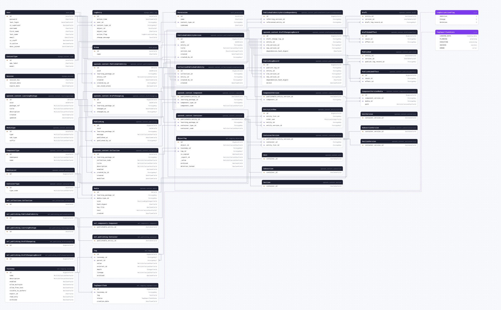

[LogEntry](#logentry) · [Permission](#permission) · [Group](#group) · [User](#user) · [ContentType](#contenttype) · [Session](#session) · [openedx_content.LearningPackage](#openedx_contentlearningpackage) · [openedx_content.PublishableEntity](#openedx_contentpublishableentity) · [PublishableEntityVersion](#publishableentityversion) · [PublishableEntityVersionDependency](#publishableentityversiondependency) · [Draft](#draft) · [openedx_content.DraftChangeLog](#openedx_contentdraftchangelog) · [openedx_content.DraftChangeLogRecord](#openedx_contentdraftchangelogrecord) · [DraftSideEffect](#draftsideeffect) · [PublishLog](#publishlog) · [PublishLogRecord](#publishlogrecord) · [Published](#published) · [PublishSideEffect](#publishsideeffect) · [openedx_content.Collection](#openedx_contentcollection) · [CollectionPublishableEntity](#collectionpublishableentity) · [MediaType](#mediatype) · [Media](#media) · [ComponentType](#componenttype) · [openedx_content.Component](#openedx_contentcomponent) · [ComponentVersion](#componentversion) · [ComponentVersionMedia](#componentversionmedia) · [EntityList](#entitylist) · [EntityListRow](#entitylistrow) · [ContainerType](#containertype) · [openedx_content.Container](#openedx_contentcontainer) · [ContainerVersion](#containerversion) · [Unit](#unit) · [UnitVersion](#unitversion) · [Subsection](#subsection) · [SubsectionVersion](#subsectionversion) · [Section](#section) · [SectionVersion](#sectionversion) · [oel_collections.Collection](#oel_collectionscollection) · [oel_components.Component](#oel_componentscomponent) · [oel_publishing.LearningPackage](#oel_publishinglearningpackage) · [oel_publishing.PublishableEntity](#oel_publishingpublishableentity) · [oel_publishing.DraftChangeLog](#oel_publishingdraftchangelog) · [oel_publishing.DraftChangeLogRecord](#oel_publishingdraftchangelogrecord) · [oel_publishing.Container](#oel_publishingcontainer) · [Tag](#tag) · [Taxonomy](#taxonomy) · [ObjectTag](#objecttag) · [TagImportTask](#tagimporttask)

<details>
<summary>The whole schema as SQL</summary>

```sql
CREATE TABLE "django_admin_log" ("id" integer NOT NULL PRIMARY KEY AUTOINCREMENT, "action_time" datetime NOT NULL, "user_id" integer NOT NULL REFERENCES "auth_user" ("id") DEFERRABLE INITIALLY DEFERRED, "content_type_id" integer NULL REFERENCES "django_content_type" ("id") DEFERRABLE INITIALLY DEFERRED, "object_id" text NULL, "object_repr" varchar(200) NOT NULL, "action_flag" smallint unsigned NOT NULL CHECK ("action_flag" >= 0), "change_message" text NOT NULL);

CREATE TABLE "auth_permission" ("id" integer NOT NULL PRIMARY KEY AUTOINCREMENT, "name" varchar(255) NOT NULL, "content_type_id" integer NOT NULL REFERENCES "django_content_type" ("id") DEFERRABLE INITIALLY DEFERRED, "codename" varchar(100) NOT NULL);

CREATE TABLE "auth_group" ("id" integer NOT NULL PRIMARY KEY AUTOINCREMENT, "name" varchar(150) NOT NULL UNIQUE);

CREATE TABLE "auth_group_permissions" ("id" integer NOT NULL PRIMARY KEY AUTOINCREMENT, "group_id" integer NOT NULL REFERENCES "auth_group" ("id") DEFERRABLE INITIALLY DEFERRED, "permission_id" integer NOT NULL REFERENCES "auth_permission" ("id") DEFERRABLE INITIALLY DEFERRED);

CREATE TABLE "auth_user" ("id" integer NOT NULL PRIMARY KEY AUTOINCREMENT, "password" varchar(128) NOT NULL, "last_login" datetime NULL, "is_superuser" bool NOT NULL, "username" varchar(150) NOT NULL UNIQUE, "first_name" varchar(150) NOT NULL, "last_name" varchar(150) NOT NULL, "email" varchar(254) NOT NULL, "is_staff" bool NOT NULL, "is_active" bool NOT NULL, "date_joined" datetime NOT NULL);

CREATE TABLE "auth_user_groups" ("id" integer NOT NULL PRIMARY KEY AUTOINCREMENT, "user_id" integer NOT NULL REFERENCES "auth_user" ("id") DEFERRABLE INITIALLY DEFERRED, "group_id" integer NOT NULL REFERENCES "auth_group" ("id") DEFERRABLE INITIALLY DEFERRED);

CREATE TABLE "auth_user_user_permissions" ("id" integer NOT NULL PRIMARY KEY AUTOINCREMENT, "user_id" integer NOT NULL REFERENCES "auth_user" ("id") DEFERRABLE INITIALLY DEFERRED, "permission_id" integer NOT NULL REFERENCES "auth_permission" ("id") DEFERRABLE INITIALLY DEFERRED);

CREATE TABLE "django_content_type" ("id" integer NOT NULL PRIMARY KEY AUTOINCREMENT, "app_label" varchar(100) NOT NULL, "model" varchar(100) NOT NULL);

CREATE TABLE "django_session" ("session_key" varchar(40) NOT NULL PRIMARY KEY, "session_data" text NOT NULL, "expire_date" datetime NOT NULL);

CREATE TABLE "openedx_content_learningpackage" ("id" integer NOT NULL PRIMARY KEY AUTOINCREMENT, "uuid" char(32) NOT NULL UNIQUE, "package_ref" varchar(500) COLLATE BINARY NOT NULL, "title" varchar(500) COLLATE NOCASE NOT NULL, "description" text COLLATE NOCASE NOT NULL, "created" datetime NOT NULL, "updated" datetime NOT NULL, CONSTRAINT "oel_publishing_lp_uniq_key" UNIQUE ("package_ref"));

CREATE TABLE "openedx_content_publishableentity" ("id" integer NOT NULL PRIMARY KEY AUTOINCREMENT, "uuid" char(32) NOT NULL UNIQUE, "learning_package_id" integer NOT NULL REFERENCES "openedx_content_learningpackage" ("id") DEFERRABLE INITIALLY DEFERRED, "entity_ref" varchar(500) COLLATE BINARY NOT NULL, "created" datetime NOT NULL, "created_by_id" integer NULL REFERENCES "auth_user" ("id") DEFERRABLE INITIALLY DEFERRED, "can_stand_alone" bool NOT NULL, CONSTRAINT "oel_pub_ent_uniq_lp_key" UNIQUE ("learning_package_id", "entity_ref"));

CREATE TABLE "openedx_content_publishableentityversion" ("id" integer NOT NULL PRIMARY KEY AUTOINCREMENT, "uuid" char(32) NOT NULL UNIQUE, "entity_id" bigint NOT NULL REFERENCES "openedx_content_publishableentity" ("id") DEFERRABLE INITIALLY DEFERRED, "title" varchar(500) COLLATE NOCASE NOT NULL, "version_num" integer unsigned NOT NULL CHECK ("version_num" >= 0), "created" datetime NOT NULL, "created_by_id" integer NULL REFERENCES "auth_user" ("id") DEFERRABLE INITIALLY DEFERRED, CONSTRAINT "oel_pv_uniq_entity_version_num" UNIQUE ("entity_id", "version_num"));

CREATE TABLE "openedx_content_publishableentityversiondependency" ("id" integer NOT NULL PRIMARY KEY AUTOINCREMENT, "referring_version_id" bigint NOT NULL REFERENCES "openedx_content_publishableentityversion" ("id") DEFERRABLE INITIALLY DEFERRED, "referenced_entity_id" bigint NOT NULL REFERENCES "openedx_content_publishableentity" ("id") DEFERRABLE INITIALLY DEFERRED, CONSTRAINT "oel_pevd_uniq_rv_re" UNIQUE ("referring_version_id", "referenced_entity_id"));

CREATE TABLE "openedx_content_draft" ("entity_id" bigint NOT NULL PRIMARY KEY REFERENCES "openedx_content_publishableentity" ("id") DEFERRABLE INITIALLY DEFERRED, "version_id" bigint NULL UNIQUE REFERENCES "openedx_content_publishableentityversion" ("id") DEFERRABLE INITIALLY DEFERRED, "draft_log_record_id" bigint NULL REFERENCES "openedx_content_draftchangelogrecord" ("id") DEFERRABLE INITIALLY DEFERRED);

CREATE TABLE "openedx_content_draftchangelog" ("id" integer NOT NULL PRIMARY KEY AUTOINCREMENT, "uuid" char(32) NOT NULL UNIQUE, "learning_package_id" integer NOT NULL REFERENCES "openedx_content_learningpackage" ("id") DEFERRABLE INITIALLY DEFERRED, "changed_at" datetime NOT NULL, "changed_by_id" integer NULL REFERENCES "auth_user" ("id") DEFERRABLE INITIALLY DEFERRED);

CREATE TABLE "openedx_content_draftchangelogrecord" ("id" integer NOT NULL PRIMARY KEY AUTOINCREMENT, "draft_change_log_id" bigint NOT NULL REFERENCES "openedx_content_draftchangelog" ("id") DEFERRABLE INITIALLY DEFERRED, "entity_id" bigint NOT NULL REFERENCES "openedx_content_publishableentity" ("id") DEFERRABLE INITIALLY DEFERRED, "old_version_id" bigint NULL REFERENCES "openedx_content_publishableentityversion" ("id") DEFERRABLE INITIALLY DEFERRED, "new_version_id" bigint NULL REFERENCES "openedx_content_publishableentityversion" ("id") DEFERRABLE INITIALLY DEFERRED, "dependencies_hash_digest" varchar(8) NOT NULL, CONSTRAINT "oel_dlr_uniq_dcl" UNIQUE ("draft_change_log_id", "entity_id"));

CREATE TABLE "openedx_content_draftsideeffect" ("id" integer NOT NULL PRIMARY KEY AUTOINCREMENT, "cause_id" bigint NOT NULL REFERENCES "openedx_content_draftchangelogrecord" ("id") DEFERRABLE INITIALLY DEFERRED, "effect_id" bigint NOT NULL REFERENCES "openedx_content_draftchangelogrecord" ("id") DEFERRABLE INITIALLY DEFERRED, CONSTRAINT "oel_pub_dse_uniq_c_e" UNIQUE ("cause_id", "effect_id"));

CREATE TABLE "openedx_content_publishlog" ("id" integer NOT NULL PRIMARY KEY AUTOINCREMENT, "uuid" char(32) NOT NULL UNIQUE, "learning_package_id" integer NOT NULL REFERENCES "openedx_content_learningpackage" ("id") DEFERRABLE INITIALLY DEFERRED, "message" varchar(500) COLLATE NOCASE NOT NULL, "published_at" datetime NOT NULL, "published_by_id" integer NULL REFERENCES "auth_user" ("id") DEFERRABLE INITIALLY DEFERRED);

CREATE TABLE "openedx_content_publishlogrecord" ("id" integer NOT NULL PRIMARY KEY AUTOINCREMENT, "publish_log_id" bigint NOT NULL REFERENCES "openedx_content_publishlog" ("id") DEFERRABLE INITIALLY DEFERRED, "entity_id" bigint NOT NULL REFERENCES "openedx_content_publishableentity" ("id") DEFERRABLE INITIALLY DEFERRED, "old_version_id" bigint NULL REFERENCES "openedx_content_publishableentityversion" ("id") DEFERRABLE INITIALLY DEFERRED, "new_version_id" bigint NULL REFERENCES "openedx_content_publishableentityversion" ("id") DEFERRABLE INITIALLY DEFERRED, "dependencies_hash_digest" varchar(8) NOT NULL, "direct" bool NULL, CONSTRAINT "oel_plr_uniq_pl_publishable" UNIQUE ("publish_log_id", "entity_id"));

CREATE TABLE "openedx_content_published" ("entity_id" bigint NOT NULL PRIMARY KEY REFERENCES "openedx_content_publishableentity" ("id") DEFERRABLE INITIALLY DEFERRED, "version_id" bigint NULL UNIQUE REFERENCES "openedx_content_publishableentityversion" ("id") DEFERRABLE INITIALLY DEFERRED, "publish_log_record_id" bigint NOT NULL REFERENCES "openedx_content_publishlogrecord" ("id") DEFERRABLE INITIALLY DEFERRED);

CREATE TABLE "openedx_content_publishsideeffect" ("id" integer NOT NULL PRIMARY KEY AUTOINCREMENT, "cause_id" bigint NOT NULL REFERENCES "openedx_content_publishlogrecord" ("id") DEFERRABLE INITIALLY DEFERRED, "effect_id" bigint NOT NULL REFERENCES "openedx_content_publishlogrecord" ("id") DEFERRABLE INITIALLY DEFERRED, CONSTRAINT "oel_pub_pse_uniq_c_e" UNIQUE ("cause_id", "effect_id"));

CREATE TABLE "openedx_content_collection" ("id" integer NOT NULL PRIMARY KEY AUTOINCREMENT, "learning_package_id" integer NOT NULL REFERENCES "openedx_content_learningpackage" ("id") DEFERRABLE INITIALLY DEFERRED, "collection_code" varchar(255) COLLATE BINARY NOT NULL, "title" varchar(500) COLLATE NOCASE NOT NULL, "description" text COLLATE NOCASE NOT NULL, "enabled" bool NOT NULL, "created_by_id" integer NULL REFERENCES "auth_user" ("id") DEFERRABLE INITIALLY DEFERRED, "created" datetime NOT NULL, "modified" datetime NOT NULL, CONSTRAINT "oel_coll_uniq_lp_key" UNIQUE ("learning_package_id", "collection_code"), CONSTRAINT "oel_coll_collection_code_regex" CHECK ("collection_code" REGEXP '^[a-zA-Z0-9_.-]+\Z'));

CREATE TABLE "openedx_content_collectionpublishableentity" ("id" integer NOT NULL PRIMARY KEY AUTOINCREMENT, "collection_id" integer NOT NULL REFERENCES "openedx_content_collection" ("id") DEFERRABLE INITIALLY DEFERRED, "entity_id" bigint NOT NULL REFERENCES "openedx_content_publishableentity" ("id") DEFERRABLE INITIALLY DEFERRED, "created_by_id" integer NULL REFERENCES "auth_user" ("id") DEFERRABLE INITIALLY DEFERRED, "created" datetime NOT NULL, CONSTRAINT "oel_collections_cpe_uniq_col_ent" UNIQUE ("collection_id", "entity_id"));

CREATE TABLE "openedx_content_mediatype" ("id" integer NOT NULL PRIMARY KEY AUTOINCREMENT, "type" varchar(127) COLLATE NOCASE NOT NULL, "sub_type" varchar(127) COLLATE NOCASE NOT NULL, "suffix" varchar(127) COLLATE NOCASE NOT NULL, CONSTRAINT "oel_contents_uniq_t_st_sfx" UNIQUE ("type", "sub_type", "suffix"));

CREATE TABLE "openedx_content_media" ("id" integer NOT NULL PRIMARY KEY AUTOINCREMENT, "learning_package_id" integer NOT NULL REFERENCES "openedx_content_learningpackage" ("id") DEFERRABLE INITIALLY DEFERRED, "media_type_id" integer NOT NULL REFERENCES "openedx_content_mediatype" ("id") DEFERRABLE INITIALLY DEFERRED, "size" bigint unsigned NOT NULL CHECK ("size" >= 0), "hash_digest" varchar(40) NOT NULL, "has_file" bool NOT NULL, "text" text COLLATE NOCASE NULL, "created" datetime NOT NULL, CONSTRAINT "oel_content_uniq_lc_media_type_hash_digest" UNIQUE ("learning_package_id", "media_type_id", "hash_digest"));

CREATE TABLE "openedx_content_componenttype" ("id" integer NOT NULL PRIMARY KEY AUTOINCREMENT, "namespace" varchar(100) COLLATE BINARY NOT NULL, "name" varchar(100) COLLATE BINARY NOT NULL, CONSTRAINT "oel_component_type_uniq_ns_n" UNIQUE ("namespace", "name"));

CREATE TABLE "openedx_content_component" ("publishable_entity_id" bigint NOT NULL PRIMARY KEY REFERENCES "openedx_content_publishableentity" ("id") DEFERRABLE INITIALLY DEFERRED, "learning_package_id" integer NOT NULL REFERENCES "openedx_content_learningpackage" ("id") DEFERRABLE INITIALLY DEFERRED, "component_type_id" integer NOT NULL REFERENCES "openedx_content_componenttype" ("id") DEFERRABLE INITIALLY DEFERRED, "component_code" varchar(255) COLLATE BINARY NOT NULL, CONSTRAINT "oel_component_uniq_lc_ct_lk" UNIQUE ("learning_package_id", "component_type_id", "component_code"), CONSTRAINT "oel_component_code_regex" CHECK ("component_code" REGEXP '^[\w.-]+\Z'));

CREATE TABLE "openedx_content_componentversion" ("publishable_entity_version_id" bigint NOT NULL PRIMARY KEY REFERENCES "openedx_content_publishableentityversion" ("id") DEFERRABLE INITIALLY DEFERRED, "component_id" bigint NOT NULL REFERENCES "openedx_content_component" ("publishable_entity_id") DEFERRABLE INITIALLY DEFERRED);

CREATE TABLE "openedx_content_componentversionmedia" ("id" integer NOT NULL PRIMARY KEY AUTOINCREMENT, "component_version_id" bigint NOT NULL REFERENCES "openedx_content_componentversion" ("publishable_entity_version_id") DEFERRABLE INITIALLY DEFERRED, "media_id" bigint NOT NULL REFERENCES "openedx_content_media" ("id") DEFERRABLE INITIALLY DEFERRED, "path" varchar(500) COLLATE BINARY NOT NULL, CONSTRAINT "oel_cvcontent_uniq_cv_key" UNIQUE ("component_version_id", "path"));

CREATE TABLE "openedx_content_entitylist" ("id" integer NOT NULL PRIMARY KEY AUTOINCREMENT);

CREATE TABLE "openedx_content_entitylistrow" ("id" integer NOT NULL PRIMARY KEY AUTOINCREMENT, "entity_list_id" bigint NOT NULL REFERENCES "openedx_content_entitylist" ("id") DEFERRABLE INITIALLY DEFERRED, "order_num" integer unsigned NOT NULL CHECK ("order_num" >= 0), "entity_id" bigint NOT NULL REFERENCES "openedx_content_publishableentity" ("id") DEFERRABLE INITIALLY DEFERRED, "entity_version_id" bigint NULL REFERENCES "openedx_content_publishableentityversion" ("id") DEFERRABLE INITIALLY DEFERRED, CONSTRAINT "oel_publishing_elist_row_order" UNIQUE ("entity_list_id", "order_num"));

CREATE TABLE "openedx_content_containertype" ("id" integer NOT NULL PRIMARY KEY AUTOINCREMENT, "type_code" varchar(100) COLLATE BINARY NOT NULL UNIQUE, CONSTRAINT "oex_publishing_containertype_type_code_rx" CHECK ("type_code" REGEXP '^[a-z0-9\-_\.]+$'));

CREATE TABLE "openedx_content_container" ("publishable_entity_id" bigint NOT NULL PRIMARY KEY REFERENCES "openedx_content_publishableentity" ("id") DEFERRABLE INITIALLY DEFERRED, "learning_package_id" integer NOT NULL REFERENCES "openedx_content_learningpackage" ("id") DEFERRABLE INITIALLY DEFERRED, "container_type_id" integer NOT NULL REFERENCES "openedx_content_containertype" ("id") DEFERRABLE INITIALLY DEFERRED, "container_code" varchar(255) COLLATE BINARY NOT NULL, CONSTRAINT "oel_container_uniq_lp_cc" UNIQUE ("learning_package_id", "container_code"), CONSTRAINT "oel_container_code_regex" CHECK ("container_code" REGEXP '^[\w.-]+\Z'));

CREATE TABLE "openedx_content_containerversion" ("publishable_entity_version_id" bigint NOT NULL PRIMARY KEY REFERENCES "openedx_content_publishableentityversion" ("id") DEFERRABLE INITIALLY DEFERRED, "container_id" bigint NOT NULL REFERENCES "openedx_content_container" ("publishable_entity_id") DEFERRABLE INITIALLY DEFERRED, "entity_list_id" bigint NOT NULL REFERENCES "openedx_content_entitylist" ("id") DEFERRABLE INITIALLY DEFERRED);

CREATE TABLE "openedx_content_unit" ("container_id" bigint NOT NULL PRIMARY KEY REFERENCES "openedx_content_container" ("publishable_entity_id") DEFERRABLE INITIALLY DEFERRED);

CREATE TABLE "openedx_content_unitversion" ("container_version_id" bigint NOT NULL PRIMARY KEY REFERENCES "openedx_content_containerversion" ("publishable_entity_version_id") DEFERRABLE INITIALLY DEFERRED);

CREATE TABLE "openedx_content_subsection" ("container_id" bigint NOT NULL PRIMARY KEY REFERENCES "openedx_content_container" ("publishable_entity_id") DEFERRABLE INITIALLY DEFERRED);

CREATE TABLE "openedx_content_subsectionversion" ("container_version_id" bigint NOT NULL PRIMARY KEY REFERENCES "openedx_content_containerversion" ("publishable_entity_version_id") DEFERRABLE INITIALLY DEFERRED);

CREATE TABLE "openedx_content_section" ("container_id" bigint NOT NULL PRIMARY KEY REFERENCES "openedx_content_container" ("publishable_entity_id") DEFERRABLE INITIALLY DEFERRED);

CREATE TABLE "openedx_content_sectionversion" ("container_version_id" bigint NOT NULL PRIMARY KEY REFERENCES "openedx_content_containerversion" ("publishable_entity_version_id") DEFERRABLE INITIALLY DEFERRED);

CREATE TABLE "oel_collections_collection" ("id" integer NOT NULL PRIMARY KEY AUTOINCREMENT);

CREATE TABLE "oel_components_component" ("publishable_entity_id" bigint NOT NULL PRIMARY KEY REFERENCES "oel_publishing_publishableentity" ("id") DEFERRABLE INITIALLY DEFERRED);

CREATE TABLE "oel_publishing_learningpackage" ("id" integer NOT NULL PRIMARY KEY AUTOINCREMENT);

CREATE TABLE "oel_publishing_publishableentity" ("id" integer NOT NULL PRIMARY KEY AUTOINCREMENT);

CREATE TABLE "oel_publishing_draftchangelog" ("id" integer NOT NULL PRIMARY KEY AUTOINCREMENT);

CREATE TABLE "oel_publishing_draftchangelogrecord" ("id" integer NOT NULL PRIMARY KEY AUTOINCREMENT);

CREATE TABLE "oel_publishing_container" ("publishable_entity_id" bigint NOT NULL PRIMARY KEY REFERENCES "oel_publishing_publishableentity" ("id") DEFERRABLE INITIALLY DEFERRED);

CREATE TABLE "oel_tagging_tag" ("id" integer NOT NULL PRIMARY KEY AUTOINCREMENT, "taxonomy_id" bigint NULL REFERENCES "oel_tagging_taxonomy" ("id") DEFERRABLE INITIALLY DEFERRED, "parent_id" bigint NULL REFERENCES "oel_tagging_tag" ("id") DEFERRABLE INITIALLY DEFERRED, "value" varchar(500) COLLATE NOCASE NOT NULL, "external_id" varchar(255) COLLATE NOCASE NOT NULL, "depth" integer NOT NULL, "lineage" varchar(3006) COLLATE NOCASE NOT NULL, "archived" bool NOT NULL, CONSTRAINT "oel_tagging_tag_depth_parent_check" CHECK (("parent_id" IS NULL OR "depth" > 0)), CONSTRAINT "oel_tagging_tag_lineage_ends_with_value" CHECK ("lineage" LIKE '%' || REPLACE(REPLACE(REPLACE((COALESCE("value", '') || COALESCE('	', '')), '\', '\\'), '%', '\%'), '_', '\_') ESCAPE '\'), CONSTRAINT "oel_tagging_tag_lineage_tab_count_check" CHECK ("depth" = ((LENGTH("lineage") - LENGTH(REPLACE("lineage", '	', ''))) - 1)));

CREATE TABLE "oel_tagging_taxonomy" ("id" integer NOT NULL PRIMARY KEY AUTOINCREMENT, "name" varchar(255) COLLATE NOCASE NOT NULL, "description" text NOT NULL, "enabled" bool NOT NULL, "allow_multiple" bool NOT NULL, "allow_free_text" bool NOT NULL, "visible_to_authors" bool NOT NULL, "export_id" varchar(255) NOT NULL UNIQUE, "read_only" bool NOT NULL, "archived" bool NOT NULL);

CREATE TABLE "oel_tagging_objecttag" ("id" integer NOT NULL PRIMARY KEY AUTOINCREMENT, "object_id" varchar(255) COLLATE BINARY NOT NULL, "taxonomy_id" bigint NULL REFERENCES "oel_tagging_taxonomy" ("id") DEFERRABLE INITIALLY DEFERRED, "tag_id" bigint NULL REFERENCES "oel_tagging_tag" ("id") DEFERRABLE INITIALLY DEFERRED, "is_copied" bool NOT NULL, "_export_id" varchar(255) COLLATE NOCASE NOT NULL, "_value" varchar(500) COLLATE NOCASE NOT NULL, "archived" bool NOT NULL, "deletion_locked" bool NOT NULL);

CREATE TABLE "oel_tagging_tagimporttask" ("id" integer NOT NULL PRIMARY KEY AUTOINCREMENT, "taxonomy_id" bigint NOT NULL REFERENCES "oel_tagging_taxonomy" ("id") DEFERRABLE INITIALLY DEFERRED, "log" text NOT NULL, "status" varchar(20) NOT NULL, "creation_date" datetime NOT NULL);

CREATE INDEX "django_admin_log_user_id_c564eba6" ON "django_admin_log" ("user_id");

CREATE INDEX "django_admin_log_content_type_id_c4bce8eb" ON "django_admin_log" ("content_type_id");

CREATE UNIQUE INDEX "auth_permission_content_type_id_codename_01ab375a_uniq" ON "auth_permission" ("content_type_id", "codename");

CREATE INDEX "auth_permission_content_type_id_2f476e4b" ON "auth_permission" ("content_type_id");

CREATE UNIQUE INDEX "auth_group_permissions_group_id_permission_id_0cd325b0_uniq" ON "auth_group_permissions" ("group_id", "permission_id");

CREATE INDEX "auth_group_permissions_group_id_b120cbf9" ON "auth_group_permissions" ("group_id");

CREATE INDEX "auth_group_permissions_permission_id_84c5c92e" ON "auth_group_permissions" ("permission_id");

CREATE UNIQUE INDEX "auth_user_groups_user_id_group_id_94350c0c_uniq" ON "auth_user_groups" ("user_id", "group_id");

CREATE INDEX "auth_user_groups_user_id_6a12ed8b" ON "auth_user_groups" ("user_id");

CREATE INDEX "auth_user_groups_group_id_97559544" ON "auth_user_groups" ("group_id");

CREATE UNIQUE INDEX "auth_user_user_permissions_user_id_permission_id_14a6b632_uniq" ON "auth_user_user_permissions" ("user_id", "permission_id");

CREATE INDEX "auth_user_user_permissions_user_id_a95ead1b" ON "auth_user_user_permissions" ("user_id");

CREATE INDEX "auth_user_user_permissions_permission_id_1fbb5f2c" ON "auth_user_user_permissions" ("permission_id");

CREATE UNIQUE INDEX "django_content_type_app_label_model_76bd3d3b_uniq" ON "django_content_type" ("app_label", "model");

CREATE INDEX "django_session_expire_date_a5c62663" ON "django_session" ("expire_date");

CREATE INDEX "openedx_content_publishableentity_learning_package_id_80eac4ef" ON "openedx_content_publishableentity" ("learning_package_id");

CREATE INDEX "openedx_content_publishableentity_created_by_id_d7f80bf0" ON "openedx_content_publishableentity" ("created_by_id");

CREATE INDEX "oel_pub_ent_idx_key" ON "openedx_content_publishableentity" ("entity_ref");

CREATE INDEX "oel_pub_ent_idx_lp_rcreated" ON "openedx_content_publishableentity" ("learning_package_id", "created" DESC);

CREATE INDEX "openedx_content_publishableentityversion_entity_id_b3d3bd5b" ON "openedx_content_publishableentityversion" ("entity_id");

CREATE INDEX "openedx_content_publishableentityversion_created_by_id_199f8b23" ON "openedx_content_publishableentityversion" ("created_by_id");

CREATE INDEX "oel_pv_idx_entity_rcreated" ON "openedx_content_publishableentityversion" ("entity_id", "created" DESC);

CREATE INDEX "oel_pv_idx_title" ON "openedx_content_publishableentityversion" ("title");

CREATE INDEX "openedx_content_publishableentityversiondependency_referring_version_id_334fdbd7" ON "openedx_content_publishableentityversiondependency" ("referring_version_id");

CREATE INDEX "openedx_content_publishableentityversiondependency_referenced_entity_id_079e04be" ON "openedx_content_publishableentityversiondependency" ("referenced_entity_id");

CREATE INDEX "openedx_content_draft_draft_log_record_id_add2f996" ON "openedx_content_draft" ("draft_log_record_id");

CREATE INDEX "openedx_content_draftchangelog_learning_package_id_3c996125" ON "openedx_content_draftchangelog" ("learning_package_id");

CREATE INDEX "openedx_content_draftchangelog_changed_by_id_ad10fa85" ON "openedx_content_draftchangelog" ("changed_by_id");

CREATE INDEX "openedx_content_draftchangelogrecord_draft_change_log_id_d73b7256" ON "openedx_content_draftchangelogrecord" ("draft_change_log_id");

CREATE INDEX "openedx_content_draftchangelogrecord_entity_id_4aea1ee5" ON "openedx_content_draftchangelogrecord" ("entity_id");

CREATE INDEX "openedx_content_draftchangelogrecord_old_version_id_9e002973" ON "openedx_content_draftchangelogrecord" ("old_version_id");

CREATE INDEX "openedx_content_draftchangelogrecord_new_version_id_132fcc8d" ON "openedx_content_draftchangelogrecord" ("new_version_id");

CREATE INDEX "oel_dlr_idx_entity_rdcl" ON "openedx_content_draftchangelogrecord" ("entity_id", "draft_change_log_id" DESC);

CREATE INDEX "openedx_content_draftsideeffect_cause_id_75d6a806" ON "openedx_content_draftsideeffect" ("cause_id");

CREATE INDEX "openedx_content_draftsideeffect_effect_id_567b298a" ON "openedx_content_draftsideeffect" ("effect_id");

CREATE INDEX "openedx_content_publishlog_learning_package_id_5bf49306" ON "openedx_content_publishlog" ("learning_package_id");

CREATE INDEX "openedx_content_publishlog_published_by_id_79acc442" ON "openedx_content_publishlog" ("published_by_id");

CREATE INDEX "openedx_content_publishlogrecord_publish_log_id_f50dd1ec" ON "openedx_content_publishlogrecord" ("publish_log_id");

CREATE INDEX "openedx_content_publishlogrecord_entity_id_d7267f94" ON "openedx_content_publishlogrecord" ("entity_id");

CREATE INDEX "openedx_content_publishlogrecord_old_version_id_ae92d31b" ON "openedx_content_publishlogrecord" ("old_version_id");

CREATE INDEX "openedx_content_publishlogrecord_new_version_id_7774a47a" ON "openedx_content_publishlogrecord" ("new_version_id");

CREATE INDEX "oel_plr_idx_entity_rplr" ON "openedx_content_publishlogrecord" ("entity_id", "publish_log_id" DESC);

CREATE INDEX "openedx_content_published_publish_log_record_id_2596a751" ON "openedx_content_published" ("publish_log_record_id");

CREATE INDEX "openedx_content_publishsideeffect_cause_id_0525f673" ON "openedx_content_publishsideeffect" ("cause_id");

CREATE INDEX "openedx_content_publishsideeffect_effect_id_839189d9" ON "openedx_content_publishsideeffect" ("effect_id");

CREATE INDEX "openedx_content_collection_learning_package_id_3c7da4e7" ON "openedx_content_collection" ("learning_package_id");

CREATE INDEX "openedx_content_collection_created_by_id_c2734735" ON "openedx_content_collection" ("created_by_id");

CREATE INDEX "openedx_content_coll_lp_title" ON "openedx_content_collection" ("learning_package_id", "title");

CREATE INDEX "openedx_content_collectionpublishableentity_collection_id_30209c12" ON "openedx_content_collectionpublishableentity" ("collection_id");

CREATE INDEX "openedx_content_collectionpublishableentity_entity_id_67b1c7ec" ON "openedx_content_collectionpublishableentity" ("entity_id");

CREATE INDEX "openedx_content_collectionpublishableentity_created_by_id_0436fdae" ON "openedx_content_collectionpublishableentity" ("created_by_id");

CREATE INDEX "openedx_content_media_learning_package_id_5921a122" ON "openedx_content_media" ("learning_package_id");

CREATE INDEX "openedx_content_media_media_type_id_556182c9" ON "openedx_content_media" ("media_type_id");

CREATE INDEX "oel_content_idx_lp_rsize" ON "openedx_content_media" ("learning_package_id", "size" DESC);

CREATE INDEX "openedx_content_component_learning_package_id_ff2bff8c" ON "openedx_content_component" ("learning_package_id");

CREATE INDEX "openedx_content_component_component_type_id_0d8d0461" ON "openedx_content_component" ("component_type_id");

CREATE INDEX "oel_component_idx_ct_lk" ON "openedx_content_component" ("component_type_id", "component_code");

CREATE INDEX "openedx_content_componentversion_component_id_f7caf6bb" ON "openedx_content_componentversion" ("component_id");

CREATE INDEX "openedx_content_componentversionmedia_component_version_id_555f391c" ON "openedx_content_componentversionmedia" ("component_version_id");

CREATE INDEX "openedx_content_componentversionmedia_media_id_17ca62ff" ON "openedx_content_componentversionmedia" ("media_id");

CREATE INDEX "oel_cvmedia_c_cv" ON "openedx_content_componentversionmedia" ("media_id", "component_version_id");

CREATE INDEX "oel_cvmedia_cv_d" ON "openedx_content_componentversionmedia" ("component_version_id", "media_id");

CREATE INDEX "openedx_content_entitylistrow_entity_list_id_9b735e3c" ON "openedx_content_entitylistrow" ("entity_list_id");

CREATE INDEX "openedx_content_entitylistrow_entity_id_42544f3a" ON "openedx_content_entitylistrow" ("entity_id");

CREATE INDEX "openedx_content_entitylistrow_entity_version_id_8ffe039e" ON "openedx_content_entitylistrow" ("entity_version_id");

CREATE INDEX "openedx_content_container_learning_package_id_a29c5633" ON "openedx_content_container" ("learning_package_id");

CREATE INDEX "openedx_content_container_container_type_id_f7940858" ON "openedx_content_container" ("container_type_id");

CREATE INDEX "openedx_content_containerversion_container_id_bacdc4e3" ON "openedx_content_containerversion" ("container_id");

CREATE INDEX "openedx_content_containerversion_entity_list_id_be7df8a7" ON "openedx_content_containerversion" ("entity_list_id");

CREATE UNIQUE INDEX "oel_tagging_tag_taxonomy_id_external_id_f308f968_uniq" ON "oel_tagging_tag" ("taxonomy_id", "external_id");

CREATE UNIQUE INDEX "oel_tagging_tag_taxonomy_id_value_f0e6dab9_uniq" ON "oel_tagging_tag" ("taxonomy_id", "value");

CREATE INDEX "oel_tagging_tag_taxonomy_id_5ffdeb8b" ON "oel_tagging_tag" ("taxonomy_id");

CREATE INDEX "oel_tagging_tag_parent_id_2d99b9b4" ON "oel_tagging_tag" ("parent_id");

CREATE INDEX "oel_tagging_taxonom_89e779_idx" ON "oel_tagging_tag" ("taxonomy_id", "value");

CREATE INDEX "oel_tagging_taxonom_44e355_idx" ON "oel_tagging_tag" ("taxonomy_id", "external_id");

CREATE INDEX "oel_tagging_lineage_d65f82_idx" ON "oel_tagging_tag" ("lineage");

CREATE INDEX "oel_tagging_taxonomy_name_41aebebd" ON "oel_tagging_taxonomy" ("name");

CREATE UNIQUE INDEX "oel_tagging_objecttag_object_id_taxonomy_id_tag_id_900a25fb_uniq" ON "oel_tagging_objecttag" ("object_id", "taxonomy_id", "tag_id");

CREATE UNIQUE INDEX "oel_tagging_objecttag_object_id_taxonomy_id__value_6243e6d6_uniq" ON "oel_tagging_objecttag" ("object_id", "taxonomy_id", "_value");

CREATE INDEX "oel_tagging_objecttag_object_id_c810f770" ON "oel_tagging_objecttag" ("object_id");

CREATE INDEX "oel_tagging_objecttag_taxonomy_id_48a985b4" ON "oel_tagging_objecttag" ("taxonomy_id");

CREATE INDEX "oel_tagging_objecttag_tag_id_6c23e4f0" ON "oel_tagging_objecttag" ("tag_id");

CREATE INDEX "oel_tagging_taxonom_aa24e6_idx" ON "oel_tagging_objecttag" ("taxonomy_id", "object_id");

CREATE INDEX "oel_tagging_taxonom_3668ec_idx" ON "oel_tagging_objecttag" ("taxonomy_id", "_value");

CREATE INDEX "oel_tagging_tagimporttask_taxonomy_id_955bb3a3" ON "oel_tagging_tagimporttask" ("taxonomy_id");

CREATE INDEX "oel_tagging_taxonom_5e948c_idx" ON "oel_tagging_tagimporttask" ("taxonomy_id", "creation_date" DESC);
```

</details>

## LogEntry

Table `django_admin_log`, app `admin`.


| Column | Field | Type | Null | Key | Default | Description |
| --- | --- | --- | --- | --- | --- | --- |
| `id` | `AutoField` | `integer` |  | PK | `autoincrement()` |  |
| `action_time` | `DateTimeField` | `datetime` |  |  | `now()` |  |
| `user_id` | `ForeignKey` | `integer` |  | FK |  |  |
| `content_type_id` | `ForeignKey` | `integer` | yes | FK |  |  |
| `object_id` | `TextField` | `text` | yes |  |  |  |
| `object_repr` | `CharField` | `varchar(200)` |  |  |  |  |
| `action_flag` | `LogEntryActionFlag` | `smallint unsigned` |  |  |  |  |
| `change_message` | `TextField` | `text` |  |  |  |  |

Indexes:

- index `django_admin_log_user_id_c564eba6` on `user_id`
- index `django_admin_log_content_type_id_c4bce8eb` on `content_type_id`

Relations:

- `user_id` → [User](#user).`id`, on delete cascade
- `content_type_id` → [ContentType](#contenttype).`id`, on delete set null

## Permission

Table `auth_permission`, app `auth`.

The permissions system provides a way to assign permissions to specific
users and groups of users.

The permission system is used by the Django admin site, but may also be
useful in your own code. The Django admin site uses permissions as follows:

    - The "add" permission limits the user's ability to view the "add" form
      and add an object.
    - The "change" permission limits a user's ability to view the change
      list, view the "change" form and change an object.
    - The "delete" permission limits the ability to delete an object.
    - The "view" permission limits the ability to view an object.

Permissions are set globally per type of object, not per specific object
instance. It is possible to say "Mary may change news stories," but it's
not currently possible to say "Mary may change news stories, but only the
ones she created herself" or "Mary may only change news stories that have a
certain status or publication date."

The permissions listed above are automatically created for each model.


| Column | Field | Type | Null | Key | Default | Description |
| --- | --- | --- | --- | --- | --- | --- |
| `id` | `AutoField` | `integer` |  | PK | `autoincrement()` |  |
| `name` | `CharField` | `varchar(255)` |  |  |  |  |
| `content_type_id` | `ForeignKey` | `integer` |  | FK |  |  |
| `codename` | `CharField` | `varchar(100)` |  |  |  |  |

Indexes:

- index `auth_permission_content_type_id_2f476e4b` on `content_type_id`
- unique `auth_permission_content_type_id_codename_01ab375a_uniq` on `content_type_id`, `codename`

Relations:

- `content_type_id` → [ContentType](#contenttype).`id`, on delete cascade
- `group_set` — many to many with [Group](#group)
- `user_set` — many to many with [User](#user)

## Group

Table `auth_group`, app `auth`.

Groups are a generic way of categorizing users to apply permissions, or
some other label, to those users. A user can belong to any number of
groups.

A user in a group automatically has all the permissions granted to that
group. For example, if the group 'Site editors' has the permission
can_edit_home_page, any user in that group will have that permission.

Beyond permissions, groups are a convenient way to categorize users to
apply some label, or extended functionality, to them. For example, you
could create a group 'Special users', and you could write code that would
do special things to those users -- such as giving them access to a
members-only portion of your site, or sending them members-only email
messages.


| Column | Field | Type | Null | Key | Default | Description |
| --- | --- | --- | --- | --- | --- | --- |
| `id` | `AutoField` | `integer` |  | PK | `autoincrement()` |  |
| `name` | `CharField` | `varchar(150)` |  | unique |  |  |

Relations:

- `permissions` — many to many with [Permission](#permission)
- `user_set` — many to many with [User](#user)

## User

Table `auth_user`, app `auth`.

Columns from `AbstractUser` (abstract): `username`, `first_name`, `last_name`, `email`, `is_staff`, `is_active`, `date_joined`.

Columns from `AbstractBaseUser` (abstract): `password`, `last_login`.

Columns from `PermissionsMixin` (abstract): `is_superuser`.

Users within the Django authentication system are represented by this
model.

Username and password are required. Other fields are optional.

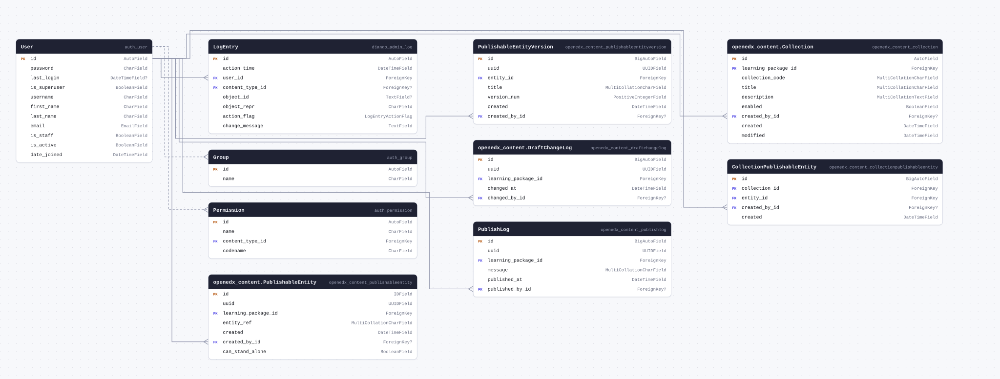

| Column | Field | Type | Null | Key | Default | Description |
| --- | --- | --- | --- | --- | --- | --- |
| `id` | `AutoField` | `integer` |  | PK | `autoincrement()` |  |
| `password` | `CharField` | `varchar(128)` |  |  |  |  |
| `last_login` | `DateTimeField` | `datetime` | yes |  |  |  |
| `is_superuser` | `BooleanField` | `bool` |  |  | `False` | Designates that this user has all permissions without explicitly assigning them. |
| `username` | `CharField` | `varchar(150)` |  | unique |  | Required. 150 characters or fewer. Letters, digits and @/./+/-/_ only. |
| `first_name` | `CharField` | `varchar(150)` |  |  |  |  |
| `last_name` | `CharField` | `varchar(150)` |  |  |  |  |
| `email` | `EmailField` | `varchar(254)` |  |  |  |  |
| `is_staff` | `BooleanField` | `bool` |  |  | `False` | Designates whether the user can log into this admin site. |
| `is_active` | `BooleanField` | `bool` |  |  | `True` | Designates whether this user should be treated as active. Unselect this instead of deleting accounts. |
| `date_joined` | `DateTimeField` | `datetime` |  |  | `now()` |  |

Relations:

- [LogEntry](#logentry).`user_id` → `id`, on delete cascade
- `groups` — many to many with [Group](#group)
- `user_permissions` — many to many with [Permission](#permission)
- [openedx_content.PublishableEntity](#openedx_contentpublishableentity).`created_by_id` → `id`, on delete set null
- [PublishableEntityVersion](#publishableentityversion).`created_by_id` → `id`, on delete set null
- [openedx_content.DraftChangeLog](#openedx_contentdraftchangelog).`changed_by_id` → `id`, on delete set null
- [PublishLog](#publishlog).`published_by_id` → `id`, on delete set null
- [openedx_content.Collection](#openedx_contentcollection).`created_by_id` → `id`, on delete set null
- [CollectionPublishableEntity](#collectionpublishableentity).`created_by_id` → `id`, on delete set null

## ContentType

Table `django_content_type`, app `contenttypes`.


| Column | Field | Type | Null | Key | Default | Description |
| --- | --- | --- | --- | --- | --- | --- |
| `id` | `AutoField` | `integer` |  | PK | `autoincrement()` |  |
| `app_label` | `CharField` | `varchar(100)` |  |  |  |  |
| `model` | `CharField` | `varchar(100)` |  |  |  |  |

Indexes:

- unique `django_content_type_app_label_model_76bd3d3b_uniq` on `app_label`, `model`

Relations:

- [LogEntry](#logentry).`content_type_id` → `id`, on delete set null
- [Permission](#permission).`content_type_id` → `id`, on delete cascade

## Session

Table `django_session`, app `sessions`.

Columns from `AbstractBaseSession` (abstract): `session_key`, `session_data`, `expire_date`.

Django provides full support for anonymous sessions. The session
framework lets you store and retrieve arbitrary data on a
per-site-visitor basis. It stores data on the server side and
abstracts the sending and receiving of cookies. Cookies contain a
session ID -- not the data itself.

The Django sessions framework is entirely cookie-based. It does
not fall back to putting session IDs in URLs. This is an intentional
design decision. Not only does that behavior make URLs ugly, it makes
your site vulnerable to session-ID theft via the "Referer" header.

For complete documentation on using Sessions in your code, consult
the sessions documentation that is shipped with Django (also available
on the Django web site).

| Column | Field | Type | Null | Key | Default | Description |
| --- | --- | --- | --- | --- | --- | --- |
| `session_key` | `CharField` | `varchar(40)` |  | PK |  |  |
| `session_data` | `TextField` | `text` |  |  |  |  |
| `expire_date` | `DateTimeField` | `datetime` |  |  |  |  |

Indexes:

- index `django_session_expire_date_a5c62663` on `expire_date`

## openedx_content.LearningPackage

Table `openedx_content_learningpackage`, app `openedx_content`.

Top level container for a grouping of authored content.

Each :class:`PublishableEntity` belongs to exactly one
:class:`LearningPackage`.

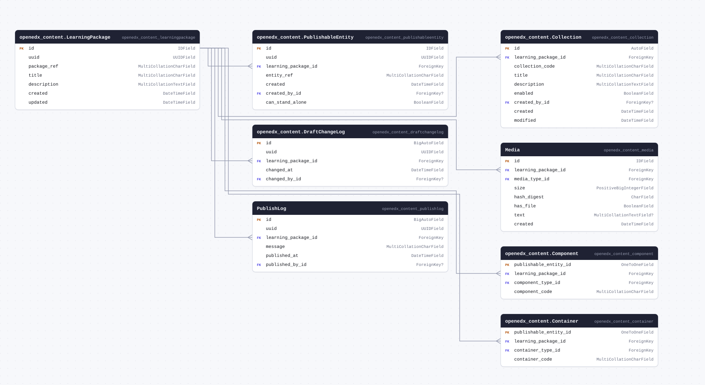

| Column | Field | Type | Null | Key | Default | Description |
| --- | --- | --- | --- | --- | --- | --- |
| `id` | `IDField` | `integer` |  | PK | `autoincrement()` |  |
| `uuid` | `UUIDField` | `char(32)` |  | unique | `uuid4()` |  |
| `package_ref` | `MultiCollationCharField` | `varchar(500)` |  |  |  |  |
| `title` | `MultiCollationCharField` | `varchar(500)` |  |  |  |  |
| `description` | `MultiCollationTextField` | `text` |  |  | `''` |  |
| `created` | `DateTimeField` | `datetime` |  |  |  |  |
| `updated` | `DateTimeField` | `datetime` |  |  |  |  |

Indexes:

- unique `oel_publishing_lp_uniq_key` on `package_ref`

Relations:

- [openedx_content.PublishableEntity](#openedx_contentpublishableentity).`learning_package_id` → `id`, on delete cascade
- [openedx_content.DraftChangeLog](#openedx_contentdraftchangelog).`learning_package_id` → `id`, on delete cascade
- [PublishLog](#publishlog).`learning_package_id` → `id`, on delete cascade
- [openedx_content.Collection](#openedx_contentcollection).`learning_package_id` → `id`, on delete cascade
- [Media](#media).`learning_package_id` → `id`, on delete cascade
- [openedx_content.Component](#openedx_contentcomponent).`learning_package_id` → `id`, on delete cascade
- [openedx_content.Container](#openedx_contentcontainer).`learning_package_id` → `id`, on delete cascade

## openedx_content.PublishableEntity

Table `openedx_content_publishableentity`, app `openedx_content`.

This represents any publishable thing that has ever existed in a
:class:`LearningPackage`. It serves as a stable model that will not go
away even if these things are later unpublished or deleted.

A :class:`PublishableEntity` belongs to exactly one
:class:`LearningPackage`.

Examples of Publishable Entities
--------------------------------

:class:`Component` objects (e.g. VideoBlock, ProblemBlock), Units, and
Sections/Subsections would all be considered Publishable Entites. But
anything that can be imported, exported, published, and reverted in a
course or library could be modeled as a :class:`PublishableEntity`,
including things like Grading Policy or possibly Taxonomies (?).

How to use this model
---------------------

The publishing app understands that publishable entities exist, along
with their drafts and published versions. It has some basic metadata,
such as identifiers, who created it, and when it was created. It's
meant to encapsulate the draft and publishing related aspects of your
content, but the :mod:`publishing` app doesn't know anything about
the actual content being referenced.

You have to provide actual meaning to :class:`PublishableEntity` by
creating your own models that will represent your particular content
and associating them to :class:`PublishableEntity` via a
``OneToOneField`` with ``primary_key=True``. The easiest way to do
this is to have your model inherit from :class:`PublishableEntityMixin`.

Identifiers
-----------
The UUID is globally unique and should be treated as immutable.

The key field *is* mutable, but changing it will affect all
:class:`PublishableEntityVersion` objects. They are locally unique
within the :class:`LearningPackage`.

If you are referencing this model from within the same process, use a
foreign key to the id. If you are referencing this
:class:`PublishableEntity` from an external system/service, use the
UUID. The key is the part that is most likely to be human-readable,
and may be exported/copied, but try not to rely on it, since this
value may change.

Note: When we actually implement the ability to change identifiers, we
should make a history table and a modified attribute on this model.

Why are Identifiers in this Model?
----------------------------------

A :class:`PublishableEntity` never stands alone–it's always intended
to be used with a 1:1 model like :class:`Component` or Unit. So why
have all the identifiers in this model instead of storing them in
those other models? Two reasons:

* Published things need to have the right identifiers so they can be
  used throughout the system, and the UUID is serving the role of
  ISBN in physical book publishing.
* We want to be able to enforce the idea that ``entity_ref`` is
  locally unique across all :class:`PublishableEntity` objects within
  a given :class:`LearningPackage`. :class:`Component` and Unit can't
  do that without a shared model.

That being said, models that build on :class:`PublishableEntity` are
free to add their own identifiers if it's useful to do so.

Why not Inherit from this Model?
--------------------------------

Django supports `multi-table inheritance
<https://docs.djangoproject.com/en/4.2/topics/db/models/#multi-table-inheritance>`_.

We don't use that, primarily because we want to more clearly decouple
publishing concerns from the rest of the logic around
:class:`Component` objects, Units, etc. If you made a
:class:`Component` and :class:`ComponentVersion` models that
subclassed :class:`PublishableEntity` and
:class:`PublishableEntityVersion`, and then accessed
``component.versions``, you might expect :class:`ComponentVersion`
objects to come back and be surprised when you get EntityVersions
instead.

In general, we want freedom to add new Publishing models, fields, and
methods without having to worry about the downstream name collisions
with other apps (many of which might live in other repositories).
The helper mixins will provide a little syntactic sugar to make
common access patterns more convenient, like file access.

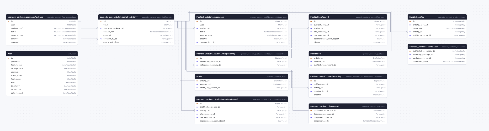

| Column | Field | Type | Null | Key | Default | Description |
| --- | --- | --- | --- | --- | --- | --- |
| `id` | `IDField` | `integer` |  | PK | `autoincrement()` |  |
| `uuid` | `UUIDField` | `char(32)` |  | unique | `uuid4()` |  |
| `learning_package_id` | `ForeignKey` | `integer` |  | FK |  |  |
| `entity_ref` | `MultiCollationCharField` | `varchar(500)` |  |  |  |  |
| `created` | `DateTimeField` | `datetime` |  |  |  |  |
| `created_by_id` | `ForeignKey` | `integer` | yes | FK |  |  |
| `can_stand_alone` | `BooleanField` | `bool` |  |  | `True` | Set to True when created independently, False when created as part of a container. |

Indexes:

- index `openedx_content_publishableentity_learning_package_id_80eac4ef` on `learning_package_id`
- index `openedx_content_publishableentity_created_by_id_d7f80bf0` on `created_by_id`
- unique `oel_pub_ent_uniq_lp_key` on `learning_package_id`, `entity_ref`
- index `oel_pub_ent_idx_key` on `entity_ref`
- index `oel_pub_ent_idx_lp_rcreated` on `learning_package_id`, `created` desc

Relations:

- `affects` — many to many with [PublishableEntityVersion](#publishableentityversion), through [PublishableEntityVersionDependency](#publishableentityversiondependency)
- `collections` — many to many with [openedx_content.Collection](#openedx_contentcollection), through [CollectionPublishableEntity](#collectionpublishableentity)
- `learning_package_id` → [openedx_content.LearningPackage](#openedx_contentlearningpackage).`id`, on delete cascade
- `created_by_id` → [User](#user).`id`, on delete set null
- [PublishableEntityVersion](#publishableentityversion).`entity_id` → `id`, on delete cascade
- [PublishableEntityVersionDependency](#publishableentityversiondependency).`referenced_entity_id` → `id`, on delete restrict
- [Draft](#draft).`entity_id` → `id`, on delete cascade
- [openedx_content.DraftChangeLogRecord](#openedx_contentdraftchangelogrecord).`entity_id` → `id`, on delete restrict
- [PublishLogRecord](#publishlogrecord).`entity_id` → `id`, on delete restrict
- [Published](#published).`entity_id` → `id`, on delete cascade
- [CollectionPublishableEntity](#collectionpublishableentity).`entity_id` → `id`, on delete restrict
- [openedx_content.Component](#openedx_contentcomponent).`publishable_entity_id` → `id`, on delete cascade
- [EntityListRow](#entitylistrow).`entity_id` → `id`, on delete restrict
- [openedx_content.Container](#openedx_contentcontainer).`publishable_entity_id` → `id`, on delete cascade

## PublishableEntityVersion

Table `openedx_content_publishableentityversion`, app `openedx_content`.

A particular version of a :class:`PublishableEntity`.

This model has its own ``uuid`` so that it can be referenced directly.
The ``uuid`` should be treated as immutable.

:class:`PublishableEntityVersion` objects are created once and never
updated. So for instance, the ``title`` should never be modified.

Like :class:`PublishableEntity`, the data in this model is only enough
to cover the parts that are most important for the actual process of
managing drafts and publishes. You will want to create your own
models to represent the actual content data that's associated with
this :class:`PublishableEntityVersion`, and connect them using a
``OneToOneField`` with ``primary_key=True``. The easiest way to do
this is to inherit from :class:`PublishableEntityVersionMixin`. Be
sure to treat these versioned models in your app as immutable as
well.

.. no_pii:

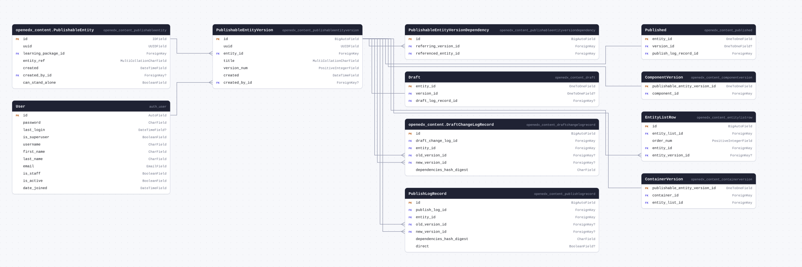

| Column | Field | Type | Null | Key | Default | Description |
| --- | --- | --- | --- | --- | --- | --- |
| `id` | `BigAutoField` | `integer` |  | PK | `autoincrement()` |  |
| `uuid` | `UUIDField` | `char(32)` |  | unique | `uuid4()` |  |
| `entity_id` | `ForeignKey` | `bigint` |  | FK |  |  |
| `title` | `MultiCollationCharField` | `varchar(500)` |  |  | `''` |  |
| `version_num` | `PositiveIntegerField` | `integer unsigned` |  |  |  |  |
| `created` | `DateTimeField` | `datetime` |  |  |  |  |
| `created_by_id` | `ForeignKey` | `integer` | yes | FK |  |  |

Indexes:

- index `openedx_content_publishableentityversion_entity_id_b3d3bd5b` on `entity_id`
- index `openedx_content_publishableentityversion_created_by_id_199f8b23` on `created_by_id`
- unique `oel_pv_uniq_entity_version_num` on `entity_id`, `version_num`
- index `oel_pv_idx_entity_rcreated` on `entity_id`, `created` desc
- index `oel_pv_idx_title` on `title`

Relations:

- `dependencies` — many to many with [openedx_content.PublishableEntity](#openedx_contentpublishableentity), through [PublishableEntityVersionDependency](#publishableentityversiondependency)
- `entity_id` → [openedx_content.PublishableEntity](#openedx_contentpublishableentity).`id`, on delete cascade
- `created_by_id` → [User](#user).`id`, on delete set null
- [PublishableEntityVersionDependency](#publishableentityversiondependency).`referring_version_id` → `id`, on delete cascade
- [Draft](#draft).`version_id` → `id`, on delete restrict
- [openedx_content.DraftChangeLogRecord](#openedx_contentdraftchangelogrecord).`old_version_id` → `id`, on delete restrict
- [openedx_content.DraftChangeLogRecord](#openedx_contentdraftchangelogrecord).`new_version_id` → `id`, on delete restrict
- [PublishLogRecord](#publishlogrecord).`old_version_id` → `id`, on delete restrict
- [PublishLogRecord](#publishlogrecord).`new_version_id` → `id`, on delete restrict
- [Published](#published).`version_id` → `id`, on delete restrict
- [ComponentVersion](#componentversion).`publishable_entity_version_id` → `id`, on delete cascade
- [EntityListRow](#entitylistrow).`entity_version_id` → `id`, on delete restrict
- [ContainerVersion](#containerversion).`publishable_entity_version_id` → `id`, on delete cascade

## PublishableEntityVersionDependency

Table `openedx_content_publishableentityversiondependency`, app `openedx_content`.

Track the :class:`PublishableEntity` objects that a
:class:`PublishableEntityVersion` depends on.

For example, a partcular version of a Unit (U1.v1) might be defined to
have unpinned references to Components C1 and C2. That means that any
changes in C1 or C2 will affect U1.v1 via :class:`DraftSideEffect` and
:class:`PublishSideEffect`. We say that C1 and C2 are dependencies of
U1.v1.

An important restriction is that a :class:`PublishableEntityVersion`'s
list of dependencies are defined when the version is created. It is
not modified after that. No matter what happens to C1 or C2 (e.g.
edit, deletion, un-deletion, reset-draft-version-to-published), they
will always be dependencies of U1.v1.

If someone removes C2 from U1, then that requires creating a new
version of U1 (so U1.v2).

This restriction is important because our ability to calculate and
cache the state of "this version of this publishable entity and all
its dependencies (children)" relies on this being true.

.. no_pii:

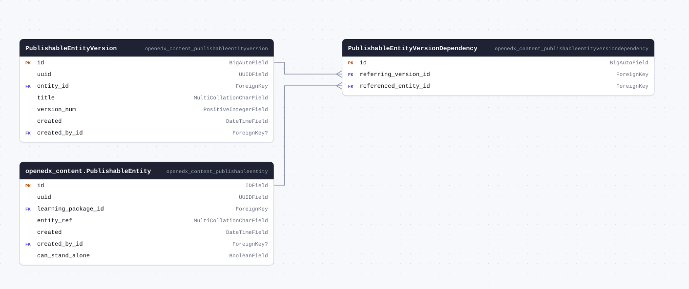

| Column | Field | Type | Null | Key | Default | Description |
| --- | --- | --- | --- | --- | --- | --- |
| `id` | `BigAutoField` | `integer` |  | PK | `autoincrement()` |  |
| `referring_version_id` | `ForeignKey` | `bigint` |  | FK |  |  |
| `referenced_entity_id` | `ForeignKey` | `bigint` |  | FK |  |  |

Indexes:

- index `openedx_content_publishableentityversiondependency_referring_version_id_334fdbd7` on `referring_version_id`
- index `openedx_content_publishableentityversiondependency_referenced_entity_id_079e04be` on `referenced_entity_id`
- unique `oel_pevd_uniq_rv_re` on `referring_version_id`, `referenced_entity_id`

Relations:

- `referring_version_id` → [PublishableEntityVersion](#publishableentityversion).`id`, on delete cascade
- `referenced_entity_id` → [openedx_content.PublishableEntity](#openedx_contentpublishableentity).`id`, on delete restrict

## Draft

Table `openedx_content_draft`, app `openedx_content`.

Find the active draft version of an entity (usually most recently
created).

This model mostly only exists to allow us to join against a bunch of
:class:`PublishableEntity` objects at once and get all their latest
drafts. You might use this together with :class:`Published` in order
to see which Drafts haven't been published yet.

A :class:`Draft` entry should be created whenever a new
:class:`PublishableEntityVersion` is created. This means there are
three possible states:

1. No :class:`Draft` entry for a :class:`PublishableEntity`: This means
   a :class:`PublishableEntity` was created, but no
   :class:`PublishableEntityVersion` was ever made for it, so there
   was never a Draft version.
2. A :class:`Draft` entry exists and points to a
   :class:`PublishableEntityVersion`: This is the most common state.
3. A :class:`Draft` entry exists and points to a null version: This
   means a version used to be the draft, but it's been functionally
   "deleted". The versions still exist in our history, but we're done
   using it.

It would have saved a little space to add this data to the
:class:`Published` model (and possibly call the combined model
something else). Split Modulestore did this with its
``active_versions`` table. I keep it separate here to get a better
separation of lifecycle events: i.e. this table *only* changes when
drafts are updated, not when publishing happens. The :class:`Published`
model only changes when something is published.

.. no_pii:

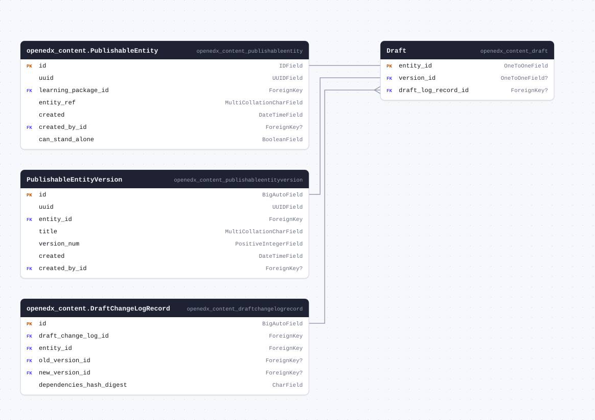

| Column | Field | Type | Null | Key | Default | Description |
| --- | --- | --- | --- | --- | --- | --- |
| `entity_id` | `OneToOneField` | `bigint` |  | PK, FK |  |  |
| `version_id` | `OneToOneField` | `bigint` | yes | FK, unique |  |  |
| `draft_log_record_id` | `ForeignKey` | `bigint` | yes | FK |  |  |

Indexes:

- index `openedx_content_draft_draft_log_record_id_add2f996` on `draft_log_record_id`

Relations:

- `entity_id` → [openedx_content.PublishableEntity](#openedx_contentpublishableentity).`id`, on delete cascade
- `version_id` → [PublishableEntityVersion](#publishableentityversion).`id`, on delete restrict
- `draft_log_record_id` → [openedx_content.DraftChangeLogRecord](#openedx_contentdraftchangelogrecord).`id`, on delete set null

## openedx_content.DraftChangeLog

Table `openedx_content_draftchangelog`, app `openedx_content`.

There is one row in this table for every time :class:`Draft` objects are
created/modified.

There are some operations that affect many :class:`Draft` objects at
once, such as discarding changes (i.e. reset to the published versions)
or doing an import. These would be represented by one
:class:`DraftChangeLog` with many :class:`DraftChangeLogRecord` objects
in it—one :class:`DraftChangeLogRecord` for every
:class:`PublishableEntity` that was modified.

Even if we're only directly changing the draft version of one
:class:`PublishableEntity`, we will get multiple
:class:`DraftChangeLogRecord` objects if changing that entity causes
side-effects. See the docstrings for :class:`DraftChangeLogRecord` and
:class:`DraftSideEffect` for more details.

.. no_pii:

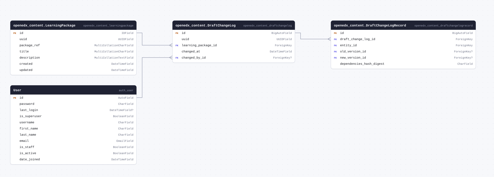

| Column | Field | Type | Null | Key | Default | Description |
| --- | --- | --- | --- | --- | --- | --- |
| `id` | `BigAutoField` | `integer` |  | PK | `autoincrement()` |  |
| `uuid` | `UUIDField` | `char(32)` |  | unique | `uuid4()` |  |
| `learning_package_id` | `ForeignKey` | `integer` |  | FK |  |  |
| `changed_at` | `DateTimeField` | `datetime` |  |  |  |  |
| `changed_by_id` | `ForeignKey` | `integer` | yes | FK |  |  |

Indexes:

- index `openedx_content_draftchangelog_learning_package_id_3c996125` on `learning_package_id`
- index `openedx_content_draftchangelog_changed_by_id_ad10fa85` on `changed_by_id`

Relations:

- `learning_package_id` → [openedx_content.LearningPackage](#openedx_contentlearningpackage).`id`, on delete cascade
- `changed_by_id` → [User](#user).`id`, on delete set null
- [openedx_content.DraftChangeLogRecord](#openedx_contentdraftchangelogrecord).`draft_change_log_id` → `id`, on delete cascade

## openedx_content.DraftChangeLogRecord

Table `openedx_content_draftchangelogrecord`, app `openedx_content`.

A single change in the :class:`PublishableEntity` that :class:`Draft`
points to.

Within a single :class:`DraftChangeLog`, there can be only one
:class:`DraftChangeLogRecord` per :class:`PublishableEntity`. If a
:class:`PublishableEntity` goes from v1 → v2 and then v2 → v3 within
the same :class:`DraftChangeLog`, the expectation is that these will
be collapsed into one :class:`DraftChangeLogRecord` that goes from
v1 → v3. A single :class:`PublishableEntity` may have many
:class:`DraftChangeLogRecord` objects that describe its full draft
edit history, but each :class:`DraftChangeLogRecord` will be a part of
a different :class:`DraftChangeLog`.

New :class:`PublishableEntityVersion` objects are created with a
monotonically increasing ``version_num`` for their
:class:`PublishableEntity`. However, knowing that is not enough to
accurately reconstruct how the :class:`Draft` changes over time
because the :class:`Draft` does not always point to the most recently
created :class:`PublishableEntityVersion`. We also have the concept
of side-effects, where we consider a :class:`PublishableEntity` to
have changed in some way, even if no new version is explicitly
created.

The following scenarios may occur:

**Scenario 1: old_version is None, new_version.version_num = 1**

This is the common case when we're creating the first version for
editing.

**Scenario 2: old_version.version_num + 1 == new_version.version_num**

This is the common case when we've made an edit to something, which
creates the next version of an entity, which we then point the
:class:`Draft` at.

**Scenario 3: old_version.version_num >=1, new_version is None**

This is a soft-deletion. We never actually delete a row from the
:class:`PublishableEntity` model, but set its current :class:`Draft`
version to be None instead.

**Scenario 4: old_version.version_num > new_version.version_num**

This can happen if we "discard changes", meaning that we call
``reset_drafts_to_published()``. The versions we created before
resetting don't get deleted, but the :class:`Draft` model's pointer
to the current version has been reset to match the :class:`Published`
model.

**Scenario 5: old_version.version_num + 1 < new_version.version_num**

Sometimes we'll have a gap between the two version numbers that is
> 1. This can happen if we make edits (new versions) after we called
``reset_drafts_to_published``. :class:`PublishableEntityVersion`
objects are created with a monotonically incrementing ``version_num``
which will continue to go up with the next edit, regardless of
whether :class:`Draft` is pointing to the most recently created
version or not. In terms of (``old_version``, ``new_version``)
changes, it could look like this:

- (None, v1): Initial creation
- # Publish happens here, so v1 of this :class:`PublishableEntity` is
  published.
- (v1, v2): Normal edit in draft
- (v2, v3): Normal edit in draft
- (v3, v1): Reset to published happened here.
- (v1, v4): Normal edit in draft

This could also technically happen if we change the same entity more
than once in the the same ``bulk_draft_changes_for()`` context,
thereby putting them into the same :class:`DraftChangeLog`, which
forces us to squash the changes together into one
:class:`DraftChangeLogRecord`.

**Scenario 6: old_version is None, new_version > 1**

This edge case can happen if we soft-deleted a published entity, and
then called ``reset_drafts_to_published`` before we published that
soft-deletion. It would effectively undo our soft-delete because the
published version was not yet marked as deleted.

**Scenario 7: old_version == new_version**

This means that the data associated with the :class:`Draft` version of
an entity has changed purely as a side-effect of some other entity
changing.

The main example we have of this are containers. Imagine that we have
a Unit that is at v1, and has unpinned references to various
Components that are its children. The Unit's version does not get
incremented when the Components are edited, because the Unit
container is defined to always get the most recent version of those
Components. We would only make a new version of the Unit if we
changed the metadata of the Unit itself (e.g. the title), or if we
added, removed, or reordered the children.

Yet updating a Component intuitively changes what we think of as the
content of the Unit. Users who are working on Units also expect that
a change to a Component will be reflected when looking at a Unit's
"last updated" info. The ``old_version == new_version`` convention
lets us represent that in a useful way because that Unit *is* a part
of the change set represented by a :class:`DraftChangeLog`, even if
its own versioned data hasn't changed.

.. no_pii:

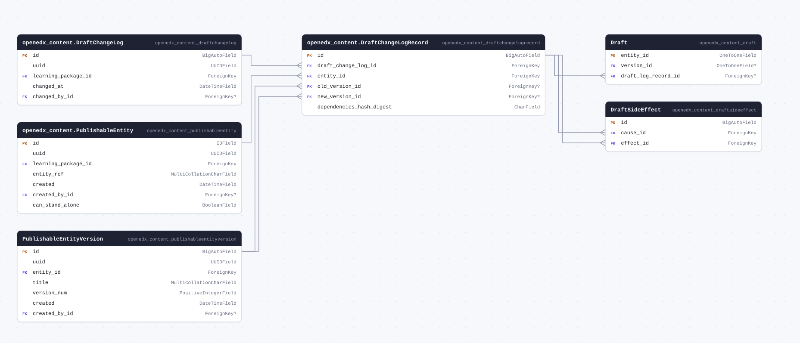

| Column | Field | Type | Null | Key | Default | Description |
| --- | --- | --- | --- | --- | --- | --- |
| `id` | `BigAutoField` | `integer` |  | PK | `autoincrement()` |  |
| `draft_change_log_id` | `ForeignKey` | `bigint` |  | FK |  |  |
| `entity_id` | `ForeignKey` | `bigint` |  | FK |  |  |
| `old_version_id` | `ForeignKey` | `bigint` | yes | FK |  |  |
| `new_version_id` | `ForeignKey` | `bigint` | yes | FK |  |  |
| `dependencies_hash_digest` | `CharField` | `varchar(8)` |  |  | `''` |  |

Indexes:

- index `openedx_content_draftchangelogrecord_draft_change_log_id_d73b7256` on `draft_change_log_id`
- index `openedx_content_draftchangelogrecord_entity_id_4aea1ee5` on `entity_id`
- index `openedx_content_draftchangelogrecord_old_version_id_9e002973` on `old_version_id`
- index `openedx_content_draftchangelogrecord_new_version_id_132fcc8d` on `new_version_id`
- unique `oel_dlr_uniq_dcl` on `draft_change_log_id`, `entity_id`
- index `oel_dlr_idx_entity_rdcl` on `entity_id`, `draft_change_log_id` desc

Relations:

- [Draft](#draft).`draft_log_record_id` → `id`, on delete set null
- `draft_change_log_id` → [openedx_content.DraftChangeLog](#openedx_contentdraftchangelog).`id`, on delete cascade
- `entity_id` → [openedx_content.PublishableEntity](#openedx_contentpublishableentity).`id`, on delete restrict
- `old_version_id` → [PublishableEntityVersion](#publishableentityversion).`id`, on delete restrict
- `new_version_id` → [PublishableEntityVersion](#publishableentityversion).`id`, on delete restrict
- [DraftSideEffect](#draftsideeffect).`cause_id` → `id`, on delete restrict
- [DraftSideEffect](#draftsideeffect).`effect_id` → `id`, on delete restrict

## DraftSideEffect

Table `openedx_content_draftsideeffect`, app `openedx_content`.

Model to track when a change in one :class:`Draft` affects other
:class:`Draft` objects.

Our first use case for this is that changes involving child components
are thought to affect parent Units, even if the parent's version
doesn't change.

Side-effects are recorded in a collapsed form that only captures one
level. So if Components C1 and C2 are both changed and they are part
of Unit U1, which is in turn a part of Subsection SS1, then the
:class:`DraftSideEffect` entries are::

  (C1, U1)
  (C2, U1)
  (U1, SS1)

We do not keep entries for ``(C1, SS1)`` or ``(C2, SS1)``. This is to
make the model simpler, so we don't have to differentiate between
direct side-effects and transitive side-effects in the model.

We will record side-effects on a parent container whenever a child
changes, even if the parent container is also changing in the same
:class:`DraftChangeLog`. The child change is still affecting the
parent container, whether the container happens to be changing for
other reasons as well. Whether a parent-child relationship exists or
not depends on the draft state of the container at the *end* of a
``bulk_draft_changes_for`` context. To give concrete examples:

Setup: A Unit version U1.v1 has defined C1 to be a child. The current
draft version of C1 is C1.v1.

**Scenario 1: In the a bulk_draft_changes_for context, we edit C1 so
that the draft version of C1 is now C1.v2.**

Result:

- a :class:`DraftChangeLogRecord` is created for C1.v1 → C1.v2
- a :class:`DraftChangeLogRecord` is created for U1.v1 → U1.v1
- a :class:`DraftSideEffect` is created with cause (C1.v1 → C1.v2) and
  effect (U1.v1 → U1.v1). The Unit draft version has not been
  incremented because the metadata a Unit defines for itself hasn't
  been altered, but the Unit has *changed* in some way because of the
  side effect of its child being edited.

**Scenario 2: In a bulk_draft_changes_for context, we edit C1 so that
the draft version of C1 is now C1.v2. In the same context, we edit
U1's metadata so that the draft version of U1 is now U1.v2. U1.v2
still lists C1 as a child entity.**

Result:

- a :class:`DraftChangeLogRecord` is created for C1.v1 → C1.v2
- a :class:`DraftChangeLogRecord` is created for U1.v1 → U1.v2
- a :class:`DraftSideEffect` is created with cause (C1.v1 → C1.v2) and
  effect (U1.v1 → U1.v2)

**Scenario 3: In a bulk_draft_changes_for context, we edit C1 so that
the draft version of C1 is now C1.v2. In the same context, we edit
U1's list of children so that C1 is no longer a child of U1.v2.**

Result:

- a :class:`DraftChangeLogRecord` is created for C1.v1 → C1.v2
- a :class:`DraftChangeLogRecord` is created for U1.v1 → U1.v2
- no SideEffect is created, since changing C1 does not have an impact
  on the current draft of U1 (U1.v2). A :class:`DraftChangeLog` is
  considered a single atomic operation, so there was never a point at
  which C1.v1 → C1.v2 affected the draft state of U1.

.. no_pii:

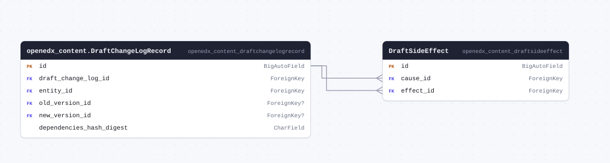

| Column | Field | Type | Null | Key | Default | Description |
| --- | --- | --- | --- | --- | --- | --- |
| `id` | `BigAutoField` | `integer` |  | PK | `autoincrement()` |  |
| `cause_id` | `ForeignKey` | `bigint` |  | FK |  |  |
| `effect_id` | `ForeignKey` | `bigint` |  | FK |  |  |

Indexes:

- index `openedx_content_draftsideeffect_cause_id_75d6a806` on `cause_id`
- index `openedx_content_draftsideeffect_effect_id_567b298a` on `effect_id`
- unique `oel_pub_dse_uniq_c_e` on `cause_id`, `effect_id`

Relations:

- `cause_id` → [openedx_content.DraftChangeLogRecord](#openedx_contentdraftchangelogrecord).`id`, on delete restrict
- `effect_id` → [openedx_content.DraftChangeLogRecord](#openedx_contentdraftchangelogrecord).`id`, on delete restrict

## PublishLog

Table `openedx_content_publishlog`, app `openedx_content`.

There is one row in this table for every time content is published.

Each :class:`PublishLog` has 0 or more :class:`PublishLogRecord`
objects describing exactly which :class:`PublishableEntity` objects
were published and what the version changes are. A :class:`PublishLog`
is like a git commit in that sense, with individual
:class:`PublishLogRecord` objects representing the files changed.

Open question: Empty publishes are allowed at this time, and might be
useful for "fake" publishes that are necessary to invoke other
post-publish actions. It's not clear at this point how useful this
will actually be.

The absence of a ``version_num`` field in this model is intentional,
because having one would potentially cause write contention/locking
issues when there are many people working on different entities in a
very large library. We already see some contention issues occuring in
ModuleStore for courses, and we want to support Libraries that are
far larger.

If you need a :class:`LearningPackage`-wide indicator for version and
the only thing you care about is "has *something* changed?", you can
make a foreign key to the most recent :class:`PublishLog`, or use the
most recent :class:`PublishLog`'s primary key. This should be
monotonically increasing, though there will be large gaps in values,
e.g. (5, 190, 1291, etc.). Be warned that this value will not port
across sites. If you need site-portability, the UUIDs for this model
are a safer bet, though there's a lot about import/export that we
haven't fully mapped out yet.

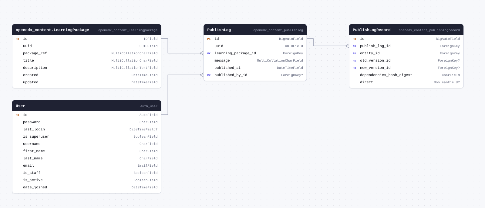

| Column | Field | Type | Null | Key | Default | Description |
| --- | --- | --- | --- | --- | --- | --- |
| `id` | `BigAutoField` | `integer` |  | PK | `autoincrement()` |  |
| `uuid` | `UUIDField` | `char(32)` |  | unique | `uuid4()` |  |
| `learning_package_id` | `ForeignKey` | `integer` |  | FK |  |  |
| `message` | `MultiCollationCharField` | `varchar(500)` |  |  | `''` |  |
| `published_at` | `DateTimeField` | `datetime` |  |  |  |  |
| `published_by_id` | `ForeignKey` | `integer` | yes | FK |  |  |

Indexes:

- index `openedx_content_publishlog_learning_package_id_5bf49306` on `learning_package_id`
- index `openedx_content_publishlog_published_by_id_79acc442` on `published_by_id`

Relations:

- `learning_package_id` → [openedx_content.LearningPackage](#openedx_contentlearningpackage).`id`, on delete cascade
- `published_by_id` → [User](#user).`id`, on delete set null
- [PublishLogRecord](#publishlogrecord).`publish_log_id` → `id`, on delete cascade

## PublishLogRecord

Table `openedx_content_publishlogrecord`, app `openedx_content`.

A record for each publishable entity version changed, for each publish.

To revert a publish, we would make a new publish that swaps
``old_version`` and ``new_version`` field values.

If the ``old_version`` and ``new_version`` of a
:class:`PublishLogRecord` match, it means that the definition of the
entity itself did not change (i.e. no new
:class:`PublishableEntityVersion` was created), but something else was
published that had the side-effect of changing the published state of
this entity. For instance, if a Unit has unpinned references to its
child Components (which it almost always will), then publishing one
of those Components will alter the published state of the Unit, even
if the UnitVersion does not change.

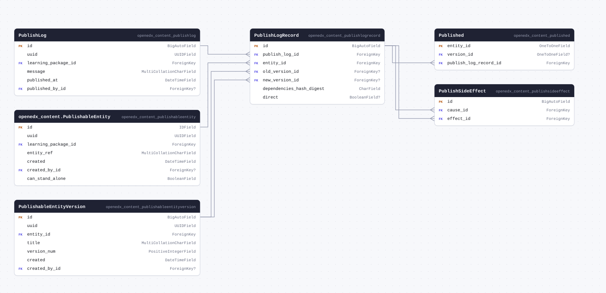

| Column | Field | Type | Null | Key | Default | Description |
| --- | --- | --- | --- | --- | --- | --- |
| `id` | `BigAutoField` | `integer` |  | PK | `autoincrement()` |  |
| `publish_log_id` | `ForeignKey` | `bigint` |  | FK |  |  |
| `entity_id` | `ForeignKey` | `bigint` |  | FK |  |  |
| `old_version_id` | `ForeignKey` | `bigint` | yes | FK |  |  |
| `new_version_id` | `ForeignKey` | `bigint` | yes | FK |  |  |
| `dependencies_hash_digest` | `CharField` | `varchar(8)` |  |  | `''` |  |
| `direct` | `BooleanField` | `bool` | yes |  | `False` |  |

Indexes:

- index `openedx_content_publishlogrecord_publish_log_id_f50dd1ec` on `publish_log_id`
- index `openedx_content_publishlogrecord_entity_id_d7267f94` on `entity_id`
- index `openedx_content_publishlogrecord_old_version_id_ae92d31b` on `old_version_id`
- index `openedx_content_publishlogrecord_new_version_id_7774a47a` on `new_version_id`
- unique `oel_plr_uniq_pl_publishable` on `publish_log_id`, `entity_id`
- index `oel_plr_idx_entity_rplr` on `entity_id`, `publish_log_id` desc

Relations:

- `publish_log_id` → [PublishLog](#publishlog).`id`, on delete cascade
- `entity_id` → [openedx_content.PublishableEntity](#openedx_contentpublishableentity).`id`, on delete restrict
- `old_version_id` → [PublishableEntityVersion](#publishableentityversion).`id`, on delete restrict
- `new_version_id` → [PublishableEntityVersion](#publishableentityversion).`id`, on delete restrict
- [Published](#published).`publish_log_record_id` → `id`, on delete restrict
- [PublishSideEffect](#publishsideeffect).`cause_id` → `id`, on delete restrict
- [PublishSideEffect](#publishsideeffect).`effect_id` → `id`, on delete restrict

## Published

Table `openedx_content_published`, app `openedx_content`.

Find the currently published version of an entity.

Notes:

* There is only ever one published :class:`PublishableEntityVersion`
  per :class:`PublishableEntity` at any given time.
* It may be possible for a :class:`PublishableEntity` to exist only as
  a :class:`Draft` (and thus not show up in this table).
* If a row exists for a :class:`PublishableEntity`, but the
  ``version`` field is None, it means that the entity was published
  at some point, but is no longer published now–i.e. it's functionally
  "deleted", even though all the version history is preserved behind
  the scenes.

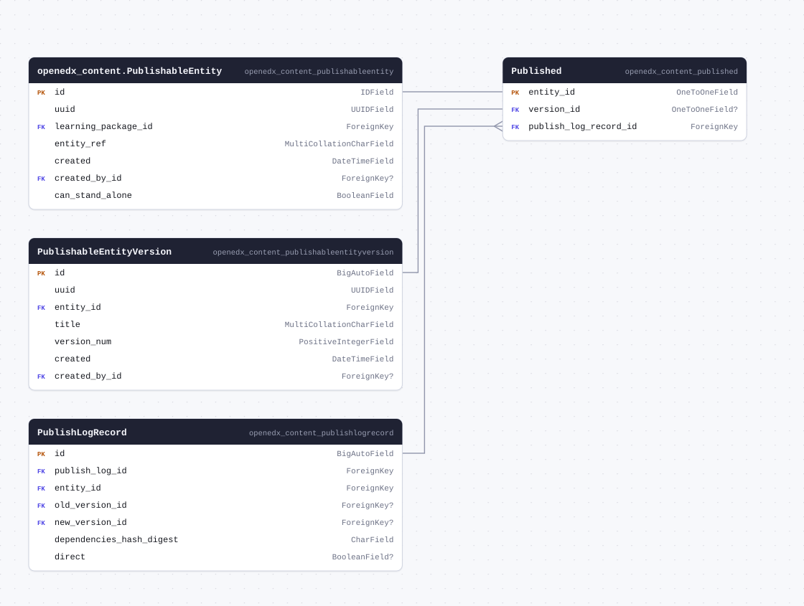

| Column | Field | Type | Null | Key | Default | Description |
| --- | --- | --- | --- | --- | --- | --- |
| `entity_id` | `OneToOneField` | `bigint` |  | PK, FK |  |  |
| `version_id` | `OneToOneField` | `bigint` | yes | FK, unique |  |  |
| `publish_log_record_id` | `ForeignKey` | `bigint` |  | FK |  |  |

Indexes:

- index `openedx_content_published_publish_log_record_id_2596a751` on `publish_log_record_id`

Relations:

- `entity_id` → [openedx_content.PublishableEntity](#openedx_contentpublishableentity).`id`, on delete cascade
- `version_id` → [PublishableEntityVersion](#publishableentityversion).`id`, on delete restrict
- `publish_log_record_id` → [PublishLogRecord](#publishlogrecord).`id`, on delete restrict

## PublishSideEffect

Table `openedx_content_publishsideeffect`, app `openedx_content`.

Model to track when a change in one :class:`Published` entity affects
others.

Our first use case for this is that changes involving child components
are thought to affect parent Units, even if the parent's version
doesn't change.

Side-effects are recorded in a collapsed form that only captures one
level. So if Components C1 and C2 are both published and they are
part of Unit U1, which is in turn a part of Subsection SS1, then the
:class:`PublishSideEffect` entries are::

  (C1, U1)
  (C2, U1)
  (U1, SS1)

We do not keep entries for ``(C1, SS1)`` or ``(C2, SS1)``. This is to
make the model simpler, so we don't have to differentiate between
direct side-effects and transitive side-effects in the model.

.. no_pii:

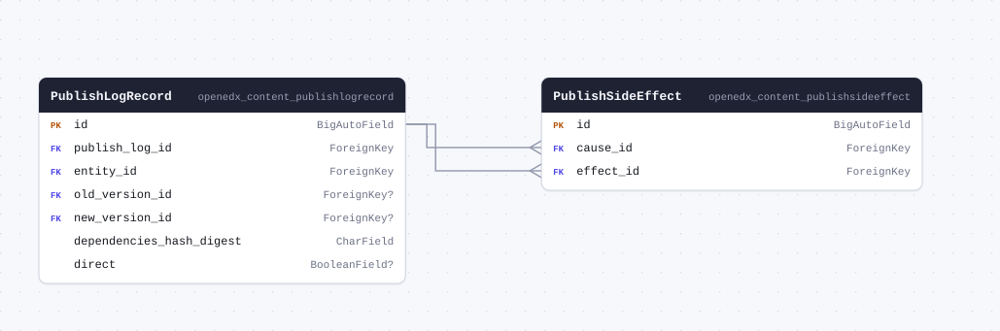

| Column | Field | Type | Null | Key | Default | Description |
| --- | --- | --- | --- | --- | --- | --- |
| `id` | `BigAutoField` | `integer` |  | PK | `autoincrement()` |  |
| `cause_id` | `ForeignKey` | `bigint` |  | FK |  |  |
| `effect_id` | `ForeignKey` | `bigint` |  | FK |  |  |

Indexes:

- index `openedx_content_publishsideeffect_cause_id_0525f673` on `cause_id`
- index `openedx_content_publishsideeffect_effect_id_839189d9` on `effect_id`
- unique `oel_pub_pse_uniq_c_e` on `cause_id`, `effect_id`

Relations:

- `cause_id` → [PublishLogRecord](#publishlogrecord).`id`, on delete restrict
- `effect_id` → [PublishLogRecord](#publishlogrecord).`id`, on delete restrict

## openedx_content.Collection

Table `openedx_content_collection`, app `openedx_content`.

Represents a collection of library components

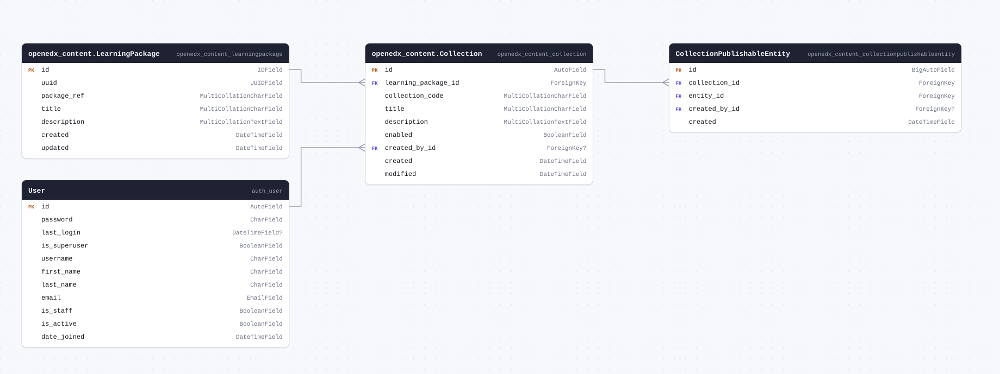

| Column | Field | Type | Null | Key | Default | Description |
| --- | --- | --- | --- | --- | --- | --- |
| `id` | `AutoField` | `integer` |  | PK | `autoincrement()` |  |
| `learning_package_id` | `ForeignKey` | `integer` |  | FK |  |  |
| `collection_code` | `MultiCollationCharField` | `varchar(255)` |  |  |  |  |
| `title` | `MultiCollationCharField` | `varchar(500)` |  |  |  | The title of the collection. |
| `description` | `MultiCollationTextField` | `text` |  |  | `''` | Provides extra information for the user about this collection. |
| `enabled` | `BooleanField` | `bool` |  |  | `True` | Disabled collections are "soft deleted", and should be re-enabled before use, or be deleted. |
| `created_by_id` | `ForeignKey` | `integer` | yes | FK |  |  |
| `created` | `DateTimeField` | `datetime` |  |  | `now()` |  |
| `modified` | `DateTimeField` | `datetime` |  |  | `now()` |  |

Indexes:

- index `openedx_content_collection_learning_package_id_3c7da4e7` on `learning_package_id`
- index `openedx_content_collection_created_by_id_c2734735` on `created_by_id`
- unique `oel_coll_uniq_lp_key` on `learning_package_id`, `collection_code`
- index `openedx_content_coll_lp_title` on `learning_package_id`, `title`

Checks:

- `oel_coll_collection_code_regex`: `"collection_code" REGEXP '^[a-zA-Z0-9_.-]+\Z'`

Relations:

- `entities` — many to many with [openedx_content.PublishableEntity](#openedx_contentpublishableentity), through [CollectionPublishableEntity](#collectionpublishableentity)
- `learning_package_id` → [openedx_content.LearningPackage](#openedx_contentlearningpackage).`id`, on delete cascade
- `created_by_id` → [User](#user).`id`, on delete set null
- [CollectionPublishableEntity](#collectionpublishableentity).`collection_id` → `id`, on delete cascade

## CollectionPublishableEntity

Table `openedx_content_collectionpublishableentity`, app `openedx_content`.

:class:`Collection` → :class:`PublishableEntity` association.

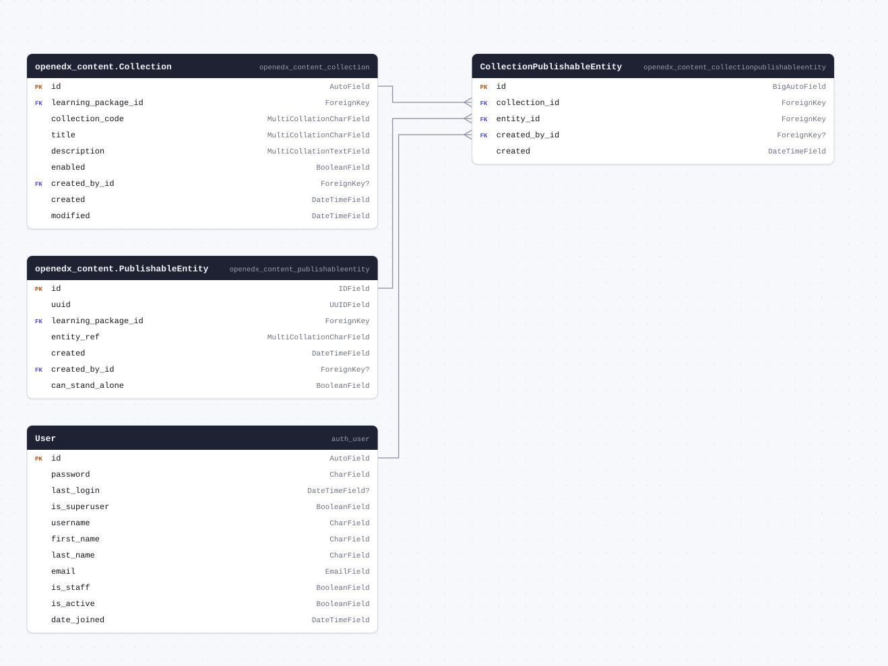

| Column | Field | Type | Null | Key | Default | Description |
| --- | --- | --- | --- | --- | --- | --- |
| `id` | `BigAutoField` | `integer` |  | PK | `autoincrement()` |  |
| `collection_id` | `ForeignKey` | `integer` |  | FK |  |  |
| `entity_id` | `ForeignKey` | `bigint` |  | FK |  |  |
| `created_by_id` | `ForeignKey` | `integer` | yes | FK |  |  |
| `created` | `DateTimeField` | `datetime` |  |  | `now()` |  |

Indexes:

- index `openedx_content_collectionpublishableentity_collection_id_30209c12` on `collection_id`
- index `openedx_content_collectionpublishableentity_entity_id_67b1c7ec` on `entity_id`
- index `openedx_content_collectionpublishableentity_created_by_id_0436fdae` on `created_by_id`
- unique `oel_collections_cpe_uniq_col_ent` on `collection_id`, `entity_id`

Relations:

- `collection_id` → [openedx_content.Collection](#openedx_contentcollection).`id`, on delete cascade
- `entity_id` → [openedx_content.PublishableEntity](#openedx_contentpublishableentity).`id`, on delete restrict
- `created_by_id` → [User](#user).`id`, on delete set null

## MediaType

Table `openedx_content_mediatype`, app `openedx_content`.

Stores Media types for use by :class:`Media` models.

This is the same as MIME types (the IANA renamed MIME Types to Media
Types). We don't pre-populate this table, so APIs that add
:class:`Media` must ensure that the desired Media Type exists.

Media types are written as ``{type}/{sub_type}+{suffix}``, where
suffixes are seldom used. Examples:

* ``application/json``
* ``text/css``
* ``image/svg+xml``
* ``application/vnd.openedx.xblock.v1.problem+xml``

We have this as a separate model (instead of a field on :class:`Media`)
because:

1. We can save a lot on storage and indexing for :class:`Media` if
   we're just storing foreign key references there, rather than the
   entire content string to be indexed. This is especially relevant
   for our (long) custom types like
   ``application/vnd.openedx.xblock.v1.problem+xml``.
2. These values can occasionally change. For instance,
   ``text/javascript`` vs. ``application/javascript``. Also, we will
   be using a fair number of ``vnd.`` style of custom content types,
   and we may want the flexibility of changing that without having to
   worry about migrating millions of rows of :class:`Media`.

Media types are denoted as ``{type}/{sub_type}+{suffix}``. We currently
do not support parameters.

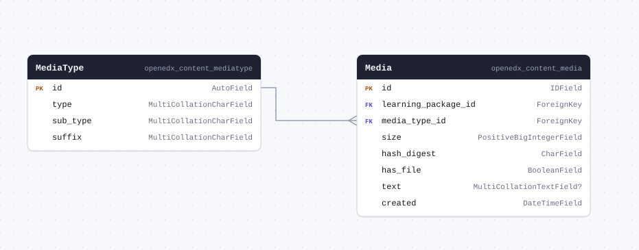

| Column | Field | Type | Null | Key | Default | Description |
| --- | --- | --- | --- | --- | --- | --- |
| `id` | `AutoField` | `integer` |  | PK | `autoincrement()` |  |
| `type` | `MultiCollationCharField` | `varchar(127)` |  |  |  |  |
| `sub_type` | `MultiCollationCharField` | `varchar(127)` |  |  |  |  |
| `suffix` | `MultiCollationCharField` | `varchar(127)` |  |  |  |  |

Indexes:

- unique `oel_contents_uniq_t_st_sfx` on `type`, `sub_type`, `suffix`

Relations:

- [Media](#media).`media_type_id` → `id`, on delete protect

## Media

Table `openedx_content_media`, app `openedx_content`.

This is the most primitive piece of content.

This model serves to lookup, de-duplicate, and store text and files. A
piece of :class:`Media` is identified purely by its data, the media
type, and the :class:`LearningPackage` it is associated with. It has
no version or file name metadata associated with it. It exists to be a
dumb blob of data that higher level models like
:class:`ComponentVersion` objects can assemble together.

In-model Text vs. File
----------------------

That being said, the :class:`Media` model does have some complexity to
accomodate different access patterns that we have in our app. In
particular, it can store data in two ways: the ``text`` field and a
file (``has_file=True``) A :class:`Media` object must use at least one
of these methods, but can use both if it's appropriate.

Use the ``text`` field when:

* the content is a relatively small (< 50K, usually much less) piece
  of text
* you want to do be able to query across many rows at once
* low, predictable latency is important

Use file storage when:

* the content is large, or not text-based
* you want to be able to serve the file content directly to the
  browser

The high level tradeoff is that ``text`` will give you faster access,
and file storage will give you a much more affordable and scalable
backend. The backend used for files will also eventually allow direct
browser download access, whereas the ``text`` field will not. But
again, you can use both at the same time if needed.

Association with a LearningPackage
----------------------------------

:class:`Media` is associated with a specific :class:`LearningPackage`.
Doing so allows us to more easily query for how much storage space a
specific :class:`LearningPackage` is using, and to clean up unused data.

When we use :class:`Media` across :class:`LearningPackage` objects, we need
to copy them. That way, even if the originating :class:`LearningPackage` is
deleted, it won't break other :class:`LearningPackage` objects that are
making use of it.

Media Types, and file duplication
---------------------------------

:class:`Media` is almost 1:1 with the files that it pushes to a storage
backend, but not quite. The file locations are generated purely as a
product of the :class:`LearningPackage` UUID and the :class:`Media`'s
``hash_digest``, but :class:`Media` also takes into account the
``media_type``.

For example, say we had a :class:`Media` with the following data::

    ["hello", "world"]

That is legal syntax for both JSON and YAML. If you want to attach
some YAML-specific metadata in a new model, you could make it 1:1 with
the :class:`Media` that matched the ``application/yaml`` media type.
The YAML and JSON versions of this data would be two separate
:class:`Media` rows that would share the same ``hash_digest`` value.
If they both stored a file, they would be pointing to the same file
location. If they only used the ``text`` field, then that value would
be duplicated across the two separate :class:`Media` rows.

The alternative would have been to associate media types at the level
where this data was being added to a :class:`ComponentVersion`, but
that would have added more complexity. Right now, you could make an
``ImageMedia`` 1:1 model that analyzed images and created metatdata
entries for them (dimensions, GPS) without having to understand how
:class:`ComponentVersion` objects work.

This is definitely an edge case, and it's likely the only time
collisions like this will happen in practice is with blank files. It
also means that using this table to measure disk usage may be
slightly inaccurate when used in a :class:`LearningPackage` with
collisions–though we expect to use numbers like that mostly to get a
broad sense of usage and look for major outliers, rather than for
byte-level accuracy (it wouldn't account for the non-trivial indexing
storage costs either).

Immutability
------------

From the outside, :class:`Media` should appear immutable. Since the
:class:`Media` is looked up by a hash of its data, a change in the
data means that we should look up the hash value of that new data and
create a new :class:`Media` if we don't find a match.

That being said, the :class:`Media` model has different ways of
storing that data, and that is mutable. We could decide that a
certain type of :class:`Media` should be optimized to store its text
in the table. Or that a media type that we had previously only stored
as text now also needs to be stored on in the file storage backend so
that it can be made available to be downloaded. These operations
would be done as data migrations.

Extensibility
-------------

Third-party apps are encouraged to create models that have a
``OneToOneField`` relationship with :class:`Media`. For instance, an
``ImageMedia`` model might join 1:1 with all :class:`Media` that has
``image/*`` media types, and provide additional metadata for that
data.

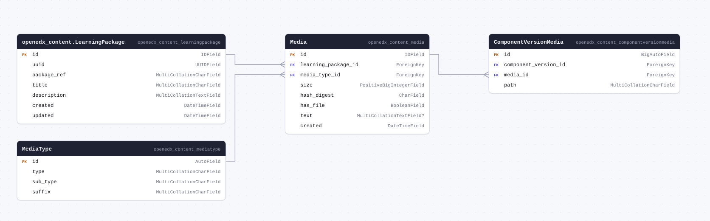

| Column | Field | Type | Null | Key | Default | Description |
| --- | --- | --- | --- | --- | --- | --- |
| `id` | `IDField` | `integer` |  | PK | `autoincrement()` |  |
| `learning_package_id` | `ForeignKey` | `integer` |  | FK |  |  |
| `media_type_id` | `ForeignKey` | `integer` |  | FK |  |  |
| `size` | `PositiveBigIntegerField` | `bigint unsigned` |  |  |  |  |
| `hash_digest` | `CharField` | `varchar(40)` |  |  |  |  |
| `has_file` | `BooleanField` | `bool` |  |  |  |  |
| `text` | `MultiCollationTextField` | `text` | yes |  |  |  |
| `created` | `DateTimeField` | `datetime` |  |  |  |  |

Indexes:

- index `openedx_content_media_learning_package_id_5921a122` on `learning_package_id`
- index `openedx_content_media_media_type_id_556182c9` on `media_type_id`
- unique `oel_content_uniq_lc_media_type_hash_digest` on `learning_package_id`, `media_type_id`, `hash_digest`
- index `oel_content_idx_lp_rsize` on `learning_package_id`, `size` desc

Relations:

- `component_versions` — many to many with [ComponentVersion](#componentversion), through [ComponentVersionMedia](#componentversionmedia)
- `learning_package_id` → [openedx_content.LearningPackage](#openedx_contentlearningpackage).`id`, on delete cascade
- `media_type_id` → [MediaType](#mediatype).`id`, on delete protect
- [ComponentVersionMedia](#componentversionmedia).`media_id` → `id`, on delete restrict

## ComponentType

Table `openedx_content_componenttype`, app `openedx_content`.

Normalized representation of a type of Component.

The only namespace being used initially will be ``xblock.v1``, but we will
probably add a few others over time, such as a component type to represent
packages of files for things like Files and Uploads or ``python_lib.zip``
files.

Make a foreign key against this table if you have to set policy based on
the type of Components–e.g. marking certain types of XBlocks as approved
vs. experimental for use in libraries.

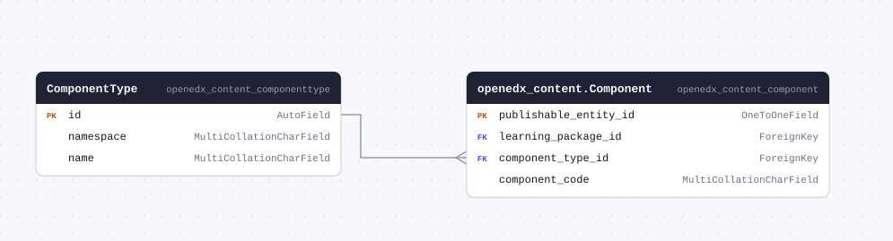

| Column | Field | Type | Null | Key | Default | Description |
| --- | --- | --- | --- | --- | --- | --- |
| `id` | `AutoField` | `integer` |  | PK | `autoincrement()` |  |
| `namespace` | `MultiCollationCharField` | `varchar(100)` |  |  |  |  |
| `name` | `MultiCollationCharField` | `varchar(100)` |  |  |  |  |

Indexes:

- unique `oel_component_type_uniq_ns_n` on `namespace`, `name`

Relations:

- [openedx_content.Component](#openedx_contentcomponent).`component_type_id` → `id`, on delete protect

## openedx_content.Component

Table `openedx_content_component`, app `openedx_content`.

Columns from `PublishableEntityMixin` (abstract): `publishable_entity_id`.

This represents any Component that has ever existed in a
:class:`LearningPackage`.

What is a Component
-------------------

A :class:`Component` is an entity like a Problem or Video. It has enough
information to identify itself and determine what the handler should be
(e.g. XBlock Problem), but little beyond that.

A :class:`Component` will have many :class:`ComponentVersion` objects
over time, and most metadata is associated with the
:class:`ComponentVersion` model and the :class:`Media` that
:class:`ComponentVersion` objects are associated with.

A :class:`Component` belongs to exactly one :class:`LearningPackage`.

A :class:`Component` is 1:1 with :class:`PublishableEntity` and has
matching primary key values. More specifically, :attr:`Component.pk`
maps to :attr:`Component.publishable_entity_id`, and any place where
the Publishing API module expects to get a :attr:`PublishableEntity.id`,
you can use a :attr:`Component.pk` instead.

Identifiers
-----------

Components have a ``publishable_entity`` ``OneToOneField`` to the
:mod:`publishing` app's :class:`PublishableEntity` field, and it uses
this as its primary key. Please see :class:`PublishableEntity`'s
docstring for how you should use its ``uuid`` and ``key`` fields.

State Consistency
-----------------

The ``key`` field on Component's ``publishable_entity`` is derived from
the ``component_type`` and ``component_code`` fields in this model. We
don't support changing the keys yet, but if we do, those values need to
be kept in sync.

How build on this model
-----------------------

Make a foreign key to the :class:`Component` model when you need a
stable reference that will exist for as long as the
:class:`LearningPackage` itself exists.

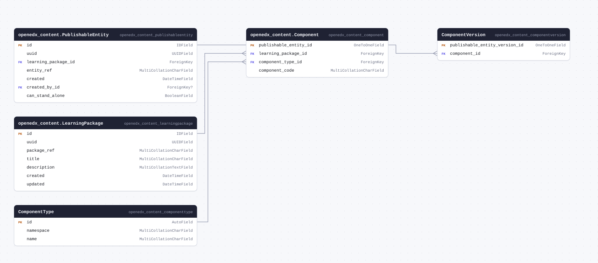

| Column | Field | Type | Null | Key | Default | Description |
| --- | --- | --- | --- | --- | --- | --- |
| `publishable_entity_id` | `OneToOneField` | `bigint` |  | PK, FK |  |  |
| `learning_package_id` | `ForeignKey` | `integer` |  | FK |  |  |
| `component_type_id` | `ForeignKey` | `integer` |  | FK |  |  |
| `component_code` | `MultiCollationCharField` | `varchar(255)` |  |  |  |  |

Indexes:

- index `openedx_content_component_learning_package_id_ff2bff8c` on `learning_package_id`
- index `openedx_content_component_component_type_id_0d8d0461` on `component_type_id`
- unique `oel_component_uniq_lc_ct_lk` on `learning_package_id`, `component_type_id`, `component_code`
- index `oel_component_idx_ct_lk` on `component_type_id`, `component_code`

Checks:

- `oel_component_code_regex`: `"component_code" REGEXP '^[\w.-]+\Z'`

Relations:

- `publishable_entity_id` → [openedx_content.PublishableEntity](#openedx_contentpublishableentity).`id`, on delete cascade
- `learning_package_id` → [openedx_content.LearningPackage](#openedx_contentlearningpackage).`id`, on delete cascade
- `component_type_id` → [ComponentType](#componenttype).`id`, on delete protect
- [ComponentVersion](#componentversion).`component_id` → `publishable_entity_id`, on delete cascade

## ComponentVersion

Table `openedx_content_componentversion`, app `openedx_content`.

Columns from `PublishableEntityVersionMixin` (abstract): `publishable_entity_version_id`.

A particular version of a :class:`Component`.

This holds the media using a M:M relationship with :class:`Media` via
:class:`ComponentVersionMedia`.

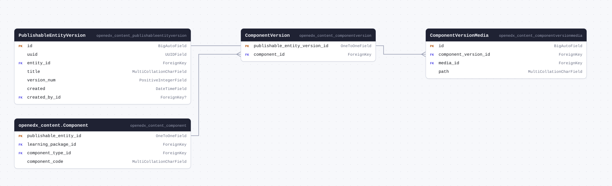

| Column | Field | Type | Null | Key | Default | Description |
| --- | --- | --- | --- | --- | --- | --- |
| `publishable_entity_version_id` | `OneToOneField` | `bigint` |  | PK, FK |  |  |
| `component_id` | `ForeignKey` | `bigint` |  | FK |  |  |

Indexes:

- index `openedx_content_componentversion_component_id_f7caf6bb` on `component_id`

Relations:

- `media` — many to many with [Media](#media), through [ComponentVersionMedia](#componentversionmedia)
- `publishable_entity_version_id` → [PublishableEntityVersion](#publishableentityversion).`id`, on delete cascade
- `component_id` → [openedx_content.Component](#openedx_contentcomponent).`publishable_entity_id`, on delete cascade
- [ComponentVersionMedia](#componentversionmedia).`component_version_id` → `publishable_entity_version_id`, on delete cascade

## ComponentVersionMedia

Table `openedx_content_componentversionmedia`, app `openedx_content`.

Determines the :class:`Media` for a given :class:`ComponentVersion`.

An :class:`ComponentVersion` may be associated with multiple pieces of
binary data. For instance, a Video :class:`ComponentVersion` might be
associated with multiple transcripts in different languages.

When :class:`Media` is associated with a :class:`ComponentVersion`, it
has a ``path`` that is unique within the context of that
:class:`ComponentVersion`. This is used as a local file-path-like
identifier, e.g. ``static/image.png``.

:class:`Media` is immutable and sharable across multiple
:class:`ComponentVersion` objects.

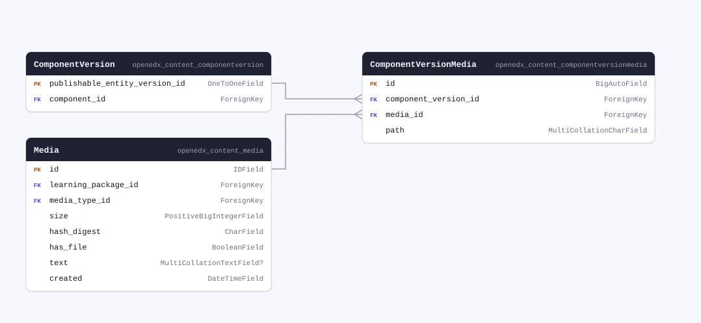

| Column | Field | Type | Null | Key | Default | Description |
| --- | --- | --- | --- | --- | --- | --- |
| `id` | `BigAutoField` | `integer` |  | PK | `autoincrement()` |  |
| `component_version_id` | `ForeignKey` | `bigint` |  | FK |  |  |
| `media_id` | `ForeignKey` | `bigint` |  | FK |  |  |
| `path` | `MultiCollationCharField` | `varchar(500)` |  |  |  |  |

Indexes:

- index `openedx_content_componentversionmedia_component_version_id_555f391c` on `component_version_id`
- index `openedx_content_componentversionmedia_media_id_17ca62ff` on `media_id`
- unique `oel_cvcontent_uniq_cv_key` on `component_version_id`, `path`
- index `oel_cvmedia_c_cv` on `media_id`, `component_version_id`
- index `oel_cvmedia_cv_d` on `component_version_id`, `media_id`

Relations:

- `component_version_id` → [ComponentVersion](#componentversion).`publishable_entity_version_id`, on delete cascade
- `media_id` → [Media](#media).`id`, on delete restrict

## EntityList

Table `openedx_content_entitylist`, app `openedx_content`.

:class:`EntityList` is a common structure to hold parent-child relations.

:class:`EntityList` objects are not :class:`PublishableEntity` objects in
and of themselves. That's because sometimes we'll want the same kind of
data structure for things that we dynamically generate for individual
students (e.g. Variants). :class:`EntityList` objects are anonymous in
a sense–they're pointed to by :class:`ContainerVersion` objects and
other models, rather than being looked up by their own identifiers.

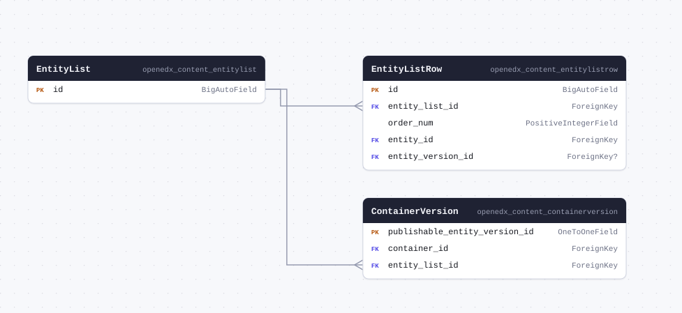

| Column | Field | Type | Null | Key | Default | Description |
| --- | --- | --- | --- | --- | --- | --- |
| `id` | `BigAutoField` | `integer` |  | PK | `autoincrement()` |  |

Relations:

- [EntityListRow](#entitylistrow).`entity_list_id` → `id`, on delete cascade
- [ContainerVersion](#containerversion).`entity_list_id` → `id`, on delete restrict

## EntityListRow

Table `openedx_content_entitylistrow`, app `openedx_content`.

Each :class:`EntityListRow` points to a :class:`PublishableEntity`,
optionally at a specific version.

There is a row in this table for each member of an :class:`EntityList`.
The ``order_num`` field is used to determine the order of the members
in the list.

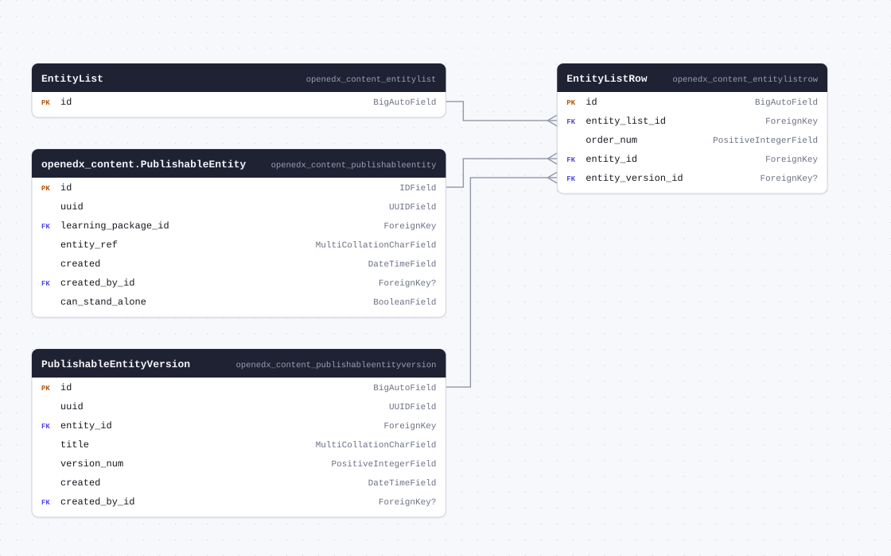

| Column | Field | Type | Null | Key | Default | Description |
| --- | --- | --- | --- | --- | --- | --- |
| `id` | `BigAutoField` | `integer` |  | PK | `autoincrement()` |  |
| `entity_list_id` | `ForeignKey` | `bigint` |  | FK |  |  |
| `order_num` | `PositiveIntegerField` | `integer unsigned` |  |  |  |  |
| `entity_id` | `ForeignKey` | `bigint` |  | FK |  |  |
| `entity_version_id` | `ForeignKey` | `bigint` | yes | FK |  |  |

Indexes:

- index `openedx_content_entitylistrow_entity_list_id_9b735e3c` on `entity_list_id`
- index `openedx_content_entitylistrow_entity_id_42544f3a` on `entity_id`
- index `openedx_content_entitylistrow_entity_version_id_8ffe039e` on `entity_version_id`
- unique `oel_publishing_elist_row_order` on `entity_list_id`, `order_num`

Relations:

- `entity_list_id` → [EntityList](#entitylist).`id`, on delete cascade
- `entity_id` → [openedx_content.PublishableEntity](#openedx_contentpublishableentity).`id`, on delete restrict
- `entity_version_id` → [PublishableEntityVersion](#publishableentityversion).`id`, on delete restrict

## ContainerType

Table `openedx_content_containertype`, app `openedx_content`.

Normalized representation of the type of :class:`Container`.

Typical container types are "unit", "subsection", and "section", but
there may be others in the future.


| Column | Field | Type | Null | Key | Default | Description |
| --- | --- | --- | --- | --- | --- | --- |
| `id` | `AutoField` | `integer` |  | PK | `autoincrement()` |  |
| `type_code` | `MultiCollationCharField` | `varchar(100)` |  | unique |  |  |

Checks:

- `oex_publishing_containertype_type_code_rx`: `"type_code" REGEXP '^[a-z0-9\-_\.]+$'`

Relations:

- [openedx_content.Container](#openedx_contentcontainer).`container_type_id` → `id`, on delete restrict

## openedx_content.Container

Table `openedx_content_container`, app `openedx_content`.

Subclasses (multi-table): [Unit](#unit), [Subsection](#subsection), [Section](#section).

Columns from `PublishableEntityMixin` (abstract): `publishable_entity_id`.

A :class:`Container` is a type of :class:`PublishableEntity` that holds
other :class:`PublishableEntity` objects. For example, a "Unit"
:class:`Container` might hold several :class:`Component` objects.

For now, all containers have a static "entity list" that defines which
containers/components/enities they hold. As we complete the Containers
API, we will also add support for dynamic containers which may contain
different entities for different learners or at different times.

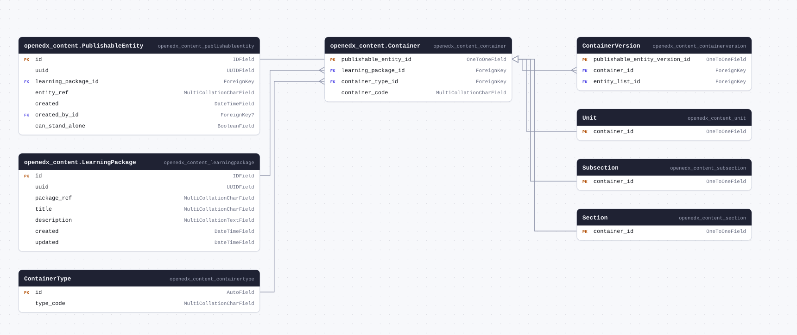

| Column | Field | Type | Null | Key | Default | Description |
| --- | --- | --- | --- | --- | --- | --- |
| `publishable_entity_id` | `OneToOneField` | `bigint` |  | PK, FK |  |  |
| `learning_package_id` | `ForeignKey` | `integer` |  | FK |  |  |
| `container_type_id` | `ForeignKey` | `integer` |  | FK |  |  |
| `container_code` | `MultiCollationCharField` | `varchar(255)` |  |  |  |  |

Indexes:

- index `openedx_content_container_learning_package_id_a29c5633` on `learning_package_id`
- index `openedx_content_container_container_type_id_f7940858` on `container_type_id`
- unique `oel_container_uniq_lp_cc` on `learning_package_id`, `container_code`

Checks:

- `oel_container_code_regex`: `"container_code" REGEXP '^[\w.-]+\Z'`

Relations:

- `publishable_entity_id` → [openedx_content.PublishableEntity](#openedx_contentpublishableentity).`id`, on delete cascade
- `learning_package_id` → [openedx_content.LearningPackage](#openedx_contentlearningpackage).`id`, on delete cascade
- `container_type_id` → [ContainerType](#containertype).`id`, on delete restrict
- [ContainerVersion](#containerversion).`container_id` → `publishable_entity_id`, on delete cascade
- [Unit](#unit).`container_id` → `publishable_entity_id`, parent link, on delete cascade
- [Subsection](#subsection).`container_id` → `publishable_entity_id`, parent link, on delete cascade
- [Section](#section).`container_id` → `publishable_entity_id`, parent link, on delete cascade

## ContainerVersion

Table `openedx_content_containerversion`, app `openedx_content`.

Subclasses (multi-table): [UnitVersion](#unitversion), [SubsectionVersion](#subsectionversion), [SectionVersion](#sectionversion).

Columns from `PublishableEntityVersionMixin` (abstract): `publishable_entity_version_id`.

A version of a :class:`Container`.

By convention, we would only want to create new versions when the
:class:`Container` itself changes, and not when the :class:`Container`'s
child elements change. For example:

* Something was added to the :class:`Container`.
* We re-ordered the rows in the container.
* Something was removed to the container.
* The :class:`Container`'s metadata changed, e.g. the title.
* We pin to different versions of the :class:`Container`.

The last looks a bit odd, but it's because *how we've defined the Unit*
has changed if we decide to explicitly pin a set of versions for the
children, and then later change our minds and move to a different set.
It also just makes things easier to reason about if we say that
``entity_list`` never changes for a given :class:`ContainerVersion`.

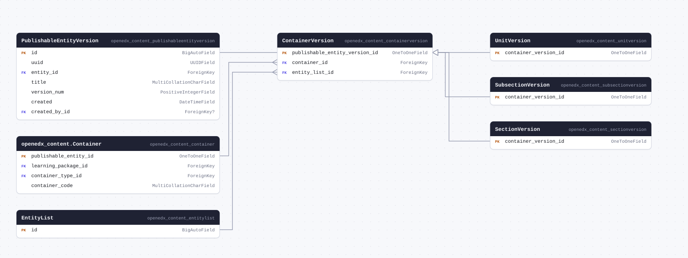

| Column | Field | Type | Null | Key | Default | Description |
| --- | --- | --- | --- | --- | --- | --- |
| `publishable_entity_version_id` | `OneToOneField` | `bigint` |  | PK, FK |  |  |
| `container_id` | `ForeignKey` | `bigint` |  | FK |  |  |
| `entity_list_id` | `ForeignKey` | `bigint` |  | FK |  |  |

Indexes:

- index `openedx_content_containerversion_container_id_bacdc4e3` on `container_id`
- index `openedx_content_containerversion_entity_list_id_be7df8a7` on `entity_list_id`

Relations:

- `publishable_entity_version_id` → [PublishableEntityVersion](#publishableentityversion).`id`, on delete cascade
- `container_id` → [openedx_content.Container](#openedx_contentcontainer).`publishable_entity_id`, on delete cascade
- `entity_list_id` → [EntityList](#entitylist).`id`, on delete restrict
- [UnitVersion](#unitversion).`container_version_id` → `publishable_entity_version_id`, parent link, on delete cascade
- [SubsectionVersion](#subsectionversion).`container_version_id` → `publishable_entity_version_id`, parent link, on delete cascade
- [SectionVersion](#sectionversion).`container_version_id` → `publishable_entity_version_id`, parent link, on delete cascade

## Unit

Table `openedx_content_unit`, app `openedx_content`.

Inherits from [openedx_content.Container](#openedx_contentcontainer) (multi-table): its rows are joined on `container_id`.

A Unit is type of :class:`Container` that holds :class:`Component`
children.

Via :class:`Container` and its :class:`PublishableEntityMixin`, Units are
also publishable entities and can be added to other containers.

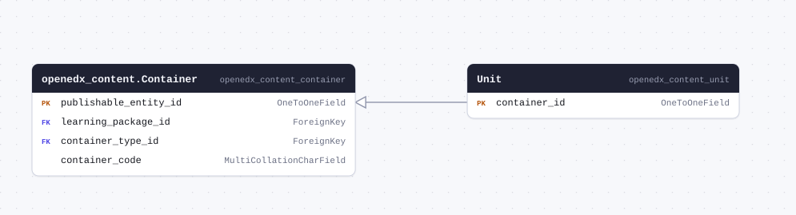

| Column | Field | Type | Null | Key | Default | Description |
| --- | --- | --- | --- | --- | --- | --- |
| `container_id` | `OneToOneField` | `bigint` |  | PK, FK |  |  |

Relations:

- `container_id` → [openedx_content.Container](#openedx_contentcontainer).`publishable_entity_id`, parent link, on delete cascade

## UnitVersion

Table `openedx_content_unitversion`, app `openedx_content`.

Inherits from [ContainerVersion](#containerversion) (multi-table): its rows are joined on `container_version_id`.

A UnitVersion is a specific version of a :class:`Unit`.

Via :class:`ContainerVersion` and its :class:`EntityList`, it defines the
list of :class:`Component` children in this version of the :class:`Unit`.

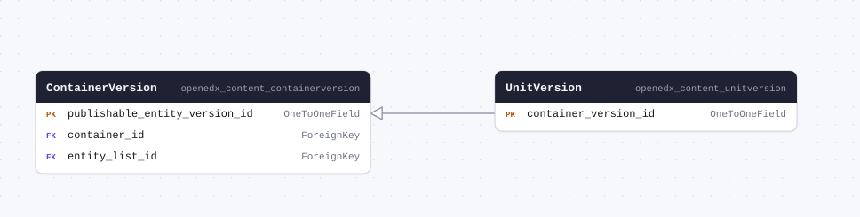

| Column | Field | Type | Null | Key | Default | Description |
| --- | --- | --- | --- | --- | --- | --- |
| `container_version_id` | `OneToOneField` | `bigint` |  | PK, FK |  |  |

Relations:

- `container_version_id` → [ContainerVersion](#containerversion).`publishable_entity_version_id`, parent link, on delete cascade

## Subsection

Table `openedx_content_subsection`, app `openedx_content`.

Inherits from [openedx_content.Container](#openedx_contentcontainer) (multi-table): its rows are joined on `container_id`.

A Subsection is type of :class:`Container` that holds :class:`Unit`
children.

Via :class:`Container` and its :class:`PublishableEntityMixin`,
Subsections are also publishable entities and can be added to other
containers.


| Column | Field | Type | Null | Key | Default | Description |
| --- | --- | --- | --- | --- | --- | --- |
| `container_id` | `OneToOneField` | `bigint` |  | PK, FK |  |  |

Relations:

- `container_id` → [openedx_content.Container](#openedx_contentcontainer).`publishable_entity_id`, parent link, on delete cascade

## SubsectionVersion

Table `openedx_content_subsectionversion`, app `openedx_content`.

Inherits from [ContainerVersion](#containerversion) (multi-table): its rows are joined on `container_version_id`.

A SubsectionVersion is a specific version of a :class:`Subsection`.

Via :class:`ContainerVersion` and its :class:`EntityList`, it defines the
list of :class:`Unit` children in this version of the
:class:`Subsection`.

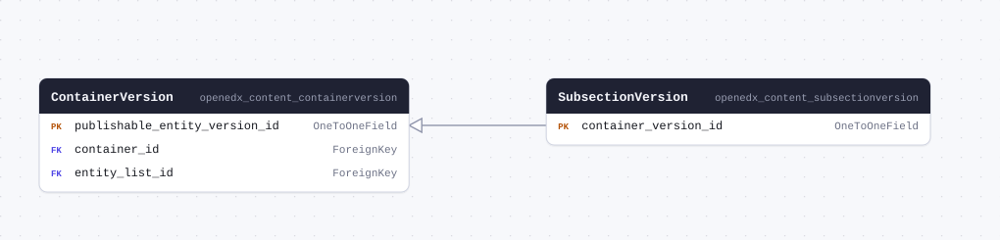

| Column | Field | Type | Null | Key | Default | Description |
| --- | --- | --- | --- | --- | --- | --- |
| `container_version_id` | `OneToOneField` | `bigint` |  | PK, FK |  |  |

Relations:

- `container_version_id` → [ContainerVersion](#containerversion).`publishable_entity_version_id`, parent link, on delete cascade

## Section

Table `openedx_content_section`, app `openedx_content`.

Inherits from [openedx_content.Container](#openedx_contentcontainer) (multi-table): its rows are joined on `container_id`.

A Section is type of :class:`Container` that holds :class:`Subsection`
children.

Via :class:`Container` and its :class:`PublishableEntityMixin`, Sections
are also publishable entities and can be added to other containers.

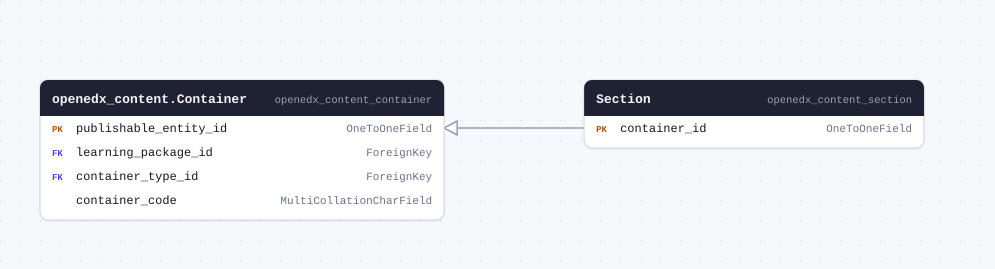

| Column | Field | Type | Null | Key | Default | Description |
| --- | --- | --- | --- | --- | --- | --- |
| `container_id` | `OneToOneField` | `bigint` |  | PK, FK |  |  |

Relations:

- `container_id` → [openedx_content.Container](#openedx_contentcontainer).`publishable_entity_id`, parent link, on delete cascade

## SectionVersion

Table `openedx_content_sectionversion`, app `openedx_content`.

Inherits from [ContainerVersion](#containerversion) (multi-table): its rows are joined on `container_version_id`.

A SectionVersion is a specific version of a :class:`Section`.

Via :class:`ContainerVersion` and its :class:`EntityList`, it defines the
list of :class:`Subsection` children in this version of the
:class:`Section`.

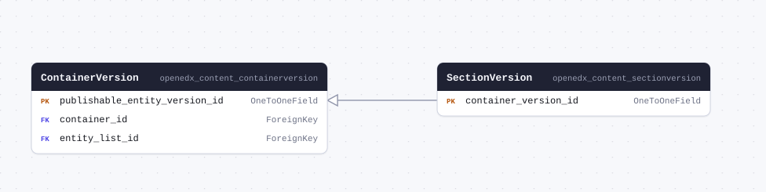

| Column | Field | Type | Null | Key | Default | Description |
| --- | --- | --- | --- | --- | --- | --- |
| `container_version_id` | `OneToOneField` | `bigint` |  | PK, FK |  |  |

Relations:

- `container_version_id` → [ContainerVersion](#containerversion).`publishable_entity_version_id`, parent link, on delete cascade

## oel_collections.Collection

Table `oel_collections_collection`, app `oel_collections`.

| Column | Field | Type | Null | Key | Default | Description |
| --- | --- | --- | --- | --- | --- | --- |
| `id` | `AutoField` | `integer` |  | PK | `autoincrement()` |  |

## oel_components.Component

Table `oel_components_component`, app `oel_components`.

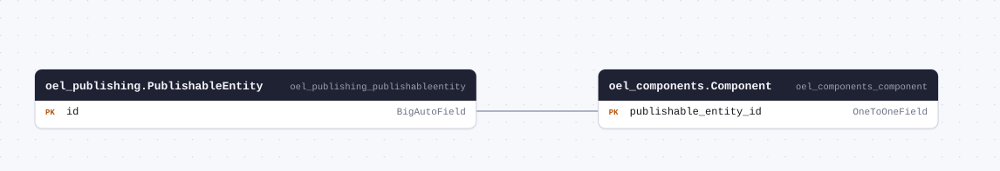

| Column | Field | Type | Null | Key | Default | Description |
| --- | --- | --- | --- | --- | --- | --- |
| `publishable_entity_id` | `OneToOneField` | `bigint` |  | PK, FK |  |  |

Relations:

- `publishable_entity_id` → [oel_publishing.PublishableEntity](#oel_publishingpublishableentity).`id`, on delete cascade

## oel_publishing.LearningPackage

Table `oel_publishing_learningpackage`, app `oel_publishing`.

| Column | Field | Type | Null | Key | Default | Description |
| --- | --- | --- | --- | --- | --- | --- |
| `id` | `AutoField` | `integer` |  | PK | `autoincrement()` |  |

## oel_publishing.PublishableEntity

Table `oel_publishing_publishableentity`, app `oel_publishing`.

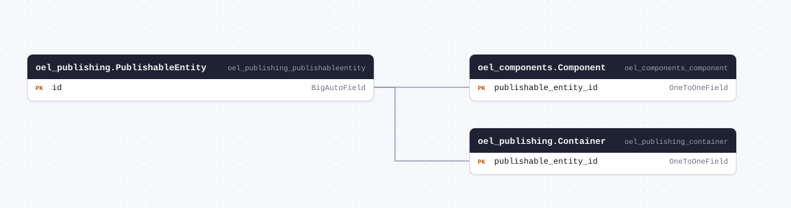

| Column | Field | Type | Null | Key | Default | Description |
| --- | --- | --- | --- | --- | --- | --- |
| `id` | `BigAutoField` | `integer` |  | PK | `autoincrement()` |  |

Relations:

- [oel_components.Component](#oel_componentscomponent).`publishable_entity_id` → `id`, on delete cascade
- [oel_publishing.Container](#oel_publishingcontainer).`publishable_entity_id` → `id`, on delete cascade

## oel_publishing.DraftChangeLog

Table `oel_publishing_draftchangelog`, app `oel_publishing`.

| Column | Field | Type | Null | Key | Default | Description |
| --- | --- | --- | --- | --- | --- | --- |
| `id` | `BigAutoField` | `integer` |  | PK | `autoincrement()` |  |

## oel_publishing.DraftChangeLogRecord

Table `oel_publishing_draftchangelogrecord`, app `oel_publishing`.

| Column | Field | Type | Null | Key | Default | Description |
| --- | --- | --- | --- | --- | --- | --- |
| `id` | `BigAutoField` | `integer` |  | PK | `autoincrement()` |  |

## oel_publishing.Container

Table `oel_publishing_container`, app `oel_publishing`.


| Column | Field | Type | Null | Key | Default | Description |
| --- | --- | --- | --- | --- | --- | --- |
| `publishable_entity_id` | `OneToOneField` | `bigint` |  | PK, FK |  |  |

Relations:

- `publishable_entity_id` → [oel_publishing.PublishableEntity](#oel_publishingpublishableentity).`id`, on delete cascade

## Tag

Table `oel_tagging_tag`, app `oel_tagging`.

Represents a single value in a list or tree of values which can be applied to a particular Open edX object.

Open edX tags are "name:value" pairs which can be applied to objects like content libraries, units, or people.
Tag.taxonomy.name provides the "name" and the Tag.value provides the "value".
(And an ObjectTag links a Tag with an object.)

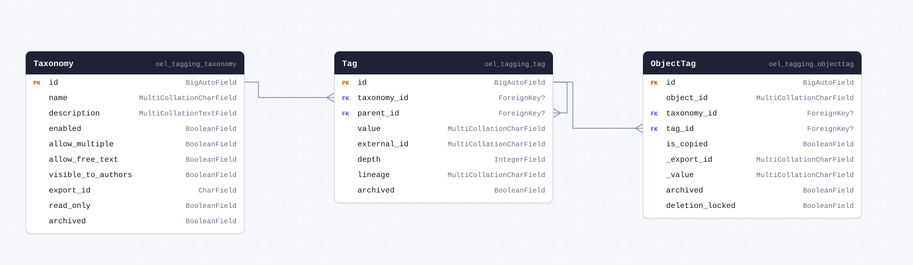

| Column | Field | Type | Null | Key | Default | Description |
| --- | --- | --- | --- | --- | --- | --- |
| `id` | `BigAutoField` | `integer` |  | PK | `autoincrement()` |  |
| `taxonomy_id` | `ForeignKey` | `bigint` | yes | FK | `None` | Namespace and rules for using a given set of tags. |
| `parent_id` | `ForeignKey` | `bigint` | yes | FK | `None` | Tag that lives one level up from the current tag, forming a hierarchy. |
| `value` | `MultiCollationCharField` | `varchar(500)` |  |  |  | Content of a given tag, occupying the 'value' part of the key:value pair. |
| `external_id` | `MultiCollationCharField` | `varchar(255)` |  |  |  | Used to link an Open edX Tag with a tag in an externally-defined taxonomy. |
| `depth` | `IntegerField` | `integer` |  |  | `0` | Number of ancestors this tag has. Zero for root tags, one for their children, and so on. Set automatically by save(); do not set manually. |
| `lineage` | `MultiCollationCharField` | `varchar(3006)` |  |  | `''` | Tab-separated ancestor path including this tag: 'Root\tParent\t...\tThisValue\t'. Used for depth-first tree ordering and descendant prefix matching. Set automatically by save(); do not set manually. |
| `archived` | `BooleanField` | `bool` |  |  | `False` | Hides this tag from active use by default, without removing it. |

Indexes:

- index `oel_tagging_tag_taxonomy_id_5ffdeb8b` on `taxonomy_id`
- index `oel_tagging_tag_parent_id_2d99b9b4` on `parent_id`
- unique `oel_tagging_tag_taxonomy_id_external_id_f308f968_uniq` on `taxonomy_id`, `external_id`
- unique `oel_tagging_tag_taxonomy_id_value_f0e6dab9_uniq` on `taxonomy_id`, `value`
- index `oel_tagging_taxonom_89e779_idx` on `taxonomy_id`, `value`
- index `oel_tagging_taxonom_44e355_idx` on `taxonomy_id`, `external_id`
- index `oel_tagging_lineage_d65f82_idx` on `lineage`

Checks:

- `oel_tagging_tag_depth_parent_check`: `("parent_id" IS NULL OR "depth" > 0)`
- `oel_tagging_tag_lineage_ends_with_value`: `"lineage" LIKE '%' \|\| REPLACE(REPLACE(REPLACE((COALESCE("value", '') \|\| COALESCE('	', '')), '\', '\\'), '%', '\%'), '_', '\_') ESCAPE '\'`
- `oel_tagging_tag_lineage_tab_count_check`: `"depth" = ((LENGTH("lineage") - LENGTH(REPLACE("lineage", '	', ''))) - 1)`

Relations:

- `taxonomy_id` → [Taxonomy](#taxonomy).`id`, on delete cascade
- `parent_id` → [Tag](#tag).`id`, on delete cascade
- [ObjectTag](#objecttag).`tag_id` → `id`, on delete set null

## Taxonomy

Table `oel_tagging_taxonomy`, app `oel_tagging`.

Represents a namespace and rules for a group of tags.

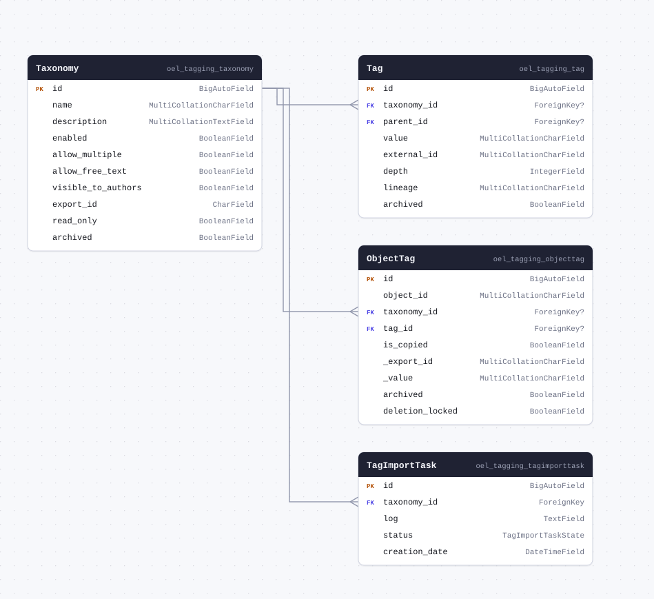

| Column | Field | Type | Null | Key | Default | Description |
| --- | --- | --- | --- | --- | --- | --- |
| `id` | `BigAutoField` | `integer` |  | PK | `autoincrement()` |  |
| `name` | `MultiCollationCharField` | `varchar(255)` |  |  |  | User-facing label used when applying tags from this taxonomy to Open edX objects. |
| `description` | `MultiCollationTextField` | `text` |  |  |  | Provides extra information for the user when applying tags from this taxonomy to an object. |
| `enabled` | `BooleanField` | `bool` |  |  | `True` | Only enabled taxonomies will be shown to authors. |
| `allow_multiple` | `BooleanField` | `bool` |  |  | `True` | Indicates that multiple tags from this taxonomy may be added to an object. |
| `allow_free_text` | `BooleanField` | `bool` |  |  | `False` | Indicates that tags in this taxonomy need not be predefined; authors may enter their own tag values. |
| `visible_to_authors` | `BooleanField` | `bool` |  |  | `True` | Indicates whether this taxonomy should be visible to object authors. |
| `export_id` | `CharField` | `varchar(255)` |  | unique |  | User-facing ID that is used on import/export. Should only contain alphanumeric characters or '_' '-' '.' |
| `read_only` | `BooleanField` | `bool` |  |  | `False` | Indicates that the tags in this taxonomy are maintained by the system or an external integration; taxonomy admins will not be permitted to add, edit, or delete its tags. |
| `archived` | `BooleanField` | `bool` |  |  | `False` | Hides this taxonomy from active use by default, without removing it. Unlike disabling it with 'enabled', archiving marks the taxonomy as retired. |

Indexes:

- index `oel_tagging_taxonomy_name_41aebebd` on `name`

Relations:

- [Tag](#tag).`taxonomy_id` → `id`, on delete cascade
- [ObjectTag](#objecttag).`taxonomy_id` → `id`, on delete set null
- [TagImportTask](#tagimporttask).`taxonomy_id` → `id`, on delete cascade

## ObjectTag

Table `oel_tagging_objecttag`, app `oel_tagging`.

Represents the association between a tag and an Open edX object.

Tagging content in Open edX involves linking the object to a particular name:value "tag", where the "name" is the
tag's label, and the value is the content of the tag itself.

Tagging objects can be time-consuming for users, and so we guard against the deletion of Taxonomies and Tags by
providing fields to cache the name:value stored for an object.

However, sometimes Taxonomy names or Tag values change (e.g if there's a typo, or a policy change about how a label
is used), and so we still store a link to the original Taxonomy and Tag, so that these changes will take precedence
over the original name:value used.

Also, if an ObjectTag is associated with free-text Taxonomy, then the tag's value won't be stored as a standalone
Tag in the database -- it'll be stored here.

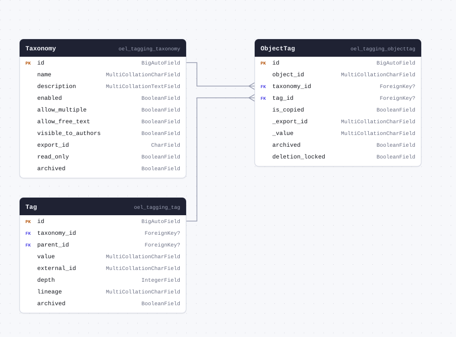

| Column | Field | Type | Null | Key | Default | Description |
| --- | --- | --- | --- | --- | --- | --- |
| `id` | `BigAutoField` | `integer` |  | PK | `autoincrement()` |  |
| `object_id` | `MultiCollationCharField` | `varchar(255)` |  |  |  | Identifier for the object being tagged |
| `taxonomy_id` | `ForeignKey` | `bigint` | yes | FK | `None` | Taxonomy that this object tag belongs to. Used for validating the tag and provides the tag's 'name' if set. |
| `tag_id` | `ForeignKey` | `bigint` | yes | FK | `None` | Tag associated with this object tag. Provides the tag's 'value' if set. |
| `is_copied` | `BooleanField` | `bool` |  |  | `False` | True if this object tag has been copied from one object to another using 'copy_tags' api function |
| `_export_id` | `MultiCollationCharField` | `varchar(255)` |  |  |  | User-facing label used for this tag, stored in case taxonomy is (or becomes) null. If the taxonomy field is set, then taxonomy.export_id takes precedence over this field. |
| `_value` | `MultiCollationCharField` | `varchar(500)` |  |  |  | User-facing value used for this tag, stored in case tag is null, e.g if taxonomy is free text, or if it becomes null (e.g. if the Tag is deleted). If the tag field is set, then tag.value takes precedence over this field. |
| `archived` | `BooleanField` | `bool` |  |  | `False` | Hides this association from active use by default, without removing it. |
| `deletion_locked` | `BooleanField` | `bool` |  |  | `False` | Set when something outside the tagging app depends on this association; a delete archives it instead of removing it. |

Indexes:

- index `oel_tagging_objecttag_object_id_c810f770` on `object_id`
- index `oel_tagging_objecttag_taxonomy_id_48a985b4` on `taxonomy_id`
- index `oel_tagging_objecttag_tag_id_6c23e4f0` on `tag_id`
- unique `oel_tagging_objecttag_object_id_taxonomy_id_tag_id_900a25fb_uniq` on `object_id`, `taxonomy_id`, `tag_id`
- unique `oel_tagging_objecttag_object_id_taxonomy_id__value_6243e6d6_uniq` on `object_id`, `taxonomy_id`, `_value`
- index `oel_tagging_taxonom_aa24e6_idx` on `taxonomy_id`, `object_id`
- index `oel_tagging_taxonom_3668ec_idx` on `taxonomy_id`, `_value`

Relations:

- `taxonomy_id` → [Taxonomy](#taxonomy).`id`, on delete set null
- `tag_id` → [Tag](#tag).`id`, on delete set null

## TagImportTask

Table `oel_tagging_tagimporttask`, app `oel_tagging`.

Stores the state, plan and logs of a tag import task

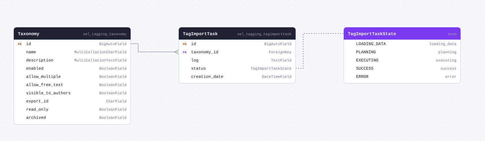

| Column | Field | Type | Null | Key | Default | Description |
| --- | --- | --- | --- | --- | --- | --- |
| `id` | `BigAutoField` | `integer` |  | PK | `autoincrement()` |  |
| `taxonomy_id` | `ForeignKey` | `bigint` |  | FK |  | Taxonomy associated with this import |
| `log` | `TextField` | `text` |  |  | `None` | Action execution logs |
| `status` | `TagImportTaskState` | `varchar(20)` |  |  |  | Task status |
| `creation_date` | `DateTimeField` | `datetime` |  |  | `now()` |  |

Indexes:

- index `oel_tagging_tagimporttask_taxonomy_id_955bb3a3` on `taxonomy_id`
- index `oel_tagging_taxonom_5e948c_idx` on `taxonomy_id`, `creation_date` desc

Relations:

- `taxonomy_id` → [Taxonomy](#taxonomy).`id`, on delete cascade

# Enums

## LogEntryActionFlag

| Name | Stored as |
| --- | --- |
| `Addition` | `1` |
| `Change` | `2` |
| `Deletion` | `3` |

## TagImportTaskState

| Name | Stored as |
| --- | --- |
| `LOADING_DATA` | `loading_data` |
| `PLANNING` | `planning` |
| `EXECUTING` | `executing` |
| `SUCCESS` | `success` |
| `ERROR` | `error` |
