# Schema docs

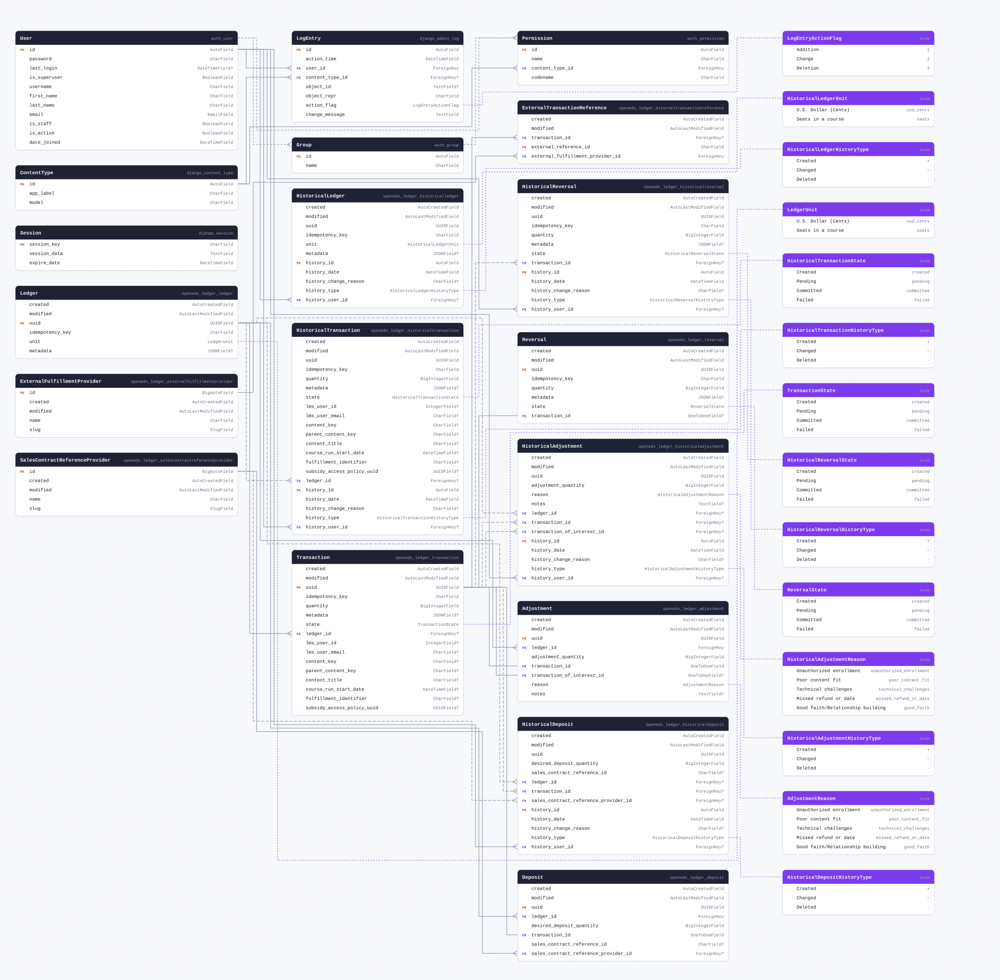

[LogEntry](#logentry) · [Permission](#permission) · [Group](#group) · [User](#user) · [ContentType](#contenttype) · [Session](#session) · [HistoricalLedger](#historicalledger) · [Ledger](#ledger) · [HistoricalTransaction](#historicaltransaction) · [Transaction](#transaction) · [ExternalFulfillmentProvider](#externalfulfillmentprovider) · [ExternalTransactionReference](#externaltransactionreference) · [HistoricalReversal](#historicalreversal) · [Reversal](#reversal) · [HistoricalAdjustment](#historicaladjustment) · [Adjustment](#adjustment) · [SalesContractReferenceProvider](#salescontractreferenceprovider) · [HistoricalDeposit](#historicaldeposit) · [Deposit](#deposit)

<details>
<summary>The whole schema as SQL</summary>

```sql
CREATE TABLE "django_admin_log" ("id" integer NOT NULL PRIMARY KEY AUTOINCREMENT, "action_time" datetime NOT NULL, "user_id" integer NOT NULL REFERENCES "auth_user" ("id") DEFERRABLE INITIALLY DEFERRED, "content_type_id" integer NULL REFERENCES "django_content_type" ("id") DEFERRABLE INITIALLY DEFERRED, "object_id" text NULL, "object_repr" varchar(200) NOT NULL, "action_flag" smallint unsigned NOT NULL CHECK ("action_flag" >= 0), "change_message" text NOT NULL);

CREATE TABLE "auth_permission" ("id" integer NOT NULL PRIMARY KEY AUTOINCREMENT, "name" varchar(255) NOT NULL, "content_type_id" integer NOT NULL REFERENCES "django_content_type" ("id") DEFERRABLE INITIALLY DEFERRED, "codename" varchar(100) NOT NULL);

CREATE TABLE "auth_group" ("id" integer NOT NULL PRIMARY KEY AUTOINCREMENT, "name" varchar(150) NOT NULL UNIQUE);

CREATE TABLE "auth_group_permissions" ("id" integer NOT NULL PRIMARY KEY AUTOINCREMENT, "group_id" integer NOT NULL REFERENCES "auth_group" ("id") DEFERRABLE INITIALLY DEFERRED, "permission_id" integer NOT NULL REFERENCES "auth_permission" ("id") DEFERRABLE INITIALLY DEFERRED);

CREATE TABLE "auth_user" ("id" integer NOT NULL PRIMARY KEY AUTOINCREMENT, "password" varchar(128) NOT NULL, "last_login" datetime NULL, "is_superuser" bool NOT NULL, "username" varchar(150) NOT NULL UNIQUE, "first_name" varchar(150) NOT NULL, "last_name" varchar(150) NOT NULL, "email" varchar(254) NOT NULL, "is_staff" bool NOT NULL, "is_active" bool NOT NULL, "date_joined" datetime NOT NULL);

CREATE TABLE "auth_user_groups" ("id" integer NOT NULL PRIMARY KEY AUTOINCREMENT, "user_id" integer NOT NULL REFERENCES "auth_user" ("id") DEFERRABLE INITIALLY DEFERRED, "group_id" integer NOT NULL REFERENCES "auth_group" ("id") DEFERRABLE INITIALLY DEFERRED);

CREATE TABLE "auth_user_user_permissions" ("id" integer NOT NULL PRIMARY KEY AUTOINCREMENT, "user_id" integer NOT NULL REFERENCES "auth_user" ("id") DEFERRABLE INITIALLY DEFERRED, "permission_id" integer NOT NULL REFERENCES "auth_permission" ("id") DEFERRABLE INITIALLY DEFERRED);

CREATE TABLE "django_content_type" ("id" integer NOT NULL PRIMARY KEY AUTOINCREMENT, "app_label" varchar(100) NOT NULL, "model" varchar(100) NOT NULL);

CREATE TABLE "django_session" ("session_key" varchar(40) NOT NULL PRIMARY KEY, "session_data" text NOT NULL, "expire_date" datetime NOT NULL);

CREATE TABLE "openedx_ledger_historicalledger" ("created" datetime NOT NULL, "modified" datetime NOT NULL, "uuid" char(32) NOT NULL, "idempotency_key" varchar(255) NOT NULL, "unit" varchar(255) NOT NULL, "metadata" text NULL, "history_id" integer NOT NULL PRIMARY KEY AUTOINCREMENT, "history_date" datetime NOT NULL, "history_change_reason" varchar(100) NULL, "history_type" varchar(1) NOT NULL, "history_user_id" integer NULL REFERENCES "auth_user" ("id") DEFERRABLE INITIALLY DEFERRED);

CREATE TABLE "openedx_ledger_ledger" ("created" datetime NOT NULL, "modified" datetime NOT NULL, "uuid" char(32) NOT NULL PRIMARY KEY, "idempotency_key" varchar(255) NOT NULL UNIQUE, "unit" varchar(255) NOT NULL, "metadata" text NULL);

CREATE TABLE "openedx_ledger_historicaltransaction" ("created" datetime NOT NULL, "modified" datetime NOT NULL, "uuid" char(32) NOT NULL, "idempotency_key" varchar(255) NOT NULL, "quantity" bigint NOT NULL, "metadata" text NULL, "state" varchar(255) NOT NULL, "lms_user_id" integer NULL, "lms_user_email" varchar(255) NULL, "content_key" varchar(255) NULL, "parent_content_key" varchar(255) NULL, "content_title" varchar(255) NULL, "course_run_start_date" datetime NULL, "fulfillment_identifier" varchar(255) NULL, "subsidy_access_policy_uuid" char(32) NULL, "ledger_id" char(32) NULL, "history_id" integer NOT NULL PRIMARY KEY AUTOINCREMENT, "history_date" datetime NOT NULL, "history_change_reason" varchar(100) NULL, "history_type" varchar(1) NOT NULL, "history_user_id" integer NULL REFERENCES "auth_user" ("id") DEFERRABLE INITIALLY DEFERRED);

CREATE TABLE "openedx_ledger_transaction" ("created" datetime NOT NULL, "modified" datetime NOT NULL, "uuid" char(32) NOT NULL PRIMARY KEY, "idempotency_key" varchar(255) NOT NULL, "quantity" bigint NOT NULL, "metadata" text NULL, "state" varchar(255) NOT NULL, "ledger_id" char(32) NULL REFERENCES "openedx_ledger_ledger" ("uuid") DEFERRABLE INITIALLY DEFERRED, "lms_user_id" integer NULL, "lms_user_email" varchar(255) NULL, "content_key" varchar(255) NULL, "parent_content_key" varchar(255) NULL, "content_title" varchar(255) NULL, "course_run_start_date" datetime NULL, "fulfillment_identifier" varchar(255) NULL, "subsidy_access_policy_uuid" char(32) NULL);

CREATE TABLE "openedx_ledger_externalfulfillmentprovider" ("id" integer NOT NULL PRIMARY KEY AUTOINCREMENT, "created" datetime NOT NULL, "modified" datetime NOT NULL, "name" varchar(255) NOT NULL, "slug" varchar(32) NOT NULL UNIQUE);

CREATE TABLE "openedx_ledger_externaltransactionreference" ("created" datetime NOT NULL, "modified" datetime NOT NULL, "transaction_id" char(32) NULL REFERENCES "openedx_ledger_transaction" ("uuid") DEFERRABLE INITIALLY DEFERRED, "external_reference_id" varchar(255) NOT NULL PRIMARY KEY, "external_fulfillment_provider_id" bigint NOT NULL REFERENCES "openedx_ledger_externalfulfillmentprovider" ("id") DEFERRABLE INITIALLY DEFERRED);

CREATE TABLE "openedx_ledger_historicalreversal" ("created" datetime NOT NULL, "modified" datetime NOT NULL, "uuid" char(32) NOT NULL, "idempotency_key" varchar(255) NOT NULL, "quantity" bigint NOT NULL, "metadata" text NULL, "state" varchar(255) NOT NULL, "transaction_id" char(32) NULL, "history_id" integer NOT NULL PRIMARY KEY AUTOINCREMENT, "history_date" datetime NOT NULL, "history_change_reason" varchar(100) NULL, "history_type" varchar(1) NOT NULL, "history_user_id" integer NULL REFERENCES "auth_user" ("id") DEFERRABLE INITIALLY DEFERRED);

CREATE TABLE "openedx_ledger_reversal" ("created" datetime NOT NULL, "modified" datetime NOT NULL, "uuid" char(32) NOT NULL PRIMARY KEY, "idempotency_key" varchar(255) NOT NULL, "quantity" bigint NOT NULL, "metadata" text NULL, "state" varchar(255) NOT NULL, "transaction_id" char(32) NULL UNIQUE REFERENCES "openedx_ledger_transaction" ("uuid") DEFERRABLE INITIALLY DEFERRED);

CREATE TABLE "openedx_ledger_historicaladjustment" ("created" datetime NOT NULL, "modified" datetime NOT NULL, "uuid" char(32) NOT NULL, "adjustment_quantity" bigint NOT NULL, "reason" varchar(255) NOT NULL, "notes" text NULL, "ledger_id" char(32) NULL, "transaction_id" char(32) NULL, "transaction_of_interest_id" char(32) NULL, "history_id" integer NOT NULL PRIMARY KEY AUTOINCREMENT, "history_date" datetime NOT NULL, "history_change_reason" varchar(100) NULL, "history_type" varchar(1) NOT NULL, "history_user_id" integer NULL REFERENCES "auth_user" ("id") DEFERRABLE INITIALLY DEFERRED);

CREATE TABLE "openedx_ledger_adjustment" ("created" datetime NOT NULL, "modified" datetime NOT NULL, "uuid" char(32) NOT NULL PRIMARY KEY, "ledger_id" char(32) NOT NULL REFERENCES "openedx_ledger_ledger" ("uuid") DEFERRABLE INITIALLY DEFERRED, "adjustment_quantity" bigint NOT NULL, "transaction_id" char(32) NOT NULL UNIQUE REFERENCES "openedx_ledger_transaction" ("uuid") DEFERRABLE INITIALLY DEFERRED, "transaction_of_interest_id" char(32) NULL UNIQUE REFERENCES "openedx_ledger_transaction" ("uuid") DEFERRABLE INITIALLY DEFERRED, "reason" varchar(255) NOT NULL, "notes" text NULL);

CREATE TABLE "openedx_ledger_salescontractreferenceprovider" ("id" integer NOT NULL PRIMARY KEY AUTOINCREMENT, "created" datetime NOT NULL, "modified" datetime NOT NULL, "name" varchar(255) NOT NULL, "slug" varchar(32) NOT NULL UNIQUE);

CREATE TABLE "openedx_ledger_historicaldeposit" ("created" datetime NOT NULL, "modified" datetime NOT NULL, "uuid" char(32) NOT NULL, "desired_deposit_quantity" bigint NOT NULL, "sales_contract_reference_id" varchar(255) NULL, "ledger_id" char(32) NULL, "transaction_id" char(32) NULL, "sales_contract_reference_provider_id" bigint NULL, "history_id" integer NOT NULL PRIMARY KEY AUTOINCREMENT, "history_date" datetime NOT NULL, "history_change_reason" varchar(100) NULL, "history_type" varchar(1) NOT NULL, "history_user_id" integer NULL REFERENCES "auth_user" ("id") DEFERRABLE INITIALLY DEFERRED);

CREATE TABLE "openedx_ledger_deposit" ("created" datetime NOT NULL, "modified" datetime NOT NULL, "uuid" char(32) NOT NULL PRIMARY KEY, "ledger_id" char(32) NOT NULL REFERENCES "openedx_ledger_ledger" ("uuid") DEFERRABLE INITIALLY DEFERRED, "desired_deposit_quantity" bigint NOT NULL, "transaction_id" char(32) NOT NULL UNIQUE REFERENCES "openedx_ledger_transaction" ("uuid") DEFERRABLE INITIALLY DEFERRED, "sales_contract_reference_id" varchar(255) NULL, "sales_contract_reference_provider_id" bigint NULL REFERENCES "openedx_ledger_salescontractreferenceprovider" ("id") DEFERRABLE INITIALLY DEFERRED);

CREATE INDEX "django_admin_log_user_id_c564eba6" ON "django_admin_log" ("user_id");

CREATE INDEX "django_admin_log_content_type_id_c4bce8eb" ON "django_admin_log" ("content_type_id");

CREATE UNIQUE INDEX "auth_permission_content_type_id_codename_01ab375a_uniq" ON "auth_permission" ("content_type_id", "codename");

CREATE INDEX "auth_permission_content_type_id_2f476e4b" ON "auth_permission" ("content_type_id");

CREATE UNIQUE INDEX "auth_group_permissions_group_id_permission_id_0cd325b0_uniq" ON "auth_group_permissions" ("group_id", "permission_id");

CREATE INDEX "auth_group_permissions_group_id_b120cbf9" ON "auth_group_permissions" ("group_id");

CREATE INDEX "auth_group_permissions_permission_id_84c5c92e" ON "auth_group_permissions" ("permission_id");

CREATE UNIQUE INDEX "auth_user_groups_user_id_group_id_94350c0c_uniq" ON "auth_user_groups" ("user_id", "group_id");

CREATE INDEX "auth_user_groups_user_id_6a12ed8b" ON "auth_user_groups" ("user_id");

CREATE INDEX "auth_user_groups_group_id_97559544" ON "auth_user_groups" ("group_id");

CREATE UNIQUE INDEX "auth_user_user_permissions_user_id_permission_id_14a6b632_uniq" ON "auth_user_user_permissions" ("user_id", "permission_id");

CREATE INDEX "auth_user_user_permissions_user_id_a95ead1b" ON "auth_user_user_permissions" ("user_id");

CREATE INDEX "auth_user_user_permissions_permission_id_1fbb5f2c" ON "auth_user_user_permissions" ("permission_id");

CREATE UNIQUE INDEX "django_content_type_app_label_model_76bd3d3b_uniq" ON "django_content_type" ("app_label", "model");

CREATE INDEX "django_session_expire_date_a5c62663" ON "django_session" ("expire_date");

CREATE INDEX "openedx_ledger_historicalledger_uuid_38bb4ba3" ON "openedx_ledger_historicalledger" ("uuid");

CREATE INDEX "openedx_ledger_historicalledger_idempotency_key_1f2ac28e" ON "openedx_ledger_historicalledger" ("idempotency_key");

CREATE INDEX "openedx_ledger_historicalledger_unit_7916236b" ON "openedx_ledger_historicalledger" ("unit");

CREATE INDEX "openedx_ledger_historicalledger_history_date_f0508930" ON "openedx_ledger_historicalledger" ("history_date");

CREATE INDEX "openedx_ledger_historicalledger_history_user_id_e92a7574" ON "openedx_ledger_historicalledger" ("history_user_id");

CREATE INDEX "openedx_ledger_ledger_unit_81a1b864" ON "openedx_ledger_ledger" ("unit");

CREATE INDEX "openedx_ledger_historicaltransaction_uuid_c61e9125" ON "openedx_ledger_historicaltransaction" ("uuid");

CREATE INDEX "openedx_ledger_historicaltransaction_idempotency_key_52297c44" ON "openedx_ledger_historicaltransaction" ("idempotency_key");

CREATE INDEX "openedx_ledger_historicaltransaction_state_e8ae4f82" ON "openedx_ledger_historicaltransaction" ("state");

CREATE INDEX "openedx_ledger_historicaltransaction_lms_user_id_69a0a63e" ON "openedx_ledger_historicaltransaction" ("lms_user_id");

CREATE INDEX "openedx_ledger_historicaltransaction_lms_user_email_edf32737" ON "openedx_ledger_historicaltransaction" ("lms_user_email");

CREATE INDEX "openedx_ledger_historicaltransaction_content_key_d2cfb5e2" ON "openedx_ledger_historicaltransaction" ("content_key");

CREATE INDEX "openedx_ledger_historicaltransaction_parent_content_key_53819909" ON "openedx_ledger_historicaltransaction" ("parent_content_key");

CREATE INDEX "openedx_ledger_historicaltransaction_content_title_86157016" ON "openedx_ledger_historicaltransaction" ("content_title");

CREATE INDEX "openedx_ledger_historicaltransaction_course_run_start_date_bf73e844" ON "openedx_ledger_historicaltransaction" ("course_run_start_date");

CREATE INDEX "openedx_ledger_historicaltransaction_fulfillment_identifier_e7b94274" ON "openedx_ledger_historicaltransaction" ("fulfillment_identifier");

CREATE INDEX "openedx_ledger_historicaltransaction_ledger_id_36d59eaa" ON "openedx_ledger_historicaltransaction" ("ledger_id");

CREATE INDEX "openedx_ledger_historicaltransaction_history_date_6b73c900" ON "openedx_ledger_historicaltransaction" ("history_date");

CREATE INDEX "openedx_ledger_historicaltransaction_history_user_id_a6cd3bb6" ON "openedx_ledger_historicaltransaction" ("history_user_id");

CREATE UNIQUE INDEX "openedx_ledger_transaction_ledger_id_idempotency_key_9abaa5d9_uniq" ON "openedx_ledger_transaction" ("ledger_id", "idempotency_key");

CREATE INDEX "openedx_ledger_transaction_idempotency_key_1eb7f3ea" ON "openedx_ledger_transaction" ("idempotency_key");

CREATE INDEX "openedx_ledger_transaction_state_47f9254c" ON "openedx_ledger_transaction" ("state");

CREATE INDEX "openedx_ledger_transaction_ledger_id_539d69c4" ON "openedx_ledger_transaction" ("ledger_id");

CREATE INDEX "openedx_ledger_transaction_lms_user_id_ddfc3a1e" ON "openedx_ledger_transaction" ("lms_user_id");

CREATE INDEX "openedx_ledger_transaction_lms_user_email_0450b3b2" ON "openedx_ledger_transaction" ("lms_user_email");

CREATE INDEX "openedx_ledger_transaction_content_key_3faded91" ON "openedx_ledger_transaction" ("content_key");

CREATE INDEX "openedx_ledger_transaction_parent_content_key_13442588" ON "openedx_ledger_transaction" ("parent_content_key");

CREATE INDEX "openedx_ledger_transaction_content_title_ca7abead" ON "openedx_ledger_transaction" ("content_title");

CREATE INDEX "openedx_ledger_transaction_course_run_start_date_5374dc94" ON "openedx_ledger_transaction" ("course_run_start_date");

CREATE INDEX "openedx_ledger_transaction_fulfillment_identifier_c0becd76" ON "openedx_ledger_transaction" ("fulfillment_identifier");

CREATE INDEX "idx_ledger_lms_content_exc" ON "openedx_ledger_transaction" ("ledger_id", "lms_user_id", "content_key");

CREATE INDEX "idx_ledger_content_exc" ON "openedx_ledger_transaction" ("ledger_id", "content_key");

CREATE INDEX "idx_ledger_subsidy_exc" ON "openedx_ledger_transaction" ("ledger_id", "subsidy_access_policy_uuid");

CREATE UNIQUE INDEX "openedx_ledger_externaltransactionreference_external_reference_id_external_fulfillment_provider_id_6673a170_uniq" ON "openedx_ledger_externaltransactionreference" ("external_reference_id", "external_fulfillment_provider_id");

CREATE INDEX "openedx_ledger_externaltransactionreference_transaction_id_9d88595f" ON "openedx_ledger_externaltransactionreference" ("transaction_id");

CREATE INDEX "openedx_ledger_externaltransactionreference_external_fulfillment_provider_id_4237cc13" ON "openedx_ledger_externaltransactionreference" ("external_fulfillment_provider_id");

CREATE INDEX "openedx_ledger_historicalreversal_uuid_ac5dec72" ON "openedx_ledger_historicalreversal" ("uuid");

CREATE INDEX "openedx_ledger_historicalreversal_idempotency_key_7d6a9ace" ON "openedx_ledger_historicalreversal" ("idempotency_key");

CREATE INDEX "openedx_ledger_historicalreversal_state_5d07dbac" ON "openedx_ledger_historicalreversal" ("state");

CREATE INDEX "openedx_ledger_historicalreversal_transaction_id_6defc161" ON "openedx_ledger_historicalreversal" ("transaction_id");

CREATE INDEX "openedx_ledger_historicalreversal_history_date_ae7254fb" ON "openedx_ledger_historicalreversal" ("history_date");

CREATE INDEX "openedx_ledger_historicalreversal_history_user_id_d4ceeef3" ON "openedx_ledger_historicalreversal" ("history_user_id");

CREATE UNIQUE INDEX "openedx_ledger_reversal_transaction_id_idempotency_key_b9ca8087_uniq" ON "openedx_ledger_reversal" ("transaction_id", "idempotency_key");

CREATE INDEX "openedx_ledger_reversal_idempotency_key_8154539d" ON "openedx_ledger_reversal" ("idempotency_key");

CREATE INDEX "openedx_ledger_reversal_state_b7296d39" ON "openedx_ledger_reversal" ("state");

CREATE INDEX "openedx_ledger_historicaladjustment_uuid_478818a7" ON "openedx_ledger_historicaladjustment" ("uuid");

CREATE INDEX "openedx_ledger_historicaladjustment_reason_c1636885" ON "openedx_ledger_historicaladjustment" ("reason");

CREATE INDEX "openedx_ledger_historicaladjustment_ledger_id_798033f0" ON "openedx_ledger_historicaladjustment" ("ledger_id");

CREATE INDEX "openedx_ledger_historicaladjustment_transaction_id_b78287e3" ON "openedx_ledger_historicaladjustment" ("transaction_id");

CREATE INDEX "openedx_ledger_historicaladjustment_transaction_of_interest_id_a3293980" ON "openedx_ledger_historicaladjustment" ("transaction_of_interest_id");

CREATE INDEX "openedx_ledger_historicaladjustment_history_date_01b88221" ON "openedx_ledger_historicaladjustment" ("history_date");

CREATE INDEX "openedx_ledger_historicaladjustment_history_user_id_7d9226ab" ON "openedx_ledger_historicaladjustment" ("history_user_id");

CREATE INDEX "openedx_ledger_adjustment_ledger_id_124ae940" ON "openedx_ledger_adjustment" ("ledger_id");

CREATE INDEX "openedx_ledger_adjustment_reason_d9fe2024" ON "openedx_ledger_adjustment" ("reason");

CREATE INDEX "openedx_ledger_historicaldeposit_uuid_7045e880" ON "openedx_ledger_historicaldeposit" ("uuid");

CREATE INDEX "openedx_ledger_historicaldeposit_sales_contract_reference_id_78ce7839" ON "openedx_ledger_historicaldeposit" ("sales_contract_reference_id");

CREATE INDEX "openedx_ledger_historicaldeposit_ledger_id_7ee23955" ON "openedx_ledger_historicaldeposit" ("ledger_id");

CREATE INDEX "openedx_ledger_historicaldeposit_transaction_id_7fcbaabc" ON "openedx_ledger_historicaldeposit" ("transaction_id");

CREATE INDEX "openedx_ledger_historicaldeposit_sales_contract_reference_provider_id_1fcb607e" ON "openedx_ledger_historicaldeposit" ("sales_contract_reference_provider_id");

CREATE INDEX "openedx_ledger_historicaldeposit_history_date_9be16baf" ON "openedx_ledger_historicaldeposit" ("history_date");

CREATE INDEX "openedx_ledger_historicaldeposit_history_user_id_8017cbf4" ON "openedx_ledger_historicaldeposit" ("history_user_id");

CREATE INDEX "openedx_ledger_deposit_ledger_id_ad289dcf" ON "openedx_ledger_deposit" ("ledger_id");

CREATE INDEX "openedx_ledger_deposit_sales_contract_reference_id_0212f5fb" ON "openedx_ledger_deposit" ("sales_contract_reference_id");

CREATE INDEX "openedx_ledger_deposit_sales_contract_reference_provider_id_e28bd959" ON "openedx_ledger_deposit" ("sales_contract_reference_provider_id");
```

</details>

## LogEntry

Table `django_admin_log`, app `admin`.


| Column | Field | Type | Null | Key | Default | Description |
| --- | --- | --- | --- | --- | --- | --- |
| `id` | `AutoField` | `integer` |  | PK | `autoincrement()` |  |
| `action_time` | `DateTimeField` | `datetime` |  |  | `now()` |  |
| `user_id` | `ForeignKey` | `integer` |  | FK |  |  |
| `content_type_id` | `ForeignKey` | `integer` | yes | FK |  |  |
| `object_id` | `TextField` | `text` | yes |  |  |  |
| `object_repr` | `CharField` | `varchar(200)` |  |  |  |  |
| `action_flag` | `LogEntryActionFlag` | `smallint unsigned` |  |  |  |  |
| `change_message` | `TextField` | `text` |  |  |  |  |

Indexes:

- index `django_admin_log_user_id_c564eba6` on `user_id`
- index `django_admin_log_content_type_id_c4bce8eb` on `content_type_id`

Relations:

- `user_id` → [User](#user).`id`, on delete cascade
- `content_type_id` → [ContentType](#contenttype).`id`, on delete set null

## Permission

Table `auth_permission`, app `auth`.

The permissions system provides a way to assign permissions to specific
users and groups of users.

The permission system is used by the Django admin site, but may also be
useful in your own code. The Django admin site uses permissions as follows:

    - The "add" permission limits the user's ability to view the "add" form
      and add an object.
    - The "change" permission limits a user's ability to view the change
      list, view the "change" form and change an object.
    - The "delete" permission limits the ability to delete an object.
    - The "view" permission limits the ability to view an object.

Permissions are set globally per type of object, not per specific object
instance. It is possible to say "Mary may change news stories," but it's
not currently possible to say "Mary may change news stories, but only the
ones she created herself" or "Mary may only change news stories that have a
certain status or publication date."

The permissions listed above are automatically created for each model.


| Column | Field | Type | Null | Key | Default | Description |
| --- | --- | --- | --- | --- | --- | --- |
| `id` | `AutoField` | `integer` |  | PK | `autoincrement()` |  |
| `name` | `CharField` | `varchar(255)` |  |  |  |  |
| `content_type_id` | `ForeignKey` | `integer` |  | FK |  |  |
| `codename` | `CharField` | `varchar(100)` |  |  |  |  |

Indexes:

- index `auth_permission_content_type_id_2f476e4b` on `content_type_id`
- unique `auth_permission_content_type_id_codename_01ab375a_uniq` on `content_type_id`, `codename`

Relations:

- `content_type_id` → [ContentType](#contenttype).`id`, on delete cascade
- `group_set` — many to many with [Group](#group)
- `user_set` — many to many with [User](#user)

## Group

Table `auth_group`, app `auth`.

Groups are a generic way of categorizing users to apply permissions, or
some other label, to those users. A user can belong to any number of
groups.

A user in a group automatically has all the permissions granted to that
group. For example, if the group 'Site editors' has the permission
can_edit_home_page, any user in that group will have that permission.

Beyond permissions, groups are a convenient way to categorize users to
apply some label, or extended functionality, to them. For example, you
could create a group 'Special users', and you could write code that would
do special things to those users -- such as giving them access to a
members-only portion of your site, or sending them members-only email
messages.


| Column | Field | Type | Null | Key | Default | Description |
| --- | --- | --- | --- | --- | --- | --- |
| `id` | `AutoField` | `integer` |  | PK | `autoincrement()` |  |
| `name` | `CharField` | `varchar(150)` |  | unique |  |  |

Relations:

- `permissions` — many to many with [Permission](#permission)
- `user_set` — many to many with [User](#user)

## User

Table `auth_user`, app `auth`.

Columns from `AbstractUser` (abstract): `username`, `first_name`, `last_name`, `email`, `is_staff`, `is_active`, `date_joined`.

Columns from `AbstractBaseUser` (abstract): `password`, `last_login`.

Columns from `PermissionsMixin` (abstract): `is_superuser`.

Users within the Django authentication system are represented by this
model.

Username and password are required. Other fields are optional.

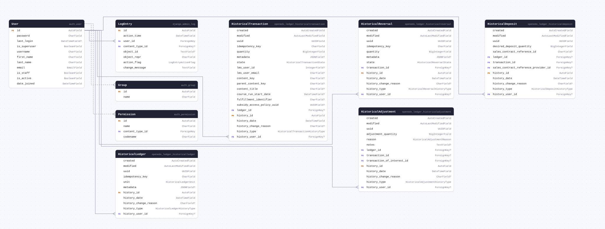

| Column | Field | Type | Null | Key | Default | Description |
| --- | --- | --- | --- | --- | --- | --- |
| `id` | `AutoField` | `integer` |  | PK | `autoincrement()` |  |
| `password` | `CharField` | `varchar(128)` |  |  |  |  |
| `last_login` | `DateTimeField` | `datetime` | yes |  |  |  |
| `is_superuser` | `BooleanField` | `bool` |  |  | `False` | Designates that this user has all permissions without explicitly assigning them. |
| `username` | `CharField` | `varchar(150)` |  | unique |  | Required. 150 characters or fewer. Letters, digits and @/./+/-/_ only. |
| `first_name` | `CharField` | `varchar(150)` |  |  |  |  |
| `last_name` | `CharField` | `varchar(150)` |  |  |  |  |
| `email` | `EmailField` | `varchar(254)` |  |  |  |  |
| `is_staff` | `BooleanField` | `bool` |  |  | `False` | Designates whether the user can log into this admin site. |
| `is_active` | `BooleanField` | `bool` |  |  | `True` | Designates whether this user should be treated as active. Unselect this instead of deleting accounts. |
| `date_joined` | `DateTimeField` | `datetime` |  |  | `now()` |  |

Relations:

- [LogEntry](#logentry).`user_id` → `id`, on delete cascade
- `groups` — many to many with [Group](#group)
- `user_permissions` — many to many with [Permission](#permission)
- [HistoricalLedger](#historicalledger).`history_user_id` → `id`, on delete set null
- [HistoricalTransaction](#historicaltransaction).`history_user_id` → `id`, on delete set null
- [HistoricalReversal](#historicalreversal).`history_user_id` → `id`, on delete set null
- [HistoricalAdjustment](#historicaladjustment).`history_user_id` → `id`, on delete set null
- [HistoricalDeposit](#historicaldeposit).`history_user_id` → `id`, on delete set null

## ContentType

Table `django_content_type`, app `contenttypes`.


| Column | Field | Type | Null | Key | Default | Description |
| --- | --- | --- | --- | --- | --- | --- |
| `id` | `AutoField` | `integer` |  | PK | `autoincrement()` |  |
| `app_label` | `CharField` | `varchar(100)` |  |  |  |  |
| `model` | `CharField` | `varchar(100)` |  |  |  |  |

Indexes:

- unique `django_content_type_app_label_model_76bd3d3b_uniq` on `app_label`, `model`

Relations:

- [LogEntry](#logentry).`content_type_id` → `id`, on delete set null
- [Permission](#permission).`content_type_id` → `id`, on delete cascade

## Session

Table `django_session`, app `sessions`.

Columns from `AbstractBaseSession` (abstract): `session_key`, `session_data`, `expire_date`.

Django provides full support for anonymous sessions. The session
framework lets you store and retrieve arbitrary data on a
per-site-visitor basis. It stores data on the server side and
abstracts the sending and receiving of cookies. Cookies contain a
session ID -- not the data itself.

The Django sessions framework is entirely cookie-based. It does
not fall back to putting session IDs in URLs. This is an intentional
design decision. Not only does that behavior make URLs ugly, it makes
your site vulnerable to session-ID theft via the "Referer" header.

For complete documentation on using Sessions in your code, consult
the sessions documentation that is shipped with Django (also available
on the Django web site).

| Column | Field | Type | Null | Key | Default | Description |
| --- | --- | --- | --- | --- | --- | --- |
| `session_key` | `CharField` | `varchar(40)` |  | PK |  |  |
| `session_data` | `TextField` | `text` |  |  |  |  |
| `expire_date` | `DateTimeField` | `datetime` |  |  |  |  |

Indexes:

- index `django_session_expire_date_a5c62663` on `expire_date`

## HistoricalLedger

Table `openedx_ledger_historicalledger`, app `openedx_ledger`.

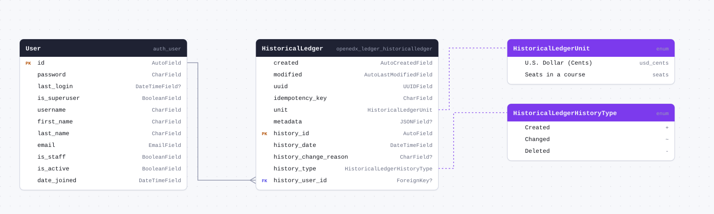

| Column | Field | Type | Null | Key | Default | Description |
| --- | --- | --- | --- | --- | --- | --- |
| `created` | `AutoCreatedField` | `datetime` |  |  | `now()` |  |
| `modified` | `AutoLastModifiedField` | `datetime` |  |  | `now()` |  |
| `uuid` | `UUIDField` | `char(32)` |  |  | `uuid4()` |  |
| `idempotency_key` | `CharField` | `varchar(255)` |  |  |  | An idempotency key is a unique value generated by the client of the Ledger API which the Ledger and Transaction APIs use to recognize subsequent retries of the same redemption (i.e. a Transaction that leads to the fulfillment of an enrollment or entitlement for a particular user id in a particular content key.We suggest incorporating V4 UUIDs along with sufficiently unique or random values representing the desired redemption to avoid unintended collisions.Utility methods are provided in the ``utils.py`` module to help clients generate appropriate idempotency keys. |
| `unit` | `HistoricalLedgerUnit` | `varchar(255)` |  |  | `'usd_cents'` | The unit in which Transaction quantities related to this Ledger instance are denominated. |
| `metadata` | `JSONField` | `text` | yes |  |  | Any additionaly metadata that a client may want to associate with this Ledger instance. |
| `history_id` | `AutoField` | `integer` |  | PK | `autoincrement()` |  |
| `history_date` | `DateTimeField` | `datetime` |  |  |  |  |
| `history_change_reason` | `CharField` | `varchar(100)` | yes |  |  |  |
| `history_type` | `HistoricalLedgerHistoryType` | `varchar(1)` |  |  |  |  |
| `history_user_id` | `ForeignKey` | `integer` | yes | FK |  |  |

Indexes:

- index `openedx_ledger_historicalledger_uuid_38bb4ba3` on `uuid`
- index `openedx_ledger_historicalledger_idempotency_key_1f2ac28e` on `idempotency_key`
- index `openedx_ledger_historicalledger_unit_7916236b` on `unit`
- index `openedx_ledger_historicalledger_history_date_f0508930` on `history_date`
- index `openedx_ledger_historicalledger_history_user_id_e92a7574` on `history_user_id`

Relations:

- `history_user_id` → [User](#user).`id`, on delete set null

## Ledger

Table `openedx_ledger_ledger`, app `openedx_ledger`.

Columns from `TimeStampedModelWithUuid` (abstract): `uuid`.

Columns from `TimeStampedModel` (abstract): `created`, `modified`.

A ledger to which you can add or remove value, associated with a single subsidy plan.

All value quantities associated with this ledger uniformly share the same unit, established in the `unit` field of
the ledger.  This enables simple balancing using `sum()` functions, helping to prevent bugs caused by unit
conversions, and improving performance on the critical balance() method.

.. no_pii:

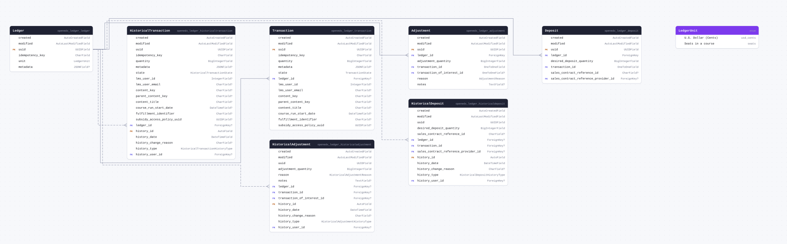

| Column | Field | Type | Null | Key | Default | Description |
| --- | --- | --- | --- | --- | --- | --- |
| `created` | `AutoCreatedField` | `datetime` |  |  | `now()` |  |
| `modified` | `AutoLastModifiedField` | `datetime` |  |  | `now()` |  |
| `uuid` | `UUIDField` | `char(32)` |  | PK | `uuid4()` |  |
| `idempotency_key` | `CharField` | `varchar(255)` |  | unique |  | An idempotency key is a unique value generated by the client of the Ledger API which the Ledger and Transaction APIs use to recognize subsequent retries of the same redemption (i.e. a Transaction that leads to the fulfillment of an enrollment or entitlement for a particular user id in a particular content key.We suggest incorporating V4 UUIDs along with sufficiently unique or random values representing the desired redemption to avoid unintended collisions.Utility methods are provided in the ``utils.py`` module to help clients generate appropriate idempotency keys. |
| `unit` | `LedgerUnit` | `varchar(255)` |  |  | `'usd_cents'` | The unit in which Transaction quantities related to this Ledger instance are denominated. |
| `metadata` | `JSONField` | `text` | yes |  |  | Any additionaly metadata that a client may want to associate with this Ledger instance. |

Indexes:

- index `openedx_ledger_ledger_unit_81a1b864` on `unit`

Relations:

- [HistoricalTransaction](#historicaltransaction).`ledger_id` → `uuid`, on delete do nothing, no database constraint
- [Transaction](#transaction).`ledger_id` → `uuid`, on delete set null
- [HistoricalAdjustment](#historicaladjustment).`ledger_id` → `uuid`, on delete do nothing, no database constraint
- [Adjustment](#adjustment).`ledger_id` → `uuid`, on delete cascade
- [HistoricalDeposit](#historicaldeposit).`ledger_id` → `uuid`, on delete do nothing, no database constraint
- [Deposit](#deposit).`ledger_id` → `uuid`, on delete cascade

## HistoricalTransaction

Table `openedx_ledger_historicaltransaction`, app `openedx_ledger`.

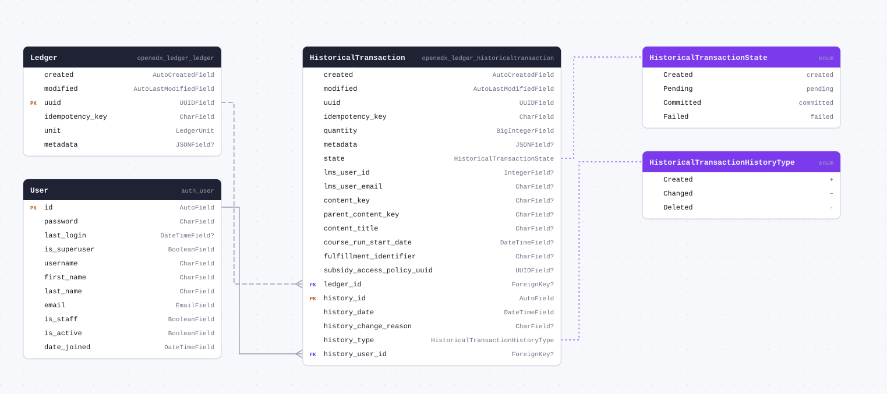

| Column | Field | Type | Null | Key | Default | Description |
| --- | --- | --- | --- | --- | --- | --- |
| `created` | `AutoCreatedField` | `datetime` |  |  | `now()` |  |
| `modified` | `AutoLastModifiedField` | `datetime` |  |  | `now()` |  |
| `uuid` | `UUIDField` | `char(32)` |  |  | `uuid4()` |  |
| `idempotency_key` | `CharField` | `varchar(255)` |  |  |  | An idempotency key is a unique value generated by the client of the Ledger API which the Ledger and Transaction APIs use to recognize subsequent retries of the same redemption (i.e. a Transaction that leads to the fulfillment of an enrollment or entitlement for a particular user id in a particular content key).We suggest incorporating V4 UUIDs along with sufficiently unique or random values representing the desired redemption to avoid unintended collisions.In particular, a Transaction's idempotency_key should incorporate it's corresponding ledger's idempotency_key.Utility methods are provided in the ``utils.py`` module to help clients generate appropriate idempotency keys. |
| `quantity` | `BigIntegerField` | `bigint` |  |  |  | How many units (as defined in the associated Ledger instance) this Transaction represents. |
| `metadata` | `JSONField` | `text` | yes |  |  | Any additionaly metadata that a client may want to associate with this Transaction. |
| `state` | `HistoricalTransactionState` | `varchar(255)` |  |  | `'created'` | The current state of the Transaction. One of: ['Created', 'Pending', 'Committed', 'Failed'] |
| `lms_user_id` | `IntegerField` | `integer` | yes |  |  | The id of the Open edX LMS user record with which this Transaction is associated. |
| `lms_user_email` | `CharField` | `varchar(255)` | yes |  |  | The email of the Open edX LMS user record with which this Transaction is associated.The email is captured at the time the Transaction is created and may not be up to date. |
| `content_key` | `CharField` | `varchar(255)` | yes |  |  | The globally unique content identifier.  Joinable with ContentMetadata.content_key in enterprise-catalog. |
| `parent_content_key` | `CharField` | `varchar(255)` | yes |  |  | Identifier for the parent of the content_key.  Also should be joinable with ContentMetadata.content_key in enterprise-catalog. In practice, this is the course key corresponding to a course run key. |
| `content_title` | `CharField` | `varchar(255)` | yes |  |  | The title of the content associated with this Transaction.The title is captured at the time the Transaction is created and may not be up to date. |
| `course_run_start_date` | `DateTimeField` | `datetime` | yes |  |  | The start date of the course run associated with this Transaction.The start date is captured at the time the Transaction is created and may not be up to date. |
| `fulfillment_identifier` | `CharField` | `varchar(255)` | yes |  |  | The UUID identifier of the subsidized enrollment record for a learner generated durning the enrollmentcall made to enterprise/edx platform e.g. a LearnerCreditEnterpriseCourseEnrollment UUID. |
| `subsidy_access_policy_uuid` | `UUIDField` | `char(32)` | yes |  |  | A reference to the subsidy access policy which was used to create a transaction for the content. |
| `ledger_id` | `ForeignKey` | `char(32)` | yes | FK (no constraint) |  | The Ledger instance with which this Transaction is associated. |
| `history_id` | `AutoField` | `integer` |  | PK | `autoincrement()` |  |
| `history_date` | `DateTimeField` | `datetime` |  |  |  |  |
| `history_change_reason` | `CharField` | `varchar(100)` | yes |  |  |  |
| `history_type` | `HistoricalTransactionHistoryType` | `varchar(1)` |  |  |  |  |
| `history_user_id` | `ForeignKey` | `integer` | yes | FK |  |  |

Indexes:

- index `openedx_ledger_historicaltransaction_uuid_c61e9125` on `uuid`
- index `openedx_ledger_historicaltransaction_idempotency_key_52297c44` on `idempotency_key`
- index `openedx_ledger_historicaltransaction_state_e8ae4f82` on `state`
- index `openedx_ledger_historicaltransaction_lms_user_id_69a0a63e` on `lms_user_id`
- index `openedx_ledger_historicaltransaction_lms_user_email_edf32737` on `lms_user_email`
- index `openedx_ledger_historicaltransaction_content_key_d2cfb5e2` on `content_key`
- index `openedx_ledger_historicaltransaction_parent_content_key_53819909` on `parent_content_key`
- index `openedx_ledger_historicaltransaction_content_title_86157016` on `content_title`
- index `openedx_ledger_historicaltransaction_course_run_start_date_bf73e844` on `course_run_start_date`
- index `openedx_ledger_historicaltransaction_fulfillment_identifier_e7b94274` on `fulfillment_identifier`
- index `openedx_ledger_historicaltransaction_ledger_id_36d59eaa` on `ledger_id`
- index `openedx_ledger_historicaltransaction_history_date_6b73c900` on `history_date`
- index `openedx_ledger_historicaltransaction_history_user_id_a6cd3bb6` on `history_user_id`

Relations:

- `ledger_id` → [Ledger](#ledger).`uuid`, on delete do nothing, no database constraint
- `history_user_id` → [User](#user).`id`, on delete set null

## Transaction

Table `openedx_ledger_transaction`, app `openedx_ledger`.

Columns from `BaseTransaction` (abstract): `idempotency_key`, `quantity`, `metadata`, `state`.

Columns from `TimeStampedModelWithUuid` (abstract): `uuid`.

Columns from `TimeStampedModel` (abstract): `created`, `modified`.

Represents value moving in or out of the ledger.

Transactions (and reversals) are immutable after entering the committed state.  This immutability helps maintain a
complete and robust history of value changes to the ledger, a trait which we rely on to calculate the ledger
balance.

Relatedly, we intentionally avoid persisting aggregates, reinforcing the transactions themselves as the
only source of truth.

.. pii: Stores the email of the Open edX LMS user associated with the Transaction.
.. pii_types: email_address
.. pii_retirement: retained

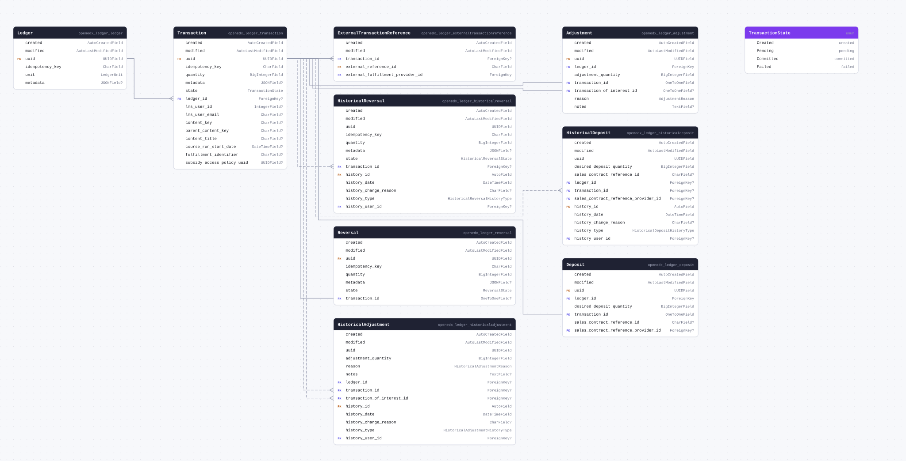

| Column | Field | Type | Null | Key | Default | Description |
| --- | --- | --- | --- | --- | --- | --- |
| `created` | `AutoCreatedField` | `datetime` |  |  | `now()` |  |
| `modified` | `AutoLastModifiedField` | `datetime` |  |  | `now()` |  |
| `uuid` | `UUIDField` | `char(32)` |  | PK | `uuid4()` |  |
| `idempotency_key` | `CharField` | `varchar(255)` |  |  |  | An idempotency key is a unique value generated by the client of the Ledger API which the Ledger and Transaction APIs use to recognize subsequent retries of the same redemption (i.e. a Transaction that leads to the fulfillment of an enrollment or entitlement for a particular user id in a particular content key).We suggest incorporating V4 UUIDs along with sufficiently unique or random values representing the desired redemption to avoid unintended collisions.In particular, a Transaction's idempotency_key should incorporate it's corresponding ledger's idempotency_key.Utility methods are provided in the ``utils.py`` module to help clients generate appropriate idempotency keys. |
| `quantity` | `BigIntegerField` | `bigint` |  |  |  | How many units (as defined in the associated Ledger instance) this Transaction represents. |
| `metadata` | `JSONField` | `text` | yes |  |  | Any additionaly metadata that a client may want to associate with this Transaction. |
| `state` | `TransactionState` | `varchar(255)` |  |  | `'created'` | The current state of the Transaction. One of: ['Created', 'Pending', 'Committed', 'Failed'] |
| `ledger_id` | `ForeignKey` | `char(32)` | yes | FK |  | The Ledger instance with which this Transaction is associated. |
| `lms_user_id` | `IntegerField` | `integer` | yes |  |  | The id of the Open edX LMS user record with which this Transaction is associated. |
| `lms_user_email` | `CharField` | `varchar(255)` | yes |  |  | The email of the Open edX LMS user record with which this Transaction is associated.The email is captured at the time the Transaction is created and may not be up to date. |
| `content_key` | `CharField` | `varchar(255)` | yes |  |  | The globally unique content identifier.  Joinable with ContentMetadata.content_key in enterprise-catalog. |
| `parent_content_key` | `CharField` | `varchar(255)` | yes |  |  | Identifier for the parent of the content_key.  Also should be joinable with ContentMetadata.content_key in enterprise-catalog. In practice, this is the course key corresponding to a course run key. |
| `content_title` | `CharField` | `varchar(255)` | yes |  |  | The title of the content associated with this Transaction.The title is captured at the time the Transaction is created and may not be up to date. |
| `course_run_start_date` | `DateTimeField` | `datetime` | yes |  |  | The start date of the course run associated with this Transaction.The start date is captured at the time the Transaction is created and may not be up to date. |
| `fulfillment_identifier` | `CharField` | `varchar(255)` | yes |  |  | The UUID identifier of the subsidized enrollment record for a learner generated durning the enrollmentcall made to enterprise/edx platform e.g. a LearnerCreditEnterpriseCourseEnrollment UUID. |
| `subsidy_access_policy_uuid` | `UUIDField` | `char(32)` | yes |  |  | A reference to the subsidy access policy which was used to create a transaction for the content. |

Indexes:

- index `openedx_ledger_transaction_idempotency_key_1eb7f3ea` on `idempotency_key`
- index `openedx_ledger_transaction_state_47f9254c` on `state`
- index `openedx_ledger_transaction_ledger_id_539d69c4` on `ledger_id`
- index `openedx_ledger_transaction_lms_user_id_ddfc3a1e` on `lms_user_id`
- index `openedx_ledger_transaction_lms_user_email_0450b3b2` on `lms_user_email`
- index `openedx_ledger_transaction_content_key_3faded91` on `content_key`
- index `openedx_ledger_transaction_parent_content_key_13442588` on `parent_content_key`
- index `openedx_ledger_transaction_content_title_ca7abead` on `content_title`
- index `openedx_ledger_transaction_course_run_start_date_5374dc94` on `course_run_start_date`
- index `openedx_ledger_transaction_fulfillment_identifier_c0becd76` on `fulfillment_identifier`
- unique `openedx_ledger_transaction_ledger_id_idempotency_key_9abaa5d9_uniq` on `ledger_id`, `idempotency_key`
- index `idx_ledger_lms_content_exc` on `ledger_id`, `lms_user_id`, `content_key`
- index `idx_ledger_content_exc` on `ledger_id`, `content_key`
- index `idx_ledger_subsidy_exc` on `ledger_id`, `subsidy_access_policy_uuid`

Relations:

- `ledger_id` → [Ledger](#ledger).`uuid`, on delete set null
- [ExternalTransactionReference](#externaltransactionreference).`transaction_id` → `uuid`, on delete cascade
- [HistoricalReversal](#historicalreversal).`transaction_id` → `uuid`, on delete do nothing, no database constraint
- [Reversal](#reversal).`transaction_id` → `uuid`, on delete set null
- [HistoricalAdjustment](#historicaladjustment).`transaction_id` → `uuid`, on delete do nothing, no database constraint
- [HistoricalAdjustment](#historicaladjustment).`transaction_of_interest_id` → `uuid`, on delete do nothing, no database constraint
- [Adjustment](#adjustment).`transaction_id` → `uuid`, on delete cascade
- [Adjustment](#adjustment).`transaction_of_interest_id` → `uuid`, on delete set null
- [HistoricalDeposit](#historicaldeposit).`transaction_id` → `uuid`, on delete do nothing, no database constraint
- [Deposit](#deposit).`transaction_id` → `uuid`, on delete cascade

## ExternalFulfillmentProvider

Table `openedx_ledger_externalfulfillmentprovider`, app `openedx_ledger`.

Columns from `TimeStampedModel` (abstract): `created`, `modified`.

Model of external fulfillment providers. This is used to track the external systems that are used to fulfill
transactions.

.. no_pii:

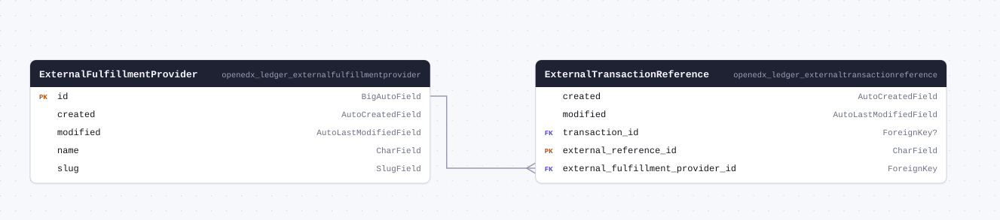

| Column | Field | Type | Null | Key | Default | Description |
| --- | --- | --- | --- | --- | --- | --- |
| `id` | `BigAutoField` | `integer` |  | PK | `autoincrement()` |  |
| `created` | `AutoCreatedField` | `datetime` |  |  | `now()` |  |
| `modified` | `AutoLastModifiedField` | `datetime` |  |  | `now()` |  |
| `name` | `CharField` | `varchar(255)` |  |  |  | The name of the external reference type. |
| `slug` | `SlugField` | `varchar(32)` |  | unique |  | The slug of the external reference type. This is typically the slugified name of the system that the reference is associated with. |

Relations:

- [ExternalTransactionReference](#externaltransactionreference).`external_fulfillment_provider_id` → `id`, on delete cascade

## ExternalTransactionReference

Table `openedx_ledger_externaltransactionreference`, app `openedx_ledger`.

Columns from `TimeStampedModel` (abstract): `created`, `modified`.

Model of references to transactions from an external system and their associated Transaction objects.

.. no_pii:

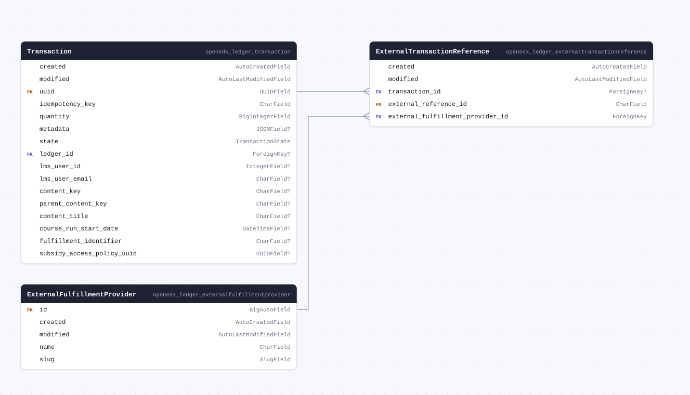

| Column | Field | Type | Null | Key | Default | Description |
| --- | --- | --- | --- | --- | --- | --- |
| `created` | `AutoCreatedField` | `datetime` |  |  | `now()` |  |
| `modified` | `AutoLastModifiedField` | `datetime` |  |  | `now()` |  |
| `transaction_id` | `ForeignKey` | `char(32)` | yes | FK |  | The Transaction to which this external reference is associated. |
| `external_reference_id` | `CharField` | `varchar(255)` |  | PK |  | The identifier for the external reference operation. This is typically the name of the system that the reference is associated with. |
| `external_fulfillment_provider_id` | `ForeignKey` | `bigint` |  | FK |  | The provider (source) of the external reference. |

Indexes:

- index `openedx_ledger_externaltransactionreference_transaction_id_9d88595f` on `transaction_id`
- index `openedx_ledger_externaltransactionreference_external_fulfillment_provider_id_4237cc13` on `external_fulfillment_provider_id`
- unique `openedx_ledger_externaltransactionreference_external_reference_id_external_fulfillment_provider_id_6673a170_uniq` on `external_reference_id`, `external_fulfillment_provider_id`

Relations:

- `transaction_id` → [Transaction](#transaction).`uuid`, on delete cascade
- `external_fulfillment_provider_id` → [ExternalFulfillmentProvider](#externalfulfillmentprovider).`id`, on delete cascade

## HistoricalReversal

Table `openedx_ledger_historicalreversal`, app `openedx_ledger`.

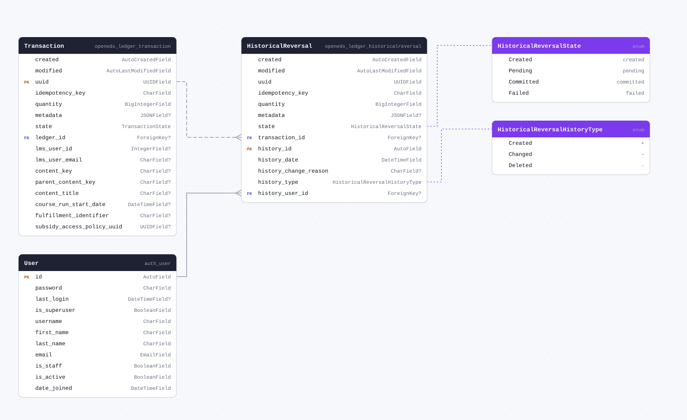

| Column | Field | Type | Null | Key | Default | Description |
| --- | --- | --- | --- | --- | --- | --- |
| `created` | `AutoCreatedField` | `datetime` |  |  | `now()` |  |
| `modified` | `AutoLastModifiedField` | `datetime` |  |  | `now()` |  |
| `uuid` | `UUIDField` | `char(32)` |  |  | `uuid4()` |  |
| `idempotency_key` | `CharField` | `varchar(255)` |  |  |  | An idempotency key is a unique value generated by the client of the Ledger API which the Ledger and Transaction APIs use to recognize subsequent retries of the same redemption (i.e. a Transaction that leads to the fulfillment of an enrollment or entitlement for a particular user id in a particular content key).We suggest incorporating V4 UUIDs along with sufficiently unique or random values representing the desired redemption to avoid unintended collisions.In particular, a Transaction's idempotency_key should incorporate it's corresponding ledger's idempotency_key.Utility methods are provided in the ``utils.py`` module to help clients generate appropriate idempotency keys. |
| `quantity` | `BigIntegerField` | `bigint` |  |  |  | How many units (as defined in the associated Ledger instance) this Transaction represents. |
| `metadata` | `JSONField` | `text` | yes |  |  | Any additionaly metadata that a client may want to associate with this Transaction. |
| `state` | `HistoricalReversalState` | `varchar(255)` |  |  | `'created'` | The current state of the Transaction. One of: ['Created', 'Pending', 'Committed', 'Failed'] |
| `transaction_id` | `ForeignKey` | `char(32)` | yes | FK (no constraint) |  | The Transaction instance which is reversed by this Reversal instance. |
| `history_id` | `AutoField` | `integer` |  | PK | `autoincrement()` |  |
| `history_date` | `DateTimeField` | `datetime` |  |  |  |  |
| `history_change_reason` | `CharField` | `varchar(100)` | yes |  |  |  |
| `history_type` | `HistoricalReversalHistoryType` | `varchar(1)` |  |  |  |  |
| `history_user_id` | `ForeignKey` | `integer` | yes | FK |  |  |

Indexes:

- index `openedx_ledger_historicalreversal_uuid_ac5dec72` on `uuid`
- index `openedx_ledger_historicalreversal_idempotency_key_7d6a9ace` on `idempotency_key`
- index `openedx_ledger_historicalreversal_state_5d07dbac` on `state`
- index `openedx_ledger_historicalreversal_transaction_id_6defc161` on `transaction_id`
- index `openedx_ledger_historicalreversal_history_date_ae7254fb` on `history_date`
- index `openedx_ledger_historicalreversal_history_user_id_d4ceeef3` on `history_user_id`

Relations:

- `transaction_id` → [Transaction](#transaction).`uuid`, on delete do nothing, no database constraint
- `history_user_id` → [User](#user).`id`, on delete set null

## Reversal

Table `openedx_ledger_reversal`, app `openedx_ledger`.

Columns from `BaseTransaction` (abstract): `idempotency_key`, `quantity`, `metadata`, `state`.

Columns from `TimeStampedModelWithUuid` (abstract): `uuid`.

Columns from `TimeStampedModel` (abstract): `created`, `modified`.

Represents a reversal of some or all of a transaction, but no more.

.. no_pii:

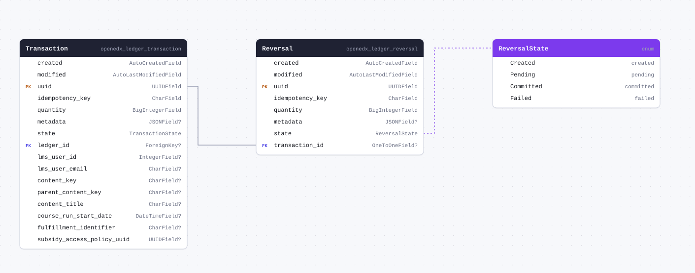

| Column | Field | Type | Null | Key | Default | Description |
| --- | --- | --- | --- | --- | --- | --- |
| `created` | `AutoCreatedField` | `datetime` |  |  | `now()` |  |
| `modified` | `AutoLastModifiedField` | `datetime` |  |  | `now()` |  |
| `uuid` | `UUIDField` | `char(32)` |  | PK | `uuid4()` |  |
| `idempotency_key` | `CharField` | `varchar(255)` |  |  |  | An idempotency key is a unique value generated by the client of the Ledger API which the Ledger and Transaction APIs use to recognize subsequent retries of the same redemption (i.e. a Transaction that leads to the fulfillment of an enrollment or entitlement for a particular user id in a particular content key).We suggest incorporating V4 UUIDs along with sufficiently unique or random values representing the desired redemption to avoid unintended collisions.In particular, a Transaction's idempotency_key should incorporate it's corresponding ledger's idempotency_key.Utility methods are provided in the ``utils.py`` module to help clients generate appropriate idempotency keys. |
| `quantity` | `BigIntegerField` | `bigint` |  |  |  | How many units (as defined in the associated Ledger instance) this Transaction represents. |
| `metadata` | `JSONField` | `text` | yes |  |  | Any additionaly metadata that a client may want to associate with this Transaction. |
| `state` | `ReversalState` | `varchar(255)` |  |  | `'created'` | The current state of the Transaction. One of: ['Created', 'Pending', 'Committed', 'Failed'] |
| `transaction_id` | `OneToOneField` | `char(32)` | yes | FK, unique |  | The Transaction instance which is reversed by this Reversal instance. |

Indexes:

- index `openedx_ledger_reversal_idempotency_key_8154539d` on `idempotency_key`
- index `openedx_ledger_reversal_state_b7296d39` on `state`
- unique `openedx_ledger_reversal_transaction_id_idempotency_key_b9ca8087_uniq` on `transaction_id`, `idempotency_key`

Relations:

- `transaction_id` → [Transaction](#transaction).`uuid`, on delete set null

## HistoricalAdjustment

Table `openedx_ledger_historicaladjustment`, app `openedx_ledger`.

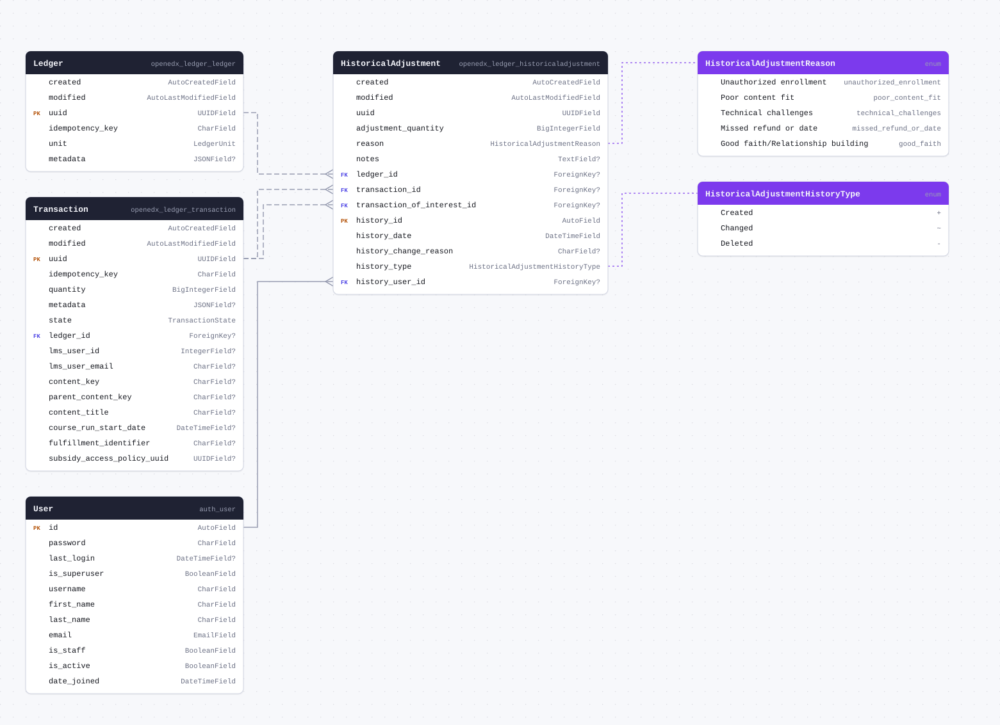

| Column | Field | Type | Null | Key | Default | Description |
| --- | --- | --- | --- | --- | --- | --- |
| `created` | `AutoCreatedField` | `datetime` |  |  | `now()` |  |
| `modified` | `AutoLastModifiedField` | `datetime` |  |  | `now()` |  |
| `uuid` | `UUIDField` | `char(32)` |  |  | `uuid4()` |  |
| `adjustment_quantity` | `BigIntegerField` | `bigint` |  |  |  | How many units to adjust for in the related transaction. |
| `reason` | `HistoricalAdjustmentReason` | `varchar(255)` |  |  | `'technical_challenges'` | The primary reason for the existence of this adjustment. |
| `notes` | `TextField` | `text` | yes |  |  | Any additional context you have for the existence of this adjustment. |
| `ledger_id` | `ForeignKey` | `char(32)` | yes | FK (no constraint) |  | The Ledger instance with which this Adjustment is associated. |
| `transaction_id` | `ForeignKey` | `char(32)` | yes | FK (no constraint) |  | The Transaction instance which adjusts the balance of the relevant ledger. |
| `transaction_of_interest_id` | `ForeignKey` | `char(32)` | yes | FK (no constraint) |  | Any transaction of interest w.r.t. the reason for being of this adjustment. For example, the transaction of interest may point to some transaction record for which the enrolling user is unsatisfied, but for which we cannot issue a reversal due to business rules. |
| `history_id` | `AutoField` | `integer` |  | PK | `autoincrement()` |  |
| `history_date` | `DateTimeField` | `datetime` |  |  |  |  |
| `history_change_reason` | `CharField` | `varchar(100)` | yes |  |  |  |
| `history_type` | `HistoricalAdjustmentHistoryType` | `varchar(1)` |  |  |  |  |
| `history_user_id` | `ForeignKey` | `integer` | yes | FK |  |  |

Indexes:

- index `openedx_ledger_historicaladjustment_uuid_478818a7` on `uuid`
- index `openedx_ledger_historicaladjustment_reason_c1636885` on `reason`
- index `openedx_ledger_historicaladjustment_ledger_id_798033f0` on `ledger_id`
- index `openedx_ledger_historicaladjustment_transaction_id_b78287e3` on `transaction_id`
- index `openedx_ledger_historicaladjustment_transaction_of_interest_id_a3293980` on `transaction_of_interest_id`
- index `openedx_ledger_historicaladjustment_history_date_01b88221` on `history_date`
- index `openedx_ledger_historicaladjustment_history_user_id_7d9226ab` on `history_user_id`

Relations:

- `ledger_id` → [Ledger](#ledger).`uuid`, on delete do nothing, no database constraint
- `transaction_id` → [Transaction](#transaction).`uuid`, on delete do nothing, no database constraint
- `transaction_of_interest_id` → [Transaction](#transaction).`uuid`, on delete do nothing, no database constraint
- `history_user_id` → [User](#user).`id`, on delete set null

## Adjustment

Table `openedx_ledger_adjustment`, app `openedx_ledger`.

Columns from `TimeStampedModelWithUuid` (abstract): `uuid`.

Columns from `TimeStampedModel` (abstract): `created`, `modified`.

Represents some adjustment to the balance of a ledger via
a transaction (with quantity > 0) and some audit fields.

.. no_pii:

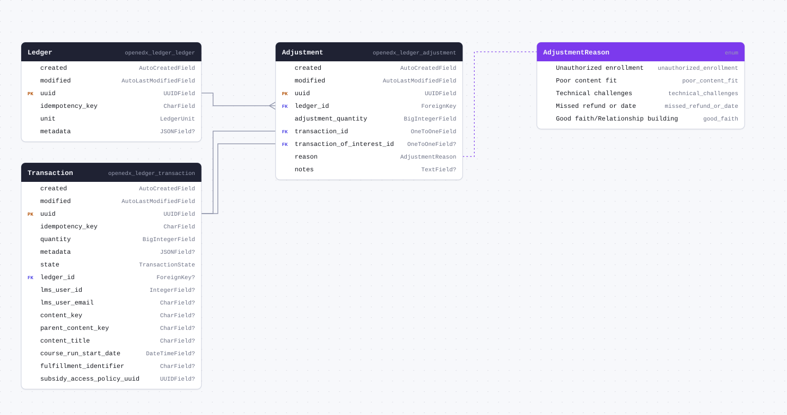

| Column | Field | Type | Null | Key | Default | Description |
| --- | --- | --- | --- | --- | --- | --- |
| `created` | `AutoCreatedField` | `datetime` |  |  | `now()` |  |
| `modified` | `AutoLastModifiedField` | `datetime` |  |  | `now()` |  |
| `uuid` | `UUIDField` | `char(32)` |  | PK | `uuid4()` |  |
| `ledger_id` | `ForeignKey` | `char(32)` |  | FK |  | The Ledger instance with which this Adjustment is associated. |
| `adjustment_quantity` | `BigIntegerField` | `bigint` |  |  |  | How many units to adjust for in the related transaction. |
| `transaction_id` | `OneToOneField` | `char(32)` |  | FK, unique |  | The Transaction instance which adjusts the balance of the relevant ledger. |
| `transaction_of_interest_id` | `OneToOneField` | `char(32)` | yes | FK, unique |  | Any transaction of interest w.r.t. the reason for being of this adjustment. For example, the transaction of interest may point to some transaction record for which the enrolling user is unsatisfied, but for which we cannot issue a reversal due to business rules. |
| `reason` | `AdjustmentReason` | `varchar(255)` |  |  | `'technical_challenges'` | The primary reason for the existence of this adjustment. |
| `notes` | `TextField` | `text` | yes |  |  | Any additional context you have for the existence of this adjustment. |

Indexes:

- index `openedx_ledger_adjustment_ledger_id_124ae940` on `ledger_id`
- index `openedx_ledger_adjustment_reason_d9fe2024` on `reason`

Relations:

- `ledger_id` → [Ledger](#ledger).`uuid`, on delete cascade
- `transaction_id` → [Transaction](#transaction).`uuid`, on delete cascade
- `transaction_of_interest_id` → [Transaction](#transaction).`uuid`, on delete set null

## SalesContractReferenceProvider

Table `openedx_ledger_salescontractreferenceprovider`, app `openedx_ledger`.

Columns from `TimeStampedModel` (abstract): `created`, `modified`.

All possible providers for sales contracts.

Typically your sales contracts are recorded within one centralized system-of-record (e.g. SalesForce), in which case
this table may only ever have one single record to describe that provider.

.. no_pii:

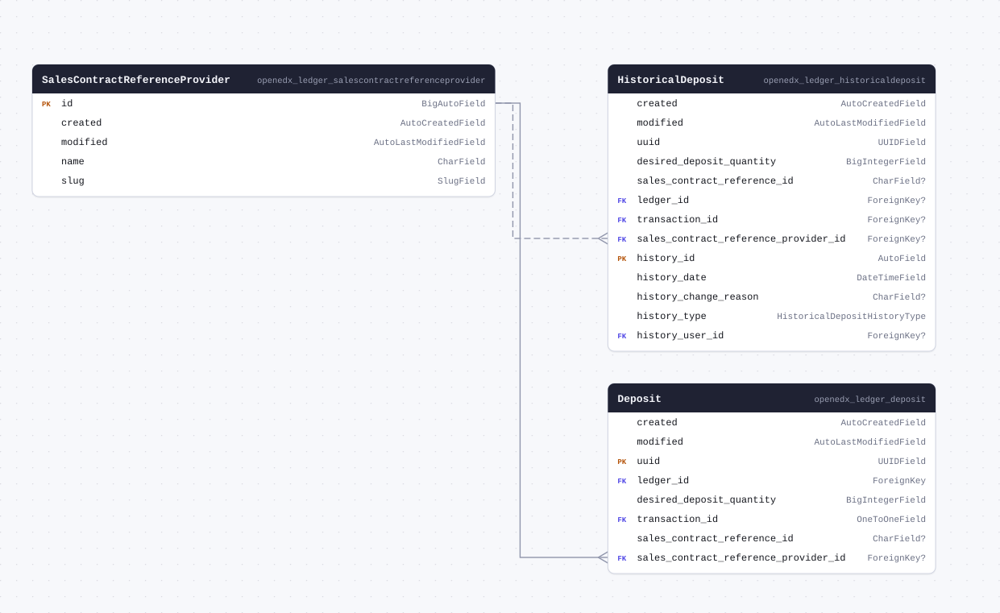

| Column | Field | Type | Null | Key | Default | Description |
| --- | --- | --- | --- | --- | --- | --- |
| `id` | `BigAutoField` | `integer` |  | PK | `autoincrement()` |  |
| `created` | `AutoCreatedField` | `datetime` |  |  | `now()` |  |
| `modified` | `AutoLastModifiedField` | `datetime` |  |  | `now()` |  |
| `name` | `CharField` | `varchar(255)` |  |  |  | The pretty name of the contract reference provider. |
| `slug` | `SlugField` | `varchar(32)` |  | unique |  | A unique slug for this sales contract reference provider. |

Relations:

- [HistoricalDeposit](#historicaldeposit).`sales_contract_reference_provider_id` → `id`, on delete do nothing, no database constraint
- [Deposit](#deposit).`sales_contract_reference_provider_id` → `id`, on delete cascade

## HistoricalDeposit

Table `openedx_ledger_historicaldeposit`, app `openedx_ledger`.

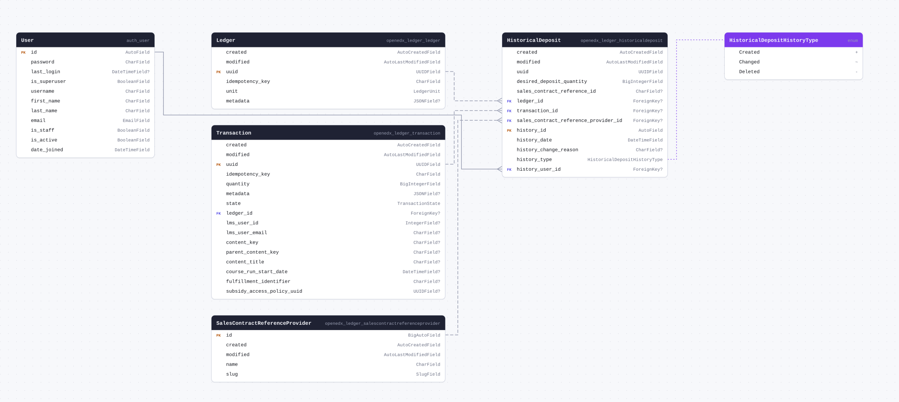

| Column | Field | Type | Null | Key | Default | Description |
| --- | --- | --- | --- | --- | --- | --- |
| `created` | `AutoCreatedField` | `datetime` |  |  | `now()` |  |
| `modified` | `AutoLastModifiedField` | `datetime` |  |  | `now()` |  |
| `uuid` | `UUIDField` | `char(32)` |  |  | `uuid4()` |  |
| `desired_deposit_quantity` | `BigIntegerField` | `bigint` |  |  |  | How many units to deposit via related transaction. |
| `sales_contract_reference_id` | `CharField` | `varchar(255)` | yes |  |  | ('The reference ID for the specific sales contract which beget this deposit. The source system which ', 'stores the sales object is identified by the sales_contract_reference_provider field.') |
| `ledger_id` | `ForeignKey` | `char(32)` | yes | FK (no constraint) |  | The Ledger instance with which this deposit is associated. |
| `transaction_id` | `ForeignKey` | `char(32)` | yes | FK (no constraint) |  | The Transaction instance which represents this deposit and influences the balance of the relevant ledger. |
| `sales_contract_reference_provider_id` | `ForeignKey` | `bigint` | yes | FK (no constraint) |  | The system providing the source of truth for the sales contract which beget this deposit. |
| `history_id` | `AutoField` | `integer` |  | PK | `autoincrement()` |  |
| `history_date` | `DateTimeField` | `datetime` |  |  |  |  |
| `history_change_reason` | `CharField` | `varchar(100)` | yes |  |  |  |
| `history_type` | `HistoricalDepositHistoryType` | `varchar(1)` |  |  |  |  |
| `history_user_id` | `ForeignKey` | `integer` | yes | FK |  |  |

Indexes:

- index `openedx_ledger_historicaldeposit_uuid_7045e880` on `uuid`
- index `openedx_ledger_historicaldeposit_sales_contract_reference_id_78ce7839` on `sales_contract_reference_id`
- index `openedx_ledger_historicaldeposit_ledger_id_7ee23955` on `ledger_id`
- index `openedx_ledger_historicaldeposit_transaction_id_7fcbaabc` on `transaction_id`
- index `openedx_ledger_historicaldeposit_sales_contract_reference_provider_id_1fcb607e` on `sales_contract_reference_provider_id`
- index `openedx_ledger_historicaldeposit_history_date_9be16baf` on `history_date`
- index `openedx_ledger_historicaldeposit_history_user_id_8017cbf4` on `history_user_id`

Relations:

- `ledger_id` → [Ledger](#ledger).`uuid`, on delete do nothing, no database constraint
- `transaction_id` → [Transaction](#transaction).`uuid`, on delete do nothing, no database constraint
- `sales_contract_reference_provider_id` → [SalesContractReferenceProvider](#salescontractreferenceprovider).`id`, on delete do nothing, no database constraint
- `history_user_id` → [User](#user).`id`, on delete set null

## Deposit

Table `openedx_ledger_deposit`, app `openedx_ledger`.

Columns from `TimeStampedModelWithUuid` (abstract): `uuid`.

Columns from `TimeStampedModel` (abstract): `created`, `modified`.

Represents a deposit into to the balance of a ledger via a transaction (with quantity > 0).

.. no_pii:

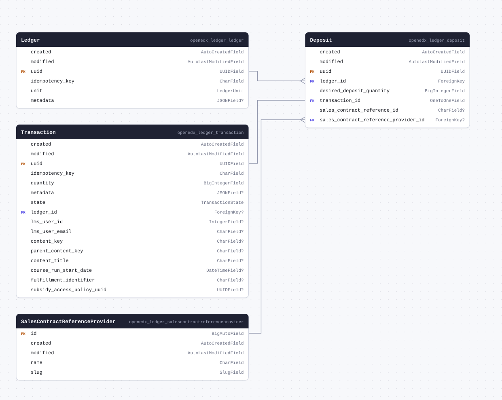

| Column | Field | Type | Null | Key | Default | Description |
| --- | --- | --- | --- | --- | --- | --- |
| `created` | `AutoCreatedField` | `datetime` |  |  | `now()` |  |
| `modified` | `AutoLastModifiedField` | `datetime` |  |  | `now()` |  |
| `uuid` | `UUIDField` | `char(32)` |  | PK | `uuid4()` |  |
| `ledger_id` | `ForeignKey` | `char(32)` |  | FK |  | The Ledger instance with which this deposit is associated. |
| `desired_deposit_quantity` | `BigIntegerField` | `bigint` |  |  |  | How many units to deposit via related transaction. |
| `transaction_id` | `OneToOneField` | `char(32)` |  | FK, unique |  | The Transaction instance which represents this deposit and influences the balance of the relevant ledger. |
| `sales_contract_reference_id` | `CharField` | `varchar(255)` | yes |  |  | ('The reference ID for the specific sales contract which beget this deposit. The source system which ', 'stores the sales object is identified by the sales_contract_reference_provider field.') |
| `sales_contract_reference_provider_id` | `ForeignKey` | `bigint` | yes | FK |  | The system providing the source of truth for the sales contract which beget this deposit. |

Indexes:

- index `openedx_ledger_deposit_ledger_id_ad289dcf` on `ledger_id`
- index `openedx_ledger_deposit_sales_contract_reference_id_0212f5fb` on `sales_contract_reference_id`
- index `openedx_ledger_deposit_sales_contract_reference_provider_id_e28bd959` on `sales_contract_reference_provider_id`

Relations:

- `ledger_id` → [Ledger](#ledger).`uuid`, on delete cascade
- `transaction_id` → [Transaction](#transaction).`uuid`, on delete cascade
- `sales_contract_reference_provider_id` → [SalesContractReferenceProvider](#salescontractreferenceprovider).`id`, on delete cascade

# Enums

## LogEntryActionFlag

| Name | Stored as |
| --- | --- |
| `Addition` | `1` |
| `Change` | `2` |
| `Deletion` | `3` |

## HistoricalLedgerUnit

| Name | Stored as |
| --- | --- |
| `U.S. Dollar (Cents)` | `usd_cents` |
| `Seats in a course` | `seats` |

## HistoricalLedgerHistoryType

| Name | Stored as |
| --- | --- |
| `Created` | `+` |
| `Changed` | `~` |
| `Deleted` | `-` |

## LedgerUnit

| Name | Stored as |
| --- | --- |
| `U.S. Dollar (Cents)` | `usd_cents` |
| `Seats in a course` | `seats` |

## HistoricalTransactionState

| Name | Stored as |
| --- | --- |
| `Created` | `created` |
| `Pending` | `pending` |
| `Committed` | `committed` |
| `Failed` | `failed` |

## HistoricalTransactionHistoryType

| Name | Stored as |
| --- | --- |
| `Created` | `+` |
| `Changed` | `~` |
| `Deleted` | `-` |

## TransactionState

| Name | Stored as |
| --- | --- |
| `Created` | `created` |
| `Pending` | `pending` |
| `Committed` | `committed` |
| `Failed` | `failed` |

## HistoricalReversalState

| Name | Stored as |
| --- | --- |
| `Created` | `created` |
| `Pending` | `pending` |
| `Committed` | `committed` |
| `Failed` | `failed` |

## HistoricalReversalHistoryType

| Name | Stored as |
| --- | --- |
| `Created` | `+` |
| `Changed` | `~` |
| `Deleted` | `-` |

## ReversalState

| Name | Stored as |
| --- | --- |
| `Created` | `created` |
| `Pending` | `pending` |
| `Committed` | `committed` |
| `Failed` | `failed` |

## HistoricalAdjustmentReason

| Name | Stored as |
| --- | --- |
| `Unauthorized enrollment` | `unauthorized_enrollment` |
| `Poor content fit` | `poor_content_fit` |
| `Technical challenges` | `technical_challenges` |
| `Missed refund or date` | `missed_refund_or_date` |
| `Good faith/Relationship building` | `good_faith` |

## HistoricalAdjustmentHistoryType

| Name | Stored as |
| --- | --- |
| `Created` | `+` |
| `Changed` | `~` |
| `Deleted` | `-` |

## AdjustmentReason

| Name | Stored as |
| --- | --- |
| `Unauthorized enrollment` | `unauthorized_enrollment` |
| `Poor content fit` | `poor_content_fit` |
| `Technical challenges` | `technical_challenges` |
| `Missed refund or date` | `missed_refund_or_date` |
| `Good faith/Relationship building` | `good_faith` |

## HistoricalDepositHistoryType

| Name | Stored as |
| --- | --- |
| `Created` | `+` |
| `Changed` | `~` |
| `Deleted` | `-` |
