# Schema docs

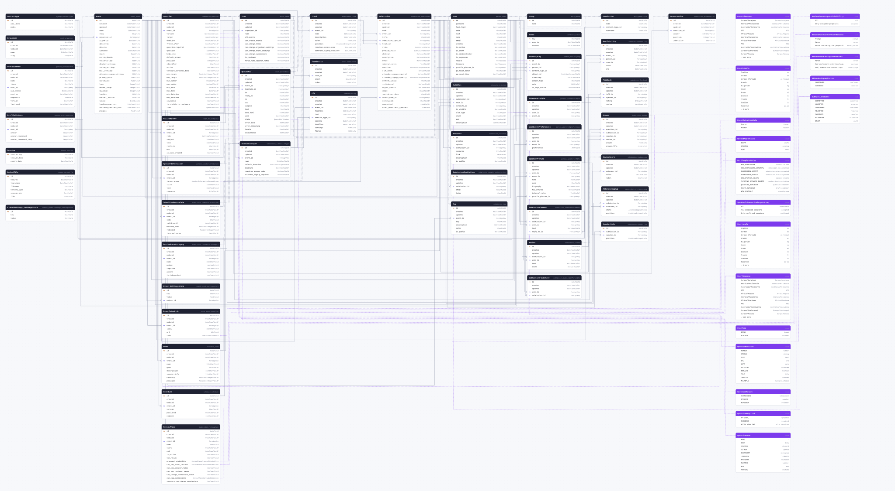

[Permission](#permission) · [Group](#group) · [ContentType](#contenttype) · [Session](#session) · [Token](#token) · [ActivityLog](#activitylog) · [CachedFile](#cachedfile) · [GlobalSettings_SettingsStore](#globalsettings_settingsstore) · [Event](#event) · [Event_SettingsStore](#event_settingsstore) · [EventExtraLink](#eventextralink) · [Organiser](#organiser) · [Team](#team) · [TeamInvite](#teaminvite) · [QueuedMail](#queuedmail) · [MailTemplate](#mailtemplate) · [AttendeeProfile](#attendeeprofile) · [UserApiToken](#userapitoken) · [SpeakerInformation](#speakerinformation) · [ProfilePicture](#profilepicture) · [UserEventPreferences](#usereventpreferences) · [SpeakerProfile](#speakerprofile) · [User](#user) · [Availability](#availability) · [Room](#room) · [Schedule](#schedule) · [TalkSlot](#talkslot) · [SubmitterAccessCode](#submitteraccesscode) · [CfP](#cfp) · [SubmissionComment](#submissioncomment) · [Feedback](#feedback) · [Question](#question) · [AnswerOption](#answeroption) · [Answer](#answer) · [Resource](#resource) · [ReviewScoreCategory](#reviewscorecategory) · [ReviewScore](#reviewscore) · [Review](#review) · [ReviewPhase](#reviewphase) · [AttendeeSignup](#attendeesignup) · [SpeakerRole](#speakerrole) · [Submission](#submission) · [SubmissionFavourite](#submissionfavourite) · [SubmissionInvitation](#submissioninvitation) · [Tag](#tag) · [Track](#track) · [SubmissionType](#submissiontype)

<details>
<summary>The whole schema as SQL</summary>

```sql
CREATE TABLE "auth_permission" ("id" integer NOT NULL PRIMARY KEY AUTOINCREMENT, "name" varchar(255) NOT NULL, "content_type_id" integer NOT NULL REFERENCES "django_content_type" ("id") DEFERRABLE INITIALLY DEFERRED, "codename" varchar(100) NOT NULL);

CREATE TABLE "auth_group" ("id" integer NOT NULL PRIMARY KEY AUTOINCREMENT, "name" varchar(150) NOT NULL UNIQUE);

CREATE TABLE "auth_group_permissions" ("id" integer NOT NULL PRIMARY KEY AUTOINCREMENT, "group_id" integer NOT NULL REFERENCES "auth_group" ("id") DEFERRABLE INITIALLY DEFERRED, "permission_id" integer NOT NULL REFERENCES "auth_permission" ("id") DEFERRABLE INITIALLY DEFERRED);

CREATE TABLE "django_content_type" ("id" integer NOT NULL PRIMARY KEY AUTOINCREMENT, "app_label" varchar(100) NOT NULL, "model" varchar(100) NOT NULL);

CREATE TABLE "django_session" ("session_key" varchar(40) NOT NULL PRIMARY KEY, "session_data" text NOT NULL, "expire_date" datetime NOT NULL);

CREATE TABLE "authtoken_token" ("key" varchar(40) NOT NULL PRIMARY KEY, "user_id" integer NOT NULL UNIQUE REFERENCES "person_user" ("id") DEFERRABLE INITIALLY DEFERRED, "created" datetime NOT NULL);

CREATE TABLE "common_activitylog" ("id" integer NOT NULL PRIMARY KEY AUTOINCREMENT, "event_id" integer NULL REFERENCES "event_event" ("id") DEFERRABLE INITIALLY DEFERRED, "person_id" integer NULL REFERENCES "person_user" ("id") DEFERRABLE INITIALLY DEFERRED, "content_type_id" integer NOT NULL REFERENCES "django_content_type" ("id") DEFERRABLE INITIALLY DEFERRED, "object_id" integer unsigned NOT NULL CHECK ("object_id" >= 0), "timestamp" datetime NOT NULL, "action_type" varchar(200) NOT NULL, "data" text NULL CHECK ((JSON_VALID("data") OR "data" IS NULL)), "is_orga_action" bool NOT NULL);

CREATE TABLE "common_cachedfile" ("id" char(32) NOT NULL PRIMARY KEY, "expires" datetime NOT NULL, "timestamp" datetime NULL, "filename" varchar(255) NOT NULL, "content_type" varchar(255) NOT NULL, "session_key" text NULL, "file" varchar(255) NULL);

CREATE TABLE "common_globalsettings_settingsstore" ("id" integer NOT NULL PRIMARY KEY AUTOINCREMENT, "key" varchar(255) NOT NULL, "value" text NOT NULL);

CREATE TABLE "event_event" ("id" integer NOT NULL PRIMARY KEY AUTOINCREMENT, "created" datetime NULL, "updated" datetime NULL, "name" text NOT NULL, "slug" varchar(50) NOT NULL UNIQUE, "organiser_id" integer NULL REFERENCES "event_organiser" ("id") DEFERRABLE INITIALLY DEFERRED, "is_public" bool NOT NULL, "date_from" date NOT NULL, "date_to" date NOT NULL, "timezone" varchar(32) NOT NULL, "email" varchar(254) NOT NULL, "custom_domain" varchar(200) NULL, "feature_flags" text NOT NULL CHECK ((JSON_VALID("feature_flags") OR "feature_flags" IS NULL)), "display_settings" text NOT NULL CHECK ((JSON_VALID("display_settings") OR "display_settings" IS NULL)), "review_settings" text NOT NULL CHECK ((JSON_VALID("review_settings") OR "review_settings" IS NULL)), "mail_settings" text NOT NULL CHECK ((JSON_VALID("mail_settings") OR "mail_settings" IS NULL)), "attendee_signup_settings" text NOT NULL CHECK ((JSON_VALID("attendee_signup_settings") OR "attendee_signup_settings" IS NULL)), "primary_color" varchar(7) NULL, "custom_css" varchar(100) NULL, "logo" varchar(100) NULL, "header_image" varchar(100) NULL, "og_image" varchar(100) NULL, "locales" text NOT NULL CHECK ((JSON_VALID("locales") OR "locales" IS NULL)), "content_locales" text NOT NULL CHECK ((JSON_VALID("content_locales") OR "content_locales" IS NULL)), "locale" varchar(32) NOT NULL, "landing_page_text" text NULL, "featured_sessions_text" text NULL, "plugins" text NULL);

CREATE TABLE "event_event_settingsstore" ("id" integer NOT NULL PRIMARY KEY AUTOINCREMENT, "key" varchar(255) NOT NULL, "value" text NOT NULL, "object_id" integer NOT NULL REFERENCES "event_event" ("id") DEFERRABLE INITIALLY DEFERRED);

CREATE TABLE "event_eventextralink" ("id" integer NOT NULL PRIMARY KEY AUTOINCREMENT, "created" datetime NULL, "updated" datetime NULL, "event_id" integer NOT NULL REFERENCES "event_event" ("id") DEFERRABLE INITIALLY DEFERRED, "label" text NOT NULL, "url" varchar(200) NOT NULL, "role" varchar(6) NOT NULL);

CREATE TABLE "event_organiser" ("id" integer NOT NULL PRIMARY KEY AUTOINCREMENT, "created" datetime NULL, "updated" datetime NULL, "name" text NOT NULL, "slug" varchar(50) NOT NULL UNIQUE);

CREATE TABLE "event_team" ("id" integer NOT NULL PRIMARY KEY AUTOINCREMENT, "created" datetime NULL, "updated" datetime NULL, "organiser_id" integer NOT NULL REFERENCES "event_organiser" ("id") DEFERRABLE INITIALLY DEFERRED, "name" varchar(190) NOT NULL, "all_events" bool NOT NULL, "can_create_events" bool NOT NULL, "can_change_teams" bool NOT NULL, "can_change_organiser_settings" bool NOT NULL, "can_change_event_settings" bool NOT NULL, "can_change_submissions" bool NOT NULL, "is_reviewer" bool NOT NULL, "force_hide_speaker_names" bool NOT NULL);

CREATE TABLE "event_team_members" ("id" integer NOT NULL PRIMARY KEY AUTOINCREMENT, "team_id" integer NOT NULL REFERENCES "event_team" ("id") DEFERRABLE INITIALLY DEFERRED, "user_id" integer NOT NULL REFERENCES "person_user" ("id") DEFERRABLE INITIALLY DEFERRED);

CREATE TABLE "event_team_limit_events" ("id" integer NOT NULL PRIMARY KEY AUTOINCREMENT, "team_id" integer NOT NULL REFERENCES "event_team" ("id") DEFERRABLE INITIALLY DEFERRED, "event_id" integer NOT NULL REFERENCES "event_event" ("id") DEFERRABLE INITIALLY DEFERRED);

CREATE TABLE "event_team_limit_tracks" ("id" integer NOT NULL PRIMARY KEY AUTOINCREMENT, "team_id" integer NOT NULL REFERENCES "event_team" ("id") DEFERRABLE INITIALLY DEFERRED, "track_id" integer NOT NULL REFERENCES "submission_track" ("id") DEFERRABLE INITIALLY DEFERRED);

CREATE TABLE "event_teaminvite" ("id" integer NOT NULL PRIMARY KEY AUTOINCREMENT, "created" datetime NULL, "updated" datetime NULL, "team_id" integer NOT NULL REFERENCES "event_team" ("id") DEFERRABLE INITIALLY DEFERRED, "email" varchar(254) NULL, "token" varchar(64) NULL UNIQUE);

CREATE TABLE "mail_queuedmail" ("id" integer NOT NULL PRIMARY KEY AUTOINCREMENT, "created" datetime NULL, "updated" datetime NULL, "event_id" integer NULL REFERENCES "event_event" ("id") DEFERRABLE INITIALLY DEFERRED, "template_id" integer NULL REFERENCES "mail_mailtemplate" ("id") DEFERRABLE INITIALLY DEFERRED, "to" varchar(1000) NULL, "reply_to" varchar(1000) NULL, "cc" varchar(1000) NULL, "bcc" varchar(1000) NULL, "subject" varchar(200) NOT NULL, "text" text NOT NULL, "text_html" text NULL, "sent" datetime NULL, "state" varchar(10) NOT NULL, "error_data" text NULL CHECK ((JSON_VALID("error_data") OR "error_data" IS NULL)), "error_timestamp" datetime NULL, "locale" varchar(32) NULL, "attachments" text NULL CHECK ((JSON_VALID("attachments") OR "attachments" IS NULL)));

CREATE TABLE "mail_queuedmail_to_users" ("id" integer NOT NULL PRIMARY KEY AUTOINCREMENT, "queuedmail_id" integer NOT NULL REFERENCES "mail_queuedmail" ("id") DEFERRABLE INITIALLY DEFERRED, "user_id" integer NOT NULL REFERENCES "person_user" ("id") DEFERRABLE INITIALLY DEFERRED);

CREATE TABLE "mail_queuedmail_submissions" ("id" integer NOT NULL PRIMARY KEY AUTOINCREMENT, "queuedmail_id" integer NOT NULL REFERENCES "mail_queuedmail" ("id") DEFERRABLE INITIALLY DEFERRED, "submission_id" integer NOT NULL REFERENCES "submission_submission" ("id") DEFERRABLE INITIALLY DEFERRED);

CREATE TABLE "mail_mailtemplate" ("id" integer NOT NULL PRIMARY KEY AUTOINCREMENT, "created" datetime NULL, "updated" datetime NULL, "event_id" integer NOT NULL REFERENCES "event_event" ("id") DEFERRABLE INITIALLY DEFERRED, "role" varchar(30) NULL, "subject" text NOT NULL, "text" text NOT NULL, "reply_to" varchar(200) NULL, "bcc" varchar(1000) NULL, "is_auto_created" bool NOT NULL);

CREATE TABLE "person_attendeeprofile" ("id" integer NOT NULL PRIMARY KEY AUTOINCREMENT, "created" datetime NULL, "updated" datetime NULL, "user_id" integer NOT NULL REFERENCES "person_user" ("id") DEFERRABLE INITIALLY DEFERRED, "event_id" integer NOT NULL REFERENCES "event_event" ("id") DEFERRABLE INITIALLY DEFERRED);

CREATE TABLE "person_userapitoken" ("id" integer NOT NULL PRIMARY KEY AUTOINCREMENT, "created" datetime NULL, "updated" datetime NULL, "name" varchar(190) NOT NULL, "token" varchar(64) NOT NULL UNIQUE, "user_id" integer NOT NULL REFERENCES "person_user" ("id") DEFERRABLE INITIALLY DEFERRED, "all_events" bool NOT NULL, "expires" datetime NULL, "endpoints" text NOT NULL CHECK ((JSON_VALID("endpoints") OR "endpoints" IS NULL)), "version" varchar(12) NULL, "last_used" datetime NULL);

CREATE TABLE "person_userapitoken_limit_events" ("id" integer NOT NULL PRIMARY KEY AUTOINCREMENT, "userapitoken_id" integer NOT NULL REFERENCES "person_userapitoken" ("id") DEFERRABLE INITIALLY DEFERRED, "event_id" integer NOT NULL REFERENCES "event_event" ("id") DEFERRABLE INITIALLY DEFERRED);

CREATE TABLE "person_speakerinformation" ("id" integer NOT NULL PRIMARY KEY AUTOINCREMENT, "created" datetime NULL, "updated" datetime NULL, "event_id" integer NOT NULL REFERENCES "event_event" ("id") DEFERRABLE INITIALLY DEFERRED, "target_group" varchar(11) NOT NULL, "title" text NOT NULL, "text" text NOT NULL, "resource" varchar(100) NULL);

CREATE TABLE "person_speakerinformation_limit_tracks" ("id" integer NOT NULL PRIMARY KEY AUTOINCREMENT, "speakerinformation_id" integer NOT NULL REFERENCES "person_speakerinformation" ("id") DEFERRABLE INITIALLY DEFERRED, "track_id" integer NOT NULL REFERENCES "submission_track" ("id") DEFERRABLE INITIALLY DEFERRED);

CREATE TABLE "person_speakerinformation_limit_types" ("id" integer NOT NULL PRIMARY KEY AUTOINCREMENT, "speakerinformation_id" integer NOT NULL REFERENCES "person_speakerinformation" ("id") DEFERRABLE INITIALLY DEFERRED, "submissiontype_id" integer NOT NULL REFERENCES "submission_submissiontype" ("id") DEFERRABLE INITIALLY DEFERRED);

CREATE TABLE "person_profilepicture" ("id" integer NOT NULL PRIMARY KEY AUTOINCREMENT, "created" datetime NULL, "updated" datetime NULL, "user_id" integer NOT NULL REFERENCES "person_user" ("id") DEFERRABLE INITIALLY DEFERRED, "avatar" varchar(100) NULL, "avatar_thumbnail" varchar(100) NULL, "avatar_thumbnail_tiny" varchar(100) NULL);

CREATE TABLE "person_usereventpreferences" ("id" integer NOT NULL PRIMARY KEY AUTOINCREMENT, "created" datetime NULL, "updated" datetime NULL, "user_id" integer NOT NULL REFERENCES "person_user" ("id") DEFERRABLE INITIALLY DEFERRED, "event_id" integer NULL REFERENCES "event_event" ("id") DEFERRABLE INITIALLY DEFERRED, "preferences" text NOT NULL CHECK ((JSON_VALID("preferences") OR "preferences" IS NULL)), CONSTRAINT "unique_user_event_preferences" UNIQUE ("user_id", "event_id"));

CREATE TABLE "person_speakerprofile" ("id" integer NOT NULL PRIMARY KEY AUTOINCREMENT, "created" datetime NULL, "updated" datetime NULL, "user_id" integer NULL REFERENCES "person_user" ("id") DEFERRABLE INITIALLY DEFERRED, "event_id" integer NOT NULL REFERENCES "event_event" ("id") DEFERRABLE INITIALLY DEFERRED, "name" varchar(120) NULL, "code" varchar(16) NOT NULL, "biography" text NULL, "has_arrived" bool NOT NULL, "internal_notes" text NULL, "profile_picture_id" integer NULL REFERENCES "person_profilepicture" ("id") DEFERRABLE INITIALLY DEFERRED);

CREATE TABLE "person_user" ("id" integer NOT NULL PRIMARY KEY AUTOINCREMENT, "password" varchar(128) NOT NULL, "last_login" datetime NULL, "code" varchar(16) NULL UNIQUE, "nick" varchar(60) NULL, "name" varchar(120) NOT NULL, "email" varchar(254) NOT NULL UNIQUE, "created" datetime NOT NULL, "is_active" bool NOT NULL, "is_staff" bool NOT NULL, "is_administrator" bool NOT NULL, "is_superuser" bool NOT NULL, "locale" varchar(32) NOT NULL, "timezone" varchar(32) NOT NULL, "profile_picture_id" integer NULL REFERENCES "person_profilepicture" ("id") DEFERRABLE INITIALLY DEFERRED, "pw_reset_token" varchar(160) NULL, "pw_reset_time" datetime NULL);

CREATE TABLE "person_user_groups" ("id" integer NOT NULL PRIMARY KEY AUTOINCREMENT, "user_id" integer NOT NULL REFERENCES "person_user" ("id") DEFERRABLE INITIALLY DEFERRED, "group_id" integer NOT NULL REFERENCES "auth_group" ("id") DEFERRABLE INITIALLY DEFERRED);

CREATE TABLE "person_user_user_permissions" ("id" integer NOT NULL PRIMARY KEY AUTOINCREMENT, "user_id" integer NOT NULL REFERENCES "person_user" ("id") DEFERRABLE INITIALLY DEFERRED, "permission_id" integer NOT NULL REFERENCES "auth_permission" ("id") DEFERRABLE INITIALLY DEFERRED);

CREATE TABLE "schedule_availability" ("id" integer NOT NULL PRIMARY KEY AUTOINCREMENT, "created" datetime NULL, "updated" datetime NULL, "event_id" integer NOT NULL REFERENCES "event_event" ("id") DEFERRABLE INITIALLY DEFERRED, "person_id" integer NULL REFERENCES "person_speakerprofile" ("id") DEFERRABLE INITIALLY DEFERRED, "room_id" integer NULL REFERENCES "schedule_room" ("id") DEFERRABLE INITIALLY DEFERRED, "start" datetime NOT NULL, "end" datetime NOT NULL);

CREATE TABLE "schedule_room" ("id" integer NOT NULL PRIMARY KEY AUTOINCREMENT, "created" datetime NULL, "updated" datetime NULL, "event_id" integer NOT NULL REFERENCES "event_event" ("id") DEFERRABLE INITIALLY DEFERRED, "name" text NOT NULL, "guid" char(32) NULL, "description" text NULL, "speaker_info" text NULL, "capacity" integer unsigned NULL CHECK ("capacity" >= 0), "position" integer unsigned NULL CHECK ("position" >= 0));

CREATE TABLE "schedule_schedule" ("id" integer NOT NULL PRIMARY KEY AUTOINCREMENT, "created" datetime NULL, "updated" datetime NULL, "event_id" integer NOT NULL REFERENCES "event_event" ("id") DEFERRABLE INITIALLY DEFERRED, "version" varchar(190) NULL, "published" datetime NULL, "comment" text NULL);

CREATE TABLE "schedule_talkslot" ("id" integer NOT NULL PRIMARY KEY AUTOINCREMENT, "created" datetime NULL, "updated" datetime NULL, "submission_id" integer NULL REFERENCES "submission_submission" ("id") DEFERRABLE INITIALLY DEFERRED, "room_id" integer NULL REFERENCES "schedule_room" ("id") DEFERRABLE INITIALLY DEFERRED, "schedule_id" integer NOT NULL REFERENCES "schedule_schedule" ("id") DEFERRABLE INITIALLY DEFERRED, "is_visible" bool NOT NULL, "slot_type" varchar(10) NULL, "start" datetime NULL, "end" datetime NULL, "description" text NULL);

CREATE TABLE "submission_submitteraccesscode" ("id" integer NOT NULL PRIMARY KEY AUTOINCREMENT, "created" datetime NULL, "updated" datetime NULL, "event_id" integer NOT NULL REFERENCES "event_event" ("id") DEFERRABLE INITIALLY DEFERRED, "code" varchar(255) NOT NULL, "valid_until" datetime NULL, "maximum_uses" integer unsigned NULL CHECK ("maximum_uses" >= 0), "redeemed" integer unsigned NOT NULL CHECK ("redeemed" >= 0), "internal_notes" text NULL);

CREATE TABLE "submission_submitteraccesscode_tracks" ("id" integer NOT NULL PRIMARY KEY AUTOINCREMENT, "submitteraccesscode_id" integer NOT NULL REFERENCES "submission_submitteraccesscode" ("id") DEFERRABLE INITIALLY DEFERRED, "track_id" integer NOT NULL REFERENCES "submission_track" ("id") DEFERRABLE INITIALLY DEFERRED);

CREATE TABLE "submission_submitteraccesscode_submission_types" ("id" integer NOT NULL PRIMARY KEY AUTOINCREMENT, "submitteraccesscode_id" integer NOT NULL REFERENCES "submission_submitteraccesscode" ("id") DEFERRABLE INITIALLY DEFERRED, "submissiontype_id" integer NOT NULL REFERENCES "submission_submissiontype" ("id") DEFERRABLE INITIALLY DEFERRED);

CREATE TABLE "submission_cfp" ("id" integer NOT NULL PRIMARY KEY AUTOINCREMENT, "created" datetime NULL, "updated" datetime NULL, "event_id" integer NOT NULL UNIQUE REFERENCES "event_event" ("id") DEFERRABLE INITIALLY DEFERRED, "headline" text NULL, "text" text NULL, "default_type_id" integer NOT NULL REFERENCES "submission_submissiontype" ("id") DEFERRABLE INITIALLY DEFERRED, "opening" datetime NULL, "deadline" datetime NULL, "settings" text NOT NULL CHECK ((JSON_VALID("settings") OR "settings" IS NULL)), "fields" text NOT NULL CHECK ((JSON_VALID("fields") OR "fields" IS NULL)));

CREATE TABLE "submission_submissioncomment" ("id" integer NOT NULL PRIMARY KEY AUTOINCREMENT, "created" datetime NULL, "updated" datetime NULL, "submission_id" integer NOT NULL REFERENCES "submission_submission" ("id") DEFERRABLE INITIALLY DEFERRED, "user_id" integer NOT NULL REFERENCES "person_user" ("id") DEFERRABLE INITIALLY DEFERRED, "text" text NOT NULL, "reply_to_id" integer NULL REFERENCES "submission_submissioncomment" ("id") DEFERRABLE INITIALLY DEFERRED);

CREATE TABLE "submission_feedback" ("id" integer NOT NULL PRIMARY KEY AUTOINCREMENT, "created" datetime NULL, "updated" datetime NULL, "talk_id" integer NOT NULL REFERENCES "submission_submission" ("id") DEFERRABLE INITIALLY DEFERRED, "speaker_id" integer NULL REFERENCES "person_speakerprofile" ("id") DEFERRABLE INITIALLY DEFERRED, "rating" integer NULL, "review" text NOT NULL);

CREATE TABLE "submission_question" ("id" integer NOT NULL PRIMARY KEY AUTOINCREMENT, "created" datetime NULL, "updated" datetime NULL, "event_id" integer NOT NULL REFERENCES "event_event" ("id") DEFERRABLE INITIALLY DEFERRED, "variant" varchar(15) NOT NULL, "target" varchar(10) NOT NULL, "deadline" datetime NULL, "freeze_after" datetime NULL, "question_required" varchar(14) NOT NULL, "question" text NOT NULL, "help_text" text NULL, "default_answer" text NULL, "position" integer NOT NULL, "identifier" varchar(190) NOT NULL, "active" bool NOT NULL, "contains_personal_data" bool NOT NULL, "min_length" integer unsigned NULL CHECK ("min_length" >= 0), "max_length" integer unsigned NULL CHECK ("max_length" >= 0), "min_number" decimal NULL, "max_number" decimal NULL, "min_date" date NULL, "max_date" date NULL, "min_datetime" datetime NULL, "max_datetime" datetime NULL, "is_public" bool NOT NULL, "is_visible_to_reviewers" bool NOT NULL, "icon" varchar(9) NULL);

CREATE TABLE "submission_question_tracks" ("id" integer NOT NULL PRIMARY KEY AUTOINCREMENT, "question_id" integer NOT NULL REFERENCES "submission_question" ("id") DEFERRABLE INITIALLY DEFERRED, "track_id" integer NOT NULL REFERENCES "submission_track" ("id") DEFERRABLE INITIALLY DEFERRED);

CREATE TABLE "submission_question_submission_types" ("id" integer NOT NULL PRIMARY KEY AUTOINCREMENT, "question_id" integer NOT NULL REFERENCES "submission_question" ("id") DEFERRABLE INITIALLY DEFERRED, "submissiontype_id" integer NOT NULL REFERENCES "submission_submissiontype" ("id") DEFERRABLE INITIALLY DEFERRED);

CREATE TABLE "submission_question_limit_teams" ("id" integer NOT NULL PRIMARY KEY AUTOINCREMENT, "question_id" integer NOT NULL REFERENCES "submission_question" ("id") DEFERRABLE INITIALLY DEFERRED, "team_id" integer NOT NULL REFERENCES "event_team" ("id") DEFERRABLE INITIALLY DEFERRED);

CREATE TABLE "submission_answeroption" ("id" integer NOT NULL PRIMARY KEY AUTOINCREMENT, "created" datetime NULL, "updated" datetime NULL, "question_id" integer NOT NULL REFERENCES "submission_question" ("id") DEFERRABLE INITIALLY DEFERRED, "answer" text NOT NULL, "position" integer NOT NULL, "identifier" varchar(190) NOT NULL);

CREATE TABLE "submission_answer" ("id" integer NOT NULL PRIMARY KEY AUTOINCREMENT, "created" datetime NULL, "updated" datetime NULL, "question_id" integer NOT NULL REFERENCES "submission_question" ("id") DEFERRABLE INITIALLY DEFERRED, "submission_id" integer NULL REFERENCES "submission_submission" ("id") DEFERRABLE INITIALLY DEFERRED, "speaker_id" integer NULL REFERENCES "person_speakerprofile" ("id") DEFERRABLE INITIALLY DEFERRED, "review_id" integer NULL REFERENCES "submission_review" ("id") DEFERRABLE INITIALLY DEFERRED, "answer" text NOT NULL, "answer_file" varchar(100) NULL);

CREATE TABLE "submission_answer_options" ("id" integer NOT NULL PRIMARY KEY AUTOINCREMENT, "answer_id" integer NOT NULL REFERENCES "submission_answer" ("id") DEFERRABLE INITIALLY DEFERRED, "answeroption_id" integer NOT NULL REFERENCES "submission_answeroption" ("id") DEFERRABLE INITIALLY DEFERRED);

CREATE TABLE "submission_resource" ("id" integer NOT NULL PRIMARY KEY AUTOINCREMENT, "created" datetime NULL, "updated" datetime NULL, "submission_id" integer NOT NULL REFERENCES "submission_submission" ("id") DEFERRABLE INITIALLY DEFERRED, "resource" varchar(100) NULL, "link" varchar(400) NULL, "description" varchar(1000) NOT NULL, "is_public" bool NOT NULL);

CREATE TABLE "submission_reviewscorecategory" ("id" integer NOT NULL PRIMARY KEY AUTOINCREMENT, "created" datetime NULL, "updated" datetime NULL, "event_id" integer NOT NULL REFERENCES "event_event" ("id") DEFERRABLE INITIALLY DEFERRED, "name" text NOT NULL, "weight" decimal NOT NULL, "required" bool NOT NULL, "active" bool NOT NULL, "is_independent" bool NOT NULL);

CREATE TABLE "submission_reviewscorecategory_limit_tracks" ("id" integer NOT NULL PRIMARY KEY AUTOINCREMENT, "reviewscorecategory_id" integer NOT NULL REFERENCES "submission_reviewscorecategory" ("id") DEFERRABLE INITIALLY DEFERRED, "track_id" integer NOT NULL REFERENCES "submission_track" ("id") DEFERRABLE INITIALLY DEFERRED);

CREATE TABLE "submission_reviewscore" ("id" integer NOT NULL PRIMARY KEY AUTOINCREMENT, "created" datetime NULL, "updated" datetime NULL, "category_id" integer NOT NULL REFERENCES "submission_reviewscorecategory" ("id") DEFERRABLE INITIALLY DEFERRED, "value" decimal NOT NULL, "label" varchar(200) NULL);

CREATE TABLE "submission_review" ("id" integer NOT NULL PRIMARY KEY AUTOINCREMENT, "created" datetime NULL, "updated" datetime NULL, "submission_id" integer NOT NULL REFERENCES "submission_submission" ("id") DEFERRABLE INITIALLY DEFERRED, "user_id" integer NOT NULL REFERENCES "person_user" ("id") DEFERRABLE INITIALLY DEFERRED, "text" text NULL, "score" decimal NULL);

CREATE TABLE "submission_review_scores" ("id" integer NOT NULL PRIMARY KEY AUTOINCREMENT, "review_id" integer NOT NULL REFERENCES "submission_review" ("id") DEFERRABLE INITIALLY DEFERRED, "reviewscore_id" integer NOT NULL REFERENCES "submission_reviewscore" ("id") DEFERRABLE INITIALLY DEFERRED);

CREATE TABLE "submission_reviewphase" ("id" integer NOT NULL PRIMARY KEY AUTOINCREMENT, "created" datetime NULL, "updated" datetime NULL, "event_id" integer NOT NULL REFERENCES "event_event" ("id") DEFERRABLE INITIALLY DEFERRED, "name" varchar(100) NOT NULL, "start" datetime NULL, "end" datetime NULL, "is_active" bool NOT NULL, "can_review" bool NOT NULL, "proposal_visibility" varchar(8) NOT NULL, "can_see_other_reviews" varchar(12) NOT NULL, "can_see_speaker_names" bool NOT NULL, "can_see_reviewer_names" bool NOT NULL, "can_change_submission_state" bool NOT NULL, "can_tag_submissions" varchar(12) NOT NULL, "speakers_can_change_submissions" bool NOT NULL);

CREATE TABLE "submission_attendeesignup" ("id" integer NOT NULL PRIMARY KEY AUTOINCREMENT, "created" datetime NULL, "updated" datetime NULL, "submission_id" integer NOT NULL REFERENCES "submission_submission" ("id") DEFERRABLE INITIALLY DEFERRED, "attendee_id" integer NOT NULL REFERENCES "person_attendeeprofile" ("id") DEFERRABLE INITIALLY DEFERRED, "state" varchar(9) NOT NULL, "position" integer unsigned NOT NULL CHECK ("position" >= 0));

CREATE TABLE "submission_speakerrole" ("id" integer NOT NULL PRIMARY KEY AUTOINCREMENT, "submission_id" integer NOT NULL REFERENCES "submission_submission" ("id") DEFERRABLE INITIALLY DEFERRED, "speaker_id" integer NOT NULL REFERENCES "person_speakerprofile" ("id") DEFERRABLE INITIALLY DEFERRED, "position" integer unsigned NOT NULL CHECK ("position" >= 0));

CREATE TABLE "submission_submission" ("id" integer NOT NULL PRIMARY KEY AUTOINCREMENT, "created" datetime NULL, "updated" datetime NULL, "code" varchar(16) NOT NULL UNIQUE, "event_id" integer NOT NULL REFERENCES "event_event" ("id") DEFERRABLE INITIALLY DEFERRED, "title" varchar(200) NOT NULL, "submission_type_id" integer NOT NULL REFERENCES "submission_submissiontype" ("id") DEFERRABLE INITIALLY DEFERRED, "track_id" integer NULL REFERENCES "submission_track" ("id") DEFERRABLE INITIALLY DEFERRED, "state" varchar(9) NOT NULL, "pending_state" varchar(9) NULL, "abstract" text NULL, "description" text NULL, "notes" text NULL, "internal_notes" text NULL, "duration" integer unsigned NULL CHECK ("duration" >= 0), "slot_count" integer NOT NULL, "attendee_signup_required" bool NULL, "attendee_signup_capacity" integer unsigned NULL CHECK ("attendee_signup_capacity" >= 0), "content_locale" varchar(32) NOT NULL, "is_featured" bool NOT NULL, "do_not_record" bool NOT NULL, "image" varchar(100) NULL, "invitation_token" varchar(32) NOT NULL, "access_code_id" integer NULL REFERENCES "submission_submitteraccesscode" ("id") DEFERRABLE INITIALLY DEFERRED, "review_code" varchar(32) NULL UNIQUE, "anonymised" text NULL CHECK ((JSON_VALID("anonymised") OR "anonymised" IS NULL)), "draft_additional_speakers" text NOT NULL CHECK ((JSON_VALID("draft_additional_speakers") OR "draft_additional_speakers" IS NULL)));

CREATE TABLE "submission_submission_tags" ("id" integer NOT NULL PRIMARY KEY AUTOINCREMENT, "submission_id" integer NOT NULL REFERENCES "submission_submission" ("id") DEFERRABLE INITIALLY DEFERRED, "tag_id" integer NOT NULL REFERENCES "submission_tag" ("id") DEFERRABLE INITIALLY DEFERRED);

CREATE TABLE "submission_submission_assigned_reviewers" ("id" integer NOT NULL PRIMARY KEY AUTOINCREMENT, "submission_id" integer NOT NULL REFERENCES "submission_submission" ("id") DEFERRABLE INITIALLY DEFERRED, "user_id" integer NOT NULL REFERENCES "person_user" ("id") DEFERRABLE INITIALLY DEFERRED);

CREATE TABLE "submission_submissionfavourite" ("id" integer NOT NULL PRIMARY KEY AUTOINCREMENT, "created" datetime NULL, "updated" datetime NULL, "user_id" integer NOT NULL REFERENCES "person_user" ("id") DEFERRABLE INITIALLY DEFERRED, "submission_id" integer NOT NULL REFERENCES "submission_submission" ("id") DEFERRABLE INITIALLY DEFERRED);

CREATE TABLE "submission_submissioninvitation" ("id" integer NOT NULL PRIMARY KEY AUTOINCREMENT, "created" datetime NULL, "updated" datetime NULL, "submission_id" integer NOT NULL REFERENCES "submission_submission" ("id") DEFERRABLE INITIALLY DEFERRED, "email" varchar(254) NOT NULL, "token" varchar(64) NOT NULL UNIQUE);

CREATE TABLE "submission_tag" ("id" integer NOT NULL PRIMARY KEY AUTOINCREMENT, "created" datetime NULL, "updated" datetime NULL, "event_id" integer NOT NULL REFERENCES "event_event" ("id") DEFERRABLE INITIALLY DEFERRED, "tag" varchar(50) NOT NULL, "description" text NOT NULL, "color" varchar(7) NOT NULL, "is_public" bool NOT NULL, CONSTRAINT "unique_tag_per_event" UNIQUE ("event_id", "tag"));

CREATE TABLE "submission_track" ("id" integer NOT NULL PRIMARY KEY AUTOINCREMENT, "created" datetime NULL, "updated" datetime NULL, "event_id" integer NOT NULL REFERENCES "event_event" ("id") DEFERRABLE INITIALLY DEFERRED, "name" text NOT NULL, "description" text NOT NULL, "color" varchar(7) NOT NULL, "position" integer unsigned NULL CHECK ("position" >= 0), "requires_access_code" bool NOT NULL, "attendee_signup_required" bool NOT NULL);

CREATE TABLE "submission_submissiontype" ("id" integer NOT NULL PRIMARY KEY AUTOINCREMENT, "created" datetime NULL, "updated" datetime NULL, "event_id" integer NOT NULL REFERENCES "event_event" ("id") DEFERRABLE INITIALLY DEFERRED, "name" text NOT NULL, "default_duration" integer unsigned NOT NULL CHECK ("default_duration" >= 0), "deadline" datetime NULL, "requires_access_code" bool NOT NULL, "attendee_signup_required" bool NOT NULL);

CREATE UNIQUE INDEX "auth_permission_content_type_id_codename_01ab375a_uniq" ON "auth_permission" ("content_type_id", "codename");

CREATE INDEX "auth_permission_content_type_id_2f476e4b" ON "auth_permission" ("content_type_id");

CREATE UNIQUE INDEX "auth_group_permissions_group_id_permission_id_0cd325b0_uniq" ON "auth_group_permissions" ("group_id", "permission_id");

CREATE INDEX "auth_group_permissions_group_id_b120cbf9" ON "auth_group_permissions" ("group_id");

CREATE INDEX "auth_group_permissions_permission_id_84c5c92e" ON "auth_group_permissions" ("permission_id");

CREATE UNIQUE INDEX "django_content_type_app_label_model_76bd3d3b_uniq" ON "django_content_type" ("app_label", "model");

CREATE INDEX "django_session_expire_date_a5c62663" ON "django_session" ("expire_date");

CREATE INDEX "common_activitylog_event_id_5e6aed3b" ON "common_activitylog" ("event_id");

CREATE INDEX "common_activitylog_person_id_a022fe39" ON "common_activitylog" ("person_id");

CREATE INDEX "common_activitylog_content_type_id_76ada9b1" ON "common_activitylog" ("content_type_id");

CREATE INDEX "common_activitylog_object_id_56e237b3" ON "common_activitylog" ("object_id");

CREATE INDEX "common_activitylog_timestamp_5328df2f" ON "common_activitylog" ("timestamp");

CREATE INDEX "common_cach_expires_d8715c_idx" ON "common_cachedfile" ("expires");

CREATE UNIQUE INDEX "common_globalsettings_settingsstore_key_7e817c31_uniq" ON "common_globalsettings_settingsstore" ("key");

CREATE UNIQUE INDEX "event_slug_lower_unique" ON "event_event" ((LOWER("slug")));

CREATE INDEX "event_event_organiser_id_5182de02" ON "event_event" ("organiser_id");

CREATE UNIQUE INDEX "event_event_settingsstore_object_id_key_d1474c74_uniq" ON "event_event_settingsstore" ("object_id", "key");

CREATE INDEX "event_event_settingsstore_object_id_6fa9ca62" ON "event_event_settingsstore" ("object_id");

CREATE INDEX "event_eventextralink_event_id_2edaba59" ON "event_eventextralink" ("event_id");

CREATE INDEX "event_team_organiser_id_feade463" ON "event_team" ("organiser_id");

CREATE UNIQUE INDEX "event_team_members_team_id_user_id_d5add263_uniq" ON "event_team_members" ("team_id", "user_id");

CREATE INDEX "event_team_members_team_id_392b939e" ON "event_team_members" ("team_id");

CREATE INDEX "event_team_members_user_id_52e3991e" ON "event_team_members" ("user_id");

CREATE UNIQUE INDEX "event_team_limit_events_team_id_event_id_e2c9693e_uniq" ON "event_team_limit_events" ("team_id", "event_id");

CREATE INDEX "event_team_limit_events_team_id_2cfd4cae" ON "event_team_limit_events" ("team_id");

CREATE INDEX "event_team_limit_events_event_id_11dea909" ON "event_team_limit_events" ("event_id");

CREATE UNIQUE INDEX "event_team_limit_tracks_team_id_track_id_0af49018_uniq" ON "event_team_limit_tracks" ("team_id", "track_id");

CREATE INDEX "event_team_limit_tracks_team_id_c5f5db71" ON "event_team_limit_tracks" ("team_id");

CREATE INDEX "event_team_limit_tracks_track_id_9f69e679" ON "event_team_limit_tracks" ("track_id");

CREATE INDEX "event_teaminvite_team_id_94fe7de4" ON "event_teaminvite" ("team_id");

CREATE INDEX "mail_queuedmail_event_id_ca510901" ON "mail_queuedmail" ("event_id");

CREATE INDEX "mail_queuedmail_template_id_00a74b04" ON "mail_queuedmail" ("template_id");

CREATE INDEX "mail_queuedmail_state_4b73bea9" ON "mail_queuedmail" ("state");

CREATE UNIQUE INDEX "mail_queuedmail_to_users_queuedmail_id_user_id_b251cf2e_uniq" ON "mail_queuedmail_to_users" ("queuedmail_id", "user_id");

CREATE INDEX "mail_queuedmail_to_users_queuedmail_id_2f4aed85" ON "mail_queuedmail_to_users" ("queuedmail_id");

CREATE INDEX "mail_queuedmail_to_users_user_id_7a3d99a9" ON "mail_queuedmail_to_users" ("user_id");

CREATE UNIQUE INDEX "mail_queuedmail_submissions_queuedmail_id_submission_id_bdb175a7_uniq" ON "mail_queuedmail_submissions" ("queuedmail_id", "submission_id");

CREATE INDEX "mail_queuedmail_submissions_queuedmail_id_0194ee2f" ON "mail_queuedmail_submissions" ("queuedmail_id");

CREATE INDEX "mail_queuedmail_submissions_submission_id_1f4b2987" ON "mail_queuedmail_submissions" ("submission_id");

CREATE UNIQUE INDEX "mail_mailtemplate_event_id_role_cf04c709_uniq" ON "mail_mailtemplate" ("event_id", "role");

CREATE INDEX "mail_mailtemplate_event_id_5a51c3ca" ON "mail_mailtemplate" ("event_id");

CREATE UNIQUE INDEX "person_attendeeprofile_event_id_user_id_6fdf454a_uniq" ON "person_attendeeprofile" ("event_id", "user_id");

CREATE INDEX "person_attendeeprofile_user_id_b29b30cb" ON "person_attendeeprofile" ("user_id");

CREATE INDEX "person_attendeeprofile_event_id_d85035fc" ON "person_attendeeprofile" ("event_id");

CREATE INDEX "person_userapitoken_user_id_aae629ac" ON "person_userapitoken" ("user_id");

CREATE UNIQUE INDEX "person_userapitoken_limit_events_userapitoken_id_event_id_e4dc22f7_uniq" ON "person_userapitoken_limit_events" ("userapitoken_id", "event_id");

CREATE INDEX "person_userapitoken_limit_events_userapitoken_id_9766af62" ON "person_userapitoken_limit_events" ("userapitoken_id");

CREATE INDEX "person_userapitoken_limit_events_event_id_f9a04224" ON "person_userapitoken_limit_events" ("event_id");

CREATE INDEX "person_speakerinformation_event_id_78cb600b" ON "person_speakerinformation" ("event_id");

CREATE UNIQUE INDEX "person_speakerinformation_limit_tracks_speakerinformation_id_track_id_f18e99b0_uniq" ON "person_speakerinformation_limit_tracks" ("speakerinformation_id", "track_id");

CREATE INDEX "person_speakerinformation_limit_tracks_speakerinformation_id_5825daf6" ON "person_speakerinformation_limit_tracks" ("speakerinformation_id");

CREATE INDEX "person_speakerinformation_limit_tracks_track_id_a3b3d06f" ON "person_speakerinformation_limit_tracks" ("track_id");

CREATE UNIQUE INDEX "person_speakerinformation_limit_types_speakerinformation_id_submissiontype_id_4eef40e3_uniq" ON "person_speakerinformation_limit_types" ("speakerinformation_id", "submissiontype_id");

CREATE INDEX "person_speakerinformation_limit_types_speakerinformation_id_ab23f5d6" ON "person_speakerinformation_limit_types" ("speakerinformation_id");

CREATE INDEX "person_speakerinformation_limit_types_submissiontype_id_61c114ac" ON "person_speakerinformation_limit_types" ("submissiontype_id");

CREATE INDEX "person_profilepicture_user_id_e9610460" ON "person_profilepicture" ("user_id");

CREATE UNIQUE INDEX "unique_user_global_preferences" ON "person_usereventpreferences" ("user_id") WHERE "event_id" IS NULL;

CREATE INDEX "person_usereventpreferences_user_id_260c67ae" ON "person_usereventpreferences" ("user_id");

CREATE INDEX "person_usereventpreferences_event_id_4a58b755" ON "person_usereventpreferences" ("event_id");

CREATE UNIQUE INDEX "person_speakerprofile_event_id_code_6694fe39_uniq" ON "person_speakerprofile" ("event_id", "code");

CREATE UNIQUE INDEX "person_speakerprofile_event_id_user_id_3d8da868_uniq" ON "person_speakerprofile" ("event_id", "user_id");

CREATE INDEX "person_speakerprofile_user_id_09b02b91" ON "person_speakerprofile" ("user_id");

CREATE INDEX "person_speakerprofile_event_id_b906742f" ON "person_speakerprofile" ("event_id");

CREATE INDEX "person_speakerprofile_profile_picture_id_c787d307" ON "person_speakerprofile" ("profile_picture_id");

CREATE UNIQUE INDEX "person_user_email_unique_ci" ON "person_user" ((LOWER("email")));

CREATE INDEX "person_user_profile_picture_id_c87ac1ce" ON "person_user" ("profile_picture_id");

CREATE UNIQUE INDEX "person_user_groups_user_id_group_id_634d960f_uniq" ON "person_user_groups" ("user_id", "group_id");

CREATE INDEX "person_user_groups_user_id_de8c4798" ON "person_user_groups" ("user_id");

CREATE INDEX "person_user_groups_group_id_0fc51e41" ON "person_user_groups" ("group_id");

CREATE UNIQUE INDEX "person_user_user_permissions_user_id_permission_id_2c79824d_uniq" ON "person_user_user_permissions" ("user_id", "permission_id");

CREATE INDEX "person_user_user_permissions_user_id_5b94b720" ON "person_user_user_permissions" ("user_id");

CREATE INDEX "person_user_user_permissions_permission_id_0057dbee" ON "person_user_user_permissions" ("permission_id");

CREATE INDEX "schedule_availability_event_id_174e5a0a" ON "schedule_availability" ("event_id");

CREATE INDEX "schedule_availability_person_id_e5b2d8e3" ON "schedule_availability" ("person_id");

CREATE INDEX "schedule_availability_room_id_4a6ef8be" ON "schedule_availability" ("room_id");

CREATE UNIQUE INDEX "schedule_room_event_id_guid_7845b5a4_uniq" ON "schedule_room" ("event_id", "guid");

CREATE INDEX "schedule_room_event_id_e88039cd" ON "schedule_room" ("event_id");

CREATE UNIQUE INDEX "schedule_schedule_event_id_version_527bf2fa_uniq" ON "schedule_schedule" ("event_id", "version");

CREATE INDEX "schedule_schedule_event_id_17a9b031" ON "schedule_schedule" ("event_id");

CREATE INDEX "schedule_talkslot_submission_id_4c2e011f" ON "schedule_talkslot" ("submission_id");

CREATE INDEX "schedule_talkslot_room_id_1ae74d93" ON "schedule_talkslot" ("room_id");

CREATE INDEX "schedule_talkslot_schedule_id_4754e9e5" ON "schedule_talkslot" ("schedule_id");

CREATE UNIQUE INDEX "submission_submitteraccesscode_event_id_code_6658fa84_uniq" ON "submission_submitteraccesscode" ("event_id", "code");

CREATE INDEX "submission_submitteraccesscode_event_id_4cfedfb3" ON "submission_submitteraccesscode" ("event_id");

CREATE INDEX "submission_submitteraccesscode_code_82e63255" ON "submission_submitteraccesscode" ("code");

CREATE UNIQUE INDEX "submission_submitteraccesscode_tracks_submitteraccesscode_id_track_id_141b4cd8_uniq" ON "submission_submitteraccesscode_tracks" ("submitteraccesscode_id", "track_id");

CREATE INDEX "submission_submitteraccesscode_tracks_submitteraccesscode_id_f8a88a10" ON "submission_submitteraccesscode_tracks" ("submitteraccesscode_id");

CREATE INDEX "submission_submitteraccesscode_tracks_track_id_54f4d99e" ON "submission_submitteraccesscode_tracks" ("track_id");

CREATE UNIQUE INDEX "submission_submitteraccesscode_submission_types_submitteraccesscode_id_submissiontype_id_8fc2d097_uniq" ON "submission_submitteraccesscode_submission_types" ("submitteraccesscode_id", "submissiontype_id");

CREATE INDEX "submission_submitteraccesscode_submission_types_submitteraccesscode_id_5b6b5316" ON "submission_submitteraccesscode_submission_types" ("submitteraccesscode_id");

CREATE INDEX "submission_submitteraccesscode_submission_types_submissiontype_id_0d3337fe" ON "submission_submitteraccesscode_submission_types" ("submissiontype_id");

CREATE INDEX "submission_cfp_default_type_id_6d7d90e0" ON "submission_cfp" ("default_type_id");

CREATE INDEX "submission_submissioncomment_submission_id_fc9ba045" ON "submission_submissioncomment" ("submission_id");

CREATE INDEX "submission_submissioncomment_user_id_2aa70c2b" ON "submission_submissioncomment" ("user_id");

CREATE INDEX "submission_submissioncomment_reply_to_id_eb41eb34" ON "submission_submissioncomment" ("reply_to_id");

CREATE INDEX "submission_feedback_talk_id_e978babd" ON "submission_feedback" ("talk_id");

CREATE INDEX "submission_feedback_speaker_id_f83c9585" ON "submission_feedback" ("speaker_id");

CREATE UNIQUE INDEX "submission_question_event_id_identifier_0e035842_uniq" ON "submission_question" ("event_id", "identifier");

CREATE INDEX "submission_question_event_id_0e76ef19" ON "submission_question" ("event_id");

CREATE UNIQUE INDEX "submission_question_tracks_question_id_track_id_8643e020_uniq" ON "submission_question_tracks" ("question_id", "track_id");

CREATE INDEX "submission_question_tracks_question_id_8c92ec0b" ON "submission_question_tracks" ("question_id");

CREATE INDEX "submission_question_tracks_track_id_d72d6e0b" ON "submission_question_tracks" ("track_id");

CREATE UNIQUE INDEX "submission_question_submission_types_question_id_submissiontype_id_ef2c5360_uniq" ON "submission_question_submission_types" ("question_id", "submissiontype_id");

CREATE INDEX "submission_question_submission_types_question_id_26b13335" ON "submission_question_submission_types" ("question_id");

CREATE INDEX "submission_question_submission_types_submissiontype_id_24b210f7" ON "submission_question_submission_types" ("submissiontype_id");

CREATE UNIQUE INDEX "submission_question_limit_teams_question_id_team_id_5522458d_uniq" ON "submission_question_limit_teams" ("question_id", "team_id");

CREATE INDEX "submission_question_limit_teams_question_id_71fb2810" ON "submission_question_limit_teams" ("question_id");

CREATE INDEX "submission_question_limit_teams_team_id_5a046819" ON "submission_question_limit_teams" ("team_id");

CREATE UNIQUE INDEX "submission_answeroption_question_id_identifier_78de2880_uniq" ON "submission_answeroption" ("question_id", "identifier");

CREATE INDEX "submission_answeroption_question_id_6a3c1b6c" ON "submission_answeroption" ("question_id");

CREATE INDEX "submission_answer_question_id_6bdb8859" ON "submission_answer" ("question_id");

CREATE INDEX "submission_answer_submission_id_33bfd6bf" ON "submission_answer" ("submission_id");

CREATE INDEX "submission_answer_speaker_id_54bde10f" ON "submission_answer" ("speaker_id");

CREATE INDEX "submission_answer_review_id_76251737" ON "submission_answer" ("review_id");

CREATE UNIQUE INDEX "submission_answer_options_answer_id_answeroption_id_e7043416_uniq" ON "submission_answer_options" ("answer_id", "answeroption_id");

CREATE INDEX "submission_answer_options_answer_id_e7673eea" ON "submission_answer_options" ("answer_id");

CREATE INDEX "submission_answer_options_answeroption_id_5b4db5e9" ON "submission_answer_options" ("answeroption_id");

CREATE INDEX "submission_resource_submission_id_f846b95b" ON "submission_resource" ("submission_id");

CREATE INDEX "submission_reviewscorecategory_event_id_02ad9987" ON "submission_reviewscorecategory" ("event_id");

CREATE UNIQUE INDEX "submission_reviewscorecategory_limit_tracks_reviewscorecategory_id_track_id_dc4fc39b_uniq" ON "submission_reviewscorecategory_limit_tracks" ("reviewscorecategory_id", "track_id");

CREATE INDEX "submission_reviewscorecategory_limit_tracks_reviewscorecategory_id_4ea93d85" ON "submission_reviewscorecategory_limit_tracks" ("reviewscorecategory_id");

CREATE INDEX "submission_reviewscorecategory_limit_tracks_track_id_1b77dd0f" ON "submission_reviewscorecategory_limit_tracks" ("track_id");

CREATE INDEX "submission_reviewscore_category_id_ce0b8d4b" ON "submission_reviewscore" ("category_id");

CREATE UNIQUE INDEX "submission_review_user_id_submission_id_a2df67c7_uniq" ON "submission_review" ("user_id", "submission_id");

CREATE INDEX "submission_review_submission_id_b6f4a64a" ON "submission_review" ("submission_id");

CREATE INDEX "submission_review_user_id_5ba496fe" ON "submission_review" ("user_id");

CREATE UNIQUE INDEX "submission_review_scores_review_id_reviewscore_id_4ce47242_uniq" ON "submission_review_scores" ("review_id", "reviewscore_id");

CREATE INDEX "submission_review_scores_review_id_c525a785" ON "submission_review_scores" ("review_id");

CREATE INDEX "submission_review_scores_reviewscore_id_f4287d6b" ON "submission_review_scores" ("reviewscore_id");

CREATE INDEX "submission_reviewphase_event_id_7cbfc828" ON "submission_reviewphase" ("event_id");

CREATE UNIQUE INDEX "submission_attendeesignup_submission_id_attendee_id_c8ad49b5_uniq" ON "submission_attendeesignup" ("submission_id", "attendee_id");

CREATE INDEX "submission_attendeesignup_submission_id_9daabb9c" ON "submission_attendeesignup" ("submission_id");

CREATE INDEX "submission_attendeesignup_attendee_id_cede0ac0" ON "submission_attendeesignup" ("attendee_id");

CREATE UNIQUE INDEX "submission_speakerrole_submission_id_speaker_id_93827323_uniq" ON "submission_speakerrole" ("submission_id", "speaker_id");

CREATE INDEX "submission_speakerrole_submission_id_657749a0" ON "submission_speakerrole" ("submission_id");

CREATE INDEX "submission_speakerrole_speaker_id_f6da88ef" ON "submission_speakerrole" ("speaker_id");

CREATE INDEX "submission_submission_event_id_7de3d909" ON "submission_submission" ("event_id");

CREATE INDEX "submission_submission_submission_type_id_6d540489" ON "submission_submission" ("submission_type_id");

CREATE INDEX "submission_submission_track_id_a80cae77" ON "submission_submission" ("track_id");

CREATE INDEX "submission_submission_access_code_id_2f86d9fe" ON "submission_submission" ("access_code_id");

CREATE UNIQUE INDEX "submission_submission_tags_submission_id_tag_id_16b0b87a_uniq" ON "submission_submission_tags" ("submission_id", "tag_id");

CREATE INDEX "submission_submission_tags_submission_id_5b921761" ON "submission_submission_tags" ("submission_id");

CREATE INDEX "submission_submission_tags_tag_id_66f8944a" ON "submission_submission_tags" ("tag_id");

CREATE UNIQUE INDEX "submission_submission_assigned_reviewers_submission_id_user_id_98c25526_uniq" ON "submission_submission_assigned_reviewers" ("submission_id", "user_id");

CREATE INDEX "submission_submission_assigned_reviewers_submission_id_a3b9f9be" ON "submission_submission_assigned_reviewers" ("submission_id");

CREATE INDEX "submission_submission_assigned_reviewers_user_id_793f7a22" ON "submission_submission_assigned_reviewers" ("user_id");

CREATE UNIQUE INDEX "submission_submissionfavourite_user_id_submission_id_6057fa95_uniq" ON "submission_submissionfavourite" ("user_id", "submission_id");

CREATE INDEX "submission_submissionfavourite_user_id_a861f3e3" ON "submission_submissionfavourite" ("user_id");

CREATE INDEX "submission_submissionfavourite_submission_id_067756f6" ON "submission_submissionfavourite" ("submission_id");

CREATE UNIQUE INDEX "submission_submissioninvitation_submission_id_email_985c90da_uniq" ON "submission_submissioninvitation" ("submission_id", "email");

CREATE INDEX "submission_submissioninvitation_submission_id_62474769" ON "submission_submissioninvitation" ("submission_id");

CREATE INDEX "submission_tag_event_id_46923e90" ON "submission_tag" ("event_id");

CREATE INDEX "submission_track_event_id_b380882e" ON "submission_track" ("event_id");

CREATE INDEX "submission_submissiontype_event_id_01588962" ON "submission_submissiontype" ("event_id");
```

</details>

## Permission

Table `auth_permission`, app `auth`.

The permissions system provides a way to assign permissions to specific
users and groups of users.

The permission system is used by the Django admin site, but may also be
useful in your own code. The Django admin site uses permissions as follows:

    - The "add" permission limits the user's ability to view the "add" form
      and add an object.
    - The "change" permission limits a user's ability to view the change
      list, view the "change" form and change an object.
    - The "delete" permission limits the ability to delete an object.
    - The "view" permission limits the ability to view an object.

Permissions are set globally per type of object, not per specific object
instance. It is possible to say "Mary may change news stories," but it's
not currently possible to say "Mary may change news stories, but only the
ones she created herself" or "Mary may only change news stories that have a
certain status or publication date."

The permissions listed above are automatically created for each model.

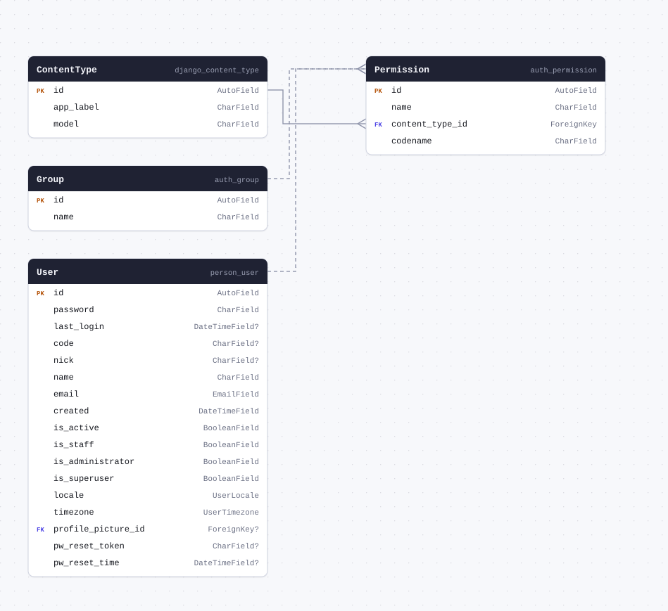

| Column | Field | Type | Null | Key | Default | Description |
| --- | --- | --- | --- | --- | --- | --- |
| `id` | `AutoField` | `integer` |  | PK | `autoincrement()` |  |
| `name` | `CharField` | `varchar(255)` |  |  |  |  |
| `content_type_id` | `ForeignKey` | `integer` |  | FK |  |  |
| `codename` | `CharField` | `varchar(100)` |  |  |  |  |

Indexes:

- index `auth_permission_content_type_id_2f476e4b` on `content_type_id`
- unique `auth_permission_content_type_id_codename_01ab375a_uniq` on `content_type_id`, `codename`

Relations:

- `content_type_id` → [ContentType](#contenttype).`id`, on delete cascade
- `group_set` — many to many with [Group](#group)
- `user_set` — many to many with [User](#user)

## Group

Table `auth_group`, app `auth`.

Groups are a generic way of categorizing users to apply permissions, or
some other label, to those users. A user can belong to any number of
groups.

A user in a group automatically has all the permissions granted to that
group. For example, if the group 'Site editors' has the permission
can_edit_home_page, any user in that group will have that permission.

Beyond permissions, groups are a convenient way to categorize users to
apply some label, or extended functionality, to them. For example, you
could create a group 'Special users', and you could write code that would
do special things to those users -- such as giving them access to a
members-only portion of your site, or sending them members-only email
messages.

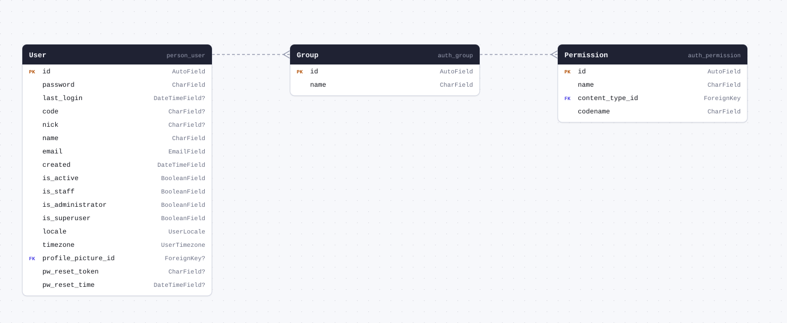

| Column | Field | Type | Null | Key | Default | Description |
| --- | --- | --- | --- | --- | --- | --- |
| `id` | `AutoField` | `integer` |  | PK | `autoincrement()` |  |
| `name` | `CharField` | `varchar(150)` |  | unique |  |  |

Relations:

- `permissions` — many to many with [Permission](#permission)
- `user_set` — many to many with [User](#user)

## ContentType

Table `django_content_type`, app `contenttypes`.

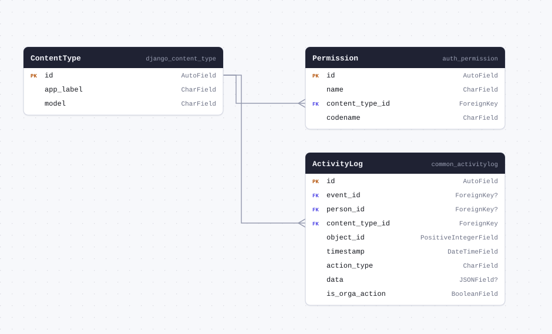

| Column | Field | Type | Null | Key | Default | Description |
| --- | --- | --- | --- | --- | --- | --- |
| `id` | `AutoField` | `integer` |  | PK | `autoincrement()` |  |
| `app_label` | `CharField` | `varchar(100)` |  |  |  |  |
| `model` | `CharField` | `varchar(100)` |  |  |  |  |

Indexes:

- unique `django_content_type_app_label_model_76bd3d3b_uniq` on `app_label`, `model`

Relations:

- [Permission](#permission).`content_type_id` → `id`, on delete cascade
- [ActivityLog](#activitylog).`content_type_id` → `id`, on delete cascade

## Session

Table `django_session`, app `sessions`.

Columns from `AbstractBaseSession` (abstract): `session_key`, `session_data`, `expire_date`.

Django provides full support for anonymous sessions. The session
framework lets you store and retrieve arbitrary data on a
per-site-visitor basis. It stores data on the server side and
abstracts the sending and receiving of cookies. Cookies contain a
session ID -- not the data itself.

The Django sessions framework is entirely cookie-based. It does
not fall back to putting session IDs in URLs. This is an intentional
design decision. Not only does that behavior make URLs ugly, it makes
your site vulnerable to session-ID theft via the "Referer" header.

For complete documentation on using Sessions in your code, consult
the sessions documentation that is shipped with Django (also available
on the Django web site).

| Column | Field | Type | Null | Key | Default | Description |
| --- | --- | --- | --- | --- | --- | --- |
| `session_key` | `CharField` | `varchar(40)` |  | PK |  |  |
| `session_data` | `TextField` | `text` |  |  |  |  |
| `expire_date` | `DateTimeField` | `datetime` |  |  |  |  |

Indexes:

- index `django_session_expire_date_a5c62663` on `expire_date`

## Token

Table `authtoken_token`, app `authtoken`.

Proxy models, on this table: `TokenProxy`.

The default authorization token model.

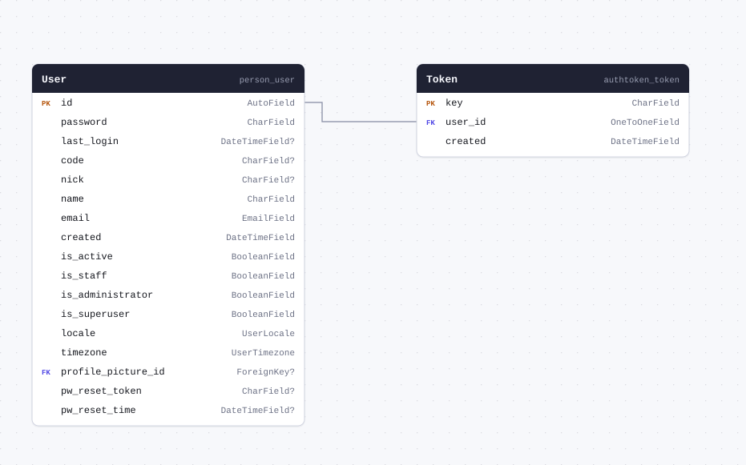

| Column | Field | Type | Null | Key | Default | Description |
| --- | --- | --- | --- | --- | --- | --- |
| `key` | `CharField` | `varchar(40)` |  | PK |  |  |
| `user_id` | `OneToOneField` | `integer` |  | FK, unique |  |  |
| `created` | `DateTimeField` | `datetime` |  |  | `now()` |  |

Relations:

- `user_id` → [User](#user).`id`, on delete cascade

## ActivityLog

Table `common_activitylog`, app `common`.

This model logs actions within an event.

It is **not** designed to provide a complete or reliable audit
trail.

:param is_orga_action: True, if the logged action was performed by a privileged user.

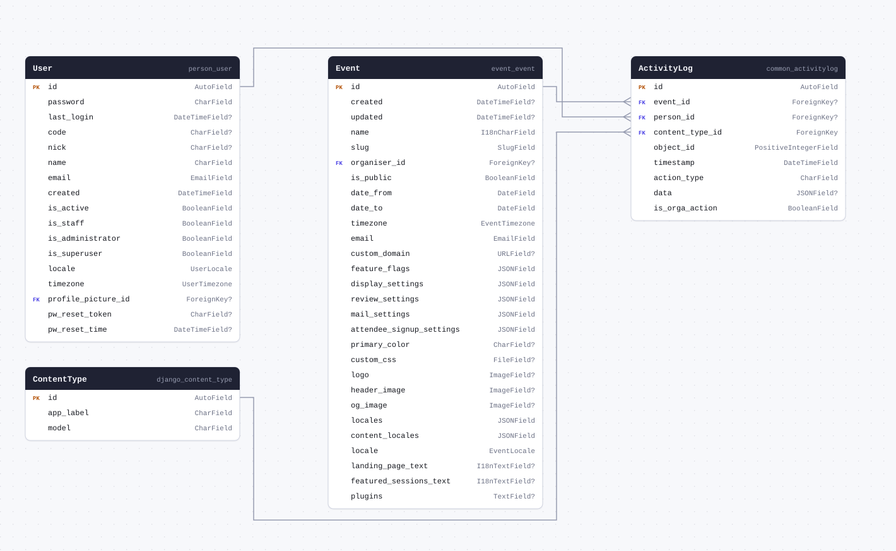

| Column | Field | Type | Null | Key | Default | Description |
| --- | --- | --- | --- | --- | --- | --- |
| `id` | `AutoField` | `integer` |  | PK | `autoincrement()` |  |
| `event_id` | `ForeignKey` | `integer` | yes | FK |  |  |
| `person_id` | `ForeignKey` | `integer` | yes | FK |  |  |
| `content_type_id` | `ForeignKey` | `integer` |  | FK |  |  |
| `object_id` | `PositiveIntegerField` | `integer unsigned` |  |  |  |  |
| `timestamp` | `DateTimeField` | `datetime` |  |  | `now()` |  |
| `action_type` | `CharField` | `varchar(200)` |  |  |  |  |
| `data` | `JSONField` | `text` | yes |  | `dict()` |  |
| `is_orga_action` | `BooleanField` | `bool` |  |  | `False` |  |

Indexes:

- index `common_activitylog_event_id_5e6aed3b` on `event_id`
- index `common_activitylog_person_id_a022fe39` on `person_id`
- index `common_activitylog_content_type_id_76ada9b1` on `content_type_id`
- index `common_activitylog_object_id_56e237b3` on `object_id`
- index `common_activitylog_timestamp_5328df2f` on `timestamp`

Relations:

- `content_object` → any model, by `content_type_id` + `object_id` (generic foreign key)
- `event_id` → [Event](#event).`id`, on delete protect
- `person_id` → [User](#user).`id`, on delete protect
- `content_type_id` → [ContentType](#contenttype).`id`, on delete cascade

## CachedFile

Table `common_cachedfile`, app `common`.

An uploaded file, primarily used for API uploads. Deleted after expiry.

| Column | Field | Type | Null | Key | Default | Description |
| --- | --- | --- | --- | --- | --- | --- |
| `id` | `UUIDField` | `char(32)` |  | PK | `uuid4()` |  |
| `expires` | `DateTimeField` | `datetime` |  |  |  |  |
| `timestamp` | `DateTimeField` | `datetime` | yes |  |  |  |
| `filename` | `CharField` | `varchar(255)` |  |  |  |  |
| `content_type` | `CharField` | `varchar(255)` |  |  |  |  |
| `session_key` | `TextField` | `text` | yes |  |  |  |
| `file` | `FileField` | `varchar(255)` | yes |  |  |  |

Indexes:

- index `common_cach_expires_d8715c_idx` on `expires`

## GlobalSettings_SettingsStore

Table `common_globalsettings_settingsstore`, app `common`.

Columns from `BaseHierarkeyStoreModel` (abstract): `key`, `value`.

| Column | Field | Type | Null | Key | Default | Description |
| --- | --- | --- | --- | --- | --- | --- |
| `id` | `AutoField` | `integer` |  | PK | `autoincrement()` |  |
| `key` | `CharField` | `varchar(255)` |  |  |  |  |
| `value` | `TextField` | `text` |  |  |  |  |

Indexes:

- unique `common_globalsettings_settingsstore_key_7e817c31_uniq` on `key`

## Event

Table `event_event`, app `event`.

Columns from `TimestampedModel` (abstract): `created`, `updated`.

The Event class has direct or indirect relations to all other models.

Since most models depend on the Event model in some way, they should
preferably be accessed via the reverse relation on the event model to
prevent data leaks.

:param is_public: Is this event public yet? Should only be set via the
    ``pretalx.orga.views.EventLive`` view or in another way that processes
    the ``pretalx.orga.signals.activate_event`` signal.
:param locales: Contains the event’s active locales as a list of
    language codes.
:param content_locales: Contains the event’s active locales available
    for proposals as a list of language codes.
:param primary_color: Main event colour. Accepts hex values like
    ``#00ff00``.
:param custom_css: Custom event CSS. Has to pass fairly restrictive
    validation for security considerations.
:param custom_domain: Custom event domain, starting with ``https://``.
:param plugins: A list of active plugins as a comma-separated string.
    Please use the ``plugin_list`` property for interaction.
:param feature_flags: A JSON field containing feature flags for this event.
    Please use the ``get_feature_flag`` method to check for features,
    so that new feature flags can be added without breaking existing events.

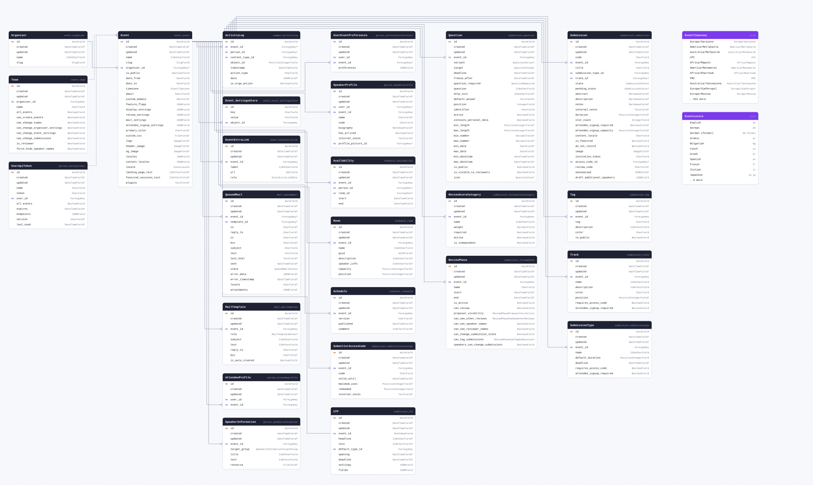

| Column | Field | Type | Null | Key | Default | Description |
| --- | --- | --- | --- | --- | --- | --- |
| `id` | `AutoField` | `integer` |  | PK | `autoincrement()` |  |
| `created` | `DateTimeField` | `datetime` | yes |  | `now()` |  |
| `updated` | `DateTimeField` | `datetime` | yes |  | `now()` |  |
| `name` | `I18nCharField` | `text` |  |  |  |  |
| `slug` | `SlugField` | `varchar(50)` |  | unique |  | The slug may only contain letters, numbers, dots and dashes. |
| `organiser_id` | `ForeignKey` | `integer` | yes | FK |  |  |
| `is_public` | `BooleanField` | `bool` |  |  | `False` |  |
| `date_from` | `DateField` | `date` |  |  |  |  |
| `date_to` | `DateField` | `date` |  |  |  |  |
| `timezone` | `EventTimezone` | `varchar(32)` |  |  | `'UTC'` | All event dates will be localised and interpreted to be in this timezone. |
| `email` | `EmailField` | `varchar(254)` |  |  |  | Will be used as Reply-To in emails. |
| `custom_domain` | `URLField` | `varchar(200)` | yes |  |  | Enter a custom domain, such as https://my.event.example.org |
| `feature_flags` | `JSONField` | `text` |  |  | `default_feature_flags()` |  |
| `display_settings` | `JSONField` | `text` |  |  | `default_display_settings()` |  |
| `review_settings` | `JSONField` | `text` |  |  | `default_review_settings()` |  |
| `mail_settings` | `JSONField` | `text` |  |  | `default_mail_settings()` |  |
| `attendee_signup_settings` | `JSONField` | `text` |  |  | `default_attendee_signup_settings()` |  |
| `primary_color` | `CharField` | `varchar(7)` | yes |  |  | Provide a hex value like #00ff00 if you want to style pretalx in your event’s colour scheme. |
| `custom_css` | `FileField` | `varchar(100)` | yes |  |  | Upload a custom CSS file if changing the primary colour is not sufficient for you. |
| `logo` | `ImageField` | `varchar(100)` | yes |  |  | If you provide a logo image, your event’s name will not be shown in the event header. The logo will be scaled down to a height of 140px. |
| `header_image` | `ImageField` | `varchar(100)` | yes |  |  | If you provide a header image, it will be displayed instead of your event’s color and/or header pattern at the top of all event pages. It will be center-aligned, so when the window shrinks, the center parts will continue to be displayed, and not stretched. |
| `og_image` | `ImageField` | `varchar(100)` | yes |  |  | This image will be shown as a preview when links to your event are shared on social media or messaging apps. For best results, use an image at least 1200x630 pixels. If not set, the logo or header image will be used instead. |
| `locales` | `JSONField` | `text` |  |  | `default_locales()` |  |
| `content_locales` | `JSONField` | `text` |  |  | `default_locales()` |  |
| `locale` | `EventLocale` | `varchar(32)` |  |  | `'en'` |  |
| `landing_page_text` | `I18nTextField` | `text` | yes |  |  | This text will be shown on the landing page, alongside with links to the CfP and schedule, if appropriate. You can use <a href="https://docs.pretalx.org/user/markdown/" target="_blank" rel="noopener">Markdown</a> here. |
| `featured_sessions_text` | `I18nTextField` | `text` | yes |  |  | This text will be shown at the top of the featured sessions page instead of the default text. You can use <a href="https://docs.pretalx.org/user/markdown/" target="_blank" rel="noopener">Markdown</a> here. |
| `plugins` | `TextField` | `text` | yes |  |  |  |

Indexes:

- index `event_event_organiser_id_5182de02` on `organiser_id`
- unique `event_slug_lower_unique` on `LOWER("slug")`

Relations:

- [ActivityLog](#activitylog).`event_id` → `id`, on delete protect
- `organiser_id` → [Organiser](#organiser).`id`, on delete protect
- [Event_SettingsStore](#event_settingsstore).`object_id` → `id`, on delete cascade
- [EventExtraLink](#eventextralink).`event_id` → `id`, on delete cascade
- `team_set` — many to many with [Team](#team)
- [QueuedMail](#queuedmail).`event_id` → `id`, on delete protect
- [MailTemplate](#mailtemplate).`event_id` → `id`, on delete protect
- [AttendeeProfile](#attendeeprofile).`event_id` → `id`, on delete cascade
- `_person_userapitoken_limit_events_+` — many to many with [UserApiToken](#userapitoken)
- [SpeakerInformation](#speakerinformation).`event_id` → `id`, on delete cascade
- [UserEventPreferences](#usereventpreferences).`event_id` → `id`, on delete cascade
- [SpeakerProfile](#speakerprofile).`event_id` → `id`, on delete cascade
- [Availability](#availability).`event_id` → `id`, on delete cascade
- [Room](#room).`event_id` → `id`, on delete protect
- [Schedule](#schedule).`event_id` → `id`, on delete protect
- [SubmitterAccessCode](#submitteraccesscode).`event_id` → `id`, on delete cascade
- [CfP](#cfp).`event_id` → `id`, on delete protect
- [Question](#question).`event_id` → `id`, on delete protect
- [ReviewScoreCategory](#reviewscorecategory).`event_id` → `id`, on delete cascade
- [ReviewPhase](#reviewphase).`event_id` → `id`, on delete cascade
- [Submission](#submission).`event_id` → `id`, on delete protect
- [Tag](#tag).`event_id` → `id`, on delete protect
- [Track](#track).`event_id` → `id`, on delete protect
- [SubmissionType](#submissiontype).`event_id` → `id`, on delete cascade

## Event_SettingsStore

Table `event_event_settingsstore`, app `event`.

Columns from `BaseHierarkeyStoreModel` (abstract): `key`, `value`.

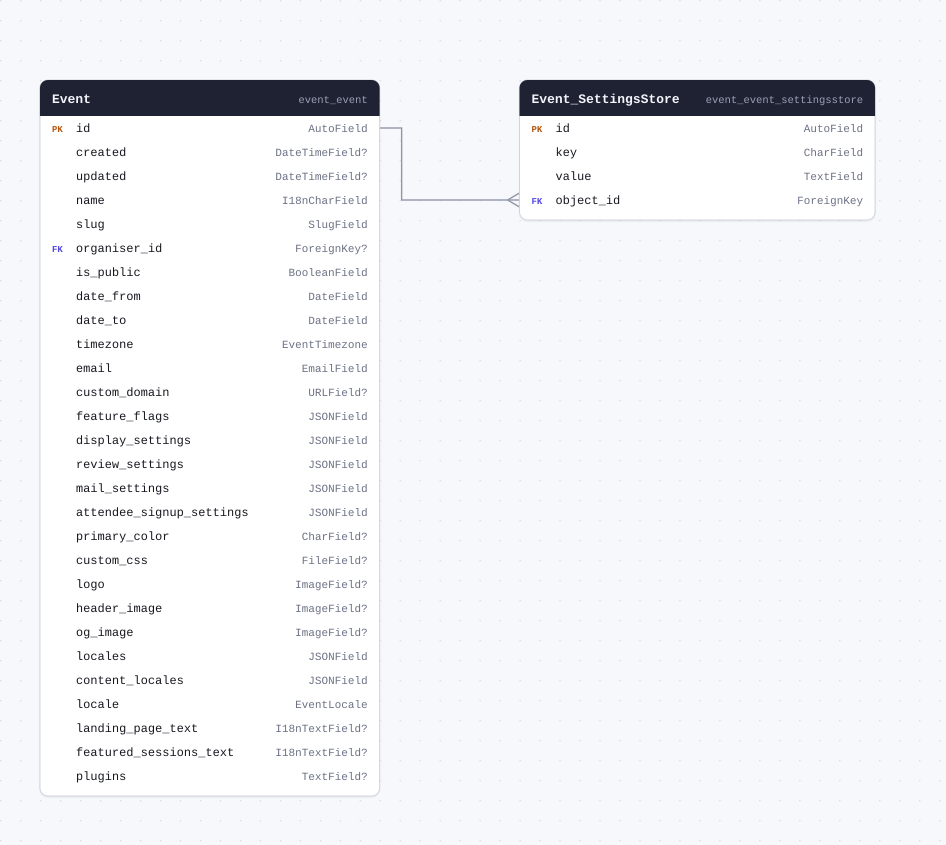

| Column | Field | Type | Null | Key | Default | Description |
| --- | --- | --- | --- | --- | --- | --- |
| `id` | `AutoField` | `integer` |  | PK | `autoincrement()` |  |
| `key` | `CharField` | `varchar(255)` |  |  |  |  |
| `value` | `TextField` | `text` |  |  |  |  |
| `object_id` | `ForeignKey` | `integer` |  | FK |  |  |

Indexes:

- index `event_event_settingsstore_object_id_6fa9ca62` on `object_id`
- unique `event_event_settingsstore_object_id_key_d1474c74_uniq` on `object_id`, `key`

Relations:

- `object_id` → [Event](#event).`id`, on delete cascade

## EventExtraLink

Table `event_eventextralink`, app `event`.

Columns from `TimestampedModel` (abstract): `created`, `updated`.

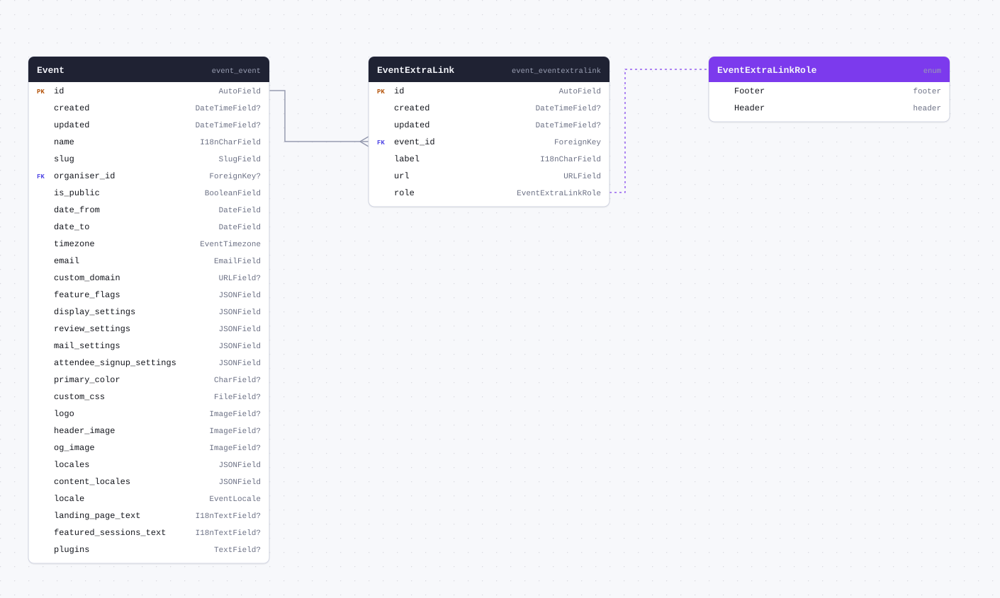

| Column | Field | Type | Null | Key | Default | Description |
| --- | --- | --- | --- | --- | --- | --- |
| `id` | `AutoField` | `integer` |  | PK | `autoincrement()` |  |
| `created` | `DateTimeField` | `datetime` | yes |  | `now()` |  |
| `updated` | `DateTimeField` | `datetime` | yes |  | `now()` |  |
| `event_id` | `ForeignKey` | `integer` |  | FK |  |  |
| `label` | `I18nCharField` | `text` |  |  |  |  |
| `url` | `URLField` | `varchar(200)` |  |  |  |  |
| `role` | `EventExtraLinkRole` | `varchar(6)` |  |  | `'footer'` |  |

Indexes:

- index `event_eventextralink_event_id_2edaba59` on `event_id`

Relations:

- `event_id` → [Event](#event).`id`, on delete cascade

## Organiser

Table `event_organiser`, app `event`.

Columns from `TimestampedModel` (abstract): `created`, `updated`.

The Organiser model represents the entity responsible for at least one.

:class:`~pretalx.event.models.event.Event`.

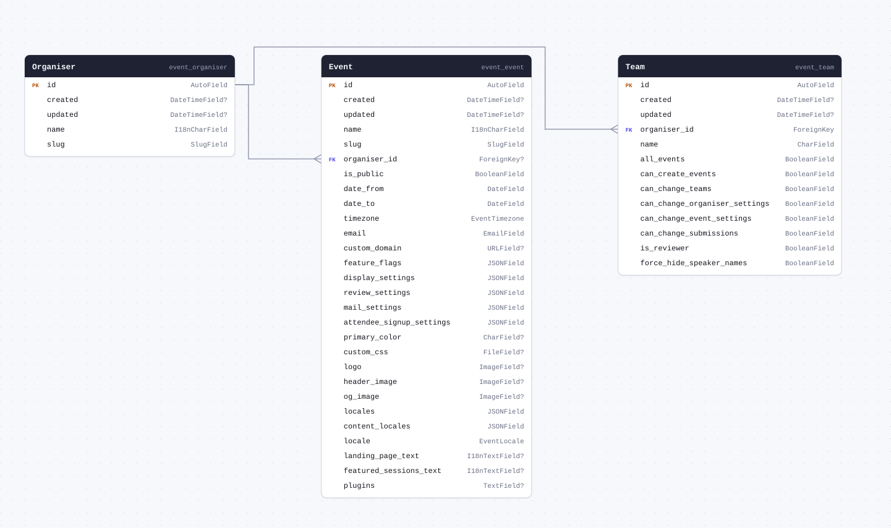

| Column | Field | Type | Null | Key | Default | Description |
| --- | --- | --- | --- | --- | --- | --- |
| `id` | `AutoField` | `integer` |  | PK | `autoincrement()` |  |
| `created` | `DateTimeField` | `datetime` | yes |  | `now()` |  |
| `updated` | `DateTimeField` | `datetime` | yes |  | `now()` |  |
| `name` | `I18nCharField` | `text` |  |  |  |  |
| `slug` | `SlugField` | `varchar(50)` |  | unique |  | Should be short, only contain lowercase letters and numbers, and must be unique, as it is used in URLs. |

Relations:

- [Event](#event).`organiser_id` → `id`, on delete protect
- [Team](#team).`organiser_id` → `id`, on delete cascade

## Team

Table `event_team`, app `event`.

Columns from `TimestampedModel` (abstract): `created`, `updated`.

A team is a group of people working for the same organiser.

Team members (of type :class:`~pretalx.person.models.user.User`) share
permissions for one or several events of
:class:`~pretalx.event.models.organiser.Organiser`.  People can be in
multiple Teams, and will have all permissions *any* of their teams has.

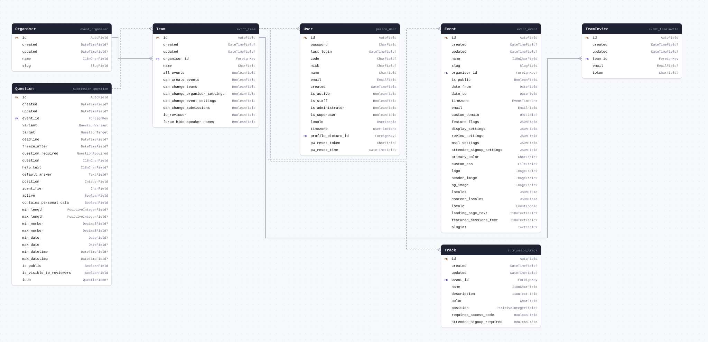

| Column | Field | Type | Null | Key | Default | Description |
| --- | --- | --- | --- | --- | --- | --- |
| `id` | `AutoField` | `integer` |  | PK | `autoincrement()` |  |
| `created` | `DateTimeField` | `datetime` | yes |  | `now()` |  |
| `updated` | `DateTimeField` | `datetime` | yes |  | `now()` |  |
| `organiser_id` | `ForeignKey` | `integer` |  | FK |  |  |
| `name` | `CharField` | `varchar(190)` |  |  |  |  |
| `all_events` | `BooleanField` | `bool` |  |  | `False` |  |
| `can_create_events` | `BooleanField` | `bool` |  |  | `False` |  |
| `can_change_teams` | `BooleanField` | `bool` |  |  | `False` |  |
| `can_change_organiser_settings` | `BooleanField` | `bool` |  |  | `False` |  |
| `can_change_event_settings` | `BooleanField` | `bool` |  |  | `False` |  |
| `can_change_submissions` | `BooleanField` | `bool` |  |  | `False` |  |
| `is_reviewer` | `BooleanField` | `bool` |  |  | `False` |  |
| `force_hide_speaker_names` | `BooleanField` | `bool` |  |  | `False` | Normally, anonymisation is configured in the event review settings. This setting will <strong>override the event settings</strong> and always hide speaker names for this team. |

Indexes:

- index `event_team_organiser_id_feade463` on `organiser_id`

Relations:

- `organiser_id` → [Organiser](#organiser).`id`, on delete cascade
- `members` — many to many with [User](#user)
- `limit_events` — many to many with [Event](#event)
- `limit_tracks` — many to many with [Track](#track)
- [TeamInvite](#teaminvite).`team_id` → `id`, on delete cascade
- `_submission_question_limit_teams_+` — many to many with [Question](#question)

## TeamInvite

Table `event_teaminvite`, app `event`.

Columns from `TimestampedModel` (abstract): `created`, `updated`.

A TeamInvite is someone who has been invited to a team but hasn't accept
the invitation yet.

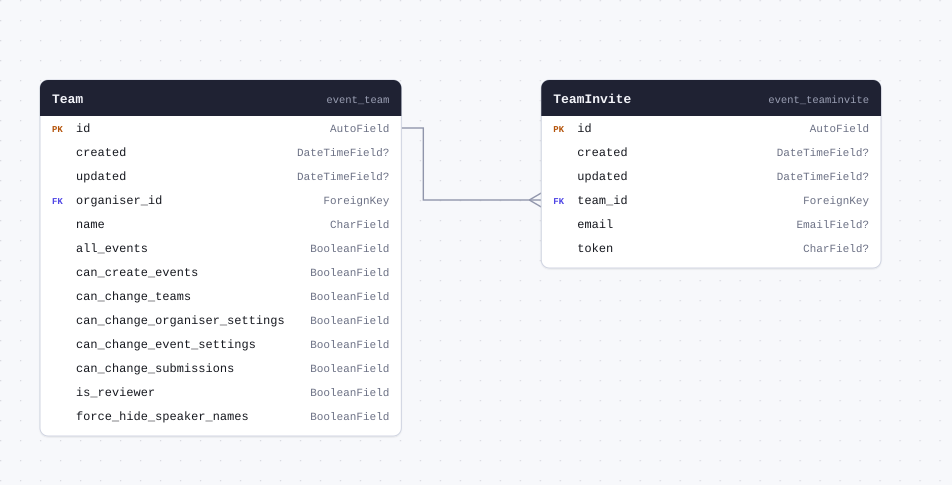

| Column | Field | Type | Null | Key | Default | Description |
| --- | --- | --- | --- | --- | --- | --- |
| `id` | `AutoField` | `integer` |  | PK | `autoincrement()` |  |
| `created` | `DateTimeField` | `datetime` | yes |  | `now()` |  |
| `updated` | `DateTimeField` | `datetime` | yes |  | `now()` |  |
| `team_id` | `ForeignKey` | `integer` |  | FK |  |  |
| `email` | `EmailField` | `varchar(254)` | yes |  |  |  |
| `token` | `CharField` | `varchar(64)` | yes | unique | `generate_invite_token()` |  |

Indexes:

- index `event_teaminvite_team_id_94fe7de4` on `team_id`

Relations:

- `team_id` → [Team](#team).`id`, on delete cascade

## QueuedMail

Table `mail_queuedmail`, app `mail`.

Columns from `TimestampedModel` (abstract): `created`, `updated`.

Emails in pretalx are rarely sent directly, hence the name QueuedMail.

This mechanism allows organisers to make sure they send out the right
content, and to include personal changes in emails.

:param sent: ``None`` if the mail has not been sent yet.
:param to_users: All known users to whom this email is addressed.
:param to: A comma-separated list of email addresses to whom this email
    is addressed. Does not contain any email addresses known to belong
    to users.

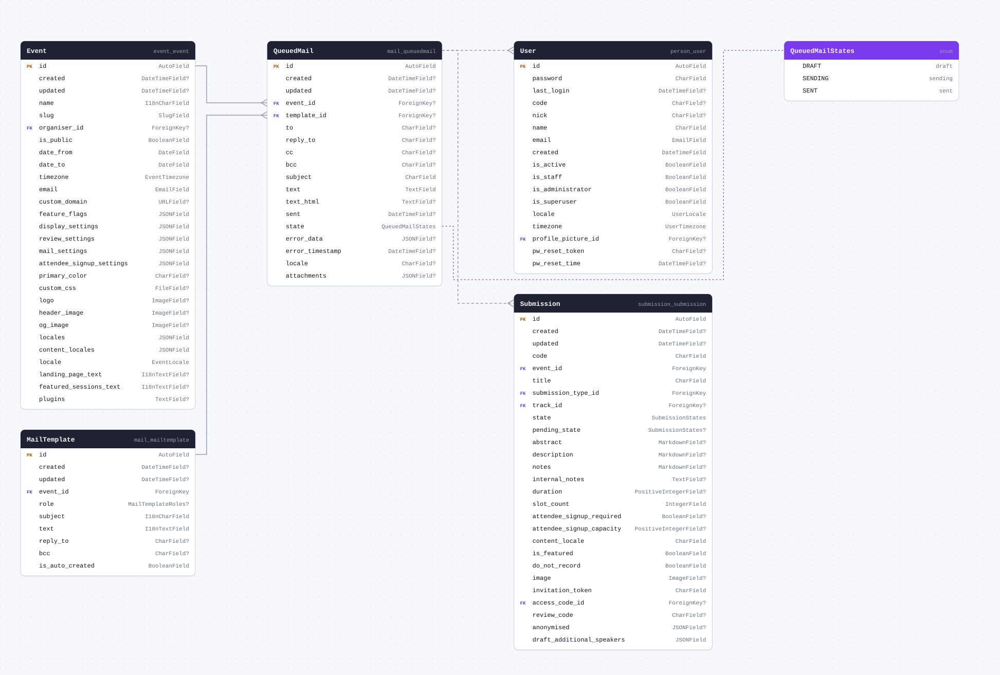

| Column | Field | Type | Null | Key | Default | Description |
| --- | --- | --- | --- | --- | --- | --- |
| `id` | `AutoField` | `integer` |  | PK | `autoincrement()` |  |
| `created` | `DateTimeField` | `datetime` | yes |  | `now()` |  |
| `updated` | `DateTimeField` | `datetime` | yes |  | `now()` |  |
| `event_id` | `ForeignKey` | `integer` | yes | FK |  |  |
| `template_id` | `ForeignKey` | `integer` | yes | FK |  |  |
| `to` | `CharField` | `varchar(1000)` | yes |  |  | One email address or several addresses separated by commas. |
| `reply_to` | `CharField` | `varchar(1000)` | yes |  |  | By default, the organiser address is used as Reply-To. |
| `cc` | `CharField` | `varchar(1000)` | yes |  |  | One email address or several addresses separated by commas. |
| `bcc` | `CharField` | `varchar(1000)` | yes |  |  | One email address or several addresses separated by commas. |
| `subject` | `CharField` | `varchar(200)` |  |  |  |  |
| `text` | `TextField` | `text` |  |  |  |  |
| `text_html` | `TextField` | `text` | yes |  |  |  |
| `sent` | `DateTimeField` | `datetime` | yes |  |  |  |
| `state` | `QueuedMailStates` | `varchar(10)` |  |  | `'draft'` |  |
| `error_data` | `JSONField` | `text` | yes |  | `None` |  |
| `error_timestamp` | `DateTimeField` | `datetime` | yes |  |  |  |
| `locale` | `CharField` | `varchar(32)` | yes |  |  |  |
| `attachments` | `JSONField` | `text` | yes |  | `None` |  |

Indexes:

- index `mail_queuedmail_event_id_ca510901` on `event_id`
- index `mail_queuedmail_template_id_00a74b04` on `template_id`
- index `mail_queuedmail_state_4b73bea9` on `state`

Relations:

- `event_id` → [Event](#event).`id`, on delete protect
- `template_id` → [MailTemplate](#mailtemplate).`id`, on delete set null
- `to_users` — many to many with [User](#user)
- `submissions` — many to many with [Submission](#submission)

## MailTemplate

Table `mail_mailtemplate`, app `mail`.

Columns from `TimestampedModel` (abstract): `created`, `updated`.

MailTemplates can be used to create.

:class:`~pretalx.mail.models.QueuedMail` objects.

The process does not come with variable substitution except for
special cases, for now.

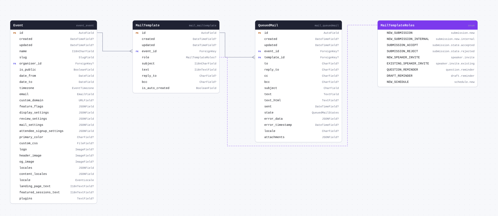

| Column | Field | Type | Null | Key | Default | Description |
| --- | --- | --- | --- | --- | --- | --- |
| `id` | `AutoField` | `integer` |  | PK | `autoincrement()` |  |
| `created` | `DateTimeField` | `datetime` | yes |  | `now()` |  |
| `updated` | `DateTimeField` | `datetime` | yes |  | `now()` |  |
| `event_id` | `ForeignKey` | `integer` |  | FK |  |  |
| `role` | `MailTemplateRoles` | `varchar(30)` | yes |  | `None` |  |
| `subject` | `I18nCharField` | `text` |  |  |  |  |
| `text` | `I18nTextField` | `text` |  |  |  |  |
| `reply_to` | `CharField` | `varchar(200)` | yes |  |  | Change the Reply-To address if you do not want to use the default organiser address |
| `bcc` | `CharField` | `varchar(1000)` | yes |  |  | Enter comma separated addresses. Will receive a blind copy of every email sent from this template. This may be a LOT! |
| `is_auto_created` | `BooleanField` | `bool` |  |  | `False` |  |

Indexes:

- index `mail_mailtemplate_event_id_5a51c3ca` on `event_id`
- unique `mail_mailtemplate_event_id_role_cf04c709_uniq` on `event_id`, `role`

Relations:

- [QueuedMail](#queuedmail).`template_id` → `id`, on delete set null
- `event_id` → [Event](#event).`id`, on delete protect

## AttendeeProfile

Table `person_attendeeprofile`, app `person`.

Columns from `TimestampedModel` (abstract): `created`, `updated`.

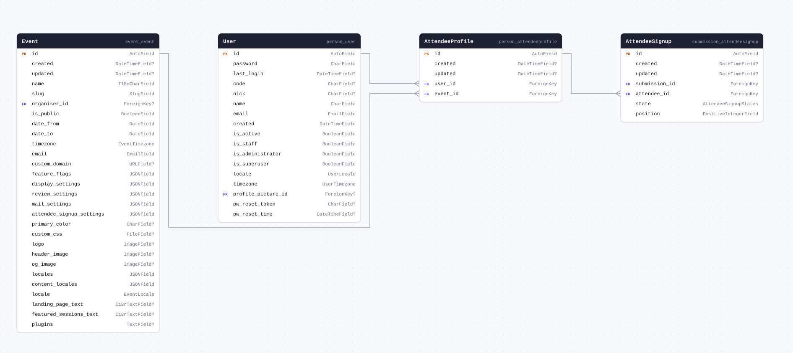

| Column | Field | Type | Null | Key | Default | Description |
| --- | --- | --- | --- | --- | --- | --- |
| `id` | `AutoField` | `integer` |  | PK | `autoincrement()` |  |
| `created` | `DateTimeField` | `datetime` | yes |  | `now()` |  |
| `updated` | `DateTimeField` | `datetime` | yes |  | `now()` |  |
| `user_id` | `ForeignKey` | `integer` |  | FK |  |  |
| `event_id` | `ForeignKey` | `integer` |  | FK |  |  |

Indexes:

- index `person_attendeeprofile_user_id_b29b30cb` on `user_id`
- index `person_attendeeprofile_event_id_d85035fc` on `event_id`
- unique `person_attendeeprofile_event_id_user_id_6fdf454a_uniq` on `event_id`, `user_id`

Relations:

- `user_id` → [User](#user).`id`, on delete cascade
- `event_id` → [Event](#event).`id`, on delete cascade
- [AttendeeSignup](#attendeesignup).`attendee_id` → `id`, on delete cascade

## UserApiToken

Table `person_userapitoken`, app `person`.

Columns from `TimestampedModel` (abstract): `created`, `updated`.

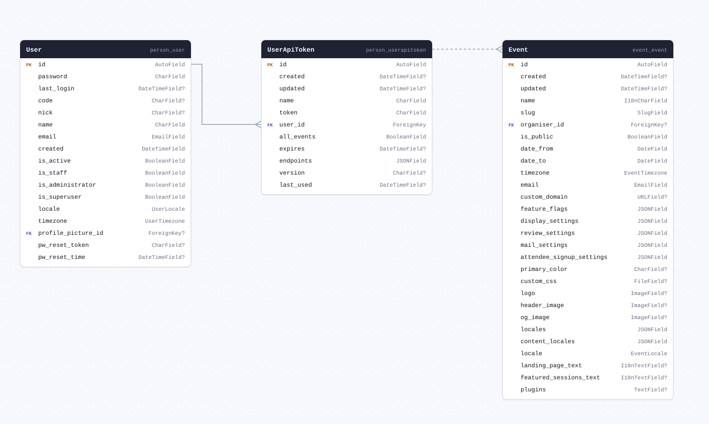

| Column | Field | Type | Null | Key | Default | Description |
| --- | --- | --- | --- | --- | --- | --- |
| `id` | `AutoField` | `integer` |  | PK | `autoincrement()` |  |
| `created` | `DateTimeField` | `datetime` | yes |  | `now()` |  |
| `updated` | `DateTimeField` | `datetime` | yes |  | `now()` |  |
| `name` | `CharField` | `varchar(190)` |  |  |  |  |
| `token` | `CharField` | `varchar(64)` |  | unique | `generate_api_token()` |  |
| `user_id` | `ForeignKey` | `integer` |  | FK |  |  |
| `all_events` | `BooleanField` | `bool` |  |  | `False` |  |
| `expires` | `DateTimeField` | `datetime` | yes |  |  |  |
| `endpoints` | `JSONField` | `text` |  |  | `dict()` |  |
| `version` | `CharField` | `varchar(12)` | yes |  |  |  |
| `last_used` | `DateTimeField` | `datetime` | yes |  |  |  |

Indexes:

- index `person_userapitoken_user_id_aae629ac` on `user_id`

Relations:

- `user_id` → [User](#user).`id`, on delete cascade
- `limit_events` — many to many with [Event](#event)

## SpeakerInformation

Table `person_speakerinformation`, app `person`.

Columns from `TimestampedModel` (abstract): `created`, `updated`.

Represents any information organisers want to show all or some
submitters or speakers.

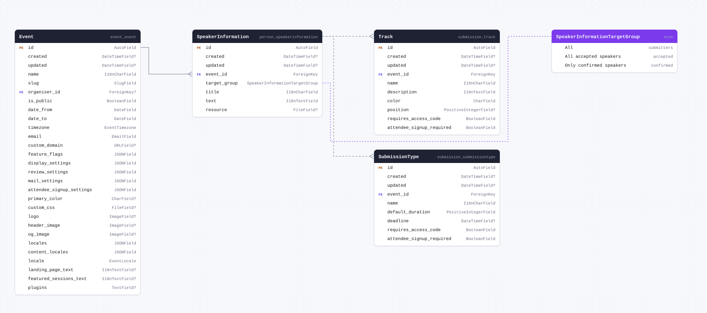

| Column | Field | Type | Null | Key | Default | Description |
| --- | --- | --- | --- | --- | --- | --- |
| `id` | `AutoField` | `integer` |  | PK | `autoincrement()` |  |
| `created` | `DateTimeField` | `datetime` | yes |  | `now()` |  |
| `updated` | `DateTimeField` | `datetime` | yes |  | `now()` |  |
| `event_id` | `ForeignKey` | `integer` |  | FK |  |  |
| `target_group` | `SpeakerInformationTargetGroup` | `varchar(11)` |  |  | `'accepted'` |  |
| `title` | `I18nCharField` | `text` |  |  |  |  |
| `text` | `I18nTextField` | `text` |  |  |  | You can use <a href="https://docs.pretalx.org/user/markdown/" target="_blank" rel="noopener">Markdown</a> here. |
| `resource` | `FileField` | `varchar(100)` | yes |  |  | Please try to keep your upload small, preferably below 16 MB. |

Indexes:

- index `person_speakerinformation_event_id_78cb600b` on `event_id`

Relations:

- `event_id` → [Event](#event).`id`, on delete cascade
- `limit_tracks` — many to many with [Track](#track)
- `limit_types` — many to many with [SubmissionType](#submissiontype)

## ProfilePicture

Table `person_profilepicture`, app `person`.

Columns from `TimestampedModel` (abstract): `created`, `updated`.

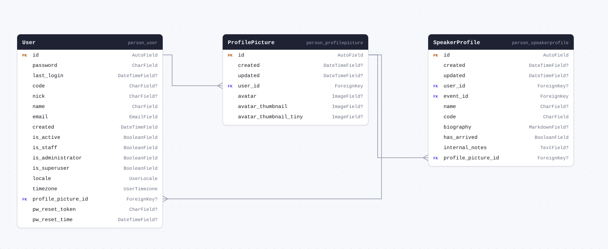

| Column | Field | Type | Null | Key | Default | Description |
| --- | --- | --- | --- | --- | --- | --- |
| `id` | `AutoField` | `integer` |  | PK | `autoincrement()` |  |
| `created` | `DateTimeField` | `datetime` | yes |  | `now()` |  |
| `updated` | `DateTimeField` | `datetime` | yes |  | `now()` |  |
| `user_id` | `ForeignKey` | `integer` |  | FK |  |  |
| `avatar` | `ImageField` | `varchar(100)` | yes |  |  |  |
| `avatar_thumbnail` | `ImageField` | `varchar(100)` | yes |  |  |  |
| `avatar_thumbnail_tiny` | `ImageField` | `varchar(100)` | yes |  |  |  |

Indexes:

- index `person_profilepicture_user_id_e9610460` on `user_id`

Relations:

- `user_id` → [User](#user).`id`, on delete cascade
- [SpeakerProfile](#speakerprofile).`profile_picture_id` → `id`, on delete set null
- [User](#user).`profile_picture_id` → `id`, on delete set null

## UserEventPreferences

Table `person_usereventpreferences`, app `person`.

Columns from `TimestampedModel` (abstract): `created`, `updated`.

Per-user preferences, scoped to an event. ``event=None`` is for
global preferences, e.g. tables outside of an event context.

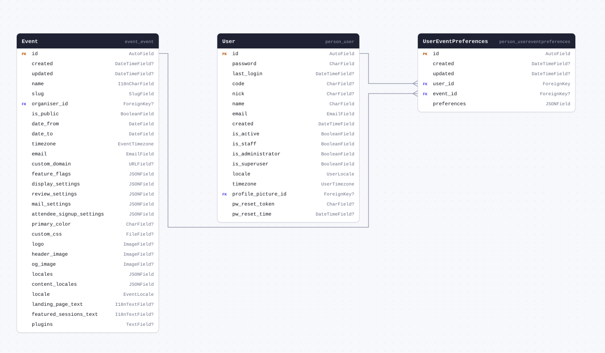

| Column | Field | Type | Null | Key | Default | Description |
| --- | --- | --- | --- | --- | --- | --- |
| `id` | `AutoField` | `integer` |  | PK | `autoincrement()` |  |
| `created` | `DateTimeField` | `datetime` | yes |  | `now()` |  |
| `updated` | `DateTimeField` | `datetime` | yes |  | `now()` |  |
| `user_id` | `ForeignKey` | `integer` |  | FK |  |  |
| `event_id` | `ForeignKey` | `integer` | yes | FK |  |  |
| `preferences` | `JSONField` | `text` |  |  | `dict()` |  |

Indexes:

- index `person_usereventpreferences_user_id_260c67ae` on `user_id`
- index `person_usereventpreferences_event_id_4a58b755` on `event_id`
- unique `unique_user_event_preferences` on `user_id`, `event_id`
- unique `unique_user_global_preferences` on `user_id` where `"event_id" IS NULL`

Relations:

- `user_id` → [User](#user).`id`, on delete cascade
- `event_id` → [Event](#event).`id`, on delete cascade

## SpeakerProfile

Table `person_speakerprofile`, app `person`.

Columns from `TimestampedModel` (abstract): `created`, `updated`.

All :class:`~pretalx.event.models.event.Event` related data concerning
a.

:class:`~pretalx.person.models.user.User` is stored here.

:param has_arrived: Can be set to track speaker arrival. Will be used in
    warnings about missing speakers.

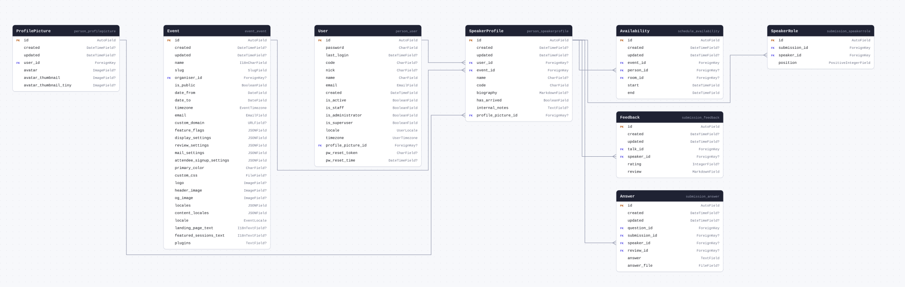

| Column | Field | Type | Null | Key | Default | Description |
| --- | --- | --- | --- | --- | --- | --- |
| `id` | `AutoField` | `integer` |  | PK | `autoincrement()` |  |
| `created` | `DateTimeField` | `datetime` | yes |  | `now()` |  |
| `updated` | `DateTimeField` | `datetime` | yes |  | `now()` |  |
| `user_id` | `ForeignKey` | `integer` | yes | FK |  |  |
| `event_id` | `ForeignKey` | `integer` |  | FK |  |  |
| `name` | `CharField` | `varchar(120)` | yes |  |  |  |
| `code` | `CharField` | `varchar(16)` |  |  |  |  |
| `biography` | `MarkdownField` | `text` | yes |  |  |  |
| `has_arrived` | `BooleanField` | `bool` |  |  | `False` |  |
| `internal_notes` | `TextField` | `text` | yes |  |  | Internal notes for other organisers/reviewers. Not visible to the speakers or the public. |
| `profile_picture_id` | `ForeignKey` | `integer` | yes | FK |  |  |

Indexes:

- index `person_speakerprofile_user_id_09b02b91` on `user_id`
- index `person_speakerprofile_event_id_b906742f` on `event_id`
- index `person_speakerprofile_profile_picture_id_c787d307` on `profile_picture_id`
- unique `person_speakerprofile_event_id_code_6694fe39_uniq` on `event_id`, `code`
- unique `person_speakerprofile_event_id_user_id_3d8da868_uniq` on `event_id`, `user_id`

Relations:

- `submissions` — many to many with [Submission](#submission), through [SpeakerRole](#speakerrole)
- `user_id` → [User](#user).`id`, on delete cascade
- `event_id` → [Event](#event).`id`, on delete cascade
- `profile_picture_id` → [ProfilePicture](#profilepicture).`id`, on delete set null
- [Availability](#availability).`person_id` → `id`, on delete cascade
- [Feedback](#feedback).`speaker_id` → `id`, on delete protect
- [Answer](#answer).`speaker_id` → `id`, on delete protect
- [SpeakerRole](#speakerrole).`speaker_id` → `id`, on delete cascade

## User

Table `person_user`, app `person`.

Columns from `PermissionsMixin` (abstract): `is_superuser`.

Columns from `AbstractBaseUser` (abstract): `password`, `last_login`.

The pretalx user model.

Users describe all kinds of persons who interact with pretalx: Organisers, reviewers, submitters, speakers.

:param code: A user's alphanumeric code is auto generated, may not be
    changed, and is the unique identifier of that user.
:param name: A name fit for public display. Will be used in the user
    interface and for public display for all speakers in all of their
    events.
:param password: The password is stored using Django's PasswordField. Use
    the ``set_password`` and ``check_password`` methods to interact with it.
:param nick: The nickname field has been deprecated and is scheduled to be
    deleted. Use the email field instead.
:param groups: Django internals, not used in pretalx.
:param user_permissions: Django internals, not used in pretalx.

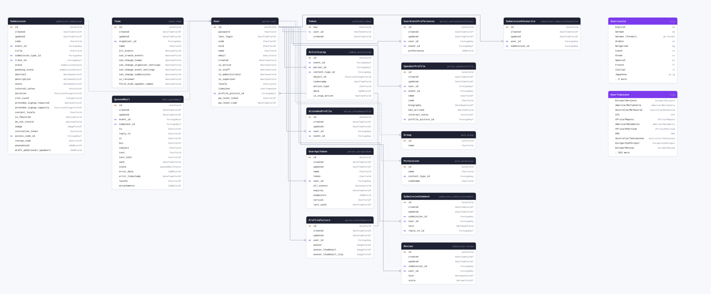

| Column | Field | Type | Null | Key | Default | Description |
| --- | --- | --- | --- | --- | --- | --- |
| `id` | `AutoField` | `integer` |  | PK | `autoincrement()` |  |
| `password` | `CharField` | `varchar(128)` |  |  |  |  |
| `last_login` | `DateTimeField` | `datetime` | yes |  |  |  |
| `code` | `CharField` | `varchar(16)` | yes | unique |  |  |
| `nick` | `CharField` | `varchar(60)` | yes |  |  |  |
| `name` | `CharField` | `varchar(120)` |  |  |  | Please enter the name you wish to be displayed publicly. This name will be used for all events you are participating in on this server. |
| `email` | `EmailField` | `varchar(254)` |  | unique |  | Your email address will be used for password resets and notification about your event/proposals. |
| `created` | `DateTimeField` | `datetime` |  |  | `now()` |  |
| `is_active` | `BooleanField` | `bool` |  |  | `True` | Inactive users are not allowed to log in. |
| `is_staff` | `BooleanField` | `bool` |  |  | `False` | A default Django flag. Not in use in pretalx. |
| `is_administrator` | `BooleanField` | `bool` |  |  | `False` | Should only be ``True`` for people with administrative access to the server pretalx runs on. |
| `is_superuser` | `BooleanField` | `bool` |  |  | `False` | Never set this flag to ``True``, since it short-circuits all authorisation mechanisms. |
| `locale` | `UserLocale` | `varchar(32)` |  |  | `'en'` |  |
| `timezone` | `UserTimezone` | `varchar(32)` |  |  | `'UTC'` |  |
| `profile_picture_id` | `ForeignKey` | `integer` | yes | FK |  |  |
| `pw_reset_token` | `CharField` | `varchar(160)` | yes |  |  |  |
| `pw_reset_time` | `DateTimeField` | `datetime` | yes |  |  |  |

Indexes:

- index `person_user_profile_picture_id_c87ac1ce` on `profile_picture_id`
- unique `person_user_email_unique_ci` on `LOWER("email")`

Relations:

- [Token](#token).`user_id` → `id`, on delete cascade
- [ActivityLog](#activitylog).`person_id` → `id`, on delete protect
- `teams` — many to many with [Team](#team)
- `mails` — many to many with [QueuedMail](#queuedmail)
- [AttendeeProfile](#attendeeprofile).`user_id` → `id`, on delete cascade
- [UserApiToken](#userapitoken).`user_id` → `id`, on delete cascade
- [ProfilePicture](#profilepicture).`user_id` → `id`, on delete cascade
- [UserEventPreferences](#usereventpreferences).`user_id` → `id`, on delete cascade
- [SpeakerProfile](#speakerprofile).`user_id` → `id`, on delete cascade
- `profile_picture_id` → [ProfilePicture](#profilepicture).`id`, on delete set null
- `groups` — many to many with [Group](#group)
- `user_permissions` — many to many with [Permission](#permission)
- [SubmissionComment](#submissioncomment).`user_id` → `id`, on delete cascade
- [Review](#review).`user_id` → `id`, on delete cascade
- `assigned_reviews` — many to many with [Submission](#submission)
- [SubmissionFavourite](#submissionfavourite).`user_id` → `id`, on delete cascade

## Availability

Table `schedule_availability`, app `schedule`.

Columns from `TimestampedModel` (abstract): `created`, `updated`.

The Availability class models when people or rooms are available for.

:class:`~pretalx.schedule.models.slot.TalkSlot` objects.

The power of this class is not within its rather simple data model,
but with the operations available on it. An availability object can
span multiple days, but due to our choice of input widget, it will
usually only span a single day at most.

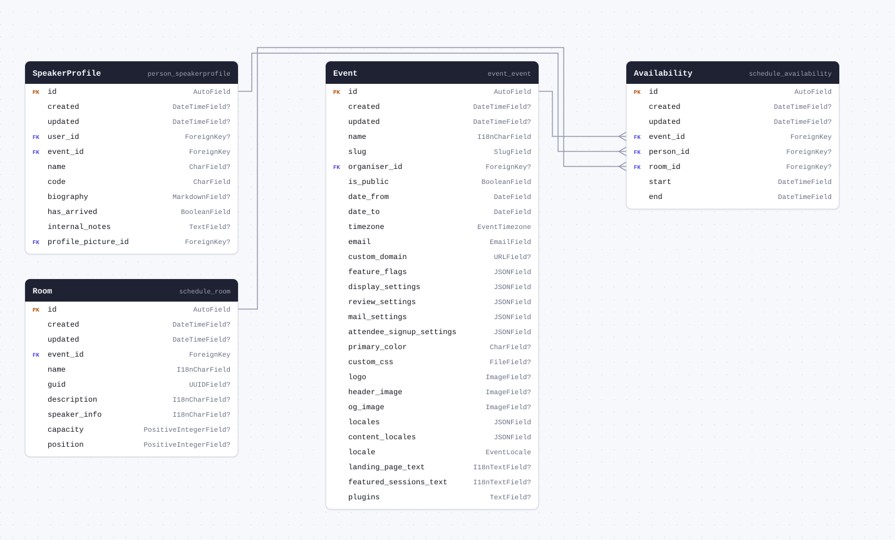

| Column | Field | Type | Null | Key | Default | Description |
| --- | --- | --- | --- | --- | --- | --- |
| `id` | `AutoField` | `integer` |  | PK | `autoincrement()` |  |
| `created` | `DateTimeField` | `datetime` | yes |  | `now()` |  |
| `updated` | `DateTimeField` | `datetime` | yes |  | `now()` |  |
| `event_id` | `ForeignKey` | `integer` |  | FK |  |  |
| `person_id` | `ForeignKey` | `integer` | yes | FK |  |  |
| `room_id` | `ForeignKey` | `integer` | yes | FK |  |  |
| `start` | `DateTimeField` | `datetime` |  |  |  |  |
| `end` | `DateTimeField` | `datetime` |  |  |  |  |

Indexes:

- index `schedule_availability_event_id_174e5a0a` on `event_id`
- index `schedule_availability_person_id_e5b2d8e3` on `person_id`
- index `schedule_availability_room_id_4a6ef8be` on `room_id`

Relations:

- `event_id` → [Event](#event).`id`, on delete cascade
- `person_id` → [SpeakerProfile](#speakerprofile).`id`, on delete cascade
- `room_id` → [Room](#room).`id`, on delete cascade

## Room

Table `schedule_room`, app `schedule`.

Columns from `TimestampedModel` (abstract): `created`, `updated`.

A Room is an actual place where talks will be scheduled.

The Room object stores some meta information. Most, like capacity,
are not in use right now.

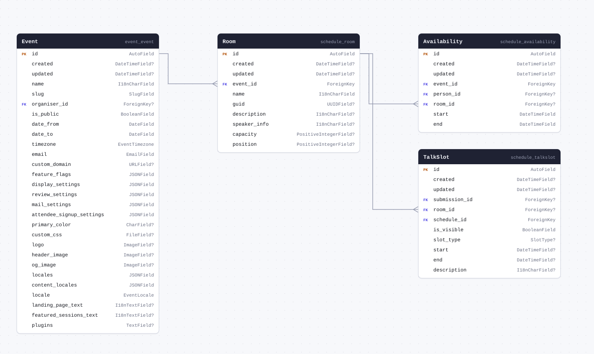

| Column | Field | Type | Null | Key | Default | Description |
| --- | --- | --- | --- | --- | --- | --- |
| `id` | `AutoField` | `integer` |  | PK | `autoincrement()` |  |
| `created` | `DateTimeField` | `datetime` | yes |  | `now()` |  |
| `updated` | `DateTimeField` | `datetime` | yes |  | `now()` |  |
| `event_id` | `ForeignKey` | `integer` |  | FK |  |  |
| `name` | `I18nCharField` | `text` |  |  |  |  |
| `guid` | `UUIDField` | `char(32)` | yes |  |  | Unique identifier (UUID) to help external tools identify the room. |
| `description` | `I18nCharField` | `text` | yes |  |  | A description for attendees, for example directions. |
| `speaker_info` | `I18nCharField` | `text` | yes |  |  | Information relevant for speakers scheduled in this room, for example room size, special directions, available adaptors for video input … |
| `capacity` | `PositiveIntegerField` | `integer unsigned` | yes |  |  | How many people can fit in the room? |
| `position` | `PositiveIntegerField` | `integer unsigned` | yes |  |  |  |

Indexes:

- index `schedule_room_event_id_e88039cd` on `event_id`
- unique `schedule_room_event_id_guid_7845b5a4_uniq` on `event_id`, `guid`

Relations:

- [Availability](#availability).`room_id` → `id`, on delete cascade
- `event_id` → [Event](#event).`id`, on delete protect
- [TalkSlot](#talkslot).`room_id` → `id`, on delete protect

## Schedule

Table `schedule_schedule`, app `schedule`.

Columns from `TimestampedModel` (abstract): `created`, `updated`.

The Schedule model contains all scheduled.

:class:`~pretalx.schedule.models.slot.TalkSlot` objects (visible or not)
for a schedule release for an :class:`~pretalx.event.models.event.Event`.

:param published: ``None`` if the schedule has not been published yet.

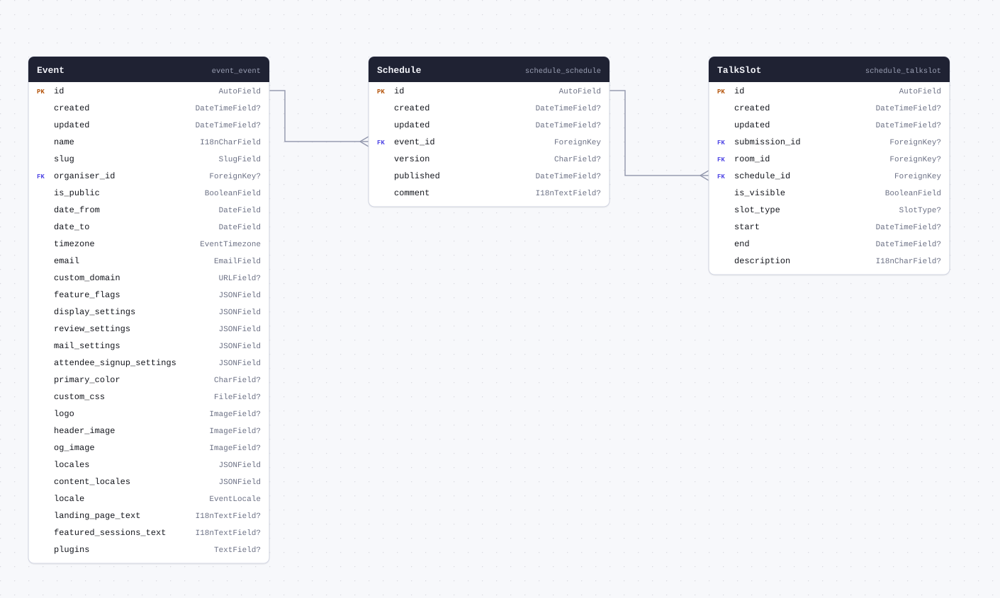

| Column | Field | Type | Null | Key | Default | Description |
| --- | --- | --- | --- | --- | --- | --- |
| `id` | `AutoField` | `integer` |  | PK | `autoincrement()` |  |
| `created` | `DateTimeField` | `datetime` | yes |  | `now()` |  |
| `updated` | `DateTimeField` | `datetime` | yes |  | `now()` |  |
| `event_id` | `ForeignKey` | `integer` |  | FK |  |  |
| `version` | `CharField` | `varchar(190)` | yes |  |  |  |
| `published` | `DateTimeField` | `datetime` | yes |  |  |  |
| `comment` | `I18nTextField` | `text` | yes |  |  | This text will be shown in the public changelog and the RSS feed. You can use <a href="https://docs.pretalx.org/user/markdown/" target="_blank" rel="noopener">Markdown</a> here. |

Indexes:

- index `schedule_schedule_event_id_17a9b031` on `event_id`
- unique `schedule_schedule_event_id_version_527bf2fa_uniq` on `event_id`, `version`

Relations:

- `event_id` → [Event](#event).`id`, on delete protect
- [TalkSlot](#talkslot).`schedule_id` → `id`, on delete protect

## TalkSlot

Table `schedule_talkslot`, app `schedule`.

Columns from `TimestampedModel` (abstract): `created`, `updated`.

The TalkSlot object is the scheduled version of a.

:class:`~pretalx.submission.models.submission.Submission`.

TalkSlots always belong to one submission and one :class:`~pretalx.schedule.models.schedule.Schedule`.

:param is_visible: This parameter is set on schedule release. Only confirmed talks will be visible.
:param slot_type: For non-submission slots, distinguishes breaks (visible) from blockers (hidden).

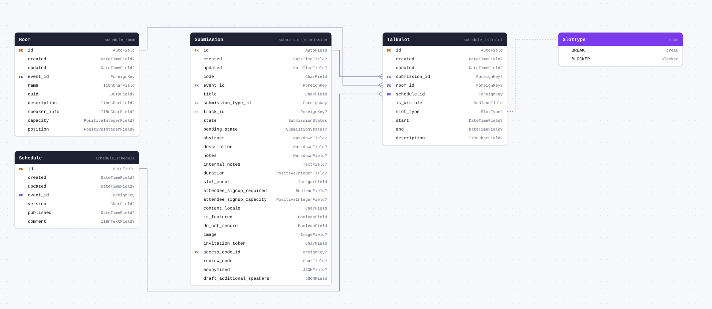

| Column | Field | Type | Null | Key | Default | Description |
| --- | --- | --- | --- | --- | --- | --- |
| `id` | `AutoField` | `integer` |  | PK | `autoincrement()` |  |
| `created` | `DateTimeField` | `datetime` | yes |  | `now()` |  |
| `updated` | `DateTimeField` | `datetime` | yes |  | `now()` |  |
| `submission_id` | `ForeignKey` | `integer` | yes | FK |  |  |
| `room_id` | `ForeignKey` | `integer` | yes | FK |  | The room this session is scheduled in, if any |
| `schedule_id` | `ForeignKey` | `integer` |  | FK |  |  |
| `is_visible` | `BooleanField` | `bool` |  |  | `False` |  |
| `slot_type` | `SlotType` | `varchar(10)` | yes |  |  | For non-submission slots: 'break' for public breaks, 'blocker' for hidden blockers |
| `start` | `DateTimeField` | `datetime` | yes |  |  | When the session starts, if it is currently scheduled |
| `end` | `DateTimeField` | `datetime` | yes |  |  | When the session ends, if it is currently scheduled |
| `description` | `I18nCharField` | `text` | yes |  |  |  |

Indexes:

- index `schedule_talkslot_submission_id_4c2e011f` on `submission_id`
- index `schedule_talkslot_room_id_1ae74d93` on `room_id`
- index `schedule_talkslot_schedule_id_4754e9e5` on `schedule_id`

Relations:

- `submission_id` → [Submission](#submission).`id`, on delete protect
- `room_id` → [Room](#room).`id`, on delete protect
- `schedule_id` → [Schedule](#schedule).`id`, on delete protect

## SubmitterAccessCode

Table `submission_submitteraccesscode`, app `submission`.

Columns from `TimestampedModel` (abstract): `created`, `updated`.

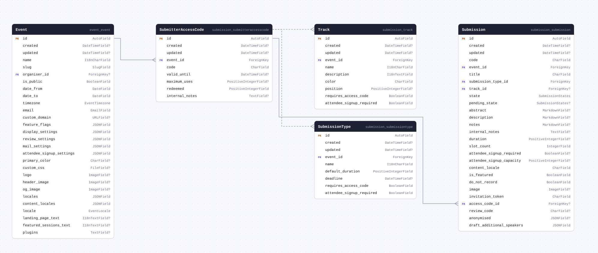

| Column | Field | Type | Null | Key | Default | Description |
| --- | --- | --- | --- | --- | --- | --- |
| `id` | `AutoField` | `integer` |  | PK | `autoincrement()` |  |
| `created` | `DateTimeField` | `datetime` | yes |  | `now()` |  |
| `updated` | `DateTimeField` | `datetime` | yes |  | `now()` |  |
| `event_id` | `ForeignKey` | `integer` |  | FK |  |  |
| `code` | `CharField` | `varchar(255)` |  |  |  |  |
| `valid_until` | `DateTimeField` | `datetime` | yes |  |  | You can set or change this date later to invalidate the access code. |
| `maximum_uses` | `PositiveIntegerField` | `integer unsigned` | yes |  | `1` | Number of times this access code can be used to submit a proposal. Leave empty for no limit. |
| `redeemed` | `PositiveIntegerField` | `integer unsigned` |  |  | `0` |  |
| `internal_notes` | `TextField` | `text` | yes |  |  | Internal notes for other organisers/reviewers. Not visible to the speakers or the public. |

Indexes:

- index `submission_submitteraccesscode_event_id_4cfedfb3` on `event_id`
- index `submission_submitteraccesscode_code_82e63255` on `code`
- unique `submission_submitteraccesscode_event_id_code_6658fa84_uniq` on `event_id`, `code`

Relations:

- `event_id` → [Event](#event).`id`, on delete cascade
- `tracks` — many to many with [Track](#track)
- `submission_types` — many to many with [SubmissionType](#submissiontype)
- [Submission](#submission).`access_code_id` → `id`, on delete protect

## CfP

Table `submission_cfp`, app `submission`.

Columns from `TimestampedModel` (abstract): `created`, `updated`.

Every :class:`~pretalx.event.models.event.Event` has one Call for
Papers/Participation/Proposals.

:param deadline: The regular deadline. Please note that submissions can be available for longer than this if different deadlines are configured on single submission types.

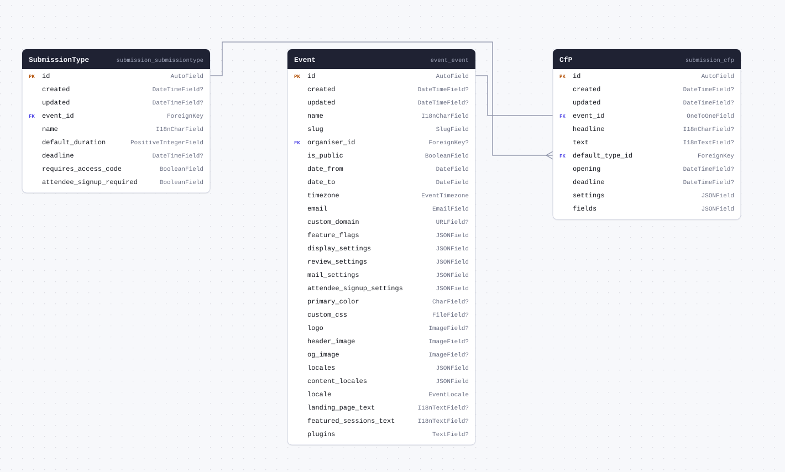

| Column | Field | Type | Null | Key | Default | Description |
| --- | --- | --- | --- | --- | --- | --- |
| `id` | `AutoField` | `integer` |  | PK | `autoincrement()` |  |
| `created` | `DateTimeField` | `datetime` | yes |  | `now()` |  |
| `updated` | `DateTimeField` | `datetime` | yes |  | `now()` |  |
| `event_id` | `OneToOneField` | `integer` |  | FK, unique |  |  |
| `headline` | `I18nCharField` | `text` | yes |  |  |  |
| `text` | `I18nTextField` | `text` | yes |  |  | You can use <a href="https://docs.pretalx.org/user/markdown/" target="_blank" rel="noopener">Markdown</a> here. |
| `default_type_id` | `ForeignKey` | `integer` |  | FK |  |  |
| `opening` | `DateTimeField` | `datetime` | yes |  |  | Please put in the date you want to start accepting proposals from users. Leave the date empty to start accepting proposals immediately once the event is live. |
| `deadline` | `DateTimeField` | `datetime` | yes |  |  | Please put in the last date you want to accept proposals from users. |
| `settings` | `JSONField` | `text` |  |  | `default_settings()` |  |
| `fields` | `JSONField` | `text` |  |  | `default_fields()` |  |

Indexes:

- index `submission_cfp_default_type_id_6d7d90e0` on `default_type_id`

Relations:

- `event_id` → [Event](#event).`id`, on delete protect
- `default_type_id` → [SubmissionType](#submissiontype).`id`, on delete protect

## SubmissionComment

Table `submission_submissioncomment`, app `submission`.

Columns from `TimestampedModel` (abstract): `created`, `updated`.

Comments allow reviewers and organisers to discuss submissions.

They are separate from reviews and provide a forum-style discussion space.

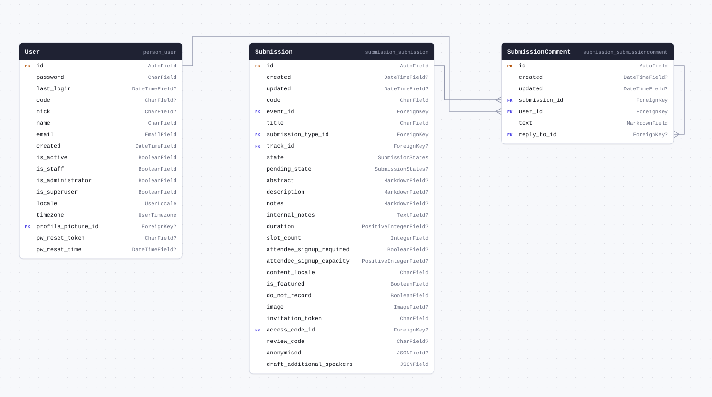

| Column | Field | Type | Null | Key | Default | Description |
| --- | --- | --- | --- | --- | --- | --- |
| `id` | `AutoField` | `integer` |  | PK | `autoincrement()` |  |
| `created` | `DateTimeField` | `datetime` | yes |  | `now()` |  |
| `updated` | `DateTimeField` | `datetime` | yes |  | `now()` |  |
| `submission_id` | `ForeignKey` | `integer` |  | FK |  |  |
| `user_id` | `ForeignKey` | `integer` |  | FK |  |  |
| `text` | `MarkdownField` | `text` |  |  |  |  |
| `reply_to_id` | `ForeignKey` | `integer` | yes | FK |  |  |

Indexes:

- index `submission_submissioncomment_submission_id_fc9ba045` on `submission_id`
- index `submission_submissioncomment_user_id_2aa70c2b` on `user_id`
- index `submission_submissioncomment_reply_to_id_eb41eb34` on `reply_to_id`

Relations:

- `submission_id` → [Submission](#submission).`id`, on delete cascade
- `user_id` → [User](#user).`id`, on delete cascade
- `reply_to_id` → [SubmissionComment](#submissioncomment).`id`, on delete set null

## Feedback

Table `submission_feedback`, app `submission`.

Columns from `TimestampedModel` (abstract): `created`, `updated`.

The Feedback model allows for anonymous feedback by attendees to one or
all speakers of a.

:class:`~pretalx.submission.models.submission.Submission`.

:param speaker: If the ``speaker`` attribute is not set, the feedback is
    assumed to be directed to all speakers.

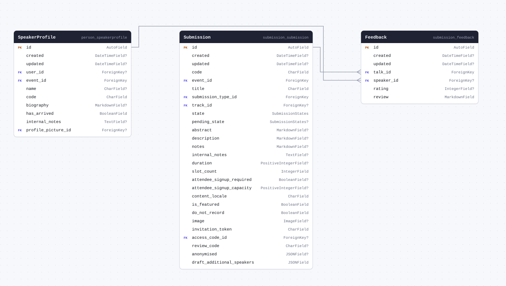

| Column | Field | Type | Null | Key | Default | Description |
| --- | --- | --- | --- | --- | --- | --- |
| `id` | `AutoField` | `integer` |  | PK | `autoincrement()` |  |
| `created` | `DateTimeField` | `datetime` | yes |  | `now()` |  |
| `updated` | `DateTimeField` | `datetime` | yes |  | `now()` |  |
| `talk_id` | `ForeignKey` | `integer` |  | FK |  |  |
| `speaker_id` | `ForeignKey` | `integer` | yes | FK |  |  |
| `rating` | `IntegerField` | `integer` | yes |  |  |  |
| `review` | `MarkdownField` | `text` |  |  |  |  |

Indexes:

- index `submission_feedback_talk_id_e978babd` on `talk_id`
- index `submission_feedback_speaker_id_f83c9585` on `speaker_id`

Relations:

- `talk_id` → [Submission](#submission).`id`, on delete protect
- `speaker_id` → [SpeakerProfile](#speakerprofile).`id`, on delete protect

## Question

Table `submission_question`, app `submission`.

Columns from `TimestampedModel` (abstract): `created`, `updated`.

Questions can be asked per.

:class:`~pretalx.submission.models.submission.Submission`, per speaker, or
of reviewers per :class:`~pretalx.submission.models.review.Review`.

Questions can have many types, which offers a flexible framework to give organisers
the opportunity to get all the information they need.

:param variant: Can be any of 'number', 'string', 'text', 'boolean',
    'file', 'choices', or 'multiple_choice'. Defined in the
    ``QuestionVariant`` class.
:param target: Can be any of 'submission', 'speaker', or 'reviewer'.
    Defined in the ``QuestionTarget`` class.
:param deadline: Datetime field. This field is required for 'after deadline' and 'freeze after' options of
    question_required field and optional for the other ones. For 'after deadline' it shows that the answer will
    be optional before the deadline and mandatory after that deadline. For 'freeze after' it shows that the
    answer will be allowed before the deadline and frozen after that deadline
:param question_required: Can be any of 'none', 'require ', 'after deadline', or 'freeze after'.
    Defined in the ``QuestionRequired`` class.
    'required' answering this question will always be required.
    'optional' means that it will never be mandatory.
    'after deadline' the answer will be optional before the deadline and mandatory after the deadline.
:param freeze_after: Can be a datetime field or null.
    For 'freeze after' the answer will be allowed before the deadline and frozen after the deadline.
:param position: Position in the question order in this event.

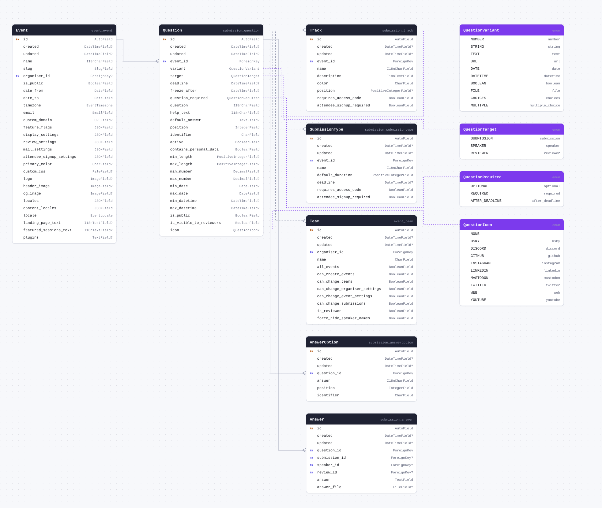

| Column | Field | Type | Null | Key | Default | Description |
| --- | --- | --- | --- | --- | --- | --- |
| `id` | `AutoField` | `integer` |  | PK | `autoincrement()` |  |
| `created` | `DateTimeField` | `datetime` | yes |  | `now()` |  |
| `updated` | `DateTimeField` | `datetime` | yes |  | `now()` |  |
| `event_id` | `ForeignKey` | `integer` |  | FK |  |  |
| `variant` | `QuestionVariant` | `varchar(15)` |  |  | `'string'` |  |
| `target` | `QuestionTarget` | `varchar(10)` |  |  | `'submission'` | Do you require an answer from every speaker or for every session? |
| `deadline` | `DateTimeField` | `datetime` | yes |  |  | Set a deadline to make this field required after the given date. |
| `freeze_after` | `DateTimeField` | `datetime` | yes |  |  | Set a deadline to stop changes to responses after the given date. |
| `question_required` | `QuestionRequired` | `varchar(14)` |  |  | `'optional'` |  |
| `question` | `I18nCharField` | `text` |  |  |  |  |
| `help_text` | `I18nCharField` | `text` | yes |  |  | Will appear just like this text below the custom input field. You can use <a href="https://docs.pretalx.org/user/markdown/" target="_blank" rel="noopener">Markdown</a> here. |
| `default_answer` | `TextField` | `text` | yes |  |  |  |
| `position` | `IntegerField` | `integer` |  |  | `0` |  |
| `identifier` | `CharField` | `varchar(190)` |  |  |  | You can enter any value here to make it easier to match the data with other sources. If you do not input one, we will generate one automatically. |
| `active` | `BooleanField` | `bool` |  |  | `True` | Inactive fields will no longer be shown. |
| `contains_personal_data` | `BooleanField` | `bool` |  |  | `True` | If a user deletes their account, responses containing personal data will be removed, too. |
| `min_length` | `PositiveIntegerField` | `integer unsigned` | yes |  |  | Minimum text length in characters or words (set in CfP settings). |
| `max_length` | `PositiveIntegerField` | `integer unsigned` | yes |  |  | Maximum text length in characters or words (set in CfP settings). |
| `min_number` | `DecimalField(16, 6)` | `decimal` | yes |  |  |  |
| `max_number` | `DecimalField(16, 6)` | `decimal` | yes |  |  |  |
| `min_date` | `DateField` | `date` | yes |  |  |  |
| `max_date` | `DateField` | `date` | yes |  |  |  |
| `min_datetime` | `DateTimeField` | `datetime` | yes |  |  |  |
| `max_datetime` | `DateTimeField` | `datetime` | yes |  |  |  |
| `is_public` | `BooleanField` | `bool` |  |  | `False` | Responses will be shown on session or speaker pages as appropriate. |
| `is_visible_to_reviewers` | `BooleanField` | `bool` |  |  | `True` | Should responses to this field be shown to reviewers? This is helpful if you want to collect personal information, but use anonymous reviews. |
| `icon` | `QuestionIcon` | `varchar(9)` | yes |  | `None` | Custom URL fields that are shown publicly can use an icon when displaying the link. |

Indexes:

- index `submission_question_event_id_0e76ef19` on `event_id`
- unique `submission_question_event_id_identifier_0e035842_uniq` on `event_id`, `identifier`

Relations:

- `event_id` → [Event](#event).`id`, on delete protect
- `tracks` — many to many with [Track](#track)
- `submission_types` — many to many with [SubmissionType](#submissiontype)
- `limit_teams` — many to many with [Team](#team)
- [AnswerOption](#answeroption).`question_id` → `id`, on delete protect
- [Answer](#answer).`question_id` → `id`, on delete protect

## AnswerOption

Table `submission_answeroption`, app `submission`.

Columns from `TimestampedModel` (abstract): `created`, `updated`.

Provides the possible answers for.

:class:`~pretalx.submission.models.question.Question` objects of variant
'choice' or 'multiple_choice'.

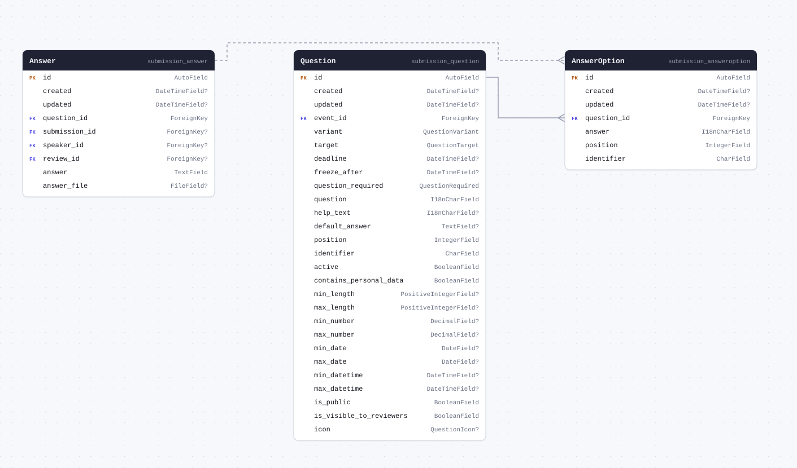

| Column | Field | Type | Null | Key | Default | Description |
| --- | --- | --- | --- | --- | --- | --- |
| `id` | `AutoField` | `integer` |  | PK | `autoincrement()` |  |
| `created` | `DateTimeField` | `datetime` | yes |  | `now()` |  |
| `updated` | `DateTimeField` | `datetime` | yes |  | `now()` |  |
| `question_id` | `ForeignKey` | `integer` |  | FK |  |  |
| `answer` | `I18nCharField` | `text` |  |  |  |  |
| `position` | `IntegerField` | `integer` |  |  | `0` |  |
| `identifier` | `CharField` | `varchar(190)` |  |  |  | You can enter any value here to make it easier to match the data with other sources. If you do not input one, we will generate one automatically. |

Indexes:

- index `submission_answeroption_question_id_6a3c1b6c` on `question_id`
- unique `submission_answeroption_question_id_identifier_78de2880_uniq` on `question_id`, `identifier`

Relations:

- `question_id` → [Question](#question).`id`, on delete protect
- `answers` — many to many with [Answer](#answer)

## Answer

Table `submission_answer`, app `submission`.

Columns from `TimestampedModel` (abstract): `created`, `updated`.

Answers are connected to a.

:class:`~pretalx.submission.models.question.Question`, and, depending on
type, a :class:`~pretalx.person.models.profile.SpeakerProfile`, a
:class:`~pretalx.submission.models.submission.Submission`, or a
:class:`~pretalx.submission.models.review.Review`.

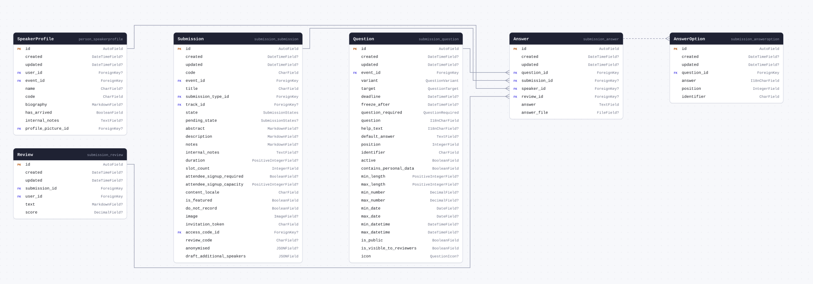

| Column | Field | Type | Null | Key | Default | Description |
| --- | --- | --- | --- | --- | --- | --- |
| `id` | `AutoField` | `integer` |  | PK | `autoincrement()` |  |
| `created` | `DateTimeField` | `datetime` | yes |  | `now()` |  |
| `updated` | `DateTimeField` | `datetime` | yes |  | `now()` |  |
| `question_id` | `ForeignKey` | `integer` |  | FK |  |  |
| `submission_id` | `ForeignKey` | `integer` | yes | FK |  |  |
| `speaker_id` | `ForeignKey` | `integer` | yes | FK |  |  |
| `review_id` | `ForeignKey` | `integer` | yes | FK |  |  |
| `answer` | `TextField` | `text` |  |  |  |  |
| `answer_file` | `FileField` | `varchar(100)` | yes |  |  |  |

Indexes:

- index `submission_answer_question_id_6bdb8859` on `question_id`
- index `submission_answer_submission_id_33bfd6bf` on `submission_id`
- index `submission_answer_speaker_id_54bde10f` on `speaker_id`
- index `submission_answer_review_id_76251737` on `review_id`

Relations:

- `question_id` → [Question](#question).`id`, on delete protect
- `submission_id` → [Submission](#submission).`id`, on delete protect
- `speaker_id` → [SpeakerProfile](#speakerprofile).`id`, on delete protect
- `review_id` → [Review](#review).`id`, on delete protect
- `options` — many to many with [AnswerOption](#answeroption)

## Resource

Table `submission_resource`, app `submission`.

Columns from `TimestampedModel` (abstract): `created`, `updated`.

Resources are file uploads belonging to a :class:`~pretalx.submission.models.submission.Submission`.

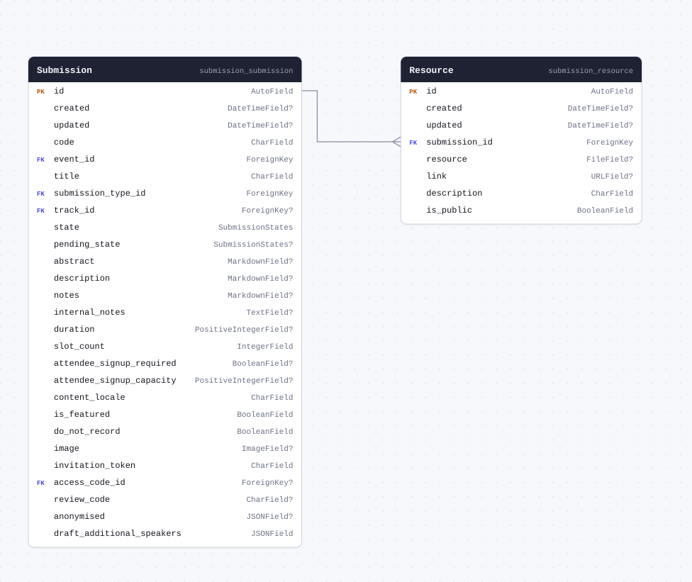

| Column | Field | Type | Null | Key | Default | Description |
| --- | --- | --- | --- | --- | --- | --- |
| `id` | `AutoField` | `integer` |  | PK | `autoincrement()` |  |
| `created` | `DateTimeField` | `datetime` | yes |  | `now()` |  |
| `updated` | `DateTimeField` | `datetime` | yes |  | `now()` |  |
| `submission_id` | `ForeignKey` | `integer` |  | FK |  |  |
| `resource` | `FileField` | `varchar(100)` | yes |  |  |  |
| `link` | `URLField` | `varchar(400)` | yes |  |  |  |
| `description` | `CharField` | `varchar(1000)` |  |  |  |  |
| `is_public` | `BooleanField` | `bool` |  |  | `True` |  |

Indexes:

- index `submission_resource_submission_id_f846b95b` on `submission_id`

Relations:

- `submission_id` → [Submission](#submission).`id`, on delete protect

## ReviewScoreCategory

Table `submission_reviewscorecategory`, app `submission`.

Columns from `TimestampedModel` (abstract): `created`, `updated`.

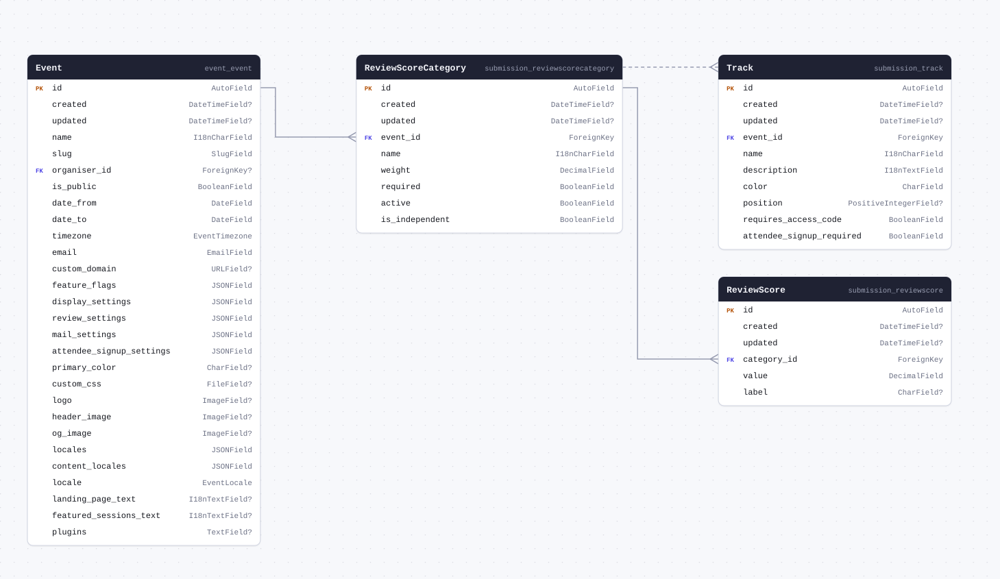

| Column | Field | Type | Null | Key | Default | Description |
| --- | --- | --- | --- | --- | --- | --- |
| `id` | `AutoField` | `integer` |  | PK | `autoincrement()` |  |
| `created` | `DateTimeField` | `datetime` | yes |  | `now()` |  |
| `updated` | `DateTimeField` | `datetime` | yes |  | `now()` |  |
| `event_id` | `ForeignKey` | `integer` |  | FK |  |  |
| `name` | `I18nCharField` | `text` |  |  |  |  |
| `weight` | `DecimalField(4, 1)` | `decimal` |  |  | `1` |  |
| `required` | `BooleanField` | `bool` |  |  | `False` |  |
| `active` | `BooleanField` | `bool` |  |  | `True` |  |
| `is_independent` | `BooleanField` | `bool` |  |  | `False` | Independent scores are not part of the total score. Instead they are shown in a separate column in the review dashboard. |

Indexes:

- index `submission_reviewscorecategory_event_id_02ad9987` on `event_id`

Relations:

- `event_id` → [Event](#event).`id`, on delete cascade
- `limit_tracks` — many to many with [Track](#track)
- [ReviewScore](#reviewscore).`category_id` → `id`, on delete cascade

## ReviewScore

Table `submission_reviewscore`, app `submission`.

Columns from `TimestampedModel` (abstract): `created`, `updated`.

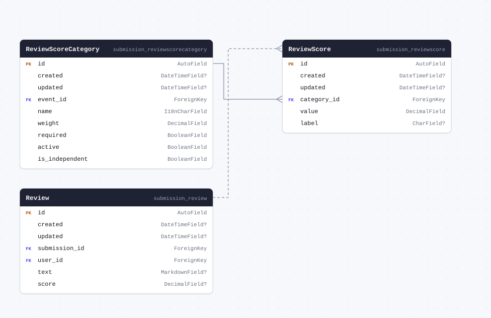

| Column | Field | Type | Null | Key | Default | Description |
| --- | --- | --- | --- | --- | --- | --- |
| `id` | `AutoField` | `integer` |  | PK | `autoincrement()` |  |
| `created` | `DateTimeField` | `datetime` | yes |  | `now()` |  |
| `updated` | `DateTimeField` | `datetime` | yes |  | `now()` |  |
| `category_id` | `ForeignKey` | `integer` |  | FK |  |  |
| `value` | `DecimalField(7, 2)` | `decimal` |  |  |  |  |
| `label` | `CharField` | `varchar(200)` | yes |  |  |  |

Indexes:

- index `submission_reviewscore_category_id_ce0b8d4b` on `category_id`

Relations:

- `category_id` → [ReviewScoreCategory](#reviewscorecategory).`id`, on delete cascade
- `reviews` — many to many with [Review](#review)

## Review

Table `submission_review`, app `submission`.

Columns from `TimestampedModel` (abstract): `created`, `updated`.

Reviews model the opinion of reviewers of a.

:class:`~pretalx.submission.models.submission.Submission`.

They can, but don't have to, include a score and a text.

:param text: The review itself. May be empty.
:param score: This score is calculated from all the related ``scores``
    and their weights. Do not set it directly; call
    ``pretalx.submission.domain.review.update_review_score`` after
    modifying the m2m scores.

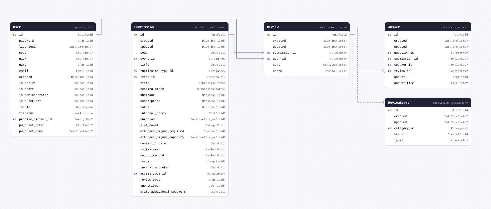

| Column | Field | Type | Null | Key | Default | Description |
| --- | --- | --- | --- | --- | --- | --- |
| `id` | `AutoField` | `integer` |  | PK | `autoincrement()` |  |
| `created` | `DateTimeField` | `datetime` | yes |  | `now()` |  |
| `updated` | `DateTimeField` | `datetime` | yes |  | `now()` |  |
| `submission_id` | `ForeignKey` | `integer` |  | FK |  |  |
| `user_id` | `ForeignKey` | `integer` |  | FK |  |  |
| `text` | `MarkdownField` | `text` | yes |  |  |  |
| `score` | `DecimalField(10, 2)` | `decimal` | yes |  |  |  |

Indexes:

- index `submission_review_submission_id_b6f4a64a` on `submission_id`
- index `submission_review_user_id_5ba496fe` on `user_id`
- unique `submission_review_user_id_submission_id_a2df67c7_uniq` on `user_id`, `submission_id`

Relations:

- [Answer](#answer).`review_id` → `id`, on delete protect
- `submission_id` → [Submission](#submission).`id`, on delete cascade
- `user_id` → [User](#user).`id`, on delete cascade
- `scores` — many to many with [ReviewScore](#reviewscore)

## ReviewPhase

Table `submission_reviewphase`, app `submission`.

Columns from `TimestampedModel` (abstract): `created`, `updated`.

ReviewPhases determine reviewer access rights during a (potentially
open) time frame.

Phases are ordered by ``(start, end)``, with null-start phases first.

:param is_active: Is this phase currently active? There can be only one
    active phase per event. Use
    ``pretalx.submission.domain.review.activate_review_phase`` to
    activate a phase, since it enforces that invariant.

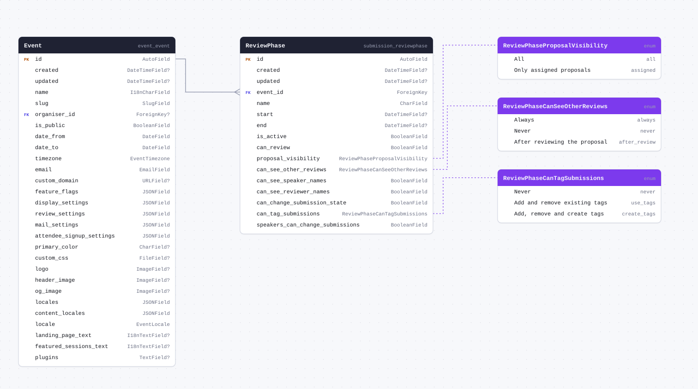

| Column | Field | Type | Null | Key | Default | Description |
| --- | --- | --- | --- | --- | --- | --- |
| `id` | `AutoField` | `integer` |  | PK | `autoincrement()` |  |
| `created` | `DateTimeField` | `datetime` | yes |  | `now()` |  |
| `updated` | `DateTimeField` | `datetime` | yes |  | `now()` |  |
| `event_id` | `ForeignKey` | `integer` |  | FK |  |  |
| `name` | `CharField` | `varchar(100)` |  |  |  |  |
| `start` | `DateTimeField` | `datetime` | yes |  |  |  |
| `end` | `DateTimeField` | `datetime` | yes |  |  |  |
| `is_active` | `BooleanField` | `bool` |  |  | `False` |  |
| `can_review` | `BooleanField` | `bool` |  |  | `True` |  |
| `proposal_visibility` | `ReviewPhaseProposalVisibility` | `varchar(8)` |  |  | `'all'` | If you select “all”, reviewers can review all proposals that their teams have access to (so either all, or specific tracks). In this mode, assigned proposals will be highlighted and will be shown first in the review workflow. |
| `can_see_other_reviews` | `ReviewPhaseCanSeeOtherReviews` | `varchar(12)` |  |  | `'after_review'` |  |
| `can_see_speaker_names` | `BooleanField` | `bool` |  |  | `True` |  |
| `can_see_reviewer_names` | `BooleanField` | `bool` |  |  | `True` |  |
| `can_change_submission_state` | `BooleanField` | `bool` |  |  | `False` |  |
| `can_tag_submissions` | `ReviewPhaseCanTagSubmissions` | `varchar(12)` |  |  | `'never'` |  |
| `speakers_can_change_submissions` | `BooleanField` | `bool` |  |  | `False` | By default, modification of proposals is locked after the CfP ends, and is re-enabled once the proposal was accepted. |

Indexes:

- index `submission_reviewphase_event_id_7cbfc828` on `event_id`

Relations:

- `event_id` → [Event](#event).`id`, on delete cascade

## AttendeeSignup

Table `submission_attendeesignup`, app `submission`.

Columns from `TimestampedModel` (abstract): `created`, `updated`.

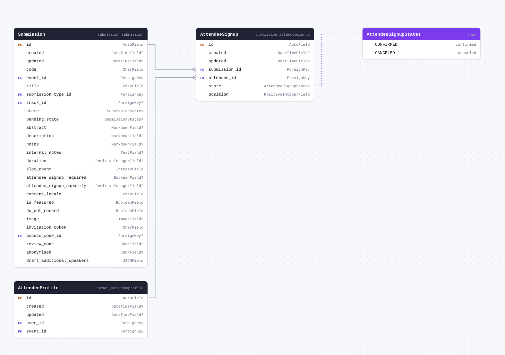

| Column | Field | Type | Null | Key | Default | Description |
| --- | --- | --- | --- | --- | --- | --- |
| `id` | `AutoField` | `integer` |  | PK | `autoincrement()` |  |
| `created` | `DateTimeField` | `datetime` | yes |  | `now()` |  |
| `updated` | `DateTimeField` | `datetime` | yes |  | `now()` |  |
| `submission_id` | `ForeignKey` | `integer` |  | FK |  |  |
| `attendee_id` | `ForeignKey` | `integer` |  | FK |  |  |
| `state` | `AttendeeSignupStates` | `varchar(9)` |  |  | `'confirmed'` |  |
| `position` | `PositiveIntegerField` | `integer unsigned` |  |  | `0` |  |

Indexes:

- index `submission_attendeesignup_submission_id_9daabb9c` on `submission_id`
- index `submission_attendeesignup_attendee_id_cede0ac0` on `attendee_id`
- unique `submission_attendeesignup_submission_id_attendee_id_c8ad49b5_uniq` on `submission_id`, `attendee_id`

Relations:

- `submission_id` → [Submission](#submission).`id`, on delete cascade
- `attendee_id` → [AttendeeProfile](#attendeeprofile).`id`, on delete cascade

## SpeakerRole

Table `submission_speakerrole`, app `submission`.

Through model connecting speaker and submission.

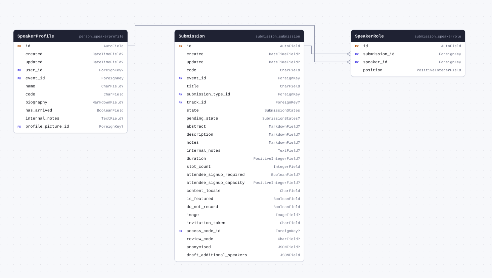

| Column | Field | Type | Null | Key | Default | Description |
| --- | --- | --- | --- | --- | --- | --- |
| `id` | `AutoField` | `integer` |  | PK | `autoincrement()` |  |
| `submission_id` | `ForeignKey` | `integer` |  | FK |  |  |
| `speaker_id` | `ForeignKey` | `integer` |  | FK |  |  |
| `position` | `PositiveIntegerField` | `integer unsigned` |  |  | `0` |  |

Indexes:

- index `submission_speakerrole_submission_id_657749a0` on `submission_id`
- index `submission_speakerrole_speaker_id_f6da88ef` on `speaker_id`
- unique `submission_speakerrole_submission_id_speaker_id_93827323_uniq` on `submission_id`, `speaker_id`

Relations:

- `submission_id` → [Submission](#submission).`id`, on delete cascade
- `speaker_id` → [SpeakerProfile](#speakerprofile).`id`, on delete cascade

## Submission

Table `submission_submission`, app `submission`.

Columns from `TimestampedModel` (abstract): `created`, `updated`.

Submissions are, next to :class:`~pretalx.event.models.event.Event`, the
central model in pretalx.

State changes must go through :func:`pretalx.submission.domain.submission.set_submission_state`,
which is called by the ``accept()``, ``reject()`` etc model methods.

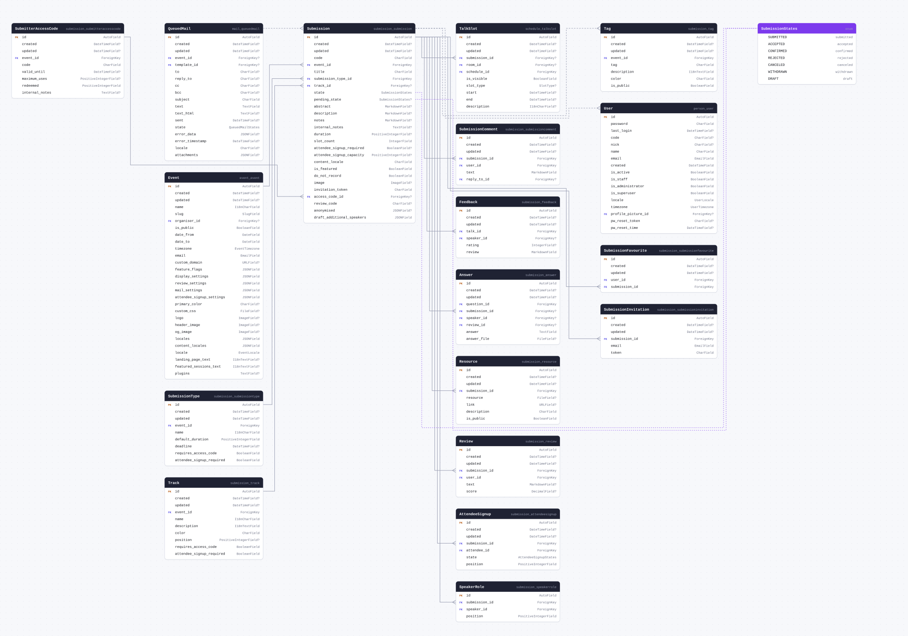

| Column | Field | Type | Null | Key | Default | Description |
| --- | --- | --- | --- | --- | --- | --- |
| `id` | `AutoField` | `integer` |  | PK | `autoincrement()` |  |
| `created` | `DateTimeField` | `datetime` | yes |  | `now()` |  |
| `updated` | `DateTimeField` | `datetime` | yes |  | `now()` |  |
| `code` | `CharField` | `varchar(16)` |  | unique |  |  |
| `event_id` | `ForeignKey` | `integer` |  | FK |  |  |
| `title` | `CharField` | `varchar(200)` |  |  |  |  |
| `submission_type_id` | `ForeignKey` | `integer` |  | FK |  |  |
| `track_id` | `ForeignKey` | `integer` | yes | FK |  |  |
| `state` | `SubmissionStates` | `varchar(9)` |  |  | `'submitted'` |  |
| `pending_state` | `SubmissionStates` | `varchar(9)` | yes |  | `None` |  |
| `abstract` | `MarkdownField` | `text` | yes |  |  |  |
| `description` | `MarkdownField` | `text` | yes |  |  |  |
| `notes` | `MarkdownField` | `text` | yes |  |  | These notes are meant for the organisers and won’t be made public. |
| `internal_notes` | `TextField` | `text` | yes |  |  | Internal notes for other organisers/reviewers. Not visible to the speakers or the public. |
| `duration` | `PositiveIntegerField` | `integer unsigned` | yes |  |  | Duration in minutes |
| `slot_count` | `IntegerField` | `integer` |  |  | `1` | How often this session takes place. |
| `attendee_signup_required` | `BooleanField` | `bool` | yes |  |  | Override whether attendees must sign up to attend this session. |
| `attendee_signup_capacity` | `PositiveIntegerField` | `integer unsigned` | yes |  |  | Override the room capacity for this session. |
| `content_locale` | `CharField` | `varchar(32)` |  |  | `'en'` |  |
| `is_featured` | `BooleanField` | `bool` |  |  | `False` |  |
| `do_not_record` | `BooleanField` | `bool` |  |  | `False` |  |
| `image` | `ImageField` | `varchar(100)` | yes |  |  | Use this if you want an illustration to go with your proposal. |
| `invitation_token` | `CharField` | `varchar(32)` |  |  | `generate_invite_code()` |  |
| `access_code_id` | `ForeignKey` | `integer` | yes | FK |  |  |
| `review_code` | `CharField` | `varchar(32)` | yes | unique | `generate_invite_code()` |  |
| `anonymised` | `JSONField` | `text` | yes |  |  |  |
| `draft_additional_speakers` | `JSONField` | `text` |  |  | `list()` |  |

Indexes:

- index `submission_submission_event_id_7de3d909` on `event_id`
- index `submission_submission_submission_type_id_6d540489` on `submission_type_id`
- index `submission_submission_track_id_a80cae77` on `track_id`
- index `submission_submission_access_code_id_2f86d9fe` on `access_code_id`

Relations:

- `speakers` — many to many with [SpeakerProfile](#speakerprofile), through [SpeakerRole](#speakerrole)
- `mails` — many to many with [QueuedMail](#queuedmail)
- [TalkSlot](#talkslot).`submission_id` → `id`, on delete protect
- [SubmissionComment](#submissioncomment).`submission_id` → `id`, on delete cascade
- [Feedback](#feedback).`talk_id` → `id`, on delete protect
- [Answer](#answer).`submission_id` → `id`, on delete protect
- [Resource](#resource).`submission_id` → `id`, on delete protect
- [Review](#review).`submission_id` → `id`, on delete cascade
- [AttendeeSignup](#attendeesignup).`submission_id` → `id`, on delete cascade
- [SpeakerRole](#speakerrole).`submission_id` → `id`, on delete cascade
- `event_id` → [Event](#event).`id`, on delete protect
- `submission_type_id` → [SubmissionType](#submissiontype).`id`, on delete protect
- `track_id` → [Track](#track).`id`, on delete protect
- `access_code_id` → [SubmitterAccessCode](#submitteraccesscode).`id`, on delete protect
- `tags` — many to many with [Tag](#tag)
- `assigned_reviewers` — many to many with [User](#user)
- [SubmissionFavourite](#submissionfavourite).`submission_id` → `id`, on delete cascade
- [SubmissionInvitation](#submissioninvitation).`submission_id` → `id`, on delete cascade

## SubmissionFavourite

Table `submission_submissionfavourite`, app `submission`.

Columns from `TimestampedModel` (abstract): `created`, `updated`.

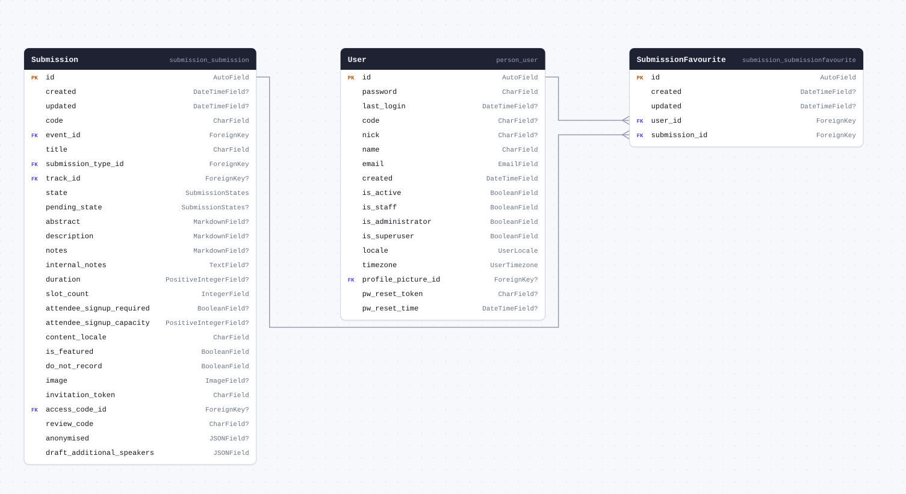

| Column | Field | Type | Null | Key | Default | Description |
| --- | --- | --- | --- | --- | --- | --- |
| `id` | `AutoField` | `integer` |  | PK | `autoincrement()` |  |
| `created` | `DateTimeField` | `datetime` | yes |  | `now()` |  |
| `updated` | `DateTimeField` | `datetime` | yes |  | `now()` |  |
| `user_id` | `ForeignKey` | `integer` |  | FK |  |  |
| `submission_id` | `ForeignKey` | `integer` |  | FK |  |  |

Indexes:

- index `submission_submissionfavourite_user_id_a861f3e3` on `user_id`
- index `submission_submissionfavourite_submission_id_067756f6` on `submission_id`
- unique `submission_submissionfavourite_user_id_submission_id_6057fa95_uniq` on `user_id`, `submission_id`

Relations:

- `user_id` → [User](#user).`id`, on delete cascade
- `submission_id` → [Submission](#submission).`id`, on delete cascade

## SubmissionInvitation

Table `submission_submissioninvitation`, app `submission`.

Columns from `TimestampedModel` (abstract): `created`, `updated`.

Track pending speaker invitations for submissions.

When a speaker is invited to a submission, a SubmissionInvitation is created
with a unique token. The invitation is deleted when the invited person accepts
it, or can be retracted by organisers or the submitter.

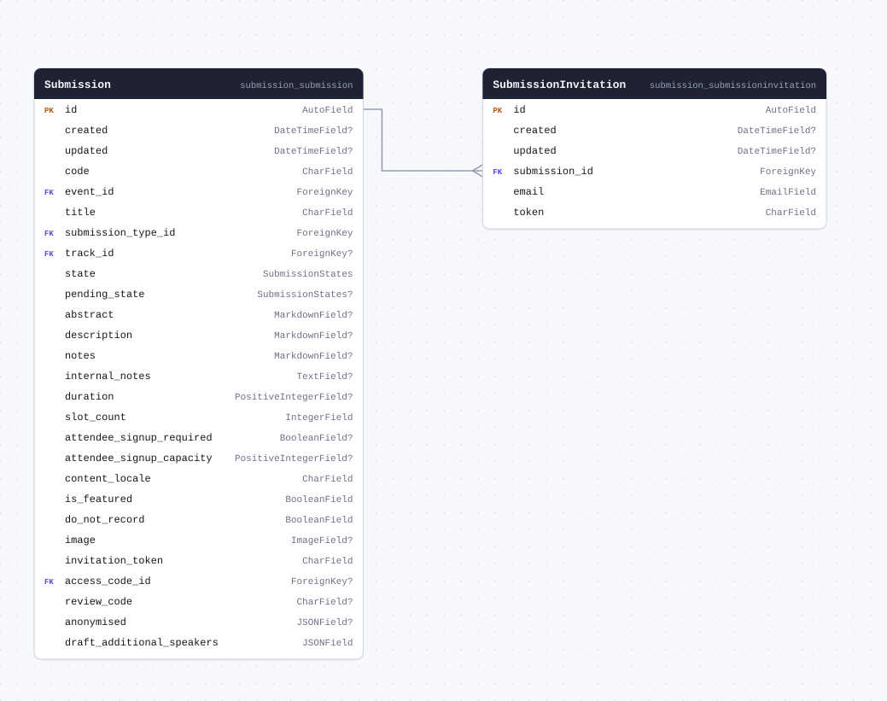

| Column | Field | Type | Null | Key | Default | Description |
| --- | --- | --- | --- | --- | --- | --- |
| `id` | `AutoField` | `integer` |  | PK | `autoincrement()` |  |
| `created` | `DateTimeField` | `datetime` | yes |  | `now()` |  |
| `updated` | `DateTimeField` | `datetime` | yes |  | `now()` |  |
| `submission_id` | `ForeignKey` | `integer` |  | FK |  |  |
| `email` | `EmailField` | `varchar(254)` |  |  |  |  |
| `token` | `CharField` | `varchar(64)` |  | unique | `generate_invite_code()` |  |

Indexes:

- index `submission_submissioninvitation_submission_id_62474769` on `submission_id`
- unique `submission_submissioninvitation_submission_id_email_985c90da_uniq` on `submission_id`, `email`

Relations:

- `submission_id` → [Submission](#submission).`id`, on delete cascade

## Tag

Table `submission_tag`, app `submission`.

Columns from `TimestampedModel` (abstract): `created`, `updated`.

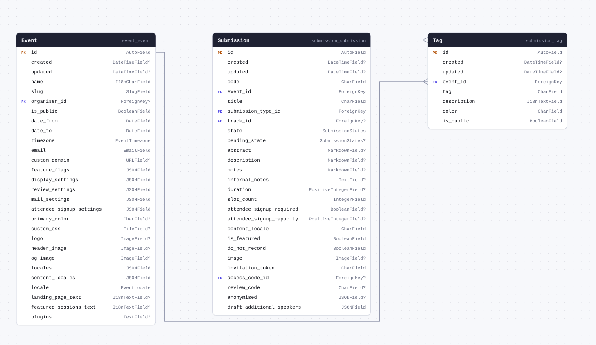

| Column | Field | Type | Null | Key | Default | Description |
| --- | --- | --- | --- | --- | --- | --- |
| `id` | `AutoField` | `integer` |  | PK | `autoincrement()` |  |
| `created` | `DateTimeField` | `datetime` | yes |  | `now()` |  |
| `updated` | `DateTimeField` | `datetime` | yes |  | `now()` |  |
| `event_id` | `ForeignKey` | `integer` |  | FK |  |  |
| `tag` | `CharField` | `varchar(50)` |  |  |  |  |
| `description` | `I18nTextField` | `text` |  |  |  |  |
| `color` | `CharField` | `varchar(7)` |  |  |  |  |
| `is_public` | `BooleanField` | `bool` |  |  | `False` | Public tags can be selected by submitters in the CfP if you activate the tags field. In a future release of pretalx, public tags may also be shown in the public schedule. |

Indexes:

- index `submission_tag_event_id_46923e90` on `event_id`
- unique `unique_tag_per_event` on `event_id`, `tag`

Relations:

- `submissions` — many to many with [Submission](#submission)
- `event_id` → [Event](#event).`id`, on delete protect

## Track

Table `submission_track`, app `submission`.

Columns from `TimestampedModel` (abstract): `created`, `updated`.

A track groups :class:`~pretalx.submission.models.submission.Submission`
objects within an :class:`~pretalx.event.models.event.Event`, e.g. by
topic.

:param color: The track colour, in the format #012345.

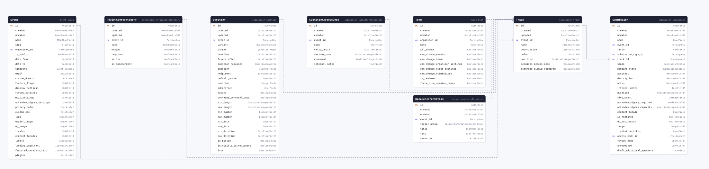

| Column | Field | Type | Null | Key | Default | Description |
| --- | --- | --- | --- | --- | --- | --- |
| `id` | `AutoField` | `integer` |  | PK | `autoincrement()` |  |
| `created` | `DateTimeField` | `datetime` | yes |  | `now()` |  |
| `updated` | `DateTimeField` | `datetime` | yes |  | `now()` |  |
| `event_id` | `ForeignKey` | `integer` |  | FK |  |  |
| `name` | `I18nCharField` | `text` |  |  |  |  |
| `description` | `I18nTextField` | `text` |  |  |  |  |
| `color` | `CharField` | `varchar(7)` |  |  |  |  |
| `position` | `PositiveIntegerField` | `integer unsigned` | yes |  |  | The position field is used to determine the order that tracks are displayed in (lowest first). |
| `requires_access_code` | `BooleanField` | `bool` |  |  | `False` | This track will only be shown to submitters with a matching access code. |
| `attendee_signup_required` | `BooleanField` | `bool` |  |  | `False` | Sessions will require attendee signup by default. You can always override this setting for individual sessions. |

Indexes:

- index `submission_track_event_id_b380882e` on `event_id`

Relations:

- `limit_teams` — many to many with [Team](#team)
- `speakerinformation_set` — many to many with [SpeakerInformation](#speakerinformation)
- `submitter_access_codes` — many to many with [SubmitterAccessCode](#submitteraccesscode)
- `questions` — many to many with [Question](#question)
- `reviewscorecategory_set` — many to many with [ReviewScoreCategory](#reviewscorecategory)
- [Submission](#submission).`track_id` → `id`, on delete protect
- `event_id` → [Event](#event).`id`, on delete protect

## SubmissionType

Table `submission_submissiontype`, app `submission`.

Columns from `TimestampedModel` (abstract): `created`, `updated`.

Each :class:`~pretalx.submission.models.submission.Submission` has one
SubmissionType.

SubmissionTypes are used to group submissions by default duration (which
can be overridden on a per-submission basis), and to be able to offer
different deadlines for some parts of the
:class:`~pretalx.event.models.event.Event`.

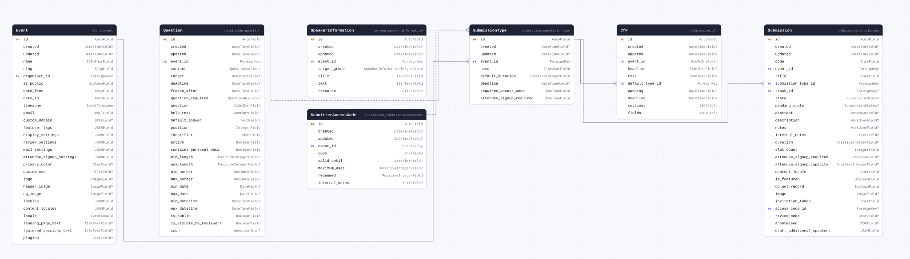

| Column | Field | Type | Null | Key | Default | Description |
| --- | --- | --- | --- | --- | --- | --- |
| `id` | `AutoField` | `integer` |  | PK | `autoincrement()` |  |
| `created` | `DateTimeField` | `datetime` | yes |  | `now()` |  |
| `updated` | `DateTimeField` | `datetime` | yes |  | `now()` |  |
| `event_id` | `ForeignKey` | `integer` |  | FK |  |  |
| `name` | `I18nCharField` | `text` |  |  |  |  |
| `default_duration` | `PositiveIntegerField` | `integer unsigned` |  |  | `30` | Duration in minutes |
| `deadline` | `DateTimeField` | `datetime` | yes |  |  | If you want a different deadline than the global deadline for this session type, enter it here. |
| `requires_access_code` | `BooleanField` | `bool` |  |  | `False` | This session type will only be shown to submitters with a matching access code. |
| `attendee_signup_required` | `BooleanField` | `bool` |  |  | `False` | Sessions will require attendee signup by default. You can always override this setting for individual sessions. |

Indexes:

- index `submission_submissiontype_event_id_01588962` on `event_id`

Relations:

- `speakerinformation_set` — many to many with [SpeakerInformation](#speakerinformation)
- `submitter_access_codes` — many to many with [SubmitterAccessCode](#submitteraccesscode)
- [CfP](#cfp).`default_type_id` → `id`, on delete protect
- `questions` — many to many with [Question](#question)
- [Submission](#submission).`submission_type_id` → `id`, on delete protect
- `event_id` → [Event](#event).`id`, on delete cascade

# Enums

## EventTimezone

| Name | Stored as |
| --- | --- |
| `Europe/Sarajevo` | `Europe/Sarajevo` |
| `America/Metlakatla` | `America/Metlakatla` |
| `Australia/Melbourne` | `Australia/Melbourne` |
| `UTC` | `UTC` |
| `Africa/Maputo` | `Africa/Maputo` |
| `America/Matamoros` | `America/Matamoros` |
| `Africa/Khartoum` | `Africa/Khartoum` |
| `PRC` | `PRC` |
| `Australia/Yancowinna` | `Australia/Yancowinna` |
| `Europe/Simferopol` | `Europe/Simferopol` |
| `Europe/Moscow` | `Europe/Moscow` |
| `Asia/Qostanay` | `Asia/Qostanay` |
| `Europe/Bratislava` | `Europe/Bratislava` |
| `America/Indiana/Knox` | `America/Indiana/Knox` |
| `America/Costa_Rica` | `America/Costa_Rica` |
| `Europe/Vienna` | `Europe/Vienna` |
| `Europe/Isle_of_Man` | `Europe/Isle_of_Man` |
| `Canada/Pacific` | `Canada/Pacific` |
| `Australia/Canberra` | `Australia/Canberra` |
| `Pacific/Enderbury` | `Pacific/Enderbury` |
| `Egypt` | `Egypt` |
| `Asia/Kashgar` | `Asia/Kashgar` |
| `America/Iqaluit` | `America/Iqaluit` |
| `Asia/Srednekolymsk` | `Asia/Srednekolymsk` |
| `America/Atka` | `America/Atka` |
| `America/St_Vincent` | `America/St_Vincent` |
| `Asia/Chungking` | `Asia/Chungking` |
| `Africa/Gaborone` | `Africa/Gaborone` |
| `Europe/Amsterdam` | `Europe/Amsterdam` |
| `America/Creston` | `America/Creston` |
| `America/Adak` | `America/Adak` |
| `Asia/Hong_Kong` | `Asia/Hong_Kong` |
| `Asia/Kuala_Lumpur` | `Asia/Kuala_Lumpur` |
| `Africa/Conakry` | `Africa/Conakry` |
| `Asia/Brunei` | `Asia/Brunei` |
| `Pacific/Chuuk` | `Pacific/Chuuk` |
| `Europe/Podgorica` | `Europe/Podgorica` |
| `America/St_Johns` | `America/St_Johns` |
| `Africa/Luanda` | `Africa/Luanda` |
| `Africa/Libreville` | `Africa/Libreville` |
| `America/Inuvik` | `America/Inuvik` |
| `Brazil/DeNoronha` | `Brazil/DeNoronha` |
| `Europe/Chisinau` | `Europe/Chisinau` |
| `Asia/Baghdad` | `Asia/Baghdad` |
| `MET` | `MET` |
| `Asia/Sakhalin` | `Asia/Sakhalin` |
| `Asia/Nicosia` | `Asia/Nicosia` |
| `America/Jamaica` | `America/Jamaica` |
| `Africa/Tunis` | `Africa/Tunis` |
| `America/Godthab` | `America/Godthab` |
| `America/Dawson` | `America/Dawson` |
| `America/Chihuahua` | `America/Chihuahua` |
| `America/Jujuy` | `America/Jujuy` |
| `America/Montserrat` | `America/Montserrat` |
| `Indian/Mayotte` | `Indian/Mayotte` |
| `ROK` | `ROK` |
| `America/Vancouver` | `America/Vancouver` |
| `America/Shiprock` | `America/Shiprock` |
| `Africa/Bujumbura` | `Africa/Bujumbura` |
| `America/Rankin_Inlet` | `America/Rankin_Inlet` |
| `Africa/Asmara` | `Africa/Asmara` |
| `America/Guayaquil` | `America/Guayaquil` |
| `America/St_Barthelemy` | `America/St_Barthelemy` |
| `America/Santarem` | `America/Santarem` |
| `America/Guyana` | `America/Guyana` |
| `Asia/Jerusalem` | `Asia/Jerusalem` |
| `America/Argentina/Mendoza` | `America/Argentina/Mendoza` |
| `America/Nassau` | `America/Nassau` |
| `America/Ciudad_Juarez` | `America/Ciudad_Juarez` |
| `Pacific/Yap` | `Pacific/Yap` |
| `America/Punta_Arenas` | `America/Punta_Arenas` |
| `Indian/Kerguelen` | `Indian/Kerguelen` |
| `Atlantic/Faeroe` | `Atlantic/Faeroe` |
| `Asia/Phnom_Penh` | `Asia/Phnom_Penh` |
| `Antarctica/South_Pole` | `Antarctica/South_Pole` |
| `GMT` | `GMT` |
| `Pacific/Kanton` | `Pacific/Kanton` |
| `Europe/Minsk` | `Europe/Minsk` |
| `Antarctica/Davis` | `Antarctica/Davis` |
| `America/Mazatlan` | `America/Mazatlan` |
| `America/Port-au-Prince` | `America/Port-au-Prince` |
| `America/Indiana/Indianapolis` | `America/Indiana/Indianapolis` |
| `Asia/Novokuznetsk` | `Asia/Novokuznetsk` |
| `Pacific/Bougainville` | `Pacific/Bougainville` |
| `Turkey` | `Turkey` |
| `Asia/Magadan` | `Asia/Magadan` |
| `Asia/Ujung_Pandang` | `Asia/Ujung_Pandang` |
| `Africa/Lome` | `Africa/Lome` |
| `America/Mexico_City` | `America/Mexico_City` |
| `Libya` | `Libya` |
| `Greenwich` | `Greenwich` |
| `Europe/Bucharest` | `Europe/Bucharest` |
| `Asia/Saigon` | `Asia/Saigon` |
| `America/Porto_Acre` | `America/Porto_Acre` |
| `Factory` | `Factory` |
| `Europe/Malta` | `Europe/Malta` |
| `Africa/Dakar` | `Africa/Dakar` |
| `Europe/Prague` | `Europe/Prague` |
| `America/Indiana/Petersburg` | `America/Indiana/Petersburg` |
| `Asia/Tomsk` | `Asia/Tomsk` |
| `America/Kralendijk` | `America/Kralendijk` |
| `Australia/Lindeman` | `Australia/Lindeman` |
| `Europe/Paris` | `Europe/Paris` |
| `Australia/Darwin` | `Australia/Darwin` |
| `America/Barbados` | `America/Barbados` |
| `America/Sitka` | `America/Sitka` |
| `Africa/Porto-Novo` | `Africa/Porto-Novo` |
| `Asia/Macao` | `Asia/Macao` |
| `Europe/Berlin` | `Europe/Berlin` |
| `Europe/Brussels` | `Europe/Brussels` |
| `Asia/Aden` | `Asia/Aden` |
| `GB` | `GB` |
| `Europe/Zaporozhye` | `Europe/Zaporozhye` |
| `America/Rio_Branco` | `America/Rio_Branco` |
| `Africa/Djibouti` | `Africa/Djibouti` |
| `Pacific/Kiritimati` | `Pacific/Kiritimati` |
| `America/Nipigon` | `America/Nipigon` |
| `America/Atikokan` | `America/Atikokan` |
| `WET` | `WET` |
| `America/Belem` | `America/Belem` |
| `W-SU` | `W-SU` |
| `Asia/Omsk` | `Asia/Omsk` |
| `Asia/Choibalsan` | `Asia/Choibalsan` |
| `Europe/Volgograd` | `Europe/Volgograd` |
| `Pacific/Tahiti` | `Pacific/Tahiti` |
| `America/Halifax` | `America/Halifax` |
| `Africa/Asmera` | `Africa/Asmera` |
| `America/Fortaleza` | `America/Fortaleza` |
| `ROC` | `ROC` |
| `America/Campo_Grande` | `America/Campo_Grande` |
| `Atlantic/Azores` | `Atlantic/Azores` |
| `Africa/Timbuktu` | `Africa/Timbuktu` |
| `Canada/Newfoundland` | `Canada/Newfoundland` |
| `America/St_Thomas` | `America/St_Thomas` |
| `America/St_Lucia` | `America/St_Lucia` |
| `Asia/Tel_Aviv` | `Asia/Tel_Aviv` |
| `Europe/Lisbon` | `Europe/Lisbon` |
| `Mexico/BajaNorte` | `Mexico/BajaNorte` |
| `Pacific/Rarotonga` | `Pacific/Rarotonga` |
| `Hongkong` | `Hongkong` |
| `Pacific/Samoa` | `Pacific/Samoa` |
| `Antarctica/DumontDUrville` | `Antarctica/DumontDUrville` |
| `Pacific/Fiji` | `Pacific/Fiji` |
| `Indian/Chagos` | `Indian/Chagos` |
| `Asia/Damascus` | `Asia/Damascus` |
| `Africa/Dar_es_Salaam` | `Africa/Dar_es_Salaam` |
| `America/Martinique` | `America/Martinique` |
| `Brazil/East` | `Brazil/East` |
| `US/Indiana-Starke` | `US/Indiana-Starke` |
| `Japan` | `Japan` |
| `America/Louisville` | `America/Louisville` |
| `Australia/Sydney` | `Australia/Sydney` |
| `US/Mountain` | `US/Mountain` |
| `Asia/Ashkhabad` | `Asia/Ashkhabad` |
| `Asia/Beirut` | `Asia/Beirut` |
| `Europe/Madrid` | `Europe/Madrid` |
| `Jamaica` | `Jamaica` |
| `Cuba` | `Cuba` |
| `America/Puerto_Rico` | `America/Puerto_Rico` |
| `Pacific/Fakaofo` | `Pacific/Fakaofo` |
| `Canada/Yukon` | `Canada/Yukon` |
| `Africa/Windhoek` | `Africa/Windhoek` |
| `EET` | `EET` |
| `Canada/Eastern` | `Canada/Eastern` |
| `America/Indiana/Winamac` | `America/Indiana/Winamac` |
| `Asia/Hovd` | `Asia/Hovd` |
| `America/Guatemala` | `America/Guatemala` |
| `Asia/Yangon` | `Asia/Yangon` |
| `Europe/Vatican` | `Europe/Vatican` |
| `Europe/Uzhgorod` | `Europe/Uzhgorod` |
| `Asia/Kuwait` | `Asia/Kuwait` |
| `Africa/Nairobi` | `Africa/Nairobi` |
| `Pacific/Wake` | `Pacific/Wake` |
| `America/Argentina/Cordoba` | `America/Argentina/Cordoba` |
| `Asia/Qyzylorda` | `Asia/Qyzylorda` |
| `Atlantic/Cape_Verde` | `Atlantic/Cape_Verde` |
| `Australia/Eucla` | `Australia/Eucla` |
| `Poland` | `Poland` |
| `Europe/Ljubljana` | `Europe/Ljubljana` |
| `Asia/Pyongyang` | `Asia/Pyongyang` |
| `Asia/Ho_Chi_Minh` | `Asia/Ho_Chi_Minh` |
| `EST` | `EST` |
| `Asia/Seoul` | `Asia/Seoul` |
| `America/Chicago` | `America/Chicago` |
| `Asia/Yekaterinburg` | `Asia/Yekaterinburg` |
| `Europe/Dublin` | `Europe/Dublin` |
| `America/Recife` | `America/Recife` |
| `Indian/Mahe` | `Indian/Mahe` |
| `America/Belize` | `America/Belize` |
| `Asia/Barnaul` | `Asia/Barnaul` |
| `Chile/EasterIsland` | `Chile/EasterIsland` |
| `US/Alaska` | `US/Alaska` |
| `America/Anchorage` | `America/Anchorage` |
| `Pacific/Chatham` | `Pacific/Chatham` |
| `America/Miquelon` | `America/Miquelon` |
| `Brazil/West` | `Brazil/West` |
| `Europe/Samara` | `Europe/Samara` |
| `Asia/Oral` | `Asia/Oral` |
| `Africa/Blantyre` | `Africa/Blantyre` |
| `America/Marigot` | `America/Marigot` |
| `Pacific/Norfolk` | `Pacific/Norfolk` |
| `Africa/Malabo` | `Africa/Malabo` |
| `America/Nuuk` | `America/Nuuk` |
| `America/Cayman` | `America/Cayman` |
| `Asia/Khandyga` | `Asia/Khandyga` |
| `Europe/Zagreb` | `Europe/Zagreb` |
| `America/Argentina/ComodRivadavia` | `America/Argentina/ComodRivadavia` |
| `Asia/Tokyo` | `Asia/Tokyo` |
| `Asia/Ulaanbaatar` | `Asia/Ulaanbaatar` |
| `America/Detroit` | `America/Detroit` |
| `America/Caracas` | `America/Caracas` |
| `America/Pangnirtung` | `America/Pangnirtung` |
| `Zulu` | `Zulu` |
| `Pacific/Midway` | `Pacific/Midway` |
| `Asia/Ashgabat` | `Asia/Ashgabat` |
| `Pacific/Noumea` | `Pacific/Noumea` |
| `Asia/Kolkata` | `Asia/Kolkata` |
| `Pacific/Pohnpei` | `Pacific/Pohnpei` |
| `Australia/Currie` | `Australia/Currie` |
| `Pacific/Niue` | `Pacific/Niue` |
| `Africa/Lagos` | `Africa/Lagos` |
| `Iran` | `Iran` |
| `Indian/Maldives` | `Indian/Maldives` |
| `America/Montevideo` | `America/Montevideo` |
| `America/Havana` | `America/Havana` |
| `US/Samoa` | `US/Samoa` |
| `Arctic/Longyearbyen` | `Arctic/Longyearbyen` |
| `US/Aleutian` | `US/Aleutian` |
| `Pacific/Truk` | `Pacific/Truk` |
| `America/Bahia_Banderas` | `America/Bahia_Banderas` |
| `Africa/Bissau` | `Africa/Bissau` |
| `Australia/Tasmania` | `Australia/Tasmania` |
| `Atlantic/Bermuda` | `Atlantic/Bermuda` |
| `America/Indiana/Vevay` | `America/Indiana/Vevay` |
| `Europe/Kyiv` | `Europe/Kyiv` |
| `Canada/Saskatchewan` | `Canada/Saskatchewan` |
| `America/Panama` | `America/Panama` |
| `Asia/Baku` | `Asia/Baku` |
| `Antarctica/Vostok` | `Antarctica/Vostok` |
| `Pacific/Nauru` | `Pacific/Nauru` |
| `Europe/Ulyanovsk` | `Europe/Ulyanovsk` |
| `America/Argentina/Salta` | `America/Argentina/Salta` |
| `Asia/Novosibirsk` | `Asia/Novosibirsk` |
| `Australia/ACT` | `Australia/ACT` |
| `America/Argentina/La_Rioja` | `America/Argentina/La_Rioja` |
| `Asia/Tehran` | `Asia/Tehran` |
| `Europe/Tallinn` | `Europe/Tallinn` |
| `America/Regina` | `America/Regina` |
| `Pacific/Johnston` | `Pacific/Johnston` |
| `Africa/Bangui` | `Africa/Bangui` |
| `Antarctica/Troll` | `Antarctica/Troll` |
| `US/Hawaii` | `US/Hawaii` |
| `Indian/Christmas` | `Indian/Christmas` |
| `Antarctica/Palmer` | `Antarctica/Palmer` |
| `MST` | `MST` |
| `Asia/Chongqing` | `Asia/Chongqing` |
| `Europe/Belgrade` | `Europe/Belgrade` |
| `Indian/Reunion` | `Indian/Reunion` |
| `Pacific/Majuro` | `Pacific/Majuro` |
| `Asia/Dacca` | `Asia/Dacca` |
| `America/Indiana/Marengo` | `America/Indiana/Marengo` |
| `US/Michigan` | `US/Michigan` |
| `America/Lower_Princes` | `America/Lower_Princes` |
| `Asia/Shanghai` | `Asia/Shanghai` |
| `Pacific/Guam` | `Pacific/Guam` |
| `Asia/Dushanbe` | `Asia/Dushanbe` |
| `America/Coral_Harbour` | `America/Coral_Harbour` |
| `Pacific/Saipan` | `Pacific/Saipan` |
| `Africa/Bamako` | `Africa/Bamako` |
| `Europe/Guernsey` | `Europe/Guernsey` |
| `Asia/Atyrau` | `Asia/Atyrau` |
| `America/Cayenne` | `America/Cayenne` |
| `America/Cancun` | `America/Cancun` |
| `Europe/London` | `Europe/London` |
| `Europe/Stockholm` | `Europe/Stockholm` |
| `Chile/Continental` | `Chile/Continental` |
| `Africa/Kampala` | `Africa/Kampala` |
| `Europe/Tiraspol` | `Europe/Tiraspol` |
| `Asia/Colombo` | `Asia/Colombo` |
| `America/Winnipeg` | `America/Winnipeg` |
| `America/Ojinaga` | `America/Ojinaga` |
| `Atlantic/Madeira` | `Atlantic/Madeira` |
| `Europe/Mariehamn` | `Europe/Mariehamn` |
| `America/Porto_Velho` | `America/Porto_Velho` |
| `America/Buenos_Aires` | `America/Buenos_Aires` |
| `Asia/Tashkent` | `Asia/Tashkent` |
| `Europe/Vilnius` | `Europe/Vilnius` |
| `HST` | `HST` |
| `GB-Eire` | `GB-Eire` |
| `America/North_Dakota/Center` | `America/North_Dakota/Center` |
| `Asia/Makassar` | `Asia/Makassar` |
| `America/Araguaina` | `America/Araguaina` |
| `US/East-Indiana` | `US/East-Indiana` |
| `Africa/Lubumbashi` | `Africa/Lubumbashi` |
| `America/Coyhaique` | `America/Coyhaique` |
| `Asia/Almaty` | `Asia/Almaty` |
| `America/Port_of_Spain` | `America/Port_of_Spain` |
| `Mexico/BajaSur` | `Mexico/BajaSur` |
| `Pacific/Marquesas` | `Pacific/Marquesas` |
| `Europe/Helsinki` | `Europe/Helsinki` |
| `America/Paramaribo` | `America/Paramaribo` |
| `US/Arizona` | `US/Arizona` |
| `Africa/Ceuta` | `Africa/Ceuta` |
| `Africa/Ouagadougou` | `Africa/Ouagadougou` |
| `America/Tortola` | `America/Tortola` |
| `America/Eirunepe` | `America/Eirunepe` |
| `Africa/Juba` | `Africa/Juba` |
| `America/Fort_Nelson` | `America/Fort_Nelson` |
| `Asia/Bangkok` | `Asia/Bangkok` |
| `Africa/Douala` | `Africa/Douala` |
| `Australia/NSW` | `Australia/NSW` |
| `Australia/Victoria` | `Australia/Victoria` |
| `Asia/Yerevan` | `Asia/Yerevan` |
| `America/Manaus` | `America/Manaus` |
| `Antarctica/Rothera` | `Antarctica/Rothera` |
| `America/Indiana/Tell_City` | `America/Indiana/Tell_City` |
| `America/Swift_Current` | `America/Swift_Current` |
| `localtime` | `localtime` |
| `America/Guadeloupe` | `America/Guadeloupe` |
| `Africa/Harare` | `Africa/Harare` |
| `Antarctica/Macquarie` | `Antarctica/Macquarie` |
| `Asia/Macau` | `Asia/Macau` |
| `America/Monterrey` | `America/Monterrey` |
| `Pacific/Galapagos` | `Pacific/Galapagos` |
| `America/Menominee` | `America/Menominee` |
| `America/Danmarkshavn` | `America/Danmarkshavn` |
| `Pacific/Guadalcanal` | `Pacific/Guadalcanal` |
| `Asia/Manila` | `Asia/Manila` |
| `Pacific/Efate` | `Pacific/Efate` |
| `America/Blanc-Sablon` | `America/Blanc-Sablon` |
| `America/Phoenix` | `America/Phoenix` |
| `Europe/Istanbul` | `Europe/Istanbul` |
| `US/Central` | `US/Central` |
| `Australia/West` | `Australia/West` |
| `Europe/Riga` | `Europe/Riga` |
| `America/Nome` | `America/Nome` |
| `America/Los_Angeles` | `America/Los_Angeles` |
| `Europe/Tirane` | `Europe/Tirane` |
| `America/Juneau` | `America/Juneau` |
| `Asia/Jayapura` | `Asia/Jayapura` |
| `Asia/Hebron` | `Asia/Hebron` |
| `Asia/Dili` | `Asia/Dili` |
| `Africa/Monrovia` | `Africa/Monrovia` |
| `Pacific/Palau` | `Pacific/Palau` |
| `Antarctica/McMurdo` | `Antarctica/McMurdo` |
| `Europe/Kaliningrad` | `Europe/Kaliningrad` |
| `Pacific/Pitcairn` | `Pacific/Pitcairn` |
| `Asia/Taipei` | `Asia/Taipei` |
| `America/Argentina/San_Juan` | `America/Argentina/San_Juan` |
| `America/Argentina/Jujuy` | `America/Argentina/Jujuy` |
| `Indian/Antananarivo` | `Indian/Antananarivo` |
| `Indian/Mauritius` | `Indian/Mauritius` |
| `Africa/Tripoli` | `Africa/Tripoli` |
| `Indian/Comoro` | `Indian/Comoro` |
| `Asia/Kathmandu` | `Asia/Kathmandu` |
| `Australia/Adelaide` | `Australia/Adelaide` |
| `America/La_Paz` | `America/La_Paz` |
| `America/North_Dakota/New_Salem` | `America/North_Dakota/New_Salem` |
| `America/Catamarca` | `America/Catamarca` |
| `Australia/Broken_Hill` | `Australia/Broken_Hill` |
| `Europe/Sofia` | `Europe/Sofia` |
| `America/Yakutat` | `America/Yakutat` |
| `America/Cordoba` | `America/Cordoba` |
| `America/Whitehorse` | `America/Whitehorse` |
| `America/Thule` | `America/Thule` |
| `CET` | `CET` |
| `Brazil/Acre` | `Brazil/Acre` |
| `America/Virgin` | `America/Virgin` |
| `Asia/Vientiane` | `Asia/Vientiane` |
| `Asia/Vladivostok` | `Asia/Vladivostok` |
| `Europe/Kirov` | `Europe/Kirov` |
| `Asia/Calcutta` | `Asia/Calcutta` |
| `America/Grand_Turk` | `America/Grand_Turk` |
| `Africa/Casablanca` | `Africa/Casablanca` |
| `Canada/Mountain` | `Canada/Mountain` |
| `Europe/Saratov` | `Europe/Saratov` |
| `Africa/Addis_Ababa` | `Africa/Addis_Ababa` |
| `Asia/Dubai` | `Asia/Dubai` |
| `Singapore` | `Singapore` |
| `Atlantic/Reykjavik` | `Atlantic/Reykjavik` |
| `America/Cuiaba` | `America/Cuiaba` |
| `Europe/Athens` | `Europe/Athens` |
| `America/El_Salvador` | `America/El_Salvador` |
| `Pacific/Pago_Pago` | `Pacific/Pago_Pago` |
| `America/Grenada` | `America/Grenada` |
| `Asia/Thimbu` | `Asia/Thimbu` |
| `America/Tijuana` | `America/Tijuana` |
| `America/Argentina/San_Luis` | `America/Argentina/San_Luis` |
| `Canada/Atlantic` | `Canada/Atlantic` |
| `Africa/Banjul` | `Africa/Banjul` |
| `America/Moncton` | `America/Moncton` |
| `Africa/El_Aaiun` | `Africa/El_Aaiun` |
| `America/Rainy_River` | `America/Rainy_River` |
| `CST6CDT` | `CST6CDT` |
| `GMT0` | `GMT0` |
| `America/Toronto` | `America/Toronto` |
| `America/Asuncion` | `America/Asuncion` |
| `America/Goose_Bay` | `America/Goose_Bay` |
| `America/Argentina/Rio_Gallegos` | `America/Argentina/Rio_Gallegos` |
| `Atlantic/St_Helena` | `Atlantic/St_Helena` |
| `Europe/Nicosia` | `Europe/Nicosia` |
| `Atlantic/Stanley` | `Atlantic/Stanley` |
| `Europe/Copenhagen` | `Europe/Copenhagen` |
| `EST5EDT` | `EST5EDT` |
| `Europe/Budapest` | `Europe/Budapest` |
| `America/Santiago` | `America/Santiago` |
| `Kwajalein` | `Kwajalein` |
| `Africa/Mbabane` | `Africa/Mbabane` |
| `Atlantic/Faroe` | `Atlantic/Faroe` |
| `America/St_Kitts` | `America/St_Kitts` |
| `Asia/Singapore` | `Asia/Singapore` |
| `Australia/Lord_Howe` | `Australia/Lord_Howe` |
| `Asia/Muscat` | `Asia/Muscat` |
| `Asia/Krasnoyarsk` | `Asia/Krasnoyarsk` |
| `Iceland` | `Iceland` |
| `Europe/Busingen` | `Europe/Busingen` |
| `America/Kentucky/Louisville` | `America/Kentucky/Louisville` |
| `Atlantic/South_Georgia` | `Atlantic/South_Georgia` |
| `UCT` | `UCT` |
| `PST8PDT` | `PST8PDT` |
| `Europe/Vaduz` | `Europe/Vaduz` |
| `America/Rosario` | `America/Rosario` |
| `Pacific/Apia` | `Pacific/Apia` |
| `Europe/Luxembourg` | `Europe/Luxembourg` |
| `Australia/South` | `Australia/South` |
| `Asia/Ust-Nera` | `Asia/Ust-Nera` |
| `Africa/Mogadishu` | `Africa/Mogadishu` |
| `Asia/Qatar` | `Asia/Qatar` |
| `Europe/San_Marino` | `Europe/San_Marino` |
| `Asia/Urumqi` | `Asia/Urumqi` |
| `Asia/Pontianak` | `Asia/Pontianak` |
| `Pacific/Tongatapu` | `Pacific/Tongatapu` |
| `Europe/Belfast` | `Europe/Belfast` |
| `Pacific/Wallis` | `Pacific/Wallis` |
| `Pacific/Funafuti` | `Pacific/Funafuti` |
| `Atlantic/Canary` | `Atlantic/Canary` |
| `Antarctica/Casey` | `Antarctica/Casey` |
| `America/Managua` | `America/Managua` |
| `Pacific/Kosrae` | `Pacific/Kosrae` |
| `Pacific/Kwajalein` | `Pacific/Kwajalein` |
| `Africa/Brazzaville` | `Africa/Brazzaville` |
| `America/Glace_Bay` | `America/Glace_Bay` |
| `Europe/Gibraltar` | `Europe/Gibraltar` |
| `America/New_York` | `America/New_York` |
| `Pacific/Port_Moresby` | `Pacific/Port_Moresby` |
| `America/Denver` | `America/Denver` |
| `America/Anguilla` | `America/Anguilla` |
| `America/Yellowknife` | `America/Yellowknife` |
| `America/Argentina/Buenos_Aires` | `America/Argentina/Buenos_Aires` |
| `America/Tegucigalpa` | `America/Tegucigalpa` |
| `Africa/Kigali` | `Africa/Kigali` |
| `Asia/Istanbul` | `Asia/Istanbul` |
| `America/Indianapolis` | `America/Indianapolis` |
| `Asia/Thimphu` | `Asia/Thimphu` |
| `Europe/Rome` | `Europe/Rome` |
| `Asia/Bishkek` | `Asia/Bishkek` |
| `Asia/Harbin` | `Asia/Harbin` |
| `America/Resolute` | `America/Resolute` |
| `NZ-CHAT` | `NZ-CHAT` |
| `America/Fort_Wayne` | `America/Fort_Wayne` |
| `America/Montreal` | `America/Montreal` |
| `Universal` | `Universal` |
| `America/Antigua` | `America/Antigua` |
| `America/Curacao` | `America/Curacao` |
| `America/Santo_Domingo` | `America/Santo_Domingo` |
| `Africa/Accra` | `Africa/Accra` |
| `Asia/Aqtau` | `Asia/Aqtau` |
| `Asia/Rangoon` | `Asia/Rangoon` |
| `Asia/Irkutsk` | `Asia/Irkutsk` |
| `Asia/Chita` | `Asia/Chita` |
| `Asia/Jakarta` | `Asia/Jakarta` |
| `Asia/Riyadh` | `Asia/Riyadh` |
| `Indian/Cocos` | `Indian/Cocos` |
| `Australia/Hobart` | `Australia/Hobart` |
| `Asia/Bahrain` | `Asia/Bahrain` |
| `Mexico/General` | `Mexico/General` |
| `Asia/Famagusta` | `Asia/Famagusta` |
| `Africa/Ndjamena` | `Africa/Ndjamena` |
| `Antarctica/Mawson` | `Antarctica/Mawson` |
| `America/Hermosillo` | `America/Hermosillo` |
| `America/Mendoza` | `America/Mendoza` |
| `Asia/Gaza` | `Asia/Gaza` |
| `Australia/Queensland` | `Australia/Queensland` |
| `NZ` | `NZ` |
| `America/Bahia` | `America/Bahia` |
| `Africa/Abidjan` | `Africa/Abidjan` |
| `Europe/Andorra` | `Europe/Andorra` |
| `Africa/Freetown` | `Africa/Freetown` |
| `America/Boa_Vista` | `America/Boa_Vista` |
| `Canada/Central` | `Canada/Central` |
| `Pacific/Easter` | `Pacific/Easter` |
| `Asia/Dhaka` | `Asia/Dhaka` |
| `Australia/North` | `Australia/North` |
| `Europe/Skopje` | `Europe/Skopje` |
| `Europe/Kiev` | `Europe/Kiev` |
| `America/Edmonton` | `America/Edmonton` |
| `Asia/Karachi` | `Asia/Karachi` |
| `Asia/Anadyr` | `Asia/Anadyr` |
| `Africa/Cairo` | `Africa/Cairo` |
| `America/Ensenada` | `America/Ensenada` |
| `Europe/Monaco` | `Europe/Monaco` |
| `Asia/Kuching` | `Asia/Kuching` |
| `Europe/Astrakhan` | `Europe/Astrakhan` |
| `Navajo` | `Navajo` |
| `Europe/Jersey` | `Europe/Jersey` |
| `Israel` | `Israel` |
| `Asia/Tbilisi` | `Asia/Tbilisi` |
| `Europe/Oslo` | `Europe/Oslo` |
| `America/Boise` | `America/Boise` |
| `Africa/Lusaka` | `Africa/Lusaka` |
| `Africa/Maseru` | `Africa/Maseru` |
| `America/Maceio` | `America/Maceio` |
| `Asia/Ulan_Bator` | `Asia/Ulan_Bator` |
| `America/Dawson_Creek` | `America/Dawson_Creek` |
| `America/Thunder_Bay` | `America/Thunder_Bay` |
| `America/Argentina/Catamarca` | `America/Argentina/Catamarca` |
| `Africa/Algiers` | `Africa/Algiers` |
| `America/Cambridge_Bay` | `America/Cambridge_Bay` |
| `Asia/Kabul` | `Asia/Kabul` |
| `Pacific/Auckland` | `Pacific/Auckland` |
| `Asia/Kamchatka` | `Asia/Kamchatka` |
| `Africa/Sao_Tome` | `Africa/Sao_Tome` |
| `America/Knox_IN` | `America/Knox_IN` |
| `America/Argentina/Ushuaia` | `America/Argentina/Ushuaia` |
| `Africa/Niamey` | `Africa/Niamey` |
| `Europe/Zurich` | `Europe/Zurich` |
| `America/North_Dakota/Beulah` | `America/North_Dakota/Beulah` |
| `Asia/Samarkand` | `Asia/Samarkand` |
| `America/Aruba` | `America/Aruba` |
| `Australia/Perth` | `Australia/Perth` |
| `Australia/LHI` | `Australia/LHI` |
| `Asia/Aqtobe` | `Asia/Aqtobe` |
| `Portugal` | `Portugal` |
| `Africa/Kinshasa` | `Africa/Kinshasa` |
| `America/Scoresbysund` | `America/Scoresbysund` |
| `GMT-0` | `GMT-0` |
| `Asia/Yakutsk` | `Asia/Yakutsk` |
| `US/Eastern` | `US/Eastern` |
| `America/Argentina/Tucuman` | `America/Argentina/Tucuman` |
| `Antarctica/Syowa` | `Antarctica/Syowa` |
| `Australia/Brisbane` | `Australia/Brisbane` |
| `America/Bogota` | `America/Bogota` |
| `Asia/Katmandu` | `Asia/Katmandu` |
| `MST7MDT` | `MST7MDT` |
| `Pacific/Honolulu` | `Pacific/Honolulu` |
| `Eire` | `Eire` |
| `Pacific/Gambier` | `Pacific/Gambier` |
| `Pacific/Ponape` | `Pacific/Ponape` |
| `Atlantic/Jan_Mayen` | `Atlantic/Jan_Mayen` |
| `America/Lima` | `America/Lima` |
| `Africa/Nouakchott` | `Africa/Nouakchott` |
| `GMT+0` | `GMT+0` |
| `Asia/Amman` | `Asia/Amman` |
| `US/Pacific` | `US/Pacific` |
| `America/Merida` | `America/Merida` |
| `America/Sao_Paulo` | `America/Sao_Paulo` |
| `Europe/Warsaw` | `Europe/Warsaw` |
| `America/Kentucky/Monticello` | `America/Kentucky/Monticello` |
| `America/Noronha` | `America/Noronha` |
| `America/Indiana/Vincennes` | `America/Indiana/Vincennes` |
| `Pacific/Tarawa` | `Pacific/Tarawa` |
| `Africa/Johannesburg` | `Africa/Johannesburg` |
| `America/Dominica` | `America/Dominica` |
| `America/Santa_Isabel` | `America/Santa_Isabel` |

## EventLocale

| Name | Stored as |
| --- | --- |
| `English` | `en` |
| `German` | `de` |
| `German (formal)` | `de-formal` |
| `Arabic` | `ar` |
| `Bulgarian` | `bg` |
| `Czech` | `cs` |
| `Greek` | `el` |
| `Spanish` | `es` |
| `French` | `fr` |
| `Italian` | `it` |
| `Japanese` | `ja-jp` |
| `Korean` | `ko` |
| `Dutch` | `nl` |
| `Polish` | `pl` |
| `Brazilian Portuguese` | `pt-br` |
| `Portuguese` | `pt-pt` |
| `Ukrainian` | `uk` |
| `Vietnamese` | `vi` |
| `Traditional Chinese (Taiwan)` | `zh-hant` |
| `Simplified Chinese` | `zh-hans` |

## EventExtraLinkRole

| Name | Stored as |
| --- | --- |
| `Footer` | `footer` |
| `Header` | `header` |

## QueuedMailStates

| Name | Stored as |
| --- | --- |
| `DRAFT` | `draft` |
| `SENDING` | `sending` |
| `SENT` | `sent` |

## MailTemplateRoles

| Name | Stored as |
| --- | --- |
| `NEW_SUBMISSION` | `submission.new` |
| `NEW_SUBMISSION_INTERNAL` | `submission.new.internal` |
| `SUBMISSION_ACCEPT` | `submission.state.accepted` |
| `SUBMISSION_REJECT` | `submission.state.rejected` |
| `NEW_SPEAKER_INVITE` | `speaker.invite` |
| `EXISTING_SPEAKER_INVITE` | `speaker.invite.existing` |
| `QUESTION_REMINDER` | `question.reminder` |
| `DRAFT_REMINDER` | `draft.reminder` |
| `NEW_SCHEDULE` | `schedule.new` |

## SpeakerInformationTargetGroup

| Name | Stored as |
| --- | --- |
| `All` | `submitters` |
| `All accepted speakers` | `accepted` |
| `Only confirmed speakers` | `confirmed` |

## UserLocale

| Name | Stored as |
| --- | --- |
| `English` | `en` |
| `German` | `de` |
| `German (formal)` | `de-formal` |
| `Arabic` | `ar` |
| `Bulgarian` | `bg` |
| `Czech` | `cs` |
| `Greek` | `el` |
| `Spanish` | `es` |
| `French` | `fr` |
| `Italian` | `it` |
| `Japanese` | `ja-jp` |
| `Korean` | `ko` |
| `Dutch` | `nl` |
| `Polish` | `pl` |
| `Brazilian Portuguese` | `pt-br` |
| `Portuguese` | `pt-pt` |
| `Ukrainian` | `uk` |
| `Vietnamese` | `vi` |
| `Traditional Chinese (Taiwan)` | `zh-hant` |
| `Simplified Chinese` | `zh-hans` |

## UserTimezone

| Name | Stored as |
| --- | --- |
| `Europe/Sarajevo` | `Europe/Sarajevo` |
| `America/Metlakatla` | `America/Metlakatla` |
| `Australia/Melbourne` | `Australia/Melbourne` |
| `UTC` | `UTC` |
| `Africa/Maputo` | `Africa/Maputo` |
| `America/Matamoros` | `America/Matamoros` |
| `Africa/Khartoum` | `Africa/Khartoum` |
| `PRC` | `PRC` |
| `Australia/Yancowinna` | `Australia/Yancowinna` |
| `Europe/Simferopol` | `Europe/Simferopol` |
| `Europe/Moscow` | `Europe/Moscow` |
| `Asia/Qostanay` | `Asia/Qostanay` |
| `Europe/Bratislava` | `Europe/Bratislava` |
| `America/Indiana/Knox` | `America/Indiana/Knox` |
| `America/Costa_Rica` | `America/Costa_Rica` |
| `Europe/Vienna` | `Europe/Vienna` |
| `Europe/Isle_of_Man` | `Europe/Isle_of_Man` |
| `Canada/Pacific` | `Canada/Pacific` |
| `Australia/Canberra` | `Australia/Canberra` |
| `Pacific/Enderbury` | `Pacific/Enderbury` |
| `Egypt` | `Egypt` |
| `Asia/Kashgar` | `Asia/Kashgar` |
| `America/Iqaluit` | `America/Iqaluit` |
| `Asia/Srednekolymsk` | `Asia/Srednekolymsk` |
| `America/Atka` | `America/Atka` |
| `America/St_Vincent` | `America/St_Vincent` |
| `Asia/Chungking` | `Asia/Chungking` |
| `Africa/Gaborone` | `Africa/Gaborone` |
| `Europe/Amsterdam` | `Europe/Amsterdam` |
| `America/Creston` | `America/Creston` |
| `America/Adak` | `America/Adak` |
| `Asia/Hong_Kong` | `Asia/Hong_Kong` |
| `Asia/Kuala_Lumpur` | `Asia/Kuala_Lumpur` |
| `Africa/Conakry` | `Africa/Conakry` |
| `Asia/Brunei` | `Asia/Brunei` |
| `Pacific/Chuuk` | `Pacific/Chuuk` |
| `Europe/Podgorica` | `Europe/Podgorica` |
| `America/St_Johns` | `America/St_Johns` |
| `Africa/Luanda` | `Africa/Luanda` |
| `Africa/Libreville` | `Africa/Libreville` |
| `America/Inuvik` | `America/Inuvik` |
| `Brazil/DeNoronha` | `Brazil/DeNoronha` |
| `Europe/Chisinau` | `Europe/Chisinau` |
| `Asia/Baghdad` | `Asia/Baghdad` |
| `MET` | `MET` |
| `Asia/Sakhalin` | `Asia/Sakhalin` |
| `Asia/Nicosia` | `Asia/Nicosia` |
| `America/Jamaica` | `America/Jamaica` |
| `Africa/Tunis` | `Africa/Tunis` |
| `America/Godthab` | `America/Godthab` |
| `America/Dawson` | `America/Dawson` |
| `America/Chihuahua` | `America/Chihuahua` |
| `America/Jujuy` | `America/Jujuy` |
| `America/Montserrat` | `America/Montserrat` |
| `Indian/Mayotte` | `Indian/Mayotte` |
| `ROK` | `ROK` |
| `America/Vancouver` | `America/Vancouver` |
| `America/Shiprock` | `America/Shiprock` |
| `Africa/Bujumbura` | `Africa/Bujumbura` |
| `America/Rankin_Inlet` | `America/Rankin_Inlet` |
| `Africa/Asmara` | `Africa/Asmara` |
| `America/Guayaquil` | `America/Guayaquil` |
| `America/St_Barthelemy` | `America/St_Barthelemy` |
| `America/Santarem` | `America/Santarem` |
| `America/Guyana` | `America/Guyana` |
| `Asia/Jerusalem` | `Asia/Jerusalem` |
| `America/Argentina/Mendoza` | `America/Argentina/Mendoza` |
| `America/Nassau` | `America/Nassau` |
| `America/Ciudad_Juarez` | `America/Ciudad_Juarez` |
| `Pacific/Yap` | `Pacific/Yap` |
| `America/Punta_Arenas` | `America/Punta_Arenas` |
| `Indian/Kerguelen` | `Indian/Kerguelen` |
| `Atlantic/Faeroe` | `Atlantic/Faeroe` |
| `Asia/Phnom_Penh` | `Asia/Phnom_Penh` |
| `Antarctica/South_Pole` | `Antarctica/South_Pole` |
| `GMT` | `GMT` |
| `Pacific/Kanton` | `Pacific/Kanton` |
| `Europe/Minsk` | `Europe/Minsk` |
| `Antarctica/Davis` | `Antarctica/Davis` |
| `America/Mazatlan` | `America/Mazatlan` |
| `America/Port-au-Prince` | `America/Port-au-Prince` |
| `America/Indiana/Indianapolis` | `America/Indiana/Indianapolis` |
| `Asia/Novokuznetsk` | `Asia/Novokuznetsk` |
| `Pacific/Bougainville` | `Pacific/Bougainville` |
| `Turkey` | `Turkey` |
| `Asia/Magadan` | `Asia/Magadan` |
| `Asia/Ujung_Pandang` | `Asia/Ujung_Pandang` |
| `Africa/Lome` | `Africa/Lome` |
| `America/Mexico_City` | `America/Mexico_City` |
| `Libya` | `Libya` |
| `Greenwich` | `Greenwich` |
| `Europe/Bucharest` | `Europe/Bucharest` |
| `Asia/Saigon` | `Asia/Saigon` |
| `America/Porto_Acre` | `America/Porto_Acre` |
| `Factory` | `Factory` |
| `Europe/Malta` | `Europe/Malta` |
| `Africa/Dakar` | `Africa/Dakar` |
| `Europe/Prague` | `Europe/Prague` |
| `America/Indiana/Petersburg` | `America/Indiana/Petersburg` |
| `Asia/Tomsk` | `Asia/Tomsk` |
| `America/Kralendijk` | `America/Kralendijk` |
| `Australia/Lindeman` | `Australia/Lindeman` |
| `Europe/Paris` | `Europe/Paris` |
| `Australia/Darwin` | `Australia/Darwin` |
| `America/Barbados` | `America/Barbados` |
| `America/Sitka` | `America/Sitka` |
| `Africa/Porto-Novo` | `Africa/Porto-Novo` |
| `Asia/Macao` | `Asia/Macao` |
| `Europe/Berlin` | `Europe/Berlin` |
| `Europe/Brussels` | `Europe/Brussels` |
| `Asia/Aden` | `Asia/Aden` |
| `GB` | `GB` |
| `Europe/Zaporozhye` | `Europe/Zaporozhye` |
| `America/Rio_Branco` | `America/Rio_Branco` |
| `Africa/Djibouti` | `Africa/Djibouti` |
| `Pacific/Kiritimati` | `Pacific/Kiritimati` |
| `America/Nipigon` | `America/Nipigon` |
| `America/Atikokan` | `America/Atikokan` |
| `WET` | `WET` |
| `America/Belem` | `America/Belem` |
| `W-SU` | `W-SU` |
| `Asia/Omsk` | `Asia/Omsk` |
| `Asia/Choibalsan` | `Asia/Choibalsan` |
| `Europe/Volgograd` | `Europe/Volgograd` |
| `Pacific/Tahiti` | `Pacific/Tahiti` |
| `America/Halifax` | `America/Halifax` |
| `Africa/Asmera` | `Africa/Asmera` |
| `America/Fortaleza` | `America/Fortaleza` |
| `ROC` | `ROC` |
| `America/Campo_Grande` | `America/Campo_Grande` |
| `Atlantic/Azores` | `Atlantic/Azores` |
| `Africa/Timbuktu` | `Africa/Timbuktu` |
| `Canada/Newfoundland` | `Canada/Newfoundland` |
| `America/St_Thomas` | `America/St_Thomas` |
| `America/St_Lucia` | `America/St_Lucia` |
| `Asia/Tel_Aviv` | `Asia/Tel_Aviv` |
| `Europe/Lisbon` | `Europe/Lisbon` |
| `Mexico/BajaNorte` | `Mexico/BajaNorte` |
| `Pacific/Rarotonga` | `Pacific/Rarotonga` |
| `Hongkong` | `Hongkong` |
| `Pacific/Samoa` | `Pacific/Samoa` |
| `Antarctica/DumontDUrville` | `Antarctica/DumontDUrville` |
| `Pacific/Fiji` | `Pacific/Fiji` |
| `Indian/Chagos` | `Indian/Chagos` |
| `Asia/Damascus` | `Asia/Damascus` |
| `Africa/Dar_es_Salaam` | `Africa/Dar_es_Salaam` |
| `America/Martinique` | `America/Martinique` |
| `Brazil/East` | `Brazil/East` |
| `US/Indiana-Starke` | `US/Indiana-Starke` |
| `Japan` | `Japan` |
| `America/Louisville` | `America/Louisville` |
| `Australia/Sydney` | `Australia/Sydney` |
| `US/Mountain` | `US/Mountain` |
| `Asia/Ashkhabad` | `Asia/Ashkhabad` |
| `Asia/Beirut` | `Asia/Beirut` |
| `Europe/Madrid` | `Europe/Madrid` |
| `Jamaica` | `Jamaica` |
| `Cuba` | `Cuba` |
| `America/Puerto_Rico` | `America/Puerto_Rico` |
| `Pacific/Fakaofo` | `Pacific/Fakaofo` |
| `Canada/Yukon` | `Canada/Yukon` |
| `Africa/Windhoek` | `Africa/Windhoek` |
| `EET` | `EET` |
| `Canada/Eastern` | `Canada/Eastern` |
| `America/Indiana/Winamac` | `America/Indiana/Winamac` |
| `Asia/Hovd` | `Asia/Hovd` |
| `America/Guatemala` | `America/Guatemala` |
| `Asia/Yangon` | `Asia/Yangon` |
| `Europe/Vatican` | `Europe/Vatican` |
| `Europe/Uzhgorod` | `Europe/Uzhgorod` |
| `Asia/Kuwait` | `Asia/Kuwait` |
| `Africa/Nairobi` | `Africa/Nairobi` |
| `Pacific/Wake` | `Pacific/Wake` |
| `America/Argentina/Cordoba` | `America/Argentina/Cordoba` |
| `Asia/Qyzylorda` | `Asia/Qyzylorda` |
| `Atlantic/Cape_Verde` | `Atlantic/Cape_Verde` |
| `Australia/Eucla` | `Australia/Eucla` |
| `Poland` | `Poland` |
| `Europe/Ljubljana` | `Europe/Ljubljana` |
| `Asia/Pyongyang` | `Asia/Pyongyang` |
| `Asia/Ho_Chi_Minh` | `Asia/Ho_Chi_Minh` |
| `EST` | `EST` |
| `Asia/Seoul` | `Asia/Seoul` |
| `America/Chicago` | `America/Chicago` |
| `Asia/Yekaterinburg` | `Asia/Yekaterinburg` |
| `Europe/Dublin` | `Europe/Dublin` |
| `America/Recife` | `America/Recife` |
| `Indian/Mahe` | `Indian/Mahe` |
| `America/Belize` | `America/Belize` |
| `Asia/Barnaul` | `Asia/Barnaul` |
| `Chile/EasterIsland` | `Chile/EasterIsland` |
| `US/Alaska` | `US/Alaska` |
| `America/Anchorage` | `America/Anchorage` |
| `Pacific/Chatham` | `Pacific/Chatham` |
| `America/Miquelon` | `America/Miquelon` |
| `Brazil/West` | `Brazil/West` |
| `Europe/Samara` | `Europe/Samara` |
| `Asia/Oral` | `Asia/Oral` |
| `Africa/Blantyre` | `Africa/Blantyre` |
| `America/Marigot` | `America/Marigot` |
| `Pacific/Norfolk` | `Pacific/Norfolk` |
| `Africa/Malabo` | `Africa/Malabo` |
| `America/Nuuk` | `America/Nuuk` |
| `America/Cayman` | `America/Cayman` |
| `Asia/Khandyga` | `Asia/Khandyga` |
| `Europe/Zagreb` | `Europe/Zagreb` |
| `America/Argentina/ComodRivadavia` | `America/Argentina/ComodRivadavia` |
| `Asia/Tokyo` | `Asia/Tokyo` |
| `Asia/Ulaanbaatar` | `Asia/Ulaanbaatar` |
| `America/Detroit` | `America/Detroit` |
| `America/Caracas` | `America/Caracas` |
| `America/Pangnirtung` | `America/Pangnirtung` |
| `Zulu` | `Zulu` |
| `Pacific/Midway` | `Pacific/Midway` |
| `Asia/Ashgabat` | `Asia/Ashgabat` |
| `Pacific/Noumea` | `Pacific/Noumea` |
| `Asia/Kolkata` | `Asia/Kolkata` |
| `Pacific/Pohnpei` | `Pacific/Pohnpei` |
| `Australia/Currie` | `Australia/Currie` |
| `Pacific/Niue` | `Pacific/Niue` |
| `Africa/Lagos` | `Africa/Lagos` |
| `Iran` | `Iran` |
| `Indian/Maldives` | `Indian/Maldives` |
| `America/Montevideo` | `America/Montevideo` |
| `America/Havana` | `America/Havana` |
| `US/Samoa` | `US/Samoa` |
| `Arctic/Longyearbyen` | `Arctic/Longyearbyen` |
| `US/Aleutian` | `US/Aleutian` |
| `Pacific/Truk` | `Pacific/Truk` |
| `America/Bahia_Banderas` | `America/Bahia_Banderas` |
| `Africa/Bissau` | `Africa/Bissau` |
| `Australia/Tasmania` | `Australia/Tasmania` |
| `Atlantic/Bermuda` | `Atlantic/Bermuda` |
| `America/Indiana/Vevay` | `America/Indiana/Vevay` |
| `Europe/Kyiv` | `Europe/Kyiv` |
| `Canada/Saskatchewan` | `Canada/Saskatchewan` |
| `America/Panama` | `America/Panama` |
| `Asia/Baku` | `Asia/Baku` |
| `Antarctica/Vostok` | `Antarctica/Vostok` |
| `Pacific/Nauru` | `Pacific/Nauru` |
| `Europe/Ulyanovsk` | `Europe/Ulyanovsk` |
| `America/Argentina/Salta` | `America/Argentina/Salta` |
| `Asia/Novosibirsk` | `Asia/Novosibirsk` |
| `Australia/ACT` | `Australia/ACT` |
| `America/Argentina/La_Rioja` | `America/Argentina/La_Rioja` |
| `Asia/Tehran` | `Asia/Tehran` |
| `Europe/Tallinn` | `Europe/Tallinn` |
| `America/Regina` | `America/Regina` |
| `Pacific/Johnston` | `Pacific/Johnston` |
| `Africa/Bangui` | `Africa/Bangui` |
| `Antarctica/Troll` | `Antarctica/Troll` |
| `US/Hawaii` | `US/Hawaii` |
| `Indian/Christmas` | `Indian/Christmas` |
| `Antarctica/Palmer` | `Antarctica/Palmer` |
| `MST` | `MST` |
| `Asia/Chongqing` | `Asia/Chongqing` |
| `Europe/Belgrade` | `Europe/Belgrade` |
| `Indian/Reunion` | `Indian/Reunion` |
| `Pacific/Majuro` | `Pacific/Majuro` |
| `Asia/Dacca` | `Asia/Dacca` |
| `America/Indiana/Marengo` | `America/Indiana/Marengo` |
| `US/Michigan` | `US/Michigan` |
| `America/Lower_Princes` | `America/Lower_Princes` |
| `Asia/Shanghai` | `Asia/Shanghai` |
| `Pacific/Guam` | `Pacific/Guam` |
| `Asia/Dushanbe` | `Asia/Dushanbe` |
| `America/Coral_Harbour` | `America/Coral_Harbour` |
| `Pacific/Saipan` | `Pacific/Saipan` |
| `Africa/Bamako` | `Africa/Bamako` |
| `Europe/Guernsey` | `Europe/Guernsey` |
| `Asia/Atyrau` | `Asia/Atyrau` |
| `America/Cayenne` | `America/Cayenne` |
| `America/Cancun` | `America/Cancun` |
| `Europe/London` | `Europe/London` |
| `Europe/Stockholm` | `Europe/Stockholm` |
| `Chile/Continental` | `Chile/Continental` |
| `Africa/Kampala` | `Africa/Kampala` |
| `Europe/Tiraspol` | `Europe/Tiraspol` |
| `Asia/Colombo` | `Asia/Colombo` |
| `America/Winnipeg` | `America/Winnipeg` |
| `America/Ojinaga` | `America/Ojinaga` |
| `Atlantic/Madeira` | `Atlantic/Madeira` |
| `Europe/Mariehamn` | `Europe/Mariehamn` |
| `America/Porto_Velho` | `America/Porto_Velho` |
| `America/Buenos_Aires` | `America/Buenos_Aires` |
| `Asia/Tashkent` | `Asia/Tashkent` |
| `Europe/Vilnius` | `Europe/Vilnius` |
| `HST` | `HST` |
| `GB-Eire` | `GB-Eire` |
| `America/North_Dakota/Center` | `America/North_Dakota/Center` |
| `Asia/Makassar` | `Asia/Makassar` |
| `America/Araguaina` | `America/Araguaina` |
| `US/East-Indiana` | `US/East-Indiana` |
| `Africa/Lubumbashi` | `Africa/Lubumbashi` |
| `America/Coyhaique` | `America/Coyhaique` |
| `Asia/Almaty` | `Asia/Almaty` |
| `America/Port_of_Spain` | `America/Port_of_Spain` |
| `Mexico/BajaSur` | `Mexico/BajaSur` |
| `Pacific/Marquesas` | `Pacific/Marquesas` |
| `Europe/Helsinki` | `Europe/Helsinki` |
| `America/Paramaribo` | `America/Paramaribo` |
| `US/Arizona` | `US/Arizona` |
| `Africa/Ceuta` | `Africa/Ceuta` |
| `Africa/Ouagadougou` | `Africa/Ouagadougou` |
| `America/Tortola` | `America/Tortola` |
| `America/Eirunepe` | `America/Eirunepe` |
| `Africa/Juba` | `Africa/Juba` |
| `America/Fort_Nelson` | `America/Fort_Nelson` |
| `Asia/Bangkok` | `Asia/Bangkok` |
| `Africa/Douala` | `Africa/Douala` |
| `Australia/NSW` | `Australia/NSW` |
| `Australia/Victoria` | `Australia/Victoria` |
| `Asia/Yerevan` | `Asia/Yerevan` |
| `America/Manaus` | `America/Manaus` |
| `Antarctica/Rothera` | `Antarctica/Rothera` |
| `America/Indiana/Tell_City` | `America/Indiana/Tell_City` |
| `America/Swift_Current` | `America/Swift_Current` |
| `localtime` | `localtime` |
| `America/Guadeloupe` | `America/Guadeloupe` |
| `Africa/Harare` | `Africa/Harare` |
| `Antarctica/Macquarie` | `Antarctica/Macquarie` |
| `Asia/Macau` | `Asia/Macau` |
| `America/Monterrey` | `America/Monterrey` |
| `Pacific/Galapagos` | `Pacific/Galapagos` |
| `America/Menominee` | `America/Menominee` |
| `America/Danmarkshavn` | `America/Danmarkshavn` |
| `Pacific/Guadalcanal` | `Pacific/Guadalcanal` |
| `Asia/Manila` | `Asia/Manila` |
| `Pacific/Efate` | `Pacific/Efate` |
| `America/Blanc-Sablon` | `America/Blanc-Sablon` |
| `America/Phoenix` | `America/Phoenix` |
| `Europe/Istanbul` | `Europe/Istanbul` |
| `US/Central` | `US/Central` |
| `Australia/West` | `Australia/West` |
| `Europe/Riga` | `Europe/Riga` |
| `America/Nome` | `America/Nome` |
| `America/Los_Angeles` | `America/Los_Angeles` |
| `Europe/Tirane` | `Europe/Tirane` |
| `America/Juneau` | `America/Juneau` |
| `Asia/Jayapura` | `Asia/Jayapura` |
| `Asia/Hebron` | `Asia/Hebron` |
| `Asia/Dili` | `Asia/Dili` |
| `Africa/Monrovia` | `Africa/Monrovia` |
| `Pacific/Palau` | `Pacific/Palau` |
| `Antarctica/McMurdo` | `Antarctica/McMurdo` |
| `Europe/Kaliningrad` | `Europe/Kaliningrad` |
| `Pacific/Pitcairn` | `Pacific/Pitcairn` |
| `Asia/Taipei` | `Asia/Taipei` |
| `America/Argentina/San_Juan` | `America/Argentina/San_Juan` |
| `America/Argentina/Jujuy` | `America/Argentina/Jujuy` |
| `Indian/Antananarivo` | `Indian/Antananarivo` |
| `Indian/Mauritius` | `Indian/Mauritius` |
| `Africa/Tripoli` | `Africa/Tripoli` |
| `Indian/Comoro` | `Indian/Comoro` |
| `Asia/Kathmandu` | `Asia/Kathmandu` |
| `Australia/Adelaide` | `Australia/Adelaide` |
| `America/La_Paz` | `America/La_Paz` |
| `America/North_Dakota/New_Salem` | `America/North_Dakota/New_Salem` |
| `America/Catamarca` | `America/Catamarca` |
| `Australia/Broken_Hill` | `Australia/Broken_Hill` |
| `Europe/Sofia` | `Europe/Sofia` |
| `America/Yakutat` | `America/Yakutat` |
| `America/Cordoba` | `America/Cordoba` |
| `America/Whitehorse` | `America/Whitehorse` |
| `America/Thule` | `America/Thule` |
| `CET` | `CET` |
| `Brazil/Acre` | `Brazil/Acre` |
| `America/Virgin` | `America/Virgin` |
| `Asia/Vientiane` | `Asia/Vientiane` |
| `Asia/Vladivostok` | `Asia/Vladivostok` |
| `Europe/Kirov` | `Europe/Kirov` |
| `Asia/Calcutta` | `Asia/Calcutta` |
| `America/Grand_Turk` | `America/Grand_Turk` |
| `Africa/Casablanca` | `Africa/Casablanca` |
| `Canada/Mountain` | `Canada/Mountain` |
| `Europe/Saratov` | `Europe/Saratov` |
| `Africa/Addis_Ababa` | `Africa/Addis_Ababa` |
| `Asia/Dubai` | `Asia/Dubai` |
| `Singapore` | `Singapore` |
| `Atlantic/Reykjavik` | `Atlantic/Reykjavik` |
| `America/Cuiaba` | `America/Cuiaba` |
| `Europe/Athens` | `Europe/Athens` |
| `America/El_Salvador` | `America/El_Salvador` |
| `Pacific/Pago_Pago` | `Pacific/Pago_Pago` |
| `America/Grenada` | `America/Grenada` |
| `Asia/Thimbu` | `Asia/Thimbu` |
| `America/Tijuana` | `America/Tijuana` |
| `America/Argentina/San_Luis` | `America/Argentina/San_Luis` |
| `Canada/Atlantic` | `Canada/Atlantic` |
| `Africa/Banjul` | `Africa/Banjul` |
| `America/Moncton` | `America/Moncton` |
| `Africa/El_Aaiun` | `Africa/El_Aaiun` |
| `America/Rainy_River` | `America/Rainy_River` |
| `CST6CDT` | `CST6CDT` |
| `GMT0` | `GMT0` |
| `America/Toronto` | `America/Toronto` |
| `America/Asuncion` | `America/Asuncion` |
| `America/Goose_Bay` | `America/Goose_Bay` |
| `America/Argentina/Rio_Gallegos` | `America/Argentina/Rio_Gallegos` |
| `Atlantic/St_Helena` | `Atlantic/St_Helena` |
| `Europe/Nicosia` | `Europe/Nicosia` |
| `Atlantic/Stanley` | `Atlantic/Stanley` |
| `Europe/Copenhagen` | `Europe/Copenhagen` |
| `EST5EDT` | `EST5EDT` |
| `Europe/Budapest` | `Europe/Budapest` |
| `America/Santiago` | `America/Santiago` |
| `Kwajalein` | `Kwajalein` |
| `Africa/Mbabane` | `Africa/Mbabane` |
| `Atlantic/Faroe` | `Atlantic/Faroe` |
| `America/St_Kitts` | `America/St_Kitts` |
| `Asia/Singapore` | `Asia/Singapore` |
| `Australia/Lord_Howe` | `Australia/Lord_Howe` |
| `Asia/Muscat` | `Asia/Muscat` |
| `Asia/Krasnoyarsk` | `Asia/Krasnoyarsk` |
| `Iceland` | `Iceland` |
| `Europe/Busingen` | `Europe/Busingen` |
| `America/Kentucky/Louisville` | `America/Kentucky/Louisville` |
| `Atlantic/South_Georgia` | `Atlantic/South_Georgia` |
| `UCT` | `UCT` |
| `PST8PDT` | `PST8PDT` |
| `Europe/Vaduz` | `Europe/Vaduz` |
| `America/Rosario` | `America/Rosario` |
| `Pacific/Apia` | `Pacific/Apia` |
| `Europe/Luxembourg` | `Europe/Luxembourg` |
| `Australia/South` | `Australia/South` |
| `Asia/Ust-Nera` | `Asia/Ust-Nera` |
| `Africa/Mogadishu` | `Africa/Mogadishu` |
| `Asia/Qatar` | `Asia/Qatar` |
| `Europe/San_Marino` | `Europe/San_Marino` |
| `Asia/Urumqi` | `Asia/Urumqi` |
| `Asia/Pontianak` | `Asia/Pontianak` |
| `Pacific/Tongatapu` | `Pacific/Tongatapu` |
| `Europe/Belfast` | `Europe/Belfast` |
| `Pacific/Wallis` | `Pacific/Wallis` |
| `Pacific/Funafuti` | `Pacific/Funafuti` |
| `Atlantic/Canary` | `Atlantic/Canary` |
| `Antarctica/Casey` | `Antarctica/Casey` |
| `America/Managua` | `America/Managua` |
| `Pacific/Kosrae` | `Pacific/Kosrae` |
| `Pacific/Kwajalein` | `Pacific/Kwajalein` |
| `Africa/Brazzaville` | `Africa/Brazzaville` |
| `America/Glace_Bay` | `America/Glace_Bay` |
| `Europe/Gibraltar` | `Europe/Gibraltar` |
| `America/New_York` | `America/New_York` |
| `Pacific/Port_Moresby` | `Pacific/Port_Moresby` |
| `America/Denver` | `America/Denver` |
| `America/Anguilla` | `America/Anguilla` |
| `America/Yellowknife` | `America/Yellowknife` |
| `America/Argentina/Buenos_Aires` | `America/Argentina/Buenos_Aires` |
| `America/Tegucigalpa` | `America/Tegucigalpa` |
| `Africa/Kigali` | `Africa/Kigali` |
| `Asia/Istanbul` | `Asia/Istanbul` |
| `America/Indianapolis` | `America/Indianapolis` |
| `Asia/Thimphu` | `Asia/Thimphu` |
| `Europe/Rome` | `Europe/Rome` |
| `Asia/Bishkek` | `Asia/Bishkek` |
| `Asia/Harbin` | `Asia/Harbin` |
| `America/Resolute` | `America/Resolute` |
| `NZ-CHAT` | `NZ-CHAT` |
| `America/Fort_Wayne` | `America/Fort_Wayne` |
| `America/Montreal` | `America/Montreal` |
| `Universal` | `Universal` |
| `America/Antigua` | `America/Antigua` |
| `America/Curacao` | `America/Curacao` |
| `America/Santo_Domingo` | `America/Santo_Domingo` |
| `Africa/Accra` | `Africa/Accra` |
| `Asia/Aqtau` | `Asia/Aqtau` |
| `Asia/Rangoon` | `Asia/Rangoon` |
| `Asia/Irkutsk` | `Asia/Irkutsk` |
| `Asia/Chita` | `Asia/Chita` |
| `Asia/Jakarta` | `Asia/Jakarta` |
| `Asia/Riyadh` | `Asia/Riyadh` |
| `Indian/Cocos` | `Indian/Cocos` |
| `Australia/Hobart` | `Australia/Hobart` |
| `Asia/Bahrain` | `Asia/Bahrain` |
| `Mexico/General` | `Mexico/General` |
| `Asia/Famagusta` | `Asia/Famagusta` |
| `Africa/Ndjamena` | `Africa/Ndjamena` |
| `Antarctica/Mawson` | `Antarctica/Mawson` |
| `America/Hermosillo` | `America/Hermosillo` |
| `America/Mendoza` | `America/Mendoza` |
| `Asia/Gaza` | `Asia/Gaza` |
| `Australia/Queensland` | `Australia/Queensland` |
| `NZ` | `NZ` |
| `America/Bahia` | `America/Bahia` |
| `Africa/Abidjan` | `Africa/Abidjan` |
| `Europe/Andorra` | `Europe/Andorra` |
| `Africa/Freetown` | `Africa/Freetown` |
| `America/Boa_Vista` | `America/Boa_Vista` |
| `Canada/Central` | `Canada/Central` |
| `Pacific/Easter` | `Pacific/Easter` |
| `Asia/Dhaka` | `Asia/Dhaka` |
| `Australia/North` | `Australia/North` |
| `Europe/Skopje` | `Europe/Skopje` |
| `Europe/Kiev` | `Europe/Kiev` |
| `America/Edmonton` | `America/Edmonton` |
| `Asia/Karachi` | `Asia/Karachi` |
| `Asia/Anadyr` | `Asia/Anadyr` |
| `Africa/Cairo` | `Africa/Cairo` |
| `America/Ensenada` | `America/Ensenada` |
| `Europe/Monaco` | `Europe/Monaco` |
| `Asia/Kuching` | `Asia/Kuching` |
| `Europe/Astrakhan` | `Europe/Astrakhan` |
| `Navajo` | `Navajo` |
| `Europe/Jersey` | `Europe/Jersey` |
| `Israel` | `Israel` |
| `Asia/Tbilisi` | `Asia/Tbilisi` |
| `Europe/Oslo` | `Europe/Oslo` |
| `America/Boise` | `America/Boise` |
| `Africa/Lusaka` | `Africa/Lusaka` |
| `Africa/Maseru` | `Africa/Maseru` |
| `America/Maceio` | `America/Maceio` |
| `Asia/Ulan_Bator` | `Asia/Ulan_Bator` |
| `America/Dawson_Creek` | `America/Dawson_Creek` |
| `America/Thunder_Bay` | `America/Thunder_Bay` |
| `America/Argentina/Catamarca` | `America/Argentina/Catamarca` |
| `Africa/Algiers` | `Africa/Algiers` |
| `America/Cambridge_Bay` | `America/Cambridge_Bay` |
| `Asia/Kabul` | `Asia/Kabul` |
| `Pacific/Auckland` | `Pacific/Auckland` |
| `Asia/Kamchatka` | `Asia/Kamchatka` |
| `Africa/Sao_Tome` | `Africa/Sao_Tome` |
| `America/Knox_IN` | `America/Knox_IN` |
| `America/Argentina/Ushuaia` | `America/Argentina/Ushuaia` |
| `Africa/Niamey` | `Africa/Niamey` |
| `Europe/Zurich` | `Europe/Zurich` |
| `America/North_Dakota/Beulah` | `America/North_Dakota/Beulah` |
| `Asia/Samarkand` | `Asia/Samarkand` |
| `America/Aruba` | `America/Aruba` |
| `Australia/Perth` | `Australia/Perth` |
| `Australia/LHI` | `Australia/LHI` |
| `Asia/Aqtobe` | `Asia/Aqtobe` |
| `Portugal` | `Portugal` |
| `Africa/Kinshasa` | `Africa/Kinshasa` |
| `America/Scoresbysund` | `America/Scoresbysund` |
| `GMT-0` | `GMT-0` |
| `Asia/Yakutsk` | `Asia/Yakutsk` |
| `US/Eastern` | `US/Eastern` |
| `America/Argentina/Tucuman` | `America/Argentina/Tucuman` |
| `Antarctica/Syowa` | `Antarctica/Syowa` |
| `Australia/Brisbane` | `Australia/Brisbane` |
| `America/Bogota` | `America/Bogota` |
| `Asia/Katmandu` | `Asia/Katmandu` |
| `MST7MDT` | `MST7MDT` |
| `Pacific/Honolulu` | `Pacific/Honolulu` |
| `Eire` | `Eire` |
| `Pacific/Gambier` | `Pacific/Gambier` |
| `Pacific/Ponape` | `Pacific/Ponape` |
| `Atlantic/Jan_Mayen` | `Atlantic/Jan_Mayen` |
| `America/Lima` | `America/Lima` |
| `Africa/Nouakchott` | `Africa/Nouakchott` |
| `GMT+0` | `GMT+0` |
| `Asia/Amman` | `Asia/Amman` |
| `US/Pacific` | `US/Pacific` |
| `America/Merida` | `America/Merida` |
| `America/Sao_Paulo` | `America/Sao_Paulo` |
| `Europe/Warsaw` | `Europe/Warsaw` |
| `America/Kentucky/Monticello` | `America/Kentucky/Monticello` |
| `America/Noronha` | `America/Noronha` |
| `America/Indiana/Vincennes` | `America/Indiana/Vincennes` |
| `Pacific/Tarawa` | `Pacific/Tarawa` |
| `Africa/Johannesburg` | `Africa/Johannesburg` |
| `America/Dominica` | `America/Dominica` |
| `America/Santa_Isabel` | `America/Santa_Isabel` |

## SlotType

| Name | Stored as |
| --- | --- |
| `BREAK` | `break` |
| `BLOCKER` | `blocker` |

## QuestionVariant

| Name | Stored as |
| --- | --- |
| `NUMBER` | `number` |
| `STRING` | `string` |
| `TEXT` | `text` |
| `URL` | `url` |
| `DATE` | `date` |
| `DATETIME` | `datetime` |
| `BOOLEAN` | `boolean` |
| `FILE` | `file` |
| `CHOICES` | `choices` |
| `MULTIPLE` | `multiple_choice` |

## QuestionTarget

| Name | Stored as |
| --- | --- |
| `SUBMISSION` | `submission` |
| `SPEAKER` | `speaker` |
| `REVIEWER` | `reviewer` |

## QuestionRequired

| Name | Stored as |
| --- | --- |
| `OPTIONAL` | `optional` |
| `REQUIRED` | `required` |
| `AFTER_DEADLINE` | `after_deadline` |

## QuestionIcon

| Name | Stored as |
| --- | --- |
| `NONE` | `-` |
| `BSKY` | `bsky` |
| `DISCORD` | `discord` |
| `GITHUB` | `github` |
| `INSTAGRAM` | `instagram` |
| `LINKEDIN` | `linkedin` |
| `MASTODON` | `mastodon` |
| `TWITTER` | `twitter` |
| `WEB` | `web` |
| `YOUTUBE` | `youtube` |

## ReviewPhaseProposalVisibility

| Name | Stored as |
| --- | --- |
| `All` | `all` |
| `Only assigned proposals` | `assigned` |

## ReviewPhaseCanSeeOtherReviews

| Name | Stored as |
| --- | --- |
| `Always` | `always` |
| `Never` | `never` |
| `After reviewing the proposal` | `after_review` |

## ReviewPhaseCanTagSubmissions

| Name | Stored as |
| --- | --- |
| `Never` | `never` |
| `Add and remove existing tags` | `use_tags` |
| `Add, remove and create tags` | `create_tags` |

## AttendeeSignupStates

| Name | Stored as |
| --- | --- |
| `CONFIRMED` | `confirmed` |
| `CANCELED` | `canceled` |

## SubmissionStates

| Name | Stored as |
| --- | --- |
| `SUBMITTED` | `submitted` |
| `ACCEPTED` | `accepted` |
| `CONFIRMED` | `confirmed` |
| `REJECTED` | `rejected` |
| `CANCELED` | `canceled` |
| `WITHDRAWN` | `withdrawn` |
| `DRAFT` | `draft` |
