# Schema docs


[Permission](#permission) · [Group](#group) · [ContentType](#contenttype) · [Session](#session) · [CachedFile](#cachedfile) · [TaxRule](#taxrule) · [GlobalSettingsObject_SettingsStore](#globalsettingsobject_settingsstore) · [User](#user) · [UserKnownLoginSource](#userknownloginsource) · [StaffSession](#staffsession) · [StaffSessionAuditLog](#staffsessionauditlog) · [U2FDevice](#u2fdevice) · [WebAuthnDevice](#webauthndevice) · [HistoricPassword](#historicpassword) · [CheckinList](#checkinlist) · [Checkin](#checkin) · [ExchangeRate](#exchangerate) · [GiftCardAcceptance](#giftcardacceptance) · [GiftCard](#giftcard) · [GiftCardTransaction](#giftcardtransaction) · [Organizer](#organizer) · [Organizer_SettingsStore](#organizer_settingsstore) · [Team](#team) · [TeamInvite](#teaminvite) · [TeamAPIToken](#teamapitoken) · [OrganizerFooterLink](#organizerfooterlink) · [SalesChannel](#saleschannel) · [CustomerSSOProvider](#customerssoprovider) · [Customer](#customer) · [AttendeeProfile](#attendeeprofile) · [CustomerSSOClient](#customerssoclient) · [CustomerSSOGrant](#customerssogrant) · [CustomerSSOAccessToken](#customerssoaccesstoken) · [Event](#event) · [Event_SettingsStore](#event_settingsstore) · [SubEvent](#subevent) · [EventLock](#eventlock) · [EventMetaProperty](#eventmetaproperty) · [EventMetaValue](#eventmetavalue) · [SubEventMetaValue](#subeventmetavalue) · [EventFooterLink](#eventfooterlink) · [Gate](#gate) · [Device](#device) · [DeviceLastSeen](#devicelastseen) · [Discount](#discount) · [ScheduledEventExport](#scheduledeventexport) · [ScheduledOrganizerExport](#scheduledorganizerexport) · [Invoice](#invoice) · [InvoiceLine](#invoiceline) · [ItemCategory](#itemcategory) · [SubEventItem](#subeventitem) · [SubEventItemVariation](#subeventitemvariation) · [Item](#item) · [ItemVariation](#itemvariation) · [ItemAddOn](#itemaddon) · [ItemBundle](#itembundle) · [Question](#question) · [QuestionOption](#questionoption) · [Quota](#quota) · [ItemMetaProperty](#itemmetaproperty) · [ItemMetaValue](#itemmetavalue) · [ItemVariationMetaValue](#itemvariationmetavalue) · [ItemProgramTime](#itemprogramtime) · [LogEntry](#logentry) · [OutgoingMail](#outgoingmail) · [Order](#order) · [QuestionAnswer](#questionanswer) · [OrderPayment](#orderpayment) · [OrderRefund](#orderrefund) · [OrderFee](#orderfee) · [OrderPosition](#orderposition) · [Transaction](#transaction) · [CheckoutSession](#checkoutsession) · [CartPosition](#cartposition) · [InvoiceAddress](#invoiceaddress) · [CachedTicket](#cachedticket) · [CachedCombinedTicket](#cachedcombinedticket) · [CancellationRequest](#cancellationrequest) · [RevokedTicketSecret](#revokedticketsecret) · [BlockedTicketSecret](#blockedticketsecret) · [PrintLog](#printlog) · [ReusableMedium](#reusablemedium) · [MediumKeySet](#mediumkeyset) · [MembershipType](#membershiptype) · [Membership](#membership) · [NotificationSetting](#notificationsetting) · [SeatingPlan](#seatingplan) · [SeatCategoryMapping](#seatcategorymapping) · [Seat](#seat) · [Voucher](#voucher) · [WaitingListEntry](#waitinglistentry) · [OrderSyncQueue](#ordersyncqueue) · [OrderSyncResult](#ordersyncresult) · [KnownDomain](#knowndomain) · [AlternativeDomainAssignment](#alternativedomainassignment) · [OAuthApplication](#oauthapplication) · [OAuthGrant](#oauthgrant) · [OAuthIDToken](#oauthidtoken) · [OAuthAccessToken](#oauthaccesstoken) · [OAuthRefreshToken](#oauthrefreshtoken) · [WebHook](#webhook) · [WebHookEventListener](#webhookeventlistener) · [WebHookCall](#webhookcall) · [WebHookCallRetry](#webhookcallretry) · [ApiCall](#apicall) · [Thumbnail](#thumbnail) · [BankImportJob](#bankimportjob) · [BankTransaction](#banktransaction) · [RefundExport](#refundexport) · [ReferencedStripeObject](#referencedstripeobject) · [RegisteredApplePayDomain](#registeredapplepaydomain) · [ReferencedPayPalObject](#referencedpaypalobject) · [TicketLayout](#ticketlayout) · [TicketLayoutItem](#ticketlayoutitem) · [ScheduledMail](#scheduledmail) · [Rule](#rule) · [BadgeLayout](#badgelayout) · [BadgeItem](#badgeitem) · [AutoCheckinRule](#autocheckinrule) · [TOTPDevice](#totpdevice) · [StaticDevice](#staticdevice) · [StaticToken](#statictoken)

<details>
<summary>The whole schema as SQL</summary>

```sql
CREATE TABLE "auth_permission" ("id" integer NOT NULL PRIMARY KEY AUTOINCREMENT, "name" varchar(255) NOT NULL, "content_type_id" integer NOT NULL REFERENCES "django_content_type" ("id") DEFERRABLE INITIALLY DEFERRED, "codename" varchar(100) NOT NULL);

CREATE TABLE "auth_group" ("id" integer NOT NULL PRIMARY KEY AUTOINCREMENT, "name" varchar(150) NOT NULL UNIQUE);

CREATE TABLE "auth_group_permissions" ("id" integer NOT NULL PRIMARY KEY AUTOINCREMENT, "group_id" integer NOT NULL REFERENCES "auth_group" ("id") DEFERRABLE INITIALLY DEFERRED, "permission_id" integer NOT NULL REFERENCES "auth_permission" ("id") DEFERRABLE INITIALLY DEFERRED);

CREATE TABLE "django_content_type" ("id" integer NOT NULL PRIMARY KEY AUTOINCREMENT, "app_label" varchar(100) NOT NULL, "model" varchar(100) NOT NULL);

CREATE TABLE "django_session" ("session_key" varchar(40) NOT NULL PRIMARY KEY, "session_data" text NOT NULL, "expire_date" datetime NOT NULL);

CREATE TABLE "pretixbase_cachedfile" ("id" char(32) NOT NULL PRIMARY KEY, "expires" datetime NULL, "date" datetime NULL, "filename" varchar(255) NOT NULL, "type" varchar(255) NOT NULL, "file" varchar(255) NULL, "web_download" bool NOT NULL, "session_key" text NULL);

CREATE TABLE "pretixbase_taxrule" ("id" integer NOT NULL PRIMARY KEY AUTOINCREMENT, "event_id" bigint NOT NULL REFERENCES "pretixbase_event" ("id") DEFERRABLE INITIALLY DEFERRED, "internal_name" varchar(190) NULL, "name" text NOT NULL, "code" varchar(190) NULL, "rate" decimal NOT NULL, "price_includes_tax" bool NOT NULL, "keep_gross_if_rate_changes" bool NOT NULL, "eu_reverse_charge" bool NOT NULL, "home_country" varchar(2) NOT NULL, "custom_rules" text NULL, "default" bool NOT NULL);

CREATE TABLE "pretixbase_globalsettingsobject_settingsstore" ("id" integer NOT NULL PRIMARY KEY AUTOINCREMENT, "key" varchar(255) NOT NULL, "value" text NOT NULL);

CREATE TABLE "pretixbase_user" ("id" integer NOT NULL PRIMARY KEY AUTOINCREMENT, "password" varchar(128) NOT NULL, "last_login" datetime NULL, "email" varchar(190) NULL UNIQUE, "is_verified" bool NOT NULL, "fullname" varchar(255) NULL, "is_active" bool NOT NULL, "is_staff" bool NOT NULL, "date_joined" datetime NOT NULL, "needs_password_change" bool NOT NULL, "locale" varchar(50) NOT NULL, "timezone" varchar(100) NOT NULL, "require_2fa" bool NOT NULL, "notifications_send" bool NOT NULL, "notifications_token" varchar(255) NOT NULL, "auth_backend" varchar(255) NOT NULL, "auth_backend_identifier" varchar(190) NULL, "session_token" varchar(32) NOT NULL);

CREATE TABLE "pretixbase_user_groups" ("id" integer NOT NULL PRIMARY KEY AUTOINCREMENT, "user_id" bigint NOT NULL REFERENCES "pretixbase_user" ("id") DEFERRABLE INITIALLY DEFERRED, "group_id" integer NOT NULL REFERENCES "auth_group" ("id") DEFERRABLE INITIALLY DEFERRED);

CREATE TABLE "pretixbase_user_user_permissions" ("id" integer NOT NULL PRIMARY KEY AUTOINCREMENT, "user_id" bigint NOT NULL REFERENCES "pretixbase_user" ("id") DEFERRABLE INITIALLY DEFERRED, "permission_id" integer NOT NULL REFERENCES "auth_permission" ("id") DEFERRABLE INITIALLY DEFERRED);

CREATE TABLE "pretixbase_userknownloginsource" ("id" integer NOT NULL PRIMARY KEY AUTOINCREMENT, "user_id" bigint NOT NULL REFERENCES "pretixbase_user" ("id") DEFERRABLE INITIALLY DEFERRED, "agent_type" varchar(255) NULL, "device_type" varchar(255) NULL, "os_type" varchar(255) NULL, "country" varchar(2) NULL, "last_seen" datetime NOT NULL);

CREATE TABLE "pretixbase_staffsession" ("id" integer NOT NULL PRIMARY KEY AUTOINCREMENT, "user_id" bigint NOT NULL REFERENCES "pretixbase_user" ("id") DEFERRABLE INITIALLY DEFERRED, "date_start" datetime NOT NULL, "date_end" datetime NULL, "session_key" varchar(255) NOT NULL, "comment" text NOT NULL);

CREATE TABLE "pretixbase_staffsessionauditlog" ("id" integer NOT NULL PRIMARY KEY AUTOINCREMENT, "session_id" bigint NOT NULL REFERENCES "pretixbase_staffsession" ("id") DEFERRABLE INITIALLY DEFERRED, "datetime" datetime NOT NULL, "url" varchar(255) NOT NULL, "method" varchar(255) NOT NULL, "impersonating_id" bigint NULL REFERENCES "pretixbase_user" ("id") DEFERRABLE INITIALLY DEFERRED);

CREATE TABLE "pretixbase_u2fdevice" ("id" integer NOT NULL PRIMARY KEY AUTOINCREMENT, "user_id" bigint NOT NULL REFERENCES "pretixbase_user" ("id") DEFERRABLE INITIALLY DEFERRED, "name" varchar(64) NOT NULL, "confirmed" bool NOT NULL, "json_data" text NOT NULL);

CREATE TABLE "pretixbase_webauthndevice" ("id" integer NOT NULL PRIMARY KEY AUTOINCREMENT, "user_id" bigint NOT NULL REFERENCES "pretixbase_user" ("id") DEFERRABLE INITIALLY DEFERRED, "name" varchar(64) NOT NULL, "confirmed" bool NOT NULL, "credential_id" varchar(255) NULL, "rp_id" varchar(255) NULL, "icon_url" varchar(255) NULL, "ukey" text NULL, "pub_key" text NULL, "sign_count" integer NOT NULL);

CREATE TABLE "pretixbase_historicpassword" ("id" integer NOT NULL PRIMARY KEY AUTOINCREMENT, "user_id" bigint NOT NULL REFERENCES "pretixbase_user" ("id") DEFERRABLE INITIALLY DEFERRED, "created" datetime NOT NULL, "password" varchar(128) NOT NULL);

CREATE TABLE "pretixbase_checkinlist" ("id" integer NOT NULL PRIMARY KEY AUTOINCREMENT, "event_id" bigint NOT NULL REFERENCES "pretixbase_event" ("id") DEFERRABLE INITIALLY DEFERRED, "name" varchar(190) NOT NULL, "all_products" bool NOT NULL, "subevent_id" bigint NULL REFERENCES "pretixbase_subevent" ("id") DEFERRABLE INITIALLY DEFERRED, "ignore_in_statistics" bool NOT NULL, "consider_tickets_used" bool NOT NULL, "include_pending" bool NOT NULL, "addon_match" bool NOT NULL, "allow_entry_after_exit" bool NOT NULL, "allow_multiple_entries" bool NOT NULL, "exit_all_at" datetime NULL, "rules" text NOT NULL CHECK ((JSON_VALID("rules") OR "rules" IS NULL)));

CREATE TABLE "pretixbase_checkinlist_limit_products" ("id" integer NOT NULL PRIMARY KEY AUTOINCREMENT, "checkinlist_id" bigint NOT NULL REFERENCES "pretixbase_checkinlist" ("id") DEFERRABLE INITIALLY DEFERRED, "item_id" bigint NOT NULL REFERENCES "pretixbase_item" ("id") DEFERRABLE INITIALLY DEFERRED);

CREATE TABLE "pretixbase_checkinlist_gates" ("id" integer NOT NULL PRIMARY KEY AUTOINCREMENT, "checkinlist_id" bigint NOT NULL REFERENCES "pretixbase_checkinlist" ("id") DEFERRABLE INITIALLY DEFERRED, "gate_id" bigint NOT NULL REFERENCES "pretixbase_gate" ("id") DEFERRABLE INITIALLY DEFERRED);

CREATE TABLE "pretixbase_checkin" ("id" integer NOT NULL PRIMARY KEY AUTOINCREMENT, "successful" bool NOT NULL, "error_reason" varchar(100) NULL, "error_explanation" text NULL, "position_id" bigint NULL REFERENCES "pretixbase_orderposition" ("id") DEFERRABLE INITIALLY DEFERRED, "raw_barcode" text NULL, "raw_source_type" varchar(100) NULL, "raw_item_id" bigint NULL REFERENCES "pretixbase_item" ("id") DEFERRABLE INITIALLY DEFERRED, "raw_variation_id" bigint NULL REFERENCES "pretixbase_itemvariation" ("id") DEFERRABLE INITIALLY DEFERRED, "raw_subevent_id" bigint NULL REFERENCES "pretixbase_subevent" ("id") DEFERRABLE INITIALLY DEFERRED, "datetime" datetime NOT NULL, "created" datetime NULL, "list_id" bigint NOT NULL REFERENCES "pretixbase_checkinlist" ("id") DEFERRABLE INITIALLY DEFERRED, "type" varchar(100) NOT NULL, "nonce" varchar(190) NULL, "force_sent" bool NULL, "forced" bool NOT NULL, "device_id" bigint NULL REFERENCES "pretixbase_device" ("id") DEFERRABLE INITIALLY DEFERRED, "gate_id" bigint NULL REFERENCES "pretixbase_gate" ("id") DEFERRABLE INITIALLY DEFERRED, "auto_checked_in" bool NOT NULL);

CREATE TABLE "pretixbase_exchangerate" ("id" integer NOT NULL PRIMARY KEY AUTOINCREMENT, "source" varchar(100) NOT NULL, "source_date" date NOT NULL, "updated" datetime NOT NULL, "source_currency" varchar(3) NOT NULL, "other_currency" varchar(3) NOT NULL, "rate" decimal NOT NULL);

CREATE TABLE "pretixbase_giftcardacceptance" ("id" integer NOT NULL PRIMARY KEY AUTOINCREMENT, "issuer_id" bigint NOT NULL REFERENCES "pretixbase_organizer" ("id") DEFERRABLE INITIALLY DEFERRED, "acceptor_id" bigint NOT NULL REFERENCES "pretixbase_organizer" ("id") DEFERRABLE INITIALLY DEFERRED, "active" bool NOT NULL, "reusable_media" bool NOT NULL);

CREATE TABLE "pretixbase_giftcard" ("id" integer NOT NULL PRIMARY KEY AUTOINCREMENT, "issuer_id" bigint NOT NULL REFERENCES "pretixbase_organizer" ("id") DEFERRABLE INITIALLY DEFERRED, "issued_in_id" bigint NULL REFERENCES "pretixbase_orderposition" ("id") DEFERRABLE INITIALLY DEFERRED, "owner_ticket_id" bigint NULL REFERENCES "pretixbase_orderposition" ("id") DEFERRABLE INITIALLY DEFERRED, "customer_id" bigint NULL REFERENCES "pretixbase_customer" ("id") DEFERRABLE INITIALLY DEFERRED, "issuance" datetime NOT NULL, "secret" varchar(190) NOT NULL, "testmode" bool NOT NULL, "expires" datetime NULL, "conditions" text NULL, "currency" varchar(10) NOT NULL);

CREATE TABLE "pretixbase_giftcardtransaction" ("id" integer NOT NULL PRIMARY KEY AUTOINCREMENT, "card_id" bigint NOT NULL REFERENCES "pretixbase_giftcard" ("id") DEFERRABLE INITIALLY DEFERRED, "datetime" datetime NOT NULL, "value" decimal NOT NULL, "order_id" bigint NULL REFERENCES "pretixbase_order" ("id") DEFERRABLE INITIALLY DEFERRED, "payment_id" bigint NULL REFERENCES "pretixbase_orderpayment" ("id") DEFERRABLE INITIALLY DEFERRED, "refund_id" bigint NULL REFERENCES "pretixbase_orderrefund" ("id") DEFERRABLE INITIALLY DEFERRED, "text" text NULL, "info" text NULL CHECK ((JSON_VALID("info") OR "info" IS NULL)), "acceptor_id" bigint NULL REFERENCES "pretixbase_organizer" ("id") DEFERRABLE INITIALLY DEFERRED);

CREATE TABLE "pretixbase_organizer" ("id" integer NOT NULL PRIMARY KEY AUTOINCREMENT, "name" varchar(200) NOT NULL, "slug" varchar(50) NOT NULL UNIQUE, "plugins" text NOT NULL);

CREATE TABLE "pretixbase_organizer_settingsstore" ("id" integer NOT NULL PRIMARY KEY AUTOINCREMENT, "key" varchar(255) NOT NULL, "value" text NOT NULL, "object_id" bigint NOT NULL REFERENCES "pretixbase_organizer" ("id") DEFERRABLE INITIALLY DEFERRED);

CREATE TABLE "pretixbase_team" ("id" integer NOT NULL PRIMARY KEY AUTOINCREMENT, "organizer_id" bigint NOT NULL REFERENCES "pretixbase_organizer" ("id") DEFERRABLE INITIALLY DEFERRED, "name" varchar(190) NOT NULL, "require_2fa" bool NOT NULL, "all_events" bool NOT NULL, "all_event_permissions" bool NOT NULL, "limit_event_permissions" text NOT NULL CHECK ((JSON_VALID("limit_event_permissions") OR "limit_event_permissions" IS NULL)), "all_organizer_permissions" bool NOT NULL, "limit_organizer_permissions" text NOT NULL CHECK ((JSON_VALID("limit_organizer_permissions") OR "limit_organizer_permissions" IS NULL)));

CREATE TABLE "pretixbase_team_members" ("id" integer NOT NULL PRIMARY KEY AUTOINCREMENT, "team_id" bigint NOT NULL REFERENCES "pretixbase_team" ("id") DEFERRABLE INITIALLY DEFERRED, "user_id" bigint NOT NULL REFERENCES "pretixbase_user" ("id") DEFERRABLE INITIALLY DEFERRED);

CREATE TABLE "pretixbase_team_limit_events" ("id" integer NOT NULL PRIMARY KEY AUTOINCREMENT, "team_id" bigint NOT NULL REFERENCES "pretixbase_team" ("id") DEFERRABLE INITIALLY DEFERRED, "event_id" bigint NOT NULL REFERENCES "pretixbase_event" ("id") DEFERRABLE INITIALLY DEFERRED);

CREATE TABLE "pretixbase_teaminvite" ("id" integer NOT NULL PRIMARY KEY AUTOINCREMENT, "team_id" bigint NOT NULL REFERENCES "pretixbase_team" ("id") DEFERRABLE INITIALLY DEFERRED, "email" varchar(254) NULL, "token" varchar(64) NULL);

CREATE TABLE "pretixbase_teamapitoken" ("id" integer NOT NULL PRIMARY KEY AUTOINCREMENT, "team_id" bigint NOT NULL REFERENCES "pretixbase_team" ("id") DEFERRABLE INITIALLY DEFERRED, "name" varchar(190) NOT NULL, "active" bool NOT NULL, "token" varchar(64) NOT NULL);

CREATE TABLE "pretixbase_organizerfooterlink" ("id" integer NOT NULL PRIMARY KEY AUTOINCREMENT, "organizer_id" bigint NOT NULL REFERENCES "pretixbase_organizer" ("id") DEFERRABLE INITIALLY DEFERRED, "label" text NOT NULL, "url" varchar(200) NOT NULL);

CREATE TABLE "pretixbase_saleschannel" ("id" integer NOT NULL PRIMARY KEY AUTOINCREMENT, "organizer_id" bigint NOT NULL REFERENCES "pretixbase_organizer" ("id") DEFERRABLE INITIALLY DEFERRED, "label" text NOT NULL, "identifier" varchar(200) NOT NULL, "type" varchar(200) NOT NULL, "position" integer unsigned NOT NULL CHECK ("position" >= 0), "configuration" text NOT NULL CHECK ((JSON_VALID("configuration") OR "configuration" IS NULL)));

CREATE TABLE "pretixbase_customerssoprovider" ("id" integer NOT NULL PRIMARY KEY AUTOINCREMENT, "organizer_id" bigint NOT NULL REFERENCES "pretixbase_organizer" ("id") DEFERRABLE INITIALLY DEFERRED, "name" text NOT NULL, "is_active" bool NOT NULL, "button_label" text NOT NULL, "method" varchar(190) NOT NULL, "configuration" text NOT NULL CHECK ((JSON_VALID("configuration") OR "configuration" IS NULL)));

CREATE TABLE "pretixbase_customer" ("id" integer NOT NULL PRIMARY KEY AUTOINCREMENT, "organizer_id" bigint NOT NULL REFERENCES "pretixbase_organizer" ("id") DEFERRABLE INITIALLY DEFERRED, "provider_id" bigint NULL REFERENCES "pretixbase_customerssoprovider" ("id") DEFERRABLE INITIALLY DEFERRED, "identifier" varchar(190) NOT NULL, "email" varchar(190) NULL, "phone" varchar(128) NULL, "password" varchar(128) NOT NULL, "name_cached" varchar(255) NOT NULL, "name_parts" text NOT NULL CHECK ((JSON_VALID("name_parts") OR "name_parts" IS NULL)), "is_active" bool NOT NULL, "is_verified" bool NOT NULL, "last_login" datetime NULL, "date_joined" datetime NOT NULL, "locale" varchar(50) NOT NULL, "last_modified" datetime NOT NULL, "external_identifier" varchar(255) NULL, "notes" text NULL);

CREATE TABLE "pretixbase_attendeeprofile" ("id" integer NOT NULL PRIMARY KEY AUTOINCREMENT, "customer_id" bigint NOT NULL REFERENCES "pretixbase_customer" ("id") DEFERRABLE INITIALLY DEFERRED, "attendee_name_cached" varchar(255) NULL, "attendee_name_parts" text NOT NULL CHECK ((JSON_VALID("attendee_name_parts") OR "attendee_name_parts" IS NULL)), "attendee_email" varchar(254) NULL, "company" varchar(255) NULL, "street" text NULL, "zipcode" varchar(30) NULL, "city" varchar(255) NULL, "country" varchar(2) NULL, "state" varchar(255) NULL, "answers" text NOT NULL CHECK ((JSON_VALID("answers") OR "answers" IS NULL)));

CREATE TABLE "pretixbase_customerssoclient" ("id" integer NOT NULL PRIMARY KEY AUTOINCREMENT, "organizer_id" bigint NOT NULL REFERENCES "pretixbase_organizer" ("id") DEFERRABLE INITIALLY DEFERRED, "name" varchar(255) NOT NULL, "is_active" bool NOT NULL, "client_id" varchar(100) NOT NULL UNIQUE, "client_secret" varchar(255) NOT NULL, "client_type" varchar(32) NOT NULL, "authorization_grant_type" varchar(32) NOT NULL, "require_pkce" bool NOT NULL, "redirect_uris" text NOT NULL, "allowed_scopes" text NOT NULL);

CREATE TABLE "pretixbase_customerssogrant" ("id" integer NOT NULL PRIMARY KEY AUTOINCREMENT, "client_id" bigint NOT NULL REFERENCES "pretixbase_customerssoclient" ("id") DEFERRABLE INITIALLY DEFERRED, "customer_id" bigint NOT NULL REFERENCES "pretixbase_customer" ("id") DEFERRABLE INITIALLY DEFERRED, "code" varchar(255) NOT NULL UNIQUE, "nonce" varchar(255) NULL, "auth_time" integer NOT NULL, "expires" datetime NOT NULL, "redirect_uri" text NOT NULL, "scope" text NOT NULL, "code_challenge" text NULL, "code_challenge_method" varchar(255) NULL);

CREATE TABLE "pretixbase_customerssoaccesstoken" ("id" integer NOT NULL PRIMARY KEY AUTOINCREMENT, "client_id" bigint NOT NULL REFERENCES "pretixbase_customerssoclient" ("id") DEFERRABLE INITIALLY DEFERRED, "customer_id" bigint NOT NULL REFERENCES "pretixbase_customer" ("id") DEFERRABLE INITIALLY DEFERRED, "from_code" varchar(255) NULL, "token" varchar(255) NOT NULL UNIQUE, "expires" datetime NOT NULL, "scope" text NOT NULL);

CREATE TABLE "pretixbase_event" ("id" integer NOT NULL PRIMARY KEY AUTOINCREMENT, "organizer_id" bigint NOT NULL REFERENCES "pretixbase_organizer" ("id") DEFERRABLE INITIALLY DEFERRED, "testmode" bool NOT NULL, "name" text NOT NULL, "slug" varchar(50) NOT NULL, "live" bool NOT NULL, "currency" varchar(10) NOT NULL, "date_from" datetime NOT NULL, "date_to" datetime NULL, "date_admission" datetime NULL, "is_public" bool NOT NULL, "presale_end" datetime NULL, "presale_start" datetime NULL, "location" text NULL, "is_remote" bool NOT NULL, "geo_lat" real NULL, "geo_lon" real NULL, "plugins" text NOT NULL, "comment" text NULL, "has_subevents" bool NOT NULL, "seating_plan_id" bigint NULL REFERENCES "pretixbase_seatingplan" ("id") DEFERRABLE INITIALLY DEFERRED, "last_modified" datetime NOT NULL, "all_sales_channels" bool NOT NULL);

CREATE TABLE "pretixbase_event_limit_sales_channels" ("id" integer NOT NULL PRIMARY KEY AUTOINCREMENT, "event_id" bigint NOT NULL REFERENCES "pretixbase_event" ("id") DEFERRABLE INITIALLY DEFERRED, "saleschannel_id" bigint NOT NULL REFERENCES "pretixbase_saleschannel" ("id") DEFERRABLE INITIALLY DEFERRED);

CREATE TABLE "pretixbase_event_settingsstore" ("id" integer NOT NULL PRIMARY KEY AUTOINCREMENT, "key" varchar(255) NOT NULL, "value" text NOT NULL, "object_id" bigint NOT NULL REFERENCES "pretixbase_event" ("id") DEFERRABLE INITIALLY DEFERRED);

CREATE TABLE "pretixbase_subevent" ("id" integer NOT NULL PRIMARY KEY AUTOINCREMENT, "event_id" bigint NOT NULL REFERENCES "pretixbase_event" ("id") DEFERRABLE INITIALLY DEFERRED, "active" bool NOT NULL, "is_public" bool NOT NULL, "name" text NOT NULL, "date_from" datetime NOT NULL, "date_to" datetime NULL, "date_admission" datetime NULL, "presale_end" datetime NULL, "presale_start" datetime NULL, "location" text NULL, "geo_lat" real NULL, "geo_lon" real NULL, "frontpage_text" text NULL, "seating_plan_id" bigint NULL REFERENCES "pretixbase_seatingplan" ("id") DEFERRABLE INITIALLY DEFERRED, "comment" text NULL, "last_modified" datetime NOT NULL);

CREATE TABLE "pretixbase_eventlock" ("event" varchar(36) NOT NULL PRIMARY KEY, "date" datetime NOT NULL, "token" char(32) NOT NULL);

CREATE TABLE "pretixbase_eventmetaproperty" ("id" integer NOT NULL PRIMARY KEY AUTOINCREMENT, "organizer_id" bigint NOT NULL REFERENCES "pretixbase_organizer" ("id") DEFERRABLE INITIALLY DEFERRED, "name" varchar(50) NOT NULL, "default" text NOT NULL, "protected" bool NOT NULL, "required" bool NOT NULL, "choices" text NULL CHECK ((JSON_VALID("choices") OR "choices" IS NULL)), "filter_public" bool NOT NULL, "public_label" text NULL, "filter_allowed" bool NOT NULL, "position" integer NOT NULL);

CREATE TABLE "pretixbase_eventmetavalue" ("id" integer NOT NULL PRIMARY KEY AUTOINCREMENT, "event_id" bigint NOT NULL REFERENCES "pretixbase_event" ("id") DEFERRABLE INITIALLY DEFERRED, "property_id" bigint NOT NULL REFERENCES "pretixbase_eventmetaproperty" ("id") DEFERRABLE INITIALLY DEFERRED, "value" text NOT NULL);

CREATE TABLE "pretixbase_subeventmetavalue" ("id" integer NOT NULL PRIMARY KEY AUTOINCREMENT, "subevent_id" bigint NOT NULL REFERENCES "pretixbase_subevent" ("id") DEFERRABLE INITIALLY DEFERRED, "property_id" bigint NOT NULL REFERENCES "pretixbase_eventmetaproperty" ("id") DEFERRABLE INITIALLY DEFERRED, "value" text NOT NULL);

CREATE TABLE "pretixbase_eventfooterlink" ("id" integer NOT NULL PRIMARY KEY AUTOINCREMENT, "event_id" bigint NOT NULL REFERENCES "pretixbase_event" ("id") DEFERRABLE INITIALLY DEFERRED, "label" text NOT NULL, "url" varchar(200) NOT NULL);

CREATE TABLE "pretixbase_gate" ("id" integer NOT NULL PRIMARY KEY AUTOINCREMENT, "organizer_id" bigint NOT NULL REFERENCES "pretixbase_organizer" ("id") DEFERRABLE INITIALLY DEFERRED, "name" varchar(190) NOT NULL, "identifier" varchar(190) NOT NULL);

CREATE TABLE "pretixbase_device" ("id" integer NOT NULL PRIMARY KEY AUTOINCREMENT, "organizer_id" bigint NOT NULL REFERENCES "pretixbase_organizer" ("id") DEFERRABLE INITIALLY DEFERRED, "gate_id" bigint NULL REFERENCES "pretixbase_gate" ("id") DEFERRABLE INITIALLY DEFERRED, "device_id" integer unsigned NOT NULL CHECK ("device_id" >= 0), "unique_serial" varchar(190) NOT NULL UNIQUE, "initialization_token" varchar(190) NOT NULL UNIQUE, "api_token" varchar(190) NULL UNIQUE, "all_events" bool NOT NULL, "revoked" bool NOT NULL, "name" varchar(190) NOT NULL, "created" datetime NOT NULL, "initialized" datetime NULL, "hardware_brand" varchar(190) NULL, "hardware_model" varchar(190) NULL, "os_name" varchar(190) NULL, "os_version" varchar(190) NULL, "software_brand" varchar(190) NULL, "software_version" varchar(190) NULL, "security_profile" varchar(190) NULL, "rsa_pubkey" text NULL, "info" text NULL CHECK ((JSON_VALID("info") OR "info" IS NULL)));

CREATE TABLE "pretixbase_device_limit_events" ("id" integer NOT NULL PRIMARY KEY AUTOINCREMENT, "device_id" bigint NOT NULL REFERENCES "pretixbase_device" ("id") DEFERRABLE INITIALLY DEFERRED, "event_id" bigint NOT NULL REFERENCES "pretixbase_event" ("id") DEFERRABLE INITIALLY DEFERRED);

CREATE TABLE "pretixbase_devicelastseen" ("id" integer NOT NULL PRIMARY KEY AUTOINCREMENT, "device_id" bigint NOT NULL UNIQUE REFERENCES "pretixbase_device" ("id") DEFERRABLE INITIALLY DEFERRED, "last_seen" datetime NOT NULL);

CREATE TABLE "pretixbase_discount" ("id" integer NOT NULL PRIMARY KEY AUTOINCREMENT, "event_id" bigint NOT NULL REFERENCES "pretixbase_event" ("id") DEFERRABLE INITIALLY DEFERRED, "active" bool NOT NULL, "internal_name" varchar(255) NOT NULL, "position" integer unsigned NOT NULL CHECK ("position" >= 0), "all_sales_channels" bool NOT NULL, "available_from" datetime NULL, "available_until" datetime NULL, "subevent_mode" varchar(50) NOT NULL, "condition_all_products" bool NOT NULL, "condition_apply_to_addons" bool NOT NULL, "condition_ignore_voucher_discounted" bool NOT NULL, "condition_min_count" integer unsigned NOT NULL CHECK ("condition_min_count" >= 0), "condition_min_value" decimal NOT NULL, "benefit_same_products" bool NOT NULL, "benefit_discount_matching_percent" decimal NOT NULL, "benefit_only_apply_to_cheapest_n_matches" integer unsigned NULL CHECK ("benefit_only_apply_to_cheapest_n_matches" >= 0), "benefit_apply_to_addons" bool NOT NULL, "benefit_ignore_voucher_discounted" bool NOT NULL, "subevent_date_from" datetime NULL, "subevent_date_until" datetime NULL);

CREATE TABLE "pretixbase_discount_limit_sales_channels" ("id" integer NOT NULL PRIMARY KEY AUTOINCREMENT, "discount_id" bigint NOT NULL REFERENCES "pretixbase_discount" ("id") DEFERRABLE INITIALLY DEFERRED, "saleschannel_id" bigint NOT NULL REFERENCES "pretixbase_saleschannel" ("id") DEFERRABLE INITIALLY DEFERRED);

CREATE TABLE "pretixbase_discount_condition_limit_products" ("id" integer NOT NULL PRIMARY KEY AUTOINCREMENT, "discount_id" bigint NOT NULL REFERENCES "pretixbase_discount" ("id") DEFERRABLE INITIALLY DEFERRED, "item_id" bigint NOT NULL REFERENCES "pretixbase_item" ("id") DEFERRABLE INITIALLY DEFERRED);

CREATE TABLE "pretixbase_discount_benefit_limit_products" ("id" integer NOT NULL PRIMARY KEY AUTOINCREMENT, "discount_id" bigint NOT NULL REFERENCES "pretixbase_discount" ("id") DEFERRABLE INITIALLY DEFERRED, "item_id" bigint NOT NULL REFERENCES "pretixbase_item" ("id") DEFERRABLE INITIALLY DEFERRED);

CREATE TABLE "pretixbase_scheduledeventexport" ("id" integer NOT NULL PRIMARY KEY AUTOINCREMENT, "export_identifier" varchar(190) NOT NULL, "export_form_data" text NOT NULL CHECK ((JSON_VALID("export_form_data") OR "export_form_data" IS NULL)), "owner_id" bigint NOT NULL REFERENCES "pretixbase_user" ("id") DEFERRABLE INITIALLY DEFERRED, "locale" varchar(250) NOT NULL, "mail_additional_recipients" text NOT NULL, "mail_additional_recipients_cc" text NOT NULL, "mail_additional_recipients_bcc" text NOT NULL, "mail_subject" varchar(250) NOT NULL, "mail_template" text NOT NULL, "schedule_rrule" text NULL, "schedule_rrule_time" time NOT NULL, "schedule_next_run" datetime NULL, "error_counter" integer NOT NULL, "error_last_message" text NULL, "event_id" bigint NOT NULL REFERENCES "pretixbase_event" ("id") DEFERRABLE INITIALLY DEFERRED);

CREATE TABLE "pretixbase_scheduledorganizerexport" ("id" integer NOT NULL PRIMARY KEY AUTOINCREMENT, "export_identifier" varchar(190) NOT NULL, "export_form_data" text NOT NULL CHECK ((JSON_VALID("export_form_data") OR "export_form_data" IS NULL)), "owner_id" bigint NOT NULL REFERENCES "pretixbase_user" ("id") DEFERRABLE INITIALLY DEFERRED, "locale" varchar(250) NOT NULL, "mail_additional_recipients" text NOT NULL, "mail_additional_recipients_cc" text NOT NULL, "mail_additional_recipients_bcc" text NOT NULL, "mail_subject" varchar(250) NOT NULL, "mail_template" text NOT NULL, "schedule_rrule" text NULL, "schedule_rrule_time" time NOT NULL, "schedule_next_run" datetime NULL, "error_counter" integer NOT NULL, "error_last_message" text NULL, "organizer_id" bigint NOT NULL REFERENCES "pretixbase_organizer" ("id") DEFERRABLE INITIALLY DEFERRED, "timezone" varchar(100) NOT NULL);

CREATE TABLE "pretixbase_invoice" ("id" integer NOT NULL PRIMARY KEY AUTOINCREMENT, "order_id" bigint NOT NULL REFERENCES "pretixbase_order" ("id") DEFERRABLE INITIALLY DEFERRED, "organizer_id" bigint NOT NULL REFERENCES "pretixbase_organizer" ("id") DEFERRABLE INITIALLY DEFERRED, "event_id" bigint NOT NULL REFERENCES "pretixbase_event" ("id") DEFERRABLE INITIALLY DEFERRED, "prefix" varchar(160) NOT NULL, "invoice_no" varchar(19) NOT NULL, "full_invoice_no" varchar(190) NOT NULL, "is_cancellation" bool NOT NULL, "refers_id" bigint NULL REFERENCES "pretixbase_invoice" ("id") DEFERRABLE INITIALLY DEFERRED, "invoice_from" text NOT NULL, "invoice_from_name" varchar(190) NULL, "invoice_from_zipcode" varchar(190) NULL, "invoice_from_city" varchar(190) NULL, "invoice_from_state" varchar(190) NULL, "invoice_from_country" varchar(2) NULL, "invoice_from_tax_id" varchar(190) NULL, "invoice_from_vat_id" varchar(190) NULL, "invoice_to" text NOT NULL, "invoice_to_company" text NULL, "invoice_to_is_business" bool NULL, "invoice_to_name" text NULL, "invoice_to_street" text NULL, "invoice_to_zipcode" varchar(190) NULL, "invoice_to_city" text NULL, "invoice_to_state" varchar(190) NULL, "invoice_to_country" varchar(2) NULL, "invoice_to_vat_id" text NULL, "invoice_to_beneficiary" text NULL, "invoice_to_transmission_info" text NULL CHECK ((JSON_VALID("invoice_to_transmission_info") OR "invoice_to_transmission_info" IS NULL)), "internal_reference" text NOT NULL, "custom_field" varchar(255) NULL, "created" datetime NULL, "date" date NOT NULL, "locale" varchar(50) NOT NULL, "introductory_text" text NOT NULL, "additional_text" text NOT NULL, "reverse_charge" bool NOT NULL, "payment_provider_text" text NOT NULL, "payment_provider_stamp" varchar(100) NULL, "footer_text" text NOT NULL, "foreign_currency_display" varchar(50) NULL, "foreign_currency_rate" decimal NULL, "foreign_currency_rate_date" date NULL, "foreign_currency_source" varchar(100) NULL, "shredded" bool NOT NULL, "sent_to_organizer" bool NULL, "transmission_type" varchar(255) NOT NULL, "transmission_provider" varchar(255) NULL, "transmission_status" varchar(255) NOT NULL, "transmission_date" datetime NULL, "transmission_info" text NULL CHECK ((JSON_VALID("transmission_info") OR "transmission_info" IS NULL)), "file" varchar(255) NULL, "plugin_data" text NOT NULL CHECK ((JSON_VALID("plugin_data") OR "plugin_data" IS NULL)));

CREATE TABLE "pretixbase_invoiceline" ("id" integer NOT NULL PRIMARY KEY AUTOINCREMENT, "invoice_id" bigint NOT NULL REFERENCES "pretixbase_invoice" ("id") DEFERRABLE INITIALLY DEFERRED, "position" integer unsigned NOT NULL CHECK ("position" >= 0), "description" text NOT NULL, "gross_value" decimal NOT NULL, "tax_value" decimal NOT NULL, "tax_rate" decimal NOT NULL, "tax_name" varchar(190) NOT NULL, "tax_code" varchar(190) NULL, "subevent_id" bigint NULL REFERENCES "pretixbase_subevent" ("id") DEFERRABLE INITIALLY DEFERRED, "period_start" datetime NULL, "period_end" datetime NULL, "event_location" text NULL, "item_id" bigint NULL REFERENCES "pretixbase_item" ("id") DEFERRABLE INITIALLY DEFERRED, "variation_id" bigint NULL REFERENCES "pretixbase_itemvariation" ("id") DEFERRABLE INITIALLY DEFERRED, "attendee_name" text NULL, "fee_type" varchar(190) NULL, "fee_internal_type" varchar(190) NULL);

CREATE TABLE "pretixbase_itemcategory" ("id" integer NOT NULL PRIMARY KEY AUTOINCREMENT, "event_id" bigint NOT NULL REFERENCES "pretixbase_event" ("id") DEFERRABLE INITIALLY DEFERRED, "name" text NOT NULL, "internal_name" varchar(255) NULL, "description" text NOT NULL, "position" integer NOT NULL, "is_addon" bool NOT NULL, "cross_selling_mode" varchar(5) NULL, "cross_selling_condition" varchar(10) NULL);

CREATE TABLE "pretixbase_itemcategory_cross_selling_match_products" ("id" integer NOT NULL PRIMARY KEY AUTOINCREMENT, "itemcategory_id" bigint NOT NULL REFERENCES "pretixbase_itemcategory" ("id") DEFERRABLE INITIALLY DEFERRED, "item_id" bigint NOT NULL REFERENCES "pretixbase_item" ("id") DEFERRABLE INITIALLY DEFERRED);

CREATE TABLE "pretixbase_subeventitem" ("id" integer NOT NULL PRIMARY KEY AUTOINCREMENT, "subevent_id" bigint NOT NULL REFERENCES "pretixbase_subevent" ("id") DEFERRABLE INITIALLY DEFERRED, "item_id" bigint NOT NULL REFERENCES "pretixbase_item" ("id") DEFERRABLE INITIALLY DEFERRED, "price" decimal NULL, "disabled" bool NOT NULL, "available_from" datetime NULL, "available_until" datetime NULL);

CREATE TABLE "pretixbase_subeventitemvariation" ("id" integer NOT NULL PRIMARY KEY AUTOINCREMENT, "subevent_id" bigint NOT NULL REFERENCES "pretixbase_subevent" ("id") DEFERRABLE INITIALLY DEFERRED, "variation_id" bigint NOT NULL REFERENCES "pretixbase_itemvariation" ("id") DEFERRABLE INITIALLY DEFERRED, "price" decimal NULL, "disabled" bool NOT NULL, "available_from" datetime NULL, "available_until" datetime NULL);

CREATE TABLE "pretixbase_item" ("id" integer NOT NULL PRIMARY KEY AUTOINCREMENT, "event_id" bigint NOT NULL REFERENCES "pretixbase_event" ("id") DEFERRABLE INITIALLY DEFERRED, "category_id" bigint NULL REFERENCES "pretixbase_itemcategory" ("id") DEFERRABLE INITIALLY DEFERRED, "name" text NOT NULL, "internal_name" varchar(255) NULL, "active" bool NOT NULL, "description" text NULL, "default_price" decimal NOT NULL, "free_price" bool NOT NULL, "free_price_suggestion" decimal NULL, "tax_rule_id" bigint NULL REFERENCES "pretixbase_taxrule" ("id") DEFERRABLE INITIALLY DEFERRED, "admission" bool NOT NULL, "personalized" bool NOT NULL, "generate_tickets" bool NULL, "allow_waitinglist" bool NOT NULL, "show_quota_left" bool NULL, "position" integer NOT NULL, "picture" varchar(255) NULL, "available_from" datetime NULL, "available_from_mode" varchar(16) NOT NULL, "available_until" datetime NULL, "available_until_mode" varchar(16) NOT NULL, "hidden_if_available_id" bigint NULL REFERENCES "pretixbase_quota" ("id") DEFERRABLE INITIALLY DEFERRED, "hidden_if_item_available_id" bigint NULL REFERENCES "pretixbase_item" ("id") DEFERRABLE INITIALLY DEFERRED, "hidden_if_item_available_mode" varchar(16) NOT NULL, "require_voucher" bool NOT NULL, "require_approval" bool NOT NULL, "hide_without_voucher" bool NOT NULL, "require_bundling" bool NOT NULL, "allow_cancel" bool NOT NULL, "min_per_order" integer NULL, "max_per_order" integer NULL, "checkin_attention" bool NOT NULL, "checkin_text" text NULL, "original_price" decimal NULL, "all_sales_channels" bool NOT NULL, "issue_giftcard" bool NOT NULL, "require_membership" bool NOT NULL, "require_membership_hidden" bool NOT NULL, "grant_membership_type_id" bigint NULL REFERENCES "pretixbase_membershiptype" ("id") DEFERRABLE INITIALLY DEFERRED, "grant_membership_duration_like_event" bool NOT NULL, "grant_membership_duration_days" integer NOT NULL, "grant_membership_duration_months" integer NOT NULL, "validity_mode" varchar(16) NULL, "validity_fixed_from" datetime NULL, "validity_fixed_until" datetime NULL, "validity_dynamic_duration_minutes" integer unsigned NULL CHECK ("validity_dynamic_duration_minutes" >= 0), "validity_dynamic_duration_hours" integer unsigned NULL CHECK ("validity_dynamic_duration_hours" >= 0), "validity_dynamic_duration_days" integer unsigned NULL CHECK ("validity_dynamic_duration_days" >= 0), "validity_dynamic_duration_months" integer unsigned NULL CHECK ("validity_dynamic_duration_months" >= 0), "validity_dynamic_start_choice" bool NOT NULL, "validity_dynamic_start_choice_day_limit" integer unsigned NULL CHECK ("validity_dynamic_start_choice_day_limit" >= 0), "media_policy" varchar(16) NULL, "media_type" varchar(100) NULL);

CREATE TABLE "pretixbase_item_limit_sales_channels" ("id" integer NOT NULL PRIMARY KEY AUTOINCREMENT, "item_id" bigint NOT NULL REFERENCES "pretixbase_item" ("id") DEFERRABLE INITIALLY DEFERRED, "saleschannel_id" bigint NOT NULL REFERENCES "pretixbase_saleschannel" ("id") DEFERRABLE INITIALLY DEFERRED);

CREATE TABLE "pretixbase_item_require_membership_types" ("id" integer NOT NULL PRIMARY KEY AUTOINCREMENT, "item_id" bigint NOT NULL REFERENCES "pretixbase_item" ("id") DEFERRABLE INITIALLY DEFERRED, "membershiptype_id" bigint NOT NULL REFERENCES "pretixbase_membershiptype" ("id") DEFERRABLE INITIALLY DEFERRED);

CREATE TABLE "pretixbase_itemvariation" ("id" integer NOT NULL PRIMARY KEY AUTOINCREMENT, "item_id" bigint NOT NULL REFERENCES "pretixbase_item" ("id") DEFERRABLE INITIALLY DEFERRED, "value" text NOT NULL, "active" bool NOT NULL, "description" text NULL, "position" integer unsigned NOT NULL CHECK ("position" >= 0), "default_price" decimal NULL, "original_price" decimal NULL, "free_price_suggestion" decimal NULL, "require_approval" bool NOT NULL, "require_membership" bool NOT NULL, "require_membership_hidden" bool NOT NULL, "available_from" datetime NULL, "available_from_mode" varchar(16) NOT NULL, "available_until" datetime NULL, "available_until_mode" varchar(16) NOT NULL, "all_sales_channels" bool NOT NULL, "hide_without_voucher" bool NOT NULL, "checkin_attention" bool NOT NULL, "checkin_text" text NULL);

CREATE TABLE "pretixbase_itemvariation_require_membership_types" ("id" integer NOT NULL PRIMARY KEY AUTOINCREMENT, "itemvariation_id" bigint NOT NULL REFERENCES "pretixbase_itemvariation" ("id") DEFERRABLE INITIALLY DEFERRED, "membershiptype_id" bigint NOT NULL REFERENCES "pretixbase_membershiptype" ("id") DEFERRABLE INITIALLY DEFERRED);

CREATE TABLE "pretixbase_itemvariation_limit_sales_channels" ("id" integer NOT NULL PRIMARY KEY AUTOINCREMENT, "itemvariation_id" bigint NOT NULL REFERENCES "pretixbase_itemvariation" ("id") DEFERRABLE INITIALLY DEFERRED, "saleschannel_id" bigint NOT NULL REFERENCES "pretixbase_saleschannel" ("id") DEFERRABLE INITIALLY DEFERRED);

CREATE TABLE "pretixbase_itemaddon" ("id" integer NOT NULL PRIMARY KEY AUTOINCREMENT, "base_item_id" bigint NOT NULL REFERENCES "pretixbase_item" ("id") DEFERRABLE INITIALLY DEFERRED, "addon_category_id" bigint NOT NULL REFERENCES "pretixbase_itemcategory" ("id") DEFERRABLE INITIALLY DEFERRED, "min_count" integer unsigned NOT NULL CHECK ("min_count" >= 0), "max_count" integer unsigned NOT NULL CHECK ("max_count" >= 0), "price_included" bool NOT NULL, "multi_allowed" bool NOT NULL, "position" integer unsigned NOT NULL CHECK ("position" >= 0));

CREATE TABLE "pretixbase_itembundle" ("id" integer NOT NULL PRIMARY KEY AUTOINCREMENT, "base_item_id" bigint NOT NULL REFERENCES "pretixbase_item" ("id") DEFERRABLE INITIALLY DEFERRED, "bundled_item_id" bigint NOT NULL REFERENCES "pretixbase_item" ("id") DEFERRABLE INITIALLY DEFERRED, "bundled_variation_id" bigint NULL REFERENCES "pretixbase_itemvariation" ("id") DEFERRABLE INITIALLY DEFERRED, "count" integer unsigned NOT NULL CHECK ("count" >= 0), "designated_price" decimal NOT NULL);

CREATE TABLE "pretixbase_question" ("id" integer NOT NULL PRIMARY KEY AUTOINCREMENT, "event_id" bigint NOT NULL REFERENCES "pretixbase_event" ("id") DEFERRABLE INITIALLY DEFERRED, "container_type" varchar(5) NOT NULL, "question" text NOT NULL, "identifier" varchar(190) NOT NULL, "help_text" text NULL, "type" varchar(5) NOT NULL, "required" bool NOT NULL, "position" integer unsigned NOT NULL CHECK ("position" >= 0), "ask_during_checkin" bool NOT NULL, "show_during_checkin" bool NOT NULL, "hidden" bool NOT NULL, "print_on_invoice" bool NOT NULL, "dependency_question_id" bigint NULL REFERENCES "pretixbase_question" ("id") DEFERRABLE INITIALLY DEFERRED, "dependency_values" text NOT NULL, "valid_number_min" decimal NULL, "valid_number_max" decimal NULL, "valid_date_min" date NULL, "valid_date_max" date NULL, "valid_datetime_min" datetime NULL, "valid_datetime_max" datetime NULL, "valid_string_length_min" integer unsigned NULL CHECK ("valid_string_length_min" >= 0), "valid_string_length_max" integer unsigned NULL CHECK ("valid_string_length_max" >= 0), "valid_file_portrait" bool NOT NULL);

CREATE TABLE "pretixbase_question_items" ("id" integer NOT NULL PRIMARY KEY AUTOINCREMENT, "question_id" bigint NOT NULL REFERENCES "pretixbase_question" ("id") DEFERRABLE INITIALLY DEFERRED, "item_id" bigint NOT NULL REFERENCES "pretixbase_item" ("id") DEFERRABLE INITIALLY DEFERRED);

CREATE TABLE "pretixbase_questionoption" ("id" integer NOT NULL PRIMARY KEY AUTOINCREMENT, "question_id" bigint NOT NULL REFERENCES "pretixbase_question" ("id") DEFERRABLE INITIALLY DEFERRED, "identifier" varchar(190) NOT NULL, "answer" text NOT NULL, "position" integer NOT NULL);

CREATE TABLE "pretixbase_quota" ("id" integer NOT NULL PRIMARY KEY AUTOINCREMENT, "event_id" bigint NOT NULL REFERENCES "pretixbase_event" ("id") DEFERRABLE INITIALLY DEFERRED, "subevent_id" bigint NULL REFERENCES "pretixbase_subevent" ("id") DEFERRABLE INITIALLY DEFERRED, "name" varchar(200) NOT NULL, "size" integer unsigned NULL CHECK ("size" >= 0), "ignore_for_event_availability" bool NOT NULL, "close_when_sold_out" bool NOT NULL, "closed" bool NOT NULL, "release_after_exit" bool NOT NULL);

CREATE TABLE "pretixbase_quota_items" ("id" integer NOT NULL PRIMARY KEY AUTOINCREMENT, "quota_id" bigint NOT NULL REFERENCES "pretixbase_quota" ("id") DEFERRABLE INITIALLY DEFERRED, "item_id" bigint NOT NULL REFERENCES "pretixbase_item" ("id") DEFERRABLE INITIALLY DEFERRED);

CREATE TABLE "pretixbase_quota_variations" ("id" integer NOT NULL PRIMARY KEY AUTOINCREMENT, "quota_id" bigint NOT NULL REFERENCES "pretixbase_quota" ("id") DEFERRABLE INITIALLY DEFERRED, "itemvariation_id" bigint NOT NULL REFERENCES "pretixbase_itemvariation" ("id") DEFERRABLE INITIALLY DEFERRED);

CREATE TABLE "pretixbase_itemmetaproperty" ("id" integer NOT NULL PRIMARY KEY AUTOINCREMENT, "event_id" bigint NOT NULL REFERENCES "pretixbase_event" ("id") DEFERRABLE INITIALLY DEFERRED, "name" varchar(50) NOT NULL, "default" text NOT NULL, "required" bool NOT NULL, "allowed_values" text NULL);

CREATE TABLE "pretixbase_itemmetavalue" ("id" integer NOT NULL PRIMARY KEY AUTOINCREMENT, "item_id" bigint NOT NULL REFERENCES "pretixbase_item" ("id") DEFERRABLE INITIALLY DEFERRED, "property_id" bigint NOT NULL REFERENCES "pretixbase_itemmetaproperty" ("id") DEFERRABLE INITIALLY DEFERRED, "value" text NOT NULL);

CREATE TABLE "pretixbase_itemvariationmetavalue" ("id" integer NOT NULL PRIMARY KEY AUTOINCREMENT, "variation_id" bigint NOT NULL REFERENCES "pretixbase_itemvariation" ("id") DEFERRABLE INITIALLY DEFERRED, "property_id" bigint NOT NULL REFERENCES "pretixbase_itemmetaproperty" ("id") DEFERRABLE INITIALLY DEFERRED, "value" text NOT NULL);

CREATE TABLE "pretixbase_itemprogramtime" ("id" integer NOT NULL PRIMARY KEY AUTOINCREMENT, "item_id" bigint NOT NULL REFERENCES "pretixbase_item" ("id") DEFERRABLE INITIALLY DEFERRED, "start" datetime NOT NULL, "end" datetime NOT NULL, "location" text NULL);

CREATE TABLE "pretixbase_logentry" ("id" integer NOT NULL PRIMARY KEY AUTOINCREMENT, "content_type_id" integer NOT NULL REFERENCES "django_content_type" ("id") DEFERRABLE INITIALLY DEFERRED, "object_id" bigint unsigned NOT NULL CHECK ("object_id" >= 0), "datetime" datetime NOT NULL, "user_id" bigint NULL REFERENCES "pretixbase_user" ("id") DEFERRABLE INITIALLY DEFERRED, "api_token_id" bigint NULL REFERENCES "pretixbase_teamapitoken" ("id") DEFERRABLE INITIALLY DEFERRED, "device_id" bigint NULL REFERENCES "pretixbase_device" ("id") DEFERRABLE INITIALLY DEFERRED, "oauth_application_id" bigint NULL REFERENCES "pretixapi_oauthapplication" ("id") DEFERRABLE INITIALLY DEFERRED, "event_id" bigint NULL REFERENCES "pretixbase_event" ("id") DEFERRABLE INITIALLY DEFERRED, "organizer_link_id" bigint NULL REFERENCES "pretixbase_organizer" ("id") DEFERRABLE INITIALLY DEFERRED, "action_type" varchar(255) NOT NULL, "data" text NOT NULL, "visible" bool NOT NULL, "shredded" bool NOT NULL);

CREATE TABLE "pretixbase_outgoingmail" ("id" integer NOT NULL PRIMARY KEY AUTOINCREMENT, "guid" char(32) NOT NULL, "status" varchar(200) NOT NULL, "created" datetime NOT NULL, "sent" datetime NULL, "inflight_since" datetime NULL, "retry_after" datetime NULL, "error" text NULL, "error_detail" text NULL, "organizer_id" bigint NULL REFERENCES "pretixbase_organizer" ("id") DEFERRABLE INITIALLY DEFERRED, "event_id" bigint NULL REFERENCES "pretixbase_event" ("id") DEFERRABLE INITIALLY DEFERRED, "order_id" bigint NULL REFERENCES "pretixbase_order" ("id") DEFERRABLE INITIALLY DEFERRED, "orderposition_id" bigint NULL REFERENCES "pretixbase_orderposition" ("id") DEFERRABLE INITIALLY DEFERRED, "customer_id" bigint NULL REFERENCES "pretixbase_customer" ("id") DEFERRABLE INITIALLY DEFERRED, "user_id" bigint NULL REFERENCES "pretixbase_user" ("id") DEFERRABLE INITIALLY DEFERRED, "sensitive" bool NOT NULL, "subject" text NOT NULL, "body_plain" text NOT NULL, "body_html" text NULL, "sender" varchar(500) NOT NULL, "headers" text NOT NULL CHECK ((JSON_VALID("headers") OR "headers" IS NULL)), "to" text NOT NULL CHECK ((JSON_VALID("to") OR "to" IS NULL)), "cc" text NOT NULL CHECK ((JSON_VALID("cc") OR "cc" IS NULL)), "bcc" text NOT NULL CHECK ((JSON_VALID("bcc") OR "bcc" IS NULL)), "recipient_count" integer NOT NULL, "should_attach_tickets" bool NOT NULL, "should_attach_ical" bool NOT NULL, "should_attach_other_files" text NOT NULL CHECK ((JSON_VALID("should_attach_other_files") OR "should_attach_other_files" IS NULL)), "actual_attachments" text NOT NULL CHECK ((JSON_VALID("actual_attachments") OR "actual_attachments" IS NULL)));

CREATE TABLE "pretixbase_outgoingmail_should_attach_invoices" ("id" integer NOT NULL PRIMARY KEY AUTOINCREMENT, "outgoingmail_id" bigint NOT NULL REFERENCES "pretixbase_outgoingmail" ("id") DEFERRABLE INITIALLY DEFERRED, "invoice_id" bigint NOT NULL REFERENCES "pretixbase_invoice" ("id") DEFERRABLE INITIALLY DEFERRED);

CREATE TABLE "pretixbase_outgoingmail_should_attach_cached_files" ("id" integer NOT NULL PRIMARY KEY AUTOINCREMENT, "outgoingmail_id" bigint NOT NULL REFERENCES "pretixbase_outgoingmail" ("id") DEFERRABLE INITIALLY DEFERRED, "cachedfile_id" char(32) NOT NULL REFERENCES "pretixbase_cachedfile" ("id") DEFERRABLE INITIALLY DEFERRED);

CREATE TABLE "pretixbase_order" ("id" integer NOT NULL PRIMARY KEY AUTOINCREMENT, "code" varchar(16) NOT NULL, "status" varchar(3) NOT NULL, "valid_if_pending" bool NOT NULL, "testmode" bool NOT NULL, "organizer_id" bigint NOT NULL REFERENCES "pretixbase_organizer" ("id") DEFERRABLE INITIALLY DEFERRED, "event_id" bigint NOT NULL REFERENCES "pretixbase_event" ("id") DEFERRABLE INITIALLY DEFERRED, "customer_id" bigint NULL REFERENCES "pretixbase_customer" ("id") DEFERRABLE INITIALLY DEFERRED, "email" varchar(254) NULL, "phone" varchar(128) NULL, "locale" varchar(32) NULL, "secret" varchar(32) NOT NULL, "internal_secret" varchar(32) NULL, "datetime" datetime NOT NULL, "cancellation_date" datetime NULL, "expires" datetime NOT NULL, "total" decimal NOT NULL, "comment" text NOT NULL, "custom_followup_at" date NULL, "checkin_attention" bool NOT NULL, "checkin_text" text NULL, "expiry_reminder_sent" bool NOT NULL, "download_reminder_sent" bool NOT NULL, "meta_info" text NULL, "api_meta" text NOT NULL CHECK ((JSON_VALID("api_meta") OR "api_meta" IS NULL)), "last_modified" datetime NOT NULL, "require_approval" bool NOT NULL, "sales_channel_id" bigint NOT NULL REFERENCES "pretixbase_saleschannel" ("id") DEFERRABLE INITIALLY DEFERRED, "email_known_to_work" bool NOT NULL, "invoice_dirty" bool NOT NULL, "tax_rounding_mode" varchar(100) NOT NULL, CONSTRAINT "order_organizer_code_uniq" UNIQUE ("organizer_id", "code"));

CREATE TABLE "pretixbase_questionanswer" ("id" integer NOT NULL PRIMARY KEY AUTOINCREMENT, "orderposition_id" bigint NULL REFERENCES "pretixbase_orderposition" ("id") DEFERRABLE INITIALLY DEFERRED, "cartposition_id" bigint NULL REFERENCES "pretixbase_cartposition" ("id") DEFERRABLE INITIALLY DEFERRED, "order_id" bigint NULL REFERENCES "pretixbase_order" ("id") DEFERRABLE INITIALLY DEFERRED, "checkoutsession_id" bigint NULL REFERENCES "pretixbase_checkoutsession" ("id") DEFERRABLE INITIALLY DEFERRED, "question_id" bigint NOT NULL REFERENCES "pretixbase_question" ("id") DEFERRABLE INITIALLY DEFERRED, "answer" text NOT NULL, "file" varchar(255) NULL);

CREATE TABLE "pretixbase_questionanswer_options" ("id" integer NOT NULL PRIMARY KEY AUTOINCREMENT, "questionanswer_id" bigint NOT NULL REFERENCES "pretixbase_questionanswer" ("id") DEFERRABLE INITIALLY DEFERRED, "questionoption_id" bigint NOT NULL REFERENCES "pretixbase_questionoption" ("id") DEFERRABLE INITIALLY DEFERRED);

CREATE TABLE "pretixbase_orderpayment" ("id" integer NOT NULL PRIMARY KEY AUTOINCREMENT, "local_id" integer unsigned NOT NULL CHECK ("local_id" >= 0), "state" varchar(190) NOT NULL, "amount" decimal NOT NULL, "order_id" bigint NOT NULL REFERENCES "pretixbase_order" ("id") DEFERRABLE INITIALLY DEFERRED, "created" datetime NOT NULL, "payment_date" datetime NULL, "provider" varchar(255) NULL, "info" text NULL, "fee_id" bigint NULL REFERENCES "pretixbase_orderfee" ("id") DEFERRABLE INITIALLY DEFERRED, "migrated" bool NOT NULL, "process_initiated" bool NULL);

CREATE TABLE "pretixbase_orderrefund" ("id" integer NOT NULL PRIMARY KEY AUTOINCREMENT, "local_id" integer unsigned NOT NULL CHECK ("local_id" >= 0), "state" varchar(190) NOT NULL, "source" varchar(190) NOT NULL, "amount" decimal NOT NULL, "order_id" bigint NOT NULL REFERENCES "pretixbase_order" ("id") DEFERRABLE INITIALLY DEFERRED, "payment_id" bigint NULL REFERENCES "pretixbase_orderpayment" ("id") DEFERRABLE INITIALLY DEFERRED, "created" datetime NOT NULL, "execution_date" datetime NULL, "provider" varchar(255) NULL, "comment" text NULL, "info" text NULL);

CREATE TABLE "pretixbase_orderfee" ("id" integer NOT NULL PRIMARY KEY AUTOINCREMENT, "value" decimal NOT NULL, "value_includes_rounding_correction" decimal NOT NULL, "order_id" bigint NOT NULL REFERENCES "pretixbase_order" ("id") DEFERRABLE INITIALLY DEFERRED, "fee_type" varchar(100) NOT NULL, "description" varchar(190) NOT NULL, "internal_type" varchar(255) NOT NULL, "tax_rate" decimal NOT NULL, "tax_rule_id" bigint NULL REFERENCES "pretixbase_taxrule" ("id") DEFERRABLE INITIALLY DEFERRED, "tax_code" varchar(190) NULL, "tax_value" decimal NOT NULL, "tax_value_includes_rounding_correction" decimal NOT NULL, "canceled" bool NOT NULL);

CREATE TABLE "pretixbase_orderposition" ("id" integer NOT NULL PRIMARY KEY AUTOINCREMENT, "subevent_id" bigint NULL REFERENCES "pretixbase_subevent" ("id") DEFERRABLE INITIALLY DEFERRED, "item_id" bigint NOT NULL REFERENCES "pretixbase_item" ("id") DEFERRABLE INITIALLY DEFERRED, "variation_id" bigint NULL REFERENCES "pretixbase_itemvariation" ("id") DEFERRABLE INITIALLY DEFERRED, "price" decimal NOT NULL, "price_includes_rounding_correction" decimal NOT NULL, "attendee_name_cached" varchar(255) NULL, "attendee_name_parts" text NOT NULL CHECK ((JSON_VALID("attendee_name_parts") OR "attendee_name_parts" IS NULL)), "attendee_email" varchar(254) NULL, "voucher_id" bigint NULL REFERENCES "pretixbase_voucher" ("id") DEFERRABLE INITIALLY DEFERRED, "used_membership_id" bigint NULL REFERENCES "pretixbase_membership" ("id") DEFERRABLE INITIALLY DEFERRED, "addon_to_id" bigint NULL REFERENCES "pretixbase_orderposition" ("id") DEFERRABLE INITIALLY DEFERRED, "meta_info" text NULL, "seat_id" bigint NULL REFERENCES "pretixbase_seat" ("id") DEFERRABLE INITIALLY DEFERRED, "is_bundled" bool NOT NULL, "discount_id" bigint NULL REFERENCES "pretixbase_discount" ("id") DEFERRABLE INITIALLY DEFERRED, "company" varchar(255) NULL, "street" text NULL, "zipcode" varchar(30) NULL, "city" varchar(255) NULL, "country" varchar(2) NULL, "state" varchar(255) NULL, "positionid" integer unsigned NOT NULL CHECK ("positionid" >= 0), "organizer_id" bigint NOT NULL REFERENCES "pretixbase_organizer" ("id") DEFERRABLE INITIALLY DEFERRED, "order_id" bigint NOT NULL REFERENCES "pretixbase_order" ("id") DEFERRABLE INITIALLY DEFERRED, "voucher_budget_use" decimal NULL, "tax_rate" decimal NOT NULL, "tax_rule_id" bigint NULL REFERENCES "pretixbase_taxrule" ("id") DEFERRABLE INITIALLY DEFERRED, "tax_code" varchar(190) NULL, "tax_value" decimal NOT NULL, "tax_value_includes_rounding_correction" decimal NOT NULL, "secret" varchar(255) NOT NULL, "web_secret" varchar(32) NOT NULL, "pseudonymization_id" varchar(16) NOT NULL UNIQUE, "canceled" bool NOT NULL, "blocked" text NULL CHECK ((JSON_VALID("blocked") OR "blocked" IS NULL)), "ignore_from_quota_while_blocked" bool NOT NULL, "valid_from" datetime NULL, "valid_until" datetime NULL);

CREATE TABLE "pretixbase_transaction" ("id" integer NOT NULL PRIMARY KEY AUTOINCREMENT, "order_id" bigint NOT NULL REFERENCES "pretixbase_order" ("id") DEFERRABLE INITIALLY DEFERRED, "created" datetime NOT NULL, "datetime" datetime NOT NULL, "migrated" bool NOT NULL, "positionid" integer unsigned NULL CHECK ("positionid" >= 0), "count" integer NOT NULL, "item_id" bigint NULL REFERENCES "pretixbase_item" ("id") DEFERRABLE INITIALLY DEFERRED, "variation_id" bigint NULL REFERENCES "pretixbase_itemvariation" ("id") DEFERRABLE INITIALLY DEFERRED, "subevent_id" bigint NULL REFERENCES "pretixbase_subevent" ("id") DEFERRABLE INITIALLY DEFERRED, "price" decimal NOT NULL, "price_includes_rounding_correction" decimal NOT NULL, "tax_rate" decimal NOT NULL, "tax_rule_id" bigint NULL REFERENCES "pretixbase_taxrule" ("id") DEFERRABLE INITIALLY DEFERRED, "tax_code" varchar(190) NULL, "tax_value" decimal NOT NULL, "tax_value_includes_rounding_correction" decimal NOT NULL, "fee_type" varchar(100) NULL, "internal_type" varchar(255) NULL);

CREATE TABLE "pretixbase_checkoutsession" ("id" integer NOT NULL PRIMARY KEY AUTOINCREMENT, "event_id" bigint NOT NULL REFERENCES "pretixbase_event" ("id") DEFERRABLE INITIALLY DEFERRED, "cart_id" varchar(255) NOT NULL UNIQUE, "created" datetime NOT NULL, "customer_id" bigint NULL REFERENCES "pretixbase_customer" ("id") DEFERRABLE INITIALLY DEFERRED, "sales_channel_id" bigint NOT NULL REFERENCES "pretixbase_saleschannel" ("id") DEFERRABLE INITIALLY DEFERRED, "testmode" bool NOT NULL, "session_data" text NOT NULL CHECK ((JSON_VALID("session_data") OR "session_data" IS NULL)));

CREATE TABLE "pretixbase_cartposition" ("id" integer NOT NULL PRIMARY KEY AUTOINCREMENT, "subevent_id" bigint NULL REFERENCES "pretixbase_subevent" ("id") DEFERRABLE INITIALLY DEFERRED, "item_id" bigint NOT NULL REFERENCES "pretixbase_item" ("id") DEFERRABLE INITIALLY DEFERRED, "variation_id" bigint NULL REFERENCES "pretixbase_itemvariation" ("id") DEFERRABLE INITIALLY DEFERRED, "price" decimal NOT NULL, "price_includes_rounding_correction" decimal NOT NULL, "attendee_name_cached" varchar(255) NULL, "attendee_name_parts" text NOT NULL CHECK ((JSON_VALID("attendee_name_parts") OR "attendee_name_parts" IS NULL)), "attendee_email" varchar(254) NULL, "voucher_id" bigint NULL REFERENCES "pretixbase_voucher" ("id") DEFERRABLE INITIALLY DEFERRED, "used_membership_id" bigint NULL REFERENCES "pretixbase_membership" ("id") DEFERRABLE INITIALLY DEFERRED, "addon_to_id" bigint NULL REFERENCES "pretixbase_cartposition" ("id") DEFERRABLE INITIALLY DEFERRED, "meta_info" text NULL, "seat_id" bigint NULL REFERENCES "pretixbase_seat" ("id") DEFERRABLE INITIALLY DEFERRED, "is_bundled" bool NOT NULL, "discount_id" bigint NULL REFERENCES "pretixbase_discount" ("id") DEFERRABLE INITIALLY DEFERRED, "company" varchar(255) NULL, "street" text NULL, "zipcode" varchar(30) NULL, "city" varchar(255) NULL, "country" varchar(2) NULL, "state" varchar(255) NULL, "event_id" bigint NOT NULL REFERENCES "pretixbase_event" ("id") DEFERRABLE INITIALLY DEFERRED, "cart_id" varchar(255) NULL, "datetime" datetime NOT NULL, "expires" datetime NOT NULL, "max_extend" datetime NULL, "tax_rate" decimal NOT NULL, "tax_code" varchar(190) NULL, "tax_value_includes_rounding_correction" decimal NOT NULL, "listed_price" decimal NULL, "price_after_voucher" decimal NULL, "custom_price_input" decimal NULL, "custom_price_input_is_net" bool NOT NULL, "line_price_gross" decimal NULL, "requested_valid_from" datetime NULL);

CREATE TABLE "pretixbase_invoiceaddress" ("id" integer NOT NULL PRIMARY KEY AUTOINCREMENT, "last_modified" datetime NOT NULL, "checkout_session_id" bigint NULL UNIQUE REFERENCES "pretixbase_checkoutsession" ("id") DEFERRABLE INITIALLY DEFERRED, "order_id" bigint NULL UNIQUE REFERENCES "pretixbase_order" ("id") DEFERRABLE INITIALLY DEFERRED, "customer_id" bigint NULL REFERENCES "pretixbase_customer" ("id") DEFERRABLE INITIALLY DEFERRED, "is_business" bool NOT NULL, "company" varchar(255) NOT NULL, "name_cached" varchar(255) NOT NULL, "name_parts" text NOT NULL CHECK ((JSON_VALID("name_parts") OR "name_parts" IS NULL)), "street" text NOT NULL, "zipcode" varchar(30) NOT NULL, "city" varchar(255) NOT NULL, "country_old" varchar(255) NOT NULL, "country" varchar(2) NOT NULL, "state" varchar(255) NOT NULL, "vat_id" varchar(255) NOT NULL, "vat_id_validated" bool NOT NULL, "custom_field" varchar(255) NULL, "internal_reference" text NOT NULL, "beneficiary" text NOT NULL, "transmission_type" varchar(255) NOT NULL, "transmission_info" text NULL CHECK ((JSON_VALID("transmission_info") OR "transmission_info" IS NULL)));

CREATE TABLE "pretixbase_cachedticket" ("id" integer NOT NULL PRIMARY KEY AUTOINCREMENT, "order_position_id" bigint NOT NULL REFERENCES "pretixbase_orderposition" ("id") DEFERRABLE INITIALLY DEFERRED, "provider" varchar(255) NOT NULL, "type" varchar(255) NOT NULL, "extension" varchar(255) NOT NULL, "file" varchar(255) NULL, "created" datetime NOT NULL);

CREATE TABLE "pretixbase_cachedcombinedticket" ("id" integer NOT NULL PRIMARY KEY AUTOINCREMENT, "order_id" bigint NOT NULL REFERENCES "pretixbase_order" ("id") DEFERRABLE INITIALLY DEFERRED, "provider" varchar(255) NOT NULL, "type" varchar(255) NOT NULL, "extension" varchar(255) NOT NULL, "file" varchar(255) NULL, "created" datetime NOT NULL);

CREATE TABLE "pretixbase_cancellationrequest" ("id" integer NOT NULL PRIMARY KEY AUTOINCREMENT, "order_id" bigint NOT NULL REFERENCES "pretixbase_order" ("id") DEFERRABLE INITIALLY DEFERRED, "created" datetime NOT NULL, "cancellation_fee" decimal NOT NULL, "refund_as_giftcard" bool NOT NULL);

CREATE TABLE "pretixbase_revokedticketsecret" ("id" integer NOT NULL PRIMARY KEY AUTOINCREMENT, "event_id" bigint NOT NULL REFERENCES "pretixbase_event" ("id") DEFERRABLE INITIALLY DEFERRED, "position_id" bigint NULL REFERENCES "pretixbase_orderposition" ("id") DEFERRABLE INITIALLY DEFERRED, "secret" text NOT NULL, "created" datetime NOT NULL);

CREATE TABLE "pretixbase_blockedticketsecret" ("id" integer NOT NULL PRIMARY KEY AUTOINCREMENT, "event_id" bigint NOT NULL REFERENCES "pretixbase_event" ("id") DEFERRABLE INITIALLY DEFERRED, "position_id" bigint NULL REFERENCES "pretixbase_orderposition" ("id") DEFERRABLE INITIALLY DEFERRED, "secret" text NOT NULL, "blocked" bool NOT NULL, "updated" datetime NOT NULL);

CREATE TABLE "pretixbase_printlog" ("id" integer NOT NULL PRIMARY KEY AUTOINCREMENT, "position_id" bigint NOT NULL REFERENCES "pretixbase_orderposition" ("id") DEFERRABLE INITIALLY DEFERRED, "successful" bool NOT NULL, "datetime" datetime NOT NULL, "created" datetime NULL, "device_id" bigint NULL REFERENCES "pretixbase_device" ("id") DEFERRABLE INITIALLY DEFERRED, "user_id" bigint NULL REFERENCES "pretixbase_user" ("id") DEFERRABLE INITIALLY DEFERRED, "api_token_id" bigint NULL REFERENCES "pretixbase_teamapitoken" ("id") DEFERRABLE INITIALLY DEFERRED, "oauth_application_id" bigint NULL REFERENCES "pretixapi_oauthapplication" ("id") DEFERRABLE INITIALLY DEFERRED, "source" varchar(255) NOT NULL, "type" varchar(255) NOT NULL, "info" text NOT NULL CHECK ((JSON_VALID("info") OR "info" IS NULL)));

CREATE TABLE "pretixbase_reusablemedium" ("id" integer NOT NULL PRIMARY KEY AUTOINCREMENT, "created" datetime NOT NULL, "updated" datetime NOT NULL, "organizer_id" bigint NOT NULL REFERENCES "pretixbase_organizer" ("id") DEFERRABLE INITIALLY DEFERRED, "type" varchar(100) NOT NULL, "identifier" varchar(200) NOT NULL, "claim_token" varchar(200) NULL, "label" varchar(200) NULL, "active" bool NOT NULL, "expires" datetime NULL, "customer_id" bigint NULL REFERENCES "pretixbase_customer" ("id") DEFERRABLE INITIALLY DEFERRED, "linked_giftcard_id" bigint NULL REFERENCES "pretixbase_giftcard" ("id") DEFERRABLE INITIALLY DEFERRED, "info" text NOT NULL CHECK ((JSON_VALID("info") OR "info" IS NULL)), "notes" text NULL);

CREATE TABLE "pretixbase_reusablemedium_linked_orderpositions" ("id" integer NOT NULL PRIMARY KEY AUTOINCREMENT, "reusablemedium_id" bigint NOT NULL REFERENCES "pretixbase_reusablemedium" ("id") DEFERRABLE INITIALLY DEFERRED, "orderposition_id" bigint NOT NULL REFERENCES "pretixbase_orderposition" ("id") DEFERRABLE INITIALLY DEFERRED);

CREATE TABLE "pretixbase_mediumkeyset" ("id" integer NOT NULL PRIMARY KEY AUTOINCREMENT, "organizer_id" bigint NOT NULL REFERENCES "pretixbase_organizer" ("id") DEFERRABLE INITIALLY DEFERRED, "public_id" bigint NOT NULL UNIQUE, "media_type" varchar(100) NOT NULL, "active" bool NOT NULL, "uid_key" BLOB NOT NULL, "diversification_key" BLOB NOT NULL);

CREATE TABLE "pretixbase_membershiptype" ("id" integer NOT NULL PRIMARY KEY AUTOINCREMENT, "organizer_id" bigint NOT NULL REFERENCES "pretixbase_organizer" ("id") DEFERRABLE INITIALLY DEFERRED, "name" text NOT NULL, "transferable" bool NOT NULL, "allow_parallel_usage" bool NOT NULL, "max_usages" integer unsigned NULL CHECK ("max_usages" >= 0));

CREATE TABLE "pretixbase_membership" ("id" integer NOT NULL PRIMARY KEY AUTOINCREMENT, "testmode" bool NOT NULL, "canceled" bool NOT NULL, "customer_id" bigint NOT NULL REFERENCES "pretixbase_customer" ("id") DEFERRABLE INITIALLY DEFERRED, "membership_type_id" bigint NOT NULL REFERENCES "pretixbase_membershiptype" ("id") DEFERRABLE INITIALLY DEFERRED, "granted_in_id" bigint NULL REFERENCES "pretixbase_orderposition" ("id") DEFERRABLE INITIALLY DEFERRED, "date_start" datetime NOT NULL, "date_end" datetime NOT NULL, "attendee_name_parts" text NULL CHECK ((JSON_VALID("attendee_name_parts") OR "attendee_name_parts" IS NULL)));

CREATE TABLE "pretixbase_notificationsetting" ("id" integer NOT NULL PRIMARY KEY AUTOINCREMENT, "user_id" bigint NOT NULL REFERENCES "pretixbase_user" ("id") DEFERRABLE INITIALLY DEFERRED, "action_type" varchar(255) NOT NULL, "event_id" bigint NULL REFERENCES "pretixbase_event" ("id") DEFERRABLE INITIALLY DEFERRED, "method" varchar(255) NOT NULL, "enabled" bool NOT NULL);

CREATE TABLE "pretixbase_seatingplan" ("id" integer NOT NULL PRIMARY KEY AUTOINCREMENT, "name" varchar(190) NOT NULL, "organizer_id" bigint NOT NULL REFERENCES "pretixbase_organizer" ("id") DEFERRABLE INITIALLY DEFERRED, "layout" text NOT NULL);

CREATE TABLE "pretixbase_seatcategorymapping" ("id" integer NOT NULL PRIMARY KEY AUTOINCREMENT, "event_id" bigint NOT NULL REFERENCES "pretixbase_event" ("id") DEFERRABLE INITIALLY DEFERRED, "subevent_id" bigint NULL REFERENCES "pretixbase_subevent" ("id") DEFERRABLE INITIALLY DEFERRED, "layout_category" varchar(190) NOT NULL, "product_id" bigint NOT NULL REFERENCES "pretixbase_item" ("id") DEFERRABLE INITIALLY DEFERRED);

CREATE TABLE "pretixbase_seat" ("id" integer NOT NULL PRIMARY KEY AUTOINCREMENT, "event_id" bigint NOT NULL REFERENCES "pretixbase_event" ("id") DEFERRABLE INITIALLY DEFERRED, "subevent_id" bigint NULL REFERENCES "pretixbase_subevent" ("id") DEFERRABLE INITIALLY DEFERRED, "zone_name" varchar(190) NOT NULL, "row_name" varchar(190) NOT NULL, "row_label" varchar(190) NULL, "seat_number" varchar(190) NOT NULL, "seat_label" varchar(190) NULL, "seat_guid" varchar(190) NOT NULL, "product_id" bigint NULL REFERENCES "pretixbase_item" ("id") DEFERRABLE INITIALLY DEFERRED, "blocked" bool NOT NULL, "sorting_rank" bigint NOT NULL, "x" real NULL, "y" real NULL);

CREATE TABLE "pretixbase_voucher" ("id" integer NOT NULL PRIMARY KEY AUTOINCREMENT, "created" datetime NOT NULL, "event_id" bigint NOT NULL REFERENCES "pretixbase_event" ("id") DEFERRABLE INITIALLY DEFERRED, "subevent_id" bigint NULL REFERENCES "pretixbase_subevent" ("id") DEFERRABLE INITIALLY DEFERRED, "code" varchar(255) NOT NULL, "max_usages" integer unsigned NOT NULL CHECK ("max_usages" >= 0), "redeemed" integer unsigned NOT NULL CHECK ("redeemed" >= 0), "min_usages" integer unsigned NOT NULL CHECK ("min_usages" >= 0), "budget" decimal NULL, "valid_until" datetime NULL, "block_quota" bool NOT NULL, "allow_ignore_quota" bool NOT NULL, "price_mode" varchar(100) NOT NULL, "value" decimal NULL, "item_id" bigint NULL REFERENCES "pretixbase_item" ("id") DEFERRABLE INITIALLY DEFERRED, "variation_id" bigint NULL REFERENCES "pretixbase_itemvariation" ("id") DEFERRABLE INITIALLY DEFERRED, "quota_id" bigint NULL REFERENCES "pretixbase_quota" ("id") DEFERRABLE INITIALLY DEFERRED, "seat_id" bigint NULL REFERENCES "pretixbase_seat" ("id") DEFERRABLE INITIALLY DEFERRED, "tag" varchar(255) NOT NULL, "comment" text NOT NULL, "show_hidden_items" bool NOT NULL, "all_addons_included" bool NOT NULL, "all_bundles_included" bool NOT NULL);

CREATE TABLE "pretixbase_waitinglistentry" ("id" integer NOT NULL PRIMARY KEY AUTOINCREMENT, "event_id" bigint NOT NULL REFERENCES "pretixbase_event" ("id") DEFERRABLE INITIALLY DEFERRED, "subevent_id" bigint NULL REFERENCES "pretixbase_subevent" ("id") DEFERRABLE INITIALLY DEFERRED, "created" datetime NOT NULL, "name_cached" varchar(255) NULL, "name_parts" text NOT NULL CHECK ((JSON_VALID("name_parts") OR "name_parts" IS NULL)), "email" varchar(254) NOT NULL, "phone" varchar(128) NULL, "voucher_id" bigint NULL REFERENCES "pretixbase_voucher" ("id") DEFERRABLE INITIALLY DEFERRED, "item_id" bigint NOT NULL REFERENCES "pretixbase_item" ("id") DEFERRABLE INITIALLY DEFERRED, "variation_id" bigint NULL REFERENCES "pretixbase_itemvariation" ("id") DEFERRABLE INITIALLY DEFERRED, "locale" varchar(190) NOT NULL, "priority" integer NOT NULL);

CREATE TABLE "pretixbase_ordersyncqueue" ("id" integer NOT NULL PRIMARY KEY AUTOINCREMENT, "order_id" bigint NOT NULL REFERENCES "pretixbase_order" ("id") DEFERRABLE INITIALLY DEFERRED, "event_id" bigint NOT NULL REFERENCES "pretixbase_event" ("id") DEFERRABLE INITIALLY DEFERRED, "sync_provider" varchar(128) NOT NULL, "triggered_by" varchar(128) NOT NULL, "triggered" datetime NOT NULL, "failed_attempts" integer unsigned NOT NULL CHECK ("failed_attempts" >= 0), "not_before" datetime NOT NULL, "need_manual_retry" varchar(20) NULL, "in_flight" bool NOT NULL, "in_flight_since" datetime NULL);

CREATE TABLE "pretixbase_ordersyncresult" ("id" integer NOT NULL PRIMARY KEY AUTOINCREMENT, "order_id" bigint NOT NULL REFERENCES "pretixbase_order" ("id") DEFERRABLE INITIALLY DEFERRED, "sync_provider" varchar(128) NOT NULL, "order_position_id" bigint NULL REFERENCES "pretixbase_orderposition" ("id") DEFERRABLE INITIALLY DEFERRED, "mapping_id" integer NOT NULL, "external_object_type" varchar(128) NOT NULL, "external_id_field" varchar(128) NOT NULL, "id_value" varchar(128) NOT NULL, "external_link_href" varchar(255) NULL, "external_link_display_name" varchar(255) NULL, "transmitted" datetime NOT NULL, "sync_info" text NOT NULL CHECK ((JSON_VALID("sync_info") OR "sync_info" IS NULL)));

CREATE TABLE "pretixmultidomain_knowndomain" ("domainname" varchar(255) NOT NULL PRIMARY KEY, "mode" varchar(255) NOT NULL, "organizer_id" bigint NULL REFERENCES "pretixbase_organizer" ("id") DEFERRABLE INITIALLY DEFERRED, "event_id" bigint NULL UNIQUE REFERENCES "pretixbase_event" ("id") DEFERRABLE INITIALLY DEFERRED);

CREATE TABLE "pretixmultidomain_alternativedomainassignment" ("id" integer NOT NULL PRIMARY KEY AUTOINCREMENT, "domain_id" varchar(255) NOT NULL REFERENCES "pretixmultidomain_knowndomain" ("domainname") DEFERRABLE INITIALLY DEFERRED, "event_id" bigint NOT NULL UNIQUE REFERENCES "pretixbase_event" ("id") DEFERRABLE INITIALLY DEFERRED);

CREATE TABLE "pretixapi_oauthapplication" ("id" integer NOT NULL PRIMARY KEY AUTOINCREMENT, "user_id" bigint NULL REFERENCES "pretixbase_user" ("id") DEFERRABLE INITIALLY DEFERRED, "client_type" varchar(32) NOT NULL, "authorization_grant_type" varchar(32) NOT NULL, "skip_authorization" bool NOT NULL, "created" datetime NOT NULL, "updated" datetime NOT NULL, "algorithm" varchar(5) NOT NULL, "name" varchar(255) NOT NULL, "redirect_uris" text NOT NULL, "post_logout_redirect_uris" text NOT NULL, "client_id" varchar(100) NOT NULL UNIQUE, "client_secret" varchar(255) NOT NULL, "active" bool NOT NULL);

CREATE TABLE "pretixapi_oauthgrant" ("id" integer NOT NULL PRIMARY KEY AUTOINCREMENT, "user_id" bigint NOT NULL REFERENCES "pretixbase_user" ("id") DEFERRABLE INITIALLY DEFERRED, "code" varchar(255) NOT NULL UNIQUE, "expires" datetime NOT NULL, "scope" text NOT NULL, "created" datetime NOT NULL, "updated" datetime NOT NULL, "code_challenge" varchar(128) NOT NULL, "code_challenge_method" varchar(10) NOT NULL, "nonce" varchar(255) NOT NULL, "claims" text NOT NULL, "application_id" bigint NOT NULL REFERENCES "pretixapi_oauthapplication" ("id") DEFERRABLE INITIALLY DEFERRED, "redirect_uri" varchar(2500) NOT NULL);

CREATE TABLE "pretixapi_oauthgrant_organizers" ("id" integer NOT NULL PRIMARY KEY AUTOINCREMENT, "oauthgrant_id" bigint NOT NULL REFERENCES "pretixapi_oauthgrant" ("id") DEFERRABLE INITIALLY DEFERRED, "organizer_id" bigint NOT NULL REFERENCES "pretixbase_organizer" ("id") DEFERRABLE INITIALLY DEFERRED);

CREATE TABLE "pretixapi_oauthidtoken" ("id" integer NOT NULL PRIMARY KEY AUTOINCREMENT, "user_id" bigint NULL REFERENCES "pretixbase_user" ("id") DEFERRABLE INITIALLY DEFERRED, "jti" char(32) NOT NULL UNIQUE, "expires" datetime NOT NULL, "scope" text NOT NULL, "created" datetime NOT NULL, "updated" datetime NOT NULL, "application_id" bigint NOT NULL REFERENCES "pretixapi_oauthapplication" ("id") DEFERRABLE INITIALLY DEFERRED);

CREATE TABLE "pretixapi_oauthidtoken_organizers" ("id" integer NOT NULL PRIMARY KEY AUTOINCREMENT, "oauthidtoken_id" bigint NOT NULL REFERENCES "pretixapi_oauthidtoken" ("id") DEFERRABLE INITIALLY DEFERRED, "organizer_id" bigint NOT NULL REFERENCES "pretixbase_organizer" ("id") DEFERRABLE INITIALLY DEFERRED);

CREATE TABLE "pretixapi_oauthaccesstoken" ("id" integer NOT NULL PRIMARY KEY AUTOINCREMENT, "user_id" bigint NULL REFERENCES "pretixbase_user" ("id") DEFERRABLE INITIALLY DEFERRED, "token" varchar(255) NOT NULL UNIQUE, "expires" datetime NOT NULL, "scope" text NOT NULL, "created" datetime NOT NULL, "updated" datetime NOT NULL, "source_refresh_token_id" bigint NULL UNIQUE REFERENCES "pretixapi_oauthrefreshtoken" ("id") DEFERRABLE INITIALLY DEFERRED, "id_token_id" bigint NULL UNIQUE REFERENCES "pretixapi_oauthidtoken" ("id") DEFERRABLE INITIALLY DEFERRED, "application_id" bigint NULL REFERENCES "pretixapi_oauthapplication" ("id") DEFERRABLE INITIALLY DEFERRED);

CREATE TABLE "pretixapi_oauthaccesstoken_organizers" ("id" integer NOT NULL PRIMARY KEY AUTOINCREMENT, "oauthaccesstoken_id" bigint NOT NULL REFERENCES "pretixapi_oauthaccesstoken" ("id") DEFERRABLE INITIALLY DEFERRED, "organizer_id" bigint NOT NULL REFERENCES "pretixbase_organizer" ("id") DEFERRABLE INITIALLY DEFERRED);

CREATE TABLE "pretixapi_oauthrefreshtoken" ("id" integer NOT NULL PRIMARY KEY AUTOINCREMENT, "user_id" bigint NOT NULL REFERENCES "pretixbase_user" ("id") DEFERRABLE INITIALLY DEFERRED, "token" varchar(255) NOT NULL, "created" datetime NOT NULL, "updated" datetime NOT NULL, "revoked" datetime NULL, "application_id" bigint NOT NULL REFERENCES "pretixapi_oauthapplication" ("id") DEFERRABLE INITIALLY DEFERRED, "access_token_id" bigint NULL UNIQUE REFERENCES "pretixapi_oauthaccesstoken" ("id") DEFERRABLE INITIALLY DEFERRED);

CREATE TABLE "pretixapi_webhook" ("id" integer NOT NULL PRIMARY KEY AUTOINCREMENT, "organizer_id" bigint NOT NULL REFERENCES "pretixbase_organizer" ("id") DEFERRABLE INITIALLY DEFERRED, "enabled" bool NOT NULL, "target_url" varchar(1024) NOT NULL, "all_events" bool NOT NULL, "comment" varchar(255) NULL);

CREATE TABLE "pretixapi_webhook_limit_events" ("id" integer NOT NULL PRIMARY KEY AUTOINCREMENT, "webhook_id" bigint NOT NULL REFERENCES "pretixapi_webhook" ("id") DEFERRABLE INITIALLY DEFERRED, "event_id" bigint NOT NULL REFERENCES "pretixbase_event" ("id") DEFERRABLE INITIALLY DEFERRED);

CREATE TABLE "pretixapi_webhookeventlistener" ("id" integer NOT NULL PRIMARY KEY AUTOINCREMENT, "webhook_id" bigint NOT NULL REFERENCES "pretixapi_webhook" ("id") DEFERRABLE INITIALLY DEFERRED, "action_type" varchar(255) NOT NULL);

CREATE TABLE "pretixapi_webhookcall" ("id" integer NOT NULL PRIMARY KEY AUTOINCREMENT, "webhook_id" bigint NOT NULL REFERENCES "pretixapi_webhook" ("id") DEFERRABLE INITIALLY DEFERRED, "datetime" datetime NOT NULL, "target_url" varchar(1024) NOT NULL, "action_type" varchar(255) NOT NULL, "is_retry" bool NOT NULL, "execution_time" real NULL, "return_code" integer unsigned NOT NULL CHECK ("return_code" >= 0), "success" bool NOT NULL, "payload" text NOT NULL, "response_body" text NOT NULL);

CREATE TABLE "pretixapi_webhookcallretry" ("id" integer NOT NULL PRIMARY KEY AUTOINCREMENT, "webhook_id" bigint NOT NULL REFERENCES "pretixapi_webhook" ("id") DEFERRABLE INITIALLY DEFERRED, "logentry_id" bigint NOT NULL REFERENCES "pretixbase_logentry" ("id") DEFERRABLE INITIALLY DEFERRED, "retry_not_before" datetime NOT NULL, "retry_count" integer unsigned NOT NULL CHECK ("retry_count" >= 0), "action_type" varchar(255) NOT NULL);

CREATE TABLE "pretixapi_apicall" ("id" integer NOT NULL PRIMARY KEY AUTOINCREMENT, "idempotency_key" varchar(190) NOT NULL, "auth_hash" varchar(190) NOT NULL, "created" datetime NOT NULL, "locked" datetime NULL, "request_method" varchar(20) NOT NULL, "request_path" varchar(255) NOT NULL, "response_code" integer unsigned NOT NULL CHECK ("response_code" >= 0), "response_headers" text NOT NULL, "response_body" BLOB NOT NULL);

CREATE TABLE "pretixhelpers_thumbnail" ("id" integer NOT NULL PRIMARY KEY AUTOINCREMENT, "source" varchar(255) NOT NULL, "size" varchar(255) NOT NULL, "thumb" varchar(255) NOT NULL, "created" datetime NULL);

CREATE TABLE "banktransfer_bankimportjob" ("id" integer NOT NULL PRIMARY KEY AUTOINCREMENT, "event_id" bigint NULL REFERENCES "pretixbase_event" ("id") DEFERRABLE INITIALLY DEFERRED, "organizer_id" bigint NULL REFERENCES "pretixbase_organizer" ("id") DEFERRABLE INITIALLY DEFERRED, "currency" varchar(10) NULL, "created" datetime NOT NULL, "state" varchar(32) NOT NULL);

CREATE TABLE "banktransfer_banktransaction" ("id" integer NOT NULL PRIMARY KEY AUTOINCREMENT, "event_id" bigint NULL REFERENCES "pretixbase_event" ("id") DEFERRABLE INITIALLY DEFERRED, "organizer_id" bigint NULL REFERENCES "pretixbase_organizer" ("id") DEFERRABLE INITIALLY DEFERRED, "import_job_id" bigint NOT NULL REFERENCES "banktransfer_bankimportjob" ("id") DEFERRABLE INITIALLY DEFERRED, "currency" varchar(10) NULL, "state" varchar(32) NOT NULL, "message" text NOT NULL, "external_id" varchar(190) NULL, "checksum" varchar(190) NOT NULL, "payer" text NOT NULL, "reference" text NOT NULL, "amount" decimal NOT NULL, "date" varchar(50) NOT NULL, "date_parsed" date NULL, "iban" varchar(250) NOT NULL, "bic" varchar(250) NOT NULL, "order_id" bigint NULL REFERENCES "pretixbase_order" ("id") DEFERRABLE INITIALLY DEFERRED, "comment" text NOT NULL);

CREATE TABLE "banktransfer_refundexport" ("id" integer NOT NULL PRIMARY KEY AUTOINCREMENT, "event_id" bigint NULL REFERENCES "pretixbase_event" ("id") DEFERRABLE INITIALLY DEFERRED, "organizer_id" bigint NULL REFERENCES "pretixbase_organizer" ("id") DEFERRABLE INITIALLY DEFERRED, "currency" varchar(10) NULL, "datetime" datetime NOT NULL, "testmode" bool NOT NULL, "rows" text NOT NULL, "downloaded" bool NOT NULL);

CREATE TABLE "stripe_referencedstripeobject" ("id" integer NOT NULL PRIMARY KEY AUTOINCREMENT, "reference" varchar(190) NOT NULL UNIQUE, "order_id" bigint NOT NULL REFERENCES "pretixbase_order" ("id") DEFERRABLE INITIALLY DEFERRED, "payment_id" bigint NULL REFERENCES "pretixbase_orderpayment" ("id") DEFERRABLE INITIALLY DEFERRED);

CREATE TABLE "stripe_registeredapplepaydomain" ("id" integer NOT NULL PRIMARY KEY AUTOINCREMENT, "domain" varchar(190) NOT NULL, "account" varchar(190) NOT NULL);

CREATE TABLE "paypal_referencedpaypalobject" ("id" integer NOT NULL PRIMARY KEY AUTOINCREMENT, "reference" varchar(190) NOT NULL UNIQUE, "order_id" bigint NOT NULL REFERENCES "pretixbase_order" ("id") DEFERRABLE INITIALLY DEFERRED, "payment_id" bigint NULL REFERENCES "pretixbase_orderpayment" ("id") DEFERRABLE INITIALLY DEFERRED);

CREATE TABLE "ticketoutputpdf_ticketlayout" ("id" integer NOT NULL PRIMARY KEY AUTOINCREMENT, "event_id" bigint NOT NULL REFERENCES "pretixbase_event" ("id") DEFERRABLE INITIALLY DEFERRED, "default" bool NOT NULL, "name" varchar(190) NOT NULL, "layout" text NOT NULL, "background" varchar(255) NULL);

CREATE TABLE "ticketoutputpdf_ticketlayoutitem" ("id" integer NOT NULL PRIMARY KEY AUTOINCREMENT, "item_id" bigint NULL REFERENCES "pretixbase_item" ("id") DEFERRABLE INITIALLY DEFERRED, "layout_id" bigint NOT NULL REFERENCES "ticketoutputpdf_ticketlayout" ("id") DEFERRABLE INITIALLY DEFERRED, "sales_channel_id" bigint NOT NULL REFERENCES "pretixbase_saleschannel" ("id") DEFERRABLE INITIALLY DEFERRED);

CREATE TABLE "sendmail_scheduledmail" ("id" integer NOT NULL PRIMARY KEY AUTOINCREMENT, "rule_id" bigint NOT NULL REFERENCES "sendmail_rule" ("id") DEFERRABLE INITIALLY DEFERRED, "subevent_id" bigint NULL REFERENCES "pretixbase_subevent" ("id") DEFERRABLE INITIALLY DEFERRED, "event_id" bigint NOT NULL REFERENCES "pretixbase_event" ("id") DEFERRABLE INITIALLY DEFERRED, "last_computed" datetime NOT NULL, "computed_datetime" datetime NOT NULL, "state" varchar(100) NOT NULL, "last_successful_order_id" bigint NULL);

CREATE TABLE "sendmail_rule" ("id" integer NOT NULL PRIMARY KEY AUTOINCREMENT, "event_id" bigint NOT NULL REFERENCES "pretixbase_event" ("id") DEFERRABLE INITIALLY DEFERRED, "subevent_id" bigint NULL REFERENCES "pretixbase_subevent" ("id") DEFERRABLE INITIALLY DEFERRED, "subject" text NOT NULL, "template" text NOT NULL, "all_products" bool NOT NULL, "restrict_to_status" text NOT NULL, "checked_in_status" varchar(10) NULL, "attach_ical" bool NOT NULL, "send_date" datetime NULL, "send_offset_days" integer NULL, "send_offset_time" time NULL, "date_is_absolute" bool NOT NULL, "offset_to_event_end" bool NOT NULL, "offset_is_after" bool NOT NULL, "send_to" varchar(10) NOT NULL, "enabled" bool NOT NULL);

CREATE TABLE "sendmail_rule_limit_products" ("id" integer NOT NULL PRIMARY KEY AUTOINCREMENT, "rule_id" bigint NOT NULL REFERENCES "sendmail_rule" ("id") DEFERRABLE INITIALLY DEFERRED, "item_id" bigint NOT NULL REFERENCES "pretixbase_item" ("id") DEFERRABLE INITIALLY DEFERRED);

CREATE TABLE "badges_badgelayout" ("id" integer NOT NULL PRIMARY KEY AUTOINCREMENT, "event_id" bigint NOT NULL REFERENCES "pretixbase_event" ("id") DEFERRABLE INITIALLY DEFERRED, "default" bool NOT NULL, "name" varchar(190) NOT NULL, "layout" text NOT NULL, "background" varchar(255) NULL);

CREATE TABLE "badges_badgeitem" ("id" integer NOT NULL PRIMARY KEY AUTOINCREMENT, "item_id" bigint NULL UNIQUE REFERENCES "pretixbase_item" ("id") DEFERRABLE INITIALLY DEFERRED, "layout_id" bigint NULL REFERENCES "badges_badgelayout" ("id") DEFERRABLE INITIALLY DEFERRED);

CREATE TABLE "autocheckin_autocheckinrule" ("id" integer NOT NULL PRIMARY KEY AUTOINCREMENT, "event_id" bigint NOT NULL REFERENCES "pretixbase_event" ("id") DEFERRABLE INITIALLY DEFERRED, "list_id" bigint NULL REFERENCES "pretixbase_checkinlist" ("id") DEFERRABLE INITIALLY DEFERRED, "mode" varchar(100) NOT NULL, "all_sales_channels" bool NOT NULL, "all_products" bool NOT NULL, "all_payment_methods" bool NOT NULL, "limit_payment_methods" text NULL);

CREATE TABLE "autocheckin_autocheckinrule_limit_sales_channels" ("id" integer NOT NULL PRIMARY KEY AUTOINCREMENT, "autocheckinrule_id" bigint NOT NULL REFERENCES "autocheckin_autocheckinrule" ("id") DEFERRABLE INITIALLY DEFERRED, "saleschannel_id" bigint NOT NULL REFERENCES "pretixbase_saleschannel" ("id") DEFERRABLE INITIALLY DEFERRED);

CREATE TABLE "autocheckin_autocheckinrule_limit_products" ("id" integer NOT NULL PRIMARY KEY AUTOINCREMENT, "autocheckinrule_id" bigint NOT NULL REFERENCES "autocheckin_autocheckinrule" ("id") DEFERRABLE INITIALLY DEFERRED, "item_id" bigint NOT NULL REFERENCES "pretixbase_item" ("id") DEFERRABLE INITIALLY DEFERRED);

CREATE TABLE "autocheckin_autocheckinrule_limit_variations" ("id" integer NOT NULL PRIMARY KEY AUTOINCREMENT, "autocheckinrule_id" bigint NOT NULL REFERENCES "autocheckin_autocheckinrule" ("id") DEFERRABLE INITIALLY DEFERRED, "itemvariation_id" bigint NOT NULL REFERENCES "pretixbase_itemvariation" ("id") DEFERRABLE INITIALLY DEFERRED);

CREATE TABLE "otp_totp_totpdevice" ("id" integer NOT NULL PRIMARY KEY AUTOINCREMENT, "user_id" bigint NOT NULL REFERENCES "pretixbase_user" ("id") DEFERRABLE INITIALLY DEFERRED, "name" varchar(64) NOT NULL, "confirmed" bool NOT NULL, "throttling_failure_timestamp" datetime NULL, "throttling_failure_count" integer unsigned NOT NULL CHECK ("throttling_failure_count" >= 0), "created_at" datetime NULL, "last_used_at" datetime NULL, "key" varchar(80) NOT NULL, "step" smallint unsigned NOT NULL CHECK ("step" >= 0), "t0" bigint NOT NULL, "digits" smallint unsigned NOT NULL CHECK ("digits" >= 0), "tolerance" smallint unsigned NOT NULL CHECK ("tolerance" >= 0), "drift" smallint NOT NULL, "last_t" bigint NOT NULL);

CREATE TABLE "otp_static_staticdevice" ("id" integer NOT NULL PRIMARY KEY AUTOINCREMENT, "user_id" bigint NOT NULL REFERENCES "pretixbase_user" ("id") DEFERRABLE INITIALLY DEFERRED, "name" varchar(64) NOT NULL, "confirmed" bool NOT NULL, "throttling_failure_timestamp" datetime NULL, "throttling_failure_count" integer unsigned NOT NULL CHECK ("throttling_failure_count" >= 0), "created_at" datetime NULL, "last_used_at" datetime NULL);

CREATE TABLE "otp_static_statictoken" ("id" integer NOT NULL PRIMARY KEY AUTOINCREMENT, "device_id" integer NOT NULL REFERENCES "otp_static_staticdevice" ("id") DEFERRABLE INITIALLY DEFERRED, "token" varchar(16) NOT NULL);

CREATE UNIQUE INDEX "auth_permission_content_type_id_codename_01ab375a_uniq" ON "auth_permission" ("content_type_id", "codename");

CREATE INDEX "auth_permission_content_type_id_2f476e4b" ON "auth_permission" ("content_type_id");

CREATE UNIQUE INDEX "auth_group_permissions_group_id_permission_id_0cd325b0_uniq" ON "auth_group_permissions" ("group_id", "permission_id");

CREATE INDEX "auth_group_permissions_group_id_b120cbf9" ON "auth_group_permissions" ("group_id");

CREATE INDEX "auth_group_permissions_permission_id_84c5c92e" ON "auth_group_permissions" ("permission_id");

CREATE UNIQUE INDEX "django_content_type_app_label_model_76bd3d3b_uniq" ON "django_content_type" ("app_label", "model");

CREATE INDEX "django_session_expire_date_a5c62663" ON "django_session" ("expire_date");

CREATE UNIQUE INDEX "one_default_per_event" ON "pretixbase_taxrule" ("event_id") WHERE "default";

CREATE INDEX "pretixbase_taxrule_event_id_178a74ee" ON "pretixbase_taxrule" ("event_id");

CREATE UNIQUE INDEX "pretixbase_globalsettingsobject_settingsstore_key_c85c6d29_uniq" ON "pretixbase_globalsettingsobject_settingsstore" ("key");

CREATE UNIQUE INDEX "pretixbase_user_auth_backend_auth_backend_identifier_8727d359_uniq" ON "pretixbase_user" ("auth_backend", "auth_backend_identifier");

CREATE INDEX "pretixbase_user_auth_backend_identifier_44ab37d0" ON "pretixbase_user" ("auth_backend_identifier");

CREATE UNIQUE INDEX "pretixbase_user_groups_user_id_group_id_5129cb6b_uniq" ON "pretixbase_user_groups" ("user_id", "group_id");

CREATE INDEX "pretixbase_user_groups_user_id_844303d2" ON "pretixbase_user_groups" ("user_id");

CREATE INDEX "pretixbase_user_groups_group_id_98f0aee4" ON "pretixbase_user_groups" ("group_id");

CREATE UNIQUE INDEX "pretixbase_user_user_permissions_user_id_permission_id_3bd15a95_uniq" ON "pretixbase_user_user_permissions" ("user_id", "permission_id");

CREATE INDEX "pretixbase_user_user_permissions_user_id_a8c52ecb" ON "pretixbase_user_user_permissions" ("user_id");

CREATE INDEX "pretixbase_user_user_permissions_permission_id_dfd420d0" ON "pretixbase_user_user_permissions" ("permission_id");

CREATE UNIQUE INDEX "pretixbase_userknownloginsource_user_id_agent_type_device_type_os_type_country_55deecc8_uniq" ON "pretixbase_userknownloginsource" ("user_id", "agent_type", "device_type", "os_type", "country");

CREATE INDEX "pretixbase_userknownloginsource_user_id_ed8d12c5" ON "pretixbase_userknownloginsource" ("user_id");

CREATE INDEX "pretixbase_staffsession_user_id_dbe96c7a" ON "pretixbase_staffsession" ("user_id");

CREATE INDEX "pretixbase_staffsessionauditlog_session_id_48ead8a1" ON "pretixbase_staffsessionauditlog" ("session_id");

CREATE INDEX "pretixbase_staffsessionauditlog_impersonating_id_7d7562e3" ON "pretixbase_staffsessionauditlog" ("impersonating_id");

CREATE INDEX "pretixbase_u2fdevice_user_id_83ffb7c2" ON "pretixbase_u2fdevice" ("user_id");

CREATE INDEX "pretixbase_webauthndevice_user_id_7fbd58ca" ON "pretixbase_webauthndevice" ("user_id");

CREATE INDEX "pretixbase_historicpassword_user_id_577b9c9f" ON "pretixbase_historicpassword" ("user_id");

CREATE INDEX "pretixbase_checkinlist_event_id_cf987659" ON "pretixbase_checkinlist" ("event_id");

CREATE INDEX "pretixbase_checkinlist_subevent_id_bd5b8106" ON "pretixbase_checkinlist" ("subevent_id");

CREATE UNIQUE INDEX "pretixbase_checkinlist_limit_products_checkinlist_id_item_id_ba1c66d0_uniq" ON "pretixbase_checkinlist_limit_products" ("checkinlist_id", "item_id");

CREATE INDEX "pretixbase_checkinlist_limit_products_checkinlist_id_95aa970b" ON "pretixbase_checkinlist_limit_products" ("checkinlist_id");

CREATE INDEX "pretixbase_checkinlist_limit_products_item_id_d88aefb1" ON "pretixbase_checkinlist_limit_products" ("item_id");

CREATE UNIQUE INDEX "pretixbase_checkinlist_gates_checkinlist_id_gate_id_6066e043_uniq" ON "pretixbase_checkinlist_gates" ("checkinlist_id", "gate_id");

CREATE INDEX "pretixbase_checkinlist_gates_checkinlist_id_a02b8e74" ON "pretixbase_checkinlist_gates" ("checkinlist_id");

CREATE INDEX "pretixbase_checkinlist_gates_gate_id_0416bd0f" ON "pretixbase_checkinlist_gates" ("gate_id");

CREATE INDEX "pretixbase_checkin_position_id_2b4241d7" ON "pretixbase_checkin" ("position_id");

CREATE INDEX "pretixbase_checkin_raw_item_id_30958c24" ON "pretixbase_checkin" ("raw_item_id");

CREATE INDEX "pretixbase_checkin_raw_variation_id_7a127580" ON "pretixbase_checkin" ("raw_variation_id");

CREATE INDEX "pretixbase_checkin_raw_subevent_id_2524e6b7" ON "pretixbase_checkin" ("raw_subevent_id");

CREATE INDEX "pretixbase_checkin_list_id_edd48d9f" ON "pretixbase_checkin" ("list_id");

CREATE INDEX "pretixbase_checkin_device_id_b7b00655" ON "pretixbase_checkin" ("device_id");

CREATE INDEX "pretixbase_checkin_gate_id_be6dcaba" ON "pretixbase_checkin" ("gate_id");

CREATE UNIQUE INDEX "pretixbase_exchangerate_source_source_currency_other_currency_22feed73_uniq" ON "pretixbase_exchangerate" ("source", "source_currency", "other_currency");

CREATE UNIQUE INDEX "pretixbase_giftcardacceptance_issuer_id_acceptor_id_bf087667_uniq" ON "pretixbase_giftcardacceptance" ("issuer_id", "acceptor_id");

CREATE INDEX "pretixbase_giftcardacceptance_issuer_id_740d7cdc" ON "pretixbase_giftcardacceptance" ("issuer_id");

CREATE INDEX "pretixbase_giftcardacceptance_acceptor_id_5f8d47de" ON "pretixbase_giftcardacceptance" ("acceptor_id");

CREATE UNIQUE INDEX "pretixbase_giftcard_secret_issuer_id_fcc3d2d1_uniq" ON "pretixbase_giftcard" ("secret", "issuer_id");

CREATE INDEX "pretixbase_giftcard_issuer_id_57c2f4dd" ON "pretixbase_giftcard" ("issuer_id");

CREATE INDEX "pretixbase_giftcard_issued_in_id_8e59beb9" ON "pretixbase_giftcard" ("issued_in_id");

CREATE INDEX "pretixbase_giftcard_owner_ticket_id_d35b98d5" ON "pretixbase_giftcard" ("owner_ticket_id");

CREATE INDEX "pretixbase_giftcard_customer_id_c74534c6" ON "pretixbase_giftcard" ("customer_id");

CREATE INDEX "pretixbase_giftcard_secret_8368bc5a" ON "pretixbase_giftcard" ("secret");

CREATE INDEX "pretixbase_giftcardtransaction_card_id_2b213307" ON "pretixbase_giftcardtransaction" ("card_id");

CREATE INDEX "pretixbase_giftcardtransaction_order_id_9cc06375" ON "pretixbase_giftcardtransaction" ("order_id");

CREATE INDEX "pretixbase_giftcardtransaction_payment_id_21f4d416" ON "pretixbase_giftcardtransaction" ("payment_id");

CREATE INDEX "pretixbase_giftcardtransaction_refund_id_4852a01b" ON "pretixbase_giftcardtransaction" ("refund_id");

CREATE INDEX "pretixbase_giftcardtransaction_acceptor_id_790772af" ON "pretixbase_giftcardtransaction" ("acceptor_id");

CREATE UNIQUE INDEX "pretixbase_organizer_settingsstore_object_id_key_de775204_uniq" ON "pretixbase_organizer_settingsstore" ("object_id", "key");

CREATE INDEX "pretixbase_organizer_settingsstore_object_id_b55adabf" ON "pretixbase_organizer_settingsstore" ("object_id");

CREATE INDEX "pretixbase_team_organizer_id_05a40a53" ON "pretixbase_team" ("organizer_id");

CREATE UNIQUE INDEX "pretixbase_team_members_team_id_user_id_c5b180ca_uniq" ON "pretixbase_team_members" ("team_id", "user_id");

CREATE INDEX "pretixbase_team_members_team_id_9136ddb5" ON "pretixbase_team_members" ("team_id");

CREATE INDEX "pretixbase_team_members_user_id_ee9124e2" ON "pretixbase_team_members" ("user_id");

CREATE UNIQUE INDEX "pretixbase_team_limit_events_team_id_event_id_dc3aa150_uniq" ON "pretixbase_team_limit_events" ("team_id", "event_id");

CREATE INDEX "pretixbase_team_limit_events_team_id_0612e133" ON "pretixbase_team_limit_events" ("team_id");

CREATE INDEX "pretixbase_team_limit_events_event_id_f667e127" ON "pretixbase_team_limit_events" ("event_id");

CREATE INDEX "pretixbase_teaminvite_team_id_bfe11558" ON "pretixbase_teaminvite" ("team_id");

CREATE INDEX "pretixbase_teamapitoken_team_id_7c6c0b4b" ON "pretixbase_teamapitoken" ("team_id");

CREATE INDEX "pretixbase_organizerfooterlink_organizer_id_ffdf1d52" ON "pretixbase_organizerfooterlink" ("organizer_id");

CREATE UNIQUE INDEX "pretixbase_saleschannel_organizer_id_identifier_fb9d1252_uniq" ON "pretixbase_saleschannel" ("organizer_id", "identifier");

CREATE INDEX "pretixbase_saleschannel_organizer_id_8cace410" ON "pretixbase_saleschannel" ("organizer_id");

CREATE INDEX "pretixbase_customerssoprovider_organizer_id_a6716a65" ON "pretixbase_customerssoprovider" ("organizer_id");

CREATE UNIQUE INDEX "pretixbase_customer_organizer_id_email_af86942e_uniq" ON "pretixbase_customer" ("organizer_id", "email");

CREATE UNIQUE INDEX "pretixbase_customer_organizer_id_identifier_5f5978fe_uniq" ON "pretixbase_customer" ("organizer_id", "identifier");

CREATE INDEX "pretixbase_customer_organizer_id_f65b87f8" ON "pretixbase_customer" ("organizer_id");

CREATE INDEX "pretixbase_customer_provider_id_143d6a89" ON "pretixbase_customer" ("provider_id");

CREATE INDEX "pretixbase_customer_identifier_fd8636fc" ON "pretixbase_customer" ("identifier");

CREATE INDEX "pretixbase_customer_email_0fc8932b" ON "pretixbase_customer" ("email");

CREATE INDEX "pretixbase_attendeeprofile_customer_id_847a5c3a" ON "pretixbase_attendeeprofile" ("customer_id");

CREATE INDEX "pretixbase_customerssoclient_organizer_id_d84ecb5e" ON "pretixbase_customerssoclient" ("organizer_id");

CREATE INDEX "pretixbase_customerssogrant_client_id_fd3ca1c0" ON "pretixbase_customerssogrant" ("client_id");

CREATE INDEX "pretixbase_customerssogrant_customer_id_1e011d8e" ON "pretixbase_customerssogrant" ("customer_id");

CREATE INDEX "pretixbase_customerssoaccesstoken_client_id_f7d43671" ON "pretixbase_customerssoaccesstoken" ("client_id");

CREATE INDEX "pretixbase_customerssoaccesstoken_customer_id_f03b0bae" ON "pretixbase_customerssoaccesstoken" ("customer_id");

CREATE UNIQUE INDEX "pretixbase_event_organizer_id_slug_ef87d553_uniq" ON "pretixbase_event" ("organizer_id", "slug");

CREATE INDEX "pretixbase_event_organizer_id_f31b86fa" ON "pretixbase_event" ("organizer_id");

CREATE INDEX "pretixbase_event_slug_8033ce26" ON "pretixbase_event" ("slug");

CREATE INDEX "pretixbase_event_seating_plan_id_11bc56fa" ON "pretixbase_event" ("seating_plan_id");

CREATE INDEX "pretixbase_event_last_modified_fe031b38" ON "pretixbase_event" ("last_modified");

CREATE UNIQUE INDEX "pretixbase_event_limit_sales_channels_event_id_saleschannel_id_8998dd40_uniq" ON "pretixbase_event_limit_sales_channels" ("event_id", "saleschannel_id");

CREATE INDEX "pretixbase_event_limit_sales_channels_event_id_c350f35d" ON "pretixbase_event_limit_sales_channels" ("event_id");

CREATE INDEX "pretixbase_event_limit_sales_channels_saleschannel_id_bfb671ec" ON "pretixbase_event_limit_sales_channels" ("saleschannel_id");

CREATE UNIQUE INDEX "pretixbase_event_settingsstore_object_id_key_f70356af_uniq" ON "pretixbase_event_settingsstore" ("object_id", "key");

CREATE INDEX "pretixbase_event_settingsstore_object_id_961c7369" ON "pretixbase_event_settingsstore" ("object_id");

CREATE INDEX "pretixbase_subevent_event_id_3ca2e6c9" ON "pretixbase_subevent" ("event_id");

CREATE INDEX "pretixbase_subevent_seating_plan_id_5720ab67" ON "pretixbase_subevent" ("seating_plan_id");

CREATE INDEX "pretixbase_subevent_last_modified_9ebd2e00" ON "pretixbase_subevent" ("last_modified");

CREATE UNIQUE INDEX "pretixbase_eventmetaproperty_organizer_id_name_e32a28ca_uniq" ON "pretixbase_eventmetaproperty" ("organizer_id", "name");

CREATE INDEX "pretixbase_eventmetaproperty_organizer_id_595552fd" ON "pretixbase_eventmetaproperty" ("organizer_id");

CREATE INDEX "pretixbase_eventmetaproperty_name_c3ddda49" ON "pretixbase_eventmetaproperty" ("name");

CREATE UNIQUE INDEX "pretixbase_eventmetavalue_event_id_property_id_1844697e_uniq" ON "pretixbase_eventmetavalue" ("event_id", "property_id");

CREATE INDEX "pretixbase_eventmetavalue_event_id_567f5820" ON "pretixbase_eventmetavalue" ("event_id");

CREATE INDEX "pretixbase_eventmetavalue_property_id_28f8ebf7" ON "pretixbase_eventmetavalue" ("property_id");

CREATE UNIQUE INDEX "pretixbase_subeventmetavalue_subevent_id_property_id_429c6af5_uniq" ON "pretixbase_subeventmetavalue" ("subevent_id", "property_id");

CREATE INDEX "pretixbase_subeventmetavalue_subevent_id_b97a87d2" ON "pretixbase_subeventmetavalue" ("subevent_id");

CREATE INDEX "pretixbase_subeventmetavalue_property_id_bda97d56" ON "pretixbase_subeventmetavalue" ("property_id");

CREATE INDEX "pretixbase_eventfooterlink_event_id_b74bc831" ON "pretixbase_eventfooterlink" ("event_id");

CREATE INDEX "pretixbase_gate_organizer_id_d6070b77" ON "pretixbase_gate" ("organizer_id");

CREATE UNIQUE INDEX "pretixbase_device_organizer_id_device_id_524c771f_uniq" ON "pretixbase_device" ("organizer_id", "device_id");

CREATE INDEX "pretixbase_device_organizer_id_1fab75fa" ON "pretixbase_device" ("organizer_id");

CREATE INDEX "pretixbase_device_gate_id_eea62af2" ON "pretixbase_device" ("gate_id");

CREATE UNIQUE INDEX "pretixbase_device_limit_events_device_id_event_id_0946afc6_uniq" ON "pretixbase_device_limit_events" ("device_id", "event_id");

CREATE INDEX "pretixbase_device_limit_events_device_id_8c1335ff" ON "pretixbase_device_limit_events" ("device_id");

CREATE INDEX "pretixbase_device_limit_events_event_id_cabc9720" ON "pretixbase_device_limit_events" ("event_id");

;

CREATE INDEX "pretixbase_discount_event_id_15ffc96d" ON "pretixbase_discount" ("event_id");

CREATE UNIQUE INDEX "pretixbase_discount_limit_sales_channels_discount_id_saleschannel_id_012ded20_uniq" ON "pretixbase_discount_limit_sales_channels" ("discount_id", "saleschannel_id");

CREATE INDEX "pretixbase_discount_limit_sales_channels_discount_id_50a082b2" ON "pretixbase_discount_limit_sales_channels" ("discount_id");

CREATE INDEX "pretixbase_discount_limit_sales_channels_saleschannel_id_a7fc9bb6" ON "pretixbase_discount_limit_sales_channels" ("saleschannel_id");

CREATE UNIQUE INDEX "pretixbase_discount_condition_limit_products_discount_id_item_id_f26cb627_uniq" ON "pretixbase_discount_condition_limit_products" ("discount_id", "item_id");

CREATE INDEX "pretixbase_discount_condition_limit_products_discount_id_2268392e" ON "pretixbase_discount_condition_limit_products" ("discount_id");

CREATE INDEX "pretixbase_discount_condition_limit_products_item_id_b895c6c9" ON "pretixbase_discount_condition_limit_products" ("item_id");

CREATE UNIQUE INDEX "pretixbase_discount_benefit_limit_products_discount_id_item_id_f09cc2cc_uniq" ON "pretixbase_discount_benefit_limit_products" ("discount_id", "item_id");

CREATE INDEX "pretixbase_discount_benefit_limit_products_discount_id_0c578277" ON "pretixbase_discount_benefit_limit_products" ("discount_id");

CREATE INDEX "pretixbase_discount_benefit_limit_products_item_id_35f5bdf8" ON "pretixbase_discount_benefit_limit_products" ("item_id");

CREATE INDEX "pretixbase_scheduledeventexport_owner_id_4f33c70f" ON "pretixbase_scheduledeventexport" ("owner_id");

CREATE INDEX "pretixbase_scheduledeventexport_event_id_1ffd0c7f" ON "pretixbase_scheduledeventexport" ("event_id");

CREATE INDEX "pretixbase_scheduledorganizerexport_owner_id_c2dd2b2a" ON "pretixbase_scheduledorganizerexport" ("owner_id");

CREATE INDEX "pretixbase_scheduledorganizerexport_organizer_id_28f937cc" ON "pretixbase_scheduledorganizerexport" ("organizer_id");

CREATE UNIQUE INDEX "pretixbase_invoice_organizer_id_prefix_invoice_no_8da728d2_uniq" ON "pretixbase_invoice" ("organizer_id", "prefix", "invoice_no");

CREATE INDEX "pretixbase_invoice_order_id_ffa32f5d" ON "pretixbase_invoice" ("order_id");

CREATE INDEX "pretixbase_invoice_organizer_id_928d7304" ON "pretixbase_invoice" ("organizer_id");

CREATE INDEX "pretixbase_invoice_event_id_4eb1793c" ON "pretixbase_invoice" ("event_id");

CREATE INDEX "pretixbase_invoice_prefix_b4c7163b" ON "pretixbase_invoice" ("prefix");

CREATE INDEX "pretixbase_invoice_invoice_no_44b40c5a" ON "pretixbase_invoice" ("invoice_no");

CREATE INDEX "pretixbase_invoice_full_invoice_no_ca155400" ON "pretixbase_invoice" ("full_invoice_no");

CREATE INDEX "pretixbase_invoice_refers_id_6ccf8629" ON "pretixbase_invoice" ("refers_id");

CREATE INDEX "pretixbase_invoiceline_invoice_id_8e8da2c5" ON "pretixbase_invoiceline" ("invoice_id");

CREATE INDEX "pretixbase_invoiceline_subevent_id_69f4adc8" ON "pretixbase_invoiceline" ("subevent_id");

CREATE INDEX "pretixbase_invoiceline_item_id_4f120b6a" ON "pretixbase_invoiceline" ("item_id");

CREATE INDEX "pretixbase_invoiceline_variation_id_1bf843e9" ON "pretixbase_invoiceline" ("variation_id");

CREATE INDEX "pretixbase_itemcategory_event_id_0827a86a" ON "pretixbase_itemcategory" ("event_id");

CREATE UNIQUE INDEX "pretixbase_itemcategory_cross_selling_match_products_itemcategory_id_item_id_060151e3_uniq" ON "pretixbase_itemcategory_cross_selling_match_products" ("itemcategory_id", "item_id");

CREATE INDEX "pretixbase_itemcategory_cross_selling_match_products_itemcategory_id_b6e4cc8d" ON "pretixbase_itemcategory_cross_selling_match_products" ("itemcategory_id");

CREATE INDEX "pretixbase_itemcategory_cross_selling_match_products_item_id_ded4eff4" ON "pretixbase_itemcategory_cross_selling_match_products" ("item_id");

CREATE INDEX "pretixbase_subeventitem_subevent_id_2da8e314" ON "pretixbase_subeventitem" ("subevent_id");

CREATE INDEX "pretixbase_subeventitem_item_id_87c1ba29" ON "pretixbase_subeventitem" ("item_id");

CREATE INDEX "pretixbase_subeventitemvariation_subevent_id_9fc7911f" ON "pretixbase_subeventitemvariation" ("subevent_id");

CREATE INDEX "pretixbase_subeventitemvariation_variation_id_182b380a" ON "pretixbase_subeventitemvariation" ("variation_id");

CREATE INDEX "pretixbase_item_event_id_6e8233b4" ON "pretixbase_item" ("event_id");

CREATE INDEX "pretixbase_item_category_id_8fa63715" ON "pretixbase_item" ("category_id");

CREATE INDEX "pretixbase_item_tax_rule_id_f501b784" ON "pretixbase_item" ("tax_rule_id");

CREATE INDEX "pretixbase_item_hidden_if_available_id_6d97361e" ON "pretixbase_item" ("hidden_if_available_id");

CREATE INDEX "pretixbase_item_hidden_if_item_available_id_cf6313d5" ON "pretixbase_item" ("hidden_if_item_available_id");

CREATE INDEX "pretixbase_item_grant_membership_type_id_6949efbf" ON "pretixbase_item" ("grant_membership_type_id");

CREATE UNIQUE INDEX "pretixbase_item_limit_sales_channels_item_id_saleschannel_id_6b565cf1_uniq" ON "pretixbase_item_limit_sales_channels" ("item_id", "saleschannel_id");

CREATE INDEX "pretixbase_item_limit_sales_channels_item_id_7bbcbf9e" ON "pretixbase_item_limit_sales_channels" ("item_id");

CREATE INDEX "pretixbase_item_limit_sales_channels_saleschannel_id_b265590a" ON "pretixbase_item_limit_sales_channels" ("saleschannel_id");

CREATE UNIQUE INDEX "pretixbase_item_require_membership_types_item_id_membershiptype_id_e0043078_uniq" ON "pretixbase_item_require_membership_types" ("item_id", "membershiptype_id");

CREATE INDEX "pretixbase_item_require_membership_types_item_id_9a38c019" ON "pretixbase_item_require_membership_types" ("item_id");

CREATE INDEX "pretixbase_item_require_membership_types_membershiptype_id_6dff585d" ON "pretixbase_item_require_membership_types" ("membershiptype_id");

CREATE INDEX "pretixbase_itemvariation_item_id_e3d28791" ON "pretixbase_itemvariation" ("item_id");

CREATE UNIQUE INDEX "pretixbase_itemvariation_require_membership_types_itemvariation_id_membershiptype_id_05ea5eaf_uniq" ON "pretixbase_itemvariation_require_membership_types" ("itemvariation_id", "membershiptype_id");

CREATE INDEX "pretixbase_itemvariation_require_membership_types_itemvariation_id_f02cc223" ON "pretixbase_itemvariation_require_membership_types" ("itemvariation_id");

CREATE INDEX "pretixbase_itemvariation_require_membership_types_membershiptype_id_9503bc9d" ON "pretixbase_itemvariation_require_membership_types" ("membershiptype_id");

CREATE UNIQUE INDEX "pretixbase_itemvariation_limit_sales_channels_itemvariation_id_saleschannel_id_f630e5a9_uniq" ON "pretixbase_itemvariation_limit_sales_channels" ("itemvariation_id", "saleschannel_id");

CREATE INDEX "pretixbase_itemvariation_limit_sales_channels_itemvariation_id_873fc11b" ON "pretixbase_itemvariation_limit_sales_channels" ("itemvariation_id");

CREATE INDEX "pretixbase_itemvariation_limit_sales_channels_saleschannel_id_c16b0528" ON "pretixbase_itemvariation_limit_sales_channels" ("saleschannel_id");

CREATE UNIQUE INDEX "pretixbase_itemaddon_base_item_id_addon_category_id_8e09fedf_uniq" ON "pretixbase_itemaddon" ("base_item_id", "addon_category_id");

CREATE INDEX "pretixbase_itemaddon_base_item_id_1f94d65a" ON "pretixbase_itemaddon" ("base_item_id");

CREATE INDEX "pretixbase_itemaddon_addon_category_id_370defeb" ON "pretixbase_itemaddon" ("addon_category_id");

CREATE INDEX "pretixbase_itembundle_base_item_id_ac6691f3" ON "pretixbase_itembundle" ("base_item_id");

CREATE INDEX "pretixbase_itembundle_bundled_item_id_9f6f0a8f" ON "pretixbase_itembundle" ("bundled_item_id");

CREATE INDEX "pretixbase_itembundle_bundled_variation_id_cd1fba5f" ON "pretixbase_itembundle" ("bundled_variation_id");

CREATE UNIQUE INDEX "pretixbase_question_event_id_identifier_3a41c0ef_uniq" ON "pretixbase_question" ("event_id", "identifier");

CREATE INDEX "pretixbase_question_event_id_ca103445" ON "pretixbase_question" ("event_id");

CREATE INDEX "pretixbase_question_dependency_question_id_a02199c8" ON "pretixbase_question" ("dependency_question_id");

CREATE UNIQUE INDEX "pretixbase_question_items_question_id_item_id_ff34e83a_uniq" ON "pretixbase_question_items" ("question_id", "item_id");

CREATE INDEX "pretixbase_question_items_question_id_fc7dc2f8" ON "pretixbase_question_items" ("question_id");

CREATE INDEX "pretixbase_question_items_item_id_ceeaebc0" ON "pretixbase_question_items" ("item_id");

CREATE INDEX "pretixbase_questionoption_question_id_67c888dd" ON "pretixbase_questionoption" ("question_id");

CREATE INDEX "pretixbase_quota_event_id_e57269de" ON "pretixbase_quota" ("event_id");

CREATE INDEX "pretixbase_quota_subevent_id_f2fc62f2" ON "pretixbase_quota" ("subevent_id");

CREATE UNIQUE INDEX "pretixbase_quota_items_quota_id_item_id_577011c3_uniq" ON "pretixbase_quota_items" ("quota_id", "item_id");

CREATE INDEX "pretixbase_quota_items_quota_id_222bf960" ON "pretixbase_quota_items" ("quota_id");

CREATE INDEX "pretixbase_quota_items_item_id_f7234603" ON "pretixbase_quota_items" ("item_id");

CREATE UNIQUE INDEX "pretixbase_quota_variations_quota_id_itemvariation_id_0dfadf28_uniq" ON "pretixbase_quota_variations" ("quota_id", "itemvariation_id");

CREATE INDEX "pretixbase_quota_variations_quota_id_73db970d" ON "pretixbase_quota_variations" ("quota_id");

CREATE INDEX "pretixbase_quota_variations_itemvariation_id_c3ea6748" ON "pretixbase_quota_variations" ("itemvariation_id");

CREATE INDEX "pretixbase_itemmetaproperty_event_id_3737ebd9" ON "pretixbase_itemmetaproperty" ("event_id");

CREATE INDEX "pretixbase_itemmetaproperty_name_7c74ea09" ON "pretixbase_itemmetaproperty" ("name");

CREATE UNIQUE INDEX "pretixbase_itemmetavalue_item_id_property_id_d2a9bd99_uniq" ON "pretixbase_itemmetavalue" ("item_id", "property_id");

CREATE INDEX "pretixbase_itemmetavalue_item_id_721fc0d4" ON "pretixbase_itemmetavalue" ("item_id");

CREATE INDEX "pretixbase_itemmetavalue_property_id_2e880dd6" ON "pretixbase_itemmetavalue" ("property_id");

CREATE UNIQUE INDEX "pretixbase_itemvariationmetavalue_variation_id_property_id_5958d106_uniq" ON "pretixbase_itemvariationmetavalue" ("variation_id", "property_id");

CREATE INDEX "pretixbase_itemvariationmetavalue_variation_id_bffd1e6e" ON "pretixbase_itemvariationmetavalue" ("variation_id");

CREATE INDEX "pretixbase_itemvariationmetavalue_property_id_cd4d3754" ON "pretixbase_itemvariationmetavalue" ("property_id");

CREATE INDEX "pretixbase_itemprogramtime_item_id_68ad0360" ON "pretixbase_itemprogramtime" ("item_id");

CREATE INDEX "pretixbase_logentry_content_type_id_f187b95a" ON "pretixbase_logentry" ("content_type_id");

CREATE INDEX "pretixbase_logentry_object_id_f43ba680" ON "pretixbase_logentry" ("object_id");

CREATE INDEX "pretixbase_logentry_user_id_ba1c5649" ON "pretixbase_logentry" ("user_id");

CREATE INDEX "pretixbase_logentry_api_token_id_e439bab1" ON "pretixbase_logentry" ("api_token_id");

CREATE INDEX "pretixbase_logentry_device_id_de073446" ON "pretixbase_logentry" ("device_id");

CREATE INDEX "pretixbase_logentry_oauth_application_id_1494edd6" ON "pretixbase_logentry" ("oauth_application_id");

CREATE INDEX "pretixbase_logentry_event_id_3a3653c2" ON "pretixbase_logentry" ("event_id");

CREATE INDEX "pretixbase_logentry_organizer_link_id_ef70bd00" ON "pretixbase_logentry" ("organizer_link_id");

CREATE INDEX "pretixbase__datetim_b1fe5a_idx" ON "pretixbase_logentry" ("datetime", "id");

CREATE INDEX "pretixbase_outgoingmail_guid_2e731742" ON "pretixbase_outgoingmail" ("guid");

CREATE INDEX "pretixbase_outgoingmail_organizer_id_f29f2b44" ON "pretixbase_outgoingmail" ("organizer_id");

CREATE INDEX "pretixbase_outgoingmail_event_id_5909a67d" ON "pretixbase_outgoingmail" ("event_id");

CREATE INDEX "pretixbase_outgoingmail_order_id_bf197bbc" ON "pretixbase_outgoingmail" ("order_id");

CREATE INDEX "pretixbase_outgoingmail_orderposition_id_c8d3cb34" ON "pretixbase_outgoingmail" ("orderposition_id");

CREATE INDEX "pretixbase_outgoingmail_customer_id_8046b241" ON "pretixbase_outgoingmail" ("customer_id");

CREATE INDEX "pretixbase_outgoingmail_user_id_8d23544e" ON "pretixbase_outgoingmail" ("user_id");

CREATE UNIQUE INDEX "pretixbase_outgoingmail_should_attach_invoices_outgoingmail_id_invoice_id_784f4400_uniq" ON "pretixbase_outgoingmail_should_attach_invoices" ("outgoingmail_id", "invoice_id");

CREATE INDEX "pretixbase_outgoingmail_should_attach_invoices_outgoingmail_id_3935e458" ON "pretixbase_outgoingmail_should_attach_invoices" ("outgoingmail_id");

CREATE INDEX "pretixbase_outgoingmail_should_attach_invoices_invoice_id_4cd16909" ON "pretixbase_outgoingmail_should_attach_invoices" ("invoice_id");

CREATE UNIQUE INDEX "pretixbase_outgoingmail_should_attach_cached_files_outgoingmail_id_cachedfile_id_9e80538f_uniq" ON "pretixbase_outgoingmail_should_attach_cached_files" ("outgoingmail_id", "cachedfile_id");

CREATE INDEX "pretixbase_outgoingmail_should_attach_cached_files_outgoingmail_id_3c34035e" ON "pretixbase_outgoingmail_should_attach_cached_files" ("outgoingmail_id");

CREATE INDEX "pretixbase_outgoingmail_should_attach_cached_files_cachedfile_id_329918bb" ON "pretixbase_outgoingmail_should_attach_cached_files" ("cachedfile_id");

CREATE INDEX "pretixbase_order_code_1a5b4b96" ON "pretixbase_order" ("code");

CREATE INDEX "pretixbase_order_status_48db4c28" ON "pretixbase_order" ("status");

CREATE INDEX "pretixbase_order_organizer_id_015a3ef0" ON "pretixbase_order" ("organizer_id");

CREATE INDEX "pretixbase_order_event_id_fcc6f9c6" ON "pretixbase_order" ("event_id");

CREATE INDEX "pretixbase_order_customer_id_5b72f50b" ON "pretixbase_order" ("customer_id");

CREATE INDEX "pretixbase_order_sales_channel_id_f03dc6c1" ON "pretixbase_order" ("sales_channel_id");

CREATE INDEX "pretixbase__datetim_66aff0_idx" ON "pretixbase_order" ("datetime", "id");

CREATE INDEX "pretixbase__last_mo_4ebf8b_idx" ON "pretixbase_order" ("last_modified", "id");

CREATE UNIQUE INDEX "pretixbase_questionanswer_orderposition_id_question_id_757ec579_uniq" ON "pretixbase_questionanswer" ("orderposition_id", "question_id");

CREATE UNIQUE INDEX "pretixbase_questionanswer_cartposition_id_question_id_7bf7007d_uniq" ON "pretixbase_questionanswer" ("cartposition_id", "question_id");

CREATE UNIQUE INDEX "pretixbase_questionanswer_order_id_question_id_a2847bd5_uniq" ON "pretixbase_questionanswer" ("order_id", "question_id");

CREATE UNIQUE INDEX "pretixbase_questionanswer_checkoutsession_id_question_id_bb0a63c4_uniq" ON "pretixbase_questionanswer" ("checkoutsession_id", "question_id");

CREATE INDEX "pretixbase_questionanswer_orderposition_id_1ccb6977" ON "pretixbase_questionanswer" ("orderposition_id");

CREATE INDEX "pretixbase_questionanswer_cartposition_id_de73bb5f" ON "pretixbase_questionanswer" ("cartposition_id");

CREATE INDEX "pretixbase_questionanswer_order_id_b2dfc9b8" ON "pretixbase_questionanswer" ("order_id");

CREATE INDEX "pretixbase_questionanswer_checkoutsession_id_e14a4ffc" ON "pretixbase_questionanswer" ("checkoutsession_id");

CREATE INDEX "pretixbase_questionanswer_question_id_9a80a111" ON "pretixbase_questionanswer" ("question_id");

CREATE UNIQUE INDEX "pretixbase_questionanswer_options_questionanswer_id_questionoption_id_8749a3d3_uniq" ON "pretixbase_questionanswer_options" ("questionanswer_id", "questionoption_id");

CREATE INDEX "pretixbase_questionanswer_options_questionanswer_id_21ac63b6" ON "pretixbase_questionanswer_options" ("questionanswer_id");

CREATE INDEX "pretixbase_questionanswer_options_questionoption_id_641ff2f6" ON "pretixbase_questionanswer_options" ("questionoption_id");

CREATE INDEX "pretixbase_orderpayment_order_id_80a5e1fb" ON "pretixbase_orderpayment" ("order_id");

CREATE INDEX "pretixbase_orderpayment_fee_id_392fba8e" ON "pretixbase_orderpayment" ("fee_id");

CREATE INDEX "pretixbase_orderrefund_order_id_029acd4f" ON "pretixbase_orderrefund" ("order_id");

CREATE INDEX "pretixbase_orderrefund_payment_id_9476c326" ON "pretixbase_orderrefund" ("payment_id");

CREATE INDEX "pretixbase_orderfee_order_id_b8c4a186" ON "pretixbase_orderfee" ("order_id");

CREATE INDEX "pretixbase_orderfee_tax_rule_id_082755a4" ON "pretixbase_orderfee" ("tax_rule_id");

CREATE UNIQUE INDEX "orderposition_organizer_secret_uniq" ON "pretixbase_orderposition" ("organizer_id", "secret");

CREATE INDEX "pretixbase_orderposition_subevent_id_b1dda9a0" ON "pretixbase_orderposition" ("subevent_id");

CREATE INDEX "pretixbase_orderposition_item_id_6eb5dffe" ON "pretixbase_orderposition" ("item_id");

CREATE INDEX "pretixbase_orderposition_variation_id_04605fc4" ON "pretixbase_orderposition" ("variation_id");

CREATE INDEX "pretixbase_orderposition_voucher_id_e1ed13ae" ON "pretixbase_orderposition" ("voucher_id");

CREATE INDEX "pretixbase_orderposition_used_membership_id_1c048a26" ON "pretixbase_orderposition" ("used_membership_id");

CREATE INDEX "pretixbase_orderposition_addon_to_id_480d4760" ON "pretixbase_orderposition" ("addon_to_id");

CREATE INDEX "pretixbase_orderposition_seat_id_37ad0d08" ON "pretixbase_orderposition" ("seat_id");

CREATE INDEX "pretixbase_orderposition_discount_id_158a0083" ON "pretixbase_orderposition" ("discount_id");

CREATE INDEX "pretixbase_orderposition_organizer_id_9df72b87" ON "pretixbase_orderposition" ("organizer_id");

CREATE INDEX "pretixbase_orderposition_order_id_0d44232b" ON "pretixbase_orderposition" ("order_id");

CREATE INDEX "pretixbase_orderposition_tax_rule_id_6564b2f1" ON "pretixbase_orderposition" ("tax_rule_id");

CREATE INDEX "pretixbase_orderposition_secret_ecd577f1" ON "pretixbase_orderposition" ("secret");

CREATE INDEX "pretixbase_orderposition_web_secret_7b80edd8" ON "pretixbase_orderposition" ("web_secret");

CREATE INDEX "pretixbase_transaction_order_id_1c33c439" ON "pretixbase_transaction" ("order_id");

CREATE INDEX "pretixbase_transaction_created_d1ac653f" ON "pretixbase_transaction" ("created");

CREATE INDEX "pretixbase_transaction_item_id_96bec76f" ON "pretixbase_transaction" ("item_id");

CREATE INDEX "pretixbase_transaction_variation_id_6ab9f00d" ON "pretixbase_transaction" ("variation_id");

CREATE INDEX "pretixbase_transaction_subevent_id_679753d8" ON "pretixbase_transaction" ("subevent_id");

CREATE INDEX "pretixbase_transaction_tax_rule_id_f0e678e5" ON "pretixbase_transaction" ("tax_rule_id");

CREATE INDEX "pretixbase__datetim_b20405_idx" ON "pretixbase_transaction" ("datetime", "id");

CREATE INDEX "pretixbase_checkoutsession_event_id_d68d195c" ON "pretixbase_checkoutsession" ("event_id");

CREATE INDEX "pretixbase_checkoutsession_customer_id_89d593c8" ON "pretixbase_checkoutsession" ("customer_id");

CREATE INDEX "pretixbase_checkoutsession_sales_channel_id_711d3999" ON "pretixbase_checkoutsession" ("sales_channel_id");

CREATE INDEX "pretixbase_cartposition_subevent_id_8adb3b32" ON "pretixbase_cartposition" ("subevent_id");

CREATE INDEX "pretixbase_cartposition_item_id_453bc23d" ON "pretixbase_cartposition" ("item_id");

CREATE INDEX "pretixbase_cartposition_variation_id_af1f0dfd" ON "pretixbase_cartposition" ("variation_id");

CREATE INDEX "pretixbase_cartposition_voucher_id_a79e1879" ON "pretixbase_cartposition" ("voucher_id");

CREATE INDEX "pretixbase_cartposition_used_membership_id_50406d4a" ON "pretixbase_cartposition" ("used_membership_id");

CREATE INDEX "pretixbase_cartposition_addon_to_id_d9ab2dee" ON "pretixbase_cartposition" ("addon_to_id");

CREATE INDEX "pretixbase_cartposition_seat_id_1b6c3faf" ON "pretixbase_cartposition" ("seat_id");

CREATE INDEX "pretixbase_cartposition_discount_id_ee598399" ON "pretixbase_cartposition" ("discount_id");

CREATE INDEX "pretixbase_cartposition_event_id_c8039949" ON "pretixbase_cartposition" ("event_id");

CREATE INDEX "pretixbase_cartposition_cart_id_9d9be54b" ON "pretixbase_cartposition" ("cart_id");

CREATE INDEX "pretixbase_cartposition_expires_d987d4e5" ON "pretixbase_cartposition" ("expires");

CREATE INDEX "pretixbase_invoiceaddress_customer_id_b7780c27" ON "pretixbase_invoiceaddress" ("customer_id");

CREATE INDEX "pretixbase_cachedticket_order_position_id_b2c232a6" ON "pretixbase_cachedticket" ("order_position_id");

CREATE INDEX "pretixbase_cachedcombinedticket_order_id_45509bc4" ON "pretixbase_cachedcombinedticket" ("order_id");

CREATE INDEX "pretixbase_cancellationrequest_order_id_5a61ecf9" ON "pretixbase_cancellationrequest" ("order_id");

CREATE INDEX "pretixbase_revokedticketsecret_event_id_d697417b" ON "pretixbase_revokedticketsecret" ("event_id");

CREATE INDEX "pretixbase_revokedticketsecret_position_id_6e4cdbd0" ON "pretixbase_revokedticketsecret" ("position_id");

CREATE INDEX "pretixbase_revokedticketsecret_secret_ff0a20ad" ON "pretixbase_revokedticketsecret" ("secret");

CREATE UNIQUE INDEX "pretixbase_blockedticketsecret_event_id_secret_c21abc80_uniq" ON "pretixbase_blockedticketsecret" ("event_id", "secret");

CREATE INDEX "pretixbase_blockedticketsecret_event_id_9759946f" ON "pretixbase_blockedticketsecret" ("event_id");

CREATE INDEX "pretixbase_blockedticketsecret_position_id_0f3564d1" ON "pretixbase_blockedticketsecret" ("position_id");

CREATE INDEX "pretixbase_blockedticketsecret_secret_f7b6037c" ON "pretixbase_blockedticketsecret" ("secret");

CREATE INDEX "pretixbase_printlog_position_id_c3813d93" ON "pretixbase_printlog" ("position_id");

CREATE INDEX "pretixbase_printlog_device_id_bd92c550" ON "pretixbase_printlog" ("device_id");

CREATE INDEX "pretixbase_printlog_user_id_54459518" ON "pretixbase_printlog" ("user_id");

CREATE INDEX "pretixbase_printlog_api_token_id_d980bbf2" ON "pretixbase_printlog" ("api_token_id");

CREATE INDEX "pretixbase_printlog_oauth_application_id_7a3e68a8" ON "pretixbase_printlog" ("oauth_application_id");

CREATE UNIQUE INDEX "pretixbase_reusablemedium_identifier_type_organizer_id_c07df9b7_uniq" ON "pretixbase_reusablemedium" ("identifier", "type", "organizer_id");

CREATE INDEX "pretixbase_reusablemedium_organizer_id_7e593c5c" ON "pretixbase_reusablemedium" ("organizer_id");

CREATE INDEX "pretixbase_reusablemedium_customer_id_8b2f59c4" ON "pretixbase_reusablemedium" ("customer_id");

CREATE INDEX "pretixbase_reusablemedium_linked_giftcard_id_d585c7de" ON "pretixbase_reusablemedium" ("linked_giftcard_id");

CREATE INDEX "pretixbase__updated_093277_idx" ON "pretixbase_reusablemedium" ("updated", "id");

CREATE UNIQUE INDEX "pretixbase_reusablemedium_linked_orderpositions_reusablemedium_id_orderposition_id_cb956314_uniq" ON "pretixbase_reusablemedium_linked_orderpositions" ("reusablemedium_id", "orderposition_id");

CREATE INDEX "pretixbase_reusablemedium_linked_orderpositions_reusablemedium_id_5d33b17a" ON "pretixbase_reusablemedium_linked_orderpositions" ("reusablemedium_id");

CREATE INDEX "pretixbase_reusablemedium_linked_orderpositions_orderposition_id_66b785c1" ON "pretixbase_reusablemedium_linked_orderpositions" ("orderposition_id");

CREATE UNIQUE INDEX "keyset_unique_active" ON "pretixbase_mediumkeyset" ("organizer_id", "media_type") WHERE "active";

CREATE INDEX "pretixbase_mediumkeyset_organizer_id_32d0ffd3" ON "pretixbase_mediumkeyset" ("organizer_id");

CREATE INDEX "pretixbase_membershiptype_organizer_id_2eef68eb" ON "pretixbase_membershiptype" ("organizer_id");

CREATE INDEX "pretixbase_membership_customer_id_4ff4042e" ON "pretixbase_membership" ("customer_id");

CREATE INDEX "pretixbase_membership_membership_type_id_444c95ba" ON "pretixbase_membership" ("membership_type_id");

CREATE INDEX "pretixbase_membership_granted_in_id_1b138db4" ON "pretixbase_membership" ("granted_in_id");

CREATE UNIQUE INDEX "pretixbase_notificationsetting_user_id_action_type_event_id_method_8efd2fd1_uniq" ON "pretixbase_notificationsetting" ("user_id", "action_type", "event_id", "method");

CREATE INDEX "pretixbase_notificationsetting_user_id_c493b5ba" ON "pretixbase_notificationsetting" ("user_id");

CREATE INDEX "pretixbase_notificationsetting_event_id_f0fd9901" ON "pretixbase_notificationsetting" ("event_id");

CREATE INDEX "pretixbase_seatingplan_organizer_id_373881ef" ON "pretixbase_seatingplan" ("organizer_id");

CREATE INDEX "pretixbase_seatcategorymapping_event_id_f3de411f" ON "pretixbase_seatcategorymapping" ("event_id");

CREATE INDEX "pretixbase_seatcategorymapping_subevent_id_e0f8e643" ON "pretixbase_seatcategorymapping" ("subevent_id");

CREATE INDEX "pretixbase_seatcategorymapping_product_id_22916f47" ON "pretixbase_seatcategorymapping" ("product_id");

CREATE INDEX "pretixbase_seat_event_id_9a773a14" ON "pretixbase_seat" ("event_id");

CREATE INDEX "pretixbase_seat_subevent_id_278a2c92" ON "pretixbase_seat" ("subevent_id");

CREATE INDEX "pretixbase_seat_seat_guid_ad022115" ON "pretixbase_seat" ("seat_guid");

CREATE INDEX "pretixbase_seat_product_id_73407f46" ON "pretixbase_seat" ("product_id");

CREATE UNIQUE INDEX "pretixbase_voucher_event_id_code_b07c351f_uniq" ON "pretixbase_voucher" ("event_id", "code");

CREATE INDEX "pretixbase_voucher_event_id_1bd19b72" ON "pretixbase_voucher" ("event_id");

CREATE INDEX "pretixbase_voucher_subevent_id_dbc0b6a2" ON "pretixbase_voucher" ("subevent_id");

CREATE INDEX "pretixbase_voucher_code_6691a85b" ON "pretixbase_voucher" ("code");

CREATE INDEX "pretixbase_voucher_valid_until_774d1851" ON "pretixbase_voucher" ("valid_until");

CREATE INDEX "pretixbase_voucher_item_id_7082505d" ON "pretixbase_voucher" ("item_id");

CREATE INDEX "pretixbase_voucher_variation_id_8b959226" ON "pretixbase_voucher" ("variation_id");

CREATE INDEX "pretixbase_voucher_quota_id_f1a35cde" ON "pretixbase_voucher" ("quota_id");

CREATE INDEX "pretixbase_voucher_seat_id_b7906d99" ON "pretixbase_voucher" ("seat_id");

CREATE INDEX "pretixbase_voucher_tag_e3f384bf" ON "pretixbase_voucher" ("tag");

CREATE INDEX "pretixbase_waitinglistentry_event_id_f29b59b0" ON "pretixbase_waitinglistentry" ("event_id");

CREATE INDEX "pretixbase_waitinglistentry_subevent_id_8bda61c7" ON "pretixbase_waitinglistentry" ("subevent_id");

CREATE INDEX "pretixbase_waitinglistentry_voucher_id_109e4555" ON "pretixbase_waitinglistentry" ("voucher_id");

CREATE INDEX "pretixbase_waitinglistentry_item_id_3f39aada" ON "pretixbase_waitinglistentry" ("item_id");

CREATE INDEX "pretixbase_waitinglistentry_variation_id_8f59d1c1" ON "pretixbase_waitinglistentry" ("variation_id");

CREATE UNIQUE INDEX "pretixbase_ordersyncqueue_order_id_sync_provider_in_flight_1762b110_uniq" ON "pretixbase_ordersyncqueue" ("order_id", "sync_provider", "in_flight");

CREATE INDEX "pretixbase_ordersyncqueue_order_id_c7045124" ON "pretixbase_ordersyncqueue" ("order_id");

CREATE INDEX "pretixbase_ordersyncqueue_event_id_be2238de" ON "pretixbase_ordersyncqueue" ("event_id");

CREATE INDEX "pretixbase_ordersyncqueue_not_before_e153ad00" ON "pretixbase_ordersyncqueue" ("not_before");

CREATE INDEX "pretixbase_ordersyncresult_order_id_2d01f58d" ON "pretixbase_ordersyncresult" ("order_id");

CREATE INDEX "pretixbase_ordersyncresult_order_position_id_b4775efe" ON "pretixbase_ordersyncresult" ("order_position_id");

CREATE INDEX "pretixbase__order_i_3e3c84_idx" ON "pretixbase_ordersyncresult" ("order_id", "sync_provider");

CREATE UNIQUE INDEX "unique_organizer_domain" ON "pretixmultidomain_knowndomain" ("organizer_id") WHERE "mode" = 'organizer';

CREATE INDEX "pretixmultidomain_knowndomain_organizer_id_2d571a7f" ON "pretixmultidomain_knowndomain" ("organizer_id");

CREATE INDEX "pretixmultidomain_alternativedomainassignment_domain_id_e33d054f" ON "pretixmultidomain_alternativedomainassignment" ("domain_id");

CREATE INDEX "pretixapi_oauthapplication_user_id_5c13458d" ON "pretixapi_oauthapplication" ("user_id");

CREATE INDEX "pretixapi_oauthapplication_client_secret_7e5b6efb" ON "pretixapi_oauthapplication" ("client_secret");

CREATE INDEX "pretixapi_oauthgrant_user_id_62abb1d8" ON "pretixapi_oauthgrant" ("user_id");

CREATE INDEX "pretixapi_oauthgrant_application_id_9862c02b" ON "pretixapi_oauthgrant" ("application_id");

CREATE UNIQUE INDEX "pretixapi_oauthgrant_organizers_oauthgrant_id_organizer_id_201ea26a_uniq" ON "pretixapi_oauthgrant_organizers" ("oauthgrant_id", "organizer_id");

CREATE INDEX "pretixapi_oauthgrant_organizers_oauthgrant_id_993176dd" ON "pretixapi_oauthgrant_organizers" ("oauthgrant_id");

CREATE INDEX "pretixapi_oauthgrant_organizers_organizer_id_96dfce8f" ON "pretixapi_oauthgrant_organizers" ("organizer_id");

CREATE INDEX "pretixapi_oauthidtoken_user_id_75c907e8" ON "pretixapi_oauthidtoken" ("user_id");

CREATE INDEX "pretixapi_oauthidtoken_application_id_5b429f07" ON "pretixapi_oauthidtoken" ("application_id");

CREATE UNIQUE INDEX "pretixapi_oauthidtoken_organizers_oauthidtoken_id_organizer_id_1fedea71_uniq" ON "pretixapi_oauthidtoken_organizers" ("oauthidtoken_id", "organizer_id");

CREATE INDEX "pretixapi_oauthidtoken_organizers_oauthidtoken_id_1798dd46" ON "pretixapi_oauthidtoken_organizers" ("oauthidtoken_id");

CREATE INDEX "pretixapi_oauthidtoken_organizers_organizer_id_c1aaee61" ON "pretixapi_oauthidtoken_organizers" ("organizer_id");

CREATE INDEX "pretixapi_oauthaccesstoken_user_id_13eca036" ON "pretixapi_oauthaccesstoken" ("user_id");

CREATE INDEX "pretixapi_oauthaccesstoken_application_id_245596a4" ON "pretixapi_oauthaccesstoken" ("application_id");

CREATE UNIQUE INDEX "pretixapi_oauthaccesstoken_organizers_oauthaccesstoken_id_organizer_id_f73804a6_uniq" ON "pretixapi_oauthaccesstoken_organizers" ("oauthaccesstoken_id", "organizer_id");

CREATE INDEX "pretixapi_oauthaccesstoken_organizers_oauthaccesstoken_id_fe612a29" ON "pretixapi_oauthaccesstoken_organizers" ("oauthaccesstoken_id");

CREATE INDEX "pretixapi_oauthaccesstoken_organizers_organizer_id_226c8320" ON "pretixapi_oauthaccesstoken_organizers" ("organizer_id");

CREATE UNIQUE INDEX "pretixapi_oauthrefreshtoken_token_revoked_677b5bd0_uniq" ON "pretixapi_oauthrefreshtoken" ("token", "revoked");

CREATE INDEX "pretixapi_oauthrefreshtoken_user_id_a24feddf" ON "pretixapi_oauthrefreshtoken" ("user_id");

CREATE INDEX "pretixapi_oauthrefreshtoken_application_id_a7e865e1" ON "pretixapi_oauthrefreshtoken" ("application_id");

CREATE INDEX "pretixapi_webhook_organizer_id_10a41f04" ON "pretixapi_webhook" ("organizer_id");

CREATE UNIQUE INDEX "pretixapi_webhook_limit_events_webhook_id_event_id_12b0d459_uniq" ON "pretixapi_webhook_limit_events" ("webhook_id", "event_id");

CREATE INDEX "pretixapi_webhook_limit_events_webhook_id_763c4a3f" ON "pretixapi_webhook_limit_events" ("webhook_id");

CREATE INDEX "pretixapi_webhook_limit_events_event_id_76919dfd" ON "pretixapi_webhook_limit_events" ("event_id");

CREATE INDEX "pretixapi_webhookeventlistener_webhook_id_5518ad8d" ON "pretixapi_webhookeventlistener" ("webhook_id");

CREATE INDEX "pretixapi_webhookcall_webhook_id_e138c438" ON "pretixapi_webhookcall" ("webhook_id");

CREATE UNIQUE INDEX "pretixapi_webhookcallretry_webhook_id_logentry_id_68d0b7d3_uniq" ON "pretixapi_webhookcallretry" ("webhook_id", "logentry_id");

CREATE INDEX "pretixapi_webhookcallretry_webhook_id_a598b82c" ON "pretixapi_webhookcallretry" ("webhook_id");

CREATE INDEX "pretixapi_webhookcallretry_logentry_id_3b11ec45" ON "pretixapi_webhookcallretry" ("logentry_id");

CREATE UNIQUE INDEX "pretixapi_apicall_idempotency_key_auth_hash_5fe25ccd_uniq" ON "pretixapi_apicall" ("idempotency_key", "auth_hash");

CREATE INDEX "pretixapi_apicall_idempotency_key_227357ca" ON "pretixapi_apicall" ("idempotency_key");

CREATE INDEX "pretixapi_apicall_auth_hash_583cf520" ON "pretixapi_apicall" ("auth_hash");

CREATE UNIQUE INDEX "pretixhelpers_thumbnail_source_size_52961027_uniq" ON "pretixhelpers_thumbnail" ("source", "size");

CREATE INDEX "banktransfer_bankimportjob_event_id_357c0b48" ON "banktransfer_bankimportjob" ("event_id");

CREATE INDEX "banktransfer_bankimportjob_organizer_id_77cbeb32" ON "banktransfer_bankimportjob" ("organizer_id");

CREATE UNIQUE INDEX "banktransfer_banktransaction_event_id_organizer_id_checksum_2899b1f0_uniq" ON "banktransfer_banktransaction" ("event_id", "organizer_id", "checksum");

CREATE INDEX "banktransfer_banktransaction_event_id_96ac4f74" ON "banktransfer_banktransaction" ("event_id");

CREATE INDEX "banktransfer_banktransaction_organizer_id_a1995eea" ON "banktransfer_banktransaction" ("organizer_id");

CREATE INDEX "banktransfer_banktransaction_import_job_id_b1439157" ON "banktransfer_banktransaction" ("import_job_id");

CREATE INDEX "banktransfer_banktransaction_external_id_fb6d885a" ON "banktransfer_banktransaction" ("external_id");

CREATE INDEX "banktransfer_banktransaction_checksum_b4d468c0" ON "banktransfer_banktransaction" ("checksum");

CREATE INDEX "banktransfer_banktransaction_order_id_f3ac8caf" ON "banktransfer_banktransaction" ("order_id");

CREATE INDEX "banktransfer_refundexport_event_id_41729994" ON "banktransfer_refundexport" ("event_id");

CREATE INDEX "banktransfer_refundexport_organizer_id_613c779f" ON "banktransfer_refundexport" ("organizer_id");

CREATE INDEX "stripe_referencedstripeobject_order_id_c9c61aeb" ON "stripe_referencedstripeobject" ("order_id");

CREATE INDEX "stripe_referencedstripeobject_payment_id_51b1ab47" ON "stripe_referencedstripeobject" ("payment_id");

CREATE INDEX "paypal_referencedpaypalobject_order_id_969d6ded" ON "paypal_referencedpaypalobject" ("order_id");

CREATE INDEX "paypal_referencedpaypalobject_payment_id_430996e6" ON "paypal_referencedpaypalobject" ("payment_id");

CREATE INDEX "ticketoutputpdf_ticketlayout_event_id_7119c6d2" ON "ticketoutputpdf_ticketlayout" ("event_id");

CREATE UNIQUE INDEX "ticketoutputpdf_ticketlayoutitem_item_id_layout_id_sales_channel_id_e36365a3_uniq" ON "ticketoutputpdf_ticketlayoutitem" ("item_id", "layout_id", "sales_channel_id");

CREATE INDEX "ticketoutputpdf_ticketlayoutitem_item_id_273d9107" ON "ticketoutputpdf_ticketlayoutitem" ("item_id");

CREATE INDEX "ticketoutputpdf_ticketlayoutitem_layout_id_9b76e49f" ON "ticketoutputpdf_ticketlayoutitem" ("layout_id");

CREATE INDEX "ticketoutputpdf_ticketlayoutitem_sales_channel_id_1d14eea1" ON "ticketoutputpdf_ticketlayoutitem" ("sales_channel_id");

CREATE UNIQUE INDEX "sendmail_scheduledmail_rule_id_subevent_id_5093251b_uniq" ON "sendmail_scheduledmail" ("rule_id", "subevent_id");

CREATE INDEX "sendmail_scheduledmail_rule_id_966c05ac" ON "sendmail_scheduledmail" ("rule_id");

CREATE INDEX "sendmail_scheduledmail_subevent_id_0d0c676f" ON "sendmail_scheduledmail" ("subevent_id");

CREATE INDEX "sendmail_scheduledmail_event_id_7b9dd927" ON "sendmail_scheduledmail" ("event_id");

CREATE INDEX "sendmail_scheduledmail_computed_datetime_99fda141" ON "sendmail_scheduledmail" ("computed_datetime");

CREATE INDEX "sendmail_rule_event_id_9db08b05" ON "sendmail_rule" ("event_id");

CREATE INDEX "sendmail_rule_subevent_id_98a124cb" ON "sendmail_rule" ("subevent_id");

CREATE UNIQUE INDEX "sendmail_rule_limit_products_rule_id_item_id_4223e3c7_uniq" ON "sendmail_rule_limit_products" ("rule_id", "item_id");

CREATE INDEX "sendmail_rule_limit_products_rule_id_64da4147" ON "sendmail_rule_limit_products" ("rule_id");

CREATE INDEX "sendmail_rule_limit_products_item_id_8d260469" ON "sendmail_rule_limit_products" ("item_id");

CREATE INDEX "badges_badgelayout_event_id_68746277" ON "badges_badgelayout" ("event_id");

CREATE INDEX "badges_badgeitem_layout_id_e98e19ee" ON "badges_badgeitem" ("layout_id");

CREATE INDEX "autocheckin_autocheckinrule_event_id_6d5570a1" ON "autocheckin_autocheckinrule" ("event_id");

CREATE INDEX "autocheckin_autocheckinrule_list_id_c3a022ee" ON "autocheckin_autocheckinrule" ("list_id");

CREATE UNIQUE INDEX "autocheckin_autocheckinrule_limit_sales_channels_autocheckinrule_id_saleschannel_id_65fd5b53_uniq" ON "autocheckin_autocheckinrule_limit_sales_channels" ("autocheckinrule_id", "saleschannel_id");

CREATE INDEX "autocheckin_autocheckinrule_limit_sales_channels_autocheckinrule_id_ae5d3b36" ON "autocheckin_autocheckinrule_limit_sales_channels" ("autocheckinrule_id");

CREATE INDEX "autocheckin_autocheckinrule_limit_sales_channels_saleschannel_id_d140b680" ON "autocheckin_autocheckinrule_limit_sales_channels" ("saleschannel_id");

CREATE UNIQUE INDEX "autocheckin_autocheckinrule_limit_products_autocheckinrule_id_item_id_fa1b0dfd_uniq" ON "autocheckin_autocheckinrule_limit_products" ("autocheckinrule_id", "item_id");

CREATE INDEX "autocheckin_autocheckinrule_limit_products_autocheckinrule_id_00ef3c87" ON "autocheckin_autocheckinrule_limit_products" ("autocheckinrule_id");

CREATE INDEX "autocheckin_autocheckinrule_limit_products_item_id_7bbdbb9f" ON "autocheckin_autocheckinrule_limit_products" ("item_id");

CREATE UNIQUE INDEX "autocheckin_autocheckinrule_limit_variations_autocheckinrule_id_itemvariation_id_04924c0d_uniq" ON "autocheckin_autocheckinrule_limit_variations" ("autocheckinrule_id", "itemvariation_id");

CREATE INDEX "autocheckin_autocheckinrule_limit_variations_autocheckinrule_id_e90e5fb4" ON "autocheckin_autocheckinrule_limit_variations" ("autocheckinrule_id");

CREATE INDEX "autocheckin_autocheckinrule_limit_variations_itemvariation_id_65e502bf" ON "autocheckin_autocheckinrule_limit_variations" ("itemvariation_id");

CREATE INDEX "otp_totp_totpdevice_user_id_0fb18292" ON "otp_totp_totpdevice" ("user_id");

CREATE INDEX "otp_static_staticdevice_user_id_7f9cff2b" ON "otp_static_staticdevice" ("user_id");

CREATE INDEX "otp_static_statictoken_device_id_74b7c7d1" ON "otp_static_statictoken" ("device_id");

CREATE INDEX "otp_static_statictoken_token_d0a51866" ON "otp_static_statictoken" ("token");
```

</details>

## Permission

Table `auth_permission`, app `auth`.

The permissions system provides a way to assign permissions to specific
users and groups of users.

The permission system is used by the Django admin site, but may also be
useful in your own code. The Django admin site uses permissions as follows:

    - The "add" permission limits the user's ability to view the "add" form
      and add an object.
    - The "change" permission limits a user's ability to view the change
      list, view the "change" form and change an object.
    - The "delete" permission limits the ability to delete an object.
    - The "view" permission limits the ability to view an object.

Permissions are set globally per type of object, not per specific object
instance. It is possible to say "Mary may change news stories," but it's
not currently possible to say "Mary may change news stories, but only the
ones she created herself" or "Mary may only change news stories that have a
certain status or publication date."

The permissions listed above are automatically created for each model.

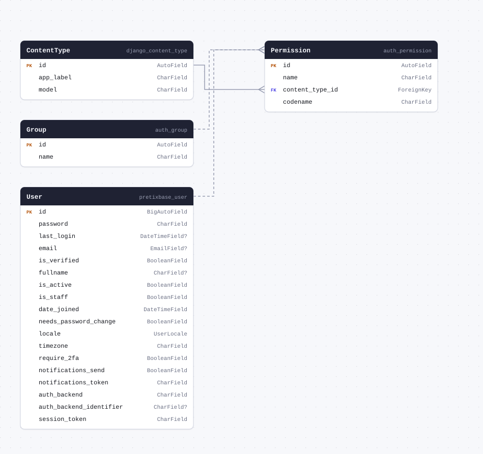

| Column | Field | Type | Null | Key | Default | Description |
| --- | --- | --- | --- | --- | --- | --- |
| `id` | `AutoField` | `integer` |  | PK | `autoincrement()` |  |
| `name` | `CharField` | `varchar(255)` |  |  |  |  |
| `content_type_id` | `ForeignKey` | `integer` |  | FK |  |  |
| `codename` | `CharField` | `varchar(100)` |  |  |  |  |

Indexes:

- index `auth_permission_content_type_id_2f476e4b` on `content_type_id`
- unique `auth_permission_content_type_id_codename_01ab375a_uniq` on `content_type_id`, `codename`

Relations:

- `content_type_id` → [ContentType](#contenttype).`id`, on delete cascade
- `group_set` — many to many with [Group](#group)
- `user_set` — many to many with [User](#user)

## Group

Table `auth_group`, app `auth`.

Groups are a generic way of categorizing users to apply permissions, or
some other label, to those users. A user can belong to any number of
groups.

A user in a group automatically has all the permissions granted to that
group. For example, if the group 'Site editors' has the permission
can_edit_home_page, any user in that group will have that permission.

Beyond permissions, groups are a convenient way to categorize users to
apply some label, or extended functionality, to them. For example, you
could create a group 'Special users', and you could write code that would
do special things to those users -- such as giving them access to a
members-only portion of your site, or sending them members-only email
messages.


| Column | Field | Type | Null | Key | Default | Description |
| --- | --- | --- | --- | --- | --- | --- |
| `id` | `AutoField` | `integer` |  | PK | `autoincrement()` |  |
| `name` | `CharField` | `varchar(150)` |  | unique |  |  |

Relations:

- `permissions` — many to many with [Permission](#permission)
- `user_set` — many to many with [User](#user)

## ContentType

Table `django_content_type`, app `contenttypes`.

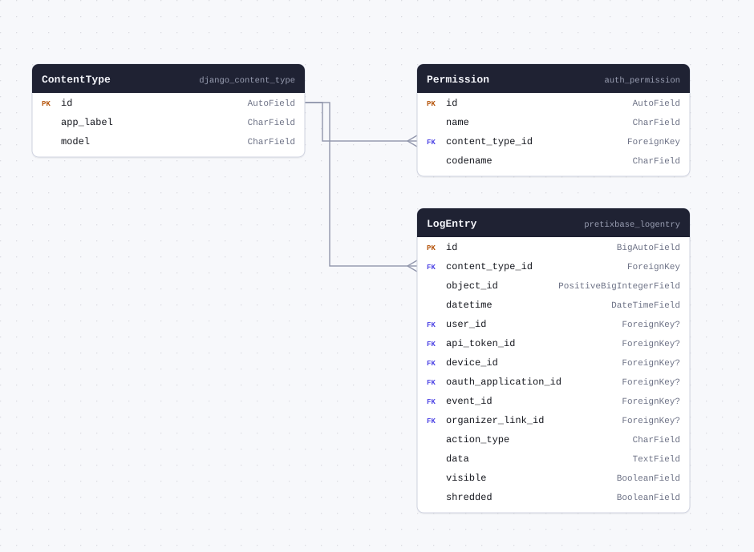

| Column | Field | Type | Null | Key | Default | Description |
| --- | --- | --- | --- | --- | --- | --- |
| `id` | `AutoField` | `integer` |  | PK | `autoincrement()` |  |
| `app_label` | `CharField` | `varchar(100)` |  |  |  |  |
| `model` | `CharField` | `varchar(100)` |  |  |  |  |

Indexes:

- unique `django_content_type_app_label_model_76bd3d3b_uniq` on `app_label`, `model`

Relations:

- [Permission](#permission).`content_type_id` → `id`, on delete cascade
- [LogEntry](#logentry).`content_type_id` → `id`, on delete cascade

## Session

Table `django_session`, app `sessions`.

Columns from `AbstractBaseSession` (abstract): `session_key`, `session_data`, `expire_date`.

Django provides full support for anonymous sessions. The session
framework lets you store and retrieve arbitrary data on a
per-site-visitor basis. It stores data on the server side and
abstracts the sending and receiving of cookies. Cookies contain a
session ID -- not the data itself.

The Django sessions framework is entirely cookie-based. It does
not fall back to putting session IDs in URLs. This is an intentional
design decision. Not only does that behavior make URLs ugly, it makes
your site vulnerable to session-ID theft via the "Referer" header.

For complete documentation on using Sessions in your code, consult
the sessions documentation that is shipped with Django (also available
on the Django web site).

| Column | Field | Type | Null | Key | Default | Description |
| --- | --- | --- | --- | --- | --- | --- |
| `session_key` | `CharField` | `varchar(40)` |  | PK |  |  |
| `session_data` | `TextField` | `text` |  |  |  |  |
| `expire_date` | `DateTimeField` | `datetime` |  |  |  |  |

Indexes:

- index `django_session_expire_date_a5c62663` on `expire_date`

## CachedFile

Table `pretixbase_cachedfile`, app `pretixbase`.

An uploaded file, with an optional expiry date.

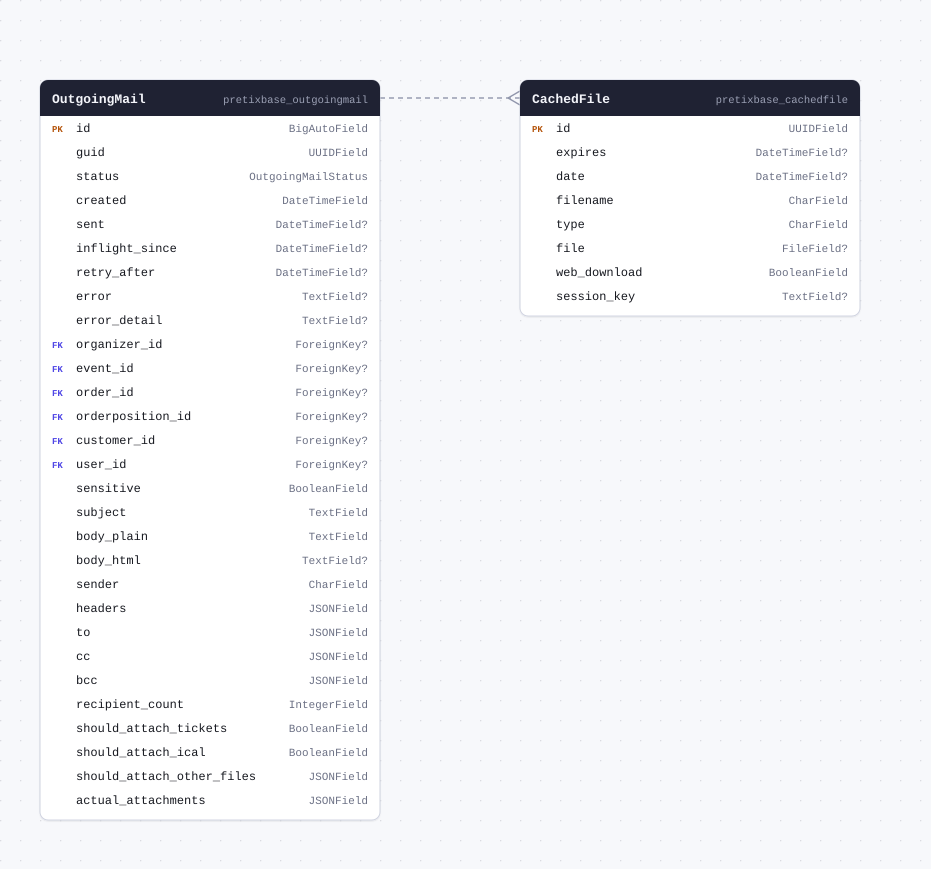

| Column | Field | Type | Null | Key | Default | Description |
| --- | --- | --- | --- | --- | --- | --- |
| `id` | `UUIDField` | `char(32)` |  | PK | `uuid4()` |  |
| `expires` | `DateTimeField` | `datetime` | yes |  |  |  |
| `date` | `DateTimeField` | `datetime` | yes |  |  |  |
| `filename` | `CharField` | `varchar(255)` |  |  |  |  |
| `type` | `CharField` | `varchar(255)` |  |  |  |  |
| `file` | `FileField` | `varchar(255)` | yes |  |  |  |
| `web_download` | `BooleanField` | `bool` |  |  | `True` |  |
| `session_key` | `TextField` | `text` | yes |  |  |  |

Relations:

- `outgoing_mails` — many to many with [OutgoingMail](#outgoingmail)

## TaxRule

Table `pretixbase_taxrule`, app `pretixbase`.

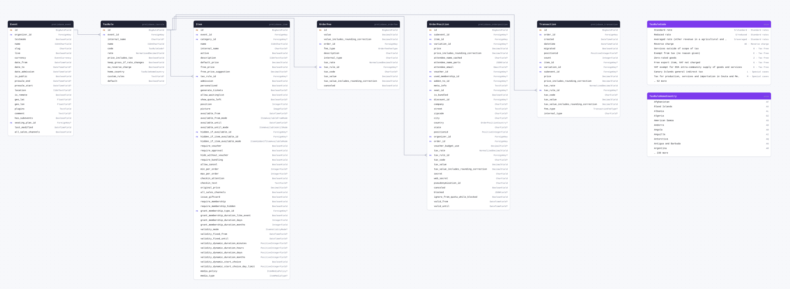

| Column | Field | Type | Null | Key | Default | Description |
| --- | --- | --- | --- | --- | --- | --- |
| `id` | `BigAutoField` | `integer` |  | PK | `autoincrement()` |  |
| `event_id` | `ForeignKey` | `bigint` |  | FK |  |  |
| `internal_name` | `CharField` | `varchar(190)` | yes |  |  |  |
| `name` | `I18nCharField` | `text` |  |  |  | Should be short, e.g. "VAT" |
| `code` | `TaxRuleCode` | `varchar(190)` | yes |  |  | If you help us understand what this tax rules legally is, we can use this information for eInvoices, exporting to accounting system, etc. |
| `rate` | `NormalizedDecimalField(7, 4)` | `decimal` |  |  |  |  |
| `price_includes_tax` | `BooleanField` | `bool` |  |  | `True` |  |
| `keep_gross_if_rate_changes` | `BooleanField` | `bool` |  |  | `False` |  |
| `eu_reverse_charge` | `BooleanField` | `bool` |  |  | `False` | <span class="label label-warning" data-toggle="tooltip" title="This feature will be removed in the future as it does not handle VAT for non-business customers in other EU countries in a way that works for all organizers. Use custom rules instead.">DEPRECATED</span> Not recommended. Most events will NOT be qualified for reverse charge since the place of taxation is the location of the event. This option disables charging VAT for all customers outside the EU and for business customers in different EU countries who entered a valid EU VAT ID. Only enable this option after consulting a tax counsel. No warranty given for correct tax calculation. USE AT YOUR OWN RISK. |
| `home_country` | `TaxRuleHomeCountry` | `varchar(2)` |  |  |  | Your country of residence. This is the country the EU reverse charge rule will not apply in, if configured above. |
| `custom_rules` | `TextField` | `text` | yes |  |  |  |
| `default` | `BooleanField` | `bool` |  |  | `False` |  |

Indexes:

- index `pretixbase_taxrule_event_id_178a74ee` on `event_id`
- unique `one_default_per_event` on `event_id` where `"default"`

Relations:

- `event_id` → [Event](#event).`id`, on delete cascade
- [Item](#item).`tax_rule_id` → `id`, on delete protect
- [OrderFee](#orderfee).`tax_rule_id` → `id`, on delete protect
- [OrderPosition](#orderposition).`tax_rule_id` → `id`, on delete protect
- [Transaction](#transaction).`tax_rule_id` → `id`, on delete protect

## GlobalSettingsObject_SettingsStore

Table `pretixbase_globalsettingsobject_settingsstore`, app `pretixbase`.

Columns from `BaseHierarkeyStoreModel` (abstract): `key`, `value`.

| Column | Field | Type | Null | Key | Default | Description |
| --- | --- | --- | --- | --- | --- | --- |
| `id` | `BigAutoField` | `integer` |  | PK | `autoincrement()` |  |
| `key` | `CharField` | `varchar(255)` |  |  |  |  |
| `value` | `TextField` | `text` |  |  |  |  |

Indexes:

- unique `pretixbase_globalsettingsobject_settingsstore_key_c85c6d29_uniq` on `key`

## User

Table `pretixbase_user`, app `pretixbase`.

Columns from `AbstractBaseUser` (abstract): `password`, `last_login`.

This is the user model used by pretix for authentication.

:param email: The user's email address, used for identification.
:type email: str
:param fullname: The user's full name. May be empty or null.
:type fullname: str
:param is_active: Whether this user account is activated.
:type is_active: bool
:param is_staff: ``True`` for system operators.
:type is_staff: bool
:param date_joined: The datetime of the user's registration.
:type date_joined: datetime
:param locale: The user's preferred locale code.
:type locale: str
:param needs_password_change: Whether this user's password needs to be changed.
:type needs_password_change: bool
:param timezone: The user's preferred timezone.
:type timezone: str
:param auth_backend: The identifier of the authentication backend plugin responsible for managing this user.
:type auth_backend: str
:param auth_backend_identifier: The native identifier of the user provided by a non-native authentication backend.
:type auth_backend_identifier: str

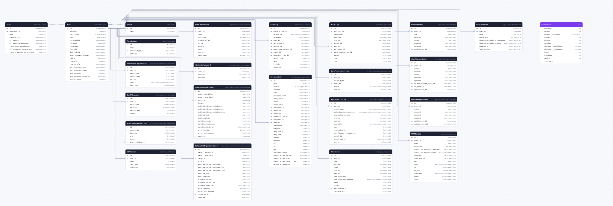

| Column | Field | Type | Null | Key | Default | Description |
| --- | --- | --- | --- | --- | --- | --- |
| `id` | `BigAutoField` | `integer` |  | PK | `autoincrement()` |  |
| `password` | `CharField` | `varchar(128)` |  |  |  |  |
| `last_login` | `DateTimeField` | `datetime` | yes |  |  |  |
| `email` | `EmailField` | `varchar(190)` | yes | unique |  |  |
| `is_verified` | `BooleanField` | `bool` |  |  | `False` |  |
| `fullname` | `CharField` | `varchar(255)` | yes |  |  |  |
| `is_active` | `BooleanField` | `bool` |  |  | `True` |  |
| `is_staff` | `BooleanField` | `bool` |  |  | `False` |  |
| `date_joined` | `DateTimeField` | `datetime` |  |  | `now()` |  |
| `needs_password_change` | `BooleanField` | `bool` |  |  | `False` |  |
| `locale` | `UserLocale` | `varchar(50)` |  |  | `'en'` |  |
| `timezone` | `CharField` | `varchar(100)` |  |  | `'UTC'` |  |
| `require_2fa` | `BooleanField` | `bool` |  |  | `False` |  |
| `notifications_send` | `BooleanField` | `bool` |  |  | `True` | If turned off, you will not get any notifications. |
| `notifications_token` | `CharField` | `varchar(255)` |  |  | `generate_notifications_token()` |  |
| `auth_backend` | `CharField` | `varchar(255)` |  |  | `'native'` |  |
| `auth_backend_identifier` | `CharField` | `varchar(190)` | yes |  |  |  |
| `session_token` | `CharField` | `varchar(32)` |  |  | `generate_session_token()` |  |

Indexes:

- index `pretixbase_user_auth_backend_identifier_44ab37d0` on `auth_backend_identifier`
- unique `pretixbase_user_auth_backend_auth_backend_identifier_8727d359_uniq` on `auth_backend`, `auth_backend_identifier`

Relations:

- `groups` — many to many with [Group](#group)
- `user_permissions` — many to many with [Permission](#permission)
- [UserKnownLoginSource](#userknownloginsource).`user_id` → `id`, on delete cascade
- [StaffSession](#staffsession).`user_id` → `id`, on delete protect
- [StaffSessionAuditLog](#staffsessionauditlog).`impersonating_id` → `id`, on delete protect
- [U2FDevice](#u2fdevice).`user_id` → `id`, on delete cascade
- [WebAuthnDevice](#webauthndevice).`user_id` → `id`, on delete cascade
- [HistoricPassword](#historicpassword).`user_id` → `id`, on delete cascade
- `teams` — many to many with [Team](#team)
- [ScheduledEventExport](#scheduledeventexport).`owner_id` → `id`, on delete protect
- [ScheduledOrganizerExport](#scheduledorganizerexport).`owner_id` → `id`, on delete protect
- [LogEntry](#logentry).`user_id` → `id`, on delete protect
- [OutgoingMail](#outgoingmail).`user_id` → `id`, on delete cascade
- [PrintLog](#printlog).`user_id` → `id`, on delete protect
- [NotificationSetting](#notificationsetting).`user_id` → `id`, on delete cascade
- [OAuthApplication](#oauthapplication).`user_id` → `id`, on delete cascade
- [OAuthGrant](#oauthgrant).`user_id` → `id`, on delete cascade
- [OAuthIDToken](#oauthidtoken).`user_id` → `id`, on delete cascade
- [OAuthAccessToken](#oauthaccesstoken).`user_id` → `id`, on delete cascade
- [OAuthRefreshToken](#oauthrefreshtoken).`user_id` → `id`, on delete cascade
- [TOTPDevice](#totpdevice).`user_id` → `id`, on delete cascade
- [StaticDevice](#staticdevice).`user_id` → `id`, on delete cascade

## UserKnownLoginSource

Table `pretixbase_userknownloginsource`, app `pretixbase`.

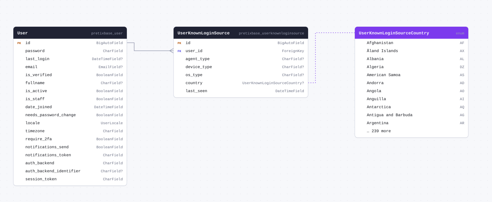

| Column | Field | Type | Null | Key | Default | Description |
| --- | --- | --- | --- | --- | --- | --- |
| `id` | `BigAutoField` | `integer` |  | PK | `autoincrement()` |  |
| `user_id` | `ForeignKey` | `bigint` |  | FK |  |  |
| `agent_type` | `CharField` | `varchar(255)` | yes |  |  |  |
| `device_type` | `CharField` | `varchar(255)` | yes |  |  |  |
| `os_type` | `CharField` | `varchar(255)` | yes |  |  |  |
| `country` | `UserKnownLoginSourceCountry` | `varchar(2)` | yes |  |  |  |
| `last_seen` | `DateTimeField` | `datetime` |  |  |  |  |

Indexes:

- index `pretixbase_userknownloginsource_user_id_ed8d12c5` on `user_id`
- unique `pretixbase_userknownloginsource_user_id_agent_type_device_type_os_type_country_55deecc8_uniq` on `user_id`, `agent_type`, `device_type`, `os_type`, `country`

Relations:

- `user_id` → [User](#user).`id`, on delete cascade

## StaffSession

Table `pretixbase_staffsession`, app `pretixbase`.

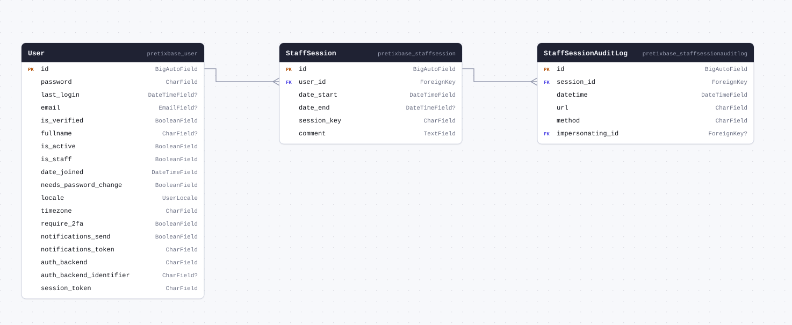

| Column | Field | Type | Null | Key | Default | Description |
| --- | --- | --- | --- | --- | --- | --- |
| `id` | `BigAutoField` | `integer` |  | PK | `autoincrement()` |  |
| `user_id` | `ForeignKey` | `bigint` |  | FK |  |  |
| `date_start` | `DateTimeField` | `datetime` |  |  | `now()` |  |
| `date_end` | `DateTimeField` | `datetime` | yes |  |  |  |
| `session_key` | `CharField` | `varchar(255)` |  |  |  |  |
| `comment` | `TextField` | `text` |  |  |  |  |

Indexes:

- index `pretixbase_staffsession_user_id_dbe96c7a` on `user_id`

Relations:

- `user_id` → [User](#user).`id`, on delete protect
- [StaffSessionAuditLog](#staffsessionauditlog).`session_id` → `id`, on delete protect

## StaffSessionAuditLog

Table `pretixbase_staffsessionauditlog`, app `pretixbase`.

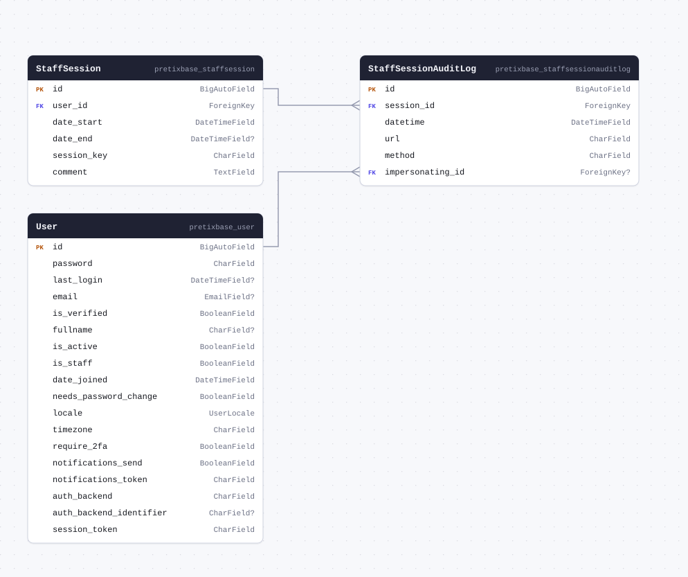

| Column | Field | Type | Null | Key | Default | Description |
| --- | --- | --- | --- | --- | --- | --- |
| `id` | `BigAutoField` | `integer` |  | PK | `autoincrement()` |  |
| `session_id` | `ForeignKey` | `bigint` |  | FK |  |  |
| `datetime` | `DateTimeField` | `datetime` |  |  | `now()` |  |
| `url` | `CharField` | `varchar(255)` |  |  |  |  |
| `method` | `CharField` | `varchar(255)` |  |  |  |  |
| `impersonating_id` | `ForeignKey` | `bigint` | yes | FK |  |  |

Indexes:

- index `pretixbase_staffsessionauditlog_session_id_48ead8a1` on `session_id`
- index `pretixbase_staffsessionauditlog_impersonating_id_7d7562e3` on `impersonating_id`

Relations:

- `session_id` → [StaffSession](#staffsession).`id`, on delete protect
- `impersonating_id` → [User](#user).`id`, on delete protect

## U2FDevice

Table `pretixbase_u2fdevice`, app `pretixbase`.

Columns from `Device` (abstract): `user_id`, `name`, `confirmed`.

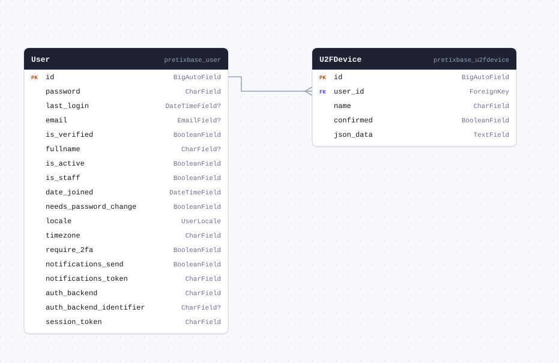

| Column | Field | Type | Null | Key | Default | Description |
| --- | --- | --- | --- | --- | --- | --- |
| `id` | `BigAutoField` | `integer` |  | PK | `autoincrement()` |  |
| `user_id` | `ForeignKey` | `bigint` |  | FK |  | The user that this device belongs to. |
| `name` | `CharField` | `varchar(64)` |  |  |  | The human-readable name of this device. |
| `confirmed` | `BooleanField` | `bool` |  |  | `True` | Is this device ready for use? |
| `json_data` | `TextField` | `text` |  |  |  |  |

Indexes:

- index `pretixbase_u2fdevice_user_id_83ffb7c2` on `user_id`

Relations:

- `user_id` → [User](#user).`id`, on delete cascade

## WebAuthnDevice

Table `pretixbase_webauthndevice`, app `pretixbase`.

Columns from `Device` (abstract): `user_id`, `name`, `confirmed`.

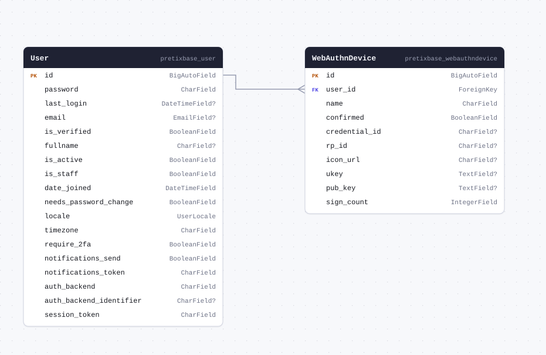

| Column | Field | Type | Null | Key | Default | Description |
| --- | --- | --- | --- | --- | --- | --- |
| `id` | `BigAutoField` | `integer` |  | PK | `autoincrement()` |  |
| `user_id` | `ForeignKey` | `bigint` |  | FK |  | The user that this device belongs to. |
| `name` | `CharField` | `varchar(64)` |  |  |  | The human-readable name of this device. |
| `confirmed` | `BooleanField` | `bool` |  |  | `True` | Is this device ready for use? |
| `credential_id` | `CharField` | `varchar(255)` | yes |  |  |  |
| `rp_id` | `CharField` | `varchar(255)` | yes |  |  |  |
| `icon_url` | `CharField` | `varchar(255)` | yes |  |  |  |
| `ukey` | `TextField` | `text` | yes |  |  |  |
| `pub_key` | `TextField` | `text` | yes |  |  |  |
| `sign_count` | `IntegerField` | `integer` |  |  | `0` |  |

Indexes:

- index `pretixbase_webauthndevice_user_id_7fbd58ca` on `user_id`

Relations:

- `user_id` → [User](#user).`id`, on delete cascade

## HistoricPassword

Table `pretixbase_historicpassword`, app `pretixbase`.

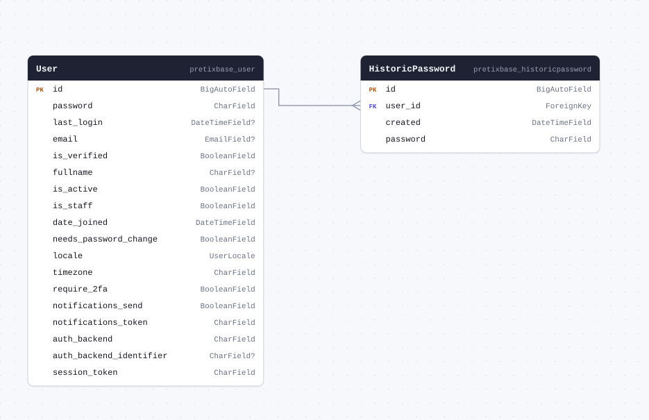

| Column | Field | Type | Null | Key | Default | Description |
| --- | --- | --- | --- | --- | --- | --- |
| `id` | `BigAutoField` | `integer` |  | PK | `autoincrement()` |  |
| `user_id` | `ForeignKey` | `bigint` |  | FK |  |  |
| `created` | `DateTimeField` | `datetime` |  |  | `now()` |  |
| `password` | `CharField` | `varchar(128)` |  |  |  |  |

Indexes:

- index `pretixbase_historicpassword_user_id_577b9c9f` on `user_id`

Relations:

- `user_id` → [User](#user).`id`, on delete cascade

## CheckinList

Table `pretixbase_checkinlist`, app `pretixbase`.

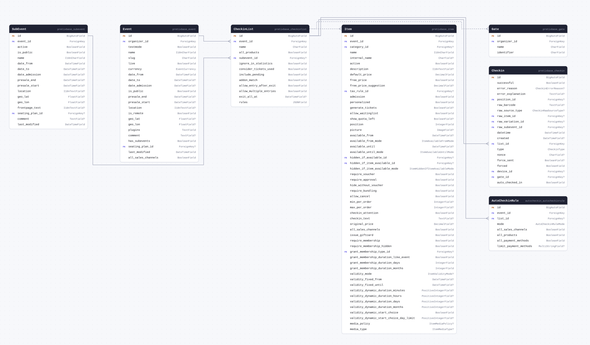

| Column | Field | Type | Null | Key | Default | Description |
| --- | --- | --- | --- | --- | --- | --- |
| `id` | `BigAutoField` | `integer` |  | PK | `autoincrement()` |  |
| `event_id` | `ForeignKey` | `bigint` |  | FK |  |  |
| `name` | `CharField` | `varchar(190)` |  |  |  |  |
| `all_products` | `BooleanField` | `bool` |  |  | `True` |  |
| `subevent_id` | `ForeignKey` | `bigint` | yes | FK |  | If you choose "all dates", tickets will be considered part of this list and valid for check-in regardless of which date they are purchased for. You can limit their validity through the advanced check-in rules, though. |
| `ignore_in_statistics` | `BooleanField` | `bool` |  |  | `False` |  |
| `consider_tickets_used` | `BooleanField` | `bool` |  |  | `True` | This is relevant in various situations, e.g. for deciding if a ticket can still be canceled by the customer. |
| `include_pending` | `BooleanField` | `bool` |  |  | `False` | With this option, people will be able to check in even if the order has not been paid. |
| `addon_match` | `BooleanField` | `bool` |  |  | `False` | A scan will only be possible if the check-in list is configured such that there is always exactly one matching add-on ticket. Ambiguous scans will be rejected.. |
| `allow_entry_after_exit` | `BooleanField` | `bool` |  |  | `True` |  |
| `allow_multiple_entries` | `BooleanField` | `bool` |  |  | `False` | Use this option to turn off warnings if a ticket is scanned a second time. |
| `exit_all_at` | `DateTimeField` | `datetime` | yes |  |  |  |
| `rules` | `JSONField` | `text` |  |  | `dict()` |  |

Indexes:

- index `pretixbase_checkinlist_event_id_cf987659` on `event_id`
- index `pretixbase_checkinlist_subevent_id_bd5b8106` on `subevent_id`

Relations:

- `event_id` → [Event](#event).`id`, on delete cascade
- `subevent_id` → [SubEvent](#subevent).`id`, on delete cascade
- `limit_products` — many to many with [Item](#item)
- `gates` — many to many with [Gate](#gate)
- [Checkin](#checkin).`list_id` → `id`, on delete protect
- [AutoCheckinRule](#autocheckinrule).`list_id` → `id`, on delete cascade

## Checkin

Table `pretixbase_checkin`, app `pretixbase`.

A check-in object is created when a ticket is scanned with our scanning apps.

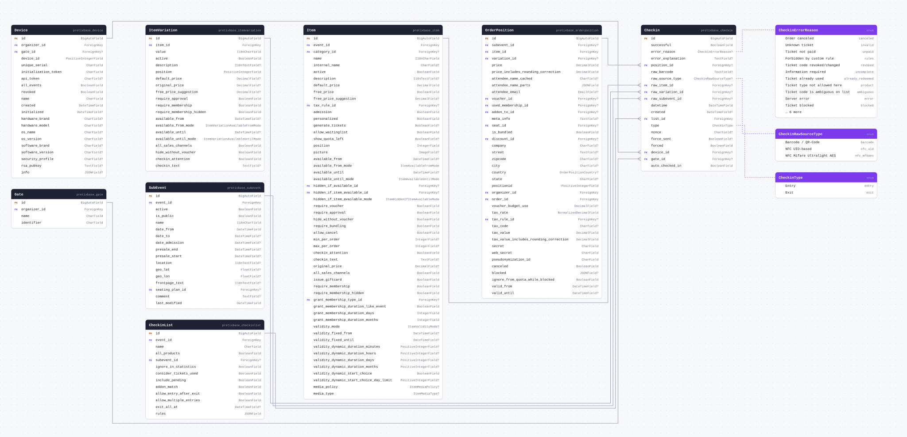

| Column | Field | Type | Null | Key | Default | Description |
| --- | --- | --- | --- | --- | --- | --- |
| `id` | `BigAutoField` | `integer` |  | PK | `autoincrement()` |  |
| `successful` | `BooleanField` | `bool` |  |  | `True` |  |
| `error_reason` | `CheckinErrorReason` | `varchar(100)` | yes |  |  |  |
| `error_explanation` | `TextField` | `text` | yes |  |  |  |
| `position_id` | `ForeignKey` | `bigint` | yes | FK |  |  |
| `raw_barcode` | `TextField` | `text` | yes |  |  |  |
| `raw_source_type` | `CheckinRawSourceType` | `varchar(100)` | yes |  |  |  |
| `raw_item_id` | `ForeignKey` | `bigint` | yes | FK |  |  |
| `raw_variation_id` | `ForeignKey` | `bigint` | yes | FK |  |  |
| `raw_subevent_id` | `ForeignKey` | `bigint` | yes | FK |  |  |
| `datetime` | `DateTimeField` | `datetime` |  |  | `now()` |  |
| `created` | `DateTimeField` | `datetime` | yes |  | `now()` |  |
| `list_id` | `ForeignKey` | `bigint` |  | FK |  |  |
| `type` | `CheckinType` | `varchar(100)` |  |  | `'entry'` |  |
| `nonce` | `CharField` | `varchar(190)` | yes |  |  |  |
| `force_sent` | `BooleanField` | `bool` | yes |  | `False` |  |
| `forced` | `BooleanField` | `bool` |  |  | `False` |  |
| `device_id` | `ForeignKey` | `bigint` | yes | FK |  |  |
| `gate_id` | `ForeignKey` | `bigint` | yes | FK |  |  |
| `auto_checked_in` | `BooleanField` | `bool` |  |  | `False` |  |

Indexes:

- index `pretixbase_checkin_position_id_2b4241d7` on `position_id`
- index `pretixbase_checkin_raw_item_id_30958c24` on `raw_item_id`
- index `pretixbase_checkin_raw_variation_id_7a127580` on `raw_variation_id`
- index `pretixbase_checkin_raw_subevent_id_2524e6b7` on `raw_subevent_id`
- index `pretixbase_checkin_list_id_edd48d9f` on `list_id`
- index `pretixbase_checkin_device_id_b7b00655` on `device_id`
- index `pretixbase_checkin_gate_id_be6dcaba` on `gate_id`

Relations:

- `position_id` → [OrderPosition](#orderposition).`id`, on delete cascade
- `raw_item_id` → [Item](#item).`id`, on delete set null
- `raw_variation_id` → [ItemVariation](#itemvariation).`id`, on delete set null
- `raw_subevent_id` → [SubEvent](#subevent).`id`, on delete set null
- `list_id` → [CheckinList](#checkinlist).`id`, on delete protect
- `device_id` → [Device](#device).`id`, on delete protect
- `gate_id` → [Gate](#gate).`id`, on delete set null

## ExchangeRate

Table `pretixbase_exchangerate`, app `pretixbase`.

| Column | Field | Type | Null | Key | Default | Description |
| --- | --- | --- | --- | --- | --- | --- |
| `id` | `BigAutoField` | `integer` |  | PK | `autoincrement()` |  |
| `source` | `CharField` | `varchar(100)` |  |  |  |  |
| `source_date` | `DateField` | `date` |  |  |  |  |
| `updated` | `DateTimeField` | `datetime` |  |  | `now()` |  |
| `source_currency` | `CharField` | `varchar(3)` |  |  |  |  |
| `other_currency` | `CharField` | `varchar(3)` |  |  |  |  |
| `rate` | `DecimalField(16, 6)` | `decimal` |  |  |  |  |

Indexes:

- unique `pretixbase_exchangerate_source_source_currency_other_currency_22feed73_uniq` on `source`, `source_currency`, `other_currency`

## GiftCardAcceptance

Table `pretixbase_giftcardacceptance`, app `pretixbase`.

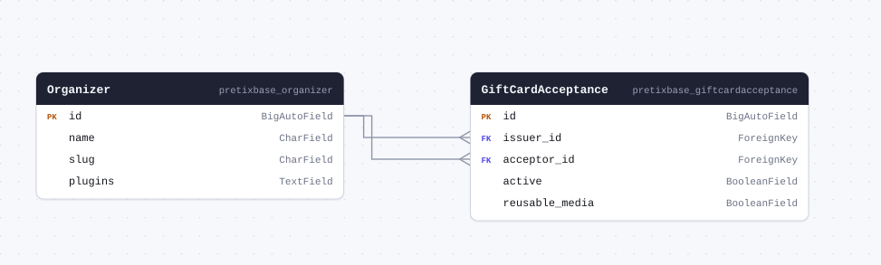

| Column | Field | Type | Null | Key | Default | Description |
| --- | --- | --- | --- | --- | --- | --- |
| `id` | `BigAutoField` | `integer` |  | PK | `autoincrement()` |  |
| `issuer_id` | `ForeignKey` | `bigint` |  | FK |  |  |
| `acceptor_id` | `ForeignKey` | `bigint` |  | FK |  |  |
| `active` | `BooleanField` | `bool` |  |  | `True` |  |
| `reusable_media` | `BooleanField` | `bool` |  |  | `False` |  |

Indexes:

- index `pretixbase_giftcardacceptance_issuer_id_740d7cdc` on `issuer_id`
- index `pretixbase_giftcardacceptance_acceptor_id_5f8d47de` on `acceptor_id`
- unique `pretixbase_giftcardacceptance_issuer_id_acceptor_id_bf087667_uniq` on `issuer_id`, `acceptor_id`

Relations:

- `issuer_id` → [Organizer](#organizer).`id`, on delete cascade
- `acceptor_id` → [Organizer](#organizer).`id`, on delete cascade

## GiftCard

Table `pretixbase_giftcard`, app `pretixbase`.

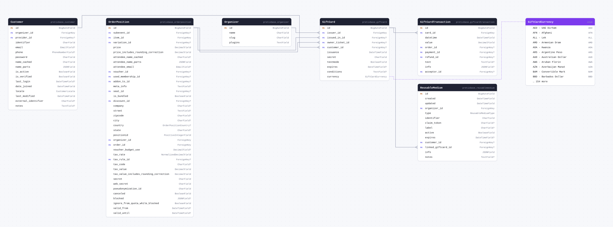

| Column | Field | Type | Null | Key | Default | Description |
| --- | --- | --- | --- | --- | --- | --- |
| `id` | `BigAutoField` | `integer` |  | PK | `autoincrement()` |  |
| `issuer_id` | `ForeignKey` | `bigint` |  | FK |  |  |
| `issued_in_id` | `ForeignKey` | `bigint` | yes | FK |  |  |
| `owner_ticket_id` | `ForeignKey` | `bigint` | yes | FK |  |  |
| `customer_id` | `ForeignKey` | `bigint` | yes | FK |  |  |
| `issuance` | `DateTimeField` | `datetime` |  |  | `now()` |  |
| `secret` | `CharField` | `varchar(190)` |  |  |  |  |
| `testmode` | `BooleanField` | `bool` |  |  | `False` |  |
| `expires` | `DateTimeField` | `datetime` | yes |  |  |  |
| `conditions` | `TextField` | `text` | yes |  |  |  |
| `currency` | `GiftCardCurrency` | `varchar(10)` |  |  |  |  |

Indexes:

- index `pretixbase_giftcard_issuer_id_57c2f4dd` on `issuer_id`
- index `pretixbase_giftcard_issued_in_id_8e59beb9` on `issued_in_id`
- index `pretixbase_giftcard_owner_ticket_id_d35b98d5` on `owner_ticket_id`
- index `pretixbase_giftcard_customer_id_c74534c6` on `customer_id`
- index `pretixbase_giftcard_secret_8368bc5a` on `secret`
- unique `pretixbase_giftcard_secret_issuer_id_fcc3d2d1_uniq` on `secret`, `issuer_id`

Relations:

- `issuer_id` → [Organizer](#organizer).`id`, on delete protect
- `issued_in_id` → [OrderPosition](#orderposition).`id`, on delete protect
- `owner_ticket_id` → [OrderPosition](#orderposition).`id`, on delete protect
- `customer_id` → [Customer](#customer).`id`, on delete protect
- [GiftCardTransaction](#giftcardtransaction).`card_id` → `id`, on delete protect
- [ReusableMedium](#reusablemedium).`linked_giftcard_id` → `id`, on delete set null

## GiftCardTransaction

Table `pretixbase_giftcardtransaction`, app `pretixbase`.

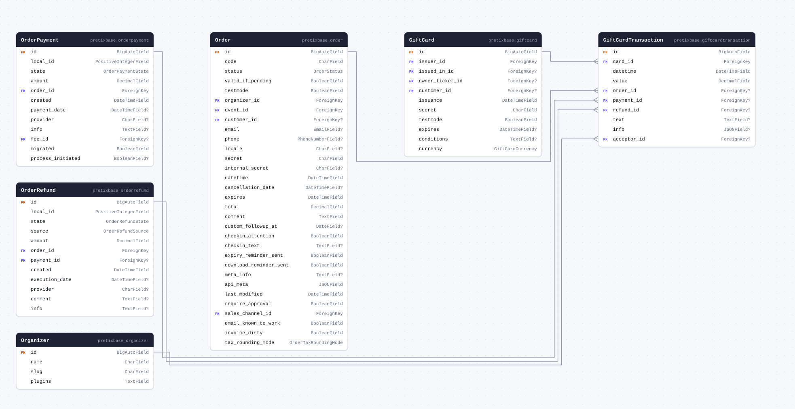

| Column | Field | Type | Null | Key | Default | Description |
| --- | --- | --- | --- | --- | --- | --- |
| `id` | `BigAutoField` | `integer` |  | PK | `autoincrement()` |  |
| `card_id` | `ForeignKey` | `bigint` |  | FK |  |  |
| `datetime` | `DateTimeField` | `datetime` |  |  | `now()` |  |
| `value` | `DecimalField(13, 2)` | `decimal` |  |  |  |  |
| `order_id` | `ForeignKey` | `bigint` | yes | FK |  |  |
| `payment_id` | `ForeignKey` | `bigint` | yes | FK |  |  |
| `refund_id` | `ForeignKey` | `bigint` | yes | FK |  |  |
| `text` | `TextField` | `text` | yes |  |  |  |
| `info` | `JSONField` | `text` | yes |  |  |  |
| `acceptor_id` | `ForeignKey` | `bigint` | yes | FK |  |  |

Indexes:

- index `pretixbase_giftcardtransaction_card_id_2b213307` on `card_id`
- index `pretixbase_giftcardtransaction_order_id_9cc06375` on `order_id`
- index `pretixbase_giftcardtransaction_payment_id_21f4d416` on `payment_id`
- index `pretixbase_giftcardtransaction_refund_id_4852a01b` on `refund_id`
- index `pretixbase_giftcardtransaction_acceptor_id_790772af` on `acceptor_id`

Relations:

- `card_id` → [GiftCard](#giftcard).`id`, on delete protect
- `order_id` → [Order](#order).`id`, on delete protect
- `payment_id` → [OrderPayment](#orderpayment).`id`, on delete protect
- `refund_id` → [OrderRefund](#orderrefund).`id`, on delete protect
- `acceptor_id` → [Organizer](#organizer).`id`, on delete protect

## Organizer

Table `pretixbase_organizer`, app `pretixbase`.

This model represents an entity organizing events, e.g. a company, institution,
charity, person, …

:param name: The organizer's name
:type name: str
:param slug: A globally unique, short name for this organizer, to be used
             in URLs and similar places.
:type slug: str
:param plugins: A comma-separated list of plugin names that are active for this organizer.
:type plugins: str

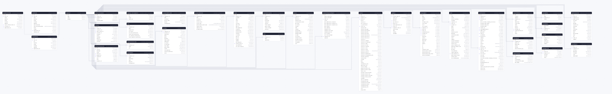

| Column | Field | Type | Null | Key | Default | Description |
| --- | --- | --- | --- | --- | --- | --- |
| `id` | `BigAutoField` | `integer` |  | PK | `autoincrement()` |  |
| `name` | `CharField` | `varchar(200)` |  |  |  |  |
| `slug` | `CharField` | `varchar(50)` |  | unique |  | Should be short, only contain lowercase letters, numbers, dots, and dashes. Every slug can only be used once. This is being used in URLs to refer to your organizer accounts and your events. |
| `plugins` | `TextField` | `text` |  |  | `''` |  |

Relations:

- [GiftCardAcceptance](#giftcardacceptance).`issuer_id` → `id`, on delete cascade
- [GiftCardAcceptance](#giftcardacceptance).`acceptor_id` → `id`, on delete cascade
- [GiftCard](#giftcard).`issuer_id` → `id`, on delete protect
- [GiftCardTransaction](#giftcardtransaction).`acceptor_id` → `id`, on delete protect
- [Organizer_SettingsStore](#organizer_settingsstore).`object_id` → `id`, on delete cascade
- [Team](#team).`organizer_id` → `id`, on delete cascade
- [OrganizerFooterLink](#organizerfooterlink).`organizer_id` → `id`, on delete cascade
- [SalesChannel](#saleschannel).`organizer_id` → `id`, on delete cascade
- [CustomerSSOProvider](#customerssoprovider).`organizer_id` → `id`, on delete cascade
- [Customer](#customer).`organizer_id` → `id`, on delete cascade
- [CustomerSSOClient](#customerssoclient).`organizer_id` → `id`, on delete cascade
- [Event](#event).`organizer_id` → `id`, on delete protect
- [EventMetaProperty](#eventmetaproperty).`organizer_id` → `id`, on delete cascade
- [Gate](#gate).`organizer_id` → `id`, on delete protect
- [Device](#device).`organizer_id` → `id`, on delete protect
- [ScheduledOrganizerExport](#scheduledorganizerexport).`organizer_id` → `id`, on delete cascade
- [Invoice](#invoice).`organizer_id` → `id`, on delete protect
- [LogEntry](#logentry).`organizer_id` → `id`, on delete protect
- [OutgoingMail](#outgoingmail).`organizer_id` → `id`, on delete cascade
- [Order](#order).`organizer_id` → `id`, on delete cascade
- [OrderPosition](#orderposition).`organizer_id` → `id`, on delete cascade
- [ReusableMedium](#reusablemedium).`organizer_id` → `id`, on delete protect
- [MediumKeySet](#mediumkeyset).`organizer_id` → `id`, on delete cascade
- [MembershipType](#membershiptype).`organizer_id` → `id`, on delete cascade
- [SeatingPlan](#seatingplan).`organizer_id` → `id`, on delete cascade
- [KnownDomain](#knowndomain).`organizer_id` → `id`, on delete cascade
- `oauthgrant_set` — many to many with [OAuthGrant](#oauthgrant)
- `oauthidtoken_set` — many to many with [OAuthIDToken](#oauthidtoken)
- `oauthaccesstoken_set` — many to many with [OAuthAccessToken](#oauthaccesstoken)
- [WebHook](#webhook).`organizer_id` → `id`, on delete cascade
- [BankImportJob](#bankimportjob).`organizer_id` → `id`, on delete cascade
- [BankTransaction](#banktransaction).`organizer_id` → `id`, on delete cascade
- [RefundExport](#refundexport).`organizer_id` → `id`, on delete protect

## Organizer_SettingsStore

Table `pretixbase_organizer_settingsstore`, app `pretixbase`.

Columns from `BaseHierarkeyStoreModel` (abstract): `key`, `value`.

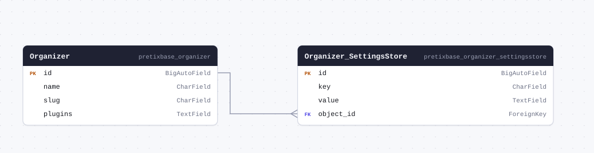

| Column | Field | Type | Null | Key | Default | Description |
| --- | --- | --- | --- | --- | --- | --- |
| `id` | `BigAutoField` | `integer` |  | PK | `autoincrement()` |  |
| `key` | `CharField` | `varchar(255)` |  |  |  |  |
| `value` | `TextField` | `text` |  |  |  |  |
| `object_id` | `ForeignKey` | `bigint` |  | FK |  |  |

Indexes:

- index `pretixbase_organizer_settingsstore_object_id_b55adabf` on `object_id`
- unique `pretixbase_organizer_settingsstore_object_id_key_de775204_uniq` on `object_id`, `key`

Relations:

- `object_id` → [Organizer](#organizer).`id`, on delete cascade

## Team

Table `pretixbase_team`, app `pretixbase`.

A team is a collection of people given certain access rights to one or more events of an organizer.

:param name: The name of this team
:type name: str
:param organizer: The organizer this team belongs to
:type organizer: Organizer
:param members: A set of users who belong to this team
:param all_events: Whether this team has access to all events of this organizer
:type all_events: bool
:param limit_events: A set of events this team has access to. Irrelevant if ``all_events`` is ``True``.

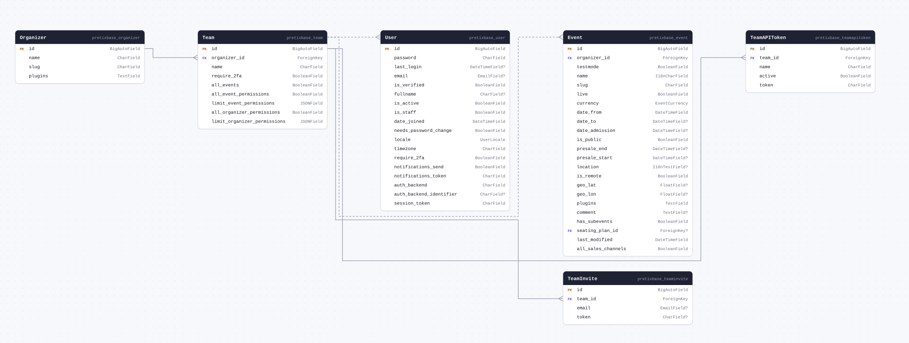

| Column | Field | Type | Null | Key | Default | Description |
| --- | --- | --- | --- | --- | --- | --- |
| `id` | `BigAutoField` | `integer` |  | PK | `autoincrement()` |  |
| `organizer_id` | `ForeignKey` | `bigint` |  | FK |  |  |
| `name` | `CharField` | `varchar(190)` |  |  |  |  |
| `require_2fa` | `BooleanField` | `bool` |  |  | `False` | If you turn this on, all members of the team will be required to either set up two-factor authentication or leave the team. The setting may take a few minutes to become effective for all users. |
| `all_events` | `BooleanField` | `bool` |  |  | `False` |  |
| `all_event_permissions` | `BooleanField` | `bool` |  |  | `False` |  |
| `limit_event_permissions` | `JSONField` | `text` |  |  | `dict()` |  |
| `all_organizer_permissions` | `BooleanField` | `bool` |  |  | `False` |  |
| `limit_organizer_permissions` | `JSONField` | `text` |  |  | `dict()` |  |

Indexes:

- index `pretixbase_team_organizer_id_05a40a53` on `organizer_id`

Relations:

- `organizer_id` → [Organizer](#organizer).`id`, on delete cascade
- `members` — many to many with [User](#user)
- `limit_events` — many to many with [Event](#event)
- [TeamInvite](#teaminvite).`team_id` → `id`, on delete cascade
- [TeamAPIToken](#teamapitoken).`team_id` → `id`, on delete cascade

## TeamInvite

Table `pretixbase_teaminvite`, app `pretixbase`.

A TeamInvite represents someone who has been invited to a team but hasn't accept the invitation
yet.

:param team: The team the person is invited to
:type team: Team
:param email: The email the invite has been sent to
:type email: str
:param token: The secret required to redeem the invite
:type token: str

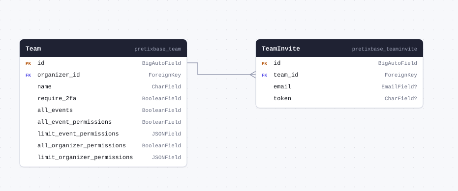

| Column | Field | Type | Null | Key | Default | Description |
| --- | --- | --- | --- | --- | --- | --- |
| `id` | `BigAutoField` | `integer` |  | PK | `autoincrement()` |  |
| `team_id` | `ForeignKey` | `bigint` |  | FK |  |  |
| `email` | `EmailField` | `varchar(254)` | yes |  |  |  |
| `token` | `CharField` | `varchar(64)` | yes |  | `generate_invite_token()` |  |

Indexes:

- index `pretixbase_teaminvite_team_id_bfe11558` on `team_id`

Relations:

- `team_id` → [Team](#team).`id`, on delete cascade

## TeamAPIToken

Table `pretixbase_teamapitoken`, app `pretixbase`.

A TeamAPIToken represents an API token that has the same access level as the team it belongs to.

:param team: The team the person is invited to
:type team: Team
:param name: A human-readable name for the token
:type name: str
:param active: Whether or not this token is active
:type active: bool
:param token: The secret required to submit to the API
:type token: str

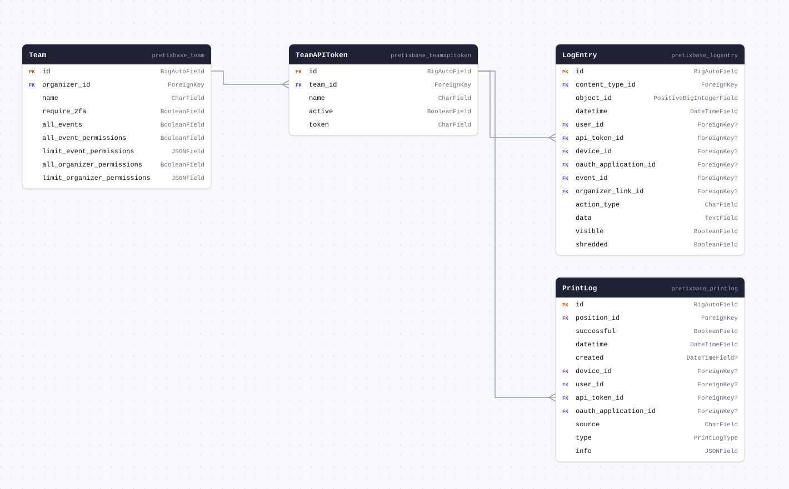

| Column | Field | Type | Null | Key | Default | Description |
| --- | --- | --- | --- | --- | --- | --- |
| `id` | `BigAutoField` | `integer` |  | PK | `autoincrement()` |  |
| `team_id` | `ForeignKey` | `bigint` |  | FK |  |  |
| `name` | `CharField` | `varchar(190)` |  |  |  |  |
| `active` | `BooleanField` | `bool` |  |  | `True` |  |
| `token` | `CharField` | `varchar(64)` |  |  | `generate_api_token()` |  |

Indexes:

- index `pretixbase_teamapitoken_team_id_7c6c0b4b` on `team_id`

Relations:

- `team_id` → [Team](#team).`id`, on delete cascade
- [LogEntry](#logentry).`api_token_id` → `id`, on delete protect
- [PrintLog](#printlog).`api_token_id` → `id`, on delete protect

## OrganizerFooterLink

Table `pretixbase_organizerfooterlink`, app `pretixbase`.

A footer link assigned to an organizer.

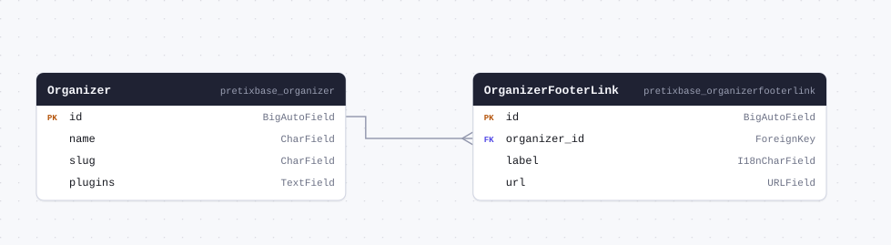

| Column | Field | Type | Null | Key | Default | Description |
| --- | --- | --- | --- | --- | --- | --- |
| `id` | `BigAutoField` | `integer` |  | PK | `autoincrement()` |  |
| `organizer_id` | `ForeignKey` | `bigint` |  | FK |  |  |
| `label` | `I18nCharField` | `text` |  |  |  |  |
| `url` | `URLField` | `varchar(200)` |  |  |  |  |

Indexes:

- index `pretixbase_organizerfooterlink_organizer_id_ffdf1d52` on `organizer_id`

Relations:

- `organizer_id` → [Organizer](#organizer).`id`, on delete cascade

## SalesChannel

Table `pretixbase_saleschannel`, app `pretixbase`.

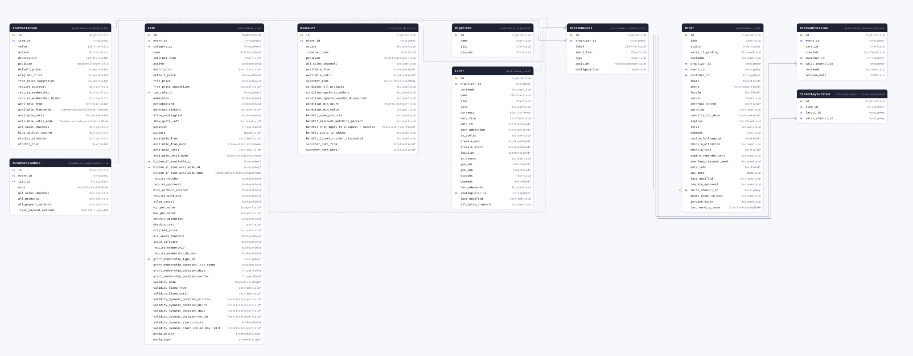

| Column | Field | Type | Null | Key | Default | Description |
| --- | --- | --- | --- | --- | --- | --- |
| `id` | `BigAutoField` | `integer` |  | PK | `autoincrement()` |  |
| `organizer_id` | `ForeignKey` | `bigint` |  | FK |  |  |
| `label` | `I18nCharField` | `text` |  |  |  |  |
| `identifier` | `CharField` | `varchar(200)` |  |  |  |  |
| `type` | `CharField` | `varchar(200)` |  |  |  |  |
| `position` | `PositiveIntegerField` | `integer unsigned` |  |  | `0` |  |
| `configuration` | `JSONField` | `text` |  |  | `dict()` |  |

Indexes:

- index `pretixbase_saleschannel_organizer_id_8cace410` on `organizer_id`
- unique `pretixbase_saleschannel_organizer_id_identifier_fb9d1252_uniq` on `organizer_id`, `identifier`

Relations:

- `organizer_id` → [Organizer](#organizer).`id`, on delete cascade
- `event_set` — many to many with [Event](#event)
- `discount_set` — many to many with [Discount](#discount)
- `item_set` — many to many with [Item](#item)
- `itemvariation_set` — many to many with [ItemVariation](#itemvariation)
- [Order](#order).`sales_channel_id` → `id`, on delete protect
- [CheckoutSession](#checkoutsession).`sales_channel_id` → `id`, on delete cascade
- [TicketLayoutItem](#ticketlayoutitem).`sales_channel_id` → `id`, on delete cascade
- `autocheckinrule_set` — many to many with [AutoCheckinRule](#autocheckinrule)

## CustomerSSOProvider

Table `pretixbase_customerssoprovider`, app `pretixbase`.

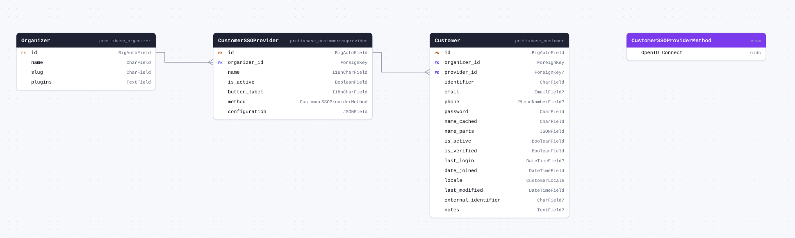

| Column | Field | Type | Null | Key | Default | Description |
| --- | --- | --- | --- | --- | --- | --- |
| `id` | `BigAutoField` | `integer` |  | PK | `autoincrement()` |  |
| `organizer_id` | `ForeignKey` | `bigint` |  | FK |  |  |
| `name` | `I18nCharField` | `text` |  |  |  |  |
| `is_active` | `BooleanField` | `bool` |  |  | `True` |  |
| `button_label` | `I18nCharField` | `text` |  |  |  |  |
| `method` | `CustomerSSOProviderMethod` | `varchar(190)` |  |  |  |  |
| `configuration` | `JSONField` | `text` |  |  |  |  |

Indexes:

- index `pretixbase_customerssoprovider_organizer_id_a6716a65` on `organizer_id`

Relations:

- `organizer_id` → [Organizer](#organizer).`id`, on delete cascade
- [Customer](#customer).`provider_id` → `id`, on delete protect

## Customer

Table `pretixbase_customer`, app `pretixbase`.

Represents a registered customer of an organizer.

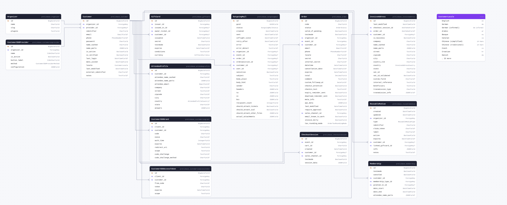

| Column | Field | Type | Null | Key | Default | Description |
| --- | --- | --- | --- | --- | --- | --- |
| `id` | `BigAutoField` | `integer` |  | PK | `autoincrement()` |  |
| `organizer_id` | `ForeignKey` | `bigint` |  | FK |  |  |
| `provider_id` | `ForeignKey` | `bigint` | yes | FK |  |  |
| `identifier` | `CharField` | `varchar(190)` |  |  |  | You can enter any value here to make it easier to match the data with other sources. If you do not input one, we will generate one automatically. |
| `email` | `EmailField` | `varchar(190)` | yes |  |  |  |
| `phone` | `PhoneNumberField` | `varchar(128)` | yes |  |  |  |
| `password` | `CharField` | `varchar(128)` |  |  |  |  |
| `name_cached` | `CharField` | `varchar(255)` |  |  |  |  |
| `name_parts` | `JSONField` | `text` |  |  | `dict()` |  |
| `is_active` | `BooleanField` | `bool` |  |  | `True` |  |
| `is_verified` | `BooleanField` | `bool` |  |  | `True` |  |
| `last_login` | `DateTimeField` | `datetime` | yes |  |  |  |
| `date_joined` | `DateTimeField` | `datetime` |  |  | `now()` |  |
| `locale` | `CustomerLocale` | `varchar(50)` |  |  | `'en'` |  |
| `last_modified` | `DateTimeField` | `datetime` |  |  | `now()` |  |
| `external_identifier` | `CharField` | `varchar(255)` | yes |  |  |  |
| `notes` | `TextField` | `text` | yes |  |  |  |

Indexes:

- index `pretixbase_customer_organizer_id_f65b87f8` on `organizer_id`
- index `pretixbase_customer_provider_id_143d6a89` on `provider_id`
- index `pretixbase_customer_identifier_fd8636fc` on `identifier`
- index `pretixbase_customer_email_0fc8932b` on `email`
- unique `pretixbase_customer_organizer_id_email_af86942e_uniq` on `organizer_id`, `email`
- unique `pretixbase_customer_organizer_id_identifier_5f5978fe_uniq` on `organizer_id`, `identifier`

Relations:

- [GiftCard](#giftcard).`customer_id` → `id`, on delete protect
- `organizer_id` → [Organizer](#organizer).`id`, on delete cascade
- `provider_id` → [CustomerSSOProvider](#customerssoprovider).`id`, on delete protect
- [AttendeeProfile](#attendeeprofile).`customer_id` → `id`, on delete cascade
- [CustomerSSOGrant](#customerssogrant).`customer_id` → `id`, on delete cascade
- [CustomerSSOAccessToken](#customerssoaccesstoken).`customer_id` → `id`, on delete cascade
- [OutgoingMail](#outgoingmail).`customer_id` → `id`, on delete cascade if queued
- [Order](#order).`customer_id` → `id`, on delete set null
- [CheckoutSession](#checkoutsession).`customer_id` → `id`, on delete set null
- [InvoiceAddress](#invoiceaddress).`customer_id` → `id`, on delete cascade
- [ReusableMedium](#reusablemedium).`customer_id` → `id`, on delete set null
- [Membership](#membership).`customer_id` → `id`, on delete protect

## AttendeeProfile

Table `pretixbase_attendeeprofile`, app `pretixbase`.

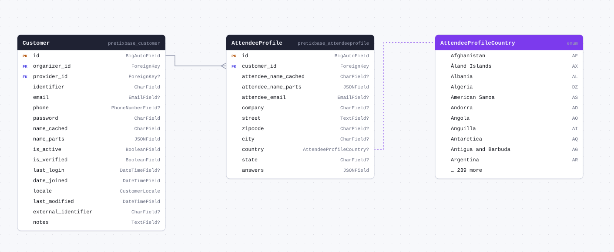

| Column | Field | Type | Null | Key | Default | Description |
| --- | --- | --- | --- | --- | --- | --- |
| `id` | `BigAutoField` | `integer` |  | PK | `autoincrement()` |  |
| `customer_id` | `ForeignKey` | `bigint` |  | FK |  |  |
| `attendee_name_cached` | `CharField` | `varchar(255)` | yes |  |  |  |
| `attendee_name_parts` | `JSONField` | `text` |  |  | `dict()` |  |
| `attendee_email` | `EmailField` | `varchar(254)` | yes |  |  |  |
| `company` | `CharField` | `varchar(255)` | yes |  |  |  |
| `street` | `TextField` | `text` | yes |  |  |  |
| `zipcode` | `CharField` | `varchar(30)` | yes |  |  |  |
| `city` | `CharField` | `varchar(255)` | yes |  |  |  |
| `country` | `AttendeeProfileCountry` | `varchar(2)` | yes |  |  |  |
| `state` | `CharField` | `varchar(255)` | yes |  |  |  |
| `answers` | `JSONField` | `text` |  |  | `list()` |  |

Indexes:

- index `pretixbase_attendeeprofile_customer_id_847a5c3a` on `customer_id`

Relations:

- `customer_id` → [Customer](#customer).`id`, on delete cascade

## CustomerSSOClient

Table `pretixbase_customerssoclient`, app `pretixbase`.

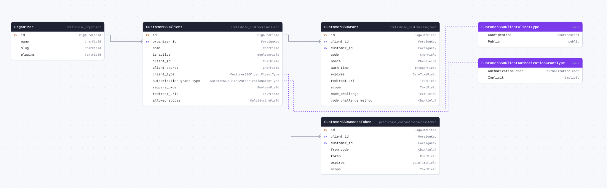

| Column | Field | Type | Null | Key | Default | Description |
| --- | --- | --- | --- | --- | --- | --- |
| `id` | `BigAutoField` | `integer` |  | PK | `autoincrement()` |  |
| `organizer_id` | `ForeignKey` | `bigint` |  | FK |  |  |
| `name` | `CharField` | `varchar(255)` |  |  |  |  |
| `is_active` | `BooleanField` | `bool` |  |  | `True` |  |
| `client_id` | `CharField` | `varchar(100)` |  | unique | `generate_client_id()` |  |
| `client_secret` | `CharField` | `varchar(255)` |  |  |  |  |
| `client_type` | `CustomerSSOClientClientType` | `varchar(32)` |  |  | `'confidential'` |  |
| `authorization_grant_type` | `CustomerSSOClientAuthorizationGrantType` | `varchar(32)` |  |  | `'authorization-code'` |  |
| `require_pkce` | `BooleanField` | `bool` |  |  | `False` |  |
| `redirect_uris` | `TextField` | `text` |  |  |  | Allowed URIs list, space separated |
| `allowed_scopes` | `MultiStringField` | `text` |  |  | `['openid', 'profile', 'email', 'phone']` | Separate multiple values with spaces |

Indexes:

- index `pretixbase_customerssoclient_organizer_id_d84ecb5e` on `organizer_id`

Relations:

- `organizer_id` → [Organizer](#organizer).`id`, on delete cascade
- [CustomerSSOGrant](#customerssogrant).`client_id` → `id`, on delete cascade
- [CustomerSSOAccessToken](#customerssoaccesstoken).`client_id` → `id`, on delete cascade

## CustomerSSOGrant

Table `pretixbase_customerssogrant`, app `pretixbase`.

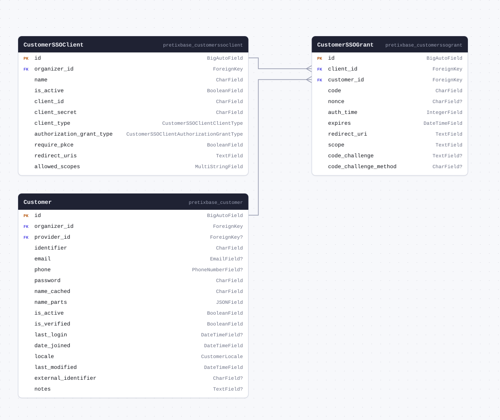

| Column | Field | Type | Null | Key | Default | Description |
| --- | --- | --- | --- | --- | --- | --- |
| `id` | `BigAutoField` | `integer` |  | PK | `autoincrement()` |  |
| `client_id` | `ForeignKey` | `bigint` |  | FK |  |  |
| `customer_id` | `ForeignKey` | `bigint` |  | FK |  |  |
| `code` | `CharField` | `varchar(255)` |  | unique |  |  |
| `nonce` | `CharField` | `varchar(255)` | yes |  |  |  |
| `auth_time` | `IntegerField` | `integer` |  |  |  |  |
| `expires` | `DateTimeField` | `datetime` |  |  |  |  |
| `redirect_uri` | `TextField` | `text` |  |  |  |  |
| `scope` | `TextField` | `text` |  |  |  |  |
| `code_challenge` | `TextField` | `text` | yes |  |  |  |
| `code_challenge_method` | `CharField` | `varchar(255)` | yes |  |  |  |

Indexes:

- index `pretixbase_customerssogrant_client_id_fd3ca1c0` on `client_id`
- index `pretixbase_customerssogrant_customer_id_1e011d8e` on `customer_id`

Relations:

- `client_id` → [CustomerSSOClient](#customerssoclient).`id`, on delete cascade
- `customer_id` → [Customer](#customer).`id`, on delete cascade

## CustomerSSOAccessToken

Table `pretixbase_customerssoaccesstoken`, app `pretixbase`.

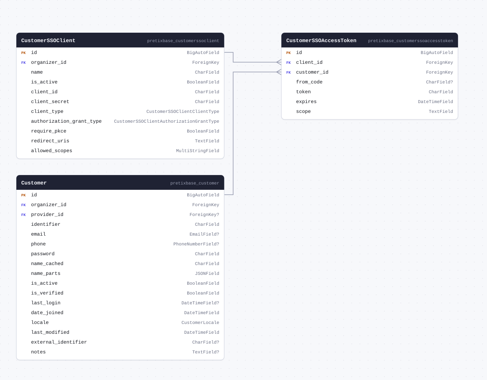

| Column | Field | Type | Null | Key | Default | Description |
| --- | --- | --- | --- | --- | --- | --- |
| `id` | `BigAutoField` | `integer` |  | PK | `autoincrement()` |  |
| `client_id` | `ForeignKey` | `bigint` |  | FK |  |  |
| `customer_id` | `ForeignKey` | `bigint` |  | FK |  |  |
| `from_code` | `CharField` | `varchar(255)` | yes |  |  |  |
| `token` | `CharField` | `varchar(255)` |  | unique |  |  |
| `expires` | `DateTimeField` | `datetime` |  |  |  |  |
| `scope` | `TextField` | `text` |  |  |  |  |

Indexes:

- index `pretixbase_customerssoaccesstoken_client_id_f7d43671` on `client_id`
- index `pretixbase_customerssoaccesstoken_customer_id_f03b0bae` on `customer_id`

Relations:

- `client_id` → [CustomerSSOClient](#customerssoclient).`id`, on delete cascade
- `customer_id` → [Customer](#customer).`id`, on delete cascade

## Event

Table `pretixbase_event`, app `pretixbase`.

This model represents an event. An event is anything you can buy
tickets for.

:param organizer: The organizer this event belongs to
:type organizer: Organizer
:param testmode: This event is in test mode
:type testmode: bool
:param name: This event's full title
:type name: str
:param slug: A short, alphanumeric, all-lowercase name for use in URLs. The slug has to
             be unique among the events of the same organizer.
:type slug: str
:param live: Whether or not the shop is publicly accessible
:type live: bool
:param currency: The currency of all prices and payments of this event
:type currency: str
:param date_from: The datetime this event starts
:type date_from: datetime
:param date_to: The datetime this event ends
:type date_to: datetime
:param presale_start: No tickets will be sold before this date.
:type presale_start: datetime
:param presale_end: No tickets will be sold after this date.
:type presale_end: datetime
:param location: venue
:type location: str
:param plugins: A comma-separated list of plugin names that are active for this event.
:type plugins: str
:param has_subevents: Enable event series functionality
:type has_subevents: bool
:param all_sales_channels: A flag indicating that this event is available on all channels and limit_sales_channels will be ignored.
:type all_sales_channels: bool
:param limit_sales_channels: A list of sales channel identifiers, that this event is available for sale on
:type limit_sales_channels: list

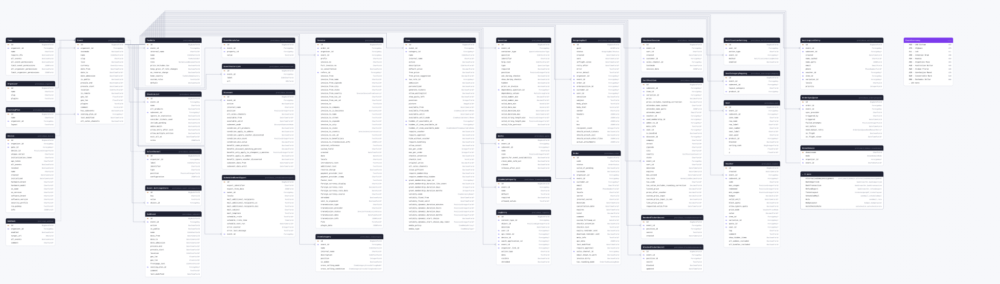

| Column | Field | Type | Null | Key | Default | Description |
| --- | --- | --- | --- | --- | --- | --- |
| `id` | `BigAutoField` | `integer` |  | PK | `autoincrement()` |  |
| `organizer_id` | `ForeignKey` | `bigint` |  | FK |  |  |
| `testmode` | `BooleanField` | `bool` |  |  | `False` |  |
| `name` | `I18nCharField` | `text` |  |  |  |  |
| `slug` | `CharField` | `varchar(50)` |  |  |  | Should be short, only contain lowercase letters, numbers, dots, and dashes, and must be unique among your events. We recommend some kind of abbreviation or a date with less than 10 characters that can be easily remembered, but you can also choose to use a random value. This will be used in URLs, order codes, invoice numbers, and bank transfer references. |
| `live` | `BooleanField` | `bool` |  |  | `False` |  |
| `currency` | `EventCurrency` | `varchar(10)` |  |  | `'EUR'` |  |
| `date_from` | `DateTimeField` | `datetime` |  |  |  |  |
| `date_to` | `DateTimeField` | `datetime` | yes |  |  |  |
| `date_admission` | `DateTimeField` | `datetime` | yes |  |  |  |
| `is_public` | `BooleanField` | `bool` |  |  | `True` | If selected, this event will show up publicly on the list of events for your organizer account. |
| `presale_end` | `DateTimeField` | `datetime` | yes |  |  | Optional. No products will be sold after this date. If you do not set this value, the presale will end after the end date of your event. |
| `presale_start` | `DateTimeField` | `datetime` | yes |  |  | Optional. No products will be sold before this date. |
| `location` | `I18nTextField` | `text` | yes |  |  |  |
| `is_remote` | `BooleanField` | `bool` |  |  | `False` | This will be used to let users know if the event is in a different timezone, and to let us calculate the local time of a user. |
| `geo_lat` | `FloatField` | `real` | yes |  |  |  |
| `geo_lon` | `FloatField` | `real` | yes |  |  |  |
| `plugins` | `TextField` | `text` |  |  |  |  |
| `comment` | `TextField` | `text` | yes |  |  |  |
| `has_subevents` | `BooleanField` | `bool` |  |  | `False` |  |
| `seating_plan_id` | `ForeignKey` | `bigint` | yes | FK |  |  |
| `last_modified` | `DateTimeField` | `datetime` |  |  | `now()` |  |
| `all_sales_channels` | `BooleanField` | `bool` |  |  | `True` |  |

Indexes:

- index `pretixbase_event_organizer_id_f31b86fa` on `organizer_id`
- index `pretixbase_event_slug_8033ce26` on `slug`
- index `pretixbase_event_seating_plan_id_11bc56fa` on `seating_plan_id`
- index `pretixbase_event_last_modified_fe031b38` on `last_modified`
- unique `pretixbase_event_organizer_id_slug_ef87d553_uniq` on `organizer_id`, `slug`

Relations:

- [TaxRule](#taxrule).`event_id` → `id`, on delete cascade
- [CheckinList](#checkinlist).`event_id` → `id`, on delete cascade
- `team_set` — many to many with [Team](#team)
- `organizer_id` → [Organizer](#organizer).`id`, on delete protect
- `seating_plan_id` → [SeatingPlan](#seatingplan).`id`, on delete protect
- `limit_sales_channels` — many to many with [SalesChannel](#saleschannel)
- [Event_SettingsStore](#event_settingsstore).`object_id` → `id`, on delete cascade
- [SubEvent](#subevent).`event_id` → `id`, on delete protect
- [EventMetaValue](#eventmetavalue).`event_id` → `id`, on delete cascade
- [EventFooterLink](#eventfooterlink).`event_id` → `id`, on delete cascade
- `device_set` — many to many with [Device](#device)
- [Discount](#discount).`event_id` → `id`, on delete cascade
- [ScheduledEventExport](#scheduledeventexport).`event_id` → `id`, on delete cascade
- [Invoice](#invoice).`event_id` → `id`, on delete cascade
- [ItemCategory](#itemcategory).`event_id` → `id`, on delete cascade
- [Item](#item).`event_id` → `id`, on delete protect
- [Question](#question).`event_id` → `id`, on delete cascade
- [Quota](#quota).`event_id` → `id`, on delete cascade
- [ItemMetaProperty](#itemmetaproperty).`event_id` → `id`, on delete cascade
- [LogEntry](#logentry).`event_id` → `id`, on delete set null
- [OutgoingMail](#outgoingmail).`event_id` → `id`, on delete cascade if queued
- [Order](#order).`event_id` → `id`, on delete cascade
- [CheckoutSession](#checkoutsession).`event_id` → `id`, on delete cascade
- [CartPosition](#cartposition).`event_id` → `id`, on delete cascade
- [RevokedTicketSecret](#revokedticketsecret).`event_id` → `id`, on delete cascade
- [BlockedTicketSecret](#blockedticketsecret).`event_id` → `id`, on delete cascade
- [NotificationSetting](#notificationsetting).`event_id` → `id`, on delete cascade
- [SeatCategoryMapping](#seatcategorymapping).`event_id` → `id`, on delete cascade
- [Seat](#seat).`event_id` → `id`, on delete cascade
- [Voucher](#voucher).`event_id` → `id`, on delete cascade
- [WaitingListEntry](#waitinglistentry).`event_id` → `id`, on delete cascade
- [OrderSyncQueue](#ordersyncqueue).`event_id` → `id`, on delete cascade
- [KnownDomain](#knowndomain).`event_id` → `id`, on delete protect
- [AlternativeDomainAssignment](#alternativedomainassignment).`event_id` → `id`, on delete cascade
- `webhook_set` — many to many with [WebHook](#webhook)
- [BankImportJob](#bankimportjob).`event_id` → `id`, on delete cascade
- [BankTransaction](#banktransaction).`event_id` → `id`, on delete cascade
- [RefundExport](#refundexport).`event_id` → `id`, on delete cascade
- [TicketLayout](#ticketlayout).`event_id` → `id`, on delete cascade
- [ScheduledMail](#scheduledmail).`event_id` → `id`, on delete cascade
- [Rule](#rule).`event_id` → `id`, on delete cascade
- [BadgeLayout](#badgelayout).`event_id` → `id`, on delete cascade
- [AutoCheckinRule](#autocheckinrule).`event_id` → `id`, on delete cascade

## Event_SettingsStore

Table `pretixbase_event_settingsstore`, app `pretixbase`.

Columns from `BaseHierarkeyStoreModel` (abstract): `key`, `value`.

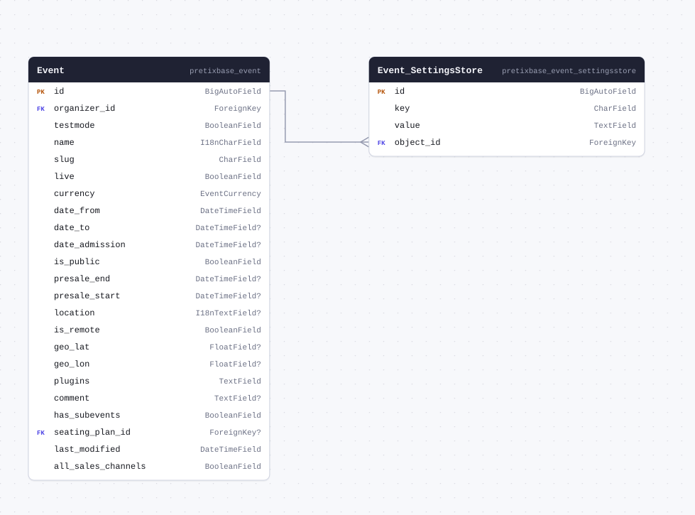

| Column | Field | Type | Null | Key | Default | Description |
| --- | --- | --- | --- | --- | --- | --- |
| `id` | `BigAutoField` | `integer` |  | PK | `autoincrement()` |  |
| `key` | `CharField` | `varchar(255)` |  |  |  |  |
| `value` | `TextField` | `text` |  |  |  |  |
| `object_id` | `ForeignKey` | `bigint` |  | FK |  |  |

Indexes:

- index `pretixbase_event_settingsstore_object_id_961c7369` on `object_id`
- unique `pretixbase_event_settingsstore_object_id_key_f70356af_uniq` on `object_id`, `key`

Relations:

- `object_id` → [Event](#event).`id`, on delete cascade

## SubEvent

Table `pretixbase_subevent`, app `pretixbase`.

This model represents a date within an event series.

:param event: The event this belongs to
:type event: Event
:param active: Whether to show the subevent
:type active: bool
:param is_public: Whether to show the subevent in lists
:type is_public: bool
:param name: This event's full title
:type name: str
:param date_from: The datetime this event starts
:type date_from: datetime
:param date_to: The datetime this event ends
:type date_to: datetime
:param presale_start: No tickets will be sold before this date.
:type presale_start: datetime
:param presale_end: No tickets will be sold after this date.
:type presale_end: datetime
:param location: venue
:type location: str

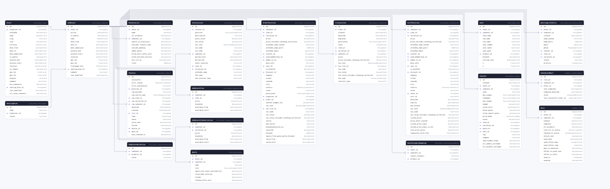

| Column | Field | Type | Null | Key | Default | Description |
| --- | --- | --- | --- | --- | --- | --- |
| `id` | `BigAutoField` | `integer` |  | PK | `autoincrement()` |  |
| `event_id` | `ForeignKey` | `bigint` |  | FK |  |  |
| `active` | `BooleanField` | `bool` |  |  | `False` | Only with this checkbox enabled, this date is visible in the frontend to users. |
| `is_public` | `BooleanField` | `bool` |  |  | `True` | If selected, this event will show up publicly on the list of dates for your event. |
| `name` | `I18nCharField` | `text` |  |  |  |  |
| `date_from` | `DateTimeField` | `datetime` |  |  |  |  |
| `date_to` | `DateTimeField` | `datetime` | yes |  |  |  |
| `date_admission` | `DateTimeField` | `datetime` | yes |  |  |  |
| `presale_end` | `DateTimeField` | `datetime` | yes |  |  | Optional. No products will be sold after this date. If you do not set this value, the presale will end after the end date of your event. |
| `presale_start` | `DateTimeField` | `datetime` | yes |  |  | Optional. No products will be sold before this date. |
| `location` | `I18nTextField` | `text` | yes |  |  |  |
| `geo_lat` | `FloatField` | `real` | yes |  |  |  |
| `geo_lon` | `FloatField` | `real` | yes |  |  |  |
| `frontpage_text` | `I18nTextField` | `text` | yes |  |  |  |
| `seating_plan_id` | `ForeignKey` | `bigint` | yes | FK |  |  |
| `comment` | `TextField` | `text` | yes |  |  |  |
| `last_modified` | `DateTimeField` | `datetime` |  |  | `now()` |  |

Indexes:

- index `pretixbase_subevent_event_id_3ca2e6c9` on `event_id`
- index `pretixbase_subevent_seating_plan_id_5720ab67` on `seating_plan_id`
- index `pretixbase_subevent_last_modified_9ebd2e00` on `last_modified`

Relations:

- [CheckinList](#checkinlist).`subevent_id` → `id`, on delete cascade
- [Checkin](#checkin).`raw_subevent_id` → `id`, on delete set null
- `event_id` → [Event](#event).`id`, on delete protect
- `seating_plan_id` → [SeatingPlan](#seatingplan).`id`, on delete protect
- [SubEventMetaValue](#subeventmetavalue).`subevent_id` → `id`, on delete cascade
- [InvoiceLine](#invoiceline).`subevent_id` → `id`, on delete protect
- [SubEventItem](#subeventitem).`subevent_id` → `id`, on delete cascade
- [SubEventItemVariation](#subeventitemvariation).`subevent_id` → `id`, on delete cascade
- [Quota](#quota).`subevent_id` → `id`, on delete cascade
- [OrderPosition](#orderposition).`subevent_id` → `id`, on delete protect
- [Transaction](#transaction).`subevent_id` → `id`, on delete protect
- [CartPosition](#cartposition).`subevent_id` → `id`, on delete protect
- [SeatCategoryMapping](#seatcategorymapping).`subevent_id` → `id`, on delete cascade
- [Seat](#seat).`subevent_id` → `id`, on delete cascade
- [Voucher](#voucher).`subevent_id` → `id`, on delete cascade
- [WaitingListEntry](#waitinglistentry).`subevent_id` → `id`, on delete cascade
- [ScheduledMail](#scheduledmail).`subevent_id` → `id`, on delete cascade
- [Rule](#rule).`subevent_id` → `id`, on delete protect

## EventLock

Table `pretixbase_eventlock`, app `pretixbase`.

| Column | Field | Type | Null | Key | Default | Description |
| --- | --- | --- | --- | --- | --- | --- |
| `event` | `CharField` | `varchar(36)` |  | PK |  |  |
| `date` | `DateTimeField` | `datetime` |  |  | `now()` |  |
| `token` | `UUIDField` | `char(32)` |  |  | `uuid4()` |  |

## EventMetaProperty

Table `pretixbase_eventmetaproperty`, app `pretixbase`.

An organizer account can have EventMetaProperty objects attached to define meta information fields
for its events. This information can be re-used for example in ticket layouts.

:param organizer: The organizer this property is defined for.
:type organizer: Organizer
:param name: Name
:type name: Name of the property, used in various places
:param default: Default value
:type default: str

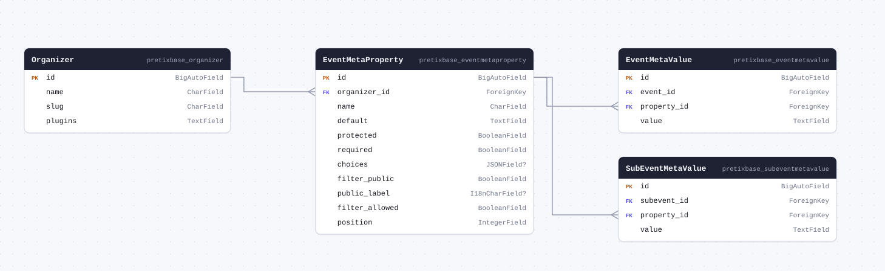

| Column | Field | Type | Null | Key | Default | Description |
| --- | --- | --- | --- | --- | --- | --- |
| `id` | `BigAutoField` | `integer` |  | PK | `autoincrement()` |  |
| `organizer_id` | `ForeignKey` | `bigint` |  | FK |  |  |
| `name` | `CharField` | `varchar(50)` |  |  |  | Can not contain spaces or special characters except underscores |
| `default` | `TextField` | `text` |  |  |  |  |
| `protected` | `BooleanField` | `bool` |  |  | `False` |  |
| `required` | `BooleanField` | `bool` |  |  | `False` | If checked, an event can only be taken live if the property is set. In event series, its always optional to set a value for individual dates |
| `choices` | `JSONField` | `text` | yes |  |  |  |
| `filter_public` | `BooleanField` | `bool` |  |  | `False` | This field will be shown to filter events in the public event list and calendar. |
| `public_label` | `I18nCharField` | `text` | yes |  |  |  |
| `filter_allowed` | `BooleanField` | `bool` |  |  | `True` | This field will be shown to filter events or reports in the backend, and it can also be used for hidden filter parameters in the frontend (e.g. using the widget). |
| `position` | `IntegerField` | `integer` |  |  | `0` |  |

Indexes:

- index `pretixbase_eventmetaproperty_organizer_id_595552fd` on `organizer_id`
- index `pretixbase_eventmetaproperty_name_c3ddda49` on `name`
- unique `pretixbase_eventmetaproperty_organizer_id_name_e32a28ca_uniq` on `organizer_id`, `name`

Relations:

- `organizer_id` → [Organizer](#organizer).`id`, on delete cascade
- [EventMetaValue](#eventmetavalue).`property_id` → `id`, on delete cascade
- [SubEventMetaValue](#subeventmetavalue).`property_id` → `id`, on delete cascade

## EventMetaValue

Table `pretixbase_eventmetavalue`, app `pretixbase`.

A meta-data value assigned to an event.

:param event: The event this metadata is valid for
:type event: Event
:param property: The property this value belongs to
:type property: EventMetaProperty
:param value: The actual value
:type value: str

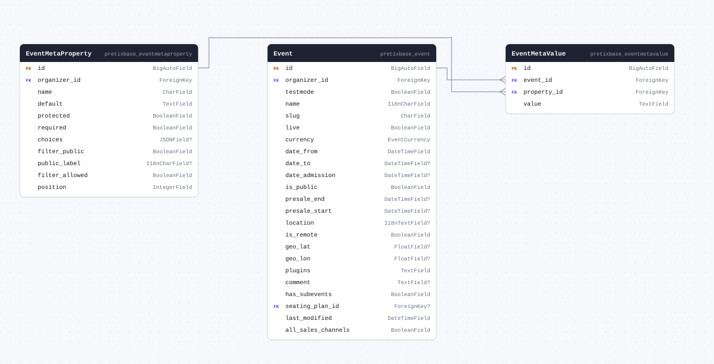

| Column | Field | Type | Null | Key | Default | Description |
| --- | --- | --- | --- | --- | --- | --- |
| `id` | `BigAutoField` | `integer` |  | PK | `autoincrement()` |  |
| `event_id` | `ForeignKey` | `bigint` |  | FK |  |  |
| `property_id` | `ForeignKey` | `bigint` |  | FK |  |  |
| `value` | `TextField` | `text` |  |  |  |  |

Indexes:

- index `pretixbase_eventmetavalue_event_id_567f5820` on `event_id`
- index `pretixbase_eventmetavalue_property_id_28f8ebf7` on `property_id`
- unique `pretixbase_eventmetavalue_event_id_property_id_1844697e_uniq` on `event_id`, `property_id`

Relations:

- `event_id` → [Event](#event).`id`, on delete cascade
- `property_id` → [EventMetaProperty](#eventmetaproperty).`id`, on delete cascade

## SubEventMetaValue

Table `pretixbase_subeventmetavalue`, app `pretixbase`.

A meta-data value assigned to a sub-event.

:param event: The event this metadata is valid for
:type event: Event
:param property: The property this value belongs to
:type property: EventMetaProperty
:param value: The actual value
:type value: str

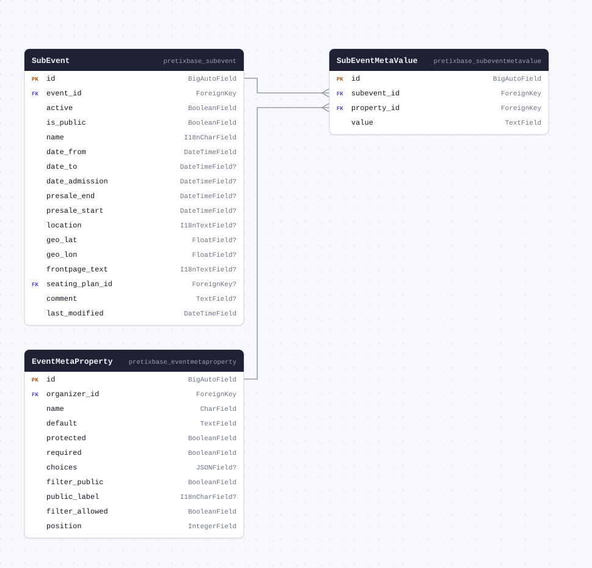

| Column | Field | Type | Null | Key | Default | Description |
| --- | --- | --- | --- | --- | --- | --- |
| `id` | `BigAutoField` | `integer` |  | PK | `autoincrement()` |  |
| `subevent_id` | `ForeignKey` | `bigint` |  | FK |  |  |
| `property_id` | `ForeignKey` | `bigint` |  | FK |  |  |
| `value` | `TextField` | `text` |  |  |  |  |

Indexes:

- index `pretixbase_subeventmetavalue_subevent_id_b97a87d2` on `subevent_id`
- index `pretixbase_subeventmetavalue_property_id_bda97d56` on `property_id`
- unique `pretixbase_subeventmetavalue_subevent_id_property_id_429c6af5_uniq` on `subevent_id`, `property_id`

Relations:

- `subevent_id` → [SubEvent](#subevent).`id`, on delete cascade
- `property_id` → [EventMetaProperty](#eventmetaproperty).`id`, on delete cascade

## EventFooterLink

Table `pretixbase_eventfooterlink`, app `pretixbase`.

A footer link assigned to an event.

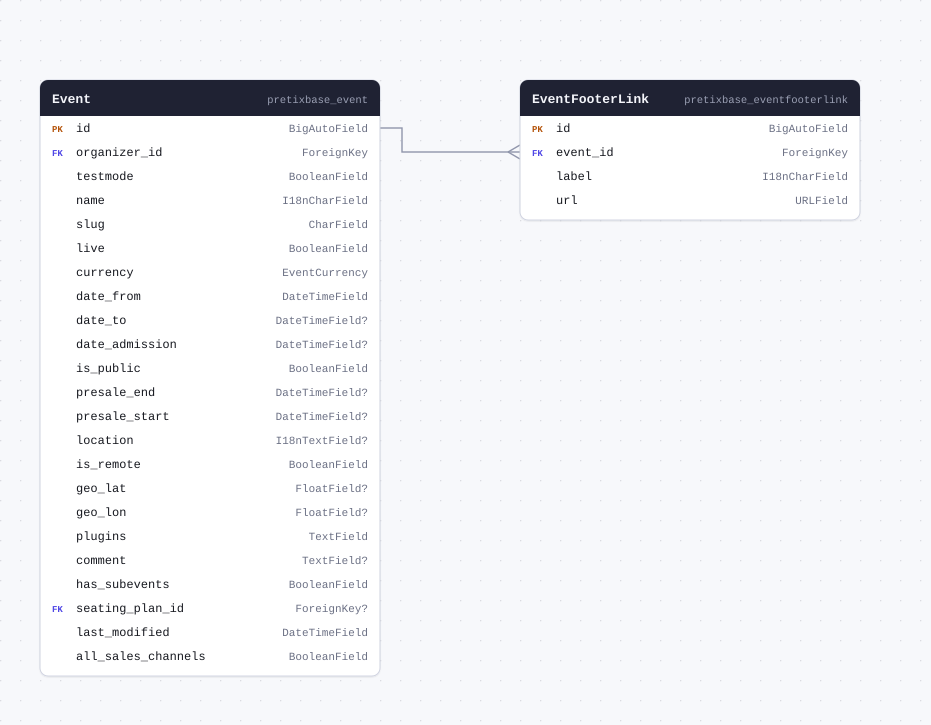

| Column | Field | Type | Null | Key | Default | Description |
| --- | --- | --- | --- | --- | --- | --- |
| `id` | `BigAutoField` | `integer` |  | PK | `autoincrement()` |  |
| `event_id` | `ForeignKey` | `bigint` |  | FK |  |  |
| `label` | `I18nCharField` | `text` |  |  |  |  |
| `url` | `URLField` | `varchar(200)` |  |  |  |  |

Indexes:

- index `pretixbase_eventfooterlink_event_id_b74bc831` on `event_id`

Relations:

- `event_id` → [Event](#event).`id`, on delete cascade

## Gate

Table `pretixbase_gate`, app `pretixbase`.

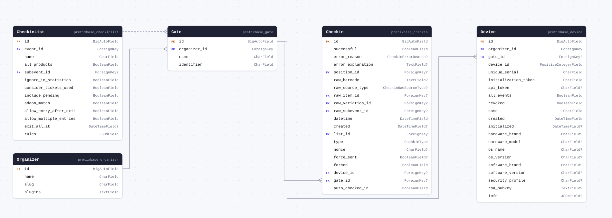

| Column | Field | Type | Null | Key | Default | Description |
| --- | --- | --- | --- | --- | --- | --- |
| `id` | `BigAutoField` | `integer` |  | PK | `autoincrement()` |  |
| `organizer_id` | `ForeignKey` | `bigint` |  | FK |  |  |
| `name` | `CharField` | `varchar(190)` |  |  |  |  |
| `identifier` | `CharField` | `varchar(190)` |  |  |  | You can enter any value here to make it easier to match the data with other sources. If you do not input one, we will generate one automatically. |

Indexes:

- index `pretixbase_gate_organizer_id_d6070b77` on `organizer_id`

Relations:

- `checkinlist_set` — many to many with [CheckinList](#checkinlist)
- [Checkin](#checkin).`gate_id` → `id`, on delete set null
- `organizer_id` → [Organizer](#organizer).`id`, on delete protect
- [Device](#device).`gate_id` → `id`, on delete set null

## Device

Table `pretixbase_device`, app `pretixbase`.

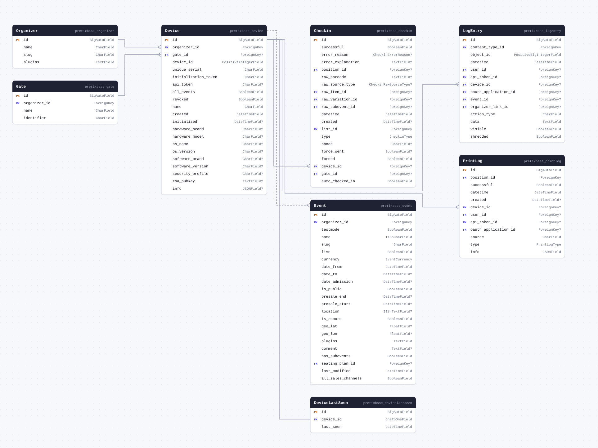

| Column | Field | Type | Null | Key | Default | Description |
| --- | --- | --- | --- | --- | --- | --- |
| `id` | `BigAutoField` | `integer` |  | PK | `autoincrement()` |  |
| `organizer_id` | `ForeignKey` | `bigint` |  | FK |  |  |
| `gate_id` | `ForeignKey` | `bigint` | yes | FK |  |  |
| `device_id` | `PositiveIntegerField` | `integer unsigned` |  |  |  |  |
| `unique_serial` | `CharField` | `varchar(190)` |  | unique | `generate_serial()` |  |
| `initialization_token` | `CharField` | `varchar(190)` |  | unique | `generate_initialization_token()` |  |
| `api_token` | `CharField` | `varchar(190)` | yes | unique |  |  |
| `all_events` | `BooleanField` | `bool` |  |  | `False` |  |
| `revoked` | `BooleanField` | `bool` |  |  | `False` |  |
| `name` | `CharField` | `varchar(190)` |  |  |  |  |
| `created` | `DateTimeField` | `datetime` |  |  | `now()` |  |
| `initialized` | `DateTimeField` | `datetime` | yes |  |  |  |
| `hardware_brand` | `CharField` | `varchar(190)` | yes |  |  |  |
| `hardware_model` | `CharField` | `varchar(190)` | yes |  |  |  |
| `os_name` | `CharField` | `varchar(190)` | yes |  |  |  |
| `os_version` | `CharField` | `varchar(190)` | yes |  |  |  |
| `software_brand` | `CharField` | `varchar(190)` | yes |  |  |  |
| `software_version` | `CharField` | `varchar(190)` | yes |  |  |  |
| `security_profile` | `CharField` | `varchar(190)` | yes |  | `'full'` |  |
| `rsa_pubkey` | `TextField` | `text` | yes |  |  |  |
| `info` | `JSONField` | `text` | yes |  |  |  |

Indexes:

- index `pretixbase_device_organizer_id_1fab75fa` on `organizer_id`
- index `pretixbase_device_gate_id_eea62af2` on `gate_id`
- unique `pretixbase_device_organizer_id_device_id_524c771f_uniq` on `organizer_id`, `device_id`

Relations:

- [Checkin](#checkin).`device_id` → `id`, on delete protect
- `organizer_id` → [Organizer](#organizer).`id`, on delete protect
- `gate_id` → [Gate](#gate).`id`, on delete set null
- `limit_events` — many to many with [Event](#event)
- [DeviceLastSeen](#devicelastseen).`device_id` → `id`, on delete cascade
- [LogEntry](#logentry).`device_id` → `id`, on delete protect
- [PrintLog](#printlog).`device_id` → `id`, on delete protect

## DeviceLastSeen

Table `pretixbase_devicelastseen`, app `pretixbase`.

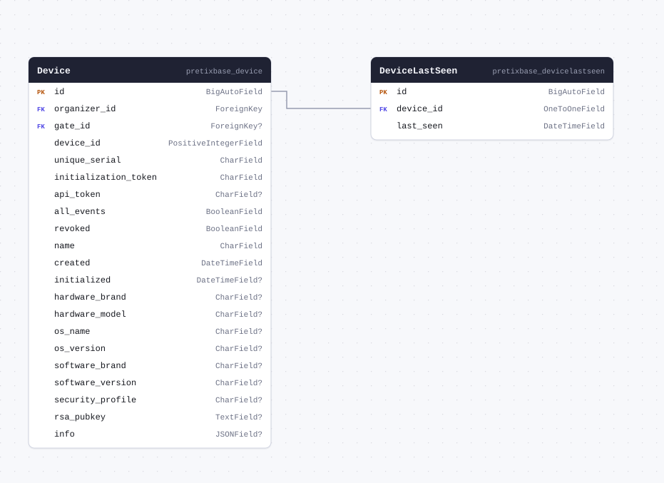

| Column | Field | Type | Null | Key | Default | Description |
| --- | --- | --- | --- | --- | --- | --- |
| `id` | `BigAutoField` | `integer` |  | PK | `autoincrement()` |  |
| `device_id` | `OneToOneField` | `bigint` |  | FK, unique |  |  |
| `last_seen` | `DateTimeField` | `datetime` |  |  | `now()` |  |

Indexes:

- brin index `pretixbase_device_last_seen` on `last_seen` with `autosummarize = on`

Relations:

- `device_id` → [Device](#device).`id`, on delete cascade

## Discount

Table `pretixbase_discount`, app `pretixbase`.

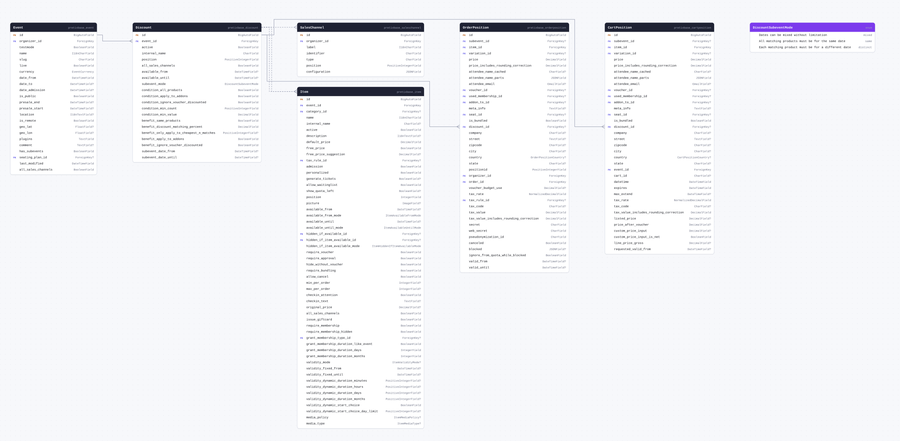

| Column | Field | Type | Null | Key | Default | Description |
| --- | --- | --- | --- | --- | --- | --- |
| `id` | `BigAutoField` | `integer` |  | PK | `autoincrement()` |  |
| `event_id` | `ForeignKey` | `bigint` |  | FK |  |  |
| `active` | `BooleanField` | `bool` |  |  | `True` |  |
| `internal_name` | `CharField` | `varchar(255)` |  |  |  |  |
| `position` | `PositiveIntegerField` | `integer unsigned` |  |  | `0` |  |
| `all_sales_channels` | `BooleanField` | `bool` |  |  | `True` |  |
| `available_from` | `DateTimeField` | `datetime` | yes |  |  |  |
| `available_until` | `DateTimeField` | `datetime` | yes |  |  |  |
| `subevent_mode` | `DiscountSubeventMode` | `varchar(50)` |  |  | `'mixed'` |  |
| `condition_all_products` | `BooleanField` | `bool` |  |  | `True` |  |
| `condition_apply_to_addons` | `BooleanField` | `bool` |  |  | `True` | Discounts never apply to bundled products |
| `condition_ignore_voucher_discounted` | `BooleanField` | `bool` |  |  | `False` | If this option is checked, products that already received a discount through a voucher will not be considered for this discount. However, products that use a voucher only to e.g. unlock a hidden product or gain access to sold-out quota will still be considered. |
| `condition_min_count` | `PositiveIntegerField` | `integer unsigned` |  |  | `0` |  |
| `condition_min_value` | `DecimalField(13, 2)` | `decimal` |  |  | `Decimal('0.00')` |  |
| `benefit_same_products` | `BooleanField` | `bool` |  |  | `True` | By default, the discount is applied across the same selection of products than the condition for the discount given above. If you want, you can however also select a different selection of products. |
| `benefit_discount_matching_percent` | `DecimalField(10, 2)` | `decimal` |  |  | `Decimal('0.00')` |  |
| `benefit_only_apply_to_cheapest_n_matches` | `PositiveIntegerField` | `integer unsigned` | yes |  |  | This option allows you to create discounts of the type "buy X get Y reduced/for free". For example, if you set "Minimum number of matching products" to four and this value to two, the customer's cart will be split into groups of four tickets and the cheapest two tickets within every group will be discounted. If you want to grant the discount on all matching products, keep this field empty. |
| `benefit_apply_to_addons` | `BooleanField` | `bool` |  |  | `True` | Discounts never apply to bundled products |
| `benefit_ignore_voucher_discounted` | `BooleanField` | `bool` |  |  | `False` | If this option is checked, products that already received a discount through a voucher will not be discounted. However, products that use a voucher only to e.g. unlock a hidden product or gain access to sold-out quota will still receive the discount. |
| `subevent_date_from` | `DateTimeField` | `datetime` | yes |  |  |  |
| `subevent_date_until` | `DateTimeField` | `datetime` | yes |  |  |  |

Indexes:

- index `pretixbase_discount_event_id_15ffc96d` on `event_id`

Relations:

- `event_id` → [Event](#event).`id`, on delete cascade
- `limit_sales_channels` — many to many with [SalesChannel](#saleschannel)
- `condition_limit_products` — many to many with [Item](#item)
- `benefit_limit_products` — many to many with [Item](#item)
- [OrderPosition](#orderposition).`discount_id` → `id`, on delete restrict
- [CartPosition](#cartposition).`discount_id` → `id`, on delete restrict

## ScheduledEventExport

Table `pretixbase_scheduledeventexport`, app `pretixbase`.

Columns from `AbstractScheduledExport` (abstract): `id`, `export_identifier`, `export_form_data`, `owner_id`, `locale`, `mail_additional_recipients`, `mail_additional_recipients_cc`, `mail_additional_recipients_bcc`, `mail_subject`, `mail_template`, `schedule_rrule`, `schedule_rrule_time`, `schedule_next_run`, `error_counter`, `error_last_message`.

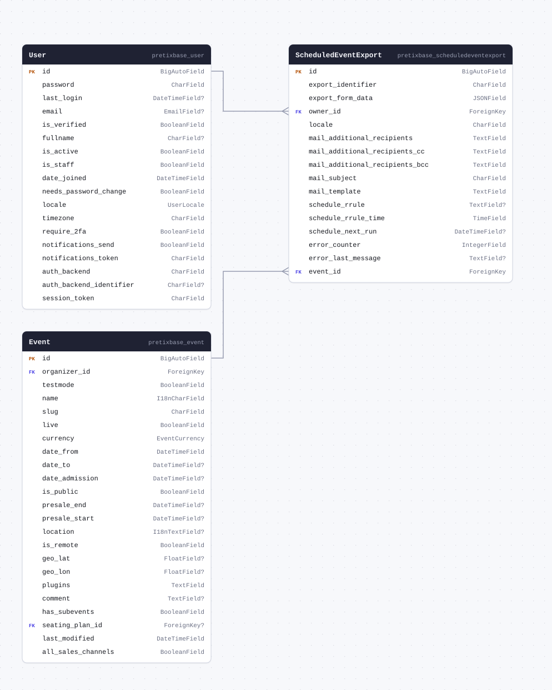

| Column | Field | Type | Null | Key | Default | Description |
| --- | --- | --- | --- | --- | --- | --- |
| `id` | `BigAutoField` | `integer` |  | PK | `autoincrement()` |  |
| `export_identifier` | `CharField` | `varchar(190)` |  |  |  |  |
| `export_form_data` | `JSONField` | `text` |  |  | `dict()` |  |
| `owner_id` | `ForeignKey` | `bigint` |  | FK |  |  |
| `locale` | `CharField` | `varchar(250)` |  |  |  |  |
| `mail_additional_recipients` | `TextField` | `text` |  |  |  | You can specify multiple recipients separated by commas. |
| `mail_additional_recipients_cc` | `TextField` | `text` |  |  |  | You can specify multiple recipients separated by commas. |
| `mail_additional_recipients_bcc` | `TextField` | `text` |  |  |  | You can specify multiple recipients separated by commas. |
| `mail_subject` | `CharField` | `varchar(250)` |  |  |  |  |
| `mail_template` | `TextField` | `text` |  |  |  |  |
| `schedule_rrule` | `TextField` | `text` | yes |  |  |  |
| `schedule_rrule_time` | `TimeField` | `time` |  |  |  | The actual start time might be delayed depending on system load. |
| `schedule_next_run` | `DateTimeField` | `datetime` | yes |  |  |  |
| `error_counter` | `IntegerField` | `integer` |  |  | `0` |  |
| `error_last_message` | `TextField` | `text` | yes |  |  |  |
| `event_id` | `ForeignKey` | `bigint` |  | FK |  |  |

Indexes:

- index `pretixbase_scheduledeventexport_owner_id_4f33c70f` on `owner_id`
- index `pretixbase_scheduledeventexport_event_id_1ffd0c7f` on `event_id`

Relations:

- `owner_id` → [User](#user).`id`, on delete protect
- `event_id` → [Event](#event).`id`, on delete cascade

## ScheduledOrganizerExport

Table `pretixbase_scheduledorganizerexport`, app `pretixbase`.

Columns from `AbstractScheduledExport` (abstract): `id`, `export_identifier`, `export_form_data`, `owner_id`, `locale`, `mail_additional_recipients`, `mail_additional_recipients_cc`, `mail_additional_recipients_bcc`, `mail_subject`, `mail_template`, `schedule_rrule`, `schedule_rrule_time`, `schedule_next_run`, `error_counter`, `error_last_message`.

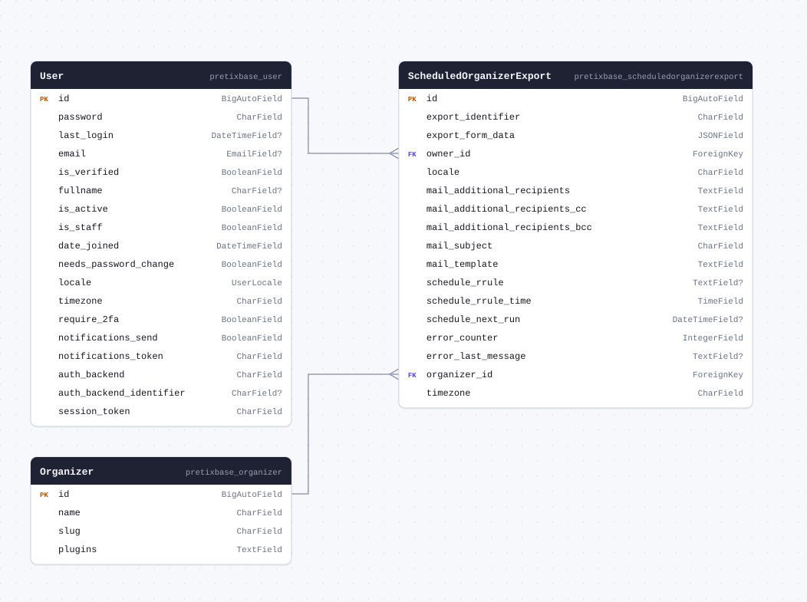

| Column | Field | Type | Null | Key | Default | Description |
| --- | --- | --- | --- | --- | --- | --- |
| `id` | `BigAutoField` | `integer` |  | PK | `autoincrement()` |  |
| `export_identifier` | `CharField` | `varchar(190)` |  |  |  |  |
| `export_form_data` | `JSONField` | `text` |  |  | `dict()` |  |
| `owner_id` | `ForeignKey` | `bigint` |  | FK |  |  |
| `locale` | `CharField` | `varchar(250)` |  |  |  |  |
| `mail_additional_recipients` | `TextField` | `text` |  |  |  | You can specify multiple recipients separated by commas. |
| `mail_additional_recipients_cc` | `TextField` | `text` |  |  |  | You can specify multiple recipients separated by commas. |
| `mail_additional_recipients_bcc` | `TextField` | `text` |  |  |  | You can specify multiple recipients separated by commas. |
| `mail_subject` | `CharField` | `varchar(250)` |  |  |  |  |
| `mail_template` | `TextField` | `text` |  |  |  |  |
| `schedule_rrule` | `TextField` | `text` | yes |  |  |  |
| `schedule_rrule_time` | `TimeField` | `time` |  |  |  | The actual start time might be delayed depending on system load. |
| `schedule_next_run` | `DateTimeField` | `datetime` | yes |  |  |  |
| `error_counter` | `IntegerField` | `integer` |  |  | `0` |  |
| `error_last_message` | `TextField` | `text` | yes |  |  |  |
| `organizer_id` | `ForeignKey` | `bigint` |  | FK |  |  |
| `timezone` | `CharField` | `varchar(100)` |  |  | `'UTC'` |  |

Indexes:

- index `pretixbase_scheduledorganizerexport_owner_id_c2dd2b2a` on `owner_id`
- index `pretixbase_scheduledorganizerexport_organizer_id_28f937cc` on `organizer_id`

Relations:

- `owner_id` → [User](#user).`id`, on delete protect
- `organizer_id` → [Organizer](#organizer).`id`, on delete cascade

## Invoice

Table `pretixbase_invoice`, app `pretixbase`.

Represents an invoice that is issued because of an order. Because invoices are legally required
not to change, this object duplicates a lot of data (e.g. the invoice address).

:param order: The associated order
:type order: Order
:param event: The event this belongs to (for convenience)
:type event: Event
:param organizer: The organizer this belongs to (redundant, for enforcing uniqueness)
:type organizer: Organizer
:param invoice_no: The human-readable, event-unique invoice number
:type invoice_no: int
:param is_cancellation: Whether or not this is a cancellation instead of an invoice
:type is_cancellation: bool
:param refers: A link to another invoice this invoice refers to, e.g. the canceled invoice in a cancellation
:type refers: Invoice
:param invoice_from: The sender address
:type invoice_from: str
:param invoice_to: The receiver address
:type invoice_to: str
:param full_invoice_no: The full invoice number (for performance reasons only)
:type full_invoice_no: str
:param date: The invoice date
:type date: date
:param locale: The locale in which the invoice should be printed
:type locale: str
:param introductory_text: Introductory text for the invoice, e.g. for a greeting
:type introductory_text: str
:param additional_text: Additional text for the invoice
:type additional_text: str
:param payment_provider_text: A payment provider specific text
:type payment_provider_text: str
:param payment_provider_stamp: A payment provider specific stamp
:type payment_provider_stamp: str
:param footer_text: A footer text, displayed smaller and centered on every page
:type footer_text: str
:param foreign_currency_display: A different currency that taxes should also be displayed in.
:type foreign_currency_display: str
:param foreign_currency_rate: The rate of a foreign currency that the taxes should be displayed in.
:type foreign_currency_rate: Decimal
:param foreign_currency_rate_date: The date of the foreign currency exchange rates.
:type foreign_currency_rate_date: date
:param foreign_currency_rate_source: The source of the foreign currency rate.
:type foreign_currency_rate_source: str
:param file: The filename of the rendered invoice
:type file: File

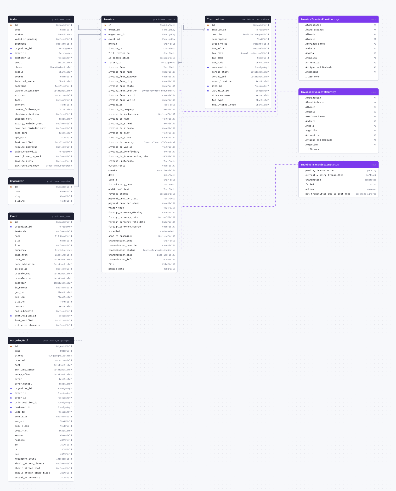

| Column | Field | Type | Null | Key | Default | Description |
| --- | --- | --- | --- | --- | --- | --- |
| `id` | `BigAutoField` | `integer` |  | PK | `autoincrement()` |  |
| `order_id` | `ForeignKey` | `bigint` |  | FK |  |  |
| `organizer_id` | `ForeignKey` | `bigint` |  | FK |  |  |
| `event_id` | `ForeignKey` | `bigint` |  | FK |  |  |
| `prefix` | `CharField` | `varchar(160)` |  |  |  |  |
| `invoice_no` | `CharField` | `varchar(19)` |  |  |  |  |
| `full_invoice_no` | `CharField` | `varchar(190)` |  |  |  |  |
| `is_cancellation` | `BooleanField` | `bool` |  |  | `False` |  |
| `refers_id` | `ForeignKey` | `bigint` | yes | FK |  |  |
| `invoice_from` | `TextField` | `text` |  |  |  |  |
| `invoice_from_name` | `CharField` | `varchar(190)` | yes |  |  |  |
| `invoice_from_zipcode` | `CharField` | `varchar(190)` | yes |  |  |  |
| `invoice_from_city` | `CharField` | `varchar(190)` | yes |  |  |  |
| `invoice_from_state` | `CharField` | `varchar(190)` | yes |  |  |  |
| `invoice_from_country` | `InvoiceInvoiceFromCountry` | `varchar(2)` | yes |  |  |  |
| `invoice_from_tax_id` | `CharField` | `varchar(190)` | yes |  |  |  |
| `invoice_from_vat_id` | `CharField` | `varchar(190)` | yes |  |  |  |
| `invoice_to` | `TextField` | `text` |  |  |  |  |
| `invoice_to_company` | `TextField` | `text` | yes |  |  |  |
| `invoice_to_is_business` | `BooleanField` | `bool` | yes |  |  |  |
| `invoice_to_name` | `TextField` | `text` | yes |  |  |  |
| `invoice_to_street` | `TextField` | `text` | yes |  |  |  |
| `invoice_to_zipcode` | `CharField` | `varchar(190)` | yes |  |  |  |
| `invoice_to_city` | `TextField` | `text` | yes |  |  |  |
| `invoice_to_state` | `CharField` | `varchar(190)` | yes |  |  |  |
| `invoice_to_country` | `InvoiceInvoiceToCountry` | `varchar(2)` | yes |  |  |  |
| `invoice_to_vat_id` | `TextField` | `text` | yes |  |  |  |
| `invoice_to_beneficiary` | `TextField` | `text` | yes |  |  |  |
| `invoice_to_transmission_info` | `JSONField` | `text` | yes |  |  |  |
| `internal_reference` | `TextField` | `text` |  |  |  |  |
| `custom_field` | `CharField` | `varchar(255)` | yes |  |  |  |
| `created` | `DateTimeField` | `datetime` | yes |  | `now()` |  |
| `date` | `DateField` | `date` |  |  | `today()` |  |
| `locale` | `CharField` | `varchar(50)` |  |  | `'en'` |  |
| `introductory_text` | `TextField` | `text` |  |  |  |  |
| `additional_text` | `TextField` | `text` |  |  |  |  |
| `reverse_charge` | `BooleanField` | `bool` |  |  | `False` |  |
| `payment_provider_text` | `TextField` | `text` |  |  |  |  |
| `payment_provider_stamp` | `CharField` | `varchar(100)` | yes |  |  |  |
| `footer_text` | `TextField` | `text` |  |  |  |  |
| `foreign_currency_display` | `CharField` | `varchar(50)` | yes |  |  |  |
| `foreign_currency_rate` | `DecimalField(13, 4)` | `decimal` | yes |  |  |  |
| `foreign_currency_rate_date` | `DateField` | `date` | yes |  |  |  |
| `foreign_currency_source` | `CharField` | `varchar(100)` | yes |  |  |  |
| `shredded` | `BooleanField` | `bool` |  |  | `False` |  |
| `sent_to_organizer` | `BooleanField` | `bool` | yes |  |  |  |
| `transmission_type` | `CharField` | `varchar(255)` |  |  | `'email'` |  |
| `transmission_provider` | `CharField` | `varchar(255)` | yes |  |  |  |
| `transmission_status` | `InvoiceTransmissionStatus` | `varchar(255)` |  |  | `'unknown'` |  |
| `transmission_date` | `DateTimeField` | `datetime` | yes |  |  |  |
| `transmission_info` | `JSONField` | `text` | yes |  |  |  |
| `file` | `FileField` | `varchar(255)` | yes |  |  |  |
| `plugin_data` | `JSONField` | `text` |  |  | `dict()` |  |

Indexes:

- index `pretixbase_invoice_order_id_ffa32f5d` on `order_id`
- index `pretixbase_invoice_organizer_id_928d7304` on `organizer_id`
- index `pretixbase_invoice_event_id_4eb1793c` on `event_id`
- index `pretixbase_invoice_prefix_b4c7163b` on `prefix`
- index `pretixbase_invoice_invoice_no_44b40c5a` on `invoice_no`
- index `pretixbase_invoice_full_invoice_no_ca155400` on `full_invoice_no`
- index `pretixbase_invoice_refers_id_6ccf8629` on `refers_id`
- unique `pretixbase_invoice_organizer_id_prefix_invoice_no_8da728d2_uniq` on `organizer_id`, `prefix`, `invoice_no`

Relations:

- `order_id` → [Order](#order).`id`, on delete cascade
- `organizer_id` → [Organizer](#organizer).`id`, on delete protect
- `event_id` → [Event](#event).`id`, on delete cascade
- `refers_id` → [Invoice](#invoice).`id`, on delete cascade
- [InvoiceLine](#invoiceline).`invoice_id` → `id`, on delete cascade
- `outgoing_mails` — many to many with [OutgoingMail](#outgoingmail)

## InvoiceLine

Table `pretixbase_invoiceline`, app `pretixbase`.

One position listed on an Invoice.

:param invoice: The invoice this belongs to
:type invoice: Invoice
:param description: The item description
:type description: str
:param gross_value: The gross value
:type gross_value: decimal.Decimal
:param tax_value: The included tax (as an absolute value)
:type tax_value: decimal.Decimal
:param tax_rate: The applied tax rate in percent
:type tax_rate: decimal.Decimal
:param tax_name: The name of the applied tax rate
:type tax_name: str
:param subevent: The subevent this line refers to
:type subevent: SubEvent
:param period_start: Start if service period invoiced
:type period_start: datetime
:param period_end: End of service period invoiced
:type period_end: datetime
:param event_location: Event location of the (sub)event at the time the invoice was created
:type event_location: str
:param item: The item this line refers to
:type item: Item
:param variation: The variation this line refers to
:type variation: ItemVariation
:param attendee_name: The attendee name at the time the invoice was created
:type attendee_name: str

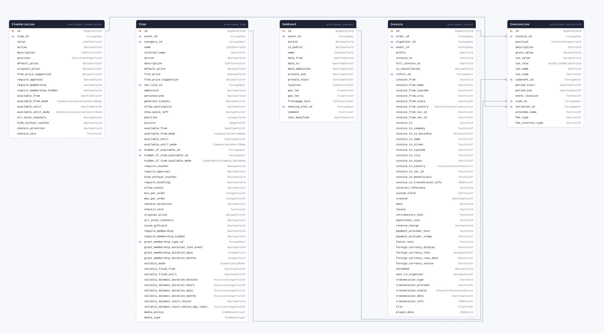

| Column | Field | Type | Null | Key | Default | Description |
| --- | --- | --- | --- | --- | --- | --- |
| `id` | `BigAutoField` | `integer` |  | PK | `autoincrement()` |  |
| `invoice_id` | `ForeignKey` | `bigint` |  | FK |  |  |
| `position` | `PositiveIntegerField` | `integer unsigned` |  |  | `0` |  |
| `description` | `TextField` | `text` |  |  |  |  |
| `gross_value` | `DecimalField(13, 2)` | `decimal` |  |  |  |  |
| `tax_value` | `DecimalField(13, 2)` | `decimal` |  |  | `Decimal('0.00')` |  |
| `tax_rate` | `NormalizedDecimalField(7, 4)` | `decimal` |  |  | `Decimal('0')` |  |
| `tax_name` | `CharField` | `varchar(190)` |  |  |  |  |
| `tax_code` | `CharField` | `varchar(190)` | yes |  |  |  |
| `subevent_id` | `ForeignKey` | `bigint` | yes | FK |  |  |
| `period_start` | `DateTimeField` | `datetime` | yes |  |  |  |
| `period_end` | `DateTimeField` | `datetime` | yes |  |  |  |
| `event_location` | `TextField` | `text` | yes |  |  |  |
| `item_id` | `ForeignKey` | `bigint` | yes | FK |  |  |
| `variation_id` | `ForeignKey` | `bigint` | yes | FK |  |  |
| `attendee_name` | `TextField` | `text` | yes |  |  |  |
| `fee_type` | `CharField` | `varchar(190)` | yes |  |  |  |
| `fee_internal_type` | `CharField` | `varchar(190)` | yes |  |  |  |

Indexes:

- index `pretixbase_invoiceline_invoice_id_8e8da2c5` on `invoice_id`
- index `pretixbase_invoiceline_subevent_id_69f4adc8` on `subevent_id`
- index `pretixbase_invoiceline_item_id_4f120b6a` on `item_id`
- index `pretixbase_invoiceline_variation_id_1bf843e9` on `variation_id`

Relations:

- `invoice_id` → [Invoice](#invoice).`id`, on delete cascade
- `subevent_id` → [SubEvent](#subevent).`id`, on delete protect
- `item_id` → [Item](#item).`id`, on delete protect
- `variation_id` → [ItemVariation](#itemvariation).`id`, on delete protect

## ItemCategory

Table `pretixbase_itemcategory`, app `pretixbase`.

Items can be sorted into these categories.

:param event: The event this category belongs to
:type event: Event
:param name: The name of this category
:type name: str
:param position: An integer, used for sorting
:type position: int

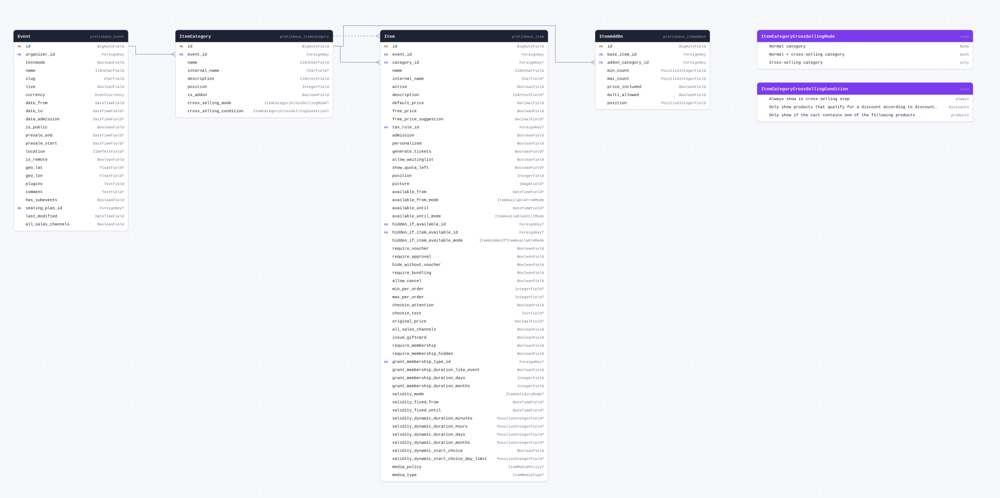

| Column | Field | Type | Null | Key | Default | Description |
| --- | --- | --- | --- | --- | --- | --- |
| `id` | `BigAutoField` | `integer` |  | PK | `autoincrement()` |  |
| `event_id` | `ForeignKey` | `bigint` |  | FK |  |  |
| `name` | `I18nCharField` | `text` |  |  |  |  |
| `internal_name` | `CharField` | `varchar(255)` | yes |  |  | If you set this, this will be used instead of the public name in the backend. |
| `description` | `I18nTextField` | `text` |  |  |  |  |
| `position` | `IntegerField` | `integer` |  |  | `0` |  |
| `is_addon` | `BooleanField` | `bool` |  |  | `False` | If selected, the products belonging to this category are not for sale on their own. They can only be bought in combination with a product that has this category configured as a possible source for add-ons. |
| `cross_selling_mode` | `ItemCategoryCrossSellingMode` | `varchar(5)` | yes |  |  |  |
| `cross_selling_condition` | `ItemCategoryCrossSellingCondition` | `varchar(10)` | yes |  |  |  |

Indexes:

- index `pretixbase_itemcategory_event_id_0827a86a` on `event_id`

Relations:

- `event_id` → [Event](#event).`id`, on delete cascade
- `cross_selling_match_products` — many to many with [Item](#item)
- [Item](#item).`category_id` → `id`, on delete protect
- [ItemAddOn](#itemaddon).`addon_category_id` → `id`, on delete cascade

## SubEventItem

Table `pretixbase_subeventitem`, app `pretixbase`.

This model can be used to change the price of a product for a single subevent (i.e. a
date in an event series).

:param subevent: The date this belongs to
:type subevent: SubEvent
:param item: The item to modify the price for
:type item: Item
:param price: The modified price (or ``None`` for the original price)
:type price: Decimal
:param disabled: Disable the product for this subevent
:type disabled: bool
:param available_until: The date until when the product is on sale
:type available_until: datetime
:param available_from: The date this product goes on sale
:type available_from: datetime
:param available_until: The date until when the product is on sale
:type available_until: datetime

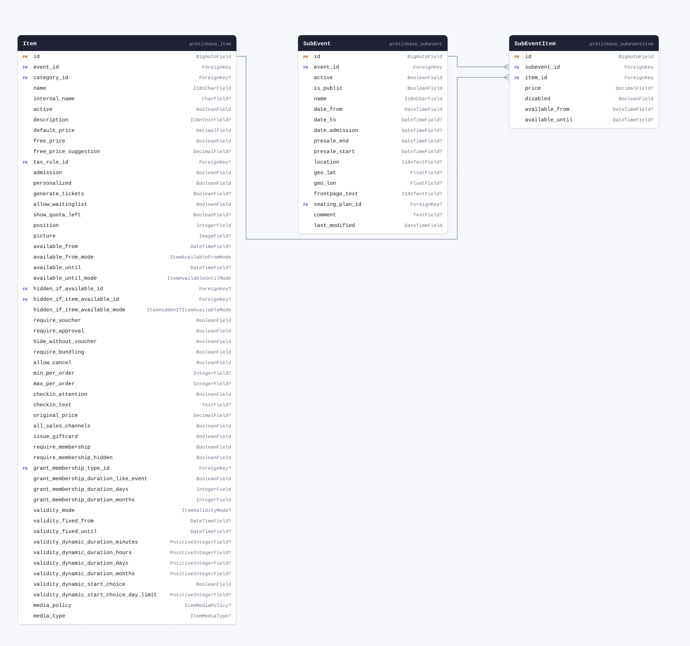

| Column | Field | Type | Null | Key | Default | Description |
| --- | --- | --- | --- | --- | --- | --- |
| `id` | `BigAutoField` | `integer` |  | PK | `autoincrement()` |  |
| `subevent_id` | `ForeignKey` | `bigint` |  | FK |  |  |
| `item_id` | `ForeignKey` | `bigint` |  | FK |  |  |
| `price` | `DecimalField(13, 2)` | `decimal` | yes |  |  |  |
| `disabled` | `BooleanField` | `bool` |  |  | `False` |  |
| `available_from` | `DateTimeField` | `datetime` | yes |  |  | This product will not be sold before the given date. |
| `available_until` | `DateTimeField` | `datetime` | yes |  |  | This product will not be sold after the given date. |

Indexes:

- index `pretixbase_subeventitem_subevent_id_2da8e314` on `subevent_id`
- index `pretixbase_subeventitem_item_id_87c1ba29` on `item_id`

Relations:

- `subevent_id` → [SubEvent](#subevent).`id`, on delete cascade
- `item_id` → [Item](#item).`id`, on delete cascade

## SubEventItemVariation

Table `pretixbase_subeventitemvariation`, app `pretixbase`.

This model can be used to change the price of a product variation for a single
subevent (i.e. a date in an event series).

:param subevent: The date this belongs to
:type subevent: SubEvent
:param variation: The variation to modify the price for
:type variation: ItemVariation
:param price: The modified price (or ``None`` for the original price)
:type price: Decimal
:param disabled: Disable the product for this subevent
:type disabled: bool
:param available_until: The date until when the product is on sale
:type available_until: datetime
:param available_from: The date this product goes on sale
:type available_from: datetime
:param available_until: The date until when the product is on sale
:type available_until: datetime

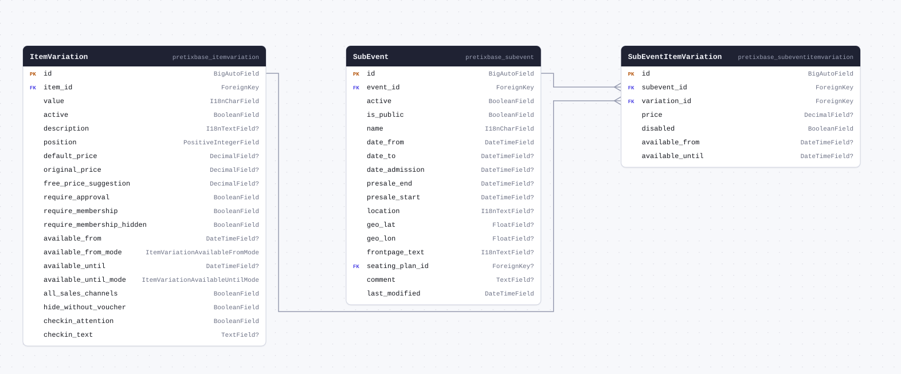

| Column | Field | Type | Null | Key | Default | Description |
| --- | --- | --- | --- | --- | --- | --- |
| `id` | `BigAutoField` | `integer` |  | PK | `autoincrement()` |  |
| `subevent_id` | `ForeignKey` | `bigint` |  | FK |  |  |
| `variation_id` | `ForeignKey` | `bigint` |  | FK |  |  |
| `price` | `DecimalField(13, 2)` | `decimal` | yes |  |  |  |
| `disabled` | `BooleanField` | `bool` |  |  | `False` |  |
| `available_from` | `DateTimeField` | `datetime` | yes |  |  | This product will not be sold before the given date. |
| `available_until` | `DateTimeField` | `datetime` | yes |  |  | This product will not be sold after the given date. |

Indexes:

- index `pretixbase_subeventitemvariation_subevent_id_9fc7911f` on `subevent_id`
- index `pretixbase_subeventitemvariation_variation_id_182b380a` on `variation_id`

Relations:

- `subevent_id` → [SubEvent](#subevent).`id`, on delete cascade
- `variation_id` → [ItemVariation](#itemvariation).`id`, on delete cascade

## Item

Table `pretixbase_item`, app `pretixbase`.

An item is a thing which can be sold. It belongs to an event and may or may not belong to a category.
Items are often also called 'products' but are named 'items' internally due to historic reasons.

:param event: The event this item belongs to
:type event: Event
:param category: The category this belongs to. May be null.
:type category: ItemCategory
:param name: The name of this item
:type name: str
:param active: Whether this item is being sold.
:type active: bool
:param description: A short description
:type description: str
:param default_price: The item's default price
:type default_price: decimal.Decimal
:param tax_rate: The VAT tax that is included in this item's price (in %)
:type tax_rate: decimal.Decimal
:param admission: ``True``, if this item allows persons to enter the event (as opposed to e.g. merchandise)
:type admission: bool
:param personalized: ``True``, if attendee information should be collected for this ticket
:type personalized: bool
:param picture: A product picture to be shown next to the product description
:type picture: File
:param available_from: The date this product goes on sale
:type available_from: datetime
:param available_until: The date until when the product is on sale
:type available_until: datetime
:param require_voucher: If set to ``True``, this item can only be bought using a voucher.
:type require_voucher: bool
:param hide_without_voucher: If set to ``True``, this item is only visible and available when a voucher is used.
:type hide_without_voucher: bool
:param allow_cancel: If set to ``False``, an order with this product can not be canceled by the user.
:type allow_cancel: bool
:param max_per_order: Maximum number of times this item can be in an order. None for unlimited.
:type max_per_order: int
:param min_per_order: Minimum number of times this item needs to be in an order if bought at all. None for unlimited.
:type min_per_order: int
:param checkin_attention: Requires special attention at check-in
:type checkin_attention: bool
:param checkin_text: Additional text to show at check-in
:type checkin_text: bool
:param original_price: The item's "original" price. Will not be used for any calculations, will just be shown.
:type original_price: decimal.Decimal
:param require_approval: If set to ``True``, orders containing this product can only be processed and paid after approved by an administrator
:type require_approval: bool
:param all_sales_channels: A flag indicating that this item is available on all channels and limit_sales_channels will be ignored.
:type all_sales_channels: bool
:param limit_sales_channels: A list of sales channel identifiers, that this item is available for sale on.
:type limit_sales_channels: list
:param issue_giftcard: If ``True``, buying this product will give you a gift card with the value of the product's price
:type issue_giftcard: bool
:param validity_mode: Instruction how to set ``valid_from``/``valid_until`` on tickets, ``null`` is default event validity.
:type validity_mode: str
:param validity_fixed_from: Start of validity if ``validity_mode`` is ``"fixed"``.
:type validity_fixed_from: datetime
:param validity_fixed_until: End of validity if ``validity_mode`` is ``"fixed"``.
:type validity_fixed_until: datetime
:param validity_dynamic_duration_minutes: Number of minutes if ``validity_mode`` is ``"dnyamic"``.
:type validity_dynamic_duration_minutes: int
:param validity_dynamic_duration_hours: Number of hours if ``validity_mode`` is ``"dnyamic"``.
:type validity_dynamic_duration_hours: int
:param validity_dynamic_duration_days: Number of days if ``validity_mode`` is ``"dnyamic"``.
:type validity_dynamic_duration_days: int
:param validity_dynamic_duration_months: Number of months if ``validity_mode`` is ``"dnyamic"``.
:type validity_dynamic_duration_months: int
:param validity_dynamic_start_choice: Whether customers can choose the start date if ``validity_mode`` is ``"dnyamic"``.
:type validity_dynamic_start_choice: bool
:param validity_dynamic_start_choice_day_limit: Start date may be maximum this many days in the future if ``validity_mode`` is ``"dnyamic"``.
:type validity_dynamic_start_choice_day_limnit: int

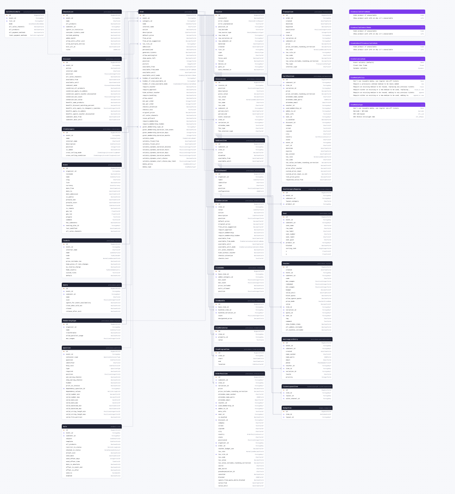

| Column | Field | Type | Null | Key | Default | Description |
| --- | --- | --- | --- | --- | --- | --- |
| `id` | `BigAutoField` | `integer` |  | PK | `autoincrement()` |  |
| `event_id` | `ForeignKey` | `bigint` |  | FK |  |  |
| `category_id` | `ForeignKey` | `bigint` | yes | FK |  | If you have many products, you can optionally sort them into categories to keep things organized. |
| `name` | `I18nCharField` | `text` |  |  |  |  |
| `internal_name` | `CharField` | `varchar(255)` | yes |  |  | If you set this, this will be used instead of the public name in the backend. |
| `active` | `BooleanField` | `bool` |  |  | `True` |  |
| `description` | `I18nTextField` | `text` | yes |  |  | This is shown below the product name in lists. |
| `default_price` | `DecimalField(13, 2)` | `decimal` |  |  |  | If this product has multiple variations, you can set different prices for each of the variations. If a variation does not have a special price or if you do not have variations, this price will be used. |
| `free_price` | `BooleanField` | `bool` |  |  | `False` | If this option is active, your users can choose the price themselves. The price configured above is then interpreted as the minimum price a user has to enter. You could use this e.g. to collect additional donations for your event. |
| `free_price_suggestion` | `DecimalField(13, 2)` | `decimal` | yes |  |  | This price will be used as the default value of the input field. The user can choose a lower value, but not lower than the price this product would have without the free price option. This will be ignored if a voucher is used that lowers the price. |
| `tax_rule_id` | `ForeignKey` | `bigint` | yes | FK |  |  |
| `admission` | `BooleanField` | `bool` |  |  | `False` | Whether or not buying this product allows a person to enter your event |
| `personalized` | `BooleanField` | `bool` |  |  | `False` | Whether or not buying this product allows to enter attendee information |
| `generate_tickets` | `BooleanField` | `bool` | yes |  |  |  |
| `allow_waitinglist` | `BooleanField` | `bool` |  |  | `True` | This will only work if waiting lists are enabled for this event. |
| `show_quota_left` | `BooleanField` | `bool` | yes |  |  | Publicly show how many tickets are still available. |
| `position` | `IntegerField` | `integer` |  |  | `0` |  |
| `picture` | `ImageField` | `varchar(255)` | yes |  |  |  |
| `available_from` | `DateTimeField` | `datetime` | yes |  |  | This product will not be sold before the given date. |
| `available_from_mode` | `ItemAvailableFromMode` | `varchar(16)` |  |  | `'hide'` |  |
| `available_until` | `DateTimeField` | `datetime` | yes |  |  | This product will not be sold after the given date. |
| `available_until_mode` | `ItemAvailableUntilMode` | `varchar(16)` |  |  | `'hide'` |  |
| `hidden_if_available_id` | `ForeignKey` | `bigint` | yes | FK |  | If you select a quota here, this product will only be shown when that quota is unavailable. If combined with the option to hide sold-out products, this allows you to swap out products for more expensive ones once they are sold out. There might be a short period in which both products are visible while all tickets in the referenced quota are reserved, but not yet sold. |
| `hidden_if_item_available_id` | `ForeignKey` | `bigint` | yes | FK |  | If you select a product here, this product will only be shown when that product is no longer available. This will happen either because the other product has sold out or because the time is outside of the sales window for the other product. If combined with the option to hide sold-out products, this allows you to swap out products for more expensive ones once the cheaper option is sold out. There might be a short period in which both products are visible while all tickets of the referenced product are reserved, but not yet sold. |
| `hidden_if_item_available_mode` | `ItemHiddenIfItemAvailableMode` | `varchar(16)` |  |  | `'hide'` |  |
| `require_voucher` | `BooleanField` | `bool` |  |  | `False` | To buy this product, the user needs a voucher that applies to this product either directly or via a quota. |
| `require_approval` | `BooleanField` | `bool` |  |  | `False` | If this product is part of an order, the order will be put into an "approval" state and will need to be confirmed by you before it can be paid and completed. You can use this e.g. for discounted tickets that are only available to specific groups. |
| `hide_without_voucher` | `BooleanField` | `bool` |  |  | `False` | This product will be hidden from the event page until the user enters a voucher that unlocks this product. |
| `require_bundling` | `BooleanField` | `bool` |  |  | `False` | If this option is set, the product will only be sold as part of bundle products. Do <strong>not</strong> check this option if you want to use this product as an add-on product, but only for fixed bundles! |
| `allow_cancel` | `BooleanField` | `bool` |  |  | `True` | If this is checked, the usual cancellation and order change settings of this event apply. If this is unchecked, orders containing this product can not be canceled by users but only by you. |
| `min_per_order` | `IntegerField` | `integer` | yes |  |  | This product can only be bought if it is added to the cart at least this many times. If you keep the field empty or set it to 0, there is no special limit for this product. |
| `max_per_order` | `IntegerField` | `integer` | yes |  |  | This product can only be bought at most this many times within one order. If you keep the field empty or set it to 0, there is no special limit for this product. The limit for the maximum number of items in the whole order applies regardless. |
| `checkin_attention` | `BooleanField` | `bool` |  |  | `False` | If you set this, the check-in app will show a visible warning that this ticket requires special attention. You can use this for example for student tickets to indicate to the person at check-in that the student ID card still needs to be checked. |
| `checkin_text` | `TextField` | `text` | yes |  |  | This text will be shown by the check-in app if a ticket of this type is scanned. |
| `original_price` | `DecimalField(13, 2)` | `decimal` | yes |  |  | If set, this will be displayed next to the current price to show that the current price is a discounted one. This is just a cosmetic setting and will not actually impact pricing. |
| `all_sales_channels` | `BooleanField` | `bool` |  |  | `True` |  |
| `issue_giftcard` | `BooleanField` | `bool` |  |  | `False` | When a customer buys this product, they will get a gift card with a value corresponding to the product price. |
| `require_membership` | `BooleanField` | `bool` |  |  | `False` |  |
| `require_membership_hidden` | `BooleanField` | `bool` |  |  | `False` | Do not show this unless the customer is logged in and has a valid membership. Be aware that this means it will never be visible in the widget. |
| `grant_membership_type_id` | `ForeignKey` | `bigint` | yes | FK |  |  |
| `grant_membership_duration_like_event` | `BooleanField` | `bool` |  |  | `True` |  |
| `grant_membership_duration_days` | `IntegerField` | `integer` |  |  | `0` |  |
| `grant_membership_duration_months` | `IntegerField` | `integer` |  |  | `0` |  |
| `validity_mode` | `ItemValidityMode` | `varchar(16)` | yes |  |  | When setting up a regular event, or an event series with time slots, you typically do NOT need to change this value. The default setting means that the validity time of tickets will not be decided by the product, but by the event and check-in configuration. Only use the other options if you need them to realize e.g. a booking of a year-long ticket with a dynamic start date. Note that the validity will be stored with the ticket, so if you change the settings here later, existing tickets will not be affected by the change but keep their current validity. |
| `validity_fixed_from` | `DateTimeField` | `datetime` | yes |  |  |  |
| `validity_fixed_until` | `DateTimeField` | `datetime` | yes |  |  |  |
| `validity_dynamic_duration_minutes` | `PositiveIntegerField` | `integer unsigned` | yes |  |  |  |
| `validity_dynamic_duration_hours` | `PositiveIntegerField` | `integer unsigned` | yes |  |  |  |
| `validity_dynamic_duration_days` | `PositiveIntegerField` | `integer unsigned` | yes |  |  |  |
| `validity_dynamic_duration_months` | `PositiveIntegerField` | `integer unsigned` | yes |  |  |  |
| `validity_dynamic_start_choice` | `BooleanField` | `bool` |  |  | `False` | If not selected, the validity always starts at the time of purchase. |
| `validity_dynamic_start_choice_day_limit` | `PositiveIntegerField` | `integer unsigned` | yes |  |  | The selected start date may only be this many days in the future. |
| `media_policy` | `ItemMediaPolicy` | `varchar(16)` | yes |  |  | If this product should be stored on a reusable physical medium, you can attach a physical media policy. This is not required for regular tickets, which just use a one-time barcode, but only for products like renewable season tickets or re-chargeable gift card wristbands. This is an advanced feature that also requires specific configuration of ticketing and printing settings. |
| `media_type` | `ItemMediaType` | `varchar(100)` | yes |  |  | Select the type of physical medium that should be used for this product. Note that not all media types support all types of products, and not all media types are supported across all sales channels or check-in processes. |

Indexes:

- index `pretixbase_item_event_id_6e8233b4` on `event_id`
- index `pretixbase_item_category_id_8fa63715` on `category_id`
- index `pretixbase_item_tax_rule_id_f501b784` on `tax_rule_id`
- index `pretixbase_item_hidden_if_available_id_6d97361e` on `hidden_if_available_id`
- index `pretixbase_item_hidden_if_item_available_id_cf6313d5` on `hidden_if_item_available_id`
- index `pretixbase_item_grant_membership_type_id_6949efbf` on `grant_membership_type_id`

Relations:

- `checkinlist_set` — many to many with [CheckinList](#checkinlist)
- [Checkin](#checkin).`raw_item_id` → `id`, on delete set null
- `discount_set` — many to many with [Discount](#discount)
- `benefit_discounts` — many to many with [Discount](#discount)
- [InvoiceLine](#invoiceline).`item_id` → `id`, on delete protect
- `matched_by_cross_selling_categories` — many to many with [ItemCategory](#itemcategory)
- [SubEventItem](#subeventitem).`item_id` → `id`, on delete cascade
- `event_id` → [Event](#event).`id`, on delete protect
- `category_id` → [ItemCategory](#itemcategory).`id`, on delete protect
- `tax_rule_id` → [TaxRule](#taxrule).`id`, on delete protect
- `hidden_if_available_id` → [Quota](#quota).`id`, on delete set null
- `hidden_if_item_available_id` → [Item](#item).`id`, on delete set null
- `grant_membership_type_id` → [MembershipType](#membershiptype).`id`, on delete protect
- `limit_sales_channels` — many to many with [SalesChannel](#saleschannel)
- `require_membership_types` — many to many with [MembershipType](#membershiptype)
- [ItemVariation](#itemvariation).`item_id` → `id`, on delete cascade
- [ItemAddOn](#itemaddon).`base_item_id` → `id`, on delete cascade
- [ItemBundle](#itembundle).`base_item_id` → `id`, on delete cascade
- [ItemBundle](#itembundle).`bundled_item_id` → `id`, on delete cascade
- `questions` — many to many with [Question](#question)
- `quotas` — many to many with [Quota](#quota)
- [ItemMetaValue](#itemmetavalue).`item_id` → `id`, on delete cascade
- [ItemProgramTime](#itemprogramtime).`item_id` → `id`, on delete cascade
- [OrderPosition](#orderposition).`item_id` → `id`, on delete protect
- [Transaction](#transaction).`item_id` → `id`, on delete protect
- [CartPosition](#cartposition).`item_id` → `id`, on delete protect
- [SeatCategoryMapping](#seatcategorymapping).`product_id` → `id`, on delete cascade
- [Seat](#seat).`product_id` → `id`, on delete set null
- [Voucher](#voucher).`item_id` → `id`, on delete protect
- [WaitingListEntry](#waitinglistentry).`item_id` → `id`, on delete cascade
- [TicketLayoutItem](#ticketlayoutitem).`item_id` → `id`, on delete cascade
- `rule_set` — many to many with [Rule](#rule)
- [BadgeItem](#badgeitem).`item_id` → `id`, on delete cascade
- `autocheckinrule_set` — many to many with [AutoCheckinRule](#autocheckinrule)

## ItemVariation

Table `pretixbase_itemvariation`, app `pretixbase`.

A variation of a product. For example, if your item is 'T-Shirt'
then an example for a variation would be 'T-Shirt XL'.

:param item: The item this variation belongs to
:type item: Item
:param value: A string defining this variation
:type value: str
:param description: A short description
:type description: str
:param active: Whether this variation is being sold.
:type active: bool
:param default_price: This variation's default price
:type default_price: decimal.Decimal
:param original_price: The item's "original" price. Will not be used for any calculations, will just be shown.
:type original_price: decimal.Decimal
:param require_approval: If set to ``True``, orders containing this variation can only be processed and paid after
                         approval by an administrator
:type require_approval: bool
:param all_sales_channels: A flag indicating that this variation is available on all channels and limit_sales_channels will be ignored.
:type all_sales_channels: bool
:param limit_sales_channels: A list of sales channel identifiers, that this variation is available for sale on.
:type limit_sales_channels: list

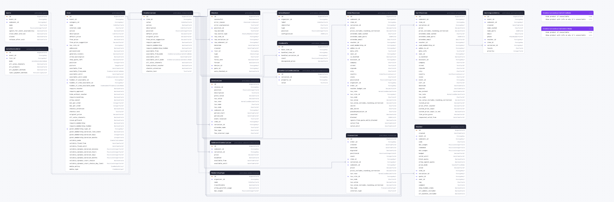

| Column | Field | Type | Null | Key | Default | Description |
| --- | --- | --- | --- | --- | --- | --- |
| `id` | `BigAutoField` | `integer` |  | PK | `autoincrement()` |  |
| `item_id` | `ForeignKey` | `bigint` |  | FK |  |  |
| `value` | `I18nCharField` | `text` |  |  |  |  |
| `active` | `BooleanField` | `bool` |  |  | `True` |  |
| `description` | `I18nTextField` | `text` | yes |  |  | This is shown below the variation name in lists. |
| `position` | `PositiveIntegerField` | `integer unsigned` |  |  | `0` |  |
| `default_price` | `DecimalField(13, 2)` | `decimal` | yes |  |  |  |
| `original_price` | `DecimalField(13, 2)` | `decimal` | yes |  |  | If set, this will be displayed next to the current price to show that the current price is a discounted one. This is just a cosmetic setting and will not actually impact pricing. |
| `free_price_suggestion` | `DecimalField(13, 2)` | `decimal` | yes |  |  | This price will be used as the default value of the input field. The user can choose a lower value, but not lower than the price this product would have without the free price option. This will be ignored if a voucher is used that lowers the price. |
| `require_approval` | `BooleanField` | `bool` |  |  | `False` | If this variation is part of an order, the order will be put into an "approval" state and will need to be confirmed by you before it can be paid and completed. You can use this e.g. for discounted tickets that are only available to specific groups. |
| `require_membership` | `BooleanField` | `bool` |  |  | `False` |  |
| `require_membership_hidden` | `BooleanField` | `bool` |  |  | `False` | Do not show this unless the customer is logged in and has a valid membership. Be aware that this means it will never be visible in the widget. |
| `available_from` | `DateTimeField` | `datetime` | yes |  |  | This variation will not be sold before the given date. |
| `available_from_mode` | `ItemVariationAvailableFromMode` | `varchar(16)` |  |  | `'hide'` |  |
| `available_until` | `DateTimeField` | `datetime` | yes |  |  | This variation will not be sold after the given date. |
| `available_until_mode` | `ItemVariationAvailableUntilMode` | `varchar(16)` |  |  | `'hide'` |  |
| `all_sales_channels` | `BooleanField` | `bool` |  |  | `True` |  |
| `hide_without_voucher` | `BooleanField` | `bool` |  |  | `False` | This variation will be hidden from the event page until the user enters a voucher that unlocks this variation. |
| `checkin_attention` | `BooleanField` | `bool` |  |  | `False` | If you set this, the check-in app will show a visible warning that this ticket requires special attention. You can use this for example for student tickets to indicate to the person at check-in that the student ID card still needs to be checked. |
| `checkin_text` | `TextField` | `text` | yes |  |  | This text will be shown by the check-in app if a ticket of this type is scanned. |

Indexes:

- index `pretixbase_itemvariation_item_id_e3d28791` on `item_id`

Relations:

- [Checkin](#checkin).`raw_variation_id` → `id`, on delete set null
- [InvoiceLine](#invoiceline).`variation_id` → `id`, on delete protect
- [SubEventItemVariation](#subeventitemvariation).`variation_id` → `id`, on delete cascade
- `item_id` → [Item](#item).`id`, on delete cascade
- `require_membership_types` — many to many with [MembershipType](#membershiptype)
- `limit_sales_channels` — many to many with [SalesChannel](#saleschannel)
- [ItemBundle](#itembundle).`bundled_variation_id` → `id`, on delete cascade
- `quotas` — many to many with [Quota](#quota)
- [ItemVariationMetaValue](#itemvariationmetavalue).`variation_id` → `id`, on delete cascade
- [OrderPosition](#orderposition).`variation_id` → `id`, on delete protect
- [Transaction](#transaction).`variation_id` → `id`, on delete protect
- [CartPosition](#cartposition).`variation_id` → `id`, on delete protect
- [Voucher](#voucher).`variation_id` → `id`, on delete protect
- [WaitingListEntry](#waitinglistentry).`variation_id` → `id`, on delete cascade
- `autocheckinrule_set` — many to many with [AutoCheckinRule](#autocheckinrule)

## ItemAddOn

Table `pretixbase_itemaddon`, app `pretixbase`.

An instance of this model indicates that buying a ticket of the time ``base_item``
allows you to add up to ``max_count`` items from the category ``addon_category``
to your order that will be associated with the base item.

:param base_item: The base item the add-ons are attached to
:type base_item: Item
:param addon_category: The category the add-on can be chosen from
:type addon_category: ItemCategory
:param min_count: The minimal number of add-ons to be chosen
:type min_count: int
:param max_count: The maximal number of add-ons to be chosen
:type max_count: int
:param position: An integer used for sorting
:type position: int

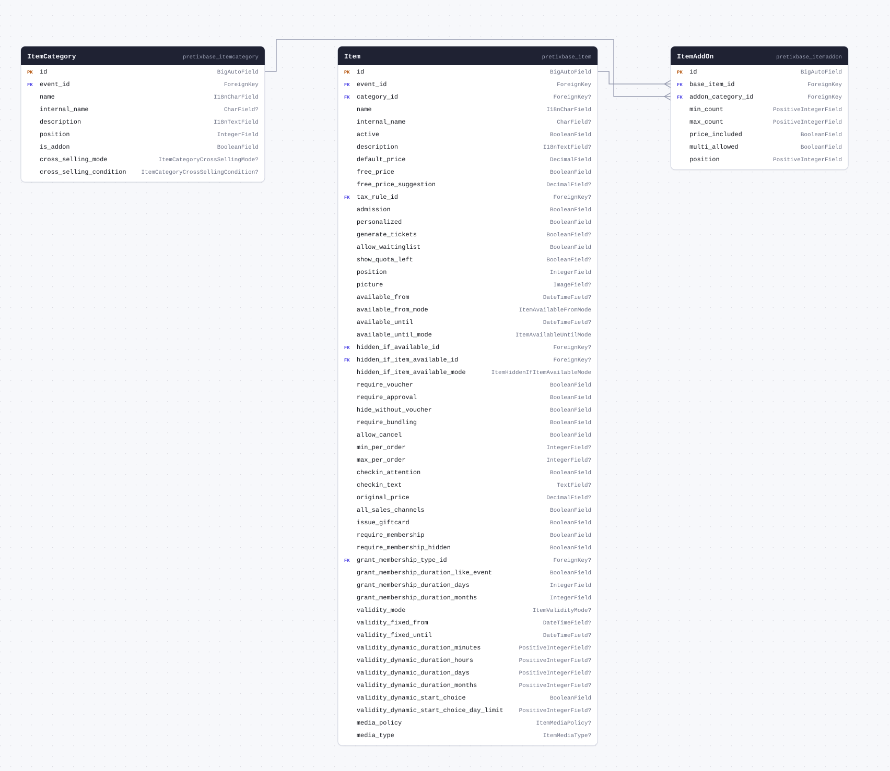

| Column | Field | Type | Null | Key | Default | Description |
| --- | --- | --- | --- | --- | --- | --- |
| `id` | `BigAutoField` | `integer` |  | PK | `autoincrement()` |  |
| `base_item_id` | `ForeignKey` | `bigint` |  | FK |  |  |
| `addon_category_id` | `ForeignKey` | `bigint` |  | FK |  |  |
| `min_count` | `PositiveIntegerField` | `integer unsigned` |  |  | `0` |  |
| `max_count` | `PositiveIntegerField` | `integer unsigned` |  |  | `1` |  |
| `price_included` | `BooleanField` | `bool` |  |  | `False` | If selected, adding add-ons to this ticket is free, even if the add-ons would normally cost money individually. |
| `multi_allowed` | `BooleanField` | `bool` |  |  | `False` |  |
| `position` | `PositiveIntegerField` | `integer unsigned` |  |  | `0` |  |

Indexes:

- index `pretixbase_itemaddon_base_item_id_1f94d65a` on `base_item_id`
- index `pretixbase_itemaddon_addon_category_id_370defeb` on `addon_category_id`
- unique `pretixbase_itemaddon_base_item_id_addon_category_id_8e09fedf_uniq` on `base_item_id`, `addon_category_id`

Relations:

- `base_item_id` → [Item](#item).`id`, on delete cascade
- `addon_category_id` → [ItemCategory](#itemcategory).`id`, on delete cascade

## ItemBundle

Table `pretixbase_itembundle`, app `pretixbase`.

An instance of this model indicates that buying a ticket of the type ``base_item``
automatically also buys ``count`` items of type ``bundled_item``.

:param base_item: The base item the bundle is attached to
:type base_item: Item
:param bundled_item: The bundled item
:type bundled_item: Item
:param bundled_variation: The variation, if the bundled item has variations
:type bundled_variation: ItemVariation
:param count: The number of items to bundle
:type count: int
:param designated_price: The designated part price (optional)
:type designated_price: bool


| Column | Field | Type | Null | Key | Default | Description |
| --- | --- | --- | --- | --- | --- | --- |
| `id` | `BigAutoField` | `integer` |  | PK | `autoincrement()` |  |
| `base_item_id` | `ForeignKey` | `bigint` |  | FK |  |  |
| `bundled_item_id` | `ForeignKey` | `bigint` |  | FK |  |  |
| `bundled_variation_id` | `ForeignKey` | `bigint` | yes | FK |  |  |
| `count` | `PositiveIntegerField` | `integer unsigned` |  |  | `1` |  |
| `designated_price` | `DecimalField(13, 2)` | `decimal` |  |  | `Decimal('0.00')` | If set, it will be shown that this bundled item is responsible for the given value of the total gross price. This might be important in cases of mixed taxation, but can be kept blank otherwise. This value will NOT be added to the base item's price. |

Indexes:

- index `pretixbase_itembundle_base_item_id_ac6691f3` on `base_item_id`
- index `pretixbase_itembundle_bundled_item_id_9f6f0a8f` on `bundled_item_id`
- index `pretixbase_itembundle_bundled_variation_id_cd1fba5f` on `bundled_variation_id`

Relations:

- `base_item_id` → [Item](#item).`id`, on delete cascade
- `bundled_item_id` → [Item](#item).`id`, on delete cascade
- `bundled_variation_id` → [ItemVariation](#itemvariation).`id`, on delete cascade

## Question

Table `pretixbase_question`, app `pretixbase`.

A question is an input field that can be used to extend a ticket by custom information,
e.g. "Attendee age". The answers are found next to the position. The answers may be found
in QuestionAnswers, attached to OrderPositions/CartPositions. A question can allow one of
several input types, currently:

* a number (``TYPE_NUMBER``)
* a one-line string (``TYPE_STRING``)
* a multi-line string (``TYPE_TEXT``)
* a boolean (``TYPE_BOOLEAN``)
* a multiple choice option (``TYPE_CHOICE`` and ``TYPE_CHOICE_MULTIPLE``)
* a file upload (``TYPE_FILE``)
* a date (``TYPE_DATE``)
* a time (``TYPE_TIME``)
* a date and a time (``TYPE_DATETIME``)

:param event: The event this question belongs to
:type event: Event
:param question: The question text. This will be displayed next to the input field.
:type question: str
:param type: One of the above types
:param required: Whether answering this question is required for submitting an order including
                 items associated with this question.
:type required: bool
:param items: A set of ``Items`` objects that this question should be applied to
:param ask_during_checkin: Whether to ask this question during check-in instead of during check-out.
:type ask_during_checkin: bool
:param show_during_checkin: Whether to show the answer to this question during check-in.
:type show_during_checkin: bool
:param hidden: Whether to only show the question in the backend
:type hidden: bool
:param identifier: An arbitrary, internal identifier
:type identifier: str
:param dependency_question: This question will only show up if the referenced question is set to `dependency_value`.
:type dependency_question: Question
:param dependency_values: The values that `dependency_question` needs to be set to for this question to be applicable.
:type dependency_values: list[str]


| Column | Field | Type | Null | Key | Default | Description |
| --- | --- | --- | --- | --- | --- | --- |
| `id` | `BigAutoField` | `integer` |  | PK | `autoincrement()` |  |
| `event_id` | `ForeignKey` | `bigint` |  | FK |  |  |
| `container_type` | `QuestionContainerType` | `varchar(5)` |  |  | `'P'` |  |
| `question` | `I18nTextField` | `text` |  |  |  |  |
| `identifier` | `CharField` | `varchar(190)` |  |  |  | You can enter any value here to make it easier to match the data with other sources. If you do not input one, we will generate one automatically. |
| `help_text` | `I18nTextField` | `text` | yes |  |  | If the question needs to be explained or clarified, do it here! |
| `type` | `QuestionType` | `varchar(5)` |  |  |  |  |
| `required` | `BooleanField` | `bool` |  |  | `False` |  |
| `position` | `PositiveIntegerField` | `integer unsigned` |  |  | `0` |  |
| `ask_during_checkin` | `BooleanField` | `bool` |  |  | `False` | Not supported by all check-in apps for all question types. |
| `show_during_checkin` | `BooleanField` | `bool` |  |  | `False` | Not supported by all check-in apps for all question types. |
| `hidden` | `BooleanField` | `bool` |  |  | `False` | This question will only show up in the backend. |
| `print_on_invoice` | `BooleanField` | `bool` |  |  | `False` |  |
| `dependency_question_id` | `ForeignKey` | `bigint` | yes | FK |  |  |
| `dependency_values` | `MultiStringField` | `text` |  |  | `[]` |  |
| `valid_number_min` | `DecimalField(30, 6)` | `decimal` | yes |  |  | Currently not supported in our apps and during check-in |
| `valid_number_max` | `DecimalField(30, 6)` | `decimal` | yes |  |  | Currently not supported in our apps and during check-in |
| `valid_date_min` | `DateField` | `date` | yes |  |  | Currently not supported in our apps and during check-in |
| `valid_date_max` | `DateField` | `date` | yes |  |  | Currently not supported in our apps and during check-in |
| `valid_datetime_min` | `DateTimeField` | `datetime` | yes |  |  | Currently not supported in our apps and during check-in |
| `valid_datetime_max` | `DateTimeField` | `datetime` | yes |  |  | Currently not supported in our apps and during check-in |
| `valid_string_length_min` | `PositiveIntegerField` | `integer unsigned` | yes |  |  | Currently not supported in our apps and during check-in |
| `valid_string_length_max` | `PositiveIntegerField` | `integer unsigned` | yes |  |  | Currently not supported in our apps and during check-in |
| `valid_file_portrait` | `BooleanField` | `bool` |  |  | `False` | If checked, files must be images with an aspect ratio of 3:4. This is commonly used for photos printed on badges. |

Indexes:

- index `pretixbase_question_event_id_ca103445` on `event_id`
- index `pretixbase_question_dependency_question_id_a02199c8` on `dependency_question_id`
- unique `pretixbase_question_event_id_identifier_3a41c0ef_uniq` on `event_id`, `identifier`

Relations:

- `event_id` → [Event](#event).`id`, on delete cascade
- `dependency_question_id` → [Question](#question).`id`, on delete set null
- `items` — many to many with [Item](#item)
- [QuestionOption](#questionoption).`question_id` → `id`, on delete cascade
- [QuestionAnswer](#questionanswer).`question_id` → `id`, on delete cascade

## QuestionOption

Table `pretixbase_questionoption`, app `pretixbase`.


| Column | Field | Type | Null | Key | Default | Description |
| --- | --- | --- | --- | --- | --- | --- |
| `id` | `BigAutoField` | `integer` |  | PK | `autoincrement()` |  |
| `question_id` | `ForeignKey` | `bigint` |  | FK |  |  |
| `identifier` | `CharField` | `varchar(190)` |  |  |  | You can enter any value here to make it easier to match the data with other sources. If you do not input one, we will generate one automatically. |
| `answer` | `I18nCharField` | `text` |  |  |  |  |
| `position` | `IntegerField` | `integer` |  |  | `0` |  |

Indexes:

- index `pretixbase_questionoption_question_id_67c888dd` on `question_id`

Relations:

- `question_id` → [Question](#question).`id`, on delete cascade
- `answers` — many to many with [QuestionAnswer](#questionanswer)

## Quota

Table `pretixbase_quota`, app `pretixbase`.

A quota is a "pool of tickets". It is there to limit the number of items
of a certain type to be sold. For example, you could have a quota of 500
applied to all of your items (because you only have that much space in your
venue), and also a quota of 100 applied to the VIP tickets for exclusivity.
In this case, no more than 500 tickets will be sold in total and no more
than 100 of them will be VIP tickets (but 450 normal and 50 VIP tickets
will be fine).

As always, a quota can not only be tied to an item, but also to specific
variations.

Please read the documentation section on quotas carefully before doing
anything with quotas. This might confuse you otherwise.
https://docs.pretix.eu/en/latest/development/concepts.html#quotas

The AVAILABILITY_* constants represent various states of a quota allowing
its items/variations to be up for sale.

AVAILABILITY_OK
    This item is available for sale.

AVAILABILITY_RESERVED
    This item is currently not available for sale because all available
    items are in people's shopping carts. It might become available
    again if those people do not proceed to the checkout.

AVAILABILITY_ORDERED
    This item is currently not available for sale because all available
    items are ordered. It might become available again if those people
    do not pay.

AVAILABILITY_GONE
    This item is completely sold out.

:param event: The event this belongs to
:type event: Event
:param subevent: The event series date this belongs to, if event series are enabled
:type subevent: SubEvent
:param name: This quota's name
:type name: str
:param size: The number of items in this quota
:type size: int
:param items: The set of :py:class:`Item` objects this quota applies to
:param variations: The set of :py:class:`ItemVariation` objects this quota applies to

This model keeps a cache of the quota availability that is used in places where up-to-date
data is not important. This cache might be out of date even though a more recent quota was
calculated. This is intentional to keep database writes low. Currently, the cached values
are written whenever the quota is being calculated throughout the system and the cache is
at least 120 seconds old or if the new value is qualitatively "better" than the cached one
(i.e. more free quota).

There's also a cronjob that refreshes the cache of every quota if there is any log entry in
the event that is newer than the quota's cached time.


| Column | Field | Type | Null | Key | Default | Description |
| --- | --- | --- | --- | --- | --- | --- |
| `id` | `BigAutoField` | `integer` |  | PK | `autoincrement()` |  |
| `event_id` | `ForeignKey` | `bigint` |  | FK |  |  |
| `subevent_id` | `ForeignKey` | `bigint` | yes | FK |  |  |
| `name` | `CharField` | `varchar(200)` |  |  |  |  |
| `size` | `PositiveIntegerField` | `integer unsigned` | yes |  |  | Leave empty for an unlimited number of tickets. |
| `ignore_for_event_availability` | `BooleanField` | `bool` |  |  | `False` | If you enable this, this quota will be ignored when determining event availability in your event calendar. This is useful e.g. for merchandise that is added to each event but should not stop the event from being shown as sold out. |
| `close_when_sold_out` | `BooleanField` | `bool` |  |  | `False` | If you enable this, when the quota is sold out once, no more tickets will be sold, even if tickets become available again through cancellations or expiring orders. Of course, you can always re-open it manually. |
| `closed` | `BooleanField` | `bool` |  |  | `False` |  |
| `release_after_exit` | `BooleanField` | `bool` |  |  | `False` | With this option, quota will be released as soon as people are scanned at an exit of your event. This will only happen if they have been scanned both at an entry and at an exit and the exit is the more recent scan. It does not matter which check-in list either of the scans was on, but check-in lists are ignored if they are set to "Allow re-entering after an exit scan" to prevent accidental overbooking. |

Indexes:

- index `pretixbase_quota_event_id_e57269de` on `event_id`
- index `pretixbase_quota_subevent_id_f2fc62f2` on `subevent_id`

Relations:

- [Item](#item).`hidden_if_available_id` → `id`, on delete set null
- `event_id` → [Event](#event).`id`, on delete cascade
- `subevent_id` → [SubEvent](#subevent).`id`, on delete cascade
- `items` — many to many with [Item](#item)
- `variations` — many to many with [ItemVariation](#itemvariation)
- [Voucher](#voucher).`quota_id` → `id`, on delete protect

## ItemMetaProperty

Table `pretixbase_itemmetaproperty`, app `pretixbase`.

An event can have ItemMetaProperty objects attached to define meta information fields
for its items. This information can be reused for example in ticket layouts.

:param event: The event this property is defined for.
:type event: Event
:param name: Name
:type name: Name of the property, used in various places
:param default: Default value
:type default: str


| Column | Field | Type | Null | Key | Default | Description |
| --- | --- | --- | --- | --- | --- | --- |
| `id` | `BigAutoField` | `integer` |  | PK | `autoincrement()` |  |
| `event_id` | `ForeignKey` | `bigint` |  | FK |  |  |
| `name` | `CharField` | `varchar(50)` |  |  |  | Can not contain spaces or special characters except underscores |
| `default` | `TextField` | `text` |  |  |  |  |
| `required` | `BooleanField` | `bool` |  |  | `False` | If checked, this property must be set in each product. Does not apply if a default value is set. |
| `allowed_values` | `TextField` | `text` | yes |  |  | If you keep this empty, any value is allowed. Otherwise, enter one possible value per line. |

Indexes:

- index `pretixbase_itemmetaproperty_event_id_3737ebd9` on `event_id`
- index `pretixbase_itemmetaproperty_name_7c74ea09` on `name`

Relations:

- `event_id` → [Event](#event).`id`, on delete cascade
- [ItemMetaValue](#itemmetavalue).`property_id` → `id`, on delete cascade
- [ItemVariationMetaValue](#itemvariationmetavalue).`property_id` → `id`, on delete cascade

## ItemMetaValue

Table `pretixbase_itemmetavalue`, app `pretixbase`.

A meta-data value assigned to an item.

:param item: The item this metadata is valid for
:type item: Item
:param property: The property this value belongs to
:type property: ItemMetaProperty
:param value: The actual value
:type value: str


| Column | Field | Type | Null | Key | Default | Description |
| --- | --- | --- | --- | --- | --- | --- |
| `id` | `BigAutoField` | `integer` |  | PK | `autoincrement()` |  |
| `item_id` | `ForeignKey` | `bigint` |  | FK |  |  |
| `property_id` | `ForeignKey` | `bigint` |  | FK |  |  |
| `value` | `TextField` | `text` |  |  |  |  |

Indexes:

- index `pretixbase_itemmetavalue_item_id_721fc0d4` on `item_id`
- index `pretixbase_itemmetavalue_property_id_2e880dd6` on `property_id`
- unique `pretixbase_itemmetavalue_item_id_property_id_d2a9bd99_uniq` on `item_id`, `property_id`

Relations:

- `item_id` → [Item](#item).`id`, on delete cascade
- `property_id` → [ItemMetaProperty](#itemmetaproperty).`id`, on delete cascade

## ItemVariationMetaValue

Table `pretixbase_itemvariationmetavalue`, app `pretixbase`.

A meta-data value assigned to an item variation, overriding the value on the item.

:param variation: The variation this metadata is valid for
:type variation: ItemVariation
:param property: The property this value belongs to
:type property: ItemMetaProperty
:param value: The actual value
:type value: str


| Column | Field | Type | Null | Key | Default | Description |
| --- | --- | --- | --- | --- | --- | --- |
| `id` | `BigAutoField` | `integer` |  | PK | `autoincrement()` |  |
| `variation_id` | `ForeignKey` | `bigint` |  | FK |  |  |
| `property_id` | `ForeignKey` | `bigint` |  | FK |  |  |
| `value` | `TextField` | `text` |  |  |  |  |

Indexes:

- index `pretixbase_itemvariationmetavalue_variation_id_bffd1e6e` on `variation_id`
- index `pretixbase_itemvariationmetavalue_property_id_cd4d3754` on `property_id`
- unique `pretixbase_itemvariationmetavalue_variation_id_property_id_5958d106_uniq` on `variation_id`, `property_id`

Relations:

- `variation_id` → [ItemVariation](#itemvariation).`id`, on delete cascade
- `property_id` → [ItemMetaProperty](#itemmetaproperty).`id`, on delete cascade

## ItemProgramTime

Table `pretixbase_itemprogramtime`, app `pretixbase`.

This model can be used to add a program time to an item.

:param item: The item the program time applies to
:type item: Item
:param start: The date and time this program time starts
:type start: datetime
:param end: The date and time this program time ends
:type end: datetime
:param location: venue
:type location: str


| Column | Field | Type | Null | Key | Default | Description |
| --- | --- | --- | --- | --- | --- | --- |
| `id` | `BigAutoField` | `integer` |  | PK | `autoincrement()` |  |
| `item_id` | `ForeignKey` | `bigint` |  | FK |  |  |
| `start` | `DateTimeField` | `datetime` |  |  |  |  |
| `end` | `DateTimeField` | `datetime` |  |  |  |  |
| `location` | `I18nTextField` | `text` | yes |  |  |  |

Indexes:

- index `pretixbase_itemprogramtime_item_id_68ad0360` on `item_id`

Relations:

- `item_id` → [Item](#item).`id`, on delete cascade

## LogEntry

Table `pretixbase_logentry`, app `pretixbase`.

Represents a change or action that has been performed on another object
in the database. This uses django.contrib.contenttypes to allow a
relation to an arbitrary database object.

:param datetime: The timestamp of the logged action
:type datetime: datetime
:param user: The user that performed the action
:type user: User
:param action_type: The type of action that has been performed. This is
   used to look up the renderer used to describe the action in a human-
   readable way. This should be some namespaced value using dotted
   notation to avoid duplicates, e.g.
   ``"pretix.plugins.banktransfer.incoming_transfer"``.
:type action_type: str
:param data: Arbitrary data that can be used by the log action renderer
:type data: str


| Column | Field | Type | Null | Key | Default | Description |
| --- | --- | --- | --- | --- | --- | --- |
| `id` | `BigAutoField` | `integer` |  | PK | `autoincrement()` |  |
| `content_type_id` | `ForeignKey` | `integer` |  | FK |  |  |
| `object_id` | `PositiveBigIntegerField` | `bigint unsigned` |  |  |  |  |
| `datetime` | `DateTimeField` | `datetime` |  |  | `now()` |  |
| `user_id` | `ForeignKey` | `bigint` | yes | FK |  |  |
| `api_token_id` | `ForeignKey` | `bigint` | yes | FK |  |  |
| `device_id` | `ForeignKey` | `bigint` | yes | FK |  |  |
| `oauth_application_id` | `ForeignKey` | `bigint` | yes | FK |  |  |
| `event_id` | `ForeignKey` | `bigint` | yes | FK |  |  |
| `organizer_link_id` | `ForeignKey` | `bigint` | yes | FK |  |  |
| `action_type` | `CharField` | `varchar(255)` |  |  |  |  |
| `data` | `TextField` | `text` |  |  | `'{}'` |  |
| `visible` | `BooleanField` | `bool` |  |  | `True` |  |
| `shredded` | `BooleanField` | `bool` |  |  | `False` |  |

Indexes:

- index `pretixbase_logentry_content_type_id_f187b95a` on `content_type_id`
- index `pretixbase_logentry_object_id_f43ba680` on `object_id`
- index `pretixbase_logentry_user_id_ba1c5649` on `user_id`
- index `pretixbase_logentry_api_token_id_e439bab1` on `api_token_id`
- index `pretixbase_logentry_device_id_de073446` on `device_id`
- index `pretixbase_logentry_oauth_application_id_1494edd6` on `oauth_application_id`
- index `pretixbase_logentry_event_id_3a3653c2` on `event_id`
- index `pretixbase_logentry_organizer_link_id_ef70bd00` on `organizer_id`
- index `pretixbase__datetim_b1fe5a_idx` on `datetime`, `id`

Relations:

- `content_object` → any model, by `content_type_id` + `object_id` (generic foreign key)
- `content_type_id` → [ContentType](#contenttype).`id`, on delete cascade
- `user_id` → [User](#user).`id`, on delete protect
- `api_token_id` → [TeamAPIToken](#teamapitoken).`id`, on delete protect
- `device_id` → [Device](#device).`id`, on delete protect
- `oauth_application_id` → [OAuthApplication](#oauthapplication).`id`, on delete protect
- `event_id` → [Event](#event).`id`, on delete set null
- `organizer_id` → [Organizer](#organizer).`id`, on delete protect
- [WebHookCallRetry](#webhookcallretry).`logentry_id` → `id`, on delete cascade

## OutgoingMail

Table `pretixbase_outgoingmail`, app `pretixbase`.


| Column | Field | Type | Null | Key | Default | Description |
| --- | --- | --- | --- | --- | --- | --- |
| `id` | `BigAutoField` | `integer` |  | PK | `autoincrement()` |  |
| `guid` | `UUIDField` | `char(32)` |  |  | `uuid4()` |  |
| `status` | `OutgoingMailStatus` | `varchar(200)` |  |  | `'queued'` |  |
| `created` | `DateTimeField` | `datetime` |  |  | `now()` |  |
| `sent` | `DateTimeField` | `datetime` | yes |  |  |  |
| `inflight_since` | `DateTimeField` | `datetime` | yes |  |  |  |
| `retry_after` | `DateTimeField` | `datetime` | yes |  |  |  |
| `error` | `TextField` | `text` | yes |  |  |  |
| `error_detail` | `TextField` | `text` | yes |  |  |  |
| `organizer_id` | `ForeignKey` | `bigint` | yes | FK |  |  |
| `event_id` | `ForeignKey` | `bigint` | yes | FK |  |  |
| `order_id` | `ForeignKey` | `bigint` | yes | FK |  |  |
| `orderposition_id` | `ForeignKey` | `bigint` | yes | FK |  |  |
| `customer_id` | `ForeignKey` | `bigint` | yes | FK |  |  |
| `user_id` | `ForeignKey` | `bigint` | yes | FK |  |  |
| `sensitive` | `BooleanField` | `bool` |  |  | `False` |  |
| `subject` | `TextField` | `text` |  |  |  |  |
| `body_plain` | `TextField` | `text` |  |  |  |  |
| `body_html` | `TextField` | `text` | yes |  |  |  |
| `sender` | `CharField` | `varchar(500)` |  |  |  |  |
| `headers` | `JSONField` | `text` |  |  | `dict()` |  |
| `to` | `JSONField` | `text` |  |  | `list()` |  |
| `cc` | `JSONField` | `text` |  |  | `list()` |  |
| `bcc` | `JSONField` | `text` |  |  | `list()` |  |
| `recipient_count` | `IntegerField` | `integer` |  |  |  |  |
| `should_attach_tickets` | `BooleanField` | `bool` |  |  | `False` |  |
| `should_attach_ical` | `BooleanField` | `bool` |  |  | `False` |  |
| `should_attach_other_files` | `JSONField` | `text` |  |  | `list()` |  |
| `actual_attachments` | `JSONField` | `text` |  |  | `list()` |  |

Indexes:

- index `pretixbase_outgoingmail_guid_2e731742` on `guid`
- index `pretixbase_outgoingmail_organizer_id_f29f2b44` on `organizer_id`
- index `pretixbase_outgoingmail_event_id_5909a67d` on `event_id`
- index `pretixbase_outgoingmail_order_id_bf197bbc` on `order_id`
- index `pretixbase_outgoingmail_orderposition_id_c8d3cb34` on `orderposition_id`
- index `pretixbase_outgoingmail_customer_id_8046b241` on `customer_id`
- index `pretixbase_outgoingmail_user_id_8d23544e` on `user_id`

Relations:

- `organizer_id` → [Organizer](#organizer).`id`, on delete cascade
- `event_id` → [Event](#event).`id`, on delete cascade if queued
- `order_id` → [Order](#order).`id`, on delete cascade if queued
- `orderposition_id` → [OrderPosition](#orderposition).`id`, on delete cascade if queued
- `customer_id` → [Customer](#customer).`id`, on delete cascade if queued
- `user_id` → [User](#user).`id`, on delete cascade
- `should_attach_invoices` — many to many with [Invoice](#invoice)
- `should_attach_cached_files` — many to many with [CachedFile](#cachedfile)

## Order

Table `pretixbase_order`, app `pretixbase`.

An order is created when a user clicks 'buy' on his cart. It holds
several OrderPositions and is connected to a user. It has an
expiration date: If items run out of capacity, orders which are over
their expiration date might be canceled.

An order -- like all objects -- has an ID, which is globally unique,
but also a code, which is shorter and easier to memorize, but only
unique within a single conference.

:param code: In addition to the ID, which is globally unique, every
             order has an order code, which is shorter and easier to
             memorize, but is only unique within a single conference.
:type code: str
:param status: The status of this order. One of:

    * ``STATUS_PENDING``
    * ``STATUS_PAID``
    * ``STATUS_EXPIRED``
    * ``STATUS_CANCELED``

:param valid_if_pending: Treat this order like a paid order for most purposes (such as check-in), even if it is
                         still unpaid.
:type valid_if_pending: bool
:param event: The event this order belongs to
:type event: Event
:param customer: The customer this order belongs to
:type customer: Customer
:param email: The email of the person who ordered this
:type email: str
:param phone: The phone number of the person who ordered this
:type phone: str
:param testmode: Whether this is a test mode order
:type testmode: bool
:param locale: The locale of this order
:type locale: str
:param secret: A secret string that is required to modify the order
:type secret: str
:param datetime: The datetime of the order placement
:type datetime: datetime
:param expires: The date until this order has to be paid to guarantee the fulfillment
:type expires: datetime
:param total: The total amount of the order, including the payment fee
:type total: decimal.Decimal
:param comment: An internal comment that will only be visible to staff, and never displayed to the user
:type comment: str
:param download_reminder_sent: A field to indicate whether a download reminder has been sent.
:type download_reminder_sent: boolean
:param require_approval: If set to ``True``, this order is pending approval by an organizer
:type require_approval: bool
:param meta_info: Additional meta information on the order, JSON-encoded.
:type meta_info: str
:param sales_channel: Foreign key to the sales channel this order was created through.
:type sales_channel: SalesChannel


| Column | Field | Type | Null | Key | Default | Description |
| --- | --- | --- | --- | --- | --- | --- |
| `id` | `BigAutoField` | `integer` |  | PK | `autoincrement()` |  |
| `code` | `CharField` | `varchar(16)` |  |  |  |  |
| `status` | `OrderStatus` | `varchar(3)` |  |  |  |  |
| `valid_if_pending` | `BooleanField` | `bool` |  |  | `False` |  |
| `testmode` | `BooleanField` | `bool` |  |  | `False` |  |
| `organizer_id` | `ForeignKey` | `bigint` |  | FK |  |  |
| `event_id` | `ForeignKey` | `bigint` |  | FK |  |  |
| `customer_id` | `ForeignKey` | `bigint` | yes | FK |  |  |
| `email` | `EmailField` | `varchar(254)` | yes |  |  |  |
| `phone` | `PhoneNumberField` | `varchar(128)` | yes |  |  |  |
| `locale` | `CharField` | `varchar(32)` | yes |  |  |  |
| `secret` | `CharField` | `varchar(32)` |  |  | `generate_secret()` |  |
| `internal_secret` | `CharField` | `varchar(32)` | yes |  | `generate_secret()` |  |
| `datetime` | `DateTimeField` | `datetime` |  |  |  |  |
| `cancellation_date` | `DateTimeField` | `datetime` | yes |  |  |  |
| `expires` | `DateTimeField` | `datetime` |  |  |  |  |
| `total` | `DecimalField(13, 2)` | `decimal` |  |  |  |  |
| `comment` | `TextField` | `text` |  |  |  | The text entered in this field will not be visible to the user and is available for your convenience. |
| `custom_followup_at` | `DateField` | `date` | yes |  |  | We'll show you this order to be due for a follow-up on this day. |
| `checkin_attention` | `BooleanField` | `bool` |  |  | `False` | If you set this, the check-in app will show a visible warning that tickets of this order require special attention. This will not show any details or custom message, so you need to brief your check-in staff how to handle these cases. |
| `checkin_text` | `TextField` | `text` | yes |  |  | This text will be shown by the check-in app if a ticket of this order is scanned. |
| `expiry_reminder_sent` | `BooleanField` | `bool` |  |  | `False` |  |
| `download_reminder_sent` | `BooleanField` | `bool` |  |  | `False` |  |
| `meta_info` | `TextField` | `text` | yes |  |  |  |
| `api_meta` | `JSONField` | `text` |  |  | `dict()` |  |
| `last_modified` | `DateTimeField` | `datetime` |  |  | `now()` |  |
| `require_approval` | `BooleanField` | `bool` |  |  | `False` |  |
| `sales_channel_id` | `ForeignKey` | `bigint` |  | FK |  |  |
| `email_known_to_work` | `BooleanField` | `bool` |  |  | `False` |  |
| `invoice_dirty` | `BooleanField` | `bool` |  |  | `False` |  |
| `tax_rounding_mode` | `OrderTaxRoundingMode` | `varchar(100)` |  |  | `'line'` |  |

Indexes:

- index `pretixbase_order_code_1a5b4b96` on `code`
- index `pretixbase_order_status_48db4c28` on `status`
- index `pretixbase_order_organizer_id_015a3ef0` on `organizer_id`
- index `pretixbase_order_event_id_fcc6f9c6` on `event_id`
- index `pretixbase_order_customer_id_5b72f50b` on `customer_id`
- index `pretixbase_order_sales_channel_id_f03dc6c1` on `sales_channel_id`
- unique `order_organizer_code_uniq` on `organizer_id`, `code`
- index `pretixbase__datetim_66aff0_idx` on `datetime`, `id`
- index `pretixbase__last_mo_4ebf8b_idx` on `last_modified`, `id`

Relations:

- [GiftCardTransaction](#giftcardtransaction).`order_id` → `id`, on delete protect
- [Invoice](#invoice).`order_id` → `id`, on delete cascade
- [OutgoingMail](#outgoingmail).`order_id` → `id`, on delete cascade if queued
- `organizer_id` → [Organizer](#organizer).`id`, on delete cascade
- `event_id` → [Event](#event).`id`, on delete cascade
- `customer_id` → [Customer](#customer).`id`, on delete set null
- `sales_channel_id` → [SalesChannel](#saleschannel).`id`, on delete protect
- [QuestionAnswer](#questionanswer).`order_id` → `id`, on delete cascade
- [OrderPayment](#orderpayment).`order_id` → `id`, on delete protect
- [OrderRefund](#orderrefund).`order_id` → `id`, on delete protect
- [OrderFee](#orderfee).`order_id` → `id`, on delete protect
- [OrderPosition](#orderposition).`order_id` → `id`, on delete protect
- [Transaction](#transaction).`order_id` → `id`, on delete protect
- [InvoiceAddress](#invoiceaddress).`order_id` → `id`, on delete cascade
- [CachedCombinedTicket](#cachedcombinedticket).`order_id` → `id`, on delete cascade
- [CancellationRequest](#cancellationrequest).`order_id` → `id`, on delete cascade
- [OrderSyncQueue](#ordersyncqueue).`order_id` → `id`, on delete cascade
- [OrderSyncResult](#ordersyncresult).`order_id` → `id`, on delete cascade
- [BankTransaction](#banktransaction).`order_id` → `id`, on delete cascade
- [ReferencedStripeObject](#referencedstripeobject).`order_id` → `id`, on delete cascade
- [ReferencedPayPalObject](#referencedpaypalobject).`order_id` → `id`, on delete cascade

## QuestionAnswer

Table `pretixbase_questionanswer`, app `pretixbase`.

The answer to a Question, connected to an OrderPosition or CartPosition.

:param orderposition: The order position this is related to, or null if this is
                      related to a cart position.
:type orderposition: OrderPosition
:param cartposition: The cart position this is related to, or null if this is related
                     to an order position.
:type cartposition: CartPosition
:param question: The question this is an answer for
:type question: Question
:param answer: The actual answer data
:type answer: str


| Column | Field | Type | Null | Key | Default | Description |
| --- | --- | --- | --- | --- | --- | --- |
| `id` | `BigAutoField` | `integer` |  | PK | `autoincrement()` |  |
| `orderposition_id` | `ForeignKey` | `bigint` | yes | FK |  |  |
| `cartposition_id` | `ForeignKey` | `bigint` | yes | FK |  |  |
| `order_id` | `ForeignKey` | `bigint` | yes | FK |  |  |
| `checkoutsession_id` | `ForeignKey` | `bigint` | yes | FK |  |  |
| `question_id` | `ForeignKey` | `bigint` |  | FK |  |  |
| `answer` | `TextField` | `text` |  |  |  |  |
| `file` | `FileField` | `varchar(255)` | yes |  |  |  |

Indexes:

- index `pretixbase_questionanswer_orderposition_id_1ccb6977` on `orderposition_id`
- index `pretixbase_questionanswer_cartposition_id_de73bb5f` on `cartposition_id`
- index `pretixbase_questionanswer_order_id_b2dfc9b8` on `order_id`
- index `pretixbase_questionanswer_checkoutsession_id_e14a4ffc` on `checkoutsession_id`
- index `pretixbase_questionanswer_question_id_9a80a111` on `question_id`
- unique `pretixbase_questionanswer_orderposition_id_question_id_757ec579_uniq` on `orderposition_id`, `question_id`
- unique `pretixbase_questionanswer_cartposition_id_question_id_7bf7007d_uniq` on `cartposition_id`, `question_id`
- unique `pretixbase_questionanswer_order_id_question_id_a2847bd5_uniq` on `order_id`, `question_id`
- unique `pretixbase_questionanswer_checkoutsession_id_question_id_bb0a63c4_uniq` on `checkoutsession_id`, `question_id`

Relations:

- `orderposition_id` → [OrderPosition](#orderposition).`id`, on delete cascade
- `cartposition_id` → [CartPosition](#cartposition).`id`, on delete cascade
- `order_id` → [Order](#order).`id`, on delete cascade
- `checkoutsession_id` → [CheckoutSession](#checkoutsession).`id`, on delete cascade
- `question_id` → [Question](#question).`id`, on delete cascade
- `options` — many to many with [QuestionOption](#questionoption)

## OrderPayment

Table `pretixbase_orderpayment`, app `pretixbase`.

Represents a payment or payment attempt for an order.


:param id: A globally unique ID for this payment
:type id:
:param local_id: An ID of this payment, counting from one for every order independently.
:type local_id: int
:param state: The state of the payment, one of ``created``, ``pending``, ``confirmed``, ``failed``,
  ``canceled``, or ``refunded``.
:type state: str
:param amount: The payment amount
:type amount: Decimal
:param order: The order that is paid
:type order: Order
:param created: The creation time of this record
:type created: datetime
:param payment_date: The completion time of this payment
:type payment_date: datetime
:param provider: The payment provider in use
:type provider: str
:param info: Provider-specific meta information (in JSON format)
:type info: str
:param fee: The ``OrderFee`` object used to track the fee for this order.
:type fee: pretix.base.models.OrderFee
:param process_initiated: Only for internal use inside pretix.presale to check which payments have started
                          the execution process.
:type process_initiated: bool


| Column | Field | Type | Null | Key | Default | Description |
| --- | --- | --- | --- | --- | --- | --- |
| `id` | `BigAutoField` | `integer` |  | PK | `autoincrement()` |  |
| `local_id` | `PositiveIntegerField` | `integer unsigned` |  |  |  |  |
| `state` | `OrderPaymentState` | `varchar(190)` |  |  |  |  |
| `amount` | `DecimalField(13, 2)` | `decimal` |  |  |  |  |
| `order_id` | `ForeignKey` | `bigint` |  | FK |  |  |
| `created` | `DateTimeField` | `datetime` |  |  | `now()` |  |
| `payment_date` | `DateTimeField` | `datetime` | yes |  |  |  |
| `provider` | `CharField` | `varchar(255)` | yes |  |  |  |
| `info` | `TextField` | `text` | yes |  |  |  |
| `fee_id` | `ForeignKey` | `bigint` | yes | FK |  |  |
| `migrated` | `BooleanField` | `bool` |  |  | `False` |  |
| `process_initiated` | `BooleanField` | `bool` | yes |  |  |  |

Indexes:

- index `pretixbase_orderpayment_order_id_80a5e1fb` on `order_id`
- index `pretixbase_orderpayment_fee_id_392fba8e` on `fee_id`

Relations:

- [GiftCardTransaction](#giftcardtransaction).`payment_id` → `id`, on delete protect
- `order_id` → [Order](#order).`id`, on delete protect
- `fee_id` → [OrderFee](#orderfee).`id`, on delete set null
- [OrderRefund](#orderrefund).`payment_id` → `id`, on delete protect
- [ReferencedStripeObject](#referencedstripeobject).`payment_id` → `id`, on delete cascade
- [ReferencedPayPalObject](#referencedpaypalobject).`payment_id` → `id`, on delete cascade

## OrderRefund

Table `pretixbase_orderrefund`, app `pretixbase`.

Represents a refund or refund attempt for an order.

:param id: A globally unique ID for this refund
:type id:
:param local_id: An ID of this refund, counting from one for every order independently.
:type local_id: int
:param state: The state of the refund, one of ``created``, ``transit``, ``external``, ``canceled``,
  ``failed``, or ``done``.
:type state: str
:param source: How this refund was started, one of ``buyer``, ``admin``, or ``external``.
:param amount: The refund amount
:type amount: Decimal
:param order: The order that is refunded
:type order: Order
:param created: The creation time of this record
:type created: datetime
:param execution_date: The completion time of this refund
:type execution_date: datetime
:param provider: The payment provider in use
:type provider: str
:param info: Provider-specific meta information in JSON format
:type info: dict


| Column | Field | Type | Null | Key | Default | Description |
| --- | --- | --- | --- | --- | --- | --- |
| `id` | `BigAutoField` | `integer` |  | PK | `autoincrement()` |  |
| `local_id` | `PositiveIntegerField` | `integer unsigned` |  |  |  |  |
| `state` | `OrderRefundState` | `varchar(190)` |  |  |  |  |
| `source` | `OrderRefundSource` | `varchar(190)` |  |  |  |  |
| `amount` | `DecimalField(13, 2)` | `decimal` |  |  |  |  |
| `order_id` | `ForeignKey` | `bigint` |  | FK |  |  |
| `payment_id` | `ForeignKey` | `bigint` | yes | FK |  |  |
| `created` | `DateTimeField` | `datetime` |  |  | `now()` |  |
| `execution_date` | `DateTimeField` | `datetime` | yes |  |  |  |
| `provider` | `CharField` | `varchar(255)` | yes |  |  |  |
| `comment` | `TextField` | `text` | yes |  |  | May be shown to the end user or used e.g. as part of a payment reference. |
| `info` | `TextField` | `text` | yes |  |  |  |

Indexes:

- index `pretixbase_orderrefund_order_id_029acd4f` on `order_id`
- index `pretixbase_orderrefund_payment_id_9476c326` on `payment_id`

Relations:

- [GiftCardTransaction](#giftcardtransaction).`refund_id` → `id`, on delete protect
- `order_id` → [Order](#order).`id`, on delete protect
- `payment_id` → [OrderPayment](#orderpayment).`id`, on delete protect

## OrderFee

Table `pretixbase_orderfee`, app `pretixbase`.

An OrderFee object represents a fee that is added to the order total independently of
the actual positions. This might for example be a payment or a shipping fee.

The default ``OrderFee.objects`` manager only contains fees that are not ``canceled``. If
you ant all objects, you need to use ``OrderFee.all`` instead.

:param value: Gross price of this fee
:type value: Decimal
:param order: Order this fee is charged with
:type order: Order
:param fee_type: The type of the fee, currently ``payment``, ``shipping``, ``service``, ``giftcard``, or ``other``.
:type fee_type: str
:param description: A human-readable description of the fee
:type description: str
:param internal_type: An internal string to group fees by, e.g. the identifier string of a payment provider
:type internal_type: str
:param tax_rate: The tax rate applied to this fee
:type tax_rate: Decimal
:param tax_rule: The tax rule applied to this fee
:type tax_rule: TaxRule
:param tax_value: The tax amount included in the price
:type tax_value: Decimal
:param canceled: True, if this position is canceled and should no longer be regarded
:type canceled: bool


| Column | Field | Type | Null | Key | Default | Description |
| --- | --- | --- | --- | --- | --- | --- |
| `id` | `BigAutoField` | `integer` |  | PK | `autoincrement()` |  |
| `value` | `DecimalField(13, 2)` | `decimal` |  |  |  |  |
| `value_includes_rounding_correction` | `DecimalField(13, 2)` | `decimal` |  |  | `Decimal('0.00')` |  |
| `order_id` | `ForeignKey` | `bigint` |  | FK |  |  |
| `fee_type` | `OrderFeeFeeType` | `varchar(100)` |  |  |  |  |
| `description` | `CharField` | `varchar(190)` |  |  |  |  |
| `internal_type` | `CharField` | `varchar(255)` |  |  |  |  |
| `tax_rate` | `NormalizedDecimalField(7, 4)` | `decimal` |  |  |  |  |
| `tax_rule_id` | `ForeignKey` | `bigint` | yes | FK |  |  |
| `tax_code` | `CharField` | `varchar(190)` | yes |  |  |  |
| `tax_value` | `DecimalField(13, 2)` | `decimal` |  |  |  |  |
| `tax_value_includes_rounding_correction` | `DecimalField(13, 2)` | `decimal` |  |  | `Decimal('0.00')` |  |
| `canceled` | `BooleanField` | `bool` |  |  | `False` |  |

Indexes:

- index `pretixbase_orderfee_order_id_b8c4a186` on `order_id`
- index `pretixbase_orderfee_tax_rule_id_082755a4` on `tax_rule_id`

Relations:

- [OrderPayment](#orderpayment).`fee_id` → `id`, on delete set null
- `order_id` → [Order](#order).`id`, on delete protect
- `tax_rule_id` → [TaxRule](#taxrule).`id`, on delete protect

## OrderPosition

Table `pretixbase_orderposition`, app `pretixbase`.

Columns from `AbstractPosition` (abstract): `subevent_id`, `item_id`, `variation_id`, `price`, `price_includes_rounding_correction`, `attendee_name_cached`, `attendee_name_parts`, `attendee_email`, `voucher_id`, `used_membership_id`, `addon_to_id`, `meta_info`, `seat_id`, `is_bundled`, `discount_id`, `company`, `street`, `zipcode`, `city`, `country`, `state`.

An OrderPosition is one line of an order, representing one ordered item
of a specified type (or variation). This has all properties of
AbstractPosition.

The default ``OrderPosition.objects`` manager only contains fees that are not ``canceled``. If
you want all objects, you need to use ``OrderPosition.all`` instead.

:param order: The order this position is a part of
:type order: Order
:param positionid: A local ID of this position, counted for each order individually
:type positionid: int
:param tax_rate: The tax rate applied to this position
:type tax_rate: Decimal
:param tax_rule: The tax rule applied to this position
:type tax_rule: TaxRule
:param tax_value: The tax amount included in the price
:type tax_value: Decimal
:param secret: The secret used for ticket QR codes
:type secret: str
:param canceled: True, if this position is canceled and should no longer be regarded
:type canceled: bool
:param pseudonymization_id: The QR code content for lead scanning
:type pseudonymization_id: str
:param blocked: A list of reasons why this order position is blocked. Blocked positions can't be used for check-in and
                other purposes. Each entry should be a short string that can be translated into a human-readable
                description by a plugin. If the position is not blocked, the value must be ``None``, not an empty
                list.
:type blocked: list
:param ignore_from_quota_while_blocked: Ignore this order position from quota, as long as ``blocked`` is set. Only
                                        to be used carefully by specific plugins.
:type ignore_from_quota_while_blocked: boolean
:param valid_from: The ticket will not be considered valid before this date. If the value is ``None``, no check on
                   ticket level is made.
:type valid_from: datetime
:param valid_until: The ticket will not be considered valid after this date. If the value is ``None``, no check on
                   ticket level is made.
:type valid_until: datetime


| Column | Field | Type | Null | Key | Default | Description |
| --- | --- | --- | --- | --- | --- | --- |
| `id` | `BigAutoField` | `integer` |  | PK | `autoincrement()` |  |
| `subevent_id` | `ForeignKey` | `bigint` | yes | FK |  |  |
| `item_id` | `ForeignKey` | `bigint` |  | FK |  |  |
| `variation_id` | `ForeignKey` | `bigint` | yes | FK |  |  |
| `price` | `DecimalField(13, 2)` | `decimal` |  |  |  |  |
| `price_includes_rounding_correction` | `DecimalField(13, 2)` | `decimal` |  |  | `Decimal('0.00')` |  |
| `attendee_name_cached` | `CharField` | `varchar(255)` | yes |  |  | Empty, if this product is not an admission ticket |
| `attendee_name_parts` | `JSONField` | `text` |  |  | `dict()` |  |
| `attendee_email` | `EmailField` | `varchar(254)` | yes |  |  | Empty, if this product is not an admission ticket |
| `voucher_id` | `ForeignKey` | `bigint` | yes | FK |  |  |
| `used_membership_id` | `ForeignKey` | `bigint` | yes | FK |  |  |
| `addon_to_id` | `ForeignKey` | `bigint` | yes | FK |  |  |
| `meta_info` | `TextField` | `text` | yes |  |  |  |
| `seat_id` | `ForeignKey` | `bigint` | yes | FK |  |  |
| `is_bundled` | `BooleanField` | `bool` |  |  | `False` |  |
| `discount_id` | `ForeignKey` | `bigint` | yes | FK |  |  |
| `company` | `CharField` | `varchar(255)` | yes |  |  |  |
| `street` | `TextField` | `text` | yes |  |  |  |
| `zipcode` | `CharField` | `varchar(30)` | yes |  |  |  |
| `city` | `CharField` | `varchar(255)` | yes |  |  |  |
| `country` | `OrderPositionCountry` | `varchar(2)` | yes |  |  |  |
| `state` | `CharField` | `varchar(255)` | yes |  |  |  |
| `positionid` | `PositiveIntegerField` | `integer unsigned` |  |  | `1` |  |
| `organizer_id` | `ForeignKey` | `bigint` |  | FK |  |  |
| `order_id` | `ForeignKey` | `bigint` |  | FK |  |  |
| `voucher_budget_use` | `DecimalField(13, 2)` | `decimal` | yes |  |  |  |
| `tax_rate` | `NormalizedDecimalField(7, 4)` | `decimal` |  |  |  |  |
| `tax_rule_id` | `ForeignKey` | `bigint` | yes | FK |  |  |
| `tax_code` | `CharField` | `varchar(190)` | yes |  |  |  |
| `tax_value` | `DecimalField(13, 2)` | `decimal` |  |  |  |  |
| `tax_value_includes_rounding_correction` | `DecimalField(13, 2)` | `decimal` |  |  | `Decimal('0.00')` |  |
| `secret` | `CharField` | `varchar(255)` |  |  |  |  |
| `web_secret` | `CharField` | `varchar(32)` |  |  | `generate_secret()` |  |
| `pseudonymization_id` | `CharField` | `varchar(16)` |  | unique |  |  |
| `canceled` | `BooleanField` | `bool` |  |  | `False` |  |
| `blocked` | `JSONField` | `text` | yes |  |  |  |
| `ignore_from_quota_while_blocked` | `BooleanField` | `bool` |  |  | `False` |  |
| `valid_from` | `DateTimeField` | `datetime` | yes |  |  |  |
| `valid_until` | `DateTimeField` | `datetime` | yes |  |  |  |

Indexes:

- index `pretixbase_orderposition_subevent_id_b1dda9a0` on `subevent_id`
- index `pretixbase_orderposition_item_id_6eb5dffe` on `item_id`
- index `pretixbase_orderposition_variation_id_04605fc4` on `variation_id`
- index `pretixbase_orderposition_voucher_id_e1ed13ae` on `voucher_id`
- index `pretixbase_orderposition_used_membership_id_1c048a26` on `used_membership_id`
- index `pretixbase_orderposition_addon_to_id_480d4760` on `addon_to_id`
- index `pretixbase_orderposition_seat_id_37ad0d08` on `seat_id`
- index `pretixbase_orderposition_discount_id_158a0083` on `discount_id`
- index `pretixbase_orderposition_organizer_id_9df72b87` on `organizer_id`
- index `pretixbase_orderposition_order_id_0d44232b` on `order_id`
- index `pretixbase_orderposition_tax_rule_id_6564b2f1` on `tax_rule_id`
- index `pretixbase_orderposition_secret_ecd577f1` on `secret`
- index `pretixbase_orderposition_web_secret_7b80edd8` on `web_secret`
- unique `orderposition_organizer_secret_uniq` on `organizer_id`, `secret`

Relations:

- [Checkin](#checkin).`position_id` → `id`, on delete cascade
- [GiftCard](#giftcard).`issued_in_id` → `id`, on delete protect
- [GiftCard](#giftcard).`owner_ticket_id` → `id`, on delete protect
- [OutgoingMail](#outgoingmail).`orderposition_id` → `id`, on delete cascade if queued
- [QuestionAnswer](#questionanswer).`orderposition_id` → `id`, on delete cascade
- `subevent_id` → [SubEvent](#subevent).`id`, on delete protect
- `item_id` → [Item](#item).`id`, on delete protect
- `variation_id` → [ItemVariation](#itemvariation).`id`, on delete protect
- `voucher_id` → [Voucher](#voucher).`id`, on delete protect
- `used_membership_id` → [Membership](#membership).`id`, on delete protect
- `addon_to_id` → [OrderPosition](#orderposition).`id`, on delete protect
- `seat_id` → [Seat](#seat).`id`, on delete protect
- `discount_id` → [Discount](#discount).`id`, on delete restrict
- `organizer_id` → [Organizer](#organizer).`id`, on delete cascade
- `order_id` → [Order](#order).`id`, on delete protect
- `tax_rule_id` → [TaxRule](#taxrule).`id`, on delete protect
- [CachedTicket](#cachedticket).`order_position_id` → `id`, on delete cascade
- [RevokedTicketSecret](#revokedticketsecret).`position_id` → `id`, on delete set null
- [BlockedTicketSecret](#blockedticketsecret).`position_id` → `id`, on delete set null
- [PrintLog](#printlog).`position_id` → `id`, on delete cascade
- `linked_media` — many to many with [ReusableMedium](#reusablemedium)
- [Membership](#membership).`granted_in_id` → `id`, on delete protect
- [OrderSyncResult](#ordersyncresult).`order_position_id` → `id`, on delete cascade

## Transaction

Table `pretixbase_transaction`, app `pretixbase`.

Transactions are a data structure that is redundant on the first sight but makes it possible to create good
financial reporting.

To understand this, think of "orders" as something like a contractual relationship between the organizer and the
customer which requires to customer to pay some money and the organizer to provide a ticket.

The ``Order``, ``OrderPosition``, and ``OrderFee`` models combined give a representation of the current contractual
status of this relationship, i.e. how much and what is owed. The ``OrderPayment`` and ``OrderRefund`` models indicate
the "other side" of the relationship, i.e. how much of the financial obligation has been met so far.

However, while ``OrderPayment`` and ``OrderRefund`` objects are "final" and no longer change once they reached their
final state, ``Order``, ``OrderPosition`` and ``OrderFee`` are highly mutable and can change at any time, e.g. if
the customer moves their booking to a different day or a discount is applied retroactively.

Therefore those models can be used to answer the question "how many tickets of type X have been sold for my event
as of today?" but they cannot accurately answer the question "how many tickets of type X have been sold for my event
as of last month?" because they lack this kind of historical information.

Transactions help here because they are "immutable copies" or "modification records" of call positions and fees
at the time of their creation and change. They only record data that is usually relevant for financial reporting,
such as amounts, prices, products and dates involved. They do not record data like attendee names etc.

Even before the introduction of the Transaction Model pretix *did* store historical data for auditability in the
LogEntry model. However, it's almost impossible to do efficient reporting on that data.

Transactions should never be generated manually but only through the ``order.create_transactions()``
method which should be called **within the same database transaction**.

The big downside of this approach is that you need to remember to update transaction records every time you change
or create orders in new code paths. The mechanism introduced in ``pretix.base.models._transactions`` as well as
the ``save()`` methods of ``Order``, ``OrderPosition`` and ``OrderFee`` intends to help you notice if you missed
it. The only thing this *doesn't* catch is usage of ``OrderPosition.objects.bulk_create`` (and likewise for
``bulk_update`` and ``OrderFee``).

:param id: ID of the transaction
:param order: Order the transaction belongs to
:param datetime: Date and time of the transaction
:param migrated: Whether this object was reconstructed because the order was created before transactions where introduced
:param positionid: Affected Position ID, in case this transaction represents a change in an order position
:param count: An amount, multiplicator for price etc. For order positions this can *currently* only be -1 or +1, for
              fees it can also be more in special cases
:param item: ``Item``, in case this transaction represents a change in an order position
:param variation: ``ItemVariation``, in case this transaction represents a change in an order position
:param subevent: ``subevent``, in case this transaction represents a change in an order position
:param price: Price of the changed position
:param tax_rate: Tax rate of the changed position
:param tax_rule: Used tax rule
:param tax_value: Tax value in event currency
:param fee_type: Fee type code in case this transaction represents a change in an order fee
:param internal_type: Internal fee type in case this transaction represents a change in an order fee


| Column | Field | Type | Null | Key | Default | Description |
| --- | --- | --- | --- | --- | --- | --- |
| `id` | `BigAutoField` | `integer` |  | PK | `autoincrement()` |  |
| `order_id` | `ForeignKey` | `bigint` |  | FK |  |  |
| `created` | `DateTimeField` | `datetime` |  |  | `now()` |  |
| `datetime` | `DateTimeField` | `datetime` |  |  |  |  |
| `migrated` | `BooleanField` | `bool` |  |  | `False` |  |
| `positionid` | `PositiveIntegerField` | `integer unsigned` | yes |  | `1` |  |
| `count` | `IntegerField` | `integer` |  |  | `1` |  |
| `item_id` | `ForeignKey` | `bigint` | yes | FK |  |  |
| `variation_id` | `ForeignKey` | `bigint` | yes | FK |  |  |
| `subevent_id` | `ForeignKey` | `bigint` | yes | FK |  |  |
| `price` | `DecimalField(13, 2)` | `decimal` |  |  |  |  |
| `price_includes_rounding_correction` | `DecimalField(13, 2)` | `decimal` |  |  | `Decimal('0.00')` |  |
| `tax_rate` | `NormalizedDecimalField(7, 4)` | `decimal` |  |  |  |  |
| `tax_rule_id` | `ForeignKey` | `bigint` | yes | FK |  |  |
| `tax_code` | `CharField` | `varchar(190)` | yes |  |  |  |
| `tax_value` | `DecimalField(13, 2)` | `decimal` |  |  |  |  |
| `tax_value_includes_rounding_correction` | `DecimalField(13, 2)` | `decimal` |  |  | `Decimal('0.00')` |  |
| `fee_type` | `TransactionFeeType` | `varchar(100)` | yes |  |  |  |
| `internal_type` | `CharField` | `varchar(255)` | yes |  |  |  |

Indexes:

- index `pretixbase_transaction_order_id_1c33c439` on `order_id`
- index `pretixbase_transaction_created_d1ac653f` on `created`
- index `pretixbase_transaction_item_id_96bec76f` on `item_id`
- index `pretixbase_transaction_variation_id_6ab9f00d` on `variation_id`
- index `pretixbase_transaction_subevent_id_679753d8` on `subevent_id`
- index `pretixbase_transaction_tax_rule_id_f0e678e5` on `tax_rule_id`
- index `pretixbase__datetim_b20405_idx` on `datetime`, `id`

Relations:

- `order_id` → [Order](#order).`id`, on delete protect
- `item_id` → [Item](#item).`id`, on delete protect
- `variation_id` → [ItemVariation](#itemvariation).`id`, on delete protect
- `subevent_id` → [SubEvent](#subevent).`id`, on delete protect
- `tax_rule_id` → [TaxRule](#taxrule).`id`, on delete protect

## CheckoutSession

Table `pretixbase_checkoutsession`, app `pretixbase`.

A checkout session optionally bundles cart positions with additional information. This is historically
not required in pretix and currently only used in the Storefront API.


| Column | Field | Type | Null | Key | Default | Description |
| --- | --- | --- | --- | --- | --- | --- |
| `id` | `BigAutoField` | `integer` |  | PK | `autoincrement()` |  |
| `event_id` | `ForeignKey` | `bigint` |  | FK |  |  |
| `cart_id` | `CharField` | `varchar(255)` |  | unique |  |  |
| `created` | `DateTimeField` | `datetime` |  |  | `now()` |  |
| `customer_id` | `ForeignKey` | `bigint` | yes | FK |  |  |
| `sales_channel_id` | `ForeignKey` | `bigint` |  | FK |  |  |
| `testmode` | `BooleanField` | `bool` |  |  | `False` |  |
| `session_data` | `JSONField` | `text` |  |  | `dict()` |  |

Indexes:

- index `pretixbase_checkoutsession_event_id_d68d195c` on `event_id`
- index `pretixbase_checkoutsession_customer_id_89d593c8` on `customer_id`
- index `pretixbase_checkoutsession_sales_channel_id_711d3999` on `sales_channel_id`

Relations:

- [QuestionAnswer](#questionanswer).`checkoutsession_id` → `id`, on delete cascade
- `event_id` → [Event](#event).`id`, on delete cascade
- `customer_id` → [Customer](#customer).`id`, on delete set null
- `sales_channel_id` → [SalesChannel](#saleschannel).`id`, on delete cascade
- [InvoiceAddress](#invoiceaddress).`checkout_session_id` → `id`, on delete cascade

## CartPosition

Table `pretixbase_cartposition`, app `pretixbase`.

Columns from `AbstractPosition` (abstract): `subevent_id`, `item_id`, `variation_id`, `price`, `price_includes_rounding_correction`, `attendee_name_cached`, `attendee_name_parts`, `attendee_email`, `voucher_id`, `used_membership_id`, `addon_to_id`, `meta_info`, `seat_id`, `is_bundled`, `discount_id`, `company`, `street`, `zipcode`, `city`, `country`, `state`.

A cart position is similar to an order line, except that it is not
yet part of a binding order but just placed by some user in his or
her cart. It therefore normally has a much shorter expiration time
than an ordered position, but still blocks an item in the quota pool
as we do not want to throw out users while they're clicking through
the checkout process. This has all properties of AbstractPosition.

:param event: The event this belongs to
:type event: Event
:param cart_id: The user session that contains this cart position
:type cart_id: str


| Column | Field | Type | Null | Key | Default | Description |
| --- | --- | --- | --- | --- | --- | --- |
| `id` | `BigAutoField` | `integer` |  | PK | `autoincrement()` |  |
| `subevent_id` | `ForeignKey` | `bigint` | yes | FK |  |  |
| `item_id` | `ForeignKey` | `bigint` |  | FK |  |  |
| `variation_id` | `ForeignKey` | `bigint` | yes | FK |  |  |
| `price` | `DecimalField(13, 2)` | `decimal` |  |  |  |  |
| `price_includes_rounding_correction` | `DecimalField(13, 2)` | `decimal` |  |  | `Decimal('0.00')` |  |
| `attendee_name_cached` | `CharField` | `varchar(255)` | yes |  |  | Empty, if this product is not an admission ticket |
| `attendee_name_parts` | `JSONField` | `text` |  |  | `dict()` |  |
| `attendee_email` | `EmailField` | `varchar(254)` | yes |  |  | Empty, if this product is not an admission ticket |
| `voucher_id` | `ForeignKey` | `bigint` | yes | FK |  |  |
| `used_membership_id` | `ForeignKey` | `bigint` | yes | FK |  |  |
| `addon_to_id` | `ForeignKey` | `bigint` | yes | FK |  |  |
| `meta_info` | `TextField` | `text` | yes |  |  |  |
| `seat_id` | `ForeignKey` | `bigint` | yes | FK |  |  |
| `is_bundled` | `BooleanField` | `bool` |  |  | `False` |  |
| `discount_id` | `ForeignKey` | `bigint` | yes | FK |  |  |
| `company` | `CharField` | `varchar(255)` | yes |  |  |  |
| `street` | `TextField` | `text` | yes |  |  |  |
| `zipcode` | `CharField` | `varchar(30)` | yes |  |  |  |
| `city` | `CharField` | `varchar(255)` | yes |  |  |  |
| `country` | `CartPositionCountry` | `varchar(2)` | yes |  |  |  |
| `state` | `CharField` | `varchar(255)` | yes |  |  |  |
| `event_id` | `ForeignKey` | `bigint` |  | FK |  |  |
| `cart_id` | `CharField` | `varchar(255)` | yes |  |  |  |
| `datetime` | `DateTimeField` | `datetime` |  |  | `now()` |  |
| `expires` | `DateTimeField` | `datetime` |  |  |  |  |
| `max_extend` | `DateTimeField` | `datetime` | yes |  |  |  |
| `tax_rate` | `NormalizedDecimalField(7, 4)` | `decimal` |  |  | `Decimal('0')` |  |
| `tax_code` | `CharField` | `varchar(190)` | yes |  |  |  |
| `tax_value_includes_rounding_correction` | `DecimalField(13, 2)` | `decimal` |  |  | `Decimal('0.00')` |  |
| `listed_price` | `DecimalField(13, 2)` | `decimal` | yes |  |  |  |
| `price_after_voucher` | `DecimalField(13, 2)` | `decimal` | yes |  |  |  |
| `custom_price_input` | `DecimalField(13, 2)` | `decimal` | yes |  |  |  |
| `custom_price_input_is_net` | `BooleanField` | `bool` |  |  | `False` |  |
| `line_price_gross` | `DecimalField(13, 2)` | `decimal` | yes |  |  |  |
| `requested_valid_from` | `DateTimeField` | `datetime` | yes |  |  |  |

Indexes:

- index `pretixbase_cartposition_subevent_id_8adb3b32` on `subevent_id`
- index `pretixbase_cartposition_item_id_453bc23d` on `item_id`
- index `pretixbase_cartposition_variation_id_af1f0dfd` on `variation_id`
- index `pretixbase_cartposition_voucher_id_a79e1879` on `voucher_id`
- index `pretixbase_cartposition_used_membership_id_50406d4a` on `used_membership_id`
- index `pretixbase_cartposition_addon_to_id_d9ab2dee` on `addon_to_id`
- index `pretixbase_cartposition_seat_id_1b6c3faf` on `seat_id`
- index `pretixbase_cartposition_discount_id_ee598399` on `discount_id`
- index `pretixbase_cartposition_event_id_c8039949` on `event_id`
- index `pretixbase_cartposition_cart_id_9d9be54b` on `cart_id`
- index `pretixbase_cartposition_expires_d987d4e5` on `expires`

Relations:

- [QuestionAnswer](#questionanswer).`cartposition_id` → `id`, on delete cascade
- `subevent_id` → [SubEvent](#subevent).`id`, on delete protect
- `item_id` → [Item](#item).`id`, on delete protect
- `variation_id` → [ItemVariation](#itemvariation).`id`, on delete protect
- `voucher_id` → [Voucher](#voucher).`id`, on delete protect
- `used_membership_id` → [Membership](#membership).`id`, on delete protect
- `addon_to_id` → [CartPosition](#cartposition).`id`, on delete protect
- `seat_id` → [Seat](#seat).`id`, on delete protect
- `discount_id` → [Discount](#discount).`id`, on delete restrict
- `event_id` → [Event](#event).`id`, on delete cascade

## InvoiceAddress

Table `pretixbase_invoiceaddress`, app `pretixbase`.


| Column | Field | Type | Null | Key | Default | Description |
| --- | --- | --- | --- | --- | --- | --- |
| `id` | `BigAutoField` | `integer` |  | PK | `autoincrement()` |  |
| `last_modified` | `DateTimeField` | `datetime` |  |  | `now()` |  |
| `checkout_session_id` | `OneToOneField` | `bigint` | yes | FK, unique |  |  |
| `order_id` | `OneToOneField` | `bigint` | yes | FK, unique |  |  |
| `customer_id` | `ForeignKey` | `bigint` | yes | FK |  |  |
| `is_business` | `BooleanField` | `bool` |  |  | `False` |  |
| `company` | `CharField` | `varchar(255)` |  |  |  |  |
| `name_cached` | `CharField` | `varchar(255)` |  |  |  |  |
| `name_parts` | `JSONField` | `text` |  |  | `dict()` |  |
| `street` | `TextField` | `text` |  |  |  |  |
| `zipcode` | `CharField` | `varchar(30)` |  |  |  |  |
| `city` | `CharField` | `varchar(255)` |  |  |  |  |
| `country_old` | `CharField` | `varchar(255)` |  |  |  |  |
| `country` | `InvoiceAddressCountry` | `varchar(2)` |  |  |  |  |
| `state` | `CharField` | `varchar(255)` |  |  |  |  |
| `vat_id` | `CharField` | `varchar(255)` |  |  |  |  |
| `vat_id_validated` | `BooleanField` | `bool` |  |  | `False` |  |
| `custom_field` | `CharField` | `varchar(255)` | yes |  |  |  |
| `internal_reference` | `TextField` | `text` |  |  |  | This reference will be printed on your invoice for your convenience. |
| `beneficiary` | `TextField` | `text` |  |  |  |  |
| `transmission_type` | `CharField` | `varchar(255)` |  |  | `'email'` |  |
| `transmission_info` | `JSONField` | `text` | yes |  |  |  |

Indexes:

- index `pretixbase_invoiceaddress_customer_id_b7780c27` on `customer_id`

Relations:

- `checkout_session_id` → [CheckoutSession](#checkoutsession).`id`, on delete cascade
- `order_id` → [Order](#order).`id`, on delete cascade
- `customer_id` → [Customer](#customer).`id`, on delete cascade

## CachedTicket

Table `pretixbase_cachedticket`, app `pretixbase`.


| Column | Field | Type | Null | Key | Default | Description |
| --- | --- | --- | --- | --- | --- | --- |
| `id` | `BigAutoField` | `integer` |  | PK | `autoincrement()` |  |
| `order_position_id` | `ForeignKey` | `bigint` |  | FK |  |  |
| `provider` | `CharField` | `varchar(255)` |  |  |  |  |
| `type` | `CharField` | `varchar(255)` |  |  |  |  |
| `extension` | `CharField` | `varchar(255)` |  |  |  |  |
| `file` | `FileField` | `varchar(255)` | yes |  |  |  |
| `created` | `DateTimeField` | `datetime` |  |  | `now()` |  |

Indexes:

- index `pretixbase_cachedticket_order_position_id_b2c232a6` on `order_position_id`

Relations:

- `order_position_id` → [OrderPosition](#orderposition).`id`, on delete cascade

## CachedCombinedTicket

Table `pretixbase_cachedcombinedticket`, app `pretixbase`.


| Column | Field | Type | Null | Key | Default | Description |
| --- | --- | --- | --- | --- | --- | --- |
| `id` | `BigAutoField` | `integer` |  | PK | `autoincrement()` |  |
| `order_id` | `ForeignKey` | `bigint` |  | FK |  |  |
| `provider` | `CharField` | `varchar(255)` |  |  |  |  |
| `type` | `CharField` | `varchar(255)` |  |  |  |  |
| `extension` | `CharField` | `varchar(255)` |  |  |  |  |
| `file` | `FileField` | `varchar(255)` | yes |  |  |  |
| `created` | `DateTimeField` | `datetime` |  |  | `now()` |  |

Indexes:

- index `pretixbase_cachedcombinedticket_order_id_45509bc4` on `order_id`

Relations:

- `order_id` → [Order](#order).`id`, on delete cascade

## CancellationRequest

Table `pretixbase_cancellationrequest`, app `pretixbase`.


| Column | Field | Type | Null | Key | Default | Description |
| --- | --- | --- | --- | --- | --- | --- |
| `id` | `BigAutoField` | `integer` |  | PK | `autoincrement()` |  |
| `order_id` | `ForeignKey` | `bigint` |  | FK |  |  |
| `created` | `DateTimeField` | `datetime` |  |  | `now()` |  |
| `cancellation_fee` | `DecimalField(13, 2)` | `decimal` |  |  |  |  |
| `refund_as_giftcard` | `BooleanField` | `bool` |  |  | `False` |  |

Indexes:

- index `pretixbase_cancellationrequest_order_id_5a61ecf9` on `order_id`

Relations:

- `order_id` → [Order](#order).`id`, on delete cascade

## RevokedTicketSecret

Table `pretixbase_revokedticketsecret`, app `pretixbase`.


| Column | Field | Type | Null | Key | Default | Description |
| --- | --- | --- | --- | --- | --- | --- |
| `id` | `BigAutoField` | `integer` |  | PK | `autoincrement()` |  |
| `event_id` | `ForeignKey` | `bigint` |  | FK |  |  |
| `position_id` | `ForeignKey` | `bigint` | yes | FK |  |  |
| `secret` | `TextField` | `text` |  |  |  |  |
| `created` | `DateTimeField` | `datetime` |  |  | `now()` |  |

Indexes:

- index `pretixbase_revokedticketsecret_event_id_d697417b` on `event_id`
- index `pretixbase_revokedticketsecret_position_id_6e4cdbd0` on `position_id`
- index `pretixbase_revokedticketsecret_secret_ff0a20ad` on `secret`

Relations:

- `event_id` → [Event](#event).`id`, on delete cascade
- `position_id` → [OrderPosition](#orderposition).`id`, on delete set null

## BlockedTicketSecret

Table `pretixbase_blockedticketsecret`, app `pretixbase`.


| Column | Field | Type | Null | Key | Default | Description |
| --- | --- | --- | --- | --- | --- | --- |
| `id` | `BigAutoField` | `integer` |  | PK | `autoincrement()` |  |
| `event_id` | `ForeignKey` | `bigint` |  | FK |  |  |
| `position_id` | `ForeignKey` | `bigint` | yes | FK |  |  |
| `secret` | `TextField` | `text` |  |  |  |  |
| `blocked` | `BooleanField` | `bool` |  |  |  |  |
| `updated` | `DateTimeField` | `datetime` |  |  | `now()` |  |

Indexes:

- index `pretixbase_blockedticketsecret_event_id_9759946f` on `event_id`
- index `pretixbase_blockedticketsecret_position_id_0f3564d1` on `position_id`
- index `pretixbase_blockedticketsecret_secret_f7b6037c` on `secret`
- unique `pretixbase_blockedticketsecret_event_id_secret_c21abc80_uniq` on `event_id`, `secret`

Relations:

- `event_id` → [Event](#event).`id`, on delete cascade
- `position_id` → [OrderPosition](#orderposition).`id`, on delete set null

## PrintLog

Table `pretixbase_printlog`, app `pretixbase`.

A print log object is created when a ticket or badge is printed with our apps.


| Column | Field | Type | Null | Key | Default | Description |
| --- | --- | --- | --- | --- | --- | --- |
| `id` | `BigAutoField` | `integer` |  | PK | `autoincrement()` |  |
| `position_id` | `ForeignKey` | `bigint` |  | FK |  |  |
| `successful` | `BooleanField` | `bool` |  |  | `True` |  |
| `datetime` | `DateTimeField` | `datetime` |  |  | `now()` |  |
| `created` | `DateTimeField` | `datetime` | yes |  | `now()` |  |
| `device_id` | `ForeignKey` | `bigint` | yes | FK |  |  |
| `user_id` | `ForeignKey` | `bigint` | yes | FK |  |  |
| `api_token_id` | `ForeignKey` | `bigint` | yes | FK |  |  |
| `oauth_application_id` | `ForeignKey` | `bigint` | yes | FK |  |  |
| `source` | `CharField` | `varchar(255)` |  |  |  |  |
| `type` | `PrintLogType` | `varchar(255)` |  |  |  |  |
| `info` | `JSONField` | `text` |  |  | `dict()` |  |

Indexes:

- index `pretixbase_printlog_position_id_c3813d93` on `position_id`
- index `pretixbase_printlog_device_id_bd92c550` on `device_id`
- index `pretixbase_printlog_user_id_54459518` on `user_id`
- index `pretixbase_printlog_api_token_id_d980bbf2` on `api_token_id`
- index `pretixbase_printlog_oauth_application_id_7a3e68a8` on `oauth_application_id`

Relations:

- `position_id` → [OrderPosition](#orderposition).`id`, on delete cascade
- `device_id` → [Device](#device).`id`, on delete protect
- `user_id` → [User](#user).`id`, on delete protect
- `api_token_id` → [TeamAPIToken](#teamapitoken).`id`, on delete protect
- `oauth_application_id` → [OAuthApplication](#oauthapplication).`id`, on delete protect

## ReusableMedium

Table `pretixbase_reusablemedium`, app `pretixbase`.


| Column | Field | Type | Null | Key | Default | Description |
| --- | --- | --- | --- | --- | --- | --- |
| `id` | `BigAutoField` | `integer` |  | PK | `autoincrement()` |  |
| `created` | `DateTimeField` | `datetime` |  |  | `now()` |  |
| `updated` | `DateTimeField` | `datetime` |  |  | `now()` |  |
| `organizer_id` | `ForeignKey` | `bigint` |  | FK |  |  |
| `type` | `ReusableMediumType` | `varchar(100)` |  |  |  |  |
| `identifier` | `CharField` | `varchar(200)` |  |  |  |  |
| `claim_token` | `CharField` | `varchar(200)` | yes |  |  |  |
| `label` | `CharField` | `varchar(200)` | yes |  |  |  |
| `active` | `BooleanField` | `bool` |  |  | `True` |  |
| `expires` | `DateTimeField` | `datetime` | yes |  |  |  |
| `customer_id` | `ForeignKey` | `bigint` | yes | FK |  |  |
| `linked_giftcard_id` | `ForeignKey` | `bigint` | yes | FK |  |  |
| `info` | `JSONField` | `text` |  |  | `dict()` |  |
| `notes` | `TextField` | `text` | yes |  |  |  |

Indexes:

- index `pretixbase_reusablemedium_organizer_id_7e593c5c` on `organizer_id`
- index `pretixbase_reusablemedium_customer_id_8b2f59c4` on `customer_id`
- index `pretixbase_reusablemedium_linked_giftcard_id_d585c7de` on `linked_giftcard_id`
- unique `pretixbase_reusablemedium_identifier_type_organizer_id_c07df9b7_uniq` on `identifier`, `type`, `organizer_id`
- index `pretixbase__updated_093277_idx` on `updated`, `id`

Relations:

- `organizer_id` → [Organizer](#organizer).`id`, on delete protect
- `customer_id` → [Customer](#customer).`id`, on delete set null
- `linked_giftcard_id` → [GiftCard](#giftcard).`id`, on delete set null
- `linked_orderpositions` — many to many with [OrderPosition](#orderposition)

## MediumKeySet

Table `pretixbase_mediumkeyset`, app `pretixbase`.


| Column | Field | Type | Null | Key | Default | Description |
| --- | --- | --- | --- | --- | --- | --- |
| `id` | `BigAutoField` | `integer` |  | PK | `autoincrement()` |  |
| `organizer_id` | `ForeignKey` | `bigint` |  | FK |  |  |
| `public_id` | `BigIntegerField` | `bigint` |  | unique |  |  |
| `media_type` | `CharField` | `varchar(100)` |  |  |  |  |
| `active` | `BooleanField` | `bool` |  |  | `True` |  |
| `uid_key` | `BinaryField` | `BLOB` |  |  |  |  |
| `diversification_key` | `BinaryField` | `BLOB` |  |  |  |  |

Indexes:

- index `pretixbase_mediumkeyset_organizer_id_32d0ffd3` on `organizer_id`
- unique `keyset_unique_active` on `organizer_id`, `media_type` where `"active"`

Relations:

- `organizer_id` → [Organizer](#organizer).`id`, on delete cascade

## MembershipType

Table `pretixbase_membershiptype`, app `pretixbase`.


| Column | Field | Type | Null | Key | Default | Description |
| --- | --- | --- | --- | --- | --- | --- |
| `id` | `BigAutoField` | `integer` |  | PK | `autoincrement()` |  |
| `organizer_id` | `ForeignKey` | `bigint` |  | FK |  |  |
| `name` | `I18nCharField` | `text` |  |  |  |  |
| `transferable` | `BooleanField` | `bool` |  |  | `False` | If this is selected, the membership can be used to purchase tickets for multiple persons. If not, the attendee name always needs to stay the same. |
| `allow_parallel_usage` | `BooleanField` | `bool` |  |  | `False` | If this is selected, the membership can be used to purchase tickets for events happening at the same time. Note that this will only check for an identical start time of the events, not for any overlap between events. An overlap check will be performed if there is a product-level validity of the ticket. |
| `max_usages` | `PositiveIntegerField` | `integer unsigned` | yes |  |  | Number of times this membership can be used in a purchase. |

Indexes:

- index `pretixbase_membershiptype_organizer_id_2eef68eb` on `organizer_id`

Relations:

- [Item](#item).`grant_membership_type_id` → `id`, on delete protect
- `item_set` — many to many with [Item](#item)
- `itemvariation_set` — many to many with [ItemVariation](#itemvariation)
- `organizer_id` → [Organizer](#organizer).`id`, on delete cascade
- [Membership](#membership).`membership_type_id` → `id`, on delete protect

## Membership

Table `pretixbase_membership`, app `pretixbase`.


| Column | Field | Type | Null | Key | Default | Description |
| --- | --- | --- | --- | --- | --- | --- |
| `id` | `BigAutoField` | `integer` |  | PK | `autoincrement()` |  |
| `testmode` | `BooleanField` | `bool` |  |  | `False` |  |
| `canceled` | `BooleanField` | `bool` |  |  | `False` |  |
| `customer_id` | `ForeignKey` | `bigint` |  | FK |  |  |
| `membership_type_id` | `ForeignKey` | `bigint` |  | FK |  |  |
| `granted_in_id` | `ForeignKey` | `bigint` | yes | FK |  |  |
| `date_start` | `DateTimeField` | `datetime` |  |  |  |  |
| `date_end` | `DateTimeField` | `datetime` |  |  |  |  |
| `attendee_name_parts` | `JSONField` | `text` | yes |  | `dict()` |  |

Indexes:

- index `pretixbase_membership_customer_id_4ff4042e` on `customer_id`
- index `pretixbase_membership_membership_type_id_444c95ba` on `membership_type_id`
- index `pretixbase_membership_granted_in_id_1b138db4` on `granted_in_id`

Relations:

- [OrderPosition](#orderposition).`used_membership_id` → `id`, on delete protect
- [CartPosition](#cartposition).`used_membership_id` → `id`, on delete protect
- `customer_id` → [Customer](#customer).`id`, on delete protect
- `membership_type_id` → [MembershipType](#membershiptype).`id`, on delete protect
- `granted_in_id` → [OrderPosition](#orderposition).`id`, on delete protect

## NotificationSetting

Table `pretixbase_notificationsetting`, app `pretixbase`.

Stores that a user wants to get notifications of a certain type via a certain
method for a certain event. If event is None, the notification shall be sent
for all events the user has access to.

:param user: The user to nofify.
:type user: User
:param action_type: The type of action to notify for.
:type action_type: str
:param event: The event to notify for.
:type event: Event
:param method: The method to notify with.
:type method: str
:param enabled: Indicates whether the specified notification is enabled. If no
                event is set, this must always be true. If no event is set, setting
                this to false is equivalent to deleting the object.
:type enabled: bool


| Column | Field | Type | Null | Key | Default | Description |
| --- | --- | --- | --- | --- | --- | --- |
| `id` | `BigAutoField` | `integer` |  | PK | `autoincrement()` |  |
| `user_id` | `ForeignKey` | `bigint` |  | FK |  |  |
| `action_type` | `CharField` | `varchar(255)` |  |  |  |  |
| `event_id` | `ForeignKey` | `bigint` | yes | FK |  |  |
| `method` | `NotificationSettingMethod` | `varchar(255)` |  |  |  |  |
| `enabled` | `BooleanField` | `bool` |  |  | `True` |  |

Indexes:

- index `pretixbase_notificationsetting_user_id_c493b5ba` on `user_id`
- index `pretixbase_notificationsetting_event_id_f0fd9901` on `event_id`
- unique `pretixbase_notificationsetting_user_id_action_type_event_id_method_8efd2fd1_uniq` on `user_id`, `action_type`, `event_id`, `method`

Relations:

- `user_id` → [User](#user).`id`, on delete cascade
- `event_id` → [Event](#event).`id`, on delete cascade

## SeatingPlan

Table `pretixbase_seatingplan`, app `pretixbase`.

Represents an abstract seating plan, without relation to any event.


| Column | Field | Type | Null | Key | Default | Description |
| --- | --- | --- | --- | --- | --- | --- |
| `id` | `BigAutoField` | `integer` |  | PK | `autoincrement()` |  |
| `name` | `CharField` | `varchar(190)` |  |  |  |  |
| `organizer_id` | `ForeignKey` | `bigint` |  | FK |  |  |
| `layout` | `TextField` | `text` |  |  |  |  |

Indexes:

- index `pretixbase_seatingplan_organizer_id_373881ef` on `organizer_id`

Relations:

- [Event](#event).`seating_plan_id` → `id`, on delete protect
- [SubEvent](#subevent).`seating_plan_id` → `id`, on delete protect
- `organizer_id` → [Organizer](#organizer).`id`, on delete cascade

## SeatCategoryMapping

Table `pretixbase_seatcategorymapping`, app `pretixbase`.

Input seating plans have abstract "categories", such as "Balcony seat", etc. This model maps them to actual
pretix product on a per-(sub)event level.


| Column | Field | Type | Null | Key | Default | Description |
| --- | --- | --- | --- | --- | --- | --- |
| `id` | `BigAutoField` | `integer` |  | PK | `autoincrement()` |  |
| `event_id` | `ForeignKey` | `bigint` |  | FK |  |  |
| `subevent_id` | `ForeignKey` | `bigint` | yes | FK |  |  |
| `layout_category` | `CharField` | `varchar(190)` |  |  |  |  |
| `product_id` | `ForeignKey` | `bigint` |  | FK |  |  |

Indexes:

- index `pretixbase_seatcategorymapping_event_id_f3de411f` on `event_id`
- index `pretixbase_seatcategorymapping_subevent_id_e0f8e643` on `subevent_id`
- index `pretixbase_seatcategorymapping_product_id_22916f47` on `product_id`

Relations:

- `event_id` → [Event](#event).`id`, on delete cascade
- `subevent_id` → [SubEvent](#subevent).`id`, on delete cascade
- `product_id` → [Item](#item).`id`, on delete cascade

## Seat

Table `pretixbase_seat`, app `pretixbase`.

This model is used to represent every single specific seat within an (sub)event that can be selected. It's mainly
used for internal bookkeeping and not to be modified by users directly.


| Column | Field | Type | Null | Key | Default | Description |
| --- | --- | --- | --- | --- | --- | --- |
| `id` | `BigAutoField` | `integer` |  | PK | `autoincrement()` |  |
| `event_id` | `ForeignKey` | `bigint` |  | FK |  |  |
| `subevent_id` | `ForeignKey` | `bigint` | yes | FK |  |  |
| `zone_name` | `CharField` | `varchar(190)` |  |  | `''` |  |
| `row_name` | `CharField` | `varchar(190)` |  |  | `''` |  |
| `row_label` | `CharField` | `varchar(190)` | yes |  |  |  |
| `seat_number` | `CharField` | `varchar(190)` |  |  | `''` |  |
| `seat_label` | `CharField` | `varchar(190)` | yes |  |  |  |
| `seat_guid` | `CharField` | `varchar(190)` |  |  |  |  |
| `product_id` | `ForeignKey` | `bigint` | yes | FK |  |  |
| `blocked` | `BooleanField` | `bool` |  |  | `False` |  |
| `sorting_rank` | `BigIntegerField` | `bigint` |  |  | `0` |  |
| `x` | `FloatField` | `real` | yes |  |  |  |
| `y` | `FloatField` | `real` | yes |  |  |  |

Indexes:

- index `pretixbase_seat_event_id_9a773a14` on `event_id`
- index `pretixbase_seat_subevent_id_278a2c92` on `subevent_id`
- index `pretixbase_seat_seat_guid_ad022115` on `seat_guid`
- index `pretixbase_seat_product_id_73407f46` on `product_id`

Relations:

- [OrderPosition](#orderposition).`seat_id` → `id`, on delete protect
- [CartPosition](#cartposition).`seat_id` → `id`, on delete protect
- `event_id` → [Event](#event).`id`, on delete cascade
- `subevent_id` → [SubEvent](#subevent).`id`, on delete cascade
- `product_id` → [Item](#item).`id`, on delete set null
- [Voucher](#voucher).`seat_id` → `id`, on delete protect

## Voucher

Table `pretixbase_voucher`, app `pretixbase`.

A Voucher can reserve ticket quota or allow special prices.

:param event: The event this voucher is valid for
:type event: Event
:param subevent: The date in the event series, if event series are enabled
:type subevent: SubEvent
:param code: The secret voucher code
:type code: str
:param max_usages: The number of times this voucher can be redeemed
:type max_usages: int
:param redeemed: The number of times this voucher already has been redeemed
:type redeemed: int
:param min_usages: The minimum number of times this voucher must be redeemed
:type min_usages: int
:param valid_until: The expiration date of this voucher (optional)
:type valid_until: datetime
:param block_quota: If set to true, this voucher will reserve quota for its holder
:type block_quota: bool
:param allow_ignore_quota: If set to true, this voucher can be redeemed even if the event is sold out
:type allow_ignore_quota: bool
:param price_mode: Sets how this voucher affects a product's price. Can be ``none``, ``set``, ``subtract``
                   or ``percent``.
:type price_mode: str
:param value: The value by which the price should be modified in the way specified by ``price_mode``.
:type value: decimal.Decimal
:param item: If set, the item to sell
:type item: Item
:param variation: If set, the variation to sell
:type variation: ItemVariation
:param quota: If set, the quota to choose an item from
:type quota: Quota
:param comment: An internal comment that will only be visible to staff, and never displayed to the user
:type comment: str
:param tag: Use this field to group multiple vouchers together. If you enter the same value for multiple
            vouchers, you can get statistics on how many of them have been redeemed etc.
:type tag: str

Various constraints apply:

* You need to either select a quota or an item
* If you select an item that has variations but do not select a variation, you cannot set block_quota


| Column | Field | Type | Null | Key | Default | Description |
| --- | --- | --- | --- | --- | --- | --- |
| `id` | `BigAutoField` | `integer` |  | PK | `autoincrement()` |  |
| `created` | `DateTimeField` | `datetime` |  |  | `now()` |  |
| `event_id` | `ForeignKey` | `bigint` |  | FK |  |  |
| `subevent_id` | `ForeignKey` | `bigint` | yes | FK |  |  |
| `code` | `CharField` | `varchar(255)` |  |  | `generate_code()` |  |
| `max_usages` | `PositiveIntegerField` | `integer unsigned` |  |  | `1` | Number of times this voucher can be redeemed. |
| `redeemed` | `PositiveIntegerField` | `integer unsigned` |  |  | `0` |  |
| `min_usages` | `PositiveIntegerField` | `integer unsigned` |  |  | `1` | If set to more than one, the voucher must be redeemed for this many products when it is used for the first time. On later usages, it can also be used for lower numbers of products. Note that this means that the total number of usages in some cases can be lower than this limit, e.g. in case of cancellations. |
| `budget` | `DecimalField(13, 2)` | `decimal` | yes |  |  | This is the maximum monetary amount that will be discounted using this voucher across all usages. If this is sum reached, the voucher can no longer be used. |
| `valid_until` | `DateTimeField` | `datetime` | yes |  |  |  |
| `block_quota` | `BooleanField` | `bool` |  |  | `False` | If activated, this voucher will be substracted from the affected product's quotas, such that it is guaranteed that anyone with this voucher code does receive a ticket. |
| `allow_ignore_quota` | `BooleanField` | `bool` |  |  | `False` | If activated, a holder of this voucher code can buy tickets, even if there are none left. |
| `price_mode` | `VoucherPriceMode` | `varchar(100)` |  |  | `'none'` |  |
| `value` | `DecimalField(13, 2)` | `decimal` | yes |  |  |  |
| `item_id` | `ForeignKey` | `bigint` | yes | FK |  | This product is added to the user's cart if the voucher is redeemed. Instead of a specific product, you can also select a quota. In this case, all products assigned to this quota can be selected. |
| `variation_id` | `ForeignKey` | `bigint` | yes | FK |  | This variation of the product select above is being used. |
| `quota_id` | `ForeignKey` | `bigint` | yes | FK |  | If enabled, the voucher is valid for any product affected by this quota. |
| `seat_id` | `ForeignKey` | `bigint` | yes | FK |  |  |
| `tag` | `CharField` | `varchar(255)` |  |  |  | You can use this field to group multiple vouchers together. If you enter the same value for multiple vouchers, you can get statistics on how many of them have been redeemed etc. |
| `comment` | `TextField` | `text` |  |  |  | The text entered in this field will not be visible to the user and is available for your convenience. |
| `show_hidden_items` | `BooleanField` | `bool` |  |  | `True` |  |
| `all_addons_included` | `BooleanField` | `bool` |  |  | `False` |  |
| `all_bundles_included` | `BooleanField` | `bool` |  |  | `False` |  |

Indexes:

- index `pretixbase_voucher_event_id_1bd19b72` on `event_id`
- index `pretixbase_voucher_subevent_id_dbc0b6a2` on `subevent_id`
- index `pretixbase_voucher_code_6691a85b` on `code`
- index `pretixbase_voucher_valid_until_774d1851` on `valid_until`
- index `pretixbase_voucher_item_id_7082505d` on `item_id`
- index `pretixbase_voucher_variation_id_8b959226` on `variation_id`
- index `pretixbase_voucher_quota_id_f1a35cde` on `quota_id`
- index `pretixbase_voucher_seat_id_b7906d99` on `seat_id`
- index `pretixbase_voucher_tag_e3f384bf` on `tag`
- unique `pretixbase_voucher_event_id_code_b07c351f_uniq` on `event_id`, `code`

Relations:

- [OrderPosition](#orderposition).`voucher_id` → `id`, on delete protect
- [CartPosition](#cartposition).`voucher_id` → `id`, on delete protect
- `event_id` → [Event](#event).`id`, on delete cascade
- `subevent_id` → [SubEvent](#subevent).`id`, on delete cascade
- `item_id` → [Item](#item).`id`, on delete protect
- `variation_id` → [ItemVariation](#itemvariation).`id`, on delete protect
- `quota_id` → [Quota](#quota).`id`, on delete protect
- `seat_id` → [Seat](#seat).`id`, on delete protect
- [WaitingListEntry](#waitinglistentry).`voucher_id` → `id`, on delete cascade

## WaitingListEntry

Table `pretixbase_waitinglistentry`, app `pretixbase`.


| Column | Field | Type | Null | Key | Default | Description |
| --- | --- | --- | --- | --- | --- | --- |
| `id` | `BigAutoField` | `integer` |  | PK | `autoincrement()` |  |
| `event_id` | `ForeignKey` | `bigint` |  | FK |  |  |
| `subevent_id` | `ForeignKey` | `bigint` | yes | FK |  |  |
| `created` | `DateTimeField` | `datetime` |  |  | `now()` |  |
| `name_cached` | `CharField` | `varchar(255)` | yes |  |  |  |
| `name_parts` | `JSONField` | `text` |  |  | `dict()` |  |
| `email` | `EmailField` | `varchar(254)` |  |  |  |  |
| `phone` | `PhoneNumberField` | `varchar(128)` | yes |  |  |  |
| `voucher_id` | `ForeignKey` | `bigint` | yes | FK |  |  |
| `item_id` | `ForeignKey` | `bigint` |  | FK |  | The product the user waits for. |
| `variation_id` | `ForeignKey` | `bigint` | yes | FK |  | The variation of the product selected above. |
| `locale` | `CharField` | `varchar(190)` |  |  | `'en'` |  |
| `priority` | `IntegerField` | `integer` |  |  | `0` |  |

Indexes:

- index `pretixbase_waitinglistentry_event_id_f29b59b0` on `event_id`
- index `pretixbase_waitinglistentry_subevent_id_8bda61c7` on `subevent_id`
- index `pretixbase_waitinglistentry_voucher_id_109e4555` on `voucher_id`
- index `pretixbase_waitinglistentry_item_id_3f39aada` on `item_id`
- index `pretixbase_waitinglistentry_variation_id_8f59d1c1` on `variation_id`

Relations:

- `event_id` → [Event](#event).`id`, on delete cascade
- `subevent_id` → [SubEvent](#subevent).`id`, on delete cascade
- `voucher_id` → [Voucher](#voucher).`id`, on delete cascade
- `item_id` → [Item](#item).`id`, on delete cascade
- `variation_id` → [ItemVariation](#itemvariation).`id`, on delete cascade

## OrderSyncQueue

Table `pretixbase_ordersyncqueue`, app `pretixbase`.


| Column | Field | Type | Null | Key | Default | Description |
| --- | --- | --- | --- | --- | --- | --- |
| `id` | `BigAutoField` | `integer` |  | PK | `autoincrement()` |  |
| `order_id` | `ForeignKey` | `bigint` |  | FK |  |  |
| `event_id` | `ForeignKey` | `bigint` |  | FK |  |  |
| `sync_provider` | `CharField` | `varchar(128)` |  |  |  |  |
| `triggered_by` | `CharField` | `varchar(128)` |  |  |  |  |
| `triggered` | `DateTimeField` | `datetime` |  |  | `now()` |  |
| `failed_attempts` | `PositiveIntegerField` | `integer unsigned` |  |  | `0` |  |
| `not_before` | `DateTimeField` | `datetime` |  |  |  |  |
| `need_manual_retry` | `OrderSyncQueueNeedManualRetry` | `varchar(20)` | yes |  |  |  |
| `in_flight` | `BooleanField` | `bool` |  |  | `False` |  |
| `in_flight_since` | `DateTimeField` | `datetime` | yes |  |  |  |

Indexes:

- index `pretixbase_ordersyncqueue_order_id_c7045124` on `order_id`
- index `pretixbase_ordersyncqueue_event_id_be2238de` on `event_id`
- index `pretixbase_ordersyncqueue_not_before_e153ad00` on `not_before`
- unique `pretixbase_ordersyncqueue_order_id_sync_provider_in_flight_1762b110_uniq` on `order_id`, `sync_provider`, `in_flight`

Relations:

- `order_id` → [Order](#order).`id`, on delete cascade
- `event_id` → [Event](#event).`id`, on delete cascade

## OrderSyncResult

Table `pretixbase_ordersyncresult`, app `pretixbase`.


| Column | Field | Type | Null | Key | Default | Description |
| --- | --- | --- | --- | --- | --- | --- |
| `id` | `BigAutoField` | `integer` |  | PK | `autoincrement()` |  |
| `order_id` | `ForeignKey` | `bigint` |  | FK |  |  |
| `sync_provider` | `CharField` | `varchar(128)` |  |  |  |  |
| `order_position_id` | `ForeignKey` | `bigint` | yes | FK |  |  |
| `mapping_id` | `IntegerField` | `integer` |  |  |  |  |
| `external_object_type` | `CharField` | `varchar(128)` |  |  |  |  |
| `external_id_field` | `CharField` | `varchar(128)` |  |  |  |  |
| `id_value` | `CharField` | `varchar(128)` |  |  |  |  |
| `external_link_href` | `CharField` | `varchar(255)` | yes |  |  |  |
| `external_link_display_name` | `CharField` | `varchar(255)` | yes |  |  |  |
| `transmitted` | `DateTimeField` | `datetime` |  |  | `now()` |  |
| `sync_info` | `JSONField` | `text` |  |  |  |  |

Indexes:

- index `pretixbase_ordersyncresult_order_id_2d01f58d` on `order_id`
- index `pretixbase_ordersyncresult_order_position_id_b4775efe` on `order_position_id`
- index `pretixbase__order_i_3e3c84_idx` on `order_id`, `sync_provider`

Relations:

- `order_id` → [Order](#order).`id`, on delete cascade
- `order_position_id` → [OrderPosition](#orderposition).`id`, on delete cascade

## KnownDomain

Table `pretixmultidomain_knowndomain`, app `pretixmultidomain`.


| Column | Field | Type | Null | Key | Default | Description |
| --- | --- | --- | --- | --- | --- | --- |
| `domainname` | `CharField` | `varchar(255)` |  | PK |  |  |
| `mode` | `KnownDomainMode` | `varchar(255)` |  |  | `'organizer'` |  |
| `organizer_id` | `ForeignKey` | `bigint` | yes | FK |  |  |
| `event_id` | `OneToOneField` | `bigint` | yes | FK, unique |  |  |

Indexes:

- index `pretixmultidomain_knowndomain_organizer_id_2d571a7f` on `organizer_id`
- unique `unique_organizer_domain` on `organizer_id` where `"mode" = 'organizer'`

Relations:

- `organizer_id` → [Organizer](#organizer).`id`, on delete cascade
- `event_id` → [Event](#event).`id`, on delete protect
- [AlternativeDomainAssignment](#alternativedomainassignment).`domain_id` → `domainname`, on delete cascade

## AlternativeDomainAssignment

Table `pretixmultidomain_alternativedomainassignment`, app `pretixmultidomain`.


| Column | Field | Type | Null | Key | Default | Description |
| --- | --- | --- | --- | --- | --- | --- |
| `id` | `BigAutoField` | `integer` |  | PK | `autoincrement()` |  |
| `domain_id` | `ForeignKey` | `varchar(255)` |  | FK |  |  |
| `event_id` | `OneToOneField` | `bigint` |  | FK, unique |  |  |

Indexes:

- index `pretixmultidomain_alternativedomainassignment_domain_id_e33d054f` on `domain_id`

Relations:

- `domain_id` → [KnownDomain](#knowndomain).`domainname`, on delete cascade
- `event_id` → [Event](#event).`id`, on delete cascade

## OAuthApplication

Table `pretixapi_oauthapplication`, app `pretixapi`.

Columns from `AbstractApplication` (abstract): `id`, `client_id`, `user_id`, `redirect_uris`, `post_logout_redirect_uris`, `client_type`, `authorization_grant_type`, `client_secret`, `name`, `skip_authorization`, `created`, `updated`, `algorithm`.


| Column | Field | Type | Null | Key | Default | Description |
| --- | --- | --- | --- | --- | --- | --- |
| `id` | `BigAutoField` | `integer` |  | PK | `autoincrement()` |  |
| `user_id` | `ForeignKey` | `bigint` | yes | FK |  |  |
| `client_type` | `OAuthApplicationClientType` | `varchar(32)` |  |  |  |  |
| `authorization_grant_type` | `OAuthApplicationAuthorizationGrantType` | `varchar(32)` |  |  |  |  |
| `skip_authorization` | `BooleanField` | `bool` |  |  | `False` |  |
| `created` | `DateTimeField` | `datetime` |  |  | `now()` |  |
| `updated` | `DateTimeField` | `datetime` |  |  | `now()` |  |
| `algorithm` | `OAuthApplicationAlgorithm` | `varchar(5)` |  |  | `''` |  |
| `name` | `CharField` | `varchar(255)` |  |  |  |  |
| `redirect_uris` | `TextField` | `text` |  |  |  | Allowed URIs list, space separated |
| `post_logout_redirect_uris` | `TextField` | `text` |  |  | `''` | Allowed Post Logout URIs list, space separated |
| `client_id` | `CharField` | `varchar(100)` |  | unique | `generate_client_id()` |  |
| `client_secret` | `ClientSecretField` | `varchar(255)` |  |  | `generate_client_secret()` |  |
| `active` | `BooleanField` | `bool` |  |  | `True` |  |

Indexes:

- index `pretixapi_oauthapplication_user_id_5c13458d` on `user_id`
- index `pretixapi_oauthapplication_client_secret_7e5b6efb` on `client_secret`

Relations:

- [LogEntry](#logentry).`oauth_application_id` → `id`, on delete protect
- [PrintLog](#printlog).`oauth_application_id` → `id`, on delete protect
- `user_id` → [User](#user).`id`, on delete cascade
- [OAuthGrant](#oauthgrant).`application_id` → `id`, on delete cascade
- [OAuthIDToken](#oauthidtoken).`application_id` → `id`, on delete cascade
- [OAuthAccessToken](#oauthaccesstoken).`application_id` → `id`, on delete cascade
- [OAuthRefreshToken](#oauthrefreshtoken).`application_id` → `id`, on delete cascade

## OAuthGrant

Table `pretixapi_oauthgrant`, app `pretixapi`.

Columns from `AbstractGrant` (abstract): `id`, `user_id`, `code`, `application_id`, `expires`, `redirect_uri`, `scope`, `created`, `updated`, `code_challenge`, `code_challenge_method`, `nonce`, `claims`.


| Column | Field | Type | Null | Key | Default | Description |
| --- | --- | --- | --- | --- | --- | --- |
| `id` | `BigAutoField` | `integer` |  | PK | `autoincrement()` |  |
| `user_id` | `ForeignKey` | `bigint` |  | FK |  |  |
| `code` | `CharField` | `varchar(255)` |  | unique |  |  |
| `expires` | `DateTimeField` | `datetime` |  |  |  |  |
| `scope` | `TextField` | `text` |  |  |  |  |
| `created` | `DateTimeField` | `datetime` |  |  | `now()` |  |
| `updated` | `DateTimeField` | `datetime` |  |  | `now()` |  |
| `code_challenge` | `CharField` | `varchar(128)` |  |  | `''` |  |
| `code_challenge_method` | `OAuthGrantCodeChallengeMethod` | `varchar(10)` |  |  | `''` |  |
| `nonce` | `CharField` | `varchar(255)` |  |  | `''` |  |
| `claims` | `TextField` | `text` |  |  |  |  |
| `application_id` | `ForeignKey` | `bigint` |  | FK |  |  |
| `redirect_uri` | `CharField` | `varchar(2500)` |  |  |  |  |

Indexes:

- index `pretixapi_oauthgrant_user_id_62abb1d8` on `user_id`
- index `pretixapi_oauthgrant_application_id_9862c02b` on `application_id`

Relations:

- `user_id` → [User](#user).`id`, on delete cascade
- `application_id` → [OAuthApplication](#oauthapplication).`id`, on delete cascade
- `organizers` — many to many with [Organizer](#organizer)

## OAuthIDToken

Table `pretixapi_oauthidtoken`, app `pretixapi`.

Columns from `AbstractIDToken` (abstract): `id`, `user_id`, `jti`, `application_id`, `expires`, `scope`, `created`, `updated`.


| Column | Field | Type | Null | Key | Default | Description |
| --- | --- | --- | --- | --- | --- | --- |
| `id` | `BigAutoField` | `integer` |  | PK | `autoincrement()` |  |
| `user_id` | `ForeignKey` | `bigint` | yes | FK |  |  |
| `jti` | `UUIDField` | `char(32)` |  | unique | `uuid4()` |  |
| `expires` | `DateTimeField` | `datetime` |  |  |  |  |
| `scope` | `TextField` | `text` |  |  |  |  |
| `created` | `DateTimeField` | `datetime` |  |  | `now()` |  |
| `updated` | `DateTimeField` | `datetime` |  |  | `now()` |  |
| `application_id` | `ForeignKey` | `bigint` |  | FK |  |  |

Indexes:

- index `pretixapi_oauthidtoken_user_id_75c907e8` on `user_id`
- index `pretixapi_oauthidtoken_application_id_5b429f07` on `application_id`

Relations:

- `user_id` → [User](#user).`id`, on delete cascade
- `application_id` → [OAuthApplication](#oauthapplication).`id`, on delete cascade
- `organizers` — many to many with [Organizer](#organizer)
- [OAuthAccessToken](#oauthaccesstoken).`id_token_id` → `id`, on delete cascade

## OAuthAccessToken

Table `pretixapi_oauthaccesstoken`, app `pretixapi`.

Columns from `AbstractAccessToken` (abstract): `id`, `user_id`, `source_refresh_token_id`, `token`, `id_token_id`, `application_id`, `expires`, `scope`, `created`, `updated`.


| Column | Field | Type | Null | Key | Default | Description |
| --- | --- | --- | --- | --- | --- | --- |
| `id` | `BigAutoField` | `integer` |  | PK | `autoincrement()` |  |
| `user_id` | `ForeignKey` | `bigint` | yes | FK |  |  |
| `token` | `CharField` | `varchar(255)` |  | unique |  |  |
| `expires` | `DateTimeField` | `datetime` |  |  |  |  |
| `scope` | `TextField` | `text` |  |  |  |  |
| `created` | `DateTimeField` | `datetime` |  |  | `now()` |  |
| `updated` | `DateTimeField` | `datetime` |  |  | `now()` |  |
| `source_refresh_token_id` | `OneToOneField` | `bigint` | yes | FK, unique |  |  |
| `id_token_id` | `OneToOneField` | `bigint` | yes | FK, unique |  |  |
| `application_id` | `ForeignKey` | `bigint` | yes | FK |  |  |

Indexes:

- index `pretixapi_oauthaccesstoken_user_id_13eca036` on `user_id`
- index `pretixapi_oauthaccesstoken_application_id_245596a4` on `application_id`

Relations:

- `user_id` → [User](#user).`id`, on delete cascade
- `source_refresh_token_id` → [OAuthRefreshToken](#oauthrefreshtoken).`id`, on delete set null
- `id_token_id` → [OAuthIDToken](#oauthidtoken).`id`, on delete cascade
- `application_id` → [OAuthApplication](#oauthapplication).`id`, on delete cascade
- `organizers` — many to many with [Organizer](#organizer)
- [OAuthRefreshToken](#oauthrefreshtoken).`access_token_id` → `id`, on delete set null

## OAuthRefreshToken

Table `pretixapi_oauthrefreshtoken`, app `pretixapi`.

Columns from `AbstractRefreshToken` (abstract): `id`, `user_id`, `token`, `application_id`, `access_token_id`, `created`, `updated`, `revoked`.


| Column | Field | Type | Null | Key | Default | Description |
| --- | --- | --- | --- | --- | --- | --- |
| `id` | `BigAutoField` | `integer` |  | PK | `autoincrement()` |  |
| `user_id` | `ForeignKey` | `bigint` |  | FK |  |  |
| `token` | `CharField` | `varchar(255)` |  |  |  |  |
| `created` | `DateTimeField` | `datetime` |  |  | `now()` |  |
| `updated` | `DateTimeField` | `datetime` |  |  | `now()` |  |
| `revoked` | `DateTimeField` | `datetime` | yes |  |  |  |
| `application_id` | `ForeignKey` | `bigint` |  | FK |  |  |
| `access_token_id` | `OneToOneField` | `bigint` | yes | FK, unique |  |  |

Indexes:

- index `pretixapi_oauthrefreshtoken_user_id_a24feddf` on `user_id`
- index `pretixapi_oauthrefreshtoken_application_id_a7e865e1` on `application_id`
- unique `pretixapi_oauthrefreshtoken_token_revoked_677b5bd0_uniq` on `token`, `revoked`

Relations:

- [OAuthAccessToken](#oauthaccesstoken).`source_refresh_token_id` → `id`, on delete set null
- `user_id` → [User](#user).`id`, on delete cascade
- `application_id` → [OAuthApplication](#oauthapplication).`id`, on delete cascade
- `access_token_id` → [OAuthAccessToken](#oauthaccesstoken).`id`, on delete set null

## WebHook

Table `pretixapi_webhook`, app `pretixapi`.


| Column | Field | Type | Null | Key | Default | Description |
| --- | --- | --- | --- | --- | --- | --- |
| `id` | `BigAutoField` | `integer` |  | PK | `autoincrement()` |  |
| `organizer_id` | `ForeignKey` | `bigint` |  | FK |  |  |
| `enabled` | `BooleanField` | `bool` |  |  | `True` |  |
| `target_url` | `URLField` | `varchar(1024)` |  |  |  |  |
| `all_events` | `BooleanField` | `bool` |  |  | `True` |  |
| `comment` | `CharField` | `varchar(255)` | yes |  |  |  |

Indexes:

- index `pretixapi_webhook_organizer_id_10a41f04` on `organizer_id`

Relations:

- `organizer_id` → [Organizer](#organizer).`id`, on delete cascade
- `limit_events` — many to many with [Event](#event)
- [WebHookEventListener](#webhookeventlistener).`webhook_id` → `id`, on delete cascade
- [WebHookCall](#webhookcall).`webhook_id` → `id`, on delete cascade
- [WebHookCallRetry](#webhookcallretry).`webhook_id` → `id`, on delete cascade

## WebHookEventListener

Table `pretixapi_webhookeventlistener`, app `pretixapi`.


| Column | Field | Type | Null | Key | Default | Description |
| --- | --- | --- | --- | --- | --- | --- |
| `id` | `BigAutoField` | `integer` |  | PK | `autoincrement()` |  |
| `webhook_id` | `ForeignKey` | `bigint` |  | FK |  |  |
| `action_type` | `CharField` | `varchar(255)` |  |  |  |  |

Indexes:

- index `pretixapi_webhookeventlistener_webhook_id_5518ad8d` on `webhook_id`

Relations:

- `webhook_id` → [WebHook](#webhook).`id`, on delete cascade

## WebHookCall

Table `pretixapi_webhookcall`, app `pretixapi`.


| Column | Field | Type | Null | Key | Default | Description |
| --- | --- | --- | --- | --- | --- | --- |
| `id` | `BigAutoField` | `integer` |  | PK | `autoincrement()` |  |
| `webhook_id` | `ForeignKey` | `bigint` |  | FK |  |  |
| `datetime` | `DateTimeField` | `datetime` |  |  | `now()` |  |
| `target_url` | `URLField` | `varchar(1024)` |  |  |  |  |
| `action_type` | `CharField` | `varchar(255)` |  |  |  |  |
| `is_retry` | `BooleanField` | `bool` |  |  | `False` |  |
| `execution_time` | `FloatField` | `real` | yes |  |  |  |
| `return_code` | `PositiveIntegerField` | `integer unsigned` |  |  | `0` |  |
| `success` | `BooleanField` | `bool` |  |  | `False` |  |
| `payload` | `TextField` | `text` |  |  |  |  |
| `response_body` | `TextField` | `text` |  |  |  |  |

Indexes:

- index `pretixapi_webhookcall_webhook_id_e138c438` on `webhook_id`

Relations:

- `webhook_id` → [WebHook](#webhook).`id`, on delete cascade

## WebHookCallRetry

Table `pretixapi_webhookcallretry`, app `pretixapi`.


| Column | Field | Type | Null | Key | Default | Description |
| --- | --- | --- | --- | --- | --- | --- |
| `id` | `BigAutoField` | `integer` |  | PK | `autoincrement()` |  |
| `webhook_id` | `ForeignKey` | `bigint` |  | FK |  |  |
| `logentry_id` | `ForeignKey` | `bigint` |  | FK |  |  |
| `retry_not_before` | `DateTimeField` | `datetime` |  |  |  |  |
| `retry_count` | `PositiveIntegerField` | `integer unsigned` |  |  | `0` |  |
| `action_type` | `CharField` | `varchar(255)` |  |  |  |  |

Indexes:

- index `pretixapi_webhookcallretry_webhook_id_a598b82c` on `webhook_id`
- index `pretixapi_webhookcallretry_logentry_id_3b11ec45` on `logentry_id`
- unique `pretixapi_webhookcallretry_webhook_id_logentry_id_68d0b7d3_uniq` on `webhook_id`, `logentry_id`

Relations:

- `webhook_id` → [WebHook](#webhook).`id`, on delete cascade
- `logentry_id` → [LogEntry](#logentry).`id`, on delete cascade

## ApiCall

Table `pretixapi_apicall`, app `pretixapi`.

| Column | Field | Type | Null | Key | Default | Description |
| --- | --- | --- | --- | --- | --- | --- |
| `id` | `BigAutoField` | `integer` |  | PK | `autoincrement()` |  |
| `idempotency_key` | `CharField` | `varchar(190)` |  |  |  |  |
| `auth_hash` | `CharField` | `varchar(190)` |  |  |  |  |
| `created` | `DateTimeField` | `datetime` |  |  | `now()` |  |
| `locked` | `DateTimeField` | `datetime` | yes |  |  |  |
| `request_method` | `CharField` | `varchar(20)` |  |  |  |  |
| `request_path` | `CharField` | `varchar(255)` |  |  |  |  |
| `response_code` | `PositiveIntegerField` | `integer unsigned` |  |  |  |  |
| `response_headers` | `TextField` | `text` |  |  |  |  |
| `response_body` | `BinaryField` | `BLOB` |  |  |  |  |

Indexes:

- index `pretixapi_apicall_idempotency_key_227357ca` on `idempotency_key`
- index `pretixapi_apicall_auth_hash_583cf520` on `auth_hash`
- unique `pretixapi_apicall_idempotency_key_auth_hash_5fe25ccd_uniq` on `idempotency_key`, `auth_hash`

## Thumbnail

Table `pretixhelpers_thumbnail`, app `pretixhelpers`.

| Column | Field | Type | Null | Key | Default | Description |
| --- | --- | --- | --- | --- | --- | --- |
| `id` | `BigAutoField` | `integer` |  | PK | `autoincrement()` |  |
| `source` | `CharField` | `varchar(255)` |  |  |  |  |
| `size` | `CharField` | `varchar(255)` |  |  |  |  |
| `thumb` | `FileField` | `varchar(255)` |  |  |  |  |
| `created` | `DateTimeField` | `datetime` | yes |  | `now()` |  |

Indexes:

- unique `pretixhelpers_thumbnail_source_size_52961027_uniq` on `source`, `size`

## BankImportJob

Table `banktransfer_bankimportjob`, app `banktransfer`.


| Column | Field | Type | Null | Key | Default | Description |
| --- | --- | --- | --- | --- | --- | --- |
| `id` | `BigAutoField` | `integer` |  | PK | `autoincrement()` |  |
| `event_id` | `ForeignKey` | `bigint` | yes | FK |  |  |
| `organizer_id` | `ForeignKey` | `bigint` | yes | FK |  |  |
| `currency` | `CharField` | `varchar(10)` | yes |  |  |  |
| `created` | `DateTimeField` | `datetime` |  |  | `now()` |  |
| `state` | `BankImportJobState` | `varchar(32)` |  |  | `'pending'` |  |

Indexes:

- index `banktransfer_bankimportjob_event_id_357c0b48` on `event_id`
- index `banktransfer_bankimportjob_organizer_id_77cbeb32` on `organizer_id`

Relations:

- `event_id` → [Event](#event).`id`, on delete cascade
- `organizer_id` → [Organizer](#organizer).`id`, on delete cascade
- [BankTransaction](#banktransaction).`import_job_id` → `id`, on delete cascade

## BankTransaction

Table `banktransfer_banktransaction`, app `banktransfer`.


| Column | Field | Type | Null | Key | Default | Description |
| --- | --- | --- | --- | --- | --- | --- |
| `id` | `BigAutoField` | `integer` |  | PK | `autoincrement()` |  |
| `event_id` | `ForeignKey` | `bigint` | yes | FK |  |  |
| `organizer_id` | `ForeignKey` | `bigint` | yes | FK |  |  |
| `import_job_id` | `ForeignKey` | `bigint` |  | FK |  |  |
| `currency` | `CharField` | `varchar(10)` | yes |  |  |  |
| `state` | `BankTransactionState` | `varchar(32)` |  |  | `'imported'` |  |
| `message` | `TextField` | `text` |  |  |  |  |
| `external_id` | `CharField` | `varchar(190)` | yes |  |  |  |
| `checksum` | `CharField` | `varchar(190)` |  |  |  |  |
| `payer` | `TextField` | `text` |  |  |  |  |
| `reference` | `TextField` | `text` |  |  |  |  |
| `amount` | `DecimalField(13, 2)` | `decimal` |  |  |  |  |
| `date` | `CharField` | `varchar(50)` |  |  |  |  |
| `date_parsed` | `DateField` | `date` | yes |  |  |  |
| `iban` | `CharField` | `varchar(250)` |  |  |  |  |
| `bic` | `CharField` | `varchar(250)` |  |  |  |  |
| `order_id` | `ForeignKey` | `bigint` | yes | FK |  |  |
| `comment` | `TextField` | `text` |  |  |  |  |

Indexes:

- index `banktransfer_banktransaction_event_id_96ac4f74` on `event_id`
- index `banktransfer_banktransaction_organizer_id_a1995eea` on `organizer_id`
- index `banktransfer_banktransaction_import_job_id_b1439157` on `import_job_id`
- index `banktransfer_banktransaction_external_id_fb6d885a` on `external_id`
- index `banktransfer_banktransaction_checksum_b4d468c0` on `checksum`
- index `banktransfer_banktransaction_order_id_f3ac8caf` on `order_id`
- unique `banktransfer_banktransaction_event_id_organizer_id_checksum_2899b1f0_uniq` on `event_id`, `organizer_id`, `checksum`

Relations:

- `event_id` → [Event](#event).`id`, on delete cascade
- `organizer_id` → [Organizer](#organizer).`id`, on delete cascade
- `import_job_id` → [BankImportJob](#bankimportjob).`id`, on delete cascade
- `order_id` → [Order](#order).`id`, on delete cascade

## RefundExport

Table `banktransfer_refundexport`, app `banktransfer`.


| Column | Field | Type | Null | Key | Default | Description |
| --- | --- | --- | --- | --- | --- | --- |
| `id` | `BigAutoField` | `integer` |  | PK | `autoincrement()` |  |
| `event_id` | `ForeignKey` | `bigint` | yes | FK |  |  |
| `organizer_id` | `ForeignKey` | `bigint` | yes | FK |  |  |
| `currency` | `CharField` | `varchar(10)` | yes |  |  |  |
| `datetime` | `DateTimeField` | `datetime` |  |  | `now()` |  |
| `testmode` | `BooleanField` | `bool` |  |  | `False` |  |
| `rows` | `TextField` | `text` |  |  | `'[]'` |  |
| `downloaded` | `BooleanField` | `bool` |  |  | `False` |  |

Indexes:

- index `banktransfer_refundexport_event_id_41729994` on `event_id`
- index `banktransfer_refundexport_organizer_id_613c779f` on `organizer_id`

Relations:

- `event_id` → [Event](#event).`id`, on delete cascade
- `organizer_id` → [Organizer](#organizer).`id`, on delete protect

## ReferencedStripeObject

Table `stripe_referencedstripeobject`, app `stripe`.


| Column | Field | Type | Null | Key | Default | Description |
| --- | --- | --- | --- | --- | --- | --- |
| `id` | `BigAutoField` | `integer` |  | PK | `autoincrement()` |  |
| `reference` | `CharField` | `varchar(190)` |  | unique |  |  |
| `order_id` | `ForeignKey` | `bigint` |  | FK |  |  |
| `payment_id` | `ForeignKey` | `bigint` | yes | FK |  |  |

Indexes:

- index `stripe_referencedstripeobject_order_id_c9c61aeb` on `order_id`
- index `stripe_referencedstripeobject_payment_id_51b1ab47` on `payment_id`

Relations:

- `order_id` → [Order](#order).`id`, on delete cascade
- `payment_id` → [OrderPayment](#orderpayment).`id`, on delete cascade

## RegisteredApplePayDomain

Table `stripe_registeredapplepaydomain`, app `stripe`.

| Column | Field | Type | Null | Key | Default | Description |
| --- | --- | --- | --- | --- | --- | --- |
| `id` | `BigAutoField` | `integer` |  | PK | `autoincrement()` |  |
| `domain` | `CharField` | `varchar(190)` |  |  |  |  |
| `account` | `CharField` | `varchar(190)` |  |  |  |  |

## ReferencedPayPalObject

Table `paypal_referencedpaypalobject`, app `paypal2`.


| Column | Field | Type | Null | Key | Default | Description |
| --- | --- | --- | --- | --- | --- | --- |
| `id` | `BigAutoField` | `integer` |  | PK | `autoincrement()` |  |
| `reference` | `CharField` | `varchar(190)` |  | unique |  |  |
| `order_id` | `ForeignKey` | `bigint` |  | FK |  |  |
| `payment_id` | `ForeignKey` | `bigint` | yes | FK |  |  |

Indexes:

- index `paypal_referencedpaypalobject_order_id_969d6ded` on `order_id`
- index `paypal_referencedpaypalobject_payment_id_430996e6` on `payment_id`

Relations:

- `order_id` → [Order](#order).`id`, on delete cascade
- `payment_id` → [OrderPayment](#orderpayment).`id`, on delete cascade

## TicketLayout

Table `ticketoutputpdf_ticketlayout`, app `ticketoutputpdf`.


| Column | Field | Type | Null | Key | Default | Description |
| --- | --- | --- | --- | --- | --- | --- |
| `id` | `BigAutoField` | `integer` |  | PK | `autoincrement()` |  |
| `event_id` | `ForeignKey` | `bigint` |  | FK |  |  |
| `default` | `BooleanField` | `bool` |  |  | `False` |  |
| `name` | `CharField` | `varchar(190)` |  |  |  |  |
| `layout` | `TextField` | `text` |  |  | `'[\n    {\n        "type": "barcodearea",\n        "page": 1,\n        "left": "130.40",\n        "bottom": "204.50",\n        "size": "64.00",\n        "content": "secret",\n        "text": "",\n        "text_i18n": {},\n        "nowhitespace": false,\n        "color": [\n            0,\n            0,\n            0,\n            1\n        ]\n    },\n    {\n        "type": "poweredby",\n        "page": 1,\n        "left": "88.72",\n        "bottom": "10.00",\n        "size": "20.00",\n        "content": "dark"\n    },\n    {\n        "type": "textcontainer",\n        "page": 1,\n        "locale": "",\n        "left": "16.35",\n        "bottom": "272.09",\n        "fontsize": "14.0",\n        "lineheight": "1",\n        "color": [\n            0,\n            0,\n            0,\n            1\n        ],\n        "fontfamily": "Open Sans",\n        "bold": false,\n        "italic": false,\n        "width": "177.07",\n        "height": "11.80",\n        "content": "event_name",\n        "text": "Sample event name",\n        "text_i18n": {},\n        "rotation": 0,\n        "align": "left",\n        "verticalalign": "middle",\n        "autoresize": true,\n        "splitlongwords": true\n    },\n    {\n        "type": "textcontainer",\n        "page": 1,\n        "locale": "",\n        "left": "16.35",\n        "bottom": "261.77",\n        "fontsize": "13.0",\n        "lineheight": "1",\n        "color": [\n            0,\n            0,\n            0,\n            1\n        ],\n        "fontfamily": "Open Sans",\n        "bold": false,\n        "italic": false,\n        "width": "113.03",\n        "height": "7.83",\n        "content": "itemvar",\n        "text": "Sample product – sample variation",\n        "text_i18n": {},\n        "rotation": 0,\n        "align": "left",\n        "verticalalign": "middle",\n        "autoresize": true,\n        "splitlongwords": true\n    },\n    {\n        "type": "textcontainer",\n        "page": 1,\n        "locale": "",\n        "left": "16.35",\n        "bottom": "251.30",\n        "fontsize": "13.0",\n        "lineheight": "1",\n        "color": [\n            0,\n            0,\n            0,\n            1\n        ],\n        "fontfamily": "Open Sans",\n        "bold": false,\n        "italic": false,\n        "width": "113.03",\n        "height": "7.83",\n        "content": "attendee_name",\n        "text": "Dr John Doe",\n        "text_i18n": {},\n        "rotation": 0,\n        "align": "left",\n        "verticalalign": "middle",\n        "autoresize": true,\n        "splitlongwords": true\n    },\n    {\n        "type": "textcontainer",\n        "page": 1,\n        "locale": "",\n        "left": "16.35",\n        "bottom": "240.30",\n        "fontsize": "13.0",\n        "lineheight": "1",\n        "color": [\n            0,\n            0,\n            0,\n            1\n        ],\n        "fontfamily": "Open Sans",\n        "bold": false,\n        "italic": false,\n        "width": "113.03",\n        "height": "7.83",\n        "content": "event_begin",\n        "text": "2017-05-31 20:00",\n        "text_i18n": {},\n        "rotation": 0,\n        "align": "left",\n        "verticalalign": "middle",\n        "autoresize": true,\n        "splitlongwords": true\n    },\n    {\n        "type": "textcontainer",\n        "page": 1,\n        "locale": "",\n        "left": "16.35",\n        "bottom": "231.30",\n        "fontsize": "13.0",\n        "lineheight": "1",\n        "color": [\n            0,\n            0,\n            0,\n            1\n        ],\n        "fontfamily": "Open Sans",\n        "bold": false,\n        "italic": false,\n        "width": "113.03",\n        "height": "7.83",\n        "content": "seat",\n        "text": "Ground floor, Row 3, Seat 4",\n        "text_i18n": {},\n        "rotation": 0,\n        "align": "left",\n        "verticalalign": "middle",\n        "autoresize": true,\n        "splitlongwords": true\n    },\n    {\n        "type": "textcontainer",\n        "page": 1,\n        "locale": "",\n        "left": "16.35",\n        "bottom": "203.43",\n        "fontsize": "13.0",\n        "lineheight": "1",\n        "color": [\n            0,\n            0,\n            0,\n            1\n        ],\n        "fontfamily": "Open Sans",\n        "bold": false,\n        "italic": false,\n        "width": "113.03",\n        "height": "25.70",\n        "content": "event_location",\n        "text": "Random City",\n        "text_i18n": {},\n        "rotation": 0,\n        "align": "left",\n        "verticalalign": "bottom",\n        "autoresize": true,\n        "splitlongwords": true\n    },\n    {\n        "type": "textcontainer",\n        "page": 1,\n        "locale": "",\n        "left": "101.50",\n        "bottom": "193.33",\n        "fontsize": "13.0",\n        "lineheight": "1",\n        "color": [\n            0,\n            0,\n            0,\n            1\n        ],\n        "fontfamily": "Open Sans",\n        "bold": false,\n        "italic": false,\n        "width": "91.93",\n        "height": "7.83",\n        "content": "secret",\n        "text": "tdmruoekvkpbv1o2mv8xccvqcikvr58u",\n        "text_i18n": {},\n        "rotation": 0,\n        "align": "left",\n        "verticalalign": "middle",\n        "autoresize": true,\n        "splitlongwords": true\n    },\n    {\n        "type": "textcontainer",\n        "page": 1,\n        "locale": "",\n        "left": "51.50",\n        "bottom": "193.33",\n        "fontsize": "13.0",\n        "lineheight": "1",\n        "color": [\n            0,\n            0,\n            0,\n            1\n        ],\n        "fontfamily": "Open Sans",\n        "bold": false,\n        "italic": false,\n        "width": "47.38",\n        "height": "7.83",\n        "content": "price",\n        "text": "123.45 EUR",\n        "text_i18n": {},\n        "rotation": 0,\n        "align": "right",\n        "verticalalign": "middle",\n        "autoresize": true,\n        "splitlongwords": true\n    },\n    {\n        "type": "textcontainer",\n        "page": 1,\n        "locale": "",\n        "left": "16.50",\n        "bottom": "193.33",\n        "fontsize": "13.0",\n        "lineheight": "1",\n        "color": [\n            0,\n            0,\n            0,\n            1\n        ],\n        "fontfamily": "Open Sans",\n        "bold": false,\n        "italic": false,\n        "width": "32.32",\n        "height": "7.83",\n        "content": "order",\n        "text": "A1B2C",\n        "text_i18n": {},\n        "rotation": 0,\n        "align": "left",\n        "verticalalign": "middle",\n        "autoresize": true,\n        "splitlongwords": true\n    }\n]'` |  |
| `background` | `FileField` | `varchar(255)` | yes |  |  |  |

Indexes:

- index `ticketoutputpdf_ticketlayout_event_id_7119c6d2` on `event_id`

Relations:

- `event_id` → [Event](#event).`id`, on delete cascade
- [TicketLayoutItem](#ticketlayoutitem).`layout_id` → `id`, on delete cascade

## TicketLayoutItem

Table `ticketoutputpdf_ticketlayoutitem`, app `ticketoutputpdf`.


| Column | Field | Type | Null | Key | Default | Description |
| --- | --- | --- | --- | --- | --- | --- |
| `id` | `BigAutoField` | `integer` |  | PK | `autoincrement()` |  |
| `item_id` | `ForeignKey` | `bigint` | yes | FK |  |  |
| `layout_id` | `ForeignKey` | `bigint` |  | FK |  |  |
| `sales_channel_id` | `ForeignKey` | `bigint` |  | FK |  |  |

Indexes:

- index `ticketoutputpdf_ticketlayoutitem_item_id_273d9107` on `item_id`
- index `ticketoutputpdf_ticketlayoutitem_layout_id_9b76e49f` on `layout_id`
- index `ticketoutputpdf_ticketlayoutitem_sales_channel_id_1d14eea1` on `sales_channel_id`
- unique `ticketoutputpdf_ticketlayoutitem_item_id_layout_id_sales_channel_id_e36365a3_uniq` on `item_id`, `layout_id`, `sales_channel_id`

Relations:

- `item_id` → [Item](#item).`id`, on delete cascade
- `layout_id` → [TicketLayout](#ticketlayout).`id`, on delete cascade
- `sales_channel_id` → [SalesChannel](#saleschannel).`id`, on delete cascade

## ScheduledMail

Table `sendmail_scheduledmail`, app `sendmail`.


| Column | Field | Type | Null | Key | Default | Description |
| --- | --- | --- | --- | --- | --- | --- |
| `id` | `BigAutoField` | `integer` |  | PK | `autoincrement()` |  |
| `rule_id` | `ForeignKey` | `bigint` |  | FK |  |  |
| `subevent_id` | `ForeignKey` | `bigint` | yes | FK |  |  |
| `event_id` | `ForeignKey` | `bigint` |  | FK |  |  |
| `last_computed` | `DateTimeField` | `datetime` |  |  | `now()` |  |
| `computed_datetime` | `DateTimeField` | `datetime` |  |  |  |  |
| `state` | `ScheduledMailState` | `varchar(100)` |  |  | `'scheduled'` |  |
| `last_successful_order_id` | `BigIntegerField` | `bigint` | yes |  |  |  |

Indexes:

- index `sendmail_scheduledmail_rule_id_966c05ac` on `rule_id`
- index `sendmail_scheduledmail_subevent_id_0d0c676f` on `subevent_id`
- index `sendmail_scheduledmail_event_id_7b9dd927` on `event_id`
- index `sendmail_scheduledmail_computed_datetime_99fda141` on `computed_datetime`
- unique `sendmail_scheduledmail_rule_id_subevent_id_5093251b_uniq` on `rule_id`, `subevent_id`

Relations:

- `rule_id` → [Rule](#rule).`id`, on delete cascade
- `subevent_id` → [SubEvent](#subevent).`id`, on delete cascade
- `event_id` → [Event](#event).`id`, on delete cascade

## Rule

Table `sendmail_rule`, app `sendmail`.


| Column | Field | Type | Null | Key | Default | Description |
| --- | --- | --- | --- | --- | --- | --- |
| `id` | `BigAutoField` | `integer` |  | PK | `autoincrement()` |  |
| `event_id` | `ForeignKey` | `bigint` |  | FK |  |  |
| `subevent_id` | `ForeignKey` | `bigint` | yes | FK |  |  |
| `subject` | `I18nCharField` | `text` |  |  |  |  |
| `template` | `I18nTextField` | `text` |  |  |  |  |
| `all_products` | `BooleanField` | `bool` |  |  | `True` |  |
| `restrict_to_status` | `MultiStringField` | `text` |  |  | `['p', 'n__valid_if_pending']` |  |
| `checked_in_status` | `RuleCheckedInStatus` | `varchar(10)` | yes |  | `None` |  |
| `attach_ical` | `BooleanField` | `bool` |  |  | `False` |  |
| `send_date` | `DateTimeField` | `datetime` | yes |  |  |  |
| `send_offset_days` | `IntegerField` | `integer` | yes |  |  |  |
| `send_offset_time` | `TimeField` | `time` | yes |  |  |  |
| `date_is_absolute` | `BooleanField` | `bool` |  |  | `True` |  |
| `offset_to_event_end` | `BooleanField` | `bool` |  |  | `False` |  |
| `offset_is_after` | `BooleanField` | `bool` |  |  | `False` |  |
| `send_to` | `RuleSendTo` | `varchar(10)` |  |  | `'orders'` |  |
| `enabled` | `BooleanField` | `bool` |  |  | `True` | Only enabled rules are actually sent |

Indexes:

- index `sendmail_rule_event_id_9db08b05` on `event_id`
- index `sendmail_rule_subevent_id_98a124cb` on `subevent_id`

Relations:

- [ScheduledMail](#scheduledmail).`rule_id` → `id`, on delete cascade
- `event_id` → [Event](#event).`id`, on delete cascade
- `subevent_id` → [SubEvent](#subevent).`id`, on delete protect
- `limit_products` — many to many with [Item](#item)

## BadgeLayout

Table `badges_badgelayout`, app `badges`.


| Column | Field | Type | Null | Key | Default | Description |
| --- | --- | --- | --- | --- | --- | --- |
| `id` | `BigAutoField` | `integer` |  | PK | `autoincrement()` |  |
| `event_id` | `ForeignKey` | `bigint` |  | FK |  |  |
| `default` | `BooleanField` | `bool` |  |  | `False` |  |
| `name` | `CharField` | `varchar(190)` |  |  |  |  |
| `layout` | `TextField` | `text` |  |  | `'[{"type":"textarea","left":"13.09","bottom":"49.73","fontsize":"23.6","color":[0,0,0,1],"fontfamily":"Open Sans","bold":true,"italic":false,"width":"121.83","content":"attendee_name","text":"Max Mustermann","align":"center"}]'` |  |
| `background` | `FileField` | `varchar(255)` | yes |  |  |  |

Indexes:

- index `badges_badgelayout_event_id_68746277` on `event_id`

Relations:

- `event_id` → [Event](#event).`id`, on delete cascade
- [BadgeItem](#badgeitem).`layout_id` → `id`, on delete cascade

## BadgeItem

Table `badges_badgeitem`, app `badges`.


| Column | Field | Type | Null | Key | Default | Description |
| --- | --- | --- | --- | --- | --- | --- |
| `id` | `BigAutoField` | `integer` |  | PK | `autoincrement()` |  |
| `item_id` | `OneToOneField` | `bigint` | yes | FK, unique |  |  |
| `layout_id` | `ForeignKey` | `bigint` | yes | FK |  |  |

Indexes:

- index `badges_badgeitem_layout_id_e98e19ee` on `layout_id`

Relations:

- `item_id` → [Item](#item).`id`, on delete cascade
- `layout_id` → [BadgeLayout](#badgelayout).`id`, on delete cascade

## AutoCheckinRule

Table `autocheckin_autocheckinrule`, app `autocheckin`.


| Column | Field | Type | Null | Key | Default | Description |
| --- | --- | --- | --- | --- | --- | --- |
| `id` | `BigAutoField` | `integer` |  | PK | `autoincrement()` |  |
| `event_id` | `ForeignKey` | `bigint` |  | FK |  |  |
| `list_id` | `ForeignKey` | `bigint` | yes | FK |  | If you keep this empty, all lists that match the purchased product will be used. |
| `mode` | `AutoCheckinRuleMode` | `varchar(100)` |  |  | `'placed'` |  |
| `all_sales_channels` | `BooleanField` | `bool` |  |  | `True` |  |
| `all_products` | `BooleanField` | `bool` |  |  | `True` |  |
| `all_payment_methods` | `BooleanField` | `bool` |  |  | `True` |  |
| `limit_payment_methods` | `MultiStringField` | `text` | yes |  |  |  |

Indexes:

- index `autocheckin_autocheckinrule_event_id_6d5570a1` on `event_id`
- index `autocheckin_autocheckinrule_list_id_c3a022ee` on `list_id`

Relations:

- `event_id` → [Event](#event).`id`, on delete cascade
- `list_id` → [CheckinList](#checkinlist).`id`, on delete cascade
- `limit_sales_channels` — many to many with [SalesChannel](#saleschannel)
- `limit_products` — many to many with [Item](#item)
- `limit_variations` — many to many with [ItemVariation](#itemvariation)

## TOTPDevice

Table `otp_totp_totpdevice`, app `otp_totp`.

Columns from `TimestampMixin` (abstract): `created_at`, `last_used_at`.

Columns from `ThrottlingMixin` (abstract): `throttling_failure_timestamp`, `throttling_failure_count`.

Columns from `Device` (abstract): `user_id`, `name`, `confirmed`.

A generic TOTP :class:`~django_otp.models.Device`. The model fields mostly
correspond to the arguments to :func:`django_otp.oath.totp`. They all have
sensible defaults, including the key, which is randomly generated.

.. attribute:: key

    *CharField*: A hex-encoded secret key of up to 40 bytes. (Default: 20
    random bytes)

.. attribute:: step

    *PositiveSmallIntegerField*: The time step in seconds. (Default: 30)

.. attribute:: t0

    *BigIntegerField*: The Unix time at which to begin counting steps.
    (Default: 0)

.. attribute:: digits

    *PositiveSmallIntegerField*: The number of digits to expect in a token
    (6 or 8).  (Default: 6)

.. attribute:: tolerance

    *PositiveSmallIntegerField*: The number of time steps in the past or
    future to allow. For example, if this is 1, we'll accept any of three
    tokens: the current one, the previous one, and the next one. (Default:
    1)

.. attribute:: drift

    *SmallIntegerField*: The number of time steps the prover is known to
    deviate from our clock.  If :setting:`OTP_TOTP_SYNC` is ``True``, we'll
    update this any time we match a token that is not the current one.
    (Default: 0)

.. attribute:: last_t

    *BigIntegerField*: The time step of the last verified token. To avoid
    verifying the same token twice, this will be updated on each successful
    verification. Only tokens at a higher time step will be verified
    subsequently. (Default: -1)


| Column | Field | Type | Null | Key | Default | Description |
| --- | --- | --- | --- | --- | --- | --- |
| `id` | `AutoField` | `integer` |  | PK | `autoincrement()` |  |
| `user_id` | `ForeignKey` | `bigint` |  | FK |  | The user that this device belongs to. |
| `name` | `CharField` | `varchar(64)` |  |  |  | The human-readable name of this device. |
| `confirmed` | `BooleanField` | `bool` |  |  | `True` | Is this device ready for use? |
| `throttling_failure_timestamp` | `DateTimeField` | `datetime` | yes |  | `None` | A timestamp of the last failed verification attempt. Null if last attempt succeeded. |
| `throttling_failure_count` | `PositiveIntegerField` | `integer unsigned` |  |  | `0` | Number of successive failed attempts. |
| `created_at` | `DateTimeField` | `datetime` | yes |  | `now()` | The date and time when this device was initially created in the system. |
| `last_used_at` | `DateTimeField` | `datetime` | yes |  |  | The most recent date and time this device was used. |
| `key` | `CharField` | `varchar(80)` |  |  | `default_key()` | A hex-encoded secret key of up to 40 bytes. |
| `step` | `PositiveSmallIntegerField` | `smallint unsigned` |  |  | `30` | The time step in seconds. |
| `t0` | `BigIntegerField` | `bigint` |  |  | `0` | The Unix time at which to begin counting steps. |
| `digits` | `TOTPDeviceDigits` | `smallint unsigned` |  |  | `6` | The number of digits to expect in a token. |
| `tolerance` | `PositiveSmallIntegerField` | `smallint unsigned` |  |  | `1` | The number of time steps in the past or future to allow. |
| `drift` | `SmallIntegerField` | `smallint` |  |  | `0` | The number of time steps the prover is known to deviate from our clock. |
| `last_t` | `BigIntegerField` | `bigint` |  |  | `-1` | The t value of the latest verified token. The next token must be at a higher time step. |

Indexes:

- index `otp_totp_totpdevice_user_id_0fb18292` on `user_id`

Relations:

- `user_id` → [User](#user).`id`, on delete cascade

## StaticDevice

Table `otp_static_staticdevice`, app `otp_static`.

Columns from `TimestampMixin` (abstract): `created_at`, `last_used_at`.

Columns from `ThrottlingMixin` (abstract): `throttling_failure_timestamp`, `throttling_failure_count`.

Columns from `Device` (abstract): `user_id`, `name`, `confirmed`.

A static :class:`~django_otp.models.Device` simply consists of random
tokens shared by the database and the user.

These are frequently used as emergency tokens in case a user's normal
device is lost or unavailable. They can be consumed in any order; each
token will be removed from the database as soon as it is used.

This model has no fields of its own, but serves as a container for
:class:`StaticToken` objects.

.. attribute:: token_set

    The RelatedManager for our tokens.


| Column | Field | Type | Null | Key | Default | Description |
| --- | --- | --- | --- | --- | --- | --- |
| `id` | `AutoField` | `integer` |  | PK | `autoincrement()` |  |
| `user_id` | `ForeignKey` | `bigint` |  | FK |  | The user that this device belongs to. |
| `name` | `CharField` | `varchar(64)` |  |  |  | The human-readable name of this device. |
| `confirmed` | `BooleanField` | `bool` |  |  | `True` | Is this device ready for use? |
| `throttling_failure_timestamp` | `DateTimeField` | `datetime` | yes |  | `None` | A timestamp of the last failed verification attempt. Null if last attempt succeeded. |
| `throttling_failure_count` | `PositiveIntegerField` | `integer unsigned` |  |  | `0` | Number of successive failed attempts. |
| `created_at` | `DateTimeField` | `datetime` | yes |  | `now()` | The date and time when this device was initially created in the system. |
| `last_used_at` | `DateTimeField` | `datetime` | yes |  |  | The most recent date and time this device was used. |

Indexes:

- index `otp_static_staticdevice_user_id_7f9cff2b` on `user_id`

Relations:

- `user_id` → [User](#user).`id`, on delete cascade
- [StaticToken](#statictoken).`device_id` → `id`, on delete cascade

## StaticToken

Table `otp_static_statictoken`, app `otp_static`.

A single token belonging to a :class:`StaticDevice`.

.. attribute:: device

    *ForeignKey*: A foreign key to :class:`StaticDevice`.

.. attribute:: token

    *CharField*: A random string up to 16 characters.


| Column | Field | Type | Null | Key | Default | Description |
| --- | --- | --- | --- | --- | --- | --- |
| `id` | `AutoField` | `integer` |  | PK | `autoincrement()` |  |
| `device_id` | `ForeignKey` | `integer` |  | FK |  |  |
| `token` | `CharField` | `varchar(16)` |  |  |  |  |

Indexes:

- index `otp_static_statictoken_device_id_74b7c7d1` on `device_id`
- index `otp_static_statictoken_token_d0a51866` on `token`

Relations:

- `device_id` → [StaticDevice](#staticdevice).`id`, on delete cascade

# Enums

## TaxRuleCode

| Group | Name | Stored as |
| --- | --- | --- |
| Standard rates | `Standard rate` | `S/standard` |
| Standard rates | `Reduced rate` | `S/reduced` |
| Standard rates | `Averaged rate (other revenue in a agricultural and silvicultural business)` | `S/averaged` |
| Reverse charge | `Reverse charge` | `AE` |
| Tax free | `Services outside of scope of tax` | `O` |
| Tax free | `Exempt from tax (no reason given)` | `E` |
| Tax free | `Zero-rated goods` | `Z` |
| Tax free | `Free export item, VAT not charged` | `G` |
| Tax free | `VAT exempt for EEA intra-community supply of goods and services` | `K` |
| Special cases | `Canary Islands general indirect tax` | `L` |
| Special cases | `Tax for production, services and importation in Ceuta and Melilla` | `M` |
| Special cases | `Transferred (VAT), only in Italy` | `B` |
| Exempt with specific reason | `Exempt based on article 79, point c of Council Directive 2006/112/EC` | `E/VATEX-EU-79-C` |
| Exempt with specific reason | `Exempt based on article 132, section 1 (a) of Council Directive 2006/112/EC` | `E/VATEX-EU-132-1A` |
| Exempt with specific reason | `Exempt based on article 132, section 1 (b) of Council Directive 2006/112/EC` | `E/VATEX-EU-132-1B` |
| Exempt with specific reason | `Exempt based on article 132, section 1 (c) of Council Directive 2006/112/EC` | `E/VATEX-EU-132-1C` |
| Exempt with specific reason | `Exempt based on article 132, section 1 (d) of Council Directive 2006/112/EC` | `E/VATEX-EU-132-1D` |
| Exempt with specific reason | `Exempt based on article 132, section 1 (e) of Council Directive 2006/112/EC` | `E/VATEX-EU-132-1E` |
| Exempt with specific reason | `Exempt based on article 132, section 1 (f) of Council Directive 2006/112/EC` | `E/VATEX-EU-132-1F` |
| Exempt with specific reason | `Exempt based on article 132, section 1 (g) of Council Directive 2006/112/EC` | `E/VATEX-EU-132-1G` |
| Exempt with specific reason | `Exempt based on article 132, section 1 (h) of Council Directive 2006/112/EC` | `E/VATEX-EU-132-1H` |
| Exempt with specific reason | `Exempt based on article 132, section 1 (i) of Council Directive 2006/112/EC` | `E/VATEX-EU-132-1I` |
| Exempt with specific reason | `Exempt based on article 132, section 1 (j) of Council Directive 2006/112/EC` | `E/VATEX-EU-132-1J` |
| Exempt with specific reason | `Exempt based on article 132, section 1 (k) of Council Directive 2006/112/EC` | `E/VATEX-EU-132-1K` |
| Exempt with specific reason | `Exempt based on article 132, section 1 (l) of Council Directive 2006/112/EC` | `E/VATEX-EU-132-1L` |
| Exempt with specific reason | `Exempt based on article 132, section 1 (m) of Council Directive 2006/112/EC` | `E/VATEX-EU-132-1M` |
| Exempt with specific reason | `Exempt based on article 132, section 1 (n) of Council Directive 2006/112/EC` | `E/VATEX-EU-132-1N` |
| Exempt with specific reason | `Exempt based on article 132, section 1 (o) of Council Directive 2006/112/EC` | `E/VATEX-EU-132-1O` |
| Exempt with specific reason | `Exempt based on article 132, section 1 (p) of Council Directive 2006/112/EC` | `E/VATEX-EU-132-1P` |
| Exempt with specific reason | `Exempt based on article 132, section 1 (q) of Council Directive 2006/112/EC` | `E/VATEX-EU-132-1Q` |
| Exempt with specific reason | `Exempt based on article 143, section 1 (a) of Council Directive 2006/112/EC` | `E/VATEX-EU-143-1A` |
| Exempt with specific reason | `Exempt based on article 143, section 1 (b) of Council Directive 2006/112/EC` | `E/VATEX-EU-143-1B` |
| Exempt with specific reason | `Exempt based on article 143, section 1 (c) of Council Directive 2006/112/EC` | `E/VATEX-EU-143-1C` |
| Exempt with specific reason | `Exempt based on article 143, section 1 (d) of Council Directive 2006/112/EC` | `E/VATEX-EU-143-1D` |
| Exempt with specific reason | `Exempt based on article 143, section 1 (e) of Council Directive 2006/112/EC` | `E/VATEX-EU-143-1E` |
| Exempt with specific reason | `Exempt based on article 143, section 1 (f) of Council Directive 2006/112/EC` | `E/VATEX-EU-143-1F` |
| Exempt with specific reason | `Exempt based on article 143, section 1 (fa) of Council Directive 2006/112/EC` | `E/VATEX-EU-143-1FA` |
| Exempt with specific reason | `Exempt based on article 143, section 1 (g) of Council Directive 2006/112/EC` | `E/VATEX-EU-143-1G` |
| Exempt with specific reason | `Exempt based on article 143, section 1 (h) of Council Directive 2006/112/EC` | `E/VATEX-EU-143-1H` |
| Exempt with specific reason | `Exempt based on article 143, section 1 (i) of Council Directive 2006/112/EC` | `E/VATEX-EU-143-1I` |
| Exempt with specific reason | `Exempt based on article 143, section 1 (j) of Council Directive 2006/112/EC` | `E/VATEX-EU-143-1J` |
| Exempt with specific reason | `Exempt based on article 143, section 1 (k) of Council Directive 2006/112/EC` | `E/VATEX-EU-143-1K` |
| Exempt with specific reason | `Exempt based on article 143, section 1 (l) of Council Directive 2006/112/EC` | `E/VATEX-EU-143-1L` |
| Exempt with specific reason | `Exempt based on article 148, section (a) of Council Directive 2006/112/EC` | `E/VATEX-EU-148-A` |
| Exempt with specific reason | `Exempt based on article 148, section (b) of Council Directive 2006/112/EC` | `E/VATEX-EU-148-B` |
| Exempt with specific reason | `Exempt based on article 148, section (c) of Council Directive 2006/112/EC` | `E/VATEX-EU-148-C` |
| Exempt with specific reason | `Exempt based on article 148, section (d) of Council Directive 2006/112/EC` | `E/VATEX-EU-148-D` |
| Exempt with specific reason | `Exempt based on article 148, section (e) of Council Directive 2006/112/EC` | `E/VATEX-EU-148-E` |
| Exempt with specific reason | `Exempt based on article 148, section (f) of Council Directive 2006/112/EC` | `E/VATEX-EU-148-F` |
| Exempt with specific reason | `Exempt based on article 148, section (g) of Council Directive 2006/112/EC` | `E/VATEX-EU-148-G` |
| Exempt with specific reason | `Exempt based on article 151, section 1 (a) of Council Directive 2006/112/EC` | `E/VATEX-EU-151-1A` |
| Exempt with specific reason | `Exempt based on article 151, section 1 (aa) of Council Directive 2006/112/EC` | `E/VATEX-EU-151-1AA` |
| Exempt with specific reason | `Exempt based on article 151, section 1 (b) of Council Directive 2006/112/EC` | `E/VATEX-EU-151-1B` |
| Exempt with specific reason | `Exempt based on article 151, section 1 (c) of Council Directive 2006/112/EC` | `E/VATEX-EU-151-1C` |
| Exempt with specific reason | `Exempt based on article 151, section 1 (d) of Council Directive 2006/112/EC` | `E/VATEX-EU-151-1D` |
| Exempt with specific reason | `Exempt based on article 151, section 1 (e) of Council Directive 2006/112/EC` | `E/VATEX-EU-151-1E` |
| Exempt with specific reason | `Exempt based on article 309 of Council Directive 2006/112/EC` | `E/VATEX-EU-309` |
| Exempt with specific reason | `Intra-Community acquisition from second hand means of transport` | `E/VATEX-EU-D` |
| Exempt with specific reason | `Intra-Community acquisition of second hand goods` | `E/VATEX-EU-F` |
| Exempt with specific reason | `Intra-Community acquisition of works of art` | `E/VATEX-EU-I` |
| Exempt with specific reason | `Intra-Community acquisition of collectors items and antiques` | `E/VATEX-EU-J` |
| Exempt with specific reason | `France domestic VAT franchise in base` | `E/VATEX-FR-FRANCHISE` |
| Exempt with specific reason | `France domestic Credit Notes without VAT, due to supplier forfeit of VAT for discount` | `E/VATEX-FR-CNWVAT` |

## TaxRuleHomeCountry

| Name | Stored as |
| --- | --- |
| `Afghanistan` | `AF` |
| `Åland Islands` | `AX` |
| `Albania` | `AL` |
| `Algeria` | `DZ` |
| `American Samoa` | `AS` |
| `Andorra` | `AD` |
| `Angola` | `AO` |
| `Anguilla` | `AI` |
| `Antarctica` | `AQ` |
| `Antigua and Barbuda` | `AG` |
| `Argentina` | `AR` |
| `Armenia` | `AM` |
| `Aruba` | `AW` |
| `Australia` | `AU` |
| `Austria` | `AT` |
| `Azerbaijan` | `AZ` |
| `Bahamas (The)` | `BS` |
| `Bahrain` | `BH` |
| `Bangladesh` | `BD` |
| `Barbados` | `BB` |
| `Belarus` | `BY` |
| `Belgium` | `BE` |
| `Belize` | `BZ` |
| `Benin` | `BJ` |
| `Bermuda` | `BM` |
| `Bhutan` | `BT` |
| `Bolivia` | `BO` |
| `Bonaire, Sint Eustatius and Saba` | `BQ` |
| `Bosnia and Herzegovina` | `BA` |
| `Botswana` | `BW` |
| `Bouvet Island` | `BV` |
| `Brazil` | `BR` |
| `British Indian Ocean Territory` | `IO` |
| `Brunei` | `BN` |
| `Bulgaria` | `BG` |
| `Burkina Faso` | `BF` |
| `Burundi` | `BI` |
| `Cabo Verde` | `CV` |
| `Cambodia` | `KH` |
| `Cameroon` | `CM` |
| `Canada` | `CA` |
| `Cayman Islands` | `KY` |
| `Central African Republic` | `CF` |
| `Chad` | `TD` |
| `Chile` | `CL` |
| `China` | `CN` |
| `Christmas Island` | `CX` |
| `Cocos (Keeling) Islands` | `CC` |
| `Colombia` | `CO` |
| `Comoros` | `KM` |
| `Congo` | `CG` |
| `Cook Islands` | `CK` |
| `Costa Rica` | `CR` |
| `Côte d'Ivoire` | `CI` |
| `Croatia` | `HR` |
| `Cuba` | `CU` |
| `Curaçao` | `CW` |
| `Cyprus` | `CY` |
| `Czechia` | `CZ` |
| `Democratic Republic of the Congo` | `CD` |
| `Denmark` | `DK` |
| `Djibouti` | `DJ` |
| `Dominica` | `DM` |
| `Dominican Republic` | `DO` |
| `Ecuador` | `EC` |
| `Egypt` | `EG` |
| `El Salvador` | `SV` |
| `Equatorial Guinea` | `GQ` |
| `Eritrea` | `ER` |
| `Estonia` | `EE` |
| `Eswatini` | `SZ` |
| `Ethiopia` | `ET` |
| `Falkland Islands (Malvinas)` | `FK` |
| `Faroe Islands` | `FO` |
| `Fiji` | `FJ` |
| `Finland` | `FI` |
| `France` | `FR` |
| `French Guiana` | `GF` |
| `French Polynesia` | `PF` |
| `French Southern Territories` | `TF` |
| `Gabon` | `GA` |
| `Gambia` | `GM` |
| `Georgia` | `GE` |
| `Germany` | `DE` |
| `Ghana` | `GH` |
| `Gibraltar` | `GI` |
| `Greece` | `GR` |
| `Greenland` | `GL` |
| `Grenada` | `GD` |
| `Guadeloupe` | `GP` |
| `Guam` | `GU` |
| `Guatemala` | `GT` |
| `Guernsey` | `GG` |
| `Guinea` | `GN` |
| `Guinea-Bissau` | `GW` |
| `Guyana` | `GY` |
| `Haiti` | `HT` |
| `Heard Island and McDonald Islands` | `HM` |
| `Honduras` | `HN` |
| `Hong Kong` | `HK` |
| `Hungary` | `HU` |
| `Iceland` | `IS` |
| `India` | `IN` |
| `Indonesia` | `ID` |
| `Iran` | `IR` |
| `Iraq` | `IQ` |
| `Ireland` | `IE` |
| `Isle of Man` | `IM` |
| `Israel` | `IL` |
| `Italy` | `IT` |
| `Jamaica` | `JM` |
| `Japan` | `JP` |
| `Jersey` | `JE` |
| `Jordan` | `JO` |
| `Kazakhstan` | `KZ` |
| `Kenya` | `KE` |
| `Kiribati` | `KI` |
| `Kosovo` | `XK` |
| `Kuwait` | `KW` |
| `Kyrgyzstan` | `KG` |
| `Laos` | `LA` |
| `Latvia` | `LV` |
| `Lebanon` | `LB` |
| `Lesotho` | `LS` |
| `Liberia` | `LR` |
| `Libya` | `LY` |
| `Liechtenstein` | `LI` |
| `Lithuania` | `LT` |
| `Luxembourg` | `LU` |
| `Macao` | `MO` |
| `Madagascar` | `MG` |
| `Malawi` | `MW` |
| `Malaysia` | `MY` |
| `Maldives` | `MV` |
| `Mali` | `ML` |
| `Malta` | `MT` |
| `Marshall Islands` | `MH` |
| `Martinique` | `MQ` |
| `Mauritania` | `MR` |
| `Mauritius` | `MU` |
| `Mayotte` | `YT` |
| `Mexico` | `MX` |
| `Micronesia` | `FM` |
| `Moldova` | `MD` |
| `Monaco` | `MC` |
| `Mongolia` | `MN` |
| `Montenegro` | `ME` |
| `Montserrat` | `MS` |
| `Morocco` | `MA` |
| `Mozambique` | `MZ` |
| `Myanmar` | `MM` |
| `Namibia` | `NA` |
| `Naoero` | `NR` |
| `Nepal` | `NP` |
| `Netherlands` | `NL` |
| `New Caledonia` | `NC` |
| `New Zealand` | `NZ` |
| `Nicaragua` | `NI` |
| `Niger` | `NE` |
| `Nigeria` | `NG` |
| `Niue` | `NU` |
| `Norfolk Island` | `NF` |
| `North Korea` | `KP` |
| `North Macedonia` | `MK` |
| `Northern Mariana Islands` | `MP` |
| `Norway` | `NO` |
| `Oman` | `OM` |
| `Pakistan` | `PK` |
| `Palau` | `PW` |
| `Palestine` | `PS` |
| `Panama` | `PA` |
| `Papua New Guinea` | `PG` |
| `Paraguay` | `PY` |
| `Peru` | `PE` |
| `Philippines` | `PH` |
| `Pitcairn` | `PN` |
| `Poland` | `PL` |
| `Portugal` | `PT` |
| `Puerto Rico` | `PR` |
| `Qatar` | `QA` |
| `Réunion` | `RE` |
| `Romania` | `RO` |
| `Russia` | `RU` |
| `Rwanda` | `RW` |
| `Saint Barthélemy` | `BL` |
| `Saint Helena` | `SH` |
| `Saint Kitts and Nevis` | `KN` |
| `Saint Lucia` | `LC` |
| `Saint Martin (French part)` | `MF` |
| `Saint Pierre and Miquelon` | `PM` |
| `Saint Vincent and the Grenadines` | `VC` |
| `Samoa` | `WS` |
| `San Marino` | `SM` |
| `Sao Tome and Principe` | `ST` |
| `Saudi Arabia` | `SA` |
| `Senegal` | `SN` |
| `Serbia` | `RS` |
| `Seychelles` | `SC` |
| `Sierra Leone` | `SL` |
| `Singapore` | `SG` |
| `Sint Maarten (Dutch part)` | `SX` |
| `Slovakia` | `SK` |
| `Slovenia` | `SI` |
| `Solomon Islands` | `SB` |
| `Somalia` | `SO` |
| `South Africa` | `ZA` |
| `South Georgia` | `GS` |
| `South Korea` | `KR` |
| `South Sudan` | `SS` |
| `Spain` | `ES` |
| `Sri Lanka` | `LK` |
| `Sudan` | `SD` |
| `Suriname` | `SR` |
| `Svalbard and Jan Mayen` | `SJ` |
| `Sweden` | `SE` |
| `Switzerland` | `CH` |
| `Syria` | `SY` |
| `Taiwan` | `TW` |
| `Tajikistan` | `TJ` |
| `Tanzania` | `TZ` |
| `Thailand` | `TH` |
| `Timor-Leste` | `TL` |
| `Togo` | `TG` |
| `Tokelau` | `TK` |
| `Tonga` | `TO` |
| `Trinidad and Tobago` | `TT` |
| `Tunisia` | `TN` |
| `Türkiye` | `TR` |
| `Turkmenistan` | `TM` |
| `Turks and Caicos Islands` | `TC` |
| `Tuvalu` | `TV` |
| `Uganda` | `UG` |
| `Ukraine` | `UA` |
| `United Arab Emirates` | `AE` |
| `United Kingdom` | `GB` |
| `United States Minor Outlying Islands` | `UM` |
| `United States of America` | `US` |
| `Uruguay` | `UY` |
| `Uzbekistan` | `UZ` |
| `Vanuatu` | `VU` |
| `Vatican City` | `VA` |
| `Venezuela` | `VE` |
| `Vietnam` | `VN` |
| `Virgin Islands (British)` | `VG` |
| `Virgin Islands (U.S.)` | `VI` |
| `Wallis and Futuna` | `WF` |
| `Western Sahara` | `EH` |
| `Yemen` | `YE` |
| `Zambia` | `ZM` |
| `Zimbabwe` | `ZW` |

## UserLocale

| Name | Stored as |
| --- | --- |
| `English` | `en` |
| `German` | `de` |
| `German (informal)` | `de-informal` |
| `Arabic` | `ar` |
| `Basque` | `eu` |
| `Catalan` | `ca` |
| `Chinese (simplified)` | `zh-hans` |
| `Chinese (traditional)` | `zh-hant` |
| `Czech` | `cs` |
| `Croatian` | `hr` |
| `Danish` | `da` |
| `Dutch` | `nl` |
| `Dutch (informal)` | `nl-informal` |
| `French` | `fr` |
| `Finnish` | `fi` |
| `Greek` | `el` |
| `Hebrew` | `he` |
| `Hungarian` | `hu` |
| `Indonesian` | `id` |
| `Italian` | `it` |
| `Japanese` | `ja` |
| `Latvian` | `lv` |
| `Norwegian Bokmål` | `nb-no` |
| `Polish` | `pl` |
| `Portuguese (Portugal)` | `pt-pt` |
| `Romanian` | `ro` |
| `Russian` | `ru` |
| `Slovak` | `sk` |
| `Swedish` | `sv` |
| `Spanish` | `es` |
| `Spanish (Latin America)` | `es-419` |
| `Thai` | `th` |
| `Turkish` | `tr` |
| `Ukrainian` | `uk` |

## UserKnownLoginSourceCountry

| Name | Stored as |
| --- | --- |
| `Afghanistan` | `AF` |
| `Åland Islands` | `AX` |
| `Albania` | `AL` |
| `Algeria` | `DZ` |
| `American Samoa` | `AS` |
| `Andorra` | `AD` |
| `Angola` | `AO` |
| `Anguilla` | `AI` |
| `Antarctica` | `AQ` |
| `Antigua and Barbuda` | `AG` |
| `Argentina` | `AR` |
| `Armenia` | `AM` |
| `Aruba` | `AW` |
| `Australia` | `AU` |
| `Austria` | `AT` |
| `Azerbaijan` | `AZ` |
| `Bahamas (The)` | `BS` |
| `Bahrain` | `BH` |
| `Bangladesh` | `BD` |
| `Barbados` | `BB` |
| `Belarus` | `BY` |
| `Belgium` | `BE` |
| `Belize` | `BZ` |
| `Benin` | `BJ` |
| `Bermuda` | `BM` |
| `Bhutan` | `BT` |
| `Bolivia` | `BO` |
| `Bonaire, Sint Eustatius and Saba` | `BQ` |
| `Bosnia and Herzegovina` | `BA` |
| `Botswana` | `BW` |
| `Bouvet Island` | `BV` |
| `Brazil` | `BR` |
| `British Indian Ocean Territory` | `IO` |
| `Brunei` | `BN` |
| `Bulgaria` | `BG` |
| `Burkina Faso` | `BF` |
| `Burundi` | `BI` |
| `Cabo Verde` | `CV` |
| `Cambodia` | `KH` |
| `Cameroon` | `CM` |
| `Canada` | `CA` |
| `Cayman Islands` | `KY` |
| `Central African Republic` | `CF` |
| `Chad` | `TD` |
| `Chile` | `CL` |
| `China` | `CN` |
| `Christmas Island` | `CX` |
| `Cocos (Keeling) Islands` | `CC` |
| `Colombia` | `CO` |
| `Comoros` | `KM` |
| `Congo` | `CG` |
| `Cook Islands` | `CK` |
| `Costa Rica` | `CR` |
| `Côte d'Ivoire` | `CI` |
| `Croatia` | `HR` |
| `Cuba` | `CU` |
| `Curaçao` | `CW` |
| `Cyprus` | `CY` |
| `Czechia` | `CZ` |
| `Democratic Republic of the Congo` | `CD` |
| `Denmark` | `DK` |
| `Djibouti` | `DJ` |
| `Dominica` | `DM` |
| `Dominican Republic` | `DO` |
| `Ecuador` | `EC` |
| `Egypt` | `EG` |
| `El Salvador` | `SV` |
| `Equatorial Guinea` | `GQ` |
| `Eritrea` | `ER` |
| `Estonia` | `EE` |
| `Eswatini` | `SZ` |
| `Ethiopia` | `ET` |
| `Falkland Islands (Malvinas)` | `FK` |
| `Faroe Islands` | `FO` |
| `Fiji` | `FJ` |
| `Finland` | `FI` |
| `France` | `FR` |
| `French Guiana` | `GF` |
| `French Polynesia` | `PF` |
| `French Southern Territories` | `TF` |
| `Gabon` | `GA` |
| `Gambia` | `GM` |
| `Georgia` | `GE` |
| `Germany` | `DE` |
| `Ghana` | `GH` |
| `Gibraltar` | `GI` |
| `Greece` | `GR` |
| `Greenland` | `GL` |
| `Grenada` | `GD` |
| `Guadeloupe` | `GP` |
| `Guam` | `GU` |
| `Guatemala` | `GT` |
| `Guernsey` | `GG` |
| `Guinea` | `GN` |
| `Guinea-Bissau` | `GW` |
| `Guyana` | `GY` |
| `Haiti` | `HT` |
| `Heard Island and McDonald Islands` | `HM` |
| `Honduras` | `HN` |
| `Hong Kong` | `HK` |
| `Hungary` | `HU` |
| `Iceland` | `IS` |
| `India` | `IN` |
| `Indonesia` | `ID` |
| `Iran` | `IR` |
| `Iraq` | `IQ` |
| `Ireland` | `IE` |
| `Isle of Man` | `IM` |
| `Israel` | `IL` |
| `Italy` | `IT` |
| `Jamaica` | `JM` |
| `Japan` | `JP` |
| `Jersey` | `JE` |
| `Jordan` | `JO` |
| `Kazakhstan` | `KZ` |
| `Kenya` | `KE` |
| `Kiribati` | `KI` |
| `Kosovo` | `XK` |
| `Kuwait` | `KW` |
| `Kyrgyzstan` | `KG` |
| `Laos` | `LA` |
| `Latvia` | `LV` |
| `Lebanon` | `LB` |
| `Lesotho` | `LS` |
| `Liberia` | `LR` |
| `Libya` | `LY` |
| `Liechtenstein` | `LI` |
| `Lithuania` | `LT` |
| `Luxembourg` | `LU` |
| `Macao` | `MO` |
| `Madagascar` | `MG` |
| `Malawi` | `MW` |
| `Malaysia` | `MY` |
| `Maldives` | `MV` |
| `Mali` | `ML` |
| `Malta` | `MT` |
| `Marshall Islands` | `MH` |
| `Martinique` | `MQ` |
| `Mauritania` | `MR` |
| `Mauritius` | `MU` |
| `Mayotte` | `YT` |
| `Mexico` | `MX` |
| `Micronesia` | `FM` |
| `Moldova` | `MD` |
| `Monaco` | `MC` |
| `Mongolia` | `MN` |
| `Montenegro` | `ME` |
| `Montserrat` | `MS` |
| `Morocco` | `MA` |
| `Mozambique` | `MZ` |
| `Myanmar` | `MM` |
| `Namibia` | `NA` |
| `Naoero` | `NR` |
| `Nepal` | `NP` |
| `Netherlands` | `NL` |
| `New Caledonia` | `NC` |
| `New Zealand` | `NZ` |
| `Nicaragua` | `NI` |
| `Niger` | `NE` |
| `Nigeria` | `NG` |
| `Niue` | `NU` |
| `Norfolk Island` | `NF` |
| `North Korea` | `KP` |
| `North Macedonia` | `MK` |
| `Northern Mariana Islands` | `MP` |
| `Norway` | `NO` |
| `Oman` | `OM` |
| `Pakistan` | `PK` |
| `Palau` | `PW` |
| `Palestine` | `PS` |
| `Panama` | `PA` |
| `Papua New Guinea` | `PG` |
| `Paraguay` | `PY` |
| `Peru` | `PE` |
| `Philippines` | `PH` |
| `Pitcairn` | `PN` |
| `Poland` | `PL` |
| `Portugal` | `PT` |
| `Puerto Rico` | `PR` |
| `Qatar` | `QA` |
| `Réunion` | `RE` |
| `Romania` | `RO` |
| `Russia` | `RU` |
| `Rwanda` | `RW` |
| `Saint Barthélemy` | `BL` |
| `Saint Helena` | `SH` |
| `Saint Kitts and Nevis` | `KN` |
| `Saint Lucia` | `LC` |
| `Saint Martin (French part)` | `MF` |
| `Saint Pierre and Miquelon` | `PM` |
| `Saint Vincent and the Grenadines` | `VC` |
| `Samoa` | `WS` |
| `San Marino` | `SM` |
| `Sao Tome and Principe` | `ST` |
| `Saudi Arabia` | `SA` |
| `Senegal` | `SN` |
| `Serbia` | `RS` |
| `Seychelles` | `SC` |
| `Sierra Leone` | `SL` |
| `Singapore` | `SG` |
| `Sint Maarten (Dutch part)` | `SX` |
| `Slovakia` | `SK` |
| `Slovenia` | `SI` |
| `Solomon Islands` | `SB` |
| `Somalia` | `SO` |
| `South Africa` | `ZA` |
| `South Georgia` | `GS` |
| `South Korea` | `KR` |
| `South Sudan` | `SS` |
| `Spain` | `ES` |
| `Sri Lanka` | `LK` |
| `Sudan` | `SD` |
| `Suriname` | `SR` |
| `Svalbard and Jan Mayen` | `SJ` |
| `Sweden` | `SE` |
| `Switzerland` | `CH` |
| `Syria` | `SY` |
| `Taiwan` | `TW` |
| `Tajikistan` | `TJ` |
| `Tanzania` | `TZ` |
| `Thailand` | `TH` |
| `Timor-Leste` | `TL` |
| `Togo` | `TG` |
| `Tokelau` | `TK` |
| `Tonga` | `TO` |
| `Trinidad and Tobago` | `TT` |
| `Tunisia` | `TN` |
| `Türkiye` | `TR` |
| `Turkmenistan` | `TM` |
| `Turks and Caicos Islands` | `TC` |
| `Tuvalu` | `TV` |
| `Uganda` | `UG` |
| `Ukraine` | `UA` |
| `United Arab Emirates` | `AE` |
| `United Kingdom` | `GB` |
| `United States Minor Outlying Islands` | `UM` |
| `United States of America` | `US` |
| `Uruguay` | `UY` |
| `Uzbekistan` | `UZ` |
| `Vanuatu` | `VU` |
| `Vatican City` | `VA` |
| `Venezuela` | `VE` |
| `Vietnam` | `VN` |
| `Virgin Islands (British)` | `VG` |
| `Virgin Islands (U.S.)` | `VI` |
| `Wallis and Futuna` | `WF` |
| `Western Sahara` | `EH` |
| `Yemen` | `YE` |
| `Zambia` | `ZM` |
| `Zimbabwe` | `ZW` |

## CheckinErrorReason

| Name | Stored as |
| --- | --- |
| `Order canceled` | `canceled` |
| `Unknown ticket` | `invalid` |
| `Ticket not paid` | `unpaid` |
| `Forbidden by custom rule` | `rules` |
| `Ticket code revoked/changed` | `revoked` |
| `Information required` | `incomplete` |
| `Ticket already used` | `already_redeemed` |
| `Ticket type not allowed here` | `product` |
| `Ticket code is ambiguous on list` | `ambiguous` |
| `Server error` | `error` |
| `Ticket blocked` | `blocked` |
| `Order not approved` | `unapproved` |
| `Ticket not valid at this time` | `invalid_time` |
| `Check-in annulled` | `annulled` |
| `Ticket already exchanged` | `already_exchanged` |
| `Reusable medium invalid` | `medium_invalid` |
| `Reusable medium already exists` | `medium_exists` |

## CheckinRawSourceType

| Name | Stored as |
| --- | --- |
| `Barcode / QR-Code` | `barcode` |
| `NFC UID-based` | `nfc_uid` |
| `NFC Mifare Ultralight AES` | `nfc_mf0aes` |

## CheckinType

| Name | Stored as |
| --- | --- |
| `Entry` | `entry` |
| `Exit` | `exit` |

## GiftCardCurrency

| Name | Stored as |
| --- | --- |
| `AED - UAE Dirham` | `AED` |
| `AFN - Afghani` | `AFN` |
| `ALL - Lek` | `ALL` |
| `AMD - Armenian Dram` | `AMD` |
| `AOA - Kwanza` | `AOA` |
| `ARS - Argentine Peso` | `ARS` |
| `AUD - Australian Dollar` | `AUD` |
| `AWG - Aruban Florin` | `AWG` |
| `AZN - Azerbaijan Manat` | `AZN` |
| `BAM - Convertible Mark` | `BAM` |
| `BBD - Barbados Dollar` | `BBD` |
| `BDT - Taka` | `BDT` |
| `BHD - Bahraini Dinar` | `BHD` |
| `BIF - Burundi Franc` | `BIF` |
| `BMD - Bermudian Dollar` | `BMD` |
| `BND - Brunei Dollar` | `BND` |
| `BOB - Boliviano` | `BOB` |
| `BOV - Mvdol` | `BOV` |
| `BRL - Brazilian Real` | `BRL` |
| `BSD - Bahamian Dollar` | `BSD` |
| `BTN - Ngultrum` | `BTN` |
| `BWP - Pula` | `BWP` |
| `BYN - Belarusian Ruble` | `BYN` |
| `BZD - Belize Dollar` | `BZD` |
| `CAD - Canadian Dollar` | `CAD` |
| `CDF - Congolese Franc` | `CDF` |
| `CHE - WIR Euro` | `CHE` |
| `CHF - Swiss Franc` | `CHF` |
| `CHW - WIR Franc` | `CHW` |
| `CLF - Unidad de Fomento` | `CLF` |
| `CLP - Chilean Peso` | `CLP` |
| `CNY - Yuan Renminbi` | `CNY` |
| `COP - Colombian Peso` | `COP` |
| `COU - Unidad de Valor Real` | `COU` |
| `CRC - Costa Rican Colon` | `CRC` |
| `CUP - Cuban Peso` | `CUP` |
| `CVE - Cabo Verde Escudo` | `CVE` |
| `CZK - Czech Koruna` | `CZK` |
| `DJF - Djibouti Franc` | `DJF` |
| `DKK - Danish Krone` | `DKK` |
| `DOP - Dominican Peso` | `DOP` |
| `DZD - Algerian Dinar` | `DZD` |
| `EGP - Egyptian Pound` | `EGP` |
| `ERN - Nakfa` | `ERN` |
| `ETB - Ethiopian Birr` | `ETB` |
| `EUR - Euro` | `EUR` |
| `FJD - Fiji Dollar` | `FJD` |
| `FKP - Falkland Islands Pound` | `FKP` |
| `GBP - Pound Sterling` | `GBP` |
| `GEL - Lari` | `GEL` |
| `GHS - Ghana Cedi` | `GHS` |
| `GIP - Gibraltar Pound` | `GIP` |
| `GMD - Dalasi` | `GMD` |
| `GNF - Guinean Franc` | `GNF` |
| `GTQ - Quetzal` | `GTQ` |
| `GYD - Guyana Dollar` | `GYD` |
| `HKD - Hong Kong Dollar` | `HKD` |
| `HNL - Lempira` | `HNL` |
| `HTG - Gourde` | `HTG` |
| `HUF - Forint` | `HUF` |
| `IDR - Rupiah` | `IDR` |
| `ILS - New Israeli Sheqel` | `ILS` |
| `INR - Indian Rupee` | `INR` |
| `IQD - Iraqi Dinar` | `IQD` |
| `IRR - Iranian Rial` | `IRR` |
| `ISK - Iceland Krona` | `ISK` |
| `JMD - Jamaican Dollar` | `JMD` |
| `JOD - Jordanian Dinar` | `JOD` |
| `JPY - Yen` | `JPY` |
| `KES - Kenyan Shilling` | `KES` |
| `KGS - Som` | `KGS` |
| `KHR - Riel` | `KHR` |
| `KMF - Comorian Franc` | `KMF` |
| `KPW - North Korean Won` | `KPW` |
| `KRW - Won` | `KRW` |
| `KWD - Kuwaiti Dinar` | `KWD` |
| `KYD - Cayman Islands Dollar` | `KYD` |
| `KZT - Tenge` | `KZT` |
| `LAK - Lao Kip` | `LAK` |
| `LBP - Lebanese Pound` | `LBP` |
| `LKR - Sri Lanka Rupee` | `LKR` |
| `LRD - Liberian Dollar` | `LRD` |
| `LSL - Loti` | `LSL` |
| `LYD - Libyan Dinar` | `LYD` |
| `MAD - Moroccan Dirham` | `MAD` |
| `MDL - Moldovan Leu` | `MDL` |
| `MGA - Malagasy Ariary` | `MGA` |
| `MKD - Denar` | `MKD` |
| `MMK - Kyat` | `MMK` |
| `MNT - Tugrik` | `MNT` |
| `MOP - Pataca` | `MOP` |
| `MRU - Ouguiya` | `MRU` |
| `MUR - Mauritius Rupee` | `MUR` |
| `MVR - Rufiyaa` | `MVR` |
| `MWK - Malawi Kwacha` | `MWK` |
| `MXN - Mexican Peso` | `MXN` |
| `MXV - Mexican Unidad de Inversion (UDI)` | `MXV` |
| `MYR - Malaysian Ringgit` | `MYR` |
| `MZN - Mozambique Metical` | `MZN` |
| `NAD - Namibia Dollar` | `NAD` |
| `NGN - Naira` | `NGN` |
| `NIO - Cordoba Oro` | `NIO` |
| `NOK - Norwegian Krone` | `NOK` |
| `NPR - Nepalese Rupee` | `NPR` |
| `NZD - New Zealand Dollar` | `NZD` |
| `OMR - Rial Omani` | `OMR` |
| `PAB - Balboa` | `PAB` |
| `PEN - Sol` | `PEN` |
| `PGK - Kina` | `PGK` |
| `PHP - Philippine Peso` | `PHP` |
| `PKR - Pakistan Rupee` | `PKR` |
| `PLN - Zloty` | `PLN` |
| `PYG - Guarani` | `PYG` |
| `QAR - Qatari Rial` | `QAR` |
| `RON - Romanian Leu` | `RON` |
| `RSD - Serbian Dinar` | `RSD` |
| `RUB - Russian Ruble` | `RUB` |
| `RWF - Rwanda Franc` | `RWF` |
| `SAR - Saudi Riyal` | `SAR` |
| `SBD - Solomon Islands Dollar` | `SBD` |
| `SCR - Seychelles Rupee` | `SCR` |
| `SDG - Sudanese Pound` | `SDG` |
| `SEK - Swedish Krona` | `SEK` |
| `SGD - Singapore Dollar` | `SGD` |
| `SHP - Saint Helena Pound` | `SHP` |
| `SLE - Leone` | `SLE` |
| `SOS - Somali Shilling` | `SOS` |
| `SRD - Surinam Dollar` | `SRD` |
| `SSP - South Sudanese Pound` | `SSP` |
| `STN - Dobra` | `STN` |
| `SVC - El Salvador Colon` | `SVC` |
| `SYP - Syrian Pound` | `SYP` |
| `SZL - Lilangeni` | `SZL` |
| `THB - Baht` | `THB` |
| `TJS - Somoni` | `TJS` |
| `TMT - Turkmenistan New Manat` | `TMT` |
| `TND - Tunisian Dinar` | `TND` |
| `TOP - Pa’anga` | `TOP` |
| `TRY - Turkish Lira` | `TRY` |
| `TTD - Trinidad and Tobago Dollar` | `TTD` |
| `TWD - New Taiwan Dollar` | `TWD` |
| `TZS - Tanzanian Shilling` | `TZS` |
| `UAH - Hryvnia` | `UAH` |
| `UGX - Uganda Shilling` | `UGX` |
| `USD - US Dollar` | `USD` |
| `UYI - Uruguay Peso en Unidades Indexadas (UI)` | `UYI` |
| `UYU - Peso Uruguayo` | `UYU` |
| `UYW - Unidad Previsional` | `UYW` |
| `UZS - Uzbekistan Sum` | `UZS` |
| `VED - Bolívar Soberano` | `VED` |
| `VES - Bolívar Soberano` | `VES` |
| `VND - Dong` | `VND` |
| `VUV - Vatu` | `VUV` |
| `WST - Tala` | `WST` |
| `XAD - Arab Accounting Dinar` | `XAD` |
| `XAF - CFA Franc BEAC` | `XAF` |
| `XCD - East Caribbean Dollar` | `XCD` |
| `XCG - Caribbean Guilder` | `XCG` |
| `XOF - CFA Franc BCEAO` | `XOF` |
| `XPF - CFP Franc` | `XPF` |
| `XXX - The codes assigned for transactions where no currency is involved` | `XXX` |
| `YER - Yemeni Rial` | `YER` |
| `ZAR - Rand` | `ZAR` |
| `ZMW - Zambian Kwacha` | `ZMW` |
| `ZWG - Zimbabwe Gold` | `ZWG` |

## CustomerSSOProviderMethod

| Name | Stored as |
| --- | --- |
| `OpenID Connect` | `oidc` |

## CustomerLocale

| Name | Stored as |
| --- | --- |
| `English` | `en` |
| `German` | `de` |
| `German (informal)` | `de-informal` |
| `Arabic` | `ar` |
| `Basque` | `eu` |
| `Catalan` | `ca` |
| `Chinese (simplified)` | `zh-hans` |
| `Chinese (traditional)` | `zh-hant` |
| `Czech` | `cs` |
| `Croatian` | `hr` |
| `Danish` | `da` |
| `Dutch` | `nl` |
| `Dutch (informal)` | `nl-informal` |
| `French` | `fr` |
| `Finnish` | `fi` |
| `Greek` | `el` |
| `Hebrew` | `he` |
| `Hungarian` | `hu` |
| `Indonesian` | `id` |
| `Italian` | `it` |
| `Japanese` | `ja` |
| `Latvian` | `lv` |
| `Norwegian Bokmål` | `nb-no` |
| `Polish` | `pl` |
| `Portuguese (Portugal)` | `pt-pt` |
| `Romanian` | `ro` |
| `Russian` | `ru` |
| `Slovak` | `sk` |
| `Swedish` | `sv` |
| `Spanish` | `es` |
| `Spanish (Latin America)` | `es-419` |
| `Thai` | `th` |
| `Turkish` | `tr` |
| `Ukrainian` | `uk` |

## AttendeeProfileCountry

| Name | Stored as |
| --- | --- |
| `Afghanistan` | `AF` |
| `Åland Islands` | `AX` |
| `Albania` | `AL` |
| `Algeria` | `DZ` |
| `American Samoa` | `AS` |
| `Andorra` | `AD` |
| `Angola` | `AO` |
| `Anguilla` | `AI` |
| `Antarctica` | `AQ` |
| `Antigua and Barbuda` | `AG` |
| `Argentina` | `AR` |
| `Armenia` | `AM` |
| `Aruba` | `AW` |
| `Australia` | `AU` |
| `Austria` | `AT` |
| `Azerbaijan` | `AZ` |
| `Bahamas (The)` | `BS` |
| `Bahrain` | `BH` |
| `Bangladesh` | `BD` |
| `Barbados` | `BB` |
| `Belarus` | `BY` |
| `Belgium` | `BE` |
| `Belize` | `BZ` |
| `Benin` | `BJ` |
| `Bermuda` | `BM` |
| `Bhutan` | `BT` |
| `Bolivia` | `BO` |
| `Bonaire, Sint Eustatius and Saba` | `BQ` |
| `Bosnia and Herzegovina` | `BA` |
| `Botswana` | `BW` |
| `Bouvet Island` | `BV` |
| `Brazil` | `BR` |
| `British Indian Ocean Territory` | `IO` |
| `Brunei` | `BN` |
| `Bulgaria` | `BG` |
| `Burkina Faso` | `BF` |
| `Burundi` | `BI` |
| `Cabo Verde` | `CV` |
| `Cambodia` | `KH` |
| `Cameroon` | `CM` |
| `Canada` | `CA` |
| `Cayman Islands` | `KY` |
| `Central African Republic` | `CF` |
| `Chad` | `TD` |
| `Chile` | `CL` |
| `China` | `CN` |
| `Christmas Island` | `CX` |
| `Cocos (Keeling) Islands` | `CC` |
| `Colombia` | `CO` |
| `Comoros` | `KM` |
| `Congo` | `CG` |
| `Cook Islands` | `CK` |
| `Costa Rica` | `CR` |
| `Côte d'Ivoire` | `CI` |
| `Croatia` | `HR` |
| `Cuba` | `CU` |
| `Curaçao` | `CW` |
| `Cyprus` | `CY` |
| `Czechia` | `CZ` |
| `Democratic Republic of the Congo` | `CD` |
| `Denmark` | `DK` |
| `Djibouti` | `DJ` |
| `Dominica` | `DM` |
| `Dominican Republic` | `DO` |
| `Ecuador` | `EC` |
| `Egypt` | `EG` |
| `El Salvador` | `SV` |
| `Equatorial Guinea` | `GQ` |
| `Eritrea` | `ER` |
| `Estonia` | `EE` |
| `Eswatini` | `SZ` |
| `Ethiopia` | `ET` |
| `Falkland Islands (Malvinas)` | `FK` |
| `Faroe Islands` | `FO` |
| `Fiji` | `FJ` |
| `Finland` | `FI` |
| `France` | `FR` |
| `French Guiana` | `GF` |
| `French Polynesia` | `PF` |
| `French Southern Territories` | `TF` |
| `Gabon` | `GA` |
| `Gambia` | `GM` |
| `Georgia` | `GE` |
| `Germany` | `DE` |
| `Ghana` | `GH` |
| `Gibraltar` | `GI` |
| `Greece` | `GR` |
| `Greenland` | `GL` |
| `Grenada` | `GD` |
| `Guadeloupe` | `GP` |
| `Guam` | `GU` |
| `Guatemala` | `GT` |
| `Guernsey` | `GG` |
| `Guinea` | `GN` |
| `Guinea-Bissau` | `GW` |
| `Guyana` | `GY` |
| `Haiti` | `HT` |
| `Heard Island and McDonald Islands` | `HM` |
| `Honduras` | `HN` |
| `Hong Kong` | `HK` |
| `Hungary` | `HU` |
| `Iceland` | `IS` |
| `India` | `IN` |
| `Indonesia` | `ID` |
| `Iran` | `IR` |
| `Iraq` | `IQ` |
| `Ireland` | `IE` |
| `Isle of Man` | `IM` |
| `Israel` | `IL` |
| `Italy` | `IT` |
| `Jamaica` | `JM` |
| `Japan` | `JP` |
| `Jersey` | `JE` |
| `Jordan` | `JO` |
| `Kazakhstan` | `KZ` |
| `Kenya` | `KE` |
| `Kiribati` | `KI` |
| `Kosovo` | `XK` |
| `Kuwait` | `KW` |
| `Kyrgyzstan` | `KG` |
| `Laos` | `LA` |
| `Latvia` | `LV` |
| `Lebanon` | `LB` |
| `Lesotho` | `LS` |
| `Liberia` | `LR` |
| `Libya` | `LY` |
| `Liechtenstein` | `LI` |
| `Lithuania` | `LT` |
| `Luxembourg` | `LU` |
| `Macao` | `MO` |
| `Madagascar` | `MG` |
| `Malawi` | `MW` |
| `Malaysia` | `MY` |
| `Maldives` | `MV` |
| `Mali` | `ML` |
| `Malta` | `MT` |
| `Marshall Islands` | `MH` |
| `Martinique` | `MQ` |
| `Mauritania` | `MR` |
| `Mauritius` | `MU` |
| `Mayotte` | `YT` |
| `Mexico` | `MX` |
| `Micronesia` | `FM` |
| `Moldova` | `MD` |
| `Monaco` | `MC` |
| `Mongolia` | `MN` |
| `Montenegro` | `ME` |
| `Montserrat` | `MS` |
| `Morocco` | `MA` |
| `Mozambique` | `MZ` |
| `Myanmar` | `MM` |
| `Namibia` | `NA` |
| `Naoero` | `NR` |
| `Nepal` | `NP` |
| `Netherlands` | `NL` |
| `New Caledonia` | `NC` |
| `New Zealand` | `NZ` |
| `Nicaragua` | `NI` |
| `Niger` | `NE` |
| `Nigeria` | `NG` |
| `Niue` | `NU` |
| `Norfolk Island` | `NF` |
| `North Korea` | `KP` |
| `North Macedonia` | `MK` |
| `Northern Mariana Islands` | `MP` |
| `Norway` | `NO` |
| `Oman` | `OM` |
| `Pakistan` | `PK` |
| `Palau` | `PW` |
| `Palestine` | `PS` |
| `Panama` | `PA` |
| `Papua New Guinea` | `PG` |
| `Paraguay` | `PY` |
| `Peru` | `PE` |
| `Philippines` | `PH` |
| `Pitcairn` | `PN` |
| `Poland` | `PL` |
| `Portugal` | `PT` |
| `Puerto Rico` | `PR` |
| `Qatar` | `QA` |
| `Réunion` | `RE` |
| `Romania` | `RO` |
| `Russia` | `RU` |
| `Rwanda` | `RW` |
| `Saint Barthélemy` | `BL` |
| `Saint Helena` | `SH` |
| `Saint Kitts and Nevis` | `KN` |
| `Saint Lucia` | `LC` |
| `Saint Martin (French part)` | `MF` |
| `Saint Pierre and Miquelon` | `PM` |
| `Saint Vincent and the Grenadines` | `VC` |
| `Samoa` | `WS` |
| `San Marino` | `SM` |
| `Sao Tome and Principe` | `ST` |
| `Saudi Arabia` | `SA` |
| `Senegal` | `SN` |
| `Serbia` | `RS` |
| `Seychelles` | `SC` |
| `Sierra Leone` | `SL` |
| `Singapore` | `SG` |
| `Sint Maarten (Dutch part)` | `SX` |
| `Slovakia` | `SK` |
| `Slovenia` | `SI` |
| `Solomon Islands` | `SB` |
| `Somalia` | `SO` |
| `South Africa` | `ZA` |
| `South Georgia` | `GS` |
| `South Korea` | `KR` |
| `South Sudan` | `SS` |
| `Spain` | `ES` |
| `Sri Lanka` | `LK` |
| `Sudan` | `SD` |
| `Suriname` | `SR` |
| `Svalbard and Jan Mayen` | `SJ` |
| `Sweden` | `SE` |
| `Switzerland` | `CH` |
| `Syria` | `SY` |
| `Taiwan` | `TW` |
| `Tajikistan` | `TJ` |
| `Tanzania` | `TZ` |
| `Thailand` | `TH` |
| `Timor-Leste` | `TL` |
| `Togo` | `TG` |
| `Tokelau` | `TK` |
| `Tonga` | `TO` |
| `Trinidad and Tobago` | `TT` |
| `Tunisia` | `TN` |
| `Türkiye` | `TR` |
| `Turkmenistan` | `TM` |
| `Turks and Caicos Islands` | `TC` |
| `Tuvalu` | `TV` |
| `Uganda` | `UG` |
| `Ukraine` | `UA` |
| `United Arab Emirates` | `AE` |
| `United Kingdom` | `GB` |
| `United States Minor Outlying Islands` | `UM` |
| `United States of America` | `US` |
| `Uruguay` | `UY` |
| `Uzbekistan` | `UZ` |
| `Vanuatu` | `VU` |
| `Vatican City` | `VA` |
| `Venezuela` | `VE` |
| `Vietnam` | `VN` |
| `Virgin Islands (British)` | `VG` |
| `Virgin Islands (U.S.)` | `VI` |
| `Wallis and Futuna` | `WF` |
| `Western Sahara` | `EH` |
| `Yemen` | `YE` |
| `Zambia` | `ZM` |
| `Zimbabwe` | `ZW` |

## CustomerSSOClientClientType

| Name | Stored as |
| --- | --- |
| `Confidential` | `confidential` |
| `Public` | `public` |

## CustomerSSOClientAuthorizationGrantType

| Name | Stored as |
| --- | --- |
| `Authorization code` | `authorization-code` |
| `Implicit` | `implicit` |

## EventCurrency

| Name | Stored as |
| --- | --- |
| `AED - UAE Dirham` | `AED` |
| `AFN - Afghani` | `AFN` |
| `ALL - Lek` | `ALL` |
| `AMD - Armenian Dram` | `AMD` |
| `AOA - Kwanza` | `AOA` |
| `ARS - Argentine Peso` | `ARS` |
| `AUD - Australian Dollar` | `AUD` |
| `AWG - Aruban Florin` | `AWG` |
| `AZN - Azerbaijan Manat` | `AZN` |
| `BAM - Convertible Mark` | `BAM` |
| `BBD - Barbados Dollar` | `BBD` |
| `BDT - Taka` | `BDT` |
| `BHD - Bahraini Dinar` | `BHD` |
| `BIF - Burundi Franc` | `BIF` |
| `BMD - Bermudian Dollar` | `BMD` |
| `BND - Brunei Dollar` | `BND` |
| `BOB - Boliviano` | `BOB` |
| `BOV - Mvdol` | `BOV` |
| `BRL - Brazilian Real` | `BRL` |
| `BSD - Bahamian Dollar` | `BSD` |
| `BTN - Ngultrum` | `BTN` |
| `BWP - Pula` | `BWP` |
| `BYN - Belarusian Ruble` | `BYN` |
| `BZD - Belize Dollar` | `BZD` |
| `CAD - Canadian Dollar` | `CAD` |
| `CDF - Congolese Franc` | `CDF` |
| `CHE - WIR Euro` | `CHE` |
| `CHF - Swiss Franc` | `CHF` |
| `CHW - WIR Franc` | `CHW` |
| `CLF - Unidad de Fomento` | `CLF` |
| `CLP - Chilean Peso` | `CLP` |
| `CNY - Yuan Renminbi` | `CNY` |
| `COP - Colombian Peso` | `COP` |
| `COU - Unidad de Valor Real` | `COU` |
| `CRC - Costa Rican Colon` | `CRC` |
| `CUP - Cuban Peso` | `CUP` |
| `CVE - Cabo Verde Escudo` | `CVE` |
| `CZK - Czech Koruna` | `CZK` |
| `DJF - Djibouti Franc` | `DJF` |
| `DKK - Danish Krone` | `DKK` |
| `DOP - Dominican Peso` | `DOP` |
| `DZD - Algerian Dinar` | `DZD` |
| `EGP - Egyptian Pound` | `EGP` |
| `ERN - Nakfa` | `ERN` |
| `ETB - Ethiopian Birr` | `ETB` |
| `EUR - Euro` | `EUR` |
| `FJD - Fiji Dollar` | `FJD` |
| `FKP - Falkland Islands Pound` | `FKP` |
| `GBP - Pound Sterling` | `GBP` |
| `GEL - Lari` | `GEL` |
| `GHS - Ghana Cedi` | `GHS` |
| `GIP - Gibraltar Pound` | `GIP` |
| `GMD - Dalasi` | `GMD` |
| `GNF - Guinean Franc` | `GNF` |
| `GTQ - Quetzal` | `GTQ` |
| `GYD - Guyana Dollar` | `GYD` |
| `HKD - Hong Kong Dollar` | `HKD` |
| `HNL - Lempira` | `HNL` |
| `HTG - Gourde` | `HTG` |
| `HUF - Forint` | `HUF` |
| `IDR - Rupiah` | `IDR` |
| `ILS - New Israeli Sheqel` | `ILS` |
| `INR - Indian Rupee` | `INR` |
| `IQD - Iraqi Dinar` | `IQD` |
| `IRR - Iranian Rial` | `IRR` |
| `ISK - Iceland Krona` | `ISK` |
| `JMD - Jamaican Dollar` | `JMD` |
| `JOD - Jordanian Dinar` | `JOD` |
| `JPY - Yen` | `JPY` |
| `KES - Kenyan Shilling` | `KES` |
| `KGS - Som` | `KGS` |
| `KHR - Riel` | `KHR` |
| `KMF - Comorian Franc` | `KMF` |
| `KPW - North Korean Won` | `KPW` |
| `KRW - Won` | `KRW` |
| `KWD - Kuwaiti Dinar` | `KWD` |
| `KYD - Cayman Islands Dollar` | `KYD` |
| `KZT - Tenge` | `KZT` |
| `LAK - Lao Kip` | `LAK` |
| `LBP - Lebanese Pound` | `LBP` |
| `LKR - Sri Lanka Rupee` | `LKR` |
| `LRD - Liberian Dollar` | `LRD` |
| `LSL - Loti` | `LSL` |
| `LYD - Libyan Dinar` | `LYD` |
| `MAD - Moroccan Dirham` | `MAD` |
| `MDL - Moldovan Leu` | `MDL` |
| `MGA - Malagasy Ariary` | `MGA` |
| `MKD - Denar` | `MKD` |
| `MMK - Kyat` | `MMK` |
| `MNT - Tugrik` | `MNT` |
| `MOP - Pataca` | `MOP` |
| `MRU - Ouguiya` | `MRU` |
| `MUR - Mauritius Rupee` | `MUR` |
| `MVR - Rufiyaa` | `MVR` |
| `MWK - Malawi Kwacha` | `MWK` |
| `MXN - Mexican Peso` | `MXN` |
| `MXV - Mexican Unidad de Inversion (UDI)` | `MXV` |
| `MYR - Malaysian Ringgit` | `MYR` |
| `MZN - Mozambique Metical` | `MZN` |
| `NAD - Namibia Dollar` | `NAD` |
| `NGN - Naira` | `NGN` |
| `NIO - Cordoba Oro` | `NIO` |
| `NOK - Norwegian Krone` | `NOK` |
| `NPR - Nepalese Rupee` | `NPR` |
| `NZD - New Zealand Dollar` | `NZD` |
| `OMR - Rial Omani` | `OMR` |
| `PAB - Balboa` | `PAB` |
| `PEN - Sol` | `PEN` |
| `PGK - Kina` | `PGK` |
| `PHP - Philippine Peso` | `PHP` |
| `PKR - Pakistan Rupee` | `PKR` |
| `PLN - Zloty` | `PLN` |
| `PYG - Guarani` | `PYG` |
| `QAR - Qatari Rial` | `QAR` |
| `RON - Romanian Leu` | `RON` |
| `RSD - Serbian Dinar` | `RSD` |
| `RUB - Russian Ruble` | `RUB` |
| `RWF - Rwanda Franc` | `RWF` |
| `SAR - Saudi Riyal` | `SAR` |
| `SBD - Solomon Islands Dollar` | `SBD` |
| `SCR - Seychelles Rupee` | `SCR` |
| `SDG - Sudanese Pound` | `SDG` |
| `SEK - Swedish Krona` | `SEK` |
| `SGD - Singapore Dollar` | `SGD` |
| `SHP - Saint Helena Pound` | `SHP` |
| `SLE - Leone` | `SLE` |
| `SOS - Somali Shilling` | `SOS` |
| `SRD - Surinam Dollar` | `SRD` |
| `SSP - South Sudanese Pound` | `SSP` |
| `STN - Dobra` | `STN` |
| `SVC - El Salvador Colon` | `SVC` |
| `SYP - Syrian Pound` | `SYP` |
| `SZL - Lilangeni` | `SZL` |
| `THB - Baht` | `THB` |
| `TJS - Somoni` | `TJS` |
| `TMT - Turkmenistan New Manat` | `TMT` |
| `TND - Tunisian Dinar` | `TND` |
| `TOP - Pa’anga` | `TOP` |
| `TRY - Turkish Lira` | `TRY` |
| `TTD - Trinidad and Tobago Dollar` | `TTD` |
| `TWD - New Taiwan Dollar` | `TWD` |
| `TZS - Tanzanian Shilling` | `TZS` |
| `UAH - Hryvnia` | `UAH` |
| `UGX - Uganda Shilling` | `UGX` |
| `USD - US Dollar` | `USD` |
| `UYI - Uruguay Peso en Unidades Indexadas (UI)` | `UYI` |
| `UYU - Peso Uruguayo` | `UYU` |
| `UYW - Unidad Previsional` | `UYW` |
| `UZS - Uzbekistan Sum` | `UZS` |
| `VED - Bolívar Soberano` | `VED` |
| `VES - Bolívar Soberano` | `VES` |
| `VND - Dong` | `VND` |
| `VUV - Vatu` | `VUV` |
| `WST - Tala` | `WST` |
| `XAD - Arab Accounting Dinar` | `XAD` |
| `XAF - CFA Franc BEAC` | `XAF` |
| `XCD - East Caribbean Dollar` | `XCD` |
| `XCG - Caribbean Guilder` | `XCG` |
| `XOF - CFA Franc BCEAO` | `XOF` |
| `XPF - CFP Franc` | `XPF` |
| `XXX - The codes assigned for transactions where no currency is involved` | `XXX` |
| `YER - Yemeni Rial` | `YER` |
| `ZAR - Rand` | `ZAR` |
| `ZMW - Zambian Kwacha` | `ZMW` |
| `ZWG - Zimbabwe Gold` | `ZWG` |

## DiscountSubeventMode

| Name | Stored as |
| --- | --- |
| `Dates can be mixed without limitation` | `mixed` |
| `All matching products must be for the same date` | `same` |
| `Each matching product must be for a different date` | `distinct` |

## InvoiceInvoiceFromCountry

| Name | Stored as |
| --- | --- |
| `Afghanistan` | `AF` |
| `Åland Islands` | `AX` |
| `Albania` | `AL` |
| `Algeria` | `DZ` |
| `American Samoa` | `AS` |
| `Andorra` | `AD` |
| `Angola` | `AO` |
| `Anguilla` | `AI` |
| `Antarctica` | `AQ` |
| `Antigua and Barbuda` | `AG` |
| `Argentina` | `AR` |
| `Armenia` | `AM` |
| `Aruba` | `AW` |
| `Australia` | `AU` |
| `Austria` | `AT` |
| `Azerbaijan` | `AZ` |
| `Bahamas (The)` | `BS` |
| `Bahrain` | `BH` |
| `Bangladesh` | `BD` |
| `Barbados` | `BB` |
| `Belarus` | `BY` |
| `Belgium` | `BE` |
| `Belize` | `BZ` |
| `Benin` | `BJ` |
| `Bermuda` | `BM` |
| `Bhutan` | `BT` |
| `Bolivia` | `BO` |
| `Bonaire, Sint Eustatius and Saba` | `BQ` |
| `Bosnia and Herzegovina` | `BA` |
| `Botswana` | `BW` |
| `Bouvet Island` | `BV` |
| `Brazil` | `BR` |
| `British Indian Ocean Territory` | `IO` |
| `Brunei` | `BN` |
| `Bulgaria` | `BG` |
| `Burkina Faso` | `BF` |
| `Burundi` | `BI` |
| `Cabo Verde` | `CV` |
| `Cambodia` | `KH` |
| `Cameroon` | `CM` |
| `Canada` | `CA` |
| `Cayman Islands` | `KY` |
| `Central African Republic` | `CF` |
| `Chad` | `TD` |
| `Chile` | `CL` |
| `China` | `CN` |
| `Christmas Island` | `CX` |
| `Cocos (Keeling) Islands` | `CC` |
| `Colombia` | `CO` |
| `Comoros` | `KM` |
| `Congo` | `CG` |
| `Cook Islands` | `CK` |
| `Costa Rica` | `CR` |
| `Côte d'Ivoire` | `CI` |
| `Croatia` | `HR` |
| `Cuba` | `CU` |
| `Curaçao` | `CW` |
| `Cyprus` | `CY` |
| `Czechia` | `CZ` |
| `Democratic Republic of the Congo` | `CD` |
| `Denmark` | `DK` |
| `Djibouti` | `DJ` |
| `Dominica` | `DM` |
| `Dominican Republic` | `DO` |
| `Ecuador` | `EC` |
| `Egypt` | `EG` |
| `El Salvador` | `SV` |
| `Equatorial Guinea` | `GQ` |
| `Eritrea` | `ER` |
| `Estonia` | `EE` |
| `Eswatini` | `SZ` |
| `Ethiopia` | `ET` |
| `Falkland Islands (Malvinas)` | `FK` |
| `Faroe Islands` | `FO` |
| `Fiji` | `FJ` |
| `Finland` | `FI` |
| `France` | `FR` |
| `French Guiana` | `GF` |
| `French Polynesia` | `PF` |
| `French Southern Territories` | `TF` |
| `Gabon` | `GA` |
| `Gambia` | `GM` |
| `Georgia` | `GE` |
| `Germany` | `DE` |
| `Ghana` | `GH` |
| `Gibraltar` | `GI` |
| `Greece` | `GR` |
| `Greenland` | `GL` |
| `Grenada` | `GD` |
| `Guadeloupe` | `GP` |
| `Guam` | `GU` |
| `Guatemala` | `GT` |
| `Guernsey` | `GG` |
| `Guinea` | `GN` |
| `Guinea-Bissau` | `GW` |
| `Guyana` | `GY` |
| `Haiti` | `HT` |
| `Heard Island and McDonald Islands` | `HM` |
| `Honduras` | `HN` |
| `Hong Kong` | `HK` |
| `Hungary` | `HU` |
| `Iceland` | `IS` |
| `India` | `IN` |
| `Indonesia` | `ID` |
| `Iran` | `IR` |
| `Iraq` | `IQ` |
| `Ireland` | `IE` |
| `Isle of Man` | `IM` |
| `Israel` | `IL` |
| `Italy` | `IT` |
| `Jamaica` | `JM` |
| `Japan` | `JP` |
| `Jersey` | `JE` |
| `Jordan` | `JO` |
| `Kazakhstan` | `KZ` |
| `Kenya` | `KE` |
| `Kiribati` | `KI` |
| `Kosovo` | `XK` |
| `Kuwait` | `KW` |
| `Kyrgyzstan` | `KG` |
| `Laos` | `LA` |
| `Latvia` | `LV` |
| `Lebanon` | `LB` |
| `Lesotho` | `LS` |
| `Liberia` | `LR` |
| `Libya` | `LY` |
| `Liechtenstein` | `LI` |
| `Lithuania` | `LT` |
| `Luxembourg` | `LU` |
| `Macao` | `MO` |
| `Madagascar` | `MG` |
| `Malawi` | `MW` |
| `Malaysia` | `MY` |
| `Maldives` | `MV` |
| `Mali` | `ML` |
| `Malta` | `MT` |
| `Marshall Islands` | `MH` |
| `Martinique` | `MQ` |
| `Mauritania` | `MR` |
| `Mauritius` | `MU` |
| `Mayotte` | `YT` |
| `Mexico` | `MX` |
| `Micronesia` | `FM` |
| `Moldova` | `MD` |
| `Monaco` | `MC` |
| `Mongolia` | `MN` |
| `Montenegro` | `ME` |
| `Montserrat` | `MS` |
| `Morocco` | `MA` |
| `Mozambique` | `MZ` |
| `Myanmar` | `MM` |
| `Namibia` | `NA` |
| `Naoero` | `NR` |
| `Nepal` | `NP` |
| `Netherlands` | `NL` |
| `New Caledonia` | `NC` |
| `New Zealand` | `NZ` |
| `Nicaragua` | `NI` |
| `Niger` | `NE` |
| `Nigeria` | `NG` |
| `Niue` | `NU` |
| `Norfolk Island` | `NF` |
| `North Korea` | `KP` |
| `North Macedonia` | `MK` |
| `Northern Mariana Islands` | `MP` |
| `Norway` | `NO` |
| `Oman` | `OM` |
| `Pakistan` | `PK` |
| `Palau` | `PW` |
| `Palestine` | `PS` |
| `Panama` | `PA` |
| `Papua New Guinea` | `PG` |
| `Paraguay` | `PY` |
| `Peru` | `PE` |
| `Philippines` | `PH` |
| `Pitcairn` | `PN` |
| `Poland` | `PL` |
| `Portugal` | `PT` |
| `Puerto Rico` | `PR` |
| `Qatar` | `QA` |
| `Réunion` | `RE` |
| `Romania` | `RO` |
| `Russia` | `RU` |
| `Rwanda` | `RW` |
| `Saint Barthélemy` | `BL` |
| `Saint Helena` | `SH` |
| `Saint Kitts and Nevis` | `KN` |
| `Saint Lucia` | `LC` |
| `Saint Martin (French part)` | `MF` |
| `Saint Pierre and Miquelon` | `PM` |
| `Saint Vincent and the Grenadines` | `VC` |
| `Samoa` | `WS` |
| `San Marino` | `SM` |
| `Sao Tome and Principe` | `ST` |
| `Saudi Arabia` | `SA` |
| `Senegal` | `SN` |
| `Serbia` | `RS` |
| `Seychelles` | `SC` |
| `Sierra Leone` | `SL` |
| `Singapore` | `SG` |
| `Sint Maarten (Dutch part)` | `SX` |
| `Slovakia` | `SK` |
| `Slovenia` | `SI` |
| `Solomon Islands` | `SB` |
| `Somalia` | `SO` |
| `South Africa` | `ZA` |
| `South Georgia` | `GS` |
| `South Korea` | `KR` |
| `South Sudan` | `SS` |
| `Spain` | `ES` |
| `Sri Lanka` | `LK` |
| `Sudan` | `SD` |
| `Suriname` | `SR` |
| `Svalbard and Jan Mayen` | `SJ` |
| `Sweden` | `SE` |
| `Switzerland` | `CH` |
| `Syria` | `SY` |
| `Taiwan` | `TW` |
| `Tajikistan` | `TJ` |
| `Tanzania` | `TZ` |
| `Thailand` | `TH` |
| `Timor-Leste` | `TL` |
| `Togo` | `TG` |
| `Tokelau` | `TK` |
| `Tonga` | `TO` |
| `Trinidad and Tobago` | `TT` |
| `Tunisia` | `TN` |
| `Türkiye` | `TR` |
| `Turkmenistan` | `TM` |
| `Turks and Caicos Islands` | `TC` |
| `Tuvalu` | `TV` |
| `Uganda` | `UG` |
| `Ukraine` | `UA` |
| `United Arab Emirates` | `AE` |
| `United Kingdom` | `GB` |
| `United States Minor Outlying Islands` | `UM` |
| `United States of America` | `US` |
| `Uruguay` | `UY` |
| `Uzbekistan` | `UZ` |
| `Vanuatu` | `VU` |
| `Vatican City` | `VA` |
| `Venezuela` | `VE` |
| `Vietnam` | `VN` |
| `Virgin Islands (British)` | `VG` |
| `Virgin Islands (U.S.)` | `VI` |
| `Wallis and Futuna` | `WF` |
| `Western Sahara` | `EH` |
| `Yemen` | `YE` |
| `Zambia` | `ZM` |
| `Zimbabwe` | `ZW` |

## InvoiceInvoiceToCountry

| Name | Stored as |
| --- | --- |
| `Afghanistan` | `AF` |
| `Åland Islands` | `AX` |
| `Albania` | `AL` |
| `Algeria` | `DZ` |
| `American Samoa` | `AS` |
| `Andorra` | `AD` |
| `Angola` | `AO` |
| `Anguilla` | `AI` |
| `Antarctica` | `AQ` |
| `Antigua and Barbuda` | `AG` |
| `Argentina` | `AR` |
| `Armenia` | `AM` |
| `Aruba` | `AW` |
| `Australia` | `AU` |
| `Austria` | `AT` |
| `Azerbaijan` | `AZ` |
| `Bahamas (The)` | `BS` |
| `Bahrain` | `BH` |
| `Bangladesh` | `BD` |
| `Barbados` | `BB` |
| `Belarus` | `BY` |
| `Belgium` | `BE` |
| `Belize` | `BZ` |
| `Benin` | `BJ` |
| `Bermuda` | `BM` |
| `Bhutan` | `BT` |
| `Bolivia` | `BO` |
| `Bonaire, Sint Eustatius and Saba` | `BQ` |
| `Bosnia and Herzegovina` | `BA` |
| `Botswana` | `BW` |
| `Bouvet Island` | `BV` |
| `Brazil` | `BR` |
| `British Indian Ocean Territory` | `IO` |
| `Brunei` | `BN` |
| `Bulgaria` | `BG` |
| `Burkina Faso` | `BF` |
| `Burundi` | `BI` |
| `Cabo Verde` | `CV` |
| `Cambodia` | `KH` |
| `Cameroon` | `CM` |
| `Canada` | `CA` |
| `Cayman Islands` | `KY` |
| `Central African Republic` | `CF` |
| `Chad` | `TD` |
| `Chile` | `CL` |
| `China` | `CN` |
| `Christmas Island` | `CX` |
| `Cocos (Keeling) Islands` | `CC` |
| `Colombia` | `CO` |
| `Comoros` | `KM` |
| `Congo` | `CG` |
| `Cook Islands` | `CK` |
| `Costa Rica` | `CR` |
| `Côte d'Ivoire` | `CI` |
| `Croatia` | `HR` |
| `Cuba` | `CU` |
| `Curaçao` | `CW` |
| `Cyprus` | `CY` |
| `Czechia` | `CZ` |
| `Democratic Republic of the Congo` | `CD` |
| `Denmark` | `DK` |
| `Djibouti` | `DJ` |
| `Dominica` | `DM` |
| `Dominican Republic` | `DO` |
| `Ecuador` | `EC` |
| `Egypt` | `EG` |
| `El Salvador` | `SV` |
| `Equatorial Guinea` | `GQ` |
| `Eritrea` | `ER` |
| `Estonia` | `EE` |
| `Eswatini` | `SZ` |
| `Ethiopia` | `ET` |
| `Falkland Islands (Malvinas)` | `FK` |
| `Faroe Islands` | `FO` |
| `Fiji` | `FJ` |
| `Finland` | `FI` |
| `France` | `FR` |
| `French Guiana` | `GF` |
| `French Polynesia` | `PF` |
| `French Southern Territories` | `TF` |
| `Gabon` | `GA` |
| `Gambia` | `GM` |
| `Georgia` | `GE` |
| `Germany` | `DE` |
| `Ghana` | `GH` |
| `Gibraltar` | `GI` |
| `Greece` | `GR` |
| `Greenland` | `GL` |
| `Grenada` | `GD` |
| `Guadeloupe` | `GP` |
| `Guam` | `GU` |
| `Guatemala` | `GT` |
| `Guernsey` | `GG` |
| `Guinea` | `GN` |
| `Guinea-Bissau` | `GW` |
| `Guyana` | `GY` |
| `Haiti` | `HT` |
| `Heard Island and McDonald Islands` | `HM` |
| `Honduras` | `HN` |
| `Hong Kong` | `HK` |
| `Hungary` | `HU` |
| `Iceland` | `IS` |
| `India` | `IN` |
| `Indonesia` | `ID` |
| `Iran` | `IR` |
| `Iraq` | `IQ` |
| `Ireland` | `IE` |
| `Isle of Man` | `IM` |
| `Israel` | `IL` |
| `Italy` | `IT` |
| `Jamaica` | `JM` |
| `Japan` | `JP` |
| `Jersey` | `JE` |
| `Jordan` | `JO` |
| `Kazakhstan` | `KZ` |
| `Kenya` | `KE` |
| `Kiribati` | `KI` |
| `Kosovo` | `XK` |
| `Kuwait` | `KW` |
| `Kyrgyzstan` | `KG` |
| `Laos` | `LA` |
| `Latvia` | `LV` |
| `Lebanon` | `LB` |
| `Lesotho` | `LS` |
| `Liberia` | `LR` |
| `Libya` | `LY` |
| `Liechtenstein` | `LI` |
| `Lithuania` | `LT` |
| `Luxembourg` | `LU` |
| `Macao` | `MO` |
| `Madagascar` | `MG` |
| `Malawi` | `MW` |
| `Malaysia` | `MY` |
| `Maldives` | `MV` |
| `Mali` | `ML` |
| `Malta` | `MT` |
| `Marshall Islands` | `MH` |
| `Martinique` | `MQ` |
| `Mauritania` | `MR` |
| `Mauritius` | `MU` |
| `Mayotte` | `YT` |
| `Mexico` | `MX` |
| `Micronesia` | `FM` |
| `Moldova` | `MD` |
| `Monaco` | `MC` |
| `Mongolia` | `MN` |
| `Montenegro` | `ME` |
| `Montserrat` | `MS` |
| `Morocco` | `MA` |
| `Mozambique` | `MZ` |
| `Myanmar` | `MM` |
| `Namibia` | `NA` |
| `Naoero` | `NR` |
| `Nepal` | `NP` |
| `Netherlands` | `NL` |
| `New Caledonia` | `NC` |
| `New Zealand` | `NZ` |
| `Nicaragua` | `NI` |
| `Niger` | `NE` |
| `Nigeria` | `NG` |
| `Niue` | `NU` |
| `Norfolk Island` | `NF` |
| `North Korea` | `KP` |
| `North Macedonia` | `MK` |
| `Northern Mariana Islands` | `MP` |
| `Norway` | `NO` |
| `Oman` | `OM` |
| `Pakistan` | `PK` |
| `Palau` | `PW` |
| `Palestine` | `PS` |
| `Panama` | `PA` |
| `Papua New Guinea` | `PG` |
| `Paraguay` | `PY` |
| `Peru` | `PE` |
| `Philippines` | `PH` |
| `Pitcairn` | `PN` |
| `Poland` | `PL` |
| `Portugal` | `PT` |
| `Puerto Rico` | `PR` |
| `Qatar` | `QA` |
| `Réunion` | `RE` |
| `Romania` | `RO` |
| `Russia` | `RU` |
| `Rwanda` | `RW` |
| `Saint Barthélemy` | `BL` |
| `Saint Helena` | `SH` |
| `Saint Kitts and Nevis` | `KN` |
| `Saint Lucia` | `LC` |
| `Saint Martin (French part)` | `MF` |
| `Saint Pierre and Miquelon` | `PM` |
| `Saint Vincent and the Grenadines` | `VC` |
| `Samoa` | `WS` |
| `San Marino` | `SM` |
| `Sao Tome and Principe` | `ST` |
| `Saudi Arabia` | `SA` |
| `Senegal` | `SN` |
| `Serbia` | `RS` |
| `Seychelles` | `SC` |
| `Sierra Leone` | `SL` |
| `Singapore` | `SG` |
| `Sint Maarten (Dutch part)` | `SX` |
| `Slovakia` | `SK` |
| `Slovenia` | `SI` |
| `Solomon Islands` | `SB` |
| `Somalia` | `SO` |
| `South Africa` | `ZA` |
| `South Georgia` | `GS` |
| `South Korea` | `KR` |
| `South Sudan` | `SS` |
| `Spain` | `ES` |
| `Sri Lanka` | `LK` |
| `Sudan` | `SD` |
| `Suriname` | `SR` |
| `Svalbard and Jan Mayen` | `SJ` |
| `Sweden` | `SE` |
| `Switzerland` | `CH` |
| `Syria` | `SY` |
| `Taiwan` | `TW` |
| `Tajikistan` | `TJ` |
| `Tanzania` | `TZ` |
| `Thailand` | `TH` |
| `Timor-Leste` | `TL` |
| `Togo` | `TG` |
| `Tokelau` | `TK` |
| `Tonga` | `TO` |
| `Trinidad and Tobago` | `TT` |
| `Tunisia` | `TN` |
| `Türkiye` | `TR` |
| `Turkmenistan` | `TM` |
| `Turks and Caicos Islands` | `TC` |
| `Tuvalu` | `TV` |
| `Uganda` | `UG` |
| `Ukraine` | `UA` |
| `United Arab Emirates` | `AE` |
| `United Kingdom` | `GB` |
| `United States Minor Outlying Islands` | `UM` |
| `United States of America` | `US` |
| `Uruguay` | `UY` |
| `Uzbekistan` | `UZ` |
| `Vanuatu` | `VU` |
| `Vatican City` | `VA` |
| `Venezuela` | `VE` |
| `Vietnam` | `VN` |
| `Virgin Islands (British)` | `VG` |
| `Virgin Islands (U.S.)` | `VI` |
| `Wallis and Futuna` | `WF` |
| `Western Sahara` | `EH` |
| `Yemen` | `YE` |
| `Zambia` | `ZM` |
| `Zimbabwe` | `ZW` |

## InvoiceTransmissionStatus

| Name | Stored as |
| --- | --- |
| `pending transmission` | `pending` |
| `currently being transmitted` | `inflight` |
| `transmitted` | `completed` |
| `failed` | `failed` |
| `unknown` | `unknown` |
| `not transmitted due to test mode` | `testmode_ignored` |

## ItemCategoryCrossSellingMode

| Name | Stored as |
| --- | --- |
| `Normal category` | `None` |
| `Normal + cross-selling category` | `both` |
| `Cross-selling category` | `only` |

## ItemCategoryCrossSellingCondition

| Name | Stored as |
| --- | --- |
| `Always show in cross-selling step` | `always` |
| `Only show products that qualify for a discount according to discount rules` | `discounts` |
| `Only show if the cart contains one of the following products` | `products` |

## ItemAvailableFromMode

| Name | Stored as |
| --- | --- |
| `Hide product if unavailable` | `hide` |
| `Show product with info on why it’s unavailable` | `info` |

## ItemAvailableUntilMode

| Name | Stored as |
| --- | --- |
| `Hide product if unavailable` | `hide` |
| `Show product with info on why it’s unavailable` | `info` |

## ItemHiddenIfItemAvailableMode

| Name | Stored as |
| --- | --- |
| `Hide product if unavailable` | `hide` |
| `Show product with info on why it’s unavailable` | `info` |

## ItemValidityMode

| Name | Stored as |
| --- | --- |
| `Event validity (default)` | `None` |
| `Fixed time frame` | `fixed` |
| `Dynamic validity` | `dynamic` |

## ItemMediaPolicy

| Name | Stored as |
| --- | --- |
| `Don't use reusable media, use regular one-off tickets` | `None` |
| `Require a previously unknown medium to be newly added` | `new` |
| `Require an existing medium to be reused, replacing any previous tickets` | `reuse` |
| `Require either an existing or a new medium to be used, replacing any previous tickets` | `reuse_or_new` |
| `Require an existing medium to be reused, adding to any previous tickets` | `append` |
| `Require either an existing or a new medium to be used, adding to any previous tickets` | `append_or_new` |

## ItemMediaType

| Name | Stored as |
| --- | --- |
| `Don't use reusable media, use regular one-off tickets` | `None` |
| `Barcode / QR-Code` | `barcode` |
| `NFC UID-based` | `nfc_uid` |
| `NFC Mifare Ultralight AES` | `nfc_mf0aes` |

## ItemVariationAvailableFromMode

| Name | Stored as |
| --- | --- |
| `Hide product if unavailable` | `hide` |
| `Show product with info on why it’s unavailable` | `info` |

## ItemVariationAvailableUntilMode

| Name | Stored as |
| --- | --- |
| `Hide product if unavailable` | `hide` |
| `Show product with info on why it’s unavailable` | `info` |

## QuestionContainerType

| Name | Stored as |
| --- | --- |
| `ORDER` | `O` |
| `ORDERPOSITION` | `P` |

## QuestionType

| Name | Stored as |
| --- | --- |
| `Number` | `N` |
| `Text (one line)` | `S` |
| `Multiline text` | `T` |
| `Yes/No` | `B` |
| `Choose one from a list` | `C` |
| `Choose multiple from a list` | `M` |
| `File upload` | `F` |
| `Date` | `D` |
| `Time` | `H` |
| `Date and time` | `W` |
| `Country code (ISO 3166-1 alpha-2)` | `CC` |
| `Phone number` | `TEL` |

## OutgoingMailStatus

| Name | Stored as |
| --- | --- |
| `queued` | `queued` |
| `being sent` | `inflight` |
| `awaiting retry` | `awaiting_retry` |
| `withheld` | `withheld` |
| `failed` | `failed` |
| `aborted` | `aborted` |
| `sent` | `sent` |
| `bounced` | `bounced` |

## OrderStatus

| Name | Stored as |
| --- | --- |
| `pending` | `n` |
| `paid` | `p` |
| `expired` | `e` |
| `canceled` | `c` |

## OrderTaxRoundingMode

| Name | Stored as |
| --- | --- |
| `Compute taxes for every line individually` | `line` |
| `Compute taxes based on net total` | `sum_by_net` |
| `For business customers, compute taxes based on net total. For individuals, use line-based rounding` | `sum_by_net_only_business` |
| `Compute taxes based on net total with stable gross prices` | `sum_by_net_keep_gross` |

## OrderPaymentState

| Name | Stored as |
| --- | --- |
| `created` | `created` |
| `pending` | `pending` |
| `confirmed` | `confirmed` |
| `canceled` | `canceled` |
| `failed` | `failed` |
| `refunded` | `refunded` |

## OrderRefundState

| Name | Stored as |
| --- | --- |
| `started externally` | `external` |
| `created` | `created` |
| `in transit` | `transit` |
| `done` | `done` |
| `failed` | `failed` |
| `canceled` | `canceled` |

## OrderRefundSource

| Name | Stored as |
| --- | --- |
| `Organizer` | `admin` |
| `Customer` | `buyer` |
| `External` | `external` |

## OrderFeeFeeType

| Name | Stored as |
| --- | --- |
| `Service fee` | `service` |
| `Payment fee` | `payment` |
| `Shipping fee` | `shipping` |
| `Cancellation fee` | `cancellation` |
| `Insurance fee` | `insurance` |
| `Late fee` | `late` |
| `Other fees` | `other` |
| `Gift card` | `giftcard` |

## OrderPositionCountry

| Name | Stored as |
| --- | --- |
| `Afghanistan` | `AF` |
| `Åland Islands` | `AX` |
| `Albania` | `AL` |
| `Algeria` | `DZ` |
| `American Samoa` | `AS` |
| `Andorra` | `AD` |
| `Angola` | `AO` |
| `Anguilla` | `AI` |
| `Antarctica` | `AQ` |
| `Antigua and Barbuda` | `AG` |
| `Argentina` | `AR` |
| `Armenia` | `AM` |
| `Aruba` | `AW` |
| `Australia` | `AU` |
| `Austria` | `AT` |
| `Azerbaijan` | `AZ` |
| `Bahamas (The)` | `BS` |
| `Bahrain` | `BH` |
| `Bangladesh` | `BD` |
| `Barbados` | `BB` |
| `Belarus` | `BY` |
| `Belgium` | `BE` |
| `Belize` | `BZ` |
| `Benin` | `BJ` |
| `Bermuda` | `BM` |
| `Bhutan` | `BT` |
| `Bolivia` | `BO` |
| `Bonaire, Sint Eustatius and Saba` | `BQ` |
| `Bosnia and Herzegovina` | `BA` |
| `Botswana` | `BW` |
| `Bouvet Island` | `BV` |
| `Brazil` | `BR` |
| `British Indian Ocean Territory` | `IO` |
| `Brunei` | `BN` |
| `Bulgaria` | `BG` |
| `Burkina Faso` | `BF` |
| `Burundi` | `BI` |
| `Cabo Verde` | `CV` |
| `Cambodia` | `KH` |
| `Cameroon` | `CM` |
| `Canada` | `CA` |
| `Cayman Islands` | `KY` |
| `Central African Republic` | `CF` |
| `Chad` | `TD` |
| `Chile` | `CL` |
| `China` | `CN` |
| `Christmas Island` | `CX` |
| `Cocos (Keeling) Islands` | `CC` |
| `Colombia` | `CO` |
| `Comoros` | `KM` |
| `Congo` | `CG` |
| `Cook Islands` | `CK` |
| `Costa Rica` | `CR` |
| `Côte d'Ivoire` | `CI` |
| `Croatia` | `HR` |
| `Cuba` | `CU` |
| `Curaçao` | `CW` |
| `Cyprus` | `CY` |
| `Czechia` | `CZ` |
| `Democratic Republic of the Congo` | `CD` |
| `Denmark` | `DK` |
| `Djibouti` | `DJ` |
| `Dominica` | `DM` |
| `Dominican Republic` | `DO` |
| `Ecuador` | `EC` |
| `Egypt` | `EG` |
| `El Salvador` | `SV` |
| `Equatorial Guinea` | `GQ` |
| `Eritrea` | `ER` |
| `Estonia` | `EE` |
| `Eswatini` | `SZ` |
| `Ethiopia` | `ET` |
| `Falkland Islands (Malvinas)` | `FK` |
| `Faroe Islands` | `FO` |
| `Fiji` | `FJ` |
| `Finland` | `FI` |
| `France` | `FR` |
| `French Guiana` | `GF` |
| `French Polynesia` | `PF` |
| `French Southern Territories` | `TF` |
| `Gabon` | `GA` |
| `Gambia` | `GM` |
| `Georgia` | `GE` |
| `Germany` | `DE` |
| `Ghana` | `GH` |
| `Gibraltar` | `GI` |
| `Greece` | `GR` |
| `Greenland` | `GL` |
| `Grenada` | `GD` |
| `Guadeloupe` | `GP` |
| `Guam` | `GU` |
| `Guatemala` | `GT` |
| `Guernsey` | `GG` |
| `Guinea` | `GN` |
| `Guinea-Bissau` | `GW` |
| `Guyana` | `GY` |
| `Haiti` | `HT` |
| `Heard Island and McDonald Islands` | `HM` |
| `Honduras` | `HN` |
| `Hong Kong` | `HK` |
| `Hungary` | `HU` |
| `Iceland` | `IS` |
| `India` | `IN` |
| `Indonesia` | `ID` |
| `Iran` | `IR` |
| `Iraq` | `IQ` |
| `Ireland` | `IE` |
| `Isle of Man` | `IM` |
| `Israel` | `IL` |
| `Italy` | `IT` |
| `Jamaica` | `JM` |
| `Japan` | `JP` |
| `Jersey` | `JE` |
| `Jordan` | `JO` |
| `Kazakhstan` | `KZ` |
| `Kenya` | `KE` |
| `Kiribati` | `KI` |
| `Kosovo` | `XK` |
| `Kuwait` | `KW` |
| `Kyrgyzstan` | `KG` |
| `Laos` | `LA` |
| `Latvia` | `LV` |
| `Lebanon` | `LB` |
| `Lesotho` | `LS` |
| `Liberia` | `LR` |
| `Libya` | `LY` |
| `Liechtenstein` | `LI` |
| `Lithuania` | `LT` |
| `Luxembourg` | `LU` |
| `Macao` | `MO` |
| `Madagascar` | `MG` |
| `Malawi` | `MW` |
| `Malaysia` | `MY` |
| `Maldives` | `MV` |
| `Mali` | `ML` |
| `Malta` | `MT` |
| `Marshall Islands` | `MH` |
| `Martinique` | `MQ` |
| `Mauritania` | `MR` |
| `Mauritius` | `MU` |
| `Mayotte` | `YT` |
| `Mexico` | `MX` |
| `Micronesia` | `FM` |
| `Moldova` | `MD` |
| `Monaco` | `MC` |
| `Mongolia` | `MN` |
| `Montenegro` | `ME` |
| `Montserrat` | `MS` |
| `Morocco` | `MA` |
| `Mozambique` | `MZ` |
| `Myanmar` | `MM` |
| `Namibia` | `NA` |
| `Naoero` | `NR` |
| `Nepal` | `NP` |
| `Netherlands` | `NL` |
| `New Caledonia` | `NC` |
| `New Zealand` | `NZ` |
| `Nicaragua` | `NI` |
| `Niger` | `NE` |
| `Nigeria` | `NG` |
| `Niue` | `NU` |
| `Norfolk Island` | `NF` |
| `North Korea` | `KP` |
| `North Macedonia` | `MK` |
| `Northern Mariana Islands` | `MP` |
| `Norway` | `NO` |
| `Oman` | `OM` |
| `Pakistan` | `PK` |
| `Palau` | `PW` |
| `Palestine` | `PS` |
| `Panama` | `PA` |
| `Papua New Guinea` | `PG` |
| `Paraguay` | `PY` |
| `Peru` | `PE` |
| `Philippines` | `PH` |
| `Pitcairn` | `PN` |
| `Poland` | `PL` |
| `Portugal` | `PT` |
| `Puerto Rico` | `PR` |
| `Qatar` | `QA` |
| `Réunion` | `RE` |
| `Romania` | `RO` |
| `Russia` | `RU` |
| `Rwanda` | `RW` |
| `Saint Barthélemy` | `BL` |
| `Saint Helena` | `SH` |
| `Saint Kitts and Nevis` | `KN` |
| `Saint Lucia` | `LC` |
| `Saint Martin (French part)` | `MF` |
| `Saint Pierre and Miquelon` | `PM` |
| `Saint Vincent and the Grenadines` | `VC` |
| `Samoa` | `WS` |
| `San Marino` | `SM` |
| `Sao Tome and Principe` | `ST` |
| `Saudi Arabia` | `SA` |
| `Senegal` | `SN` |
| `Serbia` | `RS` |
| `Seychelles` | `SC` |
| `Sierra Leone` | `SL` |
| `Singapore` | `SG` |
| `Sint Maarten (Dutch part)` | `SX` |
| `Slovakia` | `SK` |
| `Slovenia` | `SI` |
| `Solomon Islands` | `SB` |
| `Somalia` | `SO` |
| `South Africa` | `ZA` |
| `South Georgia` | `GS` |
| `South Korea` | `KR` |
| `South Sudan` | `SS` |
| `Spain` | `ES` |
| `Sri Lanka` | `LK` |
| `Sudan` | `SD` |
| `Suriname` | `SR` |
| `Svalbard and Jan Mayen` | `SJ` |
| `Sweden` | `SE` |
| `Switzerland` | `CH` |
| `Syria` | `SY` |
| `Taiwan` | `TW` |
| `Tajikistan` | `TJ` |
| `Tanzania` | `TZ` |
| `Thailand` | `TH` |
| `Timor-Leste` | `TL` |
| `Togo` | `TG` |
| `Tokelau` | `TK` |
| `Tonga` | `TO` |
| `Trinidad and Tobago` | `TT` |
| `Tunisia` | `TN` |
| `Türkiye` | `TR` |
| `Turkmenistan` | `TM` |
| `Turks and Caicos Islands` | `TC` |
| `Tuvalu` | `TV` |
| `Uganda` | `UG` |
| `Ukraine` | `UA` |
| `United Arab Emirates` | `AE` |
| `United Kingdom` | `GB` |
| `United States Minor Outlying Islands` | `UM` |
| `United States of America` | `US` |
| `Uruguay` | `UY` |
| `Uzbekistan` | `UZ` |
| `Vanuatu` | `VU` |
| `Vatican City` | `VA` |
| `Venezuela` | `VE` |
| `Vietnam` | `VN` |
| `Virgin Islands (British)` | `VG` |
| `Virgin Islands (U.S.)` | `VI` |
| `Wallis and Futuna` | `WF` |
| `Western Sahara` | `EH` |
| `Yemen` | `YE` |
| `Zambia` | `ZM` |
| `Zimbabwe` | `ZW` |

## TransactionFeeType

| Name | Stored as |
| --- | --- |
| `Service fee` | `service` |
| `Payment fee` | `payment` |
| `Shipping fee` | `shipping` |
| `Cancellation fee` | `cancellation` |
| `Insurance fee` | `insurance` |
| `Late fee` | `late` |
| `Other fees` | `other` |
| `Gift card` | `giftcard` |

## CartPositionCountry

| Name | Stored as |
| --- | --- |
| `Afghanistan` | `AF` |
| `Åland Islands` | `AX` |
| `Albania` | `AL` |
| `Algeria` | `DZ` |
| `American Samoa` | `AS` |
| `Andorra` | `AD` |
| `Angola` | `AO` |
| `Anguilla` | `AI` |
| `Antarctica` | `AQ` |
| `Antigua and Barbuda` | `AG` |
| `Argentina` | `AR` |
| `Armenia` | `AM` |
| `Aruba` | `AW` |
| `Australia` | `AU` |
| `Austria` | `AT` |
| `Azerbaijan` | `AZ` |
| `Bahamas (The)` | `BS` |
| `Bahrain` | `BH` |
| `Bangladesh` | `BD` |
| `Barbados` | `BB` |
| `Belarus` | `BY` |
| `Belgium` | `BE` |
| `Belize` | `BZ` |
| `Benin` | `BJ` |
| `Bermuda` | `BM` |
| `Bhutan` | `BT` |
| `Bolivia` | `BO` |
| `Bonaire, Sint Eustatius and Saba` | `BQ` |
| `Bosnia and Herzegovina` | `BA` |
| `Botswana` | `BW` |
| `Bouvet Island` | `BV` |
| `Brazil` | `BR` |
| `British Indian Ocean Territory` | `IO` |
| `Brunei` | `BN` |
| `Bulgaria` | `BG` |
| `Burkina Faso` | `BF` |
| `Burundi` | `BI` |
| `Cabo Verde` | `CV` |
| `Cambodia` | `KH` |
| `Cameroon` | `CM` |
| `Canada` | `CA` |
| `Cayman Islands` | `KY` |
| `Central African Republic` | `CF` |
| `Chad` | `TD` |
| `Chile` | `CL` |
| `China` | `CN` |
| `Christmas Island` | `CX` |
| `Cocos (Keeling) Islands` | `CC` |
| `Colombia` | `CO` |
| `Comoros` | `KM` |
| `Congo` | `CG` |
| `Cook Islands` | `CK` |
| `Costa Rica` | `CR` |
| `Côte d'Ivoire` | `CI` |
| `Croatia` | `HR` |
| `Cuba` | `CU` |
| `Curaçao` | `CW` |
| `Cyprus` | `CY` |
| `Czechia` | `CZ` |
| `Democratic Republic of the Congo` | `CD` |
| `Denmark` | `DK` |
| `Djibouti` | `DJ` |
| `Dominica` | `DM` |
| `Dominican Republic` | `DO` |
| `Ecuador` | `EC` |
| `Egypt` | `EG` |
| `El Salvador` | `SV` |
| `Equatorial Guinea` | `GQ` |
| `Eritrea` | `ER` |
| `Estonia` | `EE` |
| `Eswatini` | `SZ` |
| `Ethiopia` | `ET` |
| `Falkland Islands (Malvinas)` | `FK` |
| `Faroe Islands` | `FO` |
| `Fiji` | `FJ` |
| `Finland` | `FI` |
| `France` | `FR` |
| `French Guiana` | `GF` |
| `French Polynesia` | `PF` |
| `French Southern Territories` | `TF` |
| `Gabon` | `GA` |
| `Gambia` | `GM` |
| `Georgia` | `GE` |
| `Germany` | `DE` |
| `Ghana` | `GH` |
| `Gibraltar` | `GI` |
| `Greece` | `GR` |
| `Greenland` | `GL` |
| `Grenada` | `GD` |
| `Guadeloupe` | `GP` |
| `Guam` | `GU` |
| `Guatemala` | `GT` |
| `Guernsey` | `GG` |
| `Guinea` | `GN` |
| `Guinea-Bissau` | `GW` |
| `Guyana` | `GY` |
| `Haiti` | `HT` |
| `Heard Island and McDonald Islands` | `HM` |
| `Honduras` | `HN` |
| `Hong Kong` | `HK` |
| `Hungary` | `HU` |
| `Iceland` | `IS` |
| `India` | `IN` |
| `Indonesia` | `ID` |
| `Iran` | `IR` |
| `Iraq` | `IQ` |
| `Ireland` | `IE` |
| `Isle of Man` | `IM` |
| `Israel` | `IL` |
| `Italy` | `IT` |
| `Jamaica` | `JM` |
| `Japan` | `JP` |
| `Jersey` | `JE` |
| `Jordan` | `JO` |
| `Kazakhstan` | `KZ` |
| `Kenya` | `KE` |
| `Kiribati` | `KI` |
| `Kosovo` | `XK` |
| `Kuwait` | `KW` |
| `Kyrgyzstan` | `KG` |
| `Laos` | `LA` |
| `Latvia` | `LV` |
| `Lebanon` | `LB` |
| `Lesotho` | `LS` |
| `Liberia` | `LR` |
| `Libya` | `LY` |
| `Liechtenstein` | `LI` |
| `Lithuania` | `LT` |
| `Luxembourg` | `LU` |
| `Macao` | `MO` |
| `Madagascar` | `MG` |
| `Malawi` | `MW` |
| `Malaysia` | `MY` |
| `Maldives` | `MV` |
| `Mali` | `ML` |
| `Malta` | `MT` |
| `Marshall Islands` | `MH` |
| `Martinique` | `MQ` |
| `Mauritania` | `MR` |
| `Mauritius` | `MU` |
| `Mayotte` | `YT` |
| `Mexico` | `MX` |
| `Micronesia` | `FM` |
| `Moldova` | `MD` |
| `Monaco` | `MC` |
| `Mongolia` | `MN` |
| `Montenegro` | `ME` |
| `Montserrat` | `MS` |
| `Morocco` | `MA` |
| `Mozambique` | `MZ` |
| `Myanmar` | `MM` |
| `Namibia` | `NA` |
| `Naoero` | `NR` |
| `Nepal` | `NP` |
| `Netherlands` | `NL` |
| `New Caledonia` | `NC` |
| `New Zealand` | `NZ` |
| `Nicaragua` | `NI` |
| `Niger` | `NE` |
| `Nigeria` | `NG` |
| `Niue` | `NU` |
| `Norfolk Island` | `NF` |
| `North Korea` | `KP` |
| `North Macedonia` | `MK` |
| `Northern Mariana Islands` | `MP` |
| `Norway` | `NO` |
| `Oman` | `OM` |
| `Pakistan` | `PK` |
| `Palau` | `PW` |
| `Palestine` | `PS` |
| `Panama` | `PA` |
| `Papua New Guinea` | `PG` |
| `Paraguay` | `PY` |
| `Peru` | `PE` |
| `Philippines` | `PH` |
| `Pitcairn` | `PN` |
| `Poland` | `PL` |
| `Portugal` | `PT` |
| `Puerto Rico` | `PR` |
| `Qatar` | `QA` |
| `Réunion` | `RE` |
| `Romania` | `RO` |
| `Russia` | `RU` |
| `Rwanda` | `RW` |
| `Saint Barthélemy` | `BL` |
| `Saint Helena` | `SH` |
| `Saint Kitts and Nevis` | `KN` |
| `Saint Lucia` | `LC` |
| `Saint Martin (French part)` | `MF` |
| `Saint Pierre and Miquelon` | `PM` |
| `Saint Vincent and the Grenadines` | `VC` |
| `Samoa` | `WS` |
| `San Marino` | `SM` |
| `Sao Tome and Principe` | `ST` |
| `Saudi Arabia` | `SA` |
| `Senegal` | `SN` |
| `Serbia` | `RS` |
| `Seychelles` | `SC` |
| `Sierra Leone` | `SL` |
| `Singapore` | `SG` |
| `Sint Maarten (Dutch part)` | `SX` |
| `Slovakia` | `SK` |
| `Slovenia` | `SI` |
| `Solomon Islands` | `SB` |
| `Somalia` | `SO` |
| `South Africa` | `ZA` |
| `South Georgia` | `GS` |
| `South Korea` | `KR` |
| `South Sudan` | `SS` |
| `Spain` | `ES` |
| `Sri Lanka` | `LK` |
| `Sudan` | `SD` |
| `Suriname` | `SR` |
| `Svalbard and Jan Mayen` | `SJ` |
| `Sweden` | `SE` |
| `Switzerland` | `CH` |
| `Syria` | `SY` |
| `Taiwan` | `TW` |
| `Tajikistan` | `TJ` |
| `Tanzania` | `TZ` |
| `Thailand` | `TH` |
| `Timor-Leste` | `TL` |
| `Togo` | `TG` |
| `Tokelau` | `TK` |
| `Tonga` | `TO` |
| `Trinidad and Tobago` | `TT` |
| `Tunisia` | `TN` |
| `Türkiye` | `TR` |
| `Turkmenistan` | `TM` |
| `Turks and Caicos Islands` | `TC` |
| `Tuvalu` | `TV` |
| `Uganda` | `UG` |
| `Ukraine` | `UA` |
| `United Arab Emirates` | `AE` |
| `United Kingdom` | `GB` |
| `United States Minor Outlying Islands` | `UM` |
| `United States of America` | `US` |
| `Uruguay` | `UY` |
| `Uzbekistan` | `UZ` |
| `Vanuatu` | `VU` |
| `Vatican City` | `VA` |
| `Venezuela` | `VE` |
| `Vietnam` | `VN` |
| `Virgin Islands (British)` | `VG` |
| `Virgin Islands (U.S.)` | `VI` |
| `Wallis and Futuna` | `WF` |
| `Western Sahara` | `EH` |
| `Yemen` | `YE` |
| `Zambia` | `ZM` |
| `Zimbabwe` | `ZW` |

## InvoiceAddressCountry

| Name | Stored as |
| --- | --- |
| `Afghanistan` | `AF` |
| `Åland Islands` | `AX` |
| `Albania` | `AL` |
| `Algeria` | `DZ` |
| `American Samoa` | `AS` |
| `Andorra` | `AD` |
| `Angola` | `AO` |
| `Anguilla` | `AI` |
| `Antarctica` | `AQ` |
| `Antigua and Barbuda` | `AG` |
| `Argentina` | `AR` |
| `Armenia` | `AM` |
| `Aruba` | `AW` |
| `Australia` | `AU` |
| `Austria` | `AT` |
| `Azerbaijan` | `AZ` |
| `Bahamas (The)` | `BS` |
| `Bahrain` | `BH` |
| `Bangladesh` | `BD` |
| `Barbados` | `BB` |
| `Belarus` | `BY` |
| `Belgium` | `BE` |
| `Belize` | `BZ` |
| `Benin` | `BJ` |
| `Bermuda` | `BM` |
| `Bhutan` | `BT` |
| `Bolivia` | `BO` |
| `Bonaire, Sint Eustatius and Saba` | `BQ` |
| `Bosnia and Herzegovina` | `BA` |
| `Botswana` | `BW` |
| `Bouvet Island` | `BV` |
| `Brazil` | `BR` |
| `British Indian Ocean Territory` | `IO` |
| `Brunei` | `BN` |
| `Bulgaria` | `BG` |
| `Burkina Faso` | `BF` |
| `Burundi` | `BI` |
| `Cabo Verde` | `CV` |
| `Cambodia` | `KH` |
| `Cameroon` | `CM` |
| `Canada` | `CA` |
| `Cayman Islands` | `KY` |
| `Central African Republic` | `CF` |
| `Chad` | `TD` |
| `Chile` | `CL` |
| `China` | `CN` |
| `Christmas Island` | `CX` |
| `Cocos (Keeling) Islands` | `CC` |
| `Colombia` | `CO` |
| `Comoros` | `KM` |
| `Congo` | `CG` |
| `Cook Islands` | `CK` |
| `Costa Rica` | `CR` |
| `Côte d'Ivoire` | `CI` |
| `Croatia` | `HR` |
| `Cuba` | `CU` |
| `Curaçao` | `CW` |
| `Cyprus` | `CY` |
| `Czechia` | `CZ` |
| `Democratic Republic of the Congo` | `CD` |
| `Denmark` | `DK` |
| `Djibouti` | `DJ` |
| `Dominica` | `DM` |
| `Dominican Republic` | `DO` |
| `Ecuador` | `EC` |
| `Egypt` | `EG` |
| `El Salvador` | `SV` |
| `Equatorial Guinea` | `GQ` |
| `Eritrea` | `ER` |
| `Estonia` | `EE` |
| `Eswatini` | `SZ` |
| `Ethiopia` | `ET` |
| `Falkland Islands (Malvinas)` | `FK` |
| `Faroe Islands` | `FO` |
| `Fiji` | `FJ` |
| `Finland` | `FI` |
| `France` | `FR` |
| `French Guiana` | `GF` |
| `French Polynesia` | `PF` |
| `French Southern Territories` | `TF` |
| `Gabon` | `GA` |
| `Gambia` | `GM` |
| `Georgia` | `GE` |
| `Germany` | `DE` |
| `Ghana` | `GH` |
| `Gibraltar` | `GI` |
| `Greece` | `GR` |
| `Greenland` | `GL` |
| `Grenada` | `GD` |
| `Guadeloupe` | `GP` |
| `Guam` | `GU` |
| `Guatemala` | `GT` |
| `Guernsey` | `GG` |
| `Guinea` | `GN` |
| `Guinea-Bissau` | `GW` |
| `Guyana` | `GY` |
| `Haiti` | `HT` |
| `Heard Island and McDonald Islands` | `HM` |
| `Honduras` | `HN` |
| `Hong Kong` | `HK` |
| `Hungary` | `HU` |
| `Iceland` | `IS` |
| `India` | `IN` |
| `Indonesia` | `ID` |
| `Iran` | `IR` |
| `Iraq` | `IQ` |
| `Ireland` | `IE` |
| `Isle of Man` | `IM` |
| `Israel` | `IL` |
| `Italy` | `IT` |
| `Jamaica` | `JM` |
| `Japan` | `JP` |
| `Jersey` | `JE` |
| `Jordan` | `JO` |
| `Kazakhstan` | `KZ` |
| `Kenya` | `KE` |
| `Kiribati` | `KI` |
| `Kosovo` | `XK` |
| `Kuwait` | `KW` |
| `Kyrgyzstan` | `KG` |
| `Laos` | `LA` |
| `Latvia` | `LV` |
| `Lebanon` | `LB` |
| `Lesotho` | `LS` |
| `Liberia` | `LR` |
| `Libya` | `LY` |
| `Liechtenstein` | `LI` |
| `Lithuania` | `LT` |
| `Luxembourg` | `LU` |
| `Macao` | `MO` |
| `Madagascar` | `MG` |
| `Malawi` | `MW` |
| `Malaysia` | `MY` |
| `Maldives` | `MV` |
| `Mali` | `ML` |
| `Malta` | `MT` |
| `Marshall Islands` | `MH` |
| `Martinique` | `MQ` |
| `Mauritania` | `MR` |
| `Mauritius` | `MU` |
| `Mayotte` | `YT` |
| `Mexico` | `MX` |
| `Micronesia` | `FM` |
| `Moldova` | `MD` |
| `Monaco` | `MC` |
| `Mongolia` | `MN` |
| `Montenegro` | `ME` |
| `Montserrat` | `MS` |
| `Morocco` | `MA` |
| `Mozambique` | `MZ` |
| `Myanmar` | `MM` |
| `Namibia` | `NA` |
| `Naoero` | `NR` |
| `Nepal` | `NP` |
| `Netherlands` | `NL` |
| `New Caledonia` | `NC` |
| `New Zealand` | `NZ` |
| `Nicaragua` | `NI` |
| `Niger` | `NE` |
| `Nigeria` | `NG` |
| `Niue` | `NU` |
| `Norfolk Island` | `NF` |
| `North Korea` | `KP` |
| `North Macedonia` | `MK` |
| `Northern Mariana Islands` | `MP` |
| `Norway` | `NO` |
| `Oman` | `OM` |
| `Pakistan` | `PK` |
| `Palau` | `PW` |
| `Palestine` | `PS` |
| `Panama` | `PA` |
| `Papua New Guinea` | `PG` |
| `Paraguay` | `PY` |
| `Peru` | `PE` |
| `Philippines` | `PH` |
| `Pitcairn` | `PN` |
| `Poland` | `PL` |
| `Portugal` | `PT` |
| `Puerto Rico` | `PR` |
| `Qatar` | `QA` |
| `Réunion` | `RE` |
| `Romania` | `RO` |
| `Russia` | `RU` |
| `Rwanda` | `RW` |
| `Saint Barthélemy` | `BL` |
| `Saint Helena` | `SH` |
| `Saint Kitts and Nevis` | `KN` |
| `Saint Lucia` | `LC` |
| `Saint Martin (French part)` | `MF` |
| `Saint Pierre and Miquelon` | `PM` |
| `Saint Vincent and the Grenadines` | `VC` |
| `Samoa` | `WS` |
| `San Marino` | `SM` |
| `Sao Tome and Principe` | `ST` |
| `Saudi Arabia` | `SA` |
| `Senegal` | `SN` |
| `Serbia` | `RS` |
| `Seychelles` | `SC` |
| `Sierra Leone` | `SL` |
| `Singapore` | `SG` |
| `Sint Maarten (Dutch part)` | `SX` |
| `Slovakia` | `SK` |
| `Slovenia` | `SI` |
| `Solomon Islands` | `SB` |
| `Somalia` | `SO` |
| `South Africa` | `ZA` |
| `South Georgia` | `GS` |
| `South Korea` | `KR` |
| `South Sudan` | `SS` |
| `Spain` | `ES` |
| `Sri Lanka` | `LK` |
| `Sudan` | `SD` |
| `Suriname` | `SR` |
| `Svalbard and Jan Mayen` | `SJ` |
| `Sweden` | `SE` |
| `Switzerland` | `CH` |
| `Syria` | `SY` |
| `Taiwan` | `TW` |
| `Tajikistan` | `TJ` |
| `Tanzania` | `TZ` |
| `Thailand` | `TH` |
| `Timor-Leste` | `TL` |
| `Togo` | `TG` |
| `Tokelau` | `TK` |
| `Tonga` | `TO` |
| `Trinidad and Tobago` | `TT` |
| `Tunisia` | `TN` |
| `Türkiye` | `TR` |
| `Turkmenistan` | `TM` |
| `Turks and Caicos Islands` | `TC` |
| `Tuvalu` | `TV` |
| `Uganda` | `UG` |
| `Ukraine` | `UA` |
| `United Arab Emirates` | `AE` |
| `United Kingdom` | `GB` |
| `United States Minor Outlying Islands` | `UM` |
| `United States of America` | `US` |
| `Uruguay` | `UY` |
| `Uzbekistan` | `UZ` |
| `Vanuatu` | `VU` |
| `Vatican City` | `VA` |
| `Venezuela` | `VE` |
| `Vietnam` | `VN` |
| `Virgin Islands (British)` | `VG` |
| `Virgin Islands (U.S.)` | `VI` |
| `Wallis and Futuna` | `WF` |
| `Western Sahara` | `EH` |
| `Yemen` | `YE` |
| `Zambia` | `ZM` |
| `Zimbabwe` | `ZW` |

## PrintLogType

| Name | Stored as |
| --- | --- |
| `Badge` | `badge` |
| `Ticket` | `ticket` |
| `Certificate` | `certificate` |
| `Other` | `other` |

## ReusableMediumType

| Name | Stored as |
| --- | --- |
| `Barcode / QR-Code` | `barcode` |
| `NFC UID-based` | `nfc_uid` |
| `NFC Mifare Ultralight AES` | `nfc_mf0aes` |

## NotificationSettingMethod

| Name | Stored as |
| --- | --- |
| `Email` | `mail` |

## VoucherPriceMode

| Name | Stored as |
| --- | --- |
| `No effect` | `none` |
| `Set product price to` | `set` |
| `Subtract from product price` | `subtract` |
| `Reduce product price by (%)` | `percent` |

## OrderSyncQueueNeedManualRetry

| Name | Stored as |
| --- | --- |
| `Temporary error, auto-retry limit exceeded` | `exceeded` |
| `Provider reported a permanent error` | `permanent` |
| `Misconfiguration, please check provider settings` | `config` |
| `System error, needs manual intervention` | `internal` |
| `System error, needs manual intervention` | `timeout` |

## KnownDomainMode

| Name | Stored as |
| --- | --- |
| `Organizer domain` | `organizer` |
| `Alternative organizer domain for a set of events` | `organizer_alternative` |
| `Event domain` | `event` |

## OAuthApplicationClientType

| Name | Stored as |
| --- | --- |
| `Confidential` | `confidential` |
| `Public` | `public` |

## OAuthApplicationAuthorizationGrantType

| Name | Stored as |
| --- | --- |
| `Authorization code` | `authorization-code` |
| `Implicit` | `implicit` |
| `Resource owner password-based` | `password` |
| `Client credentials` | `client-credentials` |
| `OpenID connect hybrid` | `openid-hybrid` |

## OAuthApplicationAlgorithm

| Name | Stored as |
| --- | --- |
| `No OIDC support` |  |
| `RSA with SHA-2 256` | `RS256` |
| `HMAC with SHA-2 256` | `HS256` |

## OAuthGrantCodeChallengeMethod

| Name | Stored as |
| --- | --- |
| `plain` | `plain` |
| `S256` | `S256` |

## BankImportJobState

| Name | Stored as |
| --- | --- |
| `pending` | `pending` |
| `running` | `running` |
| `error` | `error` |
| `completed` | `completed` |

## BankTransactionState

| Name | Stored as |
| --- | --- |
| `imported, unchecked` | `imported` |
| `no match` | `nomatch` |
| `not valid` | `invalid` |
| `error` | `error` |
| `valid` | `valid` |
| `valid, already paid` | `already` |
| `manually discarded` | `discarded` |

## ScheduledMailState

| Name | Stored as |
| --- | --- |
| `scheduled` | `scheduled` |
| `failed` | `failed` |
| `completed` | `completed` |
| `missed` | `missed` |

## RuleCheckedInStatus

| Name | Stored as |
| --- | --- |
| `Everyone` | `None` |
| `Anyone who is or was checked in` | `checked_in` |
| `Anyone who never checked in before` | `no_checkin` |

## RuleSendTo

| Name | Stored as |
| --- | --- |
| `Everyone who created a ticket order` | `orders` |
| `Every attendee (falling back to the order contact when no attendee email address is given)` | `attendees` |
| `Both (all order contact addresses and all attendee email addresses)` | `both` |

## AutoCheckinRuleMode

| Name | Stored as |
| --- | --- |
| `After order was placed` | `placed` |
| `After order was paid` | `paid` |

## TOTPDeviceDigits

| Name | Stored as |
| --- | --- |
| `6` | `6` |
| `8` | `8` |
