# Schema docs

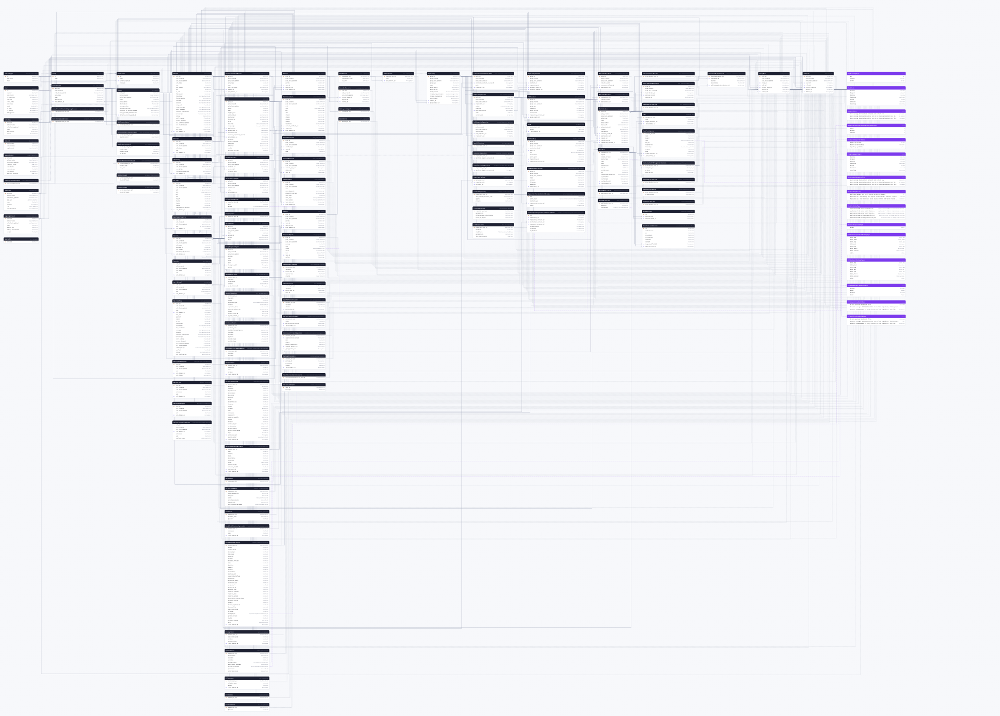

[Permission](#permission) · [Group](#group) · [User](#user) · [ContentType](#contenttype) · [Session](#session) · [AccessPolicy](#accesspolicy) · [Domain](#domain) · [AlternateContentSource](#alternatecontentsource) · [AlternateContentSourcePath](#alternatecontentsourcepath) · [Artifact](#artifact) · [PulpTemporaryFile](#pulptemporaryfile) · [Content](#content) · [ContentArtifact](#contentartifact) · [RemoteArtifact](#remoteartifact) · [SigningService](#signingservice) · [AsciiArmoredDetachedSigningService](#asciiarmoreddetachedsigningservice) · [AppStatus](#appstatus) · [core.Role](#corerole) · [UserRole](#userrole) · [GroupRole](#grouprole) · [ProfileArtifact](#profileartifact) · [Task](#task) · [TaskGroup](#taskgroup) · [CreatedResource](#createdresource) · [TaskSchedule](#taskschedule) · [Repository](#repository) · [Remote](#remote) · [RepositoryContent](#repositorycontent) · [RepositoryVersion](#repositoryversion) · [RepositoryVersionContentDetails](#repositoryversioncontentdetails) · [Export](#export) · [ExportedResource](#exportedresource) · [Exporter](#exporter) · [FilesystemExport](#filesystemexport) · [FilesystemExporter](#filesystemexporter) · [PulpExport](#pulpexport) · [PulpExporter](#pulpexporter) · [Import](#import) · [Importer](#importer) · [PulpImporter](#pulpimporter) · [PulpImporterRepository](#pulpimporterrepository) · [PulpImport](#pulpimport) · [Publication](#publication) · [PublishedArtifact](#publishedartifact) · [PublishedMetadata](#publishedmetadata) · [ContentGuard](#contentguard) · [RBACContentGuard](#rbaccontentguard) · [ContentRedirectContentGuard](#contentredirectcontentguard) · [HeaderContentGuard](#headercontentguard) · [EnvVarHeaderContentGuard](#envvarheadercontentguard) · [CompositeContentGuard](#compositecontentguard) · [Distribution](#distribution) · [ArtifactDistribution](#artifactdistribution) · [DistributedPublication](#distributedpublication) · [SystemID](#systemid) · [core.Upload](#coreupload) · [UploadChunk](#uploadchunk) · [VulnerabilityReport](#vulnerabilityreport) · [ProgressReport](#progressreport) · [GroupProgressReport](#groupprogressreport) · [UpstreamPulp](#upstreampulp) · [OpenPGPPublicKey](#openpgppublickey) · [OpenPGPPublicSubkey](#openpgppublicsubkey) · [OpenPGPUserID](#openpgpuserid) · [OpenPGPUserAttribute](#openpgpuserattribute) · [OpenPGPSignature](#openpgpsignature) · [OpenPGPKeyring](#openpgpkeyring) · [OpenPGPDistribution](#openpgpdistribution) · [Blob](#blob) · [Manifest](#manifest) · [BlobManifest](#blobmanifest) · [ManifestListManifest](#manifestlistmanifest) · [Tag](#tag) · [ManifestSignature](#manifestsignature) · [ContainerNamespace](#containernamespace) · [ContainerRemote](#containerremote) · [ContainerPullThroughRemote](#containerpullthroughremote) · [ManifestSigningService](#manifestsigningservice) · [ContainerRepository](#containerrepository) · [ContainerPushRepository](#containerpushrepository) · [ContainerPullThroughDistribution](#containerpullthroughdistribution) · [ContainerDistribution](#containerdistribution) · [container.Upload](#containerupload) · [RHSMCertGuard](#rhsmcertguard) · [X509CertGuard](#x509certguard) · [FileContent](#filecontent) · [FileRemote](#fileremote) · [FileGitRemote](#filegitremote) · [FileRepository](#filerepository) · [FilePublication](#filepublication) · [FileDistribution](#filedistribution) · [FileAlternateContentSource](#filealternatecontentsource) · [ansible.Role](#ansiblerole) · [Collection](#collection) · [CollectionImport](#collectionimport) · [AnsibleNamespace](#ansiblenamespace) · [CollectionVersion](#collectionversion) · [CollectionVersionMark](#collectionversionmark) · [CollectionVersionSignature](#collectionversionsignature) · [AnsibleNamespaceMetadata](#ansiblenamespacemetadata) · [DownloadLog](#downloadlog) · [CollectionDownloadCount](#collectiondownloadcount) · [RoleRemote](#roleremote) · [CollectionRemote](#collectionremote) · [GitRemote](#gitremote) · [AnsibleCollectionDeprecated](#ansiblecollectiondeprecated) · [AnsibleRepository](#ansiblerepository) · [AnsibleDistribution](#ansibledistribution) · [CrossRepositoryCollectionVersionIndex](#crossrepositorycollectionversionindex) · [PythonDistribution](#pythondistribution) · [PythonPackageContent](#pythonpackagecontent) · [PackageProvenance](#packageprovenance) · [PackageYank](#packageyank) · [PythonPublication](#pythonpublication) · [PythonRemote](#pythonremote) · [PythonRepository](#pythonrepository) · [PythonBlocklistEntry](#pythonblocklistentry)

<details>
<summary>The whole schema as SQL</summary>

```sql
CREATE TABLE "auth_permission" ("id" integer NOT NULL PRIMARY KEY GENERATED BY DEFAULT AS IDENTITY, "name" varchar(255) NOT NULL, "content_type_id" integer NOT NULL, "codename" varchar(100) NOT NULL);

CREATE TABLE "auth_group" ("id" integer NOT NULL PRIMARY KEY GENERATED BY DEFAULT AS IDENTITY, "name" varchar(150) NOT NULL UNIQUE);

CREATE TABLE "auth_group_permissions" ("id" integer NOT NULL PRIMARY KEY GENERATED BY DEFAULT AS IDENTITY, "group_id" integer NOT NULL, "permission_id" integer NOT NULL);

CREATE TABLE "auth_user" ("id" integer NOT NULL PRIMARY KEY GENERATED BY DEFAULT AS IDENTITY, "password" varchar(128) NOT NULL, "last_login" timestamp with time zone NULL, "is_superuser" boolean NOT NULL, "username" varchar(150) NOT NULL UNIQUE, "first_name" varchar(150) NOT NULL, "last_name" varchar(150) NOT NULL, "email" varchar(254) NOT NULL, "is_staff" boolean NOT NULL, "is_active" boolean NOT NULL, "date_joined" timestamp with time zone NOT NULL);

CREATE TABLE "auth_user_groups" ("id" integer NOT NULL PRIMARY KEY GENERATED BY DEFAULT AS IDENTITY, "user_id" integer NOT NULL, "group_id" integer NOT NULL);

CREATE TABLE "auth_user_user_permissions" ("id" integer NOT NULL PRIMARY KEY GENERATED BY DEFAULT AS IDENTITY, "user_id" integer NOT NULL, "permission_id" integer NOT NULL);

CREATE TABLE "django_content_type" ("id" integer NOT NULL PRIMARY KEY GENERATED BY DEFAULT AS IDENTITY, "app_label" varchar(100) NOT NULL, "model" varchar(100) NOT NULL);

CREATE TABLE "django_session" ("session_key" varchar(40) NOT NULL PRIMARY KEY, "session_data" text NOT NULL, "expire_date" timestamp with time zone NOT NULL);

CREATE TABLE "core_accesspolicy" ("pulp_id" uuid NOT NULL PRIMARY KEY, "pulp_created" timestamp with time zone NOT NULL, "pulp_last_updated" timestamp with time zone NULL, "creation_hooks" jsonb NULL, "statements" jsonb NOT NULL, "viewset_name" text NOT NULL UNIQUE, "customized" boolean NOT NULL, "queryset_scoping" jsonb NULL);

CREATE TABLE "core_domain" ("pulp_id" uuid NOT NULL PRIMARY KEY, "pulp_created" timestamp with time zone NOT NULL, "pulp_last_updated" timestamp with time zone NULL, "name" varchar(50) NOT NULL UNIQUE, "pulp_labels" hstore NOT NULL, "description" text NULL, "storage_class" text NOT NULL, "storage_settings" jsonb NOT NULL, "redirect_to_object_storage" boolean NOT NULL, "hide_guarded_distributions" boolean NOT NULL, "default_content_guard_id" uuid NULL);

CREATE TABLE "core_alternatecontentsource" ("pulp_id" uuid NOT NULL PRIMARY KEY, "pulp_created" timestamp with time zone NOT NULL, "pulp_last_updated" timestamp with time zone NULL, "pulp_type" text NOT NULL, "name" text NOT NULL, "last_refreshed" timestamp with time zone NULL, "remote_id" uuid NULL, "pulp_domain_id" uuid NOT NULL);

CREATE TABLE "core_alternatecontentsourcepath" ("pulp_id" uuid NOT NULL PRIMARY KEY, "pulp_created" timestamp with time zone NOT NULL, "pulp_last_updated" timestamp with time zone NULL, "alternate_content_source_id" uuid NULL, "path" text NOT NULL, "repository_id" uuid NULL);

CREATE TABLE "core_artifact" ("pulp_id" uuid NOT NULL PRIMARY KEY, "pulp_created" timestamp with time zone NOT NULL, "pulp_last_updated" timestamp with time zone NULL, "file" varchar(255) NOT NULL, "size" bigint NOT NULL, "md5" varchar(32) NULL, "sha1" varchar(40) NULL, "sha224" varchar(56) NULL, "sha256" varchar(64) NOT NULL, "sha384" varchar(96) NULL, "sha512" varchar(128) NULL, "timestamp_of_interest" timestamp with time zone NOT NULL, "pulp_domain_id" uuid NOT NULL);

CREATE TABLE "core_pulptemporaryfile" ("pulp_id" uuid NOT NULL PRIMARY KEY, "pulp_created" timestamp with time zone NOT NULL, "pulp_last_updated" timestamp with time zone NULL, "file" varchar(255) NOT NULL, "pulp_domain_id" uuid NOT NULL);

CREATE TABLE "core_content" ("pulp_id" uuid NOT NULL PRIMARY KEY, "pulp_created" timestamp with time zone NOT NULL, "pulp_last_updated" timestamp with time zone NULL, "pulp_type" text NOT NULL, "upstream_id" uuid NULL, "pulp_labels" hstore NOT NULL, "timestamp_of_interest" timestamp with time zone NOT NULL, "pulp_domain_id" uuid NOT NULL);

CREATE TABLE "core_contentartifact" ("pulp_id" uuid NOT NULL PRIMARY KEY, "pulp_created" timestamp with time zone NOT NULL, "pulp_last_updated" timestamp with time zone NULL, "artifact_id" uuid NULL, "content_id" uuid NOT NULL, "relative_path" text NOT NULL);

CREATE TABLE "core_remoteartifact" ("pulp_id" uuid NOT NULL PRIMARY KEY, "pulp_created" timestamp with time zone NOT NULL, "pulp_last_updated" timestamp with time zone NULL, "url" text NOT NULL, "size" bigint NULL, "md5" varchar(32) NULL, "sha1" varchar(40) NULL, "sha224" varchar(56) NULL, "sha256" varchar(64) NULL, "sha384" varchar(96) NULL, "sha512" varchar(128) NULL, "failed_at" timestamp with time zone NULL, "content_artifact_id" uuid NOT NULL, "remote_id" uuid NOT NULL, "pulp_domain_id" uuid NOT NULL);

CREATE TABLE "core_signingservice" ("pulp_id" uuid NOT NULL PRIMARY KEY, "pulp_created" timestamp with time zone NOT NULL, "pulp_last_updated" timestamp with time zone NULL, "name" text NOT NULL UNIQUE, "public_key" text NOT NULL, "pubkey_fingerprint" text NOT NULL, "script" text NOT NULL);

CREATE TABLE "core_asciiarmoreddetachedsigningservice" ("signingservice_ptr_id" uuid NOT NULL PRIMARY KEY);

CREATE TABLE "core_appstatus" ("pulp_id" uuid NOT NULL PRIMARY KEY, "pulp_created" timestamp with time zone NOT NULL, "pulp_last_updated" timestamp with time zone NULL, "app_type" varchar(10) NOT NULL, "name" text NOT NULL, "versions" hstore NOT NULL, "ttl" interval NOT NULL, "last_heartbeat" timestamp with time zone NOT NULL);

CREATE TABLE "core_role" ("pulp_id" uuid NOT NULL PRIMARY KEY, "pulp_created" timestamp with time zone NOT NULL, "pulp_last_updated" timestamp with time zone NULL, "name" text NOT NULL UNIQUE, "description" text NULL, "locked" boolean NOT NULL);

CREATE TABLE "core_role_permissions" ("id" integer NOT NULL PRIMARY KEY GENERATED BY DEFAULT AS IDENTITY, "role_id" uuid NOT NULL, "permission_id" integer NOT NULL);

CREATE TABLE "core_userrole" ("pulp_id" uuid NOT NULL PRIMARY KEY, "pulp_created" timestamp with time zone NOT NULL, "pulp_last_updated" timestamp with time zone NULL, "user_id" integer NOT NULL, "role_id" uuid NOT NULL, "content_type_id" integer NULL, "object_id" text NULL, "domain_id" uuid NULL);

CREATE TABLE "core_grouprole" ("pulp_id" uuid NOT NULL PRIMARY KEY, "pulp_created" timestamp with time zone NOT NULL, "pulp_last_updated" timestamp with time zone NULL, "group_id" integer NOT NULL, "role_id" uuid NOT NULL, "content_type_id" integer NULL, "object_id" text NULL, "domain_id" uuid NULL);

CREATE TABLE "core_profileartifact" ("pulp_id" uuid NOT NULL PRIMARY KEY, "pulp_created" timestamp with time zone NOT NULL, "pulp_last_updated" timestamp with time zone NULL, "artifact_id" uuid NOT NULL, "task_id" uuid NOT NULL, "name" text NOT NULL);

CREATE TABLE "core_task" ("pulp_id" uuid NOT NULL PRIMARY KEY, "pulp_created" timestamp with time zone NOT NULL, "pulp_last_updated" timestamp with time zone NULL, "state" text NOT NULL, "name" text NOT NULL, "logging_cid" text NOT NULL, "unblocked_at" timestamp with time zone NULL, "started_at" timestamp with time zone NULL, "finished_at" timestamp with time zone NULL, "error" jsonb NULL, "enc_args" jsonb NULL, "enc_kwargs" jsonb NULL, "app_lock_id" uuid NULL, "parent_task_id" uuid NULL, "task_group_id" uuid NULL, "reserved_resources_record" text[] NULL, "pulp_domain_id" uuid NOT NULL, "versions" hstore NOT NULL, "profile_options" text[] NULL, "immediate" boolean NULL, "deferred" boolean NULL, "result" jsonb NULL, "pulp_api_version" text NOT NULL);

CREATE TABLE "core_taskgroup" ("pulp_id" uuid NOT NULL PRIMARY KEY, "pulp_created" timestamp with time zone NOT NULL, "pulp_last_updated" timestamp with time zone NULL, "description" text NOT NULL, "all_tasks_dispatched" boolean NOT NULL, "pulp_domain_id" uuid NOT NULL);

CREATE TABLE "core_createdresource" ("pulp_id" uuid NOT NULL PRIMARY KEY, "pulp_created" timestamp with time zone NOT NULL, "pulp_last_updated" timestamp with time zone NULL, "content_type_id" integer NOT NULL, "object_id" uuid NOT NULL, "task_id" uuid NOT NULL);

CREATE TABLE "core_taskschedule" ("pulp_id" uuid NOT NULL PRIMARY KEY, "pulp_created" timestamp with time zone NOT NULL, "pulp_last_updated" timestamp with time zone NULL, "name" text NOT NULL, "next_dispatch" timestamp with time zone NULL, "dispatch_interval" interval NULL, "task_name" text NOT NULL, "task_args" jsonb NOT NULL, "task_kwargs" jsonb NOT NULL, "last_task_id" uuid NULL, "pulp_domain_id" uuid NOT NULL);

CREATE TABLE "core_repository" ("pulp_id" uuid NOT NULL PRIMARY KEY, "pulp_created" timestamp with time zone NOT NULL, "pulp_last_updated" timestamp with time zone NULL, "pulp_type" text NOT NULL, "name" text NOT NULL, "pulp_labels" hstore NOT NULL, "description" text NULL, "next_version" integer NOT NULL CHECK ("next_version" >= 0), "retain_repo_versions" integer NULL CHECK ("retain_repo_versions" >= 0), "retain_checkpoints" integer NULL CHECK ("retain_checkpoints" >= 0), "user_hidden" boolean NOT NULL, "remote_id" uuid NULL, "pulp_domain_id" uuid NOT NULL);

CREATE TABLE "core_remote" ("pulp_id" uuid NOT NULL PRIMARY KEY, "pulp_created" timestamp with time zone NOT NULL, "pulp_last_updated" timestamp with time zone NULL, "pulp_type" text NOT NULL, "name" text NOT NULL, "pulp_labels" hstore NOT NULL, "url" text NOT NULL, "ca_cert" text NULL, "client_cert" text NULL, "client_key" text NULL, "tls_validation" boolean NOT NULL, "username" text NULL, "password" text NULL, "proxy_url" text NULL, "proxy_username" text NULL, "proxy_password" text NULL, "download_concurrency" integer NULL CHECK ("download_concurrency" >= 0), "max_retries" integer NULL CHECK ("max_retries" >= 0), "policy" text NOT NULL, "total_timeout" double precision NULL, "connect_timeout" double precision NULL, "sock_connect_timeout" double precision NULL, "sock_read_timeout" double precision NULL, "headers" jsonb NULL, "rate_limit" integer NULL, "pulp_domain_id" uuid NOT NULL);

CREATE TABLE "core_repositorycontent" ("pulp_id" uuid NOT NULL PRIMARY KEY, "pulp_created" timestamp with time zone NOT NULL, "pulp_last_updated" timestamp with time zone NULL, "content_id" uuid NOT NULL, "repository_id" uuid NOT NULL, "version_added_id" uuid NOT NULL, "version_removed_id" uuid NULL);

CREATE TABLE "core_repositoryversion" ("pulp_id" uuid NOT NULL PRIMARY KEY, "pulp_created" timestamp with time zone NOT NULL, "pulp_last_updated" timestamp with time zone NULL, "repository_id" uuid NOT NULL, "number" integer NOT NULL CHECK ("number" >= 0), "complete" boolean NOT NULL, "base_version_id" uuid NULL, "info" jsonb NOT NULL, "content_ids" uuid[] NOT NULL);

CREATE TABLE "core_repositoryversioncontentdetails" ("id" integer NOT NULL PRIMARY KEY GENERATED BY DEFAULT AS IDENTITY, "count_type" text NOT NULL, "content_type" text NOT NULL, "repository_version_id" uuid NOT NULL, "count" integer NOT NULL);

CREATE TABLE "core_export" ("pulp_id" uuid NOT NULL PRIMARY KEY, "pulp_created" timestamp with time zone NOT NULL, "pulp_last_updated" timestamp with time zone NULL, "params" jsonb NULL, "task_id" uuid NULL, "exporter_id" uuid NOT NULL, "pulp_domain_id" uuid NOT NULL);

CREATE TABLE "core_exportedresource" ("pulp_id" uuid NOT NULL PRIMARY KEY, "pulp_created" timestamp with time zone NOT NULL, "pulp_last_updated" timestamp with time zone NULL, "content_type_id" integer NOT NULL, "object_id" uuid NOT NULL, "export_id" uuid NOT NULL);

CREATE TABLE "core_exporter" ("pulp_id" uuid NOT NULL PRIMARY KEY, "pulp_created" timestamp with time zone NOT NULL, "pulp_last_updated" timestamp with time zone NULL, "pulp_type" text NOT NULL, "name" text NOT NULL, "pulp_domain_id" uuid NOT NULL);

CREATE TABLE "core_filesystemexport" ("export_ptr_id" uuid NOT NULL PRIMARY KEY);

CREATE TABLE "core_filesystemexporter" ("exporter_ptr_id" uuid NOT NULL PRIMARY KEY, "path" text NOT NULL, "method" text NOT NULL);

CREATE TABLE "core_pulpexport" ("export_ptr_id" uuid NOT NULL PRIMARY KEY, "output_file_info" jsonb NULL, "toc_info" jsonb NULL);

CREATE TABLE "core_pulpexporter" ("exporter_ptr_id" uuid NOT NULL PRIMARY KEY, "path" text NOT NULL, "last_export_id" uuid NULL);

CREATE TABLE "core_pulpexporter_repositories" ("id" integer NOT NULL PRIMARY KEY GENERATED BY DEFAULT AS IDENTITY, "pulpexporter_id" uuid NOT NULL, "repository_id" uuid NOT NULL);

CREATE TABLE "core_import" ("pulp_id" uuid NOT NULL PRIMARY KEY, "pulp_created" timestamp with time zone NOT NULL, "pulp_last_updated" timestamp with time zone NULL, "params" jsonb NULL, "task_id" uuid NOT NULL, "importer_id" uuid NOT NULL, "pulp_domain_id" uuid NOT NULL);

CREATE TABLE "core_importer" ("pulp_id" uuid NOT NULL PRIMARY KEY, "pulp_created" timestamp with time zone NOT NULL, "pulp_last_updated" timestamp with time zone NULL, "pulp_type" text NOT NULL, "name" text NOT NULL, "pulp_domain_id" uuid NOT NULL);

CREATE TABLE "core_pulpimporter" ("importer_ptr_id" uuid NOT NULL PRIMARY KEY);

CREATE TABLE "core_pulpimporterrepository" ("pulp_id" uuid NOT NULL PRIMARY KEY, "pulp_created" timestamp with time zone NOT NULL, "pulp_last_updated" timestamp with time zone NULL, "source_repo" text NOT NULL, "pulp_importer_id" uuid NOT NULL, "repository_id" uuid NOT NULL);

CREATE TABLE "core_pulpimport" ("import_ptr_id" uuid NOT NULL PRIMARY KEY);

CREATE TABLE "core_publication" ("pulp_id" uuid NOT NULL PRIMARY KEY, "pulp_created" timestamp with time zone NOT NULL, "pulp_last_updated" timestamp with time zone NULL, "pulp_type" text NOT NULL, "complete" boolean NOT NULL, "pass_through" boolean NOT NULL, "checkpoint" boolean NOT NULL, "repository_version_id" uuid NOT NULL, "pulp_domain_id" uuid NOT NULL);

CREATE TABLE "core_publishedartifact" ("pulp_id" uuid NOT NULL PRIMARY KEY, "pulp_created" timestamp with time zone NOT NULL, "pulp_last_updated" timestamp with time zone NULL, "relative_path" text NOT NULL, "content_artifact_id" uuid NOT NULL, "publication_id" uuid NOT NULL);

CREATE TABLE "core_publishedmetadata" ("content_ptr_id" uuid NOT NULL PRIMARY KEY, "relative_path" text NOT NULL, "publication_id" uuid NOT NULL);

CREATE TABLE "core_contentguard" ("pulp_id" uuid NOT NULL PRIMARY KEY, "pulp_created" timestamp with time zone NOT NULL, "pulp_last_updated" timestamp with time zone NULL, "pulp_type" text NOT NULL, "name" text NOT NULL, "description" text NULL, "pulp_domain_id" uuid NOT NULL);

CREATE TABLE "core_rbaccontentguard" ("contentguard_ptr_id" uuid NOT NULL PRIMARY KEY);

CREATE TABLE "core_contentredirectcontentguard" ("contentguard_ptr_id" uuid NOT NULL PRIMARY KEY, "shared_secret" bytea NOT NULL);

CREATE TABLE "core_headercontentguard" ("contentguard_ptr_id" uuid NOT NULL PRIMARY KEY, "header_name" text NOT NULL, "header_value" text NOT NULL, "jq_filter" text NULL);

CREATE TABLE "core_envvarheadercontentguard" ("contentguard_ptr_id" uuid NOT NULL PRIMARY KEY, "header_name" text NOT NULL, "env_var" text NOT NULL);

CREATE TABLE "core_compositecontentguard" ("contentguard_ptr_id" uuid NOT NULL PRIMARY KEY);

CREATE TABLE "core_compositecontentguard_guards" ("id" integer NOT NULL PRIMARY KEY GENERATED BY DEFAULT AS IDENTITY, "compositecontentguard_id" uuid NOT NULL, "contentguard_id" uuid NOT NULL);

CREATE TABLE "core_distribution" ("pulp_id" uuid NOT NULL PRIMARY KEY, "pulp_created" timestamp with time zone NOT NULL, "pulp_last_updated" timestamp with time zone NULL, "pulp_type" text NOT NULL, "name" text NOT NULL, "pulp_labels" hstore NOT NULL, "base_path" relative_path NOT NULL, "pulp_domain_id" uuid NOT NULL, "hidden" boolean NULL, "checkpoint" boolean NOT NULL, "content_guard_id" uuid NULL, "publication_id" uuid NULL, "remote_id" uuid NULL, "repository_id" uuid NULL, "repository_version_id" uuid NULL);

CREATE TABLE "core_artifactdistribution" ("distribution_ptr_id" uuid NOT NULL PRIMARY KEY);

CREATE TABLE "core_distributedpublication" ("pulp_id" uuid NOT NULL PRIMARY KEY, "pulp_created" timestamp with time zone NOT NULL, "pulp_last_updated" timestamp with time zone NULL, "distribution_id" uuid NOT NULL, "publication_id" uuid NOT NULL, "expires_at" timestamp with time zone NULL);

CREATE TABLE "core_systemid" ("pulp_id" uuid NOT NULL PRIMARY KEY);

CREATE TABLE "core_upload" ("pulp_id" uuid NOT NULL PRIMARY KEY, "pulp_created" timestamp with time zone NOT NULL, "pulp_last_updated" timestamp with time zone NULL, "size" bigint NOT NULL, "pulp_domain_id" uuid NOT NULL);

CREATE TABLE "core_uploadchunk" ("pulp_id" uuid NOT NULL PRIMARY KEY, "pulp_created" timestamp with time zone NOT NULL, "pulp_last_updated" timestamp with time zone NULL, "file" varchar(255) NOT NULL, "upload_id" uuid NOT NULL, "offset" bigint NOT NULL, "size" bigint NOT NULL);

CREATE TABLE "core_vulnerabilityreport" ("pulp_id" uuid NOT NULL PRIMARY KEY, "pulp_created" timestamp with time zone NOT NULL, "pulp_last_updated" timestamp with time zone NULL, "content_id" uuid NOT NULL UNIQUE, "vulns" jsonb NOT NULL, "pulp_domain_id" uuid NOT NULL);

CREATE TABLE "core_vulnerabilityreport_repo_versions" ("id" integer NOT NULL PRIMARY KEY GENERATED BY DEFAULT AS IDENTITY, "vulnerabilityreport_id" uuid NOT NULL, "repositoryversion_id" uuid NOT NULL);

CREATE TABLE "core_progressreport" ("pulp_id" uuid NOT NULL PRIMARY KEY, "pulp_created" timestamp with time zone NOT NULL, "pulp_last_updated" timestamp with time zone NULL, "message" text NOT NULL, "code" text NOT NULL, "state" text NOT NULL, "total" integer NULL, "done" integer NOT NULL, "task_id" uuid NOT NULL, "suffix" text NULL);

CREATE TABLE "core_groupprogressreport" ("pulp_id" uuid NOT NULL PRIMARY KEY, "pulp_created" timestamp with time zone NOT NULL, "pulp_last_updated" timestamp with time zone NULL, "message" text NOT NULL, "code" text NOT NULL, "total" integer NOT NULL, "done" integer NOT NULL, "task_group_id" uuid NOT NULL, "suffix" text NULL);

CREATE TABLE "core_upstreampulp" ("pulp_id" uuid NOT NULL PRIMARY KEY, "pulp_created" timestamp with time zone NOT NULL, "pulp_last_updated" timestamp with time zone NULL, "name" text NOT NULL, "pulp_domain_id" uuid NOT NULL, "base_url" text NOT NULL, "api_root" text NOT NULL, "domain" text NULL, "ca_cert" text NULL, "client_cert" text NULL, "client_key" text NULL, "tls_validation" boolean NOT NULL, "username" text NULL, "password" text NULL, "download_concurrency" integer NULL CHECK ("download_concurrency" >= 0), "max_retries" integer NULL CHECK ("max_retries" >= 0), "total_timeout" double precision NULL, "connect_timeout" double precision NULL, "sock_connect_timeout" double precision NULL, "sock_read_timeout" double precision NULL, "remote_policy" text NULL, "q_select" text NULL, "policy" text NOT NULL, "last_replication" timestamp with time zone NULL);

CREATE TABLE "core_openpgppublickey" ("content_ptr_id" uuid NOT NULL PRIMARY KEY, "raw_data" bytea NOT NULL, "fingerprint" varchar(64) NOT NULL, "created" timestamp with time zone NOT NULL, "_pulp_domain_id" uuid NOT NULL);

CREATE TABLE "core_openpgppublicsubkey" ("content_ptr_id" uuid NOT NULL PRIMARY KEY, "raw_data" bytea NOT NULL, "public_key_id" uuid NOT NULL, "fingerprint" varchar(64) NOT NULL, "created" timestamp with time zone NOT NULL);

CREATE TABLE "core_openpgpuserid" ("content_ptr_id" uuid NOT NULL PRIMARY KEY, "raw_data" bytea NOT NULL, "public_key_id" uuid NOT NULL, "user_id" varchar NOT NULL);

CREATE TABLE "core_openpgpuserattribute" ("content_ptr_id" uuid NOT NULL PRIMARY KEY, "raw_data" bytea NOT NULL, "sha256" varchar(128) NOT NULL, "public_key_id" uuid NOT NULL);

CREATE TABLE "core_openpgpsignature" ("content_ptr_id" uuid NOT NULL PRIMARY KEY, "raw_data" bytea NOT NULL, "sha256" varchar(128) NOT NULL, "signature_type" smallint NOT NULL CHECK ("signature_type" >= 0), "created" timestamp with time zone NOT NULL, "expiration_time" interval NULL, "key_expiration_time" interval NULL, "issuer" varchar(16) NULL, "signers_user_id" varchar NULL, "signed_content_id" uuid NOT NULL);

CREATE TABLE "core_openpgpkeyring" ("repository_ptr_id" uuid NOT NULL PRIMARY KEY);

CREATE TABLE "core_openpgpdistribution" ("distribution_ptr_id" uuid NOT NULL PRIMARY KEY);

CREATE TABLE "container_blob" ("content_ptr_id" uuid NOT NULL PRIMARY KEY, "digest" text NOT NULL, "_pulp_domain_id" uuid NOT NULL);

CREATE TABLE "container_manifest" ("content_ptr_id" uuid NOT NULL PRIMARY KEY, "digest" text NOT NULL, "schema_version" integer NOT NULL, "media_type" text NOT NULL, "type" varchar NULL, "data" text NULL, "annotations" jsonb NOT NULL, "labels" jsonb NOT NULL, "architecture" text NULL, "os" text NULL, "compressed_image_size" bigint NULL, "is_bootable" boolean NOT NULL, "is_flatpak" boolean NOT NULL, "config_blob_id" uuid NULL, "_pulp_domain_id" uuid NOT NULL);

CREATE TABLE "container_blobmanifest" ("id" integer NOT NULL PRIMARY KEY GENERATED BY DEFAULT AS IDENTITY, "manifest_id" uuid NOT NULL, "manifest_blob_id" uuid NOT NULL);

CREATE TABLE "container_manifestlistmanifest" ("id" integer NOT NULL PRIMARY KEY GENERATED BY DEFAULT AS IDENTITY, "architecture" text NOT NULL, "os" text NOT NULL, "os_version" text NOT NULL, "os_features" text NOT NULL, "features" text NOT NULL, "variant" text NOT NULL, "image_manifest_id" uuid NOT NULL, "manifest_list_id" uuid NOT NULL);

CREATE TABLE "container_tag" ("content_ptr_id" uuid NOT NULL PRIMARY KEY, "name" text NOT NULL, "tagged_manifest_id" uuid NOT NULL, "_pulp_domain_id" uuid NOT NULL);

CREATE TABLE "container_manifestsignature" ("content_ptr_id" uuid NOT NULL PRIMARY KEY, "name" text NOT NULL, "digest" text NOT NULL, "type" text NOT NULL, "key_id" text NOT NULL, "fingerprint" text NULL, "timestamp" integer NOT NULL CHECK ("timestamp" >= 0), "creator" text NOT NULL, "data" text NOT NULL, "signed_manifest_id" uuid NOT NULL, "_pulp_domain_id" uuid NOT NULL);

CREATE TABLE "container_containernamespace" ("pulp_id" uuid NOT NULL PRIMARY KEY, "pulp_created" timestamp with time zone NOT NULL, "pulp_last_updated" timestamp with time zone NULL, "name" text NOT NULL, "pulp_domain_id" uuid NOT NULL, "pulp_labels" hstore NOT NULL);

CREATE TABLE "container_containerremote" ("remote_ptr_id" uuid NOT NULL PRIMARY KEY, "upstream_name" text NOT NULL, "include_foreign_layers" boolean NOT NULL, "includes" text[] NULL, "excludes" text[] NULL, "sigstore" text NULL, "include_tags" text[] NULL, "exclude_tags" text[] NULL);

CREATE TABLE "container_containerpullthroughremote" ("remote_ptr_id" uuid NOT NULL PRIMARY KEY, "includes" text[] NULL, "excludes" text[] NULL);

CREATE TABLE "container_manifestsigningservice" ("signingservice_ptr_id" uuid NOT NULL PRIMARY KEY);

CREATE TABLE "container_containerrepository" ("repository_ptr_id" uuid NOT NULL PRIMARY KEY, "manifest_signing_service_id" uuid NULL);

CREATE TABLE "container_containerrepository_pending_blobs" ("id" integer NOT NULL PRIMARY KEY GENERATED BY DEFAULT AS IDENTITY, "containerrepository_id" uuid NOT NULL, "blob_id" uuid NOT NULL);

CREATE TABLE "container_containerrepository_pending_manifests" ("id" integer NOT NULL PRIMARY KEY GENERATED BY DEFAULT AS IDENTITY, "containerrepository_id" uuid NOT NULL, "manifest_id" uuid NOT NULL);

CREATE TABLE "container_containerpushrepository" ("repository_ptr_id" uuid NOT NULL PRIMARY KEY, "manifest_signing_service_id" uuid NULL);

CREATE TABLE "container_containerpushrepository_pending_blobs" ("id" integer NOT NULL PRIMARY KEY GENERATED BY DEFAULT AS IDENTITY, "containerpushrepository_id" uuid NOT NULL, "blob_id" uuid NOT NULL);

CREATE TABLE "container_containerpushrepository_pending_manifests" ("id" integer NOT NULL PRIMARY KEY GENERATED BY DEFAULT AS IDENTITY, "containerpushrepository_id" uuid NOT NULL, "manifest_id" uuid NOT NULL);

CREATE TABLE "container_containerpullthroughdistribution" ("distribution_ptr_id" uuid NOT NULL PRIMARY KEY, "namespace_id" uuid NULL, "private" boolean NOT NULL, "description" text NULL);

CREATE TABLE "container_containerdistribution" ("distribution_ptr_id" uuid NOT NULL PRIMARY KEY, "namespace_id" uuid NULL, "private" boolean NOT NULL, "description" text NULL, "pull_through_distribution_id" uuid NULL);

CREATE TABLE "container_upload" ("upload_ptr_id" uuid NOT NULL PRIMARY KEY, "repository_id" uuid NOT NULL, "artifact_id" uuid NULL);

CREATE TABLE "certguard_rhsmcertguard" ("contentguard_ptr_id" uuid NOT NULL PRIMARY KEY, "ca_certificate" text NOT NULL);

CREATE TABLE "certguard_x509certguard" ("contentguard_ptr_id" uuid NOT NULL PRIMARY KEY, "ca_certificate" text NOT NULL);

CREATE TABLE "file_filecontent" ("content_ptr_id" uuid NOT NULL PRIMARY KEY, "relative_path" text NOT NULL, "digest" varchar(64) NOT NULL, "_pulp_domain_id" uuid NOT NULL);

CREATE TABLE "file_fileremote" ("remote_ptr_id" uuid NOT NULL PRIMARY KEY);

CREATE TABLE "file_filegitremote" ("remote_ptr_id" uuid NOT NULL PRIMARY KEY, "git_ref" text NOT NULL);

CREATE TABLE "file_filerepository" ("repository_ptr_id" uuid NOT NULL PRIMARY KEY, "manifest" text NULL, "autopublish" boolean NOT NULL, "last_sync_details" jsonb NOT NULL);

CREATE TABLE "file_filepublication" ("publication_ptr_id" uuid NOT NULL PRIMARY KEY, "manifest" text NULL);

CREATE TABLE "file_filedistribution" ("distribution_ptr_id" uuid NOT NULL PRIMARY KEY);

CREATE TABLE "file_filealternatecontentsource" ("alternatecontentsource_ptr_id" uuid NOT NULL PRIMARY KEY);

CREATE TABLE "ansible_role" ("content_ptr_id" uuid NOT NULL PRIMARY KEY, "namespace" varchar(64) NOT NULL, "name" varchar(64) NOT NULL, "version" varchar(128) COLLATE "pulp_ansible_semver" NOT NULL, "_pulp_domain_id" uuid NOT NULL);

CREATE TABLE "ansible_collection" ("pulp_id" uuid NOT NULL PRIMARY KEY, "pulp_created" timestamp with time zone NOT NULL, "pulp_last_updated" timestamp with time zone NULL, "namespace" varchar(64) NOT NULL, "name" varchar(64) NOT NULL, "pulp_domain_id" uuid NOT NULL);

CREATE TABLE "ansible_collectionimport" ("task_id" uuid NOT NULL PRIMARY KEY, "messages" jsonb NOT NULL);

CREATE TABLE "ansible_ansiblenamespace" ("pulp_id" uuid NOT NULL PRIMARY KEY, "pulp_created" timestamp with time zone NOT NULL, "pulp_last_updated" timestamp with time zone NULL, "name" varchar(64) NOT NULL, "pulp_domain_id" uuid NOT NULL);

CREATE TABLE "ansible_collectionversion" ("content_ptr_id" uuid NOT NULL PRIMARY KEY, "authors" varchar(64)[] NOT NULL, "contents" jsonb NOT NULL, "dependencies" jsonb NOT NULL, "description" text NOT NULL, "docs_blob" jsonb NOT NULL, "manifest" jsonb NOT NULL, "files" jsonb NOT NULL, "documentation" varchar(2000) NOT NULL, "homepage" varchar(2000) NOT NULL, "issues" varchar(2000) NOT NULL, "license" varchar(32)[] NOT NULL, "name" varchar(64) NOT NULL, "namespace" varchar(64) NOT NULL, "repository" varchar(2000) NOT NULL, "requires_ansible" varchar(255) NULL, "sha256" varchar(64) NOT NULL, "version" varchar(128) COLLATE "pulp_ansible_semver" NOT NULL, "version_major" integer NOT NULL, "version_minor" integer NOT NULL, "version_patch" integer NOT NULL, "version_prerelease" varchar(128) NOT NULL, "tags" varchar(64)[] NOT NULL, "collection_id" uuid NOT NULL, "search_vector" tsvector NOT NULL, "_pulp_domain_id" uuid NOT NULL);

CREATE TABLE "ansible_collectionversionmark" ("content_ptr_id" uuid NOT NULL PRIMARY KEY, "value" varchar(50) NOT NULL, "marked_collection_id" uuid NOT NULL, "_pulp_domain_id" uuid NOT NULL);

CREATE TABLE "ansible_collectionversionsignature" ("content_ptr_id" uuid NOT NULL PRIMARY KEY, "signed_collection_id" uuid NOT NULL, "data" text NOT NULL, "digest" varchar(64) NOT NULL, "pubkey_fingerprint" varchar(64) NOT NULL, "signing_service_id" uuid NULL, "_pulp_domain_id" uuid NOT NULL);

CREATE TABLE "ansible_ansiblenamespacemetadata" ("content_ptr_id" uuid NOT NULL PRIMARY KEY, "name" varchar(64) NOT NULL, "company" varchar(64) NOT NULL, "email" varchar(256) NOT NULL, "description" varchar(256) NOT NULL, "resources" text NOT NULL, "links" hstore NOT NULL, "avatar_sha256" varchar(64) NULL, "metadata_sha256" varchar(64) NOT NULL, "namespace_id" uuid NOT NULL, "_pulp_domain_id" uuid NOT NULL);

CREATE TABLE "ansible_downloadlog" ("pulp_id" uuid NOT NULL PRIMARY KEY, "pulp_created" timestamp with time zone NOT NULL, "pulp_last_updated" timestamp with time zone NULL, "content_unit_id" uuid NOT NULL, "user_id" integer NULL, "ip" inet NOT NULL, "extra_data" jsonb NULL, "user_agent" text NOT NULL, "repository_id" uuid NOT NULL, "repository_version_id" uuid NULL);

CREATE TABLE "ansible_collectiondownloadcount" ("pulp_id" uuid NOT NULL PRIMARY KEY, "pulp_created" timestamp with time zone NOT NULL, "pulp_last_updated" timestamp with time zone NULL, "pulp_domain_id" uuid NOT NULL, "namespace" varchar(64) NOT NULL, "name" varchar(64) NOT NULL, "download_count" bigint NOT NULL);

CREATE TABLE "ansible_roleremote" ("remote_ptr_id" uuid NOT NULL PRIMARY KEY);

CREATE TABLE "ansible_collectionremote" ("remote_ptr_id" uuid NOT NULL PRIMARY KEY, "requirements_file" text NULL, "auth_url" varchar(255) NULL, "token" text NULL, "sync_dependencies" boolean NOT NULL, "signed_only" boolean NOT NULL, "sync_highest_versions" integer NULL CHECK ("sync_highest_versions" >= 0));

CREATE TABLE "ansible_gitremote" ("remote_ptr_id" uuid NOT NULL PRIMARY KEY, "metadata_only" boolean NOT NULL, "git_ref" text NOT NULL);

CREATE TABLE "ansible_ansiblecollectiondeprecated" ("content_ptr_id" uuid NOT NULL PRIMARY KEY, "namespace" varchar(64) NOT NULL, "name" varchar(64) NOT NULL, "_pulp_domain_id" uuid NOT NULL);

CREATE TABLE "ansible_ansiblerepository" ("repository_ptr_id" uuid NOT NULL PRIMARY KEY, "last_synced_metadata_time" timestamp with time zone NULL, "gpgkey" text NULL, "private" boolean NOT NULL);

CREATE TABLE "ansible_ansibledistribution" ("distribution_ptr_id" uuid NOT NULL PRIMARY KEY);

CREATE TABLE "ansible_crossrepositorycollectionversionindex" ("id" integer NOT NULL PRIMARY KEY GENERATED BY DEFAULT AS IDENTITY, "repository_id" uuid NOT NULL, "repository_version_id" uuid NULL, "collection_version_id" uuid NOT NULL, "namespace_metadata_id" uuid NULL, "is_deprecated" boolean NOT NULL, "is_signed" boolean NOT NULL, "is_highest" boolean NOT NULL);

CREATE TABLE "python_pythondistribution" ("distribution_ptr_id" uuid NOT NULL PRIMARY KEY, "allow_uploads" boolean NOT NULL);

CREATE TABLE "python_pythonpackagecontent" ("content_ptr_id" uuid NOT NULL PRIMARY KEY, "author" text NOT NULL, "author_email" text NOT NULL, "description" text NOT NULL, "home_page" text NOT NULL, "keywords" text NOT NULL, "license" text NOT NULL, "metadata_version" text NOT NULL, "name" text NOT NULL, "platform" text NOT NULL, "summary" text NOT NULL, "version" text NOT NULL, "classifiers" jsonb NOT NULL, "download_url" text NOT NULL, "supported_platform" text NOT NULL, "maintainer" text NOT NULL, "maintainer_email" text NOT NULL, "obsoletes_dist" jsonb NOT NULL, "project_url" text NOT NULL, "project_urls" jsonb NOT NULL, "provides_dist" jsonb NOT NULL, "requires_external" jsonb NOT NULL, "requires_dist" jsonb NOT NULL, "requires_python" text NOT NULL, "description_content_type" text NOT NULL, "provides_extras" jsonb NOT NULL, "dynamic" jsonb NOT NULL, "license_expression" text NOT NULL, "license_file" jsonb NOT NULL, "name_normalized" text NOT NULL, "filename" text NOT NULL, "packagetype" text NOT NULL, "python_version" text NOT NULL, "sha256" varchar(64) NOT NULL, "metadata_sha256" varchar(64) NULL, "size" bigint NOT NULL, "_pulp_domain_id" uuid NOT NULL);

CREATE TABLE "python_packageprovenance" ("content_ptr_id" uuid NOT NULL PRIMARY KEY, "package_id" uuid NOT NULL, "provenance" jsonb NOT NULL, "sha256" varchar(64) NOT NULL, "_pulp_domain_id" uuid NOT NULL);

CREATE TABLE "python_packageyank" ("content_ptr_id" uuid NOT NULL PRIMARY KEY, "name_normalized" text NOT NULL, "version" text NOT NULL, "yanked_reason" text NOT NULL, "_pulp_domain_id" uuid NOT NULL);

CREATE TABLE "python_pythonpublication" ("publication_ptr_id" uuid NOT NULL PRIMARY KEY);

CREATE TABLE "python_pythonremote" ("remote_ptr_id" uuid NOT NULL PRIMARY KEY, "prereleases" boolean NOT NULL, "includes" jsonb NOT NULL, "excludes" jsonb NOT NULL, "package_types" varchar(15)[] NOT NULL, "keep_latest_packages" integer NOT NULL, "exclude_platforms" varchar(10)[] NOT NULL, "provenance" boolean NOT NULL, "vulnerabilities" boolean NOT NULL);

CREATE TABLE "python_pythonrepository" ("repository_ptr_id" uuid NOT NULL PRIMARY KEY, "autopublish" boolean NOT NULL, "allow_package_substitution" boolean NOT NULL, "error_on_reject" boolean NOT NULL);

CREATE TABLE "python_pythonblocklistentry" ("pulp_id" uuid NOT NULL PRIMARY KEY, "pulp_created" timestamp with time zone NOT NULL, "pulp_last_updated" timestamp with time zone NULL, "name" text NULL, "version" text NULL, "filename" text NULL, "added_by" text NOT NULL, "repository_id" uuid NOT NULL);

ALTER TABLE "auth_permission" ADD CONSTRAINT "auth_permission_content_type_id_codename_01ab375a_uniq" UNIQUE ("content_type_id", "codename");

ALTER TABLE "auth_permission" ADD CONSTRAINT "auth_permission_content_type_id_2f476e4b_fk_django_co" FOREIGN KEY ("content_type_id") REFERENCES "django_content_type" ("id") DEFERRABLE INITIALLY DEFERRED;

CREATE INDEX "auth_permission_content_type_id_2f476e4b" ON "auth_permission" ("content_type_id");

CREATE INDEX "auth_group_name_a6ea08ec_like" ON "auth_group" ("name" varchar_pattern_ops);

ALTER TABLE "auth_group_permissions" ADD CONSTRAINT "auth_group_permissions_group_id_permission_id_0cd325b0_uniq" UNIQUE ("group_id", "permission_id");

ALTER TABLE "auth_group_permissions" ADD CONSTRAINT "auth_group_permissions_group_id_b120cbf9_fk_auth_group_id" FOREIGN KEY ("group_id") REFERENCES "auth_group" ("id") DEFERRABLE INITIALLY DEFERRED;

ALTER TABLE "auth_group_permissions" ADD CONSTRAINT "auth_group_permissio_permission_id_84c5c92e_fk_auth_perm" FOREIGN KEY ("permission_id") REFERENCES "auth_permission" ("id") DEFERRABLE INITIALLY DEFERRED;

CREATE INDEX "auth_group_permissions_group_id_b120cbf9" ON "auth_group_permissions" ("group_id");

CREATE INDEX "auth_group_permissions_permission_id_84c5c92e" ON "auth_group_permissions" ("permission_id");

CREATE INDEX "auth_user_username_6821ab7c_like" ON "auth_user" ("username" varchar_pattern_ops);

ALTER TABLE "auth_user_groups" ADD CONSTRAINT "auth_user_groups_user_id_group_id_94350c0c_uniq" UNIQUE ("user_id", "group_id");

ALTER TABLE "auth_user_groups" ADD CONSTRAINT "auth_user_groups_user_id_6a12ed8b_fk_auth_user_id" FOREIGN KEY ("user_id") REFERENCES "auth_user" ("id") DEFERRABLE INITIALLY DEFERRED;

ALTER TABLE "auth_user_groups" ADD CONSTRAINT "auth_user_groups_group_id_97559544_fk_auth_group_id" FOREIGN KEY ("group_id") REFERENCES "auth_group" ("id") DEFERRABLE INITIALLY DEFERRED;

CREATE INDEX "auth_user_groups_user_id_6a12ed8b" ON "auth_user_groups" ("user_id");

CREATE INDEX "auth_user_groups_group_id_97559544" ON "auth_user_groups" ("group_id");

ALTER TABLE "auth_user_user_permissions" ADD CONSTRAINT "auth_user_user_permissions_user_id_permission_id_14a6b632_uniq" UNIQUE ("user_id", "permission_id");

ALTER TABLE "auth_user_user_permissions" ADD CONSTRAINT "auth_user_user_permissions_user_id_a95ead1b_fk_auth_user_id" FOREIGN KEY ("user_id") REFERENCES "auth_user" ("id") DEFERRABLE INITIALLY DEFERRED;

ALTER TABLE "auth_user_user_permissions" ADD CONSTRAINT "auth_user_user_permi_permission_id_1fbb5f2c_fk_auth_perm" FOREIGN KEY ("permission_id") REFERENCES "auth_permission" ("id") DEFERRABLE INITIALLY DEFERRED;

CREATE INDEX "auth_user_user_permissions_user_id_a95ead1b" ON "auth_user_user_permissions" ("user_id");

CREATE INDEX "auth_user_user_permissions_permission_id_1fbb5f2c" ON "auth_user_user_permissions" ("permission_id");

ALTER TABLE "django_content_type" ADD CONSTRAINT "django_content_type_app_label_model_76bd3d3b_uniq" UNIQUE ("app_label", "model");

CREATE INDEX "django_session_session_key_c0390e0f_like" ON "django_session" ("session_key" varchar_pattern_ops);

CREATE INDEX "django_session_expire_date_a5c62663" ON "django_session" ("expire_date");

CREATE INDEX "core_accesspolicy_viewset_name_30d4303a_like" ON "core_accesspolicy" ("viewset_name" text_pattern_ops);

ALTER TABLE "core_domain" ADD CONSTRAINT "core_domain_default_content_guar_7d14cf9d_fk_core_cont" FOREIGN KEY ("default_content_guard_id") REFERENCES "core_contentguard" ("pulp_id") DEFERRABLE INITIALLY DEFERRED;

CREATE INDEX "core_domain_name_9c44b9f9_like" ON "core_domain" ("name" varchar_pattern_ops);

CREATE INDEX "core_domain_default_content_guard_id_7d14cf9d" ON "core_domain" ("default_content_guard_id");

ALTER TABLE "core_alternatecontentsource" ADD CONSTRAINT "core_alternatecontentsource_name_pulp_domain_id_bd06e74c_uniq" UNIQUE ("name", "pulp_domain_id");

ALTER TABLE "core_alternatecontentsource" ADD CONSTRAINT "core_alternateconten_remote_id_b5aed482_fk_core_remo" FOREIGN KEY ("remote_id") REFERENCES "core_remote" ("pulp_id") DEFERRABLE INITIALLY DEFERRED;

ALTER TABLE "core_alternatecontentsource" ADD CONSTRAINT "core_alternateconten_pulp_domain_id_93a30857_fk_core_doma" FOREIGN KEY ("pulp_domain_id") REFERENCES "core_domain" ("pulp_id") DEFERRABLE INITIALLY DEFERRED;

CREATE INDEX "core_alternatecontentsource_pulp_type_b0c4d25b" ON "core_alternatecontentsource" ("pulp_type");

CREATE INDEX "core_alternatecontentsource_pulp_type_b0c4d25b_like" ON "core_alternatecontentsource" ("pulp_type" text_pattern_ops);

CREATE INDEX "core_alternatecontentsource_name_27800686" ON "core_alternatecontentsource" ("name");

CREATE INDEX "core_alternatecontentsource_name_27800686_like" ON "core_alternatecontentsource" ("name" text_pattern_ops);

CREATE INDEX "core_alternatecontentsource_remote_id_b5aed482" ON "core_alternatecontentsource" ("remote_id");

CREATE INDEX "core_alternatecontentsource_pulp_domain_id_93a30857" ON "core_alternatecontentsource" ("pulp_domain_id");

ALTER TABLE "core_alternatecontentsourcepath" ADD CONSTRAINT "core_alternatecontentsou_alternate_content_source_056800df_uniq" UNIQUE ("alternate_content_source_id", "path");

ALTER TABLE "core_alternatecontentsourcepath" ADD CONSTRAINT "core_alternateconten_alternate_content_so_c3f7a60c_fk_core_alte" FOREIGN KEY ("alternate_content_source_id") REFERENCES "core_alternatecontentsource" ("pulp_id") DEFERRABLE INITIALLY DEFERRED;

ALTER TABLE "core_alternatecontentsourcepath" ADD CONSTRAINT "core_alternateconten_repository_id_22e62ad9_fk_core_repo" FOREIGN KEY ("repository_id") REFERENCES "core_repository" ("pulp_id") DEFERRABLE INITIALLY DEFERRED;

CREATE INDEX "core_alternatecontentsourc_alternate_content_source_i_c3f7a60c" ON "core_alternatecontentsourcepath" ("alternate_content_source_id");

CREATE INDEX "core_alternatecontentsourcepath_repository_id_22e62ad9" ON "core_alternatecontentsourcepath" ("repository_id");

ALTER TABLE "core_artifact" ADD CONSTRAINT "core_artifact_sha256_pulp_domain_id_8efff3e8_uniq" UNIQUE ("sha256", "pulp_domain_id");

ALTER TABLE "core_artifact" ADD CONSTRAINT "core_artifact_sha384_pulp_domain_id_46f3e0f5_uniq" UNIQUE ("sha384", "pulp_domain_id");

ALTER TABLE "core_artifact" ADD CONSTRAINT "core_artifact_sha512_pulp_domain_id_5e5f2eb0_uniq" UNIQUE ("sha512", "pulp_domain_id");

ALTER TABLE "core_artifact" ADD CONSTRAINT "core_artifact_pulp_domain_id_ff16c936_fk_core_domain_pulp_id" FOREIGN KEY ("pulp_domain_id") REFERENCES "core_domain" ("pulp_id") DEFERRABLE INITIALLY DEFERRED;

CREATE INDEX "core_artifact_md5_8de3b667" ON "core_artifact" ("md5");

CREATE INDEX "core_artifact_md5_8de3b667_like" ON "core_artifact" ("md5" varchar_pattern_ops);

CREATE INDEX "core_artifact_sha1_65ed6874" ON "core_artifact" ("sha1");

CREATE INDEX "core_artifact_sha1_65ed6874_like" ON "core_artifact" ("sha1" varchar_pattern_ops);

CREATE INDEX "core_artifact_sha224_f1a1edf3" ON "core_artifact" ("sha224");

CREATE INDEX "core_artifact_sha224_f1a1edf3_like" ON "core_artifact" ("sha224" varchar_pattern_ops);

CREATE INDEX "core_artifact_sha256_ee7b97eb" ON "core_artifact" ("sha256");

CREATE INDEX "core_artifact_sha256_ee7b97eb_like" ON "core_artifact" ("sha256" varchar_pattern_ops);

CREATE INDEX "core_artifact_sha384_f484b46a" ON "core_artifact" ("sha384");

CREATE INDEX "core_artifact_sha384_f484b46a_like" ON "core_artifact" ("sha384" varchar_pattern_ops);

CREATE INDEX "core_artifact_sha512_39254488" ON "core_artifact" ("sha512");

CREATE INDEX "core_artifact_sha512_39254488_like" ON "core_artifact" ("sha512" varchar_pattern_ops);

CREATE INDEX "core_artifact_pulp_domain_id_ff16c936" ON "core_artifact" ("pulp_domain_id");

CREATE INDEX "artifact_domain_size_index" ON "core_artifact" ("pulp_domain_id", "size");

ALTER TABLE "core_pulptemporaryfile" ADD CONSTRAINT "core_pulptemporaryfi_pulp_domain_id_3f0ad70e_fk_core_doma" FOREIGN KEY ("pulp_domain_id") REFERENCES "core_domain" ("pulp_id") DEFERRABLE INITIALLY DEFERRED;

CREATE INDEX "core_pulptemporaryfile_pulp_domain_id_3f0ad70e" ON "core_pulptemporaryfile" ("pulp_domain_id");

ALTER TABLE "core_content" ADD CONSTRAINT "core_content_pulp_domain_id_1e092d27_fk_core_domain_pulp_id" FOREIGN KEY ("pulp_domain_id") REFERENCES "core_domain" ("pulp_id") DEFERRABLE INITIALLY DEFERRED;

CREATE INDEX "core_content_pulp_type_ceada3d6" ON "core_content" ("pulp_type");

CREATE INDEX "core_content_pulp_type_ceada3d6_like" ON "core_content" ("pulp_type" text_pattern_ops);

CREATE INDEX "core_content_pulp_domain_id_1e092d27" ON "core_content" ("pulp_domain_id");

CREATE INDEX "pulp_labels_gin_index" ON "core_content" USING gin ("pulp_labels");

ALTER TABLE "core_contentartifact" ADD CONSTRAINT "core_contentartifact_content_id_relative_path_d2ef8231_uniq" UNIQUE ("content_id", "relative_path");

ALTER TABLE "core_contentartifact" ADD CONSTRAINT "core_contentartifact_artifact_id_f5d9a66b_fk_core_arti" FOREIGN KEY ("artifact_id") REFERENCES "core_artifact" ("pulp_id") DEFERRABLE INITIALLY DEFERRED;

ALTER TABLE "core_contentartifact" ADD CONSTRAINT "core_contentartifact_content_id_04d8a3d5_fk_core_cont" FOREIGN KEY ("content_id") REFERENCES "core_content" ("pulp_id") DEFERRABLE INITIALLY DEFERRED;

CREATE INDEX "core_contentartifact_artifact_id_f5d9a66b" ON "core_contentartifact" ("artifact_id");

CREATE INDEX "core_contentartifact_content_id_04d8a3d5" ON "core_contentartifact" ("content_id");

CREATE INDEX "core_conten_relativ_ca1ae5_idx" ON "core_contentartifact" ("relative_path");

ALTER TABLE "core_remoteartifact" ADD CONSTRAINT "core_remoteartifact_content_artifact_id_remo_f11e4ef2_uniq" UNIQUE ("content_artifact_id", "remote_id", "pulp_domain_id");

ALTER TABLE "core_remoteartifact" ADD CONSTRAINT "core_remoteartifact_content_artifact_id_54377af5_fk_core_cont" FOREIGN KEY ("content_artifact_id") REFERENCES "core_contentartifact" ("pulp_id") DEFERRABLE INITIALLY DEFERRED;

ALTER TABLE "core_remoteartifact" ADD CONSTRAINT "core_remoteartifact_remote_id_af9354ce_fk_core_remote_pulp_id" FOREIGN KEY ("remote_id") REFERENCES "core_remote" ("pulp_id") DEFERRABLE INITIALLY DEFERRED;

ALTER TABLE "core_remoteartifact" ADD CONSTRAINT "core_remoteartifact_pulp_domain_id_507b2f03_fk_core_doma" FOREIGN KEY ("pulp_domain_id") REFERENCES "core_domain" ("pulp_id") DEFERRABLE INITIALLY DEFERRED;

CREATE INDEX "core_remoteartifact_md5_57731448" ON "core_remoteartifact" ("md5");

CREATE INDEX "core_remoteartifact_md5_57731448_like" ON "core_remoteartifact" ("md5" varchar_pattern_ops);

CREATE INDEX "core_remoteartifact_sha1_851e329a" ON "core_remoteartifact" ("sha1");

CREATE INDEX "core_remoteartifact_sha1_851e329a_like" ON "core_remoteartifact" ("sha1" varchar_pattern_ops);

CREATE INDEX "core_remoteartifact_sha224_57d86c5d" ON "core_remoteartifact" ("sha224");

CREATE INDEX "core_remoteartifact_sha224_57d86c5d_like" ON "core_remoteartifact" ("sha224" varchar_pattern_ops);

CREATE INDEX "core_remoteartifact_sha256_dd4b07a2" ON "core_remoteartifact" ("sha256");

CREATE INDEX "core_remoteartifact_sha256_dd4b07a2_like" ON "core_remoteartifact" ("sha256" varchar_pattern_ops);

CREATE INDEX "core_remoteartifact_sha384_fd48993e" ON "core_remoteartifact" ("sha384");

CREATE INDEX "core_remoteartifact_sha384_fd48993e_like" ON "core_remoteartifact" ("sha384" varchar_pattern_ops);

CREATE INDEX "core_remoteartifact_sha512_de82fc24" ON "core_remoteartifact" ("sha512");

CREATE INDEX "core_remoteartifact_sha512_de82fc24_like" ON "core_remoteartifact" ("sha512" varchar_pattern_ops);

CREATE INDEX "core_remoteartifact_content_artifact_id_54377af5" ON "core_remoteartifact" ("content_artifact_id");

CREATE INDEX "core_remoteartifact_remote_id_af9354ce" ON "core_remoteartifact" ("remote_id");

CREATE INDEX "core_remoteartifact_pulp_domain_id_507b2f03" ON "core_remoteartifact" ("pulp_domain_id");

CREATE INDEX "core_signingservice_name_8c4cfb12_like" ON "core_signingservice" ("name" text_pattern_ops);

ALTER TABLE "core_asciiarmoreddetachedsigningservice" ADD CONSTRAINT "core_asciiarmoreddet_signingservice_ptr_i_d7dc049b_fk_core_sign" FOREIGN KEY ("signingservice_ptr_id") REFERENCES "core_signingservice" ("pulp_id") DEFERRABLE INITIALLY DEFERRED;

CREATE INDEX "core_role_name_ca4cd9c7_like" ON "core_role" ("name" text_pattern_ops);

ALTER TABLE "core_role_permissions" ADD CONSTRAINT "core_role_permissions_role_id_permission_id_2896efdb_uniq" UNIQUE ("role_id", "permission_id");

ALTER TABLE "core_role_permissions" ADD CONSTRAINT "core_role_permissions_role_id_cf9329dc_fk_core_role_pulp_id" FOREIGN KEY ("role_id") REFERENCES "core_role" ("pulp_id") DEFERRABLE INITIALLY DEFERRED;

ALTER TABLE "core_role_permissions" ADD CONSTRAINT "core_role_permission_permission_id_9e3ab8cb_fk_auth_perm" FOREIGN KEY ("permission_id") REFERENCES "auth_permission" ("id") DEFERRABLE INITIALLY DEFERRED;

CREATE INDEX "core_role_permissions_role_id_cf9329dc" ON "core_role_permissions" ("role_id");

CREATE INDEX "core_role_permissions_permission_id_9e3ab8cb" ON "core_role_permissions" ("permission_id");

ALTER TABLE "core_userrole" ADD CONSTRAINT "core_userrole_user_id_role_id_content__cbfdaacc_uniq" UNIQUE ("user_id", "role_id", "content_type_id", "object_id", "domain_id");

ALTER TABLE "core_userrole" ADD CONSTRAINT "core_userrole_user_id_aca63c51_fk_auth_user_id" FOREIGN KEY ("user_id") REFERENCES "auth_user" ("id") DEFERRABLE INITIALLY DEFERRED;

ALTER TABLE "core_userrole" ADD CONSTRAINT "core_userrole_role_id_8272b20d_fk_core_role_pulp_id" FOREIGN KEY ("role_id") REFERENCES "core_role" ("pulp_id") DEFERRABLE INITIALLY DEFERRED;

ALTER TABLE "core_userrole" ADD CONSTRAINT "core_userrole_content_type_id_a2ff8402_fk_django_co" FOREIGN KEY ("content_type_id") REFERENCES "django_content_type" ("id") DEFERRABLE INITIALLY DEFERRED;

ALTER TABLE "core_userrole" ADD CONSTRAINT "core_userrole_domain_id_f78b1c11_fk_core_domain_pulp_id" FOREIGN KEY ("domain_id") REFERENCES "core_domain" ("pulp_id") DEFERRABLE INITIALLY DEFERRED;

CREATE INDEX "core_userrole_user_id_aca63c51" ON "core_userrole" ("user_id");

CREATE INDEX "core_userrole_role_id_8272b20d" ON "core_userrole" ("role_id");

CREATE INDEX "core_userrole_content_type_id_a2ff8402" ON "core_userrole" ("content_type_id");

CREATE INDEX "core_userrole_domain_id_f78b1c11" ON "core_userrole" ("domain_id");

CREATE INDEX "core_userro_object__adb04a_idx" ON "core_userrole" ("object_id");

CREATE INDEX "core_userro_content_5c0477_idx" ON "core_userrole" ("content_type_id", "object_id");

ALTER TABLE "core_grouprole" ADD CONSTRAINT "core_grouprole_group_id_role_id_content_ee085d6b_uniq" UNIQUE ("group_id", "role_id", "content_type_id", "object_id", "domain_id");

ALTER TABLE "core_grouprole" ADD CONSTRAINT "core_grouprole_group_id_09264d71_fk_auth_group_id" FOREIGN KEY ("group_id") REFERENCES "auth_group" ("id") DEFERRABLE INITIALLY DEFERRED;

ALTER TABLE "core_grouprole" ADD CONSTRAINT "core_grouprole_role_id_3c2c3564_fk_core_role_pulp_id" FOREIGN KEY ("role_id") REFERENCES "core_role" ("pulp_id") DEFERRABLE INITIALLY DEFERRED;

ALTER TABLE "core_grouprole" ADD CONSTRAINT "core_grouprole_content_type_id_a80c1cfc_fk_django_co" FOREIGN KEY ("content_type_id") REFERENCES "django_content_type" ("id") DEFERRABLE INITIALLY DEFERRED;

ALTER TABLE "core_grouprole" ADD CONSTRAINT "core_grouprole_domain_id_9644db4b_fk_core_domain_pulp_id" FOREIGN KEY ("domain_id") REFERENCES "core_domain" ("pulp_id") DEFERRABLE INITIALLY DEFERRED;

CREATE INDEX "core_grouprole_group_id_09264d71" ON "core_grouprole" ("group_id");

CREATE INDEX "core_grouprole_role_id_3c2c3564" ON "core_grouprole" ("role_id");

CREATE INDEX "core_grouprole_content_type_id_a80c1cfc" ON "core_grouprole" ("content_type_id");

CREATE INDEX "core_grouprole_domain_id_9644db4b" ON "core_grouprole" ("domain_id");

CREATE INDEX "core_groupr_object__250e22_idx" ON "core_grouprole" ("object_id");

CREATE INDEX "core_groupr_content_ea7d37_idx" ON "core_grouprole" ("content_type_id", "object_id");

ALTER TABLE "core_profileartifact" ADD CONSTRAINT "core_profileartifact_task_id_name_8c6984da_uniq" UNIQUE ("task_id", "name");

ALTER TABLE "core_profileartifact" ADD CONSTRAINT "core_profileartifact_artifact_id_4a83ce37_fk_core_arti" FOREIGN KEY ("artifact_id") REFERENCES "core_artifact" ("pulp_id") DEFERRABLE INITIALLY DEFERRED;

ALTER TABLE "core_profileartifact" ADD CONSTRAINT "core_profileartifact_task_id_30e8dee4_fk_core_task_pulp_id" FOREIGN KEY ("task_id") REFERENCES "core_task" ("pulp_id") DEFERRABLE INITIALLY DEFERRED;

CREATE INDEX "core_profileartifact_artifact_id_4a83ce37" ON "core_profileartifact" ("artifact_id");

CREATE INDEX "core_profileartifact_task_id_30e8dee4" ON "core_profileartifact" ("task_id");

ALTER TABLE "core_task" ADD CONSTRAINT "core_task_app_lock_id_9710ceee_fk_core_appstatus_pulp_id" FOREIGN KEY ("app_lock_id") REFERENCES "core_appstatus" ("pulp_id") DEFERRABLE INITIALLY DEFERRED;

ALTER TABLE "core_task" ADD CONSTRAINT "core_task_parent_task_id_07cf4230_fk_core_task_pulp_id" FOREIGN KEY ("parent_task_id") REFERENCES "core_task" ("pulp_id") DEFERRABLE INITIALLY DEFERRED;

ALTER TABLE "core_task" ADD CONSTRAINT "core_task_task_group_id_a45c142c_fk_core_taskgroup_pulp_id" FOREIGN KEY ("task_group_id") REFERENCES "core_taskgroup" ("pulp_id") DEFERRABLE INITIALLY DEFERRED;

ALTER TABLE "core_task" ADD CONSTRAINT "core_task_pulp_domain_id_ad2d9a92_fk_core_domain_pulp_id" FOREIGN KEY ("pulp_domain_id") REFERENCES "core_domain" ("pulp_id") DEFERRABLE INITIALLY DEFERRED;

CREATE INDEX "core_task_logging_cid_0bc78a42" ON "core_task" ("logging_cid");

CREATE INDEX "core_task_logging_cid_0bc78a42_like" ON "core_task" ("logging_cid" text_pattern_ops);

CREATE INDEX "core_task_app_lock_id_9710ceee" ON "core_task" ("app_lock_id");

CREATE INDEX "core_task_parent_task_id_07cf4230" ON "core_task" ("parent_task_id");

CREATE INDEX "core_task_task_group_id_a45c142c" ON "core_task" ("task_group_id");

CREATE INDEX "core_task_pulp_domain_id_ad2d9a92" ON "core_task" ("pulp_domain_id");

CREATE INDEX "core_task_pulp_cr_10223f_idx" ON "core_task" ("pulp_created");

CREATE INDEX "core_task_unblock_2276a4_idx" ON "core_task" ("unblocked_at");

CREATE INDEX "core_task_state_61f0ca_idx" ON "core_task" ("state");

CREATE INDEX "core_task_state_3742f2_idx" ON "core_task" ("state", "pulp_created");

CREATE INDEX "pulp_task_resources_index" ON "core_task" USING gin ("reserved_resources_record" array_ops) WHERE NOT ("state" IN ('completed', 'failed', 'canceled', 'skipped'));

ALTER TABLE "core_taskgroup" ADD CONSTRAINT "core_taskgroup_pulp_domain_id_192a4c75_fk_core_domain_pulp_id" FOREIGN KEY ("pulp_domain_id") REFERENCES "core_domain" ("pulp_id") DEFERRABLE INITIALLY DEFERRED;

CREATE INDEX "core_taskgroup_pulp_domain_id_192a4c75" ON "core_taskgroup" ("pulp_domain_id");

ALTER TABLE "core_createdresource" ADD CONSTRAINT "core_createdresource_content_type_id_2327bc2e_fk_django_co" FOREIGN KEY ("content_type_id") REFERENCES "django_content_type" ("id") DEFERRABLE INITIALLY DEFERRED;

ALTER TABLE "core_createdresource" ADD CONSTRAINT "core_createdresource_task_id_acf70fb7_fk_core_task_pulp_id" FOREIGN KEY ("task_id") REFERENCES "core_task" ("pulp_id") DEFERRABLE INITIALLY DEFERRED;

CREATE INDEX "core_createdresource_content_type_id_2327bc2e" ON "core_createdresource" ("content_type_id");

CREATE INDEX "core_createdresource_task_id_acf70fb7" ON "core_createdresource" ("task_id");

ALTER TABLE "core_taskschedule" ADD CONSTRAINT "core_taskschedule_name_pulp_domain_id_c7e72d87_uniq" UNIQUE ("name", "pulp_domain_id");

ALTER TABLE "core_taskschedule" ADD CONSTRAINT "core_taskschedule_last_task_id_5c1ee058_fk_core_task_pulp_id" FOREIGN KEY ("last_task_id") REFERENCES "core_task" ("pulp_id") DEFERRABLE INITIALLY DEFERRED;

ALTER TABLE "core_taskschedule" ADD CONSTRAINT "core_taskschedule_pulp_domain_id_ecf2e6ac_fk_core_doma" FOREIGN KEY ("pulp_domain_id") REFERENCES "core_domain" ("pulp_id") DEFERRABLE INITIALLY DEFERRED;

CREATE INDEX "core_taskschedule_last_task_id_5c1ee058" ON "core_taskschedule" ("last_task_id");

CREATE INDEX "core_taskschedule_pulp_domain_id_ecf2e6ac" ON "core_taskschedule" ("pulp_domain_id");

ALTER TABLE "core_repository" ADD CONSTRAINT "core_repository_name_pulp_domain_id_fc7b9811_uniq" UNIQUE ("name", "pulp_domain_id");

ALTER TABLE "core_repository" ADD CONSTRAINT "core_repository_remote_id_25c54490_fk_core_remote_pulp_id" FOREIGN KEY ("remote_id") REFERENCES "core_remote" ("pulp_id") DEFERRABLE INITIALLY DEFERRED;

ALTER TABLE "core_repository" ADD CONSTRAINT "core_repository_pulp_domain_id_bba0afab_fk_core_domain_pulp_id" FOREIGN KEY ("pulp_domain_id") REFERENCES "core_domain" ("pulp_id") DEFERRABLE INITIALLY DEFERRED;

CREATE INDEX "core_repository_pulp_type_9a295072" ON "core_repository" ("pulp_type");

CREATE INDEX "core_repository_pulp_type_9a295072_like" ON "core_repository" ("pulp_type" text_pattern_ops);

CREATE INDEX "core_repository_name_d6094875" ON "core_repository" ("name");

CREATE INDEX "core_repository_name_d6094875_like" ON "core_repository" ("name" text_pattern_ops);

CREATE INDEX "core_repository_remote_id_25c54490" ON "core_repository" ("remote_id");

CREATE INDEX "core_repository_pulp_domain_id_bba0afab" ON "core_repository" ("pulp_domain_id");

ALTER TABLE "core_remote" ADD CONSTRAINT "core_remote_name_pulp_domain_id_310f6912_uniq" UNIQUE ("name", "pulp_domain_id");

ALTER TABLE "core_remote" ADD CONSTRAINT "core_remote_pulp_domain_id_f8d7f815_fk_core_domain_pulp_id" FOREIGN KEY ("pulp_domain_id") REFERENCES "core_domain" ("pulp_id") DEFERRABLE INITIALLY DEFERRED;

CREATE INDEX "core_remote_pulp_type_ac66aef6" ON "core_remote" ("pulp_type");

CREATE INDEX "core_remote_pulp_type_ac66aef6_like" ON "core_remote" ("pulp_type" text_pattern_ops);

CREATE INDEX "core_remote_name_9fec21a5" ON "core_remote" ("name");

CREATE INDEX "core_remote_name_9fec21a5_like" ON "core_remote" ("name" text_pattern_ops);

CREATE INDEX "core_remote_pulp_domain_id_f8d7f815" ON "core_remote" ("pulp_domain_id");

ALTER TABLE "core_repositorycontent" ADD CONSTRAINT "core_repositorycontent_repository_id_content_id_fb06c181_uniq" UNIQUE ("repository_id", "content_id", "version_added_id");

ALTER TABLE "core_repositorycontent" ADD CONSTRAINT "core_repositorycontent_repository_id_content_id_df902e11_uniq" UNIQUE ("repository_id", "content_id", "version_removed_id");

ALTER TABLE "core_repositorycontent" ADD CONSTRAINT "core_repositoryconte_content_id_4e1dc819_fk_core_cont" FOREIGN KEY ("content_id") REFERENCES "core_content" ("pulp_id") DEFERRABLE INITIALLY DEFERRED;

ALTER TABLE "core_repositorycontent" ADD CONSTRAINT "core_repositoryconte_repository_id_1946e61b_fk_core_repo" FOREIGN KEY ("repository_id") REFERENCES "core_repository" ("pulp_id") DEFERRABLE INITIALLY DEFERRED;

ALTER TABLE "core_repositorycontent" ADD CONSTRAINT "core_repositoryconte_version_added_id_d5113f18_fk_core_repo" FOREIGN KEY ("version_added_id") REFERENCES "core_repositoryversion" ("pulp_id") DEFERRABLE INITIALLY DEFERRED;

ALTER TABLE "core_repositorycontent" ADD CONSTRAINT "core_repositoryconte_version_removed_id_4d75bc32_fk_core_repo" FOREIGN KEY ("version_removed_id") REFERENCES "core_repositoryversion" ("pulp_id") DEFERRABLE INITIALLY DEFERRED;

CREATE INDEX "core_repositorycontent_content_id_4e1dc819" ON "core_repositorycontent" ("content_id");

CREATE INDEX "core_repositorycontent_repository_id_1946e61b" ON "core_repositorycontent" ("repository_id");

CREATE INDEX "core_repositorycontent_version_added_id_d5113f18" ON "core_repositorycontent" ("version_added_id");

CREATE INDEX "core_repositorycontent_version_removed_id_4d75bc32" ON "core_repositorycontent" ("version_removed_id");

ALTER TABLE "core_repositoryversion" ADD CONSTRAINT "core_repositoryversion_repository_id_number_3c54ce50_uniq" UNIQUE ("repository_id", "number");

ALTER TABLE "core_repositoryversion" ADD CONSTRAINT "core_repositoryversi_repository_id_3d4d8cee_fk_core_repo" FOREIGN KEY ("repository_id") REFERENCES "core_repository" ("pulp_id") DEFERRABLE INITIALLY DEFERRED;

ALTER TABLE "core_repositoryversion" ADD CONSTRAINT "core_repositoryversi_base_version_id_5230045f_fk_core_repo" FOREIGN KEY ("base_version_id") REFERENCES "core_repositoryversion" ("pulp_id") DEFERRABLE INITIALLY DEFERRED;

CREATE INDEX "core_repositoryversion_repository_id_3d4d8cee" ON "core_repositoryversion" ("repository_id");

CREATE INDEX "core_repositoryversion_number_aad205c5" ON "core_repositoryversion" ("number");

CREATE INDEX "core_repositoryversion_complete_bafcfca7" ON "core_repositoryversion" ("complete");

CREATE INDEX "core_repositoryversion_base_version_id_5230045f" ON "core_repositoryversion" ("base_version_id");

ALTER TABLE "core_repositoryversioncontentdetails" ADD CONSTRAINT "core_repositoryversi_repository_version_i_b3b79754_fk_core_repo" FOREIGN KEY ("repository_version_id") REFERENCES "core_repositoryversion" ("pulp_id") DEFERRABLE INITIALLY DEFERRED;

CREATE INDEX "core_repositoryversioncont_repository_version_id_b3b79754" ON "core_repositoryversioncontentdetails" ("repository_version_id");

ALTER TABLE "core_export" ADD CONSTRAINT "core_export_task_id_4947760b_fk_core_task_pulp_id" FOREIGN KEY ("task_id") REFERENCES "core_task" ("pulp_id") DEFERRABLE INITIALLY DEFERRED;

ALTER TABLE "core_export" ADD CONSTRAINT "core_export_exporter_id_c43ae46f_fk_core_exporter_pulp_id" FOREIGN KEY ("exporter_id") REFERENCES "core_exporter" ("pulp_id") DEFERRABLE INITIALLY DEFERRED;

ALTER TABLE "core_export" ADD CONSTRAINT "core_export_pulp_domain_id_08f17d24_fk_core_domain_pulp_id" FOREIGN KEY ("pulp_domain_id") REFERENCES "core_domain" ("pulp_id") DEFERRABLE INITIALLY DEFERRED;

CREATE INDEX "core_export_task_id_4947760b" ON "core_export" ("task_id");

CREATE INDEX "core_export_exporter_id_c43ae46f" ON "core_export" ("exporter_id");

CREATE INDEX "core_export_pulp_domain_id_08f17d24" ON "core_export" ("pulp_domain_id");

ALTER TABLE "core_exportedresource" ADD CONSTRAINT "core_exportedresourc_content_type_id_71550d5f_fk_django_co" FOREIGN KEY ("content_type_id") REFERENCES "django_content_type" ("id") DEFERRABLE INITIALLY DEFERRED;

ALTER TABLE "core_exportedresource" ADD CONSTRAINT "core_exportedresource_export_id_e9cea9c9_fk_core_export_pulp_id" FOREIGN KEY ("export_id") REFERENCES "core_export" ("pulp_id") DEFERRABLE INITIALLY DEFERRED;

CREATE INDEX "core_exportedresource_content_type_id_71550d5f" ON "core_exportedresource" ("content_type_id");

CREATE INDEX "core_exportedresource_export_id_e9cea9c9" ON "core_exportedresource" ("export_id");

ALTER TABLE "core_exporter" ADD CONSTRAINT "core_exporter_name_pulp_domain_id_620ba661_uniq" UNIQUE ("name", "pulp_domain_id");

ALTER TABLE "core_exporter" ADD CONSTRAINT "core_exporter_pulp_domain_id_61ebf073_fk_core_domain_pulp_id" FOREIGN KEY ("pulp_domain_id") REFERENCES "core_domain" ("pulp_id") DEFERRABLE INITIALLY DEFERRED;

CREATE INDEX "core_exporter_pulp_type_e454fb4c" ON "core_exporter" ("pulp_type");

CREATE INDEX "core_exporter_pulp_type_e454fb4c_like" ON "core_exporter" ("pulp_type" text_pattern_ops);

CREATE INDEX "core_exporter_pulp_domain_id_61ebf073" ON "core_exporter" ("pulp_domain_id");

ALTER TABLE "core_filesystemexport" ADD CONSTRAINT "core_filesystemexpor_export_ptr_id_4a245c99_fk_core_expo" FOREIGN KEY ("export_ptr_id") REFERENCES "core_export" ("pulp_id") DEFERRABLE INITIALLY DEFERRED;

ALTER TABLE "core_filesystemexporter" ADD CONSTRAINT "core_filesystemexpor_exporter_ptr_id_5e5c68ef_fk_core_expo" FOREIGN KEY ("exporter_ptr_id") REFERENCES "core_exporter" ("pulp_id") DEFERRABLE INITIALLY DEFERRED;

ALTER TABLE "core_pulpexport" ADD CONSTRAINT "core_pulpexport_export_ptr_id_3d457f7e_fk_core_export_pulp_id" FOREIGN KEY ("export_ptr_id") REFERENCES "core_export" ("pulp_id") DEFERRABLE INITIALLY DEFERRED;

ALTER TABLE "core_pulpexporter" ADD CONSTRAINT "core_pulpexporter_exporter_ptr_id_1adcb4a9_fk_core_expo" FOREIGN KEY ("exporter_ptr_id") REFERENCES "core_exporter" ("pulp_id") DEFERRABLE INITIALLY DEFERRED;

ALTER TABLE "core_pulpexporter" ADD CONSTRAINT "core_pulpexporter_last_export_id_395a1e1a_fk_core_pulp" FOREIGN KEY ("last_export_id") REFERENCES "core_pulpexport" ("export_ptr_id") DEFERRABLE INITIALLY DEFERRED;

CREATE INDEX "core_pulpexporter_last_export_id_395a1e1a" ON "core_pulpexporter" ("last_export_id");

ALTER TABLE "core_pulpexporter_repositories" ADD CONSTRAINT "core_pulpexporter_reposi_pulpexporter_id_reposito_10370b0c_uniq" UNIQUE ("pulpexporter_id", "repository_id");

ALTER TABLE "core_pulpexporter_repositories" ADD CONSTRAINT "core_pulpexporter_re_pulpexporter_id_ade1586d_fk_core_pulp" FOREIGN KEY ("pulpexporter_id") REFERENCES "core_pulpexporter" ("exporter_ptr_id") DEFERRABLE INITIALLY DEFERRED;

ALTER TABLE "core_pulpexporter_repositories" ADD CONSTRAINT "core_pulpexporter_re_repository_id_57f41b66_fk_core_repo" FOREIGN KEY ("repository_id") REFERENCES "core_repository" ("pulp_id") DEFERRABLE INITIALLY DEFERRED;

CREATE INDEX "core_pulpexporter_repositories_pulpexporter_id_ade1586d" ON "core_pulpexporter_repositories" ("pulpexporter_id");

CREATE INDEX "core_pulpexporter_repositories_repository_id_57f41b66" ON "core_pulpexporter_repositories" ("repository_id");

ALTER TABLE "core_import" ADD CONSTRAINT "core_import_task_id_b927da56_fk_core_task_pulp_id" FOREIGN KEY ("task_id") REFERENCES "core_task" ("pulp_id") DEFERRABLE INITIALLY DEFERRED;

ALTER TABLE "core_import" ADD CONSTRAINT "core_import_importer_id_c2470373_fk_core_importer_pulp_id" FOREIGN KEY ("importer_id") REFERENCES "core_importer" ("pulp_id") DEFERRABLE INITIALLY DEFERRED;

ALTER TABLE "core_import" ADD CONSTRAINT "core_import_pulp_domain_id_0257e64e_fk_core_domain_pulp_id" FOREIGN KEY ("pulp_domain_id") REFERENCES "core_domain" ("pulp_id") DEFERRABLE INITIALLY DEFERRED;

CREATE INDEX "core_import_task_id_b927da56" ON "core_import" ("task_id");

CREATE INDEX "core_import_importer_id_c2470373" ON "core_import" ("importer_id");

CREATE INDEX "core_import_pulp_domain_id_0257e64e" ON "core_import" ("pulp_domain_id");

ALTER TABLE "core_importer" ADD CONSTRAINT "core_importer_name_pulp_domain_id_2993c3a3_uniq" UNIQUE ("name", "pulp_domain_id");

ALTER TABLE "core_importer" ADD CONSTRAINT "core_importer_pulp_domain_id_1c3076f8_fk_core_domain_pulp_id" FOREIGN KEY ("pulp_domain_id") REFERENCES "core_domain" ("pulp_id") DEFERRABLE INITIALLY DEFERRED;

CREATE INDEX "core_importer_pulp_type_2f7d803f" ON "core_importer" ("pulp_type");

CREATE INDEX "core_importer_pulp_type_2f7d803f_like" ON "core_importer" ("pulp_type" text_pattern_ops);

CREATE INDEX "core_importer_pulp_domain_id_1c3076f8" ON "core_importer" ("pulp_domain_id");

ALTER TABLE "core_pulpimporter" ADD CONSTRAINT "core_pulpimporter_importer_ptr_id_d2d5de89_fk_core_impo" FOREIGN KEY ("importer_ptr_id") REFERENCES "core_importer" ("pulp_id") DEFERRABLE INITIALLY DEFERRED;

ALTER TABLE "core_pulpimporterrepository" ADD CONSTRAINT "core_pulpimporterrep_pulp_importer_id_6974288a_fk_core_pulp" FOREIGN KEY ("pulp_importer_id") REFERENCES "core_pulpimporter" ("importer_ptr_id") DEFERRABLE INITIALLY DEFERRED;

ALTER TABLE "core_pulpimporterrepository" ADD CONSTRAINT "core_pulpimporterrep_repository_id_ce65c430_fk_core_repo" FOREIGN KEY ("repository_id") REFERENCES "core_repository" ("pulp_id") DEFERRABLE INITIALLY DEFERRED;

CREATE INDEX "core_pulpimporterrepository_pulp_importer_id_6974288a" ON "core_pulpimporterrepository" ("pulp_importer_id");

CREATE INDEX "core_pulpimporterrepository_repository_id_ce65c430" ON "core_pulpimporterrepository" ("repository_id");

ALTER TABLE "core_pulpimport" ADD CONSTRAINT "core_pulpimport_import_ptr_id_83bf87c8_fk_core_import_pulp_id" FOREIGN KEY ("import_ptr_id") REFERENCES "core_import" ("pulp_id") DEFERRABLE INITIALLY DEFERRED;

ALTER TABLE "core_publication" ADD CONSTRAINT "core_publication_repository_version_i_95a4f711_fk_core_repo" FOREIGN KEY ("repository_version_id") REFERENCES "core_repositoryversion" ("pulp_id") DEFERRABLE INITIALLY DEFERRED;

ALTER TABLE "core_publication" ADD CONSTRAINT "core_publication_pulp_domain_id_9a23c66e_fk_core_domain_pulp_id" FOREIGN KEY ("pulp_domain_id") REFERENCES "core_domain" ("pulp_id") DEFERRABLE INITIALLY DEFERRED;

CREATE INDEX "core_publication_pulp_type_098fd8bd" ON "core_publication" ("pulp_type");

CREATE INDEX "core_publication_pulp_type_098fd8bd_like" ON "core_publication" ("pulp_type" text_pattern_ops);

CREATE INDEX "core_publication_complete_1fa15ed4" ON "core_publication" ("complete");

CREATE INDEX "core_publication_repository_version_id_95a4f711" ON "core_publication" ("repository_version_id");

CREATE INDEX "core_publication_pulp_domain_id_9a23c66e" ON "core_publication" ("pulp_domain_id");

ALTER TABLE "core_publishedartifact" ADD CONSTRAINT "core_publishedartifact_publication_id_relative__97f785f4_uniq" UNIQUE ("publication_id", "relative_path");

ALTER TABLE "core_publishedartifact" ADD CONSTRAINT "core_publishedartifa_content_artifact_id_081334a1_fk_core_cont" FOREIGN KEY ("content_artifact_id") REFERENCES "core_contentartifact" ("pulp_id") DEFERRABLE INITIALLY DEFERRED;

ALTER TABLE "core_publishedartifact" ADD CONSTRAINT "core_publishedartifa_publication_id_adaa1ae3_fk_core_publ" FOREIGN KEY ("publication_id") REFERENCES "core_publication" ("pulp_id") DEFERRABLE INITIALLY DEFERRED;

CREATE INDEX "core_publishedartifact_content_artifact_id_081334a1" ON "core_publishedartifact" ("content_artifact_id");

CREATE INDEX "core_publishedartifact_publication_id_adaa1ae3" ON "core_publishedartifact" ("publication_id");

ALTER TABLE "core_publishedmetadata" ADD CONSTRAINT "core_publishedmetadata_publication_id_relative__60dd832b_uniq" UNIQUE ("publication_id", "relative_path");

ALTER TABLE "core_publishedmetadata" ADD CONSTRAINT "core_publishedmetada_content_ptr_id_01c5f256_fk_core_cont" FOREIGN KEY ("content_ptr_id") REFERENCES "core_content" ("pulp_id") DEFERRABLE INITIALLY DEFERRED;

ALTER TABLE "core_publishedmetadata" ADD CONSTRAINT "core_publishedmetada_publication_id_771811c1_fk_core_publ" FOREIGN KEY ("publication_id") REFERENCES "core_publication" ("pulp_id") DEFERRABLE INITIALLY DEFERRED;

CREATE INDEX "core_publishedmetadata_publication_id_771811c1" ON "core_publishedmetadata" ("publication_id");

ALTER TABLE "core_contentguard" ADD CONSTRAINT "core_contentguard_name_pulp_domain_id_75665ff0_uniq" UNIQUE ("name", "pulp_domain_id");

ALTER TABLE "core_contentguard" ADD CONSTRAINT "core_contentguard_pulp_domain_id_4c843f48_fk_core_doma" FOREIGN KEY ("pulp_domain_id") REFERENCES "core_domain" ("pulp_id") DEFERRABLE INITIALLY DEFERRED;

CREATE INDEX "core_contentguard_pulp_type_c18cf95d" ON "core_contentguard" ("pulp_type");

CREATE INDEX "core_contentguard_pulp_type_c18cf95d_like" ON "core_contentguard" ("pulp_type" text_pattern_ops);

CREATE INDEX "core_contentguard_name_c867a28e" ON "core_contentguard" ("name");

CREATE INDEX "core_contentguard_name_c867a28e_like" ON "core_contentguard" ("name" text_pattern_ops);

CREATE INDEX "core_contentguard_pulp_domain_id_4c843f48" ON "core_contentguard" ("pulp_domain_id");

ALTER TABLE "core_rbaccontentguard" ADD CONSTRAINT "core_rbaccontentguar_contentguard_ptr_id_71fed1f3_fk_core_cont" FOREIGN KEY ("contentguard_ptr_id") REFERENCES "core_contentguard" ("pulp_id") DEFERRABLE INITIALLY DEFERRED;

ALTER TABLE "core_contentredirectcontentguard" ADD CONSTRAINT "core_contentredirect_contentguard_ptr_id_7a4d8c3f_fk_core_cont" FOREIGN KEY ("contentguard_ptr_id") REFERENCES "core_contentguard" ("pulp_id") DEFERRABLE INITIALLY DEFERRED;

ALTER TABLE "core_headercontentguard" ADD CONSTRAINT "core_headercontentgu_contentguard_ptr_id_19cbb8cf_fk_core_cont" FOREIGN KEY ("contentguard_ptr_id") REFERENCES "core_contentguard" ("pulp_id") DEFERRABLE INITIALLY DEFERRED;

ALTER TABLE "core_envvarheadercontentguard" ADD CONSTRAINT "core_envvarheadercon_contentguard_ptr_id_30eac8e2_fk_core_cont" FOREIGN KEY ("contentguard_ptr_id") REFERENCES "core_contentguard" ("pulp_id") DEFERRABLE INITIALLY DEFERRED;

ALTER TABLE "core_compositecontentguard" ADD CONSTRAINT "core_compositeconten_contentguard_ptr_id_ec1ecfdc_fk_core_cont" FOREIGN KEY ("contentguard_ptr_id") REFERENCES "core_contentguard" ("pulp_id") DEFERRABLE INITIALLY DEFERRED;

ALTER TABLE "core_compositecontentguard_guards" ADD CONSTRAINT "core_compositecontentgua_compositecontentguard_id_0cb988c2_uniq" UNIQUE ("compositecontentguard_id", "contentguard_id");

ALTER TABLE "core_compositecontentguard_guards" ADD CONSTRAINT "core_compositeconten_compositecontentguar_e6858e2b_fk_core_comp" FOREIGN KEY ("compositecontentguard_id") REFERENCES "core_compositecontentguard" ("contentguard_ptr_id") DEFERRABLE INITIALLY DEFERRED;

ALTER TABLE "core_compositecontentguard_guards" ADD CONSTRAINT "core_compositeconten_contentguard_id_02714ea9_fk_core_cont" FOREIGN KEY ("contentguard_id") REFERENCES "core_contentguard" ("pulp_id") DEFERRABLE INITIALLY DEFERRED;

CREATE INDEX "core_compositecontentguard_compositecontentguard_id_e6858e2b" ON "core_compositecontentguard_guards" ("compositecontentguard_id");

CREATE INDEX "core_compositecontentguard_guards_contentguard_id_02714ea9" ON "core_compositecontentguard_guards" ("contentguard_id");

ALTER TABLE "core_distribution" ADD CONSTRAINT "core_distribution_name_pulp_domain_id_cc58b558_uniq" UNIQUE ("name", "pulp_domain_id");

ALTER TABLE "core_distribution" ADD CONSTRAINT "core_distribution_base_path_pulp_domain_id_c05ad346_uniq" UNIQUE ("base_path", "pulp_domain_id");

ALTER TABLE "core_distribution" ADD CONSTRAINT "core_distribution_pulp_domain_id_096b6a5b_fk_core_doma" FOREIGN KEY ("pulp_domain_id") REFERENCES "core_domain" ("pulp_id") DEFERRABLE INITIALLY DEFERRED;

ALTER TABLE "core_distribution" ADD CONSTRAINT "core_distribution_content_guard_id_64c5c91a_fk_core_cont" FOREIGN KEY ("content_guard_id") REFERENCES "core_contentguard" ("pulp_id") DEFERRABLE INITIALLY DEFERRED;

ALTER TABLE "core_distribution" ADD CONSTRAINT "core_distribution_publication_id_fb4e0f9c_fk_core_publ" FOREIGN KEY ("publication_id") REFERENCES "core_publication" ("pulp_id") DEFERRABLE INITIALLY DEFERRED;

ALTER TABLE "core_distribution" ADD CONSTRAINT "core_distribution_remote_id_fff5b712_fk_core_remote_pulp_id" FOREIGN KEY ("remote_id") REFERENCES "core_remote" ("pulp_id") DEFERRABLE INITIALLY DEFERRED;

ALTER TABLE "core_distribution" ADD CONSTRAINT "core_distribution_repository_id_27bc2475_fk_core_repo" FOREIGN KEY ("repository_id") REFERENCES "core_repository" ("pulp_id") DEFERRABLE INITIALLY DEFERRED;

ALTER TABLE "core_distribution" ADD CONSTRAINT "core_distribution_repository_version_i_6ac2a9bf_fk_core_repo" FOREIGN KEY ("repository_version_id") REFERENCES "core_repositoryversion" ("pulp_id") DEFERRABLE INITIALLY DEFERRED;

CREATE INDEX "core_distribution_pulp_type_5de1abde" ON "core_distribution" ("pulp_type");

CREATE INDEX "core_distribution_pulp_type_5de1abde_like" ON "core_distribution" ("pulp_type" text_pattern_ops);

CREATE INDEX "core_distribution_name_c10ccb23" ON "core_distribution" ("name");

CREATE INDEX "core_distribution_name_c10ccb23_like" ON "core_distribution" ("name" text_pattern_ops);

CREATE INDEX "core_distribution_pulp_domain_id_096b6a5b" ON "core_distribution" ("pulp_domain_id");

CREATE INDEX "core_distribution_content_guard_id_64c5c91a" ON "core_distribution" ("content_guard_id");

CREATE INDEX "core_distribution_publication_id_fb4e0f9c" ON "core_distribution" ("publication_id");

CREATE INDEX "core_distribution_remote_id_fff5b712" ON "core_distribution" ("remote_id");

CREATE INDEX "core_distribution_repository_id_27bc2475" ON "core_distribution" ("repository_id");

CREATE INDEX "core_distribution_repository_version_id_6ac2a9bf" ON "core_distribution" ("repository_version_id");

CREATE INDEX "core_distribution_base_path_text" ON "core_distribution" USING spgist ("base_path" text_ops) INCLUDE ("pulp_domain_id");

ALTER TABLE "core_artifactdistribution" ADD CONSTRAINT "core_artifactdistrib_distribution_ptr_id_8c165d0c_fk_core_dist" FOREIGN KEY ("distribution_ptr_id") REFERENCES "core_distribution" ("pulp_id") DEFERRABLE INITIALLY DEFERRED;

ALTER TABLE "core_distributedpublication" ADD CONSTRAINT "core_distributedpubl_distribution_id_0a812bf4_fk_core_dist" FOREIGN KEY ("distribution_id") REFERENCES "core_distribution" ("pulp_id") DEFERRABLE INITIALLY DEFERRED;

ALTER TABLE "core_distributedpublication" ADD CONSTRAINT "core_distributedpubl_publication_id_81a157e7_fk_core_publ" FOREIGN KEY ("publication_id") REFERENCES "core_publication" ("pulp_id") DEFERRABLE INITIALLY DEFERRED;

CREATE INDEX "core_distributedpublication_distribution_id_0a812bf4" ON "core_distributedpublication" ("distribution_id");

CREATE INDEX "core_distributedpublication_publication_id_81a157e7" ON "core_distributedpublication" ("publication_id");

ALTER TABLE "core_upload" ADD CONSTRAINT "core_upload_pulp_domain_id_e9e64852_fk_core_domain_pulp_id" FOREIGN KEY ("pulp_domain_id") REFERENCES "core_domain" ("pulp_id") DEFERRABLE INITIALLY DEFERRED;

CREATE INDEX "core_upload_pulp_domain_id_e9e64852" ON "core_upload" ("pulp_domain_id");

ALTER TABLE "core_uploadchunk" ADD CONSTRAINT "core_uploadchunk_upload_id_200d71c7_fk_core_upload_pulp_id" FOREIGN KEY ("upload_id") REFERENCES "core_upload" ("pulp_id") DEFERRABLE INITIALLY DEFERRED;

CREATE INDEX "core_uploadchunk_upload_id_200d71c7" ON "core_uploadchunk" ("upload_id");

ALTER TABLE "core_vulnerabilityreport" ADD CONSTRAINT "core_vulnerabilityre_content_id_a2eef9d8_fk_core_cont" FOREIGN KEY ("content_id") REFERENCES "core_content" ("pulp_id") DEFERRABLE INITIALLY DEFERRED;

ALTER TABLE "core_vulnerabilityreport" ADD CONSTRAINT "core_vulnerabilityre_pulp_domain_id_91b1e387_fk_core_doma" FOREIGN KEY ("pulp_domain_id") REFERENCES "core_domain" ("pulp_id") DEFERRABLE INITIALLY DEFERRED;

CREATE INDEX "core_vulnerabilityreport_pulp_domain_id_91b1e387" ON "core_vulnerabilityreport" ("pulp_domain_id");

ALTER TABLE "core_vulnerabilityreport_repo_versions" ADD CONSTRAINT "core_vulnerabilityreport_vulnerabilityreport_id_r_4e68d972_uniq" UNIQUE ("vulnerabilityreport_id", "repositoryversion_id");

ALTER TABLE "core_vulnerabilityreport_repo_versions" ADD CONSTRAINT "core_vulnerabilityre_vulnerabilityreport__49786e70_fk_core_vuln" FOREIGN KEY ("vulnerabilityreport_id") REFERENCES "core_vulnerabilityreport" ("pulp_id") DEFERRABLE INITIALLY DEFERRED;

ALTER TABLE "core_vulnerabilityreport_repo_versions" ADD CONSTRAINT "core_vulnerabilityre_repositoryversion_id_938d38a1_fk_core_repo" FOREIGN KEY ("repositoryversion_id") REFERENCES "core_repositoryversion" ("pulp_id") DEFERRABLE INITIALLY DEFERRED;

CREATE INDEX "core_vulnerabilityreport_r_vulnerabilityreport_id_49786e70" ON "core_vulnerabilityreport_repo_versions" ("vulnerabilityreport_id");

CREATE INDEX "core_vulnerabilityreport_r_repositoryversion_id_938d38a1" ON "core_vulnerabilityreport_repo_versions" ("repositoryversion_id");

ALTER TABLE "core_progressreport" ADD CONSTRAINT "core_progressreport_task_id_0c3fbc3b_fk_core_task_pulp_id" FOREIGN KEY ("task_id") REFERENCES "core_task" ("pulp_id") DEFERRABLE INITIALLY DEFERRED;

CREATE INDEX "core_progressreport_task_id_0c3fbc3b" ON "core_progressreport" ("task_id");

ALTER TABLE "core_groupprogressreport" ADD CONSTRAINT "core_groupprogressreport_code_task_group_id_9ed759b0_uniq" UNIQUE ("code", "task_group_id");

ALTER TABLE "core_groupprogressreport" ADD CONSTRAINT "core_groupprogressre_task_group_id_f952b991_fk_core_task" FOREIGN KEY ("task_group_id") REFERENCES "core_taskgroup" ("pulp_id") DEFERRABLE INITIALLY DEFERRED;

CREATE INDEX "core_groupprogressreport_task_group_id_f952b991" ON "core_groupprogressreport" ("task_group_id");

ALTER TABLE "core_upstreampulp" ADD CONSTRAINT "core_upstreampulp_name_pulp_domain_id_9682c4c2_uniq" UNIQUE ("name", "pulp_domain_id");

ALTER TABLE "core_upstreampulp" ADD CONSTRAINT "core_upstreampulp_pulp_domain_id_3c118ec4_fk_core_doma" FOREIGN KEY ("pulp_domain_id") REFERENCES "core_domain" ("pulp_id") DEFERRABLE INITIALLY DEFERRED;

CREATE INDEX "core_upstreampulp_name_7ae8e56d" ON "core_upstreampulp" ("name");

CREATE INDEX "core_upstreampulp_name_7ae8e56d_like" ON "core_upstreampulp" ("name" text_pattern_ops);

CREATE INDEX "core_upstreampulp_pulp_domain_id_3c118ec4" ON "core_upstreampulp" ("pulp_domain_id");

ALTER TABLE "core_openpgppublickey" ADD CONSTRAINT "core_openpgppublickey__pulp_domain_id_fingerprint_832cb62b_uniq" UNIQUE ("_pulp_domain_id", "fingerprint");

ALTER TABLE "core_openpgppublickey" ADD CONSTRAINT "core_openpgppublicke_content_ptr_id_527b8822_fk_core_cont" FOREIGN KEY ("content_ptr_id") REFERENCES "core_content" ("pulp_id") DEFERRABLE INITIALLY DEFERRED;

ALTER TABLE "core_openpgppublickey" ADD CONSTRAINT "core_openpgppublicke__pulp_domain_id_a6e150e5_fk_core_doma" FOREIGN KEY ("_pulp_domain_id") REFERENCES "core_domain" ("pulp_id") DEFERRABLE INITIALLY DEFERRED;

CREATE INDEX "core_openpgppublickey__pulp_domain_id_a6e150e5" ON "core_openpgppublickey" ("_pulp_domain_id");

ALTER TABLE "core_openpgppublicsubkey" ADD CONSTRAINT "core_openpgppublicsubkey_public_key_id_fingerprin_eb53996b_uniq" UNIQUE ("public_key_id", "fingerprint");

ALTER TABLE "core_openpgppublicsubkey" ADD CONSTRAINT "core_openpgppublicsu_content_ptr_id_c5255d0c_fk_core_cont" FOREIGN KEY ("content_ptr_id") REFERENCES "core_content" ("pulp_id") DEFERRABLE INITIALLY DEFERRED;

ALTER TABLE "core_openpgppublicsubkey" ADD CONSTRAINT "core_openpgppublicsu_public_key_id_f502671b_fk_core_open" FOREIGN KEY ("public_key_id") REFERENCES "core_openpgppublickey" ("content_ptr_id") DEFERRABLE INITIALLY DEFERRED;

CREATE INDEX "core_openpgppublicsubkey_public_key_id_f502671b" ON "core_openpgppublicsubkey" ("public_key_id");

ALTER TABLE "core_openpgpuserid" ADD CONSTRAINT "core_openpgpuserid_public_key_id_user_id_f9d9c4a9_uniq" UNIQUE ("public_key_id", "user_id");

ALTER TABLE "core_openpgpuserid" ADD CONSTRAINT "core_openpgpuserid_content_ptr_id_fd05073d_fk_core_cont" FOREIGN KEY ("content_ptr_id") REFERENCES "core_content" ("pulp_id") DEFERRABLE INITIALLY DEFERRED;

ALTER TABLE "core_openpgpuserid" ADD CONSTRAINT "core_openpgpuserid_public_key_id_fda4eea7_fk_core_open" FOREIGN KEY ("public_key_id") REFERENCES "core_openpgppublickey" ("content_ptr_id") DEFERRABLE INITIALLY DEFERRED;

CREATE INDEX "core_openpgpuserid_public_key_id_fda4eea7" ON "core_openpgpuserid" ("public_key_id");

ALTER TABLE "core_openpgpuserattribute" ADD CONSTRAINT "core_openpgpuserattribute_public_key_id_sha256_1694e6dd_uniq" UNIQUE ("public_key_id", "sha256");

ALTER TABLE "core_openpgpuserattribute" ADD CONSTRAINT "core_openpgpuserattr_content_ptr_id_da382a4a_fk_core_cont" FOREIGN KEY ("content_ptr_id") REFERENCES "core_content" ("pulp_id") DEFERRABLE INITIALLY DEFERRED;

ALTER TABLE "core_openpgpuserattribute" ADD CONSTRAINT "core_openpgpuserattr_public_key_id_5ac35c1f_fk_core_open" FOREIGN KEY ("public_key_id") REFERENCES "core_openpgppublickey" ("content_ptr_id") DEFERRABLE INITIALLY DEFERRED;

CREATE INDEX "core_openpgpuserattribute_public_key_id_5ac35c1f" ON "core_openpgpuserattribute" ("public_key_id");

ALTER TABLE "core_openpgpsignature" ADD CONSTRAINT "core_openpgpsignature_signed_content_id_sha256_3c9adf6a_uniq" UNIQUE ("signed_content_id", "sha256");

ALTER TABLE "core_openpgpsignature" ADD CONSTRAINT "core_openpgpsignatur_content_ptr_id_4bd9e598_fk_core_cont" FOREIGN KEY ("content_ptr_id") REFERENCES "core_content" ("pulp_id") DEFERRABLE INITIALLY DEFERRED;

ALTER TABLE "core_openpgpsignature" ADD CONSTRAINT "core_openpgpsignatur_signed_content_id_9f7ec2ce_fk_core_cont" FOREIGN KEY ("signed_content_id") REFERENCES "core_content" ("pulp_id") DEFERRABLE INITIALLY DEFERRED;

CREATE INDEX "core_openpgpsignature_signed_content_id_9f7ec2ce" ON "core_openpgpsignature" ("signed_content_id");

ALTER TABLE "core_openpgpkeyring" ADD CONSTRAINT "core_openpgpkeyring_repository_ptr_id_1c0fb5f5_fk_core_repo" FOREIGN KEY ("repository_ptr_id") REFERENCES "core_repository" ("pulp_id") DEFERRABLE INITIALLY DEFERRED;

ALTER TABLE "core_openpgpdistribution" ADD CONSTRAINT "core_openpgpdistribu_distribution_ptr_id_d1b336ea_fk_core_dist" FOREIGN KEY ("distribution_ptr_id") REFERENCES "core_distribution" ("pulp_id") DEFERRABLE INITIALLY DEFERRED;

ALTER TABLE "container_blob" ADD CONSTRAINT "container_blob_digest__pulp_domain_id_b6e4dc87_uniq" UNIQUE ("digest", "_pulp_domain_id");

ALTER TABLE "container_blob" ADD CONSTRAINT "container_blob_content_ptr_id_1dc9aa83_fk_core_content_pulp_id" FOREIGN KEY ("content_ptr_id") REFERENCES "core_content" ("pulp_id") DEFERRABLE INITIALLY DEFERRED;

ALTER TABLE "container_blob" ADD CONSTRAINT "container_blob__pulp_domain_id_2b86fe9d_fk_core_domain_pulp_id" FOREIGN KEY ("_pulp_domain_id") REFERENCES "core_domain" ("pulp_id") DEFERRABLE INITIALLY DEFERRED;

CREATE INDEX "container_blob_digest_c5346679" ON "container_blob" ("digest");

CREATE INDEX "container_blob_digest_c5346679_like" ON "container_blob" ("digest" text_pattern_ops);

CREATE INDEX "container_blob__pulp_domain_id_2b86fe9d" ON "container_blob" ("_pulp_domain_id");

ALTER TABLE "container_manifest" ADD CONSTRAINT "container_manifest_digest__pulp_domain_id_f58b0590_uniq" UNIQUE ("digest", "_pulp_domain_id");

ALTER TABLE "container_manifest" ADD CONSTRAINT "container_manifest_content_ptr_id_41a53bb5_fk_core_cont" FOREIGN KEY ("content_ptr_id") REFERENCES "core_content" ("pulp_id") DEFERRABLE INITIALLY DEFERRED;

ALTER TABLE "container_manifest" ADD CONSTRAINT "container_manifest_config_blob_id_cdbfab2b_fk_container" FOREIGN KEY ("config_blob_id") REFERENCES "container_blob" ("content_ptr_id") DEFERRABLE INITIALLY DEFERRED;

ALTER TABLE "container_manifest" ADD CONSTRAINT "container_manifest__pulp_domain_id_e4b06bf3_fk_core_doma" FOREIGN KEY ("_pulp_domain_id") REFERENCES "core_domain" ("pulp_id") DEFERRABLE INITIALLY DEFERRED;

CREATE INDEX "container_manifest_digest_d362b1f0" ON "container_manifest" ("digest");

CREATE INDEX "container_manifest_digest_d362b1f0_like" ON "container_manifest" ("digest" text_pattern_ops);

CREATE INDEX "container_manifest_config_blob_id_cdbfab2b" ON "container_manifest" ("config_blob_id");

CREATE INDEX "container_manifest__pulp_domain_id_e4b06bf3" ON "container_manifest" ("_pulp_domain_id");

ALTER TABLE "container_blobmanifest" ADD CONSTRAINT "container_blobmanifest_manifest_id_manifest_blo_05da3e8d_uniq" UNIQUE ("manifest_id", "manifest_blob_id");

ALTER TABLE "container_blobmanifest" ADD CONSTRAINT "container_blobmanife_manifest_id_a9f8feee_fk_container" FOREIGN KEY ("manifest_id") REFERENCES "container_manifest" ("content_ptr_id") DEFERRABLE INITIALLY DEFERRED;

ALTER TABLE "container_blobmanifest" ADD CONSTRAINT "container_blobmanife_manifest_blob_id_8382ada3_fk_container" FOREIGN KEY ("manifest_blob_id") REFERENCES "container_blob" ("content_ptr_id") DEFERRABLE INITIALLY DEFERRED;

CREATE INDEX "container_blobmanifest_manifest_id_a9f8feee" ON "container_blobmanifest" ("manifest_id");

CREATE INDEX "container_blobmanifest_manifest_blob_id_8382ada3" ON "container_blobmanifest" ("manifest_blob_id");

ALTER TABLE "container_manifestlistmanifest" ADD CONSTRAINT "container_manifestlistma_image_manifest_id_manife_d1193c3b_uniq" UNIQUE ("image_manifest_id", "manifest_list_id");

ALTER TABLE "container_manifestlistmanifest" ADD CONSTRAINT "container_manifestli_image_manifest_id_dfef7fa1_fk_container" FOREIGN KEY ("image_manifest_id") REFERENCES "container_manifest" ("content_ptr_id") DEFERRABLE INITIALLY DEFERRED;

ALTER TABLE "container_manifestlistmanifest" ADD CONSTRAINT "container_manifestli_manifest_list_id_56c413df_fk_container" FOREIGN KEY ("manifest_list_id") REFERENCES "container_manifest" ("content_ptr_id") DEFERRABLE INITIALLY DEFERRED;

CREATE INDEX "container_manifestlistmanifest_image_manifest_id_dfef7fa1" ON "container_manifestlistmanifest" ("image_manifest_id");

CREATE INDEX "container_manifestlistmanifest_manifest_list_id_56c413df" ON "container_manifestlistmanifest" ("manifest_list_id");

ALTER TABLE "container_tag" ADD CONSTRAINT "container_tag_name_tagged_manifest_id__5006d312_uniq" UNIQUE ("name", "tagged_manifest_id", "_pulp_domain_id");

ALTER TABLE "container_tag" ADD CONSTRAINT "container_tag_content_ptr_id_52a88ca0_fk_core_content_pulp_id" FOREIGN KEY ("content_ptr_id") REFERENCES "core_content" ("pulp_id") DEFERRABLE INITIALLY DEFERRED;

ALTER TABLE "container_tag" ADD CONSTRAINT "container_tag_tagged_manifest_id_e9ace947_fk_container" FOREIGN KEY ("tagged_manifest_id") REFERENCES "container_manifest" ("content_ptr_id") DEFERRABLE INITIALLY DEFERRED;

ALTER TABLE "container_tag" ADD CONSTRAINT "container_tag__pulp_domain_id_14b34e92_fk_core_domain_pulp_id" FOREIGN KEY ("_pulp_domain_id") REFERENCES "core_domain" ("pulp_id") DEFERRABLE INITIALLY DEFERRED;

CREATE INDEX "container_tag_name_415c334a" ON "container_tag" ("name");

CREATE INDEX "container_tag_name_415c334a_like" ON "container_tag" ("name" text_pattern_ops);

CREATE INDEX "container_tag_tagged_manifest_id_e9ace947" ON "container_tag" ("tagged_manifest_id");

CREATE INDEX "container_tag__pulp_domain_id_14b34e92" ON "container_tag" ("_pulp_domain_id");

ALTER TABLE "container_manifestsignature" ADD CONSTRAINT "container_manifestsignat_digest__pulp_domain_id_3b91b79a_uniq" UNIQUE ("digest", "_pulp_domain_id");

ALTER TABLE "container_manifestsignature" ADD CONSTRAINT "container_manifestsi_content_ptr_id_9442d1d7_fk_core_cont" FOREIGN KEY ("content_ptr_id") REFERENCES "core_content" ("pulp_id") DEFERRABLE INITIALLY DEFERRED;

ALTER TABLE "container_manifestsignature" ADD CONSTRAINT "container_manifestsi_signed_manifest_id_2b052f16_fk_container" FOREIGN KEY ("signed_manifest_id") REFERENCES "container_manifest" ("content_ptr_id") DEFERRABLE INITIALLY DEFERRED;

ALTER TABLE "container_manifestsignature" ADD CONSTRAINT "container_manifestsi__pulp_domain_id_9312ca41_fk_core_doma" FOREIGN KEY ("_pulp_domain_id") REFERENCES "core_domain" ("pulp_id") DEFERRABLE INITIALLY DEFERRED;

CREATE INDEX "container_manifestsignature_name_ab51eb5d" ON "container_manifestsignature" ("name");

CREATE INDEX "container_manifestsignature_name_ab51eb5d_like" ON "container_manifestsignature" ("name" text_pattern_ops);

CREATE INDEX "container_manifestsignature_key_id_94a89359" ON "container_manifestsignature" ("key_id");

CREATE INDEX "container_manifestsignature_key_id_94a89359_like" ON "container_manifestsignature" ("key_id" text_pattern_ops);

CREATE INDEX "container_manifestsignature_fingerprint_85591d0a" ON "container_manifestsignature" ("fingerprint");

CREATE INDEX "container_manifestsignature_fingerprint_85591d0a_like" ON "container_manifestsignature" ("fingerprint" text_pattern_ops);

CREATE INDEX "container_manifestsignature_signed_manifest_id_2b052f16" ON "container_manifestsignature" ("signed_manifest_id");

CREATE INDEX "container_manifestsignature__pulp_domain_id_9312ca41" ON "container_manifestsignature" ("_pulp_domain_id");

ALTER TABLE "container_containernamespace" ADD CONSTRAINT "container_containernamespace_name_pulp_domain_id_b6b076cf_uniq" UNIQUE ("name", "pulp_domain_id");

ALTER TABLE "container_containernamespace" ADD CONSTRAINT "container_containern_pulp_domain_id_da32318a_fk_core_doma" FOREIGN KEY ("pulp_domain_id") REFERENCES "core_domain" ("pulp_id") DEFERRABLE INITIALLY DEFERRED;

CREATE INDEX "container_containernamespace_name_d554fc3d" ON "container_containernamespace" ("name");

CREATE INDEX "container_containernamespace_name_d554fc3d_like" ON "container_containernamespace" ("name" text_pattern_ops);

CREATE INDEX "container_containernamespace_pulp_domain_id_da32318a" ON "container_containernamespace" ("pulp_domain_id");

ALTER TABLE "container_containerremote" ADD CONSTRAINT "container_containerr_remote_ptr_id_1b638ad3_fk_core_remo" FOREIGN KEY ("remote_ptr_id") REFERENCES "core_remote" ("pulp_id") DEFERRABLE INITIALLY DEFERRED;

CREATE INDEX "container_containerremote_upstream_name_7fbaf0d4" ON "container_containerremote" ("upstream_name");

CREATE INDEX "container_containerremote_upstream_name_7fbaf0d4_like" ON "container_containerremote" ("upstream_name" text_pattern_ops);

ALTER TABLE "container_containerpullthroughremote" ADD CONSTRAINT "container_containerp_remote_ptr_id_1c9f00de_fk_core_remo" FOREIGN KEY ("remote_ptr_id") REFERENCES "core_remote" ("pulp_id") DEFERRABLE INITIALLY DEFERRED;

ALTER TABLE "container_manifestsigningservice" ADD CONSTRAINT "container_manifestsi_signingservice_ptr_i_790ae6a3_fk_core_sign" FOREIGN KEY ("signingservice_ptr_id") REFERENCES "core_signingservice" ("pulp_id") DEFERRABLE INITIALLY DEFERRED;

ALTER TABLE "container_containerrepository" ADD CONSTRAINT "container_containerr_repository_ptr_id_b251e860_fk_core_repo" FOREIGN KEY ("repository_ptr_id") REFERENCES "core_repository" ("pulp_id") DEFERRABLE INITIALLY DEFERRED;

ALTER TABLE "container_containerrepository" ADD CONSTRAINT "container_containerr_manifest_signing_ser_1de73dc2_fk_container" FOREIGN KEY ("manifest_signing_service_id") REFERENCES "container_manifestsigningservice" ("signingservice_ptr_id") DEFERRABLE INITIALLY DEFERRED;

CREATE INDEX "container_containerreposit_manifest_signing_service_i_1de73dc2" ON "container_containerrepository" ("manifest_signing_service_id");

ALTER TABLE "container_containerrepository_pending_blobs" ADD CONSTRAINT "container_containerrepos_containerrepository_id_b_cac0b513_uniq" UNIQUE ("containerrepository_id", "blob_id");

ALTER TABLE "container_containerrepository_pending_blobs" ADD CONSTRAINT "container_containerr_containerrepository__f9b44e69_fk_container" FOREIGN KEY ("containerrepository_id") REFERENCES "container_containerrepository" ("repository_ptr_id") DEFERRABLE INITIALLY DEFERRED;

ALTER TABLE "container_containerrepository_pending_blobs" ADD CONSTRAINT "container_containerr_blob_id_2979cd2b_fk_container" FOREIGN KEY ("blob_id") REFERENCES "container_blob" ("content_ptr_id") DEFERRABLE INITIALLY DEFERRED;

CREATE INDEX "container_containerreposit_containerrepository_id_f9b44e69" ON "container_containerrepository_pending_blobs" ("containerrepository_id");

CREATE INDEX "container_containerrepository_pending_blobs_blob_id_2979cd2b" ON "container_containerrepository_pending_blobs" ("blob_id");

ALTER TABLE "container_containerrepository_pending_manifests" ADD CONSTRAINT "container_containerrepos_containerrepository_id_m_f399754c_uniq" UNIQUE ("containerrepository_id", "manifest_id");

ALTER TABLE "container_containerrepository_pending_manifests" ADD CONSTRAINT "container_containerr_containerrepository__0224719f_fk_container" FOREIGN KEY ("containerrepository_id") REFERENCES "container_containerrepository" ("repository_ptr_id") DEFERRABLE INITIALLY DEFERRED;

ALTER TABLE "container_containerrepository_pending_manifests" ADD CONSTRAINT "container_containerr_manifest_id_b5626680_fk_container" FOREIGN KEY ("manifest_id") REFERENCES "container_manifest" ("content_ptr_id") DEFERRABLE INITIALLY DEFERRED;

CREATE INDEX "container_containerreposit_containerrepository_id_0224719f" ON "container_containerrepository_pending_manifests" ("containerrepository_id");

CREATE INDEX "container_containerreposit_manifest_id_b5626680" ON "container_containerrepository_pending_manifests" ("manifest_id");

ALTER TABLE "container_containerpushrepository" ADD CONSTRAINT "container_containerp_repository_ptr_id_2a6bd2c5_fk_core_repo" FOREIGN KEY ("repository_ptr_id") REFERENCES "core_repository" ("pulp_id") DEFERRABLE INITIALLY DEFERRED;

ALTER TABLE "container_containerpushrepository" ADD CONSTRAINT "container_containerp_manifest_signing_ser_1641bcab_fk_container" FOREIGN KEY ("manifest_signing_service_id") REFERENCES "container_manifestsigningservice" ("signingservice_ptr_id") DEFERRABLE INITIALLY DEFERRED;

CREATE INDEX "container_containerpushrep_manifest_signing_service_i_1641bcab" ON "container_containerpushrepository" ("manifest_signing_service_id");

ALTER TABLE "container_containerpushrepository_pending_blobs" ADD CONSTRAINT "container_containerpushr_containerpushrepository__cd0de64a_uniq" UNIQUE ("containerpushrepository_id", "blob_id");

ALTER TABLE "container_containerpushrepository_pending_blobs" ADD CONSTRAINT "container_containerp_containerpushreposit_2e63e280_fk_container" FOREIGN KEY ("containerpushrepository_id") REFERENCES "container_containerpushrepository" ("repository_ptr_id") DEFERRABLE INITIALLY DEFERRED;

ALTER TABLE "container_containerpushrepository_pending_blobs" ADD CONSTRAINT "container_containerp_blob_id_cdd1dbb4_fk_container" FOREIGN KEY ("blob_id") REFERENCES "container_blob" ("content_ptr_id") DEFERRABLE INITIALLY DEFERRED;

CREATE INDEX "container_containerpushrep_containerpushrepository_id_2e63e280" ON "container_containerpushrepository_pending_blobs" ("containerpushrepository_id");

CREATE INDEX "container_containerpushrep_blob_id_cdd1dbb4" ON "container_containerpushrepository_pending_blobs" ("blob_id");

ALTER TABLE "container_containerpushrepository_pending_manifests" ADD CONSTRAINT "container_containerpushr_containerpushrepository__a54e375a_uniq" UNIQUE ("containerpushrepository_id", "manifest_id");

ALTER TABLE "container_containerpushrepository_pending_manifests" ADD CONSTRAINT "container_containerp_containerpushreposit_f2e9f631_fk_container" FOREIGN KEY ("containerpushrepository_id") REFERENCES "container_containerpushrepository" ("repository_ptr_id") DEFERRABLE INITIALLY DEFERRED;

ALTER TABLE "container_containerpushrepository_pending_manifests" ADD CONSTRAINT "container_containerp_manifest_id_12869efa_fk_container" FOREIGN KEY ("manifest_id") REFERENCES "container_manifest" ("content_ptr_id") DEFERRABLE INITIALLY DEFERRED;

CREATE INDEX "container_containerpushrep_containerpushrepository_id_f2e9f631" ON "container_containerpushrepository_pending_manifests" ("containerpushrepository_id");

CREATE INDEX "container_containerpushrep_manifest_id_12869efa" ON "container_containerpushrepository_pending_manifests" ("manifest_id");

ALTER TABLE "container_containerpullthroughdistribution" ADD CONSTRAINT "container_containerp_distribution_ptr_id_8e91c534_fk_core_dist" FOREIGN KEY ("distribution_ptr_id") REFERENCES "core_distribution" ("pulp_id") DEFERRABLE INITIALLY DEFERRED;

ALTER TABLE "container_containerpullthroughdistribution" ADD CONSTRAINT "container_containerp_namespace_id_4e8843c7_fk_container" FOREIGN KEY ("namespace_id") REFERENCES "container_containernamespace" ("pulp_id") DEFERRABLE INITIALLY DEFERRED;

CREATE INDEX "container_containerpullthr_namespace_id_4e8843c7" ON "container_containerpullthroughdistribution" ("namespace_id");

ALTER TABLE "container_containerdistribution" ADD CONSTRAINT "container_containerd_distribution_ptr_id_e78c74fa_fk_core_dist" FOREIGN KEY ("distribution_ptr_id") REFERENCES "core_distribution" ("pulp_id") DEFERRABLE INITIALLY DEFERRED;

ALTER TABLE "container_containerdistribution" ADD CONSTRAINT "container_containerd_namespace_id_dad12f4c_fk_container" FOREIGN KEY ("namespace_id") REFERENCES "container_containernamespace" ("pulp_id") DEFERRABLE INITIALLY DEFERRED;

ALTER TABLE "container_containerdistribution" ADD CONSTRAINT "container_containerd_pull_through_distrib_41e3cefa_fk_container" FOREIGN KEY ("pull_through_distribution_id") REFERENCES "container_containerpullthroughdistribution" ("distribution_ptr_id") DEFERRABLE INITIALLY DEFERRED;

CREATE INDEX "container_containerdistribution_namespace_id_dad12f4c" ON "container_containerdistribution" ("namespace_id");

CREATE INDEX "container_containerdistrib_pull_through_distribution__41e3cefa" ON "container_containerdistribution" ("pull_through_distribution_id");

ALTER TABLE "container_upload" ADD CONSTRAINT "container_upload_upload_ptr_id_d083c493_fk_core_upload_pulp_id" FOREIGN KEY ("upload_ptr_id") REFERENCES "core_upload" ("pulp_id") DEFERRABLE INITIALLY DEFERRED;

ALTER TABLE "container_upload" ADD CONSTRAINT "container_upload_repository_id_df854aa2_fk_core_repo" FOREIGN KEY ("repository_id") REFERENCES "core_repository" ("pulp_id") DEFERRABLE INITIALLY DEFERRED;

ALTER TABLE "container_upload" ADD CONSTRAINT "container_upload_artifact_id_d1e92ba6_fk_core_artifact_pulp_id" FOREIGN KEY ("artifact_id") REFERENCES "core_artifact" ("pulp_id") DEFERRABLE INITIALLY DEFERRED;

CREATE INDEX "container_upload_repository_id_df854aa2" ON "container_upload" ("repository_id");

CREATE INDEX "container_upload_artifact_id_d1e92ba6" ON "container_upload" ("artifact_id");

ALTER TABLE "certguard_rhsmcertguard" ADD CONSTRAINT "certguard_rhsmcertgu_contentguard_ptr_id_248b230c_fk_core_cont" FOREIGN KEY ("contentguard_ptr_id") REFERENCES "core_contentguard" ("pulp_id") DEFERRABLE INITIALLY DEFERRED;

ALTER TABLE "certguard_x509certguard" ADD CONSTRAINT "certguard_x509certgu_contentguard_ptr_id_73fdff9d_fk_core_cont" FOREIGN KEY ("contentguard_ptr_id") REFERENCES "core_contentguard" ("pulp_id") DEFERRABLE INITIALLY DEFERRED;

ALTER TABLE "file_filecontent" ADD CONSTRAINT "file_filecontent_relative_path_digest__pu_b4bae2c2_uniq" UNIQUE ("relative_path", "digest", "_pulp_domain_id");

ALTER TABLE "file_filecontent" ADD CONSTRAINT "file_filecontent_content_ptr_id_e2cf0ec0_fk_core_cont" FOREIGN KEY ("content_ptr_id") REFERENCES "core_content" ("pulp_id") DEFERRABLE INITIALLY DEFERRED;

ALTER TABLE "file_filecontent" ADD CONSTRAINT "file_filecontent__pulp_domain_id_1714b2e9_fk_core_doma" FOREIGN KEY ("_pulp_domain_id") REFERENCES "core_domain" ("pulp_id") DEFERRABLE INITIALLY DEFERRED;

CREATE INDEX "file_filecontent__pulp_domain_id_1714b2e9" ON "file_filecontent" ("_pulp_domain_id");

ALTER TABLE "file_fileremote" ADD CONSTRAINT "file_fileremote_remote_ptr_id_1ae95761_fk_core_remote_pulp_id" FOREIGN KEY ("remote_ptr_id") REFERENCES "core_remote" ("pulp_id") DEFERRABLE INITIALLY DEFERRED;

ALTER TABLE "file_filegitremote" ADD CONSTRAINT "file_filegitremote_remote_ptr_id_de9fb963_fk_core_remo" FOREIGN KEY ("remote_ptr_id") REFERENCES "core_remote" ("pulp_id") DEFERRABLE INITIALLY DEFERRED;

ALTER TABLE "file_filerepository" ADD CONSTRAINT "file_filerepository_repository_ptr_id_8eb5facc_fk_core_repo" FOREIGN KEY ("repository_ptr_id") REFERENCES "core_repository" ("pulp_id") DEFERRABLE INITIALLY DEFERRED;

ALTER TABLE "file_filepublication" ADD CONSTRAINT "file_filepublication_publication_ptr_id_66b2442f_fk_core_publ" FOREIGN KEY ("publication_ptr_id") REFERENCES "core_publication" ("pulp_id") DEFERRABLE INITIALLY DEFERRED;

ALTER TABLE "file_filedistribution" ADD CONSTRAINT "file_filedistributio_distribution_ptr_id_5ce5564b_fk_core_dist" FOREIGN KEY ("distribution_ptr_id") REFERENCES "core_distribution" ("pulp_id") DEFERRABLE INITIALLY DEFERRED;

ALTER TABLE "file_filealternatecontentsource" ADD CONSTRAINT "file_filealternateco_alternatecontentsour_fc2efa59_fk_core_alte" FOREIGN KEY ("alternatecontentsource_ptr_id") REFERENCES "core_alternatecontentsource" ("pulp_id") DEFERRABLE INITIALLY DEFERRED;

ALTER TABLE "ansible_role" ADD CONSTRAINT "ansible_role_version_name_namespace___8aeabb32_uniq" UNIQUE ("version", "name", "namespace", "_pulp_domain_id");

ALTER TABLE "ansible_role" ADD CONSTRAINT "ansible_role_content_ptr_id_74958bfa_fk_core_content_pulp_id" FOREIGN KEY ("content_ptr_id") REFERENCES "core_content" ("pulp_id") DEFERRABLE INITIALLY DEFERRED;

ALTER TABLE "ansible_role" ADD CONSTRAINT "ansible_role__pulp_domain_id_fb64f6df_fk_core_domain_pulp_id" FOREIGN KEY ("_pulp_domain_id") REFERENCES "core_domain" ("pulp_id") DEFERRABLE INITIALLY DEFERRED;

CREATE INDEX "ansible_role__pulp_domain_id_fb64f6df" ON "ansible_role" ("_pulp_domain_id");

ALTER TABLE "ansible_collection" ADD CONSTRAINT "ansible_collection_pulp_domain_id_namespace_name_50c96831_uniq" UNIQUE ("pulp_domain_id", "namespace", "name");

ALTER TABLE "ansible_collection" ADD CONSTRAINT "ansible_collection_pulp_domain_id_128852a1_fk_core_doma" FOREIGN KEY ("pulp_domain_id") REFERENCES "core_domain" ("pulp_id") DEFERRABLE INITIALLY DEFERRED;

CREATE INDEX "ansible_collection_pulp_domain_id_128852a1" ON "ansible_collection" ("pulp_domain_id");

ALTER TABLE "ansible_collectionimport" ADD CONSTRAINT "ansible_collectionimport_task_id_9d08fd06_fk_core_task_pulp_id" FOREIGN KEY ("task_id") REFERENCES "core_task" ("pulp_id") DEFERRABLE INITIALLY DEFERRED;

ALTER TABLE "ansible_ansiblenamespace" ADD CONSTRAINT "ansible_ansiblenamespace_pulp_domain_id_name_752ab148_uniq" UNIQUE ("pulp_domain_id", "name");

ALTER TABLE "ansible_ansiblenamespace" ADD CONSTRAINT "ansible_ansiblenames_pulp_domain_id_8fba8d0e_fk_core_doma" FOREIGN KEY ("pulp_domain_id") REFERENCES "core_domain" ("pulp_id") DEFERRABLE INITIALLY DEFERRED;

CREATE INDEX "ansible_ansiblenamespace_pulp_domain_id_8fba8d0e" ON "ansible_ansiblenamespace" ("pulp_domain_id");

ALTER TABLE "ansible_collectionversion" ADD CONSTRAINT "ansible_collectionversion_sha256__pulp_domain_id_2f4144eb_uniq" UNIQUE ("sha256", "_pulp_domain_id");

ALTER TABLE "ansible_collectionversion" ADD CONSTRAINT "ansible_collectionve_content_ptr_id_e2ca338c_fk_core_cont" FOREIGN KEY ("content_ptr_id") REFERENCES "core_content" ("pulp_id") DEFERRABLE INITIALLY DEFERRED;

ALTER TABLE "ansible_collectionversion" ADD CONSTRAINT "ansible_collectionve_collection_id_84033915_fk_ansible_c" FOREIGN KEY ("collection_id") REFERENCES "ansible_collection" ("pulp_id") DEFERRABLE INITIALLY DEFERRED;

ALTER TABLE "ansible_collectionversion" ADD CONSTRAINT "ansible_collectionve__pulp_domain_id_f8891b75_fk_core_doma" FOREIGN KEY ("_pulp_domain_id") REFERENCES "core_domain" ("pulp_id") DEFERRABLE INITIALLY DEFERRED;

CREATE INDEX "ansible_collectionversion_sha256_a4d120ab" ON "ansible_collectionversion" ("sha256");

CREATE INDEX "ansible_collectionversion_sha256_a4d120ab_like" ON "ansible_collectionversion" ("sha256" varchar_pattern_ops);

CREATE INDEX "ansible_collectionversion_collection_id_84033915" ON "ansible_collectionversion" ("collection_id");

CREATE INDEX "ansible_collectionversion__pulp_domain_id_f8891b75" ON "ansible_collectionversion" ("_pulp_domain_id");

CREATE INDEX "ansible_col_namespa_ea6f75_idx" ON "ansible_collectionversion" ("namespace", "name", "version");

ALTER TABLE "ansible_collectionversionmark" ADD CONSTRAINT "ansible_collectionversio_value_marked_collection__4e23db57_uniq" UNIQUE ("value", "marked_collection_id", "_pulp_domain_id");

ALTER TABLE "ansible_collectionversionmark" ADD CONSTRAINT "ansible_collectionve_content_ptr_id_07741952_fk_core_cont" FOREIGN KEY ("content_ptr_id") REFERENCES "core_content" ("pulp_id") DEFERRABLE INITIALLY DEFERRED;

ALTER TABLE "ansible_collectionversionmark" ADD CONSTRAINT "ansible_collectionve_marked_collection_id_275ac36b_fk_ansible_c" FOREIGN KEY ("marked_collection_id") REFERENCES "ansible_collectionversion" ("content_ptr_id") DEFERRABLE INITIALLY DEFERRED;

ALTER TABLE "ansible_collectionversionmark" ADD CONSTRAINT "ansible_collectionve__pulp_domain_id_d2944f38_fk_core_doma" FOREIGN KEY ("_pulp_domain_id") REFERENCES "core_domain" ("pulp_id") DEFERRABLE INITIALLY DEFERRED;

CREATE INDEX "ansible_collectionversionmark_value_42628a78" ON "ansible_collectionversionmark" ("value");

CREATE INDEX "ansible_collectionversionmark_value_42628a78_like" ON "ansible_collectionversionmark" ("value" varchar_pattern_ops);

CREATE INDEX "ansible_collectionversionmark_marked_collection_id_275ac36b" ON "ansible_collectionversionmark" ("marked_collection_id");

CREATE INDEX "ansible_collectionversionmark__pulp_domain_id_d2944f38" ON "ansible_collectionversionmark" ("_pulp_domain_id");

ALTER TABLE "ansible_collectionversionsignature" ADD CONSTRAINT "ansible_collectionversio_pubkey_fingerprint_signe_884ebe8e_uniq" UNIQUE ("pubkey_fingerprint", "signed_collection_id", "_pulp_domain_id");

ALTER TABLE "ansible_collectionversionsignature" ADD CONSTRAINT "ansible_collectionve_content_ptr_id_f74524df_fk_core_cont" FOREIGN KEY ("content_ptr_id") REFERENCES "core_content" ("pulp_id") DEFERRABLE INITIALLY DEFERRED;

ALTER TABLE "ansible_collectionversionsignature" ADD CONSTRAINT "ansible_collectionve_signed_collection_id_8106edad_fk_ansible_c" FOREIGN KEY ("signed_collection_id") REFERENCES "ansible_collectionversion" ("content_ptr_id") DEFERRABLE INITIALLY DEFERRED;

ALTER TABLE "ansible_collectionversionsignature" ADD CONSTRAINT "ansible_collectionve_signing_service_id_d3c677b7_fk_core_sign" FOREIGN KEY ("signing_service_id") REFERENCES "core_signingservice" ("pulp_id") DEFERRABLE INITIALLY DEFERRED;

ALTER TABLE "ansible_collectionversionsignature" ADD CONSTRAINT "ansible_collectionve__pulp_domain_id_af0b94b1_fk_core_doma" FOREIGN KEY ("_pulp_domain_id") REFERENCES "core_domain" ("pulp_id") DEFERRABLE INITIALLY DEFERRED;

CREATE INDEX "ansible_collectionversions_signed_collection_id_8106edad" ON "ansible_collectionversionsignature" ("signed_collection_id");

CREATE INDEX "ansible_collectionversionsignature_signing_service_id_d3c677b7" ON "ansible_collectionversionsignature" ("signing_service_id");

CREATE INDEX "ansible_collectionversionsignature__pulp_domain_id_af0b94b1" ON "ansible_collectionversionsignature" ("_pulp_domain_id");

ALTER TABLE "ansible_ansiblenamespacemetadata" ADD CONSTRAINT "ansible_ansiblenamespace_metadata_sha256__pulp_do_46acb4db_uniq" UNIQUE ("metadata_sha256", "_pulp_domain_id");

ALTER TABLE "ansible_ansiblenamespacemetadata" ADD CONSTRAINT "ansible_ansiblenames_content_ptr_id_8ab8a4c1_fk_core_cont" FOREIGN KEY ("content_ptr_id") REFERENCES "core_content" ("pulp_id") DEFERRABLE INITIALLY DEFERRED;

ALTER TABLE "ansible_ansiblenamespacemetadata" ADD CONSTRAINT "ansible_ansiblenames_namespace_id_3f67366a_fk_ansible_a" FOREIGN KEY ("namespace_id") REFERENCES "ansible_ansiblenamespace" ("pulp_id") DEFERRABLE INITIALLY DEFERRED;

ALTER TABLE "ansible_ansiblenamespacemetadata" ADD CONSTRAINT "ansible_ansiblenames__pulp_domain_id_7218a611_fk_core_doma" FOREIGN KEY ("_pulp_domain_id") REFERENCES "core_domain" ("pulp_id") DEFERRABLE INITIALLY DEFERRED;

CREATE INDEX "ansible_ansiblenamespacemetadata_metadata_sha256_1831230b" ON "ansible_ansiblenamespacemetadata" ("metadata_sha256");

CREATE INDEX "ansible_ansiblenamespacemetadata_metadata_sha256_1831230b_like" ON "ansible_ansiblenamespacemetadata" ("metadata_sha256" varchar_pattern_ops);

CREATE INDEX "ansible_ansiblenamespacemetadata_namespace_id_3f67366a" ON "ansible_ansiblenamespacemetadata" ("namespace_id");

CREATE INDEX "ansible_ansiblenamespacemetadata__pulp_domain_id_7218a611" ON "ansible_ansiblenamespacemetadata" ("_pulp_domain_id");

ALTER TABLE "ansible_downloadlog" ADD CONSTRAINT "ansible_downloadlog_content_unit_id_2ea80d65_fk_core_cont" FOREIGN KEY ("content_unit_id") REFERENCES "core_content" ("pulp_id") DEFERRABLE INITIALLY DEFERRED;

ALTER TABLE "ansible_downloadlog" ADD CONSTRAINT "ansible_downloadlog_user_id_ce94320c_fk_auth_user_id" FOREIGN KEY ("user_id") REFERENCES "auth_user" ("id") DEFERRABLE INITIALLY DEFERRED;

ALTER TABLE "ansible_downloadlog" ADD CONSTRAINT "ansible_downloadlog_repository_id_83ffdbe7_fk_core_repo" FOREIGN KEY ("repository_id") REFERENCES "core_repository" ("pulp_id") DEFERRABLE INITIALLY DEFERRED;

ALTER TABLE "ansible_downloadlog" ADD CONSTRAINT "ansible_downloadlog_repository_version_i_7aaa821e_fk_core_repo" FOREIGN KEY ("repository_version_id") REFERENCES "core_repositoryversion" ("pulp_id") DEFERRABLE INITIALLY DEFERRED;

CREATE INDEX "ansible_downloadlog_content_unit_id_2ea80d65" ON "ansible_downloadlog" ("content_unit_id");

CREATE INDEX "ansible_downloadlog_user_id_ce94320c" ON "ansible_downloadlog" ("user_id");

CREATE INDEX "ansible_downloadlog_repository_id_83ffdbe7" ON "ansible_downloadlog" ("repository_id");

CREATE INDEX "ansible_downloadlog_repository_version_id_7aaa821e" ON "ansible_downloadlog" ("repository_version_id");

ALTER TABLE "ansible_collectiondownloadcount" ADD CONSTRAINT "ansible_collectiondownlo_pulp_domain_id_namespace_45ea633b_uniq" UNIQUE ("pulp_domain_id", "namespace", "name");

ALTER TABLE "ansible_collectiondownloadcount" ADD CONSTRAINT "ansible_collectiondo_pulp_domain_id_2df3b64e_fk_core_doma" FOREIGN KEY ("pulp_domain_id") REFERENCES "core_domain" ("pulp_id") DEFERRABLE INITIALLY DEFERRED;

CREATE INDEX "ansible_collectiondownloadcount_pulp_domain_id_2df3b64e" ON "ansible_collectiondownloadcount" ("pulp_domain_id");

CREATE INDEX "ansible_collectiondownloadcount_namespace_3d744125" ON "ansible_collectiondownloadcount" ("namespace");

CREATE INDEX "ansible_collectiondownloadcount_namespace_3d744125_like" ON "ansible_collectiondownloadcount" ("namespace" varchar_pattern_ops);

CREATE INDEX "ansible_collectiondownloadcount_name_e5962e48" ON "ansible_collectiondownloadcount" ("name");

CREATE INDEX "ansible_collectiondownloadcount_name_e5962e48_like" ON "ansible_collectiondownloadcount" ("name" varchar_pattern_ops);

ALTER TABLE "ansible_roleremote" ADD CONSTRAINT "ansible_roleremote_remote_ptr_id_ac6a1685_fk_core_remo" FOREIGN KEY ("remote_ptr_id") REFERENCES "core_remote" ("pulp_id") DEFERRABLE INITIALLY DEFERRED;

ALTER TABLE "ansible_collectionremote" ADD CONSTRAINT "ansible_collectionre_remote_ptr_id_62ff3f5a_fk_core_remo" FOREIGN KEY ("remote_ptr_id") REFERENCES "core_remote" ("pulp_id") DEFERRABLE INITIALLY DEFERRED;

ALTER TABLE "ansible_gitremote" ADD CONSTRAINT "ansible_gitremote_remote_ptr_id_c7bb2152_fk_core_remote_pulp_id" FOREIGN KEY ("remote_ptr_id") REFERENCES "core_remote" ("pulp_id") DEFERRABLE INITIALLY DEFERRED;

ALTER TABLE "ansible_ansiblecollectiondeprecated" ADD CONSTRAINT "ansible_ansiblecollectio_namespace_name__pulp_dom_b90ea152_uniq" UNIQUE ("namespace", "name", "_pulp_domain_id");

ALTER TABLE "ansible_ansiblecollectiondeprecated" ADD CONSTRAINT "ansible_ansiblecolle_content_ptr_id_0cf4ffb1_fk_core_cont" FOREIGN KEY ("content_ptr_id") REFERENCES "core_content" ("pulp_id") DEFERRABLE INITIALLY DEFERRED;

ALTER TABLE "ansible_ansiblecollectiondeprecated" ADD CONSTRAINT "ansible_ansiblecolle__pulp_domain_id_fa4ca5ca_fk_core_doma" FOREIGN KEY ("_pulp_domain_id") REFERENCES "core_domain" ("pulp_id") DEFERRABLE INITIALLY DEFERRED;

CREATE INDEX "ansible_ansiblecollectiondeprecated__pulp_domain_id_fa4ca5ca" ON "ansible_ansiblecollectiondeprecated" ("_pulp_domain_id");

ALTER TABLE "ansible_ansiblerepository" ADD CONSTRAINT "ansible_ansiblerepos_repository_ptr_id_f6a5e214_fk_core_repo" FOREIGN KEY ("repository_ptr_id") REFERENCES "core_repository" ("pulp_id") DEFERRABLE INITIALLY DEFERRED;

ALTER TABLE "ansible_ansibledistribution" ADD CONSTRAINT "ansible_ansibledistr_distribution_ptr_id_15f2e04e_fk_core_dist" FOREIGN KEY ("distribution_ptr_id") REFERENCES "core_distribution" ("pulp_id") DEFERRABLE INITIALLY DEFERRED;

ALTER TABLE "ansible_crossrepositorycollectionversionindex" ADD CONSTRAINT "ansible_crossrepositoryc_repository_id_repository_a41a424c_uniq" UNIQUE ("repository_id", "repository_version_id", "collection_version_id");

ALTER TABLE "ansible_crossrepositorycollectionversionindex" ADD CONSTRAINT "ansible_crossreposit_repository_id_eeab68ea_fk_ansible_a" FOREIGN KEY ("repository_id") REFERENCES "ansible_ansiblerepository" ("repository_ptr_id") DEFERRABLE INITIALLY DEFERRED;

ALTER TABLE "ansible_crossrepositorycollectionversionindex" ADD CONSTRAINT "ansible_crossreposit_repository_version_i_5fd258cf_fk_core_repo" FOREIGN KEY ("repository_version_id") REFERENCES "core_repositoryversion" ("pulp_id") DEFERRABLE INITIALLY DEFERRED;

ALTER TABLE "ansible_crossrepositorycollectionversionindex" ADD CONSTRAINT "ansible_crossreposit_collection_version_i_8c2d8b14_fk_ansible_c" FOREIGN KEY ("collection_version_id") REFERENCES "ansible_collectionversion" ("content_ptr_id") DEFERRABLE INITIALLY DEFERRED;

ALTER TABLE "ansible_crossrepositorycollectionversionindex" ADD CONSTRAINT "ansible_crossreposit_namespace_metadata_i_acec4834_fk_ansible_a" FOREIGN KEY ("namespace_metadata_id") REFERENCES "ansible_ansiblenamespacemetadata" ("content_ptr_id") DEFERRABLE INITIALLY DEFERRED;

CREATE INDEX "ansible_crossrepositorycol_repository_id_eeab68ea" ON "ansible_crossrepositorycollectionversionindex" ("repository_id");

CREATE INDEX "ansible_crossrepositorycol_repository_version_id_5fd258cf" ON "ansible_crossrepositorycollectionversionindex" ("repository_version_id");

CREATE INDEX "ansible_crossrepositorycol_collection_version_id_8c2d8b14" ON "ansible_crossrepositorycollectionversionindex" ("collection_version_id");

CREATE INDEX "ansible_crossrepositorycol_namespace_metadata_id_acec4834" ON "ansible_crossrepositorycollectionversionindex" ("namespace_metadata_id");

ALTER TABLE "python_pythondistribution" ADD CONSTRAINT "python_pythondistrib_distribution_ptr_id_4f9b21dc_fk_core_dist" FOREIGN KEY ("distribution_ptr_id") REFERENCES "core_distribution" ("pulp_id") DEFERRABLE INITIALLY DEFERRED;

ALTER TABLE "python_pythonpackagecontent" ADD CONSTRAINT "python_pythonpackagecont_sha256__pulp_domain_id_8cfea919_uniq" UNIQUE ("sha256", "_pulp_domain_id");

ALTER TABLE "python_pythonpackagecontent" ADD CONSTRAINT "python_pythonpackage_content_ptr_id_853234d0_fk_core_cont" FOREIGN KEY ("content_ptr_id") REFERENCES "core_content" ("pulp_id") DEFERRABLE INITIALLY DEFERRED;

ALTER TABLE "python_pythonpackagecontent" ADD CONSTRAINT "python_pythonpackage__pulp_domain_id_dfd6c709_fk_core_doma" FOREIGN KEY ("_pulp_domain_id") REFERENCES "core_domain" ("pulp_id") DEFERRABLE INITIALLY DEFERRED;

CREATE INDEX "python_pythonpackagecontent_name_normalized_5336b45f" ON "python_pythonpackagecontent" ("name_normalized");

CREATE INDEX "python_pythonpackagecontent_name_normalized_5336b45f_like" ON "python_pythonpackagecontent" ("name_normalized" text_pattern_ops);

CREATE INDEX "python_pythonpackagecontent_filename_017951e5" ON "python_pythonpackagecontent" ("filename");

CREATE INDEX "python_pythonpackagecontent_filename_017951e5_like" ON "python_pythonpackagecontent" ("filename" text_pattern_ops);

CREATE INDEX "python_pythonpackagecontent_sha256_8ad23813" ON "python_pythonpackagecontent" ("sha256");

CREATE INDEX "python_pythonpackagecontent_sha256_8ad23813_like" ON "python_pythonpackagecontent" ("sha256" varchar_pattern_ops);

CREATE INDEX "python_pythonpackagecontent__pulp_domain_id_dfd6c709" ON "python_pythonpackagecontent" ("_pulp_domain_id");

ALTER TABLE "python_packageprovenance" ADD CONSTRAINT "python_packageprovenance_sha256__pulp_domain_id_e12e4c73_uniq" UNIQUE ("sha256", "_pulp_domain_id");

ALTER TABLE "python_packageprovenance" ADD CONSTRAINT "python_packageproven_content_ptr_id_be9986c8_fk_core_cont" FOREIGN KEY ("content_ptr_id") REFERENCES "core_content" ("pulp_id") DEFERRABLE INITIALLY DEFERRED;

ALTER TABLE "python_packageprovenance" ADD CONSTRAINT "python_packageproven_package_id_bf4916cf_fk_python_py" FOREIGN KEY ("package_id") REFERENCES "python_pythonpackagecontent" ("content_ptr_id") DEFERRABLE INITIALLY DEFERRED;

ALTER TABLE "python_packageprovenance" ADD CONSTRAINT "python_packageproven__pulp_domain_id_bc019693_fk_core_doma" FOREIGN KEY ("_pulp_domain_id") REFERENCES "core_domain" ("pulp_id") DEFERRABLE INITIALLY DEFERRED;

CREATE INDEX "python_packageprovenance_package_id_bf4916cf" ON "python_packageprovenance" ("package_id");

CREATE INDEX "python_packageprovenance__pulp_domain_id_bc019693" ON "python_packageprovenance" ("_pulp_domain_id");

ALTER TABLE "python_packageyank" ADD CONSTRAINT "python_packageyank_name_normalized_version__96a211ce_uniq" UNIQUE ("name_normalized", "version", "yanked_reason", "_pulp_domain_id");

ALTER TABLE "python_packageyank" ADD CONSTRAINT "python_packageyank_content_ptr_id_1c89fe83_fk_core_cont" FOREIGN KEY ("content_ptr_id") REFERENCES "core_content" ("pulp_id") DEFERRABLE INITIALLY DEFERRED;

ALTER TABLE "python_packageyank" ADD CONSTRAINT "python_packageyank__pulp_domain_id_0acb011b_fk_core_doma" FOREIGN KEY ("_pulp_domain_id") REFERENCES "core_domain" ("pulp_id") DEFERRABLE INITIALLY DEFERRED;

CREATE INDEX "python_packageyank__pulp_domain_id_0acb011b" ON "python_packageyank" ("_pulp_domain_id");

ALTER TABLE "python_pythonpublication" ADD CONSTRAINT "python_pythonpublica_publication_ptr_id_b5b75442_fk_core_publ" FOREIGN KEY ("publication_ptr_id") REFERENCES "core_publication" ("pulp_id") DEFERRABLE INITIALLY DEFERRED;

ALTER TABLE "python_pythonremote" ADD CONSTRAINT "python_pythonremote_remote_ptr_id_578ddf31_fk_core_remo" FOREIGN KEY ("remote_ptr_id") REFERENCES "core_remote" ("pulp_id") DEFERRABLE INITIALLY DEFERRED;

ALTER TABLE "python_pythonrepository" ADD CONSTRAINT "python_pythonreposit_repository_ptr_id_3f3ba33c_fk_core_repo" FOREIGN KEY ("repository_ptr_id") REFERENCES "core_repository" ("pulp_id") DEFERRABLE INITIALLY DEFERRED;

ALTER TABLE "python_pythonblocklistentry" ADD CONSTRAINT "python_pythonblockli_repository_id_e10c20b5_fk_python_py" FOREIGN KEY ("repository_id") REFERENCES "python_pythonrepository" ("repository_ptr_id") DEFERRABLE INITIALLY DEFERRED;

CREATE INDEX "python_pythonblocklistentry_repository_id_e10c20b5" ON "python_pythonblocklistentry" ("repository_id");
```

</details>

## Permission

Table `auth_permission`, app `auth`.

The permissions system provides a way to assign permissions to specific
users and groups of users.

The permission system is used by the Django admin site, but may also be
useful in your own code. The Django admin site uses permissions as follows:

    - The "add" permission limits the user's ability to view the "add" form
      and add an object.
    - The "change" permission limits a user's ability to view the change
      list, view the "change" form and change an object.
    - The "delete" permission limits the ability to delete an object.
    - The "view" permission limits the ability to view an object.

Permissions are set globally per type of object, not per specific object
instance. It is possible to say "Mary may change news stories," but it's
not currently possible to say "Mary may change news stories, but only the
ones she created herself" or "Mary may only change news stories that have a
certain status or publication date."

The permissions listed above are automatically created for each model.

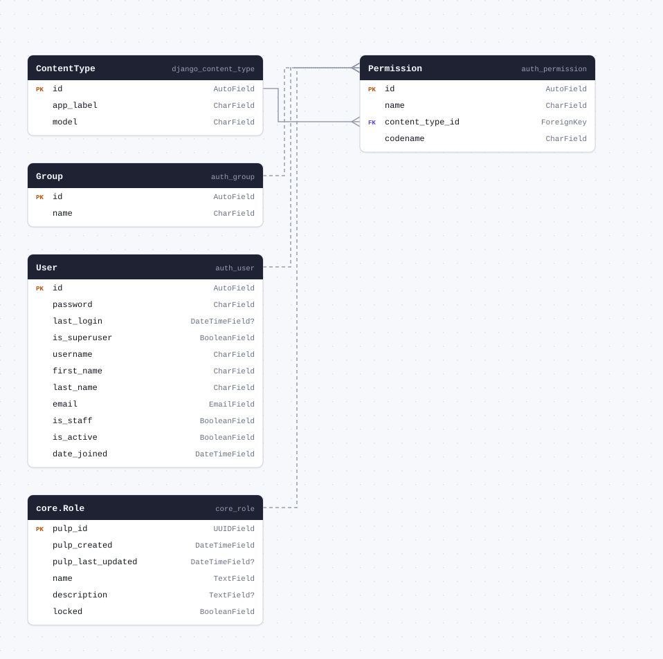

| Column | Field | Type | Null | Key | Default | Description |
| --- | --- | --- | --- | --- | --- | --- |
| `id` | `AutoField` | `integer` |  | PK | `autoincrement()` |  |
| `name` | `CharField` | `varchar(255)` |  |  |  |  |
| `content_type_id` | `ForeignKey` | `integer` |  | FK |  |  |
| `codename` | `CharField` | `varchar(100)` |  |  |  |  |

Indexes:

- index `auth_permission_content_type_id_2f476e4b` on `content_type_id`
- unique `auth_permission_content_type_id_codename_01ab375a_uniq` on `content_type_id`, `codename`

Relations:

- `content_type_id` → [ContentType](#contenttype).`id`, on delete cascade
- `group_set` — many to many with [Group](#group)
- `user_set` — many to many with [User](#user)
- `role_set` — many to many with [core.Role](#corerole)

## Group

Table `auth_group`, app `auth`.

Proxy models, on this table: `Group`.

Groups are a generic way of categorizing users to apply permissions, or
some other label, to those users. A user can belong to any number of
groups.

A user in a group automatically has all the permissions granted to that
group. For example, if the group 'Site editors' has the permission
can_edit_home_page, any user in that group will have that permission.

Beyond permissions, groups are a convenient way to categorize users to
apply some label, or extended functionality, to them. For example, you
could create a group 'Special users', and you could write code that would
do special things to those users -- such as giving them access to a
members-only portion of your site, or sending them members-only email
messages.


| Column | Field | Type | Null | Key | Default | Description |
| --- | --- | --- | --- | --- | --- | --- |
| `id` | `AutoField` | `integer` |  | PK | `autoincrement()` |  |
| `name` | `CharField` | `varchar(150)` |  | unique |  |  |

Indexes:

- index `auth_group_name_a6ea08ec_like` on `name` (`varchar_pattern_ops`)

Relations:

- `permissions` — many to many with [Permission](#permission)
- `user_set` — many to many with [User](#user)

## User

Table `auth_user`, app `auth`.

Columns from `AbstractUser` (abstract): `username`, `first_name`, `last_name`, `email`, `is_staff`, `is_active`, `date_joined`.

Columns from `AbstractBaseUser` (abstract): `password`, `last_login`.

Columns from `PermissionsMixin` (abstract): `is_superuser`.

Users within the Django authentication system are represented by this
model.

Username and password are required. Other fields are optional.

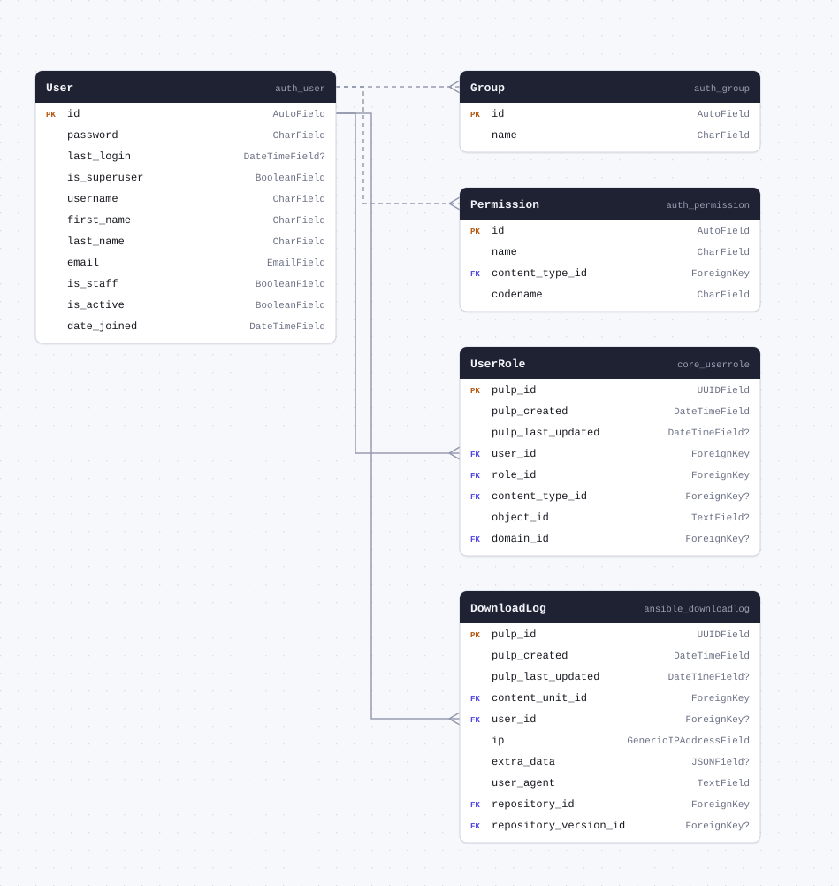

| Column | Field | Type | Null | Key | Default | Description |
| --- | --- | --- | --- | --- | --- | --- |
| `id` | `AutoField` | `integer` |  | PK | `autoincrement()` |  |
| `password` | `CharField` | `varchar(128)` |  |  |  |  |
| `last_login` | `DateTimeField` | `timestamp with time zone` | yes |  |  |  |
| `is_superuser` | `BooleanField` | `boolean` |  |  | `False` | Designates that this user has all permissions without explicitly assigning them. |
| `username` | `CharField` | `varchar(150)` |  | unique |  | Required. 150 characters or fewer. Letters, digits and @/./+/-/_ only. |
| `first_name` | `CharField` | `varchar(150)` |  |  |  |  |
| `last_name` | `CharField` | `varchar(150)` |  |  |  |  |
| `email` | `EmailField` | `varchar(254)` |  |  |  |  |
| `is_staff` | `BooleanField` | `boolean` |  |  | `False` | Designates whether the user can log into this admin site. |
| `is_active` | `BooleanField` | `boolean` |  |  | `True` | Designates whether this user should be treated as active. Unselect this instead of deleting accounts. |
| `date_joined` | `DateTimeField` | `timestamp with time zone` |  |  | `now()` |  |

Indexes:

- index `auth_user_username_6821ab7c_like` on `username` (`varchar_pattern_ops`)

Relations:

- `groups` — many to many with [Group](#group)
- `user_permissions` — many to many with [Permission](#permission)
- [UserRole](#userrole).`user_id` → `id`, on delete cascade
- [DownloadLog](#downloadlog).`user_id` → `id`, on delete cascade

## ContentType

Table `django_content_type`, app `contenttypes`.

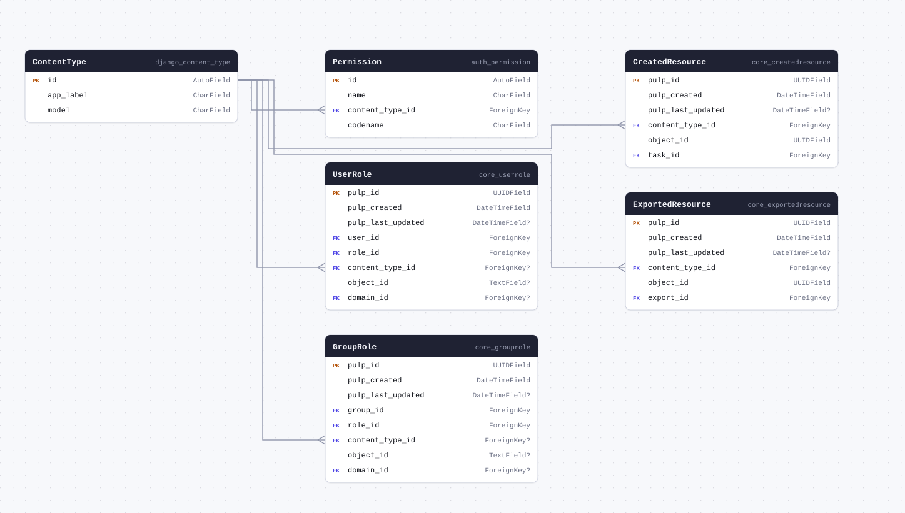

| Column | Field | Type | Null | Key | Default | Description |
| --- | --- | --- | --- | --- | --- | --- |
| `id` | `AutoField` | `integer` |  | PK | `autoincrement()` |  |
| `app_label` | `CharField` | `varchar(100)` |  |  |  |  |
| `model` | `CharField` | `varchar(100)` |  |  |  |  |

Indexes:

- unique `django_content_type_app_label_model_76bd3d3b_uniq` on `app_label`, `model`

Relations:

- [Permission](#permission).`content_type_id` → `id`, on delete cascade
- [UserRole](#userrole).`content_type_id` → `id`, on delete cascade
- [GroupRole](#grouprole).`content_type_id` → `id`, on delete cascade
- [CreatedResource](#createdresource).`content_type_id` → `id`, on delete cascade
- [ExportedResource](#exportedresource).`content_type_id` → `id`, on delete cascade

## Session

Table `django_session`, app `sessions`.

Columns from `AbstractBaseSession` (abstract): `session_key`, `session_data`, `expire_date`.

Django provides full support for anonymous sessions. The session
framework lets you store and retrieve arbitrary data on a
per-site-visitor basis. It stores data on the server side and
abstracts the sending and receiving of cookies. Cookies contain a
session ID -- not the data itself.

The Django sessions framework is entirely cookie-based. It does
not fall back to putting session IDs in URLs. This is an intentional
design decision. Not only does that behavior make URLs ugly, it makes
your site vulnerable to session-ID theft via the "Referer" header.

For complete documentation on using Sessions in your code, consult
the sessions documentation that is shipped with Django (also available
on the Django web site).

| Column | Field | Type | Null | Key | Default | Description |
| --- | --- | --- | --- | --- | --- | --- |
| `session_key` | `CharField` | `varchar(40)` |  | PK |  |  |
| `session_data` | `TextField` | `text` |  |  |  |  |
| `expire_date` | `DateTimeField` | `timestamp with time zone` |  |  |  |  |

Indexes:

- index `django_session_session_key_c0390e0f_like` on `session_key` (`varchar_pattern_ops`)
- index `django_session_expire_date_a5c62663` on `expire_date`

## AccessPolicy

Table `core_accesspolicy`, app `core`.

Columns from `BaseModel` (abstract): `pulp_id`, `pulp_created`, `pulp_last_updated`.

A model storing a viewset authorization policy and permission assignment of new objects created.

Fields:

    creation_hooks (models.JSONField): A list of dictionaries identifying callables on the
        `pulpcore.plugin.access_policy.AccessPolicyFromDB` which can add user or group roles
        for newly created objects. This is a nullable field due to not all endpoints creating
        objects.
    statements (models.JSONField): A list of `drf-access-policy` statements.
    viewset_name (models.TextField): The name of the viewset this instance controls
        authorization for.
    customized (BooleanField): False if the AccessPolicy has been user-modified. True otherwise.
        Defaults to False.
    queryset_scoping (models.JSONField): A dictionary identifying a callable to perform the
        queryset scoping. This field can be null if the user doesn't want to perform scoping.

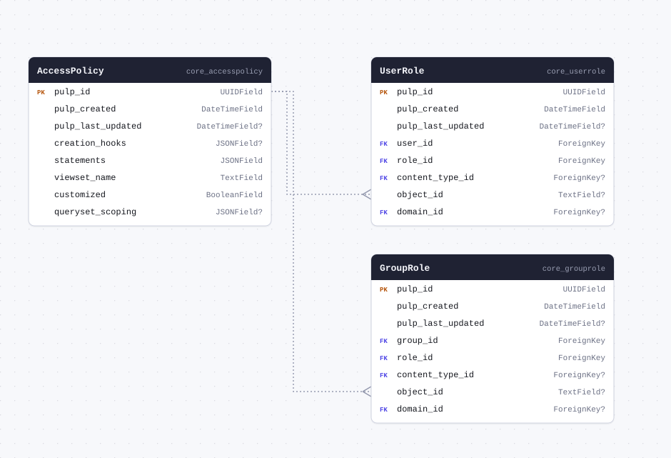

| Column | Field | Type | Null | Key | Default | Description |
| --- | --- | --- | --- | --- | --- | --- |
| `pulp_id` | `UUIDField` | `uuid` |  | PK | `pulp_uuid()` |  |
| `pulp_created` | `DateTimeField` | `timestamp with time zone` |  |  | `now()` |  |
| `pulp_last_updated` | `DateTimeField` | `timestamp with time zone` | yes |  | `now()` |  |
| `creation_hooks` | `JSONField` | `jsonb` | yes |  |  |  |
| `statements` | `JSONField` | `jsonb` |  |  |  |  |
| `viewset_name` | `TextField` | `text` |  | unique |  |  |
| `customized` | `BooleanField` | `boolean` |  |  | `False` |  |
| `queryset_scoping` | `JSONField` | `jsonb` | yes |  |  |  |

Indexes:

- index `core_accesspolicy_viewset_name_30d4303a_like` on `viewset_name` (`text_pattern_ops`)

Relations:

- `user_roles` ← [UserRole](#userrole), by `content_type_id` + `object_id` (generic relation)
- `group_roles` ← [GroupRole](#grouprole), by `content_type_id` + `object_id` (generic relation)

## Domain

Table `core_domain`, app `core`.

Columns from `BaseModel` (abstract): `pulp_id`, `pulp_created`, `pulp_last_updated`.

A namespace-like object applied to most Pulp models to allow for multi-tenancy.

Pulp models have a domain as a part of their uniqueness-constraint to provide isolation from
other domains. Domains each have their own storage backend for storing and deduplicating
Artifacts. Roles on a domain apply to all the objects in that domain.

Domains are an opt-in feature so Pulp models need to have their domain relation set the default
to the "default" Domain when not enabled. Also, plugins must add domain foreign-keys to their
models to be compatible with domains.

Fields:
    name (models.SlugField): Unique name of domain
    pulp_labels (HStoreField): Dictionary of string values
    description (models.TextField): Optional description of domain
    storage_class (models.TextField): Required storage class for backend
    storage_settings (EncryptedJSONField): Settings needed to configure storage backend
    redirect_to_object_storage (models.BooleanField): Redirect to object storage in content app
    hide_guarded_distributions (models.BooleanField): Hide guarded distributions in content app

Relations:
    default_content_guard (models.ForeignKey): An optional content-guard automatically
        assigned to new distributions created within this domain.

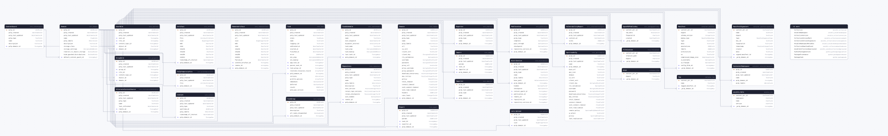

| Column | Field | Type | Null | Key | Default | Description |
| --- | --- | --- | --- | --- | --- | --- |
| `pulp_id` | `UUIDField` | `uuid` |  | PK | `pulp_uuid()` |  |
| `pulp_created` | `DateTimeField` | `timestamp with time zone` |  |  | `now()` |  |
| `pulp_last_updated` | `DateTimeField` | `timestamp with time zone` | yes |  | `now()` |  |
| `name` | `SlugField` | `varchar(50)` |  | unique |  |  |
| `pulp_labels` | `HStoreField` | `hstore` |  |  | `dict()` |  |
| `description` | `TextField` | `text` | yes |  |  |  |
| `storage_class` | `TextField` | `text` |  |  |  |  |
| `storage_settings` | `EncryptedJSONField` | `jsonb` |  |  | `dict()` |  |
| `redirect_to_object_storage` | `BooleanField` | `boolean` |  |  | `True` |  |
| `hide_guarded_distributions` | `BooleanField` | `boolean` |  |  | `False` |  |
| `default_content_guard_id` | `ForeignKey` | `uuid` | yes | FK |  |  |

Indexes:

- index `core_domain_name_9c44b9f9_like` on `name` (`varchar_pattern_ops`)
- index `core_domain_default_content_guard_id_7d14cf9d` on `default_content_guard_id`

Relations:

- `default_content_guard_id` → [ContentGuard](#contentguard).`pulp_id`, on delete set null
- `user_roles` ← [UserRole](#userrole), by `content_type_id` + `object_id` (generic relation)
- `group_roles` ← [GroupRole](#grouprole), by `content_type_id` + `object_id` (generic relation)
- [AlternateContentSource](#alternatecontentsource).`pulp_domain_id` → `pulp_id`, on delete protect
- [Artifact](#artifact).`pulp_domain_id` → `pulp_id`, on delete protect
- [PulpTemporaryFile](#pulptemporaryfile).`pulp_domain_id` → `pulp_id`, on delete protect
- [Content](#content).`pulp_domain_id` → `pulp_id`, on delete protect
- [RemoteArtifact](#remoteartifact).`pulp_domain_id` → `pulp_id`, on delete protect
- [UserRole](#userrole).`domain_id` → `pulp_id`, on delete cascade
- [GroupRole](#grouprole).`domain_id` → `pulp_id`, on delete cascade
- [Task](#task).`pulp_domain_id` → `pulp_id`, on delete cascade
- [TaskGroup](#taskgroup).`pulp_domain_id` → `pulp_id`, on delete cascade
- [TaskSchedule](#taskschedule).`pulp_domain_id` → `pulp_id`, on delete cascade
- [Repository](#repository).`pulp_domain_id` → `pulp_id`, on delete protect
- [Remote](#remote).`pulp_domain_id` → `pulp_id`, on delete protect
- [Export](#export).`pulp_domain_id` → `pulp_id`, on delete protect
- [Exporter](#exporter).`pulp_domain_id` → `pulp_id`, on delete protect
- [Import](#import).`pulp_domain_id` → `pulp_id`, on delete protect
- [Importer](#importer).`pulp_domain_id` → `pulp_id`, on delete protect
- [Publication](#publication).`pulp_domain_id` → `pulp_id`, on delete protect
- [ContentGuard](#contentguard).`pulp_domain_id` → `pulp_id`, on delete protect
- [Distribution](#distribution).`pulp_domain_id` → `pulp_id`, on delete protect
- [core.Upload](#coreupload).`pulp_domain_id` → `pulp_id`, on delete protect
- [VulnerabilityReport](#vulnerabilityreport).`pulp_domain_id` → `pulp_id`, on delete cascade
- [UpstreamPulp](#upstreampulp).`pulp_domain_id` → `pulp_id`, on delete protect
- [OpenPGPPublicKey](#openpgppublickey).`_pulp_domain_id` → `pulp_id`, on delete protect
- [Blob](#blob).`_pulp_domain_id` → `pulp_id`, on delete protect
- [Manifest](#manifest).`_pulp_domain_id` → `pulp_id`, on delete protect
- [Tag](#tag).`_pulp_domain_id` → `pulp_id`, on delete protect
- [ManifestSignature](#manifestsignature).`_pulp_domain_id` → `pulp_id`, on delete protect
- [ContainerNamespace](#containernamespace).`pulp_domain_id` → `pulp_id`, on delete protect
- [FileContent](#filecontent).`_pulp_domain_id` → `pulp_id`, on delete protect
- [ansible.Role](#ansiblerole).`_pulp_domain_id` → `pulp_id`, on delete protect
- [Collection](#collection).`pulp_domain_id` → `pulp_id`, on delete protect
- [AnsibleNamespace](#ansiblenamespace).`pulp_domain_id` → `pulp_id`, on delete protect
- [CollectionVersion](#collectionversion).`_pulp_domain_id` → `pulp_id`, on delete protect
- [CollectionVersionMark](#collectionversionmark).`_pulp_domain_id` → `pulp_id`, on delete protect
- [CollectionVersionSignature](#collectionversionsignature).`_pulp_domain_id` → `pulp_id`, on delete protect
- [AnsibleNamespaceMetadata](#ansiblenamespacemetadata).`_pulp_domain_id` → `pulp_id`, on delete protect
- [CollectionDownloadCount](#collectiondownloadcount).`pulp_domain_id` → `pulp_id`, on delete protect
- [AnsibleCollectionDeprecated](#ansiblecollectiondeprecated).`_pulp_domain_id` → `pulp_id`, on delete protect
- [PythonPackageContent](#pythonpackagecontent).`_pulp_domain_id` → `pulp_id`, on delete protect
- [PackageProvenance](#packageprovenance).`_pulp_domain_id` → `pulp_id`, on delete protect
- [PackageYank](#packageyank).`_pulp_domain_id` → `pulp_id`, on delete protect

## AlternateContentSource

Table `core_alternatecontentsource`, app `core`.

Subclasses (multi-table): [FileAlternateContentSource](#filealternatecontentsource).

Columns from `MasterModel` (abstract): `pulp_type`.

Columns from `BaseModel` (abstract): `pulp_id`, `pulp_created`, `pulp_last_updated`.

Alternate sources of content.

Fields:

    name (models.TextField): The alternate content source name.
    last_refreshed (models.DateTimeField): Last refreshed date.
    url (models.TextField): URL of Alternate Content Source.
    pulp_domain (models.ForeignKeyField): The domain the ACS is a part of.

Relations:

    remote (models.ForeignKeyField): Associated remote

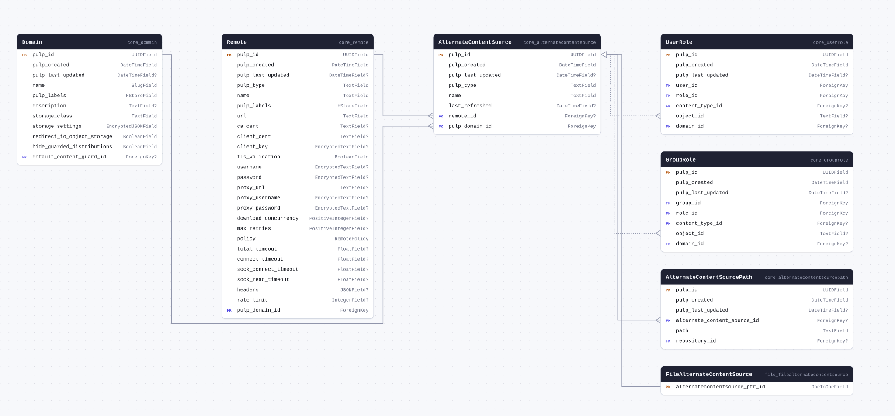

| Column | Field | Type | Null | Key | Default | Description |
| --- | --- | --- | --- | --- | --- | --- |
| `pulp_id` | `UUIDField` | `uuid` |  | PK | `pulp_uuid()` |  |
| `pulp_created` | `DateTimeField` | `timestamp with time zone` |  |  | `now()` |  |
| `pulp_last_updated` | `DateTimeField` | `timestamp with time zone` | yes |  | `now()` |  |
| `pulp_type` | `TextField` | `text` |  |  | `None` |  |
| `name` | `TextField` | `text` |  |  |  |  |
| `last_refreshed` | `DateTimeField` | `timestamp with time zone` | yes |  |  |  |
| `remote_id` | `ForeignKey` | `uuid` | yes | FK |  |  |
| `pulp_domain_id` | `ForeignKey` | `uuid` |  | FK | `get_domain_pk()` |  |

Indexes:

- index `core_alternatecontentsource_pulp_type_b0c4d25b` on `pulp_type`
- index `core_alternatecontentsource_pulp_type_b0c4d25b_like` on `pulp_type` (`text_pattern_ops`)
- index `core_alternatecontentsource_name_27800686` on `name`
- index `core_alternatecontentsource_name_27800686_like` on `name` (`text_pattern_ops`)
- index `core_alternatecontentsource_remote_id_b5aed482` on `remote_id`
- index `core_alternatecontentsource_pulp_domain_id_93a30857` on `pulp_domain_id`
- unique `core_alternatecontentsource_name_pulp_domain_id_bd06e74c_uniq` on `name`, `pulp_domain_id`

Relations:

- `remote_id` → [Remote](#remote).`pulp_id`, on delete protect
- `pulp_domain_id` → [Domain](#domain).`pulp_id`, on delete protect
- `user_roles` ← [UserRole](#userrole), by `content_type_id` + `object_id` (generic relation)
- `group_roles` ← [GroupRole](#grouprole), by `content_type_id` + `object_id` (generic relation)
- [AlternateContentSourcePath](#alternatecontentsourcepath).`alternate_content_source_id` → `pulp_id`, on delete cascade
- [FileAlternateContentSource](#filealternatecontentsource).`alternatecontentsource_ptr_id` → `pulp_id`, parent link, on delete cascade

## AlternateContentSourcePath

Table `core_alternatecontentsourcepath`, app `core`.

Columns from `BaseModel` (abstract): `pulp_id`, `pulp_created`, `pulp_last_updated`.

Alternate sources of content.

Fields:

    path (models.TextField): The alternate content source name.

Relations:

    alternate_content_source (models.ForeignKeyField): Associated AlternateContentSource
    repository (models.ForeignKeyField): Associated repository

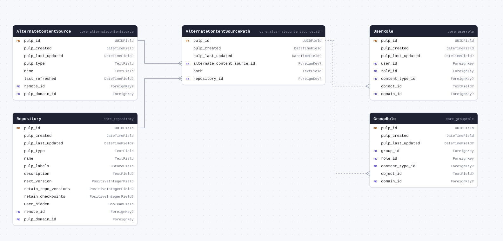

| Column | Field | Type | Null | Key | Default | Description |
| --- | --- | --- | --- | --- | --- | --- |
| `pulp_id` | `UUIDField` | `uuid` |  | PK | `pulp_uuid()` |  |
| `pulp_created` | `DateTimeField` | `timestamp with time zone` |  |  | `now()` |  |
| `pulp_last_updated` | `DateTimeField` | `timestamp with time zone` | yes |  | `now()` |  |
| `alternate_content_source_id` | `ForeignKey` | `uuid` | yes | FK |  |  |
| `path` | `TextField` | `text` |  |  | `None` |  |
| `repository_id` | `ForeignKey` | `uuid` | yes | FK |  |  |

Indexes:

- index `core_alternatecontentsourc_alternate_content_source_i_c3f7a60c` on `alternate_content_source_id`
- index `core_alternatecontentsourcepath_repository_id_22e62ad9` on `repository_id`
- unique `core_alternatecontentsou_alternate_content_source_056800df_uniq` on `alternate_content_source_id`, `path`

Relations:

- `alternate_content_source_id` → [AlternateContentSource](#alternatecontentsource).`pulp_id`, on delete cascade
- `repository_id` → [Repository](#repository).`pulp_id`, on delete cascade
- `user_roles` ← [UserRole](#userrole), by `content_type_id` + `object_id` (generic relation)
- `group_roles` ← [GroupRole](#grouprole), by `content_type_id` + `object_id` (generic relation)

## Artifact

Table `core_artifact`, app `core`.

Columns from `BaseModel` (abstract): `pulp_id`, `pulp_created`, `pulp_last_updated`.

A file associated with a piece of content.

When calling `save()` on an Artifact, if the file is not stored in Django's storage backend, it
is moved into place then.

Artifact is compatible with Django's `bulk_create()` method.

Fields:

    file (pulpcore.app.models.fields.ArtifactFileField): The stored file. This field should
        be set using an absolute path to a temporary file.
        It also accepts `class:django.core.files.File`.
    size (models.BigIntegerField): The size of the file in bytes.
    md5 (models.CharField): The MD5 checksum of the file.
    sha1 (models.CharField): The SHA-1 checksum of the file.
    sha224 (models.CharField): The SHA-224 checksum of the file.
    sha256 (models.CharField): The SHA-256 checksum of the file (REQUIRED).
    sha384 (models.CharField): The SHA-384 checksum of the file.
    sha512 (models.CharField): The SHA-512 checksum of the file.
    timestamp_of_interest (models.DateTimeField): timestamp that prevents orphan cleanup.
    pulp_domain (models.ForeignKey): The domain the artifact is a part of.

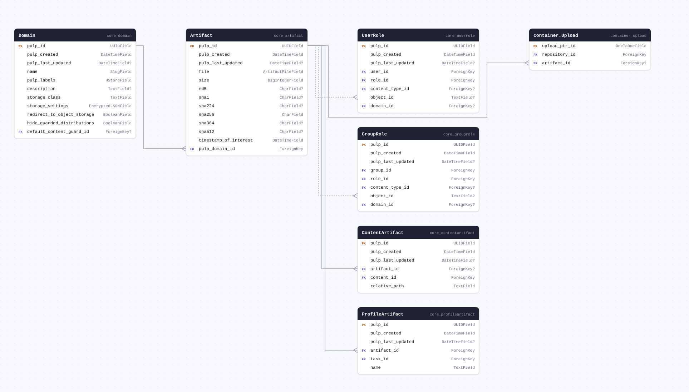

| Column | Field | Type | Null | Key | Default | Description |
| --- | --- | --- | --- | --- | --- | --- |
| `pulp_id` | `UUIDField` | `uuid` |  | PK | `pulp_uuid()` |  |
| `pulp_created` | `DateTimeField` | `timestamp with time zone` |  |  | `now()` |  |
| `pulp_last_updated` | `DateTimeField` | `timestamp with time zone` | yes |  | `now()` |  |
| `file` | `ArtifactFileField` | `varchar(255)` |  |  |  |  |
| `size` | `BigIntegerField` | `bigint` |  |  |  |  |
| `md5` | `CharField` | `varchar(32)` | yes |  |  |  |
| `sha1` | `CharField` | `varchar(40)` | yes |  |  |  |
| `sha224` | `CharField` | `varchar(56)` | yes |  |  |  |
| `sha256` | `CharField` | `varchar(64)` |  |  |  |  |
| `sha384` | `CharField` | `varchar(96)` | yes |  |  |  |
| `sha512` | `CharField` | `varchar(128)` | yes |  |  |  |
| `timestamp_of_interest` | `DateTimeField` | `timestamp with time zone` |  |  | `now()` |  |
| `pulp_domain_id` | `ForeignKey` | `uuid` |  | FK | `get_domain_pk()` |  |

Indexes:

- index `core_artifact_md5_8de3b667` on `md5`
- index `core_artifact_md5_8de3b667_like` on `md5` (`varchar_pattern_ops`)
- index `core_artifact_sha1_65ed6874` on `sha1`
- index `core_artifact_sha1_65ed6874_like` on `sha1` (`varchar_pattern_ops`)
- index `core_artifact_sha224_f1a1edf3` on `sha224`
- index `core_artifact_sha224_f1a1edf3_like` on `sha224` (`varchar_pattern_ops`)
- index `core_artifact_sha256_ee7b97eb` on `sha256`
- index `core_artifact_sha256_ee7b97eb_like` on `sha256` (`varchar_pattern_ops`)
- index `core_artifact_sha384_f484b46a` on `sha384`
- index `core_artifact_sha384_f484b46a_like` on `sha384` (`varchar_pattern_ops`)
- index `core_artifact_sha512_39254488` on `sha512`
- index `core_artifact_sha512_39254488_like` on `sha512` (`varchar_pattern_ops`)
- index `core_artifact_pulp_domain_id_ff16c936` on `pulp_domain_id`
- unique `core_artifact_sha256_pulp_domain_id_8efff3e8_uniq` on `sha256`, `pulp_domain_id`
- unique `core_artifact_sha384_pulp_domain_id_46f3e0f5_uniq` on `sha384`, `pulp_domain_id`
- unique `core_artifact_sha512_pulp_domain_id_5e5f2eb0_uniq` on `sha512`, `pulp_domain_id`
- index `artifact_domain_size_index` on `pulp_domain_id`, `size`

Relations:

- `content_set` — many to many with [Content](#content), through [ContentArtifact](#contentartifact)
- `task_set` — many to many with [Task](#task), through [ProfileArtifact](#profileartifact)
- `pulp_domain_id` → [Domain](#domain).`pulp_id`, on delete protect
- `user_roles` ← [UserRole](#userrole), by `content_type_id` + `object_id` (generic relation)
- `group_roles` ← [GroupRole](#grouprole), by `content_type_id` + `object_id` (generic relation)
- [ContentArtifact](#contentartifact).`artifact_id` → `pulp_id`, on delete protect
- [ProfileArtifact](#profileartifact).`artifact_id` → `pulp_id`, on delete cascade
- [container.Upload](#containerupload).`artifact_id` → `pulp_id`, on delete set null

## PulpTemporaryFile

Table `core_pulptemporaryfile`, app `core`.

Columns from `BaseModel` (abstract): `pulp_id`, `pulp_created`, `pulp_last_updated`.

A temporary file saved to the storage backend.

Commonly used to pass data to one or more tasks.

Fields:

    file (pulpcore.app.models.fields.ArtifactFileField): The stored file. This field should
        be set using an absolute path to a temporary file.
        It also accepts `class:django.core.files.File`.

Relations:
    pulp_domain (pulpcore.app.models.Domain): The domain this temp file is a part of.

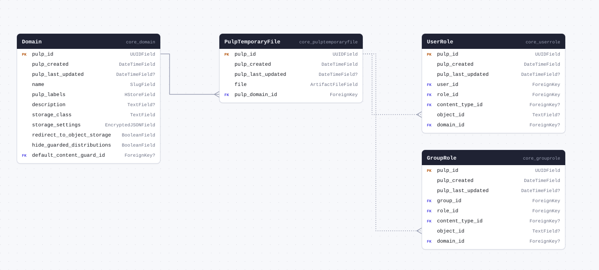

| Column | Field | Type | Null | Key | Default | Description |
| --- | --- | --- | --- | --- | --- | --- |
| `pulp_id` | `UUIDField` | `uuid` |  | PK | `pulp_uuid()` |  |
| `pulp_created` | `DateTimeField` | `timestamp with time zone` |  |  | `now()` |  |
| `pulp_last_updated` | `DateTimeField` | `timestamp with time zone` | yes |  | `now()` |  |
| `file` | `ArtifactFileField` | `varchar(255)` |  |  |  |  |
| `pulp_domain_id` | `ForeignKey` | `uuid` |  | FK | `get_domain_pk()` |  |

Indexes:

- index `core_pulptemporaryfile_pulp_domain_id_3f0ad70e` on `pulp_domain_id`

Relations:

- `pulp_domain_id` → [Domain](#domain).`pulp_id`, on delete protect
- `user_roles` ← [UserRole](#userrole), by `content_type_id` + `object_id` (generic relation)
- `group_roles` ← [GroupRole](#grouprole), by `content_type_id` + `object_id` (generic relation)

## Content

Table `core_content`, app `core`.

Subclasses (multi-table): [PublishedMetadata](#publishedmetadata), [OpenPGPPublicKey](#openpgppublickey), [OpenPGPPublicSubkey](#openpgppublicsubkey), [OpenPGPUserID](#openpgpuserid), [OpenPGPUserAttribute](#openpgpuserattribute), [OpenPGPSignature](#openpgpsignature), [Blob](#blob), [Manifest](#manifest), [Tag](#tag), [ManifestSignature](#manifestsignature), [FileContent](#filecontent), [ansible.Role](#ansiblerole), [CollectionVersion](#collectionversion), [CollectionVersionMark](#collectionversionmark), [CollectionVersionSignature](#collectionversionsignature), [AnsibleNamespaceMetadata](#ansiblenamespacemetadata), [AnsibleCollectionDeprecated](#ansiblecollectiondeprecated), [PythonPackageContent](#pythonpackagecontent), [PackageProvenance](#packageprovenance), [PackageYank](#packageyank).

Columns from `MasterModel` (abstract): `pulp_type`.

Columns from `BaseModel` (abstract): `pulp_id`, `pulp_created`, `pulp_last_updated`.

A piece of managed content.

Fields:
    upstream_id (models.UUIDField) : identifier of content imported from an 'upstream' Pulp
    timestamp_of_interest (models.DateTimeField): timestamp that prevents orphan cleanup
    pulp_labels (HStoreField): Dictionary of string values.

Relations:

    _artifacts (models.ManyToManyField): Artifacts related to Content through ContentArtifact
    pulp_domain (models.ForeignKey): Pulp Domain this content lives in

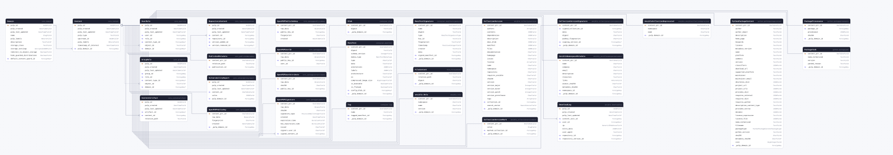

| Column | Field | Type | Null | Key | Default | Description |
| --- | --- | --- | --- | --- | --- | --- |
| `pulp_id` | `UUIDField` | `uuid` |  | PK | `pulp_uuid()` |  |
| `pulp_created` | `DateTimeField` | `timestamp with time zone` |  |  | `now()` |  |
| `pulp_last_updated` | `DateTimeField` | `timestamp with time zone` | yes |  | `now()` |  |
| `pulp_type` | `TextField` | `text` |  |  | `None` |  |
| `upstream_id` | `UUIDField` | `uuid` | yes |  |  |  |
| `pulp_labels` | `HStoreField` | `hstore` |  |  | `dict()` |  |
| `timestamp_of_interest` | `DateTimeField` | `timestamp with time zone` |  |  | `now()` |  |
| `pulp_domain_id` | `ForeignKey` | `uuid` |  | FK | `get_domain_pk()` |  |

Indexes:

- index `core_content_pulp_type_ceada3d6` on `pulp_type`
- index `core_content_pulp_type_ceada3d6_like` on `pulp_type` (`text_pattern_ops`)
- index `core_content_pulp_domain_id_1e092d27` on `pulp_domain_id`
- gin index `pulp_labels_gin_index` on `pulp_labels`

Relations:

- `_artifacts` — many to many with [Artifact](#artifact), through [ContentArtifact](#contentartifact)
- `repositories` — many to many with [Repository](#repository), through [RepositoryContent](#repositorycontent)
- `pulp_domain_id` → [Domain](#domain).`pulp_id`, on delete protect
- `user_roles` ← [UserRole](#userrole), by `content_type_id` + `object_id` (generic relation)
- `group_roles` ← [GroupRole](#grouprole), by `content_type_id` + `object_id` (generic relation)
- [ContentArtifact](#contentartifact).`content_id` → `pulp_id`, on delete cascade
- [RepositoryContent](#repositorycontent).`content_id` → `pulp_id`, on delete protect
- [PublishedMetadata](#publishedmetadata).`content_ptr_id` → `pulp_id`, parent link, on delete cascade
- [VulnerabilityReport](#vulnerabilityreport).`content_id` → `pulp_id`, on delete cascade
- [OpenPGPPublicKey](#openpgppublickey).`content_ptr_id` → `pulp_id`, parent link, on delete cascade
- [OpenPGPPublicSubkey](#openpgppublicsubkey).`content_ptr_id` → `pulp_id`, parent link, on delete cascade
- [OpenPGPUserID](#openpgpuserid).`content_ptr_id` → `pulp_id`, parent link, on delete cascade
- [OpenPGPUserAttribute](#openpgpuserattribute).`content_ptr_id` → `pulp_id`, parent link, on delete cascade
- [OpenPGPSignature](#openpgpsignature).`content_ptr_id` → `pulp_id`, parent link, on delete cascade
- [OpenPGPSignature](#openpgpsignature).`signed_content_id` → `pulp_id`, on delete protect
- [Blob](#blob).`content_ptr_id` → `pulp_id`, parent link, on delete cascade
- [Manifest](#manifest).`content_ptr_id` → `pulp_id`, parent link, on delete cascade
- [Tag](#tag).`content_ptr_id` → `pulp_id`, parent link, on delete cascade
- [ManifestSignature](#manifestsignature).`content_ptr_id` → `pulp_id`, parent link, on delete cascade
- [FileContent](#filecontent).`content_ptr_id` → `pulp_id`, parent link, on delete cascade
- [ansible.Role](#ansiblerole).`content_ptr_id` → `pulp_id`, parent link, on delete cascade
- [CollectionVersion](#collectionversion).`content_ptr_id` → `pulp_id`, parent link, on delete cascade
- [CollectionVersionMark](#collectionversionmark).`content_ptr_id` → `pulp_id`, parent link, on delete cascade
- [CollectionVersionSignature](#collectionversionsignature).`content_ptr_id` → `pulp_id`, parent link, on delete cascade
- [AnsibleNamespaceMetadata](#ansiblenamespacemetadata).`content_ptr_id` → `pulp_id`, parent link, on delete cascade
- [DownloadLog](#downloadlog).`content_unit_id` → `pulp_id`, on delete cascade
- [AnsibleCollectionDeprecated](#ansiblecollectiondeprecated).`content_ptr_id` → `pulp_id`, parent link, on delete cascade
- [PythonPackageContent](#pythonpackagecontent).`content_ptr_id` → `pulp_id`, parent link, on delete cascade
- [PackageProvenance](#packageprovenance).`content_ptr_id` → `pulp_id`, parent link, on delete cascade
- [PackageYank](#packageyank).`content_ptr_id` → `pulp_id`, parent link, on delete cascade

## ContentArtifact

Table `core_contentartifact`, app `core`.

Columns from `BaseModel` (abstract): `pulp_id`, `pulp_created`, `pulp_last_updated`.

A relationship between a Content and an Artifact.

Serves as a through model for the '_artifacts' ManyToManyField in Content.
Artifact is protected from deletion if it's present in a ContentArtifact relationship.

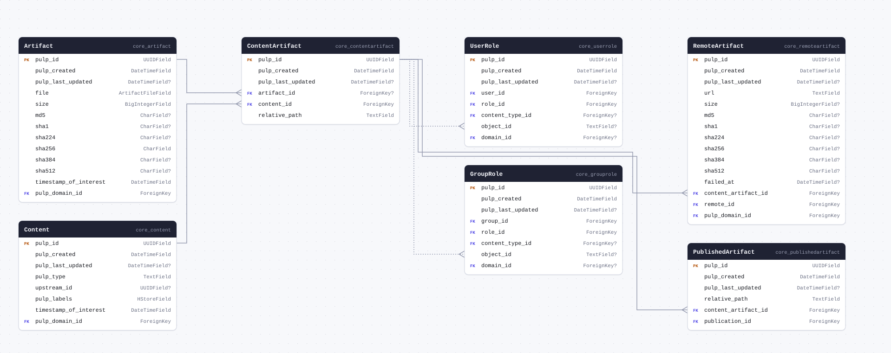

| Column | Field | Type | Null | Key | Default | Description |
| --- | --- | --- | --- | --- | --- | --- |
| `pulp_id` | `UUIDField` | `uuid` |  | PK | `pulp_uuid()` |  |
| `pulp_created` | `DateTimeField` | `timestamp with time zone` |  |  | `now()` |  |
| `pulp_last_updated` | `DateTimeField` | `timestamp with time zone` | yes |  | `now()` |  |
| `artifact_id` | `ForeignKey` | `uuid` | yes | FK |  |  |
| `content_id` | `ForeignKey` | `uuid` |  | FK |  |  |
| `relative_path` | `TextField` | `text` |  |  |  |  |

Indexes:

- index `core_contentartifact_artifact_id_f5d9a66b` on `artifact_id`
- index `core_contentartifact_content_id_04d8a3d5` on `content_id`
- unique `core_contentartifact_content_id_relative_path_d2ef8231_uniq` on `content_id`, `relative_path`
- index `core_conten_relativ_ca1ae5_idx` on `relative_path`

Relations:

- `artifact_id` → [Artifact](#artifact).`pulp_id`, on delete protect
- `content_id` → [Content](#content).`pulp_id`, on delete cascade
- `user_roles` ← [UserRole](#userrole), by `content_type_id` + `object_id` (generic relation)
- `group_roles` ← [GroupRole](#grouprole), by `content_type_id` + `object_id` (generic relation)
- [RemoteArtifact](#remoteartifact).`content_artifact_id` → `pulp_id`, on delete cascade
- [PublishedArtifact](#publishedartifact).`content_artifact_id` → `pulp_id`, on delete cascade

## RemoteArtifact

Table `core_remoteartifact`, app `core`.

Columns from `BaseModel` (abstract): `pulp_id`, `pulp_created`, `pulp_last_updated`.

Represents a content artifact that is provided by a remote (external) repository.

Remotes that want to support deferred download policies should use this model to store
information required for downloading an Artifact at some point in the future. At a minimum this
includes the URL, the ContentArtifact, and the Remote that created it. It can also store
expected size and any expected checksums.

Fields:

    url (models.TextField): The URL where the artifact can be retrieved.
    size (models.BigIntegerField): The expected size of the file in bytes.
    md5 (models.CharField): The expected MD5 checksum of the file.
    sha1 (models.CharField): The expected SHA-1 checksum of the file.
    sha224 (models.CharField): The expected SHA-224 checksum of the file.
    sha256 (models.CharField): The expected SHA-256 checksum of the file.
    sha384 (models.CharField): The expected SHA-384 checksum of the file.
    sha512 (models.CharField): The expected SHA-512 checksum of the file.
    failed_at (models.DateTimeField): The datetime of last download attempt failure.

Relations:

    content_artifact (pulpcore.app.models.ForeignKey)
        ContentArtifact associated with this RemoteArtifact.
    remote (django.db.models.ForeignKey) Remote that created the
        RemoteArtifact.
    pulp_domain (django.db.models.ForeignKey) Domain the RemoteArtifact is a part of.

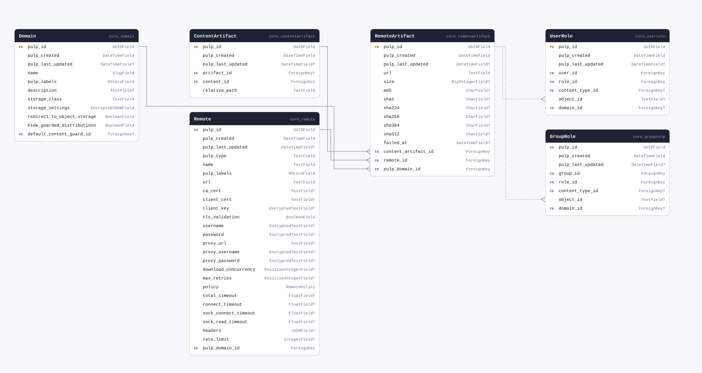

| Column | Field | Type | Null | Key | Default | Description |
| --- | --- | --- | --- | --- | --- | --- |
| `pulp_id` | `UUIDField` | `uuid` |  | PK | `pulp_uuid()` |  |
| `pulp_created` | `DateTimeField` | `timestamp with time zone` |  |  | `now()` |  |
| `pulp_last_updated` | `DateTimeField` | `timestamp with time zone` | yes |  | `now()` |  |
| `url` | `TextField` | `text` |  |  |  |  |
| `size` | `BigIntegerField` | `bigint` | yes |  |  |  |
| `md5` | `CharField` | `varchar(32)` | yes |  |  |  |
| `sha1` | `CharField` | `varchar(40)` | yes |  |  |  |
| `sha224` | `CharField` | `varchar(56)` | yes |  |  |  |
| `sha256` | `CharField` | `varchar(64)` | yes |  |  |  |
| `sha384` | `CharField` | `varchar(96)` | yes |  |  |  |
| `sha512` | `CharField` | `varchar(128)` | yes |  |  |  |
| `failed_at` | `DateTimeField` | `timestamp with time zone` | yes |  |  |  |
| `content_artifact_id` | `ForeignKey` | `uuid` |  | FK |  |  |
| `remote_id` | `ForeignKey` | `uuid` |  | FK |  |  |
| `pulp_domain_id` | `ForeignKey` | `uuid` |  | FK | `get_domain_pk()` |  |

Indexes:

- index `core_remoteartifact_md5_57731448` on `md5`
- index `core_remoteartifact_md5_57731448_like` on `md5` (`varchar_pattern_ops`)
- index `core_remoteartifact_sha1_851e329a` on `sha1`
- index `core_remoteartifact_sha1_851e329a_like` on `sha1` (`varchar_pattern_ops`)
- index `core_remoteartifact_sha224_57d86c5d` on `sha224`
- index `core_remoteartifact_sha224_57d86c5d_like` on `sha224` (`varchar_pattern_ops`)
- index `core_remoteartifact_sha256_dd4b07a2` on `sha256`
- index `core_remoteartifact_sha256_dd4b07a2_like` on `sha256` (`varchar_pattern_ops`)
- index `core_remoteartifact_sha384_fd48993e` on `sha384`
- index `core_remoteartifact_sha384_fd48993e_like` on `sha384` (`varchar_pattern_ops`)
- index `core_remoteartifact_sha512_de82fc24` on `sha512`
- index `core_remoteartifact_sha512_de82fc24_like` on `sha512` (`varchar_pattern_ops`)
- index `core_remoteartifact_content_artifact_id_54377af5` on `content_artifact_id`
- index `core_remoteartifact_remote_id_af9354ce` on `remote_id`
- index `core_remoteartifact_pulp_domain_id_507b2f03` on `pulp_domain_id`
- unique `core_remoteartifact_content_artifact_id_remo_f11e4ef2_uniq` on `content_artifact_id`, `remote_id`, `pulp_domain_id`

Relations:

- `content_artifact_id` → [ContentArtifact](#contentartifact).`pulp_id`, on delete cascade
- `remote_id` → [Remote](#remote).`pulp_id`, on delete cascade
- `pulp_domain_id` → [Domain](#domain).`pulp_id`, on delete protect
- `user_roles` ← [UserRole](#userrole), by `content_type_id` + `object_id` (generic relation)
- `group_roles` ← [GroupRole](#grouprole), by `content_type_id` + `object_id` (generic relation)

## SigningService

Table `core_signingservice`, app `core`.

Subclasses (multi-table): [AsciiArmoredDetachedSigningService](#asciiarmoreddetachedsigningservice), [ManifestSigningService](#manifestsigningservice).

Columns from `BaseModel` (abstract): `pulp_id`, `pulp_created`, `pulp_last_updated`.

A model used for producing signatures.

Fields:
    name (models.TextField):
        A unique name describing a script (or executable) used for signing.
    public_key (models.TextField):
        The value of the public key.
    script (models.TextField):
        An absolute path to an external signing script (or executable).

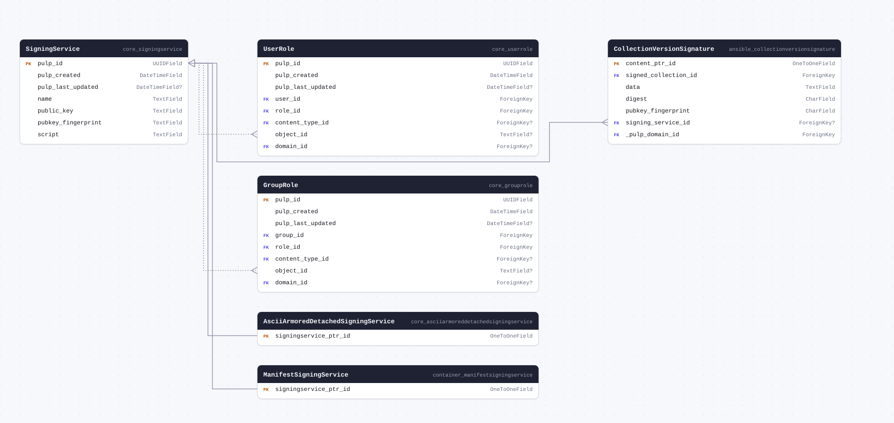

| Column | Field | Type | Null | Key | Default | Description |
| --- | --- | --- | --- | --- | --- | --- |
| `pulp_id` | `UUIDField` | `uuid` |  | PK | `pulp_uuid()` |  |
| `pulp_created` | `DateTimeField` | `timestamp with time zone` |  |  | `now()` |  |
| `pulp_last_updated` | `DateTimeField` | `timestamp with time zone` | yes |  | `now()` |  |
| `name` | `TextField` | `text` |  | unique |  |  |
| `public_key` | `TextField` | `text` |  |  |  |  |
| `pubkey_fingerprint` | `TextField` | `text` |  |  |  |  |
| `script` | `TextField` | `text` |  |  |  |  |

Indexes:

- index `core_signingservice_name_8c4cfb12_like` on `name` (`text_pattern_ops`)

Relations:

- `user_roles` ← [UserRole](#userrole), by `content_type_id` + `object_id` (generic relation)
- `group_roles` ← [GroupRole](#grouprole), by `content_type_id` + `object_id` (generic relation)
- [AsciiArmoredDetachedSigningService](#asciiarmoreddetachedsigningservice).`signingservice_ptr_id` → `pulp_id`, parent link, on delete cascade
- [ManifestSigningService](#manifestsigningservice).`signingservice_ptr_id` → `pulp_id`, parent link, on delete cascade
- [CollectionVersionSignature](#collectionversionsignature).`signing_service_id` → `pulp_id`, on delete set null

## AsciiArmoredDetachedSigningService

Table `core_asciiarmoreddetachedsigningservice`, app `core`.

Inherits from [SigningService](#signingservice) (multi-table): its rows are joined on `signingservice_ptr_id`.

A model used for creating detached ASCII armored signatures.

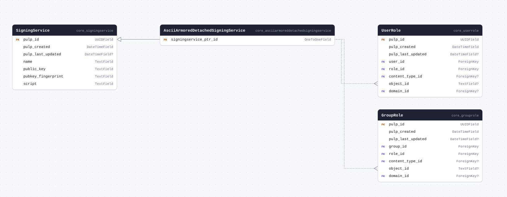

| Column | Field | Type | Null | Key | Default | Description |
| --- | --- | --- | --- | --- | --- | --- |
| `signingservice_ptr_id` | `OneToOneField` | `uuid` |  | PK, FK |  |  |

Relations:

- `signingservice_ptr_id` → [SigningService](#signingservice).`pulp_id`, parent link, on delete cascade
- `user_roles` ← [UserRole](#userrole), by `content_type_id` + `object_id` (generic relation)
- `group_roles` ← [GroupRole](#grouprole), by `content_type_id` + `object_id` (generic relation)

## AppStatus

Table `core_appstatus`, app `core`.

Columns from `BaseModel` (abstract): `pulp_id`, `pulp_created`, `pulp_last_updated`.

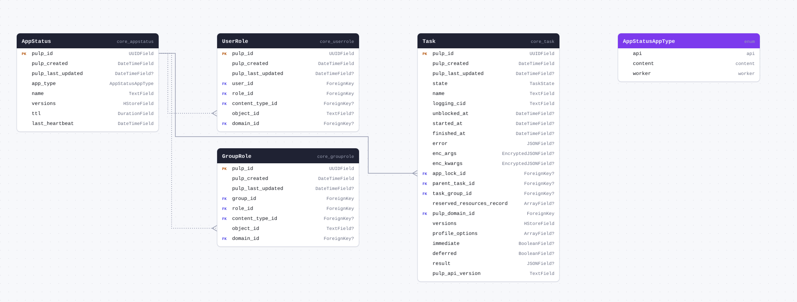

| Column | Field | Type | Null | Key | Default | Description |
| --- | --- | --- | --- | --- | --- | --- |
| `pulp_id` | `UUIDField` | `uuid` |  | PK | `pulp_uuid()` |  |
| `pulp_created` | `DateTimeField` | `timestamp with time zone` |  |  | `now()` |  |
| `pulp_last_updated` | `DateTimeField` | `timestamp with time zone` | yes |  | `now()` |  |
| `app_type` | `AppStatusAppType` | `varchar(10)` |  |  |  |  |
| `name` | `TextField` | `text` |  |  |  |  |
| `versions` | `HStoreField` | `hstore` |  |  | `dict()` |  |
| `ttl` | `DurationField` | `interval` |  |  |  |  |
| `last_heartbeat` | `DateTimeField` | `timestamp with time zone` |  |  | `now()` |  |

Relations:

- `user_roles` ← [UserRole](#userrole), by `content_type_id` + `object_id` (generic relation)
- `group_roles` ← [GroupRole](#grouprole), by `content_type_id` + `object_id` (generic relation)
- [Task](#task).`app_lock_id` → `pulp_id`, on delete set null

## core.Role

Table `core_role`, app `core`.

Columns from `BaseModel` (abstract): `pulp_id`, `pulp_created`, `pulp_last_updated`.

A model for the "role" part in RBAC.

Fields:

    name (models.TextField): Unique name of the role.
    locked (models.BooleanField): Indicator for plugin managed role.

Relations:

    permissions (models.ManyToManyField): Permissions to be granted via this role.

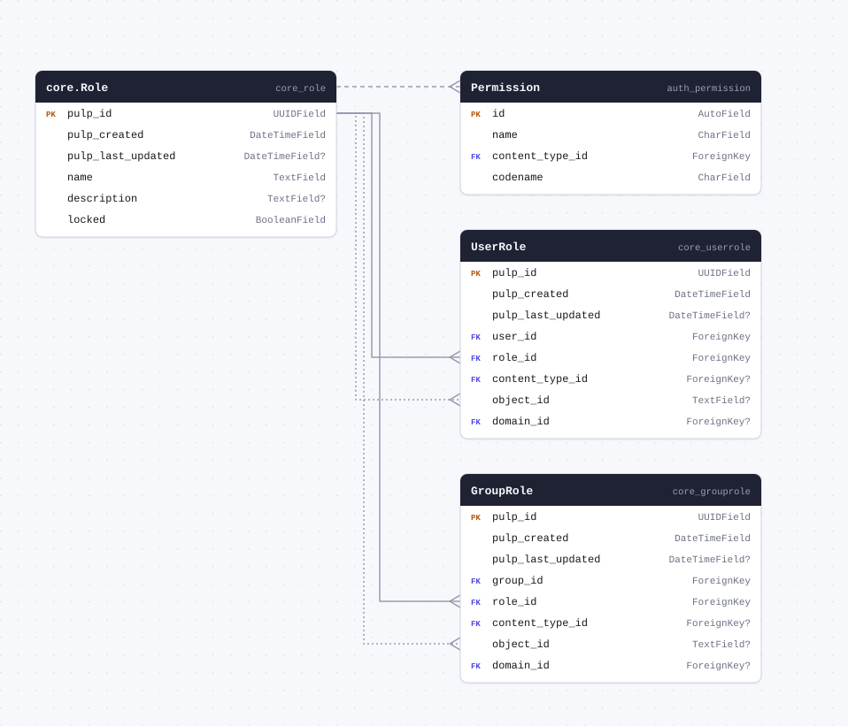

| Column | Field | Type | Null | Key | Default | Description |
| --- | --- | --- | --- | --- | --- | --- |
| `pulp_id` | `UUIDField` | `uuid` |  | PK | `pulp_uuid()` |  |
| `pulp_created` | `DateTimeField` | `timestamp with time zone` |  |  | `now()` |  |
| `pulp_last_updated` | `DateTimeField` | `timestamp with time zone` | yes |  | `now()` |  |
| `name` | `TextField` | `text` |  | unique |  |  |
| `description` | `TextField` | `text` | yes |  |  |  |
| `locked` | `BooleanField` | `boolean` |  |  | `False` |  |

Indexes:

- index `core_role_name_ca4cd9c7_like` on `name` (`text_pattern_ops`)

Relations:

- `permissions` — many to many with [Permission](#permission)
- `user_roles` ← [UserRole](#userrole), by `content_type_id` + `object_id` (generic relation)
- `group_roles` ← [GroupRole](#grouprole), by `content_type_id` + `object_id` (generic relation)
- [UserRole](#userrole).`role_id` → `pulp_id`, on delete cascade
- [GroupRole](#grouprole).`role_id` → `pulp_id`, on delete cascade

## UserRole

Table `core_userrole`, app `core`.

Columns from `BaseModel` (abstract): `pulp_id`, `pulp_created`, `pulp_last_updated`.

Join table for user to role associations with optional content object.

Relations:

    user (models.ForeignKey): User to grant permissions to.
    role (models.ForeignKey): Role to select granted permissions from.
    content_object (GenericForeignKey): Optional object to assert permissions on.
    domain (models.ForeignKey): Domain these permissions apply on, mutually exclusive with
        content_object

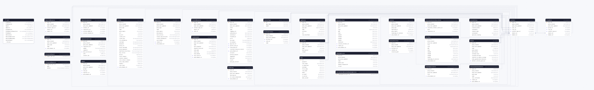

| Column | Field | Type | Null | Key | Default | Description |
| --- | --- | --- | --- | --- | --- | --- |
| `pulp_id` | `UUIDField` | `uuid` |  | PK | `pulp_uuid()` |  |
| `pulp_created` | `DateTimeField` | `timestamp with time zone` |  |  | `now()` |  |
| `pulp_last_updated` | `DateTimeField` | `timestamp with time zone` | yes |  | `now()` |  |
| `user_id` | `ForeignKey` | `integer` |  | FK |  |  |
| `role_id` | `ForeignKey` | `uuid` |  | FK |  |  |
| `content_type_id` | `ForeignKey` | `integer` | yes | FK |  |  |
| `object_id` | `TextField` | `text` | yes |  |  |  |
| `domain_id` | `ForeignKey` | `uuid` | yes | FK |  |  |

Indexes:

- index `core_userrole_user_id_aca63c51` on `user_id`
- index `core_userrole_role_id_8272b20d` on `role_id`
- index `core_userrole_content_type_id_a2ff8402` on `content_type_id`
- index `core_userrole_domain_id_f78b1c11` on `domain_id`
- unique `core_userrole_user_id_role_id_content__cbfdaacc_uniq` on `user_id`, `role_id`, `content_type_id`, `object_id`, `domain_id`
- index `core_userro_object__adb04a_idx` on `object_id`
- index `core_userro_content_5c0477_idx` on `content_type_id`, `object_id`

Relations:

- `content_object` → any model, by `content_type_id` + `object_id` (generic foreign key)
- `object_id` → [AccessPolicy](#accesspolicy).`pulp_id` where `content_type_id` is AccessPolicy (generic, `AccessPolicy.user_roles`)
- `object_id` → [Domain](#domain).`pulp_id` where `content_type_id` is Domain (generic, `Domain.user_roles`)
- `object_id` → [AlternateContentSource](#alternatecontentsource).`pulp_id` where `content_type_id` is AlternateContentSource (generic, `AlternateContentSource.user_roles`)
- `object_id` → [AlternateContentSourcePath](#alternatecontentsourcepath).`pulp_id` where `content_type_id` is AlternateContentSourcePath (generic, `AlternateContentSourcePath.user_roles`)
- `object_id` → [Artifact](#artifact).`pulp_id` where `content_type_id` is Artifact (generic, `Artifact.user_roles`)
- `object_id` → [PulpTemporaryFile](#pulptemporaryfile).`pulp_id` where `content_type_id` is PulpTemporaryFile (generic, `PulpTemporaryFile.user_roles`)
- `object_id` → [Content](#content).`pulp_id` where `content_type_id` is Content (generic, `Content.user_roles`)
- `object_id` → [ContentArtifact](#contentartifact).`pulp_id` where `content_type_id` is ContentArtifact (generic, `ContentArtifact.user_roles`)
- `object_id` → [RemoteArtifact](#remoteartifact).`pulp_id` where `content_type_id` is RemoteArtifact (generic, `RemoteArtifact.user_roles`)
- `object_id` → [SigningService](#signingservice).`pulp_id` where `content_type_id` is SigningService (generic, `SigningService.user_roles`)
- `object_id` → [AsciiArmoredDetachedSigningService](#asciiarmoreddetachedsigningservice).`signingservice_ptr_id` where `content_type_id` is AsciiArmoredDetachedSigningService (generic, `AsciiArmoredDetachedSigningService.user_roles`)
- `object_id` → [AppStatus](#appstatus).`pulp_id` where `content_type_id` is AppStatus (generic, `AppStatus.user_roles`)
- `object_id` → [core.Role](#corerole).`pulp_id` where `content_type_id` is core.Role (generic, `core.Role.user_roles`)
- `user_id` → [User](#user).`id`, on delete cascade
- `role_id` → [core.Role](#corerole).`pulp_id`, on delete cascade
- `content_type_id` → [ContentType](#contenttype).`id`, on delete cascade
- `domain_id` → [Domain](#domain).`pulp_id`, on delete cascade
- `user_roles` ← [UserRole](#userrole), by `content_type_id` + `object_id` (generic relation)
- `object_id` → [UserRole](#userrole).`pulp_id` where `content_type_id` is UserRole (generic, `UserRole.user_roles`)
- `group_roles` ← [GroupRole](#grouprole), by `content_type_id` + `object_id` (generic relation)
- `object_id` → [GroupRole](#grouprole).`pulp_id` where `content_type_id` is GroupRole (generic, `GroupRole.user_roles`)
- `object_id` → [ProfileArtifact](#profileartifact).`pulp_id` where `content_type_id` is ProfileArtifact (generic, `ProfileArtifact.user_roles`)
- `object_id` → [Task](#task).`pulp_id` where `content_type_id` is Task (generic, `Task.user_roles`)
- `object_id` → [TaskGroup](#taskgroup).`pulp_id` where `content_type_id` is TaskGroup (generic, `TaskGroup.user_roles`)
- `object_id` → [CreatedResource](#createdresource).`pulp_id` where `content_type_id` is CreatedResource (generic, `CreatedResource.user_roles`)
- `object_id` → [TaskSchedule](#taskschedule).`pulp_id` where `content_type_id` is TaskSchedule (generic, `TaskSchedule.user_roles`)
- `object_id` → [Repository](#repository).`pulp_id` where `content_type_id` is Repository (generic, `Repository.user_roles`)
- `object_id` → [Remote](#remote).`pulp_id` where `content_type_id` is Remote (generic, `Remote.user_roles`)
- `object_id` → [RepositoryContent](#repositorycontent).`pulp_id` where `content_type_id` is RepositoryContent (generic, `RepositoryContent.user_roles`)
- `object_id` → [RepositoryVersion](#repositoryversion).`pulp_id` where `content_type_id` is RepositoryVersion (generic, `RepositoryVersion.user_roles`)
- `object_id` → [Export](#export).`pulp_id` where `content_type_id` is Export (generic, `Export.user_roles`)
- `object_id` → [ExportedResource](#exportedresource).`pulp_id` where `content_type_id` is ExportedResource (generic, `ExportedResource.user_roles`)
- `object_id` → [Exporter](#exporter).`pulp_id` where `content_type_id` is Exporter (generic, `Exporter.user_roles`)
- `object_id` → [FilesystemExport](#filesystemexport).`export_ptr_id` where `content_type_id` is FilesystemExport (generic, `FilesystemExport.user_roles`)
- `object_id` → [FilesystemExporter](#filesystemexporter).`exporter_ptr_id` where `content_type_id` is FilesystemExporter (generic, `FilesystemExporter.user_roles`)
- `object_id` → [PulpExport](#pulpexport).`export_ptr_id` where `content_type_id` is PulpExport (generic, `PulpExport.user_roles`)
- `object_id` → [PulpExporter](#pulpexporter).`exporter_ptr_id` where `content_type_id` is PulpExporter (generic, `PulpExporter.user_roles`)
- `object_id` → [Import](#import).`pulp_id` where `content_type_id` is Import (generic, `Import.user_roles`)
- `object_id` → [Importer](#importer).`pulp_id` where `content_type_id` is Importer (generic, `Importer.user_roles`)
- `object_id` → [PulpImporter](#pulpimporter).`importer_ptr_id` where `content_type_id` is PulpImporter (generic, `PulpImporter.user_roles`)
- `object_id` → [PulpImporterRepository](#pulpimporterrepository).`pulp_id` where `content_type_id` is PulpImporterRepository (generic, `PulpImporterRepository.user_roles`)
- `object_id` → [PulpImport](#pulpimport).`import_ptr_id` where `content_type_id` is PulpImport (generic, `PulpImport.user_roles`)
- `object_id` → [Publication](#publication).`pulp_id` where `content_type_id` is Publication (generic, `Publication.user_roles`)
- `object_id` → [PublishedArtifact](#publishedartifact).`pulp_id` where `content_type_id` is PublishedArtifact (generic, `PublishedArtifact.user_roles`)
- `object_id` → [PublishedMetadata](#publishedmetadata).`content_ptr_id` where `content_type_id` is PublishedMetadata (generic, `PublishedMetadata.user_roles`)
- `object_id` → [ContentGuard](#contentguard).`pulp_id` where `content_type_id` is ContentGuard (generic, `ContentGuard.user_roles`)
- `object_id` → [RBACContentGuard](#rbaccontentguard).`contentguard_ptr_id` where `content_type_id` is RBACContentGuard (generic, `RBACContentGuard.user_roles`)
- `object_id` → [ContentRedirectContentGuard](#contentredirectcontentguard).`contentguard_ptr_id` where `content_type_id` is ContentRedirectContentGuard (generic, `ContentRedirectContentGuard.user_roles`)
- `object_id` → [HeaderContentGuard](#headercontentguard).`contentguard_ptr_id` where `content_type_id` is HeaderContentGuard (generic, `HeaderContentGuard.user_roles`)
- `object_id` → [EnvVarHeaderContentGuard](#envvarheadercontentguard).`contentguard_ptr_id` where `content_type_id` is EnvVarHeaderContentGuard (generic, `EnvVarHeaderContentGuard.user_roles`)
- `object_id` → [CompositeContentGuard](#compositecontentguard).`contentguard_ptr_id` where `content_type_id` is CompositeContentGuard (generic, `CompositeContentGuard.user_roles`)
- `object_id` → [Distribution](#distribution).`pulp_id` where `content_type_id` is Distribution (generic, `Distribution.user_roles`)
- `object_id` → [ArtifactDistribution](#artifactdistribution).`distribution_ptr_id` where `content_type_id` is ArtifactDistribution (generic, `ArtifactDistribution.user_roles`)
- `object_id` → [DistributedPublication](#distributedpublication).`pulp_id` where `content_type_id` is DistributedPublication (generic, `DistributedPublication.user_roles`)
- `object_id` → [core.Upload](#coreupload).`pulp_id` where `content_type_id` is core.Upload (generic, `core.Upload.user_roles`)
- `object_id` → [UploadChunk](#uploadchunk).`pulp_id` where `content_type_id` is UploadChunk (generic, `UploadChunk.user_roles`)
- `object_id` → [VulnerabilityReport](#vulnerabilityreport).`pulp_id` where `content_type_id` is VulnerabilityReport (generic, `VulnerabilityReport.user_roles`)
- `object_id` → [ProgressReport](#progressreport).`pulp_id` where `content_type_id` is ProgressReport (generic, `ProgressReport.user_roles`)
- `object_id` → [GroupProgressReport](#groupprogressreport).`pulp_id` where `content_type_id` is GroupProgressReport (generic, `GroupProgressReport.user_roles`)
- `object_id` → [UpstreamPulp](#upstreampulp).`pulp_id` where `content_type_id` is UpstreamPulp (generic, `UpstreamPulp.user_roles`)
- `object_id` → [OpenPGPPublicKey](#openpgppublickey).`content_ptr_id` where `content_type_id` is OpenPGPPublicKey (generic, `OpenPGPPublicKey.user_roles`)
- `object_id` → [OpenPGPPublicSubkey](#openpgppublicsubkey).`content_ptr_id` where `content_type_id` is OpenPGPPublicSubkey (generic, `OpenPGPPublicSubkey.user_roles`)
- `object_id` → [OpenPGPUserID](#openpgpuserid).`content_ptr_id` where `content_type_id` is OpenPGPUserID (generic, `OpenPGPUserID.user_roles`)
- `object_id` → [OpenPGPUserAttribute](#openpgpuserattribute).`content_ptr_id` where `content_type_id` is OpenPGPUserAttribute (generic, `OpenPGPUserAttribute.user_roles`)
- `object_id` → [OpenPGPSignature](#openpgpsignature).`content_ptr_id` where `content_type_id` is OpenPGPSignature (generic, `OpenPGPSignature.user_roles`)
- `object_id` → [OpenPGPKeyring](#openpgpkeyring).`repository_ptr_id` where `content_type_id` is OpenPGPKeyring (generic, `OpenPGPKeyring.user_roles`)
- `object_id` → [OpenPGPDistribution](#openpgpdistribution).`distribution_ptr_id` where `content_type_id` is OpenPGPDistribution (generic, `OpenPGPDistribution.user_roles`)
- `object_id` → [Blob](#blob).`content_ptr_id` where `content_type_id` is Blob (generic, `Blob.user_roles`)
- `object_id` → [Manifest](#manifest).`content_ptr_id` where `content_type_id` is Manifest (generic, `Manifest.user_roles`)
- `object_id` → [Tag](#tag).`content_ptr_id` where `content_type_id` is Tag (generic, `Tag.user_roles`)
- `object_id` → [ManifestSignature](#manifestsignature).`content_ptr_id` where `content_type_id` is ManifestSignature (generic, `ManifestSignature.user_roles`)
- `object_id` → [ContainerNamespace](#containernamespace).`pulp_id` where `content_type_id` is ContainerNamespace (generic, `ContainerNamespace.user_roles`)
- `object_id` → [ContainerRemote](#containerremote).`remote_ptr_id` where `content_type_id` is ContainerRemote (generic, `ContainerRemote.user_roles`)
- `object_id` → [ContainerPullThroughRemote](#containerpullthroughremote).`remote_ptr_id` where `content_type_id` is ContainerPullThroughRemote (generic, `ContainerPullThroughRemote.user_roles`)
- `object_id` → [ManifestSigningService](#manifestsigningservice).`signingservice_ptr_id` where `content_type_id` is ManifestSigningService (generic, `ManifestSigningService.user_roles`)
- `object_id` → [ContainerRepository](#containerrepository).`repository_ptr_id` where `content_type_id` is ContainerRepository (generic, `ContainerRepository.user_roles`)
- `object_id` → [ContainerPushRepository](#containerpushrepository).`repository_ptr_id` where `content_type_id` is ContainerPushRepository (generic, `ContainerPushRepository.user_roles`)
- `object_id` → [ContainerPullThroughDistribution](#containerpullthroughdistribution).`distribution_ptr_id` where `content_type_id` is ContainerPullThroughDistribution (generic, `ContainerPullThroughDistribution.user_roles`)
- `object_id` → [ContainerDistribution](#containerdistribution).`distribution_ptr_id` where `content_type_id` is ContainerDistribution (generic, `ContainerDistribution.user_roles`)
- `object_id` → [container.Upload](#containerupload).`upload_ptr_id` where `content_type_id` is container.Upload (generic, `container.Upload.user_roles`)
- `object_id` → [RHSMCertGuard](#rhsmcertguard).`contentguard_ptr_id` where `content_type_id` is RHSMCertGuard (generic, `RHSMCertGuard.user_roles`)
- `object_id` → [X509CertGuard](#x509certguard).`contentguard_ptr_id` where `content_type_id` is X509CertGuard (generic, `X509CertGuard.user_roles`)
- `object_id` → [FileContent](#filecontent).`content_ptr_id` where `content_type_id` is FileContent (generic, `FileContent.user_roles`)
- `object_id` → [FileRemote](#fileremote).`remote_ptr_id` where `content_type_id` is FileRemote (generic, `FileRemote.user_roles`)
- `object_id` → [FileGitRemote](#filegitremote).`remote_ptr_id` where `content_type_id` is FileGitRemote (generic, `FileGitRemote.user_roles`)
- `object_id` → [FileRepository](#filerepository).`repository_ptr_id` where `content_type_id` is FileRepository (generic, `FileRepository.user_roles`)
- `object_id` → [FilePublication](#filepublication).`publication_ptr_id` where `content_type_id` is FilePublication (generic, `FilePublication.user_roles`)
- `object_id` → [FileDistribution](#filedistribution).`distribution_ptr_id` where `content_type_id` is FileDistribution (generic, `FileDistribution.user_roles`)
- `object_id` → [FileAlternateContentSource](#filealternatecontentsource).`alternatecontentsource_ptr_id` where `content_type_id` is FileAlternateContentSource (generic, `FileAlternateContentSource.user_roles`)
- `object_id` → [ansible.Role](#ansiblerole).`content_ptr_id` where `content_type_id` is ansible.Role (generic, `ansible.Role.user_roles`)
- `object_id` → [Collection](#collection).`pulp_id` where `content_type_id` is Collection (generic, `Collection.user_roles`)
- `object_id` → [AnsibleNamespace](#ansiblenamespace).`pulp_id` where `content_type_id` is AnsibleNamespace (generic, `AnsibleNamespace.user_roles`)
- `object_id` → [CollectionVersion](#collectionversion).`content_ptr_id` where `content_type_id` is CollectionVersion (generic, `CollectionVersion.user_roles`)
- `object_id` → [CollectionVersionMark](#collectionversionmark).`content_ptr_id` where `content_type_id` is CollectionVersionMark (generic, `CollectionVersionMark.user_roles`)
- `object_id` → [CollectionVersionSignature](#collectionversionsignature).`content_ptr_id` where `content_type_id` is CollectionVersionSignature (generic, `CollectionVersionSignature.user_roles`)
- `object_id` → [AnsibleNamespaceMetadata](#ansiblenamespacemetadata).`content_ptr_id` where `content_type_id` is AnsibleNamespaceMetadata (generic, `AnsibleNamespaceMetadata.user_roles`)
- `object_id` → [DownloadLog](#downloadlog).`pulp_id` where `content_type_id` is DownloadLog (generic, `DownloadLog.user_roles`)
- `object_id` → [CollectionDownloadCount](#collectiondownloadcount).`pulp_id` where `content_type_id` is CollectionDownloadCount (generic, `CollectionDownloadCount.user_roles`)
- `object_id` → [RoleRemote](#roleremote).`remote_ptr_id` where `content_type_id` is RoleRemote (generic, `RoleRemote.user_roles`)
- `object_id` → [CollectionRemote](#collectionremote).`remote_ptr_id` where `content_type_id` is CollectionRemote (generic, `CollectionRemote.user_roles`)
- `object_id` → [GitRemote](#gitremote).`remote_ptr_id` where `content_type_id` is GitRemote (generic, `GitRemote.user_roles`)
- `object_id` → [AnsibleCollectionDeprecated](#ansiblecollectiondeprecated).`content_ptr_id` where `content_type_id` is AnsibleCollectionDeprecated (generic, `AnsibleCollectionDeprecated.user_roles`)
- `object_id` → [AnsibleRepository](#ansiblerepository).`repository_ptr_id` where `content_type_id` is AnsibleRepository (generic, `AnsibleRepository.user_roles`)
- `object_id` → [AnsibleDistribution](#ansibledistribution).`distribution_ptr_id` where `content_type_id` is AnsibleDistribution (generic, `AnsibleDistribution.user_roles`)
- `object_id` → [PythonDistribution](#pythondistribution).`distribution_ptr_id` where `content_type_id` is PythonDistribution (generic, `PythonDistribution.user_roles`)
- `object_id` → [PythonPackageContent](#pythonpackagecontent).`content_ptr_id` where `content_type_id` is PythonPackageContent (generic, `PythonPackageContent.user_roles`)
- `object_id` → [PackageProvenance](#packageprovenance).`content_ptr_id` where `content_type_id` is PackageProvenance (generic, `PackageProvenance.user_roles`)
- `object_id` → [PackageYank](#packageyank).`content_ptr_id` where `content_type_id` is PackageYank (generic, `PackageYank.user_roles`)
- `object_id` → [PythonPublication](#pythonpublication).`publication_ptr_id` where `content_type_id` is PythonPublication (generic, `PythonPublication.user_roles`)
- `object_id` → [PythonRemote](#pythonremote).`remote_ptr_id` where `content_type_id` is PythonRemote (generic, `PythonRemote.user_roles`)
- `object_id` → [PythonRepository](#pythonrepository).`repository_ptr_id` where `content_type_id` is PythonRepository (generic, `PythonRepository.user_roles`)
- `object_id` → [PythonBlocklistEntry](#pythonblocklistentry).`pulp_id` where `content_type_id` is PythonBlocklistEntry (generic, `PythonBlocklistEntry.user_roles`)

## GroupRole

Table `core_grouprole`, app `core`.

Columns from `BaseModel` (abstract): `pulp_id`, `pulp_created`, `pulp_last_updated`.

Join table for group to role associations with optional content object.

Relations:

    group (models.ForeignKey): Group to grant permissions to.
    role (models.ForeignKey): Role to select granted permissions from.
    content_object (GenericForeignKey): Optional object to assert permissions on.
    domain (models.ForeignKey): Domain these permissions apply on, mutually exclusive with
        content_object

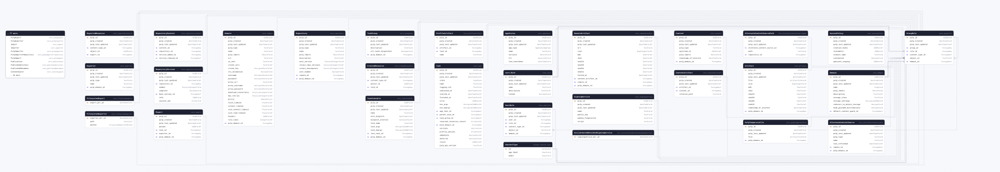

| Column | Field | Type | Null | Key | Default | Description |
| --- | --- | --- | --- | --- | --- | --- |
| `pulp_id` | `UUIDField` | `uuid` |  | PK | `pulp_uuid()` |  |
| `pulp_created` | `DateTimeField` | `timestamp with time zone` |  |  | `now()` |  |
| `pulp_last_updated` | `DateTimeField` | `timestamp with time zone` | yes |  | `now()` |  |
| `group_id` | `ForeignKey` | `integer` |  | FK |  |  |
| `role_id` | `ForeignKey` | `uuid` |  | FK |  |  |
| `content_type_id` | `ForeignKey` | `integer` | yes | FK |  |  |
| `object_id` | `TextField` | `text` | yes |  |  |  |
| `domain_id` | `ForeignKey` | `uuid` | yes | FK |  |  |

Indexes:

- index `core_grouprole_group_id_09264d71` on `group_id`
- index `core_grouprole_role_id_3c2c3564` on `role_id`
- index `core_grouprole_content_type_id_a80c1cfc` on `content_type_id`
- index `core_grouprole_domain_id_9644db4b` on `domain_id`
- unique `core_grouprole_group_id_role_id_content_ee085d6b_uniq` on `group_id`, `role_id`, `content_type_id`, `object_id`, `domain_id`
- index `core_groupr_object__250e22_idx` on `object_id`
- index `core_groupr_content_ea7d37_idx` on `content_type_id`, `object_id`

Relations:

- `content_object` → any model, by `content_type_id` + `object_id` (generic foreign key)
- `object_id` → [AccessPolicy](#accesspolicy).`pulp_id` where `content_type_id` is AccessPolicy (generic, `AccessPolicy.group_roles`)
- `object_id` → [Domain](#domain).`pulp_id` where `content_type_id` is Domain (generic, `Domain.group_roles`)
- `object_id` → [AlternateContentSource](#alternatecontentsource).`pulp_id` where `content_type_id` is AlternateContentSource (generic, `AlternateContentSource.group_roles`)
- `object_id` → [AlternateContentSourcePath](#alternatecontentsourcepath).`pulp_id` where `content_type_id` is AlternateContentSourcePath (generic, `AlternateContentSourcePath.group_roles`)
- `object_id` → [Artifact](#artifact).`pulp_id` where `content_type_id` is Artifact (generic, `Artifact.group_roles`)
- `object_id` → [PulpTemporaryFile](#pulptemporaryfile).`pulp_id` where `content_type_id` is PulpTemporaryFile (generic, `PulpTemporaryFile.group_roles`)
- `object_id` → [Content](#content).`pulp_id` where `content_type_id` is Content (generic, `Content.group_roles`)
- `object_id` → [ContentArtifact](#contentartifact).`pulp_id` where `content_type_id` is ContentArtifact (generic, `ContentArtifact.group_roles`)
- `object_id` → [RemoteArtifact](#remoteartifact).`pulp_id` where `content_type_id` is RemoteArtifact (generic, `RemoteArtifact.group_roles`)
- `object_id` → [SigningService](#signingservice).`pulp_id` where `content_type_id` is SigningService (generic, `SigningService.group_roles`)
- `object_id` → [AsciiArmoredDetachedSigningService](#asciiarmoreddetachedsigningservice).`signingservice_ptr_id` where `content_type_id` is AsciiArmoredDetachedSigningService (generic, `AsciiArmoredDetachedSigningService.group_roles`)
- `object_id` → [AppStatus](#appstatus).`pulp_id` where `content_type_id` is AppStatus (generic, `AppStatus.group_roles`)
- `object_id` → [core.Role](#corerole).`pulp_id` where `content_type_id` is core.Role (generic, `core.Role.group_roles`)
- `object_id` → [UserRole](#userrole).`pulp_id` where `content_type_id` is UserRole (generic, `UserRole.group_roles`)
- `role_id` → [core.Role](#corerole).`pulp_id`, on delete cascade
- `content_type_id` → [ContentType](#contenttype).`id`, on delete cascade
- `domain_id` → [Domain](#domain).`pulp_id`, on delete cascade
- `user_roles` ← [UserRole](#userrole), by `content_type_id` + `object_id` (generic relation)
- `group_roles` ← [GroupRole](#grouprole), by `content_type_id` + `object_id` (generic relation)
- `object_id` → [GroupRole](#grouprole).`pulp_id` where `content_type_id` is GroupRole (generic, `GroupRole.group_roles`)
- `object_id` → [ProfileArtifact](#profileartifact).`pulp_id` where `content_type_id` is ProfileArtifact (generic, `ProfileArtifact.group_roles`)
- `object_id` → [Task](#task).`pulp_id` where `content_type_id` is Task (generic, `Task.group_roles`)
- `object_id` → [TaskGroup](#taskgroup).`pulp_id` where `content_type_id` is TaskGroup (generic, `TaskGroup.group_roles`)
- `object_id` → [CreatedResource](#createdresource).`pulp_id` where `content_type_id` is CreatedResource (generic, `CreatedResource.group_roles`)
- `object_id` → [TaskSchedule](#taskschedule).`pulp_id` where `content_type_id` is TaskSchedule (generic, `TaskSchedule.group_roles`)
- `object_id` → [Repository](#repository).`pulp_id` where `content_type_id` is Repository (generic, `Repository.group_roles`)
- `object_id` → [Remote](#remote).`pulp_id` where `content_type_id` is Remote (generic, `Remote.group_roles`)
- `object_id` → [RepositoryContent](#repositorycontent).`pulp_id` where `content_type_id` is RepositoryContent (generic, `RepositoryContent.group_roles`)
- `object_id` → [RepositoryVersion](#repositoryversion).`pulp_id` where `content_type_id` is RepositoryVersion (generic, `RepositoryVersion.group_roles`)
- `object_id` → [Export](#export).`pulp_id` where `content_type_id` is Export (generic, `Export.group_roles`)
- `object_id` → [ExportedResource](#exportedresource).`pulp_id` where `content_type_id` is ExportedResource (generic, `ExportedResource.group_roles`)
- `object_id` → [Exporter](#exporter).`pulp_id` where `content_type_id` is Exporter (generic, `Exporter.group_roles`)
- `object_id` → [FilesystemExport](#filesystemexport).`export_ptr_id` where `content_type_id` is FilesystemExport (generic, `FilesystemExport.group_roles`)
- `object_id` → [FilesystemExporter](#filesystemexporter).`exporter_ptr_id` where `content_type_id` is FilesystemExporter (generic, `FilesystemExporter.group_roles`)
- `object_id` → [PulpExport](#pulpexport).`export_ptr_id` where `content_type_id` is PulpExport (generic, `PulpExport.group_roles`)
- `object_id` → [PulpExporter](#pulpexporter).`exporter_ptr_id` where `content_type_id` is PulpExporter (generic, `PulpExporter.group_roles`)
- `object_id` → [Import](#import).`pulp_id` where `content_type_id` is Import (generic, `Import.group_roles`)
- `object_id` → [Importer](#importer).`pulp_id` where `content_type_id` is Importer (generic, `Importer.group_roles`)
- `object_id` → [PulpImporter](#pulpimporter).`importer_ptr_id` where `content_type_id` is PulpImporter (generic, `PulpImporter.group_roles`)
- `object_id` → [PulpImporterRepository](#pulpimporterrepository).`pulp_id` where `content_type_id` is PulpImporterRepository (generic, `PulpImporterRepository.group_roles`)
- `object_id` → [PulpImport](#pulpimport).`import_ptr_id` where `content_type_id` is PulpImport (generic, `PulpImport.group_roles`)
- `object_id` → [Publication](#publication).`pulp_id` where `content_type_id` is Publication (generic, `Publication.group_roles`)
- `object_id` → [PublishedArtifact](#publishedartifact).`pulp_id` where `content_type_id` is PublishedArtifact (generic, `PublishedArtifact.group_roles`)
- `object_id` → [PublishedMetadata](#publishedmetadata).`content_ptr_id` where `content_type_id` is PublishedMetadata (generic, `PublishedMetadata.group_roles`)
- `object_id` → [ContentGuard](#contentguard).`pulp_id` where `content_type_id` is ContentGuard (generic, `ContentGuard.group_roles`)
- `object_id` → [RBACContentGuard](#rbaccontentguard).`contentguard_ptr_id` where `content_type_id` is RBACContentGuard (generic, `RBACContentGuard.group_roles`)
- `object_id` → [ContentRedirectContentGuard](#contentredirectcontentguard).`contentguard_ptr_id` where `content_type_id` is ContentRedirectContentGuard (generic, `ContentRedirectContentGuard.group_roles`)
- `object_id` → [HeaderContentGuard](#headercontentguard).`contentguard_ptr_id` where `content_type_id` is HeaderContentGuard (generic, `HeaderContentGuard.group_roles`)
- `object_id` → [EnvVarHeaderContentGuard](#envvarheadercontentguard).`contentguard_ptr_id` where `content_type_id` is EnvVarHeaderContentGuard (generic, `EnvVarHeaderContentGuard.group_roles`)
- `object_id` → [CompositeContentGuard](#compositecontentguard).`contentguard_ptr_id` where `content_type_id` is CompositeContentGuard (generic, `CompositeContentGuard.group_roles`)
- `object_id` → [Distribution](#distribution).`pulp_id` where `content_type_id` is Distribution (generic, `Distribution.group_roles`)
- `object_id` → [ArtifactDistribution](#artifactdistribution).`distribution_ptr_id` where `content_type_id` is ArtifactDistribution (generic, `ArtifactDistribution.group_roles`)
- `object_id` → [DistributedPublication](#distributedpublication).`pulp_id` where `content_type_id` is DistributedPublication (generic, `DistributedPublication.group_roles`)
- `object_id` → [core.Upload](#coreupload).`pulp_id` where `content_type_id` is core.Upload (generic, `core.Upload.group_roles`)
- `object_id` → [UploadChunk](#uploadchunk).`pulp_id` where `content_type_id` is UploadChunk (generic, `UploadChunk.group_roles`)
- `object_id` → [VulnerabilityReport](#vulnerabilityreport).`pulp_id` where `content_type_id` is VulnerabilityReport (generic, `VulnerabilityReport.group_roles`)
- `object_id` → [ProgressReport](#progressreport).`pulp_id` where `content_type_id` is ProgressReport (generic, `ProgressReport.group_roles`)
- `object_id` → [GroupProgressReport](#groupprogressreport).`pulp_id` where `content_type_id` is GroupProgressReport (generic, `GroupProgressReport.group_roles`)
- `object_id` → [UpstreamPulp](#upstreampulp).`pulp_id` where `content_type_id` is UpstreamPulp (generic, `UpstreamPulp.group_roles`)
- `object_id` → [OpenPGPPublicKey](#openpgppublickey).`content_ptr_id` where `content_type_id` is OpenPGPPublicKey (generic, `OpenPGPPublicKey.group_roles`)
- `object_id` → [OpenPGPPublicSubkey](#openpgppublicsubkey).`content_ptr_id` where `content_type_id` is OpenPGPPublicSubkey (generic, `OpenPGPPublicSubkey.group_roles`)
- `object_id` → [OpenPGPUserID](#openpgpuserid).`content_ptr_id` where `content_type_id` is OpenPGPUserID (generic, `OpenPGPUserID.group_roles`)
- `object_id` → [OpenPGPUserAttribute](#openpgpuserattribute).`content_ptr_id` where `content_type_id` is OpenPGPUserAttribute (generic, `OpenPGPUserAttribute.group_roles`)
- `object_id` → [OpenPGPSignature](#openpgpsignature).`content_ptr_id` where `content_type_id` is OpenPGPSignature (generic, `OpenPGPSignature.group_roles`)
- `object_id` → [OpenPGPKeyring](#openpgpkeyring).`repository_ptr_id` where `content_type_id` is OpenPGPKeyring (generic, `OpenPGPKeyring.group_roles`)
- `object_id` → [OpenPGPDistribution](#openpgpdistribution).`distribution_ptr_id` where `content_type_id` is OpenPGPDistribution (generic, `OpenPGPDistribution.group_roles`)
- `object_id` → [Blob](#blob).`content_ptr_id` where `content_type_id` is Blob (generic, `Blob.group_roles`)
- `object_id` → [Manifest](#manifest).`content_ptr_id` where `content_type_id` is Manifest (generic, `Manifest.group_roles`)
- `object_id` → [Tag](#tag).`content_ptr_id` where `content_type_id` is Tag (generic, `Tag.group_roles`)
- `object_id` → [ManifestSignature](#manifestsignature).`content_ptr_id` where `content_type_id` is ManifestSignature (generic, `ManifestSignature.group_roles`)
- `object_id` → [ContainerNamespace](#containernamespace).`pulp_id` where `content_type_id` is ContainerNamespace (generic, `ContainerNamespace.group_roles`)
- `object_id` → [ContainerRemote](#containerremote).`remote_ptr_id` where `content_type_id` is ContainerRemote (generic, `ContainerRemote.group_roles`)
- `object_id` → [ContainerPullThroughRemote](#containerpullthroughremote).`remote_ptr_id` where `content_type_id` is ContainerPullThroughRemote (generic, `ContainerPullThroughRemote.group_roles`)
- `object_id` → [ManifestSigningService](#manifestsigningservice).`signingservice_ptr_id` where `content_type_id` is ManifestSigningService (generic, `ManifestSigningService.group_roles`)
- `object_id` → [ContainerRepository](#containerrepository).`repository_ptr_id` where `content_type_id` is ContainerRepository (generic, `ContainerRepository.group_roles`)
- `object_id` → [ContainerPushRepository](#containerpushrepository).`repository_ptr_id` where `content_type_id` is ContainerPushRepository (generic, `ContainerPushRepository.group_roles`)
- `object_id` → [ContainerPullThroughDistribution](#containerpullthroughdistribution).`distribution_ptr_id` where `content_type_id` is ContainerPullThroughDistribution (generic, `ContainerPullThroughDistribution.group_roles`)
- `object_id` → [ContainerDistribution](#containerdistribution).`distribution_ptr_id` where `content_type_id` is ContainerDistribution (generic, `ContainerDistribution.group_roles`)
- `object_id` → [container.Upload](#containerupload).`upload_ptr_id` where `content_type_id` is container.Upload (generic, `container.Upload.group_roles`)
- `object_id` → [RHSMCertGuard](#rhsmcertguard).`contentguard_ptr_id` where `content_type_id` is RHSMCertGuard (generic, `RHSMCertGuard.group_roles`)
- `object_id` → [X509CertGuard](#x509certguard).`contentguard_ptr_id` where `content_type_id` is X509CertGuard (generic, `X509CertGuard.group_roles`)
- `object_id` → [FileContent](#filecontent).`content_ptr_id` where `content_type_id` is FileContent (generic, `FileContent.group_roles`)
- `object_id` → [FileRemote](#fileremote).`remote_ptr_id` where `content_type_id` is FileRemote (generic, `FileRemote.group_roles`)
- `object_id` → [FileGitRemote](#filegitremote).`remote_ptr_id` where `content_type_id` is FileGitRemote (generic, `FileGitRemote.group_roles`)
- `object_id` → [FileRepository](#filerepository).`repository_ptr_id` where `content_type_id` is FileRepository (generic, `FileRepository.group_roles`)
- `object_id` → [FilePublication](#filepublication).`publication_ptr_id` where `content_type_id` is FilePublication (generic, `FilePublication.group_roles`)
- `object_id` → [FileDistribution](#filedistribution).`distribution_ptr_id` where `content_type_id` is FileDistribution (generic, `FileDistribution.group_roles`)
- `object_id` → [FileAlternateContentSource](#filealternatecontentsource).`alternatecontentsource_ptr_id` where `content_type_id` is FileAlternateContentSource (generic, `FileAlternateContentSource.group_roles`)
- `object_id` → [ansible.Role](#ansiblerole).`content_ptr_id` where `content_type_id` is ansible.Role (generic, `ansible.Role.group_roles`)
- `object_id` → [Collection](#collection).`pulp_id` where `content_type_id` is Collection (generic, `Collection.group_roles`)
- `object_id` → [AnsibleNamespace](#ansiblenamespace).`pulp_id` where `content_type_id` is AnsibleNamespace (generic, `AnsibleNamespace.group_roles`)
- `object_id` → [CollectionVersion](#collectionversion).`content_ptr_id` where `content_type_id` is CollectionVersion (generic, `CollectionVersion.group_roles`)
- `object_id` → [CollectionVersionMark](#collectionversionmark).`content_ptr_id` where `content_type_id` is CollectionVersionMark (generic, `CollectionVersionMark.group_roles`)
- `object_id` → [CollectionVersionSignature](#collectionversionsignature).`content_ptr_id` where `content_type_id` is CollectionVersionSignature (generic, `CollectionVersionSignature.group_roles`)
- `object_id` → [AnsibleNamespaceMetadata](#ansiblenamespacemetadata).`content_ptr_id` where `content_type_id` is AnsibleNamespaceMetadata (generic, `AnsibleNamespaceMetadata.group_roles`)
- `object_id` → [DownloadLog](#downloadlog).`pulp_id` where `content_type_id` is DownloadLog (generic, `DownloadLog.group_roles`)
- `object_id` → [CollectionDownloadCount](#collectiondownloadcount).`pulp_id` where `content_type_id` is CollectionDownloadCount (generic, `CollectionDownloadCount.group_roles`)
- `object_id` → [RoleRemote](#roleremote).`remote_ptr_id` where `content_type_id` is RoleRemote (generic, `RoleRemote.group_roles`)
- `object_id` → [CollectionRemote](#collectionremote).`remote_ptr_id` where `content_type_id` is CollectionRemote (generic, `CollectionRemote.group_roles`)
- `object_id` → [GitRemote](#gitremote).`remote_ptr_id` where `content_type_id` is GitRemote (generic, `GitRemote.group_roles`)
- `object_id` → [AnsibleCollectionDeprecated](#ansiblecollectiondeprecated).`content_ptr_id` where `content_type_id` is AnsibleCollectionDeprecated (generic, `AnsibleCollectionDeprecated.group_roles`)
- `object_id` → [AnsibleRepository](#ansiblerepository).`repository_ptr_id` where `content_type_id` is AnsibleRepository (generic, `AnsibleRepository.group_roles`)
- `object_id` → [AnsibleDistribution](#ansibledistribution).`distribution_ptr_id` where `content_type_id` is AnsibleDistribution (generic, `AnsibleDistribution.group_roles`)
- `object_id` → [PythonDistribution](#pythondistribution).`distribution_ptr_id` where `content_type_id` is PythonDistribution (generic, `PythonDistribution.group_roles`)
- `object_id` → [PythonPackageContent](#pythonpackagecontent).`content_ptr_id` where `content_type_id` is PythonPackageContent (generic, `PythonPackageContent.group_roles`)
- `object_id` → [PackageProvenance](#packageprovenance).`content_ptr_id` where `content_type_id` is PackageProvenance (generic, `PackageProvenance.group_roles`)
- `object_id` → [PackageYank](#packageyank).`content_ptr_id` where `content_type_id` is PackageYank (generic, `PackageYank.group_roles`)
- `object_id` → [PythonPublication](#pythonpublication).`publication_ptr_id` where `content_type_id` is PythonPublication (generic, `PythonPublication.group_roles`)
- `object_id` → [PythonRemote](#pythonremote).`remote_ptr_id` where `content_type_id` is PythonRemote (generic, `PythonRemote.group_roles`)
- `object_id` → [PythonRepository](#pythonrepository).`repository_ptr_id` where `content_type_id` is PythonRepository (generic, `PythonRepository.group_roles`)
- `object_id` → [PythonBlocklistEntry](#pythonblocklistentry).`pulp_id` where `content_type_id` is PythonBlocklistEntry (generic, `PythonBlocklistEntry.group_roles`)

## ProfileArtifact

Table `core_profileartifact`, app `core`.

Columns from `BaseModel` (abstract): `pulp_id`, `pulp_created`, `pulp_last_updated`.

A model encapsulating profiled artifact data

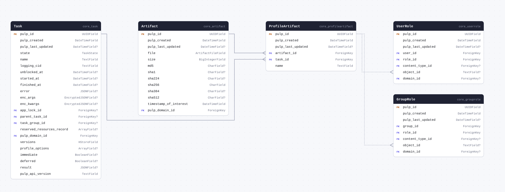

| Column | Field | Type | Null | Key | Default | Description |
| --- | --- | --- | --- | --- | --- | --- |
| `pulp_id` | `UUIDField` | `uuid` |  | PK | `pulp_uuid()` |  |
| `pulp_created` | `DateTimeField` | `timestamp with time zone` |  |  | `now()` |  |
| `pulp_last_updated` | `DateTimeField` | `timestamp with time zone` | yes |  | `now()` |  |
| `artifact_id` | `ForeignKey` | `uuid` |  | FK |  |  |
| `task_id` | `ForeignKey` | `uuid` |  | FK |  |  |
| `name` | `TextField` | `text` |  |  |  |  |

Indexes:

- index `core_profileartifact_artifact_id_4a83ce37` on `artifact_id`
- index `core_profileartifact_task_id_30e8dee4` on `task_id`
- unique `core_profileartifact_task_id_name_8c6984da_uniq` on `task_id`, `name`

Relations:

- `artifact_id` → [Artifact](#artifact).`pulp_id`, on delete cascade
- `task_id` → [Task](#task).`pulp_id`, on delete cascade
- `user_roles` ← [UserRole](#userrole), by `content_type_id` + `object_id` (generic relation)
- `group_roles` ← [GroupRole](#grouprole), by `content_type_id` + `object_id` (generic relation)

## Task

Table `core_task`, app `core`.

Columns from `BaseModel` (abstract): `pulp_id`, `pulp_created`, `pulp_last_updated`.

Represents a task

The Tasks state machine works like a finite automaton without loops:
The initial state is WAITING.
Final states are COMPLETED, FAILED and CANCELED.
The possible transitions are:
    WAITING -> RUNNING
    WAITING ->* CANCELING
    RUNNING -> COMPLETED
    RUNNING -> FAILED
    RUNNING ->* CANCELING
    CANCELING -> CANCELED

The transitions to CANCELING (marked with *) are the only ones allowed to happen without
holding the tasks advisory lock. Canceling is meant to be initiated asyncronously by a sparate
process before signalling the worker via Postgres LISTEN.

Fields:

    state (models.TextField): The state of the task
    name (models.TextField): The name of the task
    logging_cid (models.TextField): The logging CID associated with the task
    unblocked_at (models.DateTimeField): The time the task was marked as unblocked.
        This is supervised/updated by all awake workers and is part of the definition
        of a ready-to-be-taken task.
    started_at (models.DateTimeField): The time the task started executing
    finished_at (models.DateTimeField): The time the task finished executing
    error (models.JSONField): Fatal errors generated by the task
    args (models.JSONField): The JSON serialized arguments for the task
    kwargs (models.JSONField): The JSON serialized keyword arguments for
        the task
    reserved_resources_record (django.contrib.postgres.fields.ArrayField): The reserved
        resources required for the task.
    immediate (models.BooleanField): Whether this is guaranteed to execute fast
        without blocking. Defaults to `False`.
    deferred (models.BooleanField): Whether to allow defer running the task to a
        pulpcore_worker. Both `immediate` and `deferred` cannot both be `False`.
        Defaults to `True`.
    result (models.JSONField): The result of the task

Relations:
    app_lock (AppStatus): The app holding the lock on this task.
        Warning: This is not yet implemented/enforced.
    parent (models.ForeignKey): Task that spawned this task (if any)
    worker (models.ForeignKey): The worker that this task is in
    pulp_domain (models.ForeignKey): The domain the Task is a part of

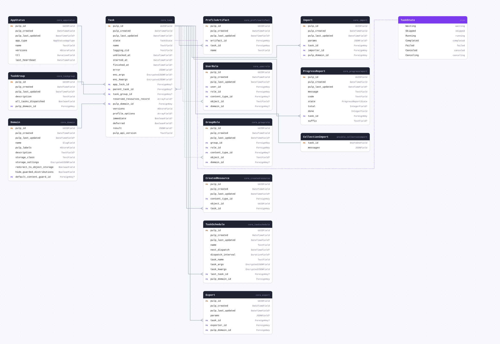

| Column | Field | Type | Null | Key | Default | Description |
| --- | --- | --- | --- | --- | --- | --- |
| `pulp_id` | `UUIDField` | `uuid` |  | PK | `pulp_uuid()` |  |
| `pulp_created` | `DateTimeField` | `timestamp with time zone` |  |  | `now()` |  |
| `pulp_last_updated` | `DateTimeField` | `timestamp with time zone` | yes |  | `now()` |  |
| `state` | `TaskState` | `text` |  |  |  |  |
| `name` | `TextField` | `text` |  |  |  |  |
| `logging_cid` | `TextField` | `text` |  |  |  |  |
| `unblocked_at` | `DateTimeField` | `timestamp with time zone` | yes |  |  |  |
| `started_at` | `DateTimeField` | `timestamp with time zone` | yes |  |  |  |
| `finished_at` | `DateTimeField` | `timestamp with time zone` | yes |  |  |  |
| `error` | `JSONField` | `jsonb` | yes |  |  |  |
| `enc_args` | `EncryptedJSONField` | `jsonb` | yes |  |  |  |
| `enc_kwargs` | `EncryptedJSONField` | `jsonb` | yes |  |  |  |
| `app_lock_id` | `ForeignKey` | `uuid` | yes | FK |  |  |
| `parent_task_id` | `ForeignKey` | `uuid` | yes | FK |  |  |
| `task_group_id` | `ForeignKey` | `uuid` | yes | FK |  |  |
| `reserved_resources_record` | `ArrayField` | `text[]` | yes |  |  |  |
| `pulp_domain_id` | `ForeignKey` | `uuid` |  | FK | `get_domain_pk()` |  |
| `versions` | `HStoreField` | `hstore` |  |  | `dict()` |  |
| `profile_options` | `ArrayField` | `text[]` | yes |  |  |  |
| `immediate` | `BooleanField` | `boolean` | yes |  | `False` |  |
| `deferred` | `BooleanField` | `boolean` | yes |  | `True` |  |
| `result` | `JSONField` | `jsonb` | yes |  | `None` |  |
| `pulp_api_version` | `TextField` | `text` |  |  | `'v3'` |  |

Indexes:

- index `core_task_logging_cid_0bc78a42` on `logging_cid`
- index `core_task_logging_cid_0bc78a42_like` on `logging_cid` (`text_pattern_ops`)
- index `core_task_app_lock_id_9710ceee` on `app_lock_id`
- index `core_task_parent_task_id_07cf4230` on `parent_task_id`
- index `core_task_task_group_id_a45c142c` on `task_group_id`
- index `core_task_pulp_domain_id_ad2d9a92` on `pulp_domain_id`
- index `core_task_pulp_cr_10223f_idx` on `pulp_created`
- index `core_task_unblock_2276a4_idx` on `unblocked_at`
- index `core_task_state_61f0ca_idx` on `state`
- index `core_task_state_3742f2_idx` on `state`, `pulp_created`
- gin index `pulp_task_resources_index` on `reserved_resources_record` (`array_ops`) where `NOT ("state" IN ('completed', 'failed', 'canceled', 'skipped'))`

Relations:

- `profile_artifacts` — many to many with [Artifact](#artifact), through [ProfileArtifact](#profileartifact)
- [ProfileArtifact](#profileartifact).`task_id` → `pulp_id`, on delete cascade
- `app_lock_id` → [AppStatus](#appstatus).`pulp_id`, on delete set null
- `parent_task_id` → [Task](#task).`pulp_id`, on delete set null
- `task_group_id` → [TaskGroup](#taskgroup).`pulp_id`, on delete set null
- `pulp_domain_id` → [Domain](#domain).`pulp_id`, on delete cascade
- `user_roles` ← [UserRole](#userrole), by `content_type_id` + `object_id` (generic relation)
- `group_roles` ← [GroupRole](#grouprole), by `content_type_id` + `object_id` (generic relation)
- [CreatedResource](#createdresource).`task_id` → `pulp_id`, on delete cascade
- [TaskSchedule](#taskschedule).`last_task_id` → `pulp_id`, on delete set null
- [Export](#export).`task_id` → `pulp_id`, on delete set null
- [Import](#import).`task_id` → `pulp_id`, on delete protect
- [ProgressReport](#progressreport).`task_id` → `pulp_id`, on delete cascade
- [CollectionImport](#collectionimport).`task_id` → `pulp_id`, on delete cascade

## TaskGroup

Table `core_taskgroup`, app `core`.

Columns from `BaseModel` (abstract): `pulp_id`, `pulp_created`, `pulp_last_updated`.

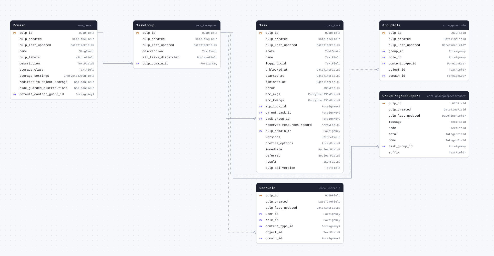

| Column | Field | Type | Null | Key | Default | Description |
| --- | --- | --- | --- | --- | --- | --- |
| `pulp_id` | `UUIDField` | `uuid` |  | PK | `pulp_uuid()` |  |
| `pulp_created` | `DateTimeField` | `timestamp with time zone` |  |  | `now()` |  |
| `pulp_last_updated` | `DateTimeField` | `timestamp with time zone` | yes |  | `now()` |  |
| `description` | `TextField` | `text` |  |  |  |  |
| `all_tasks_dispatched` | `BooleanField` | `boolean` |  |  | `False` |  |
| `pulp_domain_id` | `ForeignKey` | `uuid` |  | FK | `get_domain_pk()` |  |

Indexes:

- index `core_taskgroup_pulp_domain_id_192a4c75` on `pulp_domain_id`

Relations:

- [Task](#task).`task_group_id` → `pulp_id`, on delete set null
- `pulp_domain_id` → [Domain](#domain).`pulp_id`, on delete cascade
- `user_roles` ← [UserRole](#userrole), by `content_type_id` + `object_id` (generic relation)
- `group_roles` ← [GroupRole](#grouprole), by `content_type_id` + `object_id` (generic relation)
- [GroupProgressReport](#groupprogressreport).`task_group_id` → `pulp_id`, on delete cascade

## CreatedResource

Table `core_createdresource`, app `core`.

Columns from `GenericRelationModel` (abstract): `content_type_id`, `object_id`.

Columns from `BaseModel` (abstract): `pulp_id`, `pulp_created`, `pulp_last_updated`.

Resources created by the task.

Relations:
    task (models.ForeignKey): The task that created the resource.

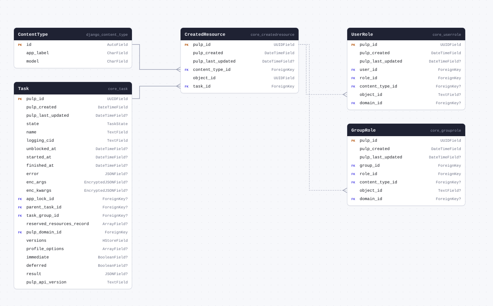

| Column | Field | Type | Null | Key | Default | Description |
| --- | --- | --- | --- | --- | --- | --- |
| `pulp_id` | `UUIDField` | `uuid` |  | PK | `pulp_uuid()` |  |
| `pulp_created` | `DateTimeField` | `timestamp with time zone` |  |  | `now()` |  |
| `pulp_last_updated` | `DateTimeField` | `timestamp with time zone` | yes |  | `now()` |  |
| `content_type_id` | `ForeignKey` | `integer` |  | FK |  |  |
| `object_id` | `UUIDField` | `uuid` |  |  |  |  |
| `task_id` | `ForeignKey` | `uuid` |  | FK | `Task.current()` |  |

Indexes:

- index `core_createdresource_content_type_id_2327bc2e` on `content_type_id`
- index `core_createdresource_task_id_acf70fb7` on `task_id`

Relations:

- `content_object` → any model, by `content_type_id` + `object_id` (generic foreign key)
- `content_type_id` → [ContentType](#contenttype).`id`, on delete cascade
- `task_id` → [Task](#task).`pulp_id`, on delete cascade
- `user_roles` ← [UserRole](#userrole), by `content_type_id` + `object_id` (generic relation)
- `group_roles` ← [GroupRole](#grouprole), by `content_type_id` + `object_id` (generic relation)

## TaskSchedule

Table `core_taskschedule`, app `core`.

Columns from `BaseModel` (abstract): `pulp_id`, `pulp_created`, `pulp_last_updated`.

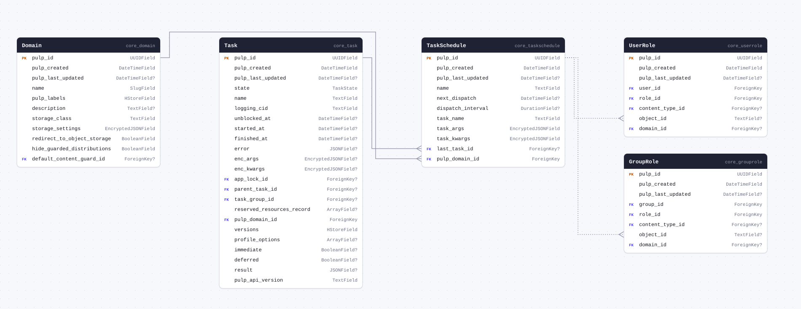

| Column | Field | Type | Null | Key | Default | Description |
| --- | --- | --- | --- | --- | --- | --- |
| `pulp_id` | `UUIDField` | `uuid` |  | PK | `pulp_uuid()` |  |
| `pulp_created` | `DateTimeField` | `timestamp with time zone` |  |  | `now()` |  |
| `pulp_last_updated` | `DateTimeField` | `timestamp with time zone` | yes |  | `now()` |  |
| `name` | `TextField` | `text` |  |  |  |  |
| `next_dispatch` | `DateTimeField` | `timestamp with time zone` | yes |  | `now()` |  |
| `dispatch_interval` | `DurationField` | `interval` | yes |  |  |  |
| `task_name` | `TextField` | `text` |  |  |  |  |
| `task_args` | `EncryptedJSONField` | `jsonb` |  |  | `list()` |  |
| `task_kwargs` | `EncryptedJSONField` | `jsonb` |  |  | `dict()` |  |
| `last_task_id` | `ForeignKey` | `uuid` | yes | FK |  |  |
| `pulp_domain_id` | `ForeignKey` | `uuid` |  | FK | `get_domain_pk()` |  |

Indexes:

- index `core_taskschedule_last_task_id_5c1ee058` on `last_task_id`
- index `core_taskschedule_pulp_domain_id_ecf2e6ac` on `pulp_domain_id`
- unique `core_taskschedule_name_pulp_domain_id_c7e72d87_uniq` on `name`, `pulp_domain_id`

Relations:

- `last_task_id` → [Task](#task).`pulp_id`, on delete set null
- `pulp_domain_id` → [Domain](#domain).`pulp_id`, on delete cascade
- `user_roles` ← [UserRole](#userrole), by `content_type_id` + `object_id` (generic relation)
- `group_roles` ← [GroupRole](#grouprole), by `content_type_id` + `object_id` (generic relation)

## Repository

Table `core_repository`, app `core`.

Subclasses (multi-table): [OpenPGPKeyring](#openpgpkeyring), [ContainerRepository](#containerrepository), [ContainerPushRepository](#containerpushrepository), [FileRepository](#filerepository), [AnsibleRepository](#ansiblerepository), [PythonRepository](#pythonrepository).

Columns from `MasterModel` (abstract): `pulp_type`.

Columns from `BaseModel` (abstract): `pulp_id`, `pulp_created`, `pulp_last_updated`.

Collection of content.

Fields:

    name (models.TextField): The repository name.
    pulp_labels (HStoreField): Dictionary of string values.
    description (models.TextField): An optional description.
    next_version (models.PositiveIntegerField): A record of the next version number to be
        created.
    retain_repo_versions (models.PositiveIntegerField): Number of repo versions to keep
    retain_checkpoints (models.PositiveIntegerField): Number of checkpoint publications to
        keep as checkpoints.
    user_hidden (models.BooleanField): Whether to expose this repo to users via the API

Relations:

    content (models.ManyToManyField): Associated content.
    remote (models.ForeignKeyField): Associated remote
    pulp_domain (models.ForeignKeyField): The domain the Repository is a part of.

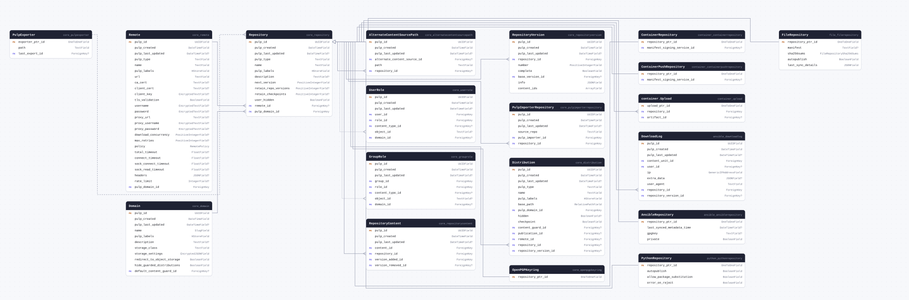

| Column | Field | Type | Null | Key | Default | Description |
| --- | --- | --- | --- | --- | --- | --- |
| `pulp_id` | `UUIDField` | `uuid` |  | PK | `pulp_uuid()` |  |
| `pulp_created` | `DateTimeField` | `timestamp with time zone` |  |  | `now()` |  |
| `pulp_last_updated` | `DateTimeField` | `timestamp with time zone` | yes |  | `now()` |  |
| `pulp_type` | `TextField` | `text` |  |  | `None` |  |
| `name` | `TextField` | `text` |  |  |  |  |
| `pulp_labels` | `HStoreField` | `hstore` |  |  | `dict()` |  |
| `description` | `TextField` | `text` | yes |  |  |  |
| `next_version` | `PositiveIntegerField` | `integer` |  |  | `0` |  |
| `retain_repo_versions` | `PositiveIntegerField` | `integer` | yes |  | `None` |  |
| `retain_checkpoints` | `PositiveIntegerField` | `integer` | yes |  | `None` |  |
| `user_hidden` | `BooleanField` | `boolean` |  |  | `False` |  |
| `remote_id` | `ForeignKey` | `uuid` | yes | FK |  |  |
| `pulp_domain_id` | `ForeignKey` | `uuid` |  | FK | `get_domain_pk()` |  |

Indexes:

- index `core_repository_pulp_type_9a295072` on `pulp_type`
- index `core_repository_pulp_type_9a295072_like` on `pulp_type` (`text_pattern_ops`)
- index `core_repository_name_d6094875` on `name`
- index `core_repository_name_d6094875_like` on `name` (`text_pattern_ops`)
- index `core_repository_remote_id_25c54490` on `remote_id`
- index `core_repository_pulp_domain_id_bba0afab` on `pulp_domain_id`
- unique `core_repository_name_pulp_domain_id_fc7b9811_uniq` on `name`, `pulp_domain_id`

Relations:

- `content` — many to many with [Content](#content), through [RepositoryContent](#repositorycontent)
- [AlternateContentSourcePath](#alternatecontentsourcepath).`repository_id` → `pulp_id`, on delete cascade
- `remote_id` → [Remote](#remote).`pulp_id`, on delete set null
- `pulp_domain_id` → [Domain](#domain).`pulp_id`, on delete protect
- `user_roles` ← [UserRole](#userrole), by `content_type_id` + `object_id` (generic relation)
- `group_roles` ← [GroupRole](#grouprole), by `content_type_id` + `object_id` (generic relation)
- [RepositoryContent](#repositorycontent).`repository_id` → `pulp_id`, on delete cascade
- [RepositoryVersion](#repositoryversion).`repository_id` → `pulp_id`, on delete cascade
- `core_pulp_exporter` — many to many with [PulpExporter](#pulpexporter)
- [PulpImporterRepository](#pulpimporterrepository).`repository_id` → `pulp_id`, on delete cascade
- [Distribution](#distribution).`repository_id` → `pulp_id`, on delete set null
- [OpenPGPKeyring](#openpgpkeyring).`repository_ptr_id` → `pulp_id`, parent link, on delete cascade
- [ContainerRepository](#containerrepository).`repository_ptr_id` → `pulp_id`, parent link, on delete cascade
- [ContainerPushRepository](#containerpushrepository).`repository_ptr_id` → `pulp_id`, parent link, on delete cascade
- [container.Upload](#containerupload).`repository_id` → `pulp_id`, on delete cascade
- [FileRepository](#filerepository).`repository_ptr_id` → `pulp_id`, parent link, on delete cascade
- [DownloadLog](#downloadlog).`repository_id` → `pulp_id`, on delete cascade
- [AnsibleRepository](#ansiblerepository).`repository_ptr_id` → `pulp_id`, parent link, on delete cascade
- [PythonRepository](#pythonrepository).`repository_ptr_id` → `pulp_id`, parent link, on delete cascade

## Remote

Table `core_remote`, app `core`.

Subclasses (multi-table): [ContainerRemote](#containerremote), [ContainerPullThroughRemote](#containerpullthroughremote), [FileRemote](#fileremote), [FileGitRemote](#filegitremote), [RoleRemote](#roleremote), [CollectionRemote](#collectionremote), [GitRemote](#gitremote), [PythonRemote](#pythonremote).

Columns from `MasterModel` (abstract): `pulp_type`.

Columns from `BaseModel` (abstract): `pulp_id`, `pulp_created`, `pulp_last_updated`.

A remote source for content.

This is meant to be subclassed by plugin authors as an opportunity to provide plugin-specific
persistent data attributes for a plugin remote subclass.

This object is a Django model that inherits from [pulpcore.app.models.Remote][] which
provides the platform persistent attributes for a remote object. Plugin authors can add
additional persistent remote data by subclassing this object and adding Django fields. We
defer to the Django docs on extending this model definition with additional fields.

Validation of the remote is done at the API level by a plugin defined subclass of
[pulpcore.plugin.serializers.repository.RemoteSerializer][].

Fields:

    name (models.TextField): The remote name.
    pulp_labels (HStoreField): Dictionary of string values.
    url (models.TextField): The URL of an external content source.
    ca_cert (models.TextField): A PEM encoded CA certificate used to validate the
        server certificate presented by the external source.
    client_cert (models.TextField): A PEM encoded client certificate used
        for authentication.
    client_key (models.TextField): A PEM encoded private key used for authentication.
    tls_validation (models.BooleanField): If True, TLS peer validation must be performed.
    proxy_url (models.TextField): The optional proxy URL.
        Format: scheme://host:port
    proxy_username (models.TextField): The optional username to authenticate with the proxy.
    proxy_password (models.TextField): The optional password to authenticate with the proxy.
    username (models.TextField): The username to be used for authentication when syncing.
    password (models.TextField): The password to be used for authentication when syncing.
    download_concurrency (models.PositiveIntegerField): Total number of
        simultaneous connections allowed to any remote during a sync.
    policy (models.TextField): The policy to use when downloading content.
    total_timeout (models.FloatField): Value for aiohttp.ClientTimeout.total on connections
    connect_timeout (models.FloatField): Value for aiohttp.ClientTimeout.connect
    sock_connect_timeout (models.FloatField): Value for aiohttp.ClientTimeout.sock_connect
    sock_read_timeout (models.FloatField): Value for aiohttp.ClientTimeout.sock_read
    headers (models.JSONField): Headers set on the aiohttp.ClientSession
    rate_limit (models.IntegerField): Limits requests per second for each concurrent downloader

Relations:

    pulp_domain (models.ForeignKey): The domain the Remote is a part of.

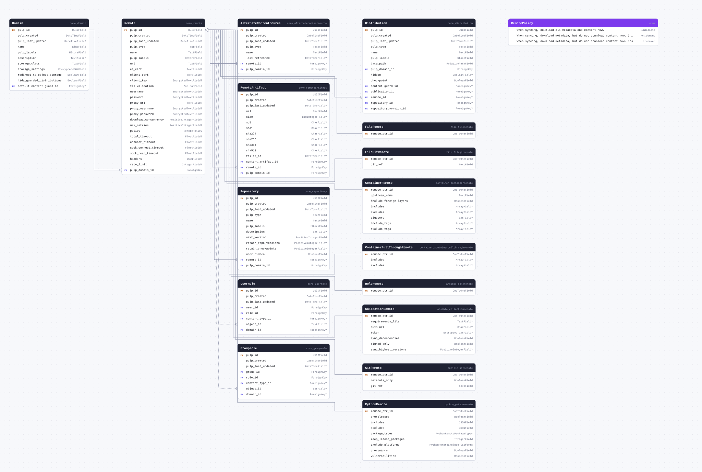

| Column | Field | Type | Null | Key | Default | Description |
| --- | --- | --- | --- | --- | --- | --- |
| `pulp_id` | `UUIDField` | `uuid` |  | PK | `pulp_uuid()` |  |
| `pulp_created` | `DateTimeField` | `timestamp with time zone` |  |  | `now()` |  |
| `pulp_last_updated` | `DateTimeField` | `timestamp with time zone` | yes |  | `now()` |  |
| `pulp_type` | `TextField` | `text` |  |  | `None` |  |
| `name` | `TextField` | `text` |  |  |  |  |
| `pulp_labels` | `HStoreField` | `hstore` |  |  | `dict()` |  |
| `url` | `TextField` | `text` |  |  |  |  |
| `ca_cert` | `TextField` | `text` | yes |  |  |  |
| `client_cert` | `TextField` | `text` | yes |  |  |  |
| `client_key` | `EncryptedTextField` | `text` | yes |  |  |  |
| `tls_validation` | `BooleanField` | `boolean` |  |  | `True` |  |
| `username` | `EncryptedTextField` | `text` | yes |  |  |  |
| `password` | `EncryptedTextField` | `text` | yes |  |  |  |
| `proxy_url` | `TextField` | `text` | yes |  |  |  |
| `proxy_username` | `EncryptedTextField` | `text` | yes |  |  |  |
| `proxy_password` | `EncryptedTextField` | `text` | yes |  |  |  |
| `download_concurrency` | `PositiveIntegerField` | `integer` | yes |  |  |  |
| `max_retries` | `PositiveIntegerField` | `integer` | yes |  |  |  |
| `policy` | `RemotePolicy` | `text` |  |  | `'immediate'` |  |
| `total_timeout` | `FloatField` | `double precision` | yes |  |  |  |
| `connect_timeout` | `FloatField` | `double precision` | yes |  |  |  |
| `sock_connect_timeout` | `FloatField` | `double precision` | yes |  |  |  |
| `sock_read_timeout` | `FloatField` | `double precision` | yes |  |  |  |
| `headers` | `JSONField` | `jsonb` | yes |  |  |  |
| `rate_limit` | `IntegerField` | `integer` | yes |  |  |  |
| `pulp_domain_id` | `ForeignKey` | `uuid` |  | FK | `get_domain_pk()` |  |

Indexes:

- index `core_remote_pulp_type_ac66aef6` on `pulp_type`
- index `core_remote_pulp_type_ac66aef6_like` on `pulp_type` (`text_pattern_ops`)
- index `core_remote_name_9fec21a5` on `name`
- index `core_remote_name_9fec21a5_like` on `name` (`text_pattern_ops`)
- index `core_remote_pulp_domain_id_f8d7f815` on `pulp_domain_id`
- unique `core_remote_name_pulp_domain_id_310f6912_uniq` on `name`, `pulp_domain_id`

Relations:

- [AlternateContentSource](#alternatecontentsource).`remote_id` → `pulp_id`, on delete protect
- [RemoteArtifact](#remoteartifact).`remote_id` → `pulp_id`, on delete cascade
- [Repository](#repository).`remote_id` → `pulp_id`, on delete set null
- `pulp_domain_id` → [Domain](#domain).`pulp_id`, on delete protect
- `user_roles` ← [UserRole](#userrole), by `content_type_id` + `object_id` (generic relation)
- `group_roles` ← [GroupRole](#grouprole), by `content_type_id` + `object_id` (generic relation)
- [Distribution](#distribution).`remote_id` → `pulp_id`, on delete set null
- [ContainerRemote](#containerremote).`remote_ptr_id` → `pulp_id`, parent link, on delete cascade
- [ContainerPullThroughRemote](#containerpullthroughremote).`remote_ptr_id` → `pulp_id`, parent link, on delete cascade
- [FileRemote](#fileremote).`remote_ptr_id` → `pulp_id`, parent link, on delete cascade
- [FileGitRemote](#filegitremote).`remote_ptr_id` → `pulp_id`, parent link, on delete cascade
- [RoleRemote](#roleremote).`remote_ptr_id` → `pulp_id`, parent link, on delete cascade
- [CollectionRemote](#collectionremote).`remote_ptr_id` → `pulp_id`, parent link, on delete cascade
- [GitRemote](#gitremote).`remote_ptr_id` → `pulp_id`, parent link, on delete cascade
- [PythonRemote](#pythonremote).`remote_ptr_id` → `pulp_id`, parent link, on delete cascade

## RepositoryContent

Table `core_repositorycontent`, app `core`.

Columns from `BaseModel` (abstract): `pulp_id`, `pulp_created`, `pulp_last_updated`.

Association between a repository and its contained content.

Fields:

    created (models.DatetimeField): When the association was created.

Relations:

    content (models.ForeignKey): The associated content.
    repository (models.ForeignKey): The associated repository.
    version_added (models.ForeignKey): The RepositoryVersion which added the referenced
        Content.
    version_removed (models.ForeignKey): The RepositoryVersion which removed the referenced
        Content.

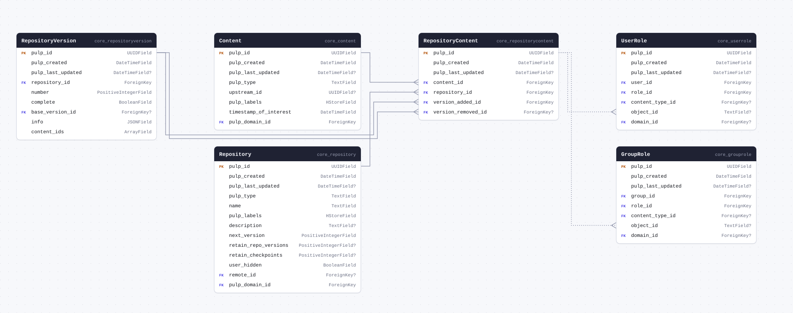

| Column | Field | Type | Null | Key | Default | Description |
| --- | --- | --- | --- | --- | --- | --- |
| `pulp_id` | `UUIDField` | `uuid` |  | PK | `pulp_uuid()` |  |
| `pulp_created` | `DateTimeField` | `timestamp with time zone` |  |  | `now()` |  |
| `pulp_last_updated` | `DateTimeField` | `timestamp with time zone` | yes |  | `now()` |  |
| `content_id` | `ForeignKey` | `uuid` |  | FK |  |  |
| `repository_id` | `ForeignKey` | `uuid` |  | FK |  |  |
| `version_added_id` | `ForeignKey` | `uuid` |  | FK |  |  |
| `version_removed_id` | `ForeignKey` | `uuid` | yes | FK |  |  |

Indexes:

- index `core_repositorycontent_content_id_4e1dc819` on `content_id`
- index `core_repositorycontent_repository_id_1946e61b` on `repository_id`
- index `core_repositorycontent_version_added_id_d5113f18` on `version_added_id`
- index `core_repositorycontent_version_removed_id_4d75bc32` on `version_removed_id`
- unique `core_repositorycontent_repository_id_content_id_fb06c181_uniq` on `repository_id`, `content_id`, `version_added_id`
- unique `core_repositorycontent_repository_id_content_id_df902e11_uniq` on `repository_id`, `content_id`, `version_removed_id`

Relations:

- `content_id` → [Content](#content).`pulp_id`, on delete protect
- `repository_id` → [Repository](#repository).`pulp_id`, on delete cascade
- `version_added_id` → [RepositoryVersion](#repositoryversion).`pulp_id`, on delete restrict
- `version_removed_id` → [RepositoryVersion](#repositoryversion).`pulp_id`, on delete restrict
- `user_roles` ← [UserRole](#userrole), by `content_type_id` + `object_id` (generic relation)
- `group_roles` ← [GroupRole](#grouprole), by `content_type_id` + `object_id` (generic relation)

## RepositoryVersion

Table `core_repositoryversion`, app `core`.

Columns from `BaseModel` (abstract): `pulp_id`, `pulp_created`, `pulp_last_updated`.

A version of a repository's content set.

Plugin Writers are strongly encouraged to use RepositoryVersion as a context manager to provide
transactional safety, working directory set up, plugin finalization, and cleaning up the
database on failures.

Examples::

    with repository.new_version(repository) as new_version:
        new_version.add_content(content_q)
        new_version.remove_content(content_q)

Fields:

    number (models.PositiveIntegerField): A positive integer that uniquely identifies a version
        of a specific repository. Each new version for a repo should have this field set to
        1 + the most recent version.
    complete (models.BooleanField): If true, the RepositoryVersion is visible. This field is set
        to true when the task that creates the RepositoryVersion is complete.

Relations:

    repository (models.ForeignKey): The associated repository.
    base_version (models.ForeignKey): The repository version this was created from.

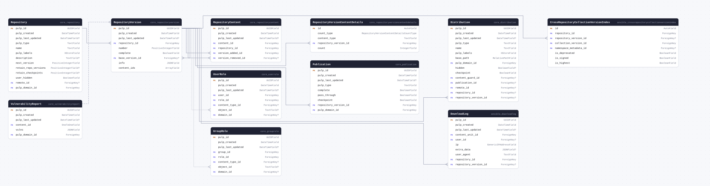

| Column | Field | Type | Null | Key | Default | Description |
| --- | --- | --- | --- | --- | --- | --- |
| `pulp_id` | `UUIDField` | `uuid` |  | PK | `pulp_uuid()` |  |
| `pulp_created` | `DateTimeField` | `timestamp with time zone` |  |  | `now()` |  |
| `pulp_last_updated` | `DateTimeField` | `timestamp with time zone` | yes |  | `now()` |  |
| `repository_id` | `ForeignKey` | `uuid` |  | FK |  |  |
| `number` | `PositiveIntegerField` | `integer` |  |  |  |  |
| `complete` | `BooleanField` | `boolean` |  |  | `False` |  |
| `base_version_id` | `ForeignKey` | `uuid` | yes | FK |  |  |
| `info` | `JSONField` | `jsonb` |  |  | `dict()` |  |
| `content_ids` | `ArrayField` | `uuid[]` |  |  | `list()` |  |

Indexes:

- index `core_repositoryversion_repository_id_3d4d8cee` on `repository_id`
- index `core_repositoryversion_number_aad205c5` on `number`
- index `core_repositoryversion_complete_bafcfca7` on `complete`
- index `core_repositoryversion_base_version_id_5230045f` on `base_version_id`
- unique `core_repositoryversion_repository_id_number_3c54ce50_uniq` on `repository_id`, `number`

Relations:

- [RepositoryContent](#repositorycontent).`version_added_id` → `pulp_id`, on delete restrict
- [RepositoryContent](#repositorycontent).`version_removed_id` → `pulp_id`, on delete restrict
- `repository_id` → [Repository](#repository).`pulp_id`, on delete cascade
- `base_version_id` → [RepositoryVersion](#repositoryversion).`pulp_id`, on delete set null
- `user_roles` ← [UserRole](#userrole), by `content_type_id` + `object_id` (generic relation)
- `group_roles` ← [GroupRole](#grouprole), by `content_type_id` + `object_id` (generic relation)
- [RepositoryVersionContentDetails](#repositoryversioncontentdetails).`repository_version_id` → `pulp_id`, on delete cascade
- [Publication](#publication).`repository_version_id` → `pulp_id`, on delete cascade
- [Distribution](#distribution).`repository_version_id` → `pulp_id`, on delete set null
- `core_vulnerabilityreport` — many to many with [VulnerabilityReport](#vulnerabilityreport)
- [DownloadLog](#downloadlog).`repository_version_id` → `pulp_id`, on delete set null
- [CrossRepositoryCollectionVersionIndex](#crossrepositorycollectionversionindex).`repository_version_id` → `pulp_id`, on delete cascade

## RepositoryVersionContentDetails

Table `core_repositoryversioncontentdetails`, app `core`.

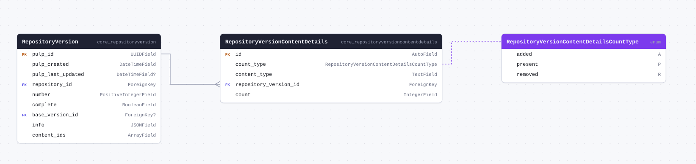

| Column | Field | Type | Null | Key | Default | Description |
| --- | --- | --- | --- | --- | --- | --- |
| `id` | `AutoField` | `integer` |  | PK | `autoincrement()` |  |
| `count_type` | `RepositoryVersionContentDetailsCountType` | `text` |  |  |  |  |
| `content_type` | `TextField` | `text` |  |  |  |  |
| `repository_version_id` | `ForeignKey` | `uuid` |  | FK |  |  |
| `count` | `IntegerField` | `integer` |  |  |  |  |

Indexes:

- index `core_repositoryversioncont_repository_version_id_b3b79754` on `repository_version_id`

Relations:

- `repository_version_id` → [RepositoryVersion](#repositoryversion).`pulp_id`, on delete cascade

## Export

Table `core_export`, app `core`.

Subclasses (multi-table): [FilesystemExport](#filesystemexport), [PulpExport](#pulpexport).

Columns from `BaseModel` (abstract): `pulp_id`, `pulp_created`, `pulp_last_updated`.

A model that represents an Export.

Fields:

    params (models.JSONField): A set of parameters used to create the export

Relations:

    task (models.ForeignKey): The Task that created the export
    exporter (models.ForeignKey): The Exporter that exported the resource.

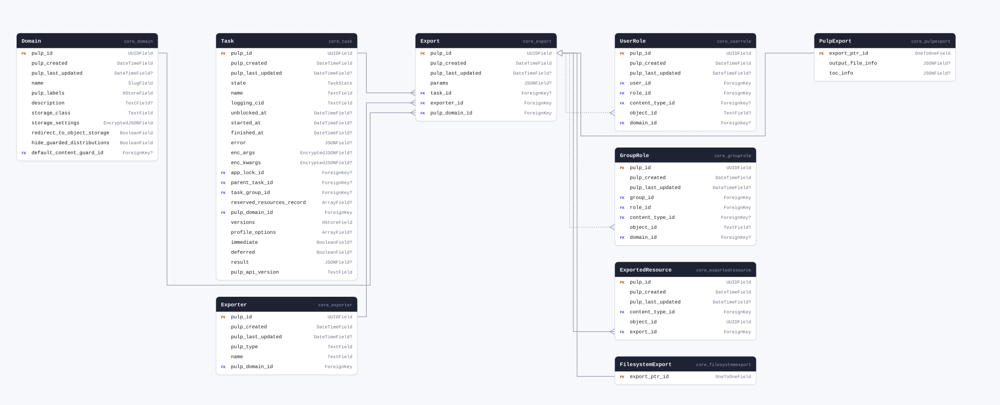

| Column | Field | Type | Null | Key | Default | Description |
| --- | --- | --- | --- | --- | --- | --- |
| `pulp_id` | `UUIDField` | `uuid` |  | PK | `pulp_uuid()` |  |
| `pulp_created` | `DateTimeField` | `timestamp with time zone` |  |  | `now()` |  |
| `pulp_last_updated` | `DateTimeField` | `timestamp with time zone` | yes |  | `now()` |  |
| `params` | `JSONField` | `jsonb` | yes |  |  |  |
| `task_id` | `ForeignKey` | `uuid` | yes | FK |  |  |
| `exporter_id` | `ForeignKey` | `uuid` |  | FK |  |  |
| `pulp_domain_id` | `ForeignKey` | `uuid` |  | FK | `get_domain_pk()` |  |

Indexes:

- index `core_export_task_id_4947760b` on `task_id`
- index `core_export_exporter_id_c43ae46f` on `exporter_id`
- index `core_export_pulp_domain_id_08f17d24` on `pulp_domain_id`

Relations:

- `task_id` → [Task](#task).`pulp_id`, on delete set null
- `exporter_id` → [Exporter](#exporter).`pulp_id`, on delete cascade
- `pulp_domain_id` → [Domain](#domain).`pulp_id`, on delete protect
- `user_roles` ← [UserRole](#userrole), by `content_type_id` + `object_id` (generic relation)
- `group_roles` ← [GroupRole](#grouprole), by `content_type_id` + `object_id` (generic relation)
- [ExportedResource](#exportedresource).`export_id` → `pulp_id`, on delete cascade
- [FilesystemExport](#filesystemexport).`export_ptr_id` → `pulp_id`, parent link, on delete cascade
- [PulpExport](#pulpexport).`export_ptr_id` → `pulp_id`, parent link, on delete cascade

## ExportedResource

Table `core_exportedresource`, app `core`.

Columns from `GenericRelationModel` (abstract): `content_type_id`, `object_id`.

Columns from `BaseModel` (abstract): `pulp_id`, `pulp_created`, `pulp_last_updated`.

A model to represent anything that was exported in an Export.

Resource can be a repo version, publication, etc.

Relations:

    export (models.ForeignKey): The Export that exported the resource.

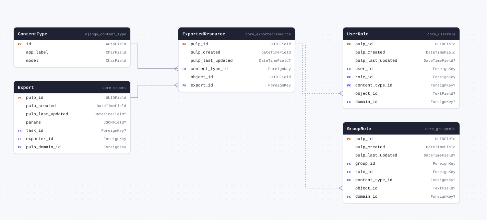

| Column | Field | Type | Null | Key | Default | Description |
| --- | --- | --- | --- | --- | --- | --- |
| `pulp_id` | `UUIDField` | `uuid` |  | PK | `pulp_uuid()` |  |
| `pulp_created` | `DateTimeField` | `timestamp with time zone` |  |  | `now()` |  |
| `pulp_last_updated` | `DateTimeField` | `timestamp with time zone` | yes |  | `now()` |  |
| `content_type_id` | `ForeignKey` | `integer` |  | FK |  |  |
| `object_id` | `UUIDField` | `uuid` |  |  |  |  |
| `export_id` | `ForeignKey` | `uuid` |  | FK |  |  |

Indexes:

- index `core_exportedresource_content_type_id_71550d5f` on `content_type_id`
- index `core_exportedresource_export_id_e9cea9c9` on `export_id`

Relations:

- `content_object` → any model, by `content_type_id` + `object_id` (generic foreign key)
- `content_type_id` → [ContentType](#contenttype).`id`, on delete cascade
- `export_id` → [Export](#export).`pulp_id`, on delete cascade
- `user_roles` ← [UserRole](#userrole), by `content_type_id` + `object_id` (generic relation)
- `group_roles` ← [GroupRole](#grouprole), by `content_type_id` + `object_id` (generic relation)

## Exporter

Table `core_exporter`, app `core`.

Subclasses (multi-table): [FilesystemExporter](#filesystemexporter), [PulpExporter](#pulpexporter).

Columns from `MasterModel` (abstract): `pulp_type`.

Columns from `BaseModel` (abstract): `pulp_id`, `pulp_created`, `pulp_last_updated`.

A base model that provides logic to export a set of content and keep track of Exports.

Fields:

    name (models.TextField): The exporter unique name.

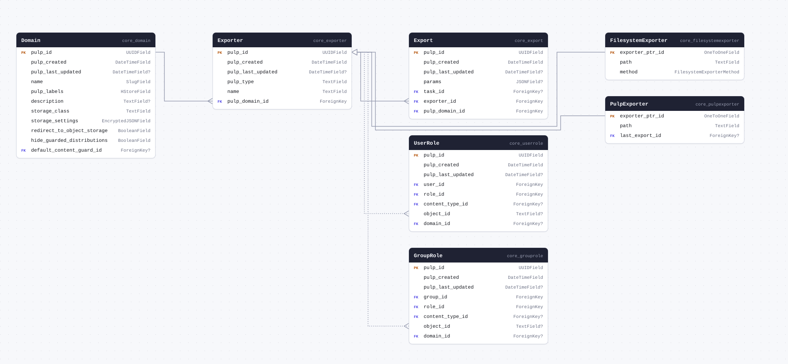

| Column | Field | Type | Null | Key | Default | Description |
| --- | --- | --- | --- | --- | --- | --- |
| `pulp_id` | `UUIDField` | `uuid` |  | PK | `pulp_uuid()` |  |
| `pulp_created` | `DateTimeField` | `timestamp with time zone` |  |  | `now()` |  |
| `pulp_last_updated` | `DateTimeField` | `timestamp with time zone` | yes |  | `now()` |  |
| `pulp_type` | `TextField` | `text` |  |  | `None` |  |
| `name` | `TextField` | `text` |  |  |  |  |
| `pulp_domain_id` | `ForeignKey` | `uuid` |  | FK | `get_domain_pk()` |  |

Indexes:

- index `core_exporter_pulp_type_e454fb4c` on `pulp_type`
- index `core_exporter_pulp_type_e454fb4c_like` on `pulp_type` (`text_pattern_ops`)
- index `core_exporter_pulp_domain_id_61ebf073` on `pulp_domain_id`
- unique `core_exporter_name_pulp_domain_id_620ba661_uniq` on `name`, `pulp_domain_id`

Relations:

- [Export](#export).`exporter_id` → `pulp_id`, on delete cascade
- `pulp_domain_id` → [Domain](#domain).`pulp_id`, on delete protect
- `user_roles` ← [UserRole](#userrole), by `content_type_id` + `object_id` (generic relation)
- `group_roles` ← [GroupRole](#grouprole), by `content_type_id` + `object_id` (generic relation)
- [FilesystemExporter](#filesystemexporter).`exporter_ptr_id` → `pulp_id`, parent link, on delete cascade
- [PulpExporter](#pulpexporter).`exporter_ptr_id` → `pulp_id`, parent link, on delete cascade

## FilesystemExport

Table `core_filesystemexport`, app `core`.

Inherits from [Export](#export) (multi-table): its rows are joined on `export_ptr_id`.

A model that represents an export to the filesystem.


| Column | Field | Type | Null | Key | Default | Description |
| --- | --- | --- | --- | --- | --- | --- |
| `export_ptr_id` | `OneToOneField` | `uuid` |  | PK, FK |  |  |

Relations:

- `export_ptr_id` → [Export](#export).`pulp_id`, parent link, on delete cascade
- `user_roles` ← [UserRole](#userrole), by `content_type_id` + `object_id` (generic relation)
- `group_roles` ← [GroupRole](#grouprole), by `content_type_id` + `object_id` (generic relation)

## FilesystemExporter

Table `core_filesystemexporter`, app `core`.

Inherits from [Exporter](#exporter) (multi-table): its rows are joined on `exporter_ptr_id`.

A base model that provides logic to export a set of content to the filesystem.

Fields:

    path (models.TextField): a full path where the export will go.

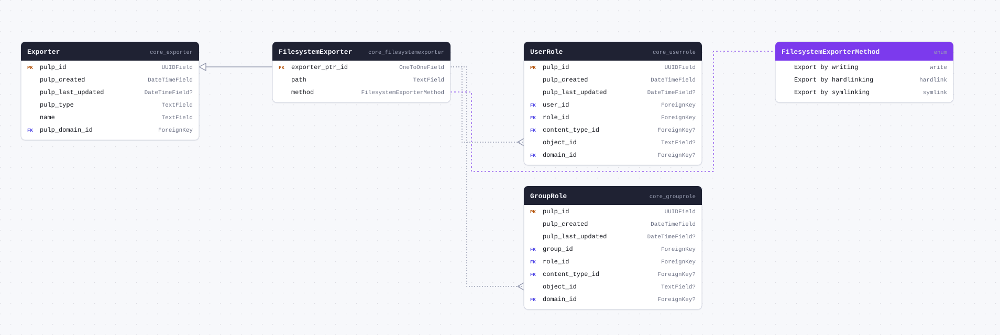

| Column | Field | Type | Null | Key | Default | Description |
| --- | --- | --- | --- | --- | --- | --- |
| `exporter_ptr_id` | `OneToOneField` | `uuid` |  | PK, FK |  |  |
| `path` | `TextField` | `text` |  |  |  |  |
| `method` | `FilesystemExporterMethod` | `text` |  |  | `'write'` |  |

Relations:

- `exporter_ptr_id` → [Exporter](#exporter).`pulp_id`, parent link, on delete cascade
- `user_roles` ← [UserRole](#userrole), by `content_type_id` + `object_id` (generic relation)
- `group_roles` ← [GroupRole](#grouprole), by `content_type_id` + `object_id` (generic relation)

## PulpExport

Table `core_pulpexport`, app `core`.

Inherits from [Export](#export) (multi-table): its rows are joined on `export_ptr_id`.

A model that provides export-files that can be imported into other Pulp instances.

Fields:

    tarfile (tarfile.Tarfile): a tarfile for this export to write into.
    validated_versions ([pulpcore.app.models.RepositoryVersion]): explicitly-specified versions
        to be exported (if any).
    validated_start_versions ([pulpcore.app.models.RepositoryVersion]): explicitly-specified
        starting-versions for doing an incremental export.
    validated_chunk_size (str) : requested chunk-size of the export file.
    output_file_info (models.JSONField) : JSON containing the full-path filenames and
        SHA256-checksums of all output-files generated by this export.
    toc_info (models.JSONField) : JSON containing the full-path filename and SHA256-checksum
        of the table-of-contents for this export.

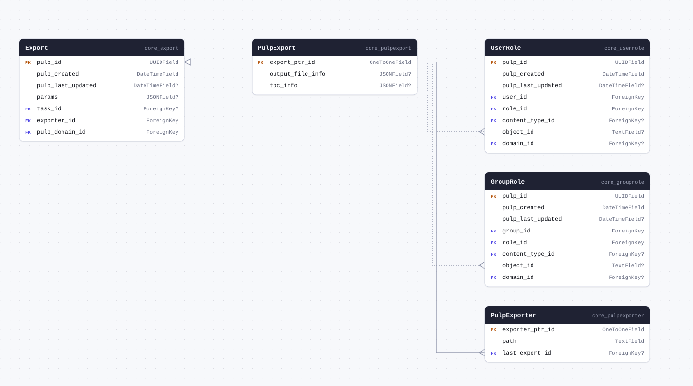

| Column | Field | Type | Null | Key | Default | Description |
| --- | --- | --- | --- | --- | --- | --- |
| `export_ptr_id` | `OneToOneField` | `uuid` |  | PK, FK |  |  |
| `output_file_info` | `JSONField` | `jsonb` | yes |  |  |  |
| `toc_info` | `JSONField` | `jsonb` | yes |  |  |  |

Relations:

- `export_ptr_id` → [Export](#export).`pulp_id`, parent link, on delete cascade
- `user_roles` ← [UserRole](#userrole), by `content_type_id` + `object_id` (generic relation)
- `group_roles` ← [GroupRole](#grouprole), by `content_type_id` + `object_id` (generic relation)
- [PulpExporter](#pulpexporter).`last_export_id` → `export_ptr_id`, on delete set null

## PulpExporter

Table `core_pulpexporter`, app `core`.

Inherits from [Exporter](#exporter) (multi-table): its rows are joined on `exporter_ptr_id`.

A model that controls creating exports that can be imported into other Pulp instances.

Fields:

    path (models.TextField): a full path where the export will go.

Relations:

    repositories (models.ManyToManyField): Repos to be exported.
    last_export (models.ForeignKey): The last Export from the Exporter.

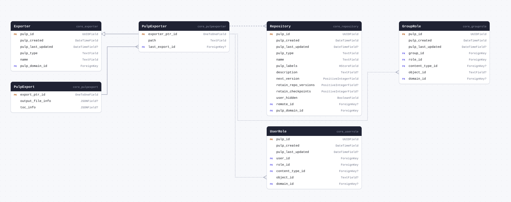

| Column | Field | Type | Null | Key | Default | Description |
| --- | --- | --- | --- | --- | --- | --- |
| `exporter_ptr_id` | `OneToOneField` | `uuid` |  | PK, FK |  |  |
| `path` | `TextField` | `text` |  |  |  |  |
| `last_export_id` | `ForeignKey` | `uuid` | yes | FK |  |  |

Indexes:

- index `core_pulpexporter_last_export_id_395a1e1a` on `last_export_id`

Relations:

- `exporter_ptr_id` → [Exporter](#exporter).`pulp_id`, parent link, on delete cascade
- `last_export_id` → [PulpExport](#pulpexport).`export_ptr_id`, on delete set null
- `repositories` — many to many with [Repository](#repository)
- `user_roles` ← [UserRole](#userrole), by `content_type_id` + `object_id` (generic relation)
- `group_roles` ← [GroupRole](#grouprole), by `content_type_id` + `object_id` (generic relation)

## Import

Table `core_import`, app `core`.

Subclasses (multi-table): [PulpImport](#pulpimport).

Columns from `BaseModel` (abstract): `pulp_id`, `pulp_created`, `pulp_last_updated`.

A model that represents imports into Pulp.

Fields:
    params (models.JSONField): A set of parameters used to run the import

Relations:
    task (models.ForeignKey): The Task that ran the import
    importer (models.ForeignKey): The Importer that imported the export

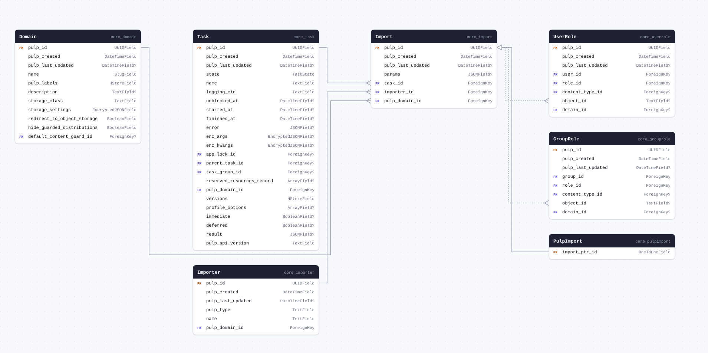

| Column | Field | Type | Null | Key | Default | Description |
| --- | --- | --- | --- | --- | --- | --- |
| `pulp_id` | `UUIDField` | `uuid` |  | PK | `pulp_uuid()` |  |
| `pulp_created` | `DateTimeField` | `timestamp with time zone` |  |  | `now()` |  |
| `pulp_last_updated` | `DateTimeField` | `timestamp with time zone` | yes |  | `now()` |  |
| `params` | `JSONField` | `jsonb` | yes |  |  |  |
| `task_id` | `ForeignKey` | `uuid` |  | FK |  |  |
| `importer_id` | `ForeignKey` | `uuid` |  | FK |  |  |
| `pulp_domain_id` | `ForeignKey` | `uuid` |  | FK | `get_domain_pk()` |  |

Indexes:

- index `core_import_task_id_b927da56` on `task_id`
- index `core_import_importer_id_c2470373` on `importer_id`
- index `core_import_pulp_domain_id_0257e64e` on `pulp_domain_id`

Relations:

- `task_id` → [Task](#task).`pulp_id`, on delete protect
- `importer_id` → [Importer](#importer).`pulp_id`, on delete cascade
- `pulp_domain_id` → [Domain](#domain).`pulp_id`, on delete protect
- `user_roles` ← [UserRole](#userrole), by `content_type_id` + `object_id` (generic relation)
- `group_roles` ← [GroupRole](#grouprole), by `content_type_id` + `object_id` (generic relation)
- [PulpImport](#pulpimport).`import_ptr_id` → `pulp_id`, parent link, on delete cascade

## Importer

Table `core_importer`, app `core`.

Subclasses (multi-table): [PulpImporter](#pulpimporter).

Columns from `MasterModel` (abstract): `pulp_type`.

Columns from `BaseModel` (abstract): `pulp_id`, `pulp_created`, `pulp_last_updated`.

A base model that provides logic to import data into Pulp.

Can be extended by plugins to provide import functionality.

Fields:
    name (models.TextField): The importer unique name.

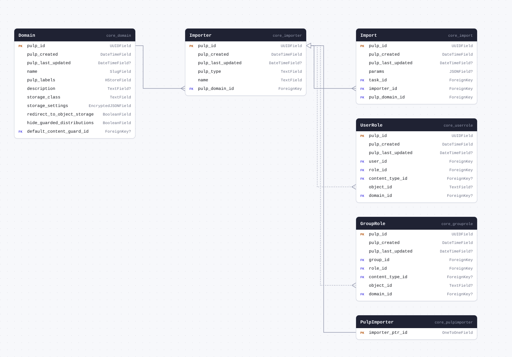

| Column | Field | Type | Null | Key | Default | Description |
| --- | --- | --- | --- | --- | --- | --- |
| `pulp_id` | `UUIDField` | `uuid` |  | PK | `pulp_uuid()` |  |
| `pulp_created` | `DateTimeField` | `timestamp with time zone` |  |  | `now()` |  |
| `pulp_last_updated` | `DateTimeField` | `timestamp with time zone` | yes |  | `now()` |  |
| `pulp_type` | `TextField` | `text` |  |  | `None` |  |
| `name` | `TextField` | `text` |  |  |  |  |
| `pulp_domain_id` | `ForeignKey` | `uuid` |  | FK | `get_domain_pk()` |  |

Indexes:

- index `core_importer_pulp_type_2f7d803f` on `pulp_type`
- index `core_importer_pulp_type_2f7d803f_like` on `pulp_type` (`text_pattern_ops`)
- index `core_importer_pulp_domain_id_1c3076f8` on `pulp_domain_id`
- unique `core_importer_name_pulp_domain_id_2993c3a3_uniq` on `name`, `pulp_domain_id`

Relations:

- [Import](#import).`importer_id` → `pulp_id`, on delete cascade
- `pulp_domain_id` → [Domain](#domain).`pulp_id`, on delete protect
- `user_roles` ← [UserRole](#userrole), by `content_type_id` + `object_id` (generic relation)
- `group_roles` ← [GroupRole](#grouprole), by `content_type_id` + `object_id` (generic relation)
- [PulpImporter](#pulpimporter).`importer_ptr_id` → `pulp_id`, parent link, on delete cascade

## PulpImporter

Table `core_pulpimporter`, app `core`.

Inherits from [Importer](#importer) (multi-table): its rows are joined on `importer_ptr_id`.

A model that can be used to import exports from other Pulp instances.

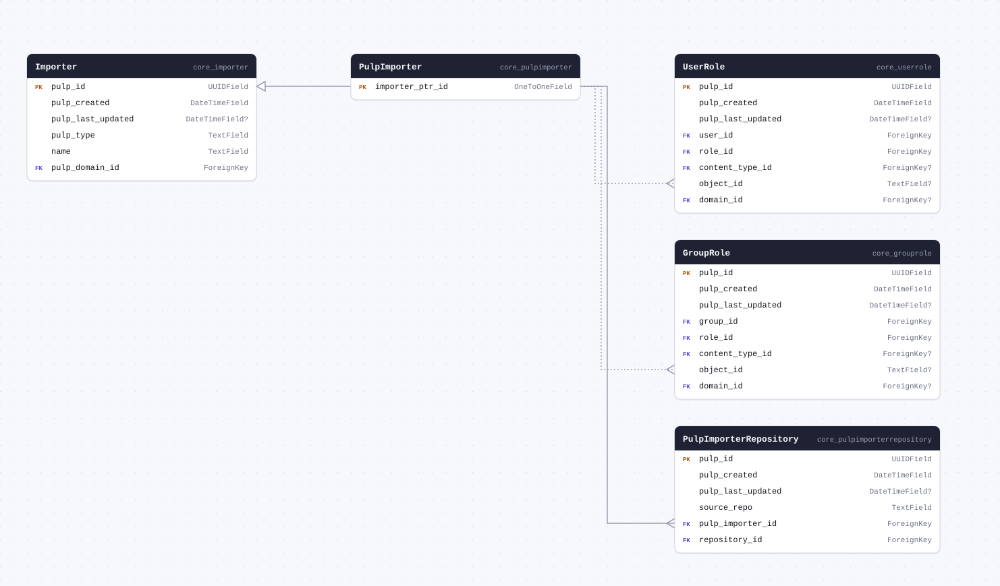

| Column | Field | Type | Null | Key | Default | Description |
| --- | --- | --- | --- | --- | --- | --- |
| `importer_ptr_id` | `OneToOneField` | `uuid` |  | PK, FK |  |  |

Relations:

- `importer_ptr_id` → [Importer](#importer).`pulp_id`, parent link, on delete cascade
- `user_roles` ← [UserRole](#userrole), by `content_type_id` + `object_id` (generic relation)
- `group_roles` ← [GroupRole](#grouprole), by `content_type_id` + `object_id` (generic relation)
- [PulpImporterRepository](#pulpimporterrepository).`pulp_importer_id` → `importer_ptr_id`, on delete cascade

## PulpImporterRepository

Table `core_pulpimporterrepository`, app `core`.

Columns from `BaseModel` (abstract): `pulp_id`, `pulp_created`, `pulp_last_updated`.

A model that maps repo names in an export to repos in Pulp.

Fields:
    source_repo (models.TextField): The name of the repo in the export

Relations:
    pulp_importer (models.ForeignKey): The associated Pulp importer
    repository (models.ForeignKey): The repository in Pulp

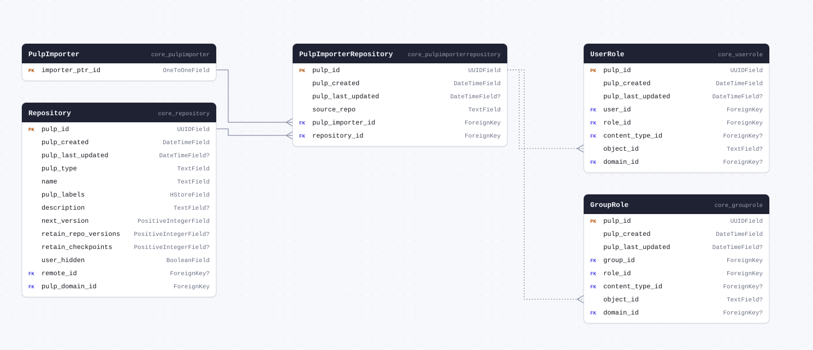

| Column | Field | Type | Null | Key | Default | Description |
| --- | --- | --- | --- | --- | --- | --- |
| `pulp_id` | `UUIDField` | `uuid` |  | PK | `pulp_uuid()` |  |
| `pulp_created` | `DateTimeField` | `timestamp with time zone` |  |  | `now()` |  |
| `pulp_last_updated` | `DateTimeField` | `timestamp with time zone` | yes |  | `now()` |  |
| `source_repo` | `TextField` | `text` |  |  |  |  |
| `pulp_importer_id` | `ForeignKey` | `uuid` |  | FK |  |  |
| `repository_id` | `ForeignKey` | `uuid` |  | FK |  |  |

Indexes:

- index `core_pulpimporterrepository_pulp_importer_id_6974288a` on `pulp_importer_id`
- index `core_pulpimporterrepository_repository_id_ce65c430` on `repository_id`

Relations:

- `pulp_importer_id` → [PulpImporter](#pulpimporter).`importer_ptr_id`, on delete cascade
- `repository_id` → [Repository](#repository).`pulp_id`, on delete cascade
- `user_roles` ← [UserRole](#userrole), by `content_type_id` + `object_id` (generic relation)
- `group_roles` ← [GroupRole](#grouprole), by `content_type_id` + `object_id` (generic relation)

## PulpImport

Table `core_pulpimport`, app `core`.

Inherits from [Import](#import) (multi-table): its rows are joined on `import_ptr_id`.

A model that represents imports into Pulp from another Pulp instance.


| Column | Field | Type | Null | Key | Default | Description |
| --- | --- | --- | --- | --- | --- | --- |
| `import_ptr_id` | `OneToOneField` | `uuid` |  | PK, FK |  |  |

Relations:

- `import_ptr_id` → [Import](#import).`pulp_id`, parent link, on delete cascade
- `user_roles` ← [UserRole](#userrole), by `content_type_id` + `object_id` (generic relation)
- `group_roles` ← [GroupRole](#grouprole), by `content_type_id` + `object_id` (generic relation)

## Publication

Table `core_publication`, app `core`.

Subclasses (multi-table): [FilePublication](#filepublication), [PythonPublication](#pythonpublication).

Columns from `MasterModel` (abstract): `pulp_type`.

Columns from `BaseModel` (abstract): `pulp_id`, `pulp_created`, `pulp_last_updated`.

A publication contains metadata and artifacts associated with content
contained within a RepositoryVersion.

Using as a context manager is highly encouraged.  On context exit, the complete attribute
is set True provided that an exception has not been raised.  In the event and exception
has been raised, the publication is deleted.

Fields:
    complete (models.BooleanField): State tracking; for internal use. Indexed.
    pass_through (models.BooleanField): Indicates that the publication is a pass-through
        to the repository version. Enabling pass-through has the same effect as creating
        a PublishedArtifact for all of the content (artifacts) in the repository.
    checkpoint (models.BooleanField): Indicates a checkpoint publication.

Relations:
    repository_version (models.ForeignKey): The RepositoryVersion used to
        create this Publication.
    pulp_domain (models.ForeignKey): The domain the Publication is a part of.

Examples:
    >>> repository_version = ...
    >>>
    >>> with Publication.create(repository_version) as publication:
    >>>     for content in repository_version.content():
    >>>         for content_artifact in content.contentartifact_set.all():
    >>>             artifact = PublishedArtifact(...)
    >>>             artifact.save()
    >>>             metadata = PublishedMetadata.create_from_file(...)
    >>>             ...
    >>>

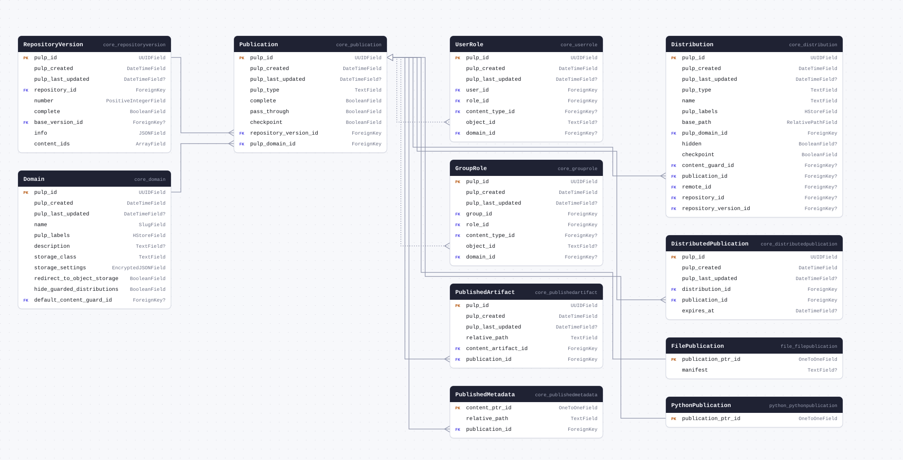

| Column | Field | Type | Null | Key | Default | Description |
| --- | --- | --- | --- | --- | --- | --- |
| `pulp_id` | `UUIDField` | `uuid` |  | PK | `pulp_uuid()` |  |
| `pulp_created` | `DateTimeField` | `timestamp with time zone` |  |  | `now()` |  |
| `pulp_last_updated` | `DateTimeField` | `timestamp with time zone` | yes |  | `now()` |  |
| `pulp_type` | `TextField` | `text` |  |  | `None` |  |
| `complete` | `BooleanField` | `boolean` |  |  | `False` |  |
| `pass_through` | `BooleanField` | `boolean` |  |  | `False` |  |
| `checkpoint` | `BooleanField` | `boolean` |  |  | `False` |  |
| `repository_version_id` | `ForeignKey` | `uuid` |  | FK |  |  |
| `pulp_domain_id` | `ForeignKey` | `uuid` |  | FK | `get_domain_pk()` |  |

Indexes:

- index `core_publication_pulp_type_098fd8bd` on `pulp_type`
- index `core_publication_pulp_type_098fd8bd_like` on `pulp_type` (`text_pattern_ops`)
- index `core_publication_complete_1fa15ed4` on `complete`
- index `core_publication_repository_version_id_95a4f711` on `repository_version_id`
- index `core_publication_pulp_domain_id_9a23c66e` on `pulp_domain_id`

Relations:

- `repository_version_id` → [RepositoryVersion](#repositoryversion).`pulp_id`, on delete cascade
- `pulp_domain_id` → [Domain](#domain).`pulp_id`, on delete protect
- `user_roles` ← [UserRole](#userrole), by `content_type_id` + `object_id` (generic relation)
- `group_roles` ← [GroupRole](#grouprole), by `content_type_id` + `object_id` (generic relation)
- [PublishedArtifact](#publishedartifact).`publication_id` → `pulp_id`, on delete cascade
- [PublishedMetadata](#publishedmetadata).`publication_id` → `pulp_id`, on delete cascade
- [Distribution](#distribution).`publication_id` → `pulp_id`, on delete set null
- [DistributedPublication](#distributedpublication).`publication_id` → `pulp_id`, on delete cascade
- [FilePublication](#filepublication).`publication_ptr_id` → `pulp_id`, parent link, on delete cascade
- [PythonPublication](#pythonpublication).`publication_ptr_id` → `pulp_id`, parent link, on delete cascade

## PublishedArtifact

Table `core_publishedartifact`, app `core`.

Columns from `BaseModel` (abstract): `pulp_id`, `pulp_created`, `pulp_last_updated`.

An artifact that is part of a publication.

Fields:
    relative_path (models.TextField): The (relative) path component of the published url.

Relations:
    content_artifact (models.ForeignKey): The referenced content artifact.
    publication (models.ForeignKey): The publication in which the artifact is included.

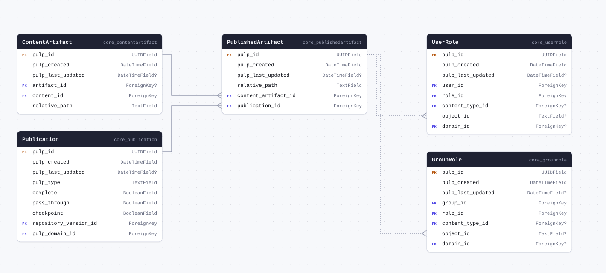

| Column | Field | Type | Null | Key | Default | Description |
| --- | --- | --- | --- | --- | --- | --- |
| `pulp_id` | `UUIDField` | `uuid` |  | PK | `pulp_uuid()` |  |
| `pulp_created` | `DateTimeField` | `timestamp with time zone` |  |  | `now()` |  |
| `pulp_last_updated` | `DateTimeField` | `timestamp with time zone` | yes |  | `now()` |  |
| `relative_path` | `TextField` | `text` |  |  |  |  |
| `content_artifact_id` | `ForeignKey` | `uuid` |  | FK |  |  |
| `publication_id` | `ForeignKey` | `uuid` |  | FK |  |  |

Indexes:

- index `core_publishedartifact_content_artifact_id_081334a1` on `content_artifact_id`
- index `core_publishedartifact_publication_id_adaa1ae3` on `publication_id`
- unique `core_publishedartifact_publication_id_relative__97f785f4_uniq` on `publication_id`, `relative_path`

Relations:

- `content_artifact_id` → [ContentArtifact](#contentartifact).`pulp_id`, on delete cascade
- `publication_id` → [Publication](#publication).`pulp_id`, on delete cascade
- `user_roles` ← [UserRole](#userrole), by `content_type_id` + `object_id` (generic relation)
- `group_roles` ← [GroupRole](#grouprole), by `content_type_id` + `object_id` (generic relation)

## PublishedMetadata

Table `core_publishedmetadata`, app `core`.

Inherits from [Content](#content) (multi-table): its rows are joined on `content_ptr_id`.

Metadata file that is part of a publication.

Fields:
    relative_path (models.TextField): The (relative) path component of the published url.

Relations:
    publication (models.ForeignKey): The publication in which the artifact is included.

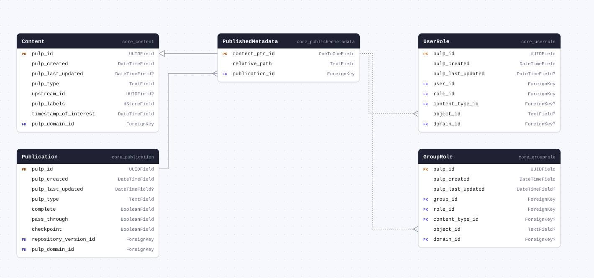

| Column | Field | Type | Null | Key | Default | Description |
| --- | --- | --- | --- | --- | --- | --- |
| `content_ptr_id` | `OneToOneField` | `uuid` |  | PK, FK |  |  |
| `relative_path` | `TextField` | `text` |  |  |  |  |
| `publication_id` | `ForeignKey` | `uuid` |  | FK |  |  |

Indexes:

- index `core_publishedmetadata_publication_id_771811c1` on `publication_id`
- unique `core_publishedmetadata_publication_id_relative__60dd832b_uniq` on `publication_id`, `relative_path`

Relations:

- `content_ptr_id` → [Content](#content).`pulp_id`, parent link, on delete cascade
- `publication_id` → [Publication](#publication).`pulp_id`, on delete cascade
- `user_roles` ← [UserRole](#userrole), by `content_type_id` + `object_id` (generic relation)
- `group_roles` ← [GroupRole](#grouprole), by `content_type_id` + `object_id` (generic relation)

## ContentGuard

Table `core_contentguard`, app `core`.

Subclasses (multi-table): [RBACContentGuard](#rbaccontentguard), [ContentRedirectContentGuard](#contentredirectcontentguard), [HeaderContentGuard](#headercontentguard), [EnvVarHeaderContentGuard](#envvarheadercontentguard), [CompositeContentGuard](#compositecontentguard), [RHSMCertGuard](#rhsmcertguard), [X509CertGuard](#x509certguard).

Columns from `MasterModel` (abstract): `pulp_type`.

Columns from `BaseModel` (abstract): `pulp_id`, `pulp_created`, `pulp_last_updated`.

Defines a named content guard.

This is meant to be subclassed by plugin authors as an opportunity to provide
plugin-specific persistent attributes and additional validation for those attributes.
The permit() method must be overridden to provide the web request authorization logic.

This object is a Django model that inherits from [pulpcore.app.models.ContentGuard][]
which provides the platform persistent attributes for a content-guard. Plugin authors can
add additional persistent attributes by subclassing this class and adding Django fields.
We defer to the Django docs on extending this model definition with additional fields.

Fields:
    name (models.TextField): Unique guard name per domain.
    description (models.TextField): An optional description.
    pulp_domain (models.ForeignKey): The domain the ContentGuard is a part of.

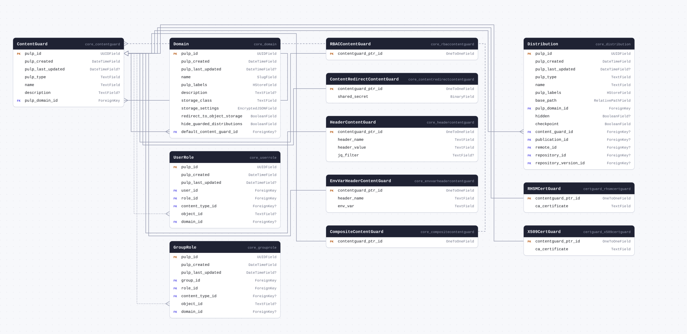

| Column | Field | Type | Null | Key | Default | Description |
| --- | --- | --- | --- | --- | --- | --- |
| `pulp_id` | `UUIDField` | `uuid` |  | PK | `pulp_uuid()` |  |
| `pulp_created` | `DateTimeField` | `timestamp with time zone` |  |  | `now()` |  |
| `pulp_last_updated` | `DateTimeField` | `timestamp with time zone` | yes |  | `now()` |  |
| `pulp_type` | `TextField` | `text` |  |  | `None` |  |
| `name` | `TextField` | `text` |  |  |  |  |
| `description` | `TextField` | `text` | yes |  |  |  |
| `pulp_domain_id` | `ForeignKey` | `uuid` |  | FK | `get_domain_pk()` |  |

Indexes:

- index `core_contentguard_pulp_type_c18cf95d` on `pulp_type`
- index `core_contentguard_pulp_type_c18cf95d_like` on `pulp_type` (`text_pattern_ops`)
- index `core_contentguard_name_c867a28e` on `name`
- index `core_contentguard_name_c867a28e_like` on `name` (`text_pattern_ops`)
- index `core_contentguard_pulp_domain_id_4c843f48` on `pulp_domain_id`
- unique `core_contentguard_name_pulp_domain_id_75665ff0_uniq` on `name`, `pulp_domain_id`

Relations:

- [Domain](#domain).`default_content_guard_id` → `pulp_id`, on delete set null
- `pulp_domain_id` → [Domain](#domain).`pulp_id`, on delete protect
- `user_roles` ← [UserRole](#userrole), by `content_type_id` + `object_id` (generic relation)
- `group_roles` ← [GroupRole](#grouprole), by `content_type_id` + `object_id` (generic relation)
- [RBACContentGuard](#rbaccontentguard).`contentguard_ptr_id` → `pulp_id`, parent link, on delete cascade
- [ContentRedirectContentGuard](#contentredirectcontentguard).`contentguard_ptr_id` → `pulp_id`, parent link, on delete cascade
- [HeaderContentGuard](#headercontentguard).`contentguard_ptr_id` → `pulp_id`, parent link, on delete cascade
- [EnvVarHeaderContentGuard](#envvarheadercontentguard).`contentguard_ptr_id` → `pulp_id`, parent link, on delete cascade
- [CompositeContentGuard](#compositecontentguard).`contentguard_ptr_id` → `pulp_id`, parent link, on delete cascade
- `_core_compositecontentguard_guards_+` — many to many with [CompositeContentGuard](#compositecontentguard)
- [Distribution](#distribution).`content_guard_id` → `pulp_id`, on delete set null
- [RHSMCertGuard](#rhsmcertguard).`contentguard_ptr_id` → `pulp_id`, parent link, on delete cascade
- [X509CertGuard](#x509certguard).`contentguard_ptr_id` → `pulp_id`, parent link, on delete cascade

## RBACContentGuard

Table `core_rbaccontentguard`, app `core`.

Inherits from [ContentGuard](#contentguard) (multi-table): its rows are joined on `contentguard_ptr_id`.

A content guard that protects content based on RBAC permissions.


| Column | Field | Type | Null | Key | Default | Description |
| --- | --- | --- | --- | --- | --- | --- |
| `contentguard_ptr_id` | `OneToOneField` | `uuid` |  | PK, FK |  |  |

Relations:

- `contentguard_ptr_id` → [ContentGuard](#contentguard).`pulp_id`, parent link, on delete cascade
- `user_roles` ← [UserRole](#userrole), by `content_type_id` + `object_id` (generic relation)
- `group_roles` ← [GroupRole](#grouprole), by `content_type_id` + `object_id` (generic relation)

## ContentRedirectContentGuard

Table `core_contentredirectcontentguard`, app `core`.

Inherits from [ContentGuard](#contentguard) (multi-table): its rows are joined on `contentguard_ptr_id`.

Content guard to allow preauthenticated redirects to the content app.

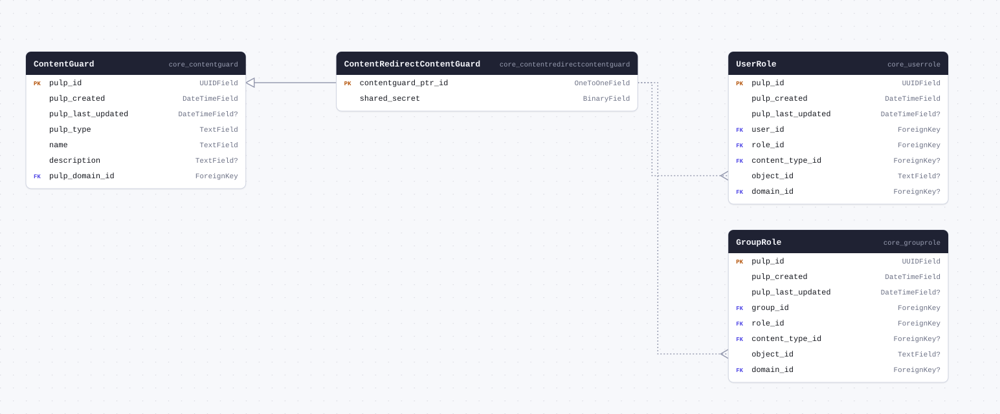

| Column | Field | Type | Null | Key | Default | Description |
| --- | --- | --- | --- | --- | --- | --- |
| `contentguard_ptr_id` | `OneToOneField` | `uuid` |  | PK, FK |  |  |
| `shared_secret` | `BinaryField` | `bytea` |  |  | `_gen_secret()` |  |

Relations:

- `contentguard_ptr_id` → [ContentGuard](#contentguard).`pulp_id`, parent link, on delete cascade
- `user_roles` ← [UserRole](#userrole), by `content_type_id` + `object_id` (generic relation)
- `group_roles` ← [GroupRole](#grouprole), by `content_type_id` + `object_id` (generic relation)

## HeaderContentGuard

Table `core_headercontentguard`, app `core`.

Inherits from [ContentGuard](#contentguard) (multi-table): its rows are joined on `contentguard_ptr_id`.

Content guard to protect content based on a header value.

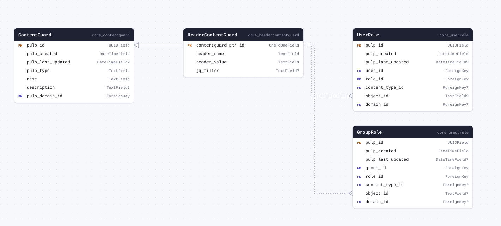

| Column | Field | Type | Null | Key | Default | Description |
| --- | --- | --- | --- | --- | --- | --- |
| `contentguard_ptr_id` | `OneToOneField` | `uuid` |  | PK, FK |  |  |
| `header_name` | `TextField` | `text` |  |  |  |  |
| `header_value` | `TextField` | `text` |  |  |  |  |
| `jq_filter` | `TextField` | `text` | yes |  |  |  |

Relations:

- `contentguard_ptr_id` → [ContentGuard](#contentguard).`pulp_id`, parent link, on delete cascade
- `user_roles` ← [UserRole](#userrole), by `content_type_id` + `object_id` (generic relation)
- `group_roles` ← [GroupRole](#grouprole), by `content_type_id` + `object_id` (generic relation)

## EnvVarHeaderContentGuard

Table `core_envvarheadercontentguard`, app `core`.

Inherits from [ContentGuard](#contentguard) (multi-table): its rows are joined on `contentguard_ptr_id`.

Content guard that validates a Base64-encoded header against a server-side environment variable.

Clients and proxies must send the expected secret as a Base64-encoded UTF-8 string in
``header_name``. Pulp decodes the header, then compares the result to the value of
``os.environ[env_var]`` using a timing-safe comparison.

``env_var`` must be listed in ``settings.ENVVAR_HEADER_CONTENT_GUARD_ALLOWED_VARS``.
The expected secret is read from the content-app process environment at request time
so rotation only requires updating the environment and redeploying.

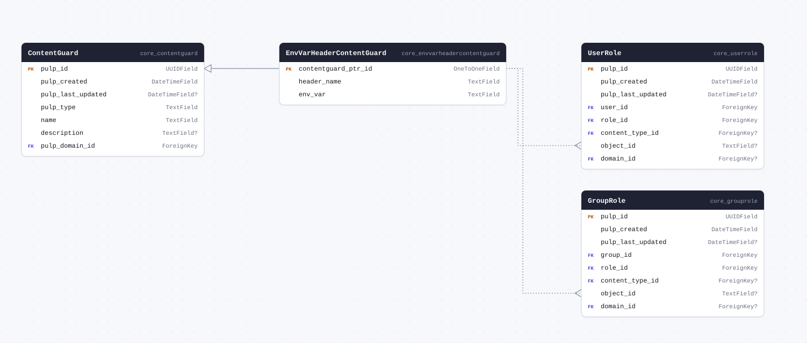

| Column | Field | Type | Null | Key | Default | Description |
| --- | --- | --- | --- | --- | --- | --- |
| `contentguard_ptr_id` | `OneToOneField` | `uuid` |  | PK, FK |  |  |
| `header_name` | `TextField` | `text` |  |  |  |  |
| `env_var` | `TextField` | `text` |  |  |  |  |

Relations:

- `contentguard_ptr_id` → [ContentGuard](#contentguard).`pulp_id`, parent link, on delete cascade
- `user_roles` ← [UserRole](#userrole), by `content_type_id` + `object_id` (generic relation)
- `group_roles` ← [GroupRole](#grouprole), by `content_type_id` + `object_id` (generic relation)

## CompositeContentGuard

Table `core_compositecontentguard`, app `core`.

Inherits from [ContentGuard](#contentguard) (multi-table): its rows are joined on `contentguard_ptr_id`.

Content guard to allow a list of contentguards to be evaluated on access.

Content-guards in the `guards` list have their permit() calls issued in order. At the
first "pass" result, access is permitted. Only if ALL guards in the list forbid access,
is access forbidden.

guards (django.db.models.ManyToManyField): ContentGuards to invoke.

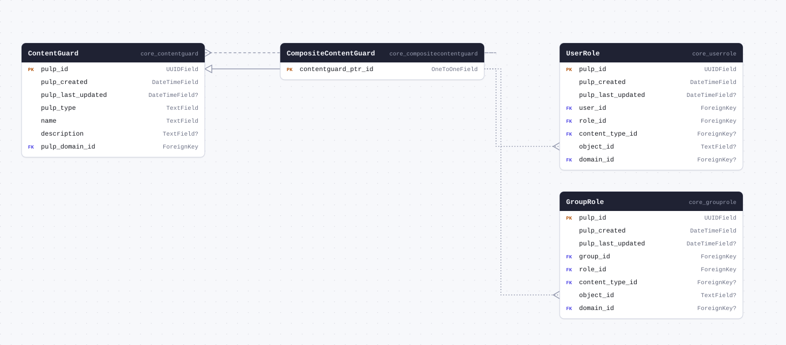

| Column | Field | Type | Null | Key | Default | Description |
| --- | --- | --- | --- | --- | --- | --- |
| `contentguard_ptr_id` | `OneToOneField` | `uuid` |  | PK, FK |  |  |

Relations:

- `contentguard_ptr_id` → [ContentGuard](#contentguard).`pulp_id`, parent link, on delete cascade
- `guards` — many to many with [ContentGuard](#contentguard)
- `user_roles` ← [UserRole](#userrole), by `content_type_id` + `object_id` (generic relation)
- `group_roles` ← [GroupRole](#grouprole), by `content_type_id` + `object_id` (generic relation)

## Distribution

Table `core_distribution`, app `core`.

Subclasses (multi-table): [ArtifactDistribution](#artifactdistribution), [OpenPGPDistribution](#openpgpdistribution), [ContainerPullThroughDistribution](#containerpullthroughdistribution), [ContainerDistribution](#containerdistribution), [FileDistribution](#filedistribution), [AnsibleDistribution](#ansibledistribution), [PythonDistribution](#pythondistribution).

Columns from `MasterModel` (abstract): `pulp_type`.

Columns from `BaseModel` (abstract): `pulp_id`, `pulp_created`, `pulp_last_updated`.

A Distribution defines how the Content App distributes a publication or repository_version.

This master model can be used by plugin writers to create detail Distribution objects.

The `name` must be unique.

The `base_path` must have no overlapping components. So if a Distribution with `base_path`
of `a/path/foo` existed, you could not make a second Distribution with a `base_path` of
`a/path` or `a` because both are subpaths of `a/path/foo`.

Subclasses are expected to use either the `publication` or `repository_version` field, but
not both. The content app that serves content is not prepared to serve content both ways at the
same time.

Fields:
    name (models.TextField): The name of the distribution. Examples: "rawhide" and "stable".
    pulp_labels (HStoreField): Dictionary of string values.
    base_path (models.TextField): The base (relative) path component of the published url.
    hidden (models.BooleanField): Whether this distribution should be hidden in the content app.
    checkpoint (models.BooleanField): Whether this distribution serves checkpoint publications.

Relations:
    content_guard (models.ForeignKey): An optional content-guard.
    publication (models.ForeignKey): Publication to be served.
    remote (models.ForeignKey): A remote that the content app can use to find content not
        yet stored in Pulp.
    repository (models.ForeignKey): The latest RepositoryVersion for this Repository will be
        served.
    repository_version (models.ForeignKey): RepositoryVersion to be served.
    pulp_domain (models.ForeignKey): The domain the Distribution is a part of.

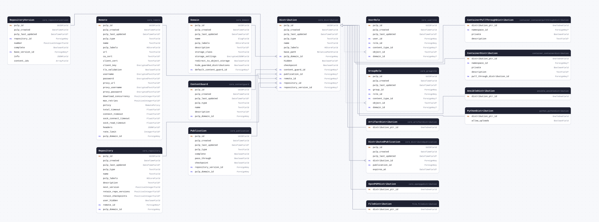

| Column | Field | Type | Null | Key | Default | Description |
| --- | --- | --- | --- | --- | --- | --- |
| `pulp_id` | `UUIDField` | `uuid` |  | PK | `pulp_uuid()` |  |
| `pulp_created` | `DateTimeField` | `timestamp with time zone` |  |  | `now()` |  |
| `pulp_last_updated` | `DateTimeField` | `timestamp with time zone` | yes |  | `now()` |  |
| `pulp_type` | `TextField` | `text` |  |  | `None` |  |
| `name` | `TextField` | `text` |  |  |  |  |
| `pulp_labels` | `HStoreField` | `hstore` |  |  | `dict()` |  |
| `base_path` | `RelativePathField` | `relative_path` |  |  |  |  |
| `pulp_domain_id` | `ForeignKey` | `uuid` |  | FK | `get_domain_pk()` |  |
| `hidden` | `BooleanField` | `boolean` | yes |  | `False` |  |
| `checkpoint` | `BooleanField` | `boolean` |  |  | `False` |  |
| `content_guard_id` | `ForeignKey` | `uuid` | yes | FK |  |  |
| `publication_id` | `ForeignKey` | `uuid` | yes | FK |  |  |
| `remote_id` | `ForeignKey` | `uuid` | yes | FK |  |  |
| `repository_id` | `ForeignKey` | `uuid` | yes | FK |  |  |
| `repository_version_id` | `ForeignKey` | `uuid` | yes | FK |  |  |

Indexes:

- index `core_distribution_pulp_type_5de1abde` on `pulp_type`
- index `core_distribution_pulp_type_5de1abde_like` on `pulp_type` (`text_pattern_ops`)
- index `core_distribution_name_c10ccb23` on `name`
- index `core_distribution_name_c10ccb23_like` on `name` (`text_pattern_ops`)
- index `core_distribution_pulp_domain_id_096b6a5b` on `pulp_domain_id`
- index `core_distribution_content_guard_id_64c5c91a` on `content_guard_id`
- index `core_distribution_publication_id_fb4e0f9c` on `publication_id`
- index `core_distribution_remote_id_fff5b712` on `remote_id`
- index `core_distribution_repository_id_27bc2475` on `repository_id`
- index `core_distribution_repository_version_id_6ac2a9bf` on `repository_version_id`
- unique `core_distribution_name_pulp_domain_id_cc58b558_uniq` on `name`, `pulp_domain_id`
- unique `core_distribution_base_path_pulp_domain_id_c05ad346_uniq` on `base_path`, `pulp_domain_id`
- spgist index `core_distribution_base_path_text` on `base_path` (`text_ops`) include `pulp_domain_id`

Relations:

- `pulp_domain_id` → [Domain](#domain).`pulp_id`, on delete protect
- `content_guard_id` → [ContentGuard](#contentguard).`pulp_id`, on delete set null
- `publication_id` → [Publication](#publication).`pulp_id`, on delete set null
- `remote_id` → [Remote](#remote).`pulp_id`, on delete set null
- `repository_id` → [Repository](#repository).`pulp_id`, on delete set null
- `repository_version_id` → [RepositoryVersion](#repositoryversion).`pulp_id`, on delete set null
- `user_roles` ← [UserRole](#userrole), by `content_type_id` + `object_id` (generic relation)
- `group_roles` ← [GroupRole](#grouprole), by `content_type_id` + `object_id` (generic relation)
- [ArtifactDistribution](#artifactdistribution).`distribution_ptr_id` → `pulp_id`, parent link, on delete cascade
- [DistributedPublication](#distributedpublication).`distribution_id` → `pulp_id`, on delete cascade
- [OpenPGPDistribution](#openpgpdistribution).`distribution_ptr_id` → `pulp_id`, parent link, on delete cascade
- [ContainerPullThroughDistribution](#containerpullthroughdistribution).`distribution_ptr_id` → `pulp_id`, parent link, on delete cascade
- [ContainerDistribution](#containerdistribution).`distribution_ptr_id` → `pulp_id`, parent link, on delete cascade
- [FileDistribution](#filedistribution).`distribution_ptr_id` → `pulp_id`, parent link, on delete cascade
- [AnsibleDistribution](#ansibledistribution).`distribution_ptr_id` → `pulp_id`, parent link, on delete cascade
- [PythonDistribution](#pythondistribution).`distribution_ptr_id` → `pulp_id`, parent link, on delete cascade

## ArtifactDistribution

Table `core_artifactdistribution`, app `core`.

Inherits from [Distribution](#distribution) (multi-table): its rows are joined on `distribution_ptr_id`.

Serve artifacts by their uuid.


| Column | Field | Type | Null | Key | Default | Description |
| --- | --- | --- | --- | --- | --- | --- |
| `distribution_ptr_id` | `OneToOneField` | `uuid` |  | PK, FK |  |  |

Relations:

- `distribution_ptr_id` → [Distribution](#distribution).`pulp_id`, parent link, on delete cascade
- `user_roles` ← [UserRole](#userrole), by `content_type_id` + `object_id` (generic relation)
- `group_roles` ← [GroupRole](#grouprole), by `content_type_id` + `object_id` (generic relation)

## DistributedPublication

Table `core_distributedpublication`, app `core`.

Columns from `BaseModel` (abstract): `pulp_id`, `pulp_created`, `pulp_last_updated`.

Records the history of publications served by each Distribution.

Keeps superseded publications alive and serveable for a configurable grace period.
Null `expired_at` means the publication was not superseded yet.

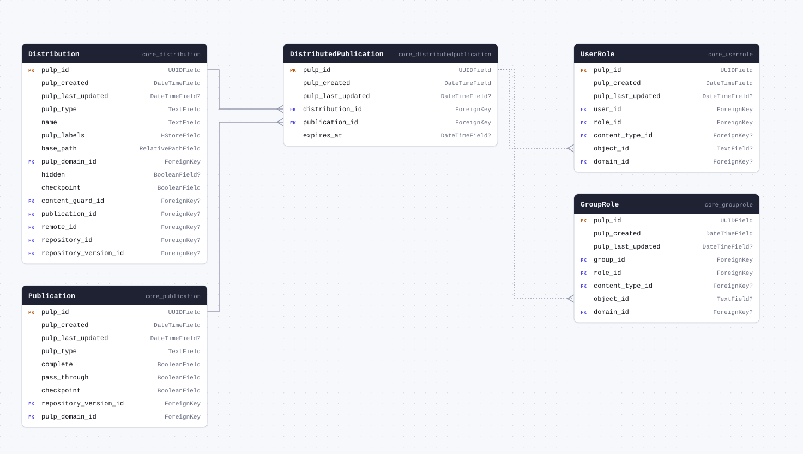

| Column | Field | Type | Null | Key | Default | Description |
| --- | --- | --- | --- | --- | --- | --- |
| `pulp_id` | `UUIDField` | `uuid` |  | PK | `pulp_uuid()` |  |
| `pulp_created` | `DateTimeField` | `timestamp with time zone` |  |  | `now()` |  |
| `pulp_last_updated` | `DateTimeField` | `timestamp with time zone` | yes |  | `now()` |  |
| `distribution_id` | `ForeignKey` | `uuid` |  | FK |  |  |
| `publication_id` | `ForeignKey` | `uuid` |  | FK |  |  |
| `expires_at` | `DateTimeField` | `timestamp with time zone` | yes |  |  |  |

Indexes:

- index `core_distributedpublication_distribution_id_0a812bf4` on `distribution_id`
- index `core_distributedpublication_publication_id_81a157e7` on `publication_id`

Relations:

- `distribution_id` → [Distribution](#distribution).`pulp_id`, on delete cascade
- `publication_id` → [Publication](#publication).`pulp_id`, on delete cascade
- `user_roles` ← [UserRole](#userrole), by `content_type_id` + `object_id` (generic relation)
- `group_roles` ← [GroupRole](#grouprole), by `content_type_id` + `object_id` (generic relation)

## SystemID

Table `core_systemid`, app `core`.

| Column | Field | Type | Null | Key | Default | Description |
| --- | --- | --- | --- | --- | --- | --- |
| `pulp_id` | `UUIDField` | `uuid` |  | PK | `pulp_uuid()` |  |

## core.Upload

Table `core_upload`, app `core`.

Subclasses (multi-table): [container.Upload](#containerupload).

Columns from `BaseModel` (abstract): `pulp_id`, `pulp_created`, `pulp_last_updated`.

A chunked upload. Stores chunks until used to create an artifact, etc.

Fields:

    size (models.BigIntegerField): The size of the file in bytes.

Relations:

    pulp_domain (models.ForeignKey): The domain the Upload is a part of.

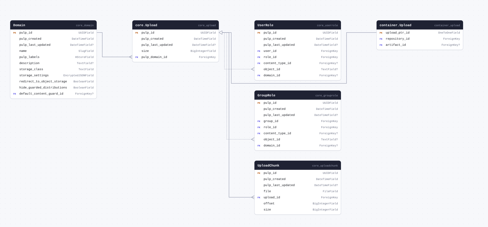

| Column | Field | Type | Null | Key | Default | Description |
| --- | --- | --- | --- | --- | --- | --- |
| `pulp_id` | `UUIDField` | `uuid` |  | PK | `pulp_uuid()` |  |
| `pulp_created` | `DateTimeField` | `timestamp with time zone` |  |  | `now()` |  |
| `pulp_last_updated` | `DateTimeField` | `timestamp with time zone` | yes |  | `now()` |  |
| `size` | `BigIntegerField` | `bigint` |  |  |  |  |
| `pulp_domain_id` | `ForeignKey` | `uuid` |  | FK | `get_domain_pk()` |  |

Indexes:

- index `core_upload_pulp_domain_id_e9e64852` on `pulp_domain_id`

Relations:

- `pulp_domain_id` → [Domain](#domain).`pulp_id`, on delete protect
- `user_roles` ← [UserRole](#userrole), by `content_type_id` + `object_id` (generic relation)
- `group_roles` ← [GroupRole](#grouprole), by `content_type_id` + `object_id` (generic relation)
- [UploadChunk](#uploadchunk).`upload_id` → `pulp_id`, on delete cascade
- [container.Upload](#containerupload).`upload_ptr_id` → `pulp_id`, parent link, on delete cascade

## UploadChunk

Table `core_uploadchunk`, app `core`.

Columns from `BaseModel` (abstract): `pulp_id`, `pulp_created`, `pulp_last_updated`.

A chunk for an uploaded file.

Fields:

    file (fields.FileField): A file where the uploaded chunk is stored.
    upload (models.ForeignKey): Upload this chunk belongs to.
    offset (models.BigIntegerField): Start of the chunk in bytes.
    size (models.BigIntegerField): Size of the chunk in bytes.


| Column | Field | Type | Null | Key | Default | Description |
| --- | --- | --- | --- | --- | --- | --- |
| `pulp_id` | `UUIDField` | `uuid` |  | PK | `pulp_uuid()` |  |
| `pulp_created` | `DateTimeField` | `timestamp with time zone` |  |  | `now()` |  |
| `pulp_last_updated` | `DateTimeField` | `timestamp with time zone` | yes |  | `now()` |  |
| `file` | `FileField` | `varchar(255)` |  |  |  |  |
| `upload_id` | `ForeignKey` | `uuid` |  | FK |  |  |
| `offset` | `BigIntegerField` | `bigint` |  |  |  |  |
| `size` | `BigIntegerField` | `bigint` |  |  |  |  |

Indexes:

- index `core_uploadchunk_upload_id_200d71c7` on `upload_id`

Relations:

- `upload_id` → [core.Upload](#coreupload).`pulp_id`, on delete cascade
- `user_roles` ← [UserRole](#userrole), by `content_type_id` + `object_id` (generic relation)
- `group_roles` ← [GroupRole](#grouprole), by `content_type_id` + `object_id` (generic relation)

## VulnerabilityReport

Table `core_vulnerabilityreport`, app `core`.

Columns from `BaseModel` (abstract): `pulp_id`, `pulp_created`, `pulp_last_updated`.

A model for storing vulnerability reports for Content/RepositoryVersion.

Fields:
    vulns (models.JSONField): A JSON field containing the list of vulnerabilities found
        in osv.dev.

Relations:
    content (models.OneToOneField): The Content object that was scanned for vulnerabilities.
    pulp_domain (models.ForeignKey): The Domain this vulnerability report belongs to,
        providing multi-tenancy isolation.
    repo_versions (models.ManyToManyField): The RepositoryVersion(s) where the scanned
        Content appears. This allows tracking which repository versions contain
        vulnerable content.


| Column | Field | Type | Null | Key | Default | Description |
| --- | --- | --- | --- | --- | --- | --- |
| `pulp_id` | `UUIDField` | `uuid` |  | PK | `pulp_uuid()` |  |
| `pulp_created` | `DateTimeField` | `timestamp with time zone` |  |  | `now()` |  |
| `pulp_last_updated` | `DateTimeField` | `timestamp with time zone` | yes |  | `now()` |  |
| `content_id` | `OneToOneField` | `uuid` |  | FK, unique |  |  |
| `vulns` | `JSONField` | `jsonb` |  |  |  |  |
| `pulp_domain_id` | `ForeignKey` | `uuid` |  | FK | `get_domain_pk()` |  |

Indexes:

- index `core_vulnerabilityreport_pulp_domain_id_91b1e387` on `pulp_domain_id`

Relations:

- `content_id` → [Content](#content).`pulp_id`, on delete cascade
- `pulp_domain_id` → [Domain](#domain).`pulp_id`, on delete cascade
- `repo_versions` — many to many with [RepositoryVersion](#repositoryversion)
- `user_roles` ← [UserRole](#userrole), by `content_type_id` + `object_id` (generic relation)
- `group_roles` ← [GroupRole](#grouprole), by `content_type_id` + `object_id` (generic relation)

## ProgressReport

Table `core_progressreport`, app `core`.

Columns from `BaseModel` (abstract): `pulp_id`, `pulp_created`, `pulp_last_updated`.

A model for all progress reporting.

All progress reports have a message, state, and are related to a Task.

Plugin writers should create these objects to show progress reporting of a single step or
aspect of work which has a name and state. For example:

    >>> ProgressReport(
    >>>     message='Publishing files', code='publish', total=23
    >>> )  # default: state='waiting' and done=0

    >>> ProgressReport(
    >>>     message='Publishing files', code='publish', total=23, state='running'
    >>> )  # specify the state
    >>> ProgressReport(
    >>>     message='Publishing files', code='publish', total=23, done=16
    >>> )  # already completed 16

Update the state to COMPLETED and save it:

    >>> progress_bar = ProgressReport(
    >>>     message='Publishing files', code='publish', total=23, state='running'
    >>> )
    >>> progress_bar.state = 'completed'
    >>> progress_bar.save()

The ProgressReport() is a context manager that provides automatic state transitions and saving
for the RUNNING CANCELED COMPLETED and FAILED states. The increment() method can be called in
the loop as work is completed. When ProgressReport() is used as a context manager progress
reporting is rate limited to every 500 milliseconds.
Use it as follows:

    >>> progress_bar = ProgressReport(
    >>>     message='Publishing files', code='publish', total=len(files_iterator)
    >>> )
    >>> progress_bar.save()
    >>> with progress_bar:
    >>>     # progress_bar saved as 'running'
    >>>     for file in files_iterator:
    >>>         handle(file)
    >>>         progress_bar.increment()  # increments and saves
    >>> # progress_bar is saved as 'completed' if no exception or 'failed' otherwise

A convenience method called iter() allows you to avoid calling increment() directly:

    >>> progress_bar = ProgressReport(
    >>>     message='Publishing files', code='publish', total=len(files_iterator)
    >>> )
    >>> progress_bar.save()
    >>> with progress_bar:
    >>>     for file in progress_bar.iter(files_iterator):
    >>>         handle(file)

You can also use this short form which handles all necessary save() calls:

    >>> data = dict(message='Publishing files', code='publish', total=len(files_iterator))
    >>> with ProgressReport(**data) as pb:
    >>>     for file in pb.iter(files_iterator):
    >>>         handle(file)

ProgressReport objects are associated with a Task and auto-discover and populate the task id
when saved.

When using threads to update a ProgressReport in parallel, it is recommended that all threads
share the same in-memory instance. Django does not synchronize in-memory model instances, so
multiple instances of a specific ProgressReport will diverge as they are written to from
separate threads.

Fields:

    message (models.TextField): short message for the progress update, typically
        shown to the user. (required)
    code (models.TextField): identifies the type of progress report
    state (models.TextField): The state of the progress update. Defaults to `WAITING`. This
        field uses a limited set of choices of field states. See `STATES` for possible states.
    total: (models.IntegerField) The total count of items to be handled
    done (models.IntegerField): The count of items already processed. Defaults to 0.
    suffix (models.TextField): Customizable suffix rendered with the progress report
        See `the docs <https://github.com/verigak/progress>`_. for more info.

Relations:

    task: The task associated with this progress report. If left unset when save() is called
        it will be set to the current task_id.


| Column | Field | Type | Null | Key | Default | Description |
| --- | --- | --- | --- | --- | --- | --- |
| `pulp_id` | `UUIDField` | `uuid` |  | PK | `pulp_uuid()` |  |
| `pulp_created` | `DateTimeField` | `timestamp with time zone` |  |  | `now()` |  |
| `pulp_last_updated` | `DateTimeField` | `timestamp with time zone` | yes |  | `now()` |  |
| `message` | `TextField` | `text` |  |  |  |  |
| `code` | `TextField` | `text` |  |  |  |  |
| `state` | `ProgressReportState` | `text` |  |  | `'waiting'` |  |
| `total` | `IntegerField` | `integer` | yes |  |  |  |
| `done` | `IntegerField` | `integer` |  |  | `0` |  |
| `task_id` | `ForeignKey` | `uuid` |  | FK |  |  |
| `suffix` | `TextField` | `text` | yes |  |  |  |

Indexes:

- index `core_progressreport_task_id_0c3fbc3b` on `task_id`

Relations:

- `task_id` → [Task](#task).`pulp_id`, on delete cascade
- `user_roles` ← [UserRole](#userrole), by `content_type_id` + `object_id` (generic relation)
- `group_roles` ← [GroupRole](#grouprole), by `content_type_id` + `object_id` (generic relation)

## GroupProgressReport

Table `core_groupprogressreport`, app `core`.

Columns from `BaseModel` (abstract): `pulp_id`, `pulp_created`, `pulp_last_updated`.

A model for all progress reporting in a Task Group.

All progress reports have a message, code and are related to a Task Group.

Once a Task Group is created, plugin writers should create these objects ahead.
For example:

    >>> task_group = TaskGroup(description="Migration Sub-tasks")
    >>> task_group.save()
    >>> group_pr = GroupProgressReport(
    >>>     message="Repo migration",
    >>>     code="create.repo_version",
    >>>     task_group=task_group).save()

Taks that will be executing certain work, and is part of a TaskGroup, will look for
the Task group it belongs to and find appropriate progress report by its code and will
update it accordingly.

For example:

    >>> task_group = TaskGroup.current()
    >>> progress_repo = task_group.group_progress_reports.filter(code='create.repo_version')
    >>> progress_repo.update(done=F('done') + 1)

To avoid race conditions/cache invalidation issues, this pattern needs to be used so that
operations are performed directly inside the database:

.update(done=F('done') + 1)

See: https://docs.djangoproject.com/en/3.2/ref/models/expressions/#f-expressions
Important: F() objects assigned to model fields persist after saving the model instance and
will be applied on each save(). Do not use save() and use update() instead, otherwise
refresh_from_db() should be called after each save()

Fields:

    message (models.TextField): short message for the progress update, typically
        shown to the user. (required)
    code (models.TextField): identifies the type of progress report
    total: (models.IntegerField) The total count of items to be handled
    done (models.IntegerField): The count of items already processed. Defaults to 0.
    suffix (models.TextField): Customizable suffix rendered with the progress report
        See `the docs <https://github.com/verigak/progress>`_. for more info.

Relations:

    task_group: The task group associated with this group progress report.


| Column | Field | Type | Null | Key | Default | Description |
| --- | --- | --- | --- | --- | --- | --- |
| `pulp_id` | `UUIDField` | `uuid` |  | PK | `pulp_uuid()` |  |
| `pulp_created` | `DateTimeField` | `timestamp with time zone` |  |  | `now()` |  |
| `pulp_last_updated` | `DateTimeField` | `timestamp with time zone` | yes |  | `now()` |  |
| `message` | `TextField` | `text` |  |  |  |  |
| `code` | `TextField` | `text` |  |  |  |  |
| `total` | `IntegerField` | `integer` |  |  | `0` |  |
| `done` | `IntegerField` | `integer` |  |  | `0` |  |
| `task_group_id` | `ForeignKey` | `uuid` |  | FK |  |  |
| `suffix` | `TextField` | `text` | yes |  |  |  |

Indexes:

- index `core_groupprogressreport_task_group_id_f952b991` on `task_group_id`
- unique `core_groupprogressreport_code_task_group_id_9ed759b0_uniq` on `code`, `task_group_id`

Relations:

- `task_group_id` → [TaskGroup](#taskgroup).`pulp_id`, on delete cascade
- `user_roles` ← [UserRole](#userrole), by `content_type_id` + `object_id` (generic relation)
- `group_roles` ← [GroupRole](#grouprole), by `content_type_id` + `object_id` (generic relation)

## UpstreamPulp

Table `core_upstreampulp`, app `core`.

Columns from `BaseModel` (abstract): `pulp_id`, `pulp_created`, `pulp_last_updated`.


| Column | Field | Type | Null | Key | Default | Description |
| --- | --- | --- | --- | --- | --- | --- |
| `pulp_id` | `UUIDField` | `uuid` |  | PK | `pulp_uuid()` |  |
| `pulp_created` | `DateTimeField` | `timestamp with time zone` |  |  | `now()` |  |
| `pulp_last_updated` | `DateTimeField` | `timestamp with time zone` | yes |  | `now()` |  |
| `name` | `TextField` | `text` |  |  |  |  |
| `pulp_domain_id` | `ForeignKey` | `uuid` |  | FK | `get_domain_pk()` |  |
| `base_url` | `TextField` | `text` |  |  |  |  |
| `api_root` | `TextField` | `text` |  |  | `'pulp'` |  |
| `domain` | `TextField` | `text` | yes |  |  |  |
| `ca_cert` | `TextField` | `text` | yes |  |  |  |
| `client_cert` | `TextField` | `text` | yes |  |  |  |
| `client_key` | `EncryptedTextField` | `text` | yes |  |  |  |
| `tls_validation` | `BooleanField` | `boolean` |  |  | `True` |  |
| `username` | `EncryptedTextField` | `text` | yes |  |  |  |
| `password` | `EncryptedTextField` | `text` | yes |  |  |  |
| `download_concurrency` | `PositiveIntegerField` | `integer` | yes |  |  |  |
| `max_retries` | `PositiveIntegerField` | `integer` | yes |  |  |  |
| `total_timeout` | `FloatField` | `double precision` | yes |  |  |  |
| `connect_timeout` | `FloatField` | `double precision` | yes |  |  |  |
| `sock_connect_timeout` | `FloatField` | `double precision` | yes |  |  |  |
| `sock_read_timeout` | `FloatField` | `double precision` | yes |  |  |  |
| `remote_policy` | `UpstreamPulpRemotePolicy` | `text` | yes |  |  |  |
| `q_select` | `TextField` | `text` | yes |  |  |  |
| `policy` | `UpstreamPulpPolicy` | `text` |  |  | `'all'` |  |
| `last_replication` | `DateTimeField` | `timestamp with time zone` | yes |  |  |  |

Indexes:

- index `core_upstreampulp_name_7ae8e56d` on `name`
- index `core_upstreampulp_name_7ae8e56d_like` on `name` (`text_pattern_ops`)
- index `core_upstreampulp_pulp_domain_id_3c118ec4` on `pulp_domain_id`
- unique `core_upstreampulp_name_pulp_domain_id_9682c4c2_uniq` on `name`, `pulp_domain_id`

Relations:

- `pulp_domain_id` → [Domain](#domain).`pulp_id`, on delete protect
- `user_roles` ← [UserRole](#userrole), by `content_type_id` + `object_id` (generic relation)
- `group_roles` ← [GroupRole](#grouprole), by `content_type_id` + `object_id` (generic relation)

## OpenPGPPublicKey

Table `core_openpgppublickey`, app `core`.

Inherits from [Content](#content) (multi-table): its rows are joined on `content_ptr_id`.

Columns from `_OpenPGPContent` (abstract): `content_ptr_id`, `raw_data`.


| Column | Field | Type | Null | Key | Default | Description |
| --- | --- | --- | --- | --- | --- | --- |
| `content_ptr_id` | `OneToOneField` | `uuid` |  | PK, FK |  |  |
| `raw_data` | `BinaryField` | `bytea` |  |  |  |  |
| `fingerprint` | `CharField` | `varchar(64)` |  |  |  |  |
| `created` | `DateTimeField` | `timestamp with time zone` |  |  |  |  |
| `_pulp_domain_id` | `ForeignKey` | `uuid` |  | FK | `get_domain_pk()` |  |

Indexes:

- index `core_openpgppublickey__pulp_domain_id_a6e150e5` on `_pulp_domain_id`
- unique `core_openpgppublickey__pulp_domain_id_fingerprint_832cb62b_uniq` on `_pulp_domain_id`, `fingerprint`

Relations:

- `content_ptr_id` → [Content](#content).`pulp_id`, parent link, on delete cascade
- `_pulp_domain_id` → [Domain](#domain).`pulp_id`, on delete protect
- `user_roles` ← [UserRole](#userrole), by `content_type_id` + `object_id` (generic relation)
- `group_roles` ← [GroupRole](#grouprole), by `content_type_id` + `object_id` (generic relation)
- [OpenPGPPublicSubkey](#openpgppublicsubkey).`public_key_id` → `content_ptr_id`, on delete protect
- [OpenPGPUserID](#openpgpuserid).`public_key_id` → `content_ptr_id`, on delete protect
- [OpenPGPUserAttribute](#openpgpuserattribute).`public_key_id` → `content_ptr_id`, on delete protect

## OpenPGPPublicSubkey

Table `core_openpgppublicsubkey`, app `core`.

Inherits from [Content](#content) (multi-table): its rows are joined on `content_ptr_id`.

Columns from `_OpenPGPContent` (abstract): `content_ptr_id`, `raw_data`.


| Column | Field | Type | Null | Key | Default | Description |
| --- | --- | --- | --- | --- | --- | --- |
| `content_ptr_id` | `OneToOneField` | `uuid` |  | PK, FK |  |  |
| `raw_data` | `BinaryField` | `bytea` |  |  |  |  |
| `public_key_id` | `ForeignKey` | `uuid` |  | FK |  |  |
| `fingerprint` | `CharField` | `varchar(64)` |  |  |  |  |
| `created` | `DateTimeField` | `timestamp with time zone` |  |  |  |  |

Indexes:

- index `core_openpgppublicsubkey_public_key_id_f502671b` on `public_key_id`
- unique `core_openpgppublicsubkey_public_key_id_fingerprin_eb53996b_uniq` on `public_key_id`, `fingerprint`

Relations:

- `content_ptr_id` → [Content](#content).`pulp_id`, parent link, on delete cascade
- `public_key_id` → [OpenPGPPublicKey](#openpgppublickey).`content_ptr_id`, on delete protect
- `user_roles` ← [UserRole](#userrole), by `content_type_id` + `object_id` (generic relation)
- `group_roles` ← [GroupRole](#grouprole), by `content_type_id` + `object_id` (generic relation)

## OpenPGPUserID

Table `core_openpgpuserid`, app `core`.

Inherits from [Content](#content) (multi-table): its rows are joined on `content_ptr_id`.

Columns from `_OpenPGPContent` (abstract): `content_ptr_id`, `raw_data`.


| Column | Field | Type | Null | Key | Default | Description |
| --- | --- | --- | --- | --- | --- | --- |
| `content_ptr_id` | `OneToOneField` | `uuid` |  | PK, FK |  |  |
| `raw_data` | `BinaryField` | `bytea` |  |  |  |  |
| `public_key_id` | `ForeignKey` | `uuid` |  | FK |  |  |
| `user_id` | `CharField` | `varchar` |  |  |  |  |

Indexes:

- index `core_openpgpuserid_public_key_id_fda4eea7` on `public_key_id`
- unique `core_openpgpuserid_public_key_id_user_id_f9d9c4a9_uniq` on `public_key_id`, `user_id`

Relations:

- `content_ptr_id` → [Content](#content).`pulp_id`, parent link, on delete cascade
- `public_key_id` → [OpenPGPPublicKey](#openpgppublickey).`content_ptr_id`, on delete protect
- `user_roles` ← [UserRole](#userrole), by `content_type_id` + `object_id` (generic relation)
- `group_roles` ← [GroupRole](#grouprole), by `content_type_id` + `object_id` (generic relation)

## OpenPGPUserAttribute

Table `core_openpgpuserattribute`, app `core`.

Inherits from [Content](#content) (multi-table): its rows are joined on `content_ptr_id`.

Columns from `_OpenPGPContent` (abstract): `content_ptr_id`, `raw_data`.


| Column | Field | Type | Null | Key | Default | Description |
| --- | --- | --- | --- | --- | --- | --- |
| `content_ptr_id` | `OneToOneField` | `uuid` |  | PK, FK |  |  |
| `raw_data` | `BinaryField` | `bytea` |  |  |  |  |
| `sha256` | `CharField` | `varchar(128)` |  |  |  |  |
| `public_key_id` | `ForeignKey` | `uuid` |  | FK |  |  |

Indexes:

- index `core_openpgpuserattribute_public_key_id_5ac35c1f` on `public_key_id`
- unique `core_openpgpuserattribute_public_key_id_sha256_1694e6dd_uniq` on `public_key_id`, `sha256`

Relations:

- `content_ptr_id` → [Content](#content).`pulp_id`, parent link, on delete cascade
- `public_key_id` → [OpenPGPPublicKey](#openpgppublickey).`content_ptr_id`, on delete protect
- `user_roles` ← [UserRole](#userrole), by `content_type_id` + `object_id` (generic relation)
- `group_roles` ← [GroupRole](#grouprole), by `content_type_id` + `object_id` (generic relation)

## OpenPGPSignature

Table `core_openpgpsignature`, app `core`.

Inherits from [Content](#content) (multi-table): its rows are joined on `content_ptr_id`.

Columns from `_OpenPGPContent` (abstract): `content_ptr_id`, `raw_data`.


| Column | Field | Type | Null | Key | Default | Description |
| --- | --- | --- | --- | --- | --- | --- |
| `content_ptr_id` | `OneToOneField` | `uuid` |  | PK, FK |  |  |
| `raw_data` | `BinaryField` | `bytea` |  |  |  |  |
| `sha256` | `CharField` | `varchar(128)` |  |  |  |  |
| `signature_type` | `PositiveSmallIntegerField` | `smallint` |  |  |  |  |
| `created` | `DateTimeField` | `timestamp with time zone` |  |  |  |  |
| `expiration_time` | `DurationField` | `interval` | yes |  |  |  |
| `key_expiration_time` | `DurationField` | `interval` | yes |  |  |  |
| `issuer` | `CharField` | `varchar(16)` | yes |  |  |  |
| `signers_user_id` | `CharField` | `varchar` | yes |  |  |  |
| `signed_content_id` | `ForeignKey` | `uuid` |  | FK |  |  |

Indexes:

- index `core_openpgpsignature_signed_content_id_9f7ec2ce` on `signed_content_id`
- unique `core_openpgpsignature_signed_content_id_sha256_3c9adf6a_uniq` on `signed_content_id`, `sha256`

Relations:

- `content_ptr_id` → [Content](#content).`pulp_id`, parent link, on delete cascade
- `signed_content_id` → [Content](#content).`pulp_id`, on delete protect
- `user_roles` ← [UserRole](#userrole), by `content_type_id` + `object_id` (generic relation)
- `group_roles` ← [GroupRole](#grouprole), by `content_type_id` + `object_id` (generic relation)

## OpenPGPKeyring

Table `core_openpgpkeyring`, app `core`.

Inherits from [Repository](#repository) (multi-table): its rows are joined on `repository_ptr_id`.

A Repository to hold OpenPGP (rfc4880bis) public key material.


| Column | Field | Type | Null | Key | Default | Description |
| --- | --- | --- | --- | --- | --- | --- |
| `repository_ptr_id` | `OneToOneField` | `uuid` |  | PK, FK |  |  |

Relations:

- `repository_ptr_id` → [Repository](#repository).`pulp_id`, parent link, on delete cascade
- `user_roles` ← [UserRole](#userrole), by `content_type_id` + `object_id` (generic relation)
- `group_roles` ← [GroupRole](#grouprole), by `content_type_id` + `object_id` (generic relation)

## OpenPGPDistribution

Table `core_openpgpdistribution`, app `core`.

Inherits from [Distribution](#distribution) (multi-table): its rows are joined on `distribution_ptr_id`.

A Distribution to allow downloading OpenPGP keys.


| Column | Field | Type | Null | Key | Default | Description |
| --- | --- | --- | --- | --- | --- | --- |
| `distribution_ptr_id` | `OneToOneField` | `uuid` |  | PK, FK |  |  |

Relations:

- `distribution_ptr_id` → [Distribution](#distribution).`pulp_id`, parent link, on delete cascade
- `user_roles` ← [UserRole](#userrole), by `content_type_id` + `object_id` (generic relation)
- `group_roles` ← [GroupRole](#grouprole), by `content_type_id` + `object_id` (generic relation)

## Blob

Table `container_blob`, app `container`.

Inherits from [Content](#content) (multi-table): its rows are joined on `content_ptr_id`.

A blob defined within a manifest.

The actual blob file is stored as an artifact.

Fields:
    digest (models.TextField): The blob digest.

Relations:
    manifest (models.ForeignKey): Many-to-one relationship with Manifest.


| Column | Field | Type | Null | Key | Default | Description |
| --- | --- | --- | --- | --- | --- | --- |
| `content_ptr_id` | `OneToOneField` | `uuid` |  | PK, FK |  |  |
| `digest` | `TextField` | `text` |  |  |  |  |
| `_pulp_domain_id` | `ForeignKey` | `uuid` |  | FK | `get_domain_pk()` |  |

Indexes:

- index `container_blob_digest_c5346679` on `digest`
- index `container_blob_digest_c5346679_like` on `digest` (`text_pattern_ops`)
- index `container_blob__pulp_domain_id_2b86fe9d` on `_pulp_domain_id`
- unique `container_blob_digest__pulp_domain_id_b6e4dc87_uniq` on `digest`, `_pulp_domain_id`

Relations:

- `container_manifest` — many to many with [Manifest](#manifest), through [BlobManifest](#blobmanifest)
- `content_ptr_id` → [Content](#content).`pulp_id`, parent link, on delete cascade
- `_pulp_domain_id` → [Domain](#domain).`pulp_id`, on delete protect
- `user_roles` ← [UserRole](#userrole), by `content_type_id` + `object_id` (generic relation)
- `group_roles` ← [GroupRole](#grouprole), by `content_type_id` + `object_id` (generic relation)
- [Manifest](#manifest).`config_blob_id` → `content_ptr_id`, on delete cascade
- [BlobManifest](#blobmanifest).`manifest_blob_id` → `content_ptr_id`, on delete cascade
- `container_containerrepository` — many to many with [ContainerRepository](#containerrepository)
- `container_containerpushrepository` — many to many with [ContainerPushRepository](#containerpushrepository)

## Manifest

Table `container_manifest`, app `container`.

Inherits from [Content](#content) (multi-table): its rows are joined on `content_ptr_id`.

A container manifest.

This content has one artifact.

Fields:
    digest (models.TextField): The manifest digest.
    schema_version (models.IntegerField): The manifest schema version.
    media_type (models.TextField): The manifest media type.
    type (models.TextField): The manifest's type (flatpak, bootable, signature, etc.).
    data (models.TextField): The manifest's data in text format.
    annotations (models.JSONField): Metadata stored inside the image manifest.
    labels (models.JSONField): Metadata stored inside the image configuration.
    is_bootable (models.BooleanField): Indicates whether the image is bootable or not.
    is_flatpak (models.BooleanField): Indicates whether the image is a flatpak package or not.
    architecture (models.TextField): CPU architecture for which the binaries in the image are
        designed to run.
    os (models.TextField): Operating System which the image is built to run on.
    compressed_image_size (models.IntegerField): Sum of the sizes, in bytes, of all compressed
        layers.

Relations:
    blobs (models.ManyToManyField): Many-to-many relationship with Blob.
    config_blob (models.ForeignKey): Blob that contains configuration for this Manifest.
    listed_manifests (models.ManyToManyField): Many-to-many relationship with Manifest. This
        field is used only for a manifest-list type Manifests.


| Column | Field | Type | Null | Key | Default | Description |
| --- | --- | --- | --- | --- | --- | --- |
| `content_ptr_id` | `OneToOneField` | `uuid` |  | PK, FK |  |  |
| `digest` | `TextField` | `text` |  |  |  |  |
| `schema_version` | `IntegerField` | `integer` |  |  |  |  |
| `media_type` | `ManifestMediaType` | `text` |  |  |  |  |
| `type` | `CharField` | `varchar` | yes |  |  |  |
| `data` | `TextField` | `text` | yes |  |  |  |
| `annotations` | `JSONField` | `jsonb` |  |  | `dict()` |  |
| `labels` | `JSONField` | `jsonb` |  |  | `dict()` |  |
| `architecture` | `TextField` | `text` | yes |  |  |  |
| `os` | `TextField` | `text` | yes |  |  |  |
| `compressed_image_size` | `BigIntegerField` | `bigint` | yes |  |  |  |
| `is_bootable` | `BooleanField` | `boolean` |  |  | `False` |  |
| `is_flatpak` | `BooleanField` | `boolean` |  |  | `False` |  |
| `config_blob_id` | `ForeignKey` | `uuid` | yes | FK |  |  |
| `_pulp_domain_id` | `ForeignKey` | `uuid` |  | FK | `get_domain_pk()` |  |

Indexes:

- index `container_manifest_digest_d362b1f0` on `digest`
- index `container_manifest_digest_d362b1f0_like` on `digest` (`text_pattern_ops`)
- index `container_manifest_config_blob_id_cdbfab2b` on `config_blob_id`
- index `container_manifest__pulp_domain_id_e4b06bf3` on `_pulp_domain_id`
- unique `container_manifest_digest__pulp_domain_id_f58b0590_uniq` on `digest`, `_pulp_domain_id`

Relations:

- `blobs` — many to many with [Blob](#blob), through [BlobManifest](#blobmanifest)
- `listed_manifests` — many to many with [Manifest](#manifest), through [ManifestListManifest](#manifestlistmanifest)
- `container_manifest` — many to many with [Manifest](#manifest), through [ManifestListManifest](#manifestlistmanifest)
- `content_ptr_id` → [Content](#content).`pulp_id`, parent link, on delete cascade
- `config_blob_id` → [Blob](#blob).`content_ptr_id`, on delete cascade
- `_pulp_domain_id` → [Domain](#domain).`pulp_id`, on delete protect
- `user_roles` ← [UserRole](#userrole), by `content_type_id` + `object_id` (generic relation)
- `group_roles` ← [GroupRole](#grouprole), by `content_type_id` + `object_id` (generic relation)
- [BlobManifest](#blobmanifest).`manifest_id` → `content_ptr_id`, on delete cascade
- [ManifestListManifest](#manifestlistmanifest).`image_manifest_id` → `content_ptr_id`, on delete cascade
- [ManifestListManifest](#manifestlistmanifest).`manifest_list_id` → `content_ptr_id`, on delete cascade
- [Tag](#tag).`tagged_manifest_id` → `content_ptr_id`, on delete cascade
- [ManifestSignature](#manifestsignature).`signed_manifest_id` → `content_ptr_id`, on delete cascade
- `container_containerrepository` — many to many with [ContainerRepository](#containerrepository)
- `container_containerpushrepository` — many to many with [ContainerPushRepository](#containerpushrepository)

## BlobManifest

Table `container_blobmanifest`, app `container`.

Many-to-many relationship between Blobs and Manifests.


| Column | Field | Type | Null | Key | Default | Description |
| --- | --- | --- | --- | --- | --- | --- |
| `id` | `AutoField` | `integer` |  | PK | `autoincrement()` |  |
| `manifest_id` | `ForeignKey` | `uuid` |  | FK |  |  |
| `manifest_blob_id` | `ForeignKey` | `uuid` |  | FK |  |  |

Indexes:

- index `container_blobmanifest_manifest_id_a9f8feee` on `manifest_id`
- index `container_blobmanifest_manifest_blob_id_8382ada3` on `manifest_blob_id`
- unique `container_blobmanifest_manifest_id_manifest_blo_05da3e8d_uniq` on `manifest_id`, `manifest_blob_id`

Relations:

- `manifest_id` → [Manifest](#manifest).`content_ptr_id`, on delete cascade
- `manifest_blob_id` → [Blob](#blob).`content_ptr_id`, on delete cascade

## ManifestListManifest

Table `container_manifestlistmanifest`, app `container`.

The manifest referenced by a manifest list.

Fields:
    architecture (models.TextField): The platform architecture.
    variant (models.TextField): The platform variant.
    features (models.TextField): The platform features.
    os (models.TextField): The platform OS name.
    os_version (models.TextField): The platform OS version.
    os_features (models.TextField): The platform OS features.

Relations:
    image_manifest (models.ForeignKey): Many-to-one relationship with Manifest.
    manifest_list (models.ForeignKey): Many-to-one relationship with ManifestList.


| Column | Field | Type | Null | Key | Default | Description |
| --- | --- | --- | --- | --- | --- | --- |
| `id` | `AutoField` | `integer` |  | PK | `autoincrement()` |  |
| `architecture` | `TextField` | `text` |  |  | `''` |  |
| `os` | `TextField` | `text` |  |  | `''` |  |
| `os_version` | `TextField` | `text` |  |  | `''` |  |
| `os_features` | `TextField` | `text` |  |  | `''` |  |
| `features` | `TextField` | `text` |  |  | `''` |  |
| `variant` | `TextField` | `text` |  |  | `''` |  |
| `image_manifest_id` | `ForeignKey` | `uuid` |  | FK |  |  |
| `manifest_list_id` | `ForeignKey` | `uuid` |  | FK |  |  |

Indexes:

- index `container_manifestlistmanifest_image_manifest_id_dfef7fa1` on `image_manifest_id`
- index `container_manifestlistmanifest_manifest_list_id_56c413df` on `manifest_list_id`
- unique `container_manifestlistma_image_manifest_id_manife_d1193c3b_uniq` on `image_manifest_id`, `manifest_list_id`

Relations:

- `image_manifest_id` → [Manifest](#manifest).`content_ptr_id`, on delete cascade
- `manifest_list_id` → [Manifest](#manifest).`content_ptr_id`, on delete cascade

## Tag

Table `container_tag`, app `container`.

Inherits from [Content](#content) (multi-table): its rows are joined on `content_ptr_id`.

A tagged Manifest.

Fields:
    name (models.TextField): The tag name.

Relations:
    tagged_manifest (models.ForeignKey): A referenced Manifest.


| Column | Field | Type | Null | Key | Default | Description |
| --- | --- | --- | --- | --- | --- | --- |
| `content_ptr_id` | `OneToOneField` | `uuid` |  | PK, FK |  |  |
| `name` | `TextField` | `text` |  |  |  |  |
| `tagged_manifest_id` | `ForeignKey` | `uuid` |  | FK |  |  |
| `_pulp_domain_id` | `ForeignKey` | `uuid` |  | FK | `get_domain_pk()` |  |

Indexes:

- index `container_tag_name_415c334a` on `name`
- index `container_tag_name_415c334a_like` on `name` (`text_pattern_ops`)
- index `container_tag_tagged_manifest_id_e9ace947` on `tagged_manifest_id`
- index `container_tag__pulp_domain_id_14b34e92` on `_pulp_domain_id`
- unique `container_tag_name_tagged_manifest_id__5006d312_uniq` on `name`, `tagged_manifest_id`, `_pulp_domain_id`

Relations:

- `content_ptr_id` → [Content](#content).`pulp_id`, parent link, on delete cascade
- `tagged_manifest_id` → [Manifest](#manifest).`content_ptr_id`, on delete cascade
- `_pulp_domain_id` → [Domain](#domain).`pulp_id`, on delete protect
- `user_roles` ← [UserRole](#userrole), by `content_type_id` + `object_id` (generic relation)
- `group_roles` ← [GroupRole](#grouprole), by `content_type_id` + `object_id` (generic relation)

## ManifestSignature

Table `container_manifestsignature`, app `container`.

Inherits from [Content](#content) (multi-table): its rows are joined on `content_ptr_id`.

A signature for a manifest.

Fields:
    name (models.TextField): A signature name in the 'manifest_digest@random_name' format.
    digest (models.TextField): A signature sha256 digest prepended with its algorithm `sha256:`.
    type (models.TextField): A signature type as specified in signature metadata. Currently
                             it's only "atomic container signature".
    key_id (models.TextField): A PGP key id (last 8 bytes of the fingerprint).
    fingerprint (models.TextField): A PGP key fingerprint
    timestamp (models.PositiveIntegerField): A signature timestamp identified by gpg.
    creator (models.TextField): A signature creator.
    data (models.TextField): A signature, base64 encoded.

Relations:
    signed_manifest (models.ForeignKey): A manifest this signature is relevant to.


| Column | Field | Type | Null | Key | Default | Description |
| --- | --- | --- | --- | --- | --- | --- |
| `content_ptr_id` | `OneToOneField` | `uuid` |  | PK, FK |  |  |
| `name` | `TextField` | `text` |  |  |  |  |
| `digest` | `TextField` | `text` |  |  |  |  |
| `type` | `ManifestSignatureType` | `text` |  |  |  |  |
| `key_id` | `TextField` | `text` |  |  |  |  |
| `fingerprint` | `TextField` | `text` | yes |  |  |  |
| `timestamp` | `PositiveIntegerField` | `integer` |  |  |  |  |
| `creator` | `TextField` | `text` |  |  |  |  |
| `data` | `TextField` | `text` |  |  |  |  |
| `signed_manifest_id` | `ForeignKey` | `uuid` |  | FK |  |  |
| `_pulp_domain_id` | `ForeignKey` | `uuid` |  | FK | `get_domain_pk()` |  |

Indexes:

- index `container_manifestsignature_name_ab51eb5d` on `name`
- index `container_manifestsignature_name_ab51eb5d_like` on `name` (`text_pattern_ops`)
- index `container_manifestsignature_key_id_94a89359` on `key_id`
- index `container_manifestsignature_key_id_94a89359_like` on `key_id` (`text_pattern_ops`)
- index `container_manifestsignature_fingerprint_85591d0a` on `fingerprint`
- index `container_manifestsignature_fingerprint_85591d0a_like` on `fingerprint` (`text_pattern_ops`)
- index `container_manifestsignature_signed_manifest_id_2b052f16` on `signed_manifest_id`
- index `container_manifestsignature__pulp_domain_id_9312ca41` on `_pulp_domain_id`
- unique `container_manifestsignat_digest__pulp_domain_id_3b91b79a_uniq` on `digest`, `_pulp_domain_id`

Relations:

- `content_ptr_id` → [Content](#content).`pulp_id`, parent link, on delete cascade
- `signed_manifest_id` → [Manifest](#manifest).`content_ptr_id`, on delete cascade
- `_pulp_domain_id` → [Domain](#domain).`pulp_id`, on delete protect
- `user_roles` ← [UserRole](#userrole), by `content_type_id` + `object_id` (generic relation)
- `group_roles` ← [GroupRole](#grouprole), by `content_type_id` + `object_id` (generic relation)

## ContainerNamespace

Table `container_containernamespace`, app `container`.

Columns from `BaseModel` (abstract): `pulp_id`, `pulp_created`, `pulp_last_updated`.

Namespace for the container registry.

Fields:
    name (models.TextField): The name of the namespace.
    pulp_labels (HStoreField): Key-value pairs for labeling and organizing namespaces.


| Column | Field | Type | Null | Key | Default | Description |
| --- | --- | --- | --- | --- | --- | --- |
| `pulp_id` | `UUIDField` | `uuid` |  | PK | `pulp_uuid()` |  |
| `pulp_created` | `DateTimeField` | `timestamp with time zone` |  |  | `now()` |  |
| `pulp_last_updated` | `DateTimeField` | `timestamp with time zone` | yes |  | `now()` |  |
| `name` | `TextField` | `text` |  |  |  |  |
| `pulp_domain_id` | `ForeignKey` | `uuid` |  | FK | `get_domain_pk()` |  |
| `pulp_labels` | `HStoreField` | `hstore` |  |  | `dict()` |  |

Indexes:

- index `container_containernamespace_name_d554fc3d` on `name`
- index `container_containernamespace_name_d554fc3d_like` on `name` (`text_pattern_ops`)
- index `container_containernamespace_pulp_domain_id_da32318a` on `pulp_domain_id`
- unique `container_containernamespace_name_pulp_domain_id_b6b076cf_uniq` on `name`, `pulp_domain_id`

Relations:

- `pulp_domain_id` → [Domain](#domain).`pulp_id`, on delete protect
- `user_roles` ← [UserRole](#userrole), by `content_type_id` + `object_id` (generic relation)
- `group_roles` ← [GroupRole](#grouprole), by `content_type_id` + `object_id` (generic relation)
- [ContainerPullThroughDistribution](#containerpullthroughdistribution).`namespace_id` → `pulp_id`, on delete cascade
- [ContainerDistribution](#containerdistribution).`namespace_id` → `pulp_id`, on delete cascade

## ContainerRemote

Table `container_containerremote`, app `container`.

Inherits from [Remote](#remote) (multi-table): its rows are joined on `remote_ptr_id`.

A Remote for ContainerContent.

Fields:
    upstream_name (models.TextField): The name of the image at the remote.
    include_foreign_layers (models.BooleanField): Foreign layers in the remote
        are included. They are not included by default.
    includes (fields.ArrayField): List of tags (with optional wildcards) and/or
        digests (sha256:<hex>) to sync.
    excludes (fields.ArrayField): List of tag patterns to exclude from sync.
    sigstore (models.TextField): The URL to a sigstore where signatures of container images
        should be synced from.


| Column | Field | Type | Null | Key | Default | Description |
| --- | --- | --- | --- | --- | --- | --- |
| `remote_ptr_id` | `OneToOneField` | `uuid` |  | PK, FK |  |  |
| `upstream_name` | `TextField` | `text` |  |  |  |  |
| `include_foreign_layers` | `BooleanField` | `boolean` |  |  | `False` |  |
| `includes` | `ArrayField` | `text[]` | yes |  |  |  |
| `excludes` | `ArrayField` | `text[]` | yes |  |  |  |
| `sigstore` | `TextField` | `text` | yes |  |  |  |
| `include_tags` | `ArrayField` | `text[]` | yes |  |  |  |
| `exclude_tags` | `ArrayField` | `text[]` | yes |  |  |  |

Indexes:

- index `container_containerremote_upstream_name_7fbaf0d4` on `upstream_name`
- index `container_containerremote_upstream_name_7fbaf0d4_like` on `upstream_name` (`text_pattern_ops`)

Relations:

- `remote_ptr_id` → [Remote](#remote).`pulp_id`, parent link, on delete cascade
- `user_roles` ← [UserRole](#userrole), by `content_type_id` + `object_id` (generic relation)
- `group_roles` ← [GroupRole](#grouprole), by `content_type_id` + `object_id` (generic relation)

## ContainerPullThroughRemote

Table `container_containerpullthroughremote`, app `container`.

Inherits from [Remote](#remote) (multi-table): its rows are joined on `remote_ptr_id`.

A remote for pull-through caching, omitting the requirement for the upstream name.

This remote is used for instantiating new regular container remotes with the upstream name.
Configuring credentials and everything related to container workflows can be therefore done
from within a single instance of this remote.


| Column | Field | Type | Null | Key | Default | Description |
| --- | --- | --- | --- | --- | --- | --- |
| `remote_ptr_id` | `OneToOneField` | `uuid` |  | PK, FK |  |  |
| `includes` | `ArrayField` | `text[]` | yes |  |  |  |
| `excludes` | `ArrayField` | `text[]` | yes |  |  |  |

Relations:

- `remote_ptr_id` → [Remote](#remote).`pulp_id`, parent link, on delete cascade
- `user_roles` ← [UserRole](#userrole), by `content_type_id` + `object_id` (generic relation)
- `group_roles` ← [GroupRole](#grouprole), by `content_type_id` + `object_id` (generic relation)

## ManifestSigningService

Table `container_manifestsigningservice`, app `container`.

Inherits from [SigningService](#signingservice) (multi-table): its rows are joined on `signingservice_ptr_id`.

Signing service used for creating container signatures.


| Column | Field | Type | Null | Key | Default | Description |
| --- | --- | --- | --- | --- | --- | --- |
| `signingservice_ptr_id` | `OneToOneField` | `uuid` |  | PK, FK |  |  |

Relations:

- `signingservice_ptr_id` → [SigningService](#signingservice).`pulp_id`, parent link, on delete cascade
- `user_roles` ← [UserRole](#userrole), by `content_type_id` + `object_id` (generic relation)
- `group_roles` ← [GroupRole](#grouprole), by `content_type_id` + `object_id` (generic relation)
- [ContainerRepository](#containerrepository).`manifest_signing_service_id` → `signingservice_ptr_id`, on delete set null
- [ContainerPushRepository](#containerpushrepository).`manifest_signing_service_id` → `signingservice_ptr_id`, on delete set null

## ContainerRepository

Table `container_containerrepository`, app `container`.

Inherits from [Repository](#repository) (multi-table): its rows are joined on `repository_ptr_id`.

Repository for "container" content.

This Repository type is designed for standard pulp operations, and can be distributed as a
read only registry.

Relations:
    manifest_signing_service (models.ForeignKey): ManifestSigningService this repository will
                                                  use for signing content.


| Column | Field | Type | Null | Key | Default | Description |
| --- | --- | --- | --- | --- | --- | --- |
| `repository_ptr_id` | `OneToOneField` | `uuid` |  | PK, FK |  |  |
| `manifest_signing_service_id` | `ForeignKey` | `uuid` | yes | FK |  |  |

Indexes:

- index `container_containerreposit_manifest_signing_service_i_1de73dc2` on `manifest_signing_service_id`

Relations:

- `repository_ptr_id` → [Repository](#repository).`pulp_id`, parent link, on delete cascade
- `manifest_signing_service_id` → [ManifestSigningService](#manifestsigningservice).`signingservice_ptr_id`, on delete set null
- `pending_blobs` — many to many with [Blob](#blob)
- `pending_manifests` — many to many with [Manifest](#manifest)
- `user_roles` ← [UserRole](#userrole), by `content_type_id` + `object_id` (generic relation)
- `group_roles` ← [GroupRole](#grouprole), by `content_type_id` + `object_id` (generic relation)

## ContainerPushRepository

Table `container_containerpushrepository`, app `container`.

Inherits from [Repository](#repository) (multi-table): its rows are joined on `repository_ptr_id`.

Repository for "container" content.

This repository type is designed for the read and write registry usecase. It will be
automatically instantiated on authorised push to nonexisting repositories.
With this repository type, all but the latest repository_version are solely of historical
interest.

Relations:
    manifest_signing_service (models.ForeignKey): ManifestSigningService this repository will
                                                  use for signing content.


| Column | Field | Type | Null | Key | Default | Description |
| --- | --- | --- | --- | --- | --- | --- |
| `repository_ptr_id` | `OneToOneField` | `uuid` |  | PK, FK |  |  |
| `manifest_signing_service_id` | `ForeignKey` | `uuid` | yes | FK |  |  |

Indexes:

- index `container_containerpushrep_manifest_signing_service_i_1641bcab` on `manifest_signing_service_id`

Relations:

- `repository_ptr_id` → [Repository](#repository).`pulp_id`, parent link, on delete cascade
- `manifest_signing_service_id` → [ManifestSigningService](#manifestsigningservice).`signingservice_ptr_id`, on delete set null
- `pending_blobs` — many to many with [Blob](#blob)
- `pending_manifests` — many to many with [Manifest](#manifest)
- `user_roles` ← [UserRole](#userrole), by `content_type_id` + `object_id` (generic relation)
- `group_roles` ← [GroupRole](#grouprole), by `content_type_id` + `object_id` (generic relation)

## ContainerPullThroughDistribution

Table `container_containerpullthroughdistribution`, app `container`.

Inherits from [Distribution](#distribution) (multi-table): its rows are joined on `distribution_ptr_id`.

A distribution for pull-through caching, referencing normal distributions.


| Column | Field | Type | Null | Key | Default | Description |
| --- | --- | --- | --- | --- | --- | --- |
| `distribution_ptr_id` | `OneToOneField` | `uuid` |  | PK, FK |  |  |
| `namespace_id` | `ForeignKey` | `uuid` | yes | FK |  |  |
| `private` | `BooleanField` | `boolean` |  |  | `False` | Restrict pull access to explicitly authorized users. Related distributions inherit this value. Defaults to unrestricted pull access. |
| `description` | `TextField` | `text` | yes |  |  |  |

Indexes:

- index `container_containerpullthr_namespace_id_4e8843c7` on `namespace_id`

Relations:

- `distribution_ptr_id` → [Distribution](#distribution).`pulp_id`, parent link, on delete cascade
- `namespace_id` → [ContainerNamespace](#containernamespace).`pulp_id`, on delete cascade
- `user_roles` ← [UserRole](#userrole), by `content_type_id` + `object_id` (generic relation)
- `group_roles` ← [GroupRole](#grouprole), by `content_type_id` + `object_id` (generic relation)
- [ContainerDistribution](#containerdistribution).`pull_through_distribution_id` → `distribution_ptr_id`, on delete cascade

## ContainerDistribution

Table `container_containerdistribution`, app `container`.

Inherits from [Distribution](#distribution) (multi-table): its rows are joined on `distribution_ptr_id`.

A container distribution defines how a repository version is distributed by Pulp's webserver.

Fields:
    private (models.BooleanField): Whether the distribution is private or public.
                                   Public by default.
    descripion (models.TextField): Description of the distribution.

Relations:
    namespace (models.ForeignKey): Namespace the distribution belonds to.


| Column | Field | Type | Null | Key | Default | Description |
| --- | --- | --- | --- | --- | --- | --- |
| `distribution_ptr_id` | `OneToOneField` | `uuid` |  | PK, FK |  |  |
| `namespace_id` | `ForeignKey` | `uuid` | yes | FK |  |  |
| `private` | `BooleanField` | `boolean` |  |  | `False` | Restrict pull access to explicitly authorized users. Defaults to unrestricted pull access. |
| `description` | `TextField` | `text` | yes |  |  |  |
| `pull_through_distribution_id` | `ForeignKey` | `uuid` | yes | FK |  |  |

Indexes:

- index `container_containerdistribution_namespace_id_dad12f4c` on `namespace_id`
- index `container_containerdistrib_pull_through_distribution__41e3cefa` on `pull_through_distribution_id`

Relations:

- `distribution_ptr_id` → [Distribution](#distribution).`pulp_id`, parent link, on delete cascade
- `namespace_id` → [ContainerNamespace](#containernamespace).`pulp_id`, on delete cascade
- `pull_through_distribution_id` → [ContainerPullThroughDistribution](#containerpullthroughdistribution).`distribution_ptr_id`, on delete cascade
- `user_roles` ← [UserRole](#userrole), by `content_type_id` + `object_id` (generic relation)
- `group_roles` ← [GroupRole](#grouprole), by `content_type_id` + `object_id` (generic relation)

## container.Upload

Table `container_upload`, app `container`.

Inherits from [core.Upload](#coreupload) (multi-table): its rows are joined on `upload_ptr_id`.

Model for tracking Blob uploads.


| Column | Field | Type | Null | Key | Default | Description |
| --- | --- | --- | --- | --- | --- | --- |
| `upload_ptr_id` | `OneToOneField` | `uuid` |  | PK, FK |  |  |
| `repository_id` | `ForeignKey` | `uuid` |  | FK |  |  |
| `artifact_id` | `ForeignKey` | `uuid` | yes | FK |  |  |

Indexes:

- index `container_upload_repository_id_df854aa2` on `repository_id`
- index `container_upload_artifact_id_d1e92ba6` on `artifact_id`

Relations:

- `upload_ptr_id` → [core.Upload](#coreupload).`pulp_id`, parent link, on delete cascade
- `repository_id` → [Repository](#repository).`pulp_id`, on delete cascade
- `artifact_id` → [Artifact](#artifact).`pulp_id`, on delete set null
- `user_roles` ← [UserRole](#userrole), by `content_type_id` + `object_id` (generic relation)
- `group_roles` ← [GroupRole](#grouprole), by `content_type_id` + `object_id` (generic relation)

## RHSMCertGuard

Table `certguard_rhsmcertguard`, app `certguard`.

Inherits from [ContentGuard](#contentguard) (multi-table): its rows are joined on `contentguard_ptr_id`.

Columns from `BaseCertGuard` (abstract): `contentguard_ptr_id`, `ca_certificate`.

A content-guard validating on a RHSM Certificate validated by `python-rhsm`.

A Certificate Authority certificate to trust is required with each RHSMCertGuard created. With
each request, the client certificate is first checked if it is signed by this CA cert. If not,
it's untrusted and denied regardless of its paths.

After determining the client certificate is trusted, the requested path is checked against the
named paths in the certificate. A request is permitted if the current request path is a prefix
of a path declared in the trusted RHSM Client Certificate.

Fields:
    rhsm_certificate (models.TextField): The RHSM Certificate used to validate the client
        certificate at request time.


| Column | Field | Type | Null | Key | Default | Description |
| --- | --- | --- | --- | --- | --- | --- |
| `contentguard_ptr_id` | `OneToOneField` | `uuid` |  | PK, FK |  |  |
| `ca_certificate` | `TextField` | `text` |  |  |  |  |

Relations:

- `contentguard_ptr_id` → [ContentGuard](#contentguard).`pulp_id`, parent link, on delete cascade
- `user_roles` ← [UserRole](#userrole), by `content_type_id` + `object_id` (generic relation)
- `group_roles` ← [GroupRole](#grouprole), by `content_type_id` + `object_id` (generic relation)

## X509CertGuard

Table `certguard_x509certguard`, app `certguard`.

Inherits from [ContentGuard](#contentguard) (multi-table): its rows are joined on `contentguard_ptr_id`.

Columns from `BaseCertGuard` (abstract): `contentguard_ptr_id`, `ca_certificate`.

A content-guard that authenticates the request based on a client provided X.509 Certificate.

Fields:
    ca_certificate (models.FileField): The CA certificate used to
        validate the client certificate.


| Column | Field | Type | Null | Key | Default | Description |
| --- | --- | --- | --- | --- | --- | --- |
| `contentguard_ptr_id` | `OneToOneField` | `uuid` |  | PK, FK |  |  |
| `ca_certificate` | `TextField` | `text` |  |  |  |  |

Relations:

- `contentguard_ptr_id` → [ContentGuard](#contentguard).`pulp_id`, parent link, on delete cascade
- `user_roles` ← [UserRole](#userrole), by `content_type_id` + `object_id` (generic relation)
- `group_roles` ← [GroupRole](#grouprole), by `content_type_id` + `object_id` (generic relation)

## FileContent

Table `file_filecontent`, app `file`.

Inherits from [Content](#content) (multi-table): its rows are joined on `content_ptr_id`.

The "file" content type.

Content of this type represents a single file uniquely
identified by path and SHA256 digest.

Fields:
    relative_path (str): The file relative path.
    digest (str): The SHA256 HEX digest.


| Column | Field | Type | Null | Key | Default | Description |
| --- | --- | --- | --- | --- | --- | --- |
| `content_ptr_id` | `OneToOneField` | `uuid` |  | PK, FK |  |  |
| `relative_path` | `TextField` | `text` |  |  |  |  |
| `digest` | `CharField` | `varchar(64)` |  |  |  |  |
| `_pulp_domain_id` | `ForeignKey` | `uuid` |  | FK | `get_domain_pk()` |  |

Indexes:

- index `file_filecontent__pulp_domain_id_1714b2e9` on `_pulp_domain_id`
- unique `file_filecontent_relative_path_digest__pu_b4bae2c2_uniq` on `relative_path`, `digest`, `_pulp_domain_id`

Relations:

- `content_ptr_id` → [Content](#content).`pulp_id`, parent link, on delete cascade
- `_pulp_domain_id` → [Domain](#domain).`pulp_id`, on delete protect
- `user_roles` ← [UserRole](#userrole), by `content_type_id` + `object_id` (generic relation)
- `group_roles` ← [GroupRole](#grouprole), by `content_type_id` + `object_id` (generic relation)

## FileRemote

Table `file_fileremote`, app `file`.

Inherits from [Remote](#remote) (multi-table): its rows are joined on `remote_ptr_id`.

Remote for "file" content.


| Column | Field | Type | Null | Key | Default | Description |
| --- | --- | --- | --- | --- | --- | --- |
| `remote_ptr_id` | `OneToOneField` | `uuid` |  | PK, FK |  |  |

Relations:

- `remote_ptr_id` → [Remote](#remote).`pulp_id`, parent link, on delete cascade
- `user_roles` ← [UserRole](#userrole), by `content_type_id` + `object_id` (generic relation)
- `group_roles` ← [GroupRole](#grouprole), by `content_type_id` + `object_id` (generic relation)

## FileGitRemote

Table `file_filegitremote`, app `file`.

Inherits from [Remote](#remote) (multi-table): its rows are joined on `remote_ptr_id`.

Remote for syncing files from a Git repository (without PULP_MANIFEST).

The URL should point to a Git repository. The `git_ref` field can be used to specify a
branch, tag, or commit to sync from (defaults to `HEAD`).


| Column | Field | Type | Null | Key | Default | Description |
| --- | --- | --- | --- | --- | --- | --- |
| `remote_ptr_id` | `OneToOneField` | `uuid` |  | PK, FK |  |  |
| `git_ref` | `TextField` | `text` |  |  | `'HEAD'` |  |

Relations:

- `remote_ptr_id` → [Remote](#remote).`pulp_id`, parent link, on delete cascade
- `user_roles` ← [UserRole](#userrole), by `content_type_id` + `object_id` (generic relation)
- `group_roles` ← [GroupRole](#grouprole), by `content_type_id` + `object_id` (generic relation)

## FileRepository

Table `file_filerepository`, app `file`.

Inherits from [Repository](#repository) (multi-table): its rows are joined on `repository_ptr_id`.

The "file" repository type.


| Column | Field | Type | Null | Key | Default | Description |
| --- | --- | --- | --- | --- | --- | --- |
| `repository_ptr_id` | `OneToOneField` | `uuid` |  | PK, FK |  |  |
| `manifest` | `TextField` | `text` | yes |  | `'PULP_MANIFEST'` |  |
| `autopublish` | `BooleanField` | `boolean` |  |  | `False` |  |
| `last_sync_details` | `JSONField` | `jsonb` |  |  | `dict()` |  |

Relations:

- `repository_ptr_id` → [Repository](#repository).`pulp_id`, parent link, on delete cascade
- `user_roles` ← [UserRole](#userrole), by `content_type_id` + `object_id` (generic relation)
- `group_roles` ← [GroupRole](#grouprole), by `content_type_id` + `object_id` (generic relation)

## FilePublication

Table `file_filepublication`, app `file`.

Inherits from [Publication](#publication) (multi-table): its rows are joined on `publication_ptr_id`.

Publication for 'file' content.


| Column | Field | Type | Null | Key | Default | Description |
| --- | --- | --- | --- | --- | --- | --- |
| `publication_ptr_id` | `OneToOneField` | `uuid` |  | PK, FK |  |  |
| `manifest` | `TextField` | `text` | yes |  |  |  |

Relations:

- `publication_ptr_id` → [Publication](#publication).`pulp_id`, parent link, on delete cascade
- `user_roles` ← [UserRole](#userrole), by `content_type_id` + `object_id` (generic relation)
- `group_roles` ← [GroupRole](#grouprole), by `content_type_id` + `object_id` (generic relation)

## FileDistribution

Table `file_filedistribution`, app `file`.

Inherits from [Distribution](#distribution) (multi-table): its rows are joined on `distribution_ptr_id`.

Distribution for 'file' content.


| Column | Field | Type | Null | Key | Default | Description |
| --- | --- | --- | --- | --- | --- | --- |
| `distribution_ptr_id` | `OneToOneField` | `uuid` |  | PK, FK |  |  |

Relations:

- `distribution_ptr_id` → [Distribution](#distribution).`pulp_id`, parent link, on delete cascade
- `user_roles` ← [UserRole](#userrole), by `content_type_id` + `object_id` (generic relation)
- `group_roles` ← [GroupRole](#grouprole), by `content_type_id` + `object_id` (generic relation)

## FileAlternateContentSource

Table `file_filealternatecontentsource`, app `file`.

Inherits from [AlternateContentSource](#alternatecontentsource) (multi-table): its rows are joined on `alternatecontentsource_ptr_id`.

Alternate Content Source for 'file" content.


| Column | Field | Type | Null | Key | Default | Description |
| --- | --- | --- | --- | --- | --- | --- |
| `alternatecontentsource_ptr_id` | `OneToOneField` | `uuid` |  | PK, FK |  |  |

Relations:

- `alternatecontentsource_ptr_id` → [AlternateContentSource](#alternatecontentsource).`pulp_id`, parent link, on delete cascade
- `user_roles` ← [UserRole](#userrole), by `content_type_id` + `object_id` (generic relation)
- `group_roles` ← [GroupRole](#grouprole), by `content_type_id` + `object_id` (generic relation)

## ansible.Role

Table `ansible_role`, app `ansible`.

Inherits from [Content](#content) (multi-table): its rows are joined on `content_ptr_id`.

A content type representing a Role.


| Column | Field | Type | Null | Key | Default | Description |
| --- | --- | --- | --- | --- | --- | --- |
| `content_ptr_id` | `OneToOneField` | `uuid` |  | PK, FK |  |  |
| `namespace` | `CharField` | `varchar(64)` |  |  |  |  |
| `name` | `CharField` | `varchar(64)` |  |  |  |  |
| `version` | `CharField` | `varchar(128)` collation `pulp_ansible_semver` |  |  |  |  |
| `_pulp_domain_id` | `ForeignKey` | `uuid` |  | FK | `get_domain_pk()` |  |

Indexes:

- index `ansible_role__pulp_domain_id_fb64f6df` on `_pulp_domain_id`
- unique `ansible_role_version_name_namespace___8aeabb32_uniq` on `version`, `name`, `namespace`, `_pulp_domain_id`

Relations:

- `content_ptr_id` → [Content](#content).`pulp_id`, parent link, on delete cascade
- `_pulp_domain_id` → [Domain](#domain).`pulp_id`, on delete protect
- `user_roles` ← [UserRole](#userrole), by `content_type_id` + `object_id` (generic relation)
- `group_roles` ← [GroupRole](#grouprole), by `content_type_id` + `object_id` (generic relation)

## Collection

Table `ansible_collection`, app `ansible`.

Columns from `BaseModel` (abstract): `pulp_id`, `pulp_created`, `pulp_last_updated`.

A model representing a Collection.


| Column | Field | Type | Null | Key | Default | Description |
| --- | --- | --- | --- | --- | --- | --- |
| `pulp_id` | `UUIDField` | `uuid` |  | PK | `pulp_uuid()` |  |
| `pulp_created` | `DateTimeField` | `timestamp with time zone` |  |  | `now()` |  |
| `pulp_last_updated` | `DateTimeField` | `timestamp with time zone` | yes |  | `now()` |  |
| `namespace` | `CharField` | `varchar(64)` |  |  |  |  |
| `name` | `CharField` | `varchar(64)` |  |  |  |  |
| `pulp_domain_id` | `ForeignKey` | `uuid` |  | FK | `get_domain_pk()` |  |

Indexes:

- index `ansible_collection_pulp_domain_id_128852a1` on `pulp_domain_id`
- unique `ansible_collection_pulp_domain_id_namespace_name_50c96831_uniq` on `pulp_domain_id`, `namespace`, `name`

Relations:

- `pulp_domain_id` → [Domain](#domain).`pulp_id`, on delete protect
- `user_roles` ← [UserRole](#userrole), by `content_type_id` + `object_id` (generic relation)
- `group_roles` ← [GroupRole](#grouprole), by `content_type_id` + `object_id` (generic relation)
- [CollectionVersion](#collectionversion).`collection_id` → `pulp_id`, on delete protect

## CollectionImport

Table `ansible_collectionimport`, app `ansible`.

A model representing a collection import task details.


| Column | Field | Type | Null | Key | Default | Description |
| --- | --- | --- | --- | --- | --- | --- |
| `task_id` | `OneToOneField` | `uuid` |  | PK, FK |  |  |
| `messages` | `JSONField` | `jsonb` |  |  | `list()` |  |

Relations:

- `task_id` → [Task](#task).`pulp_id`, on delete cascade

## AnsibleNamespace

Table `ansible_ansiblenamespace`, app `ansible`.

Columns from `BaseModel` (abstract): `pulp_id`, `pulp_created`, `pulp_last_updated`.

A model representing a Namespace. This should be used for permissions.


| Column | Field | Type | Null | Key | Default | Description |
| --- | --- | --- | --- | --- | --- | --- |
| `pulp_id` | `UUIDField` | `uuid` |  | PK | `pulp_uuid()` |  |
| `pulp_created` | `DateTimeField` | `timestamp with time zone` |  |  | `now()` |  |
| `pulp_last_updated` | `DateTimeField` | `timestamp with time zone` | yes |  | `now()` |  |
| `name` | `CharField` | `varchar(64)` |  |  |  |  |
| `pulp_domain_id` | `ForeignKey` | `uuid` |  | FK | `get_domain_pk()` |  |

Indexes:

- index `ansible_ansiblenamespace_pulp_domain_id_8fba8d0e` on `pulp_domain_id`
- unique `ansible_ansiblenamespace_pulp_domain_id_name_752ab148_uniq` on `pulp_domain_id`, `name`

Relations:

- `pulp_domain_id` → [Domain](#domain).`pulp_id`, on delete protect
- `user_roles` ← [UserRole](#userrole), by `content_type_id` + `object_id` (generic relation)
- `group_roles` ← [GroupRole](#grouprole), by `content_type_id` + `object_id` (generic relation)
- [AnsibleNamespaceMetadata](#ansiblenamespacemetadata).`namespace_id` → `pulp_id`, on delete protect

## CollectionVersion

Table `ansible_collectionversion`, app `ansible`.

Inherits from [Content](#content) (multi-table): its rows are joined on `content_ptr_id`.

A content type representing a CollectionVersion.

This model is primarily designed to adhere to the data format for Collection content. That spec
is here: https://docs.ansible.com/ansible/devel/dev_guide/collections_galaxy_meta.html

Fields:

    authors (psql_fields.ArrayField): A list of the CollectionVersion content's authors.
    contents (models.JSONField): A JSON field with data about the contents.
    dependencies (models.JSONField): A dict declaring Collections that this collection
        requires to be installed for it to be usable.
    description (models.TextField): A short summary description of the collection.
    docs_blob (models.JSONField): A JSON field holding the various documentation blobs in
        the collection.
    manifest (models.JSONField): A JSON field holding MANIFEST.json data.
    files (models.JSONField): A JSON field holding FILES.json data.
    documentation (models.CharField): The URL to any online docs.
    homepage (models.CharField): The URL to the homepage of the collection/project.
    issues (models.CharField): The URL to the collection issue tracker.
    license (psql_fields.ArrayField): A list of licenses for content inside of a collection.
    name (models.CharField): The name of the collection.
    namespace (models.CharField): The namespace of the collection.
    repository (models.CharField): The URL of the originating SCM repository.
    version (models.CharField): The version of the collection.
    requires_ansible (models.CharField): The version of Ansible required to use the collection.
    tag (ArrayField): Taglist.

Relations:

    collection (models.ForeignKey): Reference to a collection model.


| Column | Field | Type | Null | Key | Default | Description |
| --- | --- | --- | --- | --- | --- | --- |
| `content_ptr_id` | `OneToOneField` | `uuid` |  | PK, FK |  |  |
| `authors` | `ArrayField` | `varchar(64)[]` |  |  | `list()` |  |
| `contents` | `JSONField` | `jsonb` |  |  | `list()` |  |
| `dependencies` | `JSONField` | `jsonb` |  |  | `dict()` |  |
| `description` | `TextField` | `text` |  |  | `''` |  |
| `docs_blob` | `JSONField` | `jsonb` |  |  | `dict()` |  |
| `manifest` | `JSONField` | `jsonb` |  |  | `dict()` |  |
| `files` | `JSONField` | `jsonb` |  |  | `dict()` |  |
| `documentation` | `CharField` | `varchar(2000)` |  |  | `''` |  |
| `homepage` | `CharField` | `varchar(2000)` |  |  | `''` |  |
| `issues` | `CharField` | `varchar(2000)` |  |  | `''` |  |
| `license` | `ArrayField` | `varchar(32)[]` |  |  | `list()` |  |
| `name` | `CharField` | `varchar(64)` |  |  |  |  |
| `namespace` | `CharField` | `varchar(64)` |  |  |  |  |
| `repository` | `CharField` | `varchar(2000)` |  |  | `''` |  |
| `requires_ansible` | `CharField` | `varchar(255)` | yes |  |  |  |
| `sha256` | `CharField` | `varchar(64)` |  |  |  |  |
| `version` | `CharField` | `varchar(128)` collation `pulp_ansible_semver` |  |  |  |  |
| `version_major` | `IntegerField` | `integer` |  |  |  |  |
| `version_minor` | `IntegerField` | `integer` |  |  |  |  |
| `version_patch` | `IntegerField` | `integer` |  |  |  |  |
| `version_prerelease` | `CharField` | `varchar(128)` |  |  |  |  |
| `tags` | `ArrayField` | `varchar(64)[]` |  |  | `list()` |  |
| `collection_id` | `ForeignKey` | `uuid` |  | FK |  |  |
| `search_vector` | `SearchVectorField` | `tsvector` |  |  | `''` |  |
| `_pulp_domain_id` | `ForeignKey` | `uuid` |  | FK | `get_domain_pk()` |  |

Indexes:

- index `ansible_collectionversion_sha256_a4d120ab` on `sha256`
- index `ansible_collectionversion_sha256_a4d120ab_like` on `sha256` (`varchar_pattern_ops`)
- index `ansible_collectionversion_collection_id_84033915` on `collection_id`
- index `ansible_collectionversion__pulp_domain_id_f8891b75` on `_pulp_domain_id`
- unique `ansible_collectionversion_sha256__pulp_domain_id_2f4144eb_uniq` on `sha256`, `_pulp_domain_id`
- index `ansible_col_namespa_ea6f75_idx` on `namespace`, `name`, `version`

Relations:

- `content_ptr_id` → [Content](#content).`pulp_id`, parent link, on delete cascade
- `collection_id` → [Collection](#collection).`pulp_id`, on delete protect
- `_pulp_domain_id` → [Domain](#domain).`pulp_id`, on delete protect
- `user_roles` ← [UserRole](#userrole), by `content_type_id` + `object_id` (generic relation)
- `group_roles` ← [GroupRole](#grouprole), by `content_type_id` + `object_id` (generic relation)
- [CollectionVersionMark](#collectionversionmark).`marked_collection_id` → `content_ptr_id`, on delete cascade
- [CollectionVersionSignature](#collectionversionsignature).`signed_collection_id` → `content_ptr_id`, on delete cascade
- [CrossRepositoryCollectionVersionIndex](#crossrepositorycollectionversionindex).`collection_version_id` → `content_ptr_id`, on delete cascade

## CollectionVersionMark

Table `ansible_collectionversionmark`, app `ansible`.

Inherits from [Content](#content) (multi-table): its rows are joined on `content_ptr_id`.

A content type representing a mark that is attached to a content unit.

Fields:
    value (models.CharField): The value of the mark.
    marked_collection (models.ForeignKey): Reference to a CollectionVersion.


| Column | Field | Type | Null | Key | Default | Description |
| --- | --- | --- | --- | --- | --- | --- |
| `content_ptr_id` | `OneToOneField` | `uuid` |  | PK, FK |  |  |
| `value` | `SlugField` | `varchar(50)` |  |  |  |  |
| `marked_collection_id` | `ForeignKey` | `uuid` |  | FK |  |  |
| `_pulp_domain_id` | `ForeignKey` | `uuid` |  | FK | `get_domain_pk()` |  |

Indexes:

- index `ansible_collectionversionmark_value_42628a78` on `value`
- index `ansible_collectionversionmark_value_42628a78_like` on `value` (`varchar_pattern_ops`)
- index `ansible_collectionversionmark_marked_collection_id_275ac36b` on `marked_collection_id`
- index `ansible_collectionversionmark__pulp_domain_id_d2944f38` on `_pulp_domain_id`
- unique `ansible_collectionversio_value_marked_collection__4e23db57_uniq` on `value`, `marked_collection_id`, `_pulp_domain_id`

Relations:

- `content_ptr_id` → [Content](#content).`pulp_id`, parent link, on delete cascade
- `marked_collection_id` → [CollectionVersion](#collectionversion).`content_ptr_id`, on delete cascade
- `_pulp_domain_id` → [Domain](#domain).`pulp_id`, on delete protect
- `user_roles` ← [UserRole](#userrole), by `content_type_id` + `object_id` (generic relation)
- `group_roles` ← [GroupRole](#grouprole), by `content_type_id` + `object_id` (generic relation)

## CollectionVersionSignature

Table `ansible_collectionversionsignature`, app `ansible`.

Inherits from [Content](#content) (multi-table): its rows are joined on `content_ptr_id`.

A content type representing a signature that is attached to a content unit.

Fields:
    data (models.BinaryField): A signature, base64 encoded. # Not sure if it is base64 encoded
    digest (models.CharField): A signature sha256 digest.
    pubkey_fingerprint (models.CharField): A fingerprint of the public key used.

Relations:
    signed_collection (models.ForeignKey): A collection version this signature is relevant to.
    signing_service (models.ForeignKey): An optional signing service used for creation.


| Column | Field | Type | Null | Key | Default | Description |
| --- | --- | --- | --- | --- | --- | --- |
| `content_ptr_id` | `OneToOneField` | `uuid` |  | PK, FK |  |  |
| `signed_collection_id` | `ForeignKey` | `uuid` |  | FK |  |  |
| `data` | `TextField` | `text` |  |  |  |  |
| `digest` | `CharField` | `varchar(64)` |  |  |  |  |
| `pubkey_fingerprint` | `CharField` | `varchar(64)` |  |  |  |  |
| `signing_service_id` | `ForeignKey` | `uuid` | yes | FK |  |  |
| `_pulp_domain_id` | `ForeignKey` | `uuid` |  | FK | `get_domain_pk()` |  |

Indexes:

- index `ansible_collectionversions_signed_collection_id_8106edad` on `signed_collection_id`
- index `ansible_collectionversionsignature_signing_service_id_d3c677b7` on `signing_service_id`
- index `ansible_collectionversionsignature__pulp_domain_id_af0b94b1` on `_pulp_domain_id`
- unique `ansible_collectionversio_pubkey_fingerprint_signe_884ebe8e_uniq` on `pubkey_fingerprint`, `signed_collection_id`, `_pulp_domain_id`

Relations:

- `content_ptr_id` → [Content](#content).`pulp_id`, parent link, on delete cascade
- `signed_collection_id` → [CollectionVersion](#collectionversion).`content_ptr_id`, on delete cascade
- `signing_service_id` → [SigningService](#signingservice).`pulp_id`, on delete set null
- `_pulp_domain_id` → [Domain](#domain).`pulp_id`, on delete protect
- `user_roles` ← [UserRole](#userrole), by `content_type_id` + `object_id` (generic relation)
- `group_roles` ← [GroupRole](#grouprole), by `content_type_id` + `object_id` (generic relation)

## AnsibleNamespaceMetadata

Table `ansible_ansiblenamespacemetadata`, app `ansible`.

Inherits from [Content](#content) (multi-table): its rows are joined on `content_ptr_id`.

A content type representing the Namespace metadata of a Collection.

Namespace metadata can have an avatar which is stored as an associated artifact upon upload.

Fields:
    name (models.CharField): The required name of the Namespace
    company (models.CharField): Optional namespace owner company name.
    email (models.CharField): Optional namespace contact email.
    description (models.CharField): Namespace brief description.
    resources (models.TextField): Namespace resources page in markdown format.
    links (psql_fields.HStore): Labeled related links.
    avatar_sha256 (models.CharField): SHA256 digest of avatar image.
    metadata_sha256(models.CharField): SHA256 digest of all other metadata fields.

Relations:
    namespace (AnsibleNamespace): A link to the Namespace model used for permissions.


| Column | Field | Type | Null | Key | Default | Description |
| --- | --- | --- | --- | --- | --- | --- |
| `content_ptr_id` | `OneToOneField` | `uuid` |  | PK, FK |  |  |
| `name` | `CharField` | `varchar(64)` |  |  |  |  |
| `company` | `CharField` | `varchar(64)` |  |  | `''` |  |
| `email` | `CharField` | `varchar(256)` |  |  | `''` |  |
| `description` | `CharField` | `varchar(256)` |  |  | `''` |  |
| `resources` | `TextField` | `text` |  |  | `''` |  |
| `links` | `HStoreField` | `hstore` |  |  | `dict()` |  |
| `avatar_sha256` | `CharField` | `varchar(64)` | yes |  |  |  |
| `metadata_sha256` | `CharField` | `varchar(64)` |  |  |  |  |
| `namespace_id` | `ForeignKey` | `uuid` |  | FK |  |  |
| `_pulp_domain_id` | `ForeignKey` | `uuid` |  | FK | `get_domain_pk()` |  |

Indexes:

- index `ansible_ansiblenamespacemetadata_metadata_sha256_1831230b` on `metadata_sha256`
- index `ansible_ansiblenamespacemetadata_metadata_sha256_1831230b_like` on `metadata_sha256` (`varchar_pattern_ops`)
- index `ansible_ansiblenamespacemetadata_namespace_id_3f67366a` on `namespace_id`
- index `ansible_ansiblenamespacemetadata__pulp_domain_id_7218a611` on `_pulp_domain_id`
- unique `ansible_ansiblenamespace_metadata_sha256__pulp_do_46acb4db_uniq` on `metadata_sha256`, `_pulp_domain_id`

Relations:

- `content_ptr_id` → [Content](#content).`pulp_id`, parent link, on delete cascade
- `namespace_id` → [AnsibleNamespace](#ansiblenamespace).`pulp_id`, on delete protect
- `_pulp_domain_id` → [Domain](#domain).`pulp_id`, on delete protect
- `user_roles` ← [UserRole](#userrole), by `content_type_id` + `object_id` (generic relation)
- `group_roles` ← [GroupRole](#grouprole), by `content_type_id` + `object_id` (generic relation)
- [CrossRepositoryCollectionVersionIndex](#crossrepositorycollectionversionindex).`namespace_metadata_id` → `content_ptr_id`, on delete set null

## DownloadLog

Table `ansible_downloadlog`, app `ansible`.

Columns from `BaseModel` (abstract): `pulp_id`, `pulp_created`, `pulp_last_updated`.

A download log for content units by user, IP and org_id.


| Column | Field | Type | Null | Key | Default | Description |
| --- | --- | --- | --- | --- | --- | --- |
| `pulp_id` | `UUIDField` | `uuid` |  | PK | `pulp_uuid()` |  |
| `pulp_created` | `DateTimeField` | `timestamp with time zone` |  |  | `now()` |  |
| `pulp_last_updated` | `DateTimeField` | `timestamp with time zone` | yes |  | `now()` |  |
| `content_unit_id` | `ForeignKey` | `uuid` |  | FK |  |  |
| `user_id` | `ForeignKey` | `integer` | yes | FK |  |  |
| `ip` | `GenericIPAddressField` | `inet` |  |  |  |  |
| `extra_data` | `JSONField` | `jsonb` | yes |  |  |  |
| `user_agent` | `TextField` | `text` |  |  |  |  |
| `repository_id` | `ForeignKey` | `uuid` |  | FK |  |  |
| `repository_version_id` | `ForeignKey` | `uuid` | yes | FK |  |  |

Indexes:

- index `ansible_downloadlog_content_unit_id_2ea80d65` on `content_unit_id`
- index `ansible_downloadlog_user_id_ce94320c` on `user_id`
- index `ansible_downloadlog_repository_id_83ffdbe7` on `repository_id`
- index `ansible_downloadlog_repository_version_id_7aaa821e` on `repository_version_id`

Relations:

- `content_unit_id` → [Content](#content).`pulp_id`, on delete cascade
- `user_id` → [User](#user).`id`, on delete cascade
- `repository_id` → [Repository](#repository).`pulp_id`, on delete cascade
- `repository_version_id` → [RepositoryVersion](#repositoryversion).`pulp_id`, on delete set null
- `user_roles` ← [UserRole](#userrole), by `content_type_id` + `object_id` (generic relation)
- `group_roles` ← [GroupRole](#grouprole), by `content_type_id` + `object_id` (generic relation)

## CollectionDownloadCount

Table `ansible_collectiondownloadcount`, app `ansible`.

Columns from `BaseModel` (abstract): `pulp_id`, `pulp_created`, `pulp_last_updated`.

Aggregate count of downloads per collection


| Column | Field | Type | Null | Key | Default | Description |
| --- | --- | --- | --- | --- | --- | --- |
| `pulp_id` | `UUIDField` | `uuid` |  | PK | `pulp_uuid()` |  |
| `pulp_created` | `DateTimeField` | `timestamp with time zone` |  |  | `now()` |  |
| `pulp_last_updated` | `DateTimeField` | `timestamp with time zone` | yes |  | `now()` |  |
| `pulp_domain_id` | `ForeignKey` | `uuid` |  | FK | `get_domain_pk()` |  |
| `namespace` | `CharField` | `varchar(64)` |  |  |  |  |
| `name` | `CharField` | `varchar(64)` |  |  |  |  |
| `download_count` | `BigIntegerField` | `bigint` |  |  | `0` |  |

Indexes:

- index `ansible_collectiondownloadcount_pulp_domain_id_2df3b64e` on `pulp_domain_id`
- index `ansible_collectiondownloadcount_namespace_3d744125` on `namespace`
- index `ansible_collectiondownloadcount_namespace_3d744125_like` on `namespace` (`varchar_pattern_ops`)
- index `ansible_collectiondownloadcount_name_e5962e48` on `name`
- index `ansible_collectiondownloadcount_name_e5962e48_like` on `name` (`varchar_pattern_ops`)
- unique `ansible_collectiondownlo_pulp_domain_id_namespace_45ea633b_uniq` on `pulp_domain_id`, `namespace`, `name`

Relations:

- `pulp_domain_id` → [Domain](#domain).`pulp_id`, on delete protect
- `user_roles` ← [UserRole](#userrole), by `content_type_id` + `object_id` (generic relation)
- `group_roles` ← [GroupRole](#grouprole), by `content_type_id` + `object_id` (generic relation)

## RoleRemote

Table `ansible_roleremote`, app `ansible`.

Inherits from [Remote](#remote) (multi-table): its rows are joined on `remote_ptr_id`.

A Remote for Ansible content.


| Column | Field | Type | Null | Key | Default | Description |
| --- | --- | --- | --- | --- | --- | --- |
| `remote_ptr_id` | `OneToOneField` | `uuid` |  | PK, FK |  |  |

Relations:

- `remote_ptr_id` → [Remote](#remote).`pulp_id`, parent link, on delete cascade
- `user_roles` ← [UserRole](#userrole), by `content_type_id` + `object_id` (generic relation)
- `group_roles` ← [GroupRole](#grouprole), by `content_type_id` + `object_id` (generic relation)

## CollectionRemote

Table `ansible_collectionremote`, app `ansible`.

Inherits from [Remote](#remote) (multi-table): its rows are joined on `remote_ptr_id`.

A Remote for Collection content.


| Column | Field | Type | Null | Key | Default | Description |
| --- | --- | --- | --- | --- | --- | --- |
| `remote_ptr_id` | `OneToOneField` | `uuid` |  | PK, FK |  |  |
| `requirements_file` | `TextField` | `text` | yes |  |  |  |
| `auth_url` | `CharField` | `varchar(255)` | yes |  |  |  |
| `token` | `EncryptedTextField` | `text` | yes |  |  |  |
| `sync_dependencies` | `BooleanField` | `boolean` |  |  | `True` |  |
| `signed_only` | `BooleanField` | `boolean` |  |  | `False` |  |
| `sync_highest_versions` | `PositiveIntegerField` | `integer` | yes |  |  |  |

Relations:

- `remote_ptr_id` → [Remote](#remote).`pulp_id`, parent link, on delete cascade
- `user_roles` ← [UserRole](#userrole), by `content_type_id` + `object_id` (generic relation)
- `group_roles` ← [GroupRole](#grouprole), by `content_type_id` + `object_id` (generic relation)

## GitRemote

Table `ansible_gitremote`, app `ansible`.

Inherits from [Remote](#remote) (multi-table): its rows are joined on `remote_ptr_id`.

A Remote for Collection content hosted in Git repositories.


| Column | Field | Type | Null | Key | Default | Description |
| --- | --- | --- | --- | --- | --- | --- |
| `remote_ptr_id` | `OneToOneField` | `uuid` |  | PK, FK |  |  |
| `metadata_only` | `BooleanField` | `boolean` |  |  | `False` |  |
| `git_ref` | `TextField` | `text` |  |  |  |  |

Relations:

- `remote_ptr_id` → [Remote](#remote).`pulp_id`, parent link, on delete cascade
- `user_roles` ← [UserRole](#userrole), by `content_type_id` + `object_id` (generic relation)
- `group_roles` ← [GroupRole](#grouprole), by `content_type_id` + `object_id` (generic relation)

## AnsibleCollectionDeprecated

Table `ansible_ansiblecollectiondeprecated`, app `ansible`.

Inherits from [Content](#content) (multi-table): its rows are joined on `content_ptr_id`.

A model that represents if a Collection is `deprecated` for a given RepositoryVersion.


| Column | Field | Type | Null | Key | Default | Description |
| --- | --- | --- | --- | --- | --- | --- |
| `content_ptr_id` | `OneToOneField` | `uuid` |  | PK, FK |  |  |
| `namespace` | `CharField` | `varchar(64)` |  |  |  |  |
| `name` | `CharField` | `varchar(64)` |  |  |  |  |
| `_pulp_domain_id` | `ForeignKey` | `uuid` |  | FK | `get_domain_pk()` |  |

Indexes:

- index `ansible_ansiblecollectiondeprecated__pulp_domain_id_fa4ca5ca` on `_pulp_domain_id`
- unique `ansible_ansiblecollectio_namespace_name__pulp_dom_b90ea152_uniq` on `namespace`, `name`, `_pulp_domain_id`

Relations:

- `content_ptr_id` → [Content](#content).`pulp_id`, parent link, on delete cascade
- `_pulp_domain_id` → [Domain](#domain).`pulp_id`, on delete protect
- `user_roles` ← [UserRole](#userrole), by `content_type_id` + `object_id` (generic relation)
- `group_roles` ← [GroupRole](#grouprole), by `content_type_id` + `object_id` (generic relation)

## AnsibleRepository

Table `ansible_ansiblerepository`, app `ansible`.

Inherits from [Repository](#repository) (multi-table): its rows are joined on `repository_ptr_id`.

Repository for "ansible" content.

Fields:

    last_synced_metadata_time (models.DateTimeField): Last synced metadata time.
    private (models.BooleanField): Indicator if this repository is private


| Column | Field | Type | Null | Key | Default | Description |
| --- | --- | --- | --- | --- | --- | --- |
| `repository_ptr_id` | `OneToOneField` | `uuid` |  | PK, FK |  |  |
| `last_synced_metadata_time` | `DateTimeField` | `timestamp with time zone` | yes |  |  |  |
| `gpgkey` | `TextField` | `text` | yes |  |  |  |
| `private` | `BooleanField` | `boolean` |  |  | `False` |  |

Relations:

- `repository_ptr_id` → [Repository](#repository).`pulp_id`, parent link, on delete cascade
- `user_roles` ← [UserRole](#userrole), by `content_type_id` + `object_id` (generic relation)
- `group_roles` ← [GroupRole](#grouprole), by `content_type_id` + `object_id` (generic relation)
- [CrossRepositoryCollectionVersionIndex](#crossrepositorycollectionversionindex).`repository_id` → `repository_ptr_id`, on delete cascade

## AnsibleDistribution

Table `ansible_ansibledistribution`, app `ansible`.

Inherits from [Distribution](#distribution) (multi-table): its rows are joined on `distribution_ptr_id`.

A Distribution for Ansible content.


| Column | Field | Type | Null | Key | Default | Description |
| --- | --- | --- | --- | --- | --- | --- |
| `distribution_ptr_id` | `OneToOneField` | `uuid` |  | PK, FK |  |  |

Relations:

- `distribution_ptr_id` → [Distribution](#distribution).`pulp_id`, parent link, on delete cascade
- `user_roles` ← [UserRole](#userrole), by `content_type_id` + `object_id` (generic relation)
- `group_roles` ← [GroupRole](#grouprole), by `content_type_id` + `object_id` (generic relation)

## CrossRepositoryCollectionVersionIndex

Table `ansible_crossrepositorycollectionversionindex`, app `ansible`.

A model that indexes all CV content across all repositories.


| Column | Field | Type | Null | Key | Default | Description |
| --- | --- | --- | --- | --- | --- | --- |
| `id` | `AutoField` | `integer` |  | PK | `autoincrement()` |  |
| `repository_id` | `ForeignKey` | `uuid` |  | FK |  |  |
| `repository_version_id` | `ForeignKey` | `uuid` | yes | FK |  |  |
| `collection_version_id` | `ForeignKey` | `uuid` |  | FK |  |  |
| `namespace_metadata_id` | `ForeignKey` | `uuid` | yes | FK |  |  |
| `is_deprecated` | `BooleanField` | `boolean` |  |  |  |  |
| `is_signed` | `BooleanField` | `boolean` |  |  |  |  |
| `is_highest` | `BooleanField` | `boolean` |  |  |  |  |

Indexes:

- index `ansible_crossrepositorycol_repository_id_eeab68ea` on `repository_id`
- index `ansible_crossrepositorycol_repository_version_id_5fd258cf` on `repository_version_id`
- index `ansible_crossrepositorycol_collection_version_id_8c2d8b14` on `collection_version_id`
- index `ansible_crossrepositorycol_namespace_metadata_id_acec4834` on `namespace_metadata_id`
- unique `ansible_crossrepositoryc_repository_id_repository_a41a424c_uniq` on `repository_id`, `repository_version_id`, `collection_version_id`

Relations:

- `repository_id` → [AnsibleRepository](#ansiblerepository).`repository_ptr_id`, on delete cascade
- `repository_version_id` → [RepositoryVersion](#repositoryversion).`pulp_id`, on delete cascade
- `collection_version_id` → [CollectionVersion](#collectionversion).`content_ptr_id`, on delete cascade
- `namespace_metadata_id` → [AnsibleNamespaceMetadata](#ansiblenamespacemetadata).`content_ptr_id`, on delete set null

## PythonDistribution

Table `python_pythondistribution`, app `python`.

Inherits from [Distribution](#distribution) (multi-table): its rows are joined on `distribution_ptr_id`.

Distribution for 'Python' Content.


| Column | Field | Type | Null | Key | Default | Description |
| --- | --- | --- | --- | --- | --- | --- |
| `distribution_ptr_id` | `OneToOneField` | `uuid` |  | PK, FK |  |  |
| `allow_uploads` | `BooleanField` | `boolean` |  |  | `True` |  |

Relations:

- `distribution_ptr_id` → [Distribution](#distribution).`pulp_id`, parent link, on delete cascade
- `user_roles` ← [UserRole](#userrole), by `content_type_id` + `object_id` (generic relation)
- `group_roles` ← [GroupRole](#grouprole), by `content_type_id` + `object_id` (generic relation)

## PythonPackageContent

Table `python_pythonpackagecontent`, app `python`.

Inherits from [Content](#content) (multi-table): its rows are joined on `content_ptr_id`.

A Content Type representing Python's Distribution Package.

Core Metadata:
    https://packaging.python.org/en/latest/specifications/core-metadata/

Release metadata (JSON API):
    https://docs.pypi.org/api/json/

File Formats:
    https://packaging.python.org/en/latest/specifications/source-distribution-format/
    https://packaging.python.org/en/latest/specifications/binary-distribution-format/


| Column | Field | Type | Null | Key | Default | Description |
| --- | --- | --- | --- | --- | --- | --- |
| `content_ptr_id` | `OneToOneField` | `uuid` |  | PK, FK |  |  |
| `author` | `TextField` | `text` |  |  |  |  |
| `author_email` | `TextField` | `text` |  |  |  |  |
| `description` | `TextField` | `text` |  |  |  |  |
| `home_page` | `TextField` | `text` |  |  |  |  |
| `keywords` | `TextField` | `text` |  |  |  |  |
| `license` | `TextField` | `text` |  |  |  |  |
| `metadata_version` | `TextField` | `text` |  |  |  |  |
| `name` | `TextField` | `text` |  |  |  |  |
| `platform` | `TextField` | `text` |  |  |  |  |
| `summary` | `TextField` | `text` |  |  |  |  |
| `version` | `TextField` | `text` |  |  |  |  |
| `classifiers` | `JSONField` | `jsonb` |  |  | `list()` |  |
| `download_url` | `TextField` | `text` |  |  |  |  |
| `supported_platform` | `TextField` | `text` |  |  |  |  |
| `maintainer` | `TextField` | `text` |  |  |  |  |
| `maintainer_email` | `TextField` | `text` |  |  |  |  |
| `obsoletes_dist` | `JSONField` | `jsonb` |  |  | `list()` |  |
| `project_url` | `TextField` | `text` |  |  |  |  |
| `project_urls` | `JSONField` | `jsonb` |  |  | `dict()` |  |
| `provides_dist` | `JSONField` | `jsonb` |  |  | `list()` |  |
| `requires_external` | `JSONField` | `jsonb` |  |  | `list()` |  |
| `requires_dist` | `JSONField` | `jsonb` |  |  | `list()` |  |
| `requires_python` | `TextField` | `text` |  |  |  |  |
| `description_content_type` | `TextField` | `text` |  |  |  |  |
| `provides_extras` | `JSONField` | `jsonb` |  |  | `list()` |  |
| `dynamic` | `JSONField` | `jsonb` |  |  | `list()` |  |
| `license_expression` | `TextField` | `text` |  |  |  |  |
| `license_file` | `JSONField` | `jsonb` |  |  | `list()` |  |
| `name_normalized` | `TextField` | `text` |  |  | `''` |  |
| `filename` | `TextField` | `text` |  |  |  |  |
| `packagetype` | `PythonPackageContentPackagetype` | `text` |  |  |  |  |
| `python_version` | `TextField` | `text` |  |  |  |  |
| `sha256` | `CharField` | `varchar(64)` |  |  |  |  |
| `metadata_sha256` | `CharField` | `varchar(64)` | yes |  |  |  |
| `size` | `BigIntegerField` | `bigint` |  |  | `0` |  |
| `_pulp_domain_id` | `ForeignKey` | `uuid` |  | FK | `get_domain_pk()` |  |

Indexes:

- index `python_pythonpackagecontent_name_normalized_5336b45f` on `name_normalized`
- index `python_pythonpackagecontent_name_normalized_5336b45f_like` on `name_normalized` (`text_pattern_ops`)
- index `python_pythonpackagecontent_filename_017951e5` on `filename`
- index `python_pythonpackagecontent_filename_017951e5_like` on `filename` (`text_pattern_ops`)
- index `python_pythonpackagecontent_sha256_8ad23813` on `sha256`
- index `python_pythonpackagecontent_sha256_8ad23813_like` on `sha256` (`varchar_pattern_ops`)
- index `python_pythonpackagecontent__pulp_domain_id_dfd6c709` on `_pulp_domain_id`
- unique `python_pythonpackagecont_sha256__pulp_domain_id_8cfea919_uniq` on `sha256`, `_pulp_domain_id`

Relations:

- `content_ptr_id` → [Content](#content).`pulp_id`, parent link, on delete cascade
- `_pulp_domain_id` → [Domain](#domain).`pulp_id`, on delete protect
- `user_roles` ← [UserRole](#userrole), by `content_type_id` + `object_id` (generic relation)
- `group_roles` ← [GroupRole](#grouprole), by `content_type_id` + `object_id` (generic relation)
- [PackageProvenance](#packageprovenance).`package_id` → `content_ptr_id`, on delete cascade

## PackageProvenance

Table `python_packageprovenance`, app `python`.

Inherits from [Content](#content) (multi-table): its rows are joined on `content_ptr_id`.

PEP 740 provenance objects.


| Column | Field | Type | Null | Key | Default | Description |
| --- | --- | --- | --- | --- | --- | --- |
| `content_ptr_id` | `OneToOneField` | `uuid` |  | PK, FK |  |  |
| `package_id` | `ForeignKey` | `uuid` |  | FK |  |  |
| `provenance` | `JSONField` | `jsonb` |  |  |  |  |
| `sha256` | `CharField` | `varchar(64)` |  |  |  |  |
| `_pulp_domain_id` | `ForeignKey` | `uuid` |  | FK | `get_domain_pk()` |  |

Indexes:

- index `python_packageprovenance_package_id_bf4916cf` on `package_id`
- index `python_packageprovenance__pulp_domain_id_bc019693` on `_pulp_domain_id`
- unique `python_packageprovenance_sha256__pulp_domain_id_e12e4c73_uniq` on `sha256`, `_pulp_domain_id`

Relations:

- `content_ptr_id` → [Content](#content).`pulp_id`, parent link, on delete cascade
- `package_id` → [PythonPackageContent](#pythonpackagecontent).`content_ptr_id`, on delete cascade
- `_pulp_domain_id` → [Domain](#domain).`pulp_id`, on delete protect
- `user_roles` ← [UserRole](#userrole), by `content_type_id` + `object_id` (generic relation)
- `group_roles` ← [GroupRole](#grouprole), by `content_type_id` + `object_id` (generic relation)

## PackageYank

Table `python_packageyank`, app `python`.

Inherits from [Content](#content) (multi-table): its rows are joined on `content_ptr_id`.

A marker content type indicating a package version is yanked in a repository (PEP 592).

Its presence in a repository version means all files for the matching
(name_normalized, version) pair are yanked. Yank/unyank operations
add/remove this marker, creating new repository versions.


| Column | Field | Type | Null | Key | Default | Description |
| --- | --- | --- | --- | --- | --- | --- |
| `content_ptr_id` | `OneToOneField` | `uuid` |  | PK, FK |  |  |
| `name_normalized` | `TextField` | `text` |  |  |  |  |
| `version` | `TextField` | `text` |  |  |  |  |
| `yanked_reason` | `TextField` | `text` |  |  | `''` |  |
| `_pulp_domain_id` | `ForeignKey` | `uuid` |  | FK | `get_domain_pk()` |  |

Indexes:

- index `python_packageyank__pulp_domain_id_0acb011b` on `_pulp_domain_id`
- unique `python_packageyank_name_normalized_version__96a211ce_uniq` on `name_normalized`, `version`, `yanked_reason`, `_pulp_domain_id`

Relations:

- `content_ptr_id` → [Content](#content).`pulp_id`, parent link, on delete cascade
- `_pulp_domain_id` → [Domain](#domain).`pulp_id`, on delete protect
- `user_roles` ← [UserRole](#userrole), by `content_type_id` + `object_id` (generic relation)
- `group_roles` ← [GroupRole](#grouprole), by `content_type_id` + `object_id` (generic relation)

## PythonPublication

Table `python_pythonpublication`, app `python`.

Inherits from [Publication](#publication) (multi-table): its rows are joined on `publication_ptr_id`.

A Publication for PythonContent.


| Column | Field | Type | Null | Key | Default | Description |
| --- | --- | --- | --- | --- | --- | --- |
| `publication_ptr_id` | `OneToOneField` | `uuid` |  | PK, FK |  |  |

Relations:

- `publication_ptr_id` → [Publication](#publication).`pulp_id`, parent link, on delete cascade
- `user_roles` ← [UserRole](#userrole), by `content_type_id` + `object_id` (generic relation)
- `group_roles` ← [GroupRole](#grouprole), by `content_type_id` + `object_id` (generic relation)

## PythonRemote

Table `python_pythonremote`, app `python`.

Inherits from [Remote](#remote) (multi-table): its rows are joined on `remote_ptr_id`.

A Remote for Python Content.

Fields:

    prereleases (models.BooleanField): Whether to sync pre-release versions of packages.


| Column | Field | Type | Null | Key | Default | Description |
| --- | --- | --- | --- | --- | --- | --- |
| `remote_ptr_id` | `OneToOneField` | `uuid` |  | PK, FK |  |  |
| `prereleases` | `BooleanField` | `boolean` |  |  | `False` |  |
| `includes` | `JSONField` | `jsonb` |  |  | `list()` |  |
| `excludes` | `JSONField` | `jsonb` |  |  | `list()` |  |
| `package_types` | `PythonRemotePackageTypes` | `varchar(15)[]` |  |  | `list()` |  |
| `keep_latest_packages` | `IntegerField` | `integer` |  |  | `0` |  |
| `exclude_platforms` | `PythonRemoteExcludePlatforms` | `varchar(10)[]` |  |  | `list()` |  |
| `provenance` | `BooleanField` | `boolean` |  |  | `False` |  |
| `vulnerabilities` | `BooleanField` | `boolean` |  |  | `False` |  |

Relations:

- `remote_ptr_id` → [Remote](#remote).`pulp_id`, parent link, on delete cascade
- `user_roles` ← [UserRole](#userrole), by `content_type_id` + `object_id` (generic relation)
- `group_roles` ← [GroupRole](#grouprole), by `content_type_id` + `object_id` (generic relation)

## PythonRepository

Table `python_pythonrepository`, app `python`.

Inherits from [Repository](#repository) (multi-table): its rows are joined on `repository_ptr_id`.

Repository for "python" content.


| Column | Field | Type | Null | Key | Default | Description |
| --- | --- | --- | --- | --- | --- | --- |
| `repository_ptr_id` | `OneToOneField` | `uuid` |  | PK, FK |  |  |
| `autopublish` | `BooleanField` | `boolean` |  |  | `False` |  |
| `allow_package_substitution` | `BooleanField` | `boolean` |  |  | `True` |  |
| `error_on_reject` | `BooleanField` | `boolean` |  |  | `True` |  |

Relations:

- `repository_ptr_id` → [Repository](#repository).`pulp_id`, parent link, on delete cascade
- `user_roles` ← [UserRole](#userrole), by `content_type_id` + `object_id` (generic relation)
- `group_roles` ← [GroupRole](#grouprole), by `content_type_id` + `object_id` (generic relation)
- [PythonBlocklistEntry](#pythonblocklistentry).`repository_id` → `repository_ptr_id`, on delete cascade

## PythonBlocklistEntry

Table `python_pythonblocklistentry`, app `python`.

Columns from `BaseModel` (abstract): `pulp_id`, `pulp_created`, `pulp_last_updated`.

An entry in a PythonRepository's package blocklist.

Blocklist entries prevent packages from being added to the repository.
Entries can match by package `name` (all versions), package `name` + `version`,
or exact `filename`. Exactly one of `name` or `filename` must be provided.


| Column | Field | Type | Null | Key | Default | Description |
| --- | --- | --- | --- | --- | --- | --- |
| `pulp_id` | `UUIDField` | `uuid` |  | PK | `pulp_uuid()` |  |
| `pulp_created` | `DateTimeField` | `timestamp with time zone` |  |  | `now()` |  |
| `pulp_last_updated` | `DateTimeField` | `timestamp with time zone` | yes |  | `now()` |  |
| `name` | `TextField` | `text` | yes |  | `None` |  |
| `version` | `TextField` | `text` | yes |  | `None` |  |
| `filename` | `TextField` | `text` | yes |  | `None` |  |
| `added_by` | `TextField` | `text` |  |  | `''` |  |
| `repository_id` | `ForeignKey` | `uuid` |  | FK |  |  |

Indexes:

- index `python_pythonblocklistentry_repository_id_e10c20b5` on `repository_id`

Relations:

- `repository_id` → [PythonRepository](#pythonrepository).`repository_ptr_id`, on delete cascade
- `user_roles` ← [UserRole](#userrole), by `content_type_id` + `object_id` (generic relation)
- `group_roles` ← [GroupRole](#grouprole), by `content_type_id` + `object_id` (generic relation)

# Enums

## AppStatusAppType

| Name | Stored as |
| --- | --- |
| `api` | `api` |
| `content` | `content` |
| `worker` | `worker` |

## TaskState

| Name | Stored as |
| --- | --- |
| `Waiting` | `waiting` |
| `Skipped` | `skipped` |
| `Running` | `running` |
| `Completed` | `completed` |
| `Failed` | `failed` |
| `Canceled` | `canceled` |
| `Canceling` | `canceling` |

## RemotePolicy

| Name | Stored as |
| --- | --- |
| `When syncing, download all metadata and content now.` | `immediate` |
| `When syncing, download metadata, but do not download content now. Instead, download content as clients request it, and save it in Pulp to be served for future client requests.` | `on_demand` |
| `When syncing, download metadata, but do not download content now. Instead,download content as clients request it, but never save it in Pulp. This causes future requests for that same content to have to be downloaded again.` | `streamed` |

## RepositoryVersionContentDetailsCountType

| Name | Stored as |
| --- | --- |
| `added` | `A` |
| `present` | `P` |
| `removed` | `R` |

## FilesystemExporterMethod

| Name | Stored as |
| --- | --- |
| `Export by writing` | `write` |
| `Export by hardlinking` | `hardlink` |
| `Export by symlinking` | `symlink` |

## ProgressReportState

| Name | Stored as |
| --- | --- |
| `Waiting` | `waiting` |
| `Skipped` | `skipped` |
| `Running` | `running` |
| `Completed` | `completed` |
| `Failed` | `failed` |
| `Canceled` | `canceled` |
| `Canceling` | `canceling` |

## UpstreamPulpRemotePolicy

| Name | Stored as |
| --- | --- |
| `When syncing, download all metadata and content now.` | `immediate` |
| `When syncing, download metadata, but do not download content now. Instead, download content as clients request it, and save it in Pulp to be served for future client requests.` | `on_demand` |
| `When syncing, download metadata, but do not download content now. Instead,download content as clients request it, but never save it in Pulp. This causes future requests for that same content to have to be downloaded again.` | `streamed` |

## UpstreamPulpPolicy

| Name | Stored as |
| --- | --- |
| `Replicate manages ALL local objects within the domain.` | `all` |
| `Replicate will only manage the objects created from a previous replication, unlabled local objects will be untouched.` | `labeled` |
| `Replicate will not delete any local object whether they were created by replication or not.` | `nodelete` |

## ManifestMediaType

| Name | Stored as |
| --- | --- |
| `application/vnd.docker.distribution.manifest.v1+json` | `application/vnd.docker.distribution.manifest.v1+json` |
| `application/vnd.docker.distribution.manifest.v2+json` | `application/vnd.docker.distribution.manifest.v2+json` |
| `application/vnd.docker.distribution.manifest.list.v2+json` | `application/vnd.docker.distribution.manifest.list.v2+json` |
| `application/vnd.oci.image.manifest.v1+json` | `application/vnd.oci.image.manifest.v1+json` |
| `application/vnd.oci.image.index.v1+json` | `application/vnd.oci.image.index.v1+json` |

## ManifestSignatureType

| Name | Stored as |
| --- | --- |
| `atomic` | `atomic` |

## PythonPackageContentPackagetype

| Name | Stored as |
| --- | --- |
| `bdist_dmg` | `bdist_dmg` |
| `bdist_dumb` | `bdist_dumb` |
| `bdist_egg` | `bdist_egg` |
| `bdist_msi` | `bdist_msi` |
| `bdist_rpm` | `bdist_rpm` |
| `bdist_wheel` | `bdist_wheel` |
| `bdist_wininst` | `bdist_wininst` |
| `sdist` | `sdist` |

## PythonRemotePackageTypes

| Name | Stored as |
| --- | --- |
| `bdist_dmg` | `bdist_dmg` |
| `bdist_dumb` | `bdist_dumb` |
| `bdist_egg` | `bdist_egg` |
| `bdist_msi` | `bdist_msi` |
| `bdist_rpm` | `bdist_rpm` |
| `bdist_wheel` | `bdist_wheel` |
| `bdist_wininst` | `bdist_wininst` |
| `sdist` | `sdist` |

## PythonRemoteExcludePlatforms

| Name | Stored as |
| --- | --- |
| `windows` | `windows` |
| `macos` | `macos` |
| `freebsd` | `freebsd` |
| `linux` | `linux` |
